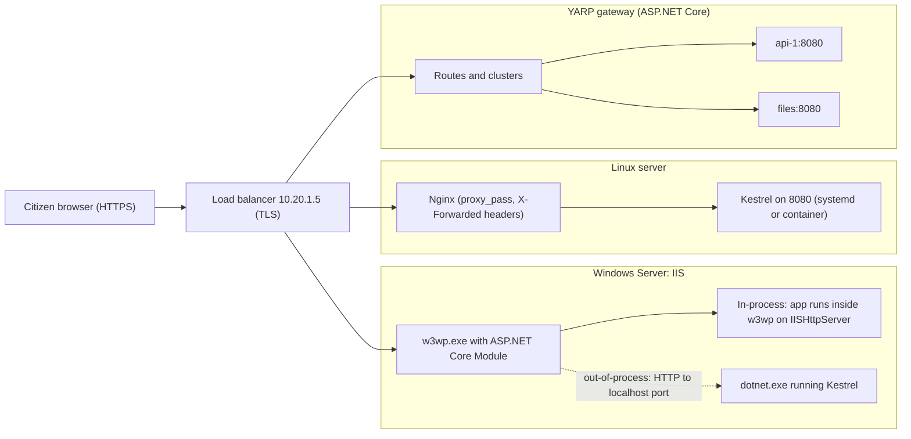
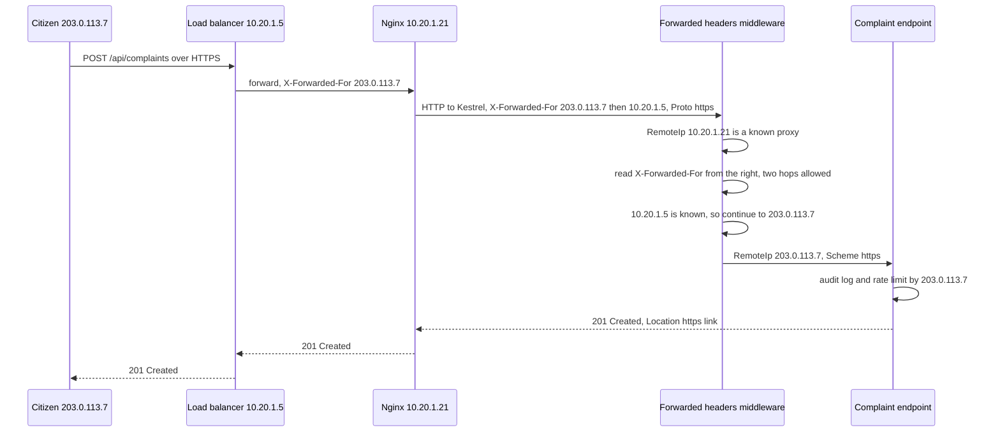

**Jan Samadhan** is a state government's public grievance portal: citizens file complaints about roads, water supply and electricity, attach photos, and track them by SMS. The state data centre runs Windows Server 2022 with IIS, and the department's IT cell knows IIS well. The developers built the portal in ASP.NET Core 10 and tested it with `dotnet run`. On the first production day three things went wrong: every complaint was logged as coming from the IP address `10.20.1.5` (the load balancer), the "Track your complaint" link in SMS messages pointed to `http://` instead of `https://`, and citizens uploading 12 MB photos got a blank error page. None of these were bugs in the business logic. All three were about **what sits in front of the app** and how the app is told about it.

## Learning objectives

By the end of this lesson you will be able to:

1. Explain what a reverse proxy does (TLS termination, routing, buffering, limits, load balancing) and when Kestrel can face the internet directly.
2. Host ASP.NET Core on IIS with the ASP.NET Core Module, and choose between in-process and out-of-process hosting.
3. Read and edit the `web.config` that publish generates, and diagnose the common IIS start-up errors (500.30, 502.5, 500.19).
4. Configure Nginx in front of Kestrel on Linux, and know where YARP fits as a .NET-native reverse proxy.
5. Configure the forwarded headers middleware so the app sees the real client IP, scheme and host, while ignoring headers spoofed by clients.
6. Keep request limits, timeouts and Data Protection keys consistent across the proxy and every app instance.

## Prerequisites

- [API gateways, reverse proxies and load balancers](#/lesson/m10-gateways-proxies-lb): the concepts this lesson puts into practice.
- [HTTP fundamentals](#/lesson/m10-http-fundamentals): headers, status codes and connection reuse.
- [Docker, Dockerfiles and Docker Compose](#/lesson/m15-docker): the local labs run Nginx and YARP in containers.

## Explain it like I'm a beginner

Think of a large government office. Citizens don't walk straight into an officer's room. They come to the **reception desk**. The receptionist checks their token, takes the documents, turns away anyone carrying something not allowed, and sends each person to the right room. The officer inside only sees people who have been checked, and gets a note: "this is Mrs. Sharma from Ward 12, she came in through the main gate".

A **reverse proxy** is that reception desk for web traffic. Browsers talk to the proxy. The proxy decides which app (and which copy of the app) handles each request, passes it along, and returns the answer. The app is the officer.

The note matters. Because the request now arrives *from the receptionist*, the officer would think every visitor is the receptionist, unless the receptionist writes down who the visitor really was. On the web, that note is a set of **forwarded headers** (`X-Forwarded-For`, `X-Forwarded-Proto`). And the officer must only believe notes written by *their own* receptionist. A note that a visitor wrote themselves and slipped in their pocket is worthless.

- **IIS** is the reception desk built into Windows Server.
- **Nginx** is a popular reception desk on Linux.
- **YARP** ("Yet Another Reverse Proxy") is a reception-desk toolkit written in .NET, which you build into an ASP.NET Core app.
- **Kestrel** is ASP.NET Core's own web server: the officer's own door.

## First-principles explanation

### What a reverse proxy does

A **forward proxy** acts for clients (an office proxy that employees' browsers go through). A **reverse proxy** acts for servers: clients think they are talking to the website, but they are talking to the proxy, which forwards to one or more backend servers. Its jobs:

| Job | What it means for Jan Samadhan |
|---|---|
| TLS termination | The proxy holds the certificate and decrypts HTTPS, so certificates are managed in one place |
| Routing | `/api/*` to the API, `/files/*` to the attachment service, `/` to the static front end |
| Load balancing | Spread requests over two or more app servers and skip unhealthy ones |
| Buffering and slow clients | A citizen on a slow 3G connection uploads a photo over 40 seconds; the proxy can buffer it so the app thread is busy for milliseconds, not 40 seconds |
| Limits and filtering | Maximum body size, header size, rate limits, blocked paths |
| Compression and caching | gzip or Brotli for responses, caching static files |
| Single public entry | Only the proxy is reachable from the internet; app servers sit on a private network |

**Kestrel is a production-grade server** and since ASP.NET Core 2.x it is supported facing the internet directly. You still add a proxy when you need more than one app on port 443, central certificate management, Windows-specific features (Windows authentication via IIS, IIS-managed process lifetime), load balancing, or an existing operations standard. In containers on Azure Container Apps or Kubernetes, the platform's ingress is the reverse proxy, and Kestrel listens on 8080 behind it.

### How IIS hosts ASP.NET Core

Classic ASP.NET (Framework) ran inside IIS through `System.Web`. ASP.NET Core does not use `System.Web` at all. Instead, IIS loads a native module, the **ASP.NET Core Module (ANCM)**, installed by the **.NET Hosting Bundle**. ANCM has two modes:

**In-process hosting** (the default since ASP.NET Core 3.0). ANCM loads the .NET runtime and your app **inside the IIS worker process** (`w3wp.exe`). Requests go from IIS to your app through an in-memory server called `IISHttpServer`, not Kestrel. No extra network hop, so it is faster than out-of-process.

**Out-of-process hosting.** ANCM starts your app as a separate process (`dotnet YourApp.dll`) running **Kestrel** on a random localhost port, and IIS forwards each request to it over HTTP. ANCM restarts the process if it crashes and passes a pairing token so only IIS can talk to it. In this mode, ASP.NET Core automatically enables the forwarded headers handling for the IIS hop.

| | In-process | Out-of-process |
|---|---|---|
| Server inside your app | IISHttpServer | Kestrel |
| Process | `w3wp.exe` (IIS worker) | `dotnet.exe` (child of w3wp) |
| Extra hop | None | Loopback HTTP |
| Throughput | Higher | Lower (extra hop) |
| Apps per app pool | **One** ASP.NET Core app per pool | Several possible |
| Crash isolation | App crash takes down the worker process | IIS survives, ANCM restarts the app |
| When to choose | Default for almost everything | You need Kestrel-specific features, or must share a pool, or want the same server as Linux |

Either way, **IIS manages the lifetime**: it starts the app on the first request (or at boot with the right settings), recycles the app pool on its schedule, and stops it when the site stops.

### The web.config that publish creates

`dotnet publish` generates a `web.config` next to your DLL. IIS reads it; ASP.NET Core itself does not. A typical one:

```xml
<?xml version="1.0" encoding="utf-8"?>
<configuration>
  <location path="." inheritInChildApplications="false">
    <system.webServer>
      <handlers>
        <add name="aspNetCore" path="*" verb="*" modules="AspNetCoreModuleV2" resourceType="Unspecified" />
      </handlers>
      <aspNetCore processPath="dotnet"
                  arguments=".\JanSamadhan.Web.dll"
                  stdoutLogEnabled="false"
                  stdoutLogFile=".\logs\stdout"
                  hostingModel="inprocess">
        <environmentVariables>
          <environmentVariable name="ASPNETCORE_ENVIRONMENT" value="Production" />
        </environmentVariables>
      </aspNetCore>
      <security>
        <requestFiltering>
          <!-- IIS's own body limit: 15 MB here. The default is 30,000,000 bytes. -->
          <requestLimits maxAllowedContentLength="15728640" />
        </requestFiltering>
      </security>
    </system.webServer>
  </location>
</configuration>
```

What each part does:

- `handlers` sends every request (`path="*"`) to ANCM V2.
- `processPath` and `arguments` say how to start the app. For a self-contained publish, `processPath` is `.\JanSamadhan.Web.exe` and there are no arguments.
- `hostingModel` is `inprocess` or `outofprocess`. You can set it from the project with `<AspNetCoreHostingModel>OutOfProcess</AspNetCoreHostingModel>`.
- `stdoutLogEnabled` writes the console output to files. Turn it on **temporarily** to debug a start-up failure, then off again: it has no rotation and can fill the disk.
- `environmentVariables` sets environment variables for the app. Never put secrets here; the file sits in the site folder.
- `requestLimits maxAllowedContentLength` is IIS's request filtering limit, separate from ASP.NET Core's own limit.

### Deploying to IIS without locked files

On Windows, a running app locks its DLLs, so copying a new version over the old one fails. Two standard techniques:

- **`app_offline.htm`**: drop a file with that name in the site folder. ANCM shuts the app down, releases the locks and serves that HTML page to every request. Copy the new files, delete `app_offline.htm`, and the next request starts the new version. Web Deploy (`msdeploy`) and Visual Studio do this for you. The downtime is the copy time plus the cold start.
- **Shadow copying**: ANCM can copy the app to a separate folder and run it from there, so the site folder is never locked (configured with `handlerSettings` such as `enableShadowCopy` and `shadowCopyDirectory`). The next request after a file change starts the new version.

For zero downtime on IIS, run two or more servers behind a load balancer and update one at a time, draining each first ([deployment strategies](#/lesson/m15-deployment-strategies)).

### App pool settings that cause surprises

- **.NET CLR version: "No Managed Code".** ASP.NET Core doesn't use the CLR that IIS would load for classic ASP.NET.
- **Idle time-out** (default 20 minutes). If nobody visits for 20 minutes, IIS stops the worker process and the next citizen waits for a cold start (often several seconds for a large app; measure yours). For a public portal, set **Start Mode = AlwaysRunning**, idle time-out to 0, and enable **preload** (Application Initialization) so the app starts when IIS starts.
- **Recycling** (default every 1,740 minutes, that is 29 hours). Recycling restarts the app; in-memory caches and in-flight background work are lost. Schedule recycling at a quiet time (for example 03:00 IST) or disable time-based recycling and rely on monitoring.
- **Identity.** The pool runs as `IIS AppPool\<PoolName>`. Grant it only the folder permissions it needs (read on the site, write on a logs or uploads folder).

### The IIS error pages you will meet

| Error | Usual meaning | First thing to check |
|---|---|---|
| **HTTP 500.19** | IIS cannot read `web.config`, often because ANCM is not installed | Install or repair the .NET Hosting Bundle, then restart IIS |
| **HTTP 500.30** In-Process Start Failure | The app threw during start-up (bad configuration, missing secret, database unreachable at start-up) | Event Viewer (Application log), temporarily enable stdout logging |
| **HTTP 500.31** | The required .NET runtime version is not installed | Install the matching Hosting Bundle |
| **HTTP 502.5** Process Failure | Out-of-process: the `dotnet` process failed to start | Same as 500.30, plus check `processPath` |
| **HTTP 500.35** | Two in-process apps in the same app pool | Give each ASP.NET Core app its own pool |
| **HTTP 413** or a blank page on upload | Body larger than a limit (IIS, ASP.NET Core or form options) | Align all the limits (below) |

### Nginx in front of Kestrel on Linux

On Linux, the common setup is Kestrel listening on `127.0.0.1:5000` (or a container port), run by `systemd` or Docker, with Nginx in front:

```nginx
# /etc/nginx/conf.d/jansamadhan.conf
upstream jansamadhan_app {
    server 10.20.2.11:8080 max_fails=3 fail_timeout=30s;
    server 10.20.2.12:8080 max_fails=3 fail_timeout=30s;
    keepalive 32;                                   # reuse connections to Kestrel
}

server {
    listen 443 ssl;
    http2 on;
    server_name grievance.example.gov.in;
    ssl_certificate     /etc/ssl/jansamadhan/fullchain.pem;
    ssl_certificate_key /etc/ssl/jansamadhan/privkey.pem;

    client_max_body_size 15m;                       # default is 1m
    proxy_read_timeout   60s;

    location / {
        proxy_pass         http://jansamadhan_app;
        proxy_http_version 1.1;
        proxy_set_header   Connection        "";    # needed for upstream keepalive
        proxy_set_header   Host              $host;
        proxy_set_header   X-Forwarded-For   $proxy_add_x_forwarded_for;
        proxy_set_header   X-Forwarded-Proto $scheme;
        proxy_set_header   X-Forwarded-Host  $host;
    }

    location /hubs/ {                               # SignalR or WebSockets
        proxy_pass         http://jansamadhan_app;
        proxy_http_version 1.1;
        proxy_set_header   Upgrade    $http_upgrade;
        proxy_set_header   Connection "upgrade";
        proxy_set_header   Host       $host;
        proxy_read_timeout 3600s;
    }
}

server {
    listen 80;
    server_name grievance.example.gov.in;
    return 301 https://$host$request_uri;
}
```

Nginx's default `client_max_body_size` is 1 MB, which is the classic cause of "uploads fail only in production". `$proxy_add_x_forwarded_for` **appends** the connecting address to any `X-Forwarded-For` the client sent, which is why the app must only trust entries added by known proxies.

### YARP: a reverse proxy written in .NET

**YARP** is a Microsoft library (`Yarp.ReverseProxy` NuGet package) that turns an ASP.NET Core app into a reverse proxy. You configure **routes** (match rules: path, host, method, headers), **clusters** (groups of **destinations**, that is backend addresses), load-balancing policies, active and passive health checks, session affinity and **transforms** (rewrite paths and headers). Because it is ASP.NET Core, you can add your own middleware: authentication, rate limiting, custom routing based on a tenant id in a JWT.

```json
{
  "ReverseProxy": {
    "Routes": {
      "api":   { "ClusterId": "api",   "Match": { "Path": "/api/{**rest}" } },
      "files": { "ClusterId": "files", "Match": { "Path": "/files/{**rest}" },
                 "Transforms": [ { "PathRemovePrefix": "/files" } ] }
    },
    "Clusters": {
      "api": {
        "LoadBalancingPolicy": "PowerOfTwoChoices",
        "HealthCheck": { "Active": { "Enabled": true, "Interval": "00:00:10", "Path": "/health/ready" } },
        "Destinations": {
          "api1": { "Address": "http://api-1:8080/" },
          "api2": { "Address": "http://api-2:8080/" }
        }
      },
      "files": { "Destinations": { "f1": { "Address": "http://files:8080/" } } }
    }
  }
}
```

```csharp
// Program.cs of the gateway project (needs the Yarp.ReverseProxy package)
var builder = WebApplication.CreateBuilder(args);
builder.Services.AddReverseProxy().LoadFromConfig(builder.Configuration.GetSection("ReverseProxy"));
var app = builder.Build();
app.MapReverseProxy();
app.Run();
```

Choosing between them:

| | IIS + ANCM | Nginx | YARP |
|---|---|---|---|
| Platform | Windows Server | Linux (also Windows builds) | Anywhere .NET runs, including containers |
| Strength | Windows auth, IIS tooling, ops teams who know IIS | Very efficient static files and TLS, huge ecosystem | Custom logic in C#, config from code or a database, same language as the app |
| Typical role | Hosts the app itself | Edge proxy and load balancer | Gateway in front of several .NET services, BFF |
| Watch out | One in-process app per pool, recycling | Body size default, header buffering | You own its scaling, patching and availability like any app |

YARP is also the natural local alternative to a managed gateway ([Azure API Management](#/lesson/m15-apim)).

### Forwarded headers: telling the app the truth

Behind a proxy, three things the app sees are wrong unless fixed:

| The app sees | Truth | Header that carries the truth |
|---|---|---|
| `RemoteIpAddress = 10.20.1.5` (the proxy) | Citizen's IP `203.0.113.7` | `X-Forwarded-For` |
| `Request.Scheme = http` (proxy to app is plain HTTP) | `https` | `X-Forwarded-Proto` |
| `Request.Host = 10.20.2.11:8080` | `grievance.example.gov.in` | `X-Forwarded-Host` (or the proxy preserves `Host`) |

Why it matters: rate limiting per IP, audit logs ("who filed this complaint?"), absolute links in emails and SMS, OAuth redirect URIs, `UseHttpsRedirection` (which loops forever if the app thinks every request is HTTP), and secure cookies.

The **forwarded headers middleware** (`UseForwardedHeaders`) reads these headers and updates `HttpContext.Connection.RemoteIpAddress`, `Request.Scheme` and `Request.Host`. Its safety rules:

- It only applies headers when the request came from a **known proxy** or **known network**. By default only loopback (`127.0.0.1`, `::1`) is trusted. Add your proxies' addresses in `KnownProxies` or CIDR ranges in `KnownIPNetworks`. In .NET 10 `KnownIPNetworks` (a list of `System.Net.IPNetwork`) replaces the older `KnownNetworks` property, which is now obsolete; code written for .NET 8 or 9 still compiles but shows a warning.
- `ForwardLimit` (default 1) is how many proxy hops to process, reading `X-Forwarded-For` **from the right**, because the rightmost entries were added by your proxies and the leftmost could be anything a client typed.
- It must run **first** in the pipeline, before authentication, HTTPS redirection, rate limiting and logging that read the IP or scheme.
- `ForwardedHeadersOptions.AllowedHosts` restricts which values `X-Forwarded-Host` may set, to prevent host-header injection into generated links. (It is separate from the `AllowedHosts` setting in `appsettings.json`, which filters the `Host` header itself; use both.)

In containers behind a platform ingress whose addresses you can't know in advance, setting the environment variable `ASPNETCORE_FORWARDEDHEADERS_ENABLED=true` enables the middleware for `X-Forwarded-For` and `X-Forwarded-Proto` and **clears** the known proxy lists, trusting any sender. That is only safe if the app is unreachable except through the ingress.

### Keep every limit consistent

An upload passes through several limits; the smallest wins, and each fails differently:

| Layer | Setting | Default |
|---|---|---|
| Nginx | `client_max_body_size` | 1 MB |
| IIS request filtering | `maxAllowedContentLength` | 30,000,000 bytes (about 28.6 MB) |
| ASP.NET Core server (Kestrel or IIS in-process) | `MaxRequestBodySize` | 30,000,000 bytes |
| Multipart forms | `FormOptions.MultipartBodyLengthLimit` | 128 MB |

Jan Samadhan allows up to three photos per complaint and at most 15 MB per request in total (the mobile app resizes photos before upload; a single unresized 12 MB photo from the website must still fit), so set every layer to 15 MB in one place in configuration, and return a friendly 413 with a message, not a blank page. Do the same for timeouts: the proxy's read timeout must be longer than the slowest legitimate request, or citizens see 504 while the app is still working.

### Several instances need shared Data Protection keys

ASP.NET Core encrypts cookies, antiforgery tokens and TempData with **Data Protection** keys. By default each server generates its own keys. With two IIS servers behind a load balancer, a form rendered by server 1 and posted to server 2 fails antiforgery validation, and login cookies from one server are rejected by the other. Store the key ring in a shared location (a network share, a database, Azure Blob Storage) with `PersistKeysTo...` and the same `SetApplicationName`, and protect the keys at rest. Avoid "sticky sessions" as the fix: they hide the problem until a server goes down.

### What breaks first

For a proxy-plus-app setup the usual order is: limits and timeouts (413 on uploads, 504 on slow reports), then connection exhaustion between proxy and app if keep-alive isn't configured (each request opens a new TCP connection and ephemeral ports run out under load), then the single proxy itself if it is not redundant. A pair of proxies with a floating IP (or a cloud load balancer) removes the last single point of failure.

### When a simpler setup is enough

An internal tool used by 30 people can run on one IIS server, in-process, with Windows authentication and no extra proxy. A single containerised API on a managed platform needs no Nginx: the platform's ingress already terminates TLS and load balances. Add a dedicated reverse proxy layer when you have several apps behind one domain, more than one instance, custom routing, or an operations standard that requires it.

## Visual explanation

### Three ways a request reaches the app



The citizen always talks HTTPS to the load balancer at `10.20.1.5`, which forwards to one of three possible hosting styles. In the IIS box, `w3wp.exe` loads the ASP.NET Core Module; the solid arrow is in-process hosting, where the app runs inside the worker process, and the dotted arrow is out-of-process hosting, where the module forwards over loopback HTTP to a separate `dotnet` process running Kestrel. In the Linux box, Nginx forwards to Kestrel and adds the forwarded headers. In the YARP box, a .NET gateway matches routes and forwards to clusters of backend destinations. In all three, the app's view of the client IP and scheme is wrong unless forwarded headers are configured.

### A request through Nginx with forwarded headers



The citizen's request first reaches the load balancer, which adds the citizen's address to `X-Forwarded-For`. Nginx appends the load balancer's address and sets `X-Forwarded-Proto: https`. Kestrel sees the connection coming from Nginx at `10.20.1.21`. The middleware checks that Nginx is a known proxy, then walks the `X-Forwarded-For` list from the right: `10.20.1.5` is also trusted, so it continues one more hop and stops at `203.0.113.7`, which becomes `RemoteIpAddress`. The scheme becomes `https`. The endpoint now logs and rate-limits by the real citizen, and generates `https` links. If a client had sent its own fake `X-Forwarded-For: 1.2.3.4`, that value would sit to the left of the real address and would never be reached.

## Step-by-step example

### Step 1: reproduce the three production bugs locally

Run the app behind Nginx in Docker Compose (the lab below). Call `/diag/request`: it reports `remoteIp: 172.18.0.3` (the Nginx container), `scheme: http`. That is exactly what production showed.

### Step 2: add forwarded headers, trusting only the proxy

Configure `ForwardedHeadersOptions` with `XForwardedFor | XForwardedProto`, add the proxy's address to `KnownProxies`, and call `app.UseForwardedHeaders()` first. `/diag/request` now shows the browser's address and `https` (Nginx terminates TLS in the lab).

### Step 3: prove that spoofing does not work

Send `curl -H "X-Forwarded-For: 1.2.3.4" https://localhost/diag/request`. Nginx appends the real address; with `ForwardLimit = 1` the app takes the rightmost entry and ignores `1.2.3.4`. Then call Kestrel directly on its published port with the same header: the app sees an untrusted sender and ignores the header completely.

### Step 4: align the limits

Set `Hosting:MaxUploadBytes = 15728640` in configuration and apply it to IIS, Kestrel and form options in code; set `client_max_body_size 15m` in Nginx and `maxAllowedContentLength` in `web.config`. Upload a 12 MB photo through each path.

### Step 5: publish to IIS

Install the Hosting Bundle, create an app pool with "No Managed Code", AlwaysRunning and idle time-out 0, point a site at the publish folder and deploy with `app_offline.htm`. Check `/diag/request`: `process` is `w3wp` for in-process. Switch `hostingModel` to `outofprocess` and it becomes `dotnet`.

### Step 6: share Data Protection keys before adding the second server

Persist the key ring to a shared folder and set the application name, then add the second IIS server to the load balancer.

## Production-style C# implementation

```text
JanSamadhan.Web/
  Program.cs
  Hosting/ProxyTrust.cs          forwarded headers from configuration
  Hosting/UploadLimits.cs        one limit applied to IIS, Kestrel and forms
  Hosting/RequestDiagnostics.cs  what the app believes about each request
  web.config                     generated by publish, edited for limits
deploy/
  compose.proxy-lab.yaml         Nginx + two app containers for local testing
  nginx/jansamadhan.conf
```

```csharp file=Hosting/ProxyTrust.cs
using System.Net;
using Microsoft.AspNetCore.HttpOverrides;

namespace JanSamadhan.Hosting;

/// <summary>Bound from the "Proxy" section, for example
/// Proxy__TrustedProxies__0=10.20.1.21, Proxy__TrustedNetworks__0=10.20.1.0/28,
/// Proxy__ForwardLimit=2, Proxy__AllowedHosts__0=grievance.example.gov.in</summary>
public sealed class ProxyTrustOptions
{
    public List<string> TrustedProxies { get; set; } = [];
    /// <summary>CIDR ranges, for proxies whose individual addresses change (a scale set, a load balancer pair).</summary>
    public List<string> TrustedNetworks { get; set; } = [];
    public int ForwardLimit { get; set; } = 1;
    public List<string> AllowedHosts { get; set; } = [];
    public bool ForwardHost { get; set; }
}

public static class ProxyTrustExtensions
{
    public static IServiceCollection AddProxyTrust(this IServiceCollection services, IConfiguration configuration)
    {
        var trust = configuration.GetSection("Proxy").Get<ProxyTrustOptions>() ?? new ProxyTrustOptions();

        services.Configure<ForwardedHeadersOptions>(o =>
        {
            o.ForwardedHeaders = ForwardedHeaders.XForwardedFor | ForwardedHeaders.XForwardedProto;
            // Only rewrite Host if we also restrict which hosts are acceptable.
            if (trust.ForwardHost && trust.AllowedHosts.Count > 0)
            {
                o.ForwardedHeaders |= ForwardedHeaders.XForwardedHost;
                foreach (var h in trust.AllowedHosts) o.AllowedHosts.Add(h);
            }

            o.ForwardLimit = Math.Max(1, trust.ForwardLimit);
            // Loopback stays trusted by default. Add each real proxy explicitly.
            foreach (var p in trust.TrustedProxies)
            {
                if (!IPAddress.TryParse(p, out var ip))
                    throw new InvalidOperationException($"Proxy:TrustedProxies contains an invalid IP address '{p}'.");
                o.KnownProxies.Add(ip);
            }
            // .NET 10: KnownIPNetworks takes System.Net.IPNetwork. The older KnownNetworks property
            // (Microsoft.AspNetCore.HttpOverrides.IPNetwork) is obsolete.
            foreach (var n in trust.TrustedNetworks)
            {
                if (!System.Net.IPNetwork.TryParse(n, out var network))
                    throw new InvalidOperationException($"Proxy:TrustedNetworks contains an invalid CIDR range '{n}'.");
                o.KnownIPNetworks.Add(network);
            }
        });
        return services;
    }
}
```

```csharp file=Hosting/UploadLimits.cs
using Microsoft.AspNetCore.Http.Features;
using Microsoft.AspNetCore.Server.Kestrel.Core;

namespace JanSamadhan.Hosting;

public sealed class UploadLimitOptions
{
    /// <summary>One number for every layer inside the app. Proxies (Nginx, IIS request filtering)
    /// must be set to the same value in their own configuration.</summary>
    public long MaxUploadBytes { get; set; } = 15 * 1024 * 1024;
}

public static class UploadLimitExtensions
{
    public static WebApplicationBuilder AddUploadLimits(this WebApplicationBuilder builder)
    {
        var limits = builder.Configuration.GetSection("Hosting").Get<UploadLimitOptions>() ?? new UploadLimitOptions();

        builder.Services.Configure<KestrelServerOptions>(o => o.Limits.MaxRequestBodySize = limits.MaxUploadBytes);
        builder.Services.Configure<FormOptions>(o => o.MultipartBodyLengthLimit = limits.MaxUploadBytes);
        // IIS in-process: also configure IISServerOptions (see the snippet below).
        builder.Services.AddSingleton(limits);
        return builder;
    }
}
```

When the app runs in-process on IIS, Kestrel's options don't apply; the IIS server has its own `IISServerOptions` (in the `Microsoft.AspNetCore.Server.IIS` assembly, part of the Windows ASP.NET Core runtime). Add one line next to the Kestrel one:

```csharp
builder.Services.Configure<IISServerOptions>(o => o.MaxRequestBodySize = limits.MaxUploadBytes);
```

```csharp file=Hosting/RequestDiagnostics.cs
namespace JanSamadhan.Hosting;

public sealed record RequestView(
    string Scheme,
    string Host,
    string PathBase,
    string? RemoteIp,
    string? OriginalForwardedFor,
    string Process);

public static class RequestDiagnostics
{
    /// <summary>What the app believes about the current request, after forwarded headers ran.
    /// The middleware moves the processed header values to X-Original-For / X-Original-Proto.</summary>
    public static RequestView Describe(HttpContext ctx) => new(
        ctx.Request.Scheme,
        ctx.Request.Host.Value ?? "",
        ctx.Request.PathBase.Value ?? "",
        ctx.Connection.RemoteIpAddress?.ToString(),
        ctx.Request.Headers["X-Original-For"].ToString() is { Length: > 0 } of ? of : null,
        // "w3wp" means IIS in-process, "dotnet" means Kestrel (out-of-process, Nginx or a container).
        Path.GetFileNameWithoutExtension(Environment.ProcessPath) ?? "unknown");
}
```

```csharp file=Program.cs
using JanSamadhan.Hosting;
using Microsoft.AspNetCore.Http.Features;

var builder = WebApplication.CreateBuilder(args);
// CreateBuilder already calls UseIIS() and UseIISIntegration(), so the same build runs
// in-process on IIS, out-of-process behind IIS, behind Nginx, or in a container.

builder.Services.AddProxyTrust(builder.Configuration);
builder.AddUploadLimits();
builder.Services.AddHealthChecks();

// Two or more servers: share the Data Protection key ring, for example:
// builder.Services.AddDataProtection()
//     .SetApplicationName("JanSamadhan")
//     .PersistKeysToFileSystem(new DirectoryInfo(@"\\fileserver\keys\jansamadhan"));

var app = builder.Build();

app.UseForwardedHeaders();          // FIRST: everything after it sees the real IP and scheme

// When the proxy publishes the app under a sub-path (https://portal.example.gov.in/grievance)
// and strips it before forwarding, restore it so generated links include it.
var pathBase = app.Configuration["Hosting:PathBase"];
if (!string.IsNullOrEmpty(pathBase)) app.UsePathBase(pathBase);

if (!app.Environment.IsDevelopment()) app.UseHsts();
app.UseHttpsRedirection();          // safe now: the scheme is https when the proxy terminated TLS

app.MapHealthChecks("/health/ready");

if (app.Configuration.GetValue("Diagnostics:RequestEndpoint", app.Environment.IsDevelopment()))
    app.MapGet("/diag/request", (HttpContext ctx) => Results.Ok(RequestDiagnostics.Describe(ctx)));

app.MapPost("/api/complaints", async (HttpRequest request, UploadLimitOptions limits) =>
{
    if (!request.HasFormContentType) return Results.BadRequest(new { error = "multipart/form-data expected" });
    try
    {
        var form = await request.ReadFormAsync();
        var photos = form.Files.Count;
        var id = $"JS-{DateTime.UtcNow:yyyyMMdd}-{Random.Shared.Next(10_000, 99_999)}";
        var trackUrl = $"{request.Scheme}://{request.Host}{request.PathBase}/track/{id}";
        return Results.Created(trackUrl, new { id, photos, trackUrl });
    }
    catch (Exception ex) when (ex is BadHttpRequestException or InvalidDataException)
    {
        return Results.Problem(
            title: "Attachment too large",
            detail: $"Total upload must be under {limits.MaxUploadBytes / (1024 * 1024)} MB.",
            statusCode: StatusCodes.Status413PayloadTooLarge);
    }
});

app.Run();
```

### Local lab: Nginx and two app instances in Docker

```yaml
# deploy/compose.proxy-lab.yaml
services:
  nginx:
    image: nginx:1.28-alpine
    ports: ["8443:443"]
    volumes:
      - ./nginx/jansamadhan.conf:/etc/nginx/conf.d/default.conf:ro
      - ./certs:/etc/ssl/jansamadhan:ro           # self-signed cert from "dotnet dev-certs https --export-path"
    depends_on: [app1, app2]
    networks: { lab: { ipv4_address: 172.28.0.10 } }
  app1: &app
    image: jansamadhan-web:dev
    environment:
      Proxy__TrustedProxies__0: "172.28.0.10"   # only Nginx may set forwarded headers
      Diagnostics__RequestEndpoint: "true"
      Hosting__MaxUploadBytes: "15728640"
    networks: [lab]
  app2: *app
networks:
  lab:
    ipam: { config: [{ subnet: 172.28.0.0/24 }] }
```

Change the Nginx `upstream` to `server app1:8080; server app2:8080;`. Stop `app1` with `docker compose stop app1` and watch Nginx route around it (passive health via `max_fails`). Swap Nginx for a YARP container with the JSON configuration above to compare.

Design notes:

- **Trust is configuration, not code.** The proxy addresses differ per environment, so they come from `Proxy:TrustedProxies`. An invalid address fails start-up loudly (a 500.30 on IIS), which is better than silently trusting nothing.
- **Host forwarding is opt-in** and only enabled with an allow-list, because a forged `X-Forwarded-Host` would otherwise end up in password-reset and tracking links.
- **One limit number.** The app reads `Hosting:MaxUploadBytes` once and applies it to Kestrel, IIS in-process and multipart forms, so the three can't drift. The proxy's own setting must match; a deployment check can compare them.
- **The diagnostics endpoint is off by default outside development.** It is invaluable when setting up a new environment and should be switched on briefly, not left public.

## Bad design vs good design

**Bad**: "it works on my machine" hosting.

```text
- Kestrel exposed on port 80 and 443 on the IIS box, IIS also bound to 443 "for the old site"
- ForwardedHeaders with KnownProxies cleared (trust everyone) on a server reachable directly from the internet
- UseForwardedHeaders added after UseAuthentication and UseRateLimiter
- Upload limit raised only in appsettings.json, not in web.config or Nginx
- Three ASP.NET Core apps in one app pool, in-process
- stdoutLogEnabled="true" left on since go-live, logs folder at 40 GB
- Two IIS servers, each with its own Data Protection keys, "fixed" with sticky sessions
```

What goes wrong: port conflicts and two TLS configurations to maintain. Any client can set `X-Forwarded-For` and bypass IP-based rate limits or forge audit entries. Middleware that runs before forwarded headers sees the proxy's IP. Uploads fail with different errors depending on which layer rejects them. In-process apps sharing a pool fail with 500.35. The disk fills. When the sticky server is recycled, every citizen on it is logged out and their half-filled complaint forms fail antiforgery checks.

**Good**: one public entry (IIS, Nginx or a cloud load balancer) terminating TLS; Kestrel or IIS in-process behind it; `UseForwardedHeaders` first, trusting only listed proxies, with host forwarding restricted by an allow-list; one configured upload limit applied to every layer; one app pool per in-process app with AlwaysRunning and preload; stdout logging only during diagnosis; a shared Data Protection key ring.

:::callout type=warning title="ASPNETCORE_FORWARDEDHEADERS_ENABLED trusts everyone"
It is convenient in containers, but it clears the known proxy lists. Use it only when the app cannot be reached except through the platform's ingress (for example, internal-only ingress in Container Apps or a Kubernetes service with no external exposure).
:::

:::callout type=tip title="In-process unless you have a reason"
In-process is the default for good reason: no extra hop and simpler operations. Choose out-of-process when you must share an app pool, need a Kestrel-only feature, or want identical server behaviour to your Linux deployment.
:::

## Practical playground

The canvas shows Jan Samadhan on day one: citizens reach a single IIS server directly, and the app talks to PostgreSQL. Improve it.

1. Add a load balancer that terminates TLS, and a second IIS server. Which settings must now be identical on both servers?
2. Add an attachment service on Linux behind the same domain under `/files`. Which component does the path routing?
3. Mark where forwarded headers are added and where they are trusted.
4. Where do Data Protection keys live once there are two servers?

:::playground type=hld title="Put a proper front door on Jan Samadhan"
```json
{
  "nodes": [
    { "id": "citizen", "type": "client", "label": "Citizens (web and mobile)", "props": { "rps": 120 } },
    { "id": "iis", "type": "app-server", "label": "IIS server (in-process app)", "props": { "instances": 1 } },
    { "id": "pg", "type": "database", "label": "PostgreSQL 17" }
  ],
  "edges": [
    { "from": "citizen", "to": "iis", "kind": "sync", "label": "HTTPS direct to server" },
    { "from": "iis", "to": "pg", "kind": "sync" }
  ]
}
```
:::

## Exercises

:::exercise id=m15-reverse-proxy-iis-ex1 difficulty=beginner kind=written title="Diagnose four IIS tickets"
The IT cell sends four tickets after moving two apps to a new IIS server. For each, name the most likely cause, the first place to look, and the fix.

1. Browsing the site shows **HTTP Error 500.19** with error code `0x8007000d`.
2. The grievance app shows **HTTP Error 500.30 - ASP.NET Core app failed to start** right after a deployment that added a new `Sms:ApiKey` setting.
3. The second ASP.NET Core app, added to the existing app pool, shows **HTTP Error 500.35**.
4. Every Monday at 09:00 the first citizen waits about 15 seconds for the home page; after that it's fast.
::acceptance
- 500.19 is linked to an unreadable `web.config`, most commonly a missing ASP.NET Core Module (Hosting Bundle not installed).
- 500.30 is an exception during start-up; looks in Event Viewer or enables stdout logging temporarily; identifies the missing setting as the likely cause.
- 500.35 is two in-process apps in one pool; fix is a separate pool (or out-of-process).
- The Monday delay is idle time-out or recycling causing a cold start; fix is AlwaysRunning, idle time-out 0 and preload, with recycling at a quiet hour.
::hint
500.19 errors happen before any of your code runs. What does IIS need in order to understand the `aspNetCore` element?
::hint
500.30 means your `Program.cs` threw. Where does a process that crashed before logging was configured leave its error?
::hint
Think about what "in-process" means for the number of apps one `w3wp.exe` can hold.
::hint
Nobody uses the portal on Sunday. What does IIS do with a worker process that receives no requests for 20 minutes?
::solution
1. **500.19 (0x8007000d)**: IIS can't parse `web.config` because it doesn't know the `aspNetCore` section, which means the ASP.NET Core Module isn't installed. Install the .NET Hosting Bundle for the app's runtime version, then run `iisreset` (or restart the server). If it was installed before IIS itself, repair it.
2. **500.30**: the app threw during start-up. Check Event Viewer → Windows Logs → Application for the ANCM entry with the exception, or set `stdoutLogEnabled="true"` (and create the `logs` folder with write permission for the app pool identity), reproduce once, read the log, then turn it off. With a new required setting, the likely cause is that `Sms:ApiKey` isn't configured on this server and the options validation (`ValidateOnStart`) or a constructor threw. Supply it through the server's secret store or environment, not `web.config`.
3. **500.35**: in-process hosting allows only one ASP.NET Core app per worker process. Create a separate app pool ("No Managed Code") for the second app. Out-of-process hosting would also work but costs throughput.
4. **Monday 15 s**: the app pool's idle time-out (20 minutes by default) stopped the worker over the weekend, or a scheduled recycle happened, so the first request pays the full cold start: loading the runtime, JIT, warming caches and database connections. Set Start Mode = AlwaysRunning, idle time-out = 0, enable preload (Application Initialization module), and move any time-based recycle to 03:00. Measure cold start time after the change.
::mistakes
- Turning on stdout logging and forgetting to turn it off.
- Putting the API key into `web.config`'s `environmentVariables` to "fix" the 500.30. It sits in the site folder in plain text.
- Fixing 500.35 by merging both apps into one.
:::

:::exercise id=m15-reverse-proxy-iis-ex2 difficulty=beginner kind=code title="Find the real client IP"
Implement the core of the forwarded headers logic. `ForwardedForResolver.ClientIp(remoteIp, xForwardedFor, trustedProxies, forwardLimit)`:

1. Start with `current = remoteIp`.
2. Split `X-Forwarded-For` by commas and trim. Walk the entries **from right to left**.
3. Before taking each entry, stop if `current` is not a trusted proxy, or if `forwardLimit` entries have already been taken.
4. An entry may carry a port: `203.0.113.7:51234` or `[2001:db8::1]:443`. Remove it. If an entry is not a valid IP address, stop.
5. Return `current`.

A null or empty header returns `remoteIp`.
::acceptance
- Behind one trusted load balancer, the client's address is returned.
- A request from an untrusted address keeps its own address, whatever the header says.
- With two trusted proxies and limit 2, a spoofed leftmost entry is ignored.
- Ports and IPv6 brackets are removed. An invalid entry stops processing.
::hint
Use `for (var i = entries.Length - 1; i >= 0; i--)`.
::hint
The trust check is on `current`, the address that *sent* the entry you're about to read.
::hint
For a port: if the entry starts with `[`, take the text up to `]`. Otherwise, if it contains exactly one `:`, it is IPv4 with a port. More than one `:` means a bare IPv6 address.
::hint
Use `IPAddress.TryParse` to validate, and compare addresses as normalised strings (`ip.ToString()`).
::starter
```csharp file=ForwardedForResolver.cs
using System;
using System.Collections.Generic;

public static class ForwardedForResolver
{
    public static string ClientIp(string remoteIp, string? xForwardedFor, IReadOnlySet<string> trustedProxies, int forwardLimit)
        => throw new NotImplementedException();
}
```
::tests
```csharp file=ForwardedForResolverTests.cs
using System.Collections.Generic;
using Xunit;

public class ForwardedForResolverTests
{
    private static readonly HashSet<string> Lb = new() { "10.20.1.5" };
    private static readonly HashSet<string> LbAndNginx = new() { "10.20.1.5", "10.20.1.21" };

    [Fact]
    public void One_trusted_hop() =>
        Assert.Equal("203.0.113.7", ForwardedForResolver.ClientIp("10.20.1.5", "203.0.113.7", Lb, 1));

    [Fact]
    public void Untrusted_sender_keeps_its_own_address() =>
        Assert.Equal("198.51.100.9", ForwardedForResolver.ClientIp("198.51.100.9", "1.2.3.4", Lb, 1));

    [Fact]
    public void Spoofed_leftmost_entry_is_ignored()
    {
        Assert.Equal("203.0.113.7", ForwardedForResolver.ClientIp("10.20.1.21", "6.6.6.6, 203.0.113.7, 10.20.1.5", LbAndNginx, 2));
        Assert.Equal("203.0.113.7", ForwardedForResolver.ClientIp("10.20.1.21", "6.6.6.6, 203.0.113.7, 10.20.1.5", LbAndNginx, 5));
    }

    [Fact]
    public void Limit_one_stops_after_first_hop() =>
        Assert.Equal("10.20.1.5", ForwardedForResolver.ClientIp("10.20.1.21", "203.0.113.7, 10.20.1.5", LbAndNginx, 1));

    [Fact]
    public void Ports_and_brackets_are_removed()
    {
        Assert.Equal("203.0.113.7", ForwardedForResolver.ClientIp("10.20.1.5", "203.0.113.7:51234", Lb, 1));
        Assert.Equal("2001:db8::1", ForwardedForResolver.ClientIp("10.20.1.5", "[2001:db8::1]:443", Lb, 1));
        Assert.Equal("2001:db8::1", ForwardedForResolver.ClientIp("10.20.1.5", "2001:db8::1", Lb, 1));
    }

    [Fact]
    public void Invalid_entry_or_empty_header()
    {
        Assert.Equal("10.20.1.5", ForwardedForResolver.ClientIp("10.20.1.5", "not-an-ip", Lb, 1));
        Assert.Equal("10.20.1.5", ForwardedForResolver.ClientIp("10.20.1.5", null, Lb, 1));
        Assert.Equal("10.20.1.5", ForwardedForResolver.ClientIp("10.20.1.5", " ", Lb, 1));
    }
}
```
::solution
Walk from the right, checking trust on the current sender before each step.

```csharp file=ForwardedForResolver.cs
using System;
using System.Collections.Generic;
using System.Linq;
using System.Net;

public static class ForwardedForResolver
{
    public static string ClientIp(string remoteIp, string? xForwardedFor, IReadOnlySet<string> trustedProxies, int forwardLimit)
    {
        var current = remoteIp;
        if (string.IsNullOrWhiteSpace(xForwardedFor)) return current;

        var entries = xForwardedFor.Split(',', StringSplitOptions.TrimEntries | StringSplitOptions.RemoveEmptyEntries);
        var taken = 0;
        for (var i = entries.Length - 1; i >= 0; i--)
        {
            if (taken >= forwardLimit || !trustedProxies.Contains(current)) break;
            if (!TryParseEntry(entries[i], out var ip)) break;
            current = ip;
            taken++;
        }
        return current;
    }

    private static bool TryParseEntry(string entry, out string ip)
    {
        var text = entry;
        if (text.StartsWith('['))
        {
            var end = text.IndexOf(']');
            text = end > 0 ? text[1..end] : text;
        }
        else if (text.Count(c => c == ':') == 1)
        {
            text = text[..text.IndexOf(':')];
        }

        if (IPAddress.TryParse(text, out var parsed))
        {
            ip = parsed.ToString();
            return true;
        }
        ip = "";
        return false;
    }
}
```

The real middleware also records what it consumed in `X-Original-For` and leaves unprocessed entries in `X-Forwarded-For`, and it compares against `KnownProxies` and `KnownIPNetworks` (CIDR ranges) rather than a set of strings.
::mistakes
- Taking the **leftmost** entry, which is exactly what an attacker controls.
- Checking trust on the entry being read instead of on the sender.
- Setting `forwardLimit` too high and trusting all proxies: with every proxy trusted, the spoofed entry is reached.
::extensions
Accept CIDR ranges such as `10.20.1.0/24` in the trusted list (`System.Net.IPNetwork.Parse` and `Contains`).
:::

:::exercise id=m15-reverse-proxy-iis-ex3 difficulty=intermediate kind=code title="A YARP-style route table"
Implement route matching for a small gateway in front of Jan Samadhan's services.

- A route matches when its `Host` (if not null) equals the request host case-insensitively, **ignoring any port** in the request host; its `Methods` (if not null) contains the method case-insensitively; and its `PathPrefix` matches **on segment boundaries**, case-insensitively: `/api/files` matches `/api/files` and `/api/files/7`, not `/api/filesystem`. The prefix `/` matches everything.
- If several routes match: a route with a `Host` beats one without; then the longer `PathPrefix` wins; then the earlier route in the list.
- `ForwardPath`: if `RemovePrefix` is true, remove the prefix (a result of `""` becomes `/`); otherwise keep the path. A prefix of `/` never changes the path.
- No match returns `null`.
::acceptance
- `/api/files/7` goes to the files cluster with forward path `/7`; `/api/filesystem` goes to the general API.
- A host-specific route for `admin.example.gov.in` beats a longer host-less prefix.
- Method filters and the port-insensitive host match work.
- Ties keep declaration order.
::hint
Write a `PrefixMatches(prefix, path)` helper first: equal, or starts with `prefix + "/"`, or the prefix is `/`.
::hint
Filter all routes that match, then sort with `OrderByDescending(hasHost).ThenByDescending(prefix length).ThenBy(index)`.
::hint
Strip the port with `host.Split(':')[0]` (IPv6 literal hosts are out of scope here).
::hint
Trim a trailing `/` from prefixes other than `/` before comparing, so `/api/` and `/api` behave the same.
::starter
```csharp file=ProxyRouteTable.cs
using System;
using System.Collections.Generic;

public sealed record ProxyRoute(string RouteId, string? Host, string PathPrefix, IReadOnlyList<string>? Methods, string ClusterId, bool RemovePrefix);

public sealed record RouteMatch(string RouteId, string ClusterId, string ForwardPath);

public sealed class ProxyRouteTable
{
    public ProxyRouteTable(IReadOnlyList<ProxyRoute> routes) => throw new NotImplementedException();

    public RouteMatch? Match(string host, string method, string path) => throw new NotImplementedException();
}
```
::tests
```csharp file=ProxyRouteTableTests.cs
using System.Collections.Generic;
using Xunit;

public class ProxyRouteTableTests
{
    private static ProxyRouteTable Table() => new(new List<ProxyRoute>
    {
        new("spa", null, "/", null, "frontend", false),
        new("api", null, "/api", null, "api", false),
        new("files", null, "/api/files", new[] { "GET", "PUT" }, "files", true),
        new("admin", "admin.example.gov.in", "/", null, "admin", false),
        new("api-dup", null, "/api", null, "api-old", false),
    });

    [Fact]
    public void Longest_prefix_and_remove_prefix()
    {
        var m = Table().Match("grievance.example.gov.in", "GET", "/api/files/7");
        Assert.Equal("files", m!.ClusterId);
        Assert.Equal("/7", m.ForwardPath);
    }

    [Fact]
    public void Segment_boundary_is_respected()
    {
        var m = Table().Match("grievance.example.gov.in", "GET", "/api/filesystem");
        Assert.Equal("api", m!.RouteId);
        Assert.Equal("/api/filesystem", m.ForwardPath);
    }

    [Fact]
    public void Exact_prefix_becomes_root() =>
        Assert.Equal("/", Table().Match("grievance.example.gov.in", "get", "/API/FILES")!.ForwardPath);

    [Fact]
    public void Method_filter_falls_back_to_shorter_prefix() =>
        Assert.Equal("api", Table().Match("grievance.example.gov.in", "DELETE", "/api/files/7")!.ClusterId);

    [Fact]
    public void Host_route_wins_and_ignores_port()
    {
        var m = Table().Match("Admin.Example.gov.in:8443", "GET", "/api/complaints");
        Assert.Equal("admin", m!.ClusterId);
        Assert.Equal("/api/complaints", m.ForwardPath);
    }

    [Fact]
    public void Ties_keep_declaration_order_and_root_catches_all()
    {
        Assert.Equal("api", Table().Match("x", "POST", "/api/complaints")!.ClusterId);
        Assert.Equal("frontend", Table().Match("x", "GET", "/track/JS-1")!.ClusterId);
    }

    [Fact]
    public void No_match_returns_null()
    {
        var t = new ProxyRouteTable(new List<ProxyRoute> { new("api", null, "/api", null, "api", false) });
        Assert.Null(t.Match("x", "GET", "/home"));
    }
}
```
::solution
Filter, then order by the three tie-breakers.

```csharp file=ProxyRouteTable.cs
using System;
using System.Collections.Generic;
using System.Linq;

public sealed record ProxyRoute(string RouteId, string? Host, string PathPrefix, IReadOnlyList<string>? Methods, string ClusterId, bool RemovePrefix);

public sealed record RouteMatch(string RouteId, string ClusterId, string ForwardPath);

public sealed class ProxyRouteTable
{
    private readonly IReadOnlyList<ProxyRoute> _routes;

    public ProxyRouteTable(IReadOnlyList<ProxyRoute> routes) => _routes = routes;

    public RouteMatch? Match(string host, string method, string path)
    {
        var hostOnly = host.Split(':')[0];
        var best = _routes
            .Select((r, i) => (Route: r, Index: i, Prefix: Normalize(r.PathPrefix)))
            .Where(x => x.Route.Host is null || string.Equals(x.Route.Host, hostOnly, StringComparison.OrdinalIgnoreCase))
            .Where(x => x.Route.Methods is null || x.Route.Methods.Contains(method, StringComparer.OrdinalIgnoreCase))
            .Where(x => PrefixMatches(x.Prefix, path))
            .OrderByDescending(x => x.Route.Host is not null)
            .ThenByDescending(x => x.Prefix.Length)
            .ThenBy(x => x.Index)
            .FirstOrDefault();

        if (best.Route is null) return null;

        var forward = path;
        if (best.Route.RemovePrefix && best.Prefix != "/")
        {
            forward = path[best.Prefix.Length..];
            if (forward.Length == 0) forward = "/";
        }
        return new RouteMatch(best.Route.RouteId, best.Route.ClusterId, forward);
    }

    private static string Normalize(string prefix) =>
        prefix.Length > 1 && prefix.EndsWith('/') ? prefix.TrimEnd('/') : prefix;

    private static bool PrefixMatches(string prefix, string path) =>
        prefix == "/"
        || path.Equals(prefix, StringComparison.OrdinalIgnoreCase)
        || path.StartsWith(prefix + "/", StringComparison.OrdinalIgnoreCase);
}
```

YARP's real matcher is built on ASP.NET Core endpoint routing, with route templates such as `/api/files/{**rest}`, an explicit `Order` property, and header and query matchers. The ordering idea is the same: the most specific route wins, and explicit order breaks ties.
::mistakes
- Plain `StartsWith("/api/files")`, so `/api/filesystem` is routed to the files service.
- Removing the prefix with the request's casing assumptions, producing `ILES/7` when the prefix length is computed from a different string.
- Letting a host-less catch-all `/` beat a host-specific route because "first match wins".
:::

:::exercise id=m15-reverse-proxy-iis-ex4 difficulty=intermediate kind=code title="Lint an IIS server's configuration"
The IT cell exports app pools and applications from each IIS server. Write a validator that reports findings (target, rule id, message), sorted by target then rule (ordinal):

1. **[unknown-pool]** an application references a pool that doesn't exist (target: app path).
2. **[shared-inprocess-pool]** two or more `inprocess` applications use the same pool (target: pool name, reported once).
3. **[managed-runtime]** a pool that hosts at least one application has `ManagedRuntimeVersion` other than `""` (No Managed Code) (target: pool).
4. **[cold-start]** a pool that hosts at least one application has `StartMode` other than `AlwaysRunning`, or an idle time-out above 0 (target: pool).
5. **[stdout-log]** an application has stdout logging enabled (target: app path).
6. **[app-offline]** an application currently has an `app_offline.htm` (target: app path).

Hosting model and start mode comparisons are case-insensitive.
::acceptance
- A well-configured server has no findings.
- Two in-process apps in one pool produce exactly one shared-pool finding on that pool.
- Pools hosting no applications are not checked for runtime or cold start.
- Findings are sorted by target, then rule.
::hint
Group applications by pool name once: `apps.GroupBy(a => a.AppPool, StringComparer.OrdinalIgnoreCase)`.
::hint
Pool-level rules only apply to pools that appear in that grouping.
::hint
Write each rule as a few lines in one loop over pools and one loop over apps, then sort at the end.
::starter
```csharp file=IisConfigValidator.cs
using System;
using System.Collections.Generic;

public sealed record AppPool(string Name, string ManagedRuntimeVersion, string StartMode, int IdleTimeoutMinutes);

public sealed record IisApp(string Path, string AppPool, string HostingModel, bool StdoutLogEnabled, bool HasAppOffline);

public sealed record IisFinding(string Target, string Rule, string Message);

public static class IisConfigValidator
{
    public static IReadOnlyList<IisFinding> Validate(IReadOnlyList<AppPool> pools, IReadOnlyList<IisApp> apps)
        => throw new NotImplementedException();
}
```
::tests
```csharp file=IisConfigValidatorTests.cs
using System.Collections.Generic;
using System.Linq;
using Xunit;

public class IisConfigValidatorTests
{
    private static AppPool GoodPool(string name) => new(name, "", "AlwaysRunning", 0);

    [Fact]
    public void Clean_server_has_no_findings()
    {
        var pools = new List<AppPool> { GoodPool("JanSamadhanPool"), GoodPool("FilesPool") };
        var apps = new List<IisApp>
        {
            new("/", "JanSamadhanPool", "inprocess", false, false),
            new("/files", "FilesPool", "InProcess", false, false),
        };
        Assert.Empty(IisConfigValidator.Validate(pools, apps));
    }

    [Fact]
    public void Shared_inprocess_pool_reported_once()
    {
        var pools = new List<AppPool> { GoodPool("Shared") };
        var apps = new List<IisApp>
        {
            new("/a", "Shared", "inprocess", false, false),
            new("/b", "Shared", "inprocess", false, false),
            new("/c", "Shared", "inprocess", false, false),
        };
        var f = Assert.Single(IisConfigValidator.Validate(pools, apps));
        Assert.Equal("Shared/shared-inprocess-pool", $"{f.Target}/{f.Rule}");
    }

    [Fact]
    public void Out_of_process_may_share()
    {
        var pools = new List<AppPool> { GoodPool("Shared") };
        var apps = new List<IisApp>
        {
            new("/a", "Shared", "outofprocess", false, false),
            new("/b", "Shared", "inprocess", false, false),
        };
        Assert.Empty(IisConfigValidator.Validate(pools, apps));
    }

    [Fact]
    public void Unused_pools_are_ignored()
    {
        var pools = new List<AppPool> { GoodPool("Used"), new("Legacy", "v4.0", "OnDemand", 20) };
        var apps = new List<IisApp> { new("/", "Used", "inprocess", false, false) };
        Assert.Empty(IisConfigValidator.Validate(pools, apps));
    }

    [Fact]
    public void All_rules_and_sorting()
    {
        var pools = new List<AppPool> { new("WebPool", "v4.0", "OnDemand", 20) };
        var apps = new List<IisApp>
        {
            new("/web", "WebPool", "inprocess", true, true),
            new("/reports", "ReportsPool", "inprocess", false, false),
        };
        var f = IisConfigValidator.Validate(pools, apps).Select(x => $"{x.Target}/{x.Rule}").ToArray();
        Assert.Equal(new[]
        {
            "/reports/unknown-pool",
            "/web/app-offline",
            "/web/stdout-log",
            "WebPool/cold-start",
            "WebPool/managed-runtime",
        }, f);
    }
}
```
::solution
Group once, then apply pool rules to used pools and app rules to each app.

```csharp file=IisConfigValidator.cs
using System;
using System.Collections.Generic;
using System.Linq;

public sealed record AppPool(string Name, string ManagedRuntimeVersion, string StartMode, int IdleTimeoutMinutes);

public sealed record IisApp(string Path, string AppPool, string HostingModel, bool StdoutLogEnabled, bool HasAppOffline);

public sealed record IisFinding(string Target, string Rule, string Message);

public static class IisConfigValidator
{
    public static IReadOnlyList<IisFinding> Validate(IReadOnlyList<AppPool> pools, IReadOnlyList<IisApp> apps)
    {
        var findings = new List<IisFinding>();
        var poolsByName = pools.ToDictionary(p => p.Name, StringComparer.OrdinalIgnoreCase);

        foreach (var app in apps)
        {
            if (!poolsByName.ContainsKey(app.AppPool))
                findings.Add(new(app.Path, "unknown-pool", $"App pool '{app.AppPool}' does not exist."));
            if (app.StdoutLogEnabled)
                findings.Add(new(app.Path, "stdout-log", "stdout logging has no rotation. Enable it only while diagnosing."));
            if (app.HasAppOffline)
                findings.Add(new(app.Path, "app-offline", "app_offline.htm is present, so the app is serving the offline page."));
        }

        foreach (var group in apps.GroupBy(a => a.AppPool, StringComparer.OrdinalIgnoreCase))
        {
            if (!poolsByName.TryGetValue(group.Key, out var pool)) continue;

            var inProcess = group.Count(a => a.HostingModel.Equals("inprocess", StringComparison.OrdinalIgnoreCase));
            if (inProcess > 1)
                findings.Add(new(pool.Name, "shared-inprocess-pool", $"{inProcess} in-process apps share this pool (HTTP 500.35). Give each its own pool."));
            if (pool.ManagedRuntimeVersion != "")
                findings.Add(new(pool.Name, "managed-runtime", $"Set .NET CLR version to 'No Managed Code' (is '{pool.ManagedRuntimeVersion}')."));
            if (!pool.StartMode.Equals("AlwaysRunning", StringComparison.OrdinalIgnoreCase) || pool.IdleTimeoutMinutes > 0)
                findings.Add(new(pool.Name, "cold-start", "Use StartMode=AlwaysRunning and idle time-out 0, with preload enabled."));
        }

        return findings
            .OrderBy(f => f.Target, StringComparer.Ordinal)
            .ThenBy(f => f.Rule, StringComparer.Ordinal)
            .ToList();
    }
}
```

On a real server, the input comes from `appcmd list apppool /xml` and `appcmd list app /xml`, or the `IISAdministration` PowerShell module, and the hosting model from each site's `web.config`. Running this check in the deployment pipeline before every release catches configuration drift between the two IIS servers.
::mistakes
- Reporting the shared pool once per app, producing three identical findings.
- Flagging unused legacy pools, which creates noise that teaches people to ignore the report.
- Case-sensitive comparisons of `InProcess` versus `inprocess`.
:::

:::exercise id=m15-reverse-proxy-iis-ex5 difficulty=advanced kind=code title="Round robin with passive health"
Implement a load-balancing policy like the one a reverse proxy uses for its destinations:

- `Next()` returns destinations in **round-robin** order, skipping unhealthy ones. If **all** are unhealthy, it keeps rotating over all of them (fail open: trying something beats returning nothing).
- `ReportResult(destination, success)`: a success resets that destination's consecutive failure count. A failure increments it; when it reaches `failureThreshold`, the destination becomes unhealthy until `now + reactivationPeriod`.
- When the reactivation time has passed, the destination is healthy again with a failure count of 0.
- An unknown destination in `ReportResult` or `IsHealthy` throws `ArgumentException`.
- Time comes from the injected clock. The class must be safe to call from several threads.
::acceptance
- Fresh balancer over a, b, c returns a, b, c, a.
- After three consecutive failures of b, `Next()` returns only a and c.
- A success between failures resets the count.
- After the reactivation period b is chosen again.
- With all destinations unhealthy, `Next()` still returns each of them in turn.
::hint
Keep per-destination state: consecutive failures and `DateTimeOffset? UnhealthyUntil`.
::hint
`IsHealthy` is "UnhealthyUntil is null or in the past". When it's in the past, clear it and reset the count.
::hint
Keep one `cursor` index. `Next()` scans at most n positions from the cursor for a healthy one, then sets `cursor = chosen + 1`.
::hint
Wrap all state changes in `lock (_gate)`.
::starter
```csharp file=PassiveHealthBalancer.cs
using System;
using System.Collections.Generic;

public sealed class PassiveHealthBalancer
{
    public PassiveHealthBalancer(IReadOnlyList<string> destinations, int failureThreshold, TimeSpan reactivationPeriod, Func<DateTimeOffset> clock)
        => throw new NotImplementedException();

    public string Next() => throw new NotImplementedException();

    public void ReportResult(string destination, bool success) => throw new NotImplementedException();

    public bool IsHealthy(string destination) => throw new NotImplementedException();
}
```
::tests
```csharp file=PassiveHealthBalancerTests.cs
using System;
using System.Collections.Generic;
using System.Linq;
using Xunit;

public class PassiveHealthBalancerTests
{
    private DateTimeOffset _now = new(2026, 10, 20, 9, 0, 0, TimeSpan.Zero);

    private PassiveHealthBalancer Create() =>
        new(new[] { "a", "b", "c" }, failureThreshold: 3, reactivationPeriod: TimeSpan.FromSeconds(30), clock: () => _now);

    private static string[] Take(PassiveHealthBalancer lb, int n) => Enumerable.Range(0, n).Select(_ => lb.Next()).ToArray();

    [Fact]
    public void Round_robin_when_healthy() =>
        Assert.Equal(new[] { "a", "b", "c", "a" }, Take(Create(), 4));

    [Fact]
    public void Ejected_after_threshold()
    {
        var lb = Create();
        for (var i = 0; i < 3; i++) lb.ReportResult("b", false);
        Assert.False(lb.IsHealthy("b"));
        Assert.Equal(new[] { "a", "c", "a", "c" }, Take(lb, 4));
    }

    [Fact]
    public void Success_resets_failures()
    {
        var lb = Create();
        lb.ReportResult("b", false);
        lb.ReportResult("b", false);
        lb.ReportResult("b", true);
        lb.ReportResult("b", false);
        lb.ReportResult("b", false);
        Assert.True(lb.IsHealthy("b"));
    }

    [Fact]
    public void Reactivated_after_period()
    {
        var lb = Create();
        for (var i = 0; i < 3; i++) lb.ReportResult("b", false);
        _now = _now.AddSeconds(31);
        Assert.True(lb.IsHealthy("b"));
        Assert.Equal(new HashSet<string> { "a", "b", "c" }, Take(lb, 3).ToHashSet());
        lb.ReportResult("b", false);
        Assert.True(lb.IsHealthy("b"));
    }

    [Fact]
    public void All_unhealthy_fails_open()
    {
        var lb = Create();
        foreach (var d in new[] { "a", "b", "c" })
            for (var i = 0; i < 3; i++) lb.ReportResult(d, false);
        Assert.Equal(new HashSet<string> { "a", "b", "c" }, Take(lb, 3).ToHashSet());
    }

    [Fact]
    public void Unknown_destination_throws()
    {
        var lb = Create();
        Assert.Throws<ArgumentException>(() => lb.ReportResult("z", true));
        Assert.Throws<ArgumentException>(() => lb.IsHealthy("z"));
    }
}
```
::solution
State per destination, a single cursor, and a lock.

```csharp file=PassiveHealthBalancer.cs
using System;
using System.Collections.Generic;
using System.Linq;

public sealed class PassiveHealthBalancer
{
    private sealed class State
    {
        public int Failures;
        public DateTimeOffset? UnhealthyUntil;
    }

    private readonly string[] _destinations;
    private readonly Dictionary<string, State> _state;
    private readonly int _threshold;
    private readonly TimeSpan _reactivation;
    private readonly Func<DateTimeOffset> _clock;
    private readonly object _gate = new();
    private int _cursor;

    public PassiveHealthBalancer(IReadOnlyList<string> destinations, int failureThreshold, TimeSpan reactivationPeriod, Func<DateTimeOffset> clock)
    {
        if (destinations.Count == 0) throw new ArgumentException("At least one destination is required.", nameof(destinations));
        _destinations = destinations.ToArray();
        _state = _destinations.ToDictionary(d => d, _ => new State(), StringComparer.Ordinal);
        _threshold = Math.Max(1, failureThreshold);
        _reactivation = reactivationPeriod;
        _clock = clock;
    }

    public string Next()
    {
        lock (_gate)
        {
            var n = _destinations.Length;
            for (var k = 0; k < n; k++)
            {
                var idx = (_cursor + k) % n;
                if (HealthyLocked(_state[_destinations[idx]]))
                {
                    _cursor = (idx + 1) % n;
                    return _destinations[idx];
                }
            }
            var fallback = _destinations[_cursor % n];   // fail open
            _cursor = (_cursor + 1) % n;
            return fallback;
        }
    }

    public void ReportResult(string destination, bool success)
    {
        lock (_gate)
        {
            var s = Get(destination);
            HealthyLocked(s);                               // apply reactivation first
            if (success) { s.Failures = 0; return; }
            s.Failures++;
            if (s.Failures >= _threshold && s.UnhealthyUntil is null)
                s.UnhealthyUntil = _clock() + _reactivation;
        }
    }

    public bool IsHealthy(string destination)
    {
        lock (_gate) return HealthyLocked(Get(destination));
    }

    private State Get(string destination) =>
        _state.TryGetValue(destination, out var s) ? s : throw new ArgumentException($"Unknown destination '{destination}'.", nameof(destination));

    private bool HealthyLocked(State s)
    {
        if (s.UnhealthyUntil is null) return true;
        if (_clock() < s.UnhealthyUntil) return false;
        s.UnhealthyUntil = null;
        s.Failures = 0;
        return true;
    }
}
```

After reactivation, one failure doesn't immediately eject the destination again, because the count was reset. Real proxies often make reactivation more careful: YARP's passive health policy marks a destination unhealthy for a reactivation period, and active health checks (periodic `GET /health/ready`) can confirm recovery before real traffic returns.
::alternatives
- **Power of two choices** (YARP's default): pick two random healthy destinations and send to the one with fewer in-flight requests. It adapts to slow instances, which round robin doesn't.
- **Least requests**: always the destination with the fewest in-flight requests; needs accurate counters.
- **Active health checks only**: simpler state, but slower to react than passive detection of real failures.
::mistakes
- Returning `null` or throwing when every destination is unhealthy, turning a partial outage into a total one.
- Ejecting on a single failure, so one timeout removes a healthy server.
- Forgetting the lock: two threads can read the same cursor and both pick the same destination, or corrupt failure counts.
:::

:::exercise id=m15-reverse-proxy-iis-ex6 difficulty=intermediate kind=hld title="Two IIS servers for Jan Samadhan"
The portal must survive the loss of one server and patch Windows monthly without downtime. Expected load: 2.4 lakh complaints a month, peaking in the monsoon at about 3 times the average, with up to three photos and at most 15 MB of uploads per complaint. Design the hosting: load balancer, IIS servers, settings that must match, Data Protection, uploads storage, patching procedure and monitoring.
::acceptance
- Two (or more) IIS servers behind a load balancer that terminates TLS and health-checks `/health/ready`.
- Forwarded headers trust exactly the load balancer's addresses.
- Data Protection keys and uploaded files are shared, not stored on one server's disk.
- Settings that must match are listed (limits, hosting model, pool settings, Hosting Bundle version).
- A patching or deployment procedure that drains one server at a time.
- Shows the arithmetic for the request rate.
::hint
2.4 lakh complaints a month: how many per second at peak? It's smaller than you think, but uploads are large.
::hint
If server 1 stores a photo on its local `D:` drive, what does server 2 show when the officer opens the complaint?
::hint
Draining: take server 1 out of the load balancer pool, wait for in-flight uploads, patch, check `/health/ready`, put it back.
::starter
```json
{
  "nodes": [
    { "id": "citizen", "type": "client", "label": "Citizens", "props": { "rps": 5 } },
    { "id": "iis1", "type": "app-server", "label": "IIS server 1", "props": { "instances": 1 } },
    { "id": "pg", "type": "database", "label": "PostgreSQL 17" }
  ],
  "edges": [
    { "from": "citizen", "to": "iis1", "kind": "sync" },
    { "from": "iis1", "to": "pg", "kind": "sync" }
  ]
}
```
::solution
```json
{
  "nodes": [
    { "id": "citizen", "type": "client", "label": "Citizens (web, mobile, SMS links)", "props": { "rps": 5 } },
    { "id": "dns", "type": "dns", "label": "grievance.example.gov.in" },
    { "id": "lb", "type": "load-balancer", "label": "Load balancer pair, TLS, probe /health/ready every 5 s" },
    { "id": "iis", "type": "app-server", "label": "IIS servers, in-process, AlwaysRunning, identical config", "props": { "instances": 2 } },
    { "id": "files", "type": "object-storage", "label": "Shared attachment store (SMB share or object storage)" },
    { "id": "keys", "type": "object-storage", "label": "Shared Data Protection key ring (protected at rest)" },
    { "id": "pg", "type": "database", "label": "PostgreSQL 17 primary and standby", "props": { "replicas": 1 } },
    { "id": "sms", "type": "external", "label": "SMS gateway" },
    { "id": "mon", "type": "monitoring", "label": "Per-server health, 5xx and 413 rates, cold starts, disk" }
  ],
  "edges": [
    { "from": "citizen", "to": "dns", "kind": "sync" },
    { "from": "dns", "to": "lb", "kind": "sync" },
    { "from": "lb", "to": "iis", "kind": "sync", "label": "X-Forwarded-For and Proto" },
    { "from": "iis", "to": "pg", "kind": "sync" },
    { "from": "iis", "to": "files", "kind": "sync", "label": "photos, up to 15 MB per complaint" },
    { "from": "iis", "to": "keys", "kind": "sync" },
    { "from": "iis", "to": "sms", "kind": "async", "label": "tracking link (https)" },
    { "from": "mon", "to": "lb", "kind": "sync" },
    { "from": "mon", "to": "iis", "kind": "sync" }
  ]
}
```

**Load.** 2,40,000 complaints a month ÷ 30 days ≈ 8,000 a day. Spread over roughly 12 active hours: 8,000 ÷ 43,200 s ≈ 0.19 complaints per second; monsoon peak ×3 ≈ 0.6 per second. Page views and tracking lookups are perhaps 10 times that (estimate), so about 5 requests per second at peak. Two servers are about **availability**, not capacity. Uploads matter more than request count: 0.6 complaints per second × 15 MB worst case ≈ 9 MB/s (about 72 Mbit/s) of inbound upload at peak, which the load balancer and servers must buffer; size the network and the proxy timeouts accordingly. A citizen on a 2 Mbit/s mobile uplink needs about a minute to send 15 MB, so check every layer's timeout for slow uploads (load balancer idle timeouts, and ANCM's `requestTimeout` of 2 minutes in out-of-process mode), not just its size limit.

**Front door.** A load balancer pair terminates TLS and probes `/health/ready`. Its internal addresses are the only entries in `Proxy:TrustedProxies`. No server is reachable directly from the internet.

**IIS servers.** In-process, one pool per app, No Managed Code, AlwaysRunning, idle time-out 0, preload on, recycle at 03:00 or disabled. The same Hosting Bundle version on both. The same upload limit (15 MB) in `web.config` request filtering and in `Hosting:MaxUploadBytes`.

**Shared state.** Photos go to a shared store (an SMB share with a service account, or S3-compatible object storage in the data centre), never `D:\uploads` on one server. The Data Protection key ring is persisted to a shared location with the same application name, so antiforgery tokens and cookies work whichever server receives the post. No sticky sessions needed.

**Patching and deployments.** One server at a time: disable it in the load balancer pool (or flip readiness to 503), wait for in-flight requests and uploads (up to the proxy timeout, for example 60 s), patch or deploy with `app_offline.htm`, verify `/health/ready` and `/diag/request` locally, re-enable, then repeat for server 2. A pipeline can automate exactly this sequence.

**Monitoring.** Per-server health, 5xx and 413 rates (a spike of 413 means a limit drifted), cold start events after recycles, disk space (stdout logs, temp upload files), and certificate expiry on the load balancer.
::mistakes
- Using sticky sessions instead of a shared key ring and shared storage.
- Trusting forwarded headers from any address because "the servers are internal".
- Sizing two servers for throughput when the actual reason is availability, then under-sizing upload buffering.
:::

## Automated testing

**1. Unit tests for the pure logic**: forwarded-for resolution, route matching, configuration validation and the balancer above.

**2. Integration tests with `WebApplicationFactory` and `TestServer`.** Create a test host with `Proxy:TrustedProxies` set, and send requests with `X-Forwarded-For` and `X-Forwarded-Proto` headers. With `TestServer`, set the connection's remote IP through a small test middleware registered before `UseForwardedHeaders`, then assert that `/diag/request` reports the expected IP and scheme for trusted and untrusted senders.

**3. Proxy configuration tests in CI.** Run `nginx -t` against the configuration file in a container to catch syntax errors. For IIS, validate `web.config` by loading it as XML and asserting `hostingModel` and `maxAllowedContentLength` match the expected values.

**4. End-to-end lab in Compose.** In CI, start the Nginx lab with `docker compose up -d --wait`, then:

```text
curl -sk https://localhost:8443/diag/request | jq .scheme            # "https"
curl -sk -H "X-Forwarded-For: 6.6.6.6" https://localhost:8443/diag/request | jq .remoteIp   # not 6.6.6.6
head -c 12000000 /dev/urandom > big.bin
curl -sk -F "photo=@big.bin" https://localhost:8443/api/complaints -o /dev/null -w "%{http_code}"   # 201
head -c 20000000 /dev/urandom > huge.bin
curl -sk -F "photo=@huge.bin" https://localhost:8443/api/complaints -o /dev/null -w "%{http_code}"  # 413
```

**5. Failover test.** Stop one app container during a load test (for example with a simple `hey` or `k6` script) and check that the error rate returns to zero within the proxy's `fail_timeout`.

## Real-world application

- **Enterprise and government Windows estates** host many ASP.NET Core apps on IIS with in-process hosting, often alongside classic ASP.NET apps, because the operations teams, monitoring and Windows authentication are already built around IIS.
- **Linux deployments** commonly use Nginx or a cloud load balancer in front of Kestrel; Microsoft's documentation describes this setup step by step.
- **Microsoft has described using YARP** for internal services that needed custom routing logic in .NET; it is open source and supported as a product.
- **Container platforms** (Azure Container Apps, Kubernetes ingress controllers, AWS ALB) are reverse proxies too, and every app behind them needs the same forwarded-headers configuration.
- **CDNs** add another hop. Each one appends to `X-Forwarded-For` or uses its own header for the client IP, so the trusted proxy list must include them (or their published address ranges).

## Interview questions

:::interview
::q beginner
What does a reverse proxy do, and why put one in front of Kestrel?
::a
A reverse proxy receives client requests on behalf of backend servers and forwards them. It terminates TLS, routes paths or hosts to different apps, load balances across instances and skips unhealthy ones, buffers slow uploads, enforces size and rate limits, compresses responses and is the single public entry point. Kestrel can face the internet, but a proxy is useful when several apps share port 443, when certificates are managed centrally, when you need load balancing or Windows authentication through IIS, or when operations standards require it.
::q beginner
What is the difference between in-process and out-of-process hosting on IIS?
::a
In-process, the ASP.NET Core Module loads the app inside the IIS worker process (`w3wp.exe`) and requests are served by `IISHttpServer`, with no network hop, so it's faster. Only one ASP.NET Core app can run per app pool. Out-of-process, the module starts the app as a separate `dotnet` process running Kestrel and forwards requests to it over loopback HTTP; it's slower but isolates crashes from IIS and allows several apps per pool. In-process is the default.
::q intermediate
After deploying behind a load balancer, all requests log the same IP and `UseHttpsRedirection` causes a redirect loop. Explain and fix.
::a
The load balancer terminates TLS and connects to the app over HTTP from its own IP, so the app sees the balancer's address and `http`. HTTPS redirection then redirects every request to https, the balancer forwards it again over HTTP, and so on. Fix: configure `ForwardedHeadersOptions` with `XForwardedFor | XForwardedProto`, add the load balancer's IP to `KnownProxies` (or its subnet to `KnownIPNetworks`), and call `app.UseForwardedHeaders()` before anything else in the pipeline. Make sure the balancer actually sends `X-Forwarded-Proto`. Then the app sees the client IP and `https`, and redirection only happens for genuinely plain HTTP requests.
::q intermediate
Why should you not simply trust `X-Forwarded-For` from any sender?
::a
Any client can send that header with any value. If the app trusts it, an attacker can spoof their IP to bypass IP-based rate limits or allow-lists, or pollute audit logs. Proxies append to the header, so only the rightmost entries, added by your own proxies, are trustworthy. The middleware therefore only processes the header if the immediate sender is a known proxy and walks from the right for at most `ForwardLimit` hops. Trusting all senders is only acceptable when the app is unreachable except through the proxy.
::q advanced
Users of an app on two IIS servers behind a load balancer get random "antiforgery token could not be decrypted" errors and are sometimes logged out. What's wrong, and why are sticky sessions a poor fix?
::a
Each server has its own Data Protection key ring, so a cookie or antiforgery token protected by server 1 can't be unprotected by server 2. Requests that land on the other server fail. The fix is to share the key ring: persist keys to a shared location (file share, database, blob storage), protect them at rest, and set the same application name on all servers. Sticky sessions hide the symptom by pinning users to one server, but when that server is patched, recycled or fails, its users lose their sessions and forms; they also unbalance load. Shared keys make every server interchangeable, which is the point of having two.
::q advanced
Compare IIS, Nginx and YARP as the reverse proxy for a set of .NET microservices, and say which you would choose.
::a
IIS is natural when the services run on Windows and the team relies on IIS management, Windows authentication or existing monitoring; it hosts the app itself through ANCM, but it's Windows-only and less convenient as a pure edge router. Nginx is very efficient for TLS, static files and simple routing, runs everywhere, and has a large ecosystem, but custom logic means Lua modules or a commercial edition. YARP is a .NET library: routes and clusters come from configuration or code, and you can add any ASP.NET Core middleware (JWT validation, tenant routing, rate limiting) in C#, but you operate it as an app, including scaling and patching. For containerised .NET microservices with custom routing needs, I'd use YARP as the internal gateway behind the platform's ingress or a cloud load balancer that handles TLS and DDoS protection. For a single app on Windows, IIS in-process alone is enough.
:::

## Summary and revision

**Key takeaways**

- A reverse proxy is the front door: TLS, routing, load balancing, buffering, limits. Kestrel can face the internet, but a proxy is often still the right design.
- IIS hosts ASP.NET Core through the ASP.NET Core Module (installed by the Hosting Bundle). In-process (default) runs inside `w3wp.exe` and is fastest; out-of-process runs Kestrel in a child process.
- `web.config` controls the handler, start command, hosting model, environment variables, stdout logging and IIS request limits. Deploy with `app_offline.htm` or shadow copying.
- App pools: No Managed Code, one in-process app per pool, AlwaysRunning plus preload to avoid cold starts, recycle at quiet times.
- Nginx on Linux: set `client_max_body_size`, forwarded headers, keep-alive and WebSocket upgrade headers.
- YARP is a .NET reverse proxy library with routes, clusters, health checks and transforms, and is a free local gateway.
- `UseForwardedHeaders` first, trusting only known proxies, reading `X-Forwarded-For` from the right with a forward limit, and allow-listing forwarded hosts.
- Keep upload limits and timeouts consistent across every layer; share Data Protection keys and uploaded files across instances.

**Terminology**: reverse proxy, TLS termination, ASP.NET Core Module (ANCM), Hosting Bundle, in-process, out-of-process, IISHttpServer, app pool, `app_offline.htm`, shadow copy, Nginx upstream, YARP route, cluster, destination, transform, `X-Forwarded-For`, `X-Forwarded-Proto`, known proxies, forward limit, Data Protection key ring.

:::flashcards
Q: What installs the ASP.NET Core Module on an IIS server?
A: The .NET Hosting Bundle.
Q: In-process hosting: which process and which server?
A: The IIS worker process w3wp.exe, using IISHttpServer (not Kestrel).
Q: What does HTTP 500.30 on IIS mean?
A: The ASP.NET Core app threw an exception during start-up (in-process start failure).
Q: What does app_offline.htm do?
A: ANCM shuts the app down, releases file locks and serves that page until the file is removed.
Q: Why read X-Forwarded-For from the right?
A: Your proxies append the address they received from. The rightmost entries are added by trusted proxies; the leftmost can be anything a client sent.
Q: Where must UseForwardedHeaders go in the pipeline?
A: First, before HTTPS redirection, authentication, rate limiting and logging that use the IP or scheme.
Q: Nginx's default client_max_body_size?
A: 1 MB, a common cause of uploads failing only behind Nginx.
Q: Why must several app servers share Data Protection keys?
A: Cookies and antiforgery tokens protected by one server's keys can't be read by another server with different keys.
Q: What is YARP?
A: A Microsoft reverse proxy library for ASP.NET Core, configured with routes, clusters and destinations, extensible with middleware.
:::

## Knowledge check

:::quiz pass=70
::q single
Citizens uploading 12 MB photos get errors only in production, behind Nginx. The app's `MaxRequestBodySize` is 15 MB. What is the most likely cause?
- [ ] Kestrel's default limit is 1 MB.
- [x] Nginx's `client_max_body_size` defaults to 1 MB and was not raised.
- [ ] IIS request filtering blocks uploads above 1 MB.
- [ ] Multipart form uploads are limited to 10 MB by default.
> Every layer has a limit and the smallest wins. Nginx's default is 1 MB; Kestrel's and IIS's are about 28.6 MB; multipart forms default to 128 MB.
::q single
Two ASP.NET Core apps are put in the same IIS app pool with in-process hosting. What happens?
- [ ] Both run normally in the same w3wp.exe.
- [x] The second fails with HTTP 500.35; in-process hosting allows one app per pool.
- [ ] IIS automatically switches both to out-of-process.
- [ ] They share one Kestrel instance.
> Give each in-process app its own pool, or use out-of-process hosting.
::q single
`X-Forwarded-For: 6.6.6.6, 203.0.113.7` arrives at the app from the load balancer `10.20.1.5`, which is in `KnownProxies`, with `ForwardLimit = 1`. What does `RemoteIpAddress` become?
- [ ] 6.6.6.6
- [x] 203.0.113.7
- [ ] 10.20.1.5
- [ ] The request is rejected.
> The middleware takes one hop from the right. 6.6.6.6 was supplied by the client and is never reached.
::q single
Where should `app.UseForwardedHeaders()` be placed?
- [ ] After `UseAuthentication()` so users are known first.
- [ ] At the end of the pipeline.
- [x] Before other middleware, so HTTPS redirection, authentication, rate limiting and logging see the real IP and scheme.
- [ ] Only inside controllers that need the IP.
> Middleware that runs earlier sees the proxy's address and scheme.
::q multi
A public portal on IIS is slow for the first visitor every morning. Which settings help? (Select all that apply.)
- [x] Start Mode = AlwaysRunning
- [x] Idle time-out = 0 and preload enabled
- [x] Schedule recycling at a quiet hour or disable time-based recycling
- [ ] Switch to out-of-process hosting
> Cold starts come from the worker process being stopped or recycled. Out-of-process adds a hop and does not prevent cold starts.
::q single
Users on a two-server IIS farm get "antiforgery token could not be decrypted" at random. What is the right fix?
- [ ] Enable sticky sessions on the load balancer.
- [x] Persist the Data Protection key ring to a shared location with the same application name on both servers.
- [ ] Disable antiforgery validation.
- [ ] Increase the app pool's idle time-out.
> Each server generated its own keys. Shared keys make the servers interchangeable; sticky sessions only hide the problem.
::q single
A team wants custom tenant-based routing written in C# in front of five internal .NET services running in containers. Which fits best?
- [ ] IIS with URL Rewrite on each service.
- [ ] Hard-coded `HttpClient` forwarding in every service.
- [x] A YARP gateway with routes and clusters, plus custom middleware for tenant routing.
- [ ] No proxy: give each service a public IP.
> YARP is a reverse proxy built on ASP.NET Core, so custom routing logic is ordinary C# middleware.
:::

## Completion criteria

You have finished this lesson when you can:

- [ ] Score at least 70 % on the knowledge check.
- [ ] Complete exercise 1 and pass the tests for exercise 2.
- [ ] Complete exercise 3, 4 or 5 with all tests passing.
- [ ] Run the Nginx lab with two app instances, prove with `/diag/request` that spoofed `X-Forwarded-For` headers are ignored, and upload a 12 MB file successfully.
- [ ] Explain, using the sequence diagram, how the middleware decides which address in `X-Forwarded-For` is the real client.
