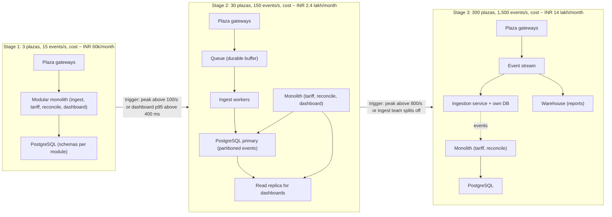
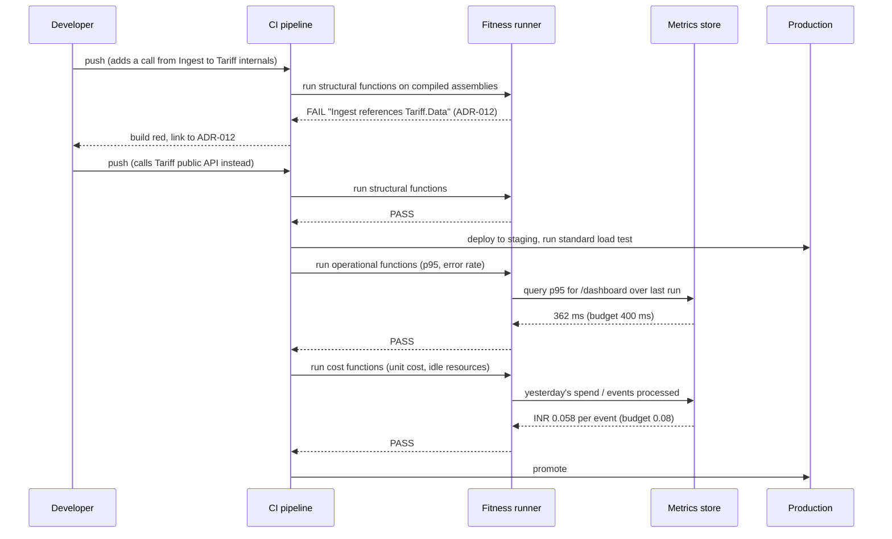
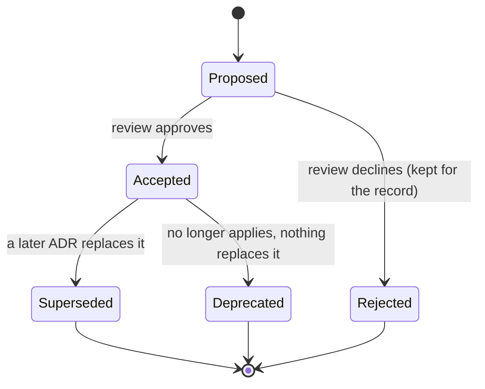

Most architecture failures are not clever systems that were too small. They are systems built for a scale that never arrived, paid for every month by a team of six, and then thrown away when the real growth took a direction nobody drew. This lesson is about the discipline that avoids both ends: sizing honestly for the next order of magnitude, writing down why you decided what you decided, turning "the architecture should stay clean and cheap" into automated checks, and moving between designs in steps that each pay for themselves.

## Learning objectives

By the end of this lesson you will be able to:

1. Explain "build for 10x, not 1000x" with numbers, and compute a headroom target from current peak load and expected growth.
2. Treat cost as an architectural quality like latency: estimate cost per transaction, identify the cost drivers in a design, and spot when a cheaper design meets the same requirements.
3. Define **fitness functions** (automated checks that a system still has the properties the architecture promised) and write three kinds: structural, operational and cost-based.
4. Write an **Architecture Decision Record** (ADR), supersede it later without rewriting history, and read a sequence of ADRs as the story of a system.
5. Plan a **migration roadmap** from one architecture to the next with stages, gates and rollback points instead of a rewrite.
6. Implement a small fitness-function runner in C# that executes in CI and fails the build when the architecture drifts.
7. Recognise the signals that say "do not evolve yet; the current design is still enough".

## Prerequisites

- [Cost estimation](#/lesson/m11-cost-estimation): we will put rupee figures on design choices.
- [Capacity estimation](#/lesson/m11-capacity-estimation): headroom planning starts from a peak-load estimate.
- [Modular monolith versus microservices](#/lesson/m16-monolith-vs-microservices): the most common evolution people get wrong.
- [Cost monitoring and infrastructure reliability](#/lesson/m15-cost-reliability): where the cost numbers come from.

## Explain it like I'm a beginner

A family in Jaipur builds a house. They have one child and a modest budget. They could build a 2-bedroom house for ₹40 lakh, or a 6-bedroom house for ₹1.5 crore "in case the family grows and the grandparents move in and we want a home office". The 6-bedroom house would be wonderful if all of that happens. If it does not, they have paid three times as much, they clean rooms nobody uses, and the layout they guessed turns out wrong anyway when the grandparents need a ground-floor room.

The sensible family builds 2 bedrooms **with foundations strong enough for a second floor** and leaves the staircase space open. That costs maybe 10 % extra now and keeps the door open. In five years, if the family grows, they add the floor. If it does not, they saved a crore.

Software architecture works the same way. "Build for 10x, not 1000x" means: design so that ten times today's load would work with changes you can list, but do not build the machinery for a thousand times today's load before you know you need it. The foundations-and-staircase part is where the craft is: which decisions are cheap now and brutal to change later (the data model, the module boundaries, the identifiers), and which are easy to change later (the number of servers, which queue product you use)?

Three more ideas in plain words:

- A **fitness function** is a smoke alarm for your architecture. You decide what "good" means (the ordering module never calls the billing database directly; the 95th-percentile page load stays under 400 ms; the cost per processed invoice stays under ₹0.12) and a program checks it every build, so drift is caught the week it happens, not two years later.
- An **ADR** (architecture decision record) is a one-page note that says: here is the situation we were in, here is what we decided, here is why, and here is what we gave up. Written at the time, kept forever, and marked "superseded" when a later decision replaces it. It stops the team from re-arguing old decisions and from repeating old mistakes.
- A **migration roadmap** is the staircase. It is the written plan for getting from today's design to the next one in steps, each of which leaves the system working and each of which has a gate: "we move to step 3 only when the fitness functions for step 2 are green and the cost per transaction has not gone up".

## First-principles explanation

### Why 10x and not 1000x

Three forces make over-building expensive.

1. **Carrying cost.** Infrastructure you run but do not need is billed monthly. A Kafka cluster, a service mesh and twelve microservices with their own databases cost a small team perhaps ₹3–6 lakh a month in cloud spend and, more importantly, a third of their engineering time in operations. For a product with 2,000 users, that is money and attention taken from features that would earn the growth you are preparing for.
2. **Guessing wrong.** Growth rarely arrives along the axis you expected. You sharded by customer for 1,000x more customers; growth came as 50x more data per customer. You built for 1000x reads; growth came as a new product line that needed different writes. The cost of the wrong 1000x design is not just its carrying cost, it is the migration away from it.
3. **Reversibility.** Many "scale" decisions are cheap to make later: adding read replicas, adding a cache, moving a hot table to its own database, adding worker instances. A design that keeps those options open at 1x has already done most of the work for 10x. The decisions that are expensive to reverse (ids that encode a shard, a data model that bakes in one tenancy shape, a synchronous contract between two teams) are the ones to get right early, and they are mostly about structure, not about capacity.

The 10x rule in numbers. Measure today's peak (say 150 requests/s). Estimate growth honestly: a B2B product doubling yearly gives 150 × 2³ ≈ 1,200/s in three years, which is 8x. Design so that 1,500/s works with known changes (more instances, one more replica), and write down the signal that tells you when to think again (for example, "when sustained peak passes 800/s, begin the roadmap for stage 3"). Do not design for 150,000/s. If that growth arrives, you will have the revenue and the team to re-architect, and you will know the real shape of the load.

### Cost as an architectural quality

Architects talk about latency, availability and consistency as qualities with numbers. Cost deserves the same treatment, in two forms:

- **Cost per unit of work** (per order, per invoice, per processed sensor reading). Divide the monthly cloud bill attributable to a system by the units processed. A system that processes 4 M toll transactions a month on ₹2.4 lakh of infrastructure costs ₹0.06 per transaction. If a redesign doubles infrastructure "for scale" with no change in volume, the unit cost doubles, and that is a regression you can measure.
- **Cost drivers**: the two or three line items that dominate. In most business systems: the primary database tier (always on, hard to scale down), data egress (billed per GB leaving the cloud), and anything that is idle but provisioned (standby environments, oversized clusters). Logs and metrics are a surprisingly common fourth: verbose logging at 2 KB per request × 100 requests/s ≈ 17 GB a day, with ingestion billed per GB.

Cost-aware design does not mean cheapest. It means every rupee buys a requirement you can name. "We pay ₹80,000 a month for a warm standby because our RTO is 30 minutes" is cost-aware. "We pay ₹80,000 a month for a warm standby" with no RTO anywhere is not.

### Fitness functions

Ford, Parsons and Kua's term for an objective, automated check of an architectural characteristic. Three families matter in practice:

- **Structural** (checked at build time): dependency rules between modules ("Domain must not reference Infrastructure"; "no module may reference another module's data access layer"), size limits, forbidden packages, public API surface of a module. These are cheap: a test that reflects over the compiled assemblies and asserts on references. They protect the modular monolith's boundaries, which is what makes a later extraction possible.
- **Operational** (checked continuously or in a pipeline stage): p95 latency of key endpoints under a standard load test, error budget consumption, start-up time, memory per instance. Failing one blocks promotion to production.
- **Cost-based** (checked daily or per release): unit cost against a budget, count of idle resources, egress per transaction. A fitness function that fails when the cost per invoice exceeds ₹0.12 turns "we should watch the bill" into "the pipeline told us on Tuesday".

A fitness function has a **threshold**, a **measurement** and a **consequence**. Without the consequence (block the build, page someone, open a ticket) it is a dashboard, and dashboards are ignored.

### ADRs over time

An ADR is short: title, status (proposed, accepted, superseded by ADR-N, deprecated), context, decision, consequences. The value compounds over years because the status field makes the set of ADRs a **history** rather than a snapshot:

- ADR-007 (2024): "Single PostgreSQL database for all modules; schemas per module." Accepted.
- ADR-019 (2025): "Move toll-event ingestion to a separate database." Accepted; supersedes ADR-007 for the ingestion module only.
- ADR-031 (2026): "Adopt PostgreSQL logical replication to feed the reporting warehouse." Accepted.

A new engineer reads the sequence and understands not just the current design but why it looks the way it does and which options were considered and rejected. The rule is: never edit an accepted ADR's decision; write a new one that supersedes it. Editing history makes the record useless.

### Evolutionary architecture and the roadmap

Evolutionary architecture (the book's phrase) is architecture that supports **guided, incremental change** across many dimensions. "Guided" means fitness functions tell you when a change breaks a promise. "Incremental" means each step is small enough to ship and revert. The roadmap is how you plan the increments:

1. **Define the target** in terms of the requirement that forces it ("ingestion at 3,000 events/s with the dashboard p95 unaffected"), not the technology.
2. **List the stages**, each leaving the system fully working: for example (a) add an outbox and a queue in front of the existing ingestion code; (b) move the consumer to a separate deployable; (c) move its tables to their own database; (d) retire the old path.
3. **Gate each stage** with fitness functions and a cost check. Stage (b) is done when the dependency fitness function proves the new service references no other module's internals and the unit cost has not risen by more than the agreed amount.
4. **Name the rollback** for each stage. If the queue-based path misbehaves, the feature flag sends events back to the direct path.
5. **Set the trigger** for starting: the measured signal (sustained peak, cost, team size) that says the current stage is no longer enough.

This is the Strangler Fig idea ([strangler fig migration and anti-corruption layer](#/lesson/m16-strangler-acl)) applied to one system's own growth rather than to a legacy replacement.

### When not to evolve

Signals that the current architecture is still enough, and that a "modernisation" is really boredom or résumé-building:

- Peak load is under 30 % of what the current design handles with known changes.
- The unit cost is flat or falling.
- Deploys are frequent and incidents are rare; the pain the new architecture would solve is not on the incident list.
- The team is smaller than eight people. Microservices and multiple databases mostly solve team-coordination problems; a team of five has none.
- The proposal names technologies ("we should use Kafka") rather than requirements ("we lose events when the database is slow").

### Trade-offs

| You gain | You pay |
|---|---|
| Lower carrying cost; attention on the product | A real re-architecture later if growth arrives (but with revenue and knowledge) |
| Fitness functions catch drift in days | Writing and maintaining the checks; occasional false alarms |
| ADRs stop re-arguing and preserve rationale | Discipline to write them at decision time, not after |
| Roadmaps make migrations reversible | Slower than a rewrite on paper; two paths coexist for a while |
| Cost per unit as a metric | Attributing shared costs to systems is approximate |

## Visual explanation

### Architecture at three stages of growth



Each stage is a complete, working system, not a half-built step toward the next. Stage 1 is one deployable and one database with a schema per module; the module boundaries are enforced by a fitness function so that stage 2 and 3 are possible. Stage 2 adds a durable buffer (so a slow database does not drop toll events), workers, table partitioning and a read replica for dashboards; the monolith is otherwise unchanged. Stage 3 happens only if the trigger fires: ingestion becomes its own service with its own database and an event stream feeds both it and a reporting warehouse. The arrows between stages carry the measured triggers. The cost labels are estimates for a system of this shape and exist to make the point that each stage costs several times the previous one, so moving early is a real loss.

### A fitness-function gate in the pipeline



The first push violates a structural rule: the ingestion module reached into the tariff module's data layer. The runner fails the build and names the ADR that recorded the rule, so the developer learns the *reason*, not just the error. After the fix, the pipeline proceeds through operational functions (measured on a staging load test, so a slow query is caught before customers see it) and cost functions (measured from yesterday's production spend divided by events processed). All three families run on every promotion; the cost function is also scheduled daily because spend changes without deploys.

### ADR lifecycle



An ADR never goes back from `Accepted` to `Proposed`, and it is never deleted. A rejected ADR is as valuable as an accepted one: it records an option considered and the reason it lost, which saves the next person from proposing it again without new information. `Superseded` always points at the ADR that replaced it, so a reader can follow the chain forward.

## Step-by-step example

**TollTrack** is a platform that collects electronic toll transactions from highway plazas run by concessionaires, applies tariffs, reconciles against bank settlements and shows dashboards to the concessionaire and the authority.

### Step 1 — the honest starting point

Three plazas, each handling about 15,000 vehicles a day: 45,000 events a day ÷ 86,400 s ≈ 0.5 events/s average, perhaps 15/s at the morning peak (toll traffic is very peaky). Dashboards are used by 20 people. A small ASP.NET Core modular monolith with four modules (ingest, tariff, reconcile, dashboard) and one PostgreSQL instance handles this with one modest VM. Estimated cost: ₹60,000 a month including a managed database with automated backups.

The team writes three ADRs on day one: ADR-001 "Modular monolith with one deployable"; ADR-002 "One PostgreSQL database, one schema per module, no cross-schema foreign keys" (so modules can leave later); ADR-003 "Event ids are ULIDs generated at the plaza gateway" (so ids are unique and time-ordered without a central sequence, which matters if ingestion is ever distributed). The third is a foundations-and-staircase decision: nearly free now, very expensive to change at 300 plazas.

### Step 2 — size for 10x

Ten times is 30 plazas and about 150 events/s at peak. Can the stage-1 design do it? Writes of 150/s with a 600-byte row are trivial for PostgreSQL. The risk is elsewhere: a slow dashboard query locking the same tables that ingestion writes, and a database restart dropping events sent by gateways that do not retry well. So the 10x plan is: a durable queue between gateways and ingestion; a read replica for dashboards; monthly partitioning of the events table so that old months can be archived cheaply. None of this needs to be built now, but ADR-004 records the plan and the trigger: "begin when sustained peak exceeds 100 events/s or dashboard p95 exceeds 400 ms".

### Step 3 — fitness functions from day one

Three checks go into CI:

- Structural: `Ingest`, `Tariff`, `Reconcile` and `Dashboard` may reference `Shared` and each other's `Contracts` namespace only. Any reference to another module's `Data` or `Internal` namespace fails the build.
- Operational: a 5-minute load test at 2× current peak must keep `/dashboard/summary` p95 under 400 ms.
- Cost: cost per event (yesterday's spend ÷ yesterday's events) must stay under ₹0.08. At stage 1 it is about ₹0.044 (₹60,000 ÷ 1.35 M events), so the budget has room, and the function exists before anyone needs it.

### Step 4 — growth arrives, but sideways

Eighteen months later there are 22 plazas, peak is 95 events/s, and the dashboard p95 is 380 ms. Neither trigger has fired. But something else has: the authority now wants a 90-day replay of raw events for disputes, and two concessionaires want their own reports warehouse. The cost function flags that the events table has grown to 180 GB and the managed database tier was upsized twice: cost per event is ₹0.071 and rising.

This is the moment the ADRs and fitness functions pay off. The team does not jump to stage 3. ADR-011 decides: partition the events table by month now (reversible, cheap), move months older than 90 days to object storage as Parquet files (cuts the database to about 40 GB and drops a tier), and add the read replica. Cost per event falls to ₹0.05. The queue from ADR-004 is still not needed; the plan is adjusted, not abandoned.

### Step 5 — the trigger fires

At 38 plazas, peak passes 110 events/s for a week and two incidents show dropped events during a database failover. Stage 2 begins as a roadmap with four gated steps: (1) add the outbox and queue behind a feature flag with the old direct path as fallback; (2) move ingestion consumers to a separate worker deployable; (3) switch the flag to the queue path for 10 % of plazas, then all; (4) remove the direct path. Each step has a gate (structural functions green, p95 under budget, cost per event under ₹0.08) and a rollback (the flag). The whole migration takes seven weeks of part-time work, and the system was never down.

## Production-style C# implementation

A small fitness-function framework that runs inside a console command in CI (`dotnet run -- fitness`) or as a scheduled hosted service for the cost checks. Measurements come from interfaces with in-memory implementations here; in production they read compiled assemblies, a metrics store and the cloud billing export.

```text
TollTrack.Fitness/
  Fitness/IFitnessFunction.cs
  Fitness/FitnessRunner.cs
  Fitness/DependencyRuleFitness.cs
  Fitness/LatencyBudgetFitness.cs
  Fitness/UnitCostFitness.cs
  Fitness/HeadroomPlanner.cs
  Decisions/Adr.cs
  Program.cs
```

```csharp file=Fitness/IFitnessFunction.cs
namespace TollTrack.Fitness;

public enum FitnessFamily { Structural, Operational, Cost }

public sealed record FitnessResult(string Name, bool Passed, string Detail, string? AdrReference = null);

/// <summary>One automated check of an architectural characteristic. Must be deterministic for a given input.</summary>
public interface IFitnessFunction
{
    string Name { get; }
    FitnessFamily Family { get; }
    Task<FitnessResult> EvaluateAsync(CancellationToken ct);
}
```

```csharp file=Fitness/FitnessRunner.cs
using Microsoft.Extensions.Logging;

namespace TollTrack.Fitness;

public sealed record FitnessReport(IReadOnlyList<FitnessResult> Results)
{
    public bool AllPassed => Results.All(r => r.Passed);
    public IEnumerable<FitnessResult> Failures => Results.Where(r => !r.Passed);
}

/// <summary>Runs every registered function of the requested families and produces one report.
/// The CI step exits non-zero when AllPassed is false.</summary>
public sealed class FitnessRunner(IEnumerable<IFitnessFunction> functions, ILogger<FitnessRunner> log)
{
    public async Task<FitnessReport> RunAsync(IReadOnlySet<FitnessFamily> families, CancellationToken ct)
    {
        var results = new List<FitnessResult>();
        foreach (var f in functions.Where(f => families.Contains(f.Family)).OrderBy(f => f.Family).ThenBy(f => f.Name))
        {
            FitnessResult r;
            try { r = await f.EvaluateAsync(ct); }
            catch (Exception ex) when (ex is not OperationCanceledException)
            {
                r = new FitnessResult(f.Name, false, $"Function threw: {ex.Message}");
            }
            log.Log(r.Passed ? LogLevel.Information : LogLevel.Error, "{Status} {Family} {Name}: {Detail}{Adr}",
                r.Passed ? "PASS" : "FAIL", f.Family, r.Name, r.Detail, r.AdrReference is null ? "" : $" (see {r.AdrReference})");
            results.Add(r);
        }
        return new FitnessReport(results);
    }
}
```

A function that throws is a failure, not a skip. A fitness function that quietly stops running is worse than none, because the team believes it is protected.

```csharp file=Fitness/DependencyRuleFitness.cs
using System.Reflection;

namespace TollTrack.Fitness;

/// <summary>A reference from one namespace to another, as found in compiled code.</summary>
public sealed record TypeReference(string FromNamespace, string ToNamespace);

public interface ITypeReferenceSource
{
    IReadOnlyList<TypeReference> GetReferences();
}

/// <summary>Reads references by reflecting over the fields, properties, method parameters and return types of every type.</summary>
public sealed class ReflectionTypeReferenceSource(IEnumerable<Assembly> assemblies) : ITypeReferenceSource
{
    public IReadOnlyList<TypeReference> GetReferences()
    {
        var refs = new HashSet<TypeReference>();
        foreach (var asm in assemblies)
        foreach (var t in asm.GetTypes().Where(t => t.Namespace is not null))
        {
            void Add(Type? target)
            {
                if (target is null) return;
                if (target.IsGenericType) foreach (var a in target.GetGenericArguments()) Add(a);
                if (target.Namespace is not null && target.Namespace != t.Namespace)
                    refs.Add(new TypeReference(t.Namespace!, target.Namespace));
            }
            Add(t.BaseType);
            foreach (var i in t.GetInterfaces()) Add(i);
            const BindingFlags all = BindingFlags.Public | BindingFlags.NonPublic | BindingFlags.Instance | BindingFlags.Static | BindingFlags.DeclaredOnly;
            foreach (var f in t.GetFields(all)) Add(f.FieldType);
            foreach (var p in t.GetProperties(all)) Add(p.PropertyType);
            foreach (var m in t.GetMethods(all))
            {
                Add(m.ReturnType);
                foreach (var p in m.GetParameters()) Add(p.ParameterType);
            }
        }
        return refs.ToList();
    }
}

/// <summary>"Module A may not reference namespace prefix B." Prefix match, so TollTrack.Tariff.Data covers its sub-namespaces.</summary>
public sealed record DependencyRule(string FromPrefix, string ForbiddenPrefix, string AdrReference);

public sealed class DependencyRuleFitness(ITypeReferenceSource source, IReadOnlyList<DependencyRule> rules) : IFitnessFunction
{
    public string Name => "Module dependency rules";
    public FitnessFamily Family => FitnessFamily.Structural;

    public Task<FitnessResult> EvaluateAsync(CancellationToken ct)
    {
        var refs = source.GetReferences();
        var violations = new List<string>();
        string? adr = null;
        foreach (var rule in rules)
        foreach (var r in refs)
        {
            if (!Matches(r.FromNamespace, rule.FromPrefix) || !Matches(r.ToNamespace, rule.ForbiddenPrefix)) continue;
            violations.Add($"{r.FromNamespace} -> {r.ToNamespace}");
            adr ??= rule.AdrReference;
        }
        return Task.FromResult(violations.Count == 0
            ? new FitnessResult(Name, true, $"{refs.Count} references checked against {rules.Count} rules")
            : new FitnessResult(Name, false, string.Join("; ", violations.Distinct()), adr));
    }

    private static bool Matches(string ns, string prefix) =>
        ns.Equals(prefix, StringComparison.Ordinal) || ns.StartsWith(prefix + ".", StringComparison.Ordinal);
}
```

Reflection over the compiled assemblies is enough for most module-boundary rules; it sees every field, property, parameter and return type. It does not see references that exist only inside method bodies (a `new OtherModule.Data.Repo()` local variable). For those, a Roslyn analyzer or a tool that reads IL gives complete coverage. Start with reflection: it catches the structural leaks that matter most, in 60 lines.

```csharp file=Fitness/LatencyBudgetFitness.cs
namespace TollTrack.Fitness;

public interface ILatencySource
{
    /// <summary>p95 latency in milliseconds for the route over the most recent standard load test, or null if no data.</summary>
    Task<double?> GetP95MsAsync(string route, CancellationToken ct);
}

public sealed record LatencyBudget(string Route, double P95BudgetMs, string AdrReference);

public sealed class LatencyBudgetFitness(ILatencySource source, IReadOnlyList<LatencyBudget> budgets) : IFitnessFunction
{
    public string Name => "Latency budgets";
    public FitnessFamily Family => FitnessFamily.Operational;

    public async Task<FitnessResult> EvaluateAsync(CancellationToken ct)
    {
        var breaches = new List<string>();
        string? adr = null;
        foreach (var b in budgets)
        {
            var p95 = await source.GetP95MsAsync(b.Route, ct);
            if (p95 is null) { breaches.Add($"{b.Route}: no measurement"); adr ??= b.AdrReference; continue; }
            if (p95 > b.P95BudgetMs) { breaches.Add($"{b.Route}: p95 {p95:F0} ms > {b.P95BudgetMs:F0} ms"); adr ??= b.AdrReference; }
        }
        return breaches.Count == 0
            ? new FitnessResult(Name, true, $"{budgets.Count} routes within budget")
            : new FitnessResult(Name, false, string.Join("; ", breaches), adr);
    }
}
```

"No measurement" is a failure. A latency function that passes because the load test did not run is the dashboard problem again.

```csharp file=Fitness/UnitCostFitness.cs
namespace TollTrack.Fitness;

public interface ISpendSource
{
    /// <summary>Attributed spend for the system on the given day, in the account currency (here INR).</summary>
    Task<decimal> GetDailySpendAsync(DateOnly day, CancellationToken ct);
    /// <summary>Units of work processed that day (toll events).</summary>
    Task<long> GetUnitsProcessedAsync(DateOnly day, CancellationToken ct);
}

public sealed record UnitCostBudget(decimal MaxCostPerUnit, long MinimumUnitsForSignal, string AdrReference);

/// <summary>Yesterday's spend divided by yesterday's units, compared with the budget.
/// Below MinimumUnitsForSignal the ratio is noise (a holiday), so the function passes with a note.</summary>
public sealed class UnitCostFitness(ISpendSource spend, TimeProvider time, UnitCostBudget budget) : IFitnessFunction
{
    public string Name => "Cost per unit";
    public FitnessFamily Family => FitnessFamily.Cost;

    public async Task<FitnessResult> EvaluateAsync(CancellationToken ct)
    {
        var yesterday = DateOnly.FromDateTime(time.GetUtcNow().UtcDateTime).AddDays(-1);
        var rupees = await spend.GetDailySpendAsync(yesterday, ct);
        var units = await spend.GetUnitsProcessedAsync(yesterday, ct);
        if (units < budget.MinimumUnitsForSignal)
            return new FitnessResult(Name, true, $"{units} units on {yesterday} is below the signal threshold; skipped");
        var perUnit = rupees / units;
        var ok = perUnit <= budget.MaxCostPerUnit;
        return new FitnessResult(Name, ok,
            $"INR {perUnit:F4} per unit on {yesterday} (budget {budget.MaxCostPerUnit:F4}, spend {rupees:F0}, units {units})",
            ok ? null : budget.AdrReference);
    }
}
```

```csharp file=Fitness/HeadroomPlanner.cs
namespace TollTrack.Fitness;

public sealed record HeadroomPlan(double CurrentPeak, double ProjectedPeak, double DesignTarget, double TriggerAt, bool ReArchitectureCheckpoint);

/// <summary>Turns "build for 10x not 1000x" into numbers.</summary>
public static class HeadroomPlanner
{
    /// <param name="currentPeak">Measured sustained peak (requests or events per second).</param>
    /// <param name="yearlyGrowth">Expected growth factor per year, e.g. 2.0 for doubling.</param>
    /// <param name="horizonYears">Planning horizon, typically 2–3 years.</param>
    /// <param name="safetyFactor">Multiplier on the projection for the unexpected, typically 1.5.</param>
    public static HeadroomPlan Plan(double currentPeak, double yearlyGrowth, int horizonYears, double safetyFactor = 1.5)
    {
        ArgumentOutOfRangeException.ThrowIfNegativeOrZero(currentPeak);
        ArgumentOutOfRangeException.ThrowIfLessThan(yearlyGrowth, 1.0);
        ArgumentOutOfRangeException.ThrowIfNegative(horizonYears);

        var projected = currentPeak * Math.Pow(yearlyGrowth, horizonYears);
        var wanted = Math.Max(projected * safetyFactor, currentPeak * 2);   // never design for less than 2x today
        var cap = currentPeak * 10;                                           // never design for more than 10x today
        var target = Math.Min(wanted, cap);
        var trigger = target * 0.6;                                           // start the next roadmap at 60 % of the design target
        return new HeadroomPlan(currentPeak, projected, target, trigger, ReArchitectureCheckpoint: wanted > cap);
    }
}
```

The planner encodes a policy: design for the projection with a safety margin, but never below 2x or above 10x of today. When the honest projection exceeds 10x, it does not silently design for it; it raises a checkpoint flag, which means "this needs a conversation and probably a staged roadmap, not a bigger version of the same design".

```csharp file=Decisions/Adr.cs
namespace TollTrack.Decisions;

public enum AdrStatus { Proposed, Accepted, Rejected, Superseded, Deprecated }

public sealed record Adr(int Number, string Title, DateOnly Date, AdrStatus Status, string Context, string Decision,
    string Consequences, int? SupersededBy = null)
{
    public string Id => $"ADR-{Number:D3}";
}

/// <summary>An append-only log of decisions. Supersession is a new record plus a status change, never an edit of the old text.</summary>
public sealed class AdrLog
{
    private readonly Dictionary<int, Adr> _adrs = new();

    public IReadOnlyCollection<Adr> All => _adrs.Values.OrderBy(a => a.Number).ToList();

    public Adr Propose(string title, DateOnly date, string context, string decision, string consequences)
    {
        var n = _adrs.Count == 0 ? 1 : _adrs.Keys.Max() + 1;
        var adr = new Adr(n, title, date, AdrStatus.Proposed, context, decision, consequences);
        _adrs[n] = adr;
        return adr;
    }

    public Adr Accept(int number) => Transition(number, AdrStatus.Proposed, AdrStatus.Accepted);
    public Adr Reject(int number) => Transition(number, AdrStatus.Proposed, AdrStatus.Rejected);
    public Adr Deprecate(int number) => Transition(number, AdrStatus.Accepted, AdrStatus.Deprecated);

    /// <summary>Marks an accepted ADR as superseded by another accepted ADR. Text of both is untouched.</summary>
    public Adr Supersede(int oldNumber, int byNumber)
    {
        var old = Get(oldNumber);
        var by = Get(byNumber);
        if (old.Status != AdrStatus.Accepted) throw new InvalidOperationException($"{old.Id} is {old.Status}; only accepted ADRs can be superseded.");
        if (by.Status != AdrStatus.Accepted) throw new InvalidOperationException($"{by.Id} must be accepted before it supersedes {old.Id}.");
        var updated = old with { Status = AdrStatus.Superseded, SupersededBy = byNumber };
        _adrs[oldNumber] = updated;
        return updated;
    }

    /// <summary>Follows the supersession chain to the decision currently in force.</summary>
    public Adr Current(int number)
    {
        var a = Get(number);
        while (a.SupersededBy is int next) a = Get(next);
        return a;
    }

    private Adr Transition(int number, AdrStatus from, AdrStatus to)
    {
        var a = Get(number);
        if (a.Status != from) throw new InvalidOperationException($"{a.Id} is {a.Status}, expected {from}.");
        _adrs[number] = a with { Status = to };
        return _adrs[number];
    }

    private Adr Get(int number) => _adrs.TryGetValue(number, out var a) ? a : throw new KeyNotFoundException($"ADR-{number:D3} not found.");
}
```

In real projects ADRs are Markdown files in the repository (`docs/adr/0012-ingest-owns-its-tables.md`) and the "log" is Git. The class above shows the rules a reviewer should enforce on those files: statuses only move forward, superseding needs an accepted replacement, and `Current()` is the question every newcomer asks.

```csharp file=Program.cs
using System.Reflection;
using TollTrack.Decisions;
using TollTrack.Fitness;

var builder = Host.CreateApplicationBuilder(args);

builder.Services.AddSingleton(TimeProvider.System);
builder.Services.AddSingleton<ITypeReferenceSource>(_ => new ReflectionTypeReferenceSource(new[] { Assembly.GetExecutingAssembly() }));
builder.Services.AddSingleton<ILatencySource, InMemoryLatencySource>();
builder.Services.AddSingleton<ISpendSource, InMemorySpendSource>();

builder.Services.AddSingleton<IFitnessFunction>(sp => new DependencyRuleFitness(sp.GetRequiredService<ITypeReferenceSource>(), new[]
{
    new DependencyRule("TollTrack.Ingest", "TollTrack.Tariff.Data", "ADR-002"),
    new DependencyRule("TollTrack.Ingest", "TollTrack.Reconcile.Data", "ADR-002"),
    new DependencyRule("TollTrack.Dashboard", "TollTrack.Ingest.Data", "ADR-002"),
    new DependencyRule("TollTrack.Tariff", "TollTrack.Dashboard", "ADR-002"),
}));
builder.Services.AddSingleton<IFitnessFunction>(sp => new LatencyBudgetFitness(sp.GetRequiredService<ILatencySource>(), new[]
{
    new LatencyBudget("/dashboard/summary", 400, "ADR-004"),
    new LatencyBudget("/events", 150, "ADR-004"),
}));
builder.Services.AddSingleton<IFitnessFunction>(sp => new UnitCostFitness(sp.GetRequiredService<ISpendSource>(),
    sp.GetRequiredService<TimeProvider>(), new UnitCostBudget(0.08m, 100_000, "ADR-004")));
builder.Services.AddSingleton<FitnessRunner>();

using var host = builder.Build();

var families = args.Contains("--cost-only")
    ? new HashSet<FitnessFamily> { FitnessFamily.Cost }
    : new HashSet<FitnessFamily> { FitnessFamily.Structural, FitnessFamily.Operational, FitnessFamily.Cost };

var report = await host.Services.GetRequiredService<FitnessRunner>().RunAsync(families, CancellationToken.None);

var plan = HeadroomPlanner.Plan(currentPeak: 150, yearlyGrowth: 2.0, horizonYears: 3);
Console.WriteLine($"Design target {plan.DesignTarget:F0}/s, start next roadmap at {plan.TriggerAt:F0}/s, checkpoint: {plan.ReArchitectureCheckpoint}");

var adrs = new AdrLog();
var a2 = adrs.Propose("One PostgreSQL database, one schema per module", new DateOnly(2024, 3, 1), "Small team, 3 plazas", "Single DB; schemas per module; no cross-schema FKs", "Cheap now; modules can leave later");
adrs.Accept(a2.Number);
var a19 = adrs.Propose("Ingest owns its own database", new DateOnly(2026, 2, 10), "Dropped events during failover at 38 plazas", "Separate DB for ingest; events via queue", "Second DB to operate; no cross-module joins");
adrs.Accept(a19.Number);
adrs.Supersede(a2.Number, a19.Number);
Console.WriteLine($"Decision in force for {a2.Id}: {adrs.Current(a2.Number).Id}");

return report.AllPassed ? 0 : 1;

public sealed class InMemoryLatencySource : ILatencySource
{
    public Task<double?> GetP95MsAsync(string route, CancellationToken ct) =>
        Task.FromResult<double?>(route == "/dashboard/summary" ? 362 : 88);
}

public sealed class InMemorySpendSource : ISpendSource
{
    public Task<decimal> GetDailySpendAsync(DateOnly day, CancellationToken ct) => Task.FromResult(7_800m);
    public Task<long> GetUnitsProcessedAsync(DateOnly day, CancellationToken ct) => Task.FromResult(135_000L);
}
```

`return report.AllPassed ? 0 : 1` is the consequence. The CI step that runs this command fails the pipeline on a non-zero exit, which is the whole point.

## Bad design vs good design

**Bad: the 1000x platform.** A new product with 400 users is built as nine microservices, each with its own PostgreSQL, connected by Kafka, deployed on Kubernetes with a service mesh, "so we never have to re-architect". Monthly cloud cost: an estimated ₹4.5 lakh. Team: five engineers, two of whom spend most of their time on the platform. Every feature touches three services and needs a coordinated deploy. Eighteen months later the product pivots, half the services are irrelevant, and the Kafka cluster carries 40 messages a minute. Cost per active user per month: over ₹1,000, for a product that charges ₹300.

**Bad: the architecture that was never written down.** A ten-year-old monolith with no ADRs. Every quarter someone proposes "let's move to microservices"; every quarter the argument restarts from zero because nobody remembers that the same proposal was examined in 2022 and rejected because the data model has 140 cross-module foreign keys. The team cannot evolve because it does not know where it is.

**Good**: TollTrack as described. One deployable and one database at stage 1, with module boundaries enforced by a build-time fitness function and ids chosen so ingestion can be split later. Three ADRs on day one and a fourth that records the 10x plan and its trigger. Cost per event tracked daily against a budget. When growth came sideways (storage, not throughput), the team chose the reversible, cheap step (partition and archive) and adjusted the plan. When the trigger fired, the migration ran as a four-step roadmap behind a feature flag. The system never had a capability it did not need, and never lacked one when it did.

:::callout type=tradeoff title="Reversible and irreversible decisions"
Spend your early design effort on the irreversible decisions: identifiers, the shape of the data model, module and team boundaries, external contracts. Spend almost none on the reversible ones: instance counts, which managed queue, cache sizes. The 10x rule is about the reversible ones. The staircase space is about the irreversible ones.
:::

:::callout type=mistake title="Fitness functions that nobody fails"
A fitness function with a threshold so loose it never fails, or one that runs but does not block anything, gives false confidence. Review thresholds quarterly: tighten the ones that always pass by a wide margin, and ask of every function "when did this last fail, and what did we do?"
:::

## Practical playground

The starting graph is TollTrack at stage 1. Evolve it to stage 2 in the HLD canvas, and keep the cost in mind: every node you add should be justified by a requirement from the lesson.

1. Add a `queue` between the plaza gateways and ingestion, and a `worker` that consumes it. Which failure does this remove?
2. Add a `read-replica` and point dashboard reads at it. What is the latency budget you are protecting?
3. Add `object-storage` for archived months. How much does the database shrink, and what does that do to the database tier?
4. Resist adding a `stream`, a second `database` and a separate ingestion `app-server` unless you can name the trigger that fired. Write the trigger in the node label if you add them.
5. Estimate: stage 1 cost ≈ ₹60k/month; what does your stage 2 cost, and what is the cost per event at 150/s peak (about 4 M events/month)?

:::playground type=hld title="TollTrack: evolve stage 1 into stage 2 without over-building"
```json
{
  "nodes": [
    { "id": "gw", "type": "client", "label": "Plaza gateways (toll events)", "props": { "rps": 150 } },
    { "id": "lb", "type": "load-balancer", "label": "Load balancer" },
    { "id": "app", "type": "app-server", "label": "TollTrack modular monolith", "props": { "instances": 2 } },
    { "id": "db", "type": "database", "label": "PostgreSQL (all schemas)", "props": { "replicas": 0 } },
    { "id": "users", "type": "client", "label": "Dashboard users", "props": { "rps": 5 } }
  ],
  "edges": [
    { "from": "gw", "to": "lb", "kind": "sync" },
    { "from": "users", "to": "lb", "kind": "sync" },
    { "from": "lb", "to": "app", "kind": "sync" },
    { "from": "app", "to": "db", "kind": "sync", "label": "writes + dashboard queries" }
  ]
}
```
:::

## Exercises

:::exercise id=m16-architecture-evolution-ex1 difficulty=beginner kind=written title="Write ADR-004 and then supersede it"
Write ADR-004 for TollTrack: "Plan for 10x: queue-buffered ingestion, read replica and monthly partitioning, to begin when sustained peak exceeds 100 events/s or dashboard p95 exceeds 400 ms." Use the sections Title, Status, Date, Context, Decision, Consequences. Then write ADR-011 (the sideways-growth decision from the step-by-step example: partition now, archive to object storage, add the replica, defer the queue) and show how ADR-004's status changes.
::acceptance
- Both ADRs have all six sections and fit on one page each.
- Context states the measured facts (load, cost, p95) that existed at the time, not opinions.
- Consequences include at least one negative consequence for each decision.
- ADR-004 ends as "Superseded by ADR-011" (or "partially superseded", with the part that remains stated), and ADR-004's original text is not edited.
::hint
Context answers "what was true when we decided?" Decision is one or two sentences. Consequences are what becomes easier and what becomes harder.
::hint
A negative consequence of ADR-011: two storage systems (database and object storage) for one logical dataset; queries over old months need a different path.
::hint
ADR-011 changes the plan but keeps part of it (the queue is deferred, not cancelled). Say precisely which part of ADR-004 still stands.
::solution
**ADR-004 — Plan for 10x growth in ingestion and dashboards**
*Status:* Accepted (2024-04-12). Superseded by ADR-011 (2025-10-03) for the ordering and timing of steps; the trigger thresholds and the queue design remain in force.
*Context:* 3 plazas; measured peak 15 events/s; dashboard p95 210 ms; cost ₹60k/month (₹0.044 per event). Business plans 10x plazas in three years. Gateways retry for 30 s only; a database restart longer than that drops events.
*Decision:* When sustained peak exceeds 100 events/s or dashboard p95 exceeds 400 ms, implement in order: (1) durable queue between gateways and ingestion with a worker consumer; (2) read replica for dashboards; (3) monthly partitioning of `ingest.events`. Until then, no change.
*Consequences:* + Keeps stage 1 cheap; + a written trigger stops premature work. − The team must monitor the trigger metrics; − gateways remain exposed to database restarts until the queue exists.

**ADR-011 — Partition and archive events now; defer the queue**
*Status:* Accepted (2025-10-03). Supersedes ADR-004 in part.
*Context:* 22 plazas; peak 95 events/s; dashboard p95 380 ms; neither ADR-004 trigger fired. But: `ingest.events` is 180 GB, the database tier was upsized twice, cost per event is ₹0.071 and rising towards the ₹0.08 budget; the authority requires 90-day raw replay; two concessionaires want warehouse exports.
*Decision:* Partition `ingest.events` by month now; move partitions older than 90 days to object storage as Parquet via a nightly job; add the read replica now and route dashboards to it; keep the queue deferred, with ADR-004's 100 events/s trigger unchanged.
*Consequences:* + Database shrinks to ~40 GB, one tier smaller, cost per event ~₹0.05; + replay and exports served from object storage cheaply. − Two storage systems for one dataset; queries spanning 90 days need a second code path; − archival job is a new thing that can fail silently, so it needs its own alert.

ADR-004's text is untouched; only its status line changes, pointing at ADR-011 and saying exactly what survives.
::mistakes
- Editing ADR-004's decision to match the new plan, which erases the fact that the plan changed and why.
- Context written as opinion ("we felt the database was slow") instead of measurements.
- Only positive consequences.
:::

:::exercise id=m16-architecture-evolution-ex2 difficulty=beginner kind=code title="Turn the 10x rule into numbers"
Implement `HeadroomPlanner.Plan` so that it produces a design target from the current peak, expected growth and horizon, following the policy below.
::requirements
- `ProjectedPeak = currentPeak × yearlyGrowth ^ horizonYears`.
- `Wanted = max(ProjectedPeak × safetyFactor, 2 × currentPeak)`.
- `DesignTarget = min(Wanted, 10 × currentPeak)`.
- `TriggerAt = 0.6 × DesignTarget`.
- `ReArchitectureCheckpoint` is true when `Wanted` exceeds 10× the current peak.
- Throw `ArgumentOutOfRangeException` for `currentPeak <= 0`, `yearlyGrowth < 1`, or negative `horizonYears`.
::acceptance
- 150/s, growth 1.8, 3 years, safety 1.5: projected 874.8, target 1,312.2, trigger 787.32, no checkpoint.
- 100/s, growth 1.1, 2 years: projected 121, target 200 (the 2x floor), trigger 120.
- 100/s, growth 4.0, 3 years: projected 6,400, target 1,000 (the 10x cap), checkpoint true.
- Invalid inputs throw.
::hint
`Math.Pow` for the projection; `Math.Max` and `Math.Min` for the floor and cap.
::hint
Compute `wanted` first, then compare it with the cap to decide the checkpoint flag, then clamp.
::hint
`ArgumentOutOfRangeException.ThrowIfNegativeOrZero` and `ThrowIfLessThan` are available in .NET 8+.
::starter
```csharp file=HeadroomPlanner.cs
using System;

public sealed record HeadroomPlan(double CurrentPeak, double ProjectedPeak, double DesignTarget, double TriggerAt, bool ReArchitectureCheckpoint);

public static class HeadroomPlanner
{
    public static HeadroomPlan Plan(double currentPeak, double yearlyGrowth, int horizonYears, double safetyFactor = 1.5)
        => throw new NotImplementedException();
}
```
::tests
```csharp file=HeadroomPlannerTests.cs
using System;
using Xunit;

public class HeadroomPlannerTests
{
    [Fact]
    public void Steady_growth_for_three_years_stays_under_the_10x_cap()
    {
        var p = HeadroomPlanner.Plan(150, 1.8, 3);
        Assert.Equal(874.8, p.ProjectedPeak, 6);
        Assert.Equal(1312.2, p.DesignTarget, 6);
        Assert.Equal(787.32, p.TriggerAt, 6);
        Assert.False(p.ReArchitectureCheckpoint);
    }

    [Fact]
    public void Slow_growth_uses_the_2x_floor()
    {
        var p = HeadroomPlanner.Plan(100, 1.1, 2);
        Assert.Equal(121, p.ProjectedPeak, 6);
        Assert.Equal(200, p.DesignTarget, 6);
        Assert.Equal(120, p.TriggerAt, 6);
        Assert.False(p.ReArchitectureCheckpoint);
    }

    [Fact]
    public void Explosive_growth_hits_the_10x_cap_and_raises_checkpoint()
    {
        var p = HeadroomPlanner.Plan(100, 4.0, 3);
        Assert.Equal(6400, p.ProjectedPeak, 6);
        Assert.Equal(1000, p.DesignTarget, 6);
        Assert.True(p.ReArchitectureCheckpoint);
    }

    [Fact]
    public void Zero_horizon_still_gives_the_2x_floor()
    {
        var p = HeadroomPlanner.Plan(50, 3.0, 0);
        Assert.Equal(50, p.ProjectedPeak, 6);
        Assert.Equal(100, p.DesignTarget, 6);
    }

    [Fact]
    public void Invalid_inputs_throw()
    {
        Assert.Throws<ArgumentOutOfRangeException>(() => HeadroomPlanner.Plan(0, 2.0, 3));
        Assert.Throws<ArgumentOutOfRangeException>(() => HeadroomPlanner.Plan(100, 0.9, 3));
        Assert.Throws<ArgumentOutOfRangeException>(() => HeadroomPlanner.Plan(100, 2.0, -1));
    }
}
```
::solution
```csharp file=HeadroomPlanner.cs
using System;

public sealed record HeadroomPlan(double CurrentPeak, double ProjectedPeak, double DesignTarget, double TriggerAt, bool ReArchitectureCheckpoint);

public static class HeadroomPlanner
{
    public static HeadroomPlan Plan(double currentPeak, double yearlyGrowth, int horizonYears, double safetyFactor = 1.5)
    {
        ArgumentOutOfRangeException.ThrowIfNegativeOrZero(currentPeak);
        ArgumentOutOfRangeException.ThrowIfLessThan(yearlyGrowth, 1.0);
        ArgumentOutOfRangeException.ThrowIfNegative(horizonYears);

        var projected = currentPeak * Math.Pow(yearlyGrowth, horizonYears);
        var wanted = Math.Max(projected * safetyFactor, currentPeak * 2);
        var cap = currentPeak * 10;
        var target = Math.Min(wanted, cap);
        return new HeadroomPlan(currentPeak, projected, target, target * 0.6, wanted > cap);
    }
}
```

The numbers encode a policy, and the policy is the lesson: always have at least 2x headroom (traffic spikes are real), never pre-build more than 10x (you will guess wrong), and when the honest projection says more than 10x, stop and plan a staged roadmap rather than a bigger box.
::mistakes
- Clamping before computing the checkpoint flag, so the flag is never true.
- Using integer arithmetic for the growth factor.
- Forgetting the 2x floor, so a flat-growth system gets a target equal to its current peak.
:::

:::exercise id=m16-architecture-evolution-ex3 difficulty=intermediate kind=code title="A structural fitness function for module boundaries"
Implement `DependencyRuleChecker.Check` so that, given the references found in compiled code and a set of rules, it returns every violation with the ADR that explains the rule. Rules match by namespace prefix.
::requirements
- A rule `(FromPrefix, ForbiddenPrefix, Adr)` is violated by a reference `(From, To)` when `From` equals `FromPrefix` or starts with `FromPrefix + "."`, and `To` equals `ForbiddenPrefix` or starts with `ForbiddenPrefix + "."`.
- Return one `Violation(From, To, Adr)` per distinct violating reference per rule, ordered by `From`, then `To`, then `Adr` (ordinal).
- A reference that violates two rules appears twice (once per rule).
- `Allow` entries override rules: a reference matching an allow entry (same prefix semantics) is never reported.
::acceptance
- `TollTrack.Ingest.Handlers -> TollTrack.Tariff.Data.Repos` violates rule `(TollTrack.Ingest, TollTrack.Tariff.Data, ADR-002)`.
- `TollTrack.Ingest -> TollTrack.Tariff.Contracts` does not violate that rule.
- `TollTrack.IngestX -> TollTrack.Tariff.Data` does not violate it (prefix needs a dot boundary).
- An allow entry `(TollTrack.Ingest.Migrations, TollTrack.Tariff.Data)` suppresses a reference from that namespace.
- Output is sorted and duplicate references are reported once per rule.
::hint
Write a small `Matches(ns, prefix)` helper first and test the dot-boundary case in your head: `TollTrack.IngestX` must not match `TollTrack.Ingest`.
::hint
Distinct the references first, then loop rules × references, then filter out allowed ones, then sort.
::hint
`OrderBy(v => v.From, StringComparer.Ordinal).ThenBy(...)`.
::hint
```csharp
static bool Matches(string ns, string prefix) =>
    ns.Equals(prefix, StringComparison.Ordinal) || ns.StartsWith(prefix + ".", StringComparison.Ordinal);
```
::starter
```csharp file=DependencyRuleChecker.cs
using System;
using System.Collections.Generic;
using System.Linq;

public sealed record TypeReference(string From, string To);
public sealed record DependencyRule(string FromPrefix, string ForbiddenPrefix, string Adr);
public sealed record AllowEntry(string FromPrefix, string ToPrefix);
public sealed record Violation(string From, string To, string Adr);

public static class DependencyRuleChecker
{
    public static IReadOnlyList<Violation> Check(IEnumerable<TypeReference> references, IReadOnlyList<DependencyRule> rules, IReadOnlyList<AllowEntry> allow)
        => throw new NotImplementedException();
}
```
::tests
```csharp file=DependencyRuleCheckerTests.cs
using System.Collections.Generic;
using System.Linq;
using Xunit;

public class DependencyRuleCheckerTests
{
    private static readonly DependencyRule IngestToTariffData = new("TollTrack.Ingest", "TollTrack.Tariff.Data", "ADR-002");
    private static readonly DependencyRule TariffToDashboard = new("TollTrack.Tariff", "TollTrack.Dashboard", "ADR-002");
    private static readonly List<AllowEntry> NoAllow = new();

    [Fact]
    public void Detects_reference_into_forbidden_sub_namespace()
    {
        var refs = new[] { new TypeReference("TollTrack.Ingest.Handlers", "TollTrack.Tariff.Data.Repos") };
        var v = DependencyRuleChecker.Check(refs, new[] { IngestToTariffData }, NoAllow);
        Assert.Single(v);
        Assert.Equal("ADR-002", v[0].Adr);
        Assert.Equal("TollTrack.Tariff.Data.Repos", v[0].To);
    }

    [Fact]
    public void Contracts_namespace_is_allowed()
    {
        var refs = new[] { new TypeReference("TollTrack.Ingest", "TollTrack.Tariff.Contracts") };
        Assert.Empty(DependencyRuleChecker.Check(refs, new[] { IngestToTariffData }, NoAllow));
    }

    [Fact]
    public void Prefix_requires_dot_boundary()
    {
        var refs = new[] { new TypeReference("TollTrack.IngestX", "TollTrack.Tariff.Data"), new TypeReference("TollTrack.Ingest", "TollTrack.Tariff.DataX") };
        Assert.Empty(DependencyRuleChecker.Check(refs, new[] { IngestToTariffData }, NoAllow));
    }

    [Fact]
    public void Allow_entry_suppresses_matching_reference()
    {
        var refs = new[]
        {
            new TypeReference("TollTrack.Ingest.Migrations", "TollTrack.Tariff.Data"),
            new TypeReference("TollTrack.Ingest.Handlers", "TollTrack.Tariff.Data"),
        };
        var allow = new[] { new AllowEntry("TollTrack.Ingest.Migrations", "TollTrack.Tariff.Data") };
        var v = DependencyRuleChecker.Check(refs, new[] { IngestToTariffData }, allow);
        Assert.Single(v);
        Assert.Equal("TollTrack.Ingest.Handlers", v[0].From);
    }

    [Fact]
    public void Sorted_and_deduplicated_and_one_per_rule()
    {
        var refs = new[]
        {
            new TypeReference("TollTrack.Tariff.Rules", "TollTrack.Dashboard.Pages"),
            new TypeReference("TollTrack.Ingest.B", "TollTrack.Tariff.Data"),
            new TypeReference("TollTrack.Ingest.A", "TollTrack.Tariff.Data"),
            new TypeReference("TollTrack.Ingest.A", "TollTrack.Tariff.Data"),
        };
        var v = DependencyRuleChecker.Check(refs, new[] { IngestToTariffData, TariffToDashboard }, NoAllow);
        Assert.Equal(3, v.Count);
        Assert.Equal("TollTrack.Ingest.A", v[0].From);
        Assert.Equal("TollTrack.Ingest.B", v[1].From);
        Assert.Equal("TollTrack.Tariff.Rules", v[2].From);
    }

    [Fact]
    public void Reference_violating_two_rules_is_reported_twice()
    {
        var rules = new[] { IngestToTariffData, new DependencyRule("TollTrack.Ingest", "TollTrack.Tariff", "ADR-020") };
        var refs = new[] { new TypeReference("TollTrack.Ingest", "TollTrack.Tariff.Data") };
        var v = DependencyRuleChecker.Check(refs, rules, NoAllow);
        Assert.Equal(2, v.Count);
        Assert.Equal(new[] { "ADR-002", "ADR-020" }, v.Select(x => x.Adr).ToArray());
    }
}
```
::solution
```csharp file=DependencyRuleChecker.cs
using System;
using System.Collections.Generic;
using System.Linq;

public sealed record TypeReference(string From, string To);
public sealed record DependencyRule(string FromPrefix, string ForbiddenPrefix, string Adr);
public sealed record AllowEntry(string FromPrefix, string ToPrefix);
public sealed record Violation(string From, string To, string Adr);

public static class DependencyRuleChecker
{
    public static IReadOnlyList<Violation> Check(IEnumerable<TypeReference> references, IReadOnlyList<DependencyRule> rules, IReadOnlyList<AllowEntry> allow)
    {
        var distinct = references.Distinct().ToList();
        var result = new List<Violation>();
        foreach (var rule in rules)
        foreach (var r in distinct)
        {
            if (!Matches(r.From, rule.FromPrefix) || !Matches(r.To, rule.ForbiddenPrefix)) continue;
            if (allow.Any(a => Matches(r.From, a.FromPrefix) && Matches(r.To, a.ToPrefix))) continue;
            result.Add(new Violation(r.From, r.To, rule.Adr));
        }
        return result
            .OrderBy(v => v.From, StringComparer.Ordinal)
            .ThenBy(v => v.To, StringComparer.Ordinal)
            .ThenBy(v => v.Adr, StringComparer.Ordinal)
            .ToList();
    }

    private static bool Matches(string ns, string prefix) =>
        ns.Equals(prefix, StringComparison.Ordinal) || ns.StartsWith(prefix + ".", StringComparison.Ordinal);
}
```

The allow list is the pragmatic part. Real codebases have one or two legitimate exceptions (a migration project that must see every module's tables, a composition root that wires everything). Without an allow list, teams disable the whole check "temporarily" and never turn it back on. With it, the exception is explicit, reviewed and small.
::alternatives
Production tools (NetArchTest, ArchUnitNET) express the same rules fluently and read IL for method-body references. Use one once the hand-rolled version has proved the team wants the rule; the rule set and the ADR references are what carry over.
::mistakes
- `StartsWith(prefix)` without the dot, so `TollTrack.IngestX` matches `TollTrack.Ingest`.
- Culture-sensitive string comparison in sorting, which gives different order on different build agents.
- Applying the allow list before deduplication or forgetting that it uses the same prefix semantics.
:::

:::exercise id=m16-architecture-evolution-ex4 difficulty=intermediate kind=hld title="Stage 2 for TollTrack, with the cost justified"
Evolve the stage-1 graph (the playground's starter) into stage 2 for 30 plazas and 150 events/s at peak. Every node you add must carry, in its label, the requirement or trigger that justifies it. Do not add anything from stage 3.
::acceptance
- A durable queue and worker between gateways and the database, labelled with the failure it prevents.
- A read replica serving dashboard queries, labelled with the p95 budget.
- Object storage for archived months, labelled with the retention requirement.
- The monolith remains one deployable for tariff, reconcile and dashboard.
- No event stream, no second primary database, no separate ingestion service.
- A monitoring node with the three fitness families named.
::hint
Start from the two incidents in the story: dropped events during a database restart, and a slow dashboard. One node each.
::hint
What makes the database tier expensive at 180 GB, and what cheap storage can hold months nobody queries daily?
::hint
Stage 3 components need a trigger that has not fired. If you cannot write the trigger in the label, do not add the node.
::hint
Shape: gateways → queue → workers → DB primary; DB primary → read replica → monolith (dashboards); archiver worker → object storage; monitoring observes all.
::starter
```json
{
  "nodes": [
    { "id": "gw", "type": "client", "label": "Plaza gateways (toll events)", "props": { "rps": 150 } },
    { "id": "lb", "type": "load-balancer", "label": "Load balancer" },
    { "id": "app", "type": "app-server", "label": "TollTrack modular monolith", "props": { "instances": 2 } },
    { "id": "db", "type": "database", "label": "PostgreSQL (all schemas)", "props": { "replicas": 0 } },
    { "id": "users", "type": "client", "label": "Dashboard users", "props": { "rps": 5 } }
  ],
  "edges": [
    { "from": "gw", "to": "lb", "kind": "sync" },
    { "from": "users", "to": "lb", "kind": "sync" },
    { "from": "lb", "to": "app", "kind": "sync" },
    { "from": "app", "to": "db", "kind": "sync", "label": "writes + dashboard queries" }
  ]
}
```
::solution
```json
{
  "nodes": [
    { "id": "gw", "type": "client", "label": "Plaza gateways, 30 plazas", "props": { "rps": 150 } },
    { "id": "users", "type": "client", "label": "Dashboard users (200)", "props": { "rps": 20 } },
    { "id": "lb", "type": "load-balancer", "label": "Load balancer" },
    { "id": "q", "type": "queue", "label": "Durable queue: prevents event loss during DB restarts (incident 2026-01)", "props": { "multiAz": true } },
    { "id": "w", "type": "worker", "label": "Ingest workers (batch inserts, idempotent on ULID)", "props": { "instances": 2 } },
    { "id": "app", "type": "app-server", "label": "Monolith: tariff, reconcile, dashboard (one deployable, ADR-001)", "props": { "instances": 3 } },
    { "id": "db", "type": "database", "label": "PostgreSQL primary, events partitioned by month (ADR-011)", "props": { "multiAz": true } },
    { "id": "rr", "type": "read-replica", "label": "Read replica: dashboard p95 budget 400 ms (ADR-004)" },
    { "id": "arch", "type": "scheduler", "label": "Nightly archiver: partitions older than 90 days" },
    { "id": "obj", "type": "object-storage", "label": "Parquet archive: 90-day replay + exports (authority requirement)" },
    { "id": "mon", "type": "monitoring", "label": "Fitness: structural (CI), operational (p95), cost (INR/event <= 0.08)" }
  ],
  "edges": [
    { "from": "gw", "to": "lb", "kind": "sync" },
    { "from": "lb", "to": "q", "kind": "async", "label": "accept + ack in < 50 ms" },
    { "from": "q", "to": "w", "kind": "async", "label": "consume in batches of 500" },
    { "from": "w", "to": "db", "kind": "sync", "label": "COPY / multi-row insert" },
    { "from": "users", "to": "lb", "kind": "sync" },
    { "from": "lb", "to": "app", "kind": "sync" },
    { "from": "app", "to": "db", "kind": "sync", "label": "tariff + reconcile writes" },
    { "from": "app", "to": "rr", "kind": "sync", "label": "dashboard reads" },
    { "from": "db", "to": "rr", "kind": "async", "label": "streaming replication" },
    { "from": "arch", "to": "db", "kind": "sync", "label": "detach old partitions" },
    { "from": "arch", "to": "obj", "kind": "sync", "label": "write Parquet" },
    { "from": "app", "to": "obj", "kind": "sync", "label": "replay / export older than 90 days" },
    { "from": "mon", "to": "app", "kind": "async" },
    { "from": "mon", "to": "db", "kind": "async" },
    { "from": "mon", "to": "q", "kind": "async", "label": "queue depth alert" }
  ]
}
```

Reasoning and cost:

- **Queue + workers** answer the dropped-events incident. The gateway's request is acknowledged once the message is durable, so a 5-minute database failover costs nothing but a backlog. Workers insert in batches, which also lowers database load per event. Idempotency on the ULID means a redelivered message is harmless.
- **Read replica** answers the p95 budget. Dashboards never contend with ingestion writes.
- **Partition + archive** answers both the storage cost trend and the 90-day replay requirement. The primary stays around 40 GB and one tier smaller.
- **Nothing from stage 3.** No trigger fired for a separate ingestion service or a stream; adding them would roughly double cost and operations for no named requirement.
- **Cost estimate**: managed PostgreSQL primary with multi-AZ ≈ ₹90k, replica ≈ ₹45k, queue ≈ ₹10k, 5 app and worker instances ≈ ₹50k, object storage and egress ≈ ₹10k, monitoring ≈ ₹15k, miscellaneous ≈ ₹20k: about ₹2.4 lakh a month (estimate). At 4 M events a month that is ₹0.06 per event, inside the ₹0.08 budget.
::mistakes
- Adding Kafka, a second database and an ingestion microservice at 150 events/s.
- Pointing dashboards at the primary "because the replica might lag".
- Keeping all history in the primary and simply buying a bigger tier.
- Nodes without a justification in the label.
:::

:::exercise id=m16-architecture-evolution-ex5 difficulty=advanced kind=written title="A gated migration roadmap from stage 2 to stage 3"
TollTrack has reached 120 plazas. Sustained peak is 820 events/s (the ADR-004 stage-3 trigger of 800/s has fired), a dedicated ingestion team of four has formed, and the authority wants near-real-time dashboards for the whole state. Write the roadmap from stage 2 to stage 3 (separate ingestion service with its own database; an event stream feeding ingestion, the monolith and a reporting warehouse). For each stage give: the change, the fitness-function gate that must be green to proceed, the rollback, and the estimated cost delta. Finish with the "stop" criteria that would make you pause the roadmap.
::acceptance
- At least four stages, each leaving the system fully working.
- Each stage has a measurable gate referencing at least one fitness family and a concrete rollback mechanism.
- Cost deltas are stated per stage and summed; the final cost per event is compared with the budget, which may need a new ADR to change.
- The roadmap uses a dual-write or outbox approach to keep old and new paths consistent during transition, and names how to verify they agree.
- Stop criteria are measurable.
::hint
Order the stages so that the riskiest irreversible step (moving the data) comes after the reversible ones (adding the stream, running both paths).
::hint
How do you prove the new ingestion path produces the same rows as the old one before you trust it? Think of a reconciliation job and a count-and-checksum comparison per hour.
::hint
A ₹0.08 budget at 820/s (about 21 M events a month) allows ₹17 lakh a month. Does stage 3 fit? If not, what changes: the budget, or the design?
::hint
Stop criteria: fitness functions red for more than N days; cost per event above budget for a full month; reconciliation mismatches above a threshold; the team's incident rate rising.
::solution
**Target**: ingestion runs as its own deployable with its own PostgreSQL, fed by an event stream; the monolith consumes ingestion events for tariff and reconciliation; the warehouse consumes the same stream for state-wide dashboards with under 60 s lag. Budget: ADR-004's ₹0.08 per event; 21 M events a month allows ₹16.8 lakh.

| Stage | Change | Gate (must be green) | Rollback | Cost delta (estimate) |
|---|---|---|---|---|
| 1 | Add the event stream. Workers publish each accepted event to the stream **after** writing to the stage-2 database (outbox table + relay so a crash cannot drop or duplicate). No consumer yet. | Structural: no new cross-module references. Operational: ingest p95 unchanged (< 150 ms). Cost: per-event cost rises by at most ₹0.01. Stream lag < 5 s for 7 days. | Disable the relay; stream is unused; nothing else changed. | +₹1.2 lakh/month (stream + relay workers) |
| 2 | Stand up the ingestion service and its own database as a **shadow consumer** of the stream: it writes to the new DB, serves no traffic. Hourly reconciliation job compares count and checksum of events per plaza per hour between old and new DBs. | Reconciliation mismatch rate < 0.01 % for 14 consecutive days. Structural: the new service references only `Ingest.Contracts` and `Shared`. Cost: within +₹0.015. | Stop the shadow consumer; drop the new DB. | +₹1.6 lakh/month (service + DB) |
| 3 | Flip reads: the monolith's tariff and reconcile modules consume `EventIngested` from the stream instead of querying `ingest.events`, behind a feature flag per plaza (10 % → 50 % → 100 %). The old table is still written. | Operational: tariff and reconcile outcomes identical between paths for flagged plazas (daily diff report, zero differences for 7 days). Dashboard p95 < 400 ms. | Flag back to table reads instantly. | +₹0.2 lakh (consumers) |
| 4 | Point gateways at the new ingestion service (also flag per plaza). The stage-2 workers keep running for un-flagged plazas. Warehouse consumer goes live for the state dashboard. | Reconciliation 100 % for flagged plazas for 14 days. Warehouse lag < 60 s. Cost per event ≤ budget. | Flag plazas back to the old queue path; both paths still exist. | +₹2.0 lakh (warehouse) |
| 5 | Retire: stop stage-2 workers and the outbox relay, archive `ingest.events` partitions to object storage, remove the dual path and the flags. Write ADR-02x recording stage 3 as the design in force and superseding ADR-011's ingestion decisions. | All fitness functions green for 30 days after retirement. | Restore from archive is the only path back; this is the irreversible step, which is why it is last. | −₹1.0 lakh (old workers, smaller primary) |

**Cost summary**: stage 2 was about ₹2.4 lakh at 30 plazas; by 120 plazas the stage-2 design had grown to an estimated ₹9 lakh (bigger database tiers, more workers). Stage 3 adds roughly +₹4 lakh net, so about ₹13 lakh a month at 21 M events: ₹0.062 per event, inside budget. Had it come out above ₹0.08, the honest options are a new ADR raising the budget with a stated business reason (the state dashboard is a paid feature) or dropping the warehouse in favour of replica-based reports until the budget allows.

**Why dual paths and reconciliation**: the data move is the irreversible part. Running both paths with an hourly count-and-checksum comparison turns "we think it works" into "it has matched for 14 days across 21 M events". The flag per plaza limits the blast radius of any defect to a few plazas.

**Stop criteria**: any fitness function red for more than 3 working days; reconciliation mismatches above 0.01 % in any week; cost per event above budget for a full calendar month; incident count for the ingestion team higher than the previous quarter's; or the trigger reversing (peak falling below 500/s for a quarter, which would mean the growth assumption was wrong and the roadmap should pause at the current stage).
::mistakes
- A big-bang cut-over weekend with no dual path.
- Gates described as "it works" rather than measured thresholds.
- Moving the data first and adding the stream later.
- No cost comparison against the budget, or quietly exceeding it without an ADR.
- No criteria for pausing: roadmaps that cannot stop become the 1000x platform by another route.
:::

## Automated testing

Fitness functions are tests of the architecture; they still need tests of their own, and they need to be wired so they actually run.

**1. Unit-test the functions with fakes.** `DependencyRuleFitness` with an in-memory `ITypeReferenceSource` (as in exercise 3); `LatencyBudgetFitness` with a source returning a value over budget, under budget and `null`; `UnitCostFitness` with a fake `TimeProvider` and spend source, including the low-volume skip. Assert the `AdrReference` is populated on failures, because that is what makes the failure actionable.

**2. Test the runner's contract.** A function that throws produces a failed result (not an exception out of the runner); the report's `AllPassed` is false if any result failed; family filtering works. This is a few `Fact`s with a throwing fake function.

**3. Test the reflection source against known types.** In the fitness project, define two small test namespaces (`Fixture.A` referencing `Fixture.B.Internal` through a field) and assert the source finds the reference. This catches a regression where someone narrows the binding flags.

**4. Make the pipeline depend on the exit code.** In GitHub Actions or Azure DevOps, the step `dotnet run --project TollTrack.Fitness -- --structural` runs on every pull request; `--operational` runs after the staging load test; `--cost-only` runs on a nightly schedule. The job fails on non-zero exit. Without this step, the whole framework is a console program nobody reads.

```csharp
public class FitnessRunnerTests
{
    private sealed class Throwing : IFitnessFunction
    {
        public string Name => "boom";
        public FitnessFamily Family => FitnessFamily.Structural;
        public Task<FitnessResult> EvaluateAsync(CancellationToken ct) => throw new InvalidOperationException("metrics store down");
    }

    [Fact]
    public async Task A_throwing_function_is_a_failure_not_a_crash()
    {
        var runner = new FitnessRunner(new IFitnessFunction[] { new Throwing() }, NullLogger<FitnessRunner>.Instance);
        var report = await runner.RunAsync(new HashSet<FitnessFamily> { FitnessFamily.Structural }, CancellationToken.None);
        Assert.False(report.AllPassed);
        Assert.Contains("metrics store down", report.Failures.Single().Detail);
    }
}
```

**5. Review the thresholds, not just the code.** Once a quarter, list each function with its last failure date. A function that has never failed in a year either has a loose threshold or protects something nobody changes; tighten it or retire it.

## Real-world application

- **Modular monoliths that later split.** Teams that enforce module boundaries with structural fitness functions from the start report that extracting a service is mostly mechanical: the dependencies are already clean. Teams without them discover 140 cross-module foreign keys on the day they try.
- **Cloud cost programmes.** Well-Architected frameworks from the major clouds treat cost optimisation as a pillar with its own checks: idle resources, right-sizing, unit economics. A cost fitness function in the pipeline is the engineering-team-sized version of the same idea.
- **Public-sector platforms in India** (project monitoring, grievance systems, tendering) commonly start small for one department and are then mandated for a whole state. The ones that survive the mandate are usually those that kept one deployable and one database but chose identifiers and module boundaries carefully, and then followed a staged roadmap when the mandate arrived, rather than those built "for national scale" on day one and never finished.
- **ADRs in open source and enterprises.** Many engineering organisations keep `docs/adr/` in each repository; the pattern has been stable since Nygard's 2011 post because its value is in the discipline, not in tooling.
- **Platform migrations** (monolith to services, one cloud to another, one database to another) almost always succeed as strangler-style roadmaps with dual paths and reconciliation, and almost always fail as big-bang rewrites. The public record of failed rewrites is long enough to treat this as a rule.

## Interview questions

:::interview
::q beginner
What does "build for 10x, not 1000x" mean, and why not build for 1000x if the company plans to be huge?
::a
Design so that ten times today's load works with changes you can already list (more instances, a replica, a cache), but do not build the machinery for a thousand times today's load now. Three reasons: infrastructure for scale you do not have is billed every month and consumes engineering attention; growth usually arrives along an axis you did not predict, so the 1000x design is often the wrong 1000x design and must itself be migrated away from; and most capacity decisions are reversible later, so pre-building them buys little. Spend early effort instead on the hard-to-reverse decisions: identifiers, data model shape, module boundaries and external contracts.
::q beginner
What is an ADR and what goes in it?
::a
An architecture decision record: a short document capturing one significant decision. Sections: title, status (proposed, accepted, rejected, superseded by, deprecated), date, context (the measured facts and constraints at the time), decision (one or two sentences) and consequences (what becomes easier and what becomes harder). ADRs are append-only: a changed decision is a new ADR that supersedes the old one, whose text stays as it was. Over time the set of ADRs is the history of the architecture and the record of options already considered.
::q intermediate
What is a fitness function in architecture, and give an example of each of the three common families.
::a
An automated, objective check that the system still has an architectural property the team committed to, with a threshold and a consequence (block a build, page, open a ticket). Structural: a build-time test that the `Ingest` module references no other module's `Data` namespace. Operational: after the standard load test on staging, p95 of `/dashboard/summary` must be under 400 ms. Cost: yesterday's attributed spend divided by events processed must be under ₹0.08. The key is the consequence: a check that only draws a graph is a dashboard, not a fitness function.
::q intermediate
How do you decide whether to evolve an architecture now or wait?
::a
Look for a measured trigger, not a preference. Evolve when: sustained peak is approaching the design target (for example 60 % of it), a fitness function is trending toward its threshold, the unit cost is rising with no volume change, or incidents are caused by the current structure (dropped events during failover, deploy coupling between teams). Wait when load is far below capacity, unit cost is flat or falling, deploys are frequent and incidents rare, the team is small, or the proposal names a technology rather than a requirement. Write the trigger in an ADR so the decision is made once, in advance, rather than re-argued.
::q advanced
Design a migration roadmap pattern that works for moving a hot table out of a monolith's database into a new service, and explain the gates.
::a
Stage 1: add an outbox and relay so every write to the table also publishes an event; gate: no latency regression and no new cross-module references. Stage 2: stand up the new service and database as a shadow consumer; gate: an hourly reconciliation (counts and checksums per partition) matches to within a tiny tolerance for two weeks. Stage 3: switch readers to the new path behind a per-customer flag in increasing percentages; gate: output diffs are zero, p95 within budget. Stage 4: switch writers behind the same flag; gate: reconciliation 100 % for flagged customers; cost per unit within budget. Stage 5: retire the old path and archive the table; gate: all fitness functions green for a month. Each stage leaves the system working and has a rollback (disable relay, stop consumer, flip flag). The irreversible step (dropping the old data) is last. Stop criteria (sustained red fitness functions, cost over budget, mismatches, rising incidents) are written before starting.
::q advanced
A CTO asks you to justify the cost of writing fitness functions and ADRs for a 6-person team. What do you say?
::a
Quantify the alternative. Without structural checks, module boundaries erode silently; the typical result is that a later extraction that should take weeks takes quarters, or is abandoned. Without ADRs, a team of six re-argues the same two or three big decisions every quarter and loses the reasons behind constraints when people leave. The cost side is small and bounded: a dependency check is about 60 lines plus a CI step; an ADR is an hour per significant decision, perhaps ten a year; a cost function is a daily query against the billing export. The pay-off is that the team can keep the architecture small today (saving the carrying cost of over-building, often several lakh a month) *because* it has a reliable way to know when and how to grow it. Fitness functions and ADRs are what make "build for 10x" safe rather than reckless.
:::

## Summary and revision

**Key takeaways**

- Size for the next order of magnitude with a safety margin, never below 2x or above 10x of today's peak; write down the trigger for the next step.
- Spend design effort on irreversible decisions (ids, data model, module boundaries, contracts); treat capacity decisions as reversible.
- Cost is an architectural quality: track cost per unit of work against a budget and name the two or three cost drivers.
- Fitness functions turn architectural promises into automated checks with consequences; structural ones protect module boundaries, operational ones protect latency and error budgets, cost ones protect unit economics.
- ADRs are append-only records of context, decision and consequences; supersede, never edit.
- Migrate with staged, gated, reversible roadmaps and dual paths with reconciliation; make the irreversible step last and write stop criteria first.
- Often the right decision is to not evolve yet; the signals for that are as measurable as the signals to proceed.

**Terminology**: headroom, design target, trigger, carrying cost, unit cost, cost driver, fitness function (structural, operational, cost), threshold and consequence, ADR, superseded, evolutionary architecture, migration roadmap, gate, rollback, dual path, reconciliation, strangler fig.

:::flashcards
Q: State the 10x rule in one sentence with the two bounds.
A: Design for the projected peak with a safety margin, but never for less than 2x or more than 10x today's peak; above 10x, plan a staged roadmap instead.
Q: Which decisions deserve early design effort?
A: Irreversible ones: identifiers, data model shape, module and team boundaries, external contracts. Capacity choices are reversible and can wait.
Q: What three parts make a check a fitness function rather than a dashboard?
A: A measurement, a threshold, and a consequence (fail the build, page, open a ticket).
Q: Name the three fitness-function families with one example each.
A: Structural (module dependency rules), operational (p95 latency budget under a standard load test), cost (spend per unit of work against a budget).
Q: How do you change an accepted ADR?
A: You do not edit it. Write a new ADR, accept it, and mark the old one "Superseded by" the new number. The old text stays.
Q: What is the unit-cost metric and why is it better than the total bill?
A: Attributed spend divided by units of work (events, orders). It separates growth in volume from regressions in efficiency; the total bill confounds the two.
Q: What makes a migration stage safe to attempt?
A: It leaves the system fully working, has a measurable gate before the next stage, and has a named rollback. The irreversible step comes last.
Q: Give three signals that say "do not evolve yet".
A: Peak well below the design target; unit cost flat or falling; frequent deploys and rare incidents (also: small team, proposal names a technology not a requirement).
:::

## Knowledge check

:::quiz pass=70
::q single
Current peak is 200 requests/s; the business expects to triple yearly for two years. Using the lesson's policy (safety 1.5, 2x floor, 10x cap), what design target do you plan for?
- [ ] 1,800/s
- [ ] 2,700/s
- [x] 2,000/s, with a re-architecture checkpoint flagged
- [ ] 400/s
> Projection is 200 × 3² = 1,800; wanted is 1,800 × 1.5 = 2,700, which exceeds the 10x cap of 2,000. Design for 2,000 and flag that the honest projection needs a staged roadmap conversation.
::q single
Which of these is an irreversible decision that deserves early design attention?
- [ ] The number of application instances.
- [x] The format and generation strategy of primary identifiers.
- [ ] Which managed queue product to use.
- [ ] The cache TTL for dashboard summaries.
> Identifiers are embedded in every row, URL and integration; changing them later touches everything. The others can be changed in an afternoon.
::q multi
Which of these are fitness functions, as the lesson defines them? (Select all that apply.)
- [x] A CI test that fails when the Ingest module references Tariff.Data.
- [ ] A Grafana panel showing p95 latency.
- [x] A nightly job that fails and opens a ticket when cost per event exceeds ₹0.08.
- [x] A pipeline stage that blocks promotion when the staging load test's p95 exceeds 400 ms.
- [ ] A quarterly architecture review meeting.
> A fitness function is automated and has a consequence. A panel has no consequence; a meeting is not automated.
::q single
Your team wants to update ADR-007 because the decision changed. What is the correct action?
- [ ] Edit ADR-007's decision section and update the date.
- [ ] Delete ADR-007 and write a fresh ADR-007.
- [x] Write a new ADR, accept it, and mark ADR-007 as "Superseded by" the new ADR without changing its text.
- [ ] Leave ADR-007 as it is and make the change in code only.
> ADRs are history. Editing or deleting erases the fact that the decision changed and why, which is exactly what future readers need.
::q single
TollTrack's p95 and peak-load triggers have not fired, but the events table has grown to 180 GB and cost per event is climbing towards budget. What is the best response?
- [ ] Begin the stage-3 migration to a separate ingestion service and event stream.
- [x] Take the cheap, reversible steps that address the actual problem (partition, archive old months to object storage, add the replica) and record the adjusted plan in a new ADR.
- [ ] Buy a bigger database tier and wait for the triggers.
- [ ] Ignore it until the cost function fails.
> Growth came along a different axis (storage, not throughput). Evolutionary architecture responds to the measured problem with the smallest reversible change and updates the plan.
::q single
In a migration roadmap, where does the step "drop the old table" belong?
- [ ] First, to force the team to commit.
- [ ] In the middle, once the new service exists.
- [x] Last, after dual paths have been reconciled and all fitness functions have been green for a sustained period.
- [ ] It should be done at the same time as the first deploy of the new service.
> Dropping data is the irreversible step. Everything reversible (streams, shadow consumers, flags) comes before it so that rollback remains possible as long as possible.
::q single
Which situation most clearly says "do not evolve the architecture yet"?
- [ ] Two incidents last month were caused by dropped events during database failover.
- [ ] Sustained peak is at 70 % of the design target and climbing.
- [x] Peak is at 25 % of the design target, cost per unit is falling, deploys are daily and the proposal is "we should adopt Kafka".
- [ ] Cost per event has exceeded the budget for a full month.
> No measured trigger has fired, the signals are all healthy, and the proposal names a technology rather than a requirement.
::q single
Why is "cost per unit of work" a better fitness metric than the total monthly bill?
- [ ] Because it is always lower.
- [x] Because it separates growth in volume (expected) from loss of efficiency (a regression).
- [ ] Because cloud providers report it directly.
- [ ] Because it does not need attribution of shared costs.
> A rising bill with rising volume may be fine; a rising cost per unit means the design got less efficient. Attribution is still approximate and still needed.
:::

## Completion criteria

You have finished this lesson when you can:

- [ ] Score at least 70 % on the knowledge check.
- [ ] Complete exercises 2 and 3; your downloaded projects' `dotnet test` should pass.
- [ ] Complete exercise 4 in the HLD canvas with a justification in every added node's label.
- [ ] Write one real ADR for a decision in a system you work on, including a negative consequence.
- [ ] Name, for that same system, its current peak, its design target, and the trigger that would start its next roadmap.
