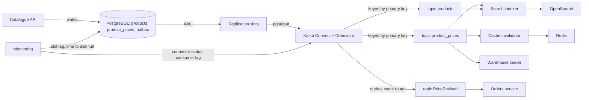
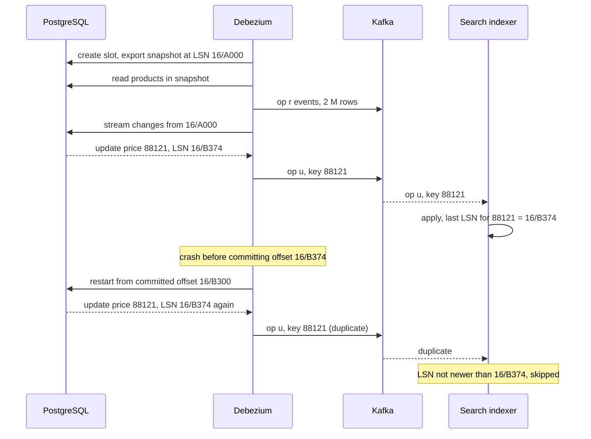
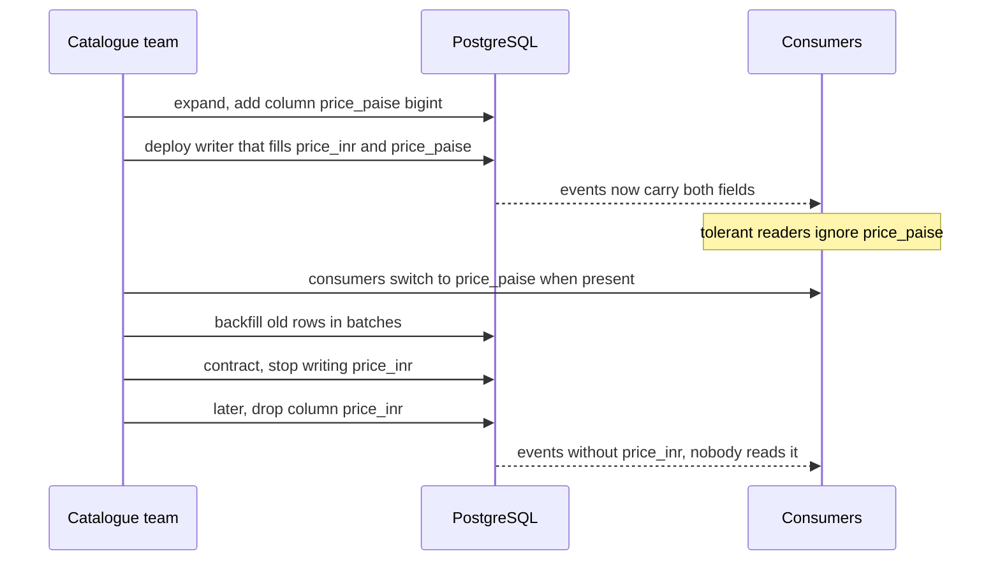

Your product table changes and five other things must follow: the search index, the Redis cache, the analytics warehouse, a pricing service and a mobile app's offline catalogue. Writing to all of them from the request handler is a dual write waiting to fail. Polling the table every minute misses deletes and hammers the database. **Change data capture (CDC)** reads the database's own transaction log and turns every committed insert, update and delete into an event, in commit order, without touching application code. This lesson explains how PostgreSQL makes that possible, what Debezium adds, how to keep it from filling your disk, and how to change schemas without breaking every consumer.

## Learning objectives

By the end of this lesson you will be able to:

1. Compare CDC approaches (timestamp polling, triggers, log-based) and say what each misses.
2. Explain PostgreSQL's write-ahead log, logical decoding, publications, replication slots, LSNs and replica identity.
3. Describe what Debezium and Kafka Connect add: snapshots, an event envelope, offsets, heartbeats and the outbox event router.
4. State the ordering guarantees CDC gives (per key, per transaction) and the ones it does not (across tables and partitions).
5. Build idempotent, tolerant consumers that survive replays and schema changes.
6. Monitor replication-slot lag and prevent a stalled consumer from filling the primary's disk.
7. Decide between CDC on raw tables and CDC on an outbox table.
8. Recognise when polling, an outbox relay or plain domain events are simpler and enough.

## Prerequisites

- [Transactional outbox](#/lesson/m12-outbox): CDC is one of the two ways to relay an outbox.
- [Kafka](#/lesson/m12-kafka): topics, partitions, keys, consumer groups and compaction.
- [Replication and leader-follower](#/lesson/m13-replication): logs and followers.
- [Idempotent consumers](#/lesson/m12-idempotent-consumers): CDC delivers at least once.

## Explain it like I'm a beginner

Every bank branch keeps a **daybook**: a register where every transaction is written down, in order, before the ledgers are updated. If the head office wants to know what changed today, it does not walk through every customer's ledger comparing balances with yesterday. It photocopies the daybook.

A database works the same way. Before it changes any table, it writes the change to its **write-ahead log (WAL)**, so it can recover after a crash. CDC is photocopying that log: a reader follows the log, page by page, and announces each change ("row 42 of `products`: price changed from ₹380 to ₹395") to anyone who is interested.

Two things follow from the analogy:

- **The daybook keeps pages until every reader has copied them.** If one reader goes on holiday, the pages pile up. In PostgreSQL, a forgotten reader (an inactive **replication slot**) can fill the server's disk.
- **The daybook is written in the bank's internal shorthand.** If you hand photocopies to outsiders, they come to depend on your internal shorthand, and you can no longer change it freely. That is why many teams publish a deliberate **outbox** of business events instead of raw table changes.

## First-principles explanation

### Three ways to capture changes

| Approach | How | Misses or costs |
|---|---|---|
| Timestamp polling | `SELECT ... WHERE updated_at > @last` every N seconds | Misses hard deletes; misses rows whose clock or `updated_at` was not set; same-timestamp edge cases; load grows with polling frequency; intermediate states between polls are lost |
| Triggers | A trigger writes every change to a change table | Adds work inside every write transaction; trigger maintenance per table; the change table needs its own relay and cleanup |
| Log-based CDC | Read the database's transaction log | Needs log access and configuration; a stalled reader retains log on disk; exposes physical schema unless you use an outbox |

Log-based CDC is the standard choice at scale because it sees every committed change, including deletes, in commit order, with near-zero extra work in the write path. Polling is still fine for small, append-only tables. Triggers are useful when you cannot get log access (some managed databases) or need an audit table anyway.

### The running example

MaterialMart is a marketplace for building materials: cement, TMT steel, sand, tiles. Its catalogue service owns PostgreSQL tables `products` (about 2 million rows) and `product_prices` (price per city and supplier). Four consumers need changes:

1. **Search** (OpenSearch): the product listing and filters, updated within a few seconds.
2. **Cache**: Redis entries for product pages must be invalidated when a product or price changes.
3. **Warehouse**: analytics wants every price change, including the old value.
4. **Orders service**: needs "price changed" business events for open quotes.

Volumes (estimates): 300,000 price updates on a normal day ≈ 3.5 per second average. Steel prices are revised in bulk: a supplier uploads 200,000 rows in about 10 minutes ≈ 333 changes per second, for a few minutes. The whole database (all tables, not just these two) writes about 20 GB of WAL a day ≈ 0.8 GB an hour. That last number turns out to matter most.

### How PostgreSQL makes log-based CDC possible

**Write-ahead log.** Every change is first written to the WAL, a sequence of binary records. A position in the WAL is a **log sequence number (LSN)**, shown as two hexadecimal numbers like `16/B374D848` (the high and low 32 bits of a 64-bit byte position).

**Logical decoding.** With `wal_level = logical`, PostgreSQL records enough information in the WAL to decode physical changes back into logical ones: "insert into `products` with these column values". An **output plugin** formats them. `pgoutput` is built in and used by PostgreSQL's own logical replication and by Debezium; `wal2json` (an extension) outputs JSON.

**Publications** define what is published: `CREATE PUBLICATION catalogue_pub FOR TABLE products, product_prices;`. Since PostgreSQL 15, a publication can list columns and filter rows, which is a simple way to keep personal data out of the stream.

**Replication slots** remember how far each consumer has confirmed reading (`confirmed_flush_lsn`). The server keeps every WAL segment the slowest slot still needs. This is what makes CDC reliable (a consumer that restarts continues exactly where it left off) and what makes it dangerous (a consumer that stops forever makes the server keep WAL forever).

**Replica identity** controls what an update or delete includes about the old row. By default only the primary key's old value is sent. `ALTER TABLE product_prices REPLICA IDENTITY FULL;` sends the whole old row, which the warehouse needs for "old price → new price", at the cost of more WAL.

```sql
-- postgresql.conf (restart required): wal_level = logical
CREATE PUBLICATION catalogue_pub FOR TABLE products (id, sku, name, category, unit, is_active), product_prices;
ALTER TABLE product_prices REPLICA IDENTITY FULL;              -- old values on update and delete
SELECT pg_create_logical_replication_slot('catalogue_search', 'pgoutput');

-- Safety valve: never keep more than 50 GB of WAL for slots (a lagging slot is invalidated instead)
ALTER SYSTEM SET max_slot_wal_keep_size = '50GB';

-- The query every CDC dashboard needs
SELECT slot_name, active,
       pg_size_pretty(pg_wal_lsn_diff(pg_current_wal_lsn(), confirmed_flush_lsn)) AS lag,
       wal_status
FROM pg_replication_slots
WHERE slot_type = 'logical';
```

Notice the column list on `products`: supplier contact details and internal margin columns never leave the database.

### The slot-lag danger, with numbers

A slot retains WAL for the **whole database**, not only for the published tables. If the search connector is down for 6 hours, the primary keeps 6 × 0.8 ≈ 5 GB extra WAL. Over a long weekend (72 hours) that is about 58 GB. If the WAL volume has 50 GB free, the primary runs out of disk and **stops accepting writes**. A broken search indexer has just taken down checkout.

Defences, in order:

1. **Monitor slot lag** in bytes and its growth rate; alert when lag exceeds, say, 5 GB or when "time to disk full" drops below 12 hours.
2. **Set `max_slot_wal_keep_size`.** PostgreSQL invalidates a slot that falls further behind than this, protecting the primary. The consumer must then re-snapshot, which is painful but far better than an outage.
3. **Drop slots you no longer use.** An abandoned slot from a proof of concept is a classic cause of incidents.
4. **Heartbeats on quiet databases.** If published tables rarely change but other tables do, the slot's position may not advance even though the consumer is healthy (it has nothing to confirm). Debezium's heartbeat setting periodically writes to a small heartbeat table so the slot keeps moving.

### Failover and slots

Before PostgreSQL 17, logical slots existed only on the primary. After a failover to a standby, the slot was gone, and consumers had to re-snapshot or risk missing changes. PostgreSQL 17 adds **failover slots**: a logical slot created with the failover option is synchronised to standbys (with `sync_replication_slots` on the standby), so CDC can continue after promotion. Managed services differ in what they support; check before relying on it, and test failover with CDC running.

### What Debezium adds

Debezium is an open-source set of CDC connectors, most often run inside **Kafka Connect** (a framework for moving data between Kafka and other systems). For PostgreSQL it uses a replication slot with `pgoutput` and adds:

- **Initial snapshot.** A new consumer needs existing rows, not just future changes. Debezium reads the tables in a consistent snapshot and then streams changes from the exact LSN the snapshot corresponds to, so nothing is lost or duplicated between the two (snapshot events carry `op = r`, for "read"). Incremental snapshots can re-read a table later without stopping streaming.
- **A standard event envelope.** Each change becomes a record with `before`, `after`, `op` (`c` create, `u` update, `d` delete, `r` snapshot read), `ts_ms`, and a `source` block with the LSN, transaction id, table and timestamp.
- **Topics per table, keyed by primary key.** `materialmart.public.product_prices`, with the row's primary key as the Kafka message key, so all changes to one row land in one partition, in order.
- **Offsets.** Kafka Connect stores the last processed LSN; after a restart the connector resumes there and confirms positions to the slot as Kafka acknowledges them.
- **Tombstones.** After a delete event, Debezium can emit a message with the same key and a null value, so Kafka log compaction can eventually remove the key entirely.
- **Transforms.** The **outbox event router** turns rows inserted into an `outbox` table into clean business events on topics named by aggregate type, which is how [outbox via CDC](#/lesson/m12-outbox) usually works.

A simplified update event:

```json
{
  "before": { "id": 88121, "city": "Pune", "supplier_id": 412, "price_inr": 38000, "version": 17 },
  "after":  { "id": 88121, "city": "Pune", "supplier_id": 412, "price_inr": 39500, "version": 18 },
  "op": "u",
  "ts_ms": 1760851200123,
  "source": { "lsn": 97456123912, "txId": 5531209, "table": "product_prices", "snapshot": "false" }
}
```

### Ordering: what you get and what you do not

- **Per row: yes.** Changes to one row come in commit order, and with the primary key as the message key they stay in order within one Kafka partition.
- **Within a transaction: available.** Debezium can publish transaction boundary events (begin and end with event counts) so a consumer can wait for a whole transaction before acting.
- **Across tables: no.** Each table has its own topic. A consumer of `products` and `product_prices` may see a price for a product it has not seen yet. Design for it: buffer, upsert "skeleton" rows, or use an outbox that publishes one event per business change.
- **Across keys: no.** Partitions are consumed in parallel.

### Delivery: at least once

After a connector crash, it resumes from the last **committed** offset, so events processed but not yet committed are delivered again. Consumers must be idempotent. The LSN (or a per-row `version` column) is a natural deduplication key: apply a change only if its position is newer than the last one applied for that key.

### Raw tables or an outbox?

| | CDC on raw tables | CDC on an outbox table |
|---|---|---|
| Effort for producers | None: no code changes | Write an outbox row in the same transaction |
| Contract | The table schema is the contract | A designed, versioned event schema |
| Meaning | "Row changed" (consumers infer why) | "PriceRevised for quote holders" |
| Schema changes | Every column change can break consumers | Internal schema can change freely |
| Good for | Replication, search indexing, cache invalidation, warehouse loads, migrations | Integration events between services and teams |

A useful rule: **raw-table CDC for data you own end to end (your own search index, your own cache); outbox CDC for events other teams consume.**

### Schema changes

PostgreSQL logical replication does **not** replicate DDL. When you change a published table, the stream starts carrying the new shape after the change, and every consumer must cope. Safe practice:

- **Additive changes are safe if consumers are tolerant readers.** Adding a nullable column, or a column with a default, just adds a field. Consumers ignore fields they do not know.
- **Never rename or drop in one step.** Use **expand and contract** ([database migrations during deployments](#/lesson/m15-db-migrations-deploy)): add the new column, write both, update consumers to read the new one, then stop writing and drop the old column later.
- **Type changes are breaking.** Changing `price_inr` from `integer` to `numeric(12,2)` changes the serialised type; add a new column instead.
- **Use a schema registry** (Avro, Protobuf or JSON Schema with compatibility checks) when many teams consume, so an incompatible change is rejected before it is produced.
- **Large unchanged values.** PostgreSQL stores big values out of line (TOAST). If an update does not touch such a column and replica identity is not `FULL`, its value is absent from the event; Debezium inserts a placeholder (`__debezium_unavailable_value` by default). Consumers must keep the existing value rather than overwrite it with the placeholder.

### Failure modes and mitigations

| Failure | Symptom | Mitigation |
|---|---|---|
| Consumer or connector stopped | Slot lag grows; primary disk fills | Lag alerts, `max_slot_wal_keep_size`, on-call runbook |
| Abandoned slot | Same, with nobody watching | Inventory slots; drop unused ones |
| Failover loses slot (pre-17) | Gap or re-snapshot after promotion | Failover slots in PostgreSQL 17; tested runbook |
| Replays after restart | Duplicate events | Idempotent consumers keyed by LSN or version |
| Cross-table reordering | Price arrives before product | Tolerant upserts, buffering, or outbox events |
| Breaking schema change | Consumer crashes or writes garbage | Expand and contract; tolerant readers; schema registry |
| Huge transaction (bulk update of 2 M rows) | Memory and lag spike | `logical_decoding_work_mem`, streaming of large in-progress transactions, batch bulk updates |
| Sensitive data in the stream | Personal data in Kafka for 7 days | Publication column lists and row filters; topic retention; encryption |
| Raw schema as public contract | Teams blocked from changing their own tables | Outbox for cross-team events |

### When a simpler alternative is better

- **A polling outbox relay** handles a few hundred events per second with nothing but SQL and a `BackgroundService`, without slots, Kafka Connect or a new operational skill set. Many systems never outgrow it.
- **Publishing domain events from the application** (via an outbox) is clearer when consumers need intent, not row diffs.
- **Timestamp polling** is fine for a small append-only table read every few minutes by a report.
- **Read replicas** solve "reporting queries slow down the primary" without any events at all.
- **Do nothing.** If one service owns the data and others can call its API, you may not need copies at all.

### What it costs

| You gain | You pay |
|---|---|
| Every committed change, including deletes, in order | Slots to monitor; a stalled consumer can stop the primary |
| No changes to application code for raw-table CDC | Internal schema becomes a de facto contract |
| Low latency (typically sub-second to seconds) | Kafka Connect, Debezium and a schema registry to run |
| Initial snapshot plus streaming without gaps | Re-snapshots after slot loss or invalidation |
| Old and new values for audits and warehouses | More WAL with `REPLICA IDENTITY FULL` |

## Visual explanation

### Architecture: one database, four consumers



The catalogue API writes its tables (and, for business events, an outbox row in the same transaction). PostgreSQL's WAL feeds the replication slot, which Debezium reads through `pgoutput`. Raw changes go to one topic per table, keyed by primary key so each row's changes stay ordered; outbox rows are routed into a business-event topic. The search indexer, cache invalidator and warehouse loader consume raw changes because the catalogue team owns them end to end; the Orders service, owned by another team, consumes only the designed `PriceRevised` event. Monitoring watches slot lag on the database and connector and consumer health on Kafka Connect.

### Sequence: snapshot, streaming, crash and replay



Debezium creates the slot and a snapshot at the same LSN, emits every existing row as a read event, then streams changes from that LSN, so there is no gap and no overlap. When it crashes after publishing an event but before committing its offset, it restarts from the last committed offset and republishes the event. The consumer recognises the LSN as not newer than the one it already applied for that key and skips it. This is why CDC is at-least-once and consumers must deduplicate.

### Sequence: changing a column safely



The team wants to move from whole rupees to paise. Instead of changing the column type (a breaking change for every consumer), it adds a new column and writes both. Consumers keep working because they ignore unknown fields, then switch to the new field at their own pace. Old rows are backfilled in small batches so the bulk update does not create a huge transaction in the stream. Only when every consumer has switched is the old column dropped. Each step is safe on its own, and each can be paused.

## Step-by-step example

### Step 1: the dual write

The catalogue API updates PostgreSQL, then calls OpenSearch, then deletes the Redis key. When OpenSearch times out, the database has the new price, search shows the old one, and the cache is never cleared. Retrying the whole request double-applies other changes.

### Step 2: polling

A job runs `SELECT * FROM product_prices WHERE updated_at > @last` every 30 seconds. It never sees deleted prices (search keeps showing them), and during bulk revisions the query scans hundreds of thousands of rows while the bulk load is still running.

### Step 3: logical replication with Debezium

Set `wal_level = logical`, create a publication with a column list, deploy Debezium with the slot `catalogue_search`. The snapshot loads 2 million products; streaming takes over. Search is now seconds behind the database, and deletes propagate.

### Step 4: make consumers idempotent and tolerant

The indexer stores the last applied LSN per product, skips older or equal positions, ignores unknown fields, and keeps existing values when a field carries the unavailable-value placeholder.

### Step 5: protect the primary

Alert on slot lag over 5 GB and on time-to-disk-full under 12 hours; set `max_slot_wal_keep_size`; enable Debezium heartbeats; document the re-snapshot runbook. Move cross-team events to an outbox with the event router.

## Production-style C# implementation

The code consumes Debezium-style envelopes (from Kafka in production; from an in-memory channel here), applies them idempotently to a search index and invalidates a cache, reads fields tolerantly, and exposes a health check for replication-slot lag.

### LSN and the change envelope

```csharp file=Cdc/ChangeEvent.cs
using System.Globalization;
using System.Text.Json;

namespace MaterialMart.Cdc;

/// <summary>A PostgreSQL log sequence number: a 64-bit WAL byte position, printed as "hi/lo" in hex.</summary>
public readonly record struct Lsn(ulong Value) : IComparable<Lsn>
{
    public static Lsn Parse(string text)
    {
        var parts = text.Split('/');
        if (parts.Length != 2) throw new FormatException($"Not an LSN: '{text}'");
        var hi = uint.Parse(parts[0], NumberStyles.HexNumber, CultureInfo.InvariantCulture);
        var lo = uint.Parse(parts[1], NumberStyles.HexNumber, CultureInfo.InvariantCulture);
        return new Lsn(((ulong)hi << 32) | lo);
    }

    public static long BytesBetween(Lsn from, Lsn to) => (long)(to.Value - from.Value);
    public int CompareTo(Lsn other) => Value.CompareTo(other.Value);
    public override string ToString() => $"{Value >> 32:X}/{Value & 0xFFFFFFFF:X}";
}

public enum ChangeOp { Create, Update, Delete, SnapshotRead }

/// <summary>The parts of a Debezium envelope that consumers use.</summary>
public sealed record ChangeEvent(string Table, string Key, ChangeOp Op, JsonElement? Before, JsonElement? After, Lsn Position, long TxId)
{
    public const string Unavailable = "__debezium_unavailable_value";

    public static ChangeEvent FromDebezium(string key, JsonElement envelope)
    {
        var source = envelope.GetProperty("source");
        var op = envelope.GetProperty("op").GetString() switch
        {
            "c" => ChangeOp.Create,
            "u" => ChangeOp.Update,
            "d" => ChangeOp.Delete,
            "r" => ChangeOp.SnapshotRead,
            var other => throw new FormatException($"Unknown op '{other}'")
        };
        return new ChangeEvent(
            source.GetProperty("table").GetString()!,
            key,
            op,
            NullIfMissing(envelope, "before"),
            NullIfMissing(envelope, "after"),
            new Lsn(source.GetProperty("lsn").GetUInt64()),
            source.TryGetProperty("txId", out var tx) && tx.ValueKind == JsonValueKind.Number ? tx.GetInt64() : 0);
    }

    private static JsonElement? NullIfMissing(JsonElement e, string name) =>
        e.TryGetProperty(name, out var v) && v.ValueKind == JsonValueKind.Object ? v.Clone() : null;
}

/// <summary>Tolerant reader helpers: unknown fields are ignored, missing ones fall back, placeholders keep the old value.</summary>
public static class Fields
{
    public static string? Text(JsonElement row, string name, string? current = null) =>
        row.TryGetProperty(name, out var v) && v.ValueKind == JsonValueKind.String
            ? (v.GetString() == ChangeEvent.Unavailable ? current : v.GetString())
            : current;

    public static decimal? Money(JsonElement row, string preferred, string fallback, decimal fallbackScale)
    {
        if (row.TryGetProperty(preferred, out var p) && p.ValueKind == JsonValueKind.Number) return p.GetDecimal() / 100m;
        if (row.TryGetProperty(fallback, out var f) && f.ValueKind == JsonValueKind.Number) return f.GetDecimal() * fallbackScale;
        return null;
    }

    public static bool Bool(JsonElement row, string name, bool @default) =>
        row.TryGetProperty(name, out var v) && v.ValueKind is JsonValueKind.True or JsonValueKind.False ? v.GetBoolean() : @default;
}
```

### Idempotent projections: search and cache

```csharp file=Cdc/Projections.cs
using System.Collections.Concurrent;
using Microsoft.Extensions.Caching.Memory;

namespace MaterialMart.Cdc;

public sealed record SearchDocument(string ProductId, string Name, string? Category, decimal? LowestPriceInr, bool Active, Lsn Position);

public interface ISearchIndex
{
    SearchDocument? Get(string productId);
    void Upsert(SearchDocument doc);
    void Delete(string productId);
}

public sealed class InMemorySearchIndex : ISearchIndex
{
    private readonly ConcurrentDictionary<string, SearchDocument> _docs = new();
    public SearchDocument? Get(string productId) => _docs.GetValueOrDefault(productId);
    public void Upsert(SearchDocument doc) => _docs[doc.ProductId] = doc;
    public void Delete(string productId) => _docs.TryRemove(productId, out _);
}

public interface IChangeHandler
{
    bool Handles(string table);
    void Handle(ChangeEvent e);
}

/// <summary>Applies product changes to the search index. Idempotent: positions at or before the stored one are skipped.</summary>
public sealed class ProductSearchProjection(ISearchIndex index, ILogger<ProductSearchProjection> logger) : IChangeHandler
{
    private readonly ConcurrentDictionary<string, Lsn> _deleted = new();   // remembers deletes so replays cannot resurrect

    public bool Handles(string table) => table == "products";

    public void Handle(ChangeEvent e)
    {
        var current = index.Get(e.Key);
        var last = current?.Position ?? _deleted.GetValueOrDefault(e.Key);
        if (e.Position.CompareTo(last) <= 0 && last.Value != 0)
        {
            logger.LogDebug("Skipping replayed change for product {Key} at {Lsn}", e.Key, e.Position);
            return;
        }

        if (e.Op == ChangeOp.Delete || e.After is not { } row)
        {
            index.Delete(e.Key);
            _deleted[e.Key] = e.Position;
            return;
        }

        index.Upsert(new SearchDocument(
            ProductId: e.Key,
            Name: Fields.Text(row, "name", current?.Name) ?? "(unnamed)",
            Category: Fields.Text(row, "category", current?.Category),
            LowestPriceInr: current?.LowestPriceInr,                       // prices arrive on their own topic
            Active: Fields.Bool(row, "is_active", current?.Active ?? true),
            Position: e.Position));
    }
}

/// <summary>Price changes may arrive before the product (no cross-table ordering): create a skeleton document.</summary>
public sealed class PriceSearchProjection(ISearchIndex index) : IChangeHandler
{
    public bool Handles(string table) => table == "product_prices";

    public void Handle(ChangeEvent e)
    {
        if (e.After is not { } row) return;                                 // price deletes handled by a nightly recompute
        var productId = row.TryGetProperty("product_id", out var pid) ? pid.ToString() : null;
        if (productId is null) return;
        var price = Fields.Money(row, preferred: "price_paise", fallback: "price_inr", fallbackScale: 1m);
        var doc = index.Get(productId) ?? new SearchDocument(productId, "(pending)", null, null, true, default);
        if (price is { } p && (doc.LowestPriceInr is null || p < doc.LowestPriceInr))
            index.Upsert(doc with { LowestPriceInr = p });
    }
}

public sealed class CacheInvalidation(IMemoryCache cache) : IChangeHandler
{
    public bool Handles(string table) => table is "products" or "product_prices";

    public void Handle(ChangeEvent e)
    {
        var productId = e.Table == "products"
            ? e.Key
            : (e.After ?? e.Before) is { } row && row.TryGetProperty("product_id", out var pid) ? pid.ToString() : null;
        if (productId is not null) cache.Remove($"product-page:{productId}");      // safe to repeat: idempotent
    }
}
```

### The consumer loop

```csharp file=Cdc/ChangeStreamConsumer.cs
using System.Diagnostics.Metrics;
using System.Threading.Channels;

namespace MaterialMart.Cdc;

/// <summary>Stands in for a Kafka consumer of the Debezium topics.</summary>
public sealed class InMemoryChangeStream
{
    private readonly Channel<ChangeEvent> _channel = Channel.CreateUnbounded<ChangeEvent>();
    public ChannelWriter<ChangeEvent> Writer => _channel.Writer;
    public ChannelReader<ChangeEvent> Reader => _channel.Reader;
}

public sealed class ChangeStreamConsumer(
    InMemoryChangeStream stream,
    IEnumerable<IChangeHandler> handlers,
    IMeterFactory meters,
    ILogger<ChangeStreamConsumer> logger) : BackgroundService
{
    private readonly Counter<long> _processed = meters.Create("MaterialMart.Cdc").CreateCounter<long>("cdc.events.processed");
    private readonly Counter<long> _failed = meters.Create("MaterialMart.Cdc").CreateCounter<long>("cdc.events.failed");

    public void Process(ChangeEvent e)
    {
        foreach (var handler in handlers.Where(h => h.Handles(e.Table)))
        {
            try
            {
                handler.Handle(e);
            }
            catch (Exception ex)
            {
                // In Kafka: do not commit the offset; retry a few times, then send to a dead-letter topic.
                _failed.Add(1, new KeyValuePair<string, object?>("table", e.Table));
                logger.LogError(ex, "Handler {Handler} failed for {Table}/{Key} at {Lsn}", handler.GetType().Name, e.Table, e.Key, e.Position);
                throw;
            }
        }
        _processed.Add(1, new KeyValuePair<string, object?>("table", e.Table));
    }

    protected override async Task ExecuteAsync(CancellationToken stoppingToken)
    {
        try
        {
            await foreach (var e in stream.Reader.ReadAllAsync(stoppingToken))
            {
                try { Process(e); }
                catch (Exception) when (!stoppingToken.IsCancellationRequested) { /* logged; real consumer would DLQ */ }
            }
        }
        catch (OperationCanceledException) when (stoppingToken.IsCancellationRequested) { }
    }
}
```

### Slot-lag health check

```csharp file=Cdc/ReplicationSlotHealth.cs
using Microsoft.Extensions.Diagnostics.HealthChecks;
using Microsoft.Extensions.Options;

namespace MaterialMart.Cdc;

public sealed record SlotStatus(string SlotName, bool Active, Lsn CurrentWal, Lsn ConfirmedFlush, long FreeDiskBytes);

public interface ISlotStatusReader
{
    /// <summary>Production: SELECT slot_name, active, pg_current_wal_lsn(), confirmed_flush_lsn FROM pg_replication_slots, plus disk free from the host.</summary>
    Task<IReadOnlyList<SlotStatus>> ReadAsync(CancellationToken ct);
}

public sealed class SlotLagOptions
{
    public long WarnLagBytes { get; set; } = 5L * 1024 * 1024 * 1024;      // 5 GB
    public double CriticalFractionOfFreeDisk { get; set; } = 0.5;           // lag above half the free disk is critical
}

public sealed class ReplicationSlotHealthCheck(ISlotStatusReader reader, IOptions<SlotLagOptions> options) : IHealthCheck
{
    public async Task<HealthCheckResult> CheckHealthAsync(HealthCheckContext context, CancellationToken cancellationToken = default)
    {
        var o = options.Value;
        var slots = await reader.ReadAsync(cancellationToken);
        var data = new Dictionary<string, object>();
        var worst = HealthStatus.Healthy;

        foreach (var s in slots)
        {
            var lag = Lsn.BytesBetween(s.ConfirmedFlush, s.CurrentWal);
            data[$"{s.SlotName}.lag_bytes"] = lag;
            data[$"{s.SlotName}.active"] = s.Active;
            var status = lag > s.FreeDiskBytes * o.CriticalFractionOfFreeDisk ? HealthStatus.Unhealthy
                : lag > o.WarnLagBytes || !s.Active ? HealthStatus.Degraded
                : HealthStatus.Healthy;
            if (status < worst) worst = status;                                // Unhealthy < Degraded < Healthy
        }

        return new HealthCheckResult(worst, $"{slots.Count} logical slot(s) checked", data: data);
    }
}

public sealed class FakeSlotStatusReader : ISlotStatusReader
{
    public SlotStatus Status { get; set; } = new("catalogue_search", true, Lsn.Parse("16/B374D848"), Lsn.Parse("16/B3000000"), 80L * 1024 * 1024 * 1024);
    public Task<IReadOnlyList<SlotStatus>> ReadAsync(CancellationToken ct) => Task.FromResult<IReadOnlyList<SlotStatus>>(new[] { Status });
}
```

### Wiring

```csharp file=Program.cs
using System.Text.Json;
using MaterialMart.Cdc;

var builder = WebApplication.CreateBuilder(args);

builder.Services.AddMetrics();
builder.Services.AddMemoryCache();
builder.Services.AddSingleton<InMemoryChangeStream>();
builder.Services.AddSingleton<ISearchIndex, InMemorySearchIndex>();
builder.Services.AddSingleton<IChangeHandler, ProductSearchProjection>();
builder.Services.AddSingleton<IChangeHandler, PriceSearchProjection>();
builder.Services.AddSingleton<IChangeHandler, CacheInvalidation>();
builder.Services.AddHostedService<ChangeStreamConsumer>();
builder.Services.Configure<SlotLagOptions>(builder.Configuration.GetSection("Cdc:SlotLag"));
builder.Services.AddSingleton<ISlotStatusReader, FakeSlotStatusReader>();
builder.Services.AddHealthChecks().AddCheck<ReplicationSlotHealthCheck>("replication-slots");

var app = builder.Build();

app.MapHealthChecks("/health/cdc");

// Demo endpoint: post a raw Debezium envelope as if it came from Kafka.
app.MapPost("/demo/changes/{key}", async (string key, JsonElement envelope, InMemoryChangeStream stream) =>
{
    await stream.Writer.WriteAsync(ChangeEvent.FromDebezium(key, envelope));
    return Results.Accepted();
});

app.MapGet("/search/products/{id}", (string id, ISearchIndex index) =>
    index.Get(id) is { } doc ? Results.Ok(doc) : Results.NotFound());

app.Run();
```

**Reading the slot directly from .NET.** If you do not want Kafka Connect, Npgsql can consume logical replication itself. A sketch (Npgsql's replication API; check the exact types for your Npgsql version):

```csharp
await using var conn = new LogicalReplicationConnection(connectionString);
await conn.Open(ct);
var slot = new PgOutputReplicationSlot("catalogue_search");
await foreach (var msg in conn.StartReplication(slot, new PgOutputReplicationOptions("catalogue_pub", 1), ct))
{
    if (msg is UpdateMessage update) { /* read update.NewRow columns, apply idempotently */ }
    conn.SetReplicationStatus(msg.WalEnd);   // confirm only after the change is durably applied
}
```

The last line is the important one: confirm a position to the slot only after the effect is durable. Confirming early loses changes on a crash; confirming late only causes harmless replays.

## Bad design vs good design

**Bad: consumers that trust every event.**

```csharp
void Handle(ChangeEvent e) => _index.Upsert(Map(e.After!));   // replays overwrite newer data; deletes crash
```

**Good:** compare the event's position with the last applied position for the key; handle deletes explicitly; remember deletes so a replayed create cannot resurrect a deleted product.

**Bad: CDC on internal tables as a cross-team API.** The Orders team builds logic on `product_prices.margin_pct`. The catalogue team can no longer rename or drop it. **Good:** publish `PriceRevised` through an outbox; keep raw-table CDC inside your own team's boundary, and use publication column lists to keep internal columns private.

**Bad: no slot monitoring.** A proof-of-concept slot created in March is forgotten; in June the primary's disk fills and the database stops. **Good:** alert on lag and inactive slots, set `max_slot_wal_keep_size`, and review `pg_replication_slots` in every operational check.

**Bad: changing a column type in place.** `ALTER TABLE ... ALTER COLUMN price_inr TYPE numeric(12,2)` and every consumer that expected an integer breaks at once. **Good:** expand and contract with a new column.

**Bad: one giant backfill transaction.** `UPDATE products SET search_keywords = ...` on 2 million rows produces one huge transaction that the connector must decode and publish at once. **Good:** backfill in batches of a few thousand rows, each committed separately.

:::callout type=warning title="A broken consumer can stop your primary"
Replication slots are the only common configuration where a downstream failure directly causes an upstream outage. Treat slot lag as a production SLO with paging alerts, not as a dashboard curiosity.
:::

## Practical playground

The script below sets up a **trigger-based** change capture inside the browser's PostgreSQL (PGlite does not offer logical replication slots). It produces the same kind of stream log-based CDC would: one row per change, in commit order, with before and after images. Try:

1. `UPDATE product_prices SET price_inr = 39500 WHERE id = 2;` then `SELECT * FROM change_log ORDER BY seq;`
2. Delete a price and notice the `after` image is null.
3. Run several statements in one transaction (`BEGIN; ... COMMIT;`) and check that they share a `tx_id`.
4. Write a query that rebuilds the current `product_prices` table purely from `change_log`.

:::playground type=sql title="See a change stream being produced"
```sql
CREATE TABLE product_prices (
  id          int PRIMARY KEY,
  product_id  int  NOT NULL,
  city        text NOT NULL,
  price_inr   int  NOT NULL,
  updated_at  timestamptz NOT NULL DEFAULT now()
);

CREATE TABLE change_log (
  seq        bigserial PRIMARY KEY,
  tx_id      bigint NOT NULL DEFAULT txid_current(),
  table_name text   NOT NULL,
  op         char(1) NOT NULL,          -- c, u, d (like Debezium)
  row_key    int    NOT NULL,
  before     jsonb,
  after      jsonb,
  captured_at timestamptz NOT NULL DEFAULT clock_timestamp()
);

CREATE FUNCTION capture_change() RETURNS trigger LANGUAGE plpgsql AS $$
BEGIN
  IF TG_OP = 'INSERT' THEN
    INSERT INTO change_log (table_name, op, row_key, before, after) VALUES (TG_TABLE_NAME, 'c', NEW.id, NULL, to_jsonb(NEW));
  ELSIF TG_OP = 'UPDATE' THEN
    INSERT INTO change_log (table_name, op, row_key, before, after) VALUES (TG_TABLE_NAME, 'u', NEW.id, to_jsonb(OLD), to_jsonb(NEW));
  ELSE
    INSERT INTO change_log (table_name, op, row_key, before, after) VALUES (TG_TABLE_NAME, 'd', OLD.id, to_jsonb(OLD), NULL);
  END IF;
  RETURN NULL;
END $$;

CREATE TRIGGER product_prices_cdc AFTER INSERT OR UPDATE OR DELETE ON product_prices
  FOR EACH ROW EXECUTE FUNCTION capture_change();

INSERT INTO product_prices (id, product_id, city, price_inr) VALUES
  (1, 501, 'Pune',      38000),
  (2, 501, 'Nagpur',    38200),
  (3, 777, 'Hyderabad',   410);
```
:::

## Exercises

:::exercise id=m16-cdc-ex1 difficulty=beginner kind=written title="Polling, triggers or the log?"
Choose a change-capture approach for each case and justify it in two or three sentences, naming one risk of your choice.

1. A nightly report copies new rows from an append-only `site_attendance` table (50,000 rows a day) to a reporting database.
2. MaterialMart's search index must reflect price changes and deletions within 5 seconds; 300,000 price updates a day with bursts of 333 per second.
3. A managed database service gives you no access to logical replication, and auditors need a permanent record of every change to `contracts`, including the old values.
4. The Orders team (a different team) needs to react when catalogue prices change.
::acceptance
- Case 1 uses timestamp or id polling, noting it is safe because rows are never updated or deleted.
- Case 2 uses log-based CDC, noting deletes, ordering and the slot-lag risk.
- Case 3 uses triggers into an audit table, noting write-path overhead.
- Case 4 uses an outbox (relayed by CDC or polling), not raw-table CDC, explaining the contract issue.
::hint
Which cases involve deletes or updates that polling would miss?
::hint
Which case crosses a team boundary, where the table schema would become a contract?
::hint
When you cannot read the log, what can still capture old and new values inside the transaction?
::solution
1. **Polling** by an increasing id (better than a timestamp): `WHERE id > @last ORDER BY id LIMIT 10000`. Safe because the table is append-only, so nothing is missed. Risk: if rows are ever back-dated or deleted, polling will not notice.
2. **Log-based CDC** (Debezium on a replication slot). It captures deletes, keeps per-row order and adds sub-second to seconds of latency even during bursts. Risk: a stalled indexer makes the slot retain WAL; monitor lag and set `max_slot_wal_keep_size`.
3. **Triggers** writing `before` and `after` images to an append-only audit table in the same transaction. Works without log access and the audit record is transactionally consistent. Risk: every write to `contracts` does extra work; keep the trigger simple and the audit table partitioned by month.
4. **Outbox.** The catalogue service writes a `PriceRevised` event (product, city, old and new price, effective time) into an outbox in the same transaction, relayed by CDC's outbox router or a polling relay. Raw-table CDC would make `product_prices` columns a contract the catalogue team could never change.
::mistakes
- Using timestamp polling where deletes matter.
- Exposing raw tables to another team "because CDC is free".
- Forgetting the operational cost (slot monitoring) of log-based CDC for a tiny nightly job.
:::

:::exercise id=m16-cdc-ex2 difficulty=beginner kind=code title="Apply a change stream idempotently"
Implement `MaterializedView`, which applies CDC events to an in-memory copy of a table. Events can be replayed (duplicates) and, after a connector restart, older events can arrive again. Apply an event only if its `Position` is greater than the last position applied for that key, and remember deletes so that a replayed older create cannot bring a deleted row back.
::requirements
- `Apply(RowChange change)` returns `true` if the view changed, `false` if the event was skipped.
- `Op` is `Create`, `Update`, `Delete` or `Snapshot` (snapshot behaves like create).
- For create, update and snapshot, store `change.After` for the key. For delete, remove the row.
- Skip any event whose position is less than or equal to the last applied position for that key (including deleted keys).
- `Get(key)` returns the stored row or null; `Count` returns the number of rows.
::acceptance
- A create followed by its duplicate changes the view once.
- An update with a higher position replaces the row.
- After a delete, a replayed create with a lower position is skipped.
- Keys are independent.
::hint
One dictionary for rows, another for the last applied position per key (kept even after a delete).
::hint
Check the position first; only then look at the operation.
::hint
```csharp
if (_positions.TryGetValue(c.Key, out var last) && c.Position <= last) return false;
_positions[c.Key] = c.Position;
```
::starter
```csharp file=MaterializedView.cs
using System;
using System.Collections.Generic;

public enum Op { Create, Update, Delete, Snapshot }

public sealed record RowChange(string Key, Op Op, string? After, ulong Position);

public sealed class MaterializedView
{
    public int Count => throw new NotImplementedException();

    public bool Apply(RowChange change) => throw new NotImplementedException();

    public string? Get(string key) => throw new NotImplementedException();
}
```
::tests
```csharp file=MaterializedViewTests.cs
using Xunit;

public class MaterializedViewTests
{
    [Fact]
    public void Duplicate_is_applied_once()
    {
        var v = new MaterializedView();
        Assert.True(v.Apply(new RowChange("88121", Op.Create, "Pune 38000", 100)));
        Assert.False(v.Apply(new RowChange("88121", Op.Create, "Pune 38000", 100)));
        Assert.Equal(1, v.Count);
    }

    [Fact]
    public void Newer_update_replaces_row_and_older_is_skipped()
    {
        var v = new MaterializedView();
        v.Apply(new RowChange("88121", Op.Snapshot, "Pune 38000", 100));
        Assert.True(v.Apply(new RowChange("88121", Op.Update, "Pune 39500", 250)));
        Assert.False(v.Apply(new RowChange("88121", Op.Update, "Pune 38800", 200)));
        Assert.Equal("Pune 39500", v.Get("88121"));
    }

    [Fact]
    public void Deletes_are_remembered()
    {
        var v = new MaterializedView();
        v.Apply(new RowChange("9", Op.Create, "Tiles", 10));
        Assert.True(v.Apply(new RowChange("9", Op.Delete, null, 20)));
        Assert.Null(v.Get("9"));
        Assert.False(v.Apply(new RowChange("9", Op.Create, "Tiles", 10)));
        Assert.Equal(0, v.Count);
    }

    [Fact]
    public void Keys_are_independent()
    {
        var v = new MaterializedView();
        v.Apply(new RowChange("a", Op.Create, "A", 500));
        Assert.True(v.Apply(new RowChange("b", Op.Create, "B", 1)));
        Assert.Equal(2, v.Count);
    }
}
```
::solution
```csharp file=MaterializedView.cs
using System;
using System.Collections.Generic;

public enum Op { Create, Update, Delete, Snapshot }

public sealed record RowChange(string Key, Op Op, string? After, ulong Position);

public sealed class MaterializedView
{
    private readonly Dictionary<string, string?> _rows = new(StringComparer.Ordinal);
    private readonly Dictionary<string, ulong> _positions = new(StringComparer.Ordinal);   // survives deletes

    public int Count => _rows.Count;

    public bool Apply(RowChange change)
    {
        if (_positions.TryGetValue(change.Key, out var last) && change.Position <= last) return false;
        _positions[change.Key] = change.Position;

        if (change.Op == Op.Delete) _rows.Remove(change.Key);
        else _rows[change.Key] = change.After;
        return true;
    }

    public string? Get(string key) => _rows.GetValueOrDefault(key);
}
```

In a real projection, the position column lives in the target store next to the row (for example `source_lsn` in a PostgreSQL read model, applied with `INSERT ... ON CONFLICT (id) DO UPDATE ... WHERE target.source_lsn < EXCLUDED.source_lsn`). Deleted keys keep a small tombstone row with their last position until replays older than the connector's retention are impossible.
::mistakes
- Removing the position along with the row on delete, so a replay resurrects it.
- Comparing with `<` instead of `<=`, so exact duplicates are applied twice.
- Using a single global "last position" instead of one per key; events for different keys are interleaved and a global check would wrongly skip some.
:::

:::exercise id=m16-cdc-ex3 difficulty=intermediate kind=code title="Slot lag and time to disk full"
Implement `SlotLagMonitor`. It parses PostgreSQL LSNs, computes how far a replication slot is behind, estimates how fast that lag is growing from two samples, and classifies the risk.
::requirements
- `Lsn.Parse("16/B374D848")` returns the 64-bit value `(0x16 << 32) | 0xB374D848`. Throw `FormatException` for malformed input.
- `LagBytes(SlotSample s)` = current WAL position − confirmed flush position.
- `GrowthBytesPerHour(previous, current)` = change in lag ÷ elapsed hours (can be negative if the consumer is catching up). Throw `ArgumentException` if `current.At <= previous.At`.
- `HoursUntilDiskFull(previous, current)` = `current.FreeDiskBytes ÷ growth` when growth > 0; otherwise `null` (not growing).
- `Classify(previous, current)`: `Critical` if hours until full < 12 **or** the slot is inactive and lag > 1 GiB; `Warning` if lag > 5 GiB or the slot is inactive; else `Ok`.
::acceptance
- LSN parsing matches PostgreSQL's format, including lowercase hex.
- Lag and growth are computed correctly from two samples.
- A shrinking lag gives no time-to-full estimate.
- Classification follows the stated precedence.
::hint
`uint.Parse(part, NumberStyles.HexNumber)` for each half; combine with a shift and bitwise or.
::hint
Elapsed hours: `(current.At - previous.At).TotalHours`.
::hint
Check `Critical` conditions first, then `Warning`.
::hint
1 GiB = `1L << 30` bytes; 5 GiB = `5L << 30`.
::starter
```csharp file=SlotLagMonitor.cs
using System;
using System.Globalization;

public static class Lsn
{
    public static ulong Parse(string text) => throw new NotImplementedException();
}

public sealed record SlotSample(DateTimeOffset At, string CurrentWalLsn, string ConfirmedFlushLsn, bool Active, long FreeDiskBytes);

public enum SlotRisk { Ok, Warning, Critical }

public static class SlotLagMonitor
{
    public static long LagBytes(SlotSample s) => throw new NotImplementedException();

    public static double GrowthBytesPerHour(SlotSample previous, SlotSample current) => throw new NotImplementedException();

    public static double? HoursUntilDiskFull(SlotSample previous, SlotSample current) => throw new NotImplementedException();

    public static SlotRisk Classify(SlotSample previous, SlotSample current) => throw new NotImplementedException();
}
```
::tests
```csharp file=SlotLagMonitorTests.cs
using System;
using Xunit;

public class SlotLagMonitorTests
{
    private const long GiB = 1L << 30;
    private static readonly DateTimeOffset T0 = new(2026, 10, 19, 2, 0, 0, TimeSpan.FromHours(5.5));

    [Fact]
    public void Parses_lsn()
    {
        Assert.Equal((0x16UL << 32) | 0xB374D848UL, Lsn.Parse("16/B374D848"));
        Assert.Equal((0x16UL << 32) | 0xB374D848UL, Lsn.Parse("16/b374d848"));
        Assert.Equal(0UL, Lsn.Parse("0/0"));
        Assert.Throws<FormatException>(() => Lsn.Parse("16-B374D848"));
    }

    [Fact]
    public void Lag_is_current_minus_confirmed()
    {
        var s = new SlotSample(T0, "1/00000000", "0/C0000000", true, 100 * GiB);
        Assert.Equal(0x40000000L, SlotLagMonitor.LagBytes(s));
    }

    [Fact]
    public void Growth_and_time_to_full()
    {
        var a = new SlotSample(T0, "1/00000000", "1/00000000", true, 20 * GiB);
        var b = new SlotSample(T0.AddHours(2), "1/80000000", "1/00000000", true, 19 * GiB);
        Assert.Equal(GiB, SlotLagMonitor.GrowthBytesPerHour(a, b), 3);
        Assert.Equal(19.0, SlotLagMonitor.HoursUntilDiskFull(a, b)!.Value, 3);
    }

    [Fact]
    public void Catching_up_has_no_time_to_full()
    {
        var a = new SlotSample(T0, "2/00000000", "1/00000000", true, 50 * GiB);
        var b = new SlotSample(T0.AddHours(1), "2/10000000", "1/F0000000", true, 50 * GiB);
        Assert.True(SlotLagMonitor.GrowthBytesPerHour(a, b) < 0);
        Assert.Null(SlotLagMonitor.HoursUntilDiskFull(a, b));
        Assert.Throws<ArgumentException>(() => SlotLagMonitor.GrowthBytesPerHour(b, a));
    }

    [Fact]
    public void Classification()
    {
        var a = new SlotSample(T0, "1/00000000", "1/00000000", true, 10 * GiB);
        var fastGrowth = new SlotSample(T0.AddHours(1), "1/40000000", "1/00000000", true, 10 * GiB);   // 1 GiB/h, 10 h left
        Assert.Equal(SlotRisk.Critical, SlotLagMonitor.Classify(a, fastGrowth));

        var bigLag = new SlotSample(T0, "7/00000000", "1/00000000", true, 500 * GiB);
        Assert.Equal(SlotRisk.Warning, SlotLagMonitor.Classify(bigLag, bigLag with { At = T0.AddHours(1) }));

        var idleSmall = new SlotSample(T0, "1/10000000", "1/00000000", false, 500 * GiB);
        Assert.Equal(SlotRisk.Warning, SlotLagMonitor.Classify(idleSmall, idleSmall with { At = T0.AddHours(1) }));

        var idleBig = new SlotSample(T0, "3/00000000", "1/00000000", false, 500 * GiB);
        Assert.Equal(SlotRisk.Critical, SlotLagMonitor.Classify(idleBig, idleBig with { At = T0.AddHours(1) }));

        var fine = new SlotSample(T0.AddHours(1), "1/01000000", "1/00000000", true, 500 * GiB);
        Assert.Equal(SlotRisk.Ok, SlotLagMonitor.Classify(a with { FreeDiskBytes = 500 * GiB }, fine));
    }
}
```
::solution
```csharp file=SlotLagMonitor.cs
using System;
using System.Globalization;

public static class Lsn
{
    public static ulong Parse(string text)
    {
        var parts = (text ?? "").Split('/');
        if (parts.Length != 2
            || !uint.TryParse(parts[0], NumberStyles.HexNumber, CultureInfo.InvariantCulture, out var hi)
            || !uint.TryParse(parts[1], NumberStyles.HexNumber, CultureInfo.InvariantCulture, out var lo))
            throw new FormatException($"Not a PostgreSQL LSN: '{text}'");
        return ((ulong)hi << 32) | lo;
    }
}

public sealed record SlotSample(DateTimeOffset At, string CurrentWalLsn, string ConfirmedFlushLsn, bool Active, long FreeDiskBytes);

public enum SlotRisk { Ok, Warning, Critical }

public static class SlotLagMonitor
{
    private const long GiB = 1L << 30;

    public static long LagBytes(SlotSample s) => (long)(Lsn.Parse(s.CurrentWalLsn) - Lsn.Parse(s.ConfirmedFlushLsn));

    public static double GrowthBytesPerHour(SlotSample previous, SlotSample current)
    {
        if (current.At <= previous.At) throw new ArgumentException("Samples must be in time order.");
        var hours = (current.At - previous.At).TotalHours;
        return (LagBytes(current) - LagBytes(previous)) / hours;
    }

    public static double? HoursUntilDiskFull(SlotSample previous, SlotSample current)
    {
        var growth = GrowthBytesPerHour(previous, current);
        return growth > 0 ? current.FreeDiskBytes / growth : null;
    }

    public static SlotRisk Classify(SlotSample previous, SlotSample current)
    {
        var lag = LagBytes(current);
        var hours = HoursUntilDiskFull(previous, current);
        if (hours is < 12 || (!current.Active && lag > GiB)) return SlotRisk.Critical;
        if (lag > 5 * GiB || !current.Active) return SlotRisk.Warning;
        return SlotRisk.Ok;
    }
}
```

Run this every minute from a monitoring job using `pg_current_wal_lsn()`, `pg_replication_slots.confirmed_flush_lsn` and the WAL volume's free space. Page on `Critical`; ticket on `Warning`. "Time to full" catches the dangerous case that a fixed threshold misses: a modest lag growing fast on a small disk.
::mistakes
- Parsing the halves as decimal, or concatenating the strings.
- Computing growth from the current WAL position alone (that is the database's write rate, not the slot's lag growth).
- Alerting on lag only, ignoring inactive slots that nobody is reading at all.
:::

:::exercise id=m16-cdc-ex4 difficulty=intermediate kind=sql ordered=true title="Rebuild a table from its change log"
`change_log` holds captured changes to `product_prices` in commit order (`seq`), as a CDC consumer would receive them, including a replayed duplicate. Rebuild the **current** state of the table from the log alone: for each `row_key`, take the change with the highest `seq`; if that change is a delete (`op = 'd'`), the row no longer exists. Return `id`, `city` and `price_inr` (as integer) for rows that exist, ordered by `id`.
::setup
```sql
CREATE TABLE change_log (
  seq     bigint PRIMARY KEY,
  op      char(1) NOT NULL,
  row_key int     NOT NULL,
  before  jsonb,
  after   jsonb
);
INSERT INTO change_log VALUES
 (1, 'c', 1, NULL, '{"id":1,"city":"Pune","price_inr":38000}'),
 (2, 'c', 2, NULL, '{"id":2,"city":"Nagpur","price_inr":38200}'),
 (3, 'c', 3, NULL, '{"id":3,"city":"Hyderabad","price_inr":410}'),
 (4, 'u', 1, '{"id":1,"city":"Pune","price_inr":38000}', '{"id":1,"city":"Pune","price_inr":39500}'),
 (5, 'd', 3, '{"id":3,"city":"Hyderabad","price_inr":410}', NULL),
 (6, 'c', 4, NULL, '{"id":4,"city":"Indore","price_inr":37600}'),
 (7, 'u', 2, '{"id":2,"city":"Nagpur","price_inr":38200}', '{"id":2,"city":"Nagpur","price_inr":38900}'),
 (8, 'u', 2, '{"id":2,"city":"Nagpur","price_inr":38200}', '{"id":2,"city":"Nagpur","price_inr":38900}'),
 (9, 'u', 4, '{"id":4,"city":"Indore","price_inr":37600}', '{"id":4,"city":"Indore","price_inr":37100,"price_paise":3710000}');
```
::check
```sql
WITH latest AS (
  SELECT DISTINCT ON (row_key) row_key, op, after
  FROM change_log
  ORDER BY row_key, seq DESC
)
SELECT (after->>'id')::int AS id,
       after->>'city' AS city,
       (after->>'price_inr')::int AS price_inr
FROM latest
WHERE op <> 'd'
ORDER BY id;
```
::acceptance
- Exactly one row per surviving key, taken from its latest change.
- Deleted keys (id 3) do not appear.
- The duplicate update (seq 7 and 8) does not create two rows.
- The extra `price_paise` field in seq 9 is ignored (tolerant reader).
::hint
`DISTINCT ON (row_key) ... ORDER BY row_key, seq DESC` keeps the newest change per key.
::hint
Filter out keys whose newest change is a delete after picking the newest change, not before.
::hint
`after->>'price_inr'` returns text; cast with `::int`.
::solution
```sql
WITH latest AS (
  SELECT DISTINCT ON (row_key) row_key, op, after
  FROM change_log
  ORDER BY row_key, seq DESC
)
SELECT (after->>'id')::int AS id,
       after->>'city' AS city,
       (after->>'price_inr')::int AS price_inr
FROM latest
WHERE op <> 'd'
ORDER BY id;
```

Result: Pune 39,500; Nagpur 38,900; Indore 37,100. This is what every CDC projection does continuously: last write per key wins, deletes remove the key. It is also exactly what Kafka log compaction keeps for a keyed topic (the latest value per key, with tombstones eventually removing deleted keys), which is why compacted CDC topics can rebuild a projection from scratch.
::alternatives
A window function works too: `ROW_NUMBER() OVER (PARTITION BY row_key ORDER BY seq DESC) = 1`. It is more portable to other databases; `DISTINCT ON` is a PostgreSQL extension.
::mistakes
- Filtering `WHERE op <> 'd'` before picking the latest change, which brings deleted rows back with their last pre-delete value.
- Using `MAX(seq)` with `GROUP BY row_key` and then forgetting to join back to get the row data.
- Using `after` for deletes (it is null) instead of excluding them.
:::

:::exercise id=m16-cdc-ex5 difficulty=advanced kind=hld title="A CDC platform for five consumers"
MaterialMart's catalogue database (PostgreSQL 17, primary plus one synchronous standby, 20 GB of WAL a day, 120 GB free on the WAL volume) must feed: search (5 s freshness), cache invalidation (2 s), the warehouse (hourly, with old and new values), the Orders team (business events), and a new recommendations team that wants "everything". Design the CDC platform: slots and connectors, topics and keys, raw versus outbox, protection of the primary, failover, schema-change process and personal-data controls. Extend the starter graph and justify each decision. Say what breaks first.
::acceptance
- A clear split between raw-table CDC (own team) and outbox events (other teams), including what the recommendations team gets.
- Slot strategy (how many slots, why) with lag monitoring, `max_slot_wal_keep_size` and arithmetic on hours of headroom.
- Failover handled with PostgreSQL 17 failover slots and a tested runbook.
- A schema-change process (expand and contract, registry compatibility).
- Personal and internal data kept out of topics.
::hint
How many hours of a stalled consumer can 120 GB absorb at 20 GB a day? What should `max_slot_wal_keep_size` be?
::hint
One Debezium connector (one slot) can feed many Kafka consumers. Why is that better than one slot per consumer?
::hint
"Everything" for another team is a contract. What would you actually give them?
::hint
Put monitoring on both the database (slot lag, time to full) and Kafka (consumer lag per group).
::starter
```json
{
  "nodes": [
    { "id": "api", "type": "app-server", "label": "Catalogue API", "props": { "instances": 4 } },
    { "id": "pg", "type": "database", "label": "PostgreSQL 17 primary + sync standby", "props": { "replicas": 1, "multiAz": true } },
    { "id": "kafka", "type": "stream", "label": "Kafka" },
    { "id": "search", "type": "search", "label": "OpenSearch" },
    { "id": "redis", "type": "cache", "label": "Redis" },
    { "id": "wh", "type": "database", "label": "Warehouse" }
  ],
  "edges": [
    { "from": "api", "to": "pg", "kind": "sync" }
  ]
}
```
::solution
```json
{
  "nodes": [
    { "id": "api", "type": "app-server", "label": "Catalogue API (writes tables + outbox)", "props": { "instances": 4 } },
    { "id": "pg", "type": "database", "label": "PostgreSQL 17: wal_level=logical, failover slot, max_slot_wal_keep_size=60GB", "props": { "replicas": 1, "multiAz": true } },
    { "id": "dbz", "type": "worker", "label": "Kafka Connect: 1 Debezium connector, 1 slot, heartbeat 10s", "props": { "instances": 3 } },
    { "id": "reg", "type": "service-registry", "label": "Schema registry (backward compatible)" },
    { "id": "kafka", "type": "stream", "label": "Kafka: raw topics keyed by PK (internal ACL) + business event topics" },
    { "id": "idx", "type": "worker", "label": "Search indexer (idempotent by LSN)", "props": { "instances": 3 } },
    { "id": "inv", "type": "worker", "label": "Cache invalidator", "props": { "instances": 2 } },
    { "id": "whl", "type": "worker", "label": "Warehouse loader (hourly batches, before/after)" },
    { "id": "orders", "type": "app-server", "label": "Orders service (PriceRevised events)" },
    { "id": "reco", "type": "app-server", "label": "Recommendations (CatalogueItemChanged events)" },
    { "id": "search", "type": "search", "label": "OpenSearch" },
    { "id": "redis", "type": "cache", "label": "Redis" },
    { "id": "wh", "type": "database", "label": "Warehouse" },
    { "id": "mon", "type": "monitoring", "label": "Slot lag + time to full, connector status, consumer lag per group" }
  ],
  "edges": [
    { "from": "api", "to": "pg", "kind": "sync", "label": "row + outbox in one tx" },
    { "from": "dbz", "to": "pg", "kind": "async", "label": "pgoutput, publication with column lists" },
    { "from": "dbz", "to": "reg", "kind": "sync" },
    { "from": "dbz", "to": "kafka", "kind": "async", "label": "raw tables + outbox event router" },
    { "from": "kafka", "to": "idx", "kind": "async" },
    { "from": "kafka", "to": "inv", "kind": "async" },
    { "from": "kafka", "to": "whl", "kind": "async" },
    { "from": "kafka", "to": "orders", "kind": "async", "label": "PriceRevised" },
    { "from": "kafka", "to": "reco", "kind": "async", "label": "CatalogueItemChanged" },
    { "from": "idx", "to": "search", "kind": "sync" },
    { "from": "inv", "to": "redis", "kind": "sync" },
    { "from": "whl", "to": "wh", "kind": "sync" },
    { "from": "mon", "to": "pg", "kind": "sync" },
    { "from": "mon", "to": "dbz", "kind": "sync" },
    { "from": "mon", "to": "kafka", "kind": "sync" }
  ]
}
```

**One slot, one connector.** Every slot retains WAL independently, so five slots means five ways to fill the disk. One Debezium connector writes each change to Kafka once; any number of consumer groups read it with their own offsets, and a slow consumer only grows *Kafka* lag, never the database's WAL. The slot only depends on the connector, which is simple and highly available on a 3-worker Connect cluster.

**Headroom arithmetic.** 20 GB a day ≈ 0.83 GB an hour. With 120 GB free, a fully stalled connector fills the disk in about 144 hours. Set `max_slot_wal_keep_size = 60GB` (≈ 72 hours) so the slot is invalidated well before the disk is full, and alert at 5 GB of lag (≈ 6 hours behind) or when time-to-full falls below 48 hours. If invalidated, the connector re-snapshots (2 million products takes minutes to tens of minutes, an estimate).

**Raw versus outbox.** Raw-table topics (`products`, `product_prices`) are internal to the catalogue team, with Kafka ACLs, and feed search, cache and warehouse. `REPLICA IDENTITY FULL` on `product_prices` gives the warehouse old values. Other teams get designed events through the outbox: `PriceRevised` for Orders; for Recommendations, a `CatalogueItemChanged` event with the public fields they need, not "everything". If they truly need full history, they can read the warehouse.

**Freshness.** Search and cache read the same raw topics in parallel consumer groups; sub-second to a few seconds end-to-end is typical when nothing is backed up, which meets 2 s and 5 s targets under normal load. During the 333/s bulk revisions, indexer instances scale by partition count.

**Failover.** The slot is created as a failover slot and synchronised to the standby (`sync_replication_slots = on` on the standby; the primary lists the standby in `synchronized_standby_slots`), so after promotion Debezium reconnects to the new primary and resumes. The runbook is tested twice a year with CDC running and a check that no change was missed (reconcile counts).

**Schema changes.** Every change to a published table or event goes through review: additive only, expand and contract for renames and type changes, and the schema registry enforces backward compatibility so an incompatible change fails in CI.

**Personal data.** Publication column lists exclude supplier contact details and internal margins; topics have 7-day retention and encryption at rest; consumers of raw topics are only catalogue-team services.

**What breaks first.** Not throughput: 333 changes per second is modest for Kafka. The first failure is operational: the connector stalls (bad message, expired credentials, an incompatible schema change) and slot lag grows silently. That is why the lag and time-to-full alerts page on-call.
::mistakes
- One slot per consumer team, multiplying the disk-fill risk.
- Handing raw tables to other teams as their integration contract.
- Not setting `max_slot_wal_keep_size`, or setting it larger than the free disk.
- Forgetting that slot WAL retention covers the whole database's WAL, not just published tables.
:::

## Automated testing

**Consumer idempotency.** Feed every projection the same stream twice, and a stream with a replay of the last 1,000 events, and assert the target state is identical. Include delete-then-replayed-create.

```csharp
[Fact]
public void Replaying_the_stream_changes_nothing()
{
    var index = new InMemorySearchIndex();
    var projection = new ProductSearchProjection(index, NullLogger<ProductSearchProjection>.Instance);
    var events = TestStreams.Products(count: 500);                 // includes updates and deletes
    foreach (var e in events) projection.Handle(e);
    var snapshot = TestStreams.Dump(index);
    foreach (var e in events) projection.Handle(e);                // full replay
    Assert.Equal(snapshot, TestStreams.Dump(index));
}
```

**Tolerant reading.** Golden envelopes for every schema version you have ever published, including ones with extra fields, missing optional fields and the unavailable-value placeholder. A new consumer version must handle all of them.

**Cross-table ordering.** Deliver a price before its product, and a product delete before its last price update, and assert the projection converges to the right state.

**Integration with a real database.** In CI, run PostgreSQL in a container with `wal_level=logical`, create the publication and slot, run Debezium (or a small Npgsql replication reader), make changes, and assert they arrive. Then restart the connector mid-stream and assert no change is lost.

**Operational tests.** In staging, stop the connector for an hour and verify that the lag alert fires and the health check reports `Degraded`, then `Unhealthy` as configured. Test failover with CDC running. Test the re-snapshot runbook at least once before you need it.

## Real-world application

- **Search and cache freshness.** Keeping OpenSearch or Elasticsearch indexes and Redis caches in step with a relational database is one of the most common CDC uses.
- **Microservice outbox relays.** Debezium's outbox event router is a widely used way to publish domain events without a polling relay.
- **Legacy migration.** CDC streams data from an old database into the new system during a [strangler fig migration](#/lesson/m16-strangler-acl), keeping the new copy current until writes move.
- **Analytics.** Streaming changes into a lakehouse or warehouse replaces nightly full extracts, with old and new values for slowly changing dimensions.
- **Database migrations and upgrades.** PostgreSQL's built-in logical replication is used for near-zero-downtime major-version upgrades and moves between hosting providers: replicate, catch up, switch writes.
- **Auditing.** Change streams feed tamper-evident audit stores, though for legal audit trails a trigger or application-level audit in the same transaction is often required.

## Interview questions

:::interview
::q beginner
What is change data capture?
::a
A way to turn every committed change in a database (insert, update, delete) into an event that other systems can consume. Log-based CDC reads the database's transaction log, such as PostgreSQL's write-ahead log, so it sees every change in commit order, including deletes, without changing application code or adding queries against the tables.
::q beginner
Why is timestamp polling not enough for keeping a search index in sync?
::a
It misses hard deletes, depends on every writer setting `updated_at` correctly, can skip rows that share a timestamp at the boundary, loses intermediate states between polls, and adds query load that grows with polling frequency. Log-based CDC avoids all of these.
::q intermediate
What is a PostgreSQL replication slot and why is it dangerous?
::a
A slot records how far a logical replication consumer has confirmed reading, so the consumer can resume exactly where it stopped. To make that possible, the server keeps every WAL segment the slot still needs. If the consumer stops, WAL for the whole database accumulates until the disk fills, and then the primary stops accepting writes. Mitigate with lag monitoring and alerts, `max_slot_wal_keep_size` (which invalidates a slot that falls too far behind), dropping unused slots, and heartbeats on quiet databases.
::q intermediate
What ordering and delivery guarantees does Debezium give, and what must consumers do?
::a
Changes to one row arrive in commit order, and keyed by primary key they stay in order within one Kafka partition. Transaction boundaries can be published. There is no ordering across tables or partitions. Delivery is at least once: after a restart the connector resumes from the last committed offset and may republish events. Consumers must be idempotent, typically by storing the last applied LSN or row version per key and skipping events that are not newer, and must tolerate cross-table reordering.
::q advanced
Should other teams consume CDC events from your raw tables?
::a
Usually not. Raw-table CDC makes your physical schema their contract: renaming a column, splitting a table or changing a type breaks them, so you lose the freedom to change your own database. Raw changes also say "row changed", not why. For cross-team integration, publish designed business events through an outbox (which can itself be relayed by CDC with Debezium's outbox router), with a versioned schema. Keep raw-table CDC for consumers you own end to end, such as your own search index or cache.
::q advanced
How do you change the schema of a table that is published through CDC?
::a
Treat it like a public API change. Additive, nullable changes are safe if consumers ignore unknown fields. For renames and type changes, use expand and contract: add the new column, write both, let consumers switch, backfill in small batches (to avoid huge transactions in the stream), stop writing the old column, and drop it last. Use a schema registry with compatibility rules to block breaking changes in CI. Remember PostgreSQL logical replication does not carry DDL, so downstream replicas need their own migrations, and watch for TOAST placeholder values when replica identity is not full.
::q advanced
What happens to CDC when the PostgreSQL primary fails over?
::a
Before PostgreSQL 17, logical slots lived only on the primary, so after promotion the slot was missing; the connector had to re-snapshot, or changes made between the last confirmed position and the failover could be missed. PostgreSQL 17 supports failover slots: a logical slot created with the failover option is synchronised to standbys, so the connector can resume on the new primary. Managed services vary, so verify support and run a failover drill with CDC active, then reconcile counts to confirm nothing was lost.
:::

## Summary and revision

**Key takeaways**

- Log-based CDC reads the WAL and emits every committed change, including deletes, in commit order.
- PostgreSQL pieces: `wal_level = logical`, publications (with column lists and row filters), replication slots, `pgoutput`, LSNs, replica identity.
- A stalled slot retains WAL for the whole database and can stop the primary: monitor lag and time to full, set `max_slot_wal_keep_size`, drop unused slots.
- Debezium adds consistent snapshots, a standard envelope, offsets, heartbeats, tombstones and the outbox event router.
- Order is per row (per key); delivery is at least once; consumers must be idempotent and tolerant.
- Raw-table CDC for your own projections; outbox events for other teams.
- Schema changes are additive or expand-and-contract, ideally checked by a schema registry.
- Polling outbox relays, domain events or read replicas are often enough.

**Terminology**: change data capture, write-ahead log, LSN, logical decoding, output plugin, pgoutput, publication, replication slot, confirmed flush LSN, replica identity, failover slot, Debezium, Kafka Connect, snapshot, envelope, offset, heartbeat, tombstone, outbox event router, tolerant reader, expand and contract, schema registry.

:::flashcards
Q: Three ways to capture changes, and the main gap of the simplest one?
A: Timestamp polling, triggers, log-based CDC. Polling misses hard deletes and intermediate states.
Q: What must be set in postgresql.conf for logical decoding?
A: wal_level = logical (requires a restart).
Q: What does a replication slot store, and what is its risk?
A: The consumer's confirmed position; the server retains all WAL the slot still needs, so a stalled consumer can fill the disk and stop the primary.
Q: What does max_slot_wal_keep_size do?
A: Caps the WAL retained for slots; a slot that falls further behind is invalidated, protecting the primary at the cost of a re-snapshot.
Q: What does REPLICA IDENTITY FULL change?
A: Update and delete events include the whole old row, not just the primary key; more WAL is written.
Q: How does Debezium avoid gaps between the snapshot and streaming?
A: It takes the snapshot at the slot's starting LSN and streams changes from exactly that position.
Q: Which ordering does CDC guarantee?
A: Per row (per key) in commit order; not across tables or Kafka partitions.
Q: How does a consumer handle replays after a connector restart?
A: Store the last applied LSN or row version per key and skip events that are not newer.
Q: When should another team get an outbox event instead of raw-table CDC?
A: Almost always: raw tables would make your physical schema their contract.
:::

## Knowledge check

:::quiz pass=70
::q single
A search index must drop products that are hard-deleted from PostgreSQL. A job polls `WHERE updated_at > @last`. What goes wrong?
- [ ] Nothing, if the job runs every 10 seconds.
- [x] Deleted rows never appear in the query, so they stay in the index.
- [ ] Updated rows are indexed twice.
- [ ] The job locks the table.
> Deleted rows have no row to select. Log-based CDC emits delete events.
::q single
The CDC connector has been down since Friday evening. On Sunday the primary database stops accepting writes. Why?
- [ ] Debezium locked the published tables.
- [x] The replication slot retained WAL for the whole database until the disk filled.
- [ ] The publication grew too large.
- [ ] Kafka ran out of disk.
> Slots make the primary keep WAL for their consumer. Monitor lag and set max_slot_wal_keep_size.
::q single
After a connector restart, the search indexer receives an update for product 88121 at an LSN it already applied. What should it do?
- [ ] Apply it again; updates are idempotent anyway.
- [x] Skip it, because its position is not newer than the last applied position for that key.
- [ ] Stop the consumer and alert.
- [ ] Re-snapshot the table.
> CDC is at least once. Position-based deduplication per key makes replays harmless, including out-of-order old updates.
::q single
The indexer consumes `products` and `product_prices` topics. A price arrives for a product the index does not have yet. Why, and what is a good response?
- [ ] A bug in Debezium; report it.
- [x] There is no ordering across tables; create a skeleton document or buffer until the product arrives.
- [ ] Discard the price; it will be resent.
- [ ] Put both tables in one partition.
> Order is per row. Consumers of several tables must tolerate cross-table reordering.
::q multi
The Orders team wants to react to catalogue price changes. Which are good choices? (Select all that apply.)
- [x] Publish a PriceRevised event through an outbox, relayed by Debezium's outbox router.
- [ ] Give them read access to the raw product_prices CDC topic.
- [x] Publish a PriceRevised event through an outbox, relayed by a polling relay.
- [ ] Let them query the catalogue database every minute.
> A designed event decouples their logic from your table schema. The relay mechanism (CDC or polling) is an implementation detail.
::q single
You need to change `price_inr` from integer to numeric. Which approach keeps CDC consumers working?
- [ ] ALTER COLUMN TYPE in a maintenance window.
- [x] Add a new column, write both, move consumers, backfill in batches, then drop the old column.
- [ ] Drop and recreate the publication.
- [ ] Set REPLICA IDENTITY FULL.
> Expand and contract turns one breaking change into several safe steps.
::q single
A quiet database's published tables change once an hour, but other tables change constantly. Slot lag keeps growing even though the connector is healthy. What helps?
- [ ] A second slot.
- [x] Connector heartbeats that periodically write to a small table so the slot's confirmed position advances.
- [ ] REPLICA IDENTITY FULL.
- [ ] Lower wal_level.
> With nothing to confirm on published tables, the slot does not advance while other WAL accumulates. Heartbeats give it something to confirm.
::q single
A team publishes 50 events a second from one service's outbox and has no Kafka Connect experience. What is likely the simplest reliable option?
- [x] A polling outbox relay in a BackgroundService.
- [ ] Debezium with a schema registry.
- [ ] Triggers that call a web API.
- [ ] Dual writes to Kafka from the request handler.
> Polling relays handle this volume easily without slots or a new platform to operate.
:::

## Completion criteria

You have finished this lesson when you can:

- [ ] Score at least 70 % on the knowledge check.
- [ ] Pass the tests for exercises 2 and 3 with `dotnet test`.
- [ ] Rebuild a table from its change log in exercise 4, and explain how compaction relates to it.
- [ ] Draw the database-to-consumers CDC architecture and name the monitoring on each part.
- [ ] Explain, with arithmetic, how long your own database could survive a stalled CDC consumer.
