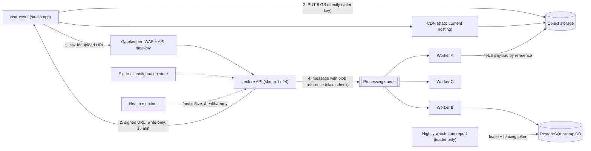
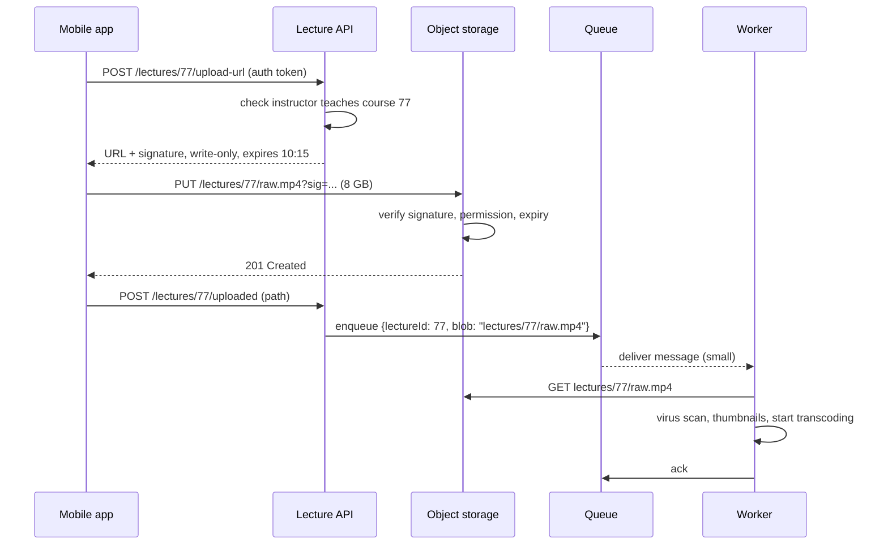

Cloud systems keep running into the same dozen-and-a-half problems: uploads too big for your API, spiky traffic, one job that must run on exactly one machine, a message too large for the queue, a database that can no longer answer one kind of query. Each has a named, well-tested answer. This lesson is a field guide: for each pattern, the problem, the solution, when to use it, and, just as important, when not to.

## Learning objectives

By the end of this lesson you will be able to:

1. Name 18 cloud design patterns and state the problem each one solves in one sentence.
2. Choose between similar patterns (sidecar vs ambassador, geode vs deployment stamps, materialized view vs index table, competing consumers vs queue-based load levelling).
3. Implement in ASP.NET Core: valet key (signed URLs), lease-based leader election with fencing tokens, claim check, queue-based load levelling with competing consumers, throttling with the rate limiting middleware, health endpoints and an external configuration store.
4. Explain the failure modes and costs each pattern introduces.
5. Recognise when a simpler design makes a pattern unnecessary.

## Prerequisites

- [Object storage](#/lesson/m11-object-storage): blobs, presigned URLs and why files do not belong in your database.
- [Messaging patterns catalogue](#/lesson/m12-messaging-patterns): queues, pub/sub and the first look at competing consumers and claim check.
- [Distributed locks and fencing tokens](#/lesson/m13-distributed-locks): the foundation for leader election.

## Explain it like I'm a beginner

Think of a big railway station.

- A **coolie (porter)** walks next to you and carries your bags, so you do not have to. That is a **sidecar**: a helper that runs next to your app and takes care of side jobs like logging or security.
- The **cloakroom token** you get for your luggage lets you collect it later without carrying it around. That is a **claim check**: store the heavy thing somewhere, pass around a small ticket.
- A **platform ticket valid for two hours** lets you enter one area for a limited time without the stationmaster escorting you. That is a **valet key**: a time-limited permission to go straight to the storage, without going through your app.
- The **ticket inspector at the gate** checks everyone before they reach the trains. That is a **gatekeeper**.
- The **queue at the ticket counter** absorbs a sudden rush of passengers so the clerks can work at a steady pace. That is **queue-based load levelling**; several clerks serving one queue are **competing consumers**.
- Only **one stationmaster** is in charge at a time; if they go home sick, a deputy takes over. That is **leader election**.

None of this is magic. Each pattern is a known, reusable answer to a problem that keeps coming back.

## First-principles explanation

### How to read this catalogue

For each pattern: **Problem** (what goes wrong without it), **Solution** (the idea), **Use when**, **Avoid when**. Patterns are grouped by the kind of problem they solve. The names follow the Azure Architecture Center catalogue, which is the most widely referenced public list; the ideas apply equally on AWS, GCP or on-premises. That catalogue has grown to more than 40 patterns (it also covers Retry, Circuit Breaker, Bulkhead, Cache-Aside, Strangler Fig, Saga, Backends for Frontends, Gateway Routing and others taught elsewhere in this course); the 18 here are the ones you meet most in application architecture and have not yet seen in depth.

### Group 1 — Structure around your service

#### Sidecar

- **Problem.** Every service needs the same supporting features: TLS, log shipping, metrics, configuration reload, proxying. Rewriting them in each language and service is wasteful and inconsistent.
- **Solution.** Run a helper process *next to* the main app, sharing its lifecycle and host (the same Kubernetes pod, for example). The app talks to it over localhost. Service-mesh proxies (Envoy in Istio), Dapr, and log shippers like Fluent Bit are sidecars.
- **Use when.** Services are polyglot; you want platform features owned by a platform team; the feature must be upgraded independently of the app.
- **Avoid when.** You have one language and a good library (a NuGet package is simpler); latency is critical (an extra local hop per call); or resources are tight (a sidecar per pod multiplies memory use: 200 pods × 50 MB = 10 GB, an estimate).

#### Ambassador

- **Problem.** Calling a remote service correctly needs retries, circuit breaking, TLS, routing and monitoring, and legacy apps cannot easily be changed to add them.
- **Solution.** A specialised sidecar that acts as an outbound proxy *for client calls*. The app calls `localhost:9000`; the ambassador handles the network concerns towards the real service.
- **Use when.** Legacy or third-party apps you cannot modify need modern client behaviour; you want consistent client-side policy across languages.
- **Avoid when.** You can use a client library (for .NET, `Microsoft.Extensions.Http.Resilience`); extra latency matters; the client logic needs app context the proxy cannot see. *Sidecar vs ambassador:* ambassador is a sidecar with one job, being the client-side proxy.

#### Gatekeeper

- **Problem.** Services that hold secrets or data are exposed to the internet; a single vulnerability gives attackers direct access.
- **Solution.** Put a dedicated, minimal-privilege host in front that validates and sanitises requests and only forwards good ones to trusted back-end hosts over a private network. Web application firewalls and API gateways often play this role.
- **Use when.** You handle sensitive data (payments, citizen records); you need a single point to enforce validation and authentication; compliance requires network isolation.
- **Avoid when.** The extra hop and the gatekeeper becoming a bottleneck or single point of failure outweigh the risk; run several instances and keep its logic simple. Don't put business logic in it.

#### External Configuration Store

- **Problem.** Configuration lives in files deployed with each app. Changing a timeout means redeploying, and 30 services drift apart.
- **Solution.** Move configuration to a central store (Azure App Configuration, AWS AppConfig, Consul, a database table). Apps read it at startup and refresh it at runtime. In .NET, `IOptionsMonitor<T>` exposes reloaded values.
- **Use when.** Many services share settings; settings must change without redeploys; you need audit and versioning of config.
- **Avoid when.** One app with a handful of settings (environment variables are fine). Never put secrets in a general config store; use a vault (Azure Key Vault) and reference it. Plan for the store being down: cache the last known values.

#### Static Content Hosting

- **Problem.** App servers waste CPU, memory and bandwidth serving images, JavaScript bundles and PDFs.
- **Solution.** Put static files in object storage behind a CDN. Browsers fetch them directly from the edge. Version file names (`app.3f9a2c.js`) so they can be cached for a year.
- **Use when.** Single-page apps, documents, downloads, media; global users.
- **Avoid when.** Content needs per-request authorisation logic that signed URLs or CDN tokens cannot express, or the site is tiny and internal (ASP.NET Core's static file middleware is fine).

### Group 2 — Data access and data shape

#### Valet Key

- **Problem.** Instructors upload 8 GB raw lecture recordings (an hour of 4K video). Streaming them *through* your API ties up threads, memory and bandwidth, and costs egress twice.
- **Solution.** The API checks the user's permission and returns a **time-limited, scope-limited token** (Azure SAS, S3 presigned URL). The client talks to storage directly. The token encodes what (one blob), how (write only) and until when (15 minutes), signed so it cannot be altered.
- **Use when.** Large uploads and downloads; many clients; storage that supports signed access.
- **Avoid when.** You must inspect or transform data inline (virus scanning before storage; then scan asynchronously after upload instead, and quarantine). Keep validity short, scope tight, and prefer HTTPS-only tokens; a leaked token is usable by anyone until it expires.

#### Claim Check

- **Problem.** A message carries a 40 MB payload. Queues have size limits (Azure Service Bus standard tier: 256 KB per message; premium allows up to 100 MB, but big messages still slow the broker and every consumer), and large messages slow brokers.
- **Solution.** Store the payload in blob storage; send a small message containing a reference (the "claim check"). The consumer fetches the payload. Delete the blob when processed, or let a lifecycle rule expire it.
- **Use when.** Payloads exceed broker limits or vary wildly in size; many consumers need only metadata to decide whether to fetch.
- **Avoid when.** Payloads are small; the extra storage round trip adds latency; you cannot secure the blob as well as the message. Watch the race where the message arrives before the blob write completes: write blob first, then send.

#### Materialized View

- **Problem.** The data is stored in a shape good for writing (normalised, or as events), but a dashboard needs an aggregated shape: "total course revenue by state". Computing it on every request is slow and expensive.
- **Solution.** Precompute the read shape and store it: a PostgreSQL `MATERIALIZED VIEW` refreshed periodically, or a read-model table updated from events (see [CQRS](#/lesson/m16-cqrs)).
- **Use when.** Reads vastly outnumber writes; the query is expensive; some staleness is acceptable.
- **Avoid when.** Data must be exactly current; the source changes constantly so refreshes never keep up; the query is already fast with a good index. `REFRESH MATERIALIZED VIEW CONCURRENTLY` needs a unique index and still recomputes the whole view.

#### Index Table

- **Problem.** A data store only supports lookups by its primary key (common in key-value and wide-column stores, and across shards), but you need to query by another field, say email.
- **Solution.** Maintain a second table keyed by the secondary field that points to the primary key (or duplicates the needed columns). Update it whenever the main data changes.
- **Use when.** NoSQL stores without secondary indexes; sharded data where the secondary key is on a different shard.
- **Avoid when.** You use PostgreSQL on one node: just `CREATE INDEX`. An index table you maintain yourself can drift out of sync; the database's own indexes are transactional and free of that risk. *Materialized view vs index table:* the view precomputes a *result*; the index table speeds up *finding* rows.

#### Sharding

- **Problem.** One database cannot hold the data or handle the writes: 4 TB and 30,000 writes per second exceed a single node.
- **Solution.** Split data horizontally into shards by a **shard key** (tenant id, user id hash, region). A routing layer maps each key to a shard. See [sharding and consistent hashing](#/lesson/m13-sharding).
- **Use when.** You have exhausted vertical scaling, read replicas, caching and partitioning; the data has a natural key that most queries include.
- **Avoid when.** Data still fits one node with headroom (most systems). Sharding costs cross-shard queries, rebalancing, harder transactions and operations. A bad key creates hot shards.

### Group 3 — Messaging and load

#### Competing Consumers

- **Problem.** One consumer cannot keep up with the message rate, and a single consumer is a single point of failure.
- **Solution.** Run several consumers reading from the same queue. The broker gives each message to one of them. Scale consumers with queue depth (KEDA does this in Kubernetes).
- **Use when.** Messages are independent; throughput needs to scale; you want resilience.
- **Avoid when.** Strict ordering is required across all messages (use partitions and order per key instead). Consumers must be idempotent, because a message can be delivered twice when a consumer crashes before acknowledging.

#### Queue-Based Load Levelling

- **Problem.** Load arrives in spikes (900 report requests at 10:00 on the 1st of the month) and overwhelms a slower back end that cannot autoscale quickly (a reporting database, a rate-limited government API).
- **Solution.** Put a queue between producers and the back end. The queue absorbs the spike; workers drain it at a steady, safe rate. Producers get "accepted" immediately and the result later.
- **Use when.** Work can be asynchronous; spikes are short relative to the time allowed to finish; the back end has a hard capacity limit.
- **Avoid when.** The caller needs the answer synchronously within a tight latency budget; or load is *sustainably* above capacity (the queue just grows forever; you need more capacity or load shedding). *Versus competing consumers:* load levelling is about *smoothing* the rate; competing consumers is about *scaling* the processing. They are usually used together.

#### Throttling

- **Problem.** One tenant's batch job, or a traffic surge, consumes all capacity and everyone else's requests fail or slow down.
- **Solution.** Limit how much each client (or the whole service) can consume in a time window, and reject or delay the excess with `429 Too Many Requests` and a `Retry-After` header. Optionally degrade: disable expensive features under load. ASP.NET Core's rate limiting middleware provides fixed window, sliding window, token bucket and concurrency limiters, partitioned by any key. See [rate limiting algorithms](#/lesson/m10-rate-limiting) and [rate limiting at scale](#/lesson/m16-multi-level-caching).
- **Use when.** Multi-tenant services; protecting a fixed-capacity dependency; enforcing paid plan quotas.
- **Avoid when.** Autoscaling handles the load economically and the cause is legitimate demand; throttling paying customers to save a few hundred rupees of compute is bad business.

### Group 4 — Reliability and operations

#### Health Endpoint Monitoring

- **Problem.** A process can be running but useless: deadlocked, unable to reach its database, out of disk. Load balancers keep sending it traffic.
- **Solution.** Expose endpoints that report health. Distinguish **liveness** ("am I alive? if not, restart me") from **readiness** ("can I serve traffic now? if not, take me out of rotation"). External monitors call them too, from several regions.
- **Use when.** Always, for anything behind a load balancer or orchestrator.
- **Avoid when.** Never avoid it, but avoid *bad* health checks: a liveness check that calls the database causes every pod to restart when the database blips (a restart storm). Keep liveness shallow; put dependency checks in readiness; protect the endpoints from abuse and avoid leaking internal details.

#### Leader Election

- **Problem.** Some work must run on exactly one instance at a time: a nightly billing run, a scheduler, a partition owner. With 6 replicas, either all 6 run it, or a single fixed "special" instance becomes a single point of failure.
- **Solution.** Instances compete for a **lease** (a lock with an expiry) in a shared store: a PostgreSQL row, a blob lease, etcd, or a Kubernetes `Lease` object. The holder is leader and renews the lease periodically; if it dies, the lease expires and another instance takes over. A **fencing token** (a number that increases with every new leader) lets downstream systems reject writes from an old leader that has paused and woken up. See [distributed locks](#/lesson/m13-distributed-locks).
- **Use when.** Coordination tasks that must not run concurrently; the work tolerates a short gap during failover (the lease duration).
- **Avoid when.** The work can be partitioned so every instance does a share (competing consumers is simpler and scales); or a managed scheduler can run the job once (a Kubernetes CronJob, Azure Functions timer). Never rely on the lease alone for correctness without fencing.

#### Compensating Transaction

- **Problem.** A business operation spans several services (book a hotel, a flight, a cab) and cannot use one ACID transaction. Step 3 fails after steps 1 and 2 succeeded.
- **Solution.** Record each completed step and define a compensating action that semantically undoes it (cancel the hotel booking, refund the payment). On failure, run compensations in reverse order. Compensations must be idempotent and retryable, and some may need a human. This is the core of a [saga](#/lesson/m12-sagas).
- **Use when.** Multi-service workflows where eventual consistency is acceptable.
- **Avoid when.** Everything lives in one database: use a real transaction. Some actions cannot be undone (an SMS sent, goods shipped); compensation then means a new corrective action (send an apology, arrange a return), and the design must say so.

### Group 5 — Deployment topology

#### Deployment Stamps

- **Problem.** A multi-tenant SaaS outgrows one deployment: limits on database size, noisy neighbours, data residency demands, and a single blast radius for every bad deploy.
- **Solution.** Package the whole application stack (app, database, cache, storage) as a **stamp** (also called a scale unit or cell) that serves a bounded set of tenants, say 50. Add stamps to grow. A thin global layer routes each tenant to its stamp. Deploy changes stamp by stamp.
- **Use when.** Many tenants with predictable per-tenant load; isolation or residency needs; you want to limit the blast radius of failures and releases.
- **Avoid when.** You have few tenants or one large one; cross-tenant queries and analytics are central (they now span stamps); the team cannot automate infrastructure (stamps without infrastructure as code are a manual nightmare). Tenants that outgrow a stamp need a migration path.

#### Geode

- **Problem.** Users worldwide (or across a large country) suffer latency from one central region, and a regional outage takes everything down.
- **Solution.** Deploy identical back-end nodes (geodes) in many regions, each able to serve **any** user, in front of a globally replicated data store (for example a multi-region database with multi-region writes). A global load balancer sends each user to the nearest healthy geode.
- **Use when.** Global, latency-sensitive, read-heavy workloads that tolerate eventual consistency across regions; very high availability targets.
- **Avoid when.** Data must stay in one jurisdiction; you need strong consistency on writes everywhere; budget is limited (multi-region writes and replication are expensive). *Geode vs deployment stamps:* geodes are interchangeable and serve anyone; stamps own specific tenants. You can combine them: stamps per region, each tenant pinned to one. See [multi-region](#/lesson/m16-multi-region).

### Choosing quickly

| Symptom | First pattern to consider | Simpler alternative to rule out first |
|---|---|---|
| Large files through the API | Valet key | None; this one is almost always worth it |
| Message too big for the queue | Claim check | Make the message smaller |
| Spiky load on a slow back end | Queue-based load levelling | Autoscale the back end |
| One noisy tenant | Throttling | Fix the client's retry loop |
| Exactly-one job | Leader election | A managed scheduler (CronJob) |
| Slow aggregate query | Materialized view | An index |
| Query by non-key field in NoSQL | Index table | Use a store with secondary indexes |
| One DB too small | Sharding | Bigger instance, replicas, partitioning, archiving |
| SaaS outgrowing one deployment | Deployment stamps | Pool more tenants per database with RLS |
| Global latency | Geode | CDN plus a single region |

### What breaks first, pattern by pattern

- **Valet key:** clock skew between your API and storage makes fresh tokens look expired; give a small grace period (start time a minute in the past).
- **Queue load levelling:** the queue looks healthy while the oldest message is two hours old. Alert on *age of oldest message*, not just depth.
- **Leader election:** GC pauses or a network partition make an old leader believe it still leads; without fencing tokens, two leaders write.
- **Deployment stamps:** the global routing layer becomes the single point of failure. Cache tenant-to-stamp mappings at the edge and make the router simple.
- **Health checks:** deep liveness checks cause restart storms during a dependency outage.

## Visual explanation

### Architecture: several patterns working together



Follow the numbers. The instructor's studio app asks the API for an upload URL; the request passes through the gatekeeper, which authenticates and validates it. The API returns a signed, write-only URL valid for 15 minutes (valet key), so the 8 GB file goes straight to object storage and never touches the API. The API then puts a small message on the queue holding only the blob's path (claim check). Three workers compete for messages (competing consumers), and the queue absorbs bursts so the database is never flooded (queue-based load levelling). One instance at a time, holding a lease, runs the nightly watch-time report (leader election). The dotted lines are the operational patterns: settings come from an external configuration store, and monitors poll health endpoints. The whole picture is one deployment stamp; more stamps can be added for more tenants.

### Sequence: valet key upload with claim check



The API does only two cheap things: an authorisation check and a signature calculation. Storage, not the API, verifies the signature on the 8 GB upload. The message on the queue is a few hundred bytes, whatever the file size. If the worker crashes mid-processing, it never acknowledges, so the message is redelivered to another worker, which is why processing must be idempotent (keyed by lecture id).

## Step-by-step example

**CourseCast** is a video-course platform. Twelve training institutes (the tenants) have 300 instructors between them, who record lectures and upload them for students to stream. We apply patterns one at a time, only where numbers justify them.

### Step 1 — the starting point

One API (3 instances) and PostgreSQL. Uploads stream through the API. Reports run inside requests.

### Step 2 — uploads: valet key

Estimates: 300 instructors × 2 lectures a week × 8 GB = **4.8 TB a week**. Average 4.8 TB ÷ 604,800 s ≈ 8 MB/s, but uploads bunch on Friday afternoons: 40 concurrent uploads × 50 Mbit/s ≈ **2 Gbit/s** through 3 API instances, plus memory for buffering. With a valet key, the API serves a signature in milliseconds and bandwidth goes straight to storage, which is built for it.

### Step 3 — processing: claim check + competing consumers

Each upload needs about 6 minutes of processing in our workers: virus scan, thumbnails, audio extraction for captions, then a hand-off to a managed transcoding service (estimate). 600 lectures a week is fine for one worker on average, but Friday's 40 arrive together: one worker takes 40 × 6 = 240 minutes. Three competing workers finish in 80 minutes; scaling to 8 on queue depth finishes in 30. Messages carry only the blob path, well under queue size limits.

### Step 4 — monthly reports: queue-based load levelling

On the 1st at 10:00, instructors and institute admins request 900 earnings and watch-time reports in one minute (15/s). The reporting queries can safely run at 8/s on the reporting replica. With a queue: backlog grows by 7/s for 60 s ≈ 420 items, drained in 420 ÷ 8 ≈ 53 s after the spike. Users wait up to about 2 minutes and get a notification, instead of the replica collapsing.

### Step 5 — one nightly job: leader election

The nightly watch-time roll-up (which feeds instructor payouts) must not run three times. A lease row in PostgreSQL with a 30-second lease, renewed every 10 seconds, picks one instance. If it dies mid-run, another takes over within about 30 seconds. The roll-up writes include the fencing token, and the table rejects writes with a token lower than the last seen.

### Step 6 — throttling and health

One institute's LMS integration polls `/lectures` 50 times a second in a loop. A per-tenant token bucket (20 burst, 10 per second) returns 429 with `Retry-After`, protecting others. Liveness is a trivial endpoint; readiness also checks the database and queue depth.

### Step 7 — what we did *not* do

No sharding: the metadata database is 40 GB, and one PostgreSQL instance handles it with room to spare. No geodes: users are in India and one region with a CDN gives good latency. No deployment stamps yet: 300 instructors from 12 institutes fit one deployment. Revisit when an institute demands isolation, or when the database passes, say, 1 TB. The [scaling journey](#/lesson/m17-scaling-journey) case study shows the same discipline across a product's whole life: most of these patterns arrive one growth stage at a time, each when a measured bottleneck asks for it.

## Production-style C# implementation

The sample implements six patterns in one ASP.NET Core app, offline, with in-memory stand-ins behind interfaces.

```text
CourseCast.Api/
  Program.cs                       throttling, health endpoints, external config, endpoints
  ValetKey/SignedUrlService.cs     HMAC-signed, scoped, expiring URLs
  ClaimCheck/BlobStore.cs          IBlobStore + in-memory implementation
  LoadLeveling/LectureQueue.cs      bounded channel queue + competing consumer workers
  LeaderElection/Leases.cs         lease store with fencing tokens + leader-only job
  Health/QueueHealthCheck.cs       readiness check on queue depth
```

### Valet key

```csharp file=ValetKey/SignedUrlService.cs
using System.Security.Cryptography;
using System.Text;
using Microsoft.Extensions.Options;

namespace CourseCast.ValetKey;

[Flags]
public enum BlobPermissions { None = 0, Read = 1, Write = 2 }

public sealed class ValetKeyOptions
{
    /// <summary>In production this comes from a key vault and is rotated; never from appsettings.json.</summary>
    public string SigningKey { get; set; } = "dev-only-signing-key-change-me";
    public TimeSpan MaxLifetime { get; set; } = TimeSpan.FromMinutes(15);
    public TimeSpan ClockSkewAllowance { get; set; } = TimeSpan.FromMinutes(1);
}

public sealed record SignedAccess(string Path, BlobPermissions Permissions, long ExpiresUnix, string Signature)
{
    public string ToQueryString() => $"perm={(int)Permissions}&exp={ExpiresUnix}&sig={Signature}";
}

public sealed class SignedUrlService(IOptions<ValetKeyOptions> options, TimeProvider time)
{
    private readonly ValetKeyOptions _o = options.Value;

    public SignedAccess Issue(string path, BlobPermissions permissions, TimeSpan lifetime)
    {
        if (lifetime <= TimeSpan.Zero || lifetime > _o.MaxLifetime)
            throw new ArgumentOutOfRangeException(nameof(lifetime), $"Lifetime must be between 0 and {_o.MaxLifetime}.");
        if (permissions == BlobPermissions.None) throw new ArgumentException("Grant at least one permission.", nameof(permissions));
        var expires = time.GetUtcNow().Add(lifetime).ToUnixTimeSeconds();
        return new SignedAccess(path, permissions, expires, Sign(path, permissions, expires));
    }

    /// <summary>What the storage service does on every request carrying a signature.</summary>
    public bool Validate(string path, BlobPermissions required, BlobPermissions granted, long expiresUnix, string signature)
    {
        var expected = Sign(path, granted, expiresUnix);
        var sigOk = CryptographicOperations.FixedTimeEquals(Encoding.ASCII.GetBytes(expected), Encoding.ASCII.GetBytes(signature));
        var notExpired = time.GetUtcNow() <= DateTimeOffset.FromUnixTimeSeconds(expiresUnix).Add(_o.ClockSkewAllowance);
        return sigOk && notExpired && (granted & required) == required;
    }

    private string Sign(string path, BlobPermissions permissions, long expiresUnix)
    {
        var payload = $"{(int)permissions}\n{path}\n{expiresUnix}";
        var mac = HMACSHA256.HashData(Encoding.UTF8.GetBytes(_o.SigningKey), Encoding.UTF8.GetBytes(payload));
        return Convert.ToHexString(mac);
    }
}
```

Everything the token allows (path, permissions, expiry) is inside the signed payload, so changing any of them invalidates the signature. `FixedTimeEquals` prevents timing attacks that guess a signature byte by byte. With Azure Blob Storage you would call the SDK's SAS builder instead of hand-rolling this; the principle is identical. Prefer a **user delegation SAS** (signed with a key obtained through the app's Microsoft Entra identity, revocable, and visible in logs) over an account-key SAS, which is signed with the storage account key and can only be revoked by rotating that key.

### Claim check store

```csharp file=ClaimCheck/BlobStore.cs
using System.Collections.Concurrent;

namespace CourseCast.ClaimCheck;

public interface IBlobStore
{
    Task PutAsync(string path, ReadOnlyMemory<byte> content, CancellationToken ct);
    Task<ReadOnlyMemory<byte>?> GetAsync(string path, CancellationToken ct);
    Task DeleteAsync(string path, CancellationToken ct);
}

public sealed class InMemoryBlobStore : IBlobStore
{
    private readonly ConcurrentDictionary<string, byte[]> _blobs = new(StringComparer.Ordinal);

    public Task PutAsync(string path, ReadOnlyMemory<byte> content, CancellationToken ct)
    {
        _blobs[path] = content.ToArray();
        return Task.CompletedTask;
    }

    public Task<ReadOnlyMemory<byte>?> GetAsync(string path, CancellationToken ct) =>
        Task.FromResult<ReadOnlyMemory<byte>?>(_blobs.TryGetValue(path, out var b) ? b : null);

    public Task DeleteAsync(string path, CancellationToken ct)
    {
        _blobs.TryRemove(path, out _);
        return Task.CompletedTask;
    }
}

/// <summary>The claim check: a small message that points at the payload instead of carrying it.</summary>
public sealed record LectureUploaded(string LectureId, string BlobPath, long SizeBytes, DateTimeOffset UploadedAt);
```

### Queue-based load levelling with competing consumers

```csharp file=LoadLeveling/LectureQueue.cs
using System.Threading.Channels;
using Microsoft.Extensions.Options;
using CourseCast.ClaimCheck;

namespace CourseCast.LoadLeveling;

public sealed class QueueOptions
{
    public int Capacity { get; set; } = 1_000;
    public int Consumers { get; set; } = 3;
}

/// <summary>In-process stand-in for a durable broker (Service Bus, RabbitMQ). A real broker survives restarts;
/// a Channel does not, so production code must not rely on this for durability.</summary>
public sealed class LectureQueue(IOptions<QueueOptions> options)
{
    private readonly Channel<LectureUploaded> _channel = Channel.CreateBounded<LectureUploaded>(
        new BoundedChannelOptions(options.Value.Capacity) { FullMode = BoundedChannelFullMode.Wait });
    private int _depth;

    public int Depth => Volatile.Read(ref _depth);
    public int Capacity => options.Value.Capacity;

    /// <summary>Returns false when the queue is full: the producer should answer 503 + Retry-After (load shedding).</summary>
    public bool TryEnqueue(LectureUploaded message)
    {
        if (!_channel.Writer.TryWrite(message)) return false;
        Interlocked.Increment(ref _depth);
        return true;
    }

    public async ValueTask<LectureUploaded> DequeueAsync(CancellationToken ct)
    {
        var m = await _channel.Reader.ReadAsync(ct);
        Interlocked.Decrement(ref _depth);
        return m;
    }
}

public interface ILectureProcessor
{
    Task ProcessAsync(LectureUploaded message, ReadOnlyMemory<byte> payload, CancellationToken ct);
}

public sealed class LoggingLectureProcessor(ILogger<LoggingLectureProcessor> log) : ILectureProcessor
{
    public Task ProcessAsync(LectureUploaded message, ReadOnlyMemory<byte> payload, CancellationToken ct)
    {
        log.LogInformation("Processed lecture {LectureId}: {Bytes} bytes", message.LectureId, payload.Length);
        return Task.CompletedTask;
    }
}

/// <summary>N consumers compete for messages from one queue. Each processes at its own pace,
/// so the back end sees at most N concurrent jobs however spiky the arrivals are.</summary>
public sealed class LectureWorkers(
    LectureQueue queue, IBlobStore blobs, ILectureProcessor processor,
    IOptions<QueueOptions> options, ILogger<LectureWorkers> log) : BackgroundService
{
    protected override Task ExecuteAsync(CancellationToken stoppingToken) =>
        Task.WhenAll(Enumerable.Range(1, options.Value.Consumers).Select(i => ConsumeAsync(i, stoppingToken)));

    private async Task ConsumeAsync(int consumerId, CancellationToken ct)
    {
        while (!ct.IsCancellationRequested)
        {
            LectureUploaded message;
            try { message = await queue.DequeueAsync(ct); }
            catch (OperationCanceledException) { break; }

            try
            {
                var payload = await blobs.GetAsync(message.BlobPath, ct);
                if (payload is null)
                {
                    log.LogWarning("Consumer {Id}: blob {Path} missing for lecture {LectureId}", consumerId, message.BlobPath, message.LectureId);
                    continue;   // a real broker would dead-letter this message
                }
                await processor.ProcessAsync(message, payload.Value, ct);
            }
            catch (Exception ex) when (ex is not OperationCanceledException)
            {
                log.LogError(ex, "Consumer {Id} failed on lecture {LectureId}", consumerId, message.LectureId);
            }
        }
    }
}
```

### Leader election with fencing tokens

```csharp file=LeaderElection/Leases.cs
namespace CourseCast.LeaderElection;

public sealed record Lease(string Name, string Owner, DateTimeOffset ExpiresAt, long FencingToken);

public interface ILeaseStore
{
    /// <summary>Acquire if free or expired, renew if already ours. Returns null if someone else holds it.</summary>
    Task<Lease?> TryAcquireOrRenewAsync(string name, string owner, TimeSpan duration, CancellationToken ct);
    Task ReleaseAsync(string name, string owner, CancellationToken ct);
}

/// <summary>In PostgreSQL the same logic is one statement:
/// INSERT ... ON CONFLICT (name) DO UPDATE SET owner = excluded.owner, expires_at = excluded.expires_at,
///   token = lease.token + CASE WHEN lease.owner = excluded.owner THEN 0 ELSE 1 END
/// WHERE lease.owner = excluded.owner OR lease.expires_at &lt; now() RETURNING *;</summary>
public sealed class InMemoryLeaseStore(TimeProvider time) : ILeaseStore
{
    private readonly Dictionary<string, Lease> _leases = new(StringComparer.Ordinal);
    private readonly Lock _gate = new();

    public Task<Lease?> TryAcquireOrRenewAsync(string name, string owner, TimeSpan duration, CancellationToken ct)
    {
        lock (_gate)
        {
            var now = time.GetUtcNow();
            _leases.TryGetValue(name, out var current);
            Lease? result = null;
            if (current is null)
                result = new Lease(name, owner, now + duration, 1);
            else if (current.Owner == owner)
                result = current with { ExpiresAt = now + duration };                       // renew, same token
            else if (current.ExpiresAt <= now)
                result = new Lease(name, owner, now + duration, current.FencingToken + 1);  // take over, new token
            if (result is not null) _leases[name] = result;
            return Task.FromResult(result);
        }
    }

    public Task ReleaseAsync(string name, string owner, CancellationToken ct)
    {
        lock (_gate)
        {
            if (_leases.TryGetValue(name, out var l) && l.Owner == owner)
                _leases[name] = l with { ExpiresAt = DateTimeOffset.MinValue };   // keep the token so it keeps rising
        }
        return Task.CompletedTask;
    }
}

public interface IRollupWriter
{
    /// <summary>Must reject writes whose fencing token is lower than the highest one it has accepted.</summary>
    Task<bool> WriteDailyRollupAsync(DateOnly day, long fencingToken, CancellationToken ct);
}

public sealed class FencedRollupWriter : IRollupWriter
{
    private long _highestToken;
    public Task<bool> WriteDailyRollupAsync(DateOnly day, long fencingToken, CancellationToken ct)
    {
        long seen;
        do
        {
            seen = Interlocked.Read(ref _highestToken);
            if (fencingToken < seen) return Task.FromResult(false);   // a stale leader woke up: reject
        } while (Interlocked.CompareExchange(ref _highestToken, fencingToken, seen) != seen);
        return Task.FromResult(true);
    }
}

/// <summary>Every instance runs this loop; only the lease holder does the work.</summary>
public sealed class NightlyRollupJob(ILeaseStore leases, IRollupWriter writer, TimeProvider time, ILogger<NightlyRollupJob> log)
    : BackgroundService
{
    private readonly string _instanceId = $"{Environment.MachineName}-{Guid.NewGuid():N}";
    public static readonly TimeSpan LeaseDuration = TimeSpan.FromSeconds(30);
    public static readonly TimeSpan RenewEvery = TimeSpan.FromSeconds(10);   // a third of the lease

    protected override async Task ExecuteAsync(CancellationToken stoppingToken)
    {
        try
        {
            while (!stoppingToken.IsCancellationRequested)
            {
                var lease = await leases.TryAcquireOrRenewAsync("nightly-rollup", _instanceId, LeaseDuration, stoppingToken);
                if (lease is not null)
                {
                    // Simplified: a real job checks a "done for this day" row and runs once per day, not on every renewal.
                    var day = DateOnly.FromDateTime(time.GetUtcNow().UtcDateTime.AddDays(-1));
                    if (!await writer.WriteDailyRollupAsync(day, lease.FencingToken, stoppingToken))
                        log.LogWarning("Rollup write rejected: token {Token} is stale", lease.FencingToken);
                }
                await Task.Delay(RenewEvery, time, stoppingToken);
            }
        }
        catch (OperationCanceledException) when (stoppingToken.IsCancellationRequested) { }
        finally
        {
            // Graceful shutdown: hand over immediately instead of making others wait for expiry.
            await leases.ReleaseAsync("nightly-rollup", _instanceId, CancellationToken.None);
        }
    }
}
```

The renewal interval is a third of the lease, so one missed renewal (a slow database round trip) does not lose leadership. Failover time is at most the lease duration. The fencing token is what makes this correct, not merely likely to be correct: if the old leader pauses for 40 seconds, loses its lease, and then wakes up mid-write, its lower token is rejected.

### Health checks

```csharp file=Health/QueueHealthCheck.cs
using Microsoft.Extensions.Diagnostics.HealthChecks;
using CourseCast.LoadLeveling;

namespace CourseCast.Health;

/// <summary>Readiness, not liveness: a full queue means "stop sending me new work", not "restart me".</summary>
public sealed class QueueHealthCheck(LectureQueue queue) : IHealthCheck
{
    public Task<HealthCheckResult> CheckHealthAsync(HealthCheckContext context, CancellationToken cancellationToken = default)
    {
        var fill = (double)queue.Depth / queue.Capacity;
        var data = new Dictionary<string, object> { ["depth"] = queue.Depth, ["capacity"] = queue.Capacity };
        return Task.FromResult(fill switch
        {
            >= 0.95 => HealthCheckResult.Unhealthy("Queue almost full", data: data),
            >= 0.70 => HealthCheckResult.Degraded("Queue filling up", data: data),
            _ => HealthCheckResult.Healthy("OK", data)
        });
    }
}
```

### Wiring: throttling, health endpoints and external configuration

```csharp file=Program.cs
using System.Threading.RateLimiting;
using Microsoft.AspNetCore.Diagnostics.HealthChecks;
using Microsoft.Extensions.Options;
using CourseCast.ClaimCheck;
using CourseCast.Health;
using CourseCast.LeaderElection;
using CourseCast.LoadLeveling;
using CourseCast.ValetKey;

var builder = WebApplication.CreateBuilder(args);

// External configuration store: in production add Azure App Configuration (or similar) as a configuration
// provider with refresh; IOptionsMonitor then sees new values without a restart.
builder.Services.Configure<ValetKeyOptions>(builder.Configuration.GetSection("ValetKey"));
builder.Services.Configure<QueueOptions>(builder.Configuration.GetSection("Queue"));

builder.Services.AddSingleton(TimeProvider.System);
builder.Services.AddSingleton<SignedUrlService>();
builder.Services.AddSingleton<IBlobStore, InMemoryBlobStore>();
builder.Services.AddSingleton<LectureQueue>();
builder.Services.AddSingleton<ILectureProcessor, LoggingLectureProcessor>();
builder.Services.AddHostedService<LectureWorkers>();
builder.Services.AddSingleton<ILeaseStore, InMemoryLeaseStore>();
builder.Services.AddSingleton<IRollupWriter, FencedRollupWriter>();
builder.Services.AddHostedService<NightlyRollupJob>();

// Throttling: a token bucket per tenant. 20-request burst, 10 requests/second sustained.
builder.Services.AddRateLimiter(o =>
{
    o.RejectionStatusCode = StatusCodes.Status429TooManyRequests;
    o.OnRejected = (ctx, _) =>
    {
        ctx.HttpContext.Response.Headers.RetryAfter = "1";
        return ValueTask.CompletedTask;
    };
    o.AddPolicy("per-tenant", http => RateLimitPartition.GetTokenBucketLimiter(
        http.Request.Headers["X-Tenant-Id"].ToString() is { Length: > 0 } t ? t : "anonymous",
        _ => new TokenBucketRateLimiterOptions
        {
            TokenLimit = 20,
            TokensPerPeriod = 10,
            ReplenishmentPeriod = TimeSpan.FromSeconds(1),
            QueueLimit = 0,
            AutoReplenishment = true
        }));
});

// Health endpoint monitoring: liveness is shallow, readiness includes dependencies.
builder.Services.AddHealthChecks()
    .AddCheck("self", () => Microsoft.Extensions.Diagnostics.HealthChecks.HealthCheckResult.Healthy(), tags: ["live"])
    .AddCheck<QueueHealthCheck>("queue", tags: ["ready"]);

var app = builder.Build();
app.UseRateLimiter();

app.MapHealthChecks("/health/live", new HealthCheckOptions { Predicate = r => r.Tags.Contains("live") });
app.MapHealthChecks("/health/ready", new HealthCheckOptions { Predicate = r => r.Tags.Contains("ready") });

// Valet key: authorise, then hand out a narrow, short-lived permission.
app.MapPost("/lectures/{lectureId}/upload-url", (string lectureId, SignedUrlService urls) =>
{
    // A real app checks here that the caller teaches the course this lecture belongs to.
    var path = $"lectures/{lectureId}/{Guid.NewGuid():N}.mp4";
    var access = urls.Issue(path, BlobPermissions.Write, TimeSpan.FromMinutes(15));
    return Results.Ok(new { uploadUrl = $"/blob/{path}?{access.ToQueryString()}", expiresUnix = access.ExpiresUnix });
}).RequireRateLimiting("per-tenant");

// Stands in for the storage service: it validates the signature itself; the API is not involved.
app.MapPut("/blob/{**path}", async (string path, int perm, long exp, string sig, HttpRequest req,
                                     SignedUrlService urls, IBlobStore blobs, CancellationToken ct) =>
{
    if (!urls.Validate(path, BlobPermissions.Write, (BlobPermissions)perm, exp, sig)) return Results.StatusCode(403);
    using var ms = new MemoryStream();
    await req.Body.CopyToAsync(ms, ct);
    await blobs.PutAsync(path, ms.ToArray(), ct);
    return Results.Created($"/blob/{path}", null);
});

// Claim check + load levelling: enqueue a small reference; shed load when the queue is full.
app.MapPost("/lectures/{lectureId}/uploaded", (string lectureId, string blobPath, long sizeBytes, LectureQueue queue, TimeProvider time) =>
    queue.TryEnqueue(new LectureUploaded(lectureId, blobPath, sizeBytes, time.GetUtcNow()))
        ? Results.Accepted($"/lectures/{lectureId}")
        : Results.Problem("Processing queue is full, retry later.", statusCode: StatusCodes.Status503ServiceUnavailable))
   .RequireRateLimiting("per-tenant");

app.MapGet("/config/queue", (IOptionsMonitor<QueueOptions> monitor) => Results.Ok(monitor.CurrentValue));

app.Run();
```

Design notes:

- **Rate limits here are per instance.** With 4 instances, a tenant effectively gets 4 × 10 = 40 requests per second. For a global limit you need a shared counter; see [multi-level caching and rate limiting at scale](#/lesson/m16-multi-level-caching).
- **The channel queue is not durable.** It demonstrates load levelling and competing consumers; production uses a broker so messages survive restarts and failed messages can be dead-lettered.
- **The signing key** belongs in a key vault with rotation; support two active keys during rotation so tokens issued just before the switch still validate.

## Bad design vs good design

**Bad: a "pattern collection" applied without a problem.**

A team building an internal tool for 200 users deploys: a sidecar mesh, three geodes, deployment stamps "for the future", CQRS with materialized views for every screen, and leader election for a job that a CronJob would run. Monthly cloud cost is ₹4 lakh for an app whose database is 3 GB. Every incident involves four moving parts nobody fully understands.

**Bad: the classic upload anti-pattern.**

```csharp
// Anti-example: 8 GB through the API, buffered in memory, synchronous processing
app.MapPost("/lectures/{id}/upload", async (string id, IFormFile file) =>
{
    using var ms = new MemoryStream();
    await file.CopyToAsync(ms);                      // 8 GB in RAM
    await blobClient.UploadAsync(ms);                // second copy over the network
    await ProcessLectureAsync(id, ms.ToArray());      // 6 minutes inside the request
    return Results.Ok();
});
```

What goes wrong: memory exhaustion, request timeouts at the load balancer (often 60–240 s), double bandwidth costs, and no retry if processing fails halfway.

**Good:** the design above. Valet key for the transfer, claim check for the message, a queue to level the load, competing consumers to scale processing, health endpoints so the orchestrator knows when to stop sending traffic, and throttling so one client cannot starve others.

:::callout type=tradeoff title="Every pattern is a bet"
Each pattern trades simplicity for a capability. Sidecars cost memory per pod; stamps multiply infrastructure; geodes need globally replicated data; materialized views go stale; index tables can drift; sharding makes every cross-shard query harder. Write down which problem a pattern solves, with numbers, in an ADR, so the next team knows whether it can be removed.
:::

## Practical playground

Use the queue simulator to feel queue-based load levelling and competing consumers. Model the monthly report spike: about 15 requests per second arriving for one minute, against workers that each complete 2 per second.

1. Start with 1 consumer and watch the backlog and the oldest message's age grow.
2. Add consumers until the backlog drains within 2 minutes of the spike ending.
3. Push the arrival rate permanently above total capacity. Notice that the queue never drains: load levelling only handles *temporary* spikes.
4. Note how long the oldest message waits. That number, not queue depth, is what users feel.

:::playground type=sim sim=queue title="Load levelling the monthly report spike"
Model the reports queue: a 60-second burst at 15 jobs/s, workers at 2 jobs/s each. Find the smallest worker count that keeps the oldest job under 2 minutes old.
:::

## Exercises

:::exercise id=m16-cloud-design-patterns-ex1 difficulty=beginner kind=code title="Valet key: sign and validate"
Implement `ValetKey.Issue` and `ValetKey.Validate` so clients can upload directly to storage with a narrow, expiring permission.
::requirements
- The signature is HMAC-SHA256 over `permission + "\n" + path + "\n" + expiresUnix`, hex-encoded.
- `Validate` returns true only if the signature matches, the token has not expired (at `now`), and the granted permission includes the required one.
- Compare signatures in constant time.
::acceptance
- A freshly issued write token validates for a write on the same path.
- The same token fails for a different path, after expiry, or with a tampered expiry.
- A read-only token fails a write check.
::hint
Everything the token grants must be inside the signed text, or an attacker can change it.
::hint
`HMACSHA256.HashData(keyBytes, payloadBytes)` and `Convert.ToHexString` give you the signature.
::hint
`CryptographicOperations.FixedTimeEquals` compares byte spans without leaking how many bytes matched.
::hint
Permission check with flags: `(granted & required) == required`.
::starter
```csharp file=ValetKey.cs
using System;
using System.Security.Cryptography;
using System.Text;

[Flags]
public enum Perm { None = 0, Read = 1, Write = 2 }

public sealed record Token(string Path, Perm Granted, long ExpiresUnix, string Signature);

public sealed class ValetKey(byte[] key)
{
    public Token Issue(string path, Perm granted, DateTimeOffset now, TimeSpan lifetime) => throw new NotImplementedException();

    public bool Validate(Token token, string path, Perm required, DateTimeOffset now) => throw new NotImplementedException();
}
```
::tests
```csharp file=ValetKeyTests.cs
using System;
using System.Text;
using Xunit;

public class ValetKeyTests
{
    private static readonly DateTimeOffset T0 = new(2026, 10, 19, 10, 0, 0, TimeSpan.Zero);
    private static ValetKey Key() => new(Encoding.UTF8.GetBytes("test-key-0123456789"));

    [Fact]
    public void Fresh_token_validates()
    {
        var k = Key();
        var t = k.Issue("lectures/77/a.mp4", Perm.Write, T0, TimeSpan.FromMinutes(15));
        Assert.True(k.Validate(t, "lectures/77/a.mp4", Perm.Write, T0.AddMinutes(5)));
    }

    [Fact]
    public void Other_path_fails()
    {
        var k = Key();
        var t = k.Issue("lectures/77/a.mp4", Perm.Write, T0, TimeSpan.FromMinutes(15));
        Assert.False(k.Validate(t, "lectures/78/a.mp4", Perm.Write, T0));
    }

    [Fact]
    public void Expired_token_fails()
    {
        var k = Key();
        var t = k.Issue("p", Perm.Write, T0, TimeSpan.FromMinutes(15));
        Assert.False(k.Validate(t, "p", Perm.Write, T0.AddMinutes(16)));
    }

    [Fact]
    public void Tampered_expiry_fails()
    {
        var k = Key();
        var t = k.Issue("p", Perm.Write, T0, TimeSpan.FromMinutes(15));
        var forged = t with { ExpiresUnix = t.ExpiresUnix + 86_400 };
        Assert.False(k.Validate(forged, "p", Perm.Write, T0));
    }

    [Fact]
    public void Read_token_cannot_write()
    {
        var k = Key();
        var t = k.Issue("p", Perm.Read, T0, TimeSpan.FromMinutes(15));
        Assert.False(k.Validate(t, "p", Perm.Write, T0));
        Assert.True(k.Validate(t, "p", Perm.Read, T0));
    }

    [Fact]
    public void Tampered_permission_fails()
    {
        var k = Key();
        var t = k.Issue("p", Perm.Read, T0, TimeSpan.FromMinutes(15));
        Assert.False(k.Validate(t with { Granted = Perm.Read | Perm.Write }, "p", Perm.Write, T0));
    }
}
```
::solution
Sign everything the token grants; validate signature, expiry, path and permission.

```csharp file=ValetKey.cs
using System;
using System.Security.Cryptography;
using System.Text;

[Flags]
public enum Perm { None = 0, Read = 1, Write = 2 }

public sealed record Token(string Path, Perm Granted, long ExpiresUnix, string Signature);

public sealed class ValetKey(byte[] key)
{
    public Token Issue(string path, Perm granted, DateTimeOffset now, TimeSpan lifetime)
    {
        if (lifetime <= TimeSpan.Zero) throw new ArgumentOutOfRangeException(nameof(lifetime));
        var exp = now.Add(lifetime).ToUnixTimeSeconds();
        return new Token(path, granted, exp, Sign(path, granted, exp));
    }

    public bool Validate(Token token, string path, Perm required, DateTimeOffset now)
    {
        if (!string.Equals(token.Path, path, StringComparison.Ordinal)) return false;
        var expected = Encoding.ASCII.GetBytes(Sign(token.Path, token.Granted, token.ExpiresUnix));
        var actual = Encoding.ASCII.GetBytes(token.Signature);
        if (!CryptographicOperations.FixedTimeEquals(expected, actual)) return false;
        if (now.ToUnixTimeSeconds() > token.ExpiresUnix) return false;
        return (token.Granted & required) == required;
    }

    private string Sign(string path, Perm granted, long exp) =>
        Convert.ToHexString(HMACSHA256.HashData(key, Encoding.UTF8.GetBytes($"{(int)granted}\n{path}\n{exp}")));
}
```

The separator `\n` matters: without it, path "ab" with expiry "1" and path "a" with expiry "b1" could produce the same string. Real services add more to the signed text (allowed IP range, HTTPS only, a key version for rotation).
::mistakes
- Signing only the path, so a client can extend the expiry or add write permission freely.
- Comparing signatures with `==`, which is vulnerable to timing attacks.
- Long lifetimes (days) "for convenience": a leaked link stays usable all that time.
::extensions
Add a `KeyVersion` field and support two active keys so you can rotate the signing key without breaking tokens issued in the last 15 minutes.
:::

:::exercise id=m16-cloud-design-patterns-ex2 difficulty=beginner kind=written title="Name the pattern"
For each scenario, name the most fitting pattern, and for two of them say what simpler option you would try first.

1. Students download 2 GB course bundles (datasets and offline videos) from your app; the API servers' network is saturated.
2. A legacy Java service needs retries, mTLS and metrics when calling your new APIs, and nobody can change its code.
3. A nightly GST reconciliation must run on exactly one of 6 API instances.
4. 60 universities each want their data isolated, and one bad release must not affect all of them at once.
5. On the 1st of each month, 10,000 invoice PDFs are requested in 5 minutes; the PDF renderer handles 20 per second.
6. A 15 MB assignment submission (a PDF of scanned pages) must be passed to three downstream services through a queue with a 256 KB message limit.
7. The instructor dashboard runs a 9-second aggregation over 80 million video-watch events on every page load.
8. Pods keep receiving traffic while their database connection pool is exhausted.
::acceptance
- All 8 scenarios have a correct pattern name.
- At least two answers name a simpler alternative to consider first.
- At least one answer mentions a failure mode of the chosen pattern.
::hint
Think "what is too big, too spiky, too shared or too central?" for each scenario.
::hint
Scenarios 1 and 6 are both about large data, but one is about clients and storage, the other about messages.
::hint
Scenario 4 is about tenants and blast radius; scenario 8 is about telling the load balancer the truth.
::solution
1. **Valet key** (plus **static content hosting** behind a CDN if the bundles are shared). Failure mode: leaked links; keep lifetimes short.
2. **Ambassador** (a sidecar proxy for outbound calls).
3. **Leader election** with a lease and fencing token. Simpler first: a Kubernetes CronJob or a scheduled function that runs once.
4. **Deployment stamps**, a few universities per stamp, with stamp-by-stamp releases.
5. **Queue-based load levelling** with **competing consumers**: 10,000 / 20 per second ≈ 8.3 minutes to drain; notify users when ready. Simpler first: pre-generate the PDFs overnight.
6. **Claim check**: store the submission in blob storage, send its path. Failure mode: blob not yet written when the message arrives; write first, then send.
7. **Materialized view** refreshed every few minutes, or a read model updated by events. Simpler first: check the query plan and add an index or a summary table.
8. **Health endpoint monitoring** with a readiness check that includes the database; keep liveness shallow so pods are not restarted needlessly.
::mistakes
- Answering "sharding" for scenario 7: the problem is the read shape, not data volume.
- Answering "throttling" for scenario 5: throttling rejects work; load levelling absorbs it.
- Putting the database check in liveness for scenario 8, causing restart storms.
:::

:::exercise id=m16-cloud-design-patterns-ex3 difficulty=intermediate kind=code title="Leases with fencing tokens"
Implement `LeaseManager.TryAcquire` so exactly one node leads at a time, leadership moves when a lease expires, and every new leader gets a higher fencing token. Then implement `FencedStore.Write`, which rejects writes carrying a stale token.
::requirements
- `TryAcquire(node, now)` returns a `Grant` (owner, expiry, token) or null.
- Free lease → granted with token 1. Same owner before expiry → renewed, same token. Different owner before expiry → null. Any owner after expiry → granted with token + 1 (unless it is the same owner, who keeps its token).
- `FencedStore.Write(token, value)` accepts if `token >=` the highest token accepted so far, else rejects.
::acceptance
- Node A acquires; node B is refused while A's lease is valid.
- After A's lease expires, B acquires with token 2.
- A renews before expiry and keeps token 1.
- After B takes over, A's write with token 1 is rejected by the store; B's write with token 2 succeeds.
::hint
Store one current `Grant` (or null). All the logic is comparisons on owner and expiry.
::hint
The token only increases when ownership changes hands, never on renewal.
::hint
Expiry check: a lease is expired when `now >= ExpiresAt`.
::hint
The store just remembers the highest token it has accepted.
::hint
```csharp
if (_current is null) return _current = new Grant(node, now + _duration, 1);
if (_current.Owner == node) return _current = _current with { ExpiresAt = now + _duration };
if (now >= _current.ExpiresAt) return _current = new Grant(node, now + _duration, _current.Token + 1);
return null;
```
::starter
```csharp file=Leases.cs
using System;

public sealed record Grant(string Owner, DateTimeOffset ExpiresAt, long Token);

public sealed class LeaseManager(TimeSpan duration)
{
    private Grant? _current;
    private readonly object _gate = new();

    public Grant? TryAcquire(string node, DateTimeOffset now) => throw new NotImplementedException();
}

public sealed class FencedStore
{
    public string? Value { get; private set; }

    public bool Write(long token, string value) => throw new NotImplementedException();
}
```
::tests
```csharp file=LeasesTests.cs
using System;
using Xunit;

public class LeasesTests
{
    private static readonly DateTimeOffset T0 = new(2026, 10, 19, 2, 0, 0, TimeSpan.Zero);

    [Fact]
    public void Only_one_leader_while_lease_valid()
    {
        var m = new LeaseManager(TimeSpan.FromSeconds(30));
        Assert.Equal(1, m.TryAcquire("A", T0)!.Token);
        Assert.Null(m.TryAcquire("B", T0.AddSeconds(10)));
    }

    [Fact]
    public void Renewal_keeps_token_and_extends()
    {
        var m = new LeaseManager(TimeSpan.FromSeconds(30));
        m.TryAcquire("A", T0);
        var g = m.TryAcquire("A", T0.AddSeconds(20))!;
        Assert.Equal(1, g.Token);
        Assert.Equal(T0.AddSeconds(50), g.ExpiresAt);
        Assert.Null(m.TryAcquire("B", T0.AddSeconds(40)));
    }

    [Fact]
    public void Takeover_after_expiry_increments_token()
    {
        var m = new LeaseManager(TimeSpan.FromSeconds(30));
        m.TryAcquire("A", T0);
        var g = m.TryAcquire("B", T0.AddSeconds(31))!;
        Assert.Equal("B", g.Owner);
        Assert.Equal(2, g.Token);
    }

    [Fact]
    public void Stale_leader_write_is_rejected()
    {
        var m = new LeaseManager(TimeSpan.FromSeconds(30));
        var store = new FencedStore();
        var a = m.TryAcquire("A", T0)!;
        Assert.True(store.Write(a.Token, "A-run-1"));
        var b = m.TryAcquire("B", T0.AddSeconds(45))!;   // A paused (GC) and lost the lease
        Assert.True(store.Write(b.Token, "B-run-1"));
        Assert.False(store.Write(a.Token, "A-late-write"));
        Assert.Equal("B-run-1", store.Value);
    }
}
```
::solution
The manager changes the token only on a change of owner; the store remembers the highest token.

```csharp file=Leases.cs
using System;

public sealed record Grant(string Owner, DateTimeOffset ExpiresAt, long Token);

public sealed class LeaseManager(TimeSpan duration)
{
    private Grant? _current;
    private readonly object _gate = new();

    public Grant? TryAcquire(string node, DateTimeOffset now)
    {
        lock (_gate)
        {
            if (_current is null)
                return _current = new Grant(node, now + duration, 1);
            if (_current.Owner == node)
                return _current = _current with { ExpiresAt = now + duration };
            if (now >= _current.ExpiresAt)
                return _current = new Grant(node, now + duration, _current.Token + 1);
            return null;
        }
    }
}

public sealed class FencedStore
{
    private long _highest;
    private readonly object _gate = new();
    public string? Value { get; private set; }

    public bool Write(long token, string value)
    {
        lock (_gate)
        {
            if (token < _highest) return false;
            _highest = token;
            Value = value;
            return true;
        }
    }
}
```

Leases make leadership *usually* exclusive; fencing makes the *effects* safe when it is not. The pause in the last test is realistic: a long GC pause, a VM being live-migrated, or a network partition can all make a leader miss its expiry without noticing.
::alternatives
Kubernetes provides `coordination.k8s.io/v1` `Lease` objects, and the client libraries include leader-election helpers. Azure Blob Storage leases and etcd leases also work. Use a store that offers atomic compare-and-set; never implement leases on an eventually consistent store.
::mistakes
- Incrementing the token on every renewal, which makes old tokens look stale while the same leader is still writing (harmless here, but confusing in logs and audits).
- Checking expiry with the *leader's* own clock only; the store must decide expiry.
- Forgetting fencing entirely: two leaders after a pause both write the nightly roll-up.
:::

:::exercise id=m16-cloud-design-patterns-ex4 difficulty=intermediate kind=hld title="Deployment stamps for a multi-university learning platform"
An online-learning SaaS (a learning management system) serves 60 universities and colleges, growing to 200 in two years. Each has 500–5,000 active students and up to 20 GB of database data (videos live in object storage). Three large universities require their own isolated database. Releases have twice caused platform-wide outages. Users are all in India; lecture videos are uploaded from classrooms.

Design the topology using deployment stamps. Include: stamp size, how a request finds its stamp, how a release rolls out, where uploads go, and health monitoring. Say why geodes are not needed.
::acceptance
- Stamp capacity is justified with numbers (universities and data per stamp).
- A global routing layer maps tenant to stamp, and its failure mode is addressed.
- Releases roll out stamp by stamp with a health gate.
- Large universities get dedicated stamps; the rest share.
- Uploads use a valet key into the stamp's own storage.
::hint
If each shared stamp holds, say, 25 universities × 20 GB, how big is its database?
::hint
How does a browser request for university X reach the right stamp? Subdomain, header, or a lookup at the edge?
::hint
What is the blast radius of a bad release with 8 stamps rolled out one at a time?
::hint
Geodes serve any user from any region with replicated data. Do these users need that?
::starter
```json
{
  "nodes": [
    { "id": "users", "type": "client", "label": "Students and staff", "props": { "rps": 400 } },
    { "id": "lb", "type": "load-balancer", "label": "Load balancer" },
    { "id": "api", "type": "app-server", "label": "Platform API", "props": { "instances": 6 } },
    { "id": "db", "type": "database", "label": "One shared PostgreSQL" },
    { "id": "blob", "type": "object-storage", "label": "Lecture videos" }
  ],
  "edges": [
    { "from": "users", "to": "lb", "kind": "sync" },
    { "from": "lb", "to": "api", "kind": "sync" },
    { "from": "api", "to": "db", "kind": "sync" },
    { "from": "api", "to": "blob", "kind": "sync", "label": "uploads streamed through API" }
  ]
}
```
::solution
**Sizing (estimates).** Shared stamp: up to 25 universities × up to 20 GB = 500 GB worst case; realistic average 8 GB ≈ 200 GB per stamp, comfortable on one PostgreSQL primary with a replica. 200 universities − 3 dedicated = 197 shared ÷ 25 ≈ **8 shared stamps** at full growth, starting with 3 today, plus **3 dedicated stamps**. Traffic: 400 RPS total today, so each stamp sees well under 100 RPS; 2–3 API instances per stamp for availability.

**Routing.** Each university has a subdomain (`sunrise-college.example.in`). A global front door (CDN/edge with routing rules, or a thin router service) looks up tenant → stamp in a small catalogue table, cached at the edge for 5 minutes. If the catalogue is down, the cached map keeps routing; new tenants wait. The catalogue is the only global component and holds no business data.

**Releases.** Ring rollout: internal stamp first, then one small shared stamp, then the rest two at a time, dedicated stamps last, with a 30-minute health gate (error rate, p95, readiness) between rings and automatic halt. A bad release affects one stamp's ~25 agencies, not all 200.

**Uploads.** The stamp's API issues valet-key URLs for its own storage account; videos never cross stamps. Processing uses the claim check and competing consumers inside the stamp.

**Health.** Each stamp exposes `/health/live` and `/health/ready`; the front door uses readiness for routing, and synthetic monitors test a login and a dashboard per stamp.

**Why not geodes.** All users are in India; one region (with zone redundancy and a paired DR region) gives good latency. Geodes would need globally replicated writes, adding cost and consistency problems that buy nothing here.

```json
{
  "nodes": [
    { "id": "users", "type": "client", "label": "Students and staff", "props": { "rps": 400 } },
    { "id": "edge", "type": "cdn", "label": "Front door: static content + tenant routing" },
    { "id": "cat", "type": "database", "label": "Stamp catalogue (tenant -> stamp)" },
    { "id": "s1api", "type": "app-server", "label": "Stamp 1 API (25 universities)", "props": { "instances": 3 } },
    { "id": "s1db", "type": "database", "label": "Stamp 1 PostgreSQL", "props": { "replicas": 1 } },
    { "id": "s1blob", "type": "object-storage", "label": "Stamp 1 videos (valet key)" },
    { "id": "s1q", "type": "queue", "label": "Stamp 1 processing queue" },
    { "id": "s1w", "type": "worker", "label": "Stamp 1 workers", "props": { "instances": 3 } },
    { "id": "d1api", "type": "app-server", "label": "Dedicated stamp: large university", "props": { "instances": 3 } },
    { "id": "d1db", "type": "database", "label": "Dedicated PostgreSQL", "props": { "replicas": 1 } },
    { "id": "mon", "type": "monitoring", "label": "Per-stamp health gates and synthetics" }
  ],
  "edges": [
    { "from": "users", "to": "edge", "kind": "sync" },
    { "from": "edge", "to": "cat", "kind": "sync", "label": "lookup, cached 5 min" },
    { "from": "edge", "to": "s1api", "kind": "sync", "label": "shared tenants" },
    { "from": "edge", "to": "d1api", "kind": "sync", "label": "dedicated tenant" },
    { "from": "s1api", "to": "s1db", "kind": "sync" },
    { "from": "users", "to": "s1blob", "kind": "sync", "label": "direct upload with signed URL" },
    { "from": "s1api", "to": "s1q", "kind": "async", "label": "claim check" },
    { "from": "s1q", "to": "s1w", "kind": "async" },
    { "from": "s1w", "to": "s1blob", "kind": "sync" },
    { "from": "d1api", "to": "d1db", "kind": "sync" },
    { "from": "mon", "to": "s1api", "kind": "sync", "label": "/health/ready" },
    { "from": "mon", "to": "d1api", "kind": "sync", "label": "/health/ready" }
  ]
}
```
::mistakes
- One stamp per university for all 200: 200 databases to patch and pay for.
- A global database shared by all stamps, which removes the isolation stamps were meant to give.
- Deploying to all stamps at once, which throws away the blast-radius benefit.
- No plan for moving a growing university to its own stamp (it needs a data migration tool from day one).
:::

:::exercise id=m16-cloud-design-patterns-ex5 difficulty=intermediate kind=sql ordered=true title="A materialized view for the state dashboard"
CourseCast's admin dashboard shows, per state (where the institute is registered), the number of **live** courses and their total revenue in lakh, sorted by total revenue descending. Write the `SELECT` that would define the materialized view. Return `state_code`, `live_courses` and `revenue_lakh` (revenue ÷ 1,00,000, rounded to 2 decimals).
::setup
```sql
CREATE TABLE course (
  id           int PRIMARY KEY,
  state_code   text NOT NULL,
  status       text NOT NULL,          -- live | archived | draft
  revenue_inr  numeric(14,2) NOT NULL
);
INSERT INTO course VALUES
  (1, 'KA', 'live',     4200000),
  (2, 'KA', 'live',      380000),
  (3, 'KA', 'archived',  900000),
  (4, 'TN', 'live',     1750000),
  (5, 'RJ', 'live',      960000),
  (6, 'RJ', 'draft',     500000),
  (7, 'MH', 'live',     6100000),
  (8, 'MH', 'live',      250000),
  (9, 'TN', 'archived', 3000000);
```
::check
```sql
SELECT state_code,
       count(*) AS live_courses,
       round(sum(revenue_inr) / 100000, 2) AS revenue_lakh
FROM course
WHERE status = 'live'
GROUP BY state_code
ORDER BY revenue_lakh DESC;
```
::acceptance
- MH comes first with 2 courses and 63.50 lakh.
- Archived and draft courses are excluded.
- KA shows 2 courses and 45.80 lakh; TN shows 1 course and 17.50 lakh.
::hint
Filter first, then group by state.
::hint
`count(*)` and `sum(revenue_inr)` per group.
::hint
1 lakh = 1,00,000 rupees. Use `round(..., 2)`.
::hint
In production you would wrap it: `CREATE MATERIALIZED VIEW state_dashboard AS <your query>;` plus a unique index on `state_code` so `REFRESH MATERIALIZED VIEW CONCURRENTLY` works.
::solution
```sql
SELECT state_code,
       count(*) AS live_courses,
       round(sum(revenue_inr) / 100000, 2) AS revenue_lakh
FROM course
WHERE status = 'live'
GROUP BY state_code
ORDER BY revenue_lakh DESC;
```

To turn it into the pattern:

```sql
CREATE MATERIALIZED VIEW state_dashboard AS
SELECT state_code, count(*) AS live_courses, round(sum(revenue_inr) / 100000, 2) AS revenue_lakh
FROM course WHERE status = 'live' GROUP BY state_code;
CREATE UNIQUE INDEX ON state_dashboard (state_code);
-- every 5 minutes, from a scheduled job; readers are not blocked:
REFRESH MATERIALIZED VIEW CONCURRENTLY state_dashboard;
```

In production `revenue_inr` is itself an aggregate over millions of enrolment and payment rows, so the dashboard reads a handful of precomputed rows instead of aggregating all of them on every page load. The cost is staleness up to the refresh interval and the refresh's own load, which recomputes everything each time; for very large sources, an incrementally maintained summary table updated by triggers or events scales better.
::mistakes
- Filtering with `HAVING status = 'live'` (status is not grouped).
- Dividing by 1,00,00,000 (crore) instead of 1,00,000 (lakh).
- Using `REFRESH ... CONCURRENTLY` without a unique index, which PostgreSQL rejects.
:::

:::exercise id=m16-cloud-design-patterns-ex6 difficulty=advanced kind=code title="A compensating transaction runner"
Implement `CompensatingRunner.RunAsync`, which executes steps in order and, if a step fails, runs the compensations of all **completed** steps in reverse order. Compensations are retried up to 3 attempts each; if one still fails, record it as needing manual action and continue compensating the rest.
::requirements
- Each `Step` has `Name`, `ExecuteAsync` and `CompensateAsync`.
- On success of all steps: `Outcome.Completed`, with `Completed` listing step names in order.
- On failure of step *k*: do not compensate step *k* itself; compensate steps *k−1 … 0* in reverse; `Outcome.Compensated` if all compensations succeeded, else `Outcome.NeedsManualAction`.
- `Compensated` lists successfully compensated steps in the order they were compensated; `Manual` lists those that failed 3 times.
- `FailedStep` holds the name of the step that failed.
::acceptance
- All steps succeed: no compensation runs.
- Step 3 of 4 fails: steps 2 and 1 compensate in that order; step 3 and 4 do not.
- A compensation that fails twice then succeeds counts as compensated after 3 attempts.
- A compensation that always fails is listed in `Manual`, and earlier steps are still compensated.
::hint
Keep a stack (or list) of completed steps while executing.
::hint
On failure, walk the completed list backwards.
::hint
Wrap each compensation in a small retry loop: `for (attempt = 1; attempt <= 3; attempt++)`.
::hint
Never stop the compensation walk because one compensation failed: the others still need undoing.
::hint
```csharp
for (var i = completed.Count - 1; i >= 0; i--)
{
    var step = completed[i];
    var ok = false;
    for (var attempt = 1; attempt <= 3 && !ok; attempt++)
    {
        try { await step.CompensateAsync(ct); ok = true; } catch { }
    }
    (ok ? compensated : manual).Add(step.Name);
}
```
::starter
```csharp file=CompensatingRunner.cs
using System;
using System.Collections.Generic;
using System.Threading;
using System.Threading.Tasks;

public sealed record Step(string Name, Func<CancellationToken, Task> ExecuteAsync, Func<CancellationToken, Task> CompensateAsync);

public enum Outcome { Completed, Compensated, NeedsManualAction }

public sealed record RunResult(Outcome Outcome, string? FailedStep, IReadOnlyList<string> Completed,
                               IReadOnlyList<string> Compensated, IReadOnlyList<string> Manual);

public static class CompensatingRunner
{
    public const int MaxCompensationAttempts = 3;

    public static Task<RunResult> RunAsync(IReadOnlyList<Step> steps, CancellationToken ct = default) =>
        throw new NotImplementedException();
}
```
::tests
```csharp file=CompensatingRunnerTests.cs
using System;
using System.Collections.Generic;
using System.Threading.Tasks;
using Xunit;

public class CompensatingRunnerTests
{
    private readonly List<string> _log = new();

    private Step Ok(string name) => new(name,
        _ => { _log.Add($"do:{name}"); return Task.CompletedTask; },
        _ => { _log.Add($"undo:{name}"); return Task.CompletedTask; });

    private Step Fails(string name) => new(name,
        _ => { _log.Add($"do:{name}"); throw new InvalidOperationException("boom"); },
        _ => { _log.Add($"undo:{name}"); return Task.CompletedTask; });

    [Fact]
    public async Task All_succeed()
    {
        var r = await CompensatingRunner.RunAsync(new[] { Ok("hotel"), Ok("flight"), Ok("cab") });
        Assert.Equal(Outcome.Completed, r.Outcome);
        Assert.Equal(new[] { "hotel", "flight", "cab" }, r.Completed);
        Assert.DoesNotContain(_log, l => l.StartsWith("undo"));
    }

    [Fact]
    public async Task Failure_compensates_completed_steps_in_reverse()
    {
        var r = await CompensatingRunner.RunAsync(new[] { Ok("reserve"), Ok("charge"), Fails("ship"), Ok("notify") });
        Assert.Equal(Outcome.Compensated, r.Outcome);
        Assert.Equal("ship", r.FailedStep);
        Assert.Equal(new[] { "charge", "reserve" }, r.Compensated);
        Assert.Equal(new[] { "do:reserve", "do:charge", "do:ship", "undo:charge", "undo:reserve" }, _log.ToArray());
    }

    [Fact]
    public async Task Flaky_compensation_is_retried()
    {
        var attempts = 0;
        var flaky = new Step("charge", _ => Task.CompletedTask,
            _ => { attempts++; if (attempts < 3) throw new TimeoutException(); return Task.CompletedTask; });
        var r = await CompensatingRunner.RunAsync(new[] { flaky, Fails("ship") });
        Assert.Equal(Outcome.Compensated, r.Outcome);
        Assert.Equal(3, attempts);
        Assert.Equal(new[] { "charge" }, r.Compensated);
    }

    [Fact]
    public async Task Permanent_compensation_failure_needs_manual_action_but_others_continue()
    {
        var broken = new Step("charge", _ => Task.CompletedTask, _ => throw new InvalidOperationException("bank down"));
        var r = await CompensatingRunner.RunAsync(new[] { Ok("reserve"), broken, Fails("ship") });
        Assert.Equal(Outcome.NeedsManualAction, r.Outcome);
        Assert.Equal(new[] { "charge" }, r.Manual);
        Assert.Equal(new[] { "reserve" }, r.Compensated);
    }
}
```
::solution
Execute forward while recording completed steps; on failure, walk them backwards with bounded retries.

```csharp file=CompensatingRunner.cs
using System;
using System.Collections.Generic;
using System.Threading;
using System.Threading.Tasks;

public sealed record Step(string Name, Func<CancellationToken, Task> ExecuteAsync, Func<CancellationToken, Task> CompensateAsync);

public enum Outcome { Completed, Compensated, NeedsManualAction }

public sealed record RunResult(Outcome Outcome, string? FailedStep, IReadOnlyList<string> Completed,
                               IReadOnlyList<string> Compensated, IReadOnlyList<string> Manual);

public static class CompensatingRunner
{
    public const int MaxCompensationAttempts = 3;

    public static async Task<RunResult> RunAsync(IReadOnlyList<Step> steps, CancellationToken ct = default)
    {
        var completed = new List<Step>();
        foreach (var step in steps)
        {
            try
            {
                await step.ExecuteAsync(ct);
                completed.Add(step);
            }
            catch (Exception) when (!ct.IsCancellationRequested)
            {
                return await CompensateAsync(step.Name, completed, ct);
            }
        }
        return new RunResult(Outcome.Completed, null, Names(completed), Array.Empty<string>(), Array.Empty<string>());
    }

    private static async Task<RunResult> CompensateAsync(string failedStep, List<Step> completed, CancellationToken ct)
    {
        var compensated = new List<string>();
        var manual = new List<string>();
        for (var i = completed.Count - 1; i >= 0; i--)
        {
            var step = completed[i];
            var ok = false;
            for (var attempt = 1; attempt <= MaxCompensationAttempts && !ok; attempt++)
            {
                try { await step.CompensateAsync(ct); ok = true; }
                catch (Exception) when (!ct.IsCancellationRequested) { /* retry; a real runner backs off */ }
            }
            (ok ? compensated : manual).Add(step.Name);
        }
        var outcome = manual.Count == 0 ? Outcome.Compensated : Outcome.NeedsManualAction;
        return new RunResult(outcome, failedStep, Names(completed), compensated, manual);
    }

    private static List<string> Names(List<Step> steps)
    {
        var names = new List<string>(steps.Count);
        foreach (var s in steps) names.Add(s.Name);
        return names;
    }
}
```

The failed step is not compensated because it did not complete. That is only safe if a failed step leaves no partial effect; if "charge" can time out *after* the bank charged the card, you must treat the outcome as unknown and compensate it too (a refund keyed by the same idempotency key is harmless if there was no charge). In production, the runner's progress must be persisted (it is a [workflow](#/lesson/m16-workflow-engines)), compensations must be idempotent, and retries need backoff.
::alternatives
Model each compensation as a message to the owning service and let a saga orchestrator track replies; this survives the runner crashing. See [saga orchestration and choreography](#/lesson/m16-saga-orchestration-choreography).
::mistakes
- Compensating in forward order: refunding before releasing stock can leave inconsistent intermediate states that other processes observe.
- Stopping at the first failed compensation, leaving earlier steps un-compensated.
- Swallowing cancellation as if it were a step failure, so shutting down the app triggers compensations.
::extensions
Persist the runner's state after each step and compensation, so a crash mid-compensation resumes rather than restarting.
:::

## Automated testing

Most of these patterns are infrastructure glue, which makes them easy to under-test. Useful tests:

- **Valet key:** signature, expiry, scope and tampering tests (exercise 1), plus a test that the API refuses to issue URLs for courses the instructor does not teach.
- **Leader election:** drive leases with a controllable clock (exercise 3). Simulate a pause: leader A acquires, time jumps past expiry, B acquires, A writes; assert A's write is rejected.
- **Queue load levelling:** enqueue a burst of 500 messages into the in-memory queue with 3 consumers and a fake processor that counts concurrent executions; assert the maximum concurrency never exceeds 3 and all 500 complete.
- **Throttling:** an integration test with `WebApplicationFactory` (or a `TestServer`) sending 25 rapid requests with one tenant header; assert 20 succeed and 5 get 429 with `Retry-After`, and that a second tenant is unaffected.
- **Health checks:** unit-test `QueueHealthCheck` thresholds directly; integration-test that `/health/live` stays healthy when a dependency check fails.

```csharp
[Fact]
public async Task Queue_check_degrades_at_70_percent()
{
    var queue = new LectureQueue(Options.Create(new QueueOptions { Capacity = 10, Consumers = 1 }));
    for (var i = 0; i < 7; i++) queue.TryEnqueue(new LectureUploaded($"s{i}", $"p{i}", 1, DateTimeOffset.UtcNow));
    var result = await new QueueHealthCheck(queue).CheckHealthAsync(new HealthCheckContext());
    Assert.Equal(HealthStatus.Degraded, result.Status);
}
```

For topology patterns (stamps, geodes), the "tests" are operational: game days where you take a stamp or region offline and verify routing, alerts and recovery times.

## Real-world application

- **Valet key** is how most apps handle files: Azure SAS tokens, Amazon S3 presigned URLs and Google Cloud Storage signed URLs all implement it.
- **Sidecars** power service meshes (Istio/Envoy, Linkerd) and Dapr; many Kubernetes platforms inject logging and security sidecars automatically.
- **Deployment stamps / cells** are publicly described by several large SaaS and cloud providers as a way to limit blast radius; the AWS "cell-based architecture" guidance describes the same idea.
- **Geodes** fit global consumer apps backed by multi-region databases such as Azure Cosmos DB with multi-region writes.
- **Queue-based load levelling** protects government and banking integrations with strict rate limits, such as GST and e-invoicing APIs, where requests must be smoothed to stay under quotas.
- **Health endpoint monitoring** is wired into every orchestrator: Kubernetes liveness/readiness probes, Azure App Service health check, and load balancer probes.

## Interview questions

:::interview
::q beginner
What is the valet key pattern and why use it?
::a
The API authorises the user and issues a short-lived, narrowly scoped, signed token (such as an S3 presigned URL or Azure SAS) that lets the client read or write one object directly in storage. Large transfers then bypass the API, saving bandwidth, memory and cost. Risks: leaked tokens are usable until expiry, so keep lifetimes short and scope tight.
::q beginner
What is the difference between liveness and readiness checks?
::a
Liveness asks "is this process alive, or should it be restarted?" and must be shallow. Readiness asks "can this instance serve traffic right now?" and can include dependencies like the database or queue depth. A failing readiness check takes the instance out of the load balancer; a failing liveness check restarts it. Putting dependency checks in liveness causes restart storms during dependency outages.
::q intermediate
Compare queue-based load levelling and throttling.
::a
Both protect a back end from more load than it can handle. Load levelling *absorbs* bursts in a queue and processes them later at a safe rate; it needs asynchronous work and temporary spikes. Throttling *rejects or delays* excess requests (429) at the edge; it suits synchronous APIs and enforcing fairness between clients. They combine well: throttle per tenant at the API, queue the accepted work.
::q intermediate
How does leader election work with leases, and why are fencing tokens needed?
::a
Instances try to acquire a lease (a lock with expiry) in a store with atomic compare-and-set. The holder is leader and renews well before expiry; if it dies, the lease expires and another instance acquires it. But a paused leader can wake up after expiry still believing it leads. A fencing token, a number that increases with each new lease holder, is sent with every write, and the target rejects tokens lower than the highest it has seen. Leases give mostly-exclusive leadership; fencing makes the effects safe.
::q advanced
When would you choose deployment stamps over geodes, and can you combine them?
::a
Stamps when tenants can be partitioned (each tenant lives in one stamp), you need isolation, data residency, bounded blast radius and predictable scale units. Geodes when any user should be served by the nearest region, which needs globally replicated data and tolerance for cross-region eventual consistency. Combining them is common: stamps deployed in several regions, each tenant pinned to a stamp in its home region, with a global router.
::q advanced
A team wants to apply sharding, CQRS with materialized views and sidecars to a new app with 5,000 users and a 10 GB database. How do you respond?
::a
Ask which concrete problem each pattern solves, with numbers. 10 GB fits one PostgreSQL instance with lots of headroom, so sharding adds cross-shard complexity for nothing. Materialized views make sense only for specific slow aggregate queries, after indexes and query tuning. Sidecars pay off with polyglot services and platform teams; a .NET monolith can use libraries. Recommend the simplest design, define triggers for adopting each pattern (for example "shard when the database passes 2 TB or 20,000 writes/s"), and record the reasoning in ADRs.
:::

## Summary and revision

**Key takeaways**

- Structure: **sidecar** (helper next to the app), **ambassador** (client-side proxy sidecar), **gatekeeper** (validating front door), **external configuration store**, **static content hosting**.
- Data: **valet key** (signed direct access), **claim check** (reference instead of payload), **materialized view** (precomputed read shape), **index table** (secondary lookup you maintain), **sharding** (split data by key).
- Load: **competing consumers** (scale processing), **queue-based load levelling** (smooth spikes), **throttling** (limit and reject excess).
- Reliability: **health endpoint monitoring** (liveness vs readiness), **leader election** (lease + fencing), **compensating transaction** (undo in reverse).
- Topology: **deployment stamps** (tenant-owning scale units), **geode** (any-user regional nodes over global data).
- Every pattern has a cost; start with the simpler alternative and adopt a pattern when numbers demand it.

**Terminology**: sidecar, ambassador, gatekeeper, SAS / presigned URL, claim check, materialized view, index table, shard key, competing consumers, load levelling, token bucket, liveness, readiness, lease, fencing token, compensation, stamp / cell, geode, blast radius.

:::flashcards
Q: What problem does the valet key pattern solve?
A: Large transfers through the API; the API issues a short-lived, scoped, signed token so clients access storage directly.
Q: Sidecar vs ambassador?
A: A sidecar is any helper process next to the app; an ambassador is a sidecar specialised as an outbound client proxy (retries, TLS, routing).
Q: Claim check in one sentence?
A: Store the large payload in blob storage and send only a reference through the message broker.
Q: Queue-based load levelling vs competing consumers?
A: Load levelling smooths spiky arrival rates with a queue; competing consumers scale processing by having several consumers read one queue.
Q: Why must liveness checks be shallow?
A: Deep checks fail when a dependency blips, and the orchestrator then restarts every instance (a restart storm).
Q: What does a fencing token protect against?
A: A paused former leader writing after its lease expired; the target rejects writes with a lower token than it has seen.
Q: Deployment stamps vs geodes?
A: Stamps own specific tenants as isolated scale units; geodes are identical regional nodes that serve any user over globally replicated data.
Q: Materialized view vs index table?
A: A materialized view stores a precomputed query result; an index table is a secondary-key lookup that points to primary records.
Q: Why compensate in reverse order?
A: Later steps often depend on earlier ones, so undoing newest-first avoids inconsistent intermediate states.
:::

## Knowledge check

:::quiz pass=70
::q single
Instructors upload 6 GB raw lecture videos. The API pods run out of memory during uploads. Which pattern fixes the root cause?
- [ ] Throttling
- [x] Valet key
- [ ] Competing consumers
- [ ] Materialized view
> The files should not pass through the API at all. A signed, scoped, short-lived URL lets clients upload straight to object storage.
::q single
A message carrying a 30 MB assignment submission exceeds the broker's message size limit. Best fix?
- [ ] Increase the broker's limit indefinitely.
- [x] Store the submission in blob storage and send a message with its path (claim check).
- [ ] Split the report across 120 messages.
- [ ] Use a materialized view.
> Claim check keeps messages small and lets consumers fetch the payload only when needed.
::q single
After adding a readiness check that queries PostgreSQL to the *liveness* probe, every pod restarted during a 2-minute database failover. What should change?
- [ ] Remove all health checks.
- [x] Keep liveness shallow (process alive), and move dependency checks to readiness.
- [ ] Increase the database's CPU.
- [ ] Add leader election.
> Readiness removes pods from rotation without restarting them; liveness should only fail when a restart would actually help.
::q single
Two instances both ran the nightly billing job after a long GC pause on the leader. Which addition prevents duplicate effects?
- [ ] A longer lease duration only.
- [x] Fencing tokens checked by the billing store on every write.
- [ ] More instances.
- [ ] A materialized view of bills.
> Leases cannot prevent a paused leader from acting late; fencing tokens let the target reject the stale leader's writes.
::q multi
Which statements about deployment stamps are true? (Select all that apply.)
- [x] Each stamp serves a bounded set of tenants with its own data stores.
- [x] Releasing stamp by stamp limits the blast radius of a bad deploy.
- [ ] Every stamp must be able to serve every tenant.
- [x] A global routing layer maps tenants to stamps.
> Serving any user from any node describes geodes, not stamps.
::q single
On the 1st of each month, report requests spike to 15/s for a minute while the report database safely handles 8/s. Users accept results within a few minutes. Best approach?
- [ ] Throttle to 8/s and return 429 to everyone else.
- [x] Queue requests and process them with a fixed pool of workers at about 8/s, notifying users when ready.
- [ ] Shard the report database.
- [ ] Add a CDN.
> This is queue-based load levelling: the spike is temporary and work can be asynchronous.
::q single
A key-value store can only look up customers by id, but support staff search by phone number. Which pattern fits?
- [ ] Materialized view
- [x] Index table
- [ ] Geode
- [ ] Gatekeeper
> An index table keyed by phone number points to customer ids. In PostgreSQL you would simply create an index instead.
:::

## Completion criteria

You have finished this lesson when you can:

- [ ] Score at least 70 % on the knowledge check.
- [ ] Name all 18 patterns and the problem each solves, from memory.
- [ ] Pass the tests for exercises 1, 3 and 6.
- [ ] Complete exercise 2 and compare your answers with the solution.
- [ ] For any pattern, state one situation where you would *not* use it and the simpler alternative.
