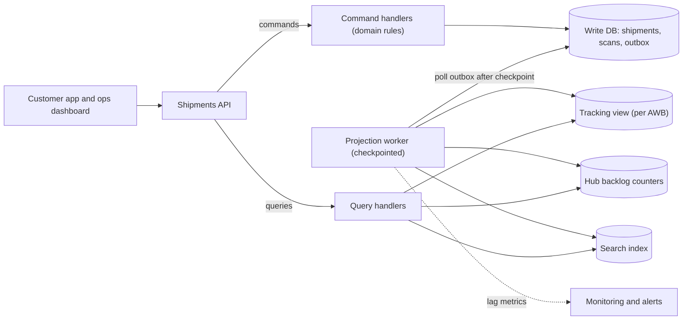
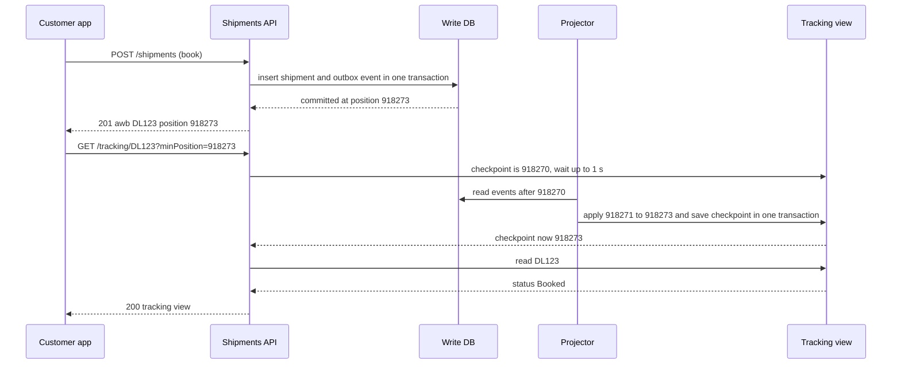

Command Query Responsibility Segregation (CQRS) sounds grand, but the core idea is simple: the shape of data that is good for *changing* things is often bad for *reading* things, so use two shapes. The hard part is not the idea. It is everything that happens between the two shapes in production: lag, ordering, duplicates, rebuilds and confused users.

## Learning objectives

By the end of this lesson you will be able to:

1. Describe four levels of CQRS, from separate query classes to asynchronous projections into another store, and pick the lowest level that solves your problem.
2. Build a projection that is idempotent, ordered and checkpointed, fed by a transactional outbox.
3. Measure projection lag in two ways (time and position) and set an alert on it.
4. Give users read-your-writes behaviour on top of an eventually consistent read model.
5. Rebuild or change a read model without downtime.
6. Explain the failure modes of CQRS and when a simpler tool — an index, a SQL view, a materialized view, a read replica or a cache — is the better choice.

## Prerequisites

- [CQRS fundamentals](#/lesson/m08-cqrs-fundamentals): commands, queries and read models at the code level.
- [Transactional outbox](#/lesson/m12-outbox): how a change and its event are saved atomically.
- [Eventual consistency](#/lesson/m12-eventual-consistency): what "the read side catches up" means for users.
- [Read replicas and replication lag](#/lesson/m09-replicas): the simplest read-scaling tool, which CQRS is often confused with.

## Explain it like I'm a beginner

Think of a busy railway parcel office.

At the **counter**, clerks book parcels. Each booking follows strict rules: weigh it, check the address, collect the fee, issue a receipt with a number. The counter's register is organised for *getting each booking right* — one careful entry at a time.

Now the **display board** in the hall shows "Parcels waiting at this station: 312 · Delayed more than a day: 17", and the **enquiry window** answers "where is parcel 8847?" in two seconds. Nobody computes those answers by flipping through the counter's register every time someone asks. Instead, a helper copies every new entry onto the board and into an index card box, organised for *answering questions fast*.

That is CQRS:

- The counter's register is the **write model** (commands: "book this", "mark scanned").
- The board and card box are **read models** (queries: "how many waiting?", "where is 8847?").
- The helper copying entries is the **projection**.

The helper is always a little behind. If you book a parcel and immediately run to the enquiry window, the card might not be in the box yet. Handling that small delay — called **lag** — is most of what "CQRS in production" means.

## First-principles explanation

### What CQRS is

Separate the model that handles **commands** (requests to change state, which must enforce rules) from the model that handles **queries** (requests to read state, which must be fast and shaped for screens). The two can differ in classes, tables, databases, and even technology.

### Why it exists — the problem

One normalised model serves writes well: no duplication, constraints in one place, small transactions. The same model serves complex reads badly:

- A tracking page joins `shipments`, `scan_events`, `hubs`, `customers` and `delivery_attempts` — five joins on the hottest endpoint.
- The operations dashboard needs "shipments delayed more than 24 hours, per hub" — an aggregation over hundreds of millions of rows, run every 30 seconds by 200 supervisors.
- Customer support needs search by phone number, partial address or invoice number — not a relational strength.

Adding indexes for every read slows writes. Denormalising the write tables makes rules harder to enforce. Reads and writes also scale differently: in our example, reads outnumber writes about 40 to 1.

### The four levels of CQRS

Most teams need only the first two. Choose the lowest level that solves the problem.

| Level | What is separated | Consistency | Cost | Use when |
|---|---|---|---|---|
| **0. Separate query code** | Command handlers use the domain model; query handlers use plain SQL or Dapper returning DTOs, same tables | Immediate | Very low | Almost always — it is just good structure |
| **1. Read tables, same transaction** | Commands also update denormalised read tables in the same database transaction | Immediate | Slower writes; more write contention | Read shape differs, write rate is modest |
| **2. Asynchronous projections** | Commands write an outbox; a projector updates read tables or another store (Redis, OpenSearch) later | Eventual (lag: milliseconds to seconds) | Projector, checkpoints, lag monitoring, rebuilds | Reads need a different store, or read updates are too costly to do inside the write transaction |
| **3. With event sourcing** | The write model *is* the event stream; every read is a projection | Eventual | Highest | You also need the history itself ([see the lesson](#/lesson/m16-event-sourcing)) |

The rest of this lesson focuses on level 2, because that is where production difficulty lives.

### Back-of-the-envelope: a courier platform

Assumptions for a national courier (estimates for the exercise):

- 2 million shipments booked per day; each gets on average 8 scan events (booked, picked up, hub in, hub out, …, delivered).
- Write events per day: 2,000,000 × 9 ≈ 18 million → 18,000,000 ÷ 86,400 ≈ **210 events/s** on average, about **600/s** at the evening peak (×3).
- Tracking reads: customers check each shipment about 6 times → 12 million per day ≈ 140/s average, with campaign-day peaks around **5,000/s**.
- Each event updates **3 read models**: tracking view, hub backlog counters, search index → 600 × 3 = **1,800 read-model updates/s** at peak.

What breaks first without CQRS? The dashboard aggregation. A "delayed per hub" query scanning recent scan events every 30 seconds for 200 supervisors is 200 ÷ 30 ≈ 7 heavy queries per second on the primary database that also takes 600 writes/s. With a read model, each supervisor reads a few hundred pre-computed rows.

**Rebuild time.** One year of history ≈ 18 M × 365 ≈ 6.6 billion events. If a rebuild processes 20,000 events/s (an estimate — measure it), that is 330,000 s ≈ **3.8 days**. That number shapes the design: you need snapshots or rebuilds from a recent baseline, not always from the beginning of time.

### Projections: the three properties that matter

A **projection** reads events (from an outbox table, a log or a broker) and updates a read model. It must be:

1. **Idempotent.** It will see some events twice (crash after updating the read model but before saving its position, broker redelivery). Applying an event twice must give the same result. The strongest technique: store the **checkpoint** (last processed position) *in the same transaction* as the read-model update. Then "update applied" and "position advanced" can never disagree.
2. **Ordered per entity.** "Delivered" must not be overwritten by a late "out for delivery". Process events in position order, or keep a per-entity version and ignore older events (as in [service boundaries](#/lesson/m16-service-boundaries)).
3. **Checkpointed and restartable.** After a crash or deploy, it resumes from its checkpoint, not from the beginning.

### Measuring lag

Two complementary measures:

- **Position lag**: `latest written position − projector checkpoint`. "The projector is 4,200 events behind." Good for capacity planning.
- **Time lag**: `now − commit time of the last event processed` (when there is a backlog). "Reads are 3.1 seconds stale." Good for user-facing SLOs.

Export both as metrics from the projector (in .NET, an `ObservableGauge` from `System.Diagnostics.Metrics`, collected by OpenTelemetry), labelled per projection. Set an objective such as "p99 time lag under 2 seconds" and alert when lag exceeds, say, 30 seconds for 5 minutes. A projector that stops silently is the most common CQRS outage: writes succeed, nothing errors, and the dashboard slowly freezes in time.

### Read-your-writes on an eventual read model

A user books a shipment and is redirected to its tracking page. If the projector is 800 ms behind, the page says "not found". Options:

1. **Return a position from the command** and let the query wait. The command returns `{ awb, position: 918273 }`; the query is called with `minPosition=918273` and waits up to, say, 1 second for the projector to pass that position; if it does not, it returns 202 "processing" (or falls back).
2. **Read from the write model for the author.** Immediately after a command, the confirmation page reads the write model directly. Everyone else reads the projection.
3. **Optimistic UI.** The client already knows what it submitted; show it locally until the read model catches up.
4. **Synchronous projection for that one view** (level 1) if the business truly needs it.

Option 1 is precise and cheap; option 3 is the best user experience; use them together.

### Rebuilding and changing read models

Read models are disposable: you can delete and rebuild them from the source of truth. This is CQRS's hidden superpower — changing a read model's shape is a code change plus a rebuild, not a risky migration. Do it **blue/green**:

1. Create `tracking_view_v2` beside `tracking_view_v1`.
2. Start a new projector instance for v2 from position 0 (or from a snapshot baseline), running alongside v1.
3. When v2's lag is near zero, switch queries to v2 (feature flag).
4. Keep v1 running for a day as rollback; then stop it and drop the table.

### Failure modes

| Failure | Symptom | Mitigation |
|---|---|---|
| Projector stopped or stuck on a poison event | Lag grows; screens show old data; no errors on writes | Lag alert; park the bad event in a dead-letter table after N failures and continue (or stop deliberately if order matters); dashboards for checkpoint position |
| Duplicate processing | Counters double-count | Checkpoint in the same transaction as the update; idempotent upserts; avoid `count = count + 1` without a dedupe key |
| Out-of-order events | Status moves backwards | Single ordered stream per entity (partition by entity id) or version checks |
| Dual write (save to DB, then publish) | Events lost on crash; read model misses changes forever | Transactional outbox or change data capture ([see the lesson](#/lesson/m16-cdc)) |
| Gaps in sequence numbers | Projector skips an event that commits late | Covered in [event sourcing](#/lesson/m16-event-sourcing): detect gaps and wait, or order by commit |
| Projection bug corrupts a read model | Wrong numbers on dashboards | Fix the code, rebuild blue/green; never hand-edit read models |
| Users confused by stale reads | "I just paid, why does it say unpaid?" | Read-your-writes techniques above; show "last updated" times |

### When NOT to use CQRS (level 2 and above)

- **CRUD screens** where the read shape equals the write shape: admin forms, master data.
- **Low read load**: a few hundred queries per second that indexes handle.
- **Strong consistency everywhere**: if every read must reflect the latest write (seat booking, stock checks), the eventual read model is the wrong source for those decisions.
- **Small team, young product**: a projector, checkpoints, lag alerts and rebuild tooling are a real ongoing cost.

**Simpler alternatives, in order of effort**: a better index or a covering index ([see the lesson](#/lesson/m09-indexes)); a SQL view; a PostgreSQL **materialized view** refreshed every minute (`REFRESH MATERIALIZED VIEW CONCURRENTLY` needs a unique index); a read replica for heavy reports; a cache in front of a hot query. Reach for asynchronous projections when these do not fit. In the [scaling journey](#/lesson/m17-scaling-journey) case study, separate read models appear only after replicas and caching have been used up, at the stage where one read shape (search, a dashboard) needs a different store; that is the typical order in real systems too.

## Visual explanation

### Architecture: write model, outbox, projector, read models



Commands flow down through handlers that enforce rules and save the shipment and an outbox row in one transaction. The projection worker reads outbox rows after its checkpoint and updates three read models, each shaped for one kind of question: a per-shipment tracking document, per-hub counters for the dashboard, and a search index for support. Queries never touch the write tables. The projector reports its lag to monitoring, because a stopped projector produces no errors anywhere else.

### Sequence: a command followed by a read-your-writes query



The booking command commits the shipment and its event together and returns the event's position. The app immediately asks for tracking with `minPosition`. The read model is three events behind, so the query handler waits (up to one second) instead of answering "not found". The projector applies the missing events and advances its checkpoint *in the same transaction*, which wakes the waiting query. Without the position, the user would have seen a confusing 404 for a shipment they just booked.

## Step-by-step example

We grow the courier platform's tracking feature through the levels.

### Step 1 — level 0: separate query code

Command handlers load the `Shipment` aggregate and enforce rules. Tracking is a query handler with one SQL statement returning a DTO. Same tables. This alone makes the code clearer and lets you tune the SQL without touching the domain model.

### Step 2 — the query gets expensive

The tracking query joins five tables and sorts scan events. At 140 reads/s it is fine; on campaign days at 5,000 reads/s, the primary's CPU sits at 85 %. First try the simple tools: a covering index on `scan_events (awb, scanned_at)` and a 30-second cache for tracking responses. That buys months.

### Step 3 — the dashboard needs a different shape

"Delayed per hub" cannot be served by an index; it is an aggregation that changes with every scan. A materialized view refreshed every minute works at first. When the refresh takes 40 seconds and blocks, the team moves to level 2: a projector maintains `hub_backlog` counters incrementally.

### Step 4 — make the projector production-grade

- Outbox written in the command's transaction.
- Projector polls in batches of 500, applies them to all read models and saves the checkpoint in one transaction.
- Lag metrics exported; alert at 30 seconds for 5 minutes.
- Commands return positions; tracking queries accept `minPosition`.

### Step 5 — change the read model safely

Product wants "expected delivery date" on the tracking page. Add it to `tracking_view_v2`, rebuild blue/green from the last 90 days of events (older shipments are delivered and archived), switch with a flag.

## Production-style C# implementation

The implementation shows a level-2 CQRS slice: an aggregate with rules, an atomic "save state plus outbox" store, a projector that applies events and checkpoints atomically, a background worker that drives it, lag tracking with read-your-writes waiting, and the endpoints. Stores are in memory (behind interfaces) so the code compiles anywhere; the PostgreSQL shape is shown in comments and SQL.

```text
Courier.Api/
  Program.cs
  Write/Shipment.cs
  Write/WriteStore.cs
  Write/CommandHandlers.cs
  Read/ReadModels.cs
  Read/Projector.cs
  Read/ProjectionStatus.cs
  Read/ProjectionWorker.cs
```

```csharp file=Write/Shipment.cs
namespace Courier.Write;

public enum ShipmentStatus { Booked, InTransit, OutForDelivery, Delivered }

/// <summary>Events are the contract between the write side and every read model.</summary>
public abstract record ShipmentEvent(string Awb, DateTimeOffset At);
public sealed record ShipmentBooked(string Awb, DateTimeOffset At, string OriginHub, string DestinationPincode) : ShipmentEvent(Awb, At);
public sealed record ShipmentScanned(string Awb, DateTimeOffset At, string Hub, ShipmentStatus NewStatus) : ShipmentEvent(Awb, At);

/// <summary>Write model: small, normalised, focused on rules.</summary>
public sealed class Shipment
{
    private readonly List<ShipmentEvent> _pending = new();
    public string Awb { get; }
    public ShipmentStatus Status { get; private set; }
    public string CurrentHub { get; private set; }
    public IReadOnlyList<ShipmentEvent> PendingEvents => _pending;

    private Shipment(string awb, string hub) { Awb = awb; CurrentHub = hub; Status = ShipmentStatus.Booked; }

    public static Shipment Book(string awb, string originHub, string destinationPincode, DateTimeOffset now)
    {
        if (string.IsNullOrWhiteSpace(awb)) throw new ArgumentException("AWB is required.", nameof(awb));
        if (destinationPincode.Length != 6 || !destinationPincode.All(char.IsAsciiDigit))
            throw new ArgumentException("Destination pincode must be 6 digits.", nameof(destinationPincode));
        var s = new Shipment(awb, originHub);
        s._pending.Add(new ShipmentBooked(awb, now, originHub, destinationPincode));
        return s;
    }

    public void RecordScan(string hub, ShipmentStatus newStatus, DateTimeOffset now)
    {
        if (Status == ShipmentStatus.Delivered)
            throw new InvalidOperationException($"{Awb} is already delivered; no further scans allowed.");
        if (newStatus < Status)
            throw new InvalidOperationException($"{Awb} cannot move from {Status} back to {newStatus}.");
        Status = newStatus;
        CurrentHub = hub;
        _pending.Add(new ShipmentScanned(Awb, now, hub, newStatus));
    }

    public void ClearPending() => _pending.Clear();

    internal static Shipment Restore(string awb, ShipmentStatus status, string hub) => new(awb, hub) { Status = status };
}
```

```csharp file=Write/WriteStore.cs
namespace Courier.Write;

/// <summary>An outbox row: an event plus its position in the global commit order.</summary>
public sealed record OutboxEntry(long Position, ShipmentEvent Event, DateTimeOffset CommittedAt);

public interface IShipmentWriteStore
{
    Task<Shipment?> LoadAsync(string awb, CancellationToken ct);

    /// <summary>Saves the shipment and appends its pending events to the outbox atomically. Returns the last position.</summary>
    Task<long> SaveAsync(Shipment shipment, bool isNew, CancellationToken ct);

    Task<IReadOnlyList<OutboxEntry>> ReadOutboxAfterAsync(long position, int max, CancellationToken ct);
    long LatestPosition { get; }
}

/// <summary>
/// In-memory stand-in. In PostgreSQL, SaveAsync is one transaction:
///   UPDATE shipments ...; INSERT INTO outbox (event_type, payload, committed_at) VALUES (...);
/// A lock serialises commits here so positions are assigned in commit order — the property
/// a real projector depends on (see the event sourcing lesson for how to get it in PostgreSQL).
/// </summary>
public sealed class InMemoryShipmentWriteStore(TimeProvider clock) : IShipmentWriteStore
{
    private readonly object _gate = new();
    private readonly Dictionary<string, (ShipmentStatus Status, string Hub)> _rows = new(StringComparer.Ordinal);
    private readonly List<OutboxEntry> _outbox = new();

    public long LatestPosition { get { lock (_gate) return _outbox.Count; } }

    public Task<Shipment?> LoadAsync(string awb, CancellationToken ct)
    {
        lock (_gate)
            return Task.FromResult(_rows.TryGetValue(awb, out var r) ? Shipment.Restore(awb, r.Status, r.Hub) : null);
    }

    public Task<long> SaveAsync(Shipment shipment, bool isNew, CancellationToken ct)
    {
        lock (_gate)
        {
            if (isNew && _rows.ContainsKey(shipment.Awb))
                throw new InvalidOperationException($"Shipment {shipment.Awb} already exists.");
            _rows[shipment.Awb] = (shipment.Status, shipment.CurrentHub);
            var now = clock.GetUtcNow();
            foreach (var e in shipment.PendingEvents)
                _outbox.Add(new OutboxEntry(_outbox.Count + 1, e, now));
            shipment.ClearPending();
            return Task.FromResult((long)_outbox.Count);
        }
    }

    public Task<IReadOnlyList<OutboxEntry>> ReadOutboxAfterAsync(long position, int max, CancellationToken ct)
    {
        lock (_gate)
            return Task.FromResult<IReadOnlyList<OutboxEntry>>(_outbox.Skip((int)position).Take(max).ToList());
    }
}
```

```csharp file=Write/CommandHandlers.cs
namespace Courier.Write;

public sealed record BookShipment(string Awb, string OriginHub, string DestinationPincode);
public sealed record RecordScan(string Awb, string Hub, ShipmentStatus NewStatus);

/// <summary>Every command returns the position of its last event so callers can ask for read-your-writes.</summary>
public sealed record CommandResult(string Awb, long Position);

public sealed class ShipmentCommandHandlers(IShipmentWriteStore store, TimeProvider clock)
{
    public async Task<CommandResult> HandleAsync(BookShipment cmd, CancellationToken ct)
    {
        var shipment = Shipment.Book(cmd.Awb, cmd.OriginHub, cmd.DestinationPincode, clock.GetUtcNow());
        return new CommandResult(cmd.Awb, await store.SaveAsync(shipment, isNew: true, ct));
    }

    public async Task<CommandResult> HandleAsync(RecordScan cmd, CancellationToken ct)
    {
        var shipment = await store.LoadAsync(cmd.Awb, ct)
                       ?? throw new KeyNotFoundException($"Shipment {cmd.Awb} not found.");
        shipment.RecordScan(cmd.Hub, cmd.NewStatus, clock.GetUtcNow());
        return new CommandResult(cmd.Awb, await store.SaveAsync(shipment, isNew: false, ct));
    }
}
```

```csharp file=Read/ReadModels.cs
using System.Collections.Concurrent;
using Courier.Write;

namespace Courier.Read;

/// <summary>Shaped for the tracking page: one document per AWB, timeline included, no joins at read time.</summary>
public sealed record TrackingView(string Awb, string Status, string CurrentHub, string DestinationPincode,
    IReadOnlyList<TrackingStep> Timeline, long Version);
public sealed record TrackingStep(DateTimeOffset At, string Hub, string Status);

/// <summary>Shaped for the ops dashboard: counts per hub and status.</summary>
public sealed record HubBacklogRow(string Hub, ShipmentStatus Status, int Count);

/// <summary>
/// All read models plus the projector's checkpoint, updated together. In PostgreSQL this is one
/// transaction: upsert tracking_view, update hub_backlog, UPDATE projection_checkpoint SET position = $n.
/// </summary>
public interface IReadModelStore
{
    long Checkpoint { get; }
    TrackingView? FindTracking(string awb);
    IReadOnlyList<HubBacklogRow> Backlog(string hub);
    void Commit(IReadOnlyList<TrackingView> tracking, IReadOnlyList<(string Hub, ShipmentStatus Status, int Delta)> backlogDeltas, long newCheckpoint);
}

public sealed class InMemoryReadModelStore : IReadModelStore
{
    private readonly object _gate = new();
    private readonly ConcurrentDictionary<string, TrackingView> _tracking = new(StringComparer.Ordinal);
    private readonly Dictionary<(string Hub, ShipmentStatus Status), int> _backlog = new();
    private long _checkpoint;

    public long Checkpoint => Interlocked.Read(ref _checkpoint);
    public TrackingView? FindTracking(string awb) => _tracking.TryGetValue(awb, out var v) ? v : null;

    public IReadOnlyList<HubBacklogRow> Backlog(string hub)
    {
        lock (_gate)
            return _backlog.Where(kv => kv.Key.Hub == hub && kv.Value > 0)
                           .Select(kv => new HubBacklogRow(kv.Key.Hub, kv.Key.Status, kv.Value))
                           .OrderBy(r => r.Status).ToList();
    }

    public void Commit(IReadOnlyList<TrackingView> tracking, IReadOnlyList<(string Hub, ShipmentStatus Status, int Delta)> deltas, long newCheckpoint)
    {
        lock (_gate)
        {
            if (newCheckpoint <= _checkpoint) return;   // a batch we already applied: idempotent no-op
            foreach (var t in tracking) _tracking[t.Awb] = t;
            foreach (var (hub, status, delta) in deltas)
                _backlog[(hub, status)] = _backlog.GetValueOrDefault((hub, status)) + delta;
            Interlocked.Exchange(ref _checkpoint, newCheckpoint);
        }
    }
}
```

```csharp file=Read/Projector.cs
using Courier.Write;

namespace Courier.Read;

/// <summary>
/// Pure projection logic: given a batch of outbox entries after the checkpoint, compute the new
/// read-model state and commit it with the new checkpoint in one step.
/// </summary>
public sealed class ShipmentProjector(IReadModelStore store)
{
    public int Apply(IReadOnlyList<OutboxEntry> batch)
    {
        var fresh = batch.Where(e => e.Position > store.Checkpoint).OrderBy(e => e.Position).ToList();
        if (fresh.Count == 0) return 0;

        var views = new Dictionary<string, TrackingView>(StringComparer.Ordinal);
        var deltas = new List<(string Hub, ShipmentStatus Status, int Delta)>();

        foreach (var entry in fresh)
        {
            var current = views.GetValueOrDefault(entry.Event.Awb) ?? store.FindTracking(entry.Event.Awb);
            switch (entry.Event)
            {
                case ShipmentBooked b:
                    if (current is not null) break;   // already projected (e.g. from an earlier rebuild)
                    views[b.Awb] = new TrackingView(b.Awb, nameof(ShipmentStatus.Booked), b.OriginHub, b.DestinationPincode,
                        [new TrackingStep(b.At, b.OriginHub, nameof(ShipmentStatus.Booked))], entry.Position);
                    deltas.Add((b.OriginHub, ShipmentStatus.Booked, +1));
                    break;

                case ShipmentScanned s when current is not null && entry.Position > current.Version:
                    var oldStatus = Enum.Parse<ShipmentStatus>(current.Status);
                    deltas.Add((current.CurrentHub, oldStatus, -1));
                    if (s.NewStatus != ShipmentStatus.Delivered) deltas.Add((s.Hub, s.NewStatus, +1));
                    views[s.Awb] = current with
                    {
                        Status = s.NewStatus.ToString(),
                        CurrentHub = s.Hub,
                        Timeline = [.. current.Timeline, new TrackingStep(s.At, s.Hub, s.NewStatus.ToString())],
                        Version = entry.Position,
                    };
                    break;
            }
        }

        store.Commit(views.Values.ToList(), deltas, fresh[^1].Position);
        return fresh.Count;
    }
}
```

```csharp file=Read/ProjectionStatus.cs
namespace Courier.Read;

/// <summary>Tracks lag and lets queries wait (briefly) for a position: read-your-writes.</summary>
public sealed class ProjectionStatus(IReadModelStore store, TimeProvider clock)
{
    private readonly object _gate = new();
    private readonly List<(long Position, TaskCompletionSource Signal)> _waiters = new();
    private DateTimeOffset? _lastAppliedCommitTime;

    public long Checkpoint => store.Checkpoint;

    public TimeSpan TimeLag(long latestPosition)
    {
        if (store.Checkpoint >= latestPosition) return TimeSpan.Zero;
        return _lastAppliedCommitTime is { } t ? clock.GetUtcNow() - t : TimeSpan.MaxValue;
    }

    public void Advanced(DateTimeOffset lastAppliedCommitTime)
    {
        List<TaskCompletionSource> ready;
        lock (_gate)
        {
            _lastAppliedCommitTime = lastAppliedCommitTime;
            var cp = store.Checkpoint;
            ready = _waiters.Where(w => w.Position <= cp).Select(w => w.Signal).ToList();
            _waiters.RemoveAll(w => w.Position <= cp);
        }
        foreach (var s in ready) s.TrySetResult();
    }

    /// <summary>True if the read model reached <paramref name="position"/> within the timeout.</summary>
    public async Task<bool> WaitForAsync(long position, TimeSpan timeout, CancellationToken ct)
    {
        TaskCompletionSource signal;
        lock (_gate)
        {
            if (store.Checkpoint >= position) return true;
            signal = new TaskCompletionSource(TaskCreationOptions.RunContinuationsAsynchronously);
            _waiters.Add((position, signal));
        }
        var finished = await Task.WhenAny(signal.Task, Task.Delay(timeout, clock, ct));
        if (finished != signal.Task) lock (_gate) _waiters.RemoveAll(w => w.Signal == signal);
        return store.Checkpoint >= position;
    }
}
```

```csharp file=Read/ProjectionWorker.cs
using Courier.Write;
using Microsoft.Extensions.Hosting;
using Microsoft.Extensions.Logging;

namespace Courier.Read;

/// <summary>Polls the outbox after the checkpoint and applies batches. One instance per read-model set
/// (use a database advisory lock or a single-replica deployment so two workers never race).</summary>
public sealed class ProjectionWorker(IShipmentWriteStore writes, ShipmentProjector projector, IReadModelStore reads,
    ProjectionStatus status, ILogger<ProjectionWorker> logger) : BackgroundService
{
    private const int BatchSize = 500;
    private static readonly TimeSpan IdleDelay = TimeSpan.FromMilliseconds(100);

    protected override async Task ExecuteAsync(CancellationToken stoppingToken)
    {
        var failures = 0;
        while (!stoppingToken.IsCancellationRequested)
        {
            try
            {
                var batch = await writes.ReadOutboxAfterAsync(reads.Checkpoint, BatchSize, stoppingToken);
                if (batch.Count == 0) { await Task.Delay(IdleDelay, stoppingToken); continue; }
                projector.Apply(batch);
                status.Advanced(batch[^1].CommittedAt);
                failures = 0;
            }
            catch (OperationCanceledException) when (stoppingToken.IsCancellationRequested) { break; }
            catch (Exception ex)
            {
                // Same batch will be retried: the checkpoint did not move. After repeated failures a real
                // system parks the poison event in a dead-letter table and alerts.
                failures++;
                logger.LogError(ex, "Projection batch failed at checkpoint {Checkpoint} (attempt {Attempt})", reads.Checkpoint, failures);
                await Task.Delay(TimeSpan.FromSeconds(Math.Min(30, Math.Pow(2, failures))), stoppingToken);
            }
        }
    }
}
```

```csharp file=Program.cs
using Courier.Read;
using Courier.Write;

var builder = WebApplication.CreateBuilder(args);

builder.Services.AddSingleton(TimeProvider.System);
builder.Services.AddSingleton<IShipmentWriteStore, InMemoryShipmentWriteStore>();
builder.Services.AddSingleton<ShipmentCommandHandlers>();
builder.Services.AddSingleton<IReadModelStore, InMemoryReadModelStore>();
builder.Services.AddSingleton<ShipmentProjector>();
builder.Services.AddSingleton<ProjectionStatus>();
builder.Services.AddHostedService<ProjectionWorker>();

var app = builder.Build();

// ---- Commands ----
app.MapPost("/shipments", async (BookShipment cmd, ShipmentCommandHandlers h, CancellationToken ct) =>
{
    try
    {
        var r = await h.HandleAsync(cmd, ct);
        return Results.Created($"/tracking/{r.Awb}?minPosition={r.Position}", r);
    }
    catch (ArgumentException ex) { return Results.Problem(ex.Message, statusCode: 400); }
    catch (InvalidOperationException ex) { return Results.Problem(ex.Message, statusCode: 409); }
});

app.MapPost("/shipments/{awb}/scans", async (string awb, ScanBody body, ShipmentCommandHandlers h, CancellationToken ct) =>
{
    try { return Results.Ok(await h.HandleAsync(new RecordScan(awb, body.Hub, body.Status), ct)); }
    catch (KeyNotFoundException ex) { return Results.Problem(ex.Message, statusCode: 404); }
    catch (InvalidOperationException ex) { return Results.Problem(ex.Message, statusCode: 409); }
});

// ---- Queries ----
app.MapGet("/tracking/{awb}", async (string awb, long? minPosition, HttpContext http, IReadModelStore reads,
    ProjectionStatus status, IShipmentWriteStore writes, CancellationToken ct) =>
{
    if (minPosition is { } p && !await status.WaitForAsync(p, TimeSpan.FromSeconds(1), ct))
        return Results.Accepted(value: new { awb, message = "Your update is being processed. Refresh in a moment." });

    http.Response.Headers["X-Read-Model-Position"] = status.Checkpoint.ToString();
    var lag = status.TimeLag(writes.LatestPosition);
    http.Response.Headers["X-Read-Model-Lag-Ms"] = lag == TimeSpan.MaxValue ? "unknown" : ((long)lag.TotalMilliseconds).ToString();
    return reads.FindTracking(awb) is { } view ? Results.Ok(view) : Results.NotFound();
});

app.MapGet("/ops/hubs/{hub}/backlog", (string hub, IReadModelStore reads) => Results.Ok(reads.Backlog(hub)));

app.MapGet("/ops/projection", (ProjectionStatus status, IShipmentWriteStore writes) => Results.Ok(new
{
    checkpoint = status.Checkpoint,
    latest = writes.LatestPosition,
    positionLag = writes.LatestPosition - status.Checkpoint,
}));

app.Run();

public sealed record ScanBody(string Hub, ShipmentStatus Status);
```

The PostgreSQL shape of the read side, with the checkpoint in the same transaction as the updates:

```sql
BEGIN;
INSERT INTO read.tracking_view (awb, status, current_hub, destination_pincode, timeline, version)
VALUES ($1, $2, $3, $4, $5::jsonb, $6)
ON CONFLICT (awb) DO UPDATE SET status = EXCLUDED.status, current_hub = EXCLUDED.current_hub,
  timeline = EXCLUDED.timeline, version = EXCLUDED.version
WHERE read.tracking_view.version < EXCLUDED.version;

INSERT INTO read.hub_backlog (hub, status, count) VALUES ($7, $8, $9)
ON CONFLICT (hub, status) DO UPDATE SET count = read.hub_backlog.count + EXCLUDED.count;

UPDATE read.projection_checkpoint SET position = $10, updated_at = now()
WHERE projection = 'shipments-v1' AND position < $10;   -- 0 rows → someone else already applied it: ROLLBACK
COMMIT;
```

**Design notes**

- The backlog counters use deltas, which are *not* naturally idempotent. They are safe only because the checkpoint update is in the same transaction and guarded by `position < $10`. Remove that guard and a retried batch double-counts.
- The projector is pure logic over a batch; the worker handles polling, retries and backoff. That split makes the projector trivially testable.
- Queries expose `X-Read-Model-Position` and lag headers. Support staff and client developers can see staleness instead of guessing.

## Bad design vs good design

**Bad: dual write and a fire-and-forget projector.**

```csharp
await db.SaveShipmentAsync(shipment);              // 1. commit
await broker.PublishAsync(new ShipmentScanned(...)); // 2. publish — crash between 1 and 2 loses the event forever

// projector
broker.Subscribe<ShipmentScanned>(async e =>
{
    await readDb.ExecuteAsync("UPDATE hub_backlog SET count = count + 1 WHERE hub = @hub", e);  // redelivery double-counts
});
```

Problems: a crash between commit and publish leaves the read model permanently wrong; at-least-once delivery double-counts the backlog; there is no position, so no lag metric, no read-your-writes, and no way to rebuild from a known point.

**Good:** the event is written to an outbox in the same transaction as the change; the projector reads by position, applies a batch, and saves its checkpoint in the same transaction as the read-model update; lag is measured from positions and commit times; rebuilds start a new projector at position 0 into a new table.

:::callout type=tradeoff title="Level 1 is underrated"
If your write rate is modest (say a few hundred per second) and read models live in the same PostgreSQL database, updating them in the command's transaction (level 1) gives you separate read shapes with **zero lag** and no projector to operate. You pay with slightly slower writes and more lock contention on hot read rows (like per-hub counters). Move to asynchronous projections when that cost shows up in measurements, not before.
:::

:::callout type=mistake title="Using the read model to make decisions"
Never check "is this shipment already delivered?" against the read model before accepting a command. The read model may be stale. Rules are enforced by the write model only; the read model is for showing.
:::

## Practical playground

The database below is a small write model for the courier platform. Try three read-side approaches and compare them:

1. A plain query for the dashboard ("shipments not yet delivered per hub, based on each shipment's latest scan").
2. A `MATERIALIZED VIEW` with the same query, then `REFRESH MATERIALIZED VIEW` after inserting a new scan, and notice the view is stale until refreshed.
3. A unique index on the view, so `REFRESH MATERIALIZED VIEW CONCURRENTLY` can run without blocking readers.

:::playground type=sql title="Read models: query, materialized view, refresh"
```sql
CREATE TABLE shipment (
  awb text PRIMARY KEY,
  origin_hub text NOT NULL,
  booked_at timestamptz NOT NULL
);
CREATE TABLE scan_event (
  position bigint PRIMARY KEY,
  awb text NOT NULL REFERENCES shipment(awb),
  hub text NOT NULL,
  status text NOT NULL,
  scanned_at timestamptz NOT NULL
);
INSERT INTO shipment VALUES
  ('DL1001','DEL-HUB','2026-10-17 08:00+00'),
  ('DL1002','DEL-HUB','2026-10-17 09:00+00'),
  ('MH2001','BOM-HUB','2026-10-18 10:00+00'),
  ('MH2002','BOM-HUB','2026-10-18 11:00+00'),
  ('KA3001','BLR-HUB','2026-10-18 12:00+00');
INSERT INTO scan_event VALUES
  (1,'DL1001','DEL-HUB','Booked','2026-10-17 08:00+00'),
  (2,'DL1002','DEL-HUB','Booked','2026-10-17 09:00+00'),
  (3,'DL1001','JAI-HUB','InTransit','2026-10-17 20:00+00'),
  (4,'MH2001','BOM-HUB','Booked','2026-10-18 10:00+00'),
  (5,'MH2002','BOM-HUB','Booked','2026-10-18 11:00+00'),
  (6,'DL1001','JAI-HUB','OutForDelivery','2026-10-18 07:00+00'),
  (7,'KA3001','BLR-HUB','Booked','2026-10-18 12:00+00'),
  (8,'DL1001','JAI-HUB','Delivered','2026-10-18 13:00+00'),
  (9,'MH2001','PNQ-HUB','InTransit','2026-10-18 22:00+00');
-- Latest scan per shipment, then count the undelivered ones per hub
SELECT hub, COUNT(*) AS waiting
FROM (SELECT DISTINCT ON (awb) awb, hub, status FROM scan_event ORDER BY awb, position DESC) latest
WHERE status <> 'Delivered'
GROUP BY hub ORDER BY hub;
```
:::

## Exercises

:::exercise id=m16-cqrs-ex1 difficulty=beginner kind=written title="CQRS or something simpler?"
For each scenario, recommend: no CQRS beyond separate query code (level 0), level 1, level 2, or a simpler tool (index, view, materialized view, replica, cache). Justify with the numbers given.

1. An HR admin screen to edit employee master data. 30 users, 2 requests per second.
2. A stock exchange-style order book where traders must see their order the instant it is accepted. 5,000 writes per second.
3. A hospital's monthly bed-occupancy report, run by 5 managers, taking 40 seconds on the primary database.
4. A food-delivery app's restaurant search: 12,000 reads per second, full-text and geo filters, menu changes 50 times per second.
5. A gym chain's membership system where the "member billing summary" page joins 6 tables (member, plan, invoices, payments, freezes, add-ons), 80 reads per second, 10 writes per second.
::acceptance
- Each scenario has a level or a tool, with a reason tied to the numbers.
- At least one scenario is answered with "no CQRS needed".
- The answer recognises where stale reads are unacceptable.
::hint
Ask first: does the read *shape* differ from the write shape? Then: is the read *volume* a problem? Then: is staleness acceptable?
::hint
Monthly reports that are slow but rare usually need a replica or a materialized view, not a projector.
::hint
Full-text and geo search are hard in a relational write model. Which store is designed for them?
::solution
1. **Level 0 / plain CRUD.** Read shape equals write shape, trivial load. CQRS would add cost for nothing.
2. **Not eventual CQRS for the trader's own view.** The trader must see the accepted order immediately: serve it from the write model's response (the command returns the accepted order), and use push updates. Market-wide views (depth, last trades) can be fast projections, but decisions are made on the write side.
3. **Read replica or materialized view.** 5 users and a 40-second query: move it off the primary to a replica, or precompute nightly. A projector is overkill.
4. **Level 2.** Different store (a search engine with geo support), high read volume, and menu changes that can tolerate a second or two of staleness. Projector from an outbox or CDC into the search index, with lag alerts.
5. **Level 0 first, then level 1 if needed.** 80 reads/s across 6 joins is usually solvable with indexes or a SQL view. If the summary must be precomputed, update a summary table in the same transaction (10 writes/s is low), giving zero lag.
::mistakes
- Recommending level 2 for every "slow query" without trying an index or replica.
- Ignoring that the trader's own order must be visible immediately.
:::

:::exercise id=m16-cqrs-ex2 difficulty=beginner kind=code title="An idempotent tracking projection"
Implement a projection that builds per-shipment tracking views from positioned events. It will receive duplicates and replays, so it must be idempotent.
::requirements
- Events: `Booked(Awb, Hub)` and `Scanned(Awb, Hub, Status)`, each wrapped in `Positioned(long Position, object Event)`.
- `Apply` ignores any event whose position is `<=` the projection's checkpoint, and returns how many events it applied.
- `Booked` creates a view with status `"Booked"` and one timeline entry (the hub). A `Scanned` for an unknown AWB is skipped (but still advances the checkpoint).
- `Scanned` sets the status and current hub and appends the hub to the timeline.
- `Checkpoint` is the highest applied position.
::acceptance
- Applying the same batch twice gives the same views and returns 0 the second time.
- Timeline order matches position order.
- Unknown AWBs do not throw.
::hint
Sort the batch by position and filter `Position > Checkpoint` first.
::hint
Use a `Dictionary<string, TrackingView>`; records with `with` expressions keep updates tidy.
::hint
Advance `Checkpoint` for every event you examine after filtering, including skipped ones — otherwise you will re-examine them forever.
::hint
```csharp
foreach (var p in batch.Where(p => p.Position > Checkpoint).OrderBy(p => p.Position)) { ... Checkpoint = p.Position; }
```
::starter
```csharp file=TrackingProjection.cs
using System;
using System.Collections.Generic;
using System.Linq;

public sealed record Booked(string Awb, string Hub);
public sealed record Scanned(string Awb, string Hub, string Status);
public sealed record Positioned(long Position, object Event);
public sealed record TrackingView(string Awb, string Status, string CurrentHub, IReadOnlyList<string> Timeline);

public sealed class TrackingProjection
{
    public long Checkpoint { get; private set; }
    public IReadOnlyDictionary<string, TrackingView> Views => throw new NotImplementedException();
    public int Apply(IEnumerable<Positioned> batch) => throw new NotImplementedException();
}
```
::tests
```csharp file=TrackingProjectionTests.cs
using System.Linq;
using Xunit;

public class TrackingProjectionTests
{
    private static Positioned[] Batch() => new[]
    {
        new Positioned(1, new Booked("DL1", "DEL")),
        new Positioned(3, new Scanned("DL1", "JAI", "InTransit")),
        new Positioned(2, new Booked("DL2", "DEL")),
        new Positioned(4, new Scanned("DL1", "JAI", "Delivered")),
    };

    [Fact]
    public void Builds_views_in_position_order()
    {
        var p = new TrackingProjection();
        Assert.Equal(4, p.Apply(Batch()));
        var v = p.Views["DL1"];
        Assert.Equal("Delivered", v.Status);
        Assert.Equal("JAI", v.CurrentHub);
        Assert.Equal(new[] { "DEL", "JAI", "JAI" }, v.Timeline.ToArray());
        Assert.Equal("Booked", p.Views["DL2"].Status);
        Assert.Equal(4, p.Checkpoint);
    }

    [Fact]
    public void Replaying_is_a_no_op()
    {
        var p = new TrackingProjection();
        p.Apply(Batch());
        Assert.Equal(0, p.Apply(Batch()));
        Assert.Equal(3, p.Views["DL1"].Timeline.Count);
    }

    [Fact]
    public void Overlapping_batch_applies_only_new_events()
    {
        var p = new TrackingProjection();
        p.Apply(Batch().OrderBy(e => e.Position).Take(2));   // positions 1 and 2: batches are contiguous prefixes
        Assert.Equal(2, p.Apply(Batch()));
        Assert.Equal("Delivered", p.Views["DL1"].Status);
    }

    [Fact]
    public void Unknown_awb_is_skipped_but_checkpoint_moves()
    {
        var p = new TrackingProjection();
        p.Apply(new[] { new Positioned(7, new Scanned("XX9", "BOM", "InTransit")) });
        Assert.Empty(p.Views);
        Assert.Equal(7, p.Checkpoint);
    }
}
```
::solution
```csharp file=TrackingProjection.cs
using System;
using System.Collections.Generic;
using System.Linq;

public sealed record Booked(string Awb, string Hub);
public sealed record Scanned(string Awb, string Hub, string Status);
public sealed record Positioned(long Position, object Event);
public sealed record TrackingView(string Awb, string Status, string CurrentHub, IReadOnlyList<string> Timeline);

public sealed class TrackingProjection
{
    private readonly Dictionary<string, TrackingView> _views = new(StringComparer.Ordinal);

    public long Checkpoint { get; private set; }
    public IReadOnlyDictionary<string, TrackingView> Views => _views;

    public int Apply(IEnumerable<Positioned> batch)
    {
        ArgumentNullException.ThrowIfNull(batch);
        var applied = 0;
        foreach (var p in batch.Where(p => p.Position > Checkpoint).OrderBy(p => p.Position).ToList())
        {
            switch (p.Event)
            {
                case Booked b when !_views.ContainsKey(b.Awb):
                    _views[b.Awb] = new TrackingView(b.Awb, "Booked", b.Hub, new[] { b.Hub });
                    break;
                case Scanned s when _views.TryGetValue(s.Awb, out var v):
                    _views[s.Awb] = v with { Status = s.Status, CurrentHub = s.Hub, Timeline = v.Timeline.Append(s.Hub).ToArray() };
                    break;
            }
            Checkpoint = p.Position;
            applied++;
        }
        return applied;
    }
}
```
"Applied" counts events examined after the checkpoint filter, including skipped ones — they are processed, just with no effect. In a database, `_views` and `Checkpoint` are saved in the same transaction; that is what makes the replay safe after a crash.
::mistakes
- Filtering by checkpoint but not sorting, so a batch delivered out of order corrupts the timeline.
- Not advancing the checkpoint for skipped events.
- Feeding a batch with a hole in it (positions 1 and 3). The checkpoint jumps to 3, and position 2 is silently skipped when it arrives. Batches must be contiguous ranges read in position order — the same "gap" problem the event sourcing lesson covers.
- Appending to a shared mutable list inside the record, so earlier "versions" change too.
:::

:::exercise id=m16-cqrs-ex3 difficulty=intermediate kind=code title="Read-your-writes consistency gate"
Implement the gate a query handler uses to wait until the read model has caught up to a position returned by a command.
::requirements
- `Advance(long position)` is called by the projector after each committed batch. Positions only move forward; a lower value is ignored.
- `WaitAsync(long position, TimeSpan timeout, CancellationToken ct)` returns `true` immediately if the checkpoint is already at or past `position`; otherwise waits until it is (→ `true`) or until the timeout (→ `false`).
- Many waiters for different positions can wait at once; `Advance` releases exactly those whose position has been reached.
- Caller cancellation throws `OperationCanceledException`.
- Waiters that time out must be removed (no leak).
::acceptance
- A waiter for position 10 is released by `Advance(10)` and not by `Advance(9)`.
- A waiter times out and returns false; `PendingWaiters` returns to 0.
- `Advance(5)` after `Advance(8)` does not move the checkpoint backwards.
::hint
Keep a list of `(position, TaskCompletionSource<bool>)` guarded by a lock.
::hint
Create the TCS with `TaskCreationOptions.RunContinuationsAsynchronously`, so `Advance` does not run waiting code on the projector's thread.
::hint
`await Task.WhenAny(tcs.Task, Task.Delay(timeout, ct))` then remove the waiter if it was not signalled.
::hint
Check the checkpoint *inside* the lock both before adding a waiter and in `Advance`, otherwise a waiter added just after an `Advance` can miss its signal.
::starter
```csharp file=ConsistencyGate.cs
using System;
using System.Collections.Generic;
using System.Threading;
using System.Threading.Tasks;

public sealed class ConsistencyGate
{
    public long Checkpoint => throw new NotImplementedException();
    public int PendingWaiters => throw new NotImplementedException();
    public void Advance(long position) => throw new NotImplementedException();
    public Task<bool> WaitAsync(long position, TimeSpan timeout, CancellationToken ct) => throw new NotImplementedException();
}
```
::tests
```csharp file=ConsistencyGateTests.cs
using System;
using System.Threading;
using System.Threading.Tasks;
using Xunit;

public class ConsistencyGateTests
{
    [Fact]
    public async Task Already_reached_returns_true_immediately()
    {
        var g = new ConsistencyGate();
        g.Advance(10);
        Assert.True(await g.WaitAsync(7, TimeSpan.FromMilliseconds(10), CancellationToken.None));
    }

    [Fact]
    public async Task Released_only_when_position_reached()
    {
        var g = new ConsistencyGate();
        var wait = g.WaitAsync(10, TimeSpan.FromSeconds(10), CancellationToken.None);
        g.Advance(9);
        await Task.Delay(50);
        Assert.False(wait.IsCompleted);
        g.Advance(10);
        Assert.True(await wait);
        Assert.Equal(0, g.PendingWaiters);
    }

    [Fact]
    public async Task Times_out_and_cleans_up()
    {
        var g = new ConsistencyGate();
        Assert.False(await g.WaitAsync(5, TimeSpan.FromMilliseconds(80), CancellationToken.None));
        Assert.Equal(0, g.PendingWaiters);
    }

    [Fact]
    public async Task Releases_the_right_waiters()
    {
        var g = new ConsistencyGate();
        var w5 = g.WaitAsync(5, TimeSpan.FromSeconds(10), CancellationToken.None);
        var w20 = g.WaitAsync(20, TimeSpan.FromSeconds(10), CancellationToken.None);
        g.Advance(6);
        Assert.True(await w5);
        Assert.False(w20.IsCompleted);
        Assert.Equal(1, g.PendingWaiters);
        g.Advance(25);
        Assert.True(await w20);
    }

    [Fact]
    public void Checkpoint_never_moves_backwards()
    {
        var g = new ConsistencyGate();
        g.Advance(8);
        g.Advance(5);
        Assert.Equal(8, g.Checkpoint);
    }

    [Fact]
    public async Task Cancellation_throws()
    {
        var g = new ConsistencyGate();
        using var cts = new CancellationTokenSource(50);
        await Assert.ThrowsAnyAsync<OperationCanceledException>(() => g.WaitAsync(100, TimeSpan.FromSeconds(10), cts.Token));
        Assert.Equal(0, g.PendingWaiters);
    }
}
```
::solution
```csharp file=ConsistencyGate.cs
using System;
using System.Collections.Generic;
using System.Threading;
using System.Threading.Tasks;

public sealed class ConsistencyGate
{
    private readonly object _gate = new();
    private readonly List<(long Position, TaskCompletionSource<bool> Signal)> _waiters = new();
    private long _checkpoint;

    public long Checkpoint { get { lock (_gate) return _checkpoint; } }
    public int PendingWaiters { get { lock (_gate) return _waiters.Count; } }

    public void Advance(long position)
    {
        var ready = new List<TaskCompletionSource<bool>>();
        lock (_gate)
        {
            if (position <= _checkpoint) return;
            _checkpoint = position;
            for (var i = _waiters.Count - 1; i >= 0; i--)
            {
                if (_waiters[i].Position > position) continue;
                ready.Add(_waiters[i].Signal);
                _waiters.RemoveAt(i);
            }
        }
        foreach (var s in ready) s.TrySetResult(true);   // outside the lock
    }

    public async Task<bool> WaitAsync(long position, TimeSpan timeout, CancellationToken ct)
    {
        ct.ThrowIfCancellationRequested();
        TaskCompletionSource<bool> signal;
        lock (_gate)
        {
            if (_checkpoint >= position) return true;
            signal = new TaskCompletionSource<bool>(TaskCreationOptions.RunContinuationsAsynchronously);
            _waiters.Add((position, signal));
        }

        try
        {
            var finished = await Task.WhenAny(signal.Task, Task.Delay(timeout, ct));
            if (finished == signal.Task) return true;
            ct.ThrowIfCancellationRequested();
            return false;
        }
        catch (OperationCanceledException)
        {
            throw;
        }
        finally
        {
            lock (_gate) _waiters.RemoveAll(w => w.Signal == signal);
        }
    }
}
```
In a multi-instance deployment, `Advance` must be triggered on every API instance, not only where the projector runs. Options: each API instance polls the checkpoint row every 50–100 ms, or the projector sends PostgreSQL `NOTIFY projection_advanced, '<position>'` and instances `LISTEN`. Polling is simpler and good enough for most systems.
::mistakes
- Signalling waiters inside the lock with synchronous continuations, which runs query code on the projector's thread while holding the lock.
- Forgetting to remove timed-out waiters — a slow memory leak that shows up after days.
- Letting the checkpoint go backwards when batches are acknowledged out of order.
::extensions
Expose a histogram of wait times. If most waits are near the timeout, the projector is too slow for the read-your-writes promise.
:::

:::exercise id=m16-cqrs-ex4 difficulty=intermediate kind=sql ordered=true title="Build the hub-delay read model from the write model"
Using the courier write model, produce the dashboard read model: for each hub where at least one shipment is currently waiting (its **latest** scan is not `Delivered`), return the hub, the number of waiting shipments, and how many of them have been waiting **more than 24 hours** since their latest scan. Treat "now" as `2026-10-19 12:00+00`. Order by delayed count descending, then hub.
::setup
```sql
CREATE TABLE scan_event (
  position bigint PRIMARY KEY,
  awb text NOT NULL,
  hub text NOT NULL,
  status text NOT NULL,
  scanned_at timestamptz NOT NULL
);
INSERT INTO scan_event VALUES
  (1,'DL1001','DEL-HUB','Booked','2026-10-17 08:00+00'),
  (2,'DL1002','DEL-HUB','Booked','2026-10-17 09:00+00'),
  (3,'DL1001','JAI-HUB','InTransit','2026-10-17 20:00+00'),
  (4,'MH2001','BOM-HUB','Booked','2026-10-18 10:00+00'),
  (5,'MH2002','BOM-HUB','Booked','2026-10-18 11:00+00'),
  (6,'DL1001','JAI-HUB','OutForDelivery','2026-10-18 07:00+00'),
  (7,'KA3001','BLR-HUB','Booked','2026-10-18 12:00+00'),
  (8,'DL1001','JAI-HUB','Delivered','2026-10-18 13:00+00'),
  (9,'MH2001','PNQ-HUB','InTransit','2026-10-18 22:00+00'),
  (10,'KA3002','BLR-HUB','Booked','2026-10-19 09:00+00'),
  (11,'DL1003','DEL-HUB','Booked','2026-10-16 10:00+00'),
  (12,'DL1003','DEL-HUB','Delivered','2026-10-17 10:00+00');
```
::check
```sql
WITH latest AS (
  SELECT DISTINCT ON (awb) awb, hub, status, scanned_at
  FROM scan_event
  ORDER BY awb, position DESC
)
SELECT hub,
       COUNT(*) AS waiting,
       COUNT(*) FILTER (WHERE scanned_at < timestamptz '2026-10-19 12:00+00' - interval '24 hours') AS delayed
FROM latest
WHERE status <> 'Delivered'
GROUP BY hub
ORDER BY delayed DESC, hub;
```
::acceptance
- Four rows in this order: `BOM-HUB` (1 waiting, 1 delayed), `DEL-HUB` (1, 1), `BLR-HUB` (2, 0) and `PNQ-HUB` (1, 0).
- `KA3001` was scanned exactly 24 hours before "now", which is not *more than* 24 hours, so it is not delayed.
- Delivered shipments (`DL1001`, `DL1003`) are excluded.
- Each shipment counts once, at the hub of its latest scan.
::hint
First find each shipment's latest scan. PostgreSQL's `DISTINCT ON (awb) ... ORDER BY awb, position DESC` does exactly that.
::hint
Order by `position`, not by `scanned_at`: device clocks at hubs can be wrong, positions are the commit order.
::hint
`COUNT(*) FILTER (WHERE ...)` counts the delayed subset in the same pass.
::hint
"More than 24 hours" means `scanned_at < now - interval '24 hours'` with the fixed now.
::solution
```sql
WITH latest AS (
  SELECT DISTINCT ON (awb) awb, hub, status, scanned_at
  FROM scan_event
  ORDER BY awb, position DESC
)
SELECT hub,
       COUNT(*) AS waiting,
       COUNT(*) FILTER (WHERE scanned_at < timestamptz '2026-10-19 12:00+00' - interval '24 hours') AS delayed
FROM latest
WHERE status <> 'Delivered'
GROUP BY hub
ORDER BY delayed DESC, hub;
```
This query *is* the read model's definition. You could run it on every dashboard load (fine at small scale), store it as a materialized view refreshed every minute, or maintain it incrementally with a projector (the C# in the lesson). The definition stays the same; only *when* it is computed changes. That is a useful way to explain CQRS to a team: start from the query, then decide how fresh and how cheap it must be.
::mistakes
- Grouping all scans instead of the latest scan per shipment, which counts a shipment at every hub it passed.
- Using `now()`, which makes the answer change every time you run it.
- Using `<=` for the 24-hour cut-off, which counts a shipment scanned exactly 24 hours ago as delayed.
- Ordering by `scanned_at` when device clocks disagree.
:::

:::exercise id=m16-cqrs-ex5 difficulty=advanced kind=hld title="Projection platform with a lag SLO and zero-downtime rebuilds"
The courier platform now has 5 read models (tracking, hub backlog, customer-support search, billing summaries, SLA breach alerts), 600 events per second at peak, and 6.6 billion historical events. Product wants: tracking lag p99 under 2 seconds; search lag under 10 seconds; read-model schema changes every few weeks without downtime; and a projector bug must never take down tracking.

Design the projection architecture: how events reach projectors, how projectors are isolated from each other, how lag is measured and alerted, and how a rebuild works given the history size.
::acceptance
- Each read model has its own projector and checkpoint, so one failing read model cannot stall the others.
- The event source supports replay from a position (outbox table, log or stream with retention, plus an archive).
- Lag SLOs map to concrete metrics and alerts.
- Rebuilds are blue/green, with a time estimate and a strategy that avoids replaying 6.6 billion events for every change.
- The graph includes a `stream` or `queue`, at least two `worker` projectors, `monitoring`, and the read stores.
::hint
If all five read models share one projector and one checkpoint, what happens when the billing projection hits a poison event?
::hint
6.6 billion events at an estimated 20,000 events/s per projector is how long? Which read models actually need all history?
::hint
Tracking only needs shipments that are not yet archived (say 90 days). Billing summaries might be rebuilt from monthly snapshots.
::hint
For lag, measure both position lag and time lag per projector. Which one maps to "p99 under 2 seconds"?
::starter
```json
{
  "nodes": [
    { "id": "api", "type": "app-server", "label": "Shipments API (commands)", "props": { "instances": 4 } },
    { "id": "wdb", "type": "database", "label": "Write DB with outbox", "props": { "replicas": 1 } },
    { "id": "proj", "type": "worker", "label": "One projector for all read models" },
    { "id": "rdb", "type": "database", "label": "Read DB (all read models)" },
    { "id": "search", "type": "search", "label": "Search index" }
  ],
  "edges": [
    { "from": "api", "to": "wdb", "kind": "sync" },
    { "from": "proj", "to": "wdb", "kind": "sync", "label": "poll outbox" },
    { "from": "proj", "to": "rdb", "kind": "sync" },
    { "from": "proj", "to": "search", "kind": "sync" }
  ]
}
```
::solution
**Event flow.** Commands write to the outbox in the same transaction. One **relay** publishes outbox rows, in position order, to a stream partitioned by AWB (so per-shipment order is preserved). The stream keeps 14 days; an **archiver** writes all events to object storage as compressed daily files (the long-term history). Outbox rows are deleted after they are published and archived.

**Isolation.** Each read model has **its own consumer group, projector deployment and checkpoint**. A poison event in billing parks in billing's dead-letter table and pages the billing owners; tracking keeps running. Projectors scale by partition count (for example 24 partitions → up to 24 tracking projector instances).

**Throughput check.** 600 events/s peak across 24 partitions = 25 events/s per partition — far below a projector's capacity; the slack is what allows catching up quickly after a deploy.

**Lag SLOs.** Per projector, export `position_lag` (stream end offset − committed offset) and `time_lag_seconds` (now − commit time of the last applied event, when behind). Tracking: alert if time lag p99 > 2 s for 5 minutes (page), > 30 s (critical). Search: alert at 10 s. A dashboard shows all five projectors side by side.

**Rebuilds (blue/green).**

- *Tracking v2*: needs only non-archived shipments (90 days). 90 × 18 M ≈ 1.6 billion events; at an estimated 20,000 events/s per instance × 8 parallel instances (partitioned rebuild) = 160,000 events/s → about **2.8 hours**. Run v2 beside v1; switch by flag when lag is under 2 s; keep v1 for 24 h.
- *Billing summaries*: rebuild from **monthly snapshots** (a stored summary at each month end) plus the current month's events — minutes, not days.
- *Full history* (rare, for example an audit model): replay from object-storage archives with a batch job (many parallel readers by day), then attach to the stream at the archived offset.

**Safety.** Rebuild workers write only to the new tables and have separate database credentials; they cannot touch v1.

```json
{
  "nodes": [
    { "id": "api", "type": "app-server", "label": "Shipments API (commands)", "props": { "instances": 4 } },
    { "id": "wdb", "type": "database", "label": "Write DB with outbox", "props": { "replicas": 1, "multiAz": true } },
    { "id": "relay", "type": "worker", "label": "Outbox relay (position order)" },
    { "id": "stream", "type": "stream", "label": "Shipment events, 24 partitions by AWB, 14-day retention" },
    { "id": "archive", "type": "object-storage", "label": "Event archive (daily files, all history)" },
    { "id": "archiver", "type": "worker", "label": "Archiver" },
    { "id": "ptrack", "type": "worker", "label": "Tracking projector (own checkpoint)", "props": { "instances": 6 } },
    { "id": "pback", "type": "worker", "label": "Hub backlog projector" },
    { "id": "psearch", "type": "worker", "label": "Search projector" },
    { "id": "pbill", "type": "worker", "label": "Billing summary projector (+ monthly snapshots)" },
    { "id": "rdb", "type": "database", "label": "Read DB: tracking v1/v2, backlog, billing", "props": { "replicas": 1 } },
    { "id": "search", "type": "search", "label": "Support search index" },
    { "id": "cache", "type": "cache", "label": "Tracking cache (5 s)", "props": { "ttlSeconds": 5 } },
    { "id": "qapi", "type": "app-server", "label": "Query API", "props": { "instances": 6 } },
    { "id": "mon", "type": "monitoring", "label": "Per-projector position and time lag, DLQ size" }
  ],
  "edges": [
    { "from": "api", "to": "wdb", "kind": "sync", "label": "state and outbox in one transaction" },
    { "from": "relay", "to": "wdb", "kind": "sync" },
    { "from": "relay", "to": "stream", "kind": "async" },
    { "from": "stream", "to": "archiver", "kind": "async" },
    { "from": "archiver", "to": "archive", "kind": "sync" },
    { "from": "stream", "to": "ptrack", "kind": "async" },
    { "from": "stream", "to": "pback", "kind": "async" },
    { "from": "stream", "to": "psearch", "kind": "async" },
    { "from": "stream", "to": "pbill", "kind": "async" },
    { "from": "ptrack", "to": "rdb", "kind": "sync" },
    { "from": "pback", "to": "rdb", "kind": "sync" },
    { "from": "pbill", "to": "rdb", "kind": "sync" },
    { "from": "psearch", "to": "search", "kind": "sync" },
    { "from": "qapi", "to": "cache", "kind": "sync" },
    { "from": "qapi", "to": "rdb", "kind": "sync" },
    { "from": "qapi", "to": "search", "kind": "sync" },
    { "from": "ptrack", "to": "mon", "kind": "async" },
    { "from": "psearch", "to": "mon", "kind": "async" },
    { "from": "pbill", "to": "mon", "kind": "async" }
  ]
}
```
::mistakes
- One projector with one checkpoint for all read models — the slowest or most buggy read model stalls all of them.
- Planning to rebuild every read model from the first event ever, which takes days.
- Alerting on errors only; a stuck projector often throws no errors.
:::

## Automated testing

**Projector unit tests** are the most valuable: given a list of events, assert the read model. Add three standard cases to every projector: the batch applied twice (idempotency), the batch shuffled and re-sorted by position (ordering), and a batch split at every possible point and applied in two parts (checkpoint correctness).

```csharp
[Fact]
public void Backlog_is_correct_whatever_the_batch_split()
{
    var events = SampleEvents();   // 12 positioned outbox entries
    for (var split = 0; split <= events.Count; split++)
    {
        var store = new InMemoryReadModelStore();
        var projector = new ShipmentProjector(store);
        projector.Apply(events.Take(split).ToList());
        projector.Apply(events.ToList());   // overlapping second batch
        Assert.Equal(ExpectedBacklog(), store.Backlog("BOM-HUB"));
    }
}
```

**Rebuild equivalence test.** In CI, project a fixed event set incrementally (many small batches) and from scratch (one big batch); the read models must be identical. This catches projections that depend on accidental state.

**End-to-end consistency test.** Using `WebApplicationFactory`: POST a booking, then GET tracking with the returned `minPosition`; assert 200 (not 404). Then stop the projection worker and assert the same call returns 202 after the timeout — your "processing" path works.

**Production checks.** Periodically sample 1,000 random AWBs and compare the tracking view with the write model. A non-zero mismatch rate means a projection bug, and the fix is a rebuild.

## Real-world application

- **E-commerce order history and search** commonly use asynchronous projections into a search engine, because customers search by product name, date and status — shapes the order write model does not support.
- **Banking apps** often show a "pending" transaction list from the write side and a "statement" from a read model, which is why the two sometimes disagree for a few seconds.
- **Logistics and courier tracking** (like this lesson's example) use per-shipment tracking documents built from scan events, plus hub-level aggregates for operations.
- **Government dashboards** (grievances per district, vaccination counts per state) are classic read models: heavy aggregations, read by many, tolerant of a minute of lag — often a materialized view is enough.
- **In .NET**, level 0 and 1 CQRS are usually plain ASP.NET Core with EF Core for commands and Dapper or raw SQL for queries; level 2 uses an outbox (hand-rolled or from a messaging library) and `BackgroundService` projectors like the one above.

## Interview questions

:::interview
::q beginner
What is CQRS?
::a
Command Query Responsibility Segregation: using one model to handle commands (changes, which must enforce business rules) and a different model to handle queries (reads, which must be fast and shaped for screens). The two can be different classes on the same tables, different tables, or different databases kept in sync by projections.
::q beginner
What is a read model and a projection?
::a
A read model is data stored in the shape a query needs — for example one tracking document per shipment with its timeline embedded. A projection is the code that builds and updates a read model from the write side's events or changes. Read models are disposable: you can delete and rebuild them from the source of truth.
::q intermediate
How do you make a projection safe against duplicates and crashes?
::a
Process events in position order and store the projection's checkpoint (last applied position) in the same transaction as the read-model update. After a crash, it resumes from the checkpoint; a re-delivered event whose position is at or below the checkpoint is ignored. Use idempotent upserts with version guards (`WHERE version < EXCLUDED.version`). Delta updates like counters are only safe with that transactional checkpoint.
::q intermediate
A user creates an order and immediately sees "order not found" on the next page. How do you fix it without removing CQRS?
::a
Return the event position (or version) from the command; the query accepts `minPosition` and waits briefly (say up to 1 second) for the projection to pass it, returning a "processing" response if it does not. Alternatively, read the just-written entity from the write model for the author, or use optimistic UI on the client. For a few critical views, update the read model synchronously in the same transaction.
::q advanced
How do you change the shape of a read model with hundreds of millions of rows without downtime?
::a
Blue/green projection: create the v2 table or index, run a new projector for v2 from the start (or from a snapshot baseline) alongside v1, monitor its lag, and when it is caught up switch queries by feature flag. Keep v1 running for rollback, then retire it. Estimate rebuild time first (events ÷ throughput); if it is too long, rebuild only the needed window (for example non-archived data), parallelise by partition, or start from periodic snapshots. Never migrate a read model in place with ad-hoc SQL.
::q advanced
When would you argue against CQRS?
::a
When reads and writes have the same shape (CRUD), load is modest, the team is small, or reads must be strongly consistent with writes. Asynchronous CQRS adds projectors, checkpoints, lag monitoring, rebuild tooling and user-facing staleness. Cheaper tools solve most read problems: indexes, SQL views, materialized views, read replicas and caches. I would start with level 0 (separate query code), measure, and move up only when a measured read problem cannot be solved more simply.
:::

## Summary and revision

**Key takeaways**

- CQRS separates the model that changes data from the models that read it. Choose the lowest level that works: separate query code → same-transaction read tables → asynchronous projections → event sourcing.
- Projections must be idempotent, ordered per entity, and checkpointed — with the checkpoint saved in the same transaction as the read-model update.
- Measure lag by position and by time; alert on it. A stuck projector produces no errors.
- Give users read-your-writes with positions returned from commands, short waits, write-model reads for the author, or optimistic UI.
- Read models are disposable: change them with blue/green rebuilds, and estimate rebuild time from history size.
- Never make decisions from a read model. Try indexes, views, materialized views, replicas and caches first.

**Terminology**: command, query, write model, read model, projection, checkpoint, position lag, time lag, read-your-writes, blue/green rebuild, transactional outbox, materialized view.

:::flashcards
Q: What does CQRS separate?
A: The model that handles commands (changes with rules) from the models that handle queries (reads shaped for screens).
Q: Four levels of CQRS?
A: Separate query code; read tables updated in the same transaction; asynchronous projections; with event sourcing.
Q: Three properties of a production projection?
A: Idempotent, ordered per entity, checkpointed (checkpoint saved with the update).
Q: Two ways to measure projection lag?
A: Position lag (latest position − checkpoint) and time lag (now − commit time of last applied event).
Q: How do you give read-your-writes on an eventual read model?
A: Return the position from the command and let the query wait briefly until the read model reaches it.
Q: How do you change a read model's shape safely?
A: Build v2 beside v1 with a new projector, switch when caught up, keep v1 for rollback.
Q: Why are counter deltas dangerous in projections?
A: They double-count on redelivery unless the checkpoint is updated in the same transaction.
Q: Name three simpler alternatives to async CQRS.
A: Indexes, materialized views, read replicas (also SQL views and caches).
:::

## Knowledge check

:::quiz pass=70
::q single
A dashboard aggregation takes 40 seconds and is run by 3 managers once a day. What do you recommend?
- [ ] Asynchronous projections into a new read database.
- [x] Run it on a read replica or precompute it nightly (materialized view).
- [ ] Event sourcing.
- [ ] A separate microservice for the dashboard.
> Rare, slow, staleness-tolerant: the cheapest tool that moves load off the primary is enough.
::q single
A projector updates the read model, then crashes before saving its checkpoint. On restart it reprocesses the batch. Which design prevents double-counting?
- [ ] Saving the checkpoint before applying the batch.
- [x] Saving the checkpoint in the same database transaction as the read-model update, guarded by "only if the new position is higher".
- [ ] Using a bigger batch size.
- [ ] Retrying less often.
> Atomic update plus checkpoint means the batch is either fully applied with the new position, or not applied at all.
::q single
Writes succeed, no errors are logged, but the tracking page shows yesterday's status for new scans. What is the most likely cause, and the monitoring you lacked?
- [ ] Database corruption; backups.
- [x] A stopped or stuck projector; an alert on projection lag.
- [ ] Network partition; ping checks.
- [ ] Wrong time zone; NTP.
> A stuck projector fails silently. Lag (position and time) is the metric that reveals it.
::q single
A user pays a bill and the next page, served from a read model, says "unpaid". What is the best fix that keeps CQRS?
- [ ] Remove the read model.
- [x] Return the event position from the payment command and have the query wait briefly for the read model to reach it.
- [ ] Ask the user to refresh.
- [ ] Increase the projector's batch size.
> Read-your-writes with positions is precise and cheap; optimistic UI can complement it.
::q multi
Which statements about read models are true? (Select all that apply.)
- [x] They can be deleted and rebuilt from the source of truth.
- [ ] Business rules should be checked against them before accepting commands.
- [x] Different read models can live in different stores (SQL, search engine, cache).
- [x] Changing their shape is usually done by rebuilding a new version beside the old one.
> Read models are for showing, not deciding. Their disposability is what makes shape changes cheap.
::q single
You must rebuild a read model from 3 billion events, and your projector handles about 15,000 events per second. Roughly how long does a single-instance rebuild take?
- [ ] About 5 minutes
- [ ] About 5 hours
- [x] About 2.3 days
- [ ] About 3 weeks
> 3,000,000,000 ÷ 15,000 = 200,000 s ≈ 55.6 hours ≈ 2.3 days. Parallelise, rebuild a smaller window, or start from snapshots.
::q single
Five read models share one projector and one checkpoint. The billing projection throws on a malformed event. What happens?
- [ ] Only billing stops updating.
- [x] All five read models stop updating, because they share one checkpoint.
- [ ] The event is skipped automatically.
- [ ] The write model rejects new commands.
> Give each read model its own projector and checkpoint so failures stay isolated.
:::

## Completion criteria

You have finished this lesson when you can:

- [ ] Score at least 70 % on the knowledge check.
- [ ] Complete exercises 2 and 3 with all tests passing, and exercise 4 in the SQL playground.
- [ ] Complete exercise 5 and compare your design with the reference.
- [ ] Explain the four levels of CQRS and choose one for a system you know, with a reason.
- [ ] Describe how you would detect, explain and fix a stale read model in production.
