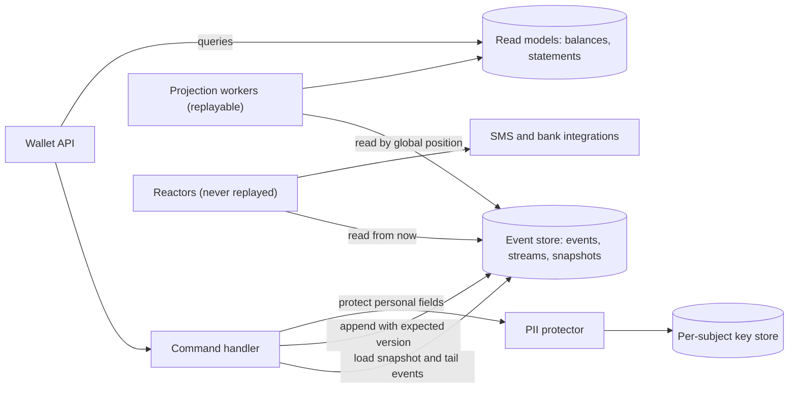
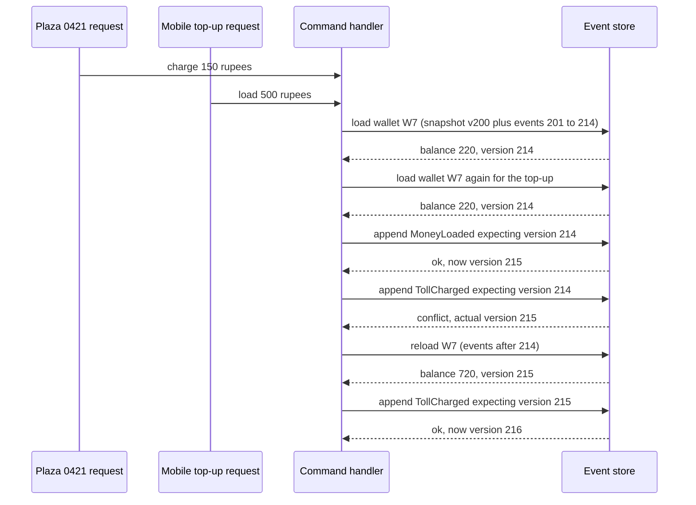

Event sourcing is the most powerful pattern in this module and the easiest to regret. It gives you perfect history, time travel and as many read models as you like. It also gives you data you can never change, schemas you must support forever, and a privacy problem the moment a customer asks you to forget them. This lesson is about running it for years, not demoing it for an afternoon.

## Learning objectives

By the end of this lesson you will be able to:

1. Explain event sourcing with an analogy, and say precisely what it adds and costs compared with storing current state.
2. Design a PostgreSQL event store: tables, optimistic concurrency, global ordering, and the "gap" problem with sequences.
3. Use snapshots to bound load time, with a rule for when and how to take them.
4. Evolve event schemas safely: tolerant readers, new event types, and upcasters.
5. Delete personal data from an immutable history (GDPR, India's DPDP Act) with crypto-shredding and PII-free events.
6. Rebuild projections without re-running side effects such as emails and payments.
7. Decide when a simpler design — an audit table, a ledger table or change data capture — is better.

## Prerequisites

- [Event sourcing fundamentals](#/lesson/m08-event-sourcing): aggregates applying events.
- [CQRS in production](#/lesson/m16-cqrs): every read in an event-sourced system is a projection.
- [Transactions and ACID](#/lesson/m09-transactions-acid) and [PostgreSQL JSONB](#/lesson/m09-jsonb): the event store is a PostgreSQL table with JSONB payloads.

## Explain it like I'm a beginner

Think about a bank passbook.

A passbook does **not** say "balance: ₹7,450" and nothing else. It lists every entry: *opened account ₹0 · deposited ₹10,000 · ATM withdrawal ₹2,000 · cheque returned +₹500 · charges −₹1,050*. The balance at the bottom is just the result of adding up the lines. You can ask questions a single balance can never answer: "What was my balance on 31 March?" "Why did it drop on the 12th?"

And nobody erases a line. A mistake is corrected with a **new** line ("reversal of charge"), so the history stays honest.

That is event sourcing:

- Each line is an **event** — a fact that happened, written in the past tense ("money deposited").
- The passbook for one account is a **stream**.
- The balance is **derived** by replaying the stream (rehydration).
- Lines are never edited; corrections are new events.

Two practical problems appear quickly. A passbook with 20,000 lines is slow to add up — so the bank prints a "balance brought forward" line at the start of each new book (a **snapshot**). And if the passbook contains your home address, you cannot simply tear out that page when you close the account — you need a cleverer way to make it unreadable (**crypto-shredding**).

## First-principles explanation

### What event sourcing is

Instead of storing the current state of an entity (a row you update), you store the **sequence of events** that led to it. The current state is computed by applying the events in order. The event log is the **source of truth**; every table you query is a projection built from it.

### Why it exists — the problem

Updating rows in place destroys information:

- **History**: `UPDATE wallet SET balance = 7450` loses *why* the balance changed. You can add an audit table, but then the audit and the state can disagree.
- **Business intent**: "balance decreased by ₹150" does not say whether that was a toll charge, a fee or a correction. Events (`TollCharged`, `FeeApplied`, `ChargeReversed`) keep the intent.
- **New questions later**: "how much toll did each vehicle pay per plaza per month last year?" — with events you build a new projection and replay; with state, the data is gone.
- **Debugging**: you can replay a stream to the exact moment a bug happened.
- **Integration**: the events are already there for other systems to consume.

### What it costs — the added complexity

| Cost | Why |
|---|---|
| Every read needs a projection | You cannot `SELECT ... WHERE balance < 100` on an event log; you need a read model ([CQRS](#/lesson/m16-cqrs)) |
| Events are forever | You must read every event version you ever wrote, for as long as the stream lives |
| Personal data in immutable logs | Right-to-erasure requests collide with "never change an event" |
| Long streams load slowly | A wallet with 20,000 events must be replayed on every command unless you snapshot |
| Concurrency and ordering are your job | Optimistic concurrency per stream and a reliable global order for projectors |
| Rebuilds take time | Replaying billions of events takes hours or days |
| Team learning curve | Modelling events well is a skill; bad event design is very expensive to fix |

### Back-of-the-envelope: a prepaid toll-tag wallet

Assumptions (estimates for the exercise):

- 8 million active wallets. A commercial truck crosses about 15 plazas a day; a private car about 1.5. Average: 3 toll charges per wallet per day, plus about 4 top-ups per month.
- Events per day: 8,000,000 × (3 + 4 ÷ 30) ≈ 8,000,000 × 3.13 ≈ **25 million** → 25,000,000 ÷ 86,400 ≈ **290 events/s** average; peak (morning freight hours, ×4) ≈ **1,200 events/s**.
- Storage: about 400 bytes per event row including JSONB and indexes (estimate) → 25 M × 400 B = **10 GB per day**, about **3.6 TB per year**.
- Stream length: a busy truck's wallet gets 15 × 365 ≈ **5,500 events per year**.

Loading 5,500 events on every toll charge would be wasteful. With a snapshot every 200 events, a load reads one snapshot plus at most 199 events. That sizing decision comes straight from this arithmetic.

### The event store schema (PostgreSQL)

```sql
CREATE TABLE streams (
  stream_id   text PRIMARY KEY,
  version     bigint NOT NULL              -- version of the last event in the stream
);

CREATE TABLE events (
  global_position bigint GENERATED ALWAYS AS IDENTITY PRIMARY KEY,
  stream_id       text   NOT NULL REFERENCES streams(stream_id),
  stream_version  bigint NOT NULL,         -- 1, 2, 3 ... within the stream
  event_type      text   NOT NULL,         -- e.g. 'TollCharged'
  schema_version  int    NOT NULL,         -- version of this event type's payload shape
  data            jsonb  NOT NULL,
  metadata        jsonb  NOT NULL DEFAULT '{}',  -- correlation id, causation id, user, source
  subject_id      text,                    -- data subject for privacy tooling
  recorded_at     timestamptz NOT NULL DEFAULT now(),
  UNIQUE (stream_id, stream_version)
);

CREATE TABLE snapshots (
  stream_id       text   PRIMARY KEY REFERENCES streams(stream_id),
  stream_version  bigint NOT NULL,
  snapshot_schema int    NOT NULL,
  state           jsonb  NOT NULL,
  taken_at        timestamptz NOT NULL DEFAULT now()
);
```

Notes on each piece:

- **`UNIQUE (stream_id, stream_version)`** is the optimistic-concurrency guard. Two commands that both loaded version 41 both try to insert version 42; one fails with a unique violation and must reload and retry.
- **`streams.version`** lets you check the expected version cheaply: `UPDATE streams SET version = $new WHERE stream_id = $id AND version = $expected` — 0 rows updated means someone else appended first.
- **`schema_version`** tells the reader which upcasters to run.
- **`metadata`** carries correlation and causation ids, so you can trace "this charge came from this plaza's request".
- **Never `UPDATE` or `DELETE` rows in `events`** in normal operation. Grant the application role `INSERT` and `SELECT` only.

### The ordering trap: gaps in the global position

Projectors read `events` in `global_position` order and remember the last position they processed. With concurrent appends this goes wrong:

1. Transaction A inserts an event and is assigned position 100, but has not committed yet.
2. Transaction B inserts an event, gets position 101, and commits.
3. A projector reads "events after 99", sees only 101 (100 is not committed), processes it and saves checkpoint 101.
4. Transaction A commits. Position 100 now exists — **behind** the projector's checkpoint. It is never projected.

Identity values are handed out when the row is inserted, not when the transaction commits, so positions are not in commit order. Three fixes, simplest first:

- **Serialise appends.** Take a transaction-level advisory lock before appending: `SELECT pg_advisory_xact_lock(42)`. Appends then commit in position order. With short transactions this sustains a high append rate on one primary (measure it), and it is by far the simplest option. The 1,200 events/s peak in our example is comfortably within reach of a single serialised writer with batched inserts, but load-test before you rely on that.
- **Read only up to the oldest in-flight transaction.** Store the inserting transaction's id (`xid8`, from `pg_current_xact_id()`) on each event; projectors read only events whose transaction id is below `pg_snapshot_xmin(pg_current_snapshot())` — every transaction older than that has finished. More complex, no write serialisation.
- **Gap detection with a wait.** When the projector sees a gap (100 missing between 99 and 101), it waits a short time (say 2 seconds) for it to fill before moving on. Simple, but a long-running transaction can still slip through.

Whichever you choose, write a test that runs concurrent appends and checks that a projector sees every event exactly once.

### Snapshots

A **snapshot** is a saved copy of an aggregate's state at a known stream version. Loading becomes: read the latest snapshot, then the events after it.

Rules that keep snapshots safe:

1. **A snapshot is a cache, not a source of truth.** You can delete every snapshot and the system still works, just slower.
2. **Version the snapshot format** (`snapshot_schema`). When the aggregate's state shape changes, old snapshots are ignored and new ones are taken; never upcast snapshots.
3. **Take them asynchronously or every N events** (for example when `stream_version % 200 == 0`), not on every write.
4. **Do not snapshot short streams.** If most streams have 20 events, snapshots add complexity for nothing.

An alternative to snapshots for very long-lived entities is **closing the books**: at each month end, append a `StatementClosed` event carrying the closing balance and start a new stream for the next month. Streams stay short by design, as in accounting.

### Event versioning

Events are immutable, but your understanding of the domain is not. Techniques, in the order you should reach for them:

1. **Additive change with a tolerant reader.** Add an optional field (`channel` on `MoneyLoaded`); old events lack it and readers apply a default. No version bump needed if every reader tolerates missing fields.
2. **New event type for new meaning.** If "charge" now means something different, introduce `TollChargedV2` or, better, a differently named event (`TollChargedWithDiscount`). Do not reuse the old name with new meaning.
3. **Upcasting.** When the shape of an event must change (amount in rupees as decimal → amount in paise as integer), keep the stored JSON as it is and transform it **on read**: an upcaster takes `(type, schema_version 1, json)` and returns `(type, 2, json)`. Chain them: 1 → 2 → 3. Your domain code only ever sees the latest shape.
4. **Copy-and-transform the stream** (rewrite into a new store). A last resort for large structural mistakes: expensive, risky, and it breaks the "never change history" promise. Keep the old store as an archive.

Rules: never change the meaning of an existing event type and version; never delete an upcaster while events of that version exist; test every upcaster with real stored samples.

### Personal data and the right to erasure

Laws like the EU GDPR and India's Digital Personal Data Protection Act, 2023 give people rights over their personal data, including erasure in many circumstances. Financial and tax laws may *also* require you to keep transaction records for years. Your legal team decides which applies to which field; your design must make both possible. Techniques:

- **Keep personal data out of events.** Store a reference (`ownerId`) in the event, and the name, phone and vehicle number in a normal, deletable table. Simple and effective — the first choice.
- **Crypto-shredding.** When personal data must be in the event, encrypt those fields with a **key per data subject**, stored in a key store (a vault or a keys table). To "forget" a person, delete their key. The events stay immutable, but the personal fields become unreadable everywhere — including backups and copies of the event log. Non-personal fields (amounts, plaza codes, timestamps) remain usable for audit and accounting.
- **Rewriting streams.** Physically removing events or fields. Possible with copy-and-transform, but slow and error-prone. Avoid.

Do not forget the copies: **read models, search indexes, caches, logs and analytics exports** contain personal data too. After shredding, rebuild or purge affected read models, and keep personal data out of logs in the first place.

### Projections and side effects: rebuild safely

A projection (statement view, balance table) can be rebuilt by replaying from position 0 into a new table, blue/green, exactly as in [CQRS](#/lesson/m16-cqrs). But some event handlers do things in the world: send an SMS "₹150 charged at plaza 0421", call a bank, raise a GST invoice. If you replay those, customers get 20,000 SMS.

Separate the two kinds of handlers:

- **Projections** only update data the system owns. Safe to replay any number of times.
- **Reactors** (also called process managers or policies) cause side effects. They keep their own checkpoint, start from "now" when first deployed, are never replayed from 0, and are idempotent by event id in case of redelivery.

### Failure modes

| Failure | What goes wrong | Mitigation |
|---|---|---|
| Concurrent commands on one stream | Two charges both see ₹200 and both spend ₹150 | Optimistic concurrency on `(stream_id, stream_version)`, reload and retry the decision |
| Sequence gaps | Projector permanently skips a late-committing event | Serialised appends, xmin-based reading, or gap waits |
| Bad event design | Events like `WalletUpdated { balance }` carry no intent; history is useless | Model business facts in the past tense; review event names with domain experts |
| Upcaster bug | Old events deserialise wrongly; balances change after a deploy | Golden-file tests with real stored samples for every version |
| Snapshot from buggy code | Wrong state persists even after the fix | Snapshot schema version; delete snapshots after fixing state-related bugs |
| Replaying reactors | Duplicate SMS, payments or invoices | Separate projections from reactors; reactors never replay |
| Unbounded streams | Slow loads; huge snapshots | Snapshot every N; close the books periodically; bound in-state collections |
| Personal data spread everywhere | Erasure requests cannot be honoured | PII-free events, crypto-shredding, purge read models and logs |

### When a simpler alternative is better

- **You need history for audit only**: keep normal state tables and add an **audit table** written in the same transaction (or by trigger). You can answer "who changed what, when" without making the log the source of truth.
- **Money movements**: a **double-entry ledger table** (append-only rows: debit, credit, amount, reference) gives immutability and balances by `SUM`, without event-sourcing the whole domain.
- **Other systems need your changes**: **change data capture** from the database log ([see the lesson](#/lesson/m16-cdc)) or a transactional outbox, with state tables as the source of truth.
- **CRUD-shaped domain**: master data, settings, catalogue pages. Event sourcing adds cost and no insight.

A good rule: event-source only the aggregates where the history itself is valuable to the business (wallets, ledgers, claims, contract variations), and use plain state everywhere else — even inside the same service.

## Visual explanation

### Architecture: event store, aggregates, projections and reactors



The command handler loads a wallet from its latest snapshot plus the events after it, makes a decision, and appends new events with the expected version (optimistic concurrency). Personal fields are encrypted with the owner's key before they are written; deleting that key makes them unreadable. Projection workers read all events in global-position order to build read models, and can be rebuilt from scratch. Reactors also read events, but cause side effects, so they track their own checkpoint from "now" and are never replayed. Queries read only the read models.

### Sequence: a toll charge with a concurrency conflict



Two requests arrive for the same wallet at nearly the same moment. Both load version 214. The top-up appends first and moves the stream to 215. The toll charge's append expected 214, so the store rejects it. The handler reloads, re-runs the decision against the new state (balance 720 is enough), and appends at 215. No lock was held while deciding, yet no update was lost.

## Step-by-step example

Scenario: the toll-tag wallet from the arithmetic above.

### Step 1 — name the events with the business

With the operations team, list what happens to a wallet: `WalletOpened`, `MoneyLoaded`, `TollCharged`, `ChargeReversed` (plaza charged twice, or wrong vehicle class), `WalletBlocked` (tag reported stolen), `WalletClosed`. Notice what is **not** there: `WalletUpdated`, `BalanceChanged`. Those describe database writes, not business facts.

### Step 2 — decide which fields are personal

`WalletOpened` includes owner name and vehicle registration number — personal data. The owner id (an internal identifier) is needed to link events. Decision: amounts, plaza codes and timestamps in clear; owner name and vehicle number encrypted with the owner's key.

### Step 3 — choose the ordering strategy

1,200 events/s at peak, one PostgreSQL primary. Decision: serialised appends with `pg_advisory_xact_lock`, batch inserts where a request appends several events. Load-test to confirm headroom, and revisit if the rate grows several-fold.

### Step 4 — snapshot rule

Typical car wallet: about 550 events a year; truck: 5,500. Snapshot every 200 events. A load reads at most 1 snapshot + 199 events.

### Step 5 — versioning in practice

Version 1 of `MoneyLoaded` stored `amount` in rupees as a decimal and `upiRef`. After a rounding incident, version 2 stores `amountPaise` as an integer, `channel` and `reference`. Old events are never rewritten; an upcaster converts v1 to v2 on read.

### Step 6 — read models and reactors

Projections: `wallet_balance` (for the app), `statement_lines` (monthly statement), `plaza_daily_totals` (settlement with plaza operators). Reactor: "send SMS on TollCharged", starting from the current position on first deploy.

## Production-style C# implementation

The code below is a compact but complete slice: an event store interface with optimistic concurrency (in-memory implementation; the SQL is shown alongside), the wallet aggregate, a serializer with an upcaster chain, crypto-shredding of personal fields with AES-GCM, a snapshotting repository, a statement projection that can be rebuilt, and the endpoints.

```text
TollWallet.Api/
  Program.cs
  EventStore/EventStore.cs
  Wallets/WalletEvents.cs
  Wallets/Wallet.cs
  Wallets/WalletRepository.cs
  Serialization/EventSerializer.cs
  Privacy/PiiProtector.cs
  Projections/StatementProjection.cs
```

```csharp file=EventStore/EventStore.cs
namespace TollWallet.EventStore;

public sealed record EventData(string Type, int SchemaVersion, string Json, string? SubjectId);
public sealed record RecordedEvent(string StreamId, long StreamVersion, long GlobalPosition, string Type,
    int SchemaVersion, string Json, DateTimeOffset RecordedAt);
public sealed record Snapshot(string StreamId, long StreamVersion, int SchemaVersion, string Json);

public sealed class WrongExpectedVersionException(string streamId, long expected, long actual)
    : Exception($"Stream '{streamId}': expected version {expected}, actual {actual}.")
{
    public long Actual { get; } = actual;
}

public interface IEventStore
{
    /// <summary>Appends events if the stream's current version equals <paramref name="expectedVersion"/>
    /// (0 = new stream). Returns the new stream version.</summary>
    Task<long> AppendAsync(string streamId, long expectedVersion, IReadOnlyList<EventData> events, CancellationToken ct);
    Task<IReadOnlyList<RecordedEvent>> ReadStreamAsync(string streamId, long afterVersion, CancellationToken ct);
    Task<IReadOnlyList<RecordedEvent>> ReadAllAsync(long afterPosition, int max, CancellationToken ct);
}

public interface ISnapshotStore
{
    Task<Snapshot?> LoadAsync(string streamId, CancellationToken ct);
    Task SaveAsync(Snapshot snapshot, CancellationToken ct);
}

/// <summary>
/// In-memory store. The PostgreSQL equivalent of AppendAsync, in one transaction:
///   SELECT pg_advisory_xact_lock(42);                         -- appends commit in position order
///   UPDATE streams SET version = $new WHERE stream_id = $id AND version = $expected;   -- 0 rows → conflict
///   (or INSERT INTO streams for expected = 0)
///   INSERT INTO events (stream_id, stream_version, event_type, schema_version, data, subject_id) VALUES ...;
/// </summary>
public sealed class InMemoryEventStore(TimeProvider clock) : IEventStore, ISnapshotStore
{
    private readonly object _gate = new();
    private readonly Dictionary<string, List<RecordedEvent>> _streams = new(StringComparer.Ordinal);
    private readonly List<RecordedEvent> _all = new();
    private readonly Dictionary<string, Snapshot> _snapshots = new(StringComparer.Ordinal);

    public Task<long> AppendAsync(string streamId, long expectedVersion, IReadOnlyList<EventData> events, CancellationToken ct)
    {
        if (events.Count == 0) throw new ArgumentException("Nothing to append.", nameof(events));
        lock (_gate)
        {
            var stream = _streams.TryGetValue(streamId, out var s) ? s : null;
            var actual = stream?.Count ?? 0;
            if (actual != expectedVersion) throw new WrongExpectedVersionException(streamId, expectedVersion, actual);
            stream ??= _streams[streamId] = new List<RecordedEvent>();

            var now = clock.GetUtcNow();
            foreach (var e in events)
            {
                var recorded = new RecordedEvent(streamId, stream.Count + 1, _all.Count + 1, e.Type, e.SchemaVersion, e.Json, now);
                stream.Add(recorded);
                _all.Add(recorded);
            }
            return Task.FromResult((long)stream.Count);
        }
    }

    public Task<IReadOnlyList<RecordedEvent>> ReadStreamAsync(string streamId, long afterVersion, CancellationToken ct)
    {
        lock (_gate)
            return Task.FromResult<IReadOnlyList<RecordedEvent>>(
                _streams.TryGetValue(streamId, out var s) ? s.Skip((int)afterVersion).ToList() : []);
    }

    public Task<IReadOnlyList<RecordedEvent>> ReadAllAsync(long afterPosition, int max, CancellationToken ct)
    {
        lock (_gate)
            return Task.FromResult<IReadOnlyList<RecordedEvent>>(_all.Skip((int)afterPosition).Take(max).ToList());
    }

    public Task<Snapshot?> LoadAsync(string streamId, CancellationToken ct)
    {
        lock (_gate) return Task.FromResult(_snapshots.TryGetValue(streamId, out var s) ? s : null);
    }

    public Task SaveAsync(Snapshot snapshot, CancellationToken ct)
    {
        lock (_gate)
        {
            // Never replace a newer snapshot with an older one.
            if (!_snapshots.TryGetValue(snapshot.StreamId, out var existing) || existing.StreamVersion < snapshot.StreamVersion)
                _snapshots[snapshot.StreamId] = snapshot;
        }
        return Task.CompletedTask;
    }
}
```

```csharp file=Wallets/WalletEvents.cs
namespace TollWallet.Wallets;

/// <summary>Business facts, past tense. These are the *current* shapes; older shapes are upcast on read.</summary>
public interface IWalletEvent
{
    string WalletId { get; }
}

/// <summary>OwnerName and VehicleNumber are personal data: they are encrypted with the owner's key before storage.</summary>
public sealed record WalletOpened(string WalletId, string OwnerId, string OwnerName, string VehicleNumber) : IWalletEvent;
public sealed record MoneyLoaded(string WalletId, long AmountPaise, string Channel, string Reference) : IWalletEvent;
public sealed record TollCharged(string WalletId, string ChargeId, string PlazaCode, long AmountPaise) : IWalletEvent;
public sealed record ChargeReversed(string WalletId, string ChargeId, long AmountPaise, string Reason) : IWalletEvent;
```

```csharp file=Wallets/Wallet.cs
namespace TollWallet.Wallets;

public sealed class InsufficientBalanceException(long balancePaise, long requiredPaise)
    : Exception($"Balance {balancePaise} paise is less than {requiredPaise} paise.");

/// <summary>State saved in snapshots. Versioned separately from events.</summary>
public sealed record WalletSnapshotState(string Id, string OwnerId, long BalancePaise,
    Dictionary<string, long> RecentCharges, List<string> Reversed);

public sealed class Wallet
{
    public const int SnapshotSchemaVersion = 1;
    public const long MaxLoadPaise = 1_00_000_00;   // ₹1,00,000 per top-up (illustrative business limit)

    private readonly List<IWalletEvent> _uncommitted = new();
    // In production keep only charges inside the reversal window (for example 90 days) so snapshots stay bounded.
    private readonly Dictionary<string, long> _charges = new(StringComparer.Ordinal);
    private readonly HashSet<string> _reversed = new(StringComparer.Ordinal);

    public string Id { get; private set; } = "";
    public string OwnerId { get; private set; } = "";
    public long BalancePaise { get; private set; }
    public long PersistedVersion { get; private set; }
    public IReadOnlyList<IWalletEvent> Uncommitted => _uncommitted;

    private Wallet() { }

    public static Wallet Open(string walletId, string ownerId, string ownerName, string vehicleNumber)
    {
        if (string.IsNullOrWhiteSpace(walletId) || string.IsNullOrWhiteSpace(ownerId))
            throw new ArgumentException("Wallet id and owner id are required.");
        var w = new Wallet();
        w.Raise(new WalletOpened(walletId, ownerId, ownerName, vehicleNumber));
        return w;
    }

    public static Wallet Rehydrate(WalletSnapshotState? snapshot, long snapshotVersion, IEnumerable<IWalletEvent> events, long lastVersion)
    {
        var w = new Wallet();
        if (snapshot is not null)
        {
            w.Id = snapshot.Id;
            w.OwnerId = snapshot.OwnerId;
            w.BalancePaise = snapshot.BalancePaise;
            foreach (var kv in snapshot.RecentCharges) w._charges[kv.Key] = kv.Value;
            foreach (var r in snapshot.Reversed) w._reversed.Add(r);
            w.PersistedVersion = snapshotVersion;
        }
        foreach (var e in events) w.When(e);
        w.PersistedVersion = Math.Max(w.PersistedVersion, lastVersion);
        return w;
    }

    public void Load(long amountPaise, string channel, string reference)
    {
        if (amountPaise <= 0 || amountPaise > MaxLoadPaise)
            throw new ArgumentOutOfRangeException(nameof(amountPaise), "Top-up must be between 1 paisa and ₹1,00,000.");
        Raise(new MoneyLoaded(Id, amountPaise, channel, reference));
    }

    /// <summary>Idempotent by charge id: a plaza retrying the same charge does not charge twice.</summary>
    public void Charge(string chargeId, string plazaCode, long amountPaise)
    {
        if (_charges.ContainsKey(chargeId)) return;
        if (amountPaise <= 0) throw new ArgumentOutOfRangeException(nameof(amountPaise));
        if (BalancePaise < amountPaise) throw new InsufficientBalanceException(BalancePaise, amountPaise);
        Raise(new TollCharged(Id, chargeId, plazaCode, amountPaise));
    }

    public void Reverse(string chargeId, string reason)
    {
        if (!_charges.TryGetValue(chargeId, out var amount))
            throw new InvalidOperationException($"Charge {chargeId} not found on wallet {Id}.");
        if (_reversed.Contains(chargeId)) return;
        Raise(new ChargeReversed(Id, chargeId, amount, reason));
    }

    public WalletSnapshotState ToSnapshot() =>
        new(Id, OwnerId, BalancePaise, new Dictionary<string, long>(_charges), _reversed.ToList());

    public void MarkCommitted(long newVersion)
    {
        PersistedVersion = newVersion;
        _uncommitted.Clear();
    }

    private void Raise(IWalletEvent e)
    {
        When(e);
        _uncommitted.Add(e);
    }

    // State changes happen only here, for new and replayed events alike.
    private void When(IWalletEvent e)
    {
        switch (e)
        {
            case WalletOpened o: Id = o.WalletId; OwnerId = o.OwnerId; break;
            case MoneyLoaded m: BalancePaise += m.AmountPaise; break;
            case TollCharged c: BalancePaise -= c.AmountPaise; _charges[c.ChargeId] = c.AmountPaise; break;
            case ChargeReversed r: BalancePaise += r.AmountPaise; _reversed.Add(r.ChargeId); break;
            default: throw new InvalidOperationException($"Unknown event {e.GetType().Name}");
        }
    }
}
```

```csharp file=Serialization/EventSerializer.cs
using System.Text.Json;
using System.Text.Json.Nodes;
using TollWallet.EventStore;
using TollWallet.Wallets;

namespace TollWallet.Serialization;

/// <summary>
/// Maps event types to names and current schema versions, and upcasts old payloads on read.
/// Stored JSON is never modified; only what the domain sees is upgraded.
/// </summary>
public sealed class EventSerializer
{
    private static readonly JsonSerializerOptions Json = new(JsonSerializerDefaults.Web);
    private readonly Dictionary<string, (Type Type, int Version)> _byName = new(StringComparer.Ordinal);
    private readonly Dictionary<Type, (string Name, int Version)> _byType = new();
    private readonly Dictionary<(string Name, int From), Func<JsonObject, JsonObject>> _upcasters = new();

    public EventSerializer Register<T>(string name, int currentVersion) where T : IWalletEvent
    {
        _byName[name] = (typeof(T), currentVersion);
        _byType[typeof(T)] = (name, currentVersion);
        return this;
    }

    public EventSerializer Upcaster(string name, int fromVersion, Func<JsonObject, JsonObject> upcast)
    {
        _upcasters[(name, fromVersion)] = upcast;
        return this;
    }

    public EventData Serialize(IWalletEvent e, string? subjectId)
    {
        if (!_byType.TryGetValue(e.GetType(), out var info))
            throw new InvalidOperationException($"Event type {e.GetType().Name} is not registered.");
        return new EventData(info.Name, info.Version, JsonSerializer.Serialize(e, e.GetType(), Json), subjectId);
    }

    public IWalletEvent Deserialize(RecordedEvent recorded)
    {
        if (!_byName.TryGetValue(recorded.Type, out var info))
            throw new InvalidOperationException($"Unknown event type '{recorded.Type}' at position {recorded.GlobalPosition}.");

        var node = JsonNode.Parse(recorded.Json)?.AsObject()
                   ?? throw new InvalidOperationException($"Empty payload at position {recorded.GlobalPosition}.");
        for (var v = recorded.SchemaVersion; v < info.Version; v++)
        {
            if (!_upcasters.TryGetValue((recorded.Type, v), out var up))
                throw new InvalidOperationException($"No upcaster for {recorded.Type} v{v} → v{v + 1}.");
            node = up(node);
        }
        return (IWalletEvent)(node.Deserialize(info.Type, Json)
               ?? throw new InvalidOperationException($"Could not deserialise {recorded.Type}."));
    }

    public static EventSerializer CreateDefault() => new EventSerializer()
        .Register<WalletOpened>("WalletOpened", 1)
        .Register<MoneyLoaded>("MoneyLoaded", 2)
        .Register<TollCharged>("TollCharged", 1)
        .Register<ChargeReversed>("ChargeReversed", 1)
        // v1: { walletId, amount: 500.50 (rupees, decimal), upiRef } → v2: { walletId, amountPaise, channel, reference }
        .Upcaster("MoneyLoaded", 1, v1 => new JsonObject
        {
            ["walletId"] = v1["walletId"]?.GetValue<string>(),
            ["amountPaise"] = (long)Math.Round(v1["amount"]!.GetValue<decimal>() * 100m, MidpointRounding.AwayFromZero),
            ["channel"] = "UPI",
            ["reference"] = v1["upiRef"]?.GetValue<string>() ?? "",
        });
}
```

Crypto-shredding: personal fields are encrypted with a 256-bit key per data subject using AES-GCM (authenticated encryption, so tampering is detected). The subject id is bound in as associated data, so a value cannot be decrypted as if it belonged to someone else.

```csharp file=Privacy/PiiProtector.cs
using System.Collections.Concurrent;
using System.Security.Cryptography;
using System.Text;

namespace TollWallet.Privacy;

public interface ISubjectKeyStore
{
    byte[] GetOrCreate(string subjectId);
    byte[]? Find(string subjectId);
    bool Delete(string subjectId);
}

/// <summary>Development stand-in. In production use a vault/KMS or a keys table with its own backups policy:
/// a deleted key must not survive in a backup that can be restored.</summary>
public sealed class InMemorySubjectKeyStore : ISubjectKeyStore
{
    private readonly ConcurrentDictionary<string, byte[]> _keys = new(StringComparer.Ordinal);
    public byte[] GetOrCreate(string subjectId) => _keys.GetOrAdd(subjectId, _ => RandomNumberGenerator.GetBytes(32));
    public byte[]? Find(string subjectId) => _keys.TryGetValue(subjectId, out var k) ? k : null;
    public bool Delete(string subjectId) => _keys.TryRemove(subjectId, out _);
}

public sealed class PiiProtector(ISubjectKeyStore keys)
{
    public const string Prefix = "pii:v1:";
    public const string Erased = "[erased]";
    private const int NonceSize = 12, TagSize = 16;

    public string Protect(string subjectId, string plaintext)
    {
        var key = keys.GetOrCreate(subjectId);
        var plain = Encoding.UTF8.GetBytes(plaintext);
        var nonce = RandomNumberGenerator.GetBytes(NonceSize);
        var cipher = new byte[plain.Length];
        var tag = new byte[TagSize];
        using (var aes = new AesGcm(key, TagSize))
            aes.Encrypt(nonce, plain, cipher, tag, Encoding.UTF8.GetBytes(subjectId));
        return Prefix + Convert.ToBase64String([.. nonce, .. tag, .. cipher]);
    }

    /// <summary>Returns the plaintext, <see cref="Erased"/> if the subject's key was deleted,
    /// or the value unchanged if it was never protected.</summary>
    public string Reveal(string subjectId, string value)
    {
        if (!value.StartsWith(Prefix, StringComparison.Ordinal)) return value;
        var key = keys.Find(subjectId);
        if (key is null) return Erased;

        var bytes = Convert.FromBase64String(value[Prefix.Length..]);
        var nonce = bytes.AsSpan(0, NonceSize);
        var tag = bytes.AsSpan(NonceSize, TagSize);
        var cipher = bytes.AsSpan(NonceSize + TagSize);
        var plain = new byte[cipher.Length];
        using (var aes = new AesGcm(key, TagSize))
            aes.Decrypt(nonce, cipher, tag, plain, Encoding.UTF8.GetBytes(subjectId));   // throws if tampered
        return Encoding.UTF8.GetString(plain);
    }

    public bool Forget(string subjectId) => keys.Delete(subjectId);
}
```

```csharp file=Wallets/WalletRepository.cs
using System.Text.Json;
using TollWallet.EventStore;
using TollWallet.Privacy;
using TollWallet.Serialization;

namespace TollWallet.Wallets;

public sealed class WalletRepository(IEventStore events, ISnapshotStore snapshots, EventSerializer serializer, PiiProtector pii)
{
    public const int SnapshotEvery = 200;
    private static readonly JsonSerializerOptions Json = new(JsonSerializerDefaults.Web);

    private static string StreamId(string walletId) => $"wallet-{walletId}";

    public async Task<Wallet?> LoadAsync(string walletId, CancellationToken ct)
    {
        var stream = StreamId(walletId);
        var snap = await snapshots.LoadAsync(stream, ct);
        // A snapshot in an old format is simply ignored: it is a cache, the events are the truth.
        var usable = snap is { SchemaVersion: Wallet.SnapshotSchemaVersion } ? snap : null;
        var state = usable is null ? null : JsonSerializer.Deserialize<WalletSnapshotState>(usable.Json, Json);
        var after = usable?.StreamVersion ?? 0;

        var tail = await events.ReadStreamAsync(stream, after, ct);
        if (state is null && tail.Count == 0) return null;

        var domainEvents = tail.Select(serializer.Deserialize).ToList();
        return Wallet.Rehydrate(state, after, domainEvents, tail.Count > 0 ? tail[^1].StreamVersion : after);
    }

    /// <summary>Loads personal details for display; returns "[erased]" values after crypto-shredding.</summary>
    public async Task<(string OwnerName, string VehicleNumber)?> LoadOwnerDetailsAsync(string walletId, CancellationToken ct)
    {
        var first = (await events.ReadStreamAsync(StreamId(walletId), 0, ct)).FirstOrDefault();
        if (first is null || serializer.Deserialize(first) is not WalletOpened opened) return null;
        return (pii.Reveal(opened.OwnerId, opened.OwnerName), pii.Reveal(opened.OwnerId, opened.VehicleNumber));
    }

    public async Task SaveAsync(Wallet wallet, CancellationToken ct)
    {
        if (wallet.Uncommitted.Count == 0) return;
        var data = wallet.Uncommitted.Select(e => serializer.Serialize(ProtectPersonalData(e), wallet.OwnerId)).ToList();
        var before = wallet.PersistedVersion;
        var newVersion = await events.AppendAsync(StreamId(wallet.Id), before, data, ct);   // may throw WrongExpectedVersionException
        wallet.MarkCommitted(newVersion);

        if (newVersion / SnapshotEvery > before / SnapshotEvery)   // crossed a multiple of SnapshotEvery
            await snapshots.SaveAsync(new Snapshot(StreamId(wallet.Id), newVersion, Wallet.SnapshotSchemaVersion,
                JsonSerializer.Serialize(wallet.ToSnapshot(), Json)), ct);
    }

    private IWalletEvent ProtectPersonalData(IWalletEvent e) => e is WalletOpened o
        ? o with { OwnerName = pii.Protect(o.OwnerId, o.OwnerName), VehicleNumber = pii.Protect(o.OwnerId, o.VehicleNumber) }
        : e;
}
```

The statement projection uses no personal data at all — a deliberate choice that keeps it out of erasure work. It can be rebuilt from position 0 at any time.

```csharp file=Projections/StatementProjection.cs
using TollWallet.EventStore;
using TollWallet.Serialization;
using TollWallet.Wallets;

namespace TollWallet.Projections;

public sealed record StatementLine(long Position, DateTimeOffset At, string Description, long AmountPaise, long BalanceAfterPaise);

/// <summary>Replayable projection: it only updates data the system owns. No SMS, no payments, no emails.</summary>
public sealed class StatementProjection(EventSerializer serializer)
{
    private readonly object _gate = new();
    private readonly Dictionary<string, List<StatementLine>> _lines = new(StringComparer.Ordinal);
    private readonly Dictionary<string, long> _balances = new(StringComparer.Ordinal);

    public long Checkpoint { get; private set; }

    public void Apply(IReadOnlyList<RecordedEvent> batch)
    {
        lock (_gate)
        {
            foreach (var r in batch.Where(r => r.GlobalPosition > Checkpoint).OrderBy(r => r.GlobalPosition))
            {
                var (description, delta) = serializer.Deserialize(r) switch
                {
                    MoneyLoaded m => ($"Top-up via {m.Channel}", m.AmountPaise),
                    TollCharged c => ($"Toll at plaza {c.PlazaCode}", -c.AmountPaise),
                    ChargeReversed v => ($"Reversal: {v.Reason}", v.AmountPaise),
                    _ => ((string?)null, 0L),
                };
                if (description is not null)
                {
                    var balance = _balances.GetValueOrDefault(r.StreamId) + delta;
                    _balances[r.StreamId] = balance;
                    if (!_lines.TryGetValue(r.StreamId, out var list)) _lines[r.StreamId] = list = new List<StatementLine>();
                    list.Add(new StatementLine(r.GlobalPosition, r.RecordedAt, description, delta, balance));
                }
                Checkpoint = r.GlobalPosition;
            }
        }
    }

    public IReadOnlyList<StatementLine> For(string walletId)
    {
        lock (_gate)
            return _lines.TryGetValue($"wallet-{walletId}", out var l) ? l.ToList() : [];
    }

    /// <summary>Builds a fresh projection from the whole log (blue/green: build it, then swap it in).</summary>
    public static async Task<StatementProjection> RebuildAsync(IEventStore store, EventSerializer serializer, CancellationToken ct)
    {
        var p = new StatementProjection(serializer);
        while (true)
        {
            var batch = await store.ReadAllAsync(p.Checkpoint, 1000, ct);
            if (batch.Count == 0) return p;
            p.Apply(batch);
        }
    }
}
```

```csharp file=Program.cs
using TollWallet.EventStore;
using TollWallet.Privacy;
using TollWallet.Projections;
using TollWallet.Serialization;
using TollWallet.Wallets;

var builder = WebApplication.CreateBuilder(args);

builder.Services.AddSingleton(TimeProvider.System);
builder.Services.AddSingleton<InMemoryEventStore>();
builder.Services.AddSingleton<IEventStore>(sp => sp.GetRequiredService<InMemoryEventStore>());
builder.Services.AddSingleton<ISnapshotStore>(sp => sp.GetRequiredService<InMemoryEventStore>());
builder.Services.AddSingleton(EventSerializer.CreateDefault());
builder.Services.AddSingleton<ISubjectKeyStore, InMemorySubjectKeyStore>();
builder.Services.AddSingleton<PiiProtector>();
builder.Services.AddSingleton<WalletRepository>();
builder.Services.AddSingleton(sp => new StatementProjection(sp.GetRequiredService<EventSerializer>()));

var app = builder.Build();

// Runs a decision with optimistic concurrency: reload and retry on conflict (up to 3 attempts).
static async Task<IResult> Decide(WalletRepository repo, string walletId, Action<Wallet> decision, CancellationToken ct)
{
    for (var attempt = 1; ; attempt++)
    {
        var wallet = await repo.LoadAsync(walletId, ct);
        if (wallet is null) return Results.NotFound();
        try
        {
            decision(wallet);
            await repo.SaveAsync(wallet, ct);
            return Results.Ok(new { wallet.Id, wallet.BalancePaise, version = wallet.PersistedVersion });
        }
        catch (WrongExpectedVersionException) when (attempt < 3) { /* someone else appended: reload and decide again */ }
        catch (WrongExpectedVersionException) { return Results.Problem("Wallet is busy, please retry.", statusCode: 409); }
        catch (InsufficientBalanceException ex) { return Results.Problem(ex.Message, statusCode: 422); }
        catch (ArgumentOutOfRangeException ex) { return Results.Problem(ex.Message, statusCode: 400); }
        catch (InvalidOperationException ex) { return Results.Problem(ex.Message, statusCode: 409); }
    }
}

app.MapPost("/wallets", async (OpenWallet body, WalletRepository repo, CancellationToken ct) =>
{
    var wallet = Wallet.Open(body.WalletId, body.OwnerId, body.OwnerName, body.VehicleNumber);
    try { await repo.SaveAsync(wallet, ct); }
    catch (WrongExpectedVersionException) { return Results.Conflict(new { error = "Wallet already exists." }); }
    return Results.Created($"/wallets/{wallet.Id}", new { wallet.Id });
});

app.MapPost("/wallets/{id}/loads", (string id, LoadMoney b, WalletRepository repo, CancellationToken ct) =>
    Decide(repo, id, w => w.Load(b.AmountPaise, b.Channel, b.Reference), ct));

app.MapPost("/wallets/{id}/charges", (string id, ChargeToll b, WalletRepository repo, CancellationToken ct) =>
    Decide(repo, id, w => w.Charge(b.ChargeId, b.PlazaCode, b.AmountPaise), ct));

app.MapPost("/wallets/{id}/reversals", (string id, ReverseCharge b, WalletRepository repo, CancellationToken ct) =>
    Decide(repo, id, w => w.Reverse(b.ChargeId, b.Reason), ct));

app.MapGet("/wallets/{id}/owner", async (string id, WalletRepository repo, CancellationToken ct) =>
    await repo.LoadOwnerDetailsAsync(id, ct) is { } d
        ? Results.Ok(new { ownerName = d.OwnerName, vehicleNumber = d.VehicleNumber })
        : Results.NotFound());

app.MapGet("/wallets/{id}/statement", async (string id, StatementProjection projection, IEventStore store, CancellationToken ct) =>
{
    projection.Apply(await store.ReadAllAsync(projection.Checkpoint, 1000, ct));   // demo catch-up; production uses a worker
    return Results.Ok(projection.For(id));
});

// Right to erasure for personal fields: delete the subject's key. Amounts and plaza codes remain for audit.
app.MapDelete("/subjects/{ownerId}/personal-data", (string ownerId, PiiProtector pii) =>
    pii.Forget(ownerId) ? Results.NoContent() : Results.NotFound());

app.Run();

public sealed record OpenWallet(string WalletId, string OwnerId, string OwnerName, string VehicleNumber);
public sealed record LoadMoney(long AmountPaise, string Channel, string Reference);
public sealed record ChargeToll(string ChargeId, string PlazaCode, long AmountPaise);
public sealed record ReverseCharge(string ChargeId, string Reason);
```

**Design notes**

- All state changes go through `When`, used both for new events (`Raise`) and for replay. There is no second code path that could disagree.
- `Charge` is idempotent by `ChargeId`, so a plaza that retries after a timeout does not double-charge. That rule lives in the aggregate, where the history is.
- Snapshots are taken when the version crosses a multiple of 200, and an old-format snapshot is ignored rather than migrated.
- Erasure deletes a key; it does not touch events. The `/owner` endpoint then shows `[erased]`, while statements (which never contained personal data) keep working.

## Bad design vs good design

**Bad: CRUD events with personal data and no versioning.**

```csharp
// "Event sourcing" that is really a change log of rows
record WalletUpdated(string WalletId, decimal Balance, string OwnerName, string OwnerPhone, string Vehicle);

events.Add(new WalletUpdated(id, wallet.Balance, wallet.OwnerName, wallet.Phone, wallet.Vehicle));
```

Problems:

- No intent: was the drop in balance a toll, a fee or a fraud? The history cannot answer.
- Personal data repeated in every event, in clear text, forever. One erasure request means rewriting thousands of events.
- `decimal Balance` in rupees with no schema version. When you move to paise, there is no way to tell old from new.
- Concurrent updates overwrite each other's balance (no expected version).

**Good:** past-tense business events with amounts as integers in paise; personal data only in `WalletOpened`, encrypted per subject; a `schema_version` on every stored event with upcasters; appends guarded by expected version.

:::callout type=tradeoff title="Event-source the core, not everything"
Within one service you can event-source the wallet (where history is the product) and keep plaza master data, user preferences and notification settings as ordinary tables. Mixing is normal and healthy.
:::

:::callout type=warning title="Erasure is a legal question first"
Whether a specific field must be erased, retained, or retained but restricted depends on the law that applies (for example DPDP Act rules, tax and banking record-keeping requirements) and your contracts. Design so that both "erase this person's identity" and "keep these amounts for seven years" are possible, and let your legal team decide which applies.
:::

## Practical playground

The database below is a minimal event store for the toll wallet, with a few streams already written. Try:

1. Rebuild a wallet's current balance by summing its events (`MoneyLoaded` +, `TollCharged` −, `ChargeReversed` +).
2. Ask a time-travel question: what was every wallet's balance at the end of 31 March 2026?
3. Simulate a concurrency conflict: insert a new event for `wallet-W1` with `stream_version` 4 (which already exists) and watch the unique constraint reject it.

:::playground type=sql title="A PostgreSQL event store"
```sql
CREATE TABLE events (
  global_position bigint GENERATED ALWAYS AS IDENTITY PRIMARY KEY,
  stream_id       text   NOT NULL,
  stream_version  bigint NOT NULL,
  event_type      text   NOT NULL,
  schema_version  int    NOT NULL,
  data            jsonb  NOT NULL,
  recorded_at     timestamptz NOT NULL,
  UNIQUE (stream_id, stream_version)
);
INSERT INTO events (stream_id, stream_version, event_type, schema_version, data, recorded_at) VALUES
  ('wallet-W1', 1, 'WalletOpened',   1, '{"walletId":"W1","ownerId":"U1"}', '2026-03-01 09:00+05:30'),
  ('wallet-W1', 2, 'MoneyLoaded',    2, '{"walletId":"W1","amountPaise":100000,"channel":"UPI"}', '2026-03-01 09:05+05:30'),
  ('wallet-W1', 3, 'TollCharged',    1, '{"walletId":"W1","chargeId":"C1","plazaCode":"0421","amountPaise":15000}', '2026-03-20 07:10+05:30'),
  ('wallet-W1', 4, 'TollCharged',    1, '{"walletId":"W1","chargeId":"C2","plazaCode":"0433","amountPaise":22500}', '2026-04-02 18:40+05:30'),
  ('wallet-W2', 1, 'WalletOpened',   1, '{"walletId":"W2","ownerId":"U2"}', '2026-03-10 12:00+05:30'),
  ('wallet-W2', 2, 'MoneyLoaded',    2, '{"walletId":"W2","amountPaise":50000,"channel":"NETBANKING"}', '2026-03-10 12:01+05:30'),
  ('wallet-W2', 3, 'TollCharged',    1, '{"walletId":"W2","chargeId":"C3","plazaCode":"0421","amountPaise":15000}', '2026-03-31 23:30+05:30'),
  ('wallet-W2', 4, 'ChargeReversed', 1, '{"walletId":"W2","chargeId":"C3","amountPaise":15000,"reason":"double read"}', '2026-04-01 10:00+05:30');
-- Current balance per wallet
SELECT stream_id,
       SUM(CASE event_type WHEN 'TollCharged' THEN -(data->>'amountPaise')::bigint
                           WHEN 'MoneyLoaded' THEN (data->>'amountPaise')::bigint
                           WHEN 'ChargeReversed' THEN (data->>'amountPaise')::bigint
                           ELSE 0 END) AS balance_paise
FROM events GROUP BY stream_id ORDER BY stream_id;
```
:::

## Exercises

:::exercise id=m16-event-sourcing-ex1 difficulty=beginner kind=code title="Decide and evolve: a toll account"
Implement a small event-sourced account in the "decide, then evolve" style: commands return new events; only `Apply` changes state.
::requirements
- `FromHistory(events)` builds an account by applying events in order; `Version` is the number of events applied.
- `Apply(Loaded)` adds to the balance; `Apply(Charged)` subtracts and remembers the charge id and amount; `Apply(Reversed)` adds the charge's amount back and remembers the reversal.
- `Charge(chargeId, amount)` returns `[Charged]` if the balance is enough; returns an empty list if that charge id was already charged (idempotent); throws `InsufficientBalanceException` otherwise. It must **not** change state.
- `Reverse(chargeId)` returns `[Reversed]` for a known, unreversed charge; empty if already reversed; throws `InvalidOperationException` for an unknown charge.
::acceptance
- History load 1,000 then charge 150 gives balance 850.
- Charging the same id twice produces one event.
- Commands do not change state until their events are applied.
- Reversing returns the original amount.
::hint
Keep two collections: charge id → amount, and a set of reversed ids.
::hint
"Decide" methods only *read* state and return events. "Apply" is the only place that writes.
::hint
`FromHistory` is just `foreach (var e in events) account.Apply(e);`.
::hint
```csharp
public IReadOnlyList<AccountEvent> Charge(string id, long amount)
{
    if (_charges.ContainsKey(id)) return Array.Empty<AccountEvent>();
    if (Balance < amount) throw new InsufficientBalanceException();
    return new AccountEvent[] { new Charged(id, amount) };
}
```
::starter
```csharp file=TollAccount.cs
using System;
using System.Collections.Generic;

public abstract record AccountEvent;
public sealed record Loaded(long AmountPaise) : AccountEvent;
public sealed record Charged(string ChargeId, long AmountPaise) : AccountEvent;
public sealed record Reversed(string ChargeId) : AccountEvent;

public sealed class InsufficientBalanceException : Exception { }

public sealed class TollAccount
{
    public long Balance { get; private set; }
    public long Version { get; private set; }

    public static TollAccount FromHistory(IEnumerable<AccountEvent> events) => throw new NotImplementedException();
    public void Apply(AccountEvent e) => throw new NotImplementedException();
    public IReadOnlyList<AccountEvent> Charge(string chargeId, long amountPaise) => throw new NotImplementedException();
    public IReadOnlyList<AccountEvent> Reverse(string chargeId) => throw new NotImplementedException();
}
```
::tests
```csharp file=TollAccountTests.cs
using System;
using Xunit;

public class TollAccountTests
{
    [Fact]
    public void Rehydrates_balance_and_version()
    {
        var a = TollAccount.FromHistory(new AccountEvent[] { new Loaded(1000), new Charged("C1", 150) });
        Assert.Equal(850, a.Balance);
        Assert.Equal(2, a.Version);
    }

    [Fact]
    public void Charge_returns_event_without_changing_state()
    {
        var a = TollAccount.FromHistory(new AccountEvent[] { new Loaded(1000) });
        var events = a.Charge("C1", 150);
        Assert.Equal(new Charged("C1", 150), Assert.Single(events));
        Assert.Equal(1000, a.Balance);
        a.Apply(events[0]);
        Assert.Equal(850, a.Balance);
    }

    [Fact]
    public void Duplicate_charge_is_idempotent()
    {
        var a = TollAccount.FromHistory(new AccountEvent[] { new Loaded(1000), new Charged("C1", 150) });
        Assert.Empty(a.Charge("C1", 150));
    }

    [Fact]
    public void Insufficient_balance_throws() =>
        Assert.Throws<InsufficientBalanceException>(() =>
            TollAccount.FromHistory(new AccountEvent[] { new Loaded(100) }).Charge("C1", 150));

    [Fact]
    public void Reverse_restores_amount_once()
    {
        var a = TollAccount.FromHistory(new AccountEvent[] { new Loaded(1000), new Charged("C1", 150) });
        var r = a.Reverse("C1");
        a.Apply(Assert.Single(r));
        Assert.Equal(1000, a.Balance);
        Assert.Empty(a.Reverse("C1"));
    }

    [Fact]
    public void Reverse_unknown_charge_throws() =>
        Assert.Throws<InvalidOperationException>(() => TollAccount.FromHistory(new AccountEvent[] { new Loaded(10) }).Reverse("X"));
}
```
::solution
```csharp file=TollAccount.cs
using System;
using System.Collections.Generic;

public abstract record AccountEvent;
public sealed record Loaded(long AmountPaise) : AccountEvent;
public sealed record Charged(string ChargeId, long AmountPaise) : AccountEvent;
public sealed record Reversed(string ChargeId) : AccountEvent;

public sealed class InsufficientBalanceException : Exception { }

public sealed class TollAccount
{
    private readonly Dictionary<string, long> _charges = new(StringComparer.Ordinal);
    private readonly HashSet<string> _reversed = new(StringComparer.Ordinal);

    public long Balance { get; private set; }
    public long Version { get; private set; }

    public static TollAccount FromHistory(IEnumerable<AccountEvent> events)
    {
        var account = new TollAccount();
        foreach (var e in events) account.Apply(e);
        return account;
    }

    public void Apply(AccountEvent e)
    {
        switch (e)
        {
            case Loaded l: Balance += l.AmountPaise; break;
            case Charged c: Balance -= c.AmountPaise; _charges[c.ChargeId] = c.AmountPaise; break;
            case Reversed r: Balance += _charges[r.ChargeId]; _reversed.Add(r.ChargeId); break;
            default: throw new InvalidOperationException($"Unknown event {e.GetType().Name}");
        }
        Version++;
    }

    public IReadOnlyList<AccountEvent> Charge(string chargeId, long amountPaise)
    {
        if (_charges.ContainsKey(chargeId)) return Array.Empty<AccountEvent>();
        if (amountPaise <= 0) throw new ArgumentOutOfRangeException(nameof(amountPaise));
        if (Balance < amountPaise) throw new InsufficientBalanceException();
        return new AccountEvent[] { new Charged(chargeId, amountPaise) };
    }

    public IReadOnlyList<AccountEvent> Reverse(string chargeId)
    {
        if (!_charges.ContainsKey(chargeId)) throw new InvalidOperationException($"Unknown charge {chargeId}.");
        if (_reversed.Contains(chargeId)) return Array.Empty<AccountEvent>();
        return new AccountEvent[] { new Reversed(chargeId) };
    }
}
```
The "decide returns events, apply changes state" split makes the aggregate easy to test (given events → when command → then events) and guarantees that live behaviour and replay use the same `Apply` code.

Notice that `Reversed` carries only the charge id and looks the amount up from state. That works, but the lesson's production `ChargeReversed` also carries the amount — so projections can compute balances from the event alone without rebuilding aggregate state. Prefer events that are self-describing for consumers.
::mistakes
- Changing `Balance` inside `Charge` *and* inside `Apply`, so replayed and live state differ.
- Throwing on a duplicate charge id instead of returning no events; a plaza retry then shows the driver an error.
- Using `decimal` rupees for money in events and then rounding differently in projections.
:::

:::exercise id=m16-event-sourcing-ex2 difficulty=beginner kind=written title="Good events, bad events"
Review these proposed events for an infrastructure contract system and rewrite the bad ones. For each, say what is wrong.

1. `ContractUpdated { contractId, status, value, contractorName, contractorPan }`
2. `VariationOrderApproved { contractId, variationId, amountPaise, approvedBy, approvedAt }`
3. `SetMilestoneDone { milestoneId }`
4. `MeasurementRecorded { contractId, boqItem, quantity, unit, measuredBy }`
5. `ContractRowChanged { table, column, oldValue, newValue }`
6. `PaymentReleased { contractId, raBillNo, amount: 1250000.50 }`
::acceptance
- Each event is judged on: past-tense business fact, intent, personal data, money representation.
- Rewrites split vague events into specific ones.
- Personal data handling is addressed for the contractor PAN.
::hint
Read each name aloud as "the business says: X happened". Does it sound like something a site engineer or accountant would say?
::hint
`Updated` and `Changed` events usually hide several different business facts.
::hint
A PAN (permanent account number) identifies a person or business for tax. Where should it live?
::hint
How should money be stored so that every reader rounds the same way?
::solution
1. **Bad.** "Updated" hides intent; it mixes status, value and contractor details; PAN in every event is personal/sensitive data repeated forever. Rewrite as specific facts: `ContractAwarded { contractId, contractorId, valuePaise }`, `ContractSuspended { contractId, reason }`, `ContractValueRevised { contractId, oldValuePaise, newValuePaise, variationId }`. Contractor name and PAN live in a contractor record (deletable or access-restricted), referenced by `contractorId`; if they must be in an event, crypto-shred them.
2. **Good.** Past tense, business language, amount in paise, who and when. (`approvedBy` is a user id — fine as a reference.)
3. **Bad.** Imperative ("Set…") — that is a command, not an event. Rewrite: `MilestoneCompleted { contractId, milestoneId, completedOn, certifiedBy }`.
4. **Good,** with one caution: quantities should have a defined precision and unit list (`unit` from a fixed set like `CUM`, `SQM`, `MT`) so projections agree.
5. **Bad.** A database change log, not a domain event. It couples history to today's table layout. If you need this, it is change data capture, not event sourcing.
6. **Mostly good name, bad money.** A floating-point or decimal-with-fractions amount invites rounding differences. Use `amountPaise: 125000050` (a long). Consider including `tdsDeductedPaise` and `gstPaise` if the business treats them as part of the fact.
::mistakes
- Accepting `ContractUpdated` because it is "flexible" — flexibility here means no meaning.
- Ignoring that PAN in an immutable log is very hard to erase later.
:::

:::exercise id=m16-event-sourcing-ex3 difficulty=intermediate kind=code title="An upcaster chain"
Implement an upcaster chain that upgrades stored event JSON to the current schema version, one step at a time.
::requirements
- `Register(eventType, fromVersion, upcast)` registers a step from `fromVersion` to `fromVersion + 1`. Registering the same step twice throws `InvalidOperationException`.
- `Upcast(eventType, storedVersion, json, targetVersion)` applies steps in order and returns the final JSON. It must **not** modify the input object (work on a deep clone).
- If `storedVersion == targetVersion`, return a clone unchanged. If `storedVersion > targetVersion`, or any step is missing, throw `InvalidOperationException` naming the missing step.
- Steps for one event type never affect another type.
::acceptance
- `MoneyLoaded` v1 `{ "amount": 500.5, "upiRef": "U1" }` → v3 `{ "amountPaise": 50050, "channel": "UPI", "reference": "U1" }`.
- v2 input runs only the v2 → v3 step.
- A missing step throws with a clear message.
- The caller's original `JsonObject` is unchanged.
::hint
Store steps in a `Dictionary<(string Type, int From), Func<JsonObject, JsonObject>>`.
::hint
`json.DeepClone().AsObject()` gives you a copy you can safely mutate.
::hint
Loop `for (var v = stored; v < target; v++)` and look up `(type, v)` each time.
::hint
```csharp
if (!_steps.TryGetValue((type, v), out var step))
    throw new InvalidOperationException($"No upcaster for {type} v{v} -> v{v + 1}.");
current = step(current);
```
::starter
```csharp file=UpcasterChain.cs
using System;
using System.Collections.Generic;
using System.Text.Json.Nodes;

public sealed class UpcasterChain
{
    public UpcasterChain Register(string eventType, int fromVersion, Func<JsonObject, JsonObject> upcast) =>
        throw new NotImplementedException();

    public JsonObject Upcast(string eventType, int storedVersion, JsonObject json, int targetVersion) =>
        throw new NotImplementedException();
}
```
::tests
```csharp file=UpcasterChainTests.cs
using System;
using System.Text.Json.Nodes;
using Xunit;

public class UpcasterChainTests
{
    private static UpcasterChain Chain() => new UpcasterChain()
        // v1 → v2: rupees (decimal) to paise (integer), upiRef renamed to reference
        .Register("MoneyLoaded", 1, j =>
        {
            var paise = (long)Math.Round(j["amount"]!.GetValue<decimal>() * 100m, MidpointRounding.AwayFromZero);
            j.Remove("amount");
            j["amountPaise"] = paise;
            j["reference"] = j["upiRef"]?.GetValue<string>();
            j.Remove("upiRef");
            return j;
        })
        // v2 → v3: channel became mandatory; all v2 loads were UPI
        .Register("MoneyLoaded", 2, j => { j["channel"] ??= "UPI"; return j; })
        .Register("TollCharged", 1, j => { j["currency"] = "INR"; return j; });

    [Fact]
    public void Upcasts_v1_to_v3()
    {
        var result = Chain().Upcast("MoneyLoaded", 1, JsonNode.Parse("{\"amount\":500.5,\"upiRef\":\"U1\"}")!.AsObject(), 3);
        Assert.Equal(50050L, result["amountPaise"]!.GetValue<long>());
        Assert.Equal("UPI", result["channel"]!.GetValue<string>());
        Assert.Equal("U1", result["reference"]!.GetValue<string>());
        Assert.Null(result["amount"]);
    }

    [Fact]
    public void V2_runs_only_last_step()
    {
        var result = Chain().Upcast("MoneyLoaded", 2, JsonNode.Parse("{\"amountPaise\":100,\"channel\":\"CARD\"}")!.AsObject(), 3);
        Assert.Equal("CARD", result["channel"]!.GetValue<string>());
        Assert.Equal(100L, result["amountPaise"]!.GetValue<long>());
    }

    [Fact]
    public void Same_version_returns_equal_copy()
    {
        var input = JsonNode.Parse("{\"x\":1}")!.AsObject();
        var result = Chain().Upcast("TollCharged", 2, input, 2);
        Assert.NotSame(input, result);
        Assert.Equal(1, result["x"]!.GetValue<int>());
    }

    [Fact]
    public void Input_is_not_modified()
    {
        var input = JsonNode.Parse("{\"amount\":10,\"upiRef\":\"R\"}")!.AsObject();
        Chain().Upcast("MoneyLoaded", 1, input, 3);
        Assert.Equal(10, input["amount"]!.GetValue<int>());
        Assert.Null(input["amountPaise"]);
    }

    [Fact]
    public void Missing_step_throws()
    {
        var ex = Assert.Throws<InvalidOperationException>(() =>
            Chain().Upcast("TollCharged", 1, new JsonObject(), 3));
        Assert.Contains("TollCharged v2", ex.Message);
    }

    [Fact]
    public void Downgrade_throws() =>
        Assert.Throws<InvalidOperationException>(() => Chain().Upcast("MoneyLoaded", 3, new JsonObject(), 2));

    [Fact]
    public void Duplicate_registration_throws() =>
        Assert.Throws<InvalidOperationException>(() => Chain().Register("MoneyLoaded", 1, j => j));
}
```
::solution
```csharp file=UpcasterChain.cs
using System;
using System.Collections.Generic;
using System.Text.Json.Nodes;

public sealed class UpcasterChain
{
    private readonly Dictionary<(string Type, int From), Func<JsonObject, JsonObject>> _steps = new();

    public UpcasterChain Register(string eventType, int fromVersion, Func<JsonObject, JsonObject> upcast)
    {
        ArgumentNullException.ThrowIfNull(upcast);
        if (!_steps.TryAdd((eventType, fromVersion), upcast))
            throw new InvalidOperationException($"Upcaster for {eventType} v{fromVersion} is already registered.");
        return this;
    }

    public JsonObject Upcast(string eventType, int storedVersion, JsonObject json, int targetVersion)
    {
        ArgumentNullException.ThrowIfNull(json);
        if (storedVersion > targetVersion)
            throw new InvalidOperationException($"{eventType} v{storedVersion} is newer than target v{targetVersion}; downgrades are not supported.");

        var current = json.DeepClone().AsObject();
        for (var v = storedVersion; v < targetVersion; v++)
        {
            if (!_steps.TryGetValue((eventType, v), out var step))
                throw new InvalidOperationException($"No upcaster for {eventType} v{v} -> v{v + 1}.");
            current = step(current);
        }
        return current;
    }
}
```
Why one step at a time instead of "v1 → latest" functions? With single steps, adding v4 means writing one new function (v3 → v4); every older version reaches v4 through the chain. With direct functions you would rewrite v1 → v4, v2 → v4 and v3 → v4.

A "newer than target" event usually means an old version of the service is reading events written by a newer one — common during rolling deployments. Fail loudly, and deploy readers before writers when you introduce a new version.
::mistakes
- Mutating the caller's object; if the same stored JSON is cached, the second read upcasts an already-upcast payload.
- Rounding rupees to paise with banker's rounding in one place and away-from-zero in another.
- Deleting old upcasters after "everyone has migrated" while v1 events still exist in the store.
::extensions
Add golden-file tests: store a real v1, v2 and v3 payload as test fixtures and assert they all upcast to the same domain object.
:::

:::exercise id=m16-event-sourcing-ex4 difficulty=intermediate kind=sql ordered=true title="Time travel: balances as of a date"
Using the event store, return each wallet's balance **as of the end of 31 March 2026, India time** (`2026-03-31 23:59:59.999+05:30`), together with the stream version at that moment. Include wallets that existed by then even if their balance is 0. Order by wallet.
::setup
```sql
CREATE TABLE events (
  global_position bigint GENERATED ALWAYS AS IDENTITY PRIMARY KEY,
  stream_id       text   NOT NULL,
  stream_version  bigint NOT NULL,
  event_type      text   NOT NULL,
  schema_version  int    NOT NULL,
  data            jsonb  NOT NULL,
  recorded_at     timestamptz NOT NULL,
  UNIQUE (stream_id, stream_version)
);
INSERT INTO events (stream_id, stream_version, event_type, schema_version, data, recorded_at) VALUES
  ('wallet-W1', 1, 'WalletOpened',   1, '{"walletId":"W1"}', '2026-03-01 09:00+05:30'),
  ('wallet-W1', 2, 'MoneyLoaded',    2, '{"amountPaise":100000}', '2026-03-01 09:05+05:30'),
  ('wallet-W1', 3, 'TollCharged',    1, '{"chargeId":"C1","amountPaise":15000}', '2026-03-20 07:10+05:30'),
  ('wallet-W1', 4, 'TollCharged',    1, '{"chargeId":"C2","amountPaise":22500}', '2026-04-02 18:40+05:30'),
  ('wallet-W2', 1, 'WalletOpened',   1, '{"walletId":"W2"}', '2026-03-10 12:00+05:30'),
  ('wallet-W2', 2, 'MoneyLoaded',    2, '{"amountPaise":50000}', '2026-03-10 12:01+05:30'),
  ('wallet-W2', 3, 'TollCharged',    1, '{"chargeId":"C3","amountPaise":15000}', '2026-03-31 23:30+05:30'),
  ('wallet-W2', 4, 'ChargeReversed', 1, '{"chargeId":"C3","amountPaise":15000}', '2026-04-01 10:00+05:30'),
  ('wallet-W3', 1, 'WalletOpened',   1, '{"walletId":"W3"}', '2026-03-31 18:00+05:30'),
  ('wallet-W4', 1, 'WalletOpened',   1, '{"walletId":"W4"}', '2026-04-05 08:00+05:30'),
  ('wallet-W4', 2, 'MoneyLoaded',    2, '{"amountPaise":20000}', '2026-04-05 08:01+05:30');
```
::check
```sql
SELECT stream_id AS wallet,
       SUM(CASE event_type
             WHEN 'MoneyLoaded'    THEN  (data->>'amountPaise')::bigint
             WHEN 'TollCharged'    THEN -(data->>'amountPaise')::bigint
             WHEN 'ChargeReversed' THEN  (data->>'amountPaise')::bigint
             ELSE 0 END) AS balance_paise,
       MAX(stream_version) AS version
FROM events
WHERE recorded_at <= timestamptz '2026-03-31 23:59:59.999+05:30'
GROUP BY stream_id
ORDER BY stream_id;
```
::acceptance
- Three wallets: `wallet-W1` 85,000 paise at version 3; `wallet-W2` 35,000 at version 3; `wallet-W3` 0 at version 1.
- `wallet-W4` (opened in April) does not appear.
- The April reversal for W2 is not counted.
::hint
Time travel in an event store is just a filter on `recorded_at` before you aggregate.
::hint
`data->>'amountPaise'` returns text; cast it with `::bigint`.
::hint
A `CASE` on `event_type` turns each event into a signed amount; `WalletOpened` contributes 0, which keeps W3 in the result.
::hint
`MAX(stream_version)` among the filtered rows is the version at that moment.
::solution
```sql
SELECT stream_id AS wallet,
       SUM(CASE event_type
             WHEN 'MoneyLoaded'    THEN  (data->>'amountPaise')::bigint
             WHEN 'TollCharged'    THEN -(data->>'amountPaise')::bigint
             WHEN 'ChargeReversed' THEN  (data->>'amountPaise')::bigint
             ELSE 0 END) AS balance_paise,
       MAX(stream_version) AS version
FROM events
WHERE recorded_at <= timestamptz '2026-03-31 23:59:59.999+05:30'
GROUP BY stream_id
ORDER BY stream_id;
```
This is the question a state-only design cannot answer once rows have been updated. In production you would not scan billions of events for it: you would keep a `balance_at_month_end` projection, or use month-end `StatementClosed` events (closing the books). The SQL is the definition; projections make it cheap.

Note the subtle part: W2's charge at 23:30 IST on 31 March is included, and its reversal the next morning is not, so W2's balance *at that moment* was 35,000 paise even though the charge was later reversed. That is the correct historical answer, and exactly what an auditor asks for.
::mistakes
- Comparing against `'2026-03-31'` (midnight at the *start* of the day) and losing the whole last day.
- Using UTC midnight instead of India time, which shifts the cut-off by 5 hours 30 minutes.
- Filtering out `WalletOpened`, which drops wallets with no money movements.
:::

:::exercise id=m16-event-sourcing-ex5 difficulty=advanced kind=code title="Crypto-shredding vault"
Implement a vault that encrypts personal fields with a key per data subject, so deleting the key makes every copy of those fields unreadable — in events, snapshots and backups.
::requirements
- `Protect(subjectId, plaintext)` returns a string starting with `"pii:v1:"`, using AES-GCM with a random 12-byte nonce and 16-byte tag, and the subject id as associated data. The same plaintext protected twice must give different outputs.
- `Reveal(subjectId, value)`: values without the prefix are returned unchanged; if the subject's key is gone, return `null`; otherwise decrypt. Tampered data, or data revealed under the wrong subject id, must throw a `CryptographicException` (or subclass).
- `Forget(subjectId)` deletes the key and returns whether one existed. Other subjects are unaffected.
- Use the provided `ISubjectKeyStore` and `InMemoryKeyStore`.
::acceptance
- Round trip returns the original text, including non-ASCII (for example Hindi names).
- After `Forget`, `Reveal` returns null; other subjects still decrypt.
- Revealing subject A's value as subject B throws.
- Flipping a byte of the ciphertext throws.
::hint
Lay out the payload as `nonce (12) | tag (16) | ciphertext`, then Base64-encode it after the prefix.
::hint
`new AesGcm(key, tagSizeInBytes: 16)` then `Encrypt(nonce, plaintext, ciphertext, tag, associatedData)`.
::hint
Associated data is authenticated but not encrypted. Binding the subject id there means a ciphertext moved to another person's record fails to decrypt.
::hint
`RandomNumberGenerator.GetBytes(12)` for each nonce. Never reuse a nonce with the same key in GCM.
::hint
For `Reveal`: check prefix → find key (null → return null) → decode → split spans → `Decrypt` → UTF-8 decode.
::starter
```csharp file=PiiVault.cs
using System;
using System.Collections.Concurrent;
using System.Security.Cryptography;
using System.Text;

public interface ISubjectKeyStore
{
    byte[] GetOrCreate(string subjectId);
    byte[]? Find(string subjectId);
    bool Delete(string subjectId);
}

public sealed class InMemoryKeyStore : ISubjectKeyStore
{
    private readonly ConcurrentDictionary<string, byte[]> _keys = new(StringComparer.Ordinal);
    public byte[] GetOrCreate(string subjectId) => _keys.GetOrAdd(subjectId, _ => RandomNumberGenerator.GetBytes(32));
    public byte[]? Find(string subjectId) => _keys.TryGetValue(subjectId, out var k) ? k : null;
    public bool Delete(string subjectId) => _keys.TryRemove(subjectId, out _);
}

public sealed class PiiVault(ISubjectKeyStore keys)
{
    public const string Prefix = "pii:v1:";
    public string Protect(string subjectId, string plaintext) => throw new NotImplementedException();
    public string? Reveal(string subjectId, string value) => throw new NotImplementedException();
    public bool Forget(string subjectId) => throw new NotImplementedException();
}
```
::tests
```csharp file=PiiVaultTests.cs
using System;
using System.Security.Cryptography;
using Xunit;

public class PiiVaultTests
{
    [Fact]
    public void Round_trip_including_unicode()
    {
        var v = new PiiVault(new InMemoryKeyStore());
        var p = v.Protect("U1", "राजेश कुमार · HR26DK8337");
        Assert.StartsWith(PiiVault.Prefix, p);
        Assert.DoesNotContain("HR26DK8337", p);
        Assert.Equal("राजेश कुमार · HR26DK8337", v.Reveal("U1", p));
    }

    [Fact]
    public void Same_plaintext_gives_different_ciphertexts()
    {
        var v = new PiiVault(new InMemoryKeyStore());
        Assert.NotEqual(v.Protect("U1", "same"), v.Protect("U1", "same"));
    }

    [Fact]
    public void Forget_makes_values_unreadable_for_that_subject_only()
    {
        var v = new PiiVault(new InMemoryKeyStore());
        var a = v.Protect("U1", "Asha");
        var b = v.Protect("U2", "Bilal");
        Assert.True(v.Forget("U1"));
        Assert.Null(v.Reveal("U1", a));
        Assert.Equal("Bilal", v.Reveal("U2", b));
        Assert.False(v.Forget("U1"));
    }

    [Fact]
    public void Unprotected_values_pass_through() =>
        Assert.Equal("plain", new PiiVault(new InMemoryKeyStore()).Reveal("U1", "plain"));

    [Fact]
    public void Wrong_subject_throws()
    {
        var v = new PiiVault(new InMemoryKeyStore());
        var a = v.Protect("U1", "Asha");
        v.Protect("U2", "anything");   // make sure U2 has a key
        Assert.ThrowsAny<CryptographicException>(() => v.Reveal("U2", a));
    }

    [Fact]
    public void Tampering_is_detected()
    {
        var v = new PiiVault(new InMemoryKeyStore());
        var p = v.Protect("U1", "Asha Verma");
        var bytes = Convert.FromBase64String(p[PiiVault.Prefix.Length..]);
        bytes[^1] ^= 0x01;
        var tampered = PiiVault.Prefix + Convert.ToBase64String(bytes);
        Assert.ThrowsAny<CryptographicException>(() => v.Reveal("U1", tampered));
    }
}
```
::solution
```csharp file=PiiVault.cs
using System;
using System.Collections.Concurrent;
using System.Security.Cryptography;
using System.Text;

public interface ISubjectKeyStore
{
    byte[] GetOrCreate(string subjectId);
    byte[]? Find(string subjectId);
    bool Delete(string subjectId);
}

public sealed class InMemoryKeyStore : ISubjectKeyStore
{
    private readonly ConcurrentDictionary<string, byte[]> _keys = new(StringComparer.Ordinal);
    public byte[] GetOrCreate(string subjectId) => _keys.GetOrAdd(subjectId, _ => RandomNumberGenerator.GetBytes(32));
    public byte[]? Find(string subjectId) => _keys.TryGetValue(subjectId, out var k) ? k : null;
    public bool Delete(string subjectId) => _keys.TryRemove(subjectId, out _);
}

public sealed class PiiVault(ISubjectKeyStore keys)
{
    public const string Prefix = "pii:v1:";
    private const int NonceSize = 12;
    private const int TagSize = 16;

    public string Protect(string subjectId, string plaintext)
    {
        ArgumentException.ThrowIfNullOrEmpty(subjectId);
        ArgumentNullException.ThrowIfNull(plaintext);
        var key = keys.GetOrCreate(subjectId);
        var plain = Encoding.UTF8.GetBytes(plaintext);
        var payload = new byte[NonceSize + TagSize + plain.Length];
        var nonce = payload.AsSpan(0, NonceSize);
        var tag = payload.AsSpan(NonceSize, TagSize);
        var cipher = payload.AsSpan(NonceSize + TagSize);
        RandomNumberGenerator.Fill(nonce);
        using (var aes = new AesGcm(key, TagSize))
            aes.Encrypt(nonce, plain, cipher, tag, Encoding.UTF8.GetBytes(subjectId));
        return Prefix + Convert.ToBase64String(payload);
    }

    public string? Reveal(string subjectId, string value)
    {
        ArgumentNullException.ThrowIfNull(value);
        if (!value.StartsWith(Prefix, StringComparison.Ordinal)) return value;
        var key = keys.Find(subjectId);
        if (key is null) return null;

        byte[] payload;
        try { payload = Convert.FromBase64String(value[Prefix.Length..]); }
        catch (FormatException ex) { throw new CryptographicException("Protected value is not valid Base64.", ex); }
        if (payload.Length < NonceSize + TagSize) throw new CryptographicException("Protected value is too short.");

        var plain = new byte[payload.Length - NonceSize - TagSize];
        using (var aes = new AesGcm(key, TagSize))
            aes.Decrypt(payload.AsSpan(0, NonceSize), payload.AsSpan(NonceSize + TagSize),
                        payload.AsSpan(NonceSize, TagSize), plain, Encoding.UTF8.GetBytes(subjectId));
        return Encoding.UTF8.GetString(plain);
    }

    public bool Forget(string subjectId) => keys.Delete(subjectId);
}
```
**What crypto-shredding does and does not solve**

- It makes personal fields unreadable everywhere the ciphertext went — events, snapshots, replicas, backups, exported files — without editing any of them.
- It does **not** clean plaintext copies: read models that stored the decrypted name, search indexes, logs, emails already sent. Those need their own purge or rebuild.
- The key store becomes critical: lose it and you lose *everyone's* personal data; back it up with its own policy so that a deleted key cannot come back from a restored backup (for example, keys stored in a vault with soft-delete purge, or a key table excluded from long-term backups and replicated separately).
- `[erased]` must be a valid state everywhere the field is shown.
::alternatives
If personal data never needs to be in events, keep it in an ordinary table referenced by `ownerId` and delete the row on request. That is simpler and should be your first choice; crypto-shredding is for when the data must travel with the events (for example to other services).
::mistakes
- A single key for everyone — then "forget one person" is impossible.
- Reusing a nonce with the same key, which breaks AES-GCM's security.
- Encrypting without associated data, so a value copied into another person's record decrypts successfully.
- Catching the tamper exception and returning null — it hides corruption and attacks.
::extensions
Add key versioning (`pii:v2:` with a key id) so keys can be rotated: new writes use the new key, reads try the key id in the payload.
:::

## Automated testing

**Given–when–then aggregate tests.** The most readable tests for event-sourced code: *given* these past events, *when* this command runs, *then* these new events (or this error).

```csharp
[Fact]
public void Charge_after_reversal_window_uses_current_balance()
{
    var wallet = Wallet.Rehydrate(null, 0, new IWalletEvent[]
    {
        new WalletOpened("W7", "U7", "x", "y"),
        new MoneyLoaded("W7", 20_000, "UPI", "R1"),
        new TollCharged("W7", "C1", "0421", 15_000),
        new ChargeReversed("W7", "C1", 15_000, "double read"),
    }, lastVersion: 4);

    wallet.Charge("C2", "0433", 20_000);

    var e = Assert.IsType<TollCharged>(Assert.Single(wallet.Uncommitted));
    Assert.Equal(20_000, e.AmountPaise);
    Assert.Equal(0, wallet.BalancePaise);
}
```

**Golden-file serialisation tests.** For every event type and every schema version ever written, keep a real JSON sample under `TestData/Events/MoneyLoaded.v1.json` and assert it deserialises (through upcasters) to the expected domain object. Never delete these files.

**Concurrency tests.** Run 50 parallel charges against one wallet with a balance for 10; assert exactly 10 succeed, the rest get insufficient balance or conflict, and the final balance is never negative.

**Projection rebuild tests.** Project a fixed event set incrementally and via `RebuildAsync`; assert identical output. For PostgreSQL, add the gap test: concurrent appends while a projector runs; every event must be projected exactly once.

**Erasure tests.** Open a wallet, forget the subject, then assert: `/owner` returns `[erased]`, the statement still works, and no read model or log line contains the original name (search the test log output for it).

## Real-world application

- **Ledgers and wallets** are the classic fit: balances are derived, corrections are reversing entries, and auditors want history. Many payment systems use an append-only ledger even when they do not event-source anything else.
- **Insurance claims and contract variations** in infrastructure projects (variation orders, measurements, RA bills, approvals) benefit from full history: disputes and arbitration hinge on "who approved what, when, based on which measurement".
- **Logistics** platforms often event-source shipments (scans are naturally events), feeding tracking and SLA projections.
- **Collaborative and versioned documents** store operations as events so they can rebuild any version.
- **In .NET**, teams use dedicated event-store databases, PostgreSQL-based libraries that implement much of this lesson (streams table, events table, projections, snapshots), or a hand-rolled store like the one above for a narrow, well-understood aggregate.

## Interview questions

:::interview
::q beginner
What is event sourcing?
::a
Storing the history of changes as an append-only sequence of events per entity (a stream), instead of storing only the current state. The current state is derived by replaying the events in order. Events are immutable business facts in the past tense, such as `TollCharged` or `MoneyLoaded`. Read models for queries are built from the events by projections.
::q beginner
What is a snapshot and why would you use one?
::a
A saved copy of an aggregate's state at a known stream version. Loading reads the latest snapshot and only the events after it, instead of every event since the start. Use them when streams get long (hundreds or thousands of events). A snapshot is a cache: you can delete it and rebuild from events, and you version its format separately from events.
::q intermediate
How do you handle two commands modifying the same stream concurrently?
::a
Optimistic concurrency. Each command loads the stream and notes its version, decides, then appends with "expected version = N". The store enforces it with a unique constraint on (stream_id, stream_version) or a conditional update on the streams table. If another command appended first, the append fails; the handler reloads, re-runs the decision against the new state and retries a few times. No locks are held while deciding.
::q intermediate
How do you change the structure of an event that is already stored millions of times?
::a
Never rewrite stored events in normal operation. For additive changes, add optional fields and make readers tolerant of their absence. For structural changes, store a schema version on each event and write an upcaster that converts version N to N+1 on read; chain them so the domain sees only the latest shape. For a change in meaning, introduce a new event type. Keep golden-file tests for every version ever written. Copy-and-transform of the whole store is a last resort.
::q advanced
A customer exercises their right to erasure, but your events are immutable and your accounting rules require keeping transaction records. What do you do?
::a
First, design so that personal data is rarely in events: reference a person by id, keep name and contact details in a normal deletable table. Where personal fields must be in events, encrypt them with a per-subject key (crypto-shredding); deleting the key makes them unreadable everywhere, including backups, while amounts, dates and references stay intact for accounting. Then clean derived copies: purge or rebuild read models and search indexes, and keep personal data out of logs. Which fields to erase versus retain is decided with legal (e.g. data protection law versus tax retention rules); the design must support both. Test erasure end to end.
::q advanced
Your projector reads events by global position and occasionally misses events under load. Why, and how do you fix it?
::a
Identity or sequence values are assigned at insert time, not commit time. A transaction that got position 100 can commit after one that got 101; the projector reads 101, advances its checkpoint past 100, and never sees 100. Fixes: serialise appends (a transaction-level advisory lock) so positions commit in order — simplest; or record the transaction id per event and only read events whose transaction is older than the oldest in-flight transaction (`pg_snapshot_xmin`); or detect gaps and wait briefly before skipping. Add a concurrency test that proves every event is projected exactly once.
:::

## Summary and revision

**Key takeaways**

- Event sourcing stores immutable business facts per stream; state is derived by replaying them. It buys history, intent, time travel and new projections — at the cost of versioning, privacy, rebuild time and read complexity.
- The PostgreSQL event store needs a unique `(stream_id, stream_version)` for optimistic concurrency and a commit-ordered global position (serialised appends or xmin-based reads) for projectors.
- Snapshots bound load time; they are versioned caches, never the truth.
- Evolve events with tolerant readers, new event types and step-by-step upcasters; keep golden samples of every version.
- Keep personal data out of events; when it must be there, crypto-shred with per-subject keys, and purge derived copies.
- Projections are replayable; reactors with side effects never replay.
- Use an audit table, a ledger table or CDC when history is useful but not the product.

**Terminology**: event, stream, rehydration, optimistic concurrency, expected version, global position, snapshot, closing the books, schema version, upcaster, tolerant reader, crypto-shredding, projection, reactor.

:::flashcards
Q: What is the source of truth in an event-sourced system?
A: The append-only event log; every table you query is a projection of it.
Q: How does an event store enforce optimistic concurrency?
A: A unique (stream_id, stream_version) constraint or a conditional version update; a conflicting append fails and the command retries.
Q: Why can a projector skip events when reading by identity position?
A: Positions are assigned at insert time, not commit time, so a lower position can commit after a higher one has been processed.
Q: Simplest fix for the position gap problem in PostgreSQL?
A: Serialise appends with a transaction-level advisory lock so positions commit in order.
Q: What is an upcaster?
A: A function that converts a stored event payload from schema version N to N+1 on read; chained to reach the current version.
Q: What is crypto-shredding?
A: Encrypting personal fields with a per-subject key and deleting the key to make them unreadable everywhere.
Q: Projection vs reactor?
A: Projections update owned data and can be replayed; reactors cause side effects and must never be replayed.
Q: When is a snapshot unnecessary?
A: When streams are short — loading a few dozen events is already fast.
Q: Name two simpler alternatives to event sourcing.
A: An audit table written in the same transaction, or an append-only double-entry ledger table (also CDC).
:::

## Knowledge check

:::quiz pass=70
::q single
Two toll plazas charge the same wallet at the same moment. Both commands loaded version 41. What should happen?
- [ ] Both appends succeed; balances are recalculated later.
- [x] One append succeeds at version 42; the other fails its expected-version check, reloads and re-decides.
- [ ] The database deadlocks.
- [ ] The second charge is silently dropped.
> Optimistic concurrency detects the conflict; the retry re-runs the business rule against the new balance.
::q single
A team wants to rename `amount` (rupees, decimal) to `amountPaise` (integer) in `MoneyLoaded`. 40 million events exist. What is the recommended approach?
- [ ] `UPDATE events SET data = ...` for all 40 million rows.
- [x] Bump the schema version for new events and add an upcaster from v1 to v2 applied on read.
- [ ] Delete the old events and replay from a backup.
- [ ] Keep both fields forever in the domain class.
> Stored events stay untouched; the upcaster gives the domain a single current shape.
::q single
A projector replay sends 2 million SMS messages to customers. What design rule was broken?
- [ ] Snapshots were not used.
- [ ] The events were not encrypted.
- [x] Side effects were placed in a replayable projection instead of a reactor that never replays.
- [ ] The global position had gaps.
> Separate replayable projections from side-effecting reactors with their own "start from now" checkpoint.
::q multi
Which are valid ways to honour an erasure request in an event-sourced system? (Select all that apply.)
- [x] Keep personal data in a separate deletable table and reference it by id in events.
- [x] Encrypt personal fields with a per-subject key and delete that key.
- [ ] Mark the events as "deleted" with a flag but keep the plaintext.
- [x] Purge or rebuild read models and search indexes that contain the personal data.
> A flag does not erase anything. Separate storage and crypto-shredding handle the log; derived copies need their own cleanup.
::q single
Most of your streams have 15 events; a few have 4,000. What snapshot policy makes sense?
- [ ] Snapshot every stream after every event.
- [x] Snapshot only when a stream crosses a threshold such as every 200 events.
- [ ] Never snapshot; event sourcing does not need it.
- [ ] Replace events with snapshots to save space.
> Snapshots are a cache for long streams. Short streams load quickly without them, and snapshots never replace events.
::q single
Under heavy concurrent load, a projector reading `events` by `global_position` occasionally misses an event forever. What is the most likely cause?
- [ ] JSONB parsing errors.
- [x] A transaction with a lower position committed after the projector had already moved past it.
- [ ] The unique constraint on stream version.
- [ ] Too many snapshots.
> Positions are allocated at insert time, not commit time. Serialise appends or read only below the oldest in-flight transaction.
::q single
A system needs "who changed this supplier's bank details and when", and nothing else historical. Best approach?
- [ ] Event-source the supplier aggregate.
- [x] An audit table written in the same transaction as the change.
- [ ] A Kafka topic with infinite retention.
- [ ] Daily database backups.
> Audit needs do not require making events the source of truth. Event-source where history is the product.
:::

## Completion criteria

You have finished this lesson when you can:

- [ ] Score at least 70 % on the knowledge check.
- [ ] Complete exercises 1, 3 and 5 with all tests passing, and exercise 4 in the SQL playground.
- [ ] Sketch the event store tables from memory and explain each constraint.
- [ ] Explain the position-gap problem and two fixes.
- [ ] Describe, for a system you know, which aggregates you would event-source, which you would not, and how you would handle an erasure request.
