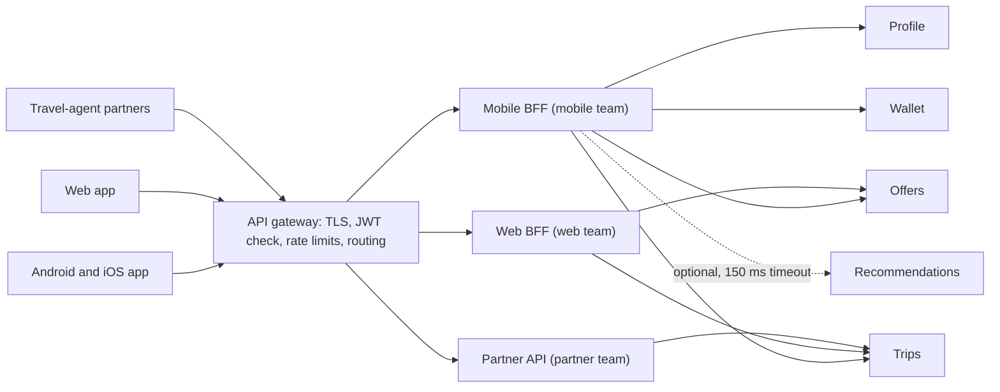
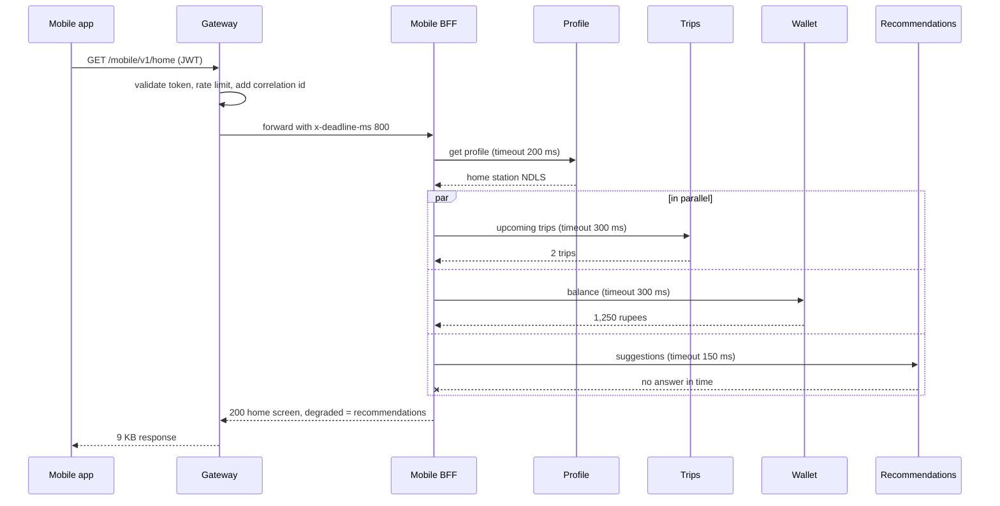

Once a system has more than a handful of services, two questions appear at the edge. *Who checks every request before it gets in?* And *who shapes the data for each kind of screen?* The API gateway answers the first; the Backend for Frontend answers the second. Mixing them up is the most common way to turn a useful edge into a bottleneck.

## Learning objectives

By the end of this lesson you will be able to:

1. Explain the three gateway patterns — routing, offloading and aggregation — and the Backend for Frontend (BFF) pattern, with an analogy and a diagram.
2. Calculate the latency and data savings of aggregation for a mobile client, with arithmetic shown.
3. Decide what belongs in a gateway, in a BFF, and in a domain service.
4. Build a mobile BFF in ASP.NET Core that calls several services in parallel, with per-call timeouts, a deadline budget and graceful degradation.
5. Configure gateway-style offloading in ASP.NET Core: rate limiting, request size limits, correlation ids and output caching.
6. Recognise the failure modes — gateway as a god service, fan-out amplification, accidental caching of personal data — and when a simpler edge is better.

## Prerequisites

- [API gateways, reverse proxies and load balancers](#/lesson/m10-gateways-proxies-lb): the basic L4/L7 vocabulary.
- [Timeouts, retries and backoff with jitter](#/lesson/m10-timeouts-retries): aggregation lives or dies by timeouts.
- [Service boundaries](#/lesson/m16-service-boundaries): a gateway must not hide bad boundaries.

## Explain it like I'm a beginner

Picture a large office complex with fifty companies inside.

**The security desk at the gate (API gateway).** Every visitor passes one desk. The guard checks your ID, scans your bag, gives you a visitor pass, and tells you which tower to go to. The guard does **not** sign contracts for the companies inside — that is not the guard's job. Because everyone goes through one desk, each company does not need its own guard. That is **offloading**: common checks done once, at the edge. Sending you to the right tower is **routing**.

**A personal assistant for each type of visitor (Backend for Frontend).** A courier needs only "which floor, which desk". A visiting CEO needs a meeting room, coffee, and a summary of who is attending — gathered from five companies. Instead of making the CEO walk to five offices, an assistant collects everything and hands over one neat folder. There is a different assistant for couriers and for CEOs, because they need different things. The assistant gathering from five offices is **aggregation**; one assistant per visitor type is the **BFF**.

In software: the security desk is the gateway in front of all services, and the assistants are small back ends, one per client type — mobile app, web app, partner API — each shaping data for its screens.

## First-principles explanation

### The problem without a gateway

Suppose a rail-travel app has six services: Profile, Trips, Offers, Wallet, Recommendations and Notifications. If clients call services directly:

- **Every service** must validate tokens, apply rate limits, handle CORS, enforce TLS, log requests, and reject large payloads. Six implementations, six chances to get security wrong.
- **Clients know the internal layout.** Rename or split a service and every mobile app in the field breaks — and you cannot force users to update.
- **Mobile pays for chattiness.** The home screen needs data from five services. Each call from a phone crosses the mobile network.

### Gateway routing

One public entry point maps external paths to internal services: `/api/trips/*` → Trips cluster, `/api/wallet/*` → Wallet cluster. Clients see one host name. You can move, split or version services behind it. Routing usually also handles **canary splitting** (send 5 % of traffic to a new version) and **path rewriting**.

### Gateway offloading

Move cross-cutting edge concerns into the gateway, done once:

| Concern | Why at the edge |
|---|---|
| TLS termination and certificates | One place to rotate certificates |
| Authentication (validate JWT signature, expiry, audience) | Reject bad tokens before they consume any service capacity |
| Rate limiting and quotas | Protect everything behind with one policy per client or key |
| Request size and header limits | Stop oversized payloads early |
| IP allow/deny lists, web application firewall | Security perimeter |
| CORS | Browser policy in one place |
| Correlation id and access logs | Every request is traceable from the first hop |
| Compression and caching of public responses | Cheaper egress |

Services should still do **authorization** (can *this* user see *this* trip?) — the gateway knows who you are, but only the service knows who owns what. "Zero trust" designs also verify the token again inside services; the gateway's check is a first filter, not the only one.

### Gateway aggregation and the BFF

**Aggregation**: one client request becomes several internal requests, combined into one response. **Backend for Frontend**: a separate aggregation-and-shaping back end per *client experience*, owned by the team that builds that client.

Why per client? Because clients differ:

| | Mobile app | Web app | Partner API (travel agents) |
|---|---|---|---|
| Network | Slow, variable, metered | Fast | Server to server |
| Screen | Small; few fields | Large; dashboards | No screen |
| Release cycle | Weeks; old versions live for years | Daily | Contractual, versioned |
| Needs | Tiny payloads, few round trips, offline hints | Rich data, filtering | Stable, documented, paginated |

One general-purpose API for all three ends up either too chatty for mobile or too bloated for partners. A BFF per client lets each be right.

### Back-of-the-envelope: why aggregation helps mobile

Assumptions (estimates; measure your own): mobile round trip 120 ms on 4G; inside the data centre each service call takes 10–30 ms; 2 million home-screen loads per day.

**Without a BFF.** The app first calls Profile (it needs the user's home station), then Trips, Offers, Wallet and Recommendations. Even if the last four run in parallel, that is two round trips at minimum: 2 × 120 ms = **240 ms** of network alone, plus TLS and server time. Many apps make them sequentially: 5 × 120 ms = **600 ms**.

**With a BFF.** One round trip from the phone (120 ms). Inside the data centre the BFF calls Profile (15 ms), then the other four in parallel (slowest about 30 ms). Total ≈ 120 + 15 + 30 ≈ **165 ms**.

**Payload.** The five raw responses total about 85 KB (full trip objects, all offer fields). The home screen uses about 9 KB of it. Daily mobile data:

- Raw: 85 KB × 2,000,000 ≈ 170 GB per day.
- BFF-trimmed: 9 KB × 2,000,000 ≈ 18 GB per day.

That is a saving for the company's egress bill *and* for users on prepaid data plans.

### What aggregation costs — the added complexity

- **Fan-out amplification.** One request becomes five. At 1,000 home-screen requests per second, downstream services see 5,000. If the BFF retries each failed call twice, a bad minute can become 15,000.
- **Tail latency.** The response waits for the slowest call. If each of five calls has a 1 % chance of being slow, about 4.9 % of home screens are slow (1 − 0.99⁵).
- **Partial failure.** If Recommendations is down, should the home screen fail? Usually not. You must decide, per section, *required* or *optional*.
- **One more hop and one more deployable.** The BFF needs its own scaling, monitoring and on-call.
- **Duplication.** Mobile BFF and web BFF may both call Trips and format dates. Some duplication is the price of independence; extract a shared *library* for truly common code, never a shared *BFF*.

### Failure modes and mitigations

| Failure | What happens | Mitigation |
|---|---|---|
| Gateway outage | Everything is down: it is on every path | Several instances across zones, health-checked behind a cloud load balancer; keep gateway logic simple so it rarely changes |
| Gateway becomes a "god service" | Business rules creep into gateway scripts owned by a platform team; every feature waits for them | Rule: no business logic in the gateway. Business composition goes in BFFs, owned by product teams |
| Slow downstream holds BFF threads | BFF runs out of capacity; all screens slow | Per-call timeouts, an overall deadline, bulkheads per downstream, circuit breakers |
| Retry storms | Retries at client, gateway, BFF and service multiply | Retry at one layer only (usually the BFF), with a budget |
| Personal data cached and served to another user | Serious privacy incident | Cache only public responses at the edge; vary by user if you must cache private ones; `Cache-Control: private` on personal data |
| Token confusion | BFF forwards a user token with too wide a scope, or services trust the gateway blindly | Token exchange or audience-scoped tokens per downstream; services validate tokens too |

### When a simpler alternative is better

- **One client and a few services**: a reverse proxy or a cloud load balancer with path routing is enough. No BFF.
- **A modular monolith**: the monolith *is* the back end for all clients; put mobile-shaped endpoints in a `Mobile` area of the same app.
- **Many different clients needing different fields of the same data**: a GraphQL server lets clients ask for exactly what they need ([see the lesson](#/lesson/m10-graphql)). It is a kind of general-purpose BFF, with its own costs (query cost limits, N+1 resolvers, caching).
- **Internal service-to-service calls**: do not route east-west traffic through the public gateway. That adds a hop and a single point of failure for no gain.

### Products you will meet

YARP (a .NET reverse-proxy library you host in ASP.NET Core), Azure API Management (managed gateway with policies, developer portal, subscriptions — see [the lesson](#/lesson/m15-apim)), Nginx, Envoy, Kong, AWS API Gateway, and Kubernetes Gateway API implementations. A BFF is usually just an ASP.NET Core app (or Node.js app) owned by the client team.

## Visual explanation

### Architecture: one gateway, three BFFs



All three clients enter through one gateway, which does the shared edge work and routes by path to the right BFF. Each BFF is owned by the team that builds its client. The mobile BFF calls four services it needs for the home screen; Recommendations is drawn dotted because it is optional — if it does not answer within 150 ms, the screen shows without it. The web BFF and the partner API call only what they need. Domain services never know which client is asking; they just answer domain questions.

### Sequence: building the home screen with a deadline



The gateway does its checks and forwards the request with a deadline: the whole thing must finish in 800 ms. The BFF needs the profile first (the home station decides which offers and trips matter), then calls three services in parallel, each with its own timeout and never longer than the remaining deadline. Recommendations misses its 150 ms window, so the BFF returns the screen with a `degraded` marker instead of failing it. The app hides that section or shows a cached one.

## Step-by-step example

Scenario: a rail-travel app with 8 million installs. Peak: 1,500 home-screen loads per second during the morning commute. Today the app calls five services directly.

### Step 1 — classify each section

| Section | Source | Required? | Timeout | Fallback |
|---|---|---|---|---|
| Greeting, home station | Profile | Yes | 200 ms | Fail the request (we cannot personalise anything) |
| Upcoming trips | Trips | Yes | 300 ms | Fail — a ticket the user cannot see is a support call |
| Wallet balance | Wallet | No | 300 ms | Show "Balance unavailable", tap to retry |
| Offers | Offers | No | 200 ms | Cached generic offers for the city |
| Recommendations | Recommendations | No | 150 ms | Hide section |

This table is a product decision. Write it down with the product owner.

### Step 2 — set the deadline

The app's own timeout is 2 s. Gateway plus network leave the BFF about 800 ms. Required calls run within that budget; optional calls get the smaller of their own timeout and what remains.

### Step 3 — capacity

1,500 loads/s × 5 downstream calls = 7,500 internal calls per second. Each BFF instance holds at most, say, 1,500 × 0.2 s average duration = 300 concurrent requests across the fleet (Little's law: concurrency = rate × time). Four instances at about 75 concurrent requests each is comfortable for ASP.NET Core's async model; confirm with a load test.

### Step 4 — place edge policies

Gateway: JWT validation, 20 requests per 10 seconds per user on the home endpoint, 1 MB request limit, correlation id. BFF: timeouts, deadline, degradation. Services: authorization ("these are *your* trips").

## Production-style C# implementation

We build the mobile BFF. Downstream clients are typed `HttpClient`s behind interfaces so tests can replace them. The aggregator runs sections in parallel under a deadline. Edge policies (rate limiting, correlation id, output caching of public data) are shown as they would be in a gateway or BFF built on ASP.NET Core.

```text
MobileBff/
  Program.cs
  Downstream/Clients.cs
  Home/DeadlineBudget.cs
  Home/HomeScreenAggregator.cs
  Edge/EdgePolicies.cs
```

```csharp file=Downstream/Clients.cs
using System.Net.Http.Json;

namespace RailApp.MobileBff.Downstream;

public sealed record Profile(Guid UserId, string FirstName, string HomeStationCode);
public sealed record Trip(string Pnr, string TrainNumber, string From, string To, DateTimeOffset Departure, string Coach, string Berth);
public sealed record WalletBalance(decimal Rupees);
public sealed record Offer(string Code, string Title);
public sealed record Suggestion(string From, string To, string Reason);

public interface IProfileClient { Task<Profile> GetAsync(Guid userId, CancellationToken ct); }
public interface ITripsClient { Task<IReadOnlyList<Trip>> UpcomingAsync(Guid userId, int max, CancellationToken ct); }
public interface IWalletClient { Task<WalletBalance> BalanceAsync(Guid userId, CancellationToken ct); }
public interface IOffersClient { Task<IReadOnlyList<Offer>> ForStationAsync(string stationCode, CancellationToken ct); }
public interface IRecommendationsClient { Task<IReadOnlyList<Suggestion>> ForUserAsync(Guid userId, CancellationToken ct); }

// Typed HttpClients. Base addresses and handlers are configured in Program.cs.
public sealed class ProfileClient(HttpClient http) : IProfileClient
{
    public async Task<Profile> GetAsync(Guid userId, CancellationToken ct) =>
        await http.GetFromJsonAsync<Profile>($"/profiles/{userId}", ct)
        ?? throw new InvalidOperationException("Profile service returned an empty body.");
}

public sealed class TripsClient(HttpClient http) : ITripsClient
{
    public async Task<IReadOnlyList<Trip>> UpcomingAsync(Guid userId, int max, CancellationToken ct) =>
        await http.GetFromJsonAsync<List<Trip>>($"/users/{userId}/trips?status=upcoming&limit={max}", ct) ?? [];
}

public sealed class WalletClient(HttpClient http) : IWalletClient
{
    public async Task<WalletBalance> BalanceAsync(Guid userId, CancellationToken ct) =>
        await http.GetFromJsonAsync<WalletBalance>($"/wallets/{userId}/balance", ct)
        ?? throw new InvalidOperationException("Wallet service returned an empty body.");
}

public sealed class OffersClient(HttpClient http) : IOffersClient
{
    public async Task<IReadOnlyList<Offer>> ForStationAsync(string stationCode, CancellationToken ct) =>
        await http.GetFromJsonAsync<List<Offer>>($"/offers?station={Uri.EscapeDataString(stationCode)}", ct) ?? [];
}

public sealed class RecommendationsClient(HttpClient http) : IRecommendationsClient
{
    public async Task<IReadOnlyList<Suggestion>> ForUserAsync(Guid userId, CancellationToken ct) =>
        await http.GetFromJsonAsync<List<Suggestion>>($"/users/{userId}/suggestions", ct) ?? [];
}
```

A **deadline budget** turns "the whole request must finish in 800 ms" into a timeout for each call. It is propagated downstream as a header, so services can stop work nobody is waiting for.

```csharp file=Home/DeadlineBudget.cs
using System.Globalization;

namespace RailApp.MobileBff.Home;

public sealed class DeadlineBudget
{
    public const string HeaderName = "x-deadline-ms";
    private readonly TimeProvider _clock;
    private readonly DateTimeOffset _deadline;

    public DeadlineBudget(TimeProvider clock, TimeSpan total)
    {
        _clock = clock;
        _deadline = clock.GetUtcNow() + (total < TimeSpan.Zero ? TimeSpan.Zero : total);
    }

    /// <summary>Reads a relative deadline (milliseconds) from the gateway; falls back to a default, never above max.</summary>
    public static DeadlineBudget FromHeader(TimeProvider clock, string? header, TimeSpan fallback, TimeSpan max)
    {
        var total = int.TryParse(header, NumberStyles.None, CultureInfo.InvariantCulture, out var ms) && ms > 0
            ? TimeSpan.FromMilliseconds(ms)
            : fallback;
        return new DeadlineBudget(clock, total > max ? max : total);
    }

    public TimeSpan Remaining
    {
        get
        {
            var left = _deadline - _clock.GetUtcNow();
            return left > TimeSpan.Zero ? left : TimeSpan.Zero;
        }
    }

    public bool IsExpired => Remaining == TimeSpan.Zero;

    /// <summary>Timeout for one downstream call: its own cap, but never more than what is left minus a reserve
    /// for building the response.</summary>
    public TimeSpan TimeoutFor(TimeSpan perCallCap, TimeSpan reserve)
    {
        var available = Remaining - reserve;
        if (available <= TimeSpan.Zero) return TimeSpan.Zero;
        return perCallCap < available ? perCallCap : available;
    }

    /// <summary>Value to send downstream: what is left, minus an allowance for the network hop.</summary>
    public string ToHeaderValue(TimeSpan networkAllowance)
    {
        var ms = (long)Math.Floor((Remaining - networkAllowance).TotalMilliseconds);
        return Math.Max(0, ms).ToString(CultureInfo.InvariantCulture);
    }
}
```

```csharp file=Home/HomeScreenAggregator.cs
using Microsoft.Extensions.Logging;
using RailApp.MobileBff.Downstream;

namespace RailApp.MobileBff.Home;

/// <summary>Mobile-shaped response: only what the home screen draws.</summary>
public sealed record HomeScreen(
    string Greeting,
    IReadOnlyList<HomeTrip> Trips,
    string? WalletText,
    IReadOnlyList<string> Offers,
    IReadOnlyList<string> Suggestions,
    IReadOnlyList<string> Degraded);

public sealed record HomeTrip(string Pnr, string Title, string DepartsAt, string Seat);

public sealed class RequiredSectionFailedException(string section, Exception inner)
    : Exception($"Required section '{section}' failed.", inner)
{
    public string Section { get; } = section;
}

public sealed class HomeScreenAggregator(
    IProfileClient profiles, ITripsClient trips, IWalletClient wallet, IOffersClient offers,
    IRecommendationsClient recommendations, ILogger<HomeScreenAggregator> logger)
{
    private static readonly TimeSpan Reserve = TimeSpan.FromMilliseconds(20);
    private static readonly TimeZoneInfo India = TimeZoneInfo.CreateCustomTimeZone("IST", TimeSpan.FromHours(5.5), "IST", "IST");

    public async Task<HomeScreen> BuildAsync(Guid userId, DeadlineBudget budget, CancellationToken requestAborted)
    {
        var degraded = new List<string>();

        // Step 1: required and needed by later calls.
        var profile = await Required("profile", budget.TimeoutFor(TimeSpan.FromMilliseconds(200), Reserve),
            ct => profiles.GetAsync(userId, ct), requestAborted);

        // Step 2: everything else in parallel, each with its own timeout inside the shared deadline.
        var tripsTask = Required("trips", budget.TimeoutFor(TimeSpan.FromMilliseconds(300), Reserve),
            ct => trips.UpcomingAsync(userId, 3, ct), requestAborted);
        var walletTask = Optional("wallet", budget.TimeoutFor(TimeSpan.FromMilliseconds(300), Reserve),
            ct => wallet.BalanceAsync(userId, ct), requestAborted, degraded);
        var offersTask = Optional("offers", budget.TimeoutFor(TimeSpan.FromMilliseconds(200), Reserve),
            ct => offers.ForStationAsync(profile.HomeStationCode, ct), requestAborted, degraded);
        var suggestionsTask = Optional("recommendations", budget.TimeoutFor(TimeSpan.FromMilliseconds(150), Reserve),
            ct => recommendations.ForUserAsync(userId, ct), requestAborted, degraded);

        await Task.WhenAll(tripsTask, walletTask, offersTask, suggestionsTask);

        var balance = await walletTask;
        return new HomeScreen(
            Greeting: $"Hello, {profile.FirstName}",
            Trips: (await tripsTask).Select(ToHomeTrip).ToList(),
            WalletText: balance is null ? null : $"₹{balance.Rupees:N0}",
            Offers: ((await offersTask) ?? []).Take(3).Select(o => o.Title).ToList(),
            Suggestions: ((await suggestionsTask) ?? []).Take(2).Select(s => $"{s.From} → {s.To}").ToList(),
            Degraded: degraded.Order(StringComparer.Ordinal).ToList());
    }

    private static HomeTrip ToHomeTrip(Trip t) => new(
        t.Pnr,
        $"{t.TrainNumber}: {t.From} → {t.To}",
        TimeZoneInfo.ConvertTime(t.Departure, India).ToString("ddd d MMM, HH:mm", System.Globalization.CultureInfo.InvariantCulture),
        $"{t.Coach}/{t.Berth}");

    private static async Task<T> Required<T>(string section, TimeSpan timeout, Func<CancellationToken, Task<T>> call, CancellationToken aborted)
    {
        using var cts = CancellationTokenSource.CreateLinkedTokenSource(aborted);
        cts.CancelAfter(timeout);
        try { return await call(cts.Token); }
        catch (Exception ex) when (!aborted.IsCancellationRequested)
        {
            throw new RequiredSectionFailedException(section, ex);
        }
    }

    private async Task<T?> Optional<T>(string section, TimeSpan timeout, Func<CancellationToken, Task<T>> call,
        CancellationToken aborted, List<string> degraded) where T : class
    {
        if (timeout == TimeSpan.Zero) { lock (degraded) degraded.Add(section); return null; }   // no budget left: do not even call
        using var cts = CancellationTokenSource.CreateLinkedTokenSource(aborted);
        cts.CancelAfter(timeout);
        try { return await call(cts.Token); }
        catch (Exception ex) when (!aborted.IsCancellationRequested)
        {
            logger.LogWarning(ex, "Optional section {Section} degraded after {TimeoutMs} ms budget", section, timeout.TotalMilliseconds);
            lock (degraded) degraded.Add(section);
            return null;
        }
    }
}
```

Edge policies. In a dedicated gateway (YARP, Azure API Management, Envoy) these are configuration; in a BFF built on ASP.NET Core they are a few lines of middleware:

```csharp file=Edge/EdgePolicies.cs
using System.Security.Claims;
using System.Threading.RateLimiting;
using Microsoft.AspNetCore.RateLimiting;

namespace RailApp.MobileBff.Edge;

public static class EdgePolicies
{
    public const string PerUserPolicy = "per-user";
    public const string CorrelationHeader = "x-correlation-id";

    public static IServiceCollection AddEdgePolicies(this IServiceCollection services)
    {
        services.AddRateLimiter(options =>
        {
            options.RejectionStatusCode = StatusCodes.Status429TooManyRequests;
            // 20 requests per 10 seconds per signed-in user; anonymous callers are limited per IP address.
            options.AddPolicy(PerUserPolicy, http =>
            {
                var key = http.User.FindFirstValue(ClaimTypes.NameIdentifier)
                          ?? http.Connection.RemoteIpAddress?.ToString()
                          ?? "unknown";
                return RateLimitPartition.GetFixedWindowLimiter(key, _ => new FixedWindowRateLimiterOptions
                {
                    PermitLimit = 20,
                    Window = TimeSpan.FromSeconds(10),
                    QueueLimit = 0,
                });
            });
        });

        // Public, non-personal data only. Never cache a response that depends on the caller's identity here.
        services.AddOutputCache(o => o.AddPolicy("public-60s", b => b.Expire(TimeSpan.FromSeconds(60)).SetVaryByQuery("station")));
        return services;
    }

    /// <summary>Ensures every request has a correlation id, echoes it to the client and puts it in log scopes.</summary>
    public static IApplicationBuilder UseCorrelationId(this IApplicationBuilder app) =>
        app.Use(async (context, next) =>
        {
            var id = context.Request.Headers[CorrelationHeader].FirstOrDefault();
            if (string.IsNullOrWhiteSpace(id) || id.Length > 64) id = Guid.NewGuid().ToString("N");
            context.Request.Headers[CorrelationHeader] = id;
            context.Response.Headers[CorrelationHeader] = id;
            var logger = context.RequestServices.GetRequiredService<ILoggerFactory>().CreateLogger("Edge");
            using (logger.BeginScope(new Dictionary<string, object> { ["CorrelationId"] = id }))
                await next(context);
        });
}
```

```csharp file=Program.cs
using System.Security.Claims;
using RailApp.MobileBff.Downstream;
using RailApp.MobileBff.Edge;
using RailApp.MobileBff.Home;

var builder = WebApplication.CreateBuilder(args);

builder.Services.AddSingleton(TimeProvider.System);
builder.Services.AddEdgePolicies();
builder.Services.AddScoped<HomeScreenAggregator>();

// Each downstream gets its own typed client (and therefore its own connection pool).
// No HttpClient.Timeout here: the aggregator's per-call deadline is the timeout.
builder.Services.AddHttpClient<IProfileClient, ProfileClient>(c => c.BaseAddress = new Uri("http://profile"));
builder.Services.AddHttpClient<ITripsClient, TripsClient>(c => c.BaseAddress = new Uri("http://trips"));
builder.Services.AddHttpClient<IWalletClient, WalletClient>(c => c.BaseAddress = new Uri("http://wallet"));
builder.Services.AddHttpClient<IOffersClient, OffersClient>(c => c.BaseAddress = new Uri("http://offers"));
builder.Services.AddHttpClient<IRecommendationsClient, RecommendationsClient>(c => c.BaseAddress = new Uri("http://recommendations"));

var app = builder.Build();

app.UseCorrelationId();
app.UseRateLimiter();
app.UseOutputCache();

app.MapGet("/mobile/v1/home", async (HttpContext http, HomeScreenAggregator aggregator, TimeProvider clock) =>
{
    // Authentication (JWT validation) is configured at the gateway and again here in production;
    // the user id comes from the validated token, never from a query string.
    if (!Guid.TryParse(http.User.FindFirstValue(ClaimTypes.NameIdentifier), out var userId))
        return Results.Unauthorized();

    var budget = DeadlineBudget.FromHeader(clock, http.Request.Headers[DeadlineBudget.HeaderName],
        fallback: TimeSpan.FromMilliseconds(800), max: TimeSpan.FromSeconds(2));
    try
    {
        var screen = await aggregator.BuildAsync(userId, budget, http.RequestAborted);
        http.Response.Headers.CacheControl = "private, no-store";   // personal data
        return Results.Ok(screen);
    }
    catch (RequiredSectionFailedException ex)
    {
        return Results.Problem($"Home screen unavailable ({ex.Section}).", statusCode: StatusCodes.Status503ServiceUnavailable);
    }
}).RequireRateLimiting(EdgePolicies.PerUserPolicy);

// Public offers for a station: same for everyone, safe to cache at the edge.
app.MapGet("/mobile/v1/offers", async (string station, IOffersClient offers, CancellationToken ct) =>
    Results.Ok((await offers.ForStationAsync(station, ct)).Select(o => o.Title)))
   .CacheOutput("public-60s");

app.Run();
```

For pure routing and offloading, YARP keeps the gateway declarative. A route table in `appsettings.json` (shown without compiling, since YARP is a separate package):

```json
{
  "ReverseProxy": {
    "Routes": {
      "mobile": { "ClusterId": "mobile-bff", "Match": { "Path": "/mobile/{**rest}" }, "RateLimiterPolicy": "per-user" },
      "partners": { "ClusterId": "partner-api", "Match": { "Path": "/partners/v2/{**rest}" },
                    "Transforms": [ { "PathRemovePrefix": "/partners" } ] }
    },
    "Clusters": {
      "mobile-bff": { "Destinations": { "a": { "Address": "http://mobile-bff-1:8080" }, "b": { "Address": "http://mobile-bff-2:8080" } } },
      "partner-api": { "Destinations": { "a": { "Address": "http://partner-api:8080" } } }
    }
  }
}
```

**Design notes**

- The BFF's response contains display-ready strings (`₹1,250`, `Mon 20 Oct, 07:15`). That is deliberate: it lets the mobile team fix formatting without an app release. The domain services stay format-free.
- The `Degraded` list lets the app decide how to show missing sections, and gives you a metric: "percentage of home screens degraded, by section".
- Retries are absent on purpose. With 5 downstream calls and a tight deadline, a retry rarely fits. If you add one, add it only in the BFF and only for idempotent reads with remaining budget.

## Bad design vs good design

**Bad: business logic in the gateway.**

```text
# gateway policy script, owned by the platform team
if (request.path == "/api/checkout") {
    total = call("pricing", body) * (user.tier == "gold" ? 0.9 : 1.0)   # discount rule
    if (total > 50000) call("fraud", body)                              # risk rule
    forward("orders", body + { total })
}
```

Why it is bad: discount and fraud rules now live in a place the product teams cannot test or deploy; every pricing change queues behind the platform team; the gateway, which is on every request path, now changes weekly and can break *everything*. This is the "gateway as god service" anti-pattern, a cousin of the enterprise service bus that did the same thing a generation ago.

**Good:** the gateway authenticates, rate-limits and routes `/api/checkout` to the Checkout service (or the web/mobile BFF, which calls Checkout). Checkout owns the discount rule; Risk owns the fraud rule. The gateway configuration changes rarely and is boring — which is exactly what you want from something on every path.

:::callout type=mistake title="One BFF for every client"
A single "BFF" shared by mobile, web and partners is just a general-purpose API with an extra hop. The pattern's value comes from *one back end per client experience, owned by that client's team*.
:::

:::callout type=warning title="Edge caching and personal data"
Output caching at the gateway or BFF is powerful and dangerous. A cached `/home` response served to the wrong user is a data breach. Cache only responses that are identical for every caller, mark personal ones `Cache-Control: private, no-store`, and test it.
:::

## Practical playground

The graph below shows the rail app before the redesign: three clients calling six services directly, with each service doing its own token validation and rate limiting. Add a gateway and per-client BFFs. Then mark which edges are optional, and count how many calls a phone makes for one home screen before and after.

:::playground type=hld title="Put a gateway and BFFs in front of the rail app"
```json
{
  "nodes": [
    { "id": "mob", "type": "client", "label": "Mobile app", "props": { "rps": 1500 } },
    { "id": "web", "type": "client", "label": "Web app", "props": { "rps": 400 } },
    { "id": "partner", "type": "client", "label": "Travel-agent partners", "props": { "rps": 200 } },
    { "id": "profile", "type": "app-server", "label": "Profile" },
    { "id": "trips", "type": "app-server", "label": "Trips" },
    { "id": "offers", "type": "app-server", "label": "Offers" },
    { "id": "wallet", "type": "app-server", "label": "Wallet" },
    { "id": "recs", "type": "app-server", "label": "Recommendations" },
    { "id": "notif", "type": "app-server", "label": "Notifications" }
  ],
  "edges": [
    { "from": "mob", "to": "profile", "kind": "sync" },
    { "from": "mob", "to": "trips", "kind": "sync" },
    { "from": "mob", "to": "offers", "kind": "sync" },
    { "from": "mob", "to": "wallet", "kind": "sync" },
    { "from": "mob", "to": "recs", "kind": "sync" },
    { "from": "web", "to": "profile", "kind": "sync" },
    { "from": "web", "to": "trips", "kind": "sync" },
    { "from": "web", "to": "offers", "kind": "sync" },
    { "from": "partner", "to": "trips", "kind": "sync" },
    { "from": "trips", "to": "notif", "kind": "async" }
  ]
}
```
:::

## Exercises

:::exercise id=m16-gateway-bff-ex1 difficulty=beginner kind=written title="Gateway, BFF or service?"
For each responsibility, say whether it belongs in the **API gateway**, a **BFF**, or a **domain service**, and give a one-line reason.

1. Validating the JWT signature and expiry.
2. Deciding whether user 42 may cancel PNR 8401236.
3. Combining profile, trips and wallet into one home-screen response.
4. Limiting each partner API key to 100 requests per second.
5. Calculating the cancellation refund amount.
6. Renaming `departureTime` to `departs` for Android app version 3.x still in the field.
7. Sending 5 % of traffic to version 2 of the Trips service.
8. Hiding the wallet section when the Wallet service times out.
::acceptance
- All eight items assigned, each with a reason.
- Authorization (item 2) and business rules (item 5) are kept in the domain service.
- Client-specific shaping (items 3, 6, 8) is in the BFF.
::hint
Ask: is this the same for every client and every service? Then it is probably edge (gateway).
::hint
Ask: is this about how one particular client wants data? Then BFF.
::hint
Ask: does it need business knowledge or ownership data? Then the domain service.
::solution
1. **Gateway** — identical for all requests; reject bad tokens before they cost anything. (Services may re-validate as defence in depth.)
2. **Domain service (Trips)** — only Trips knows who owns the booking. The gateway knows *who* the user is, not *what they own*.
3. **Mobile BFF** — composition for one client's screen.
4. **Gateway** — a per-key quota is a uniform edge policy (often with a developer portal, as in Azure API Management).
5. **Domain service** — refund rules are business logic; they must be the same whichever client asks.
6. **Mobile BFF** — client-version-specific shape. The service keeps its own name; the BFF maps it for old app versions.
7. **Gateway** (or the deployment platform / service mesh) — traffic splitting is routing.
8. **Mobile BFF** — degradation policy for one screen.
::mistakes
- Putting authorization in the gateway because "it already has the token".
- Putting the refund calculation in the BFF, so web and mobile drift apart.
:::

:::exercise id=m16-gateway-bff-ex2 difficulty=beginner kind=code title="Longest-prefix gateway routing"
Implement the routing core of a gateway: given route definitions (path prefix → cluster, optional prefix stripping), find the route for a request path.
::requirements
- A prefix matches only at segment boundaries: `/api/trips` matches `/api/trips` and `/api/trips/42` but **not** `/api/tripsearch`.
- When several prefixes match, the **longest** wins.
- Matching is case-insensitive; the forwarded path keeps the request's original case.
- If `StripPrefix` is true, the forwarded path is the rest after the prefix (`/api/trips/42` → `/42`); an empty rest becomes `/`. Otherwise the full path is forwarded.
- Return `null` when nothing matches.
::acceptance
- `/api/trips/42` with routes `/api` and `/api/trips` chooses `/api/trips`.
- `/api/tripsearch` does not match `/api/trips`.
- Stripping works, including the empty-rest case.
::hint
"Segment boundary" means: the path equals the prefix, or the character right after the prefix is `/`.
::hint
Sort candidate routes by prefix length, descending, and take the first that matches.
::hint
Normalise a trailing slash on prefixes (`/api/` → `/api`) once, in the constructor.
::hint
```csharp
bool Matches(string path, string prefix) =>
    path.StartsWith(prefix, StringComparison.OrdinalIgnoreCase) &&
    (path.Length == prefix.Length || path[prefix.Length] == '/');
```
::starter
```csharp file=PrefixRouter.cs
using System;
using System.Collections.Generic;
using System.Linq;

public sealed record RouteDefinition(string Prefix, string Cluster, bool StripPrefix = false);
public sealed record RouteMatch(string Cluster, string ForwardPath);

public sealed class PrefixRouter
{
    public PrefixRouter(IEnumerable<RouteDefinition> routes) => throw new NotImplementedException();
    public RouteMatch? Match(string path) => throw new NotImplementedException();
}
```
::tests
```csharp file=PrefixRouterTests.cs
using Xunit;

public class PrefixRouterTests
{
    private static PrefixRouter Router() => new(new[]
    {
        new RouteDefinition("/api", "legacy"),
        new RouteDefinition("/api/trips", "trips", StripPrefix: true),
        new RouteDefinition("/mobile/", "mobile-bff"),
    });

    [Fact] public void Longest_prefix_wins() =>
        Assert.Equal(new RouteMatch("trips", "/42"), Router().Match("/api/trips/42"));

    [Fact] public void Prefix_must_end_at_segment_boundary() =>
        Assert.Equal(new RouteMatch("legacy", "/api/tripsearch"), Router().Match("/api/tripsearch"));

    [Fact] public void Exact_prefix_with_strip_gives_root() =>
        Assert.Equal(new RouteMatch("trips", "/"), Router().Match("/api/trips"));

    [Fact] public void Case_insensitive_match_keeps_original_case() =>
        Assert.Equal(new RouteMatch("trips", "/ABC"), Router().Match("/API/Trips/ABC"));

    [Fact] public void Trailing_slash_in_prefix_is_normalised() =>
        Assert.Equal(new RouteMatch("mobile-bff", "/mobile/v1/home"), Router().Match("/mobile/v1/home"));

    [Fact] public void No_match_returns_null() =>
        Assert.Null(Router().Match("/admin"));
}
```
::solution
```csharp file=PrefixRouter.cs
using System;
using System.Collections.Generic;
using System.Linq;

public sealed record RouteDefinition(string Prefix, string Cluster, bool StripPrefix = false);
public sealed record RouteMatch(string Cluster, string ForwardPath);

public sealed class PrefixRouter
{
    private readonly RouteDefinition[] _routes;

    public PrefixRouter(IEnumerable<RouteDefinition> routes)
    {
        ArgumentNullException.ThrowIfNull(routes);
        _routes = routes
            .Select(r => r with { Prefix = Normalise(r.Prefix) })
            .OrderByDescending(r => r.Prefix.Length)
            .ToArray();
    }

    public RouteMatch? Match(string path)
    {
        if (string.IsNullOrEmpty(path) || path[0] != '/') return null;
        foreach (var r in _routes)
        {
            if (!Matches(path, r.Prefix)) continue;
            if (!r.StripPrefix) return new RouteMatch(r.Cluster, path);
            var rest = path[r.Prefix.Length..];
            return new RouteMatch(r.Cluster, rest.Length == 0 ? "/" : rest);
        }
        return null;
    }

    private static bool Matches(string path, string prefix) =>
        prefix == "/" ||
        (path.StartsWith(prefix, StringComparison.OrdinalIgnoreCase) &&
         (path.Length == prefix.Length || path[prefix.Length] == '/'));

    private static string Normalise(string prefix)
    {
        if (string.IsNullOrWhiteSpace(prefix) || prefix[0] != '/')
            throw new ArgumentException($"Route prefix '{prefix}' must start with '/'.", nameof(prefix));
        return prefix.Length > 1 ? prefix.TrimEnd('/') : prefix;
    }
}
```
Real gateways (YARP, Envoy) compile routes into a tree or trie for speed, and also match on host, method and headers. The segment-boundary rule is the part teams most often get wrong — and it can be a security bug when `/admin` accidentally matches `/administrator-tools`.
::mistakes
- Plain `StartsWith`, so `/api/trips` captures `/api/tripsearch`.
- Choosing the first registered match instead of the longest.
- Lower-casing the forwarded path, which breaks case-sensitive downstream ids.
::extensions
Add host-based matching (`partners.example.in` versus `api.example.in`) and weighted destinations for canary releases.
:::

:::exercise id=m16-gateway-bff-ex3 difficulty=intermediate kind=code title="Parallel aggregation with required and optional sections"
Write a small generic aggregator for BFFs: run several named sections in parallel, each with its own timeout; required failures fail the whole result; optional failures are recorded as degraded.
::requirements
- `AddRequired(name, timeout, call)` and `AddOptional(name, timeout, call)` register sections; `call` receives a `CancellationToken` and returns `Task<object?>`.
- `RunAsync(ct)` starts all sections at once and returns an `AggregateResult` with `Values` (name → value) for successful sections and `Degraded` (sorted names) for failed optional ones.
- A section that exceeds its timeout must be **cancelled** (its token fires) and counts as failed.
- If any required section fails, throw `RequiredSectionException` whose `Section` is the failed section name (if several fail, any of them).
- If the caller's token is cancelled, throw `OperationCanceledException` (do not report degradation).
::acceptance
- Three fast sections → all values present, nothing degraded.
- A slow optional section → degraded, and its token was cancelled.
- A failing required section → `RequiredSectionException`.
- Total time is close to the slowest section's timeout, not the sum.
::hint
Each section becomes one task. Start them all, then `await Task.WhenAll(...)`.
::hint
Per section: `CancellationTokenSource.CreateLinkedTokenSource(ct)` then `CancelAfter(timeout)`.
::hint
Catch exceptions *inside* each section's wrapper, and return a small result record (`Name`, `Ok`, `Value`, `Error`), so `WhenAll` never throws.
::hint
After `WhenAll`, first check `ct.ThrowIfCancellationRequested()`, then look for a failed required section, then build the result.
::starter
```csharp file=SectionAggregator.cs
using System;
using System.Collections.Generic;
using System.Linq;
using System.Threading;
using System.Threading.Tasks;

public sealed record AggregateResult(IReadOnlyDictionary<string, object?> Values, IReadOnlyList<string> Degraded);

public sealed class RequiredSectionException(string section, Exception? inner)
    : Exception($"Required section '{section}' failed.", inner)
{
    public string Section { get; } = section;
}

public sealed class SectionAggregator
{
    public SectionAggregator AddRequired(string name, TimeSpan timeout, Func<CancellationToken, Task<object?>> call) =>
        throw new NotImplementedException();

    public SectionAggregator AddOptional(string name, TimeSpan timeout, Func<CancellationToken, Task<object?>> call) =>
        throw new NotImplementedException();

    public Task<AggregateResult> RunAsync(CancellationToken ct) => throw new NotImplementedException();
}
```
::tests
```csharp file=SectionAggregatorTests.cs
using System;
using System.Diagnostics;
using System.Threading;
using System.Threading.Tasks;
using Xunit;

public class SectionAggregatorTests
{
    private static Func<CancellationToken, Task<object?>> Value(object v) => _ => Task.FromResult<object?>(v);

    [Fact]
    public async Task All_fast_sections_succeed()
    {
        var result = await new SectionAggregator()
            .AddRequired("profile", TimeSpan.FromSeconds(2), Value("Asha"))
            .AddOptional("wallet", TimeSpan.FromSeconds(2), Value(1250m))
            .AddOptional("offers", TimeSpan.FromSeconds(2), Value("none"))
            .RunAsync(CancellationToken.None);
        Assert.Equal("Asha", result.Values["profile"]);
        Assert.Equal(1250m, result.Values["wallet"]);
        Assert.Empty(result.Degraded);
    }

    [Fact]
    public async Task Slow_optional_is_cancelled_and_degraded()
    {
        var cancelled = false;
        var sw = Stopwatch.StartNew();
        var result = await new SectionAggregator()
            .AddRequired("profile", TimeSpan.FromSeconds(2), Value("Asha"))
            .AddOptional("recs", TimeSpan.FromMilliseconds(100), async ct =>
            {
                try { await Task.Delay(TimeSpan.FromSeconds(10), ct); }
                catch (OperationCanceledException) { cancelled = true; throw; }
                return "late";
            })
            .RunAsync(CancellationToken.None);
        sw.Stop();
        Assert.Equal(new[] { "recs" }, result.Degraded);
        Assert.False(result.Values.ContainsKey("recs"));
        Assert.True(cancelled);
        Assert.True(sw.Elapsed < TimeSpan.FromSeconds(5), $"took {sw.Elapsed}");
    }

    [Fact]
    public async Task Failing_required_section_throws()
    {
        var ex = await Assert.ThrowsAsync<RequiredSectionException>(() => new SectionAggregator()
            .AddRequired("trips", TimeSpan.FromSeconds(2), _ => throw new InvalidOperationException("boom"))
            .AddOptional("wallet", TimeSpan.FromSeconds(2), Value(1m))
            .RunAsync(CancellationToken.None));
        Assert.Equal("trips", ex.Section);
    }

    [Fact]
    public async Task Sections_run_in_parallel()
    {
        var sw = Stopwatch.StartNew();
        Func<CancellationToken, Task<object?>> slow = async ct => { await Task.Delay(300, ct); return 1; };
        await new SectionAggregator()
            .AddRequired("a", TimeSpan.FromSeconds(3), slow)
            .AddRequired("b", TimeSpan.FromSeconds(3), slow)
            .AddRequired("c", TimeSpan.FromSeconds(3), slow)
            .AddRequired("d", TimeSpan.FromSeconds(3), slow)
            .RunAsync(CancellationToken.None);
        sw.Stop();
        Assert.True(sw.Elapsed < TimeSpan.FromMilliseconds(1100), $"took {sw.Elapsed}");
    }

    [Fact]
    public async Task Caller_cancellation_wins()
    {
        using var cts = new CancellationTokenSource();
        cts.Cancel();
        await Assert.ThrowsAnyAsync<OperationCanceledException>(() => new SectionAggregator()
            .AddOptional("x", TimeSpan.FromSeconds(1), async ct => { await Task.Delay(1000, ct); return 1; })
            .RunAsync(cts.Token));
    }
}
```
::solution
```csharp file=SectionAggregator.cs
using System;
using System.Collections.Generic;
using System.Linq;
using System.Threading;
using System.Threading.Tasks;

public sealed record AggregateResult(IReadOnlyDictionary<string, object?> Values, IReadOnlyList<string> Degraded);

public sealed class RequiredSectionException(string section, Exception? inner)
    : Exception($"Required section '{section}' failed.", inner)
{
    public string Section { get; } = section;
}

public sealed class SectionAggregator
{
    private sealed record Section(string Name, bool Required, TimeSpan Timeout, Func<CancellationToken, Task<object?>> Call);
    private sealed record Outcome(Section Section, bool Ok, object? Value, Exception? Error);

    private readonly List<Section> _sections = new();

    public SectionAggregator AddRequired(string name, TimeSpan timeout, Func<CancellationToken, Task<object?>> call) =>
        Add(new Section(name, true, timeout, call));

    public SectionAggregator AddOptional(string name, TimeSpan timeout, Func<CancellationToken, Task<object?>> call) =>
        Add(new Section(name, false, timeout, call));

    private SectionAggregator Add(Section s)
    {
        if (_sections.Any(x => x.Name == s.Name)) throw new ArgumentException($"Duplicate section '{s.Name}'.");
        _sections.Add(s);
        return this;
    }

    public async Task<AggregateResult> RunAsync(CancellationToken ct)
    {
        ct.ThrowIfCancellationRequested();
        var outcomes = await Task.WhenAll(_sections.Select(s => RunOne(s, ct)));
        ct.ThrowIfCancellationRequested();

        var failedRequired = outcomes.FirstOrDefault(o => !o.Ok && o.Section.Required);
        if (failedRequired is not null) throw new RequiredSectionException(failedRequired.Section.Name, failedRequired.Error);

        return new AggregateResult(
            outcomes.Where(o => o.Ok).ToDictionary(o => o.Section.Name, o => o.Value),
            outcomes.Where(o => !o.Ok).Select(o => o.Section.Name).Order(StringComparer.Ordinal).ToList());
    }

    private static async Task<Outcome> RunOne(Section s, CancellationToken ct)
    {
        using var cts = CancellationTokenSource.CreateLinkedTokenSource(ct);
        cts.CancelAfter(s.Timeout);
        try
        {
            // Task.Run guards against a call that blocks or throws synchronously before its first await.
            var value = await Task.Run(() => s.Call(cts.Token), cts.Token);
            return new Outcome(s, true, value, null);
        }
        catch (Exception ex)
        {
            return new Outcome(s, false, null, ex);
        }
    }
}
```
Why wrap failures into `Outcome` instead of letting `WhenAll` throw? `WhenAll` surfaces only the first exception and you lose the others' results. Collecting outcomes gives you every section's status — useful for metrics like "percentage of responses degraded per section".

The timeout only helps if the downstream call **honours the token**. `HttpClient` does; a synchronous database driver call might not. A call that ignores cancellation still occupies a thread or connection after you have given up on it.
::mistakes
- Awaiting sections one by one (`await a; await b;`) — total time becomes the sum.
- Using `Task.WhenAny(call, Task.Delay(timeout))` without cancelling the losing call, so abandoned work keeps running and piles up under load.
- Reporting degradation when the *caller* cancelled; that is not a downstream failure and should not page anyone.
::extensions
Add a shared `DeadlineBudget` so each section's timeout is `min(own timeout, remaining budget)`, and skip optional sections entirely when the budget is nearly spent.
:::

:::exercise id=m16-gateway-bff-ex4 difficulty=intermediate kind=hld title="Edge design for a city services super-app"
A municipal corporation launches one app for property tax, water bills, grievances and bus passes. Clients: Android/iOS app (2 million users, peak 3,000 RPS at month-end bill dates), a web portal (800 RPS), kiosks at ward offices (50 RPS, old browsers, shared devices) and a bank partner API for bill payment (300 RPS, strict SLA). Five domain services already exist. Design the edge: gateway(s), BFFs, policies, and what each client's home or main screen calls.
::acceptance
- One gateway layer with named offloaded policies (auth, rate limits, size limits, WAF).
- A BFF decision per client, with a reason (including where a BFF is *not* needed).
- Kiosk-specific concerns addressed (shared devices, session handling, caching).
- Partner traffic isolated so app spikes cannot breach the bank's SLA.
- Arithmetic for month-end fan-out at the mobile BFF.
- The graph includes `api-gateway`, at least two BFFs as `app-server`, and a `rate-limiter` or policy note.
::hint
Do the bank and the citizens need the same rate limits, the same authentication method, or even the same gateway instances?
::hint
Kiosks are shared: what must never be cached or remembered on them?
::hint
If the mobile home screen calls 4 services at 3,000 RPS, what is the internal call rate? Which sections are optional?
::hint
Is a web BFF needed if the web portal's screens mirror the mobile ones? Could the web reuse the mobile BFF, or would that break ownership?
::starter
```json
{
  "nodes": [
    { "id": "mob", "type": "client", "label": "Citizen app", "props": { "rps": 3000 } },
    { "id": "web", "type": "client", "label": "Web portal", "props": { "rps": 800 } },
    { "id": "kiosk", "type": "client", "label": "Ward-office kiosks", "props": { "rps": 50 } },
    { "id": "bank", "type": "client", "label": "Bank partner API", "props": { "rps": 300 } },
    { "id": "tax", "type": "app-server", "label": "Property tax" },
    { "id": "water", "type": "app-server", "label": "Water billing" },
    { "id": "griev", "type": "app-server", "label": "Grievances" },
    { "id": "bus", "type": "app-server", "label": "Bus passes" },
    { "id": "pay", "type": "app-server", "label": "Payments" }
  ],
  "edges": []
}
```
::solution
**Gateway layer.** Two gateway *deployments* from the same configuration repository: a **citizen gateway** (app, web, kiosks) and a **partner gateway** (bank). Separation means a month-end citizen spike cannot use up the capacity the bank's SLA depends on (a bulkhead at the edge). Both run multi-zone.

- Citizen gateway: OIDC token validation, WAF, 1 MB body limit (photo uploads for grievances go directly to object storage with presigned URLs), per-user limit (say 30 requests per 10 s), per-IP limit for anonymous endpoints, correlation ids.
- Partner gateway: mutual TLS plus signed requests per bank, per-partner quota (500 RPS with burst), IP allow-list, request signing verification, stricter logging for audit.

**BFFs.**

- **Mobile BFF** (mobile team): home screen = dues summary (tax, water), active bus pass, open grievances, notices. Required: dues; optional: notices (cached city-wide), grievances.
- **Web**: the web portal's screens largely match the app, but the web team ships daily and needs larger tables (payment history, downloadable receipts). Give it its own **Web BFF**, owned by the web team. If the same team builds both, one "citizen BFF" with two route groups is acceptable — ownership matters more than the count.
- **Kiosk**: no separate BFF; it uses the Web BFF in a **kiosk mode**: short session lifetime (5 minutes of inactivity), no "remember me", `Cache-Control: no-store` on every personal response, receipts printed rather than downloaded.
- **Bank**: no BFF — a **partner API** facade on the Payments service with a versioned, documented contract (`/partners/v1/bills/{consumerNo}` and `/payments`), idempotency keys mandatory on payment posts.

**Month-end arithmetic.** 3,000 home loads/s × 4 downstream calls = 12,000 internal calls/s from the mobile BFF. Dues are cacheable per user for 60 s (they change only on payment), so with a per-user cache (invalidated on `PaymentCompleted`) the tax and water calls drop sharply. Notices: one city-wide cached object refreshed every 5 minutes → effectively 0 calls. Concurrency by Little's law at 150 ms average: 3,000 × 0.15 = 450 concurrent requests → 6 instances at about 75 each, plus headroom.

```json
{
  "nodes": [
    { "id": "mob", "type": "client", "label": "Citizen app", "props": { "rps": 3000 } },
    { "id": "web", "type": "client", "label": "Web portal", "props": { "rps": 800 } },
    { "id": "kiosk", "type": "client", "label": "Ward-office kiosks (kiosk mode)", "props": { "rps": 50 } },
    { "id": "bank", "type": "client", "label": "Bank partner API", "props": { "rps": 300 } },
    { "id": "cgw", "type": "api-gateway", "label": "Citizen gateway: OIDC, WAF, per-user limits", "props": { "instances": 3, "multiAz": true } },
    { "id": "pgw", "type": "api-gateway", "label": "Partner gateway: mTLS, signatures, partner quota", "props": { "instances": 2, "multiAz": true } },
    { "id": "mbff", "type": "app-server", "label": "Mobile BFF (mobile team)", "props": { "instances": 6 } },
    { "id": "wbff", "type": "app-server", "label": "Web BFF (web team), kiosk mode", "props": { "instances": 3 } },
    { "id": "cache", "type": "cache", "label": "Per-user dues cache, city notices", "props": { "ttlSeconds": 60 } },
    { "id": "tax", "type": "app-server", "label": "Property tax" },
    { "id": "water", "type": "app-server", "label": "Water billing" },
    { "id": "griev", "type": "app-server", "label": "Grievances" },
    { "id": "bus", "type": "app-server", "label": "Bus passes" },
    { "id": "pay", "type": "app-server", "label": "Payments with partner facade" },
    { "id": "blob", "type": "object-storage", "label": "Grievance photos (presigned upload)" }
  ],
  "edges": [
    { "from": "mob", "to": "cgw", "kind": "sync" },
    { "from": "web", "to": "cgw", "kind": "sync" },
    { "from": "kiosk", "to": "cgw", "kind": "sync" },
    { "from": "bank", "to": "pgw", "kind": "sync" },
    { "from": "cgw", "to": "mbff", "kind": "sync" },
    { "from": "cgw", "to": "wbff", "kind": "sync" },
    { "from": "pgw", "to": "pay", "kind": "sync", "label": "versioned partner contract" },
    { "from": "mbff", "to": "cache", "kind": "sync" },
    { "from": "mbff", "to": "tax", "kind": "sync" },
    { "from": "mbff", "to": "water", "kind": "sync" },
    { "from": "mbff", "to": "griev", "kind": "sync", "label": "optional" },
    { "from": "mbff", "to": "bus", "kind": "sync" },
    { "from": "wbff", "to": "tax", "kind": "sync" },
    { "from": "wbff", "to": "water", "kind": "sync" },
    { "from": "wbff", "to": "griev", "kind": "sync" },
    { "from": "wbff", "to": "pay", "kind": "sync" },
    { "from": "mob", "to": "blob", "kind": "sync", "label": "photo upload via presigned URL" }
  ]
}
```
::mistakes
- One shared gateway pool for citizens and the bank — a month-end spike breaches the partner SLA.
- Caching personal dues at the gateway without varying by user.
- Building a fourth BFF for kiosks when a mode in the web BFF covers it.
:::

:::exercise id=m16-gateway-bff-ex5 difficulty=advanced kind=code title="Deadline budget propagation"
Implement `DeadlineBudget`, which turns an end-to-end deadline into per-call timeouts and a header value for downstream services. Use `TimeProvider` so it can be tested without sleeping.
::requirements
- `new DeadlineBudget(clock, total)` starts the budget now. Negative totals count as zero.
- `FromHeader(clock, header, fallback, max)`: parse a positive integer number of milliseconds; anything else uses `fallback`; the result is never above `max`.
- `Remaining` never goes below zero; `IsExpired` is true when it reaches zero.
- `TimeoutFor(cap, reserve)` = `min(cap, Remaining − reserve)`, floored at zero.
- `ToHeaderValue(networkAllowance)` = whole milliseconds of `Remaining − allowance`, floored at zero, as an invariant-culture string.
::acceptance
- With 800 ms total and 300 ms elapsed, `Remaining` is 500 ms.
- `TimeoutFor(200 ms, 20 ms)` returns 200 ms early on, and shrinks to what is left later.
- Garbage, zero, negative or missing headers use the fallback; huge headers are clamped to `max`.
- After the deadline, `IsExpired` is true and timeouts are zero.
::hint
Store the absolute deadline (`now + total`) once; compute `Remaining` as `deadline − now` every time.
::hint
A hand-written `ManualClock : TimeProvider` that overrides `GetUtcNow()` is all the tests need.
::hint
`int.TryParse(header, NumberStyles.None, CultureInfo.InvariantCulture, out var ms)` rejects signs, spaces and decimals.
::hint
`TimeoutFor`: compute `available = Remaining - reserve`; if `available <= 0` return zero; else return the smaller of `cap` and `available`.
::starter
```csharp file=DeadlineBudget.cs
using System;
using System.Globalization;

public sealed class DeadlineBudget
{
    public DeadlineBudget(TimeProvider clock, TimeSpan total) => throw new NotImplementedException();

    public static DeadlineBudget FromHeader(TimeProvider clock, string? header, TimeSpan fallback, TimeSpan max) =>
        throw new NotImplementedException();

    public TimeSpan Remaining => throw new NotImplementedException();
    public bool IsExpired => throw new NotImplementedException();
    public TimeSpan TimeoutFor(TimeSpan perCallCap, TimeSpan reserve) => throw new NotImplementedException();
    public string ToHeaderValue(TimeSpan networkAllowance) => throw new NotImplementedException();
}
```
::tests
```csharp file=DeadlineBudgetTests.cs
using System;
using Xunit;

public sealed class ManualClock : TimeProvider
{
    private DateTimeOffset _now = new(2026, 10, 19, 2, 30, 0, TimeSpan.Zero);
    public override DateTimeOffset GetUtcNow() => _now;
    public void Advance(TimeSpan by) => _now += by;
}

public class DeadlineBudgetTests
{
    private static TimeSpan Ms(int ms) => TimeSpan.FromMilliseconds(ms);

    [Fact]
    public void Remaining_shrinks_with_time()
    {
        var clock = new ManualClock();
        var b = new DeadlineBudget(clock, Ms(800));
        clock.Advance(Ms(300));
        Assert.Equal(Ms(500), b.Remaining);
        Assert.False(b.IsExpired);
    }

    [Fact]
    public void Timeout_is_capped_then_shrinks()
    {
        var clock = new ManualClock();
        var b = new DeadlineBudget(clock, Ms(800));
        Assert.Equal(Ms(200), b.TimeoutFor(Ms(200), Ms(20)));
        clock.Advance(Ms(650));
        Assert.Equal(Ms(130), b.TimeoutFor(Ms(200), Ms(20)));
        clock.Advance(Ms(140));
        Assert.Equal(TimeSpan.Zero, b.TimeoutFor(Ms(200), Ms(20)));
    }

    [Fact]
    public void Expired_budget()
    {
        var clock = new ManualClock();
        var b = new DeadlineBudget(clock, Ms(100));
        clock.Advance(Ms(250));
        Assert.True(b.IsExpired);
        Assert.Equal(TimeSpan.Zero, b.Remaining);
        Assert.Equal("0", b.ToHeaderValue(Ms(10)));
    }

    [Theory]
    [InlineData(null)]
    [InlineData("")]
    [InlineData("abc")]
    [InlineData("-5")]
    [InlineData("0")]
    [InlineData("12.5")]
    public void Bad_headers_use_fallback(string? header)
    {
        var b = DeadlineBudget.FromHeader(new ManualClock(), header, Ms(800), TimeSpan.FromSeconds(2));
        Assert.Equal(Ms(800), b.Remaining);
    }

    [Fact]
    public void Header_is_parsed_and_clamped()
    {
        var clock = new ManualClock();
        Assert.Equal(Ms(450), DeadlineBudget.FromHeader(clock, "450", Ms(800), TimeSpan.FromSeconds(2)).Remaining);
        Assert.Equal(TimeSpan.FromSeconds(2), DeadlineBudget.FromHeader(clock, "999999", Ms(800), TimeSpan.FromSeconds(2)).Remaining);
    }

    [Fact]
    public void Header_value_subtracts_network_allowance()
    {
        var clock = new ManualClock();
        var b = new DeadlineBudget(clock, Ms(800));
        clock.Advance(TimeSpan.FromTicks(TimeSpan.TicksPerMillisecond * 300 + 5000));
        Assert.Equal("479", b.ToHeaderValue(Ms(20)));
    }

    [Fact]
    public void Negative_total_is_zero() =>
        Assert.True(new DeadlineBudget(new ManualClock(), Ms(-50)).IsExpired);
}
```
::solution
```csharp file=DeadlineBudget.cs
using System;
using System.Globalization;

public sealed class DeadlineBudget
{
    private readonly TimeProvider _clock;
    private readonly DateTimeOffset _deadline;

    public DeadlineBudget(TimeProvider clock, TimeSpan total)
    {
        _clock = clock ?? throw new ArgumentNullException(nameof(clock));
        _deadline = clock.GetUtcNow() + (total < TimeSpan.Zero ? TimeSpan.Zero : total);
    }

    public static DeadlineBudget FromHeader(TimeProvider clock, string? header, TimeSpan fallback, TimeSpan max)
    {
        var total = int.TryParse(header, NumberStyles.None, CultureInfo.InvariantCulture, out var ms) && ms > 0
            ? TimeSpan.FromMilliseconds(ms)
            : fallback;
        return new DeadlineBudget(clock, total > max ? max : total);
    }

    public TimeSpan Remaining
    {
        get
        {
            var left = _deadline - _clock.GetUtcNow();
            return left > TimeSpan.Zero ? left : TimeSpan.Zero;
        }
    }

    public bool IsExpired => Remaining == TimeSpan.Zero;

    public TimeSpan TimeoutFor(TimeSpan perCallCap, TimeSpan reserve)
    {
        var available = Remaining - reserve;
        if (available <= TimeSpan.Zero) return TimeSpan.Zero;
        return perCallCap < available ? perCallCap : available;
    }

    public string ToHeaderValue(TimeSpan networkAllowance)
    {
        var ms = (long)Math.Floor((Remaining - networkAllowance).TotalMilliseconds);
        return Math.Max(0, ms).ToString(CultureInfo.InvariantCulture);
    }
}
```
Why a *relative* deadline in the header rather than an absolute timestamp? Absolute times depend on clocks agreeing across machines; skew of tens of milliseconds is common. gRPC uses the same idea: its `grpc-timeout` header carries a relative duration, and each hop recomputes it. The `max` clamp protects you from a caller who sends `x-deadline-ms: 3600000` to make you hold resources for an hour.
::mistakes
- Storing `Remaining` once instead of the deadline, so it never shrinks.
- Parsing with the current culture, which accepts thousands separators in some locales.
- Trusting the header without a maximum.
::extensions
Make downstream services honour the header: a middleware that creates a `CancellationTokenSource` from it and links it to `HttpContext.RequestAborted`.
:::

## Automated testing

**Aggregator tests with fakes.** Replace each `I…Client` with a fake that returns instantly, throws, or waits on its token. Use a `ManualClock` for the deadline so no test sleeps longer than it must.

```csharp
sealed class HangingRecommendations : IRecommendationsClient
{
    public async Task<IReadOnlyList<Suggestion>> ForUserAsync(Guid userId, CancellationToken ct)
    {
        await Task.Delay(Timeout.Infinite, ct);   // only returns when cancelled
        return [];
    }
}

[Fact]
public async Task Home_screen_degrades_when_recommendations_hang()
{
    var aggregator = new HomeScreenAggregator(new FakeProfiles(), new FakeTrips(), new FakeWallet(),
        new FakeOffers(), new HangingRecommendations(), NullLogger<HomeScreenAggregator>.Instance);
    var screen = await aggregator.BuildAsync(Guid.NewGuid(), new DeadlineBudget(TimeProvider.System, TimeSpan.FromSeconds(1)), default);
    Assert.Contains("recommendations", screen.Degraded);
    Assert.NotEmpty(screen.Trips);
}
```

**Edge-policy tests with `WebApplicationFactory`.** Send 21 requests as the same user and assert the 21st returns 429; send one with a 2 MB body and assert 413; call `/mobile/v1/home` as two different users and assert the second never receives the first user's data (the caching regression test).

**Contract tests per downstream.** The BFF is a consumer of five services; keep consumer-driven contract tests so a field rename in Trips fails Trips' pipeline, not the app in users' hands.

**Load tests.** Measure fan-out under month-end-like load: downstream RPS should equal BFF RPS × calls per screen, not more. If it is higher, a retry layer is multiplying traffic.

## Real-world application

- **Mobile-first consumer apps** (travel, food delivery, banking) commonly run a BFF per app platform or per experience, owned by the app teams, behind a shared edge gateway.
- **Azure API Management** is often used as the partner-facing gateway: subscription keys, quotas per product, developer portal, request/response policies — while internal BFFs run as ASP.NET Core apps.
- **YARP** lets .NET teams build a custom gateway in C# when they need logic a managed gateway cannot express (for example, routing by tenant from a database) — but the same "no business rules" discipline applies.
- **Government digital platforms** typically separate citizen-facing and partner-facing (bank, payment aggregator) edges, because SLAs, authentication methods and audit requirements differ.
- **GraphQL** is frequently placed where many web teams need different slices of the same data; it plays the role of a shared, query-shaped BFF.

## Interview questions

:::interview
::q beginner
What does an API gateway do?
::a
It is the single entry point for clients. It **routes** requests to the right service, **offloads** cross-cutting concerns (TLS, token validation, rate limiting, request size limits, CORS, logging, correlation ids, caching of public responses), and can **aggregate** several calls into one. It hides the internal service layout, so services can move or split without breaking clients.
::q beginner
What is a Backend for Frontend?
::a
A back end built for one client experience — mobile app, web app, partner API — owned by the team that builds that client. It aggregates calls to domain services and shapes the response for that client's screens (fields, formats, payload size). Different clients have different networks, screens and release cycles, so one general API fits none of them well.
::q intermediate
What should never go into an API gateway?
::a
Business logic: pricing, discounts, eligibility, fraud rules, workflow. The gateway is on every request path and is usually owned by a platform team, so business rules there become slow to change, hard to test and a single point of failure for everything. Also avoid fine-grained authorization ("may this user cancel this booking?"), which needs ownership data only the service has.
::q intermediate
Your BFF calls five services. How do you stop one slow service from making the whole screen slow?
::a
Classify sections as required or optional with the product owner. Give each call a timeout, all within an overall deadline (propagated from the gateway). Run independent calls in parallel. For optional sections, return a degraded response (hide the section, show cached data) instead of failing. Use bulkheads (a concurrency limit per downstream) and circuit breakers so a dead service is skipped quickly. Retry at most once, only in the BFF, only for idempotent reads, and only if budget remains.
::q advanced
How do you handle authentication and authorization across gateway, BFF and services?
::a
The client gets a token from the identity provider (OIDC). The gateway validates signature, expiry and audience and rejects bad tokens early. The BFF validates again (defence in depth) and calls services either with the user's token (if audience and scopes fit) or, better, with a token obtained by **token exchange** that is scoped to each downstream service. Services validate the token and perform **authorization** with their own data ("is this PNR yours?"). Service-to-service traffic uses its own identity (managed identity or mTLS). Never let services trust a plain `X-User-Id` header added by the gateway unless the network path is strictly controlled.
::q advanced
When would you choose GraphQL over BFFs, or neither?
::a
**Neither**: one client and a handful of endpoints — a reverse proxy and a well-designed REST API are enough. **BFFs**: a few distinct client experiences with different teams and release cycles; each team wants control and the screens are known. **GraphQL**: many clients or teams needing different slices of a shared graph of data, where letting clients choose fields saves a lot of endpoint work. GraphQL brings its own costs: query complexity limits, N+1 resolvers (DataLoader), harder HTTP caching, and schema governance. Some organisations use both: a GraphQL layer per experience, which is a BFF in GraphQL form.
:::

## Summary and revision

**Key takeaways**

- The **gateway** is the front door: routing, offloading (TLS, auth, rate limits, size limits, logging) and sometimes simple aggregation. Keep it boring and free of business logic.
- A **BFF** is one back end per client experience, owned by that client's team, that aggregates and shapes data for its screens.
- Aggregation saves round trips and bytes on mobile (one 120 ms trip instead of several; 9 KB instead of 85 KB), but adds fan-out, tail latency and partial failure.
- Every aggregated call needs a timeout inside a shared deadline; optional sections degrade instead of failing.
- Retry in one layer only; never cache personal data at the edge without varying by user.
- One client and few services? A reverse proxy is enough. Many clients needing different slices? Consider GraphQL.

**Terminology**: API gateway, gateway routing, gateway offloading, gateway aggregation, Backend for Frontend, fan-out, deadline propagation, degradation, token exchange, YARP, Azure API Management.

:::flashcards
Q: Three gateway patterns?
A: Routing (one entry, many services), offloading (shared edge concerns), aggregation (many calls into one response).
Q: What is a BFF?
A: A back end per client experience (mobile, web, partner), owned by the client team, that aggregates and shapes data.
Q: Why does aggregation help mobile clients?
A: Fewer round trips over a slow network and smaller payloads; calls inside the data centre are fast and parallel.
Q: Where does authorization like "is this booking yours?" belong?
A: In the domain service that owns the data, not in the gateway.
Q: What is fan-out amplification?
A: One client request becomes many downstream requests; retries multiply it further.
Q: How should a BFF treat an optional section that times out?
A: Return the screen without it and mark it degraded.
Q: Why propagate a relative deadline rather than an absolute time?
A: Machine clocks disagree; a relative duration recomputed per hop avoids skew.
Q: Biggest edge-caching risk?
A: Serving one user's personal response to another user.
:::

## Knowledge check

:::quiz pass=70
::q single
A platform team adds the rule "gold customers get 10 % off" to the gateway's policy script. What is the main problem?
- [ ] Gateways cannot do arithmetic.
- [x] Business logic now lives on every request path, owned by a team that does not own pricing, and changes there risk all traffic.
- [ ] It will make TLS slower.
- [ ] Nothing, if it is well tested.
> Gateways should be boring infrastructure. Pricing rules belong in the pricing or checkout service.
::q single
A mobile home screen makes 5 sequential calls over a 120 ms mobile round trip. A BFF makes them inside the data centre (15 ms, then 4 in parallel, slowest 30 ms). Approximately how long does the network-plus-server part take with the BFF?
- [ ] 600 ms
- [ ] 300 ms
- [x] About 165 ms
- [ ] 45 ms
> One mobile round trip (120 ms) + 15 ms + 30 ms ≈ 165 ms, versus about 600 ms for five sequential mobile calls.
::q single
Recommendations times out while the BFF builds the home screen. What should the BFF do?
- [ ] Return 503 for the whole screen.
- [ ] Retry three times with backoff.
- [x] Return the screen without recommendations and mark that section degraded.
- [ ] Wait until it answers.
> Optional sections degrade. Retries rarely fit inside a tight deadline and amplify load.
::q multi
Which belong in the gateway? (Select all that apply.)
- [x] JWT signature and expiry validation.
- [x] Per-partner rate limits and quotas.
- [ ] Refund calculation for cancelled tickets.
- [x] Request body size limits.
- [ ] Choosing which fields the Android app shows.
> Uniform edge concerns go in the gateway. Business rules go in services; client-specific shaping goes in BFFs.
::q single
Three client teams (mobile, web, partner) share one "BFF" maintained by a fourth team. What has gone wrong?
- [ ] Nothing; fewer deployables is better.
- [x] It is a general-purpose API with an extra hop; the pattern's value comes from one back end per client, owned by that client's team.
- [ ] BFFs must be written in JavaScript.
- [ ] The gateway should be removed.
> Ownership and per-client shaping are the point of the BFF pattern.
::q single
The BFF caches `/mobile/v1/home` responses for 60 seconds keyed by URL only. What is the risk?
- [ ] Slightly stale offers.
- [x] One user's personal home screen can be served to another user.
- [ ] Higher memory use.
- [ ] Cache misses.
> The URL is the same for everyone; the content is personal. Cache only public data, or vary by user and mark responses private.
::q single
Retries are configured in the app (2), the gateway (2) and the BFF (2). One downstream call fails consistently. How many attempts can one user tap cause at that downstream, in the worst case?
- [ ] 2
- [ ] 6
- [x] 27
- [ ] 8
> Each layer makes up to 3 attempts (1 + 2 retries): 3 × 3 × 3 = 27. Retry in one layer only.
:::

## Completion criteria

You have finished this lesson when you can:

- [ ] Score at least 70 % on the knowledge check.
- [ ] Complete exercises 2 and 3 with all tests passing.
- [ ] Complete at least one of exercises 4 and 5 and compare with the solution.
- [ ] Explain, with numbers, what aggregation saves for a mobile client and what it costs downstream.
- [ ] List what you would put in the gateway, the BFF and the service for a system you know.
