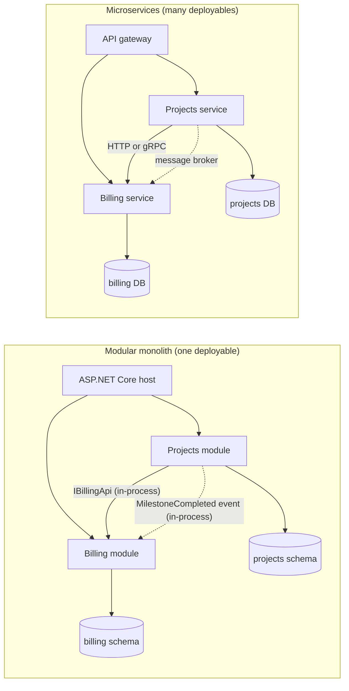
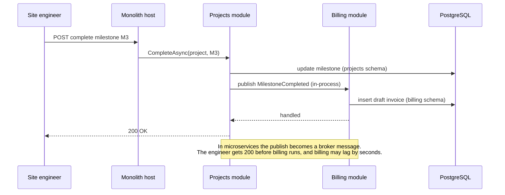

"Should we use microservices?" is one of the most expensive questions a team can answer wrongly. Answer "yes" too early and you pay for a distributed system while still having the problems of a single one. Answer "no" for too long and twelve teams queue behind one release train. This lesson gives you a way to decide with evidence instead of fashion.

## Learning objectives

By the end of this lesson you will be able to:

1. Explain the difference between a big ball of mud, a modular monolith and microservices, in plain words and in deployment terms.
2. Apply four decision criteria — team topology, deploy independence, data ownership and operational cost — to a real system and defend the result.
3. Calculate what a chain of network calls does to latency and availability, with the arithmetic shown.
4. Recognise the warning signs of a distributed monolith and say how to fix each one.
5. Build a modular monolith in ASP.NET Core with enforced module boundaries, public contracts and an event seam that can later become a message broker.
6. Plan a migration in either direction: extracting a service from a monolith, or merging over-split services back together.

## Prerequisites

- [Domain-driven modular monoliths](#/lesson/m08-ddd-modular-monolith): we build on the idea of one module per business area.
- [Bounded contexts and ubiquitous language](#/lesson/m08-bounded-contexts): boundaries between modules or services should follow these.
- [Synchronous versus asynchronous communication](#/lesson/m10-sync-async): the cost of a network call is central to this lesson.
- [Availability, reliability and the nines](#/lesson/m11-availability): we multiply availabilities in series.

## Explain it like I'm a beginner

Think of a large construction company building a highway.

**Option 1: one big site office (a monolith).** Everyone — design, billing, quality inspection, procurement — sits in one building. Need a signature from billing? Walk ten metres. Need to change a process? Call one meeting. The risk: if nobody organises the building, papers from every department pile up on every desk, and nobody can find anything. That messy version is a **big ball of mud**.

**Option 2: one building with clearly separated departments (a modular monolith).** Same building, same address, but each department has its own room, its own filing cabinet and a counter where other departments must submit requests. Billing never walks into the inspection room and edits a report. Communication is still fast — it is the same building — but it is disciplined.

**Option 3: separate offices in different cities (microservices).** Billing in Gurgaon, inspections in Pune, procurement in Chennai. Each office hires, works and changes its process on its own schedule. That is a real benefit when you have hundreds of people. But every request now needs a courier, couriers get lost or delayed, each office needs its own security guard, reception and electricity bill, and if the courier service stops, work stops.

The question is not "which is modern?" It is: **how many people, working on how many independent things, justify the cost of couriers?**

There is also a trap. If the offices are in different cities but every decision still needs all three offices to agree on the same day, you have the costs of separate offices *and* the coupling of one building. That trap is called a **distributed monolith**.

## First-principles explanation

### Three shapes, defined precisely

| Shape | Deployable units | Database | How modules talk | Typical team count |
|---|---|---|---|---|
| Big ball of mud | 1 | 1, shared by everything | Anything calls anything | Any (and it hurts) |
| Modular monolith | 1 (one process, one pipeline) | 1 server, but each module owns its own schema or tables | In-process calls through public contracts; in-process events | 1–5 teams |
| Microservices | Many (one per service) | One per service (logically, at least) | Network calls (HTTP, gRPC) and messages (queues, streams) | Several to hundreds of teams |

The difference between a monolith and microservices is **not** code quality. A modular monolith can be beautifully structured; a microservice estate can be a mess. The difference is **where the boundaries are enforced**: by the compiler and code review inside one process, or by the network between processes.

### Why microservices exist — the problem they solve

Microservices are mainly an **organisational scaling** tool, and only secondarily a technical one. The problems they solve show up when many people change one system:

1. **Release queues.** With one deployable, every change ships together. If 60 engineers merge 40 changes a day, one broken change blocks the other 39. Teams start batching changes into weekly or monthly releases, and each release becomes riskier.
2. **Coordination cost.** Every team must agree on the framework version, the database migration order and the release date.
3. **Uneven scaling.** One part of the system — say, image processing — needs 40 CPU cores at peak while the rest needs 4. With one deployable you scale everything together.
4. **Fault isolation.** A memory leak in report generation can crash the process that also takes payments.
5. **Technology fit.** One component genuinely needs a different runtime (a Python ML model, a Rust video encoder).

Notice that problems 1 and 2 are about *people*. That is why the first decision criterion is team topology.

### What microservices cost — the added complexity

Every boundary you move from "in-process" to "over the network" adds:

- **Latency.** An in-process method call costs nanoseconds to microseconds. A network call inside one cloud region usually costs somewhere around 0.5–2 ms including serialisation (an estimate; measure your own platform), and its slowest 1 % (p99) can be ten times that.
- **Partial failure.** A method call either returns or throws. A network call can also time out with *unknown outcome* — did the payment happen or not? You now need timeouts, retries, idempotency keys and circuit breakers ([see the lesson](#/lesson/m10-circuit-breaker)).
- **Lost transactions.** One database transaction across two modules becomes impossible across two services. You replace it with sagas, outboxes and eventual consistency ([see the lesson](#/lesson/m12-outbox)).
- **Operational surface.** Each service needs its own pipeline, deployment, health checks, dashboards, alerts, logs, secrets, scaling rules and on-call ownership.
- **Harder debugging.** One stack trace becomes a distributed trace across six processes ([see the lesson](#/lesson/m10-correlation)).

Fowler calls this the **microservice premium**: a fixed tax you pay before you get any benefit.

### Back-of-the-envelope: what a call chain costs

Suppose an "approve a contractor's bill" request passes through five services in series: gateway → billing → projects → contracts → notifications. Each service is up 99.9 % of the time.

**Availability.** In series, availabilities multiply:

0.999 × 0.999 × 0.999 × 0.999 × 0.999 = 0.999⁵ ≈ 0.995

So the *request* is available 99.5 % of the time. In a 30-day month (43,200 minutes):

- One 99.9 % component: 0.001 × 43,200 ≈ **43 minutes** of downtime.
- Five in series: 0.005 × 43,200 ≈ **216 minutes ≈ 3.6 hours** of downtime.

Splitting the system made the user-facing feature *five times less available*, unless you add redundancy, fallbacks or asynchronous calls.

**Latency.** If each hop adds 2 ms on average (estimate), five serial hops add 10 ms — fine. But tail latency compounds: if each hop has a 1 % chance of taking 50 ms, the chance that at least one of five hops is slow is 1 − 0.99⁵ ≈ 4.9 %. One request in twenty now sees the slow path.

**Operational cost (estimate).** Suppose each service needs about two engineer-days a month of upkeep: dependency upgrades, pipeline fixes, alert tuning, certificate rotation. That figure is an assumption — track your own. With 25 services that is 50 engineer-days a month, about **2.5 full-time engineers** doing nothing but keeping the lights on. Add at least 2 instances per service for high availability: 25 × 2 = 50 always-on instances, where a monolith might need 4.

None of these numbers says "never use microservices". They say: **the benefit must be larger than this premium.**

### The four decision criteria

#### 1. Team topology (who changes what)

**Conway's law**: a system's structure ends up mirroring the communication structure of the organisation that builds it. If you have one team of 8, a design with 15 services gives each service half a person and every feature crosses 5 services. If you have 12 teams, a single codebase forces 12 teams to coordinate every release.

Useful questions:

- How many **stream-aligned teams** (teams that each own a business capability end to end) exist today, and in 18 months?
- Could each proposed service be owned by **exactly one** team? A service owned by "everyone" is owned by no one.
- Does each team have the skills to run what it builds in production (on-call, monitoring)?

A rough guideline from practice, not a law: below about 3 teams, a modular monolith is almost always cheaper. Above about 8–10 teams working on one product, a single deployable usually becomes a bottleneck.

#### 2. Deploy independence (who ships when)

Ask: **would separate deployment actually be independent?** Measure it from your history:

- How often does each area change? Billing rules may change weekly (GST rates, new contract types); the document archive changes twice a year.
- When area A changes, how often must area B change in the same release? If the answer is "most of the time", they belong in the same deployable — splitting them just turns one deploy into two coordinated deploys.

Independent deployability is the core promise of microservices. If you cannot keep it, you do not get the benefit.

#### 3. Data ownership (who owns which facts)

A real service owns its data: **no other service reads or writes its tables**. Others ask through an API or keep their own copy updated by events. So ask:

- Can you draw a line where each table has exactly one writer?
- Which business rules need *one transaction* across areas? "Approve bill and reserve budget atomically" is hard to split. If the rule really needs strong consistency, keep both sides together, or accept a saga with compensations ([see the lesson](#/lesson/m12-sagas)).
- How many reports join across areas? Every cross-area join becomes either an API composition or a separate read model.

#### 4. Operational cost and maturity (can you run it)

Microservices need a platform: automated CI/CD per service, container hosting, centralised logs, distributed tracing, service-to-service authentication, secret management, and on-call rotations. If deployment today is "Ravi copies files to the IIS server on Friday evening", split services will multiply that pain. Build the platform first, or stay in one deployable.

### A decision table

| Signal | Favours modular monolith | Favours microservices |
|---|---|---|
| Teams | 1–3 teams | Many teams, each owning a capability |
| Change coupling | Areas usually change together | Areas change on clearly different schedules |
| Data | Many cross-area transactions and joins | Clear single-writer ownership |
| Scaling | Load fairly even | One component needs 10× the resources of others |
| Platform | Manual or young CI/CD, no tracing | Mature pipelines, observability, on-call |
| Domain knowledge | New domain, boundaries still moving | Stable, well-understood boundaries |

The last row matters most for new products. Moving a boundary inside a monolith is a refactoring. Moving a boundary between two services is a data migration plus an API change across two teams. **When you are unsure where the boundaries are, keep them cheap to move.** That is the reasoning behind "monolith first".

### The distributed monolith: warning signs

A distributed monolith is a system deployed as many services that **cannot change, deploy or fail independently**. It has the costs of both shapes and the benefits of neither. Warning signs:

1. **Lockstep deploys.** Services A and B are almost always deployed in the same hour, because a change in one breaks the other.
2. **Shared database.** Several services read and write the same tables. A schema change needs every service redeployed.
3. **Long synchronous call chains.** One user request makes 6 sequential HTTP calls; if any is down, the request fails.
4. **Shared domain library.** A `Company.Domain.Models` NuGet package with entity classes used by every service. Updating it forces every service to upgrade together.
5. **Chatty interactions.** Rendering one screen makes 40 calls between two services, because the boundary cuts through the middle of a concept.
6. **Shared release train and environment.** "We can only test service A when services B to F are all deployed to the same staging version."
7. **Cascading failures.** One slow service makes every other service slow, because threads wait on it.

Each sign points to a fix: redraw boundaries so things that change together live together ([service boundaries](#/lesson/m16-service-boundaries)), give every table one owner, replace synchronous chains with events where the business allows it, and version contracts instead of sharing domain classes.

### Migration paths

**Big ball of mud → modular monolith.** Almost always the first step. Group code into modules by business capability, give each module a public contract, move each module's tables into its own schema, and add automated boundary checks. This is cheap and reversible.

**Modular monolith → extract one service (Strangler Fig).** Extract only the module with the strongest reason (different scaling, different team, different release cadence). Steps: make the module talk to others only through its contract and events; route its traffic through a gateway; deploy it separately with its own database; switch the in-process contract to an HTTP or message-based client; retire the old code. See [Strangler fig migration](#/lesson/m16-strangler-acl).

**Microservices → fewer services (merging).** This is a respectable move, not a failure. If two services always deploy together, share tables and call each other dozens of times per request, merge them into one service with two modules. You keep the team boundary inside the code and remove the network.

### When a simpler alternative is better

- **One team, one product, under a few hundred requests per second**: a modular monolith on two instances behind a load balancer, with one PostgreSQL primary and a replica, is enough for most business systems.
- **One hot component**: extract *that component* (for example, a PDF rendering worker reading from a queue) and keep the rest together. This is not "going microservices"; it is moving one workload.
- **Fault isolation only**: run the same monolith code as two deployments with different roles (web and background workers), so a heavy report job cannot starve web requests.

## Visual explanation

### Architecture: modular monolith versus microservices



On the left, one ASP.NET Core host contains both modules. The projects module calls billing only through the `IBillingApi` interface (solid arrow) and tells billing about a finished milestone by publishing an in-process event (dotted arrow). Each module owns a separate schema in one PostgreSQL server. On the right, the same two capabilities run as separate services. The interface call becomes an HTTP or gRPC call, the in-process event becomes a message through a broker, and each service has its own database. **The logical design is identical; only the transport changes.** That is why a well-built modular monolith is the cheapest starting point for a later extraction.

### Sequence: one request in each shape



The engineer completes milestone M3. In the monolith, the projects module updates its table, publishes an event, and the billing handler creates a draft invoice before the response returns. Both steps can even share one database transaction if you choose. The note shows what changes after extraction: the event goes through a broker, the user gets a response before the invoice exists, and the billing screen may be a few seconds behind. Your UI and your business must accept that delay before you split.

## Step-by-step example

Scenario: a platform that manages infrastructure projects for 300 contractors. It has four areas: **Projects** (milestones, schedules), **Billing** (running-account bills, GST invoices), **Documents** (drawings, approvals) and **Inspections** (site quality checks with photos). The company has 14 developers in two teams. Load: about 150 requests per second at peak. The CTO asks: "Should we rebuild as microservices?"

### Step 1 — score the four criteria

- **Team topology**: two teams. Splitting into four services gives each team two services to run, with no one dedicated to the platform. → monolith.
- **Deploy independence**: the git history of the last 6 months shows 70 % of billing changes also touched projects code (milestone rules drive billing). → keep Projects and Billing together.
- **Data ownership**: Billing reads milestone completion; Inspections owns photos; Documents owns files. Inspections and Documents have clean ownership.
- **Operational cost**: deployments are manual to IIS; no tracing. → not ready for many services.

### Step 2 — find the one real outlier

Inspections uploads about 20,000 photos a day and generates thumbnails and PDF reports. Thumbnail generation spikes CPU and slowed down billing screens last month. That is a **scaling and fault-isolation** problem, not a team problem.

### Step 3 — decide

- Restructure into a **modular monolith** with four modules, each owning its own schema.
- Move thumbnail and PDF generation to a **background worker** process reading from a queue. Same codebase, separate deployment.
- Add boundary tests so modules cannot reach into each other's internals.
- Revisit in 12 months if the company grows to 5+ teams.

### Step 4 — define what would change the answer

Write it down: "We will extract Inspections as a service if (a) a dedicated team owns it, (b) it changes independently in more than 80 % of releases for two quarters, and (c) we have CI/CD per deployable and distributed tracing." Decisions with explicit re-evaluation triggers age far better than "we'll see".

## Production-style C# implementation

We build the modular monolith from the example: two modules (Projects and Billing), each with a public **contracts** namespace and a private **internal** namespace, an in-process event bus that can later be replaced by a broker, and an automated boundary check.

```text
ProjectHub.Api/
  Program.cs
  Modules/IModule.cs
  Modules/Shared/IntegrationEvents.cs
  Modules/Projects/Contracts/ProjectsContracts.cs
  Modules/Projects/ProjectsModule.cs
  Modules/Billing/Contracts/BillingContracts.cs
  Modules/Billing/BillingModule.cs
  Architecture/ModuleBoundaryRules.cs
```

Rule of the codebase: **code in module A may reference module B only through `B.Contracts`, or the shared kernel.**

```csharp file=Modules/IModule.cs
namespace ProjectHub.Modules;

/// <summary>A self-contained business module. The host knows modules only through this interface.</summary>
public interface IModule
{
    string Name { get; }
    void Register(IServiceCollection services, IConfiguration configuration);
    void MapEndpoints(IEndpointRouteBuilder endpoints);
}
```

```csharp file=Modules/Shared/IntegrationEvents.cs
using Microsoft.Extensions.Logging;

namespace ProjectHub.Modules.Shared;

/// <summary>An event other modules may react to. It is part of a module's public contract.</summary>
public interface IIntegrationEvent
{
    Guid EventId { get; }
    DateTimeOffset OccurredAt { get; }
}

public interface IIntegrationEventHandler<in TEvent> where TEvent : IIntegrationEvent
{
    Task HandleAsync(TEvent evt, CancellationToken ct);
}

public interface IEventBus
{
    Task PublishAsync<TEvent>(TEvent evt, CancellationToken ct) where TEvent : IIntegrationEvent;
}

/// <summary>
/// In-process bus: handlers run in the publisher's scope, one after another. This is the seam
/// you replace with an outbox plus a broker when a module is extracted into its own service.
/// </summary>
public sealed class InProcessEventBus(IServiceProvider services, ILogger<InProcessEventBus> logger) : IEventBus
{
    public async Task PublishAsync<TEvent>(TEvent evt, CancellationToken ct) where TEvent : IIntegrationEvent
    {
        var handlers = services.GetServices<IIntegrationEventHandler<TEvent>>().ToList();
        logger.LogInformation("Publishing {EventType} {EventId} to {Count} handler(s)",
            typeof(TEvent).Name, evt.EventId, handlers.Count);
        foreach (var handler in handlers)
            await handler.HandleAsync(evt, ct);   // a failure propagates to the publisher, like a method call would
    }
}
```

```csharp file=Modules/Projects/Contracts/ProjectsContracts.cs
using ProjectHub.Modules.Shared;

namespace ProjectHub.Modules.Projects.Contracts;

/// <summary>Published when a site engineer marks a contract milestone complete.</summary>
public sealed record MilestoneCompleted(
    Guid EventId,
    DateTimeOffset OccurredAt,
    Guid ProjectId,
    string MilestoneCode,
    decimal MilestoneValue) : IIntegrationEvent;
```

```csharp file=Modules/Billing/Contracts/BillingContracts.cs
namespace ProjectHub.Modules.Billing.Contracts;

public sealed record InvoiceSummary(Guid InvoiceId, Guid ProjectId, string MilestoneCode,
    decimal NetAmount, decimal Gst, decimal Total);

/// <summary>The only way other modules may ask Billing for data.</summary>
public interface IBillingApi
{
    Task<IReadOnlyList<InvoiceSummary>> GetInvoicesForProjectAsync(Guid projectId, CancellationToken ct);
}
```

```csharp file=Modules/Billing/BillingModule.cs
using System.Collections.Concurrent;
using ProjectHub.Modules.Billing.Contracts;
using ProjectHub.Modules.Billing.Internal;
using ProjectHub.Modules.Projects.Contracts;
using ProjectHub.Modules.Shared;

namespace ProjectHub.Modules.Billing
{
    public sealed class BillingModule : IModule
    {
        public string Name => "Billing";

        public void Register(IServiceCollection services, IConfiguration configuration)
        {
            services.AddSingleton<InvoiceStore>();
            services.AddScoped<IBillingApi, BillingApi>();
            services.AddScoped<IIntegrationEventHandler<MilestoneCompleted>, DraftInvoiceOnMilestoneCompleted>();
        }

        public void MapEndpoints(IEndpointRouteBuilder endpoints)
        {
            var group = endpoints.MapGroup("/billing");
            group.MapGet("/projects/{projectId:guid}/invoices",
                async (Guid projectId, IBillingApi api, CancellationToken ct) =>
                    Results.Ok(await api.GetInvoicesForProjectAsync(projectId, ct)));
        }
    }
}

namespace ProjectHub.Modules.Billing.Internal
{
    /// <summary>Stands in for the billing schema. Only Billing code can see it (internal).</summary>
    internal sealed class InvoiceStore
    {
        private readonly ConcurrentDictionary<Guid, InvoiceSummary> _byEventId = new();
        public bool TryAdd(Guid eventId, InvoiceSummary invoice) => _byEventId.TryAdd(eventId, invoice);
        public IReadOnlyList<InvoiceSummary> ForProject(Guid projectId) =>
            _byEventId.Values.Where(i => i.ProjectId == projectId).OrderBy(i => i.MilestoneCode).ToList();
    }

    internal sealed class BillingApi(InvoiceStore store) : IBillingApi
    {
        public Task<IReadOnlyList<InvoiceSummary>> GetInvoicesForProjectAsync(Guid projectId, CancellationToken ct) =>
            Task.FromResult(store.ForProject(projectId));
    }

    /// <summary>Creates a draft invoice with 18 % GST. Idempotent by event id, so a redelivered event is harmless.</summary>
    internal sealed class DraftInvoiceOnMilestoneCompleted(InvoiceStore store, ILogger<DraftInvoiceOnMilestoneCompleted> logger)
        : IIntegrationEventHandler<MilestoneCompleted>
    {
        private const decimal GstRate = 0.18m;

        public Task HandleAsync(MilestoneCompleted evt, CancellationToken ct)
        {
            var gst = Math.Round(evt.MilestoneValue * GstRate, 2, MidpointRounding.ToEven);
            var invoice = new InvoiceSummary(Guid.NewGuid(), evt.ProjectId, evt.MilestoneCode,
                evt.MilestoneValue, gst, evt.MilestoneValue + gst);
            if (!store.TryAdd(evt.EventId, invoice))
                logger.LogInformation("Duplicate MilestoneCompleted {EventId} ignored", evt.EventId);
            return Task.CompletedTask;
        }
    }
}
```

```csharp file=Modules/Projects/ProjectsModule.cs
using ProjectHub.Modules.Billing.Contracts;
using ProjectHub.Modules.Projects.Contracts;
using ProjectHub.Modules.Projects.Internal;
using ProjectHub.Modules.Shared;

namespace ProjectHub.Modules.Projects
{
    public sealed class ProjectsModule : IModule
    {
        public string Name => "Projects";

        public void Register(IServiceCollection services, IConfiguration configuration) =>
            services.AddScoped<MilestoneService>();

        public void MapEndpoints(IEndpointRouteBuilder endpoints)
        {
            var group = endpoints.MapGroup("/projects");

            group.MapPost("/{projectId:guid}/milestones/{code}/complete",
                async (Guid projectId, string code, decimal value, MilestoneService milestones, CancellationToken ct) =>
                {
                    if (value <= 0) return Results.Problem("Milestone value must be positive.", statusCode: 400);
                    await milestones.CompleteAsync(projectId, code, value, ct);
                    return Results.Accepted();
                });

            // Projects needs billing data for its dashboard: it goes through Billing's contract, never its tables.
            group.MapGet("/{projectId:guid}/billing-summary",
                async (Guid projectId, IBillingApi billing, CancellationToken ct) =>
                {
                    var invoices = await billing.GetInvoicesForProjectAsync(projectId, ct);
                    return Results.Ok(new { projectId, invoiceCount = invoices.Count, billedTotal = invoices.Sum(i => i.Total) });
                });
        }
    }
}

namespace ProjectHub.Modules.Projects.Internal
{
    internal sealed class MilestoneService(IEventBus bus, TimeProvider clock)
    {
        public Task CompleteAsync(Guid projectId, string milestoneCode, decimal value, CancellationToken ct)
        {
            // A real implementation would update the projects schema here, in the same transaction
            // that writes the event to an outbox table.
            var evt = new MilestoneCompleted(Guid.NewGuid(), clock.GetUtcNow(), projectId, milestoneCode, value);
            return bus.PublishAsync(evt, ct);
        }
    }
}
```

The boundary rule must be checked by a machine, or it will erode within months. This checker uses reflection to look at every type's constructor parameters, fields, properties and method signatures:

```csharp file=Architecture/ModuleBoundaryRules.cs
using System.Reflection;

namespace ProjectHub.Architecture;

public sealed record BoundaryViolation(string FromType, string ToType, string Reason);

/// <summary>
/// Architecture fitness function: a module may depend on another module only through its
/// ".Contracts" namespace (or on the Shared kernel). Run it in a unit test on every build.
/// </summary>
public static class ModuleBoundaryRules
{
    private const string Root = "ProjectHub.Modules.";
    private const BindingFlags All = BindingFlags.Public | BindingFlags.NonPublic | BindingFlags.Instance |
                                     BindingFlags.Static | BindingFlags.DeclaredOnly;

    public static IReadOnlyList<BoundaryViolation> Check(Assembly assembly)
    {
        var violations = new List<BoundaryViolation>();
        foreach (var type in assembly.GetTypes().Where(t => t.Namespace?.StartsWith(Root, StringComparison.Ordinal) == true))
        {
            var fromModule = ModuleOf(type.Namespace!);
            foreach (var dependency in DependenciesOf(type).Distinct())
            {
                var ns = dependency.Namespace;
                if (ns is null || !ns.StartsWith(Root, StringComparison.Ordinal)) continue;
                var toModule = ModuleOf(ns);
                if (toModule == fromModule || toModule == "Shared") continue;
                if (!ns.EndsWith(".Contracts", StringComparison.Ordinal))
                    violations.Add(new BoundaryViolation(type.FullName!, dependency.FullName!,
                        $"{fromModule} uses {toModule} internals; depend on {Root}{toModule}.Contracts instead"));
            }
        }
        return violations;
    }

    private static string ModuleOf(string ns) => ns[Root.Length..].Split('.')[0];

    private static IEnumerable<Type> DependenciesOf(Type type)
    {
        var direct = new List<Type>();
        foreach (var c in type.GetConstructors(All)) direct.AddRange(c.GetParameters().Select(p => p.ParameterType));
        direct.AddRange(type.GetFields(All).Select(f => f.FieldType));
        direct.AddRange(type.GetProperties(All).Select(p => p.PropertyType));
        foreach (var m in type.GetMethods(All))
        {
            direct.Add(m.ReturnType);
            direct.AddRange(m.GetParameters().Select(p => p.ParameterType));
        }
        if (type.BaseType is not null) direct.Add(type.BaseType);
        direct.AddRange(type.GetInterfaces());
        return direct.SelectMany(Flatten);
    }

    // List<InvoiceStore> and Task<IReadOnlyList<X>> hide their real dependencies in generic arguments.
    private static IEnumerable<Type> Flatten(Type t)
    {
        if (t.HasElementType && t.GetElementType() is { } element) { foreach (var x in Flatten(element)) yield return x; yield break; }
        yield return t;
        if (t.IsGenericType)
            foreach (var arg in t.GetGenericArguments())
                foreach (var x in Flatten(arg)) yield return x;
    }
}
```

```csharp file=Program.cs
using ProjectHub.Architecture;
using ProjectHub.Modules;
using ProjectHub.Modules.Billing;
using ProjectHub.Modules.Projects;
using ProjectHub.Modules.Shared;

var builder = WebApplication.CreateBuilder(args);

IModule[] modules = [new ProjectsModule(), new BillingModule()];

builder.Services.AddSingleton(TimeProvider.System);
builder.Services.AddScoped<IEventBus, InProcessEventBus>();
foreach (var module in modules)
    module.Register(builder.Services, builder.Configuration);

var app = builder.Build();

foreach (var module in modules)
    module.MapEndpoints(app);

// Handy in development: shows boundary violations in the running app. The real guard is a unit test.
if (app.Environment.IsDevelopment())
    app.MapGet("/_architecture/violations", () => ModuleBoundaryRules.Check(typeof(Program).Assembly));

app.Run();
```

**Design notes**

- `internal` hides each module's implementation from other *assemblies*. Because both modules are in one project here, the boundary checker does the job the compiler cannot. In a larger codebase, put each module in its own class library so `internal` is enforced by the compiler too.
- The handler is idempotent by `EventId`. It costs nothing in-process and is mandatory once a broker delivers the event "at least once".
- Swapping `InProcessEventBus` for an outbox-backed bus changes *when* billing runs (later, asynchronously) — not *what* it does. Test that difference before you rely on it.

## Bad design vs good design

**Bad: microservices that are really one system.**

```csharp
// Billing "service" — reads the Projects service's table directly through a shared connection string.
var milestones = await db.QueryAsync<Milestone>(
    "SELECT * FROM projects.milestones WHERE project_id = @id AND status = 'Done'", new { id });
// ... and uses a shared NuGet package, Company.Domain, for the Milestone entity.
```

What is wrong:

- The Projects team cannot rename a column without breaking Billing in production.
- Both services must upgrade `Company.Domain` together — lockstep deploys.
- Billing's load on the projects tables is invisible to the Projects team.
- You pay for two pipelines, two deployments and network calls, and still cannot change anything independently.

**Good: one owner per fact, contracts between owners.**

- Billing learns about milestones from the `MilestoneCompleted` event and stores what it needs (value, code) in its own tables.
- When Billing needs live data it calls `IBillingApi`-style contracts, versioned like public APIs.
- Inside one deployable, this is a modular monolith. If Billing is ever extracted, the contract becomes an HTTP API and the event goes through a broker, with no change to the business code.

:::callout type=tradeoff title="Same database server is fine; same tables is not"
A modular monolith may keep every module in one PostgreSQL server with one schema per module. This keeps backups, costs and operations simple. What it must not do is let module A query module B's schema. Enforce it with database roles: each module's connection uses a role that has privileges only on its own schema.
:::

:::callout type=mistake title="Splitting by technical layer"
"UI service, business-logic service, data-access service" is not microservices. Every feature crosses all three, so every change needs three coordinated deploys. Split by business capability, never by layer.
:::

## Practical playground

The graph below is the 14-developer contractor platform from the step-by-step example, built as four microservices that share one database. Open it in the HLD canvas and reshape it into the design we chose: a modular monolith, plus a separate worker for thumbnails and PDF reports fed by a queue. Watch what happens to the number of network hops for "approve a bill".

:::playground type=hld title="From premature microservices to a modular monolith"
```json
{
  "nodes": [
    { "id": "users", "type": "client", "label": "Contractor and site apps", "props": { "rps": 150 } },
    { "id": "gw", "type": "api-gateway", "label": "API gateway" },
    { "id": "proj", "type": "app-server", "label": "Projects service", "props": { "instances": 2 } },
    { "id": "bill", "type": "app-server", "label": "Billing service", "props": { "instances": 2 } },
    { "id": "docs", "type": "app-server", "label": "Documents service", "props": { "instances": 2 } },
    { "id": "insp", "type": "app-server", "label": "Inspections service (thumbnails inline)", "props": { "instances": 2 } },
    { "id": "db", "type": "database", "label": "Shared PostgreSQL (all tables)", "props": { "replicas": 1 } },
    { "id": "blob", "type": "object-storage", "label": "Photos and drawings" }
  ],
  "edges": [
    { "from": "users", "to": "gw", "kind": "sync" },
    { "from": "gw", "to": "proj", "kind": "sync" },
    { "from": "gw", "to": "bill", "kind": "sync" },
    { "from": "gw", "to": "docs", "kind": "sync" },
    { "from": "gw", "to": "insp", "kind": "sync" },
    { "from": "bill", "to": "proj", "kind": "sync", "label": "milestone status, per bill line" },
    { "from": "proj", "to": "bill", "kind": "sync", "label": "billed totals" },
    { "from": "proj", "to": "db", "kind": "sync" },
    { "from": "bill", "to": "db", "kind": "sync" },
    { "from": "docs", "to": "db", "kind": "sync" },
    { "from": "insp", "to": "db", "kind": "sync" },
    { "from": "insp", "to": "blob", "kind": "sync" },
    { "from": "docs", "to": "blob", "kind": "sync" }
  ]
}
```
:::

## Exercises

:::exercise id=m16-monolith-vs-microservices-ex1 difficulty=beginner kind=written title="Spot the distributed monolith"
A food-delivery start-up with 18 engineers runs 11 services. Read the facts and list every distributed-monolith warning sign you can find. For each one, propose one concrete fix.

- `orders`, `payments` and `restaurants` were deployed in the same hour in 23 of the last 25 releases.
- All services use one PostgreSQL database; `payments` reads `orders.order_lines` directly.
- Placing an order calls `orders → menu → pricing → promotions → payments` synchronously.
- A NuGet package `FoodCo.Entities` holds `Order`, `Restaurant` and `Customer` classes used by 9 services.
- Staging is one shared environment; testing `promotions` needs every other service on the matching version.
::acceptance
- At least five warning signs are named and tied to a specific fact.
- Each sign has a fix that removes the coupling, not just a tool to cope with it.
- The answer considers merging services, not only adding infrastructure.
::hint
Go through the seven warning signs in the lesson one by one and look for matching facts.
::hint
23 of 25 releases together is about 92 %. What does that say about whether these services can change independently?
::hint
For the call chain, compute availability: if each of 5 services is 99.9 %, what is the chain?
::hint
For the shared entities package, think "versioned contracts per service" versus "one shared domain model".
::hint
With 18 engineers, how many teams is that, and how many services can each team realistically own?
::solution
**Warning signs and fixes**

1. **Lockstep deploys** (92 % shared releases) → `orders`, `payments` and `restaurants` change together. Either redraw the boundary (merge `orders` and `payments`' order-related logic into one service), or stabilise the contracts between them with versioning so one can ship without the others.
2. **Shared database with cross-service table reads** → give every table one owner. `payments` should receive the amount it needs in a `PaymentRequested` message or an API call, not read `orders.order_lines`.
3. **Long synchronous chain** (5 hops ≈ 0.999⁵ ≈ 99.5 % availability, about 3.6 hours a month of failed checkouts) → `menu` and `pricing` data can be cached or copied locally into `orders`; `promotions` can be evaluated with a timeout and a "no promotion" fallback; payment can be asynchronous with a pending state.
4. **Shared domain library** (`FoodCo.Entities`) → each service defines its own models; the shared package, if any, contains only versioned message contracts (published language), not entities.
5. **Shared staging and version matching** → contract tests per service (consumer-driven contracts) so each service can be verified on its own; ephemeral environments per change.
6. **Team topology mismatch** → 18 engineers is roughly 3 teams. 11 services means each team runs 3–4 services. Merging to 4–5 services (for example, ordering, restaurant-catalogue, payments, delivery-tracking, notifications) matches team count.

**The real fix** is not more tooling: it is fewer, better-bounded services, each owned by one team with its own data.
::mistakes
- Proposing a service mesh or more Kubernetes features as the fix. They help operate services; they do not remove coupling.
- Missing the shared library as a coupling source because it "is only code".
- Ignoring the people side: 11 services for 18 engineers is the root cause.
:::

:::exercise id=m16-monolith-vs-microservices-ex2 difficulty=beginner kind=code title="Availability of a call chain"
Implement `AvailabilityMath` so architects can quickly see what splitting a request across services does to availability.
::requirements
- `Serial(params double[] a)`: availability of components that must **all** be up (multiply).
- `Parallel(double a, int replicas)`: availability of `replicas` identical redundant copies where **one** is enough: `1 − (1 − a)^n`.
- `DowntimeMinutesPerMonth(double a)`: for a 30-day month (43,200 minutes).
- Reject values outside 0..1 and `replicas < 1` with `ArgumentOutOfRangeException`.
::acceptance
- Five 99.9 % components in series give about 0.99501.
- 99.9 % gives 43.2 minutes of downtime per month.
- Two 99 % replicas in parallel give 0.9999.
- Invalid input throws `ArgumentOutOfRangeException`.
::hint
Series means "everything must work", so probabilities multiply.
::hint
Parallel means "fails only if all copies fail at once". The chance that one copy fails is `1 − a`.
::hint
`Math.Pow(1 - a, n)` is the chance all `n` copies are down together (assuming independent failures).
::hint
```csharp
public static double Serial(params double[] a) { foreach (var x in a) Check(x); return a.Aggregate(1.0, (acc, x) => acc * x); }
```
::starter
```csharp file=AvailabilityMath.cs
using System;
using System.Linq;

public static class AvailabilityMath
{
    public const double MinutesPerMonth = 30 * 24 * 60;

    public static double Serial(params double[] availabilities) => throw new NotImplementedException();

    public static double Parallel(double availability, int replicas) => throw new NotImplementedException();

    public static double DowntimeMinutesPerMonth(double availability) => throw new NotImplementedException();
}
```
::tests
```csharp file=AvailabilityMathTests.cs
using System;
using Xunit;

public class AvailabilityMathTests
{
    [Fact] public void Five_in_series() =>
        Assert.Equal(0.99501, AvailabilityMath.Serial(0.999, 0.999, 0.999, 0.999, 0.999), 5);

    [Fact] public void Empty_chain_is_always_up() =>
        Assert.Equal(1.0, AvailabilityMath.Serial(), 10);

    [Fact] public void Downtime_for_three_nines() =>
        Assert.Equal(43.2, AvailabilityMath.DowntimeMinutesPerMonth(0.999), 6);

    [Fact] public void Two_replicas_in_parallel() =>
        Assert.Equal(0.9999, AvailabilityMath.Parallel(0.99, 2), 10);

    [Fact] public void Serial_rejects_bad_value() =>
        Assert.Throws<ArgumentOutOfRangeException>(() => AvailabilityMath.Serial(0.99, 1.2));

    [Fact] public void Parallel_rejects_zero_replicas() =>
        Assert.Throws<ArgumentOutOfRangeException>(() => AvailabilityMath.Parallel(0.99, 0));

    [Fact] public void Downtime_rejects_negative() =>
        Assert.Throws<ArgumentOutOfRangeException>(() => AvailabilityMath.DowntimeMinutesPerMonth(-0.1));
}
```
::solution
```csharp file=AvailabilityMath.cs
using System;
using System.Linq;

public static class AvailabilityMath
{
    public const double MinutesPerMonth = 30 * 24 * 60;

    public static double Serial(params double[] availabilities)
    {
        ArgumentNullException.ThrowIfNull(availabilities);
        foreach (var a in availabilities) Check(a);
        return availabilities.Aggregate(1.0, (acc, a) => acc * a);
    }

    public static double Parallel(double availability, int replicas)
    {
        Check(availability);
        ArgumentOutOfRangeException.ThrowIfLessThan(replicas, 1);
        return 1 - Math.Pow(1 - availability, replicas);
    }

    public static double DowntimeMinutesPerMonth(double availability)
    {
        Check(availability);
        return (1 - availability) * MinutesPerMonth;
    }

    private static void Check(double a)
    {
        if (double.IsNaN(a) || a < 0 || a > 1)
            throw new ArgumentOutOfRangeException(nameof(a), a, "Availability must be between 0 and 1.");
    }
}
```
The parallel formula assumes failures are **independent**. Two replicas in the same rack, on the same bad deployment or behind the same misconfigured load balancer fail together, so the real number is lower.
::mistakes
- Adding availabilities instead of multiplying them.
- Using `Math.Pow(a, n)` for parallel — that is the chance all copies are *up*, not that at least one is.
- Forgetting that correlated failures break the parallel formula.
::extensions
Add `Compose` that takes a tree of serial and parallel groups, for example "gateway → (2 billing replicas) → database with failover".
:::

:::exercise id=m16-monolith-vs-microservices-ex3 difficulty=intermediate kind=code title="Detect lockstep deploys"
Lockstep deploys are the clearest data-driven sign of a distributed monolith. Given a deployment log, find pairs of services that usually ship together.
::requirements
- For a pair (A, B): a deploy of A is *coupled* if B was deployed within `window` (before or after). Likewise for B.
- `ratio = (coupled deploys of A + coupled deploys of B) / (all deploys of A + all deploys of B)`.
- Return pairs with `ratio >= threshold`, with `A` ordinally less than `B`, sorted by ratio descending, then A, then B.
- Services with fewer than `minDeploys` deploys are ignored (not enough evidence).
::acceptance
- Two services deployed together in every release give ratio 1.0.
- A service that deploys on its own schedule appears in no pair.
- A pair coupled half the time is excluded at threshold 0.7.
- Results are deterministic in order.
::hint
Group the deploys by service first. You need, for each service, a sorted list of timestamps.
::hint
For a pair, "is there a B deploy within the window of this A deploy?" is a search in B's sorted list.
::hint
A simple `Any(t => Math.Abs((t - a).TotalMinutes) <= window.TotalMinutes)` is fine for hundreds of deploys; binary search is the scalable version.
::hint
Loop over every pair with `for (i) for (j > i)` over the services sorted by name, so `A < B` comes for free.
::starter
```csharp file=LockstepDeployDetector.cs
using System;
using System.Collections.Generic;
using System.Linq;

public sealed record Deploy(string Service, DateTimeOffset At);
public sealed record LockstepPair(string A, string B, double Ratio);

public static class LockstepDeployDetector
{
    public static IReadOnlyList<LockstepPair> Find(IEnumerable<Deploy> deploys, TimeSpan window,
        double threshold, int minDeploys = 3) => throw new NotImplementedException();
}
```
::tests
```csharp file=LockstepDeployDetectorTests.cs
using System;
using System.Collections.Generic;
using System.Linq;
using Xunit;

public class LockstepDeployDetectorTests
{
    private static readonly DateTimeOffset T0 = new(2026, 10, 1, 10, 0, 0, TimeSpan.Zero);
    private static Deploy D(string s, int day, int minute = 0) => new(s, T0.AddDays(day).AddMinutes(minute));

    private static List<Deploy> Log() => new()
    {
        // orders and payments always ship within 20 minutes of each other
        D("orders", 0), D("payments", 0, 15),
        D("orders", 3), D("payments", 3, 5),
        D("orders", 7), D("payments", 7, 20),
        D("orders", 9), D("payments", 9, 1),
        // catalog ships on its own days
        D("catalog", 1), D("catalog", 4), D("catalog", 8), D("catalog", 11),
        // search ships with orders only half the time
        D("search", 0, 30), D("search", 3, 10), D("search", 5), D("search", 12),
    };

    [Fact]
    public void Finds_orders_and_payments()
    {
        var pairs = LockstepDeployDetector.Find(Log(), TimeSpan.FromHours(1), 0.7);
        var p = Assert.Single(pairs);
        Assert.Equal("orders", p.A);
        Assert.Equal("payments", p.B);
        Assert.Equal(1.0, p.Ratio, 6);
    }

    [Fact]
    public void Lower_threshold_includes_half_coupled_pair_in_order()
    {
        var pairs = LockstepDeployDetector.Find(Log(), TimeSpan.FromHours(1), 0.4);
        Assert.Equal(3, pairs.Count);
        Assert.Equal(("orders", "payments"), (pairs[0].A, pairs[0].B));
        Assert.Equal(0.5, pairs[1].Ratio, 6);
        Assert.Equal(("orders", "search"), (pairs[1].A, pairs[1].B));
        Assert.Equal(("payments", "search"), (pairs[2].A, pairs[2].B));
        Assert.DoesNotContain(pairs, x => x.A == "catalog" || x.B == "catalog");
    }

    [Fact]
    public void Services_with_too_few_deploys_are_ignored()
    {
        var log = new List<Deploy> { D("a", 0), D("b", 0), D("a", 1), D("b", 1) };
        Assert.Empty(LockstepDeployDetector.Find(log, TimeSpan.FromHours(1), 0.5, minDeploys: 3));
        Assert.Single(LockstepDeployDetector.Find(log, TimeSpan.FromHours(1), 0.5, minDeploys: 2));
    }
}
```
::solution
```csharp file=LockstepDeployDetector.cs
using System;
using System.Collections.Generic;
using System.Linq;

public sealed record Deploy(string Service, DateTimeOffset At);
public sealed record LockstepPair(string A, string B, double Ratio);

public static class LockstepDeployDetector
{
    public static IReadOnlyList<LockstepPair> Find(IEnumerable<Deploy> deploys, TimeSpan window,
        double threshold, int minDeploys = 3)
    {
        ArgumentNullException.ThrowIfNull(deploys);
        var byService = deploys
            .GroupBy(d => d.Service, StringComparer.Ordinal)
            .Where(g => g.Count() >= minDeploys)
            .OrderBy(g => g.Key, StringComparer.Ordinal)
            .Select(g => (Name: g.Key, Times: g.Select(d => d.At).OrderBy(t => t).ToArray()))
            .ToArray();

        var result = new List<LockstepPair>();
        for (var i = 0; i < byService.Length; i++)
        for (var j = i + 1; j < byService.Length; j++)
        {
            var a = byService[i];
            var b = byService[j];
            var coupled = CountCoupled(a.Times, b.Times, window) + CountCoupled(b.Times, a.Times, window);
            var ratio = (double)coupled / (a.Times.Length + b.Times.Length);
            if (ratio >= threshold) result.Add(new LockstepPair(a.Name, b.Name, ratio));
        }

        return result
            .OrderByDescending(p => p.Ratio)
            .ThenBy(p => p.A, StringComparer.Ordinal)
            .ThenBy(p => p.B, StringComparer.Ordinal)
            .ToList();
    }

    private static int CountCoupled(DateTimeOffset[] mine, DateTimeOffset[] theirs, TimeSpan window) =>
        mine.Count(t => HasNeighbour(theirs, t, window));

    // Binary search for the first deploy at or after (t - window), then check it is within (t + window).
    private static bool HasNeighbour(DateTimeOffset[] sorted, DateTimeOffset t, TimeSpan window)
    {
        int lo = 0, hi = sorted.Length;
        var from = t - window;
        while (lo < hi)
        {
            var mid = (lo + hi) / 2;
            if (sorted[mid] < from) lo = mid + 1; else hi = mid;
        }
        return lo < sorted.Length && sorted[lo] <= t + window;
    }
}
```
In the test log, `orders`/`search` and `payments`/`search` are each coupled on days 0 and 3 only: (2 + 2) / (4 + 4) = 0.5. Use the output as a conversation starter, not a verdict: two services can deploy together because of a planned joint feature. Persistent coupling over months is the signal.
::mistakes
- Counting a pair twice (A, B) and (B, A).
- Dividing by the number of releases instead of by the deploys of the two services.
- Using a one-sided window (only "after"), which misses the case where B shipped first.
::extensions
Run it on your real pipeline history (Azure DevOps or GitHub Actions APIs). Plot the coupled pairs as a graph; clusters of tightly coupled services are candidates for merging.
:::

:::exercise id=m16-monolith-vs-microservices-ex4 difficulty=intermediate kind=hld title="Extract one service with the Strangler Fig"
A citizen-services portal runs as a modular monolith (2 teams, 300 RPS peak). The **Notifications** module sends SMS and email for every grievance update. During a heavy day it sent 1.2 million SMS, slowed everything because SMS provider calls run inside web requests, and a provider outage caused 30-second request timeouts. A new third team will own notifications.

Design the target architecture and the migration steps. Show how notifications become asynchronous and how you keep a rollback path during the migration.
::acceptance
- Notifications are triggered by events or queue messages, not by synchronous calls inside web requests.
- The migration has at least four ordered steps, each reversible.
- The new service owns its data (templates, delivery log); the monolith no longer touches those tables.
- Throughput arithmetic: 1.2 million SMS a day expressed as average and peak per second.
- The graph includes a `queue`, a `worker` and an `external` SMS provider.
::hint
Start with the arithmetic: 1.2 million ÷ 86,400 seconds. Then assume most of it arrives in 8 busy hours.
::hint
Which step comes first: moving code to a new deployable, or changing how the monolith talks to the module?
::hint
Inside the monolith, switch the call `INotificationsApi.Send` to "write a message to an outbox table". The work then happens off the request path — before any extraction.
::hint
For rollback, keep the old in-process handler behind a feature flag until the new service has run cleanly for a while.
::starter
```json
{
  "nodes": [
    { "id": "citizens", "type": "client", "label": "Citizen app and web", "props": { "rps": 300 } },
    { "id": "lb", "type": "load-balancer", "label": "Load balancer" },
    { "id": "mono", "type": "app-server", "label": "Portal monolith (grievances, officers, notifications)", "props": { "instances": 3 } },
    { "id": "db", "type": "database", "label": "PostgreSQL", "props": { "replicas": 1 } },
    { "id": "sms", "type": "external", "label": "SMS provider" }
  ],
  "edges": [
    { "from": "citizens", "to": "lb", "kind": "sync" },
    { "from": "lb", "to": "mono", "kind": "sync" },
    { "from": "mono", "to": "db", "kind": "sync" },
    { "from": "mono", "to": "sms", "kind": "sync", "label": "inside web requests" }
  ]
}
```
::solution
**Arithmetic.** 1,200,000 ÷ 86,400 ≈ 14 SMS/s average. If 80 % arrives in 8 busy hours: 960,000 ÷ 28,800 ≈ 33 SMS/s, and with a ×3 burst factor about 100 SMS/s. Providers usually rate-limit per account, so the worker must throttle and queue rather than call as fast as possible.

**Migration steps (each reversible)**

1. **Decouple inside the monolith.** The grievance module publishes `GrievanceStatusChanged` and writes it to an outbox table in the same transaction. A background worker *inside the monolith* delivers notifications. Web requests no longer wait for the SMS provider. Rollback: flag back to the synchronous call.
2. **Isolate the data.** Move templates and the delivery log into a `notifications` schema used only by that module.
3. **Stand up the new service** (owned by team 3) with its own database. An outbox relay publishes events to a queue; the new service consumes them, but in **shadow mode**: it renders messages and logs what it *would* send, while the monolith still sends. Compare the two for a week.
4. **Switch over** by feature flag: the monolith's worker stops sending; the new service sends. Rollback is the flag.
5. **Migrate history** (delivery log) if needed, then delete the module's code and schema from the monolith.

**Failure handling.** The provider outage now fills the queue instead of timing out web requests. The worker uses a circuit breaker, retries with backoff and a dead-letter queue. Messages carry an idempotency key (event id plus channel) so a retry never sends the same SMS twice.

```json
{
  "nodes": [
    { "id": "citizens", "type": "client", "label": "Citizen app and web", "props": { "rps": 300 } },
    { "id": "lb", "type": "load-balancer", "label": "Load balancer" },
    { "id": "mono", "type": "app-server", "label": "Portal monolith (grievances, officers)", "props": { "instances": 3 } },
    { "id": "db", "type": "database", "label": "Portal PostgreSQL with outbox table", "props": { "replicas": 1 } },
    { "id": "relay", "type": "worker", "label": "Outbox relay" },
    { "id": "q", "type": "queue", "label": "notification-requests queue with DLQ" },
    { "id": "notif", "type": "worker", "label": "Notifications service (team 3), throttled to provider limit", "props": { "instances": 2 } },
    { "id": "ndb", "type": "database", "label": "Notifications DB: templates, delivery log" },
    { "id": "sms", "type": "external", "label": "SMS provider" },
    { "id": "email", "type": "external", "label": "Email provider" },
    { "id": "mon", "type": "monitoring", "label": "Queue depth, send rate, DLQ alerts" }
  ],
  "edges": [
    { "from": "citizens", "to": "lb", "kind": "sync" },
    { "from": "lb", "to": "mono", "kind": "sync" },
    { "from": "mono", "to": "db", "kind": "sync", "label": "state change and outbox row in one transaction" },
    { "from": "relay", "to": "db", "kind": "sync", "label": "poll outbox" },
    { "from": "relay", "to": "q", "kind": "async" },
    { "from": "q", "to": "notif", "kind": "async" },
    { "from": "notif", "to": "ndb", "kind": "sync" },
    { "from": "notif", "to": "sms", "kind": "sync", "label": "about 33/s busy-hour average" },
    { "from": "notif", "to": "email", "kind": "sync" },
    { "from": "notif", "to": "mon", "kind": "async" }
  ]
}
```
::mistakes
- Extracting the service first and leaving the synchronous call in place — now the web request waits on a *network call* to a service that waits on the provider.
- Sharing the monolith's database with the new service "temporarily". Temporary shared databases tend to become permanent.
- No idempotency: a retry after a timeout sends duplicate SMS to citizens.
:::

:::exercise id=m16-monolith-vs-microservices-ex5 difficulty=advanced kind=code title="Module dependency fitness function with cycle detection"
Build the data-driven version of the boundary checker: it receives namespace-to-namespace references (for example exported from a build-time analyser) and reports two kinds of violations.
::requirements
- Namespaces look like `{root}.{Module}.{Rest}`. References outside `root`, and references within the same module, are ignored. Module `Shared` may be referenced by anyone.
- **internal-access**: module A references a namespace of module B that is not `{root}.{B}.Contracts` (or deeper under `.Contracts`). Report once per (A, B, target namespace), with `Detail` = target namespace.
- **cycle**: the module-level graph (all cross-module references, including legal contract references) contains a cycle. Report one violation per strongly connected component with more than one module: `FromModule` = alphabetically first member, `ToModule` = `""`, `Detail` = members sorted ordinally and joined with `","`.
- Return internal-access violations first (sorted by FromModule, ToModule, Detail), then cycles (sorted by Detail).
::acceptance
- A reference to `Root.Billing.Contracts` is legal; `Root.Billing.Internal.Store` is not.
- Projects → Billing.Contracts plus Billing → Projects.Contracts is reported as one cycle "Billing,Projects".
- A three-module cycle is reported once with all three members.
- Duplicate references produce one violation.
::hint
Split the job: (1) map each reference to (fromModule, toModule, toNamespace); (2) check contract rules; (3) build a module graph and find cycles.
::hint
"Strongly connected component" means a group of nodes where every node can reach every other. A cycle of 2 or more modules is exactly an SCC of size ≥ 2.
::hint
Tarjan's algorithm finds all SCCs in one depth-first search using an index, a low-link value and a stack.
::hint
```text
strongconnect(v):
  index[v] = low[v] = counter++; push v; onStack[v] = true
  for w in edges[v]:
    if w not indexed: strongconnect(w); low[v] = min(low[v], low[w])
    else if onStack[w]: low[v] = min(low[v], index[w])
  if low[v] == index[v]: pop until v -> one SCC
```
::hint
For the contract rule: `ns == $"{root}.{to}.Contracts" || ns.StartsWith($"{root}.{to}.Contracts.")`.
::starter
```csharp file=ModuleGraphChecker.cs
using System;
using System.Collections.Generic;
using System.Linq;

public sealed record TypeRef(string FromNamespace, string ToNamespace);
public sealed record ModuleViolation(string FromModule, string ToModule, string Kind, string Detail);

public static class ModuleGraphChecker
{
    public const string InternalAccess = "internal-access";
    public const string Cycle = "cycle";

    public static IReadOnlyList<ModuleViolation> Check(IEnumerable<TypeRef> references, string root) =>
        throw new NotImplementedException();
}
```
::tests
```csharp file=ModuleGraphCheckerTests.cs
using System.Linq;
using Xunit;

public class ModuleGraphCheckerTests
{
    private const string R = "Hub.Modules";
    private static TypeRef Ref(string from, string to) => new($"{R}.{from}", $"{R}.{to}");

    [Fact]
    public void Contract_reference_is_legal()
    {
        var result = ModuleGraphChecker.Check(new[] { Ref("Projects.Internal", "Billing.Contracts") }, R);
        Assert.Empty(result);
    }

    [Fact]
    public void Internal_reference_is_reported_once()
    {
        var refs = new[]
        {
            Ref("Projects.Internal", "Billing.Internal.Store"),
            Ref("Projects.Api", "Billing.Internal.Store"),
            new TypeRef("System.Collections", $"{R}.Billing.Internal"),
            Ref("Billing.Internal", "Billing.Api"),
            Ref("Billing.Api", "Shared.Events"),
        };
        var v = Assert.Single(ModuleGraphChecker.Check(refs, R));
        Assert.Equal(ModuleGraphChecker.InternalAccess, v.Kind);
        Assert.Equal("Projects", v.FromModule);
        Assert.Equal("Billing", v.ToModule);
        Assert.Equal($"{R}.Billing.Internal.Store", v.Detail);
    }

    [Fact]
    public void Two_module_cycle_through_contracts()
    {
        var refs = new[] { Ref("Projects.Internal", "Billing.Contracts"), Ref("Billing.Internal", "Projects.Contracts") };
        var v = Assert.Single(ModuleGraphChecker.Check(refs, R));
        Assert.Equal(ModuleGraphChecker.Cycle, v.Kind);
        Assert.Equal("Billing", v.FromModule);
        Assert.Equal("Billing,Projects", v.Detail);
    }

    [Fact]
    public void Three_module_cycle_and_internal_access_in_order()
    {
        var refs = new[]
        {
            Ref("A.Core", "B.Contracts"), Ref("B.Core", "C.Contracts"), Ref("C.Core", "A.Contracts"),
            Ref("D.Core", "A.Secret"), Ref("D.Core", "A.Contracts.Dtos"),
        };
        var result = ModuleGraphChecker.Check(refs, R);
        Assert.Equal(2, result.Count);
        Assert.Equal(ModuleGraphChecker.InternalAccess, result[0].Kind);
        Assert.Equal("D", result[0].FromModule);
        Assert.Equal(ModuleGraphChecker.Cycle, result[1].Kind);
        Assert.Equal("A,B,C", result[1].Detail);
    }
}
```
::solution
```csharp file=ModuleGraphChecker.cs
using System;
using System.Collections.Generic;
using System.Linq;

public sealed record TypeRef(string FromNamespace, string ToNamespace);
public sealed record ModuleViolation(string FromModule, string ToModule, string Kind, string Detail);

public static class ModuleGraphChecker
{
    public const string InternalAccess = "internal-access";
    public const string Cycle = "cycle";
    private const string SharedModule = "Shared";

    public static IReadOnlyList<ModuleViolation> Check(IEnumerable<TypeRef> references, string root)
    {
        ArgumentNullException.ThrowIfNull(references);
        var prefix = root + ".";
        var internalViolations = new HashSet<ModuleViolation>();
        var graph = new SortedDictionary<string, SortedSet<string>>(StringComparer.Ordinal);

        foreach (var r in references)
        {
            var from = ModuleOf(r.FromNamespace, prefix);
            var to = ModuleOf(r.ToNamespace, prefix);
            if (from is null || to is null || from == to || to == SharedModule) continue;

            AddEdge(graph, from, to);
            var contracts = $"{prefix}{to}.Contracts";
            var legal = r.ToNamespace == contracts || r.ToNamespace.StartsWith(contracts + ".", StringComparison.Ordinal);
            if (!legal) internalViolations.Add(new ModuleViolation(from, to, InternalAccess, r.ToNamespace));
        }

        var result = internalViolations
            .OrderBy(v => v.FromModule, StringComparer.Ordinal)
            .ThenBy(v => v.ToModule, StringComparer.Ordinal)
            .ThenBy(v => v.Detail, StringComparer.Ordinal)
            .ToList();

        result.AddRange(StronglyConnected(graph)
            .Where(c => c.Count > 1)
            .Select(c => c.OrderBy(m => m, StringComparer.Ordinal).ToList())
            .Select(c => new ModuleViolation(c[0], "", Cycle, string.Join(",", c)))
            .OrderBy(v => v.Detail, StringComparer.Ordinal));
        return result;
    }

    private static string? ModuleOf(string ns, string prefix)
    {
        if (!ns.StartsWith(prefix, StringComparison.Ordinal)) return null;
        var rest = ns[prefix.Length..];
        var dot = rest.IndexOf('.');
        return dot < 0 ? rest : rest[..dot];
    }

    private static void AddEdge(SortedDictionary<string, SortedSet<string>> g, string from, string to)
    {
        if (!g.TryGetValue(from, out var set)) g[from] = set = new SortedSet<string>(StringComparer.Ordinal);
        set.Add(to);
        if (!g.ContainsKey(to)) g[to] = new SortedSet<string>(StringComparer.Ordinal);
    }

    // Tarjan's strongly connected components algorithm.
    private static List<List<string>> StronglyConnected(SortedDictionary<string, SortedSet<string>> g)
    {
        var index = new Dictionary<string, int>();
        var low = new Dictionary<string, int>();
        var onStack = new HashSet<string>();
        var stack = new Stack<string>();
        var components = new List<List<string>>();
        var counter = 0;

        void Connect(string v)
        {
            index[v] = low[v] = counter++;
            stack.Push(v); onStack.Add(v);
            foreach (var w in g[v])
            {
                if (!index.ContainsKey(w)) { Connect(w); low[v] = Math.Min(low[v], low[w]); }
                else if (onStack.Contains(w)) low[v] = Math.Min(low[v], index[w]);
            }
            if (low[v] != index[v]) return;
            var component = new List<string>();
            string x;
            do { x = stack.Pop(); onStack.Remove(x); component.Add(x); } while (x != v);
            components.Add(component);
        }

        foreach (var v in g.Keys) if (!index.ContainsKey(v)) Connect(v);
        return components;
    }
}
```
Why report cycles even through legal contracts? Because a cycle means neither module can be extracted (or even reasoned about) on its own: Projects needs Billing and Billing needs Projects. Break it by turning one direction into an event: Billing *subscribes* to `MilestoneCompleted` instead of calling Projects.
::alternatives
Off-the-shelf architecture-test libraries (for example NetArchTest or ArchUnitNET) express the same rules declaratively against compiled assemblies. Use one in a real codebase; write your own only when the rules are unusual.
::mistakes
- Treating `Shared` like any other module, which flags every module that uses the shared kernel.
- Using `StartsWith(".Contracts")` without the trailing dot, so `Billing.ContractsLegacy` counts as legal.
- Reporting each cycle once per member instead of once per component.
::extensions
Add a third rule: "no module may depend on more than N other modules" (fan-out), a cheap early warning for a module turning into a god module.
:::

## Automated testing

Three kinds of tests protect this architecture.

**1. Boundary tests (architecture fitness functions).** Run the checker on every build. A failing build is far cheaper than a code review that misses an `Internal` import.

```csharp
public class ArchitectureTests
{
    [Fact]
    public void Modules_only_use_each_others_contracts() =>
        Assert.Empty(ModuleBoundaryRules.Check(typeof(ProjectsModule).Assembly));
}
```

**2. Module tests through the contract.** Test Billing by publishing a `MilestoneCompleted` event to a real `InProcessEventBus` built from a `ServiceCollection`, then calling `IBillingApi`. Do not reach into `InvoiceStore` from tests in another module; that would teach the tests to break the rule the code follows.

```csharp
[Fact]
public async Task Completed_milestone_creates_one_invoice_even_if_delivered_twice()
{
    var services = new ServiceCollection().AddLogging();
    services.AddSingleton(TimeProvider.System);
    services.AddScoped<IEventBus, InProcessEventBus>();
    new BillingModule().Register(services, new ConfigurationBuilder().Build());
    using var sp = services.BuildServiceProvider();
    using var scope = sp.CreateScope();

    var evt = new MilestoneCompleted(Guid.NewGuid(), DateTimeOffset.UtcNow, Guid.NewGuid(), "M3", 1_000_000m);
    var bus = scope.ServiceProvider.GetRequiredService<IEventBus>();
    await bus.PublishAsync(evt, CancellationToken.None);
    await bus.PublishAsync(evt, CancellationToken.None);   // redelivery

    var invoices = await scope.ServiceProvider.GetRequiredService<IBillingApi>()
        .GetInvoicesForProjectAsync(evt.ProjectId, CancellationToken.None);
    var invoice = Assert.Single(invoices);
    Assert.Equal(1_180_000m, invoice.Total);
}
```

**3. Contract tests once services are split.** When Billing becomes a service, the Projects team keeps a consumer-driven contract test: "the `GET /billing/projects/{id}/invoices` response still contains `total` as a number". Billing runs these tests in its own pipeline, so it learns about a breaking change before deploying, not after.

What to measure in production (the evidence for future decisions): deployment frequency per module, how often two modules change in the same pull request, lead time from merge to production, and the error rate per module.

## Real-world application

- **Many large companies have published accounts of moving in both directions**: splitting monoliths when team count grew, and consolidating services when the operational cost outgrew the benefit. Read such posts for the *reasons* given, which usually map to the four criteria in this lesson, rather than copying the resulting architecture.
- **A government grievance or e-procurement portal** with one vendor team is almost always best as a modular monolith with background workers. Extraction is justified for clearly separate concerns with different load, such as document OCR or SMS fan-out.
- **A ride-hailing or food-delivery platform** with dozens of teams typically runs services per capability (dispatch, pricing, payments, restaurant catalogue) because each team ships many times a day and the load differs by orders of magnitude between them.
- **.NET tooling** supports both: modular monoliths with one ASP.NET Core host and class-library modules; microservices with .NET Aspire for local orchestration, containers on Azure Container Apps or AKS, and YARP or Azure API Management at the edge.
- **Infrastructure-project platforms** (progress tracking, RA billing, document control) often start as one application per client. Turning them into one multi-tenant modular monolith usually gives more benefit than splitting each into services.

## Interview questions

:::interview
::q beginner
What is the difference between a modular monolith and microservices?
::a
Both split the system into business modules with clear boundaries. A **modular monolith** runs all modules in one deployable process; modules talk through in-process interfaces and events, and each module owns its own tables or schema in a shared database server. **Microservices** run each module as its own deployable, talking over the network, each with its own database. The logical design can be the same; the difference is where boundaries are enforced (code versus network) and therefore the cost: microservices add latency, partial failure, eventual consistency and operational overhead in exchange for independent deployment, scaling and fault isolation.
::q beginner
What is a distributed monolith?
::a
A system split into many services that still cannot change, deploy or fail independently. Signs: services deployed in lockstep, a shared database with cross-service table access, long synchronous call chains, a shared domain-model library, chatty calls, and one shared staging environment where everything must match. It pays the costs of microservices and gets none of the benefits.
::q intermediate
Five services in a request path each have 99.9 % availability. What is the availability of the request, and what would you do about it?
::a
In series they multiply: 0.999⁵ ≈ 99.5 %, about 3.6 hours of failure per month instead of 43 minutes. Options: remove hops that are not needed on the critical path (copy reference data locally via events), make non-critical calls asynchronous or optional with timeouts and fallbacks (show the page without recommendations), add redundancy to each hop (replicas in parallel, assuming independent failures), and, if services always appear together, merge them.
::q intermediate
How do you decide whether a module is ready to be extracted into a service?
::a
Check the four criteria with evidence. **Team**: one team will own it and run it. **Deploy independence**: history shows it changes mostly on its own (for example, more than 80 % of its changes touch only that module). **Data**: its tables have no other writers, and no business rule needs a transaction with another module (or a saga is acceptable). **Operations**: per-service CI/CD, monitoring and tracing exist. Technically, it must already talk to the rest only through contracts and events. Then extract with the strangler approach: shadow traffic, flag-based cut-over, rollback path.
::q advanced
Your company has 40 microservices, 6 teams, and releases are slower than two years ago. The CTO wants to "add a service mesh". What do you investigate and recommend?
::a
Measure first: deploy coupling (which services ship together), change coupling (which repos change in the same feature), call graphs per request (hop count, chatty edges), shared database access, and on-call load per team. 40 services for 6 teams is about 7 services per team — likely too many. A service mesh helps with mTLS, retries and traffic shaping, but it does not remove coupling. Likely recommendations: merge clusters of lockstep services into a few well-bounded services per team (modules inside each); give every table one owner; replace synchronous chains with events where the business accepts delay; introduce consumer-driven contract tests so services can ship independently. Track deployment frequency and lead time to prove the improvement.
::q advanced
How would you design a modular monolith so that extracting a module later is cheap?
::a
Each module has a public contracts namespace (interfaces, DTOs, integration events) and keeps everything else internal, ideally in its own class library. Modules never share tables: one schema per module, enforced with database roles. Cross-module writes happen via integration events written to an outbox, and handlers are idempotent, so moving to a broker only changes delivery timing. Cross-module reads use contract interfaces whose implementations could become HTTP clients. Architecture tests block internal references and cycles. Each module has its own configuration section and health checks. Then extraction is: deploy the module separately, swap the interface implementation for an HTTP or gRPC client, and swap the in-process bus for the broker.
:::

## Summary and revision

**Key takeaways**

- Microservices mainly solve *organisational* scaling: many teams releasing independently. They are not a code-quality upgrade.
- Decide with four criteria: team topology, deploy independence, data ownership and operational cost.
- Every network hop costs latency and availability: five 99.9 % services in series are about 99.5 %.
- A distributed monolith (lockstep deploys, shared tables, sync chains, shared domain library) has the costs of both shapes.
- Start with a modular monolith when boundaries are uncertain: moving a boundary in code is cheap; moving it between services is expensive.
- Extract one module at a time with a reversible strangler plan. Merging over-split services is a valid move.

**Terminology**: modular monolith, microservices, Conway's law, stream-aligned team, distributed monolith, microservice premium, architecture fitness function, strangler fig, consumer-driven contract test.

:::flashcards
Q: What is the main problem microservices solve?
A: Organisational scaling — letting many teams change, deploy and scale their parts independently.
Q: What is a modular monolith?
A: One deployable with strongly separated business modules, each with a public contract and its own data, talking in-process.
Q: Availability of five 99.9 % services in series?
A: About 99.5 % (0.999 to the power 5) — roughly 3.6 hours of downtime per month.
Q: Name four warning signs of a distributed monolith.
A: Lockstep deploys, shared database tables, long synchronous call chains, shared domain-model library (also chatty calls and shared staging).
Q: What does Conway's law say?
A: Systems tend to mirror the communication structure of the organisations that build them.
Q: Why "monolith first" for a new product?
A: Boundaries are still uncertain, and moving a boundary inside one codebase is far cheaper than between services.
Q: What is an architecture fitness function?
A: An automated test that checks an architectural rule, such as "modules depend on each other only through contracts".
Q: Same database server in a modular monolith — acceptable?
A: Yes, if each module has its own schema and no module reads another's tables (enforce with database roles).
:::

## Knowledge check

:::quiz pass=70
::q single
A start-up has one team of 7 developers, 80 requests per second, and boundaries that change monthly as the product finds its market. Which architecture fits best?
- [ ] Twelve microservices on Kubernetes so they can scale later.
- [x] A modular monolith, with background workers for heavy jobs.
- [ ] A big ball of mud, because structure slows a start-up down.
- [ ] One service per database table.
> One team, low load and moving boundaries all favour one deployable with clear modules. Boundaries can still move cheaply; heavy jobs can run in separate workers from the same codebase.
::q single
Services `orders` and `invoicing` were deployed together in 19 of the last 20 releases, and each change in one needed a change in the other. What is the best next step?
- [ ] Add a service mesh for better retries.
- [ ] Split `invoicing` into two smaller services.
- [x] Treat it as one boundary: merge them or redesign the contract so they stop changing together.
- [ ] Move them to separate Kubernetes clusters.
> 95 % lockstep releases mean they are not independently deployable. Infrastructure does not fix coupling; boundaries do.
::q single
A request passes through four services in series, each 99.95 % available. Approximately how available is the request?
- [ ] 99.95 %
- [x] 99.8 %
- [ ] 99.0 %
- [ ] 98 %
> 0.9995⁴ ≈ 0.998. Each hop multiplies in a little more failure.
::q multi
Which are warning signs of a distributed monolith? (Select all that apply.)
- [x] Several services write to the same table.
- [x] A shared NuGet package with domain entities that every service must upgrade together.
- [ ] Each service has its own CI/CD pipeline.
- [x] Testing one service requires every other service at a matching version in staging.
- [ ] Services communicate through versioned events.
> Separate pipelines and versioned events are healthy signs. Shared tables, shared entities and version-matched environments are coupling.
::q single
In a modular monolith, the Reports module needs invoice totals from Billing. What is the right approach?
- [ ] Query `billing.invoices` directly — it is the same database server.
- [x] Call Billing's public contract, or keep a local read model fed by Billing's events.
- [ ] Copy Billing's classes into the Reports module.
- [ ] Merge Reports into Billing.
> Same server is fine; same tables is not. Going through the contract keeps Billing free to change its schema.
::q single
Which situation most justifies extracting a single component into its own deployable first?
- [ ] The component has the most lines of code.
- [x] Photo processing needs 10× the CPU of everything else at peak and has slowed down billing screens.
- [ ] A developer wants to try a new framework.
- [ ] The component's name is a noun in the domain.
> Different scaling needs and fault isolation are strong technical reasons. Size, curiosity or naming are not.
::q single
You extract the Notifications module into a service. What must you do *before* the extraction to make it safe?
- [ ] Nothing; extraction and decoupling happen together.
- [x] Make the rest of the monolith talk to it only through its contract and events, and move its data into its own schema.
- [ ] Give it read access to every table so it can find phone numbers itself.
- [ ] Deploy it to the same server as the monolith.
> Decouple first, inside the monolith, where mistakes are cheap and reversible. Extraction then only changes the transport.
:::

## Completion criteria

You have finished this lesson when you can:

- [ ] Score at least 70 % on the knowledge check.
- [ ] Complete exercises 2 and 3 with all tests passing.
- [ ] Complete at least one of exercises 4 and 5 and compare your answer with the solution.
- [ ] Apply the four decision criteria to a system you work on and write a one-page recommendation with re-evaluation triggers.
- [ ] Explain, with arithmetic, why a five-hop synchronous chain is less available than any of its parts.
