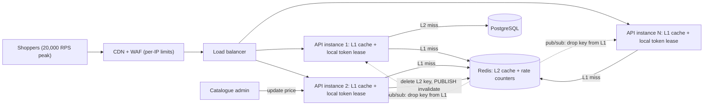
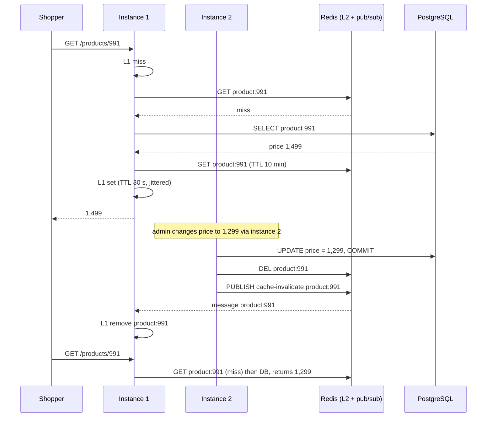

A single Redis cache takes you a long way. Then traffic grows: 20,000 requests per second, one flash-sale product getting a third of them, twelve API instances each paying a network round trip for every read. And the per-instance rate limits you configured quietly allow twelve times what you intended. This lesson is about the next level: two cache layers that cooperate, and rate limits that hold across a whole fleet.

## Learning objectives

By the end of this lesson you will be able to:

1. Explain why an in-process L1 cache in front of a distributed L2 cache reduces latency, Redis load and hot-key risk, and what it costs in consistency and memory.
2. Keep L1 copies on many instances consistent with pub/sub invalidation plus short TTLs, and state the staleness bound.
3. Use .NET's `HybridCache` correctly, and know what it does and does not do for you.
4. Build a two-level cache in C# with request coalescing, size limits, jittered TTLs and failure tolerance.
5. Explain why per-instance rate limits break under scale-out, and implement global limits with distributed counters and sliding windows.
6. Design a local-plus-global limiter that leases token batches from a shared store, and reason about its accuracy, cost and failure behaviour.

## Prerequisites

- [Cache-aside, read-through, write-through and write-behind](#/lesson/m12-cache-patterns): who loads and who invalidates.
- [Cache stampede, penetration and hot keys](#/lesson/m12-cache-failures): the failure modes multi-level caching helps with.
- [Rate limiting algorithms](#/lesson/m10-rate-limiting): token bucket, fixed and sliding windows on one machine.

## Explain it like I'm a beginner

**Two-level caching.** Imagine a busy chai stall. The stall owner keeps a few packets of sugar **on the counter** (the L1 cache: tiny, right at hand). Behind the shop there is a **storeroom** with sacks of sugar shared by three stalls (the L2 cache: bigger, shared, a few steps away). The **wholesale market** across town is the database: it has everything but takes an hour to visit.

Most of the time, the owner grabs sugar from the counter in a second. When the counter runs out, they walk to the storeroom. Only when the storeroom is empty does anyone go to the market. The counter is fast but small, and each stall has its own. If the supplier announces "that batch was bad, throw it away", someone has to tell **every** stall to clear its counter, not just the storeroom. That announcement is **pub/sub invalidation**.

**Rate limiting at scale.** A museum allows 600 visitors an hour. It has 12 entrance gates. If each gate guard counts only their own visitors and allows 600, the museum gets 7,200. The guards need a **shared counter** (a distributed counter). But if every guard phones the head office for every single visitor, the phone line jams. So each guard takes a **book of 20 tickets** from the head office at a time and hands them out locally, asking for another book when it runs out. That is a **local-plus-global limiter with leased tokens**.

## First-principles explanation

### Why add a second cache level?

Approximate costs per read (estimates; measure your own environment):

| Where | Typical latency | Shared across instances? | Survives restart? |
|---|---|---|---|
| L1: in-process memory (`IMemoryCache`) | well under a microsecond to a few microseconds, plus deserialisation if you store bytes | No | No |
| L2: Redis in the same region | roughly 0.3–1 ms round trip | Yes | Yes (in memory, optionally persisted) |
| PostgreSQL query | roughly 2–20 ms for simple indexed reads | Yes | Yes |

L2 alone already protects the database. L1 adds three things:

1. **Latency.** No network hop for the hottest data. On an API with a 50 ms budget that calls 5 cached lookups, saving 5 × 0.7 ms is worth having; on a page with 40 lookups it is decisive.
2. **L2 load.** Every L1 hit is a Redis operation you did not make.
3. **Hot-key protection.** In Redis Cluster a key lives on one shard. If one product receives 6,000 reads per second, all of them hit one shard's single-threaded command loop. With L1, each instance reads it from Redis at most once per L1 TTL.

### Back-of-the-envelope: a catalogue API at peak

Estimates for a festival-sale catalogue:

- Peak traffic: **20,000 RPS** across **12 instances** (≈ 1,670 RPS each).
- One flash-sale product takes 30 % of reads: **6,000 RPS on a single key**.
- Hot set: 50,000 products × 4 KB serialised ≈ **200 MB**.

L2 only: Redis serves 20,000 ops/s, 6,000 of them on one shard for one key. Workable on good hardware, but the hot shard has little headroom and every request pays ~0.7 ms.

With L1 (TTL 30 s) and, say, a 90 % L1 hit ratio:

- Redis: 20,000 × 10 % = **2,000 ops/s**.
- The hot key: at most 12 instances ÷ 30 s = **0.4 Redis reads/s**, down from 6,000.
- Memory: up to 200 MB per instance × 12 = **2.4 GB** of RAM, duplicated. This is the bill for L1; cap it with a size limit.

### The consistency problem

L2 has one copy of each value. L1 has **one copy per instance**. When a price changes:

1. Write PostgreSQL.
2. Delete the key in L2.
3. Each instance's L1 still holds the old price until its TTL expires.

With a 30-second L1 TTL, users may see the old price for up to 30 seconds, and different instances disagree during that time, so a user refreshing the page can see prices flip between old and new (load balancers spread requests).

Three tools, used together:

- **Short L1 TTLs.** L1 TTL is the *worst-case* staleness. Typical choices are 5 to 60 seconds, much shorter than the L2 TTL.
- **Pub/sub invalidation.** After deleting from L2, publish the key on a channel (Redis pub/sub, or a message bus). Every instance subscribes and removes the key from its L1. Typical staleness drops to the publish latency, usually milliseconds.
- **Versioned keys** for bulk changes: put a version in the key (`catalogue:v42:product:991`). Bumping the version makes every old entry unreachable at once, everywhere.

**Redis pub/sub is fire-and-forget.** Messages are not stored. If an instance is disconnected or restarting while the message is sent, it never sees it. That is why the short L1 TTL is not optional: pub/sub gives you *fast* invalidation, the TTL gives you a *bounded* one. If you cannot tolerate missed invalidations, use Redis Streams or a durable bus, or do not cache that data in L1.

**Ordering race.** Instance A reads the old value from the database just before the update, the update commits, the invalidation is published and processed, and then A writes the old value into L2 and L1. The stale value now lives until TTL. Mitigations: delete from L2 *after* the commit, use short TTLs, and for critical data store a version or `updated_at` with the value and refuse to overwrite a newer one.

### What to put in L1, and what not to

Good L1 candidates: data read far more than written, tolerant of seconds of staleness, and small: product details, configuration, feature flag snapshots, tenant settings, reference data (states, GST rates, unit-of-measure tables), permission maps.

Bad L1 candidates: anything that must be read-your-writes (a user's cart, their own profile right after editing), inventory used to confirm an order, balances, and large or rarely repeated items (search results with millions of combinations; they evict the useful entries).

### HybridCache in .NET

`HybridCache` (the `Microsoft.Extensions.Caching.Hybrid` package, introduced with .NET 9, usable from .NET 8 upwards) packages most of this lesson:

```csharp
builder.Services.AddStackExchangeRedisCache(o => o.Configuration = builder.Configuration.GetConnectionString("Redis"));
builder.Services.AddHybridCache(o =>
{
    o.DefaultEntryOptions = new HybridCacheEntryOptions
    {
        LocalCacheExpiration = TimeSpan.FromSeconds(30),   // L1
        Expiration = TimeSpan.FromMinutes(10)              // L2
    };
    o.MaximumPayloadBytes = 1024 * 1024;
});

// usage
var product = await cache.GetOrCreateAsync($"product:{id}",
    async ct => await repo.GetAsync(id, ct),
    tags: ["catalogue", $"brand:{brandId}"],
    cancellationToken: ct);

await cache.RemoveAsync($"product:{id}");
await cache.RemoveByTagAsync($"brand:{brandId}");
```

What it gives you:

- **L1 + L2** in one API: in-memory L1, and any registered `IDistributedCache` (Redis, SQL Server, and others) as L2.
- **Stampede protection**: concurrent callers for the same key on one instance share a single factory call.
- **Serialisation** (System.Text.Json by default, pluggable) and payload size limits.
- **Tags** for group invalidation.

What to check for your version: removing an entry clears the local L1 and the L2, but other instances' L1 copies are not automatically notified in the versions documented at the time of writing, so they live until `LocalCacheExpiration`. If you need fast cross-instance L1 invalidation, keep `LocalCacheExpiration` short and add your own broadcast (subscribe to a pub/sub channel and call `RemoveAsync` locally), or check the current documentation, as this area is evolving. Also, stampede protection is per instance: 12 instances can still make 12 concurrent database calls for one cold key, which is usually fine.

### What breaks first in multi-level caches

1. **Memory.** L1 without a size limit grows until the garbage collector struggles or the pod is OOM-killed. Set `SizeLimit` and give every entry a size.
2. **Cold start after deploy.** A rolling deploy replaces instances with empty L1s; L2 absorbs it. If L2 is also cold (a Redis failover), the database gets everything. Size the database for a degraded, partially cached mode, and use request coalescing.
3. **Synchronised expiry.** All instances loaded the hot key at the same moment, so they all expire together. Add jitter (±10–20 %) to TTLs.
4. **Missed invalidations.** A network blip drops pub/sub messages; prices disagree for up to the L1 TTL. Monitor and keep TTLs honest.
5. **Serialisation cost.** Deserialising a 200 KB object on every L1 hit erases L1's advantage. Store deserialised immutable objects in L1 (and never mutate them).

### Rate limiting at scale: why per-instance limits break

ASP.NET Core's rate limiting middleware keeps its counters **in each process**. That is correct and fast, but:

- **The limit multiplies by the instance count.** A per-API-key limit of 600 per minute on 12 instances allows up to 12 × 600 = **7,200 per minute** with round-robin load balancing.
- **Autoscaling changes the limit.** Scaling from 4 to 20 instances during a spike raises the effective limit fivefold exactly when you need protection.
- **Uneven balancing** (sticky sessions, consistent hashing) makes some clients hit the per-instance limit early while the fleet is idle.

Per-instance limits are still the right tool for **protecting the instance itself** (concurrency limits on expensive endpoints, a cap on in-flight requests). For **contractual or fairness limits** ("this API key gets 600 per minute"), you need a global view.

### Global limits with distributed counters

**Fixed window in Redis.** One key per client per window:

```text
key = rl:{apiKey}:{unixMinute}
count = INCR key
if count == 1: EXPIRE key 120
allow if count <= limit
```

Simple and atomic (`INCR` is atomic), but bursty at boundaries: a client can send 600 at 10:00:59 and 600 at 10:01:00.

**Sliding window counter.** Keep the current and previous window counts and estimate:

```text
estimate = previousCount × (1 − elapsedFractionOfCurrentWindow) + currentCount
allow if estimate < limit
```

At 10:01:30 with 600 in the previous minute and 100 so far: 600 × 0.5 + 100 = 400. It smooths the boundary burst with two counters per client. (A sliding *log* in a sorted set is exact but stores every request timestamp, costly at high rates.)

**Token bucket in Redis** needs read-modify-write (tokens and last refill time), so implement it as a Lua script that Redis runs atomically.

**The cost.** Every request now makes a Redis round trip: about 1 ms added latency, and at 20,000 RPS, 20,000 extra Redis operations per second, plus a dependency on Redis for every request.

### Local plus global: leased token budgets

The middle ground: each instance **leases a batch** of tokens from the global counter and spends them locally.

1. A request arrives for API key K. The instance has 0 local tokens for K in the current window.
2. It asks the global store for a batch of 20: `granted = min(20, limit − used)`, atomically (`INCRBY` with a cap, via a Lua script).
3. It spends those 20 locally with no network calls, then leases again.

Properties:

- **Redis traffic drops by the batch size**: 20,000 RPS ÷ 20 = **1,000 ops/s**.
- **Never over the global limit**: the store never grants more than `limit` per window.
- **Can be slightly under**: tokens leased by an instance that then receives no more traffic for K are wasted at the end of the window. Worst case: `(instances − 1) × (batch − 1)` tokens unused per window. With 12 instances, batches of 20 and a limit of 600, up to 209 tokens may be stranded, so choose the batch size relative to the limit (for example, at most limit ÷ (instances × 5)), or shrink the batch as the window's remaining budget falls.

Another variant gives each instance a **fixed share** (`limit ÷ instances`) with no coordination at all; it is simple but inaccurate under uneven load and wrong whenever the instance count changes.

### When the global store is down: fail open or fail closed?

- **Fail open** (allow requests, perhaps with a conservative local fallback limit): best for most product APIs; a Redis outage should not become an API outage.
- **Fail closed** (reject): for limits that protect money or safety, such as OTP sends, password attempts and payment initiation.

Whichever you pick, make it explicit, log it, and alert on it.

### Layered limits: where each one belongs

| Layer | Limits | Purpose |
|---|---|---|
| CDN / WAF edge | per IP, per country, bot rules | Stop floods before they cost you anything |
| API gateway | per API key or tenant, global | Contractual quotas, fairness |
| Service | per endpoint concurrency, per instance | Protect the process and its dependencies |
| Dependency client | concurrency to the database or a partner API | Protect what is behind you |

Return `429 Too Many Requests` with `Retry-After`, and consider the `RateLimit-*` response headers proposed in the IETF draft so well-behaved clients can pace themselves.

## Visual explanation

### Architecture: L1 per instance, shared L2, invalidation channel, global limiter



Requests pass the edge, which applies coarse per-IP limits, then reach one of N instances. Each instance first checks its own L1; on a miss it asks Redis (L2); only on an L2 miss does it query PostgreSQL. The same Redis also holds the global rate-limit counters, which instances lease in batches. When an admin changes a price on instance 2, that instance commits to PostgreSQL, deletes the L2 key and publishes an invalidation; the dotted arrows show every other instance receiving it and dropping its L1 copy. If a dotted message is lost, the L1 TTL caps how long that instance stays stale.

### Sequence: read path and invalidation



The first read fills both levels, with a short L1 TTL and a long L2 TTL. The update follows the safe order: commit first, then delete from L2, then broadcast. Instance 1 drops its L1 copy on receiving the message, so the next read reloads the new price. Had the message been lost, instance 1 would have served 1,499 for at most its remaining L1 TTL.

## Step-by-step example

We take one API from "Redis only, per-instance limits" to "two-level cache, global limits", checking numbers at each step.

### Step 1 — baseline

12 instances, Redis cache-aside, per-instance limit of 600 per minute per API key. Measured (hypothetically): p95 latency 38 ms, Redis at 20,000 ops/s with one shard at 70 % CPU during the flash sale.

### Step 2 — add L1 for product details

L1 TTL 30 s ± 20 % jitter, size limit 200 MB per instance. Expected: Redis ops fall to around 2,000/s (at a 90 % L1 hit ratio), the hot shard's load from the flash-sale key almost disappears, and p95 drops by a few milliseconds (estimate). Memory per pod rises by up to 200 MB.

### Step 3 — add invalidation

Price edits publish to `cache-invalidate`. Typical staleness after an edit: tens of milliseconds. Worst case (missed message): 36 s (30 s + 20 % jitter). Product agrees to that bound for prices *shown*; checkout re-reads the price from PostgreSQL.

### Step 4 — notice the rate-limit leak

A partner integration with a 600/min limit is observed doing 6,800/min. Cause: 12 instances × 600. The partner's contract says 600.

### Step 5 — global sliding window in Redis, one call per request

Accurate, but adds ~1 ms per request and 20,000 Redis ops/s, cancelling half of Step 2's savings.

### Step 6 — leased batches

Batch size 10 (600 ÷ (12 × 5)). Redis ops for rate limiting fall to about 2,000/s at peak, and accuracy stays within the stranded-token bound: at most 11 × 9 = 99 unused tokens per minute, so the partner gets between 501 and 600 requests per minute, never more. Redis outage policy: fail open with a per-instance fallback of 600 ÷ 12 = 50 per minute.

### Step 7 — keep the per-instance limiter too

A concurrency limiter of 64 in-flight requests on the expensive `/search` endpoint stays local: it protects each process, which is exactly what a per-instance limit is for.

## Production-style C# implementation

The sample implements a two-level cache with request coalescing and pub/sub invalidation, and a leased-budget global rate limiter used as an endpoint filter. It runs offline: `AddDistributedMemoryCache()` stands in for Redis's `IDistributedCache`, and in-memory implementations stand in for Redis pub/sub and Redis counters.

```text
Catalogue.Api/
  Program.cs
  Caching/InvalidationBus.cs        ICacheInvalidationBus + in-memory pub/sub
  Caching/TwoLevelCache.cs          L1 (IMemoryCache) + L2 (IDistributedCache), coalescing, jitter
  RateLimiting/GlobalBudgetStore.cs IGlobalBudgetStore + in-memory "Redis" with capped INCRBY
  RateLimiting/LeasedRateLimiter.cs local leases of global tokens, fail-open fallback
  RateLimiting/RateLimitFilter.cs   endpoint filter returning 429 + Retry-After
  Products/ProductRepository.cs     fake database
```

### Invalidation bus

```csharp file=Caching/InvalidationBus.cs
namespace Catalogue.Caching;

/// <summary>Broadcasts "drop this key from L1" to every instance. Production: Redis pub/sub
/// (ISubscriber.PublishAsync / SubscribeAsync) or a message bus topic. Delivery is best-effort,
/// which is why L1 TTLs must stay short.</summary>
public interface ICacheInvalidationBus
{
    Task PublishAsync(string key, CancellationToken ct);
    IDisposable Subscribe(Action<string> onInvalidate);
}

public sealed class InMemoryInvalidationBus : ICacheInvalidationBus
{
    private readonly List<Action<string>> _subscribers = [];
    private readonly Lock _gate = new();

    public Task PublishAsync(string key, CancellationToken ct)
    {
        Action<string>[] targets;
        lock (_gate) targets = _subscribers.ToArray();
        foreach (var t in targets) t(key);
        return Task.CompletedTask;
    }

    public IDisposable Subscribe(Action<string> onInvalidate)
    {
        lock (_gate) _subscribers.Add(onInvalidate);
        return new Subscription(this, onInvalidate);
    }

    private sealed class Subscription(InMemoryInvalidationBus bus, Action<string> handler) : IDisposable
    {
        public void Dispose() { lock (bus._gate) bus._subscribers.Remove(handler); }
    }
}
```

### The two-level cache

```csharp file=Caching/TwoLevelCache.cs
using System.Collections.Concurrent;
using System.Text.Json;
using Microsoft.Extensions.Caching.Distributed;
using Microsoft.Extensions.Caching.Memory;
using Microsoft.Extensions.Options;

namespace Catalogue.Caching;

public sealed class TwoLevelCacheOptions
{
    public TimeSpan L1Ttl { get; set; } = TimeSpan.FromSeconds(30);
    public TimeSpan L2Ttl { get; set; } = TimeSpan.FromMinutes(10);
    public double JitterFraction { get; set; } = 0.2;
}

public interface ITwoLevelCache
{
    Task<T> GetOrCreateAsync<T>(string key, Func<CancellationToken, Task<T>> factory, CancellationToken ct);
    Task InvalidateAsync(string key, CancellationToken ct);
}

/// <summary>L1 = this process's memory, L2 = shared distributed cache, then the factory (database).
/// - Request coalescing: one factory/L2 call per key per instance at a time.
/// - L2 failures are treated as misses: the cache must never cause an outage.
/// - L1 entries are sized (bytes) so IMemoryCache.SizeLimit bounds memory.</summary>
public sealed class TwoLevelCache(
    IMemoryCache l1,
    IDistributedCache l2,
    ICacheInvalidationBus bus,
    IOptions<TwoLevelCacheOptions> options,
    ILogger<TwoLevelCache> log) : ITwoLevelCache, IDisposable
{
    private readonly TwoLevelCacheOptions _o = options.Value;
    private readonly ConcurrentDictionary<string, Lazy<Task<byte[]>>> _inflight = new(StringComparer.Ordinal);
    private readonly IDisposable _subscription = bus.Subscribe(key => l1.Remove(key));

    public async Task<T> GetOrCreateAsync<T>(string key, Func<CancellationToken, Task<T>> factory, CancellationToken ct)
    {
        if (l1.TryGetValue(key, out T? cached) && cached is not null) return cached;

        var bytes = await LoadBytesCoalescedAsync(key, async c => JsonSerializer.SerializeToUtf8Bytes(await factory(c)), ct);
        var value = JsonSerializer.Deserialize<T>(bytes)!;
        l1.Set(key, value, new MemoryCacheEntryOptions
        {
            AbsoluteExpirationRelativeToNow = Jitter(_o.L1Ttl),
            Size = bytes.Length
        });
        return value;   // treat cached objects as immutable: callers must not mutate them
    }

    public async Task InvalidateAsync(string key, CancellationToken ct)
    {
        // Call AFTER the database commit. Order: L2, local L1, then broadcast to other instances.
        try { await l2.RemoveAsync(key, ct); }
        catch (Exception ex) { log.LogWarning(ex, "L2 remove failed for {Key}; relying on TTL", key); }
        l1.Remove(key);
        await bus.PublishAsync(key, ct);
    }

    private async Task<byte[]> LoadBytesCoalescedAsync(string key, Func<CancellationToken, Task<byte[]>> create, CancellationToken ct)
    {
        var lazy = _inflight.GetOrAdd(key, k => new Lazy<Task<byte[]>>(() => LoadFromL2OrSourceAsync(k, create)));
        try
        {
            return await lazy.Value.WaitAsync(ct);   // a cancelled caller stops waiting; the shared load continues
        }
        finally
        {
            _inflight.TryRemove(new KeyValuePair<string, Lazy<Task<byte[]>>>(key, lazy));
        }
    }

    private async Task<byte[]> LoadFromL2OrSourceAsync(string key, Func<CancellationToken, Task<byte[]>> create)
    {
        try
        {
            var fromL2 = await l2.GetAsync(key);
            if (fromL2 is not null) return fromL2;
        }
        catch (Exception ex) { log.LogWarning(ex, "L2 read failed for {Key}; falling back to source", key); }

        var bytes = await create(CancellationToken.None);   // not tied to one caller's cancellation
        try
        {
            await l2.SetAsync(key, bytes, new DistributedCacheEntryOptions { AbsoluteExpirationRelativeToNow = Jitter(_o.L2Ttl) });
        }
        catch (Exception ex) { log.LogWarning(ex, "L2 write failed for {Key}", key); }
        return bytes;
    }

    private TimeSpan Jitter(TimeSpan ttl)
    {
        var factor = 1 + (Random.Shared.NextDouble() * 2 - 1) * _o.JitterFraction;   // e.g. 0.8 .. 1.2
        return TimeSpan.FromMilliseconds(ttl.TotalMilliseconds * factor);
    }

    public void Dispose() => _subscription.Dispose();
}
```

Three details carry most of the value. `Lazy<Task<byte[]>>` in a `ConcurrentDictionary` makes 500 simultaneous misses for one key on one instance produce one L2 read and at most one database query. The shared load runs without any single caller's cancellation token, so one impatient client cannot cancel the work others are waiting for. And jittered TTLs stop instances that loaded a hot key together from expiring it together.

### The global budget store and leased limiter

```csharp file=RateLimiting/GlobalBudgetStore.cs
namespace Catalogue.RateLimiting;

/// <summary>Atomically takes up to `requested` tokens from the global budget for (key, window).
/// Redis equivalent (Lua, runs atomically):
///   local used = tonumber(redis.call('GET', KEYS[1]) or '0')
///   local grant = math.min(tonumber(ARGV[1]), tonumber(ARGV[2]) - used)
///   if grant &lt;= 0 then return 0 end
///   redis.call('INCRBY', KEYS[1], grant); redis.call('EXPIRE', KEYS[1], ARGV[3]); return grant</summary>
public interface IGlobalBudgetStore
{
    Task<int> TakeAsync(string key, long windowId, int requested, int limit, CancellationToken ct);
}

public sealed class InMemoryGlobalBudgetStore : IGlobalBudgetStore
{
    private readonly Dictionary<(string Key, long Window), int> _used = new();
    private readonly Lock _gate = new();
    public int Calls { get; private set; }

    public Task<int> TakeAsync(string key, long windowId, int requested, int limit, CancellationToken ct)
    {
        lock (_gate)
        {
            Calls++;
            var used = _used.GetValueOrDefault((key, windowId));
            var grant = Math.Max(0, Math.Min(requested, limit - used));
            if (grant > 0) _used[(key, windowId)] = used + grant;
            // Real Redis expires old windows; here we prune them occasionally.
            if (_used.Count > 10_000)
                foreach (var old in _used.Keys.Where(k => k.Window < windowId).ToList()) _used.Remove(old);
            return Task.FromResult(grant);
        }
    }
}
```

```csharp file=RateLimiting/LeasedRateLimiter.cs
using System.Collections.Concurrent;
using Microsoft.Extensions.Options;

namespace Catalogue.RateLimiting;

public sealed class LeasedRateLimiterOptions
{
    public int LimitPerWindow { get; set; } = 600;
    public TimeSpan Window { get; set; } = TimeSpan.FromMinutes(1);
    public int BatchSize { get; set; } = 10;
    /// <summary>Used only while the global store is unreachable (fail open, but not unlimited).</summary>
    public int FallbackPerInstanceLimit { get; set; } = 50;
}

public sealed record RateDecision(bool Allowed, TimeSpan RetryAfter, string Source);

/// <summary>Spends tokens locally and leases them from the global store in batches.
/// Never exceeds the global limit; may under-use it by up to (instances - 1) x (batch - 1) per window.</summary>
public sealed class LeasedRateLimiter(
    IGlobalBudgetStore store,
    TimeProvider time,
    IOptions<LeasedRateLimiterOptions> options,
    ILogger<LeasedRateLimiter> log)
{
    private readonly LeasedRateLimiterOptions _o = options.Value;
    private readonly ConcurrentDictionary<string, KeyState> _state = new(StringComparer.Ordinal);

    private sealed class KeyState
    {
        public readonly SemaphoreSlim Gate = new(1, 1);
        public long Window = -1;
        public int LocalTokens;
        public int FallbackUsed;
        public bool GlobalExhausted;
    }

    public async ValueTask<RateDecision> TryAcquireAsync(string key, CancellationToken ct)
    {
        var now = time.GetUtcNow();
        var windowTicks = _o.Window.Ticks;
        var windowId = now.UtcTicks / windowTicks;
        var retryAfter = TimeSpan.FromTicks((windowId + 1) * windowTicks - now.UtcTicks);

        var s = _state.GetOrAdd(key, _ => new KeyState());
        await s.Gate.WaitAsync(ct);
        try
        {
            if (s.Window != windowId)
            {
                s.Window = windowId;
                s.LocalTokens = 0;
                s.FallbackUsed = 0;
                s.GlobalExhausted = false;
            }

            if (s.LocalTokens > 0) { s.LocalTokens--; return new(true, TimeSpan.Zero, "local"); }
            if (s.GlobalExhausted) return new(false, retryAfter, "exhausted");   // no network call when we already know

            try
            {
                var granted = await store.TakeAsync(key, windowId, _o.BatchSize, _o.LimitPerWindow, ct);
                if (granted <= 0) { s.GlobalExhausted = true; return new(false, retryAfter, "global"); }
                s.LocalTokens = granted - 1;
                return new(true, TimeSpan.Zero, "lease");
            }
            catch (Exception ex) when (ex is not OperationCanceledException)
            {
                // Fail open, but bounded: a share of the limit per instance until the store recovers.
                log.LogWarning(ex, "Global rate-limit store unavailable; using fallback for {Key}", key);
                if (s.FallbackUsed < _o.FallbackPerInstanceLimit) { s.FallbackUsed++; return new(true, TimeSpan.Zero, "fallback"); }
                return new(false, retryAfter, "fallback");
            }
        }
        finally
        {
            s.Gate.Release();
        }
    }
}
```

Two refinements are deliberate. Once the global budget says "none left", the instance remembers that until the window ends, so a client hammering at 1,000 requests per second after hitting its limit costs zero Redis calls. And the fallback path is bounded, so a Redis outage neither blocks all traffic nor removes protection completely.

```csharp file=RateLimiting/RateLimitFilter.cs
namespace Catalogue.RateLimiting;

/// <summary>Applies the global per-API-key limit to an endpoint and returns 429 with Retry-After when exceeded.</summary>
public sealed class RateLimitFilter(LeasedRateLimiter limiter) : IEndpointFilter
{
    public async ValueTask<object?> InvokeAsync(EndpointFilterInvocationContext context, EndpointFilterDelegate next)
    {
        var http = context.HttpContext;
        var apiKey = http.Request.Headers["X-Api-Key"].ToString();
        if (string.IsNullOrEmpty(apiKey)) return Results.Unauthorized();

        var decision = await limiter.TryAcquireAsync($"api:{apiKey}", http.RequestAborted);
        if (decision.Allowed) return await next(context);

        http.Response.Headers.RetryAfter = Math.Max(1, (int)Math.Ceiling(decision.RetryAfter.TotalSeconds)).ToString();
        return Results.Problem("Rate limit exceeded.", statusCode: StatusCodes.Status429TooManyRequests);
    }
}
```

### Products and wiring

```csharp file=Products/ProductRepository.cs
namespace Catalogue.Products;

public sealed record Product(int Id, string Name, decimal PriceInr, long Version);

public interface IProductRepository
{
    Task<Product?> GetAsync(int id, CancellationToken ct);
    Task<Product> UpdatePriceAsync(int id, decimal priceInr, CancellationToken ct);
}

public sealed class InMemoryProductRepository : IProductRepository
{
    private readonly Dictionary<int, Product> _rows = new()
    {
        [991] = new(991, "Ceiling fan 1200 mm", 1499m, 1),
        [992] = new(992, "LED batten 20 W", 299m, 1)
    };
    private readonly Lock _gate = new();
    public int Reads { get; private set; }

    public async Task<Product?> GetAsync(int id, CancellationToken ct)
    {
        await Task.Delay(5, ct);   // pretend this is a 5 ms query
        lock (_gate) { Reads++; return _rows.GetValueOrDefault(id); }
    }

    public Task<Product> UpdatePriceAsync(int id, decimal priceInr, CancellationToken ct)
    {
        lock (_gate)
        {
            if (!_rows.TryGetValue(id, out var p)) throw new KeyNotFoundException($"Product {id} not found.");
            var updated = p with { PriceInr = priceInr, Version = p.Version + 1 };
            _rows[id] = updated;
            return Task.FromResult(updated);
        }
    }
}
```

```csharp file=Program.cs
using Microsoft.AspNetCore.RateLimiting;
using System.Threading.RateLimiting;
using Catalogue.Caching;
using Catalogue.Products;
using Catalogue.RateLimiting;

var builder = WebApplication.CreateBuilder(args);

builder.Services.AddSingleton(TimeProvider.System);

// L1: bounded by total bytes (each entry sets Size). L2: Redis in production:
// builder.Services.AddStackExchangeRedisCache(o => o.Configuration = builder.Configuration.GetConnectionString("Redis"));
builder.Services.AddMemoryCache(o => o.SizeLimit = 200L * 1024 * 1024);
builder.Services.AddDistributedMemoryCache();
builder.Services.AddSingleton<ICacheInvalidationBus, InMemoryInvalidationBus>();
builder.Services.Configure<TwoLevelCacheOptions>(builder.Configuration.GetSection("Cache"));
builder.Services.AddSingleton<ITwoLevelCache, TwoLevelCache>();
builder.Services.AddSingleton<IProductRepository, InMemoryProductRepository>();

builder.Services.AddSingleton<IGlobalBudgetStore, InMemoryGlobalBudgetStore>();
builder.Services.Configure<LeasedRateLimiterOptions>(builder.Configuration.GetSection("RateLimit"));
builder.Services.AddSingleton<LeasedRateLimiter>();

// Per-instance protection still has a place: cap concurrent work on this process.
builder.Services.AddRateLimiter(o =>
{
    o.RejectionStatusCode = StatusCodes.Status503ServiceUnavailable;
    o.AddConcurrencyLimiter("instance-protect", c => { c.PermitLimit = 64; c.QueueLimit = 0; });
});

var app = builder.Build();
app.UseRateLimiter();

var products = app.MapGroup("/products")
    .AddEndpointFilter<RateLimitFilter>()          // global, per API key, across all instances
    .RequireRateLimiting("instance-protect");      // local, protects this process

products.MapGet("/{id:int}", async (int id, ITwoLevelCache cache, IProductRepository repo, CancellationToken ct) =>
{
    var product = await cache.GetOrCreateAsync($"product:v1:{id}", c => repo.GetAsync(id, c), ct);
    return product is null ? Results.NotFound() : Results.Ok(product);
});

products.MapPut("/{id:int}/price", async (int id, decimal priceInr, ITwoLevelCache cache, IProductRepository repo, CancellationToken ct) =>
{
    var updated = await repo.UpdatePriceAsync(id, priceInr, ct);   // 1. commit
    await cache.InvalidateAsync($"product:v1:{id}", ct);           // 2. L2 delete, L1 delete, broadcast
    return Results.Ok(updated);
});

app.Run();
```

Design notes:

- **Null results.** `GetOrCreateAsync` caches whatever the factory returns, including `null` serialised as JSON `null`, which is negative caching for unknown ids. Keep it, but with a shorter TTL in real code, so a product created later becomes visible quickly.
- **Key versioning.** The `v1` in `product:v1:{id}` lets you change the cached shape (add a field) by bumping to `v2` without flushing Redis.
- **Two limiters, two jobs.** The endpoint filter enforces the *contract* globally; the concurrency limiter protects the *process*. Confusing the two is the most common rate-limiting design mistake.

## Bad design vs good design

**Bad: long-lived L1 with no invalidation, and per-instance quotas.**

```csharp
// Anti-example
builder.Services.AddMemoryCache();   // no size limit
app.MapGet("/products/{id}", (int id, IMemoryCache cache, Db db) =>
    cache.GetOrCreate($"p:{id}", e => { e.SlidingExpiration = TimeSpan.FromHours(6); return db.Get(id); }));

builder.Services.AddRateLimiter(o => o.AddFixedWindowLimiter("partner", w =>
{
    w.PermitLimit = 600; w.Window = TimeSpan.FromMinutes(1);   // "600 per minute" (times 12 instances)
}));
```

What goes wrong:

- Sliding expiration on a popular key means it **never** expires; a price change is invisible on that instance until it restarts.
- No size limit: L1 grows with every product ever viewed.
- Different instances show different prices for hours.
- The partner gets 7,200 requests per minute, and the effective limit rises further when the fleet autoscales.

**Good:** the implementation above. Short, jittered, absolute L1 TTLs; a size limit; invalidation broadcast after commit; L2 as the shared layer; a global limiter with leased batches for contractual limits; local concurrency limits for self-protection.

:::callout type=warning title="L1 is not a place for read-your-writes data"
If a user edits their address and the next request lands on another instance, that instance's L1 may still hold the old address. For data a user has just changed, read from L2 or the database, or bypass L1 for that user for a few seconds after a write.
:::

## Practical playground

Use the cache simulator to see what an L1 layer does to the tier behind it. Treat the simulator's "cache" as L1 and its "database" as Redis plus PostgreSQL.

1. Start at a 0.9 hit ratio and 20,000 RPS; note the backend load (about 2,000 RPS).
2. Drop the hit ratio to 0.5 (for example, after a deploy cleared every L1) and watch backend load and latency.
3. Trigger a cache outage and compare backend load with its capacity line. This is your cold-start risk.
4. Ask: what L1 TTL and invalidation design would you need to keep the hit ratio high while bounding staleness at 30 seconds?

:::playground type=sim sim=cache title="What an L1 cache does for the tier behind it" hitRatio=0.9 rps=20000 dbCapacityRps=4000 dbLatencyMs=1 cacheLatencyMs=0.05 ttlSeconds=30
Model L1 (in-process) in front of the shared tier. The backend latency stands for a Redis round trip; its capacity stands for what the Redis shard and database can absorb together.
:::

## Exercises

:::exercise id=m16-multi-level-caching-ex1 difficulty=beginner kind=code title="The two-level read path"
Implement `TwoLevel.GetOrCreate` and `TwoLevel.Invalidate` over two `ICacheLayer`s.
::requirements
- Read order: L1, then L2, then `factory`.
- An L2 hit fills L1 (with the L1 TTL). A factory result fills L2 (L2 TTL) and L1 (L1 TTL).
- `Invalidate` removes the key from both layers.
::acceptance
- The first read calls the factory once; the second read on the same instance touches neither L2 nor the factory.
- A second instance sharing L2 gets an L2 hit and does not call the factory.
- After the L1 TTL passes, the value comes from L2.
- After `Invalidate`, the next read calls the factory again.
::hint
Write the three branches as early returns: L1 hit, L2 hit, factory.
::hint
On an L2 hit, remember to copy the value into L1 before returning.
::hint
L1 TTL should be the short one; L2 TTL the long one.
::hint
```csharp
if (l1.TryGet(key, out var v)) return v!;
if (l2.TryGet(key, out v)) { l1.Set(key, v!, l1Ttl); return v!; }
var created = factory();
l2.Set(key, created, l2Ttl); l1.Set(key, created, l1Ttl);
return created;
```
::starter
```csharp file=TwoLevel.cs
using System;
using System.Collections.Generic;

public interface ICacheLayer
{
    bool TryGet(string key, out string? value);
    void Set(string key, string value, TimeSpan ttl);
    void Remove(string key);
}

public sealed class MemoryLayer(Func<DateTimeOffset> clock) : ICacheLayer
{
    private readonly Dictionary<string, (string Value, DateTimeOffset Expires)> _items = new();
    public int Hits { get; private set; }

    public bool TryGet(string key, out string? value)
    {
        if (_items.TryGetValue(key, out var e) && clock() < e.Expires) { Hits++; value = e.Value; return true; }
        value = null;
        return false;
    }

    public void Set(string key, string value, TimeSpan ttl) => _items[key] = (value, clock() + ttl);
    public void Remove(string key) => _items.Remove(key);
}

public sealed class TwoLevel(ICacheLayer l1, ICacheLayer l2, TimeSpan l1Ttl, TimeSpan l2Ttl)
{
    public string GetOrCreate(string key, Func<string> factory) => throw new NotImplementedException();

    public void Invalidate(string key) => throw new NotImplementedException();
}
```
::tests
```csharp file=TwoLevelTests.cs
using System;
using Xunit;

public class TwoLevelTests
{
    private DateTimeOffset _now = new(2026, 10, 19, 10, 0, 0, TimeSpan.Zero);
    private DateTimeOffset Clock() => _now;

    [Fact]
    public void Second_read_is_an_l1_hit()
    {
        var l1 = new MemoryLayer(Clock); var l2 = new MemoryLayer(Clock);
        var cache = new TwoLevel(l1, l2, TimeSpan.FromSeconds(30), TimeSpan.FromMinutes(10));
        var calls = 0;
        Assert.Equal("1499", cache.GetOrCreate("p:991", () => { calls++; return "1499"; }));
        Assert.Equal("1499", cache.GetOrCreate("p:991", () => { calls++; return "x"; }));
        Assert.Equal(1, calls);
        Assert.Equal(1, l1.Hits);
        Assert.Equal(0, l2.Hits);
    }

    [Fact]
    public void Other_instance_hits_shared_l2()
    {
        var l2 = new MemoryLayer(Clock);
        var a = new TwoLevel(new MemoryLayer(Clock), l2, TimeSpan.FromSeconds(30), TimeSpan.FromMinutes(10));
        var b = new TwoLevel(new MemoryLayer(Clock), l2, TimeSpan.FromSeconds(30), TimeSpan.FromMinutes(10));
        a.GetOrCreate("p:991", () => "1499");
        var calls = 0;
        Assert.Equal("1499", b.GetOrCreate("p:991", () => { calls++; return "x"; }));
        Assert.Equal(0, calls);
        Assert.Equal(1, l2.Hits);
    }

    [Fact]
    public void After_l1_ttl_value_comes_from_l2()
    {
        var l1 = new MemoryLayer(Clock); var l2 = new MemoryLayer(Clock);
        var cache = new TwoLevel(l1, l2, TimeSpan.FromSeconds(30), TimeSpan.FromMinutes(10));
        cache.GetOrCreate("p:991", () => "1499");
        _now = _now.AddSeconds(31);
        var calls = 0;
        Assert.Equal("1499", cache.GetOrCreate("p:991", () => { calls++; return "x"; }));
        Assert.Equal(0, calls);
        Assert.Equal(1, l2.Hits);
    }

    [Fact]
    public void Invalidate_forces_reload()
    {
        var cache = new TwoLevel(new MemoryLayer(Clock), new MemoryLayer(Clock), TimeSpan.FromSeconds(30), TimeSpan.FromMinutes(10));
        cache.GetOrCreate("p:991", () => "1499");
        cache.Invalidate("p:991");
        Assert.Equal("1299", cache.GetOrCreate("p:991", () => "1299"));
    }
}
```
::solution
Early returns in order L1, L2, factory, filling the faster layers on the way back.

```csharp file=TwoLevel.cs
using System;
using System.Collections.Generic;

public interface ICacheLayer
{
    bool TryGet(string key, out string? value);
    void Set(string key, string value, TimeSpan ttl);
    void Remove(string key);
}

public sealed class MemoryLayer(Func<DateTimeOffset> clock) : ICacheLayer
{
    private readonly Dictionary<string, (string Value, DateTimeOffset Expires)> _items = new();
    public int Hits { get; private set; }

    public bool TryGet(string key, out string? value)
    {
        if (_items.TryGetValue(key, out var e) && clock() < e.Expires) { Hits++; value = e.Value; return true; }
        value = null;
        return false;
    }

    public void Set(string key, string value, TimeSpan ttl) => _items[key] = (value, clock() + ttl);
    public void Remove(string key) => _items.Remove(key);
}

public sealed class TwoLevel(ICacheLayer l1, ICacheLayer l2, TimeSpan l1Ttl, TimeSpan l2Ttl)
{
    public string GetOrCreate(string key, Func<string> factory)
    {
        if (l1.TryGet(key, out var v) && v is not null) return v;
        if (l2.TryGet(key, out v) && v is not null)
        {
            l1.Set(key, v, l1Ttl);
            return v;
        }
        var created = factory();
        l2.Set(key, created, l2Ttl);
        l1.Set(key, created, l1Ttl);
        return created;
    }

    public void Invalidate(string key)
    {
        l2.Remove(key);   // shared layer first, so a concurrent L1 refill cannot pick up the old value from L2
        l1.Remove(key);
    }
}
```

`Invalidate` here only clears *this* instance's L1. Other instances need a broadcast (pub/sub), which is what the production `TwoLevelCache` adds. Removing L2 before L1 narrows the window in which a concurrent reader refills L1 from a stale L2 entry.
::mistakes
- Filling L1 with the L2 TTL, which makes L1 staleness as long as L2's.
- Calling the factory on an L2 hit "to be safe", which defeats the cache.
- Invalidating only L1, so the next L1 miss reloads the old value from L2.
::extensions
Add a `Func<string, bool>` "should cache" predicate to skip caching error responses, and a separate shorter TTL for negative (not found) results.
:::

:::exercise id=m16-multi-level-caching-ex2 difficulty=beginner kind=written title="Size the L1 and state the staleness bound"
A tenant-settings lookup is called on every request. Numbers: 8,000 RPS peak across 10 instances; 3,000 tenants; each settings object is 6 KB serialised; settings change about 50 times a day in total; product says a settings change must be visible everywhere within 1 minute, and usually within a second.

Answer: (a) Would L1 help, and why? (b) How much memory does L1 need per instance? (c) Which L1 TTL and invalidation design meet the requirement? (d) How many Redis reads per second remain, roughly, at steady state?
::acceptance
- Memory arithmetic per instance and across the fleet.
- TTL and invalidation choice justified against "1 minute worst, 1 second typical".
- Redis read estimate with the reasoning shown.
::hint
Every request reads settings: that is 8,000 Redis calls per second without L1.
::hint
3,000 × 6 KB: is that a lot of RAM for one process?
::hint
Which mechanism gives "usually within a second", and which gives "never more than a minute"?
::hint
At steady state, each instance reloads each *active* tenant at most once per TTL.
::solution
(a) Yes. Each request needs settings, so L1 removes 8,000 Redis round trips per second (about 0.5–1 ms each from request latency), and the data is small, read-heavy and rarely changes.

(b) 3,000 × 6 KB ≈ **18 MB per instance**, ≈ 180 MB across 10 instances. Trivial; cache all tenants, and set a size limit of, say, 50 MB as a guard.

(c) **L1 TTL 45–55 s with jitter** (worst case under 1 minute even with a missed message), plus **pub/sub invalidation** on every settings change for the "usually within a second" target. Settings changes are rare (50 a day), so invalidation traffic is negligible.

(d) At most 3,000 tenants × 10 instances ÷ 50 s ≈ **600 Redis reads/s** in the worst case where every tenant is active on every instance; in practice fewer, since not every tenant hits every instance each minute. Plus 50 invalidations a day. Down from 8,000/s.
::mistakes
- Choosing a 10-minute L1 TTL and relying on pub/sub alone: a missed message breaks the 1-minute promise.
- Forgetting that memory is per instance and multiplied by the fleet.
- Caching settings only in Redis "because it is fast enough", ignoring 8,000 extra network calls per second.
:::

:::exercise id=m16-multi-level-caching-ex3 difficulty=intermediate kind=code title="A sliding window counter limiter"
Implement `SlidingWindowLimiter.TryAcquire(key, now)` using the two-counter sliding window estimate.
::requirements
- Windows are aligned: `windowIndex = floor(unixSeconds / windowSeconds)`.
- Keep, per key, the current window index, the current count and the previous window's count.
- When the window index moves forward by exactly one, the current count becomes the previous count; by more than one, both reset to 0.
- `estimate = previous × (1 − elapsedFraction) + current`, where `elapsedFraction` is how far `now` is into the current window (0 to 1).
- Allow (and increment `current`) only if `estimate < limit`.
::acceptance
- With limit 10 per 60 s: 10 requests in the first window are allowed, the 11th is denied.
- Halfway through the next window, 5 more are allowed and the 6th is denied.
- Two full windows later, the full 10 are available again.
- Different keys are independent.
::hint
Store state in a `Dictionary<string, State>` where `State` has `Window`, `Current`, `Previous`.
::hint
Compute `elapsedFraction = (unixSeconds % windowSeconds) / (double)windowSeconds`.
::hint
Roll the window before computing the estimate.
::hint
```csharp
if (idx == s.Window + 1) { s.Previous = s.Current; s.Current = 0; s.Window = idx; }
else if (idx > s.Window + 1) { s.Previous = 0; s.Current = 0; s.Window = idx; }
```
::starter
```csharp file=SlidingWindowLimiter.cs
using System;
using System.Collections.Generic;

public sealed class SlidingWindowLimiter(int limit, int windowSeconds)
{
    private sealed class State { public long Window; public int Current; public int Previous; }
    private readonly Dictionary<string, State> _state = new();
    private readonly object _gate = new();

    public bool TryAcquire(string key, DateTimeOffset now) => throw new NotImplementedException();
}
```
::tests
```csharp file=SlidingWindowLimiterTests.cs
using System;
using Xunit;

public class SlidingWindowLimiterTests
{
    private static readonly DateTimeOffset T0 = new(2026, 10, 19, 10, 0, 0, TimeSpan.Zero); // aligned to a minute

    private static int Burst(SlidingWindowLimiter l, string key, DateTimeOffset at, int attempts)
    {
        var ok = 0;
        for (var i = 0; i < attempts; i++) if (l.TryAcquire(key, at)) ok++;
        return ok;
    }

    [Fact]
    public void First_window_allows_limit()
    {
        var l = new SlidingWindowLimiter(10, 60);
        Assert.Equal(10, Burst(l, "api:k1", T0.AddSeconds(5), 15));
    }

    [Fact]
    public void Halfway_into_next_window_previous_counts_half()
    {
        var l = new SlidingWindowLimiter(10, 60);
        Burst(l, "api:k1", T0.AddSeconds(5), 10);
        Assert.Equal(5, Burst(l, "api:k1", T0.AddSeconds(90), 10));
    }

    [Fact]
    public void After_two_windows_full_budget_returns()
    {
        var l = new SlidingWindowLimiter(10, 60);
        Burst(l, "api:k1", T0.AddSeconds(5), 10);
        Assert.Equal(10, Burst(l, "api:k1", T0.AddSeconds(185), 20));
    }

    [Fact]
    public void Keys_are_independent()
    {
        var l = new SlidingWindowLimiter(10, 60);
        Burst(l, "api:k1", T0, 10);
        Assert.True(l.TryAcquire("api:k2", T0));
    }
}
```
::solution
Roll the window, compute the weighted estimate, then admit.

```csharp file=SlidingWindowLimiter.cs
using System;
using System.Collections.Generic;

public sealed class SlidingWindowLimiter(int limit, int windowSeconds)
{
    private sealed class State { public long Window; public int Current; public int Previous; }
    private readonly Dictionary<string, State> _state = new();
    private readonly object _gate = new();

    public bool TryAcquire(string key, DateTimeOffset now)
    {
        var seconds = now.ToUnixTimeSeconds();
        var idx = seconds / windowSeconds;
        var elapsed = (seconds % windowSeconds) / (double)windowSeconds;

        lock (_gate)
        {
            if (!_state.TryGetValue(key, out var s))
                _state[key] = s = new State { Window = idx };

            if (idx == s.Window + 1) { s.Previous = s.Current; s.Current = 0; s.Window = idx; }
            else if (idx > s.Window + 1) { s.Previous = 0; s.Current = 0; s.Window = idx; }

            var estimate = s.Previous * (1 - elapsed) + s.Current;
            if (estimate >= limit) return false;
            s.Current++;
            return true;
        }
    }
}
```

In Redis the same logic uses two keys per client (`rl:k1:{idx}` and `rl:k1:{idx-1}`): `GET` the previous, `INCR` the current, and compute the estimate, ideally in one Lua script so the check and the increment are atomic. The estimate assumes the previous window's requests were spread evenly; it is an approximation, but far better than a fixed window at boundaries.
::mistakes
- Not resetting both counters when more than one window has passed, so stale counts block clients.
- Incrementing before checking, so denied requests consume budget.
- Using local time instead of UTC seconds, which breaks around daylight-saving changes in some regions.
:::

:::exercise id=m16-multi-level-caching-ex4 difficulty=intermediate kind=hld title="Caching and limits for a 10:00 ticket rush"
A railway-style booking system opens next-day "quick quota" tickets at 10:00 sharp. In the first 2 minutes, about 1.5 million users try to search trains and seat availability, and about 200,000 attempt bookings. Normal traffic is 2,000 RPS. The booking database can safely handle 3,000 transactions per second. Agents (bulk bookers) must be limited to 1 booking per minute per account, across all servers. Seat availability shown in search can be up to 5 seconds stale; availability at booking must be exact.

Design caching levels, invalidation, and rate limits. Show the arithmetic.
::acceptance
- Peak RPS estimates for search and booking.
- L1 and L2 roles and TTLs for availability summaries, with the staleness bound.
- Booking path reads exact data from the database, protected by a queue or admission control.
- A global per-account booking limit, and edge per-IP limits.
- A failure mode with a mitigation.
::hint
1.5 M users × maybe 5 searches in 120 s: what RPS is that?
::hint
How many distinct (train, date, class) availability keys are there? Probably thousands, not millions: a perfect L1 workload.
::hint
200,000 booking attempts in 120 s versus 3,000 TPS: is a queue or a waiting room needed?
::hint
"1 per minute per account across all servers" is a global limit; which store holds the counter?
::starter
```json
{
  "nodes": [
    { "id": "users", "type": "client", "label": "Travellers and agents", "props": { "rps": 60000 } },
    { "id": "lb", "type": "load-balancer", "label": "Load balancer" },
    { "id": "api", "type": "app-server", "label": "Booking API", "props": { "instances": 20 } },
    { "id": "db", "type": "database", "label": "Booking DB (3,000 TPS)" }
  ],
  "edges": [
    { "from": "users", "to": "lb", "kind": "sync" },
    { "from": "lb", "to": "api", "kind": "sync" },
    { "from": "api", "to": "db", "kind": "sync", "label": "search and booking" }
  ]
}
```
::solution
**Arithmetic (estimates).** Search: 1.5 M users × 5 searches ÷ 120 s ≈ **62,500 RPS**, with the first 10 seconds probably 3× higher. Booking: 200,000 ÷ 120 ≈ **1,700 attempts/s** average, with a sharp spike at 10:00:00 well above 3,000.

**Search caching.** Availability summaries keyed by `(train, date, class)`: perhaps 10,000 keys × 1 KB = 10 MB, which fits in L1 on every instance. L1 TTL **2 s** with jitter; L2 (Redis) TTL **5 s**, refreshed by a worker that recomputes hot summaries every second from the database (refresh-ahead), so search never queries the booking database directly. Staleness bound: L2 refresh 1 s + L1 TTL 2.4 s ≈ under 5 s. No pub/sub needed: TTLs this short are the invalidation. Redis load: 20 instances × 10,000 keys ÷ 2 s = 100,000 reads/s worst case, so in practice only hot keys reload, and you should spread over a Redis cluster with replicas for reads.

**Booking path.** Exact availability: the booking transaction locks the seat inventory row in the database. To keep the database under 3,000 TPS, put a **virtual waiting room** (queue) in front: accept booking requests into a queue, admit at 2,500/s, and show users their position. This is queue-based load levelling for humans.

**Limits.** Edge: per-IP 20 requests/s and bot detection. Global per-account booking limit: Redis key `bk:{account}:{minute}` with `SET NX EX 60` (only one booking per minute succeeds), checked before entering the queue. Fail closed for this limit (it protects fairness), fail open for search limits.

```json
{
  "nodes": [
    { "id": "users", "type": "client", "label": "Travellers and agents", "props": { "rps": 60000 } },
    { "id": "edge", "type": "cdn", "label": "CDN + WAF: static pages, per-IP limits, bot rules" },
    { "id": "lb", "type": "load-balancer", "label": "Load balancer" },
    { "id": "api", "type": "app-server", "label": "Booking API (L1 availability, TTL 2 s)", "props": { "instances": 20 } },
    { "id": "redis", "type": "cache", "label": "Redis: L2 availability (5 s) + account limits", "props": { "ttlSeconds": 5 } },
    { "id": "refresh", "type": "worker", "label": "Availability refresher (every 1 s)" },
    { "id": "wait", "type": "queue", "label": "Virtual waiting room (admit 2,500/s)" },
    { "id": "book", "type": "worker", "label": "Booking workers" },
    { "id": "db", "type": "database", "label": "Booking DB (3,000 TPS)", "props": { "replicas": 1 } }
  ],
  "edges": [
    { "from": "users", "to": "edge", "kind": "sync" },
    { "from": "edge", "to": "lb", "kind": "sync" },
    { "from": "lb", "to": "api", "kind": "sync" },
    { "from": "api", "to": "redis", "kind": "sync", "label": "L1 miss, SET NX account limit" },
    { "from": "refresh", "to": "db", "kind": "sync", "label": "aggregate hot trains (replica)" },
    { "from": "refresh", "to": "redis", "kind": "sync", "label": "SET summaries" },
    { "from": "api", "to": "wait", "kind": "async", "label": "booking requests" },
    { "from": "wait", "to": "book", "kind": "async" },
    { "from": "book", "to": "db", "kind": "sync", "label": "exact seat lock + insert" }
  ]
}
```

**Failure mode.** A Redis failover at 10:00:30 empties L2. L1 keeps serving for up to 2 s, and the refresher repopulates L2 within a second, so search barely notices. The account-limit keys are lost too, so a few agents may book twice in that minute; accept it, or mirror the limit check inside the booking transaction (a unique constraint on account + minute) for a guaranteed rule.
::mistakes
- Serving search from the booking database "because it must be accurate": search does not need to be exact, booking does.
- Using cached availability to confirm a booking.
- Per-instance limits for agents: 20 instances allow 20 bookings per minute.
- No waiting room, so 10:00:00 overloads the database and everyone times out.
:::

:::exercise id=m16-multi-level-caching-ex5 difficulty=advanced kind=code title="Local leases of a global budget"
Implement `LeasingLimiter.TryAcquire`, used by every instance, which spends tokens locally and leases batches from a shared `GlobalBudget`. Total allowed requests across all instances must never exceed the global limit in a window.
::requirements
- `GlobalBudget.Take(key, window, requested)` (provided) atomically grants `min(requested, limit − used)`.
- Each `LeasingLimiter` keeps, per key, the window id and its remaining local tokens.
- On a new window, local tokens reset to 0.
- If local tokens remain, spend one locally. Otherwise lease `batchSize` from the global budget; if it grants 0, deny and remember the budget is exhausted until the window changes (no more global calls for that key in this window).
- Expose `GlobalCalls` to count calls made to the global budget.
::acceptance
- Three instances with limit 100 and batch 10, sending 300 requests round-robin, allow exactly 100.
- With 100 requests on one instance and batch 10, the global budget is called at most 11 times.
- After exhaustion, further denied requests in the same window make no global calls.
- A new window gives the budget back.
::hint
`windowId = unixSeconds / windowSeconds`.
::hint
Track `LocalTokens` and `Exhausted` per key, reset both when the window changes.
::hint
When leasing, the first granted token is spent immediately, so store `granted − 1`.
::hint
```csharp
if (s.Window != w) { s.Window = w; s.Local = 0; s.Exhausted = false; }
if (s.Local > 0) { s.Local--; return true; }
if (s.Exhausted) return false;
GlobalCalls++;
var granted = budget.Take(key, w, batchSize);
```
::starter
```csharp file=LeasingLimiter.cs
using System;
using System.Collections.Generic;

/// <summary>Stands in for Redis: one shared instance used by all "servers".</summary>
public sealed class GlobalBudget(int limit)
{
    private readonly Dictionary<(string, long), int> _used = new();
    private readonly object _gate = new();

    public int Take(string key, long window, int requested)
    {
        lock (_gate)
        {
            var used = _used.TryGetValue((key, window), out var u) ? u : 0;
            var grant = Math.Max(0, Math.Min(requested, limit - used));
            _used[(key, window)] = used + grant;
            return grant;
        }
    }
}

public sealed class LeasingLimiter(GlobalBudget budget, int batchSize, int windowSeconds)
{
    private sealed class State { public long Window = -1; public int Local; public bool Exhausted; }
    private readonly Dictionary<string, State> _state = new();
    private readonly object _gate = new();

    public int GlobalCalls { get; private set; }

    public bool TryAcquire(string key, DateTimeOffset now) => throw new NotImplementedException();
}
```
::tests
```csharp file=LeasingLimiterTests.cs
using System;
using System.Linq;
using Xunit;

public class LeasingLimiterTests
{
    private static readonly DateTimeOffset T0 = new(2026, 10, 19, 10, 0, 0, TimeSpan.Zero);

    [Fact]
    public void Fleet_never_exceeds_global_limit()
    {
        var budget = new GlobalBudget(100);
        var fleet = Enumerable.Range(0, 3).Select(_ => new LeasingLimiter(budget, 10, 60)).ToArray();
        var allowed = 0;
        for (var i = 0; i < 300; i++) if (fleet[i % 3].TryAcquire("api:partner", T0.AddSeconds(1))) allowed++;
        Assert.Equal(100, allowed);
    }

    [Fact]
    public void Batches_reduce_global_calls()
    {
        var budget = new GlobalBudget(100);
        var l = new LeasingLimiter(budget, 10, 60);
        for (var i = 0; i < 100; i++) l.TryAcquire("k", T0);
        Assert.InRange(l.GlobalCalls, 10, 11);
    }

    [Fact]
    public void Exhausted_budget_stops_global_calls()
    {
        var budget = new GlobalBudget(20);
        var l = new LeasingLimiter(budget, 10, 60);
        for (var i = 0; i < 20; i++) Assert.True(l.TryAcquire("k", T0));
        Assert.False(l.TryAcquire("k", T0));
        var calls = l.GlobalCalls;
        for (var i = 0; i < 50; i++) Assert.False(l.TryAcquire("k", T0));
        Assert.Equal(calls, l.GlobalCalls);
    }

    [Fact]
    public void New_window_restores_budget()
    {
        var budget = new GlobalBudget(5);
        var l = new LeasingLimiter(budget, 5, 60);
        for (var i = 0; i < 5; i++) l.TryAcquire("k", T0);
        Assert.False(l.TryAcquire("k", T0.AddSeconds(30)));
        Assert.True(l.TryAcquire("k", T0.AddSeconds(61)));
    }
}
```
::solution
Spend locally, lease in batches, and remember exhaustion for the rest of the window.

```csharp file=LeasingLimiter.cs
using System;
using System.Collections.Generic;

/// <summary>Stands in for Redis: one shared instance used by all "servers".</summary>
public sealed class GlobalBudget(int limit)
{
    private readonly Dictionary<(string, long), int> _used = new();
    private readonly object _gate = new();

    public int Take(string key, long window, int requested)
    {
        lock (_gate)
        {
            var used = _used.TryGetValue((key, window), out var u) ? u : 0;
            var grant = Math.Max(0, Math.Min(requested, limit - used));
            _used[(key, window)] = used + grant;
            return grant;
        }
    }
}

public sealed class LeasingLimiter(GlobalBudget budget, int batchSize, int windowSeconds)
{
    private sealed class State { public long Window = -1; public int Local; public bool Exhausted; }
    private readonly Dictionary<string, State> _state = new();
    private readonly object _gate = new();

    public int GlobalCalls { get; private set; }

    public bool TryAcquire(string key, DateTimeOffset now)
    {
        var w = now.ToUnixTimeSeconds() / windowSeconds;
        lock (_gate)
        {
            if (!_state.TryGetValue(key, out var s)) _state[key] = s = new State();
            if (s.Window != w) { s.Window = w; s.Local = 0; s.Exhausted = false; }

            if (s.Local > 0) { s.Local--; return true; }
            if (s.Exhausted) return false;

            GlobalCalls++;
            var granted = budget.Take(key, w, batchSize);
            if (granted == 0) { s.Exhausted = true; return false; }
            s.Local = granted - 1;
            return true;
        }
    }
}
```

The global budget guarantees the upper bound because it never grants beyond the limit. The price is under-use: tokens leased by an instance that stops receiving traffic for that key are lost when the window ends. Holding a lock while calling the global store is fine here because the store is in memory; with Redis, use a per-key `SemaphoreSlim` and `await`, as in the lesson's `LeasedRateLimiter`, so other keys are not blocked by one key's network call.
::alternatives
**Adaptive batches:** request `min(batchSize, remainingEstimate ÷ instances)` so batches shrink near the end of the budget, reducing stranded tokens. **Periodic sync:** each instance counts locally and reports its count to Redis every 100 ms, accepting a small overshoot in exchange for zero per-request coordination; good for analytics-grade limits, not contractual ones.
::mistakes
- Calling the global store on every denied request after exhaustion, turning an abusive client into a Redis load test.
- Forgetting to reset `Exhausted` on a new window, so a client stays blocked forever.
- Using one batch size for all limits: a batch of 50 on a limit of 60 lets one instance grab almost everything.
::extensions
Add a fail-open fallback: if `Take` throws, allow up to `limit ÷ expectedInstances` requests per window locally and log the degraded mode.
:::

## Automated testing

**Caches.** Test behaviour, not implementation details:

- Read-path tests with controllable clocks (exercise 1): L1 hit, L2 hit, factory, TTL expiry.
- **Coalescing:** fire 100 concurrent `GetOrCreateAsync` calls for one key with a factory that waits on a `TaskCompletionSource`; assert the factory ran once.
- **Invalidation across instances:** create two `TwoLevelCache` objects sharing one `InMemoryInvalidationBus` and one `IDistributedCache`; invalidate on A, then assert B reloads.
- **Failure tolerance:** wrap `IDistributedCache` in a fake that throws; assert reads still succeed from the factory.

```csharp
[Fact]
public async Task Concurrent_misses_call_the_factory_once()
{
    var cache = new TwoLevelCache(new MemoryCache(new MemoryCacheOptions()),
        new MemoryDistributedCache(Options.Create(new MemoryDistributedCacheOptions())),
        new InMemoryInvalidationBus(), Options.Create(new TwoLevelCacheOptions()), NullLogger<TwoLevelCache>.Instance);
    var gate = new TaskCompletionSource<string>();
    var calls = 0;
    var tasks = Enumerable.Range(0, 100)
        .Select(_ => cache.GetOrCreateAsync("k", _ => { Interlocked.Increment(ref calls); return gate.Task; }, default))
        .ToArray();
    gate.SetResult("v");
    await Task.WhenAll(tasks);
    Assert.Equal(1, calls);
}
```

**Rate limiters.** Use simulated fleets (several limiter instances sharing one fake global store, as in exercise 5) and a controllable clock. Assert three properties: never over the limit, bounded under-use, and bounded global-store calls. For the HTTP layer, integration-test that a 429 response carries `Retry-After`. Load-test in a staging environment to confirm Redis operations per second match your estimates.

## Real-world application

- **Large e-commerce and ticketing platforms** typically combine CDN caching, in-process caches for hot reference data and a shared Redis tier, with very short TTLs during sales events; the virtual waiting room is a common way to protect booking databases.
- **API platforms** (payment gateways, mapping APIs, LLM APIs) enforce per-key quotas globally and publish limits through response headers; edge providers offer distributed rate limiting at the CDN layer.
- **Feature flag and configuration SDKs** are L1 caches with streaming invalidation: every app instance holds a local snapshot and receives change events.
- **.NET services** adopting `HybridCache` get L1 + L2 and stampede protection with little code, and add a pub/sub broadcast when cross-instance L1 invalidation must be fast.
- **Multi-tenant SaaS** platforms cache tenant settings and permission maps in L1 because they are read on every request, and use global per-tenant limits to stop one tenant's integration from starving the rest.

## Interview questions

:::interview
::q beginner
What is the difference between an L1 and an L2 cache in a web service?
::a
L1 is in-process memory on each instance: fastest, no network, but each instance has its own copy, it is lost on restart, and memory is multiplied by the fleet. L2 is a shared distributed cache such as Redis: one copy for all instances, survives app restarts, but every read is a network round trip. Reads check L1, then L2, then the database.
::q beginner
Why does a per-instance rate limit fail to enforce a per-customer quota?
::a
Each instance counts separately, so with N instances and round-robin balancing a customer can get up to N × the limit. Autoscaling changes N and therefore the effective limit. Per-instance limits are good for protecting each process; customer quotas need a shared counter.
::q intermediate
How do you keep L1 caches on 20 instances consistent after a write?
::a
Commit the write, delete the key from L2, then publish an invalidation message (Redis pub/sub or a bus topic); every instance subscribes and removes the key from its L1. Because pub/sub is fire-and-forget, also keep L1 TTLs short so a missed message has a bounded effect; the worst-case staleness equals the L1 TTL. Use versioned keys for bulk changes, and avoid L1 for read-your-writes data.
::q intermediate
What does .NET's HybridCache give you, and what should you still think about?
::a
A single `GetOrCreateAsync` API over an in-memory L1 and any `IDistributedCache` L2, with stampede protection per key, serialisation, size limits and tag-based invalidation. You still need to choose TTLs (L1 short), decide what not to cache, size memory, and plan cross-instance L1 invalidation, which in the versions documented at the time of writing relies on L1 expiry unless you add a broadcast.
::q advanced
Design a global rate limiter for 50,000 RPS across 30 instances without adding a Redis call to every request.
::a
Lease token batches: each instance keeps local tokens per key and atomically takes a batch from Redis (a Lua script that caps `INCRBY` at the limit) when it runs out. Redis traffic becomes requests ÷ batch size, so 50,000 ÷ 25 = 2,000 ops/s. The global limit is never exceeded; under-use is bounded by (instances − 1) × (batch − 1) per window, so size batches relative to each key's limit, or shrink them adaptively. Cache "exhausted" locally until the window ends. Decide fail-open (with a per-instance fallback share) or fail-closed per limit type. Keep coarse per-IP limits at the edge and local concurrency limits for self-protection.
::q advanced
A hot product key is melting one Redis shard during a sale. What are your options?
::a
Add or shorten an L1 cache so each instance reads the key at most once per TTL (12 instances and a 5 s TTL is about 2.4 reads/s); add request coalescing; replicate the key across shards with suffixes (`product:991:{0..7}`) and read a random copy; serve it from read replicas; or precompute and push the value into every instance (refresh-ahead). Also check the payload size: a 500 KB value multiplies network cost. L1 is usually the simplest and most effective.
:::

## Summary and revision

**Key takeaways**

- L1 (in-process) removes network hops and hot-key pressure; L2 (Redis) shares data across instances and protects the database.
- L1 TTL is the worst-case staleness; pub/sub invalidation makes the typical case fast; both are needed because pub/sub can lose messages.
- Bound L1 memory with a size limit; jitter TTLs; coalesce concurrent misses; treat cache failures as misses.
- `HybridCache` provides L1 + L2 + stampede protection + tags; plan cross-instance L1 invalidation yourself.
- Per-instance rate limits multiply with instance count; use them for self-protection, and global counters for quotas.
- Sliding window counters smooth boundary bursts with two counters; leased token batches cut Redis calls by the batch size while never exceeding the limit.

**Terminology**: L1, L2, in-process cache, distributed cache, hot key, pub/sub invalidation, versioned keys, request coalescing, jitter, HybridCache, fixed window, sliding window counter, token bucket, leased budget, fail open, fail closed, Retry-After.

:::flashcards
Q: What is the worst-case staleness of an L1 cache with pub/sub invalidation?
A: The L1 TTL, because pub/sub messages can be lost; invalidation only improves the typical case.
Q: Why does L1 protect Redis from hot keys?
A: Each instance reads the hot key from Redis at most once per L1 TTL, instead of once per request.
Q: What is the memory cost of L1?
A: The cached data multiplied by the number of instances; bound it with IMemoryCache.SizeLimit and per-entry sizes.
Q: Why jitter cache TTLs?
A: So entries loaded together do not expire together and cause synchronised reload spikes.
Q: Per-instance limit of 600/min on 12 instances allows how many per minute?
A: Up to 7,200 with round-robin balancing.
Q: Sliding window counter formula?
A: estimate = previous × (1 − elapsed fraction of current window) + current; allow if estimate < limit.
Q: How do leased token batches reduce Redis load?
A: Instances take N tokens per Redis call and spend them locally, so Redis sees requests ÷ N operations.
Q: Fail open or fail closed when the rate-limit store is down?
A: Fail open (with a bounded fallback) for normal APIs; fail closed for limits protecting money or security, such as OTPs and logins.
:::

## Knowledge check

:::quiz pass=70
::q single
An API reads tenant settings on every request from Redis at 8,000 RPS. Settings change rarely. What is the best improvement?
- [ ] Move settings to the database to reduce Redis load.
- [x] Add an L1 in-process cache with a short TTL and pub/sub invalidation.
- [ ] Increase the Redis TTL to 24 hours.
- [ ] Shard Redis by tenant.
> Small, hot, rarely changing data is the ideal L1 workload: it removes most Redis calls and their latency.
::q single
A price update is published on Redis pub/sub, but one instance was reconnecting at that moment. How long can it serve the old price?
- [ ] Forever, until restarted.
- [x] Until its L1 entry's TTL expires.
- [ ] Until the L2 TTL expires.
- [ ] It cannot: pub/sub messages are queued until delivered.
> Redis pub/sub does not store messages. The L1 TTL is the safety net that bounds staleness.
::q single
A partner with a 600 requests/minute contract is observed making 4,800 per minute. The API runs 8 instances with ASP.NET Core's fixed window limiter set to 600/minute. Why?
- [ ] The limiter algorithm is buggy.
- [x] Each instance enforces 600 independently, so the fleet allows 8 × 600.
- [ ] The window should be sliding.
- [ ] The partner is using several IP addresses.
> In-process limiters do not share counters. Contractual limits need a global store.
::q multi
Which are good uses of a per-instance (local) limiter? (Select all that apply.)
- [x] Capping concurrent requests on an expensive endpoint to protect the process.
- [x] Limiting concurrent calls from this instance to the database.
- [ ] Enforcing a per-customer monthly quota.
- [ ] Ensuring an OTP is sent at most 3 times per hour per phone number.
> Local limits protect local resources. Customer quotas and per-phone rules must be global.
::q single
With leased token batches (limit 600/min, batch 20, 12 instances), what is guaranteed?
- [x] The fleet never allows more than 600 in a window, but may allow somewhat fewer.
- [ ] Exactly 600 are always allowed.
- [ ] Each instance gets exactly 50.
- [ ] Redis is called on every request.
> The store never grants beyond the limit; leased but unused tokens can be stranded at the end of the window.
::q single
After a deploy, every instance has an empty L1 and Redis has just failed over and is empty too. What protects the database most directly?
- [ ] Longer L1 TTLs.
- [x] Request coalescing so concurrent misses for a key share one load, plus a database sized for degraded mode.
- [ ] Pub/sub invalidation.
- [ ] A sliding window rate limiter on reads.
> Cold caches turn every request into a miss; coalescing collapses identical concurrent misses into one query per key per instance.
::q single
Which data should NOT go into L1?
- [ ] GST rate tables.
- [ ] Feature flag snapshots.
- [x] A user's cart immediately after they add an item.
- [ ] Product category names.
> Carts need read-your-writes; the next request may land on an instance with a stale L1 copy.
:::

## Completion criteria

You have finished this lesson when you can:

- [ ] Score at least 70 % on the knowledge check.
- [ ] Pass the tests for exercises 1 and 3, and complete exercise 2 with numbers.
- [ ] Pass the tests for exercise 5 and explain the stranded-token bound.
- [ ] State the worst-case and typical staleness of an L1 design and how each is controlled.
- [ ] Explain when to use a local limiter, a global limiter, and both.
