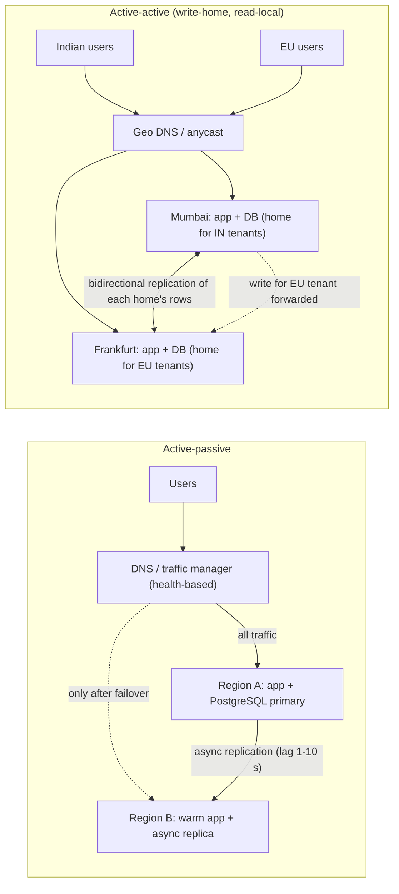
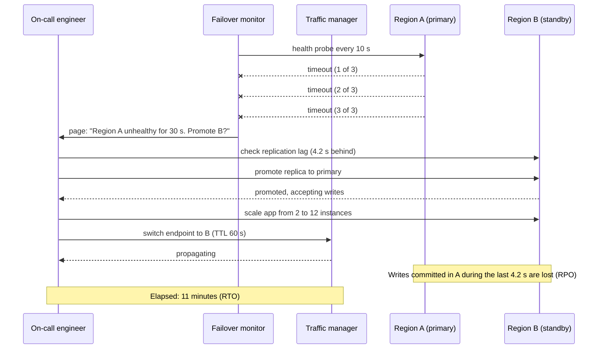
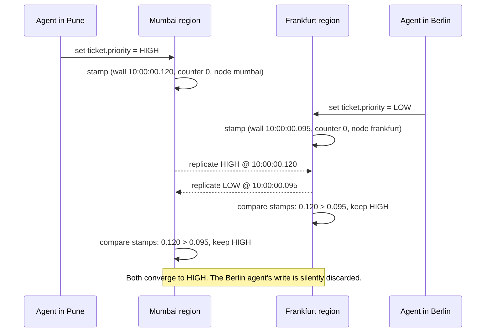

Running in one region is like keeping all your files in one office. It is simple, cheap and fast until the office floods. Running in several regions means your system keeps working when a whole data-centre region fails, and it lets you keep an Indian customer's records in India and a German customer's records in Germany when the law says you must. The price is a set of problems that do not exist in a single region: two copies of the truth that can disagree, failover that fails when nobody has rehearsed it, and a cloud bill that roughly doubles. This lesson is about making that trade deliberately.

## Learning objectives

By the end of this lesson you will be able to:

1. Explain in plain words what a region is, why a single region is a single point of failure, and what "regional outage" has actually looked like in public incident reports.
2. Compare **active-passive** (one region serves, one waits) and **active-active** (both serve) by recovery time, data loss, cost and complexity, with numbers.
3. Design for **data residency** (where data is stored) and **data sovereignty** (whose law applies) so that a tenant's data never leaves its home region by accident.
4. Choose a **conflict-resolution** rule for an active-active system: last-writer-wins, write-home, or a mergeable data type, and say what each one quietly loses.
5. Run a **failover drill**: define RTO and RPO, write the runbook, measure the drill, and decide what "passed" means.
6. Implement the pieces that live in ASP.NET Core: region-aware routing, a residency guard, a hybrid-clock conflict resolver and a failover monitor.
7. Argue, with a straight face, when a single region plus good backups is the right answer.

## Prerequisites

- [Replication and leader-follower](#/lesson/m13-replication): multi-region is replication with a very long cable.
- [CAP theorem and PACELC](#/lesson/m13-cap-pacelc): the trade-off between staying available and staying consistent becomes real when regions cannot talk.
- [Backups, disaster recovery, RTO and RPO](#/lesson/m14-dr): the vocabulary for "how long can we be down" and "how much data can we lose".
- [DNS and traffic routing](#/lesson/m11-dns-routing): how users end up in one region or another.

## Explain it like I'm a beginner

Imagine a courier company with one sorting hub in Nagpur. Every parcel in India passes through it. It is wonderfully efficient: one building, one team, one set of rules. Then a cyclone closes Nagpur for two days and the whole country's deliveries stop.

The company has three options:

1. **Keep one hub, and keep very good records.** If Nagpur burns down, rent a warehouse somewhere and rebuild from the records. Cheap. Slow to recover. Parcels in transit when the fire started are lost.
2. **Build a second hub in Hyderabad that sits empty but ready.** Staff drive over when Nagpur closes. Costs almost as much as a working hub, and nobody knows whether Hyderabad actually works until the day you need it. This is **active-passive** (one region serves, the other waits).
3. **Run both hubs every day.** Parcels from the north go through Nagpur, parcels from the south through Hyderabad. If one closes, the other takes everything. Both are proven to work because they work daily. But now the two hubs must agree on things: if a customer changes a delivery address at both hubs in the same minute, which address wins? This is **active-active** (every region serves traffic).

In software, the "hub" is a cloud region: a cluster of data centres in one metro area, such as Azure's Central India (Pune) or AWS's ap-south-1 (Mumbai). The "parcels" are requests, and the "records" are your database. The hard part of option 3 is the address-change problem: two copies of a record that both accepted a write. That is a **write conflict**, and every active-active design is mostly a plan for what to do about them.

There is a fourth reason, nothing to do with cyclones. Some customers are legally required to keep their data in their country. A hospital group in Germany will usually not be allowed (by EU data-protection rules and its own contracts) to store patient records in Mumbai; an Indian bank may not store payment data outside India. That is **data residency** (data physically stored in a place) and **data sovereignty** (that place's laws govern it). If you have such customers, you need a region in their country whether or not you care about disaster recovery.

## First-principles explanation

### What a region gives you, and what it does not

A cloud region already contains several **availability zones** (physically separate data centres a few kilometres apart with independent power and cooling). Spreading across zones protects you against a fire or a power cut in one building, and it is cheap: cross-zone traffic is fast (typically 1–2 ms) and most managed databases do it for you. Many teams who say "we need multi-region" actually need "we need multi-zone", which is a one-line setting.

What multi-zone does not protect against:

- **Region-wide control-plane or networking failures.** Public post-mortems from every major cloud describe incidents where an entire region's load balancers, DNS, or identity service misbehaved for hours while individual machines were fine.
- **Regional natural events.** Floods and earthquakes do not respect a 5 km gap.
- **Your own bad deploy** that hits every zone at once. Multi-region only helps here if you deploy regions one at a time.
- **Legal requirements.** A zone in Mumbai is still in India; it does not help your EU customer.

### The two shapes

**Active-passive.** Region A serves all traffic. Region B holds a replica of the database (asynchronous replication, lagging by seconds) and either a warm copy of the application (running but idle: "warm standby") or just the deployment templates ("cold standby" or "pilot light"). On disaster you promote B's database to primary, scale up B's application and point DNS at B.

- Recovery time (**RTO**, recovery time objective: how long you may be down) is minutes to an hour, dominated by DNS TTL, database promotion and human decision-making.
- Data loss (**RPO**, recovery point objective: how much recent data you may lose) equals replication lag at the moment of failure. With asynchronous replication across 1,000 km that is typically a few seconds under normal load and can be minutes during a write burst.
- Cost: a warm standby is roughly 1.5–2× a single region, because the database replica is always on and the application tier is at least partly running.
- Complexity: low in steady state. All the complexity is concentrated in the failover event, which is exactly when you least want complexity.

**Active-active.** Both regions serve traffic, usually routed by geography (Indian users to Mumbai, European users to Frankfurt). Both regions have a writable database, or each region owns the writes for a subset of the data.

- RTO: seconds to a few minutes. The surviving region is already serving; you only need DNS or an anycast network to stop sending traffic to the dead one.
- RPO: still bounded by replication lag for data that was *written in the dead region* and not yet replicated. Active-active does not make this zero.
- Cost: roughly 2× a single region plus cross-region data transfer, which is billed per GB and adds up when you replicate every write.
- Complexity: high and permanent. Every write path must answer "what if the other region wrote the same row?"

### Three ways to handle writes in active-active

1. **Write-home, read-local.** Each record has one home region (for a SaaS, usually each tenant's home region). Reads are served from the local replica; writes are forwarded to the home region. There are no conflicts because only one region ever writes a given row. Cross-region latency (Mumbai to Frankfurt is roughly 120–150 ms round trip; treat that as an estimate from public latency tables) is paid only on writes. This is close to the Geode pattern in Azure's catalogue, and it is where most teams should start. In PostgreSQL (16 and later) you can build it with logical replication in both directions: each region publishes the rows it owns (a row filter on `home_region`, available since PostgreSQL 15) and the other region subscribes with `origin = none` so changes are not echoed back. PostgreSQL does not resolve conflicts for you: in version 17 a conflicting change (for example a duplicate key) raises an error and stops that subscription until someone fixes it, so write-home must genuinely guarantee a single writer per row.
2. **Last-writer-wins (LWW).** Both regions write; on conflict, the write with the later timestamp survives. Simple, and it silently discards the other write. Needs careful clocks: two machines 30 ms apart in wall time will "lose" writes in the wrong order. Hybrid logical clocks ([clock skew, ordering and logical clocks](#/lesson/m13-time-ordering)) make the ordering consistent even if not "true".
3. **Mergeable data (CRDTs).** Design the data so any two versions can be merged without losing anything: counters that add, sets where adds and removes carry timestamps, documents edited with operational transforms. Powerful, limited to data that fits, and heavier to implement. Covered in depth in [real-time collaborative editor](#/lesson/m17-collaborative-editor).

Most real systems mix them: write-home for business records, LWW for user preferences ("dark mode on"), mergeable types for counters and presence.

### Residency and sovereignty are routing problems

If a German tenant's data must stay in the EU, three things must all be true: the tenant's **primary database** is in the EU, its **replicas and backups** are in the EU, and **no code path** copies it elsewhere (caches, search indexes, analytics exports, log lines containing personal data). Residency therefore shows up in three places in the design: a tenant directory that records each tenant's home region and residency zone, a router that sends each request to the tenant's home region for writes, and a guard inside the data layer that refuses to persist a tenant's row in the wrong region even if a developer makes a mistake. Logs and telemetry are the usual leak: a stack trace with a customer email shipped to a global logging account breaks residency just as surely as a database in the wrong country.

:::callout type=note title="What the laws actually require (as of 2026)"
Read the contract and the regulation before you buy regions; "the law says data must stay here" is often half true.

- **GDPR (EU)** does not forbid storing personal data outside the EU. It restricts *transfers* (Chapter V): allowed to countries with an adequacy decision, otherwise only with safeguards such as Standard Contractual Clauses plus a transfer impact assessment. India has no adequacy decision. Many EU public bodies and hospitals then go further and demand EU-only storage in the contract. Remote access from India to EU data (a support engineer opening a record) also counts as a transfer.
- **India's Digital Personal Data Protection Act, 2023** (with the DPDP Rules notified in 2025 and phasing in) takes a negative-list approach: personal data may go abroad except to countries the government restricts. Sector rules are stricter and override it: the RBI's 2018 directive requires payment-system data to be stored only in India, and government and regulated-sector contracts commonly require in-country storage.
- **Both** expect breach notification, deletion on request and purpose limits, which is why a copy you forgot about (a backup, a log, a search index) is a compliance problem, not just a tidiness one.

This is engineering guidance, not legal advice; the residency zone for each tenant should come from the contract and your legal team, and the code should enforce whatever they decide.
:::

### Failover is a muscle, not a feature

An untested standby is a hope, not a plan. Public post-mortems repeatedly show the same failures: the standby database had a different extension version; a secret was only in region A's vault; the DNS change needed a person whose phone was off; the standby had never run at production load and fell over at 30 %. A **failover drill** is a scheduled, announced exercise where you actually move production traffic to the other region and measure RTO and RPO. Quarterly for active-passive is a common cadence; active-active systems drill by draining one region and watching the other absorb the load.

### What goes wrong

| Failure | Active-passive | Active-active |
|---|---|---|
| Region dies | Manual or automatic promotion; RTO minutes-hours; lose the lag | Traffic shifts in seconds; lose the lag for writes that originated there |
| Network between regions fails (partition) | Replication stops; primary keeps serving; lag grows, RPO grows | Both regions keep writing; conflicts pile up and must be resolved when the link returns, or writes to the "foreign" home region fail |
| Split-brain (both think they are primary) | Possible after a bad failover; two primaries diverge | By design both write; you need conflict rules, not a fence |
| Failback (returning to the original region) | Often harder than failover; the old primary is now behind | Re-enable traffic gradually; replication catches up |
| Stale reads | Reads from replica lag by seconds | Same, per region; a user who writes in Mumbai and reads from Frankfurt may not see their own write |

### When single-region is enough

Be honest about the numbers. If your availability target is 99.9 % (about 8.8 hours of downtime per year) and the cloud provider's regional SLA for your managed database is 99.99 %, a single region with multi-zone and good backups meets your target with room to spare. Major regional outages at large providers have been rare: public records suggest a handful of multi-hour regional incidents per provider per year across all their regions, so any single region sees far fewer. Multi-region is justified when one or more of these is true:

- A regulator or contract requires it (residency, or a stated RTO under one hour for a critical service).
- Users are spread across continents and latency matters for writes, not just reads (reads can usually be solved with a CDN and read replicas).
- Downtime costs more per hour than the extra infrastructure costs per month. For a payments switch handling ₹500 crore a day, an hour of downtime is a national incident. For an internal HR portal, it is an email.

If none of those apply, spend the money on backups you have actually restored, a tested runbook for rebuilding in another region ("pilot light": only templates and backups live there), and multi-zone for everything.

## Visual explanation

### Architecture: active-passive versus active-active



How to read it. On the left, DNS sends every user to region A. Region A's database streams changes to region B's replica asynchronously, so B is always a few seconds behind. The dotted arrow from DNS to B is the failover path: it is used only after a health check fails or a human flips the switch. On the right, a geo-aware DNS (or an anycast front door) sends each user to the nearest region. Both regions run the full application and a writable database. Each tenant has a **home region**, and writes for a tenant are forwarded to its home (the dotted arrow), so no row is ever written in two places. Reads are served locally from the replicated copy. The double arrow is bidirectional replication: each region replicates the rows it owns to the other.

### Sequence: an active-passive failover drill



Every step here is a place where drills find problems. The monitor needs three consecutive failures so a single slow probe does not trigger a failover (flapping). The engineer checks replication lag *before* promoting, because that number is the data loss. Promotion, scaling and the DNS switch are three separate commands that must each work in region B with region A completely gone: no shared secret store in A, no deployment pipeline that runs only in A. The two notes are the two numbers the drill exists to measure: RPO (4.2 s of writes lost) and RTO (11 minutes to serve traffic again).

### Sequence: a conflict in active-active with last-writer-wins



Two agents change the same ticket within 25 ms of each other in different regions. Each region accepts its local write immediately (that is the point of active-active) and replicates it. When the replicas arrive, both regions apply the same rule: higher stamp wins. They converge on HIGH, which is good: convergence is the whole requirement. But the Berlin agent's change vanished without an error, and if Frankfurt's clock is 50 ms fast, "later" was not actually later. This is why LWW is fine for "dark mode on" and dangerous for "payment approved". For fields where losing a write matters, use write-home so only one region ever writes them.

## Step-by-step example

We will design the regions for **Sahayak**, a citizen-helpdesk SaaS used by municipal bodies in India and by local councils in Ireland and Germany. Citizens raise tickets (a broken streetlight, a missed bin collection); agents work them; supervisors see dashboards.

### Step 1 — requirements that force the decision

- 180 tenants: 150 Indian municipal bodies, 30 EU councils.
- EU councils' contracts require that citizen data be stored and processed in the EU. Indian state-government tenants require storage in India.
- Agents expect ticket updates to appear in under 2 seconds; citizens tolerate a few seconds of lag on the public status page.
- Availability target 99.95 % (about 4.4 hours a year), RTO 30 minutes, RPO 1 minute for ticket data.
- Load: 2.4 M tickets a month across all tenants. 2.4 M × 15 interactions each ÷ (30 × 86,400 s) ≈ 14 writes/s on average, maybe 60/s at the 9 a.m. peak. Reads are about 20× writes: roughly 1,200 reads/s at peak. This is small. A single PostgreSQL primary per region handles it with room to spare; the design is driven by residency and availability, not by throughput.

### Step 2 — residency decides the regions

Residency alone forces two regions: Central India (Pune) for Indian tenants and West Europe (Netherlands) or Germany West Central (Frankfurt) for EU tenants. Each tenant gets a `home_region` and a `residency_zone` (`IN` or `EU`) in a tenant directory. This is not a disaster-recovery decision yet; it is a legal one, and it means each region's database holds *only* its own tenants' data. There is nothing to replicate between Pune and Frankfurt for ticket data, because no tenant may have data in both.

### Step 3 — availability decides the shape within each zone

For the Indian zone: Central India (Pune) as the primary and South India (Chennai) as the standby. Both are in India, so residency holds. We choose **active-passive with a warm standby**: the Chennai database is a streaming replica; the Chennai application tier runs 2 instances (enough to prove deploys work there) and scales to 12 on failover. Estimated cost: 1.6× a single region. Why not active-active? With 60 writes/s and agents concentrated in Indian business hours, there is no latency reason, and the conflict handling would be complexity with no customer benefit. The EU zone mirrors this: Frankfurt primary, Netherlands standby.

### Step 4 — the one thing that is active-active

Agent **preferences** (language, dashboard layout, notification settings) are read on every page load and hold no citizen data. They are keyed by an opaque agent id, never a name or email, and live in a small key-value store replicated to all four regions with LWW on a hybrid clock. One caveat a reviewer will raise: under GDPR, pseudonymous data tied to a person is still personal data, so copying EU agents' preferences into India is a transfer the EU contracts must permit (with Standard Contractual Clauses). If a contract forbids any transfer, replicate that tenant's preferences only between the two EU regions. Losing a preference write is harmless; saving a 130 ms cross-region hop on every login is noticeable. This is the mixed approach in practice: pick the rule per data type, not per system.

### Step 5 — routing

A global front door does geo-routing by *tenant*, not by user location: an Indian municipal officer travelling in Dublin still lands in Pune, because her tenant's home is Pune. The tenant is resolved from the host name (`pune-mc.sahayak.in`), looked up in the cached tenant directory, and the request is routed to the home region's active endpoint. A request that arrives at the wrong region (DNS cache, misconfiguration) is redirected with a 307 to the right one for writes, and served read-only from the local replica if one exists, or redirected too if not.

### Step 6 — the drill

Every quarter, during Indian business hours (yes, deliberately: a drill at 3 a.m. proves nothing about the 9 a.m. load), the team fails Indian tenants over from Pune to Chennai, serves production traffic from Chennai for at least four hours, then fails back. Measured results go into a table: RTO achieved, RPO achieved, steps that needed manual fixes. The first drill of a system like this typically takes 40–60 minutes and finds three to five defects. The goal is to get under the 30-minute RTO by the third drill and to keep it there.

## Production-style C# implementation

The pieces that belong in ASP.NET Core: a tenant directory with placement, a region router that forwards writes home and serves reads locally, a residency guard in the data layer, a hybrid-clock LWW resolver for the preferences store, and a failover monitor that needs several consecutive failures before it raises the alarm. Everything that would normally talk to a real database or DNS API is behind an interface with an in-memory implementation so the set compiles and tests offline.

```text
Sahayak.Api/
  Program.cs
  Regions/RegionModels.cs
  Regions/TenantDirectory.cs
  Regions/RegionRoutingMiddleware.cs
  Regions/ResidencyGuard.cs
  Regions/HybridClock.cs
  Regions/LastWriterWinsStore.cs
  Regions/FailoverMonitor.cs
```

```csharp file=Regions/RegionModels.cs
namespace Sahayak.Regions;

public enum Region { CentralIndia, SouthIndia, GermanyWestCentral, WestEurope }

public enum ResidencyZone { IN, EU }

/// <summary>Where a tenant's data lives. HomeRegion accepts writes; StandbyRegion holds the replica.</summary>
public sealed record TenantPlacement(string TenantId, Region HomeRegion, Region StandbyRegion, ResidencyZone Zone);

public sealed class RegionOptions
{
    /// <summary>The region this process is running in. Set from an environment variable per deployment.</summary>
    public Region Current { get; set; } = Region.CentralIndia;
    public Dictionary<Region, string> BaseUrls { get; set; } = new()
    {
        [Region.CentralIndia] = "https://in-c.sahayak.example",
        [Region.SouthIndia] = "https://in-s.sahayak.example",
        [Region.GermanyWestCentral] = "https://eu-de.sahayak.example",
        [Region.WestEurope] = "https://eu-nl.sahayak.example",
    };
}

public static class RegionZones
{
    public static ResidencyZone ZoneOf(Region r) => r switch
    {
        Region.CentralIndia or Region.SouthIndia => ResidencyZone.IN,
        _ => ResidencyZone.EU,
    };
}
```

```csharp file=Regions/TenantDirectory.cs
using System.Collections.Concurrent;

namespace Sahayak.Regions;

public interface ITenantDirectory
{
    TenantPlacement? Find(string tenantId);
    /// <summary>Which region currently accepts writes for the tenant: the home, or the standby after failover.</summary>
    Region ActiveRegionFor(TenantPlacement p);
    void MarkFailedOver(Region home, bool failedOver);
}

/// <summary>In production this is a small replicated table cached in memory with a 30 s TTL.</summary>
public sealed class InMemoryTenantDirectory : ITenantDirectory
{
    private readonly ConcurrentDictionary<string, TenantPlacement> _tenants = new(StringComparer.OrdinalIgnoreCase);
    private readonly ConcurrentDictionary<Region, bool> _failedOver = new();

    public InMemoryTenantDirectory Add(TenantPlacement p)
    {
        if (RegionZones.ZoneOf(p.HomeRegion) != p.Zone || RegionZones.ZoneOf(p.StandbyRegion) != p.Zone)
            throw new ArgumentException($"Tenant {p.TenantId}: both regions must be in zone {p.Zone}.");
        _tenants[p.TenantId] = p;
        return this;
    }

    public TenantPlacement? Find(string tenantId) => _tenants.GetValueOrDefault(tenantId);

    public Region ActiveRegionFor(TenantPlacement p) =>
        _failedOver.GetValueOrDefault(p.HomeRegion) ? p.StandbyRegion : p.HomeRegion;

    public void MarkFailedOver(Region home, bool failedOver) => _failedOver[home] = failedOver;
}
```

The directory validates placement at insert time: a tenant whose home is in India cannot be given a standby in Europe. That one `if` is the cheapest residency control you will ever write.

```csharp file=Regions/RegionRoutingMiddleware.cs
using Microsoft.Extensions.Options;

namespace Sahayak.Regions;

/// <summary>
/// Write-home, read-local. Writes for a tenant must execute in the tenant's active region; a write that
/// lands elsewhere is redirected with 307 (method and body preserved). Reads are served locally only if
/// this region holds a replica of the tenant (same residency zone); otherwise they are redirected too.
/// </summary>
public sealed class RegionRoutingMiddleware(RequestDelegate next, IOptions<RegionOptions> options, ITenantDirectory directory)
{
    private readonly RegionOptions _o = options.Value;

    public async Task InvokeAsync(HttpContext ctx)
    {
        var tenantId = ctx.Request.Headers["X-Tenant"].ToString();
        var placement = string.IsNullOrEmpty(tenantId) ? null : directory.Find(tenantId);
        if (placement is null)
        {
            ctx.Response.StatusCode = StatusCodes.Status404NotFound;
            return;
        }

        var active = directory.ActiveRegionFor(placement);
        var isRead = HttpMethods.IsGet(ctx.Request.Method) || HttpMethods.IsHead(ctx.Request.Method);
        var holdsReplica = RegionZones.ZoneOf(_o.Current) == placement.Zone;

        if (active == _o.Current || (isRead && holdsReplica))
        {
            ctx.Items["TenantPlacement"] = placement;
            ctx.Items["ServedFrom"] = _o.Current.ToString();
            await next(ctx);
            return;
        }

        var target = _o.BaseUrls[active] + ctx.Request.Path + ctx.Request.QueryString;
        ctx.Response.Headers["X-Redirect-Reason"] = isRead ? "no-local-replica" : "write-home";
        ctx.Response.Redirect(target, permanent: false, preserveMethod: true);   // 307
    }
}
```

The middleware runs before authentication because it only needs the tenant header, which the gateway sets from the host name. The gateway must also strip any `X-Tenant` header the client sent; otherwise anyone can pick a tenant (and a region) by adding a header. `307 Temporary Redirect` keeps the method and body, so a `POST` redirected to Pune is still a `POST`. Browsers and most HTTP clients follow it; service-to-service callers should read `X-Redirect-Reason` and fix their routing.

```csharp file=Regions/ResidencyGuard.cs
using Microsoft.Extensions.Options;

namespace Sahayak.Regions;

public sealed class ResidencyViolationException(string message) : InvalidOperationException(message);

/// <summary>Last line of defence: called by every repository before it persists a tenant's row.</summary>
public sealed class ResidencyGuard(IOptions<RegionOptions> options)
{
    private readonly Region _current = options.Value.Current;

    public void EnsureCanStore(TenantPlacement p)
    {
        var zoneHere = RegionZones.ZoneOf(_current);
        if (zoneHere != p.Zone)
            throw new ResidencyViolationException(
                $"Refusing to store data for tenant {p.TenantId} (zone {p.Zone}) in region {_current} (zone {zoneHere}).");
    }
}
```

The guard is deliberately boring. It exists for the day a background job, a report exporter or a new developer's cache warm-up tries to write EU rows from an Indian process. A thrown exception and a page is far better than a quiet compliance breach discovered at audit time.

```csharp file=Regions/HybridClock.cs
namespace Sahayak.Regions;

/// <summary>
/// Hybrid logical clock stamp: wall-clock milliseconds, a counter for events in the same millisecond,
/// and the node id as a final tie-break. Comparable across regions without assuming synchronised clocks.
/// </summary>
public readonly record struct HlcStamp(long WallMs, int Counter, string NodeId) : IComparable<HlcStamp>
{
    public int CompareTo(HlcStamp other)
    {
        var c = WallMs.CompareTo(other.WallMs);
        if (c != 0) return c;
        c = Counter.CompareTo(other.Counter);
        return c != 0 ? c : string.CompareOrdinal(NodeId, other.NodeId);
    }
    public override string ToString() => $"{WallMs}.{Counter}@{NodeId}";
}

public sealed class HybridClock(TimeProvider time, string nodeId)
{
    private readonly Lock _gate = new();
    private long _lastWall;
    private int _counter;

    /// <summary>Stamp a local event.</summary>
    public HlcStamp Now()
    {
        lock (_gate)
        {
            var wall = time.GetUtcNow().ToUnixTimeMilliseconds();
            if (wall > _lastWall) { _lastWall = wall; _counter = 0; }
            else _counter++;
            return new HlcStamp(_lastWall, _counter, nodeId);
        }
    }

    /// <summary>Observe a stamp received from another node so our clock never runs behind it.</summary>
    public void Observe(HlcStamp remote)
    {
        lock (_gate)
        {
            var wall = time.GetUtcNow().ToUnixTimeMilliseconds();
            var max = Math.Max(wall, Math.Max(_lastWall, remote.WallMs));
            if (max == _lastWall && max == remote.WallMs) _counter = Math.Max(_counter, remote.Counter) + 1;
            else if (max == _lastWall) _counter++;
            else if (max == remote.WallMs) _counter = remote.Counter + 1;
            else _counter = 0;
            _lastWall = max;
        }
    }
}
```

A hybrid logical clock (HLC) keeps stamps close to real time (so humans can read them) while guaranteeing that a node that has *seen* a remote stamp always produces a later one. That gives causal ordering for anything that passed through the replication stream. It does not make two truly concurrent writes "correctly" ordered; nothing can. It makes them *consistently* ordered on every node, which is what convergence needs.

```csharp file=Regions/LastWriterWinsStore.cs
using System.Collections.Concurrent;

namespace Sahayak.Regions;

public sealed record Versioned<T>(T Value, HlcStamp Stamp);

/// <summary>Replicated preference store: every region applies the same rule, so all converge.</summary>
public sealed class LastWriterWinsStore<T>(HybridClock clock)
{
    private readonly ConcurrentDictionary<string, Versioned<T>> _data = new();

    public Versioned<T> Put(string key, T value)
    {
        var v = new Versioned<T>(value, clock.Now());
        _data.AddOrUpdate(key, v, (_, old) => v.Stamp.CompareTo(old.Stamp) > 0 ? v : old);
        return v;
    }

    /// <summary>Apply a replicated write from another region. Returns true if it won.</summary>
    public bool ApplyRemote(string key, Versioned<T> remote)
    {
        clock.Observe(remote.Stamp);
        var won = false;
        _data.AddOrUpdate(key, _ => { won = true; return remote; },
            (_, old) => { if (remote.Stamp.CompareTo(old.Stamp) > 0) { won = true; return remote; } return old; });
        return won;
    }

    public Versioned<T>? Get(string key) => _data.GetValueOrDefault(key);
}
```

```csharp file=Regions/FailoverMonitor.cs
using Microsoft.Extensions.Hosting;
using Microsoft.Extensions.Logging;

namespace Sahayak.Regions;

public interface IRegionHealthProbe
{
    Task<bool> IsHealthyAsync(Region region, CancellationToken ct);
}

public interface IFailoverAlert
{
    Task RaiseAsync(Region region, int consecutiveFailures, CancellationToken ct);
}

/// <summary>
/// Probes the home region on a fixed interval and alerts after N consecutive failures.
/// Deliberately does NOT promote automatically: a human confirms replication lag first.
/// </summary>
public sealed class FailoverMonitor(IRegionHealthProbe probe, IFailoverAlert alert, ILogger<FailoverMonitor> log,
    Region watched, int failuresBeforeAlert = 3, TimeSpan? interval = null) : BackgroundService
{
    private readonly TimeSpan _interval = interval ?? TimeSpan.FromSeconds(10);
    private int _consecutiveFailures;

    public int ConsecutiveFailures => _consecutiveFailures;

    protected override async Task ExecuteAsync(CancellationToken stoppingToken)
    {
        using var timer = new PeriodicTimer(_interval);
        while (await timer.WaitForNextTickAsync(stoppingToken))
            await TickAsync(stoppingToken);
    }

    /// <summary>One probe cycle; public so tests can drive it without a timer.</summary>
    public async Task TickAsync(CancellationToken ct)
    {
        bool healthy;
        try { healthy = await probe.IsHealthyAsync(watched, ct); }
        catch (Exception ex) when (ex is not OperationCanceledException)
        {
            log.LogWarning(ex, "Probe of {Region} threw", watched);
            healthy = false;
        }

        if (healthy) { _consecutiveFailures = 0; return; }

        _consecutiveFailures++;
        log.LogWarning("Region {Region} unhealthy ({Count}/{Threshold})", watched, _consecutiveFailures, failuresBeforeAlert);
        if (_consecutiveFailures == failuresBeforeAlert)
            await alert.RaiseAsync(watched, _consecutiveFailures, ct);
    }
}
```

The monitor pages a human rather than promoting on its own. Automatic promotion is right for some systems, but it is also the most common cause of split-brain in post-mortems: the monitor could not reach region A, promoted B, and region A was fine and still serving writes. If you automate, do it from a third location with a quorum of probes, and fence the old primary ([split-brain and failure detection](#/lesson/m13-split-brain)).

```csharp file=Program.cs
using Microsoft.Extensions.Options;
using Sahayak.Regions;

var builder = WebApplication.CreateBuilder(args);

builder.Services.Configure<RegionOptions>(builder.Configuration.GetSection("Region"));
builder.Services.AddSingleton(TimeProvider.System);
builder.Services.AddSingleton<ITenantDirectory>(_ => new InMemoryTenantDirectory()
    .Add(new TenantPlacement("pune-mc", Region.CentralIndia, Region.SouthIndia, ResidencyZone.IN))
    .Add(new TenantPlacement("galway-cc", Region.GermanyWestCentral, Region.WestEurope, ResidencyZone.EU)));
builder.Services.AddSingleton<ResidencyGuard>();
builder.Services.AddSingleton(sp => new HybridClock(sp.GetRequiredService<TimeProvider>(),
    sp.GetRequiredService<IOptions<RegionOptions>>().Value.Current.ToString()));
builder.Services.AddSingleton<LastWriterWinsStore<string>>();
builder.Services.AddSingleton<IRegionHealthProbe, HttpRegionHealthProbe>();
builder.Services.AddSingleton<IFailoverAlert, LogFailoverAlert>();
builder.Services.AddHostedService(sp => new FailoverMonitor(
    sp.GetRequiredService<IRegionHealthProbe>(), sp.GetRequiredService<IFailoverAlert>(),
    sp.GetRequiredService<ILogger<FailoverMonitor>>(), Region.CentralIndia));

var app = builder.Build();
app.UseMiddleware<RegionRoutingMiddleware>();

app.MapGet("/tickets/{id}", (string id, HttpContext ctx) =>
    Results.Ok(new { id, servedFrom = ctx.Items["ServedFrom"] }));

app.MapPost("/tickets", (HttpContext ctx, ResidencyGuard guard) =>
{
    var placement = (TenantPlacement)ctx.Items["TenantPlacement"]!;
    guard.EnsureCanStore(placement);
    return Results.Created($"/tickets/{Guid.NewGuid():N}", new { placement.TenantId, placement.HomeRegion });
});

app.MapPut("/me/preferences/{key}", (string key, string value, LastWriterWinsStore<string> prefs) =>
    Results.Ok(prefs.Put(key, value)));

app.Run();

public sealed class HttpRegionHealthProbe(IHttpClientFactory? factory = null) : IRegionHealthProbe
{
    public Task<bool> IsHealthyAsync(Region region, CancellationToken ct) => Task.FromResult(true); // replace with GET /health on the region's endpoint
}

public sealed class LogFailoverAlert(ILogger<LogFailoverAlert> log) : IFailoverAlert
{
    public Task RaiseAsync(Region region, int failures, CancellationToken ct)
    {
        log.LogCritical("FAILOVER CANDIDATE: {Region} failed {Count} consecutive probes. Check replication lag, then promote.", region, failures);
        return Task.CompletedTask;
    }
}
```

The `Region:Current` setting comes from configuration, which each regional deployment sets differently. That is the only difference between the Pune and Chennai builds, and it is what makes "deploy the same artifact to both regions" possible.

## Bad design vs good design

**Bad: "we'll just add a replica in another region."** The team enables a cross-region read replica of PostgreSQL and declares the system multi-region. Nobody writes a runbook. The application tier exists only in region A; the secrets vault is in region A; the CI/CD agents are in region A. When region A has a four-hour networking incident, the replica is healthy and useless: nothing can be deployed to serve from it, the connection strings are in an unreachable vault, and the one engineer who knows how to promote the replica is on leave. Recovery takes six hours, mostly rebuilding things that should have already existed in B.

**Bad: "active-active everywhere."** A different team runs both regions writable with a multi-master replication product on every table. Ticket status changes conflict daily; the resolution rule is "last write wins" on wall-clock time; a 200 ms clock difference between regions means a supervisor's "approved" is regularly overwritten by an agent's earlier "pending". Nobody can explain to the customer where the approval went.

**Good**: residency first, then availability. Regions are chosen by legal zone. Within a zone, active-passive with a warm standby that is deployed by the same pipeline on every release, holds its own copy of secrets, and is drilled quarterly. Only data that is safe to lose (preferences) is active-active with hybrid-clock LWW. Business records use write-home so that they never conflict. The failover monitor needs three consecutive failures and pages a human who checks lag before promoting. Every one of these choices can be defended with a number: 1.6× cost, 30-minute RTO met on the third drill, zero conflicts on ticket data by construction.

:::callout type=tradeoff title="Failback is the forgotten half"
After a drill or a real incident, you must move traffic back. The old primary is now *behind* the standby. For PostgreSQL that means re-building it as a replica of the new primary (`pg_rewind` or a fresh base backup), waiting for it to catch up, then doing the promotion dance in reverse. Budget as much time for failback as for failover, and drill it too. Some teams simply stay in the new region and make the old one the standby, which halves the number of risky operations.
:::

:::callout type=warning title="Residency leaks through the side doors"
A database in the right country is necessary, not sufficient. Check: backups and their storage account; read replicas; search indexes; Redis caches; the analytics warehouse; application logs that include personal data; error-tracking SaaS; email providers; and support engineers who export a CSV "just to debug". Each is a copy of the data, and each needs a home-region rule.
:::

## Practical playground

The replication simulator below models a primary and a lagging replica. Use it to feel the RPO trade-off before you commit to a shape.

1. Set a write rate of 60/s and a cross-region latency of 130 ms. Watch the replication lag settle. That lag, in seconds, is your RPO if the primary dies now.
2. Push the write rate to 600/s (a bulk import). Does lag grow? Writes arriving faster than the link ships them means lag grows without bound until the burst ends.
3. Switch replication to synchronous. Note the write latency: every commit now waits a round trip. Would agents accept that on every ticket update?
4. Simulate a primary failure at the moment of highest lag and read off how many writes were never replicated.

:::playground type=sim sim=replication title="Replication lag is your RPO"
:::

## Exercises

:::exercise id=m16-multi-region-ex1 difficulty=beginner kind=written title="Pick the shape for three systems"
For each system below, choose single-region (multi-zone), active-passive, or active-active, and justify it in three to five sentences using RTO, RPO, residency and cost.

1. An internal expense-claims portal for a 4,000-employee supermarket chain in India. 300 users a day, all in Indian business hours. The finance team says a day of downtime "would be annoying".
2. A UPI-style payment switch for a fintech with 20 M users across India. Regulator requires data stored in India, availability of 99.99 % and no more than 5 seconds of transaction loss.
3. A B2B document-collaboration SaaS with customers in India, Singapore and Germany. German customers require EU residency. Editors in all three countries co-edit the same documents during overlapping hours.
::acceptance
- Each answer names a shape and ties it to at least two of: RTO, RPO, residency, cost.
- System 1 is not over-engineered.
- System 2 stays inside India and explains how 99.99 % and 5 s RPO are met.
- System 3 separates residency (which regions exist) from availability (shape within a region) and names a conflict strategy for co-editing.
::hint
Start by asking: what does an hour of downtime cost, and is there a legal reason to be in a particular country?
::hint
"Must stay in India" and "must be highly available" are different requirements. You can satisfy both with two Indian regions.
::hint
For co-editing, ask whether a document has one home or whether both regions must accept writes. Then ask what happens when two editors change the same paragraph.
::hint
Rough costs: multi-zone ≈ 1.1×, warm active-passive ≈ 1.6×, active-active ≈ 2× plus cross-region transfer.
::solution
1. **Single region, multi-zone, with tested backups.** 300 users in one time zone and a "day of downtime is annoying" tolerance means an RTO of hours is acceptable. A pilot-light runbook (templates and nightly backups copied to a second Indian region) covers the catastrophic case for a few thousand rupees a month. Active-passive would cost 60 % more for a benefit nobody asked for.
2. **Active-passive within India (for example Central India primary, South India warm standby), with synchronous or near-synchronous replication for the transaction ledger.** Residency forces both regions to be Indian. 99.99 % allows about 52 minutes of downtime a year, so failover must be automated or near-automated with a well-rehearsed runbook and a monitoring quorum from a third location. A 5 s RPO rules out plain asynchronous replication under burst load; use synchronous commit to the standby for the ledger tables (paying ~20–30 ms per commit for a Mumbai–Chennai round trip, an estimate) or a quorum-based commit. Active-active would add conflict handling to money movement, which is exactly where you cannot tolerate a silently discarded write.
3. **Three residency zones (India, Singapore, EU), each active-passive internally; documents are write-home to the owning tenant's region; the editing session itself uses a mergeable model (CRDT or operational transform) so concurrent edits merge rather than conflict.** Residency decides that an EU tenant's documents live in Frankfurt; a German and an Indian editor on the same EU document both connect to Frankfurt (the Indian editor pays ~130 ms, acceptable for typing with local echo). Presence and cursors can be LWW. Cost is roughly three regions plus three standbys; the standbys can be cold for smaller zones if the RTO allows.
::mistakes
- Choosing active-active for system 1 "to be safe".
- Treating residency and availability as one decision.
- Claiming a 5 s RPO with asynchronous replication and no analysis of burst lag.
- Proposing LWW for document text, which would silently drop a paragraph.
:::

:::exercise id=m16-multi-region-ex2 difficulty=beginner kind=code title="Make two regions agree with a hybrid clock"
Implement `HlcStamp.CompareTo` and `ConflictResolver.Merge` so that two regions holding different versions of the same record always pick the same winner, regardless of which order they see the versions.
::requirements
- Order stamps by `WallMs`, then `Counter`, then `NodeId` (ordinal string comparison).
- `Merge(a, b)` returns the version with the greater stamp. If the stamps are equal, return `a`.
- `Merge` must be commutative for distinct stamps: `Merge(a, b)` and `Merge(b, a)` return the same version.
::acceptance
- A version with a later wall time wins even if its counter is lower.
- Same wall time: the higher counter wins.
- Same wall time and counter: the node id compared ordinally decides (`"mumbai"` beats `"frankfurt"`).
- The result is the same object regardless of argument order.
::hint
`CompareTo` is a chain of comparisons: return the first one that is not zero.
::hint
`long.CompareTo`, `int.CompareTo` and `string.CompareOrdinal` give you the three steps.
::hint
`Merge` is one line once `CompareTo` works: compare stamps and return the greater version.
::hint
```csharp
var c = WallMs.CompareTo(other.WallMs);
if (c != 0) return c;
// ... counter, then node id
```
::starter
```csharp file=ConflictResolver.cs
using System;

public readonly record struct HlcStamp(long WallMs, int Counter, string NodeId) : IComparable<HlcStamp>
{
    public int CompareTo(HlcStamp other) => throw new NotImplementedException();
}

public sealed record Versioned(string Value, HlcStamp Stamp);

public static class ConflictResolver
{
    /// <summary>Returns the version that every region must converge to.</summary>
    public static Versioned Merge(Versioned a, Versioned b) => throw new NotImplementedException();
}
```
::tests
```csharp file=ConflictResolverTests.cs
using Xunit;

public class ConflictResolverTests
{
    private static Versioned V(string value, long wall, int counter, string node) => new(value, new HlcStamp(wall, counter, node));

    [Fact]
    public void Later_wall_time_wins_even_with_lower_counter()
    {
        var a = V("HIGH", 1000, 0, "mumbai");
        var b = V("LOW", 999, 7, "frankfurt");
        Assert.Equal("HIGH", ConflictResolver.Merge(a, b).Value);
    }

    [Fact]
    public void Same_wall_time_higher_counter_wins()
    {
        var a = V("first", 1000, 1, "mumbai");
        var b = V("second", 1000, 2, "mumbai");
        Assert.Equal("second", ConflictResolver.Merge(a, b).Value);
    }

    [Fact]
    public void Full_tie_breaks_on_node_id_ordinally()
    {
        var m = V("from-mumbai", 1000, 0, "mumbai");
        var f = V("from-frankfurt", 1000, 0, "frankfurt");
        Assert.Equal("from-mumbai", ConflictResolver.Merge(m, f).Value);
        Assert.Equal("from-mumbai", ConflictResolver.Merge(f, m).Value);
    }

    [Fact]
    public void Merge_is_commutative()
    {
        var a = V("A", 5000, 3, "mumbai");
        var b = V("B", 5000, 4, "frankfurt");
        Assert.Same(ConflictResolver.Merge(a, b), ConflictResolver.Merge(b, a));
    }

    [Fact]
    public void Equal_stamps_return_first_argument()
    {
        var a = V("A", 1, 1, "x");
        var b = V("B", 1, 1, "x");
        Assert.Same(a, ConflictResolver.Merge(a, b));
    }

    [Fact]
    public void Stamps_sort_correctly()
    {
        var list = new[] { new HlcStamp(10, 0, "b"), new HlcStamp(9, 9, "z"), new HlcStamp(10, 0, "a") };
        Array.Sort(list);
        Assert.Equal(new HlcStamp(9, 9, "z"), list[0]);
        Assert.Equal(new HlcStamp(10, 0, "a"), list[1]);
        Assert.Equal(new HlcStamp(10, 0, "b"), list[2]);
    }
}
```
::solution
```csharp file=ConflictResolver.cs
using System;

public readonly record struct HlcStamp(long WallMs, int Counter, string NodeId) : IComparable<HlcStamp>
{
    public int CompareTo(HlcStamp other)
    {
        var c = WallMs.CompareTo(other.WallMs);
        if (c != 0) return c;
        c = Counter.CompareTo(other.Counter);
        return c != 0 ? c : string.CompareOrdinal(NodeId, other.NodeId);
    }
}

public sealed record Versioned(string Value, HlcStamp Stamp);

public static class ConflictResolver
{
    public static Versioned Merge(Versioned a, Versioned b) => b.Stamp.CompareTo(a.Stamp) > 0 ? b : a;
}
```

The whole value of this tiny class is **determinism**: Mumbai and Frankfurt run the same comparison on the same two stamps and get the same answer. The node-id tie-break is arbitrary but consistent, which is what matters. Note the asymmetry in `Merge`: `b` must be *strictly* greater to win, so equal stamps return `a` as required, and distinct stamps are commutative.
::mistakes
- Comparing with `string.Compare` (culture-sensitive) instead of `string.CompareOrdinal`; two regions with different cultures could disagree.
- Using `>=` in `Merge`, which breaks the "equal stamps return `a`" rule and makes the function non-commutative on ties.
- Comparing wall time as `DateTime` with different `Kind` values.
:::

:::exercise id=m16-multi-region-ex3 difficulty=intermediate kind=code title="A failover monitor that does not flap"
Implement `FailoverDecider`, the brain of a failover monitor. It receives a stream of probe results and decides when to raise an alert and when to clear it, without flapping.
::requirements
- `Record(bool healthy, DateTimeOffset at)` returns a `FailoverSignal`: `None`, `Alert` or `Recovered`.
- Return `Alert` exactly once, on the probe that makes `failuresBeforeAlert` consecutive failures. Further failures return `None`.
- A single healthy probe resets the failure count, but `Recovered` is returned only if the decider is currently alerting **and** the region has been healthy for at least `cooldown` since the first healthy probe after the alert.
- Flapping guard: once alerting, a healthy probe followed by a failure before `cooldown` elapses keeps the alert active and restarts the cooldown.
::acceptance
- Three failures with threshold 3 produce `None, None, Alert`.
- A fourth failure produces `None`, not a second `Alert`.
- After an alert, one healthy probe at t+0 returns `None`; a healthy probe at t+cooldown returns `Recovered`.
- After an alert, healthy at t+0 then unhealthy at t+10 s then healthy at t+20 s returns `None` each time (cooldown restarted); healthy at t+20 s + cooldown returns `Recovered`.
- Before any alert, healthy probes always return `None`.
::hint
Keep three pieces of state: consecutive failures, whether you are alerting, and when the current healthy streak started (nullable).
::hint
On a failure: increment the counter, clear the healthy-streak start. Raise `Alert` only when the counter equals the threshold and you are not already alerting.
::hint
On a healthy probe: reset the counter. If alerting, set the streak start if it is null, and return `Recovered` when `at - streakStart >= cooldown`.
::hint
```csharp
if (healthy)
{
    _failures = 0;
    if (!_alerting) return FailoverSignal.None;
    _healthySince ??= at;
    if (at - _healthySince.Value >= _cooldown) { _alerting = false; _healthySince = null; return FailoverSignal.Recovered; }
    return FailoverSignal.None;
}
```
::starter
```csharp file=FailoverDecider.cs
using System;

public enum FailoverSignal { None, Alert, Recovered }

public sealed class FailoverDecider
{
    private readonly int _failuresBeforeAlert;
    private readonly TimeSpan _cooldown;

    public FailoverDecider(int failuresBeforeAlert, TimeSpan cooldown)
    {
        if (failuresBeforeAlert < 1) throw new ArgumentOutOfRangeException(nameof(failuresBeforeAlert));
        _failuresBeforeAlert = failuresBeforeAlert;
        _cooldown = cooldown;
    }

    public bool IsAlerting { get; private set; }
    public int ConsecutiveFailures { get; private set; }

    public FailoverSignal Record(bool healthy, DateTimeOffset at) => throw new NotImplementedException();
}
```
::tests
```csharp file=FailoverDeciderTests.cs
using System;
using Xunit;

public class FailoverDeciderTests
{
    private static readonly DateTimeOffset T0 = new(2026, 10, 19, 9, 0, 0, TimeSpan.Zero);
    private static readonly TimeSpan Cooldown = TimeSpan.FromMinutes(2);

    private static FailoverDecider Alerting()
    {
        var d = new FailoverDecider(3, Cooldown);
        d.Record(false, T0); d.Record(false, T0.AddSeconds(10)); d.Record(false, T0.AddSeconds(20));
        return d;
    }

    [Fact]
    public void Alerts_exactly_on_threshold()
    {
        var d = new FailoverDecider(3, Cooldown);
        Assert.Equal(FailoverSignal.None, d.Record(false, T0));
        Assert.Equal(FailoverSignal.None, d.Record(false, T0.AddSeconds(10)));
        Assert.Equal(FailoverSignal.Alert, d.Record(false, T0.AddSeconds(20)));
        Assert.True(d.IsAlerting);
        Assert.Equal(3, d.ConsecutiveFailures);
    }

    [Fact]
    public void Does_not_alert_twice()
    {
        var d = Alerting();
        Assert.Equal(FailoverSignal.None, d.Record(false, T0.AddSeconds(30)));
        Assert.True(d.IsAlerting);
    }

    [Fact]
    public void Healthy_probes_before_alert_are_silent_and_reset_count()
    {
        var d = new FailoverDecider(3, Cooldown);
        d.Record(false, T0); d.Record(false, T0.AddSeconds(10));
        Assert.Equal(FailoverSignal.None, d.Record(true, T0.AddSeconds(20)));
        Assert.Equal(0, d.ConsecutiveFailures);
        Assert.Equal(FailoverSignal.None, d.Record(false, T0.AddSeconds(30)));
        Assert.Equal(FailoverSignal.None, d.Record(false, T0.AddSeconds(40)));
        Assert.Equal(FailoverSignal.Alert, d.Record(false, T0.AddSeconds(50)));
    }

    [Fact]
    public void Recovers_only_after_cooldown()
    {
        var d = Alerting();
        var t = T0.AddSeconds(30);
        Assert.Equal(FailoverSignal.None, d.Record(true, t));
        Assert.Equal(FailoverSignal.None, d.Record(true, t.AddSeconds(60)));
        Assert.Equal(FailoverSignal.Recovered, d.Record(true, t.Add(Cooldown)));
        Assert.False(d.IsAlerting);
    }

    [Fact]
    public void Flap_restarts_cooldown()
    {
        var d = Alerting();
        var t = T0.AddSeconds(30);
        Assert.Equal(FailoverSignal.None, d.Record(true, t));
        Assert.Equal(FailoverSignal.None, d.Record(false, t.AddSeconds(10)));
        Assert.True(d.IsAlerting);
        var t2 = t.AddSeconds(20);
        Assert.Equal(FailoverSignal.None, d.Record(true, t2));
        Assert.Equal(FailoverSignal.None, d.Record(true, t.Add(Cooldown)));
        Assert.Equal(FailoverSignal.Recovered, d.Record(true, t2.Add(Cooldown)));
    }

    [Fact]
    public void After_recovery_a_new_outage_alerts_again()
    {
        var d = Alerting();
        var t = T0.AddMinutes(5);
        d.Record(true, t); d.Record(true, t.Add(Cooldown));
        Assert.False(d.IsAlerting);
        d.Record(false, t.AddMinutes(10)); d.Record(false, t.AddMinutes(11));
        Assert.Equal(FailoverSignal.Alert, d.Record(false, t.AddMinutes(12)));
    }
}
```
::solution
```csharp file=FailoverDecider.cs
using System;

public enum FailoverSignal { None, Alert, Recovered }

public sealed class FailoverDecider
{
    private readonly int _failuresBeforeAlert;
    private readonly TimeSpan _cooldown;
    private DateTimeOffset? _healthySince;

    public FailoverDecider(int failuresBeforeAlert, TimeSpan cooldown)
    {
        if (failuresBeforeAlert < 1) throw new ArgumentOutOfRangeException(nameof(failuresBeforeAlert));
        _failuresBeforeAlert = failuresBeforeAlert;
        _cooldown = cooldown;
    }

    public bool IsAlerting { get; private set; }
    public int ConsecutiveFailures { get; private set; }

    public FailoverSignal Record(bool healthy, DateTimeOffset at)
    {
        if (healthy)
        {
            ConsecutiveFailures = 0;
            if (!IsAlerting) return FailoverSignal.None;
            _healthySince ??= at;
            if (at - _healthySince.Value >= _cooldown)
            {
                IsAlerting = false;
                _healthySince = null;
                return FailoverSignal.Recovered;
            }
            return FailoverSignal.None;
        }

        ConsecutiveFailures++;
        _healthySince = null;
        if (!IsAlerting && ConsecutiveFailures >= _failuresBeforeAlert)
        {
            IsAlerting = true;
            return FailoverSignal.Alert;
        }
        return FailoverSignal.None;
    }
}
```

Two asymmetries are deliberate. Going *into* alert needs several consecutive failures (so a single slow probe does not page anyone), and coming *out* needs sustained health (so a region that is up for 10 seconds and down for 10 seconds does not generate a page every 20 seconds). Both thresholds are tunable; the structure is what matters. In production, feed `Record` from a `BackgroundService` with a `PeriodicTimer`, and keep the decider pure so it is testable with a fake clock, as here.
::alternatives
A sliding-window rule ("5 of the last 8 probes failed") is more tolerant of occasional lost probes than strict consecutive counting. It needs a small ring buffer but is otherwise the same shape.
::mistakes
- Returning `Alert` on every failure past the threshold, which pages the on-call engineer every 10 seconds.
- Clearing the alert on the first healthy probe, which causes alert/recover storms during a flapping outage.
- Forgetting to reset `_healthySince` on a failure, so the cooldown counts from the first-ever healthy probe.
:::

:::exercise id=m16-multi-region-ex4 difficulty=intermediate kind=hld title="Residency-aware two-zone deployment for Sahayak"
Starting from the single-region graph below, design the deployment for Sahayak as described in the step-by-step example: Indian tenants in India with a warm standby, EU tenants in the EU with a warm standby, geo-routing by tenant, a tenant directory, and a globally replicated preferences store. Label edges with what flows and whether it crosses a residency boundary.
::acceptance
- Two residency zones with no ticket-data edge crossing between them.
- Within each zone: an active region with app and database, and a standby region with a replica and a small warm app tier; async replication edge labelled with lag.
- A global DNS/front door that routes by tenant using a tenant directory.
- A preferences cache/store replicated across all regions.
- A monitoring node that probes regions from outside the zone it watches.
::hint
Draw the legal boundary first: which nodes may hold EU citizen data? Then place everything else.
::hint
Which component knows each tenant's home region? Every request must consult it (or a cache of it).
::hint
Replication inside a zone is allowed and necessary; replication between zones is allowed only for non-personal data like preferences.
::hint
Where should the monitor that decides "Pune is down" run? Not in Pune.
::hint
Shape per zone: DNS → app (active) → DB primary; DB primary → DB replica (standby region, async); DNS -.-> warm app (standby) → DB replica. Plus: directory consulted by DNS/gateway; preferences store with cross-zone replication edges; monitoring node outside both zones.
::starter
```json
{
  "nodes": [
    { "id": "c", "type": "client", "label": "Citizens and agents (IN + EU)", "props": { "rps": 1300 } },
    { "id": "lb", "type": "load-balancer", "label": "Load balancer" },
    { "id": "app", "type": "app-server", "label": "Sahayak API", "props": { "instances": 6, "region": "Central India" } },
    { "id": "db", "type": "database", "label": "PostgreSQL", "props": { "region": "Central India" } }
  ],
  "edges": [
    { "from": "c", "to": "lb", "kind": "sync" },
    { "from": "lb", "to": "app", "kind": "sync" },
    { "from": "app", "to": "db", "kind": "sync" }
  ]
}
```
::solution
```json
{
  "nodes": [
    { "id": "c", "type": "client", "label": "Citizens and agents", "props": { "rps": 1300 } },
    { "id": "dns", "type": "dns", "label": "Global front door: route by tenant home" },
    { "id": "dir", "type": "service-registry", "label": "Tenant directory (home, standby, zone)" },
    { "id": "in_app", "type": "app-server", "label": "IN active app (Pune)", "props": { "instances": 12, "region": "Central India" } },
    { "id": "in_db", "type": "database", "label": "IN PostgreSQL primary", "props": { "region": "Central India", "multiAz": true } },
    { "id": "in_sapp", "type": "app-server", "label": "IN warm standby app (Chennai)", "props": { "instances": 2, "region": "South India" } },
    { "id": "in_rep", "type": "read-replica", "label": "IN replica (Chennai)", "props": { "region": "South India" } },
    { "id": "eu_app", "type": "app-server", "label": "EU active app (Frankfurt)", "props": { "instances": 4, "region": "Germany West Central" } },
    { "id": "eu_db", "type": "database", "label": "EU PostgreSQL primary", "props": { "region": "Germany West Central", "multiAz": true } },
    { "id": "eu_sapp", "type": "app-server", "label": "EU warm standby app (Netherlands)", "props": { "instances": 2, "region": "West Europe" } },
    { "id": "eu_rep", "type": "read-replica", "label": "EU replica (Netherlands)", "props": { "region": "West Europe" } },
    { "id": "prefs_in", "type": "cache", "label": "Preferences store (IN, LWW)", "props": { "region": "Central India" } },
    { "id": "prefs_eu", "type": "cache", "label": "Preferences store (EU, LWW)", "props": { "region": "Germany West Central" } },
    { "id": "mon", "type": "monitoring", "label": "Probes from a third region, quorum of 3" }
  ],
  "edges": [
    { "from": "c", "to": "dns", "kind": "sync" },
    { "from": "dns", "to": "dir", "kind": "sync", "label": "host -> tenant -> active region (cached 30 s)" },
    { "from": "dns", "to": "in_app", "kind": "sync", "label": "IN tenants" },
    { "from": "dns", "to": "eu_app", "kind": "sync", "label": "EU tenants" },
    { "from": "dns", "to": "in_sapp", "kind": "sync", "label": "only after IN failover" },
    { "from": "dns", "to": "eu_sapp", "kind": "sync", "label": "only after EU failover" },
    { "from": "in_app", "to": "in_db", "kind": "sync", "label": "reads + writes" },
    { "from": "in_db", "to": "in_rep", "kind": "async", "label": "streaming replication, lag 1-5 s (inside IN)" },
    { "from": "in_sapp", "to": "in_rep", "kind": "sync", "label": "promoted on failover" },
    { "from": "eu_app", "to": "eu_db", "kind": "sync", "label": "reads + writes" },
    { "from": "eu_db", "to": "eu_rep", "kind": "async", "label": "streaming replication, lag 1-5 s (inside EU)" },
    { "from": "eu_sapp", "to": "eu_rep", "kind": "sync", "label": "promoted on failover" },
    { "from": "in_app", "to": "prefs_in", "kind": "sync", "label": "read-local" },
    { "from": "eu_app", "to": "prefs_eu", "kind": "sync", "label": "read-local" },
    { "from": "prefs_in", "to": "prefs_eu", "kind": "async", "label": "LWW replication (no personal data) - crosses zones" },
    { "from": "prefs_eu", "to": "prefs_in", "kind": "async", "label": "LWW replication (no personal data) - crosses zones" },
    { "from": "mon", "to": "in_app", "kind": "async", "label": "health probe 10 s" },
    { "from": "mon", "to": "eu_app", "kind": "async", "label": "health probe 10 s" },
    { "from": "mon", "to": "dir", "kind": "async", "label": "flip active region after human confirms" }
  ]
}
```

Reasoning:

- **No ticket-data edge crosses zones.** The only cross-zone edges are the preferences replication, which carries no citizen data (only pseudonymous agent settings, subject to the GDPR caveat in step 4), and monitoring probes. An auditor can verify residency by reading the graph.
- **Each zone is active-passive.** The standby app tier runs 2 instances so every release is proven to deploy there; it scales up during failover. The replica is promoted; the directory is updated; the front door's 30-second cache expires and traffic moves.
- **Routing is by tenant, not by user location**, so a travelling user still reaches the right zone.
- **The monitor lives outside the zones it watches** and needs a quorum of probes, so a network problem between one probe and Pune is not mistaken for Pune being down.
- **Cost estimate**: roughly 1.6× per zone versus a single region. The EU zone is sized smaller (30 tenants) and could use a cold standby if the EU contracts allow a longer RTO.
::mistakes
- Putting the EU standby in India "because it is cheaper", which breaks residency.
- A single global database with cross-region replication of every row.
- Routing by the user's IP location rather than the tenant's home.
- Running the health probe inside the region it is probing.
:::

:::exercise id=m16-multi-region-ex5 difficulty=advanced kind=written title="Write and score a failover drill"
Write the drill plan for failing Sahayak's Indian zone from Pune to Chennai during business hours. Include: pre-checks, the ordered steps with owners and expected durations, the measurements to capture, the abort criteria, the failback plan, and the definition of "passed" against RTO 30 min and RPO 1 min. Then, given these observed results from a first drill, score it and list the follow-up actions:

- Replication lag at promotion: 38 s (a bulk import was running).
- Promotion command succeeded at T+4 min.
- Standby app scaled from 2 to 12 instances by T+9 min, but 3 instances failed to start because a secret existed only in the Pune vault; fixed manually by T+21 min.
- DNS switch issued at T+22 min; 95 % of clients on Chennai by T+26 min; a mobile app build with a hard-coded Pune URL never moved.
- Failback took 2 h 10 min because Pune had to be re-seeded from a fresh base backup.
::acceptance
- Steps are ordered, owned and timed; the plan includes a go/no-go check of replication lag before promotion.
- Abort criteria and a communications plan are present.
- The score states RTO achieved (first point at which most traffic was served) and RPO achieved, compared with targets.
- At least four concrete follow-up actions trace to the observed defects.
::hint
RTO is measured to the moment users are served again, not to the moment the database was promoted.
::hint
The 38 s lag is below the 60 s RPO target, but what caused it, and would it be below target at a different hour?
::hint
Each observed defect maps to a design fix: secrets replication, client configuration, failback tooling.
::hint
Failback that takes 2 hours is a risk: during those 2 hours you have no standby. What reduces it?
::solution
**Plan (abridged).**

*Pre-checks (T−1 day, owner: platform lead):* confirm the Chennai replica is streaming with lag < 5 s; confirm the last Chennai deployment matches Pune's release; confirm secrets are present in both vaults (automated diff); announce the drill window to tenants; freeze bulk imports for the window; put the on-call roster on the bridge.

*Steps:*

| T+ | Step | Owner | Expected |
|---|---|---|---|
| 0 | Declare drill start; begin stopwatch; snapshot last committed LSN in Pune | Incident lead | 1 min |
| 1 | Go/no-go: replication lag must be < 30 s, else abort | DBA | 1 min |
| 2 | Stop writes in Pune (set application read-only flag) | Platform | 1 min |
| 3 | Promote Chennai replica | DBA | 2 min |
| 5 | Scale Chennai app 2 → 12; verify health endpoint | Platform | 4 min |
| 9 | Flip tenant directory: IN active = Chennai; purge front-door cache | Platform | 1 min |
| 10 | Verify synthetic transactions from 3 cities succeed on Chennai | QA | 3 min |
| 13 | Declare "serving from Chennai"; stop RTO clock | Incident lead | — |
| +4 h | Hold at least four business hours; watch error rate, p95 latency, queue depth | On-call | — |

*Measurements:* RTO (T0 to synthetic success), RPO (writes committed in Pune after the last replicated LSN), error rate and p95 before/during/after, number of manual interventions, time to failback.

*Abort criteria:* lag > 30 s at go/no-go; promotion fails; Chennai health below 90 % of instances after 10 minutes; error rate > 2 % for 5 minutes after the flip. On abort: re-enable Pune writes, revert directory, write up.

*Failback:* re-seed Pune as a replica of Chennai (ideally with `pg_rewind`, otherwise base backup), wait for lag < 5 s, then repeat the steps in reverse during a second announced window. Alternative: keep Chennai as the new primary and make Pune the standby, which avoids a second risky switch.

*Passed means:* RTO ≤ 30 min, RPO ≤ 60 s, zero data corruption, no manual steps outside the runbook, failback complete within the window.

**Score of the first drill.**

- **RTO achieved: 26 minutes** (95 % of clients served by Chennai). Inside the 30-minute target, but only because the secret problem was fixed quickly by someone who happened to know where to look. Without that person, the drill fails.
- **RPO achieved: 38 s**, inside the 60 s target, but caused by a bulk import that should have been frozen. At month-end import volumes it could exceed 60 s. The go/no-go step at 30 s would have aborted; the team skipped it.
- **Verdict: conditional pass.** Targets met; two defects would have caused a failure under slightly different conditions; one class of users (old mobile build) was never served.

**Follow-up actions:**

1. Replicate secrets to both vaults automatically and add a pre-drill diff check that fails the pipeline if they differ (addresses the 12-minute delay).
2. Make the go/no-go lag check mandatory in the runbook and automate the write-freeze of bulk imports when a failover begins.
3. Remove hard-coded regional URLs from clients; mobile apps resolve a single global host name and follow redirects. Force-upgrade builds older than the fix.
4. Adopt `pg_rewind`-based failback and rehearse it, targeting under 30 minutes; until then, the policy is "stay in Chennai and make Pune the standby" so the zone is never without a standby for two hours.
5. Repeat the drill next quarter at the same hour, with a month-end import running, to test the lag assumption.
::mistakes
- Measuring RTO to database promotion rather than to users being served.
- Treating the 38 s lag as a pass without asking why it was 38 s.
- Ignoring the clients that never moved because "95 % is fine".
- Skipping failback planning, and so leaving the zone without a standby for hours.
:::

## Automated testing

Multi-region logic is mostly routing and decision logic, which is very testable once the external world (clocks, probes, DNS) is behind interfaces.

**1. Routing middleware with a fake directory.** Build a `DefaultHttpContext`, set `X-Tenant` and the method, run the middleware with a `RegionOptions` for each region, and assert either that `next` was called or that the response is a 307 to the right base URL. Four cases cover the matrix: read/write × home/foreign region, plus "no replica here" for a read of a tenant from another zone.

**2. Residency guard.** One test per zone combination: Indian process storing Indian tenant passes; Indian process storing EU tenant throws `ResidencyViolationException`. These tests are trivial and they are the ones that catch the catastrophic bug.

**3. Hybrid clock properties.** Using a fake `TimeProvider`: stamps from one node are strictly increasing even if the wall clock stands still; after `Observe(remote)`, `Now()` is greater than `remote`; two nodes applying the same two writes in opposite orders end with the same value in `LastWriterWinsStore`.

```csharp
public class LastWriterWinsConvergenceTests
{
    private sealed class FixedTime(DateTimeOffset now) : TimeProvider
    {
        public DateTimeOffset Now { get; set; } = now;
        public override DateTimeOffset GetUtcNow() => Now;
    }

    [Fact]
    public void Two_regions_converge_regardless_of_order()
    {
        var t = new FixedTime(DateTimeOffset.Parse("2026-10-19T10:00:00Z"));
        var mumbai = new LastWriterWinsStore<string>(new HybridClock(t, "mumbai"));
        var frankfurt = new LastWriterWinsStore<string>(new HybridClock(t, "frankfurt"));

        var m = mumbai.Put("theme", "dark");
        t.Now = t.Now.AddMilliseconds(-25);          // Frankfurt's clock is 25 ms behind
        var f = frankfurt.Put("theme", "light");

        frankfurt.ApplyRemote("theme", m);
        mumbai.ApplyRemote("theme", f);

        Assert.Equal(mumbai.Get("theme")!.Value, frankfurt.Get("theme")!.Value);
        Assert.Equal("dark", mumbai.Get("theme")!.Value);
    }
}
```

**4. Failover monitor.** Drive `TickAsync` directly with a fake probe that returns a scripted sequence; assert the alert fires exactly once on the third failure and not again. The `FailoverDecider` exercise above is the same idea in pure form.

**5. The drill is the integration test.** No unit test proves that the Chennai vault has the secrets. Put the drill on the calendar, and put the pre-checks (secret diff, release-version diff, replica lag) into the CI pipeline so they fail a deploy instead of a drill.

## Real-world application

- **Payment and banking systems in India** are typically required to keep data within the country and to meet strict availability targets, so they commonly run active-passive or active-active across two Indian regions (for example Mumbai and Hyderabad or Chennai) with synchronous replication for ledgers. The engineering principle, not any one company's internals: money movement uses write-home or synchronous commit; nothing financial uses last-writer-wins.
- **Global SaaS products** offer "data residency" as a plan feature. Under the hood that is a tenant directory with a home region, regional database clusters, and a routing layer that forwards by tenant. The EU region is often a complete, separately operated copy with its own standby.
- **Content-heavy consumer products** are read-mostly, so they go active-active for reads via CDN and regional replicas, and keep writes homed to one region per user or account. This "mostly single-writer" shape avoids conflicts while giving most of the latency benefit.
- **Government and public-service platforms** (citizen-service portals, vehicle-registration or ration-card systems) usually need residency inside the country and a stated RTO, which points to two in-country regions in active-passive with quarterly drills. A grievance portal serving 400 municipal bodies does not need active-active; it needs a standby that has been proven to work.
- **Collaboration tools** (shared documents, whiteboards) are the main legitimate home of mergeable data types: concurrent edits from different regions must merge, so they design the data structure for it rather than picking a winner.

## Interview questions

:::interview
::q beginner
What is the difference between multi-zone and multi-region, and when is multi-zone enough?
::a
Zones are separate data centres inside one metro region with independent power and networking, a few kilometres apart and connected by fast links (around 1–2 ms). Multi-zone protects against a building-level failure cheaply, often with a single setting on managed services. Multi-region puts copies hundreds or thousands of kilometres apart, protecting against region-wide outages and natural events, and enabling data residency; it costs roughly 1.5–2× and introduces replication lag and failover complexity. Multi-zone is enough when your availability target is around 99.9–99.95 %, no law requires another location, and the business can tolerate the rare region-wide incident with a documented rebuild plan.
::q beginner
Define RTO and RPO and say how they differ between active-passive and active-active.
::a
RTO (recovery time objective) is how long the system may be unavailable after a failure; RPO (recovery point objective) is how much recently written data may be lost. In active-passive, RTO is minutes to an hour (promotion, scaling, DNS, human decisions) and RPO equals the replication lag at failure time. In active-active, RTO drops to seconds or a few minutes because the other region is already serving, but RPO is still the replication lag for writes that originated in the failed region. Active-active improves RTO, not RPO.
::q intermediate
How would you implement data residency in a multi-tenant ASP.NET Core application?
::a
Three layers. First, a tenant directory records each tenant's home region, standby region and residency zone, and validates at insert time that both regions are in the zone. Second, a routing layer (front door plus middleware) resolves the tenant from the host name, sends writes to the tenant's active region and serves reads only from a region that holds a replica in the same zone; anything else gets a 307 to the right region. Third, a residency guard in the data layer refuses to persist a tenant's row when the process's region is in the wrong zone. Then audit the side doors: backups, replicas, caches, search indexes, analytics exports, logs and error-tracking must all be region-scoped too.
::q intermediate
Explain write-home, read-local and why it avoids conflicts.
::a
Each record (usually each tenant's data) has exactly one home region that accepts writes for it. Other regions hold replicas and serve reads. Because only one region ever writes a given row, two regions can never produce conflicting versions, so no conflict-resolution rule is needed. The price is cross-region latency on writes for users far from the home (roughly 120–150 ms Mumbai to Frankfurt, an estimate) and the possibility of a user reading a stale replica right after writing; read-your-writes can be handled by routing a user's reads to the home for a few seconds after a write, or by returning the written version to the client.
::q advanced
Your active-active system uses last-writer-wins on wall-clock timestamps. What goes wrong and how do you fix it?
::a
Clocks across regions differ by milliseconds to hundreds of milliseconds, so "later" by wall clock is not reliably later in reality, and worse, two regions can disagree about ordering if they use their own receipt times, which breaks convergence. Fixes: use a hybrid logical clock so every node produces stamps that respect causality (anything a node has seen is ordered before what it produces next) and all nodes compare the same stamp, giving deterministic convergence; restrict LWW to data where a silently discarded write is harmless (preferences, presence); move business records to write-home so they never conflict; and use mergeable types (counters, add-wins sets, CRDT text) for data that must accept concurrent writes without loss.
::q advanced
A team proposes automatic failover: if the monitor cannot reach the primary region for 30 seconds, promote the standby. Critique it.
::a
The monitor's inability to reach the primary is not proof the primary is down; it may be the monitor's own network. If the primary is still serving writes while the standby is promoted, you get split-brain: two primaries accepting divergent writes that must later be reconciled by hand. Safer: run probes from at least three independent locations and require a quorum; fence the old primary before promotion (revoke its ability to accept writes, for example by flipping a directory flag the application checks or by cutting its network path); require a replication-lag check so the operator knows the RPO being accepted; and in most business systems keep a human in the loop for the promote step, since the cost of a wrong automatic failover (split-brain) often exceeds the cost of ten extra minutes of downtime. Drill the manual path until it is fast enough to meet the RTO.
:::

## Summary and revision

**Key takeaways**

- Multi-zone is cheap insurance against building failures; multi-region is expensive insurance against region failures and the only answer to data residency.
- Active-passive: simple daily, hard on the day; RTO minutes–hour, RPO = lag, cost ≈ 1.6×. Active-active: RTO seconds, same RPO, cost ≈ 2×, and permanent complexity around write conflicts.
- Decide residency first (which regions exist), then availability (the shape inside each zone).
- Write-home, read-local avoids conflicts by construction; LWW with a hybrid clock is for data you can afford to lose; mergeable types are for data that must accept concurrent writes.
- A standby that has never served production traffic is a hope. Drill quarterly, during business hours, and measure RTO to "users served", not to "database promoted".
- Single region plus multi-zone plus tested backups is the right answer more often than people admit.

**Terminology**: region, availability zone, active-passive, active-active, warm/cold standby, pilot light, RTO, RPO, replication lag, data residency, data sovereignty, write-home / read-local, last-writer-wins, hybrid logical clock, CRDT, failover, failback, split-brain, failover drill.

:::flashcards
Q: What does active-active improve over active-passive, and what does it not improve?
A: It improves RTO (the other region is already serving). It does not improve RPO, which is still the replication lag for writes made in the failed region.
Q: Define RPO in one sentence.
A: The maximum amount of recently written data you are willing to lose, usually equal to replication lag at the moment of failure.
Q: What is write-home, read-local?
A: Each record has one home region that accepts its writes; other regions serve reads from replicas. No row is written in two places, so there are no conflicts.
Q: Why use a hybrid logical clock for last-writer-wins instead of wall time?
A: So every node orders the same two stamps the same way (deterministic convergence) and anything a node has observed is ordered before what it produces next.
Q: Data residency versus data sovereignty?
A: Residency: where the data is physically stored. Sovereignty: whose laws govern it. Residency is the routing problem you solve in code.
Q: Name four side doors through which residency leaks.
A: Backups, caches/search indexes, analytics exports or warehouses, and logs/error tracking containing personal data.
Q: Why should a failover monitor require several consecutive failures?
A: To avoid flapping: one slow probe or a brief network blip must not trigger a page or a promotion.
Q: What is the biggest danger of fully automatic failover?
A: Split-brain: the monitor promotes the standby while the old primary is still accepting writes, leaving two diverging primaries.
Q: What should a drill measure RTO to?
A: The moment users are being served again (synthetic transactions succeed), not the moment the database was promoted.
:::

## Knowledge check

:::quiz pass=70
::q single
A regulator requires an Indian fintech to keep all customer data in India and to achieve 99.99 % availability. Which design fits best?
- [ ] A single Mumbai region with multi-zone and nightly backups.
- [x] Two Indian regions in active-passive (or active-active) with replication between them.
- [ ] Mumbai primary with a standby in Singapore for lower cost.
- [ ] Active-active between Mumbai and Frankfurt with last-writer-wins.
> Residency forces both regions to be in India; 99.99 % (about 52 minutes a year) is hard to meet with a single region's control-plane risk. Singapore and Frankfurt break residency.
::q single
In an active-passive setup with asynchronous replication, the primary fails while the replica is 12 seconds behind. What is lost?
- [ ] Nothing; the replica has everything.
- [x] Up to 12 seconds of committed writes (the RPO).
- [ ] All data written that day.
- [ ] Only reads in flight.
> With asynchronous replication, commits acknowledged by the primary but not yet shipped are lost on promotion. That lag is the RPO.
::q multi
Which of these are valid reasons to go multi-region? (Select all that apply.)
- [x] A contract requires EU residency for some customers.
- [x] A stated RTO of under 15 minutes for a region-wide outage.
- [ ] The database CPU is at 80 %.
- [x] Users on two continents need low write latency.
- [ ] The team wants to learn about distributed systems.
> High CPU is a scaling problem solved within a region. Learning is a fine goal but not a design justification for doubling cost.
::q single
Two agents in different regions change the same ticket's priority 20 ms apart. Both regions accept the write and replicate with last-writer-wins on a hybrid clock. What is the outcome?
- [ ] Both regions keep their own value forever.
- [x] Both regions converge on the same value, and one agent's change is silently discarded.
- [ ] The system raises an error to both agents.
- [ ] The earlier write always wins.
> LWW guarantees convergence, not preservation. One write is lost without an error. That is acceptable for preferences and unacceptable for approvals.
::q single
Which component prevents a row for a German tenant from being saved by a process running in India, even if a developer makes a routing mistake?
- [ ] The CDN.
- [ ] DNS TTL settings.
- [x] A residency guard in the data layer that compares the process's zone to the tenant's zone and throws.
- [ ] A read replica.
> Routing is the first line; a guard inside the persistence path is the last line. Both are needed because the costly failure is silent.
::q single
Your monitor cannot reach the primary region for 30 seconds and automatically promotes the standby. The primary was actually fine. What has most likely happened?
- [ ] Nothing; the system is now more available.
- [x] Split-brain: two primaries are accepting writes that diverge.
- [ ] The standby refuses to start.
- [ ] DNS caches are cleared globally.
> A single observer's network problem looked like a primary failure. Without a quorum of probes and fencing of the old primary, automatic promotion creates two writers.
::q single
A quarterly drill promotes the standby database at T+4 minutes, but users are not served until T+26 minutes because of a missing secret. What is the RTO achieved?
- [ ] 4 minutes.
- [x] 26 minutes.
- [ ] 30 minutes, the target.
- [ ] It cannot be measured.
> RTO measures time to restored service for users. Database promotion is a step, not the finish line.
::q single
Which data is the best candidate for active-active with last-writer-wins?
- [ ] Payment approvals.
- [ ] Ticket status transitions.
- [x] A user's dashboard layout preference.
- [ ] Inventory counts.
> Preferences are harmless to lose and read on every page, so local writes and LWW convergence fit. The others need write-home or mergeable types.
:::

## Completion criteria

You have finished this lesson when you can:

- [ ] Score at least 70 % on the knowledge check.
- [ ] Complete exercises 2 and 3; your downloaded projects' `dotnet test` should pass.
- [ ] Complete exercise 4 in the HLD canvas and check that no ticket-data edge crosses a residency boundary.
- [ ] Explain in two minutes, with numbers, when a single region plus multi-zone is the right answer.
- [ ] Write down the RTO and RPO of a system you work on today, and when its standby was last exercised.
