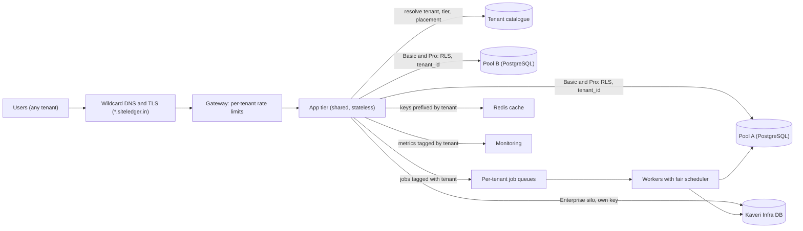
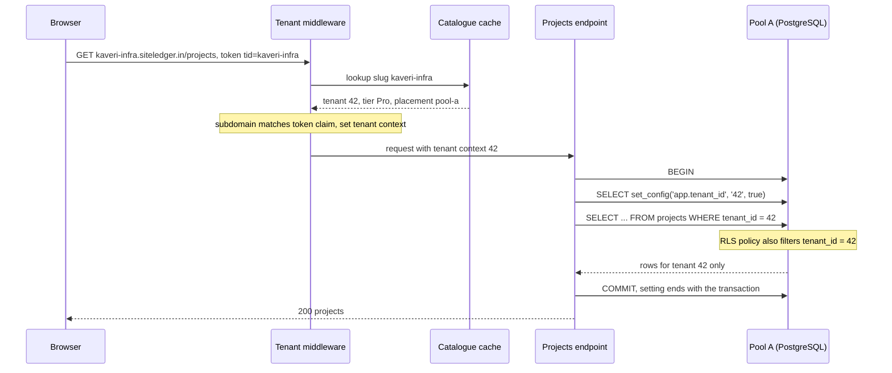
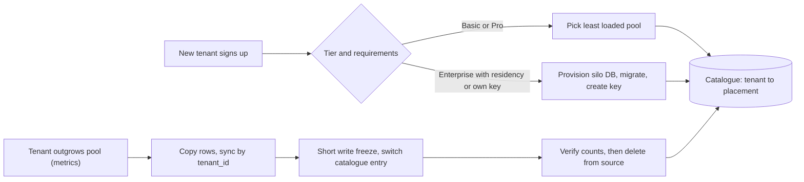

A software-as-a-service (SaaS) product sells the same application to many organisations, each of which must feel that the system is theirs alone: their data invisible to others, their performance unaffected by others, their settings their own. Each such organisation is a **tenant**. Multi-tenancy is the set of decisions about what tenants share (servers, databases, tables) and how you keep them apart anyway. Get it right and one platform serves 1,200 customers at a fraction of the cost of 1,200 deployments; get it wrong and one missing `WHERE tenant_id = @t` shows one contractor's bids to its competitor.

## Learning objectives

By the end of this lesson you will be able to:

1. Explain the silo, pool and bridge models and choose one per tenant tier using isolation, cost and operational effort.
2. Resolve the tenant for every request safely, and carry the tenant context through APIs, background jobs, caches and logs.
3. Enforce isolation in a pooled PostgreSQL database with row-level security, including the connection-pooling traps.
4. Detect and contain noisy neighbours with per-tenant rate limits, quotas, fair scheduling and tenant placement.
5. Design per-tenant configuration: plan limits, feature flags, branding and data residency.
6. Plan tenant lifecycle operations: onboarding, schema migrations across many databases, moving tenants, offboarding.
7. Recognise the failure modes, worst of all cross-tenant data leaks, and the tests that catch them.
8. Know when single-tenant deployments are simpler and better.

## Prerequisites

- [Multi-tenant security](#/lesson/m14-multi-tenant-security): the threat model and the basics of row-level security.
- [Partitioning and sharding](#/lesson/m09-partitioning-sharding): placing data across databases.
- [Rate limiting](#/lesson/m10-rate-limiting): token buckets and partitioned limiters.
- [Stateless services](#/lesson/m11-stateless): why the tenant must come from the request, not the server.

## Explain it like I'm a beginner

Think about where people live.

- **Independent houses (silo).** Each family has its own house, water tank and electricity meter. Complete privacy and control; if one house floods, neighbours are fine. But building and maintaining 1,000 houses is expensive.
- **An apartment block (pool).** Everyone shares the building, lifts and water tank; each flat has a lockable door. Cheap and efficient. But if one flat runs a tap all day, everyone's water pressure drops (a **noisy neighbour**), and a faulty lock exposes someone's flat (a **data leak**).
- **A gated township (bridge).** Most families live in apartment blocks, but a few who want more pay for villas inside the same township, sharing the gate, roads and security. A mix, chosen per family.

The building manager also needs to know, for every visitor, **which flat they are going to** (tenant resolution), must check they are allowed in, and must keep each flat's settings (parking slots, maintenance plan) separate (per-tenant configuration).

## First-principles explanation

### What is a tenant?

A tenant is a customer organisation with its own users, data and settings: a contractor company, a hospital, a school. One tenant has many users; usually a user belongs to one tenant, sometimes several (a consultant who works for three contractors). The tenant is the unit of **isolation, billing, configuration and lifecycle**.

### The running example

SiteLedger is a SaaS platform for construction contractors: projects, daily progress reports, labour attendance, material receipts, subcontractor bills. Customers:

- **1,000 small contractors** (about 10 users each, a few projects, free or "Basic" plan).
- **190 mid-sized firms** (about 50 users, "Pro" plan).
- **10 enterprises** (about 2,000 users each), including a state infrastructure corporation whose contract requires its data in a dedicated database, in India, with its own encryption key.

Traffic estimate: 10,000 + 9,500 + 20,000 ≈ 40,000 users × 150 requests a day ≈ 6 million requests a day ÷ 86,400 ≈ 70 requests per second on average, perhaps 280 at the 10 a.m. peak when site engineers submit daily reports. One enterprise alone is about 12 % of all traffic. Storage: about 2 TB in total, half of it from the 10 enterprises (estimates).

### Silo, pool and bridge

| | Silo | Pool | Bridge |
|---|---|---|---|
| What is shared | Nothing (or only the control plane) | Everything: app, database, tables | Some layers shared, some dedicated |
| Typical form | Stack or database per tenant | `tenant_id` on every row, shared tables | Shared app, database (or schema) per tenant; or pooled tiers plus silo tier |
| Isolation | Strongest, physical | Logical, enforced by code and RLS | Per layer |
| Noisy neighbours | None between tenants | Real risk | Limited to shared layers |
| Cost per tenant | High; idle capacity per tenant | Lowest | Middle |
| Onboarding | Provision infrastructure (minutes to hours) | Insert a row (seconds) | Depends on tier |
| Schema migrations | Run N times; partial failures | Once | N databases or schemas |
| Per-tenant backup and restore | Easy | Hard (restore one tenant's rows) | Easy for siloed layers |
| Good for | Regulated or very large tenants | Many small tenants | Tiered SaaS (the common case) |

A cost sketch, with stated assumptions: if the smallest suitable managed PostgreSQL instance costs about ₹8,000 a month (an assumption; check your provider's price list), 1,200 silo databases cost about ₹96 lakh a month before any real load. Pooling the 1,190 small and mid-sized tenants onto a handful of larger instances, and siloing only the enterprises that need it, typically costs a small fraction of that. **The bridge model is what most SaaS platforms end up with:** pool by default, silo where contracts, data size or noise demand it.

SiteLedger's design:

- **Shared app tier** (stateless ASP.NET Core) for everyone.
- **Pooled databases** for Basic and Pro tenants: several PostgreSQL clusters ("pools"), each holding hundreds of tenants, with RLS.
- **Siloed databases** for enterprises that need them, in the required region, each with its own key.
- A **tenant catalogue** (the control plane) that records each tenant's tier, placement (which database), region and settings.

### Tenant resolution

Every request must answer "which tenant?" before doing anything else. Common sources:

| Source | Example | Notes |
|---|---|---|
| Subdomain | `kaveri-infra.siteledger.in` | Clear for users; needs wildcard DNS and TLS certificate |
| Token claim | `tid` claim in the access token | Most trustworthy: issued by your identity provider |
| Path | `/t/kaveri-infra/projects` | Simple; easy to forget in links |
| Header | `X-Tenant-Id` | Only for trusted internal service-to-service calls |
| Custom domain | `projects.kaveri-infra.com` | Lookup table from host to tenant |

Rules:

- **Never trust a tenant id the client can freely choose.** The tenant from the URL or header must match the tenant in the authenticated token (or a membership list for users with several tenants). Otherwise any user can change `kaveri-infra` to `godavari-builders` in the address bar.
- **Resolve once, at the edge of the app**, into a scoped **tenant context** that all later code reads. No code should parse the host again.
- **Fail closed.** Unknown tenant: 404. Suspended tenant: 403 with a clear message. No tenant at all on a tenant-scoped endpoint: reject, never "default tenant".
- **Carry the context everywhere:** into log scopes and trace attributes, into cache keys, into message headers for background jobs, and into the database session.

### Data isolation in the pool: `tenant_id` and row-level security

In a pooled database, every tenant-owned table has a `tenant_id` column, and every query must filter on it. Relying on every developer remembering the filter in every query is how leaks happen. PostgreSQL's **row-level security (RLS)** adds a safety net inside the database:

```sql
CREATE TABLE projects (
    tenant_id  int    NOT NULL,
    id         bigint NOT NULL,
    name       text   NOT NULL,
    budget_inr numeric(14,2) NOT NULL,
    PRIMARY KEY (tenant_id, id)                     -- tenant first: every index starts with tenant_id
);

ALTER TABLE projects ENABLE ROW LEVEL SECURITY;
ALTER TABLE projects FORCE ROW LEVEL SECURITY;     -- applies even to the table owner

CREATE POLICY tenant_isolation ON projects
    USING      (tenant_id = NULLIF(current_setting('app.tenant_id', true), '')::int)
    WITH CHECK (tenant_id = NULLIF(current_setting('app.tenant_id', true), '')::int);

-- The application connects as a role that is not a superuser, does not own the tables,
-- and does not have BYPASSRLS.
CREATE ROLE siteledger_app LOGIN PASSWORD '...' NOSUPERUSER NOBYPASSRLS;
GRANT SELECT, INSERT, UPDATE, DELETE ON projects TO siteledger_app;
```

How it works and the traps:

- **`USING` filters reads, updates and deletes; `WITH CHECK` validates new rows.** Without `WITH CHECK`, a bug could insert a row with another tenant's id.
- **Superusers and roles with `BYPASSRLS` ignore policies.** Table owners do too, unless the table has `FORCE ROW LEVEL SECURITY`. The application role must be none of these. Migrations run as a separate owner role.
- **Fail closed when unset.** `current_setting('app.tenant_id', true)` returns null if the setting was never defined, so the policy matches no rows. But once a session has used the setting, it can come back as an **empty string**, and `''::int` raises an error. `NULLIF(..., '')` turns that into null, so the result is "no rows", not an error.
- **Use transaction-local settings with connection pools.** `SET app.tenant_id = 42` lasts for the whole session, and a pooled connection is reused by the next request, possibly for another tenant. Use `SELECT set_config('app.tenant_id', '42', true)` (or `SET LOCAL`) inside a transaction so the setting ends with the transaction. With PgBouncer in transaction mode, session settings are not even guaranteed to stay on the same server connection.
- **Indexes still matter.** RLS adds a predicate; queries remain fast only if indexes start with `tenant_id`.
- **RLS is a safety net, not the only check.** Keep explicit `tenant_id` filters in queries too (they help the planner and make intent visible), and keep authorisation checks in the app (a user may see only some of their own tenant's projects).

Alternatives for logical isolation: **schema per tenant** (one schema per tenant in a shared database) gives easier per-tenant restore but strains catalogue size and migrations beyond a few thousand schemas; **database per tenant** on a shared server is the bridge model at the database layer.

### Noisy neighbours

In a pool, one tenant's behaviour affects others. SiteLedger's examples:

- An enterprise runs a year-end export of 2 million attendance rows at 10 a.m.
- A small tenant's integration script calls the API 50 times a second in a loop.
- A tenant uploads 40,000 site photos in an hour, saturating the thumbnail workers.

Defences, from the edge inwards:

1. **Per-tenant rate limits** by plan: for example Basic 60 requests a minute per tenant, Pro 600, Enterprise 6,000. ASP.NET Core's rate limiter supports partitioning by any key, so the tenant id is the partition.
2. **Per-tenant concurrency limits** for expensive operations (at most 2 concurrent exports per tenant).
3. **Query budgets:** `statement_timeout` for interactive requests (for example 5 seconds); long reports go to a background job against a read replica.
4. **Fair background processing:** one shared queue is first-come-first-served, so 40,000 photo jobs from one tenant delay everyone. Use per-tenant queues (or partitions) and a fair scheduler (round robin, weighted by plan).
5. **Per-tenant metrics:** requests, errors, latency, database time and storage tagged with tenant id (watch metric cardinality: tag top tenants individually, aggregate the long tail).
6. **Tenant placement:** when a tenant grows, move it to a less busy pool or to its own database. This requires a tenant-to-database map and a tested move procedure (copy, sync, switch, verify).

### Per-tenant configuration

Tenants differ in plan, limits and preferences. Model configuration as **plan defaults plus tenant overrides**, resolved once per request and cached:

| Setting | Basic default | Pro default | Example override |
|---|---|---|---|
| Max active projects | 5 | 100 | Kaveri Infra: 250 |
| API rate per minute | 60 | 600 | Pilot customer: 1,200 |
| Features | progress, attendance | + bills, integrations | + beta "drone survey import" |
| Max upload size | 25 MB | 100 MB | 500 MB |
| Data region | India (shared pool) | India (shared pool) | India, dedicated database |
| Branding | default | logo, colours | custom domain |

Keep the configuration in the tenant catalogue, cache it with a short expiry (or invalidate on change), and keep secrets (per-tenant API keys, encryption keys) in a vault, referenced by id.

### Tenant lifecycle

- **Onboarding** must be automated: create the catalogue entry, choose placement, run provisioning (for a silo: create database, apply migrations, set up key), create the first admin. A pooled tenant is ready in seconds; a silo in minutes.
- **Schema migrations** run once per database. With 1 pooled cluster and 10 silos, that is 11 migrations per release; with 1,200 silos, it is 1,200, and some will fail. Use backward-compatible (expand and contract) migrations so the app works with both old and new schemas while migrations roll out, and track each database's schema version.
- **Moving a tenant** between pools or into a silo: copy its rows, keep them in sync (logical replication with a row filter on `tenant_id`, or application-level dual reading), switch the catalogue entry during a short write freeze, verify, then delete from the source.
- **Offboarding:** export the tenant's data in a usable format, then delete it everywhere, including backups according to policy, caches, search indexes and object storage. Pool designs need `tenant_id` on objects in storage too (for example a per-tenant prefix).

### Failure modes

| Failure | Example | Mitigation |
|---|---|---|
| Cross-tenant read | One query without the tenant filter | RLS with FORCE; tests that try to read another tenant's data |
| Cross-tenant write | Insert with another tenant's id | `WITH CHECK` policies; tenant id taken from context, never from request body |
| Tenant spoofing | User edits subdomain or header | Match URL tenant to token claim or membership |
| Leaky connection setting | Session-level `SET` reused by next request | Transaction-local `set_config(..., true)` |
| Cache bleed | Cache key `project:42` shared by tenants with project 42 | Tenant id in every cache key |
| Background job without context | Nightly job processes all tenants as superuser | Job carries tenant id; runs one tenant per transaction with RLS |
| Noisy neighbour | One export slows everyone | Rate limits, concurrency limits, fair queues, placement |
| Partial migration | 3 of 300 silo databases failed | Expand and contract; per-database version tracking; retries |
| Metric cardinality explosion | Tenant id label on every metric for 50,000 tenants | Top-N tenants individually, others aggregated |
| Silo sprawl | 1,200 tiny databases to patch and back up | Silo only where required |

### When a simpler alternative is better

- **A handful of large customers.** With five customers who each want custom changes, separate deployments (single-tenant, automated with infrastructure as code) can be simpler than building tenant resolution, RLS and fairness.
- **On-premises contracts.** If customers install the software themselves, multi-tenancy inside one installation may not be needed at all.
- **Internal multi-department apps.** Departments of one organisation often need authorisation (who sees what), not tenant isolation; roles and policies ([RBAC and PBAC](#/lesson/m14-rbac-pbac)) are enough.
- **Pool without RLS** can be acceptable for low-sensitivity data with strong query conventions and tests, but RLS is cheap insurance for anything confidential.

### What it costs

| You gain | You pay |
|---|---|
| One platform for many customers; low cost per small tenant | Tenant context in every layer, forever |
| Fast self-service onboarding in the pool | Isolation bugs are the most damaging bugs you can ship |
| Strong isolation where contracts require it (silo tier) | Migrations and operations across many databases |
| Per-tenant plans, limits and features | A tenant catalogue and configuration system to run |
| Fairness under load | Per-tenant rate limits, quotas, fair queues and metrics |

## Visual explanation

### Architecture: the bridge model



Every request first meets per-tenant rate limits at the gateway. The shared app tier resolves the tenant and looks up its tier and placement in the catalogue (cached). Basic and Pro tenants are spread over pooled PostgreSQL clusters where RLS enforces isolation; an enterprise with contractual requirements has its own database with its own key. Background work is queued per tenant and drained by a fair scheduler, so one tenant's 40,000 jobs cannot starve others. Cache keys carry the tenant id, and metrics are tagged by tenant so noisy neighbours are visible.

### Sequence: one request in the pool



The middleware resolves the subdomain to tenant 42 and checks that the token's `tid` claim is the same tenant, then stores the context. The endpoint opens a transaction on the tenant's pool, sets `app.tenant_id` with transaction scope, and queries with an explicit filter. The RLS policy applies the same filter inside the database, so even a query that forgot it would return only tenant 42's rows. At `COMMIT` the setting disappears, so the pooled connection is clean for the next request.

### Tenant placement and moves



Placement is a decision recorded in the catalogue, not something hard-coded. New small tenants go to the least loaded pool; enterprises with residency or key requirements get a provisioned silo. When monitoring shows a tenant has outgrown its pool, it is moved: copy its rows, keep them in sync, freeze writes briefly, switch the catalogue entry so the app routes to the new database, verify, and only then delete from the source.

## Step-by-step example

### Step 1: a single-tenant app

SiteLedger began as one installation per customer. At 40 customers, every release meant 40 deployments, and onboarding took a week.

### Step 2: add `tenant_id` and resolve the tenant

Every table gets `tenant_id`; primary keys become `(tenant_id, id)`. Middleware resolves the subdomain, checks the token's `tid` claim, and fills a scoped tenant context.

### Step 3: enforce with RLS

Enable and force RLS with `USING` and `WITH CHECK` policies. The app connects as a non-owner role without `BYPASSRLS`, and every unit of work runs in a transaction that starts with `set_config('app.tenant_id', ..., true)`.

### Step 4: tame noisy neighbours

Add per-tenant rate limits by plan, a concurrency limit for exports, `statement_timeout` for interactive queries, and per-tenant job queues with a fair scheduler. Tag metrics with tenant id for the top 50 tenants.

### Step 5: tiers and placement

Introduce a catalogue with placement. Move the three largest enterprises to their own databases; provision the state corporation's silo in its required region with its own key. Automate onboarding and per-database migrations.

## Production-style C# implementation

The code shows tenant resolution and context, plan-based configuration, a tenant-scoped database session that always sets the tenant inside a transaction, tenant-aware cache keys, fair background scheduling and per-tenant rate limiting with ASP.NET Core's built-in limiter. The database executor is an in-memory fake so the code runs anywhere; the real Npgsql version is shown after it.

### Tenant model, catalogue and context

```csharp file=Tenancy/Tenants.cs
using System.Collections.Concurrent;

namespace SiteLedger.Tenancy;

public enum PlanTier { Basic, Pro, Enterprise }

public sealed record TenantInfo(int Id, string Slug, string Name, PlanTier Tier, string Placement, string Region, bool Suspended = false);

public interface ITenantCatalog
{
    ValueTask<TenantInfo?> FindBySlugAsync(string slug, CancellationToken ct);
}

public sealed class InMemoryTenantCatalog : ITenantCatalog
{
    private readonly ConcurrentDictionary<string, TenantInfo> _bySlug = new(StringComparer.OrdinalIgnoreCase)
    {
        ["kaveri-infra"] = new(42, "kaveri-infra", "Kaveri Infra Projects", PlanTier.Pro, "pool-a", "in-south"),
        ["godavari-builders"] = new(43, "godavari-builders", "Godavari Builders", PlanTier.Basic, "pool-a", "in-south"),
        ["state-roads-corp"] = new(7, "state-roads-corp", "State Roads Corporation", PlanTier.Enterprise, "silo-state-roads", "in-west")
    };

    public ValueTask<TenantInfo?> FindBySlugAsync(string slug, CancellationToken ct) => ValueTask.FromResult(_bySlug.GetValueOrDefault(slug));
}

/// <summary>Scoped per request (or per job). Set once by the resolver; read everywhere else.</summary>
public sealed class TenantContext
{
    private TenantInfo? _tenant;

    public TenantInfo Current => _tenant ?? throw new InvalidOperationException("No tenant in context. Tenant-scoped code ran without resolution.");
    public bool HasTenant => _tenant is not null;

    public void Set(TenantInfo tenant)
    {
        if (_tenant is not null && _tenant.Id != tenant.Id) throw new InvalidOperationException("Tenant context cannot change within a scope.");
        _tenant = tenant;
    }
}

/// <summary>Every cache key carries the tenant, so tenants with the same project id never share an entry.</summary>
public static class TenantKeys
{
    public static string For(TenantInfo tenant, string key) => $"t{tenant.Id}:{key}";
}
```

### Resolution middleware

```csharp file=Tenancy/TenantResolutionMiddleware.cs
using System.Diagnostics;

namespace SiteLedger.Tenancy;

public sealed class TenantResolutionOptions
{
    public string RootDomain { get; set; } = "siteledger.in";
    public HashSet<string> ReservedSubdomains { get; set; } = new(StringComparer.OrdinalIgnoreCase) { "www", "api", "admin", "status" };
}

public sealed class TenantResolutionMiddleware(
    RequestDelegate next, ITenantCatalog catalog, Microsoft.Extensions.Options.IOptions<TenantResolutionOptions> options,
    ILogger<TenantResolutionMiddleware> logger)
{
    public async Task InvokeAsync(HttpContext http, TenantContext tenantContext)
    {
        var slug = SubdomainOf(http.Request.Host.Host, options.Value);
        if (slug is null)
        {
            await next(http);                                       // non-tenant endpoints (sign-up, health)
            return;
        }

        var tenant = await catalog.FindBySlugAsync(slug, http.RequestAborted);
        if (tenant is null) { http.Response.StatusCode = StatusCodes.Status404NotFound; return; }
        if (tenant.Suspended) { http.Response.StatusCode = StatusCodes.Status403Forbidden; return; }

        // The subdomain is user-controlled; the token claim is not. They must agree.
        if (http.User.Identity?.IsAuthenticated == true && http.User.FindFirst("tid")?.Value is { } claimed
            && !string.Equals(claimed, tenant.Slug, StringComparison.OrdinalIgnoreCase))
        {
            logger.LogWarning("Tenant mismatch: host {Host} vs token tenant {Claimed}", slug, claimed);
            http.Response.StatusCode = StatusCodes.Status403Forbidden;
            return;
        }

        tenantContext.Set(tenant);
        http.Items["tenant"] = tenant;                               // read by the rate limiter partitioner
        Activity.Current?.SetTag("tenant.id", tenant.Id);
        using (logger.BeginScope(new Dictionary<string, object> { ["TenantId"] = tenant.Id, ["TenantTier"] = tenant.Tier.ToString() }))
            await next(http);
    }

    public static string? SubdomainOf(string host, TenantResolutionOptions o)
    {
        var suffix = "." + o.RootDomain;
        if (!host.EndsWith(suffix, StringComparison.OrdinalIgnoreCase)) return null;
        var sub = host[..^suffix.Length];
        if (sub.Length == 0 || sub.Contains('.') || o.ReservedSubdomains.Contains(sub)) return null;
        return sub.ToLowerInvariant();
    }
}
```

### Plan defaults plus tenant overrides

```csharp file=Tenancy/TenantSettings.cs
using Microsoft.Extensions.Caching.Memory;

namespace SiteLedger.Tenancy;

public sealed record TenantSettings(int MaxActiveProjects, int RequestsPerMinute, int MaxConcurrentExports, int MaxUploadMb, IReadOnlySet<string> Features)
{
    public bool Has(string feature) => Features.Contains(feature);
}

public sealed record TenantOverrides(int? MaxActiveProjects = null, int? RequestsPerMinute = null, int? MaxUploadMb = null, IReadOnlyList<string>? ExtraFeatures = null);

public interface ITenantSettingsProvider
{
    TenantSettings For(TenantInfo tenant);
}

public sealed class TenantSettingsProvider(IMemoryCache cache) : ITenantSettingsProvider
{
    private static readonly Dictionary<PlanTier, TenantSettings> Plans = new()
    {
        [PlanTier.Basic] = new(5, 60, 1, 25, new HashSet<string> { "progress", "attendance" }),
        [PlanTier.Pro] = new(100, 600, 2, 100, new HashSet<string> { "progress", "attendance", "bills", "integrations" }),
        [PlanTier.Enterprise] = new(10_000, 6_000, 4, 500, new HashSet<string> { "progress", "attendance", "bills", "integrations", "sso", "audit-export" })
    };

    // In production these come from the tenant catalogue; here a fixed example.
    private static readonly Dictionary<int, TenantOverrides> Overrides = new()
    {
        [42] = new(MaxActiveProjects: 250, ExtraFeatures: new[] { "drone-survey-import" })
    };

    public TenantSettings For(TenantInfo tenant) =>
        cache.GetOrCreate(TenantKeys.For(tenant, "settings"), entry =>
        {
            entry.AbsoluteExpirationRelativeToNow = TimeSpan.FromMinutes(5);
            var plan = Plans[tenant.Tier];
            if (!Overrides.TryGetValue(tenant.Id, out var o)) return plan;
            var features = new HashSet<string>(plan.Features);
            foreach (var f in o.ExtraFeatures ?? Array.Empty<string>()) features.Add(f);
            return plan with
            {
                MaxActiveProjects = o.MaxActiveProjects ?? plan.MaxActiveProjects,
                RequestsPerMinute = o.RequestsPerMinute ?? plan.RequestsPerMinute,
                MaxUploadMb = o.MaxUploadMb ?? plan.MaxUploadMb,
                Features = features
            };
        })!;
}
```

### A tenant-scoped database session

```csharp file=Data/TenantDb.cs
using SiteLedger.Tenancy;

namespace SiteLedger.Data;

public sealed record SqlStatement(string Sql, IReadOnlyDictionary<string, object?> Parameters);

/// <summary>Runs a batch in one transaction on the database named by placement. Production: Npgsql.</summary>
public interface ISqlExecutor
{
    Task<IReadOnlyList<IReadOnlyDictionary<string, object?>>> RunInTransactionAsync(
        string placement, IReadOnlyList<SqlStatement> batch, CancellationToken ct);
}

/// <summary>
/// The only way app code reaches tenant data. It always (1) picks the tenant's database from its placement and
/// (2) starts the transaction with a transaction-local app.tenant_id, so RLS applies and pooled connections stay clean.
/// </summary>
public sealed class TenantDb(TenantContext tenantContext, ISqlExecutor executor)
{
    public Task<IReadOnlyList<IReadOnlyDictionary<string, object?>>> QueryAsync(string sql, IReadOnlyDictionary<string, object?> parameters, CancellationToken ct)
    {
        var tenant = tenantContext.Current;                         // throws if no tenant: fail closed
        var withTenant = new Dictionary<string, object?>(parameters) { ["tenant_id"] = tenant.Id };
        var batch = new[]
        {
            new SqlStatement("SELECT set_config('app.tenant_id', @tenant_text, true)",
                new Dictionary<string, object?> { ["tenant_text"] = tenant.Id.ToString() }),
            new SqlStatement(sql, withTenant)
        };
        return executor.RunInTransactionAsync(tenant.Placement, batch, ct);
    }
}

/// <summary>Records what would be sent, and simulates RLS on a tiny in-memory projects table.</summary>
public sealed class InMemorySqlExecutor : ISqlExecutor
{
    private readonly List<(string Placement, int TenantId, long Id, string Name)> _projects =
    [
        ("pool-a", 42, 1, "NH-48 widening, package 3"),
        ("pool-a", 42, 2, "Hosur flyover"),
        ("pool-a", 43, 1, "Warangal school building"),
        ("silo-state-roads", 7, 1, "SH-60 resurfacing")
    ];

    public List<(string Placement, IReadOnlyList<SqlStatement> Batch)> Log { get; } = new();

    public Task<IReadOnlyList<IReadOnlyDictionary<string, object?>>> RunInTransactionAsync(
        string placement, IReadOnlyList<SqlStatement> batch, CancellationToken ct)
    {
        Log.Add((placement, batch));
        var setting = batch[0].Parameters["tenant_text"] as string;
        var tenantId = int.TryParse(setting, out var t) ? t : (int?)null;          // RLS: unset means no rows
        IReadOnlyList<IReadOnlyDictionary<string, object?>> rows = _projects
            .Where(p => p.Placement == placement && p.TenantId == tenantId)
            .Select(p => (IReadOnlyDictionary<string, object?>)new Dictionary<string, object?> { ["id"] = p.Id, ["name"] = p.Name })
            .ToList();
        return Task.FromResult(rows);
    }
}
```

With Npgsql the executor is a few lines (not compiled here, because Npgsql is a NuGet package):

```csharp
await using var conn = await _dataSources[placement].OpenConnectionAsync(ct);   // one NpgsqlDataSource per placement
await using var tx = await conn.BeginTransactionAsync(ct);
await using (var set = new NpgsqlCommand("SELECT set_config('app.tenant_id', @t, true)", conn, tx))
{
    set.Parameters.AddWithValue("t", tenantId.ToString());
    await set.ExecuteNonQueryAsync(ct);
}
// ... run the real query on the same connection and transaction ...
await tx.CommitAsync(ct);   // the setting ends here; the pooled connection carries nothing to the next request
```

### Fair background scheduling

```csharp file=Jobs/FairTenantScheduler.cs
namespace SiteLedger.Jobs;

public sealed record TenantJob(int TenantId, string Kind, string Payload);

/// <summary>
/// Weighted round robin over tenants that have work. A tenant with 40,000 queued thumbnails gets
/// its weight's worth of jobs per round, then everyone else gets a turn.
/// </summary>
public sealed class FairTenantScheduler(Func<int, int> weightOf)
{
    private readonly Lock _gate = new();
    private readonly Dictionary<int, Queue<TenantJob>> _queues = new();
    private readonly LinkedList<int> _ring = new();
    private int _servedInTurn;

    public int Pending { get { lock (_gate) return _queues.Values.Sum(q => q.Count); } }

    public void Enqueue(TenantJob job)
    {
        lock (_gate)
        {
            if (!_queues.TryGetValue(job.TenantId, out var q))
            {
                _queues[job.TenantId] = q = new Queue<TenantJob>();
                _ring.AddLast(job.TenantId);
            }
            q.Enqueue(job);
        }
    }

    public TenantJob? TryDequeue()
    {
        lock (_gate)
        {
            if (_ring.First is not { } node) return null;
            var tenant = node.Value;
            var queue = _queues[tenant];
            var job = queue.Dequeue();
            _servedInTurn++;

            if (queue.Count == 0)
            {
                _queues.Remove(tenant);
                _ring.RemoveFirst();
                _servedInTurn = 0;
            }
            else if (_servedInTurn >= Math.Max(1, weightOf(tenant)))
            {
                _ring.RemoveFirst();                                  // turn over: go to the back of the ring
                _ring.AddLast(tenant);
                _servedInTurn = 0;
            }
            return job;
        }
    }
}
```

### Wiring, including per-tenant rate limiting

```csharp file=Program.cs
using System.Threading.RateLimiting;
using SiteLedger.Data;
using SiteLedger.Jobs;
using SiteLedger.Tenancy;

var builder = WebApplication.CreateBuilder(args);

builder.Services.AddMemoryCache();
builder.Services.Configure<TenantResolutionOptions>(builder.Configuration.GetSection("Tenancy"));
builder.Services.AddSingleton<ITenantCatalog, InMemoryTenantCatalog>();
builder.Services.AddSingleton<ITenantSettingsProvider, TenantSettingsProvider>();
builder.Services.AddScoped<TenantContext>();
builder.Services.AddSingleton<ISqlExecutor, InMemorySqlExecutor>();
builder.Services.AddScoped<TenantDb>();
builder.Services.AddSingleton(new FairTenantScheduler(tenantId => tenantId == 7 ? 4 : 1));

builder.Services.AddRateLimiter(o =>
{
    o.RejectionStatusCode = StatusCodes.Status429TooManyRequests;
    o.GlobalLimiter = PartitionedRateLimiter.Create<HttpContext, string>(http =>
    {
        if (http.Items["tenant"] is not TenantInfo tenant)
            return RateLimitPartition.GetNoLimiter("no-tenant");
        var settings = http.RequestServices.GetRequiredService<ITenantSettingsProvider>().For(tenant);
        return RateLimitPartition.GetTokenBucketLimiter($"tenant:{tenant.Id}", _ => new TokenBucketRateLimiterOptions
        {
            TokenLimit = settings.RequestsPerMinute,
            TokensPerPeriod = settings.RequestsPerMinute,
            ReplenishmentPeriod = TimeSpan.FromMinutes(1),
            QueueLimit = 0
        });
    });
});

var app = builder.Build();

app.UseMiddleware<TenantResolutionMiddleware>();   // before the limiter, so the partition knows the tenant
app.UseRateLimiter();

app.MapGet("/projects", async (TenantDb db, CancellationToken ct) =>
    Results.Ok(await db.QueryAsync("SELECT id, name FROM projects WHERE tenant_id = @tenant_id ORDER BY id",
        new Dictionary<string, object?>(), ct)));

app.MapGet("/features", (TenantContext tc, ITenantSettingsProvider settings) =>
    Results.Ok(settings.For(tc.Current).Features));

app.MapPost("/photos/{name}/thumbnail", (string name, TenantContext tc, FairTenantScheduler scheduler) =>
{
    scheduler.Enqueue(new TenantJob(tc.Current.Id, "thumbnail", name));      // the job carries its tenant
    return Results.Accepted();
});

app.Run();
```

Notice that no endpoint takes a tenant id as a parameter. Tenant identity comes only from the resolved context, which came from the host and was checked against the token.

## Bad design vs good design

**Bad: tenant id from the request body.**

```csharp
app.MapPost("/projects", (CreateProject cmd, Db db) => db.Insert(cmd.TenantId, cmd.Name));   // anyone can write anywhere
```

**Good:** the tenant comes from the resolved context; RLS `WITH CHECK` rejects rows for any other tenant.

**Bad: session-level settings on pooled connections.** `SET app.tenant_id = 42` at the start of a request. The next request on that connection, for tenant 43, sees tenant 42's rows if its own `SET` is skipped by an early exit. **Good:** `set_config('app.tenant_id', '42', true)` inside the request's transaction.

**Bad: the app connects as the table owner or a superuser.** RLS silently does nothing. **Good:** a dedicated application role without ownership, superuser or `BYPASSRLS`, and `FORCE ROW LEVEL SECURITY` as a second guard.

**Bad: cache keys without the tenant.** `project:1` is cached for Kaveri Infra and served to Godavari Builders, whose project 1 is different. **Good:** `t42:project:1`.

**Bad: one FIFO queue for all tenants.** One tenant's 40,000 photos delay everyone's daily-report PDFs by an hour. **Good:** per-tenant queues with a fair scheduler, weighted by plan.

**Bad: silo for everyone "for safety".** Twelve hundred databases to patch, migrate and back up, most of them nearly idle. **Good:** pool by default with RLS; silo for tenants whose contracts, size or regulation require it.

:::callout type=warning title="Test isolation like an attacker"
Write automated tests that log in as tenant A and try to read, update and delete tenant B's records through every endpoint, with B's ids. Run them in CI against a real PostgreSQL with RLS enabled. A single cross-tenant leak can end a SaaS business.
:::

## Practical playground

The playground database has a pooled `projects` table with RLS **forced** and a policy using `app.tenant_id`, and an application role `app_user`. You are connected as a superuser, which bypasses RLS, so to see the policy work, switch role first. Try:

1. `SELECT * FROM projects;` as yourself (all rows: superusers bypass RLS).
2. `SET ROLE app_user; SELECT * FROM projects;` (no rows: tenant not set, fail closed).
3. `SELECT set_config('app.tenant_id', '42', false); SELECT * FROM projects;` (only tenant 42).
4. `INSERT INTO projects VALUES (43, 99, 'Sneaky', 1);` (rejected by `WITH CHECK`).
5. `RESET ROLE;` then compare `EXPLAIN SELECT * FROM projects` as `app_user` and as yourself to see the policy predicate.

:::playground type=sql title="Row-level security in a pooled table"
```sql
CREATE TABLE projects (
  tenant_id  int    NOT NULL,
  id         int    NOT NULL,
  name       text   NOT NULL,
  budget_inr bigint NOT NULL,
  PRIMARY KEY (tenant_id, id)
);
INSERT INTO projects VALUES
  (42, 1, 'NH-48 widening, package 3', 1850000000),
  (42, 2, 'Hosur flyover',              640000000),
  (43, 1, 'Warangal school building',    95000000),
  (44, 1, 'Coastal road drainage',      210000000);

CREATE ROLE app_user NOLOGIN;
GRANT SELECT, INSERT, UPDATE, DELETE ON projects TO app_user;

ALTER TABLE projects ENABLE ROW LEVEL SECURITY;
ALTER TABLE projects FORCE ROW LEVEL SECURITY;
CREATE POLICY tenant_isolation ON projects
  USING      (tenant_id = NULLIF(current_setting('app.tenant_id', true), '')::int)
  WITH CHECK (tenant_id = NULLIF(current_setting('app.tenant_id', true), '')::int);
```
:::

## Exercises

:::exercise id=m16-multi-tenancy-ex1 difficulty=beginner kind=written title="Silo, pool or bridge for three customers"
SiteLedger signs three new customers. For each, choose where its data lives (shared pool with RLS, a dedicated database, or a dedicated full stack) and justify it with isolation, cost and operations. Then say which model the platform as a whole is using.

1. A two-person interior contractor on the free plan.
2. A national EPC (engineering, procurement and construction) company with 3,000 users and 400 GB of photos and documents, worried about performance during their month-end billing.
3. A state government corporation whose contract requires a dedicated database in an Indian region, its own encryption key, and the ability to restore only its own data to any point in the last 30 days.
::acceptance
- Customer 1 is pooled, with the cost and onboarding reasons.
- Customer 2 is either pooled with placement on a dedicated or less-loaded pool, or given its own database, with noisy-neighbour reasoning.
- Customer 3 gets a dedicated database (silo at the data layer), mapped to each contractual requirement.
- The platform model is identified as bridge.
::hint
Which requirement in customer 3's contract is very hard to meet in a shared table?
::hint
For customer 2, is the problem isolation or noise? Which mechanism addresses noise?
::hint
What does it cost (money and operations) to give a free-plan customer their own database?
::solution
1. **Pool.** A free-plan tenant must be nearly free to serve and ready in seconds. A row in the catalogue, `tenant_id` on its rows, and RLS isolate it. A dedicated database would cost more per month than the customer pays (nothing) and add one more database to patch and migrate.
2. **Own database (bridge), or a dedicated pool.** Isolation is not the issue; noise is. 3,000 users and heavy month-end billing would affect hundreds of small tenants sharing a pool, and their 400 GB would dominate that pool's backups and vacuum work. Placing them on their own database (shared app tier) removes them as a noisy neighbour and lets them be scaled independently. Rate limits and fair job queues still apply.
3. **Dedicated database (silo at the data layer), possibly a dedicated app deployment if required.** Dedicated database in an Indian region: provision in that region and record it in the catalogue. Own encryption key: storage encryption with a customer-managed key for that database. Restore only their own data to a point in time: native point-in-time recovery of their database; in a shared pool this would mean restoring a whole cluster elsewhere and extracting one tenant's rows.

**The platform is a bridge model:** a shared app tier, pooled databases for most tenants, and dedicated databases where size or contracts demand it.
::mistakes
- Siloing everyone "to be safe", multiplying cost and operational load.
- Claiming RLS gives per-tenant point-in-time restore.
- Ignoring noisy-neighbour effects of one large tenant in a pool.
:::

:::exercise id=m16-multi-tenancy-ex2 difficulty=beginner kind=code title="Resolve the tenant safely"
Implement `TenantResolver.Resolve(host, claimedTenant, internalHeaderTenant, isInternalCall)`, which returns a `Resolution` with an outcome and, on success, the tenant slug.
::requirements
- Tenant hosts look like `<slug>.siteledger.in` (case-insensitive). `www`, `api` and `admin` are reserved and are not tenants. Nested subdomains (`a.b.siteledger.in`) are invalid.
- If the host is not a tenant host: for internal calls (`isInternalCall` true), use `internalHeaderTenant` if present; otherwise return `NoTenant`.
- The header is **ignored** for non-internal calls.
- If a slug was found and `claimedTenant` (from the token) is present and differs (case-insensitively), return `Mismatch`.
- Slugs are returned lower-case. Outcomes: `Resolved`, `NoTenant`, `Mismatch`.
::acceptance
- `kaveri-infra.siteledger.in` resolves to `kaveri-infra`.
- Reserved and nested subdomains do not resolve.
- An external caller cannot pick a tenant with the header.
- A host that disagrees with the token claim is a mismatch.
::hint
Check the suffix `.siteledger.in` with `EndsWith(..., StringComparison.OrdinalIgnoreCase)`, then take the part before it.
::hint
Reject an empty part, a part containing `.`, or a reserved name.
::hint
Only fall back to the header when the host gave nothing **and** the call is internal.
::hint
Compare the found slug with the claim at the end, whichever source the slug came from.
::starter
```csharp file=TenantResolver.cs
using System;
using System.Collections.Generic;

public enum ResolutionOutcome { Resolved, NoTenant, Mismatch }

public sealed record Resolution(ResolutionOutcome Outcome, string? Slug = null);

public static class TenantResolver
{
    public const string RootDomain = "siteledger.in";

    public static Resolution Resolve(string host, string? claimedTenant, string? internalHeaderTenant, bool isInternalCall) =>
        throw new NotImplementedException();
}
```
::tests
```csharp file=TenantResolverTests.cs
using Xunit;

public class TenantResolverTests
{
    [Fact]
    public void Resolves_subdomain()
    {
        var r = TenantResolver.Resolve("Kaveri-Infra.SiteLedger.in", null, null, false);
        Assert.Equal(ResolutionOutcome.Resolved, r.Outcome);
        Assert.Equal("kaveri-infra", r.Slug);
    }

    [Theory]
    [InlineData("www.siteledger.in")]
    [InlineData("api.siteledger.in")]
    [InlineData("a.b.siteledger.in")]
    [InlineData("siteledger.in")]
    [InlineData("kaveri-infra.example.com")]
    public void Non_tenant_hosts_do_not_resolve(string host) =>
        Assert.Equal(ResolutionOutcome.NoTenant, TenantResolver.Resolve(host, null, null, false).Outcome);

    [Fact]
    public void External_callers_cannot_use_the_header() =>
        Assert.Equal(ResolutionOutcome.NoTenant, TenantResolver.Resolve("api.siteledger.in", null, "godavari-builders", false).Outcome);

    [Fact]
    public void Internal_callers_can_use_the_header()
    {
        var r = TenantResolver.Resolve("api.siteledger.in", null, "Godavari-Builders", true);
        Assert.Equal(ResolutionOutcome.Resolved, r.Outcome);
        Assert.Equal("godavari-builders", r.Slug);
    }

    [Fact]
    public void Host_must_match_token_claim()
    {
        Assert.Equal(ResolutionOutcome.Mismatch, TenantResolver.Resolve("godavari-builders.siteledger.in", "kaveri-infra", null, false).Outcome);
        Assert.Equal(ResolutionOutcome.Resolved, TenantResolver.Resolve("kaveri-infra.siteledger.in", "KAVERI-INFRA", null, false).Outcome);
    }
}
```
::solution
```csharp file=TenantResolver.cs
using System;
using System.Collections.Generic;

public enum ResolutionOutcome { Resolved, NoTenant, Mismatch }

public sealed record Resolution(ResolutionOutcome Outcome, string? Slug = null);

public static class TenantResolver
{
    public const string RootDomain = "siteledger.in";
    private static readonly HashSet<string> Reserved = new(StringComparer.OrdinalIgnoreCase) { "www", "api", "admin" };

    public static Resolution Resolve(string host, string? claimedTenant, string? internalHeaderTenant, bool isInternalCall)
    {
        var slug = FromHost(host);
        if (slug is null && isInternalCall && !string.IsNullOrWhiteSpace(internalHeaderTenant))
            slug = internalHeaderTenant.Trim().ToLowerInvariant();
        if (slug is null) return new Resolution(ResolutionOutcome.NoTenant);

        if (!string.IsNullOrWhiteSpace(claimedTenant) && !string.Equals(claimedTenant.Trim(), slug, StringComparison.OrdinalIgnoreCase))
            return new Resolution(ResolutionOutcome.Mismatch);

        return new Resolution(ResolutionOutcome.Resolved, slug);
    }

    private static string? FromHost(string host)
    {
        var suffix = "." + RootDomain;
        if (string.IsNullOrEmpty(host) || !host.EndsWith(suffix, StringComparison.OrdinalIgnoreCase)) return null;
        var sub = host[..^suffix.Length];
        if (sub.Length == 0 || sub.Contains('.') || Reserved.Contains(sub)) return null;
        return sub.ToLowerInvariant();
    }
}
```

In ASP.NET Core, "internal call" must itself be established securely: for example, only requests arriving on an internal listener, or authenticated with a service identity (client credentials token with a specific scope), may set `X-Tenant-Id`. Strip the header at the public edge so it can never arrive from outside.
::mistakes
- Accepting the header from anyone, which lets a user pick any tenant.
- Using `Contains("siteledger.in")`, so `siteledger.in.evil.com` matches.
- Comparing case-sensitively, so `Kaveri-Infra` and `kaveri-infra` are treated as different tenants.
:::

:::exercise id=m16-multi-tenancy-ex3 difficulty=intermediate kind=code title="A fair scheduler for tenant jobs"
One tenant has queued 40,000 thumbnail jobs; another has 2 urgent PDF jobs. A FIFO queue would make the second tenant wait for all 40,000. Implement `FairScheduler`: weighted round robin across tenants that have pending jobs. A tenant gets up to `weight` jobs per turn, then moves to the back of the rotation. Tenants enter the rotation in the order of their first pending job.
::requirements
- `FairScheduler(Func<string, int> weightOf)`; weights below 1 are treated as 1.
- `Enqueue(tenant, job)` adds to that tenant's FIFO queue.
- `Dequeue()` returns the next `(Tenant, Job)` or `null` when nothing is pending.
- When a tenant's queue empties it leaves the rotation; if it gets new jobs later it joins at the back.
- `Pending` returns the total number of queued jobs.
::acceptance
- With weights 1, jobs from A, A, A and B, B come out A, B, A, B, A.
- A tenant with weight 3 gets three jobs per turn.
- The small tenant's jobs are served within the first few dequeues despite 40,000 queued for another tenant.
- Each tenant's jobs keep their own order.
::hint
Keep a `Dictionary<string, Queue<string>>` and a `LinkedList<string>` (or `Queue<string>`) as the rotation.
::hint
Track how many jobs the tenant at the front has received in its current turn.
::hint
After dequeuing: if the queue is empty, remove the tenant and reset the counter; else if the counter reached the weight, move it to the back and reset.
::hint
```csharp
var tenant = _ring.First!.Value;
var job = _queues[tenant].Dequeue();
_served++;
if (_queues[tenant].Count == 0) { _queues.Remove(tenant); _ring.RemoveFirst(); _served = 0; }
else if (_served >= Math.Max(1, _weightOf(tenant))) { _ring.RemoveFirst(); _ring.AddLast(tenant); _served = 0; }
```
::starter
```csharp file=FairScheduler.cs
using System;
using System.Collections.Generic;
using System.Linq;

public sealed class FairScheduler
{
    public FairScheduler(Func<string, int> weightOf) => throw new NotImplementedException();

    public int Pending => throw new NotImplementedException();

    public void Enqueue(string tenant, string job) => throw new NotImplementedException();

    public (string Tenant, string Job)? Dequeue() => throw new NotImplementedException();
}
```
::tests
```csharp file=FairSchedulerTests.cs
using System.Collections.Generic;
using System.Linq;
using Xunit;

public class FairSchedulerTests
{
    private static List<string> Drain(FairScheduler s)
    {
        var order = new List<string>();
        while (s.Dequeue() is { } next) order.Add(next.Tenant + ":" + next.Job);
        return order;
    }

    [Fact]
    public void Equal_weights_alternate()
    {
        var s = new FairScheduler(_ => 1);
        s.Enqueue("A", "a1"); s.Enqueue("A", "a2"); s.Enqueue("A", "a3");
        s.Enqueue("B", "b1"); s.Enqueue("B", "b2");
        Assert.Equal(new List<string> { "A:a1", "B:b1", "A:a2", "B:b2", "A:a3" }, Drain(s));
    }

    [Fact]
    public void Weight_gives_more_jobs_per_turn()
    {
        var s = new FairScheduler(t => t == "ENT" ? 3 : 1);
        for (var i = 1; i <= 4; i++) s.Enqueue("ENT", "e" + i);
        s.Enqueue("SMALL", "s1"); s.Enqueue("SMALL", "s2");
        Assert.Equal(new List<string> { "ENT:e1", "ENT:e2", "ENT:e3", "SMALL:s1", "ENT:e4", "SMALL:s2" }, Drain(s));
    }

    [Fact]
    public void Small_tenant_is_not_starved()
    {
        var s = new FairScheduler(_ => 1);
        for (var i = 0; i < 40_000; i++) s.Enqueue("photos-tenant", "thumb" + i);
        s.Enqueue("pdf-tenant", "daily-report-1");
        s.Enqueue("pdf-tenant", "daily-report-2");
        var first = Enumerable.Range(0, 4).Select(_ => s.Dequeue()!.Value.Tenant).ToList();
        Assert.Equal(2, first.Count(t => t == "pdf-tenant"));
        Assert.Equal(39_998, s.Pending);
    }

    [Fact]
    public void Empty_tenant_rejoins_at_the_back()
    {
        var s = new FairScheduler(_ => 1);
        s.Enqueue("A", "a1");
        s.Enqueue("B", "b1"); s.Enqueue("B", "b2");
        Assert.Equal("A", s.Dequeue()!.Value.Tenant);
        s.Enqueue("A", "a2");
        Assert.Equal(new List<string> { "B:b1", "A:a2", "B:b2" }, Drain(s));
        Assert.Null(s.Dequeue());
    }

    [Fact]
    public void Zero_weight_counts_as_one()
    {
        var s = new FairScheduler(_ => 0);
        s.Enqueue("A", "a1"); s.Enqueue("A", "a2"); s.Enqueue("B", "b1");
        Assert.Equal(new List<string> { "A:a1", "B:b1", "A:a2" }, Drain(s));
    }
}
```
::solution
```csharp file=FairScheduler.cs
using System;
using System.Collections.Generic;
using System.Linq;

public sealed class FairScheduler
{
    private readonly Func<string, int> _weightOf;
    private readonly Dictionary<string, Queue<string>> _queues = new(StringComparer.Ordinal);
    private readonly LinkedList<string> _ring = new();
    private int _served;

    public FairScheduler(Func<string, int> weightOf) => _weightOf = weightOf;

    public int Pending => _queues.Values.Sum(q => q.Count);

    public void Enqueue(string tenant, string job)
    {
        if (!_queues.TryGetValue(tenant, out var q))
        {
            _queues[tenant] = q = new Queue<string>();
            _ring.AddLast(tenant);
        }
        q.Enqueue(job);
    }

    public (string Tenant, string Job)? Dequeue()
    {
        if (_ring.First is not { } node) return null;
        var tenant = node.Value;
        var queue = _queues[tenant];
        var job = queue.Dequeue();
        _served++;

        if (queue.Count == 0)
        {
            _queues.Remove(tenant);
            _ring.RemoveFirst();
            _served = 0;
        }
        else if (_served >= Math.Max(1, _weightOf(tenant)))
        {
            _ring.RemoveFirst();
            _ring.AddLast(tenant);
            _served = 0;
        }
        return (tenant, job);
    }
}
```

The lesson's `FairTenantScheduler` is the same algorithm with a lock for concurrent workers. In a distributed setup the same idea appears as per-tenant queues or partitions with consumers that rotate between them, or as a "tenant id" partition key plus per-tenant concurrency limits in the worker.
::alternatives
Deficit round robin weights by job cost (for example bytes of photo) rather than job count, which is fairer when job sizes vary a lot. Priority classes (interactive versus bulk) can sit on top: always serve interactive jobs first, then bulk jobs fairly.
::mistakes
- Re-adding a tenant to the rotation on every enqueue, so a busy tenant appears many times.
- Forgetting to reset the per-turn counter when the tenant changes.
- A global FIFO with "priority for small tenants", which still starves when many tenants are busy.
:::

:::exercise id=m16-multi-tenancy-ex4 difficulty=intermediate kind=sql ordered=true title="Write the row-level security policy"
The `projects` table is pooled across tenants. RLS is **enabled and forced**, but there is no policy yet, so `app_user` sees nothing. Write a script that:

1. Creates a policy `tenant_isolation` on `projects` that allows only rows whose `tenant_id` equals the transaction setting `app.tenant_id`, for both reading and writing, and that returns no rows (rather than an error) when the setting is missing or empty.
2. Switches to `app_user`, sets `app.tenant_id` to `42` **for the current transaction only**.
3. Returns `id` and `name` of the visible projects, ordered by `id`, with no `WHERE` clause on `tenant_id` (the policy must do the filtering).
::setup
```sql
CREATE TABLE projects (
  tenant_id  int    NOT NULL,
  id         int    NOT NULL,
  name       text   NOT NULL,
  budget_inr bigint NOT NULL,
  PRIMARY KEY (tenant_id, id)
);
INSERT INTO projects VALUES
  (42, 1, 'NH-48 widening, package 3', 1850000000),
  (42, 2, 'Hosur flyover',              640000000),
  (43, 1, 'Warangal school building',    95000000),
  (44, 1, 'Coastal road drainage',      210000000),
  (42, 3, 'Krishnagiri bypass culverts', 87000000);
CREATE ROLE app_user NOLOGIN;
GRANT SELECT, INSERT, UPDATE, DELETE ON projects TO app_user;
ALTER TABLE projects ENABLE ROW LEVEL SECURITY;
ALTER TABLE projects FORCE ROW LEVEL SECURITY;
```
::check
```sql
CREATE POLICY tenant_isolation ON projects
  USING      (tenant_id = NULLIF(current_setting('app.tenant_id', true), '')::int)
  WITH CHECK (tenant_id = NULLIF(current_setting('app.tenant_id', true), '')::int);
SET ROLE app_user;
SELECT set_config('app.tenant_id', '42', true);
SELECT id, name FROM projects ORDER BY id;
```
::acceptance
- The policy has both `USING` and `WITH CHECK` clauses.
- It uses `current_setting('app.tenant_id', true)` with `NULLIF(..., '')` so an empty setting means no rows, not an error.
- The setting is transaction-local (`set_config(..., true)` or `SET LOCAL`).
- The final query has no tenant filter; the result is tenant 42's three projects.
::hint
`CREATE POLICY name ON table USING (...) WITH CHECK (...);`
::hint
The second argument of `current_setting(name, missing_ok)` avoids an error when the setting was never defined.
::hint
`NULLIF(x, '')::int` turns an empty string into null before the cast; `tenant_id = NULL` matches nothing.
::hint
`SET ROLE app_user;` then `SELECT set_config('app.tenant_id', '42', true);` (the `true` means "local to this transaction").
::solution
```sql
CREATE POLICY tenant_isolation ON projects
  USING      (tenant_id = NULLIF(current_setting('app.tenant_id', true), '')::int)
  WITH CHECK (tenant_id = NULLIF(current_setting('app.tenant_id', true), '')::int);
SET ROLE app_user;
SELECT set_config('app.tenant_id', '42', true);
SELECT id, name FROM projects ORDER BY id;
```

Result: projects 1, 2 and 3 of tenant 42. Things to try afterwards in the playground: as `app_user` with tenant 42, `INSERT INTO projects VALUES (43, 9, 'x', 1)` fails with "new row violates row-level security policy" (the `WITH CHECK` clause); without setting `app.tenant_id` at all the query returns no rows; and as the superuser everything is visible, which is why the application must never connect as one.
::alternatives
Instead of a custom setting, some teams map each tenant to a database role and use `current_user` in the policy. That gives very strong isolation but needs one role per tenant and per-tenant connection pools, which does not scale to thousands of tenants. A `SECURITY DEFINER` function such as `app.current_tenant()` that validates and returns the setting keeps the policy text short and in one place.
::mistakes
- Only a `USING` clause, so inserts and updates can write rows for another tenant.
- `current_setting('app.tenant_id')::int` without `NULLIF`, which errors on an empty setting.
- `set_config(..., false)` or plain `SET`, which leaks to the next request on a pooled connection.
- Testing as the superuser and concluding "RLS does not work".
:::

:::exercise id=m16-multi-tenancy-ex5 difficulty=advanced kind=hld title="Tiered SaaS architecture with tenant placement"
SiteLedger expects to grow to 20,000 tenants in two years: 19,000 Basic, 950 Pro and 50 Enterprise, of which 15 need dedicated databases (some in a specific Indian region, two in the Middle East for a Gulf contractor). Design the platform: tiers and placement, tenant catalogue, routing, isolation per tier, noisy-neighbour controls, migrations across all databases, tenant moves, per-tenant cost visibility and offboarding. Extend the starter graph and give your capacity reasoning. Say what breaks first.
::acceptance
- A bridge design with explicit tiers and a catalogue that maps tenants to placements and regions.
- Isolation per tier: RLS in pools, dedicated databases (and keys) for silos, residency honoured.
- Noisy-neighbour controls at the edge, in the database and in background jobs.
- A migration strategy across many databases (expand and contract, version tracking, waves).
- A tenant-move procedure and offboarding that covers databases, storage, caches and search.
::hint
How many tenants per pool is reasonable? Think in data size and peak load per pool, not tenant count alone.
::hint
Deployment stamps: a full copy of the stack per region (or per group of tenants), all managed by one control plane.
::hint
What is the first thing to break as tenant count grows: the app tier, the pool databases, the migration process, or metrics cardinality?
::hint
Per-tenant cost: tag storage by tenant prefix and sample database time per tenant from query statistics.
::starter
```json
{
  "nodes": [
    { "id": "users", "type": "client", "label": "Users of 20,000 tenants" },
    { "id": "app", "type": "app-server", "label": "SiteLedger app", "props": { "instances": 4 } },
    { "id": "db", "type": "database", "label": "PostgreSQL" },
    { "id": "files", "type": "object-storage", "label": "Photos and documents" }
  ],
  "edges": [
    { "from": "users", "to": "app", "kind": "sync" },
    { "from": "app", "to": "db", "kind": "sync" },
    { "from": "app", "to": "files", "kind": "sync" }
  ]
}
```
::solution
```json
{
  "nodes": [
    { "id": "users", "type": "client", "label": "Users of 20,000 tenants" },
    { "id": "dns", "type": "dns", "label": "Wildcard DNS + custom domains" },
    { "id": "cp", "type": "app-server", "label": "Control plane: catalogue, onboarding, placement, migrations" },
    { "id": "cat", "type": "database", "label": "Tenant catalogue (tier, placement, region, settings)", "props": { "replicas": 1, "multiAz": true } },
    { "id": "gw-in", "type": "api-gateway", "label": "India stamp gateway: per-tenant rate limits", "props": { "region": "india" } },
    { "id": "app-in", "type": "app-server", "label": "India stamp app tier (shared)", "props": { "instances": 8, "region": "india" } },
    { "id": "poolA", "type": "database", "label": "Pool A: ~5,000 Basic tenants, RLS", "props": { "replicas": 1, "region": "india" } },
    { "id": "poolB", "type": "database", "label": "Pool B: ~5,000 Basic tenants, RLS", "props": { "replicas": 1, "region": "india" } },
    { "id": "poolPro", "type": "database", "label": "Pro pools (3): ~300 tenants each, RLS", "props": { "replicas": 1, "region": "india" } },
    { "id": "silo-in", "type": "database", "label": "13 enterprise silo DBs, own keys", "props": { "region": "india" } },
    { "id": "jobs-in", "type": "worker", "label": "Workers: per-tenant queues, fair scheduler", "props": { "instances": 6, "region": "india" } },
    { "id": "files-in", "type": "object-storage", "label": "Files, prefix per tenant", "props": { "region": "india" } },
    { "id": "gw-me", "type": "api-gateway", "label": "Middle East stamp gateway", "props": { "region": "me" } },
    { "id": "app-me", "type": "app-server", "label": "Middle East stamp app tier", "props": { "instances": 2, "region": "me" } },
    { "id": "silo-me", "type": "database", "label": "2 Gulf silo DBs, own keys", "props": { "region": "me" } },
    { "id": "files-me", "type": "object-storage", "label": "Gulf files", "props": { "region": "me" } },
    { "id": "mon", "type": "monitoring", "label": "Per-tenant usage (top N), cost attribution, isolation tests" }
  ],
  "edges": [
    { "from": "users", "to": "dns", "kind": "sync" },
    { "from": "dns", "to": "gw-in", "kind": "sync", "label": "tenant in India" },
    { "from": "dns", "to": "gw-me", "kind": "sync", "label": "tenant in Gulf" },
    { "from": "gw-in", "to": "app-in", "kind": "sync" },
    { "from": "gw-me", "to": "app-me", "kind": "sync" },
    { "from": "app-in", "to": "cat", "kind": "sync", "label": "cached lookups" },
    { "from": "app-me", "to": "cat", "kind": "sync", "label": "cached lookups (no tenant data)" },
    { "from": "app-in", "to": "poolA", "kind": "sync" },
    { "from": "app-in", "to": "poolB", "kind": "sync" },
    { "from": "app-in", "to": "poolPro", "kind": "sync" },
    { "from": "app-in", "to": "silo-in", "kind": "sync" },
    { "from": "app-in", "to": "files-in", "kind": "sync" },
    { "from": "app-in", "to": "jobs-in", "kind": "async" },
    { "from": "jobs-in", "to": "poolA", "kind": "sync" },
    { "from": "app-me", "to": "silo-me", "kind": "sync" },
    { "from": "app-me", "to": "files-me", "kind": "sync" },
    { "from": "cp", "to": "cat", "kind": "sync" },
    { "from": "cp", "to": "poolA", "kind": "async", "label": "migrations in waves" },
    { "from": "cp", "to": "silo-in", "kind": "async", "label": "migrations in waves" },
    { "from": "cp", "to": "silo-me", "kind": "async", "label": "migrations in waves" },
    { "from": "mon", "to": "app-in", "kind": "sync" },
    { "from": "mon", "to": "app-me", "kind": "sync" }
  ]
}
```

**Tiers and placement.** Basic tenants go to large pools (thousands of tiny tenants each; size pools by data volume and peak load, for example keep each under about 500 GB and well below CPU limits). Pro tenants go to smaller pools (a few hundred each) with more headroom. Enterprises are pooled in a Pro-like pool unless they need a dedicated database; 15 do, in their required regions, each with a customer-managed key. The catalogue records tier, placement, region and settings; the app looks it up (cached) on every request.

**Deployment stamps by region.** Residency requires the Gulf tenants' data and processing in the Middle East, so there is a second, smaller stamp (gateway, app, databases, storage) there. The control plane and catalogue hold only tenant metadata (no business data), which is acceptable to share; if a contract forbids even that, run a separate control plane instance in that region.

**Capacity (estimates).** 20,000 tenants with similar user ratios to today give roughly 300,000 users; at 150 requests a day that is about 45 million requests a day ≈ 520 per second on average, perhaps 2,000 at the morning peak. Stateless app tiers scale horizontally; the pools are where load concentrates, which is why placement must follow metrics.

**Isolation.** Pools: `tenant_id` first in every key and index, RLS forced, transaction-local tenant setting, app role without bypass. Silos: separate databases and keys; the same code path, because the tenant setting is harmless there. Storage: a per-tenant prefix and access through the app or pre-signed URLs scoped to that prefix.

**Noisy neighbours.** Gateway rate limits per tenant by plan; concurrency limits for exports and imports; `statement_timeout` for interactive queries; long reports on replicas; per-tenant job queues with a fair scheduler. Monitoring ranks tenants by database time; the top consumers are candidates for moving.

**Migrations.** About 10 pool databases plus 15 silos is 25 databases per release. Migrations are expand and contract so old and new app versions both work during rollout; the control plane applies them in waves (one canary pool, then the rest, then silos), records each database's schema version, retries failures and blocks the contract step until every database has the expand step.

**Tenant moves and offboarding.** Moves: logical replication with a row filter on `tenant_id` from source pool to target, catch up, freeze writes for that tenant for seconds, switch the catalogue, verify counts, delete from source. Offboarding: export (CSV and files) for the customer, then delete rows from the database, the tenant's storage prefix, cache keys (prefix), search documents and job queues; backups age out under the retention policy, documented in the contract.

**Per-tenant cost.** Storage by prefix, database time from sampled query statistics attributed by `tenant_id`, request counts from the gateway. This shows which plans are profitable.

**What breaks first.** Operational processes rather than raw throughput: migrations and tenant moves across an ever-growing number of databases, and metrics cardinality if every metric carries a tenant label for 20,000 tenants. Automating the control plane and limiting per-tenant metrics to the top N avoid both.
::mistakes
- Putting the Gulf tenants' data in India because "the catalogue is global".
- One giant pool for 19,000 tenants with no placement or move capability.
- Running migrations on all databases at once with no version tracking.
- Per-tenant metric labels on every series for 20,000 tenants.
:::

## Automated testing

**Cross-tenant tests in CI.** Seed two tenants with overlapping ids (both have project 1). For every endpoint, call it as tenant A with tenant B's ids and assert 404 or 403, never B's data. Run against a real PostgreSQL with RLS enabled and the app connecting as the application role.

```csharp
[Theory]
[InlineData("/projects/1")]
[InlineData("/projects/1/reports")]
[InlineData("/bills/1")]
public async Task Tenant_A_cannot_see_tenant_B(string path)
{
    var client = _factory.CreateClientFor(host: "kaveri-infra.siteledger.in", tid: "kaveri-infra");
    await SeedAsync(tenantB: 43, projectId: 1);                      // B's project 1
    var response = await client.GetAsync(path);
    var body = await response.Content.ReadAsStringAsync();
    Assert.DoesNotContain("Warangal", body);                         // a name that only B has
}
```

**Database-level tests.** As the application role: with no tenant set, every table returns zero rows; with tenant 42 set, inserting a row for tenant 43 fails; after `COMMIT`, a new transaction on the same connection sees no tenant. Also assert, from the catalogue views, that every table with a `tenant_id` column has RLS enabled and forced (a test that fails when someone adds a table and forgets).

```sql
-- Fails the build if any tenant table lacks forced RLS
SELECT c.relname
FROM pg_class c
JOIN pg_attribute a ON a.attrelid = c.oid AND a.attname = 'tenant_id'
WHERE c.relkind = 'r' AND (NOT c.relrowsecurity OR NOT c.relforcerowsecurity);
```

**Resolution and configuration tests.** Host parsing, reserved names, token mismatch, internal-only header (exercise 2); plan defaults and overrides merge correctly; cache keys always include the tenant.

**Fairness tests.** One tenant enqueues 40,000 jobs; another tenant's 2 jobs complete within the first few dequeues (exercise 3). Load tests with one tenant at 10× its usual rate should show 429 responses for that tenant only, and stable latency for others.

## Real-world application

- **B2B SaaS platforms** (project management, CRM, HR, accounting) almost all use a bridge model: pooled data for small customers, dedicated databases or deployments for large or regulated ones.
- **Government and regulated customers** often require dedicated databases, in-country hosting and customer-managed keys, which pushes those tenants into a silo tier.
- **Azure and AWS guidance** describes the same options: Microsoft's multitenant architecture guide covers tenancy models and deployment stamps; the AWS SaaS Lens uses the silo, pool and bridge terms.
- **PostgreSQL row-level security** is widely used for pooled tenancy, including by platforms that expose PostgreSQL directly to client applications with per-user policies.
- **Fair scheduling and per-tenant quotas** appear in every large shared platform, from CI runners to email-sending services, because one customer's burst must not become everyone's outage.

## Interview questions

:::interview
::q beginner
What is multi-tenancy?
::a
Serving many customer organisations (tenants) from one deployed platform, where each tenant's data, configuration and experience are kept separate even though infrastructure is shared. It lowers the cost per customer and makes onboarding and upgrades much faster than running one installation per customer, at the price of having to enforce isolation and fairness in software.
::q beginner
Explain the silo, pool and bridge models.
::a
Silo: each tenant gets dedicated resources (a database or a whole stack), giving the strongest isolation and easy per-tenant restore, at high cost and operational effort. Pool: tenants share everything, with a tenant id on every row; cheapest and fastest to onboard, but isolation and noisy neighbours must be handled in software. Bridge: a mix, either by layer (shared app, dedicated databases) or by tier (pool for small tenants, silo for large or regulated ones). Most SaaS platforms end up with a bridge model.
::q intermediate
How do you resolve the tenant for a request, and what can go wrong?
::a
From the subdomain, path, custom domain or a claim in the access token, resolved once by middleware into a scoped tenant context that the rest of the code uses. The main risk is trusting a value the user controls: the tenant from the URL must match the token's tenant claim or the user's memberships, and tenant headers must only be accepted from trusted internal callers. Unknown or suspended tenants fail closed. The context must also flow into logs, traces, cache keys, background jobs and the database session.
::q intermediate
How does PostgreSQL row-level security help, and what are the common mistakes?
::a
RLS attaches policies to a table so every query automatically filters rows, typically `tenant_id = current_setting('app.tenant_id')`, and `WITH CHECK` stops writes of other tenants' rows. Common mistakes: the application connects as a superuser, the table owner or a role with BYPASSRLS, so policies do nothing (use a separate role and FORCE ROW LEVEL SECURITY); setting the tenant at session level on pooled connections, which leaks to the next request (use transaction-local `set_config(..., true)`); casting an empty setting to an integer, which errors (wrap in NULLIF); forgetting WITH CHECK; and indexes that do not start with tenant_id.
::q advanced
One tenant's activity is slowing everyone down. How do you find and fix it?
::a
Find: per-tenant metrics for requests, errors, latency, database time (from query statistics attributed by tenant) and queue depth; the top consumers stand out. Fix in layers: per-tenant rate limits and concurrency limits at the edge; statement timeouts and moving heavy reports to replicas or background jobs; per-tenant job queues with weighted fair scheduling; and, if the tenant has simply outgrown the pool, move it to another pool or a dedicated database using the catalogue's placement map. Communicate limits through plans so customers know what they get.
::q advanced
How do you run schema migrations when you have hundreds of tenant databases?
::a
Make every migration backward compatible (expand and contract), so the application works with both the old and new schema while databases are migrated over minutes or hours. Track each database's schema version in the control plane, apply migrations in waves (canary database first, then pools, then silos), retry failures, and alert on databases left behind. Do not run the contract step (dropping old columns) until every database has completed the expand step and the code no longer uses the old shape.
::q advanced
When would you not build a multi-tenant system?
::a
When you have a few large customers who each want customisation (separate single-tenant deployments automated with infrastructure as code can be simpler), when the product is installed on customers' own premises, or when "tenants" are really departments of one organisation and role-based authorisation is enough. Multi-tenancy pays off when there are many customers who use the same product in the same way.
:::

## Summary and revision

**Key takeaways**

- A tenant is the unit of isolation, configuration, billing and lifecycle.
- Silo isolates physically at high cost; pool shares everything cheaply; bridge mixes by layer or tier and is the usual answer.
- Resolve the tenant once, from a source you trust, check it against the token, and carry it everywhere.
- In the pool, put `tenant_id` first in keys and indexes and enforce isolation with forced RLS, `USING` and `WITH CHECK`, a non-bypassing app role and transaction-local settings.
- Contain noisy neighbours with per-tenant rate and concurrency limits, query timeouts, fair job scheduling, metrics and placement moves.
- Per-tenant configuration is plan defaults plus overrides, cached and kept in the catalogue.
- Automate onboarding, migrations in waves, tenant moves and offboarding.
- Test isolation like an attacker, in CI, against a real database.

**Terminology**: tenant, silo, pool, bridge, control plane, tenant catalogue, placement, deployment stamp, tenant context, tenant resolution, row-level security, USING, WITH CHECK, FORCE ROW LEVEL SECURITY, BYPASSRLS, set_config, noisy neighbour, fair scheduling, weighted round robin, plan tier, override, offboarding.

:::flashcards
Q: Silo, pool, bridge in one line each?
A: Silo: dedicated resources per tenant. Pool: shared everything with tenant_id. Bridge: a mix by layer or by tier.
Q: Why must the URL's tenant match the token's tenant claim?
A: The URL is user-controlled; without the check, a user can switch to another tenant by editing the address.
Q: Which roles ignore RLS policies?
A: Superusers, roles with BYPASSRLS, and table owners unless the table has FORCE ROW LEVEL SECURITY.
Q: Why use set_config('app.tenant_id', x, true) instead of SET?
A: The true makes it transaction-local, so a pooled connection does not carry the tenant to the next request.
Q: Why wrap current_setting in NULLIF(..., '')?
A: Once used in a session, the setting can be an empty string, and casting '' to int errors; NULLIF makes the policy match no rows instead.
Q: What does WITH CHECK add to a policy?
A: It validates new and updated rows, so code cannot write a row for another tenant.
Q: Three noisy-neighbour defences?
A: Per-tenant rate and concurrency limits, fair per-tenant job scheduling, and moving large tenants to other placements (plus query timeouts).
Q: Why must cache keys include the tenant id?
A: Different tenants have the same ids (project 1), so a shared key serves one tenant's data to another.
Q: What makes migrations across many tenant databases safe?
A: Expand and contract migrations, per-database version tracking, and rollout in waves.
:::

## Knowledge check

:::quiz pass=70
::q single
A user on `godavari-builders.siteledger.in` changes the address to `kaveri-infra.siteledger.in` while logged in. What should happen?
- [ ] They see Kaveri Infra's data, since the subdomain identifies the tenant.
- [x] The request is rejected, because the host's tenant does not match the token's tenant claim.
- [ ] They are silently redirected back.
- [ ] RLS will handle it, so the app need not check.
> The URL is user-controlled. Resolution must verify it against an authenticated source; RLS only filters by whatever tenant the app sets.
::q single
RLS is enabled on `projects`, yet the application can read every tenant's rows. What is the most likely cause?
- [ ] The policy uses `current_setting`.
- [x] The application connects as the table owner or a superuser, and the table does not force RLS.
- [ ] The primary key starts with tenant_id.
- [ ] The application uses transactions.
> Owners (without FORCE), superusers and BYPASSRLS roles skip policies. Use a dedicated application role.
::q single
After a deploy, tenant 43 occasionally sees tenant 42's projects. The code runs `SET app.tenant_id = ...` at the start of each request. Why?
- [ ] RLS has a bug.
- [x] The session-level setting stays on the pooled connection; a request that skips or fails before its own SET runs with the previous tenant.
- [ ] Cache keys include the tenant.
- [ ] The policy lacks WITH CHECK.
> Use transaction-local `set_config(..., true)` so the setting ends with each transaction.
::q single
A state corporation requires its data in a dedicated database with its own key and point-in-time restore of only its data. Which placement fits?
- [ ] The shared pool, with RLS.
- [ ] A separate schema in the shared pool.
- [x] A dedicated (silo) database for that tenant, inside a bridge model.
- [ ] A separate table with a different name.
> Per-tenant keys and restores are natural with a dedicated database and very hard in a shared one.
::q single
One tenant enqueued 40,000 thumbnail jobs, and other tenants' daily-report PDFs are now an hour late. What fixes this most directly?
- [ ] More workers.
- [x] Per-tenant queues drained by a fair (weighted round-robin) scheduler.
- [ ] A larger single queue.
- [ ] Shorter job timeouts.
> More workers help everyone a bit; fairness ensures one tenant's backlog cannot delay all others.
::q multi
Which belong in a per-tenant isolation test suite? (Select all that apply.)
- [x] As tenant A, request tenant B's record ids on every endpoint and expect 404 or 403.
- [x] As the application role with no tenant set, every tenant table returns zero rows.
- [x] Fail the build if any table with a tenant_id column lacks forced RLS.
- [ ] Run all tests as the superuser to simplify setup.
> Superuser tests bypass RLS and prove nothing about isolation.
::q single
SiteLedger has 6 customers, each wanting custom features and on-premises installation. What is likely simplest?
- [ ] A pooled multi-tenant platform with RLS.
- [x] Separate single-tenant deployments automated with infrastructure as code.
- [ ] A bridge model with 6 silos and a control plane.
- [ ] One shared database with a tenant column, without RLS.
> Multi-tenancy pays off with many similar customers; a few customised, self-hosted ones are better served individually.
::q single
A migration renames a column across 25 tenant databases. How should it be rolled out?
- [ ] Rename in all databases at once during a maintenance window.
- [x] Expand and contract: add the new column, deploy code using both, migrate databases in waves with version tracking, then drop the old column.
- [ ] Rename in the pool first; silos can wait.
- [ ] Skip databases that fail.
> Backward-compatible steps let the application run while databases are at different versions.
:::

## Completion criteria

You have finished this lesson when you can:

- [ ] Score at least 70 % on the knowledge check.
- [ ] Pass the tests for exercises 2 and 3 with `dotnet test`.
- [ ] Write the RLS policy in exercise 4 from memory and explain each part.
- [ ] Choose silo, pool or bridge for a given customer list and justify it.
- [ ] List every place the tenant id must flow in your own system (request, logs, cache, jobs, database, storage).
