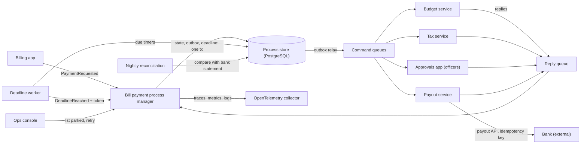
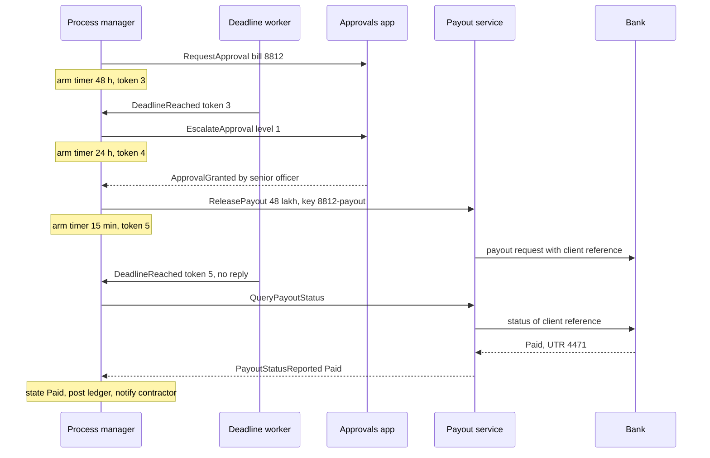
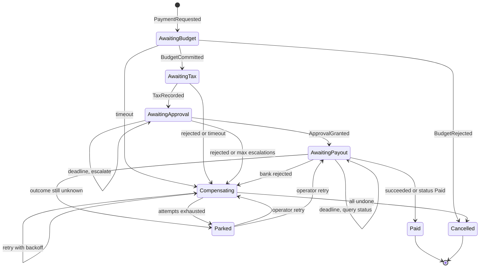
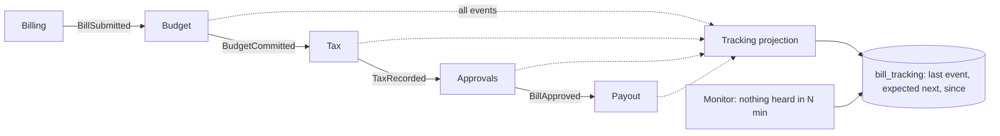

The [sagas lesson](#/lesson/m12-sagas) taught the mechanics: local transactions, compensations, pivots and idempotent steps. This lesson is about what happens after you ship one. In production, a saga waits two days for a human, a bank API answers "pending" for an hour, a compensation fails at 2 a.m., a deploy changes the process while 4,000 instances are halfway through, and someone in finance asks "where is bill 8812?". We build a **process manager** for paying contractor bills, with durable timers, escalation, compensation retries that end in a human queue, and the traces and metrics that make all of it visible.

## Learning objectives

By the end of this lesson you will be able to:

1. Explain the difference between a saga orchestrator, a process manager and pure choreography, and pick one per business flow.
2. Model technical timeouts, business deadlines and escalations as durable timers, and ignore stale timers safely.
3. Handle an unknown outcome at a step that cannot be compensated (a bank payout) by asking, not guessing.
4. Run compensations in production: retries with backoff, a cap, and a "parked" state that hands the case to a person.
5. Instrument a saga with traces that cross message hops, structured logs and metrics, and define alerts for stuck processes.
6. Make choreographed flows observable with a tracking projection.
7. Change a process definition safely while old instances are still running.
8. Recognise when a plain outbox, a single database transaction or a workflow engine is the better choice.

## Prerequisites

- [Sagas and compensating transactions](#/lesson/m12-sagas): compensations, pivots, idempotent commands, tombstones.
- [Transactional outbox](#/lesson/m12-outbox): state changes and outgoing messages saved together.
- [Idempotent consumers](#/lesson/m12-idempotent-consumers): every message arrives at least once.
- [Logs, metrics, traces and OpenTelemetry](#/lesson/m14-observability): the three signals we will emit.

## Explain it like I'm a beginner

Picture a file moving through a government office. A contractor submits a bill for road work. The file goes to the budget section (is money available?), then to accounts (deduct tax), then to an officer who must sign, then to the bank. A **file clerk** keeps a register: "Bill 8812, now with the officer since Monday." That clerk is the **process manager**. They do not do the work of any section; they know where the file is, what comes next, and how long each desk is allowed to hold it.

Now the production problems:

- **The officer is on leave.** After 48 hours the clerk does not cancel the bill; they send a reminder to the officer's senior (an **escalation**). Only after two reminders do they return the file.
- **The bank says "we are checking".** Money may or may not have left. The clerk must never "cancel" a payment they are unsure about; they phone the bank and ask (a **status query**).
- **Returning the file fails.** The budget section's system is down when the clerk tries to release the reserved money. The clerk tries again in 1 minute, then 2, then 4, and after five tries puts the file in a red tray marked "needs a supervisor" (**parking**).
- **The register must be readable by anyone.** A supervisor should see "37 files with officers, 2 in the red tray, oldest file 3 days" at a glance (**observability**).

The alternative to a clerk is **choreography**: each desk passes the file to the next and nobody keeps a register. It works for a short, simple chain, but then answering "where is bill 8812?" means asking every desk.

## First-principles explanation

### Orchestrator, process manager, choreography

These terms overlap, so let us fix them for this lesson.

- **Saga orchestrator.** A component that runs a fixed sequence of steps and, on failure, the compensations in reverse. Linear and predictable.
- **Process manager** (from *Enterprise Integration Patterns*). A stateful component that receives events, keeps the state of one process instance, and decides the next step, which may branch, loop, wait for a human or wait for time to pass. A saga orchestrator is a process manager whose process happens to be "steps plus compensations". In practice, production sagas grow branches (escalate, ask the bank, park), so they become process managers.
- **Choreography.** No central state. Each service reacts to events and publishes its own. The "process" exists only as the sum of reactions.
- **Routing slip.** A lighter middle ground: the first service attaches the list of steps to the message, and each step forwards it to the next. Useful for linear pipelines with no waiting or branching.

The decision is about **where the knowledge of the whole process lives**. If a person in the business owns the process and asks about individual cases, put that knowledge in one place.

| Question | Points towards |
|---|---|
| Does anyone ask "where is case X and why?" | Process manager |
| Are there deadlines, escalations or human steps? | Process manager |
| Are there more than three steps with compensations? | Process manager |
| Is it fan-out of a fact ("order placed") to independent listeners? | Choreography |
| Do teams need to add listeners without asking anyone? | Choreography |
| Is it a fixed linear pipeline with no waiting? | Routing slip or choreography |

Most real systems are **hybrid**: a process manager runs the core flow and publishes domain events ("BillPaid") that any number of services consume by choreography (analytics, notifications, the contractor portal).

### The running example: paying a running-account bill

A state infrastructure agency pays contractors for completed work in **running-account (RA) bills**: periodic bills for measured work done so far. Paying one involves:

1. **Budget service**: commit the amount against the project's sanctioned budget. Compensation: release the commitment.
2. **Tax service**: record TDS (tax deducted at source) and validate the contractor's GST details with an external API. Compensation: reverse the tax entries.
3. **Treasury officer**: a human approves or rejects in the Approvals app. Business deadline: 48 hours, then escalate to a senior, at most twice.
4. **Bank payout**: release money through the bank's payout API. This is the **pivot**: money that has left cannot be "compensated" by our system.
5. **Retriable steps**: post to the general ledger, notify the contractor.

Scale (estimates): 300 projects × about 8 bills a month ≈ 2,400 bills/month, peaking at 400 bills on the last working day of a quarter. That is under 0.01 processes per second; throughput is irrelevant. What matters is that each process involves ₹10 lakh to ₹5 crore, waits up to four days, and touches an external bank. **A process that silently stops is the main failure, not load.**

### Three kinds of waiting

Every waiting state needs a timer, but not every timer means "failure".

| Kind | Example | Typical length | What happens when it fires |
|---|---|---|---|
| Technical timeout | Budget service did not reply | Seconds to minutes (well above p99 latency) | Treat outcome as unknown: compensate if safe, or ask |
| Business deadline | Officer has not approved | Hours to days | Escalate, remind, then reject by policy |
| Retry or poll timer | Compensation failed; bank says "pending" | Backoff: 30 s, 1 min, 2 min … | Try again, until a cap, then park |

All three are the same mechanism: a **durable timer** (a deadline row in a table, or a scheduled message in a broker such as Azure Service Bus) that delivers a `DeadlineReached` event to the process. "Durable" matters: an in-memory `Task.Delay` of 48 hours dies with the next deploy.

### Stale timers

A process arms a timer each time it starts waiting. When the reply arrives in time, the old timer is still in the table and will fire later. Deleting it is not enough (it may already be in flight). The robust fix is a **deadline token**: the process increments a counter every time it arms a timer, the timer carries the token, and a `DeadlineReached` whose token is not the current one is ignored. This is the same idea as a fencing token in [distributed locks](#/lesson/m13-distributed-locks).

### Unknown outcomes at the pivot

At earlier steps, the m12 rule was "on timeout, compensate the uncertain step; compensations tolerate nothing to undo". **That rule is wrong for the pivot.** If the payout request timed out, the bank may have paid. "Compensating" would mean releasing the budget and marking the bill unpaid while ₹48 lakh has reached the contractor; a later retry might pay twice.

At a non-compensatable step:

1. **Send the request with an idempotency key** (our command id as the bank's client reference), so a resend can never pay twice.
2. **On timeout, ask** (`QueryPayoutStatus`). Paid → complete. Rejected → compensate (no money moved). Not found → resend the same request (the key makes it safe). Pending → ask again later.
3. **Cap the asking.** After, say, six queries over an hour, **park** the process with "outcome unknown, reconcile with the bank statement". A person, or a nightly reconciliation job, matches the bank statement and resolves it.

### Compensations in production

Compensations are the least-exercised code in the system and they run when things are already going wrong. Production rules:

- **Retry with exponential backoff.** 30 s, 1 min, 2 min, 4 min, capped at 30 min. The budget service being down for ten minutes should not need a human.
- **Cap the attempts and park.** After five failed attempts the process goes to `Parked` and raises an operator alert. Parked is not terminal: an operator fixes the cause and presses "retry", which resumes the compensation with the counter reset.
- **Separate technical from business failures.** "Timeout" or HTTP 503 is retried; "commitment already closed by year-end" is a business refusal that no retry will fix, so park immediately with that reason.
- **Record every attempt** (time, error) on the instance or in an audit table. The operator needs the history, not just the last error.
- **Reconcile.** A daily job compares process states with each participant's records ("budget commitments with no active process", "payouts in the bank statement with no `Paid` process"). Reconciliation catches what every other mechanism missed.

### Observability: answer four questions in under a minute

1. **Where is case X?** The process table, keyed by business id (`bill_id`), shows state, time in state, attempts and failure reason. Expose it to support staff through an ops screen.
2. **What happened to case X?** A trace that follows the process across every message hop, plus logs carrying `ProcessId` and `BillId`. Asynchronous hops break tracing unless you **propagate the trace context in message headers** (the W3C `traceparent`). Because one process may last days, many teams start a new trace per step and link it to the process with the `ProcessId` attribute rather than one giant trace.
3. **Is the system healthy?** Metrics: processes started and finished (tagged by outcome), duration histogram, count by state, number stuck beyond the per-state SLA, number parked, age of the oldest active process.
4. **Should someone wake up?** Alerts on symptoms: parked > 0 for more than 15 minutes; stuck count rising; completion rate falling below, say, 90 % of starts over a day; oldest active process older than the overall SLA (5 days here).

"Stuck" must be per state. Forty hours in `AwaitingApproval` is normal; forty minutes in `AwaitingBudget` is not.

### Making choreography observable

If you choose choreography, add a **tracking projection**: a small consumer that listens to every event of the flow and maintains one row per business case (`bill_id`, last event, last event time, expected next event). It changes no business behaviour; it only lets you see. Combine it with a "nothing heard for N minutes" check and you get most of the visibility of a process manager without central control. Without it, a choreographed flow fails silently: a consumer crashes, its queue fills, and the flow simply stops.

Other choreography hazards to watch in production:

- **Event cycles.** Service A reacts to B's event and publishes one B reacts to. Draw the event graph; it must be acyclic for one business case.
- **Missing failure listeners.** Every service that did work must listen for every failure event that should undo it. Adding a step later often forgets this.
- **Ordering.** Events from different services arrive in any order. Consumers must tolerate "payment failed" before "tax recorded".

### Changing the process while instances are running

A process with a four-day lifetime will always have instances in flight during a deploy. Options:

- **Version the definition.** Store `definition_version` on each instance. New instances get version 3; version 2 instances keep running on version 2 logic until they finish. Delete v2 code once no v2 instance remains (a query tells you).
- **Make changes additive.** Add new states and events; do not rename or remove states that live instances may be in.
- **Migrate explicitly when you must**, with a script that moves instances between states, run and audited like a database migration.

### Failure modes and mitigations

| Failure | Symptom | Mitigation |
|---|---|---|
| Orchestrator crashes mid-step | Nothing, if state and outbox are saved together | Persisted state, outbox, at-least-once delivery |
| Reply lost | Process waits forever | Every wait has a durable timer |
| Stale timer fires | Process compensates a step that succeeded | Deadline tokens |
| Duplicate or late event | Step done twice, or state goes backwards | Ignore events not valid in current state; idempotent participants |
| Compensation keeps failing | Retry storm against a struggling service | Backoff, cap, park, alert |
| Pivot outcome unknown | Double payment or false "unpaid" | Idempotency key, status query, park, reconcile |
| Deploy changes definition | Old instances hit unknown states | Definition versioning, additive changes |
| Choreography consumer down | Flow stops silently | Tracking projection plus "nothing heard" alert |
| Process manager becomes a "god service" | Every team edits it for business rules | It sequences and waits; participants own rules |

### When a simpler alternative is better

- **One database, one transaction.** If budget and tax are tables in the same service, a single transaction is shorter, stronger and easier to test than a saga between them.
- **Outbox plus retries.** If no later step can fail for business reasons, you need reliable delivery, not compensations or a state machine.
- **A batch job.** If the business accepts "bills are paid in a nightly run", a batch with a clear report may beat a real-time process with timers.
- **A workflow engine** ([Workflow engines](#/lesson/m16-workflow-engines)). Temporal, Azure Durable Functions or AWS Step Functions give you durable timers, retries, history and a UI. If you have more than a handful of long processes, writing your own timer tables and ops screens is undifferentiated work. You still design compensations and idempotency; the engine only runs them.

### What it costs

| You gain | You pay |
|---|---|
| Every case visible, with history | A process store, timer table and ops screen to build and run |
| Deadlines and escalations as first-class logic | More states and transitions to test |
| Compensations that survive outages | Parking queue that people must staff |
| Safe handling of unknown outcomes | Status APIs and reconciliation jobs with each partner |
| Definitions that can evolve | Versioned code paths kept until old instances drain |

## Visual explanation

### Architecture: a process manager in production



The billing app starts a process and moves on. The process manager saves state, outgoing commands and the next timer in one transaction. The outbox relay delivers commands; participants reply on a shared reply queue. The deadline worker turns due timer rows into `DeadlineReached` events carrying the token they were armed with. Every handling step emits a span, metrics and logs to the collector. Operators use the ops console to see parked processes and request a retry, and a nightly reconciliation job compares the store with the bank statement to catch anything all of the above missed.

### Sequence: escalation, then an unknown payout outcome



The officer's 48-hour deadline fires, so the process escalates instead of failing, and re-arms a shorter timer with a new token. The senior approves. The payout is sent with an idempotency key; the bank is slow and the 15-minute technical timeout fires. Because the payout is the pivot, the process asks the bank instead of compensating. The bank reports it paid, so the process completes and sends the retriable steps. If the timer with token 3 had fired again later (a duplicate delivery), it would be ignored because the current token is 5.

### The process as a state machine



Compared with a textbook saga, three things are new. Self-loops on `AwaitingApproval` and `AwaitingPayout` are escalations and status polls driven by timers. `Parked` is a holding state for cases automation cannot finish; it is not terminal, and an operator action resumes it in the state it came from. And there is no timeout edge from `AwaitingPayout` into `Compensating`: only a definite bank rejection can lead there.

### Choreography with a tracking projection



The same flow as choreography: each service reacts to the previous event. The dotted arrows are the tracking projection, which consumes every event and keeps one row per bill. A monitor queries that table for bills whose expected next event is overdue. This restores "where is bill X?" without giving any component control, but escalations and compensations must still be coded inside each service, which is why the core flow here uses a process manager.

## Step-by-step example

### Step 1: the textbook orchestrator

Start from the m12 design: steps, compensations in reverse, and one timeout per step that triggers compensation. It works in the demo.

### Step 2: the first production week

Three incidents arrive. An officer on leave caused 11 bills to be cancelled after the 10-minute "step timeout". A payout timeout triggered compensation for a bill the bank had actually paid. And the budget service's 20-minute outage left 30 processes in `Compensating` with exhausted retries and no alert.

### Step 3: classify every wait

For each waiting state, decide: technical timeout, business deadline, or poll. Approval becomes a 48-hour business deadline with two escalations. Payout gets a technical timeout that leads to a **status query**, never to compensation.

### Step 4: tokens, backoff and parking

Add a deadline token to every timer. Count compensation attempts, back off exponentially, and after five attempts move to `Parked` with an operator alert. Add an operator "retry" that resumes from where the process parked.

### Step 5: observability

Propagate `traceparent` on every command and reply. Add a meter with started, finished-by-outcome and duration, and gauges for stuck and oldest active. Define per-state SLAs and alert on stuck and parked. Build the ops screen that lists parked processes with their attempt history.

### Step 6: versioning and reconciliation

Add `definition_version` to the process table. Write the nightly reconciliation against the bank statement. The full code follows.

## Production-style C# implementation

The definition is a pure state machine (no I/O), so every path is testable. Around it: a store that saves state, outbox and timer together; a process manager service that adds tracing, logging scopes and metrics; a deadline worker; a health reporter; and minimal endpoints, including an ops console API. Participants are simulated in memory.

### Messages

```csharp file=Process/BillMessages.cs
namespace ContractorPay.Process;

public abstract record ProcessEvent(Guid ProcessId)
{
    public Guid EventId { get; init; } = Guid.NewGuid();

    /// <summary>W3C trace context copied from the message headers, so traces continue across hops.</summary>
    public string? TraceParent { get; init; }
}

public sealed record PaymentRequested(Guid ProcessId, string BillId, string ContractorId, decimal NetAmountInr) : ProcessEvent(ProcessId);
public sealed record BudgetCommitted(Guid ProcessId, string CommitmentId) : ProcessEvent(ProcessId);
public sealed record BudgetRejected(Guid ProcessId, string Reason) : ProcessEvent(ProcessId);
public sealed record TaxRecorded(Guid ProcessId, string TaxEntryId, decimal TdsInr) : ProcessEvent(ProcessId);
public sealed record TaxRejected(Guid ProcessId, string Reason) : ProcessEvent(ProcessId);
public sealed record ApprovalGranted(Guid ProcessId, string OfficerId) : ProcessEvent(ProcessId);
public sealed record ApprovalRejected(Guid ProcessId, string OfficerId, string Reason) : ProcessEvent(ProcessId);
public sealed record PayoutSucceeded(Guid ProcessId, string BankReference) : ProcessEvent(ProcessId);

/// <summary>A definite rejection by the bank: no money moved, so compensation is safe.</summary>
public sealed record PayoutFailed(Guid ProcessId, string Reason) : ProcessEvent(ProcessId);
public sealed record PayoutStatusReported(Guid ProcessId, PayoutStatus Status, string? BankReference) : ProcessEvent(ProcessId);
public sealed record CompensationDone(Guid ProcessId, string Step) : ProcessEvent(ProcessId);
public sealed record CompensationFailed(Guid ProcessId, string Step, string Error) : ProcessEvent(ProcessId);
public sealed record DeadlineReached(Guid ProcessId, int Token) : ProcessEvent(ProcessId);
public sealed record OperatorRetryRequested(Guid ProcessId, string OperatorId) : ProcessEvent(ProcessId);

public enum PayoutStatus { NotFound, Pending, Paid, Rejected }

public abstract record ProcessCommand(Guid ProcessId, string Step)
{
    /// <summary>Same id on every resend, so participants (and the bank) can deduplicate.</summary>
    public string CommandId => $"{ProcessId:N}:{Step}";
    public string? TraceParent { get; init; }
}

public sealed record CommitBudget(Guid ProcessId, string BillId, decimal AmountInr) : ProcessCommand(ProcessId, "commit-budget");
public sealed record RecordTax(Guid ProcessId, string BillId, string ContractorId, decimal AmountInr) : ProcessCommand(ProcessId, "record-tax");
public sealed record RequestApproval(Guid ProcessId, string BillId, decimal PayableInr) : ProcessCommand(ProcessId, "request-approval");
public sealed record EscalateApproval(Guid ProcessId, string BillId, int Level) : ProcessCommand(ProcessId, $"escalate-approval-{Level}");
public sealed record ReleasePayout(Guid ProcessId, string BillId, string ContractorId, decimal PayableInr) : ProcessCommand(ProcessId, "release-payout");
public sealed record QueryPayoutStatus(Guid ProcessId, string BillId) : ProcessCommand(ProcessId, "query-payout");
public sealed record PostLedger(Guid ProcessId, string BillId, string BankReference) : ProcessCommand(ProcessId, "post-ledger");
public sealed record NotifyContractor(Guid ProcessId, string ContractorId, string Message) : ProcessCommand(ProcessId, "notify-contractor");
public sealed record ReleaseBudget(Guid ProcessId, string? CommitmentId) : ProcessCommand(ProcessId, "release-budget");
public sealed record ReverseTax(Guid ProcessId, string? TaxEntryId) : ProcessCommand(ProcessId, "reverse-tax");
public sealed record RaiseOperatorAlert(Guid ProcessId, string Reason) : ProcessCommand(ProcessId, "operator-alert");
```

### Process state

```csharp file=Process/BillPaymentInstance.cs
namespace ContractorPay.Process;

public enum BillProcessState
{
    AwaitingBudget, AwaitingTax, AwaitingApproval, AwaitingPayout, Paid, Compensating, Cancelled, Parked
}

public static class BillSteps
{
    public const string Budget = "budget";
    public const string Tax = "tax";
}

public sealed class BillPaymentInstance
{
    public required Guid ProcessId { get; init; }
    public required string BillId { get; init; }
    public required string ContractorId { get; init; }
    public required decimal NetAmountInr { get; init; }
    public int DefinitionVersion { get; init; } = BillPaymentDefinition.CurrentVersion;

    public BillProcessState State { get; set; }
    public BillProcessState? ParkedFrom { get; set; }
    public string? CommitmentId { get; set; }
    public string? TaxEntryId { get; set; }
    public decimal TdsInr { get; set; }
    public string? BankReference { get; set; }
    public string? FailureReason { get; set; }

    /// <summary>Steps that have (or may have) taken effect, oldest first; compensated newest first.</summary>
    public List<string> CompletedSteps { get; init; } = new();

    public int DeadlineToken { get; set; }
    public int Escalations { get; set; }
    public int PayoutQueries { get; set; }
    public int CompensationAttempts { get; set; }

    public DateTimeOffset StartedAt { get; init; }
    public DateTimeOffset StateEnteredAt { get; set; }
    public long Version { get; set; }

    public bool IsTerminal => State is BillProcessState.Paid or BillProcessState.Cancelled;
    public decimal PayableInr => NetAmountInr - TdsInr;

    public BillPaymentInstance Clone() => new()
    {
        ProcessId = ProcessId, BillId = BillId, ContractorId = ContractorId, NetAmountInr = NetAmountInr,
        DefinitionVersion = DefinitionVersion, State = State, ParkedFrom = ParkedFrom,
        CommitmentId = CommitmentId, TaxEntryId = TaxEntryId, TdsInr = TdsInr, BankReference = BankReference,
        FailureReason = FailureReason, CompletedSteps = new List<string>(CompletedSteps),
        DeadlineToken = DeadlineToken, Escalations = Escalations, PayoutQueries = PayoutQueries,
        CompensationAttempts = CompensationAttempts, StartedAt = StartedAt, StateEnteredAt = StateEnteredAt,
        Version = Version
    };
}

/// <summary>What a transition asks the host to do: send these commands, and (optionally) arm one timer.</summary>
public sealed record Transition(IReadOnlyList<ProcessCommand> Commands, TimeSpan? ArmDeadline)
{
    public static readonly Transition None = new(Array.Empty<ProcessCommand>(), null);
}
```

### The definition: a pure state machine

```csharp file=Process/BillPaymentDefinition.cs
using Microsoft.Extensions.Options;

namespace ContractorPay.Process;

public sealed class BillProcessOptions
{
    public TimeSpan BudgetTimeout { get; set; } = TimeSpan.FromMinutes(1);
    public TimeSpan TaxTimeout { get; set; } = TimeSpan.FromMinutes(3);
    public TimeSpan ApprovalDeadline { get; set; } = TimeSpan.FromHours(48);
    public TimeSpan EscalationDeadline { get; set; } = TimeSpan.FromHours(24);
    public int MaxEscalations { get; set; } = 2;
    public TimeSpan PayoutTimeout { get; set; } = TimeSpan.FromMinutes(15);
    public TimeSpan PayoutQueryInterval { get; set; } = TimeSpan.FromMinutes(10);
    public int MaxPayoutQueries { get; set; } = 6;
    public TimeSpan CompensationTimeout { get; set; } = TimeSpan.FromMinutes(5);
    public TimeSpan CompensationBaseDelay { get; set; } = TimeSpan.FromSeconds(30);
    public TimeSpan CompensationMaxDelay { get; set; } = TimeSpan.FromMinutes(30);
    public int MaxCompensationAttempts { get; set; } = 5;
}

public sealed class BillPaymentDefinition(IOptions<BillProcessOptions> options)
{
    public const int CurrentVersion = 2;
    private BillProcessOptions O => options.Value;

    public (BillPaymentInstance Instance, Transition Transition) Start(PaymentRequested e, DateTimeOffset now)
    {
        var p = new BillPaymentInstance
        {
            ProcessId = e.ProcessId, BillId = e.BillId, ContractorId = e.ContractorId, NetAmountInr = e.NetAmountInr,
            State = BillProcessState.AwaitingBudget, StartedAt = now, StateEnteredAt = now
        };
        return (p, Arm(p, O.BudgetTimeout, new CommitBudget(p.ProcessId, p.BillId, p.NetAmountInr)));
    }

    public Transition Handle(BillPaymentInstance p, ProcessEvent e)
    {
        if (e is DeadlineReached stale && stale.Token != p.DeadlineToken) return Transition.None;   // old timer

        switch (p.State, e)
        {
            // ---- budget ---------------------------------------------------------------------
            case (BillProcessState.AwaitingBudget, BudgetCommitted b):
                p.CommitmentId = b.CommitmentId;
                p.CompletedSteps.Add(BillSteps.Budget);
                p.State = BillProcessState.AwaitingTax;
                return Arm(p, O.TaxTimeout, new RecordTax(p.ProcessId, p.BillId, p.ContractorId, p.NetAmountInr));
            case (BillProcessState.AwaitingBudget, BudgetRejected r):
                return Finish(p, BillProcessState.Cancelled, r.Reason);
            case (BillProcessState.AwaitingBudget, DeadlineReached):
                p.CompletedSteps.Add(BillSteps.Budget);                       // may have happened: undo it too
                return BeginCompensation(p, "Budget commitment timed out");

            // ---- tax ------------------------------------------------------------------------
            case (BillProcessState.AwaitingTax, TaxRecorded t):
                p.TaxEntryId = t.TaxEntryId;
                p.TdsInr = t.TdsInr;
                p.CompletedSteps.Add(BillSteps.Tax);
                p.State = BillProcessState.AwaitingApproval;
                return Arm(p, O.ApprovalDeadline, new RequestApproval(p.ProcessId, p.BillId, p.PayableInr));
            case (BillProcessState.AwaitingTax, TaxRejected r):
                return BeginCompensation(p, r.Reason);
            case (BillProcessState.AwaitingTax, DeadlineReached):
                p.CompletedSteps.Add(BillSteps.Tax);
                return BeginCompensation(p, "Tax recording timed out");

            // ---- human approval: a business deadline escalates before it fails ---------------
            case (BillProcessState.AwaitingApproval, ApprovalGranted):
                p.State = BillProcessState.AwaitingPayout;
                return Arm(p, O.PayoutTimeout, new ReleasePayout(p.ProcessId, p.BillId, p.ContractorId, p.PayableInr));
            case (BillProcessState.AwaitingApproval, ApprovalRejected r):
                return BeginCompensation(p, $"Rejected by {r.OfficerId}: {r.Reason}");
            case (BillProcessState.AwaitingApproval, DeadlineReached) when p.Escalations < O.MaxEscalations:
                p.Escalations++;
                return Arm(p, O.EscalationDeadline, new EscalateApproval(p.ProcessId, p.BillId, p.Escalations));
            case (BillProcessState.AwaitingApproval, DeadlineReached):
                return BeginCompensation(p, "Approval not given within the escalation policy");

            // ---- payout: the pivot. A timeout means "ask", never "compensate" -----------------
            case (BillProcessState.AwaitingPayout, PayoutSucceeded s):
                return CompletePaid(p, s.BankReference);
            case (BillProcessState.AwaitingPayout, PayoutFailed f):
                return BeginCompensation(p, "Bank rejected payout: " + f.Reason);
            case (BillProcessState.AwaitingPayout, DeadlineReached) when p.PayoutQueries < O.MaxPayoutQueries:
                p.PayoutQueries++;
                return Arm(p, O.PayoutQueryInterval, new QueryPayoutStatus(p.ProcessId, p.BillId));
            case (BillProcessState.AwaitingPayout, DeadlineReached):
                return Park(p, "Payout outcome unknown after status checks; reconcile with the bank statement");
            case (BillProcessState.AwaitingPayout, PayoutStatusReported { Status: PayoutStatus.Paid } r):
                return CompletePaid(p, r.BankReference ?? "unreported");
            case (BillProcessState.AwaitingPayout, PayoutStatusReported { Status: PayoutStatus.Rejected }):
                return BeginCompensation(p, "Bank reports the payout as rejected");
            case (BillProcessState.AwaitingPayout, PayoutStatusReported { Status: PayoutStatus.NotFound }):
                // The bank never received it: resend. Same command id = same idempotency key, so no double pay.
                return Arm(p, O.PayoutTimeout, new ReleasePayout(p.ProcessId, p.BillId, p.ContractorId, p.PayableInr));
            case (BillProcessState.AwaitingPayout, PayoutStatusReported):
                return Transition.None;                                       // Pending: the armed timer asks again

            // ---- compensating: retry with backoff, then park ---------------------------------
            case (BillProcessState.Compensating, CompensationDone c) when IsCurrentCompensation(p, c.Step):
                p.CompletedSteps.RemoveAt(p.CompletedSteps.Count - 1);
                p.CompensationAttempts = 0;
                return NextCompensation(p);
            case (BillProcessState.Compensating, CompensationFailed f) when IsCurrentCompensation(p, f.Step):
                p.FailureReason = $"Compensation '{f.Step}' attempt {p.CompensationAttempts} failed: {f.Error}";
                return ArmOnly(p, Backoff(p.CompensationAttempts));
            case (BillProcessState.Compensating, DeadlineReached):
                return NextCompensation(p);                                   // timeout or backoff elapsed: resend
            case (BillProcessState.Compensating, BudgetCommitted b):
                p.CommitmentId ??= b.CommitmentId;                            // late success: planned release covers it
                return Transition.None;
            case (BillProcessState.Compensating, TaxRecorded t):
                p.TaxEntryId ??= t.TaxEntryId;
                return Transition.None;

            // ---- a person resumes a parked process ------------------------------------------
            case (BillProcessState.Parked, OperatorRetryRequested):
                return Resume(p);

            default:
                return Transition.None;                                       // duplicate, late or unexpected
        }
    }

    private static bool IsCurrentCompensation(BillPaymentInstance p, string step) =>
        p.CompletedSteps.Count > 0 && p.CompletedSteps[^1] == step;

    public TimeSpan Backoff(int failedAttempts)
    {
        var factor = Math.Pow(2, Math.Max(0, failedAttempts - 1));
        var delay = TimeSpan.FromTicks((long)(O.CompensationBaseDelay.Ticks * factor));
        return delay < O.CompensationMaxDelay ? delay : O.CompensationMaxDelay;
    }

    private Transition BeginCompensation(BillPaymentInstance p, string reason)
    {
        p.FailureReason = reason;
        p.State = BillProcessState.Compensating;
        p.CompensationAttempts = 0;
        return NextCompensation(p);
    }

    private Transition NextCompensation(BillPaymentInstance p)
    {
        if (p.CompletedSteps.Count == 0) return Finish(p, BillProcessState.Cancelled, p.FailureReason);
        p.CompensationAttempts++;
        if (p.CompensationAttempts > O.MaxCompensationAttempts)
            return Park(p, $"Compensation '{p.CompletedSteps[^1]}' failed {O.MaxCompensationAttempts} times. Last: {p.FailureReason}");

        ProcessCommand command = p.CompletedSteps[^1] switch
        {
            BillSteps.Tax => new ReverseTax(p.ProcessId, p.TaxEntryId),
            BillSteps.Budget => new ReleaseBudget(p.ProcessId, p.CommitmentId),
            var other => throw new InvalidOperationException($"No compensation for step '{other}'.")
        };
        return Arm(p, O.CompensationTimeout, command);
    }

    private Transition Resume(BillPaymentInstance p)
    {
        var from = p.ParkedFrom;
        p.ParkedFrom = null;
        switch (from)
        {
            case BillProcessState.Compensating:
                p.State = BillProcessState.Compensating;
                p.CompensationAttempts = 0;
                return NextCompensation(p);
            case BillProcessState.AwaitingPayout:
                p.State = BillProcessState.AwaitingPayout;
                p.PayoutQueries = 0;
                return Arm(p, O.PayoutQueryInterval, new QueryPayoutStatus(p.ProcessId, p.BillId));
            default:
                p.ParkedFrom = from;
                return Transition.None;
        }
    }

    private static Transition CompletePaid(BillPaymentInstance p, string bankReference)
    {
        p.BankReference = bankReference;
        p.State = BillProcessState.Paid;
        p.DeadlineToken++;                                                    // disarm any pending timer
        return new Transition(new ProcessCommand[]
        {
            new PostLedger(p.ProcessId, p.BillId, bankReference),
            new NotifyContractor(p.ProcessId, p.ContractorId, $"Bill {p.BillId} paid: Rs {p.PayableInr:N0}, ref {bankReference}")
        }, null);
    }

    private static Transition Finish(BillPaymentInstance p, BillProcessState state, string? reason)
    {
        p.State = state;
        p.FailureReason = reason;
        p.DeadlineToken++;
        return Transition.None;
    }

    private static Transition Park(BillPaymentInstance p, string reason)
    {
        p.ParkedFrom = p.State;
        p.State = BillProcessState.Parked;
        p.FailureReason = reason;
        p.DeadlineToken++;
        return new Transition(new ProcessCommand[] { new RaiseOperatorAlert(p.ProcessId, reason) }, null);
    }

    private static Transition Arm(BillPaymentInstance p, TimeSpan timeout, ProcessCommand command)
    {
        p.DeadlineToken++;
        return new Transition(new[] { command }, timeout);
    }

    private static Transition ArmOnly(BillPaymentInstance p, TimeSpan delay)
    {
        p.DeadlineToken++;
        return new Transition(Array.Empty<ProcessCommand>(), delay);
    }
}
```

### Store: state, outbox and timer in one transaction

```csharp file=Process/ProcessStore.cs
using System.Threading.Channels;

namespace ContractorPay.Process;

public sealed class ProcessConcurrencyException(Guid id) : Exception($"Process {id} was modified concurrently.");

public sealed record DueDeadline(Guid ProcessId, int Token, DateTimeOffset DueAt);

public sealed record ProcessHealth(
    IReadOnlyDictionary<BillProcessState, int> CountByState, int StuckBeyondSla, int Parked, TimeSpan OldestActiveAge);

public interface IProcessStore
{
    Task<BillPaymentInstance?> GetAsync(Guid processId, CancellationToken ct);

    /// <summary>One transaction: update the row (version check), append commands to the outbox,
    /// and replace the process's timer if the transition armed one.</summary>
    Task SaveAsync(BillPaymentInstance p, long expectedVersion, Transition t, DateTimeOffset now, CancellationToken ct);

    Task<IReadOnlyList<DueDeadline>> TakeDueDeadlinesAsync(DateTimeOffset now, int max, CancellationToken ct);
    Task<IReadOnlyList<BillPaymentInstance>> ListByStateAsync(BillProcessState state, int max, CancellationToken ct);
    Task<ProcessHealth> GetHealthAsync(DateTimeOffset now, IReadOnlyDictionary<BillProcessState, TimeSpan> sla, CancellationToken ct);
}

public sealed class InMemoryProcessStore : IProcessStore
{
    private readonly Lock _gate = new();
    private readonly Dictionary<Guid, BillPaymentInstance> _rows = new();
    private readonly Dictionary<Guid, DueDeadline> _deadlines = new();      // one active timer per process
    private readonly Channel<ProcessCommand> _outbox = Channel.CreateUnbounded<ProcessCommand>();

    public ChannelReader<ProcessCommand> Outbox => _outbox.Reader;

    public Task<BillPaymentInstance?> GetAsync(Guid processId, CancellationToken ct)
    {
        lock (_gate) return Task.FromResult(_rows.TryGetValue(processId, out var p) ? p.Clone() : null);
    }

    public Task SaveAsync(BillPaymentInstance p, long expectedVersion, Transition t, DateTimeOffset now, CancellationToken ct)
    {
        lock (_gate)
        {
            var actual = _rows.TryGetValue(p.ProcessId, out var stored) ? stored.Version : 0;
            if (actual != expectedVersion) throw new ProcessConcurrencyException(p.ProcessId);
            p.Version = expectedVersion + 1;
            _rows[p.ProcessId] = p.Clone();
            foreach (var c in t.Commands) _outbox.Writer.TryWrite(c);
            if (t.ArmDeadline is { } delay) _deadlines[p.ProcessId] = new DueDeadline(p.ProcessId, p.DeadlineToken, now + delay);
            else if (p.IsTerminal || p.State == BillProcessState.Parked) _deadlines.Remove(p.ProcessId);
        }
        return Task.CompletedTask;
    }

    public Task<IReadOnlyList<DueDeadline>> TakeDueDeadlinesAsync(DateTimeOffset now, int max, CancellationToken ct)
    {
        lock (_gate)
        {
            var due = _deadlines.Values.Where(d => d.DueAt <= now).OrderBy(d => d.DueAt).Take(max).ToList();
            foreach (var d in due) _deadlines.Remove(d.ProcessId);
            return Task.FromResult<IReadOnlyList<DueDeadline>>(due);
        }
    }

    public Task<IReadOnlyList<BillPaymentInstance>> ListByStateAsync(BillProcessState state, int max, CancellationToken ct)
    {
        lock (_gate)
            return Task.FromResult<IReadOnlyList<BillPaymentInstance>>(
                _rows.Values.Where(r => r.State == state).OrderBy(r => r.StateEnteredAt).Take(max).Select(r => r.Clone()).ToList());
    }

    public Task<ProcessHealth> GetHealthAsync(DateTimeOffset now, IReadOnlyDictionary<BillProcessState, TimeSpan> sla, CancellationToken ct)
    {
        lock (_gate)
        {
            var active = _rows.Values.Where(r => !r.IsTerminal).ToList();
            var counts = active.GroupBy(r => r.State).ToDictionary(g => g.Key, g => g.Count());
            var stuck = active.Count(r => sla.TryGetValue(r.State, out var max) && now - r.StateEnteredAt > max);
            var oldest = active.Count == 0 ? TimeSpan.Zero : now - active.Min(r => r.StartedAt);
            var parked = active.Count(r => r.State == BillProcessState.Parked);
            return Task.FromResult(new ProcessHealth(counts, stuck, parked, oldest));
        }
    }
}
```

In PostgreSQL the same contract is three tables written in one transaction:

```sql
CREATE TABLE bill_processes (
    process_id         uuid PRIMARY KEY,
    bill_id            text NOT NULL UNIQUE,          -- one process per bill: idempotent start
    definition_version int  NOT NULL,
    state              text NOT NULL,
    parked_from        text,
    data               jsonb NOT NULL,                -- ids, counters, completed steps
    failure_reason     text,
    started_at         timestamptz NOT NULL,
    state_entered_at   timestamptz NOT NULL,
    version            bigint NOT NULL
);
CREATE INDEX bill_processes_active ON bill_processes (state, state_entered_at)
    WHERE state NOT IN ('Paid', 'Cancelled');

CREATE TABLE process_deadlines (
    process_id uuid PRIMARY KEY REFERENCES bill_processes,   -- one timer per process; arming replaces it
    token      int NOT NULL,
    due_at     timestamptz NOT NULL
);
CREATE INDEX process_deadlines_due ON process_deadlines (due_at);

-- Deadline worker, several instances in parallel:
-- DELETE FROM process_deadlines WHERE process_id IN (
--   SELECT process_id FROM process_deadlines WHERE due_at <= now()
--   ORDER BY due_at LIMIT 100 FOR UPDATE SKIP LOCKED) RETURNING process_id, token;
```

### Telemetry: traces across hops, metrics, health gauges

```csharp file=Process/ProcessTelemetry.cs
using System.Diagnostics;
using System.Diagnostics.Metrics;

namespace ContractorPay.Process;

public sealed class ProcessTelemetry
{
    public const string Name = "ContractorPay.BillPayment";
    public static readonly ActivitySource Source = new(Name);

    private readonly Counter<long> _started;
    private readonly Counter<long> _finished;
    private readonly Counter<long> _transitions;
    private readonly Histogram<double> _duration;
    private volatile ProcessHealth? _health;

    public ProcessTelemetry(IMeterFactory meterFactory)
    {
        var meter = meterFactory.Create(Name);
        _started = meter.CreateCounter<long>("billpay.process.started");
        _finished = meter.CreateCounter<long>("billpay.process.finished", description: "Tagged by outcome: Paid, Cancelled");
        _transitions = meter.CreateCounter<long>("billpay.process.transitions");
        _duration = meter.CreateHistogram<double>("billpay.process.duration", unit: "s");
        meter.CreateObservableGauge("billpay.process.stuck", () => _health?.StuckBeyondSla ?? 0);
        meter.CreateObservableGauge("billpay.process.parked", () => _health?.Parked ?? 0);
        meter.CreateObservableGauge("billpay.process.oldest_active_age", () => _health?.OldestActiveAge.TotalSeconds ?? 0, unit: "s");
    }

    /// <summary>Continue the trace that the sender put in the message headers (W3C traceparent).</summary>
    public Activity? StartHandling(ProcessEvent e)
    {
        ActivityContext.TryParse(e.TraceParent, null, out var parent);
        var activity = Source.StartActivity($"billpay handle {e.GetType().Name}", ActivityKind.Consumer, parent);
        activity?.SetTag("process.id", e.ProcessId.ToString());
        return activity;
    }

    public void RecordStarted() => _started.Add(1);

    public void RecordTransition(BillProcessState from, BillPaymentInstance p, DateTimeOffset now)
    {
        if (from == p.State) return;
        _transitions.Add(1, new KeyValuePair<string, object?>("from", from.ToString()), new KeyValuePair<string, object?>("to", p.State.ToString()));
        if (!p.IsTerminal) return;
        var outcome = new KeyValuePair<string, object?>("outcome", p.State.ToString());
        _finished.Add(1, outcome);
        _duration.Record((now - p.StartedAt).TotalSeconds, outcome);
    }

    public void PublishHealth(ProcessHealth health) => _health = health;
}
```

### The process manager service

```csharp file=Process/BillPaymentProcessManager.cs
using System.Collections.Concurrent;
using System.Diagnostics;

namespace ContractorPay.Process;

public sealed class BillPaymentProcessManager(
    IProcessStore store,
    BillPaymentDefinition definition,
    ProcessTelemetry telemetry,
    TimeProvider clock,
    ILogger<BillPaymentProcessManager> logger)
{
    private readonly ConcurrentDictionary<Guid, SemaphoreSlim> _locks = new();

    public async Task StartAsync(PaymentRequested request, CancellationToken ct)
    {
        using var activity = telemetry.StartHandling(request);
        if (await store.GetAsync(request.ProcessId, ct) is not null) return;              // idempotent start
        var now = clock.GetUtcNow();
        var (instance, transition) = definition.Start(request, now);
        await store.SaveAsync(instance, 0, Stamp(transition), now, ct);
        telemetry.RecordStarted();
        logger.LogInformation("Bill payment process started for {BillId}, Rs {Amount}", request.BillId, request.NetAmountInr);
    }

    public async Task HandleAsync(ProcessEvent e, CancellationToken ct)
    {
        using var activity = telemetry.StartHandling(e);
        using var scope = logger.BeginScope(new Dictionary<string, object> { ["ProcessId"] = e.ProcessId });
        var gate = _locks.GetOrAdd(e.ProcessId, _ => new SemaphoreSlim(1, 1));
        await gate.WaitAsync(ct);
        try
        {
            for (var attempt = 1; ; attempt++)
            {
                var p = await store.GetAsync(e.ProcessId, ct);
                if (p is null) { logger.LogWarning("{Event} for unknown process", e.GetType().Name); return; }
                if (p.IsTerminal) return;
                if (p.DefinitionVersion != BillPaymentDefinition.CurrentVersion)
                {
                    // Old instances keep their own logic until they drain; a v1 handler would be called here.
                    logger.LogInformation("Process on definition v{Version}", p.DefinitionVersion);
                }

                var expected = p.Version;
                var before = p.State;
                var now = clock.GetUtcNow();
                var transition = definition.Handle(p, e);
                if (p.State != before) p.StateEnteredAt = now;
                activity?.SetTag("process.state", p.State.ToString());
                try
                {
                    await store.SaveAsync(p, expected, Stamp(transition), now, ct);
                }
                catch (ProcessConcurrencyException) when (attempt < 3)
                {
                    continue;                                                              // reload and re-evaluate
                }

                telemetry.RecordTransition(before, p, now);
                if (p.State == BillProcessState.Parked && before != BillProcessState.Parked)
                    logger.LogError("Process parked for bill {BillId}: {Reason}", p.BillId, p.FailureReason);
                else if (p.State != before)
                    logger.LogInformation("Bill {BillId}: {From} -> {To}", p.BillId, before, p.State);
                return;
            }
        }
        finally
        {
            gate.Release();
        }
    }

    /// <summary>Copy the current trace context onto every outgoing command.</summary>
    private static Transition Stamp(Transition t) =>
        Activity.Current?.Id is not { } traceParent || t.Commands.Count == 0
            ? t
            : t with { Commands = t.Commands.Select(c => c with { TraceParent = traceParent }).ToList() };
}
```

### Background workers: timers and health

```csharp file=Process/ProcessWorkers.cs
namespace ContractorPay.Process;

public sealed class DeadlineWorker(IProcessStore store, BillPaymentProcessManager manager, TimeProvider clock, ILogger<DeadlineWorker> logger)
    : BackgroundService
{
    public async Task<int> RunOnceAsync(CancellationToken ct)
    {
        var due = await store.TakeDueDeadlinesAsync(clock.GetUtcNow(), 100, ct);
        foreach (var d in due)
        {
            try { await manager.HandleAsync(new DeadlineReached(d.ProcessId, d.Token), ct); }
            catch (Exception ex) when (ex is not OperationCanceledException)
            {
                logger.LogError(ex, "Deadline for {ProcessId} failed; it will be retried by the store's redelivery", d.ProcessId);
            }
        }
        return due.Count;
    }

    protected override async Task ExecuteAsync(CancellationToken stoppingToken)
    {
        using var timer = new PeriodicTimer(TimeSpan.FromSeconds(5), clock);
        try { while (await timer.WaitForNextTickAsync(stoppingToken)) await RunOnceAsync(stoppingToken); }
        catch (OperationCanceledException) when (stoppingToken.IsCancellationRequested) { }
    }
}

public sealed class ProcessHealthReporter(IProcessStore store, ProcessTelemetry telemetry, TimeProvider clock, ILogger<ProcessHealthReporter> logger)
    : BackgroundService
{
    /// <summary>"Stuck" is per state: 40 hours awaiting approval is normal, 40 minutes awaiting budget is not.</summary>
    public static readonly IReadOnlyDictionary<BillProcessState, TimeSpan> Sla = new Dictionary<BillProcessState, TimeSpan>
    {
        [BillProcessState.AwaitingBudget] = TimeSpan.FromMinutes(10),
        [BillProcessState.AwaitingTax] = TimeSpan.FromMinutes(15),
        [BillProcessState.AwaitingApproval] = TimeSpan.FromHours(100),
        [BillProcessState.AwaitingPayout] = TimeSpan.FromHours(2),
        [BillProcessState.Compensating] = TimeSpan.FromHours(1)
    };

    protected override async Task ExecuteAsync(CancellationToken stoppingToken)
    {
        using var timer = new PeriodicTimer(TimeSpan.FromSeconds(30), clock);
        try
        {
            while (await timer.WaitForNextTickAsync(stoppingToken))
            {
                var health = await store.GetHealthAsync(clock.GetUtcNow(), Sla, stoppingToken);
                telemetry.PublishHealth(health);
                if (health.StuckBeyondSla > 0 || health.Parked > 0)
                    logger.LogWarning("Bill processes: {Stuck} stuck beyond SLA, {Parked} parked", health.StuckBeyondSla, health.Parked);
            }
        }
        catch (OperationCanceledException) when (stoppingToken.IsCancellationRequested) { }
    }
}

/// <summary>Plays Budget, Tax and Payout for the demo. Real participants deduplicate by CommandId.</summary>
public sealed class SimulatedBillParticipants(InMemoryProcessStore store, BillPaymentProcessManager manager) : BackgroundService
{
    protected override async Task ExecuteAsync(CancellationToken stoppingToken)
    {
        try
        {
            await foreach (var command in store.Outbox.ReadAllAsync(stoppingToken))
            {
                var id = command.ProcessId.ToString("N")[..6];
                ProcessEvent? reply = command switch
                {
                    CommitBudget c when c.AmountInr > 50_000_000m => new BudgetRejected(c.ProcessId, "Exceeds sanctioned budget"),
                    CommitBudget c => new BudgetCommitted(c.ProcessId, "BC-" + id),
                    RecordTax c => new TaxRecorded(c.ProcessId, "TX-" + id, Math.Round(c.AmountInr * 0.02m, 0)),
                    ReleasePayout c => new PayoutSucceeded(c.ProcessId, "UTR" + id),
                    QueryPayoutStatus c => new PayoutStatusReported(c.ProcessId, PayoutStatus.Pending, null),
                    ReleaseBudget c => new CompensationDone(c.ProcessId, BillSteps.Budget),
                    ReverseTax c => new CompensationDone(c.ProcessId, BillSteps.Tax),
                    _ => null                                                     // approvals come from people
                };
                if (reply is not null) await manager.HandleAsync(reply with { TraceParent = command.TraceParent }, stoppingToken);
            }
        }
        catch (OperationCanceledException) when (stoppingToken.IsCancellationRequested) { }
    }
}
```

### Wiring, endpoints and the ops console API

```csharp file=Program.cs
using System.Security.Cryptography;
using System.Text;
using ContractorPay.Process;

var builder = WebApplication.CreateBuilder(args);

builder.Services.AddMetrics();
builder.Services.AddSingleton(TimeProvider.System);
builder.Services.Configure<BillProcessOptions>(builder.Configuration.GetSection("BillPayment:Process"));
builder.Services.AddSingleton<BillPaymentDefinition>();
builder.Services.AddSingleton<ProcessTelemetry>();
builder.Services.AddSingleton<InMemoryProcessStore>();
builder.Services.AddSingleton<IProcessStore>(sp => sp.GetRequiredService<InMemoryProcessStore>());
builder.Services.AddSingleton<BillPaymentProcessManager>();
builder.Services.AddHostedService<DeadlineWorker>();
builder.Services.AddHostedService<ProcessHealthReporter>();
builder.Services.AddHostedService<SimulatedBillParticipants>();
// In production: builder.Services.AddOpenTelemetry().WithTracing(t => t.AddSource(ProcessTelemetry.Name))
//                                                   .WithMetrics(m => m.AddMeter(ProcessTelemetry.Name));

var app = builder.Build();

app.MapPost("/bills/{billId}/payment", async (string billId, PayBillRequest req, BillPaymentProcessManager pm, CancellationToken ct) =>
{
    var processId = ProcessIds.ForBill(billId);                      // retried POST starts nothing new
    await pm.StartAsync(new PaymentRequested(processId, billId, req.ContractorId, req.NetAmountInr), ct);
    return Results.Accepted($"/processes/{processId}", new { processId, status = "processing" });
});

app.MapPost("/approvals/{processId:guid}", async (Guid processId, ApprovalDecision d, BillPaymentProcessManager pm, CancellationToken ct) =>
{
    ProcessEvent e = d.Approve
        ? new ApprovalGranted(processId, d.OfficerId)
        : new ApprovalRejected(processId, d.OfficerId, d.Reason ?? "No reason given");
    await pm.HandleAsync(e, ct);
    return Results.NoContent();
});

app.MapGet("/processes/{processId:guid}", async (Guid processId, IProcessStore store, CancellationToken ct) =>
    await store.GetAsync(processId, ct) is { } p
        ? Results.Ok(new { p.BillId, State = p.State.ToString(), p.StateEnteredAt, p.FailureReason, p.CompensationAttempts, p.Escalations })
        : Results.NotFound());

var ops = app.MapGroup("/ops/processes");                           // protect with an operator policy in production
ops.MapGet("/", async (BillProcessState state, IProcessStore store, CancellationToken ct) =>
    Results.Ok((await store.ListByStateAsync(state, 200, ct))
        .Select(p => new { p.ProcessId, p.BillId, p.ParkedFrom, p.FailureReason, p.StateEnteredAt })));
ops.MapPost("/{processId:guid}/retry", async (Guid processId, OperatorAction a, BillPaymentProcessManager pm,
    ILogger<OperatorAction> audit, CancellationToken ct) =>
{
    audit.LogWarning("AUDIT operator {Operator} requested retry of {ProcessId}: {Note}", a.OperatorId, processId, a.Note);
    await pm.HandleAsync(new OperatorRetryRequested(processId, a.OperatorId), ct);
    return Results.Accepted();
});

app.Run();

public sealed record PayBillRequest(string ContractorId, decimal NetAmountInr);
public sealed record ApprovalDecision(string OfficerId, bool Approve, string? Reason);
public sealed record OperatorAction(string OperatorId, string Note);

public static class ProcessIds
{
    public static Guid ForBill(string billId) =>
        new(SHA256.HashData(Encoding.UTF8.GetBytes("bill-payment:" + billId)).AsSpan(0, 16));
}
```

**With real infrastructure:** the store becomes the three tables above, `SaveAsync` is one transaction with `UPDATE ... WHERE version = @expected`, and the outbox relay publishes to RabbitMQ, Kafka or Azure Service Bus with `traceparent` as a message header. Azure Service Bus scheduled messages can replace the deadline table, but you still need the token check, because a scheduled message cannot be reliably cancelled once it is close to delivery. MassTransit and NServiceBus offer saga persistence, timeouts and OpenTelemetry integration for .NET; the design decisions in this lesson still apply.

## Bad design vs good design

**Bad: one timeout value for every step.**

```csharp
// Every waiting state gets the same rule: 10 minutes, then compensate.
if (now - saga.StepStartedAt > TimeSpan.FromMinutes(10)) BeginCompensation(saga);
```

Officers on leave cancel valid bills, and a slow bank triggers "compensation" of a payment that happened. **Good:** classify each wait as a technical timeout, business deadline or poll, and give each its own action: compensate, escalate, or ask.

**Bad: timers without tokens.** The tax reply arrives after 50 seconds; the 3-minute timer still fires and the process compensates a step that succeeded. **Good:** each timer carries the token it was armed with; stale tokens are ignored.

**Bad: infinite compensation retries.** A compensation that fails because the budget year is closed retries every 30 seconds forever, flooding logs and the budget service. **Good:** backoff, a cap, park with the reason, alert, and an operator retry after the cause is fixed.

**Bad: compensating the pivot on timeout.** **Good:** idempotency key, status query, park, reconcile.

**Bad: logs without correlation.** "Compensation failed" with no ids. **Good:** a logging scope with `ProcessId` and `BillId` on every line, and `traceparent` on every message.

**Bad: a choreographed flow with no tracking.** When the tax consumer crashed, 60 bills stopped for six hours and nobody noticed until contractors phoned. **Good:** a tracking projection and a "nothing heard in N minutes" alert, or a process manager.

:::callout type=tradeoff title="Build it or use a workflow engine?"
The code above is roughly 600 lines before tests, and you still need an ops screen, metrics dashboards and a migration story. For one or two critical processes, owning it is reasonable and keeps your stack small. For ten processes, or processes with many human steps, a durable workflow engine usually wins on total cost. See [Workflow engines and feature flags](#/lesson/m16-workflow-engines).
:::

## Practical playground

The graph below is the bill flow built by choreography: each service calls the next, and nobody can answer "where is bill 8812?". Open it in the HLD canvas and turn it into a production process:

1. Add a `worker` for the process manager and a `database` for the process store (state, outbox, timers).
2. Make commands and replies `async` through `queue` nodes.
3. Add a `scheduler` for the deadline worker.
4. Add `monitoring` reading the process store (stuck, parked, oldest age) and an ops console (`client`).
5. Add a `scheduler` for nightly reconciliation against the bank.
6. Label the bank edge with the idempotency key, and mark which waits escalate, which ask and which compensate.

:::playground type=hld title="From choreography to an observable process manager"
```json
{
  "nodes": [
    { "id": "billing", "type": "app-server", "label": "Billing app" },
    { "id": "bus", "type": "queue", "label": "Event bus" },
    { "id": "budget", "type": "app-server", "label": "Budget service" },
    { "id": "tax", "type": "app-server", "label": "Tax service" },
    { "id": "gst", "type": "external", "label": "GST validation API" },
    { "id": "approvals", "type": "app-server", "label": "Approvals app" },
    { "id": "payout", "type": "app-server", "label": "Payout service" },
    { "id": "bank", "type": "external", "label": "Bank payout API" }
  ],
  "edges": [
    { "from": "billing", "to": "bus", "kind": "async", "label": "BillSubmitted" },
    { "from": "bus", "to": "budget", "kind": "async" },
    { "from": "budget", "to": "bus", "kind": "async", "label": "BudgetCommitted" },
    { "from": "bus", "to": "tax", "kind": "async" },
    { "from": "tax", "to": "gst", "kind": "sync" },
    { "from": "tax", "to": "bus", "kind": "async", "label": "TaxRecorded" },
    { "from": "bus", "to": "approvals", "kind": "async" },
    { "from": "approvals", "to": "bus", "kind": "async", "label": "BillApproved" },
    { "from": "bus", "to": "payout", "kind": "async" },
    { "from": "payout", "to": "bank", "kind": "sync" }
  ]
}
```
:::

## Exercises

:::exercise id=m16-saga-orchestration-choreography-ex1 difficulty=beginner kind=written title="Choose the coordination style for four flows"
For each flow, choose a process manager, choreography, a routing slip or "no saga at all", and justify it in two or three sentences.

1. When an order is placed in an online store, send a confirmation email, update the analytics warehouse and add loyalty points.
2. A land-acquisition compensation payment for a highway project: verify ownership documents (a revenue officer, up to 7 days), compute the award, get district collector approval, pay through the bank, publish the award.
3. Resize an uploaded site photo, add a watermark, extract GPS coordinates and store the results. Each step takes under a second.
4. Move ₹5,000 between two wallets of the same user, both stored in the same PostgreSQL database.
::acceptance
- Flow 1 is choreography (independent fan-out), with a reason.
- Flow 2 is a process manager, citing human steps, long deadlines, a non-compensatable payout and the need to answer "where is case X".
- Flow 3 is a routing slip or a simple pipeline; no compensations needed.
- Flow 4 is a single local transaction, not a saga.
::hint
Ask first: does anyone need to know where one particular case is, and why?
::hint
Look for human steps and waits measured in days. They need durable timers and escalation.
::hint
For flow 4, where does the data live? Is there any network boundary at all?
::hint
Flow 1's listeners do not depend on each other. If the email fails, should the loyalty points be undone?
::solution
1. **Choreography.** "Order placed" is a fact; email, analytics and loyalty are independent listeners that do not need to coordinate or undo each other. New listeners can be added without touching the order service. Each listener retries on its own and has its own dead-letter queue.
2. **Process manager.** Several steps, a human verification with a 7-day business deadline (needs reminders and escalation), an approval, a bank payout that is the pivot and cannot be compensated, and auditors who will ask about individual cases. The process manager keeps one row per case with its state and history.
3. **Routing slip or plain pipeline.** It is linear, fast and has nothing to compensate (a failed resize can simply be retried). A routing slip attached to the message, or one worker that does all four steps, is simpler than a process manager.
4. **No saga.** Both wallets are in one database: use one transaction with `UPDATE ... SET balance = balance - 5000 WHERE id = @from AND balance >= 5000` and the matching credit, committed together. A saga would add visible intermediate states for no benefit.
::mistakes
- Choosing a process manager for everything "for consistency". It adds a store, timers and an ops screen to flows that do not need them.
- Treating the email in flow 1 as a reason to compensate loyalty points.
- Reaching for a saga in flow 4 because "microservices", when the data is in one database.
:::

:::exercise id=m16-saga-orchestration-choreography-ex2 difficulty=beginner kind=code title="A durable timer table with tokens"
Implement `DeadlineTable`, an in-memory model of the `process_deadlines` table. Each process has at most one active timer. Scheduling a new timer for a process replaces the old one and issues a new **token**. The worker takes due timers; the process later checks whether a fired timer's token is still current.
::requirements
- `Schedule(processId, dueAt)` replaces any existing timer for that process and returns a token. Tokens start at 1 and increase by one per process on every call.
- `Cancel(processId)` removes the active timer (if any) but does not change the current token.
- `TakeDue(now)` returns all timers with `DueAt <= now`, ordered by `DueAt`, and removes them.
- `IsCurrent(processId, token)` is true only if `token` is the latest token issued for that process (even after the timer was taken).
::acceptance
- Rescheduling replaces the timer: only the newest one is ever returned by `TakeDue`.
- `TakeDue` returns timers in due order and does not return them twice.
- `IsCurrent` is false for an older token after a reschedule.
- Tokens are independent per process.
::hint
You need two dictionaries: the active timer per process, and the latest token per process.
::hint
`Schedule` increments the token first, then overwrites the active timer.
::hint
`TakeDue`: filter, order by `DueAt`, materialise to a list, then remove each from the active dictionary.
::hint
```csharp
var token = _tokens.GetValueOrDefault(processId) + 1;
_tokens[processId] = token;
_active[processId] = new Deadline(processId, token, dueAt);
return token;
```
::starter
```csharp file=DeadlineTable.cs
using System;
using System.Collections.Generic;
using System.Linq;

public sealed record Deadline(Guid ProcessId, int Token, DateTimeOffset DueAt);

public sealed class DeadlineTable
{
    public int Schedule(Guid processId, DateTimeOffset dueAt) => throw new NotImplementedException();

    public void Cancel(Guid processId) => throw new NotImplementedException();

    public IReadOnlyList<Deadline> TakeDue(DateTimeOffset now) => throw new NotImplementedException();

    public bool IsCurrent(Guid processId, int token) => throw new NotImplementedException();
}
```
::tests
```csharp file=DeadlineTableTests.cs
using System;
using Xunit;

public class DeadlineTableTests
{
    private static readonly DateTimeOffset T0 = new(2026, 10, 19, 9, 0, 0, TimeSpan.FromHours(5.5));

    [Fact]
    public void Reschedule_replaces_the_timer_and_issues_a_new_token()
    {
        var t = new DeadlineTable();
        var p = Guid.NewGuid();
        Assert.Equal(1, t.Schedule(p, T0.AddMinutes(10)));
        Assert.Equal(2, t.Schedule(p, T0.AddMinutes(30)));
        Assert.Empty(t.TakeDue(T0.AddMinutes(15)));
        var fired = Assert.Single(t.TakeDue(T0.AddMinutes(31)));
        Assert.Equal(2, fired.Token);
    }

    [Fact]
    public void TakeDue_orders_by_due_time_and_removes()
    {
        var t = new DeadlineTable();
        var a = Guid.NewGuid();
        var b = Guid.NewGuid();
        t.Schedule(a, T0.AddMinutes(5));
        t.Schedule(b, T0.AddMinutes(2));
        var due = t.TakeDue(T0.AddMinutes(6));
        Assert.Equal(2, due.Count);
        Assert.Equal(b, due[0].ProcessId);
        Assert.Empty(t.TakeDue(T0.AddMinutes(60)));
    }

    [Fact]
    public void Older_tokens_are_stale()
    {
        var t = new DeadlineTable();
        var p = Guid.NewGuid();
        var first = t.Schedule(p, T0);
        var second = t.Schedule(p, T0.AddHours(1));
        Assert.False(t.IsCurrent(p, first));
        Assert.True(t.IsCurrent(p, second));
    }

    [Fact]
    public void Cancel_removes_timer_but_keeps_token()
    {
        var t = new DeadlineTable();
        var p = Guid.NewGuid();
        var token = t.Schedule(p, T0);
        t.Cancel(p);
        Assert.Empty(t.TakeDue(T0.AddDays(1)));
        Assert.True(t.IsCurrent(p, token));
        Assert.Equal(token + 1, t.Schedule(p, T0));
    }

    [Fact]
    public void Tokens_are_per_process()
    {
        var t = new DeadlineTable();
        Assert.Equal(1, t.Schedule(Guid.NewGuid(), T0));
        Assert.Equal(1, t.Schedule(Guid.NewGuid(), T0));
        Assert.False(t.IsCurrent(Guid.NewGuid(), 1));
    }
}
```
::solution
Keep the latest token separately from the active timer, so a token stays checkable after its timer fires or is cancelled.

```csharp file=DeadlineTable.cs
using System;
using System.Collections.Generic;
using System.Linq;

public sealed record Deadline(Guid ProcessId, int Token, DateTimeOffset DueAt);

public sealed class DeadlineTable
{
    private readonly Dictionary<Guid, Deadline> _active = new();
    private readonly Dictionary<Guid, int> _tokens = new();

    public int Schedule(Guid processId, DateTimeOffset dueAt)
    {
        var token = _tokens.GetValueOrDefault(processId) + 1;
        _tokens[processId] = token;
        _active[processId] = new Deadline(processId, token, dueAt);
        return token;
    }

    public void Cancel(Guid processId) => _active.Remove(processId);

    public IReadOnlyList<Deadline> TakeDue(DateTimeOffset now)
    {
        var due = _active.Values.Where(d => d.DueAt <= now).OrderBy(d => d.DueAt).ToList();
        foreach (var d in due) _active.Remove(d.ProcessId);
        return due;
    }

    public bool IsCurrent(Guid processId, int token) =>
        _tokens.TryGetValue(processId, out var latest) && latest == token;
}
```

In PostgreSQL the token lives on the process row (`deadline_token`), the timer row carries a copy, and `TakeDue` is a `DELETE ... RETURNING` over a `FOR UPDATE SKIP LOCKED` subquery so several workers can share the table.
::mistakes
- Storing the token only on the timer row, so once the timer is taken or cancelled there is nothing to compare against.
- Deleting the old timer instead of using tokens, and assuming that is enough: a timer already taken by a worker can still be delivered.
- Modifying the dictionary while enumerating it in `TakeDue`.
::extensions
Add `Reschedule(processId, token, newDueAt)` that only succeeds if `token` is current, which is how a "snooze" from the ops console should work.
:::

:::exercise id=m16-saga-orchestration-choreography-ex3 difficulty=intermediate kind=code title="Compensation retries that end in a human queue"
Implement `CompensationTracker`, which decides what to do after each compensation attempt. Failures are retried with exponential backoff; after `maxAttempts` failures the compensation is **parked**. Business refusals (not retriable) park immediately. Results are tracked per command id, and once a compensation is `Done` or `Parked`, any further result for it returns the same final decision (late or duplicate results must not resurrect it). `OperatorRetry` resets a parked compensation.
::requirements
- `CompensationPolicy(maxAttempts, baseDelay, maxDelay)`; `DelayFor(failures)` = `baseDelay × 2^(failures − 1)`, capped at `maxDelay`.
- `OnResult(commandId, CompensationResult result)` where the result is `Succeeded`, `TechnicalFailure` or `BusinessRefusal`, returns a `CompensationDecision(Outcome, RetryAfter)`.
- `Succeeded` → `Done`. `TechnicalFailure` → failures + 1; if failures ≥ maxAttempts → `Parked`, otherwise `RetryScheduled` with `DelayFor(failures)`. `BusinessRefusal` → `Parked`.
- After `Done` or `Parked`, `OnResult` returns the stored final decision unchanged.
- `OperatorRetry(commandId)` on a parked id clears it (failures back to 0) and returns true; otherwise false.
::acceptance
- Delays for failures 1, 2, 3 with base 30 s are 30 s, 60 s, 120 s, and are capped.
- The fifth technical failure (max 5) parks.
- A business refusal parks on the first attempt.
- A late failure after `Done` still returns `Done`.
- Operator retry resets the counter so the next failure is attempt 1 again.
::hint
Store per command id: the failure count and the final decision (null while in progress).
::hint
Check for a stored final decision first, before looking at the new result.
::hint
`TimeSpan.FromTicks(base.Ticks * (1L << (failures - 1)))`, then `Math.Min` style cap. Watch for overflow on large counts: cap the shift.
::hint
```csharp
if (_final.TryGetValue(id, out var done)) return done;
switch (result) { case Succeeded: ...; case BusinessRefusal: ...; default: failures++ ... }
```
::starter
```csharp file=CompensationTracker.cs
using System;
using System.Collections.Generic;

public enum CompensationResult { Succeeded, TechnicalFailure, BusinessRefusal }
public enum CompensationOutcome { Done, RetryScheduled, Parked }

public sealed record CompensationDecision(CompensationOutcome Outcome, TimeSpan? RetryAfter = null);

public sealed class CompensationPolicy
{
    public CompensationPolicy(int maxAttempts, TimeSpan baseDelay, TimeSpan maxDelay) => throw new NotImplementedException();

    public int MaxAttempts => throw new NotImplementedException();

    public TimeSpan DelayFor(int failures) => throw new NotImplementedException();
}

public sealed class CompensationTracker
{
    public CompensationTracker(CompensationPolicy policy) => throw new NotImplementedException();

    public CompensationDecision OnResult(string commandId, CompensationResult result) => throw new NotImplementedException();

    public int Failures(string commandId) => throw new NotImplementedException();

    public bool OperatorRetry(string commandId) => throw new NotImplementedException();
}
```
::tests
```csharp file=CompensationTrackerTests.cs
using System;
using Xunit;

public class CompensationTrackerTests
{
    private static CompensationPolicy Policy() => new(5, TimeSpan.FromSeconds(30), TimeSpan.FromMinutes(30));

    [Fact]
    public void Delays_double_and_are_capped()
    {
        var p = Policy();
        Assert.Equal(TimeSpan.FromSeconds(30), p.DelayFor(1));
        Assert.Equal(TimeSpan.FromSeconds(60), p.DelayFor(2));
        Assert.Equal(TimeSpan.FromSeconds(120), p.DelayFor(3));
        Assert.Equal(TimeSpan.FromMinutes(30), p.DelayFor(10));
        Assert.Equal(TimeSpan.FromMinutes(30), p.DelayFor(200));
    }

    [Fact]
    public void Fifth_technical_failure_parks()
    {
        var t = new CompensationTracker(Policy());
        for (var i = 1; i <= 4; i++)
        {
            var d = t.OnResult("p1:release-budget", CompensationResult.TechnicalFailure);
            Assert.Equal(CompensationOutcome.RetryScheduled, d.Outcome);
            Assert.Equal(Policy().DelayFor(i), d.RetryAfter);
        }
        Assert.Equal(CompensationOutcome.Parked, t.OnResult("p1:release-budget", CompensationResult.TechnicalFailure).Outcome);
        Assert.Equal(5, t.Failures("p1:release-budget"));
    }

    [Fact]
    public void Business_refusal_parks_immediately()
    {
        var t = new CompensationTracker(Policy());
        Assert.Equal(CompensationOutcome.Parked, t.OnResult("p2:reverse-tax", CompensationResult.BusinessRefusal).Outcome);
    }

    [Fact]
    public void Final_decisions_are_sticky()
    {
        var t = new CompensationTracker(Policy());
        Assert.Equal(CompensationOutcome.Done, t.OnResult("p3:release-budget", CompensationResult.Succeeded).Outcome);
        Assert.Equal(CompensationOutcome.Done, t.OnResult("p3:release-budget", CompensationResult.TechnicalFailure).Outcome);
    }

    [Fact]
    public void Operator_retry_resets_a_parked_compensation()
    {
        var t = new CompensationTracker(Policy());
        t.OnResult("p4:release-budget", CompensationResult.BusinessRefusal);
        Assert.True(t.OperatorRetry("p4:release-budget"));
        Assert.Equal(0, t.Failures("p4:release-budget"));
        var d = t.OnResult("p4:release-budget", CompensationResult.TechnicalFailure);
        Assert.Equal(CompensationOutcome.RetryScheduled, d.Outcome);
        Assert.Equal(TimeSpan.FromSeconds(30), d.RetryAfter);
        Assert.False(t.OperatorRetry("unknown"));
    }

    [Fact]
    public void Commands_are_independent()
    {
        var t = new CompensationTracker(Policy());
        t.OnResult("a", CompensationResult.TechnicalFailure);
        Assert.Equal(0, t.Failures("b"));
    }
}
```
::solution
Two dictionaries: failure counts and final decisions. The final-decision check comes first, which is what makes late and duplicate results harmless.

```csharp file=CompensationTracker.cs
using System;
using System.Collections.Generic;

public enum CompensationResult { Succeeded, TechnicalFailure, BusinessRefusal }
public enum CompensationOutcome { Done, RetryScheduled, Parked }

public sealed record CompensationDecision(CompensationOutcome Outcome, TimeSpan? RetryAfter = null);

public sealed class CompensationPolicy
{
    private readonly TimeSpan _base;
    private readonly TimeSpan _max;

    public CompensationPolicy(int maxAttempts, TimeSpan baseDelay, TimeSpan maxDelay)
    {
        if (maxAttempts < 1) throw new ArgumentOutOfRangeException(nameof(maxAttempts));
        MaxAttempts = maxAttempts;
        _base = baseDelay;
        _max = maxDelay;
    }

    public int MaxAttempts { get; }

    public TimeSpan DelayFor(int failures)
    {
        var shift = Math.Clamp(failures - 1, 0, 30);          // avoid overflow for large counts
        var ticks = _base.Ticks * (1L << shift);
        return ticks <= 0 || ticks > _max.Ticks ? _max : TimeSpan.FromTicks(ticks);
    }
}

public sealed class CompensationTracker
{
    private readonly CompensationPolicy _policy;
    private readonly Dictionary<string, int> _failures = new(StringComparer.Ordinal);
    private readonly Dictionary<string, CompensationDecision> _final = new(StringComparer.Ordinal);

    public CompensationTracker(CompensationPolicy policy) => _policy = policy;

    public CompensationDecision OnResult(string commandId, CompensationResult result)
    {
        if (_final.TryGetValue(commandId, out var final)) return final;

        switch (result)
        {
            case CompensationResult.Succeeded:
                return _final[commandId] = new CompensationDecision(CompensationOutcome.Done);
            case CompensationResult.BusinessRefusal:
                return _final[commandId] = new CompensationDecision(CompensationOutcome.Parked);
            default:
                var failures = _failures.GetValueOrDefault(commandId) + 1;
                _failures[commandId] = failures;
                return failures >= _policy.MaxAttempts
                    ? _final[commandId] = new CompensationDecision(CompensationOutcome.Parked)
                    : new CompensationDecision(CompensationOutcome.RetryScheduled, _policy.DelayFor(failures));
        }
    }

    public int Failures(string commandId) => _failures.GetValueOrDefault(commandId);

    public bool OperatorRetry(string commandId)
    {
        if (!_final.TryGetValue(commandId, out var d) || d.Outcome != CompensationOutcome.Parked) return false;
        _final.Remove(commandId);
        _failures[commandId] = 0;
        return true;
    }
}
```

In the lesson's process manager this logic is spread over `NextCompensation`, `Backoff` and `Park`; extracting it like this makes it reusable across process types and easy to test.
::alternatives
Add jitter (for example ±20 %) to the delay so that 300 processes parked by the same outage do not all retry in the same second when it ends. With a deterministic test, inject the random source.
::mistakes
- Retrying business refusals: they will never succeed and only delay the human who must act.
- Letting a late failure after `Done` schedule a retry, which reruns a compensation that already succeeded.
- `1 << n` with `int` overflowing to a negative delay for large `n`.
::extensions
Record each attempt's time and error in a list, and expose `History(commandId)` for the ops console.
:::

:::exercise id=m16-saga-orchestration-choreography-ex4 difficulty=intermediate kind=sql ordered=true title="Which processes are stuck?"
The table `bill_processes` holds one row per bill payment process, and `state_sla` gives the maximum normal time in each state in minutes. Treat **now** as `TIMESTAMPTZ '2026-10-19 12:00:00+05:30'`.

For every **non-terminal** state (exclude `Paid` and `Cancelled`) that has at least one process, return: `state`, `active` (number of processes), `stuck` (processes whose time in the current state exceeds the state's SLA; states with no SLA row never count as stuck) and `oldest_minutes` (the largest time in state, in whole minutes, as an integer rounded down). Order by `stuck` descending, then `state`.
::setup
```sql
CREATE TABLE bill_processes (
  process_id       int PRIMARY KEY,
  bill_id          text NOT NULL UNIQUE,
  state            text NOT NULL,
  state_entered_at timestamptz NOT NULL
);
CREATE TABLE state_sla (
  state       text PRIMARY KEY,
  max_minutes int NOT NULL
);
INSERT INTO state_sla VALUES
 ('AwaitingBudget', 10), ('AwaitingTax', 15), ('AwaitingApproval', 6000),
 ('AwaitingPayout', 120), ('Compensating', 60);
INSERT INTO bill_processes VALUES
 (1,  'RA-8801', 'Paid',             '2026-10-18 10:00:00+05:30'),
 (2,  'RA-8802', 'AwaitingBudget',   '2026-10-19 11:55:00+05:30'),
 (3,  'RA-8803', 'AwaitingBudget',   '2026-10-19 11:20:00+05:30'),
 (4,  'RA-8804', 'AwaitingApproval', '2026-10-17 09:00:00+05:30'),
 (5,  'RA-8805', 'AwaitingApproval', '2026-10-15 08:00:00+05:30'),
 (6,  'RA-8806', 'AwaitingPayout',   '2026-10-19 08:30:00+05:30'),
 (7,  'RA-8807', 'AwaitingPayout',   '2026-10-19 11:30:00+05:30'),
 (8,  'RA-8808', 'Compensating',     '2026-10-19 10:00:00+05:30'),
 (9,  'RA-8809', 'Parked',           '2026-10-19 06:00:00+05:30'),
 (10, 'RA-8810', 'Cancelled',        '2026-10-19 09:00:00+05:30'),
 (11, 'RA-8811', 'AwaitingTax',      '2026-10-19 11:50:00+05:30');
```
::check
```sql
WITH now_ts AS (SELECT TIMESTAMPTZ '2026-10-19 12:00:00+05:30' AS ts),
active AS (
  SELECT p.state,
         EXTRACT(EPOCH FROM (n.ts - p.state_entered_at)) / 60 AS minutes_in_state,
         s.max_minutes
  FROM bill_processes p
  CROSS JOIN now_ts n
  LEFT JOIN state_sla s ON s.state = p.state
  WHERE p.state NOT IN ('Paid', 'Cancelled')
)
SELECT state,
       COUNT(*)::int AS active,
       COUNT(*) FILTER (WHERE max_minutes IS NOT NULL AND minutes_in_state > max_minutes)::int AS stuck,
       FLOOR(MAX(minutes_in_state))::int AS oldest_minutes
FROM active
GROUP BY state
ORDER BY stuck DESC, state;
```
::acceptance
- Terminal states are excluded; `Parked` is included (it is not terminal) and has no SLA row.
- Time in state is computed from the fixed "now", not `now()`.
- `stuck` uses a LEFT JOIN so states without an SLA still appear with 0 stuck.
- Ordering is by stuck descending, then state.
::hint
Start by computing minutes in state for each non-terminal row: `EXTRACT(EPOCH FROM (now - state_entered_at)) / 60`.
::hint
Join to `state_sla` with a LEFT JOIN, so `Parked` does not disappear.
::hint
`COUNT(*) FILTER (WHERE ...)` counts the stuck rows inside the same `GROUP BY`.
::hint
Cast counts and the floored maximum with `::int` so the columns are integers.
::solution
```sql
WITH now_ts AS (SELECT TIMESTAMPTZ '2026-10-19 12:00:00+05:30' AS ts),
active AS (
  SELECT p.state,
         EXTRACT(EPOCH FROM (n.ts - p.state_entered_at)) / 60 AS minutes_in_state,
         s.max_minutes
  FROM bill_processes p
  CROSS JOIN now_ts n
  LEFT JOIN state_sla s ON s.state = p.state
  WHERE p.state NOT IN ('Paid', 'Cancelled')
)
SELECT state,
       COUNT(*)::int AS active,
       COUNT(*) FILTER (WHERE max_minutes IS NOT NULL AND minutes_in_state > max_minutes)::int AS stuck,
       FLOOR(MAX(minutes_in_state))::int AS oldest_minutes
FROM active
GROUP BY state
ORDER BY stuck DESC, state;
```

Expected reading: `AwaitingBudget` has one stuck process (RA-8803, 40 minutes against a 10-minute SLA), `AwaitingPayout` one (RA-8806, 210 minutes against 120), `Compensating` one (120 against 60), and `AwaitingApproval` none: RA-8805 has waited 4 days and 4 hours, exactly 6,000 minutes, which does not *exceed* its 6,000-minute business SLA (a boundary case worth noticing: decide whether your alert uses `>` or `>=`, and document it). `Parked` shows 1 active, 0 stuck, because parked processes are alerted separately. This is exactly the query behind the `billpay.process.stuck` gauge, and the partial index on `(state, state_entered_at)` keeps it cheap.
::mistakes
- An inner join to `state_sla`, which silently drops `Parked`.
- Using one global threshold ("older than 1 hour") instead of per-state SLAs.
- Using `now()`, which makes the result change every time it runs.
:::

:::exercise id=m16-saga-orchestration-choreography-ex5 difficulty=advanced kind=hld title="A process platform for three long-running workflows"
The agency now runs three long processes: RA bill payment (2,400 a month, up to 4 days), contractor onboarding (300 a month, document checks by people, up to 3 weeks) and land-compensation payments (1,000 a month during acquisition drives, a revenue officer's verification of up to 7 days, payout through the bank). Auditors require a full history for 8 years. Design the platform: process manager or workflow engine, where state and timers live, how traces and metrics flow, how operators handle parked cases, how definitions are versioned, and how reconciliation works. Extend the starter graph and explain your choices, including what breaks first.
::acceptance
- A justified build-versus-engine decision, including team skills and total cost.
- Durable timers for business deadlines, with escalation and stale-timer protection.
- Payout steps use idempotency keys, status queries and reconciliation; no compensation on timeout.
- Observability covers per-state SLAs, parked count, oldest active age and trace propagation across queues.
- History retention for 8 years is addressed separately from the hot process tables.
::hint
Three processes with human steps lasting weeks: compare the effort of three hand-built process managers with one engine.
::hint
Where does "history for 8 years" live? Hot tables with partial indexes, or an append-only history table or event store moved to cheaper storage?
::hint
What is the first thing to break: throughput (tiny), or the bank's status API rate limit during a quarter-end peak when hundreds of payouts time out together?
::hint
Draw: API → process engine/manager workers → PostgreSQL (state, timers, outbox) → queues → participants; a monitoring node; an ops console; a reconciliation scheduler; object storage for archived history.
::starter
```json
{
  "nodes": [
    { "id": "portal", "type": "client", "label": "Contractor portal and officer apps" },
    { "id": "api", "type": "app-server", "label": "Process API" },
    { "id": "budget", "type": "app-server", "label": "Budget service" },
    { "id": "tax", "type": "app-server", "label": "Tax service" },
    { "id": "docs", "type": "app-server", "label": "Document verification" },
    { "id": "payout", "type": "app-server", "label": "Payout service" },
    { "id": "bank", "type": "external", "label": "Bank payout API" }
  ],
  "edges": [
    { "from": "portal", "to": "api", "kind": "sync" },
    { "from": "payout", "to": "bank", "kind": "sync" }
  ]
}
```
::solution
```json
{
  "nodes": [
    { "id": "portal", "type": "client", "label": "Contractor portal and officer apps" },
    { "id": "ops", "type": "client", "label": "Ops console (parked cases, retry, audit)" },
    { "id": "api", "type": "app-server", "label": "Process API", "props": { "instances": 2 } },
    { "id": "engine", "type": "worker", "label": "Workflow workers (3 process definitions, versioned)", "props": { "instances": 3 } },
    { "id": "pdb", "type": "database", "label": "Process DB: state, timers, outbox, history", "props": { "replicas": 1, "multiAz": true } },
    { "id": "timers", "type": "scheduler", "label": "Durable timers (deadline worker, tokens)" },
    { "id": "cmdq", "type": "queue", "label": "Command queues per participant" },
    { "id": "replyq", "type": "queue", "label": "Reply queue" },
    { "id": "budget", "type": "app-server", "label": "Budget service" },
    { "id": "tax", "type": "app-server", "label": "Tax service" },
    { "id": "docs", "type": "app-server", "label": "Document verification (human tasks)" },
    { "id": "payout", "type": "app-server", "label": "Payout service (idempotency keys, status rate limit)" },
    { "id": "bank", "type": "external", "label": "Bank payout API" },
    { "id": "recon", "type": "scheduler", "label": "Nightly reconciliation vs bank statement" },
    { "id": "archive", "type": "object-storage", "label": "History archive, 8 years" },
    { "id": "mon", "type": "monitoring", "label": "OTel: traces, stuck per state, parked, oldest age" }
  ],
  "edges": [
    { "from": "portal", "to": "api", "kind": "sync" },
    { "from": "ops", "to": "api", "kind": "sync", "label": "list parked, retry (audited)" },
    { "from": "api", "to": "pdb", "kind": "sync", "label": "start process (idempotent by business id)" },
    { "from": "engine", "to": "pdb", "kind": "sync", "label": "state + outbox + timer, one tx" },
    { "from": "timers", "to": "engine", "kind": "async", "label": "DeadlineReached + token" },
    { "from": "engine", "to": "cmdq", "kind": "async", "label": "commands with traceparent" },
    { "from": "cmdq", "to": "budget", "kind": "async" },
    { "from": "cmdq", "to": "tax", "kind": "async" },
    { "from": "cmdq", "to": "docs", "kind": "async" },
    { "from": "cmdq", "to": "payout", "kind": "async" },
    { "from": "payout", "to": "bank", "kind": "sync", "label": "payout / status, client reference" },
    { "from": "budget", "to": "replyq", "kind": "async" },
    { "from": "tax", "to": "replyq", "kind": "async" },
    { "from": "docs", "to": "replyq", "kind": "async" },
    { "from": "payout", "to": "replyq", "kind": "async" },
    { "from": "replyq", "to": "engine", "kind": "async" },
    { "from": "recon", "to": "pdb", "kind": "sync" },
    { "from": "recon", "to": "bank", "kind": "sync", "label": "statement file" },
    { "from": "pdb", "to": "archive", "kind": "async", "label": "monthly export of finished processes" },
    { "from": "mon", "to": "engine", "kind": "sync" },
    { "from": "mon", "to": "pdb", "kind": "sync" }
  ]
}
```

**Build or buy.** Three definitions with human steps lasting days to weeks, plus an 8-year audit trail, tip the balance towards a durable workflow engine (self-hosted Temporal, or Azure Durable Functions if the agency is on Azure). The engine provides timers, retries, history and a UI. If the team is small and only knows ASP.NET Core and PostgreSQL, the hand-built process manager from this lesson, generalised to several definitions, is acceptable; the graph is the same either way.

**Volume (estimates).** About 3,700 processes a month ≈ 120 a day; even at a quarter-end peak of 400 in one day, with about 15 messages each, that is roughly 6,000 messages a day. Throughput is not a concern; one PostgreSQL instance with a standby is ample.

**Timers.** Business deadlines (officer 48 h, revenue officer 7 days) escalate twice before rejecting; technical timeouts are minutes. Every timer carries a token. Timers are rows in the process database (or engine timers), never in-memory delays.

**Payouts.** The payout service sends our command id as the bank's client reference. On timeout it asks for status; status queries are **rate-limited and spread with jitter** because what breaks first is the bank's status API at quarter end, when hundreds of payouts time out together. After the query cap, the case parks as "outcome unknown". Nightly reconciliation matches the bank statement to processes and resolves parked cases automatically where it can.

**Observability.** Commands and replies carry `traceparent`; each step is a span tagged with process id and business id. Metrics: started, finished by outcome, duration per definition, stuck per state (per-state SLA table), parked count, oldest active age. Alerts: parked > 0 for 15 minutes in working hours; stuck rising; reconciliation mismatches > 0.

**Operators.** The ops console lists parked cases with full attempt history and offers retry, with every action audited (who, when, why).

**Versioning.** Each instance stores its definition version; new versions are additive; old code paths are deleted when a query shows no instances left on them. Onboarding's 3-week lifetime means at least two versions run in parallel most of the time.

**History.** Hot tables keep active and recent processes with partial indexes. Finished processes older than 90 days are exported monthly to immutable object storage (write-once retention policy) for 8 years, with an index table to find them.
::mistakes
- Treating throughput as the main design driver for a workload of a few thousand processes a month.
- Compensating payouts on timeout.
- Keeping 8 years of history in the hot process table, making every health query slower each year.
- No plan for in-flight instances during deploys of a 3-week process.
:::

## Automated testing

**Table-driven tests of the pure definition.** For each state, feed each event and assert the new state, the commands and whether a timer was armed. The definition has no I/O, so hundreds of cases run in milliseconds.

```csharp
[Fact]
public void Payout_timeout_asks_the_bank_instead_of_compensating()
{
    var def = new BillPaymentDefinition(Options.Create(new BillProcessOptions()));
    var p = Approved(def);                                       // helper: drives budget, tax, approval
    var transition = def.Handle(p, new DeadlineReached(p.ProcessId, p.DeadlineToken));
    Assert.Equal(BillProcessState.AwaitingPayout, p.State);
    Assert.IsType<QueryPayoutStatus>(Assert.Single(transition.Commands));
}

[Fact]
public void Stale_deadline_is_ignored()
{
    var def = new BillPaymentDefinition(Options.Create(new BillProcessOptions()));
    var (p, _) = def.Start(new PaymentRequested(Guid.NewGuid(), "RA-1", "C-1", 4_800_000m), DateTimeOffset.UnixEpoch);
    var oldToken = p.DeadlineToken;
    def.Handle(p, new BudgetCommitted(p.ProcessId, "BC-1"));
    Assert.Same(Transition.None, def.Handle(p, new DeadlineReached(p.ProcessId, oldToken)));
    Assert.Equal(BillProcessState.AwaitingTax, p.State);
}
```

**Tests that matter most in production:**

- Escalation: the approval deadline fires twice (escalate, escalate), the third time compensates.
- Compensation: four failures then success completes as `Cancelled`; six failures park; operator retry resumes compensation from the right step.
- Payout status: `NotFound` resends the **same** command id; `Pending` sends nothing; the query cap parks.
- Late success during compensation records the id so the release uses it.

**Time.** Inject `TimeProvider` and use `FakeTimeProvider` (from `Microsoft.Extensions.TimeProvider.Testing`) in integration tests to move time forward by 48 hours without waiting.

**Telemetry tests.** Use `MeterListener` to assert that a completed process increments `billpay.process.finished` with `outcome=Paid`, and `ActivityListener` to assert that a handled event's span has the parent from its `traceparent`. Telemetry that is never tested quietly breaks during refactors.

**Failure injection in staging.** Make the simulated bank time out 20 % of payouts and the budget service fail compensations 50 % of the time for an hour. Afterwards assert invariants: no payout without a `Paid` process, no budget commitment without an active or paid process, and every parked process has an alert.

## Real-world application

- **Government payments and treasury systems.** Bill payment, refunds and subsidy transfers have human approvals, statutory deadlines and bank payouts whose outcome must be confirmed by status checks and statement reconciliation.
- **UPI-style and card payments.** "Pending" transactions are resolved by status-check requests and later reconciliation, never by assuming failure; reversals are compensations with their own retries.
- **E-commerce returns and refunds.** A process manager waits days for the courier to collect the item and for warehouse inspection, with reminders and escalations, before refunding.
- **Insurance claims and loan origination.** Long processes with document checks by people, where "where is my claim?" is the most common support question; a process table with per-state SLAs answers it.
- **Workflow engines.** Temporal, Azure Durable Functions, AWS Step Functions and Camunda are widely used for exactly these processes. In .NET message-based systems, MassTransit and NServiceBus sagas provide persistence and timeouts.

## Interview questions

:::interview
::q beginner
What is the difference between orchestration and choreography in a saga?
::a
In orchestration, one component (an orchestrator or process manager) holds each process instance's state and sends commands to participants, reacting to their replies. The flow lives in one place and is easy to monitor. In choreography, there is no central state: each service reacts to events and publishes its own. It is loosely coupled and good for fan-out of a fact to independent listeners, but the overall flow is implicit, so seeing where a case is needs tracing or a tracking projection. Many systems combine them: a process manager for the core flow, events for everyone else.
::q beginner
Why does every waiting state in a saga need a timer?
::a
Because replies can be lost, participants can crash, and people can go on leave. Without a timer the process waits forever and nobody notices. The timer must be durable (a row in a table or a scheduled message), not an in-memory delay, so it survives restarts and deploys. What happens when it fires depends on the kind of wait: compensate or ask after a technical timeout, escalate after a business deadline, retry after a poll interval.
::q intermediate
A payout request to a bank timed out. What should the process do?
::a
Not compensate, because the payout is the pivot and money may have moved. The request should already carry an idempotency key (our command id as the bank's client reference). On timeout, query the bank's status: paid means complete; rejected means compensate safely; not found means resend with the same key; pending means ask again later. Cap the queries, then park the process as "outcome unknown" with an alert, and let nightly reconciliation against the bank statement resolve it.
::q intermediate
How do you make a long-running saga observable?
::a
A process table keyed by business id with state, time in state, attempts and last error; an ops screen over it. Trace context (`traceparent`) propagated in every message header so spans connect across queues, with process id and business id as attributes. Structured logs with a scope carrying those ids. Metrics: started, finished by outcome, duration, count by state, stuck beyond per-state SLA, parked count, oldest active age. Alerts on symptoms such as parked cases, rising stuck counts and falling completion rate.
::q advanced
A compensation keeps failing. Walk through how a production system should handle it.
::a
Distinguish technical failures (timeouts, 503s) from business refusals (the budget year is closed). Retry technical failures with exponential backoff and jitter, keeping the same command id so the participant can deduplicate. Record every attempt with time and error. After a cap (say five attempts), or immediately for a business refusal, move the process to a parked state that is not terminal and raise an alert. An operator investigates, fixes the cause, and triggers a retry that resets the counter; the action is audited. Late or duplicate results after the compensation is done must not restart it. A daily reconciliation finds anything that slipped through, such as commitments with no live process.
::q advanced
You need to change a saga definition while thousands of instances are in flight. How?
::a
Store the definition version on each instance. Make changes additive: add states, events and steps rather than renaming or removing ones that live instances may be in. Route each instance to the logic of its version, so old instances finish on old rules and new ones start on new rules. Query how many instances remain per version and delete old code once it reaches zero. If old instances must change behaviour (for example a legal change), write an explicit, tested, audited migration that moves them between states. Durable timers armed by old instances must still be handled, which the token check and version routing take care of.
::q advanced
When would you not build a saga or process manager at all?
::a
When the data can live in one database (use a transaction); when no later step can fail for business reasons (outbox plus retries is enough); when a nightly batch is acceptable to the business; or when you have many long-running processes with human steps, in which case a durable workflow engine gives timers, retries, history and a UI for less total effort. Also avoid splitting one service into two and then gluing them back with a saga; fix the boundary instead.
:::

## Summary and revision

**Key takeaways**

- A production saga is usually a process manager: it branches, waits for people and time, and parks what it cannot finish.
- Classify every wait: technical timeout (compensate or ask), business deadline (escalate), poll (retry). All use durable timers with tokens.
- Never compensate a pivot on timeout. Use idempotency keys, status queries, a cap, parking and reconciliation.
- Compensations retry with backoff, cap their attempts, separate business refusals from technical failures, and end in a staffed parked queue.
- Observe processes with a business-keyed state table, propagated trace context, per-state SLAs, and alerts on stuck, parked and oldest age.
- Choreography needs a tracking projection to be observable; keep event graphs acyclic.
- Version definitions; keep changes additive while old instances drain.
- For one database, use a transaction; for many long processes, consider a workflow engine.

**Terminology**: process manager, saga orchestrator, choreography, routing slip, durable timer, deadline token, business deadline, escalation, status query, parking, reconciliation, tracking projection, definition version, traceparent.

:::flashcards
Q: How is a process manager different from a basic saga orchestrator?
A: It decides the next step from events and state, so it can branch, loop, wait for people or time, and park; a basic orchestrator runs fixed steps and reverse compensations.
Q: Three kinds of waiting and the action for each?
A: Technical timeout: compensate or ask. Business deadline: escalate, then reject by policy. Poll or retry timer: try again until a cap.
Q: What problem does a deadline token solve?
A: A timer armed for an earlier wait fires after the reply already arrived. The token on the timer no longer matches the process, so it is ignored.
Q: What do you do when the pivot step times out?
A: Ask for status with the same idempotency key; resend if not found; park after a cap; reconcile against the partner's records. Never compensate blindly.
Q: When should a compensation be parked immediately?
A: When the participant refuses it for a business reason that no retry will fix.
Q: What is a tracking projection?
A: A consumer that records the latest event per business case in a choreographed flow, so you can see where each case is and alert when nothing has happened for too long.
Q: Why must "stuck" be defined per state?
A: Normal waiting times differ hugely: two days awaiting approval is fine, twenty minutes awaiting a budget reply is not.
Q: How do traces survive asynchronous hops?
A: The sender writes the W3C traceparent into the message headers; the consumer starts its span with that as the parent.
Q: How do you deploy a new process definition safely?
A: Version each instance, make changes additive, route instances to their version's logic, and remove old code when no instances remain.
:::

## Knowledge check

:::quiz pass=70
::q single
A treasury officer is on leave and does not approve a bill for 48 hours. What should the process do first?
- [ ] Compensate: release the budget and reverse tax entries.
- [x] Escalate to a senior officer and arm a new, shorter deadline.
- [ ] Wait indefinitely; approvals have no timeout.
- [ ] Retry the approval request every minute.
> A business deadline triggers escalation first. Compensation is the last resort after the escalation policy is exhausted.
::q single
A payout request has had no reply for 15 minutes. Which response is correct?
- [ ] Compensate, because compensations tolerate "nothing to undo".
- [ ] Send a new payout request with a new idempotency key.
- [x] Query the bank's status for the original client reference, and act on the answer.
- [ ] Mark the bill as paid.
> The payout is the pivot. Compensating or re-sending with a new key risks a false "unpaid" or a double payment.
::q single
The tax service replied after 50 seconds, but the 3-minute timer for that step fired anyway at minute 3. What prevents a wrong compensation?
- [ ] Deleting the timer row when the reply arrives is always enough.
- [x] The timer carries the token it was armed with; the process has moved on to a new token and ignores it.
- [ ] Making the timeout longer.
- [ ] Processing timers in due order.
> A timer may already be in flight when you delete it. Tokens make stale timers harmless.
::q single
The budget service is down for 20 minutes and compensations fail. What is the best policy?
- [ ] Retry every second until it succeeds.
- [ ] Give up and mark the process Cancelled.
- [x] Retry with exponential backoff and a cap; after the cap, park with an alert so an operator can resume it.
- [ ] Skip the compensation and continue.
> Backoff rides out short outages without hammering the service; parking ensures longer problems reach a person.
::q multi
Which metrics best tell you a process system is unhealthy? (Select all that apply.)
- [x] Processes stuck beyond their per-state SLA.
- [x] Number of parked processes.
- [x] Age of the oldest active process.
- [ ] Total number of processes ever started.
- [ ] CPU usage of the process manager.
> Symptom metrics about cases are what matter. With a few thousand processes a month, CPU will be near zero even when everything is stuck.
::q single
A choreographed flow stopped for six hours because one consumer crashed, and no alert fired. What is the most direct fix that keeps choreography?
- [ ] Add a process manager.
- [x] Add a tracking projection that records the last event per case, with an alert when the expected next event is overdue.
- [ ] Increase the consumer's retry count.
- [ ] Use a bigger queue.
> The projection restores visibility without central control. A process manager is also valid but changes the design.
::q single
You deploy version 3 of a process definition. 1,200 instances are on version 2. What should happen to them?
- [ ] They switch to version 3 logic immediately.
- [ ] They are cancelled and restarted.
- [x] They continue on version 2 logic until they finish, unless an explicit, audited migration moves them.
- [ ] Version 2 code is deleted in the same deploy.
> Instances may be in states version 3 no longer has. Versioned routing and additive changes avoid breaking them.
::q single
Budget and tax records are tables in the same service and database. A team proposes a saga between them. Best advice?
- [x] Use one local transaction; a saga adds intermediate states and compensations for no benefit.
- [ ] Use choreography between two modules.
- [ ] Use two-phase commit.
- [ ] Use a workflow engine.
> Sagas exist because there is no shared transaction. When there is one, use it.
:::

## Completion criteria

You have finished this lesson when you can:

- [ ] Score at least 70 % on the knowledge check.
- [ ] Pass the tests for exercises 2 and 3 with `dotnet test`.
- [ ] Write the stuck-process query in exercise 4 and explain each column.
- [ ] Draw the bill payment state machine from memory, including escalation, status queries and parking.
- [ ] For one long process at your work, list each wait, its kind, its timer and what happens when it fires.
