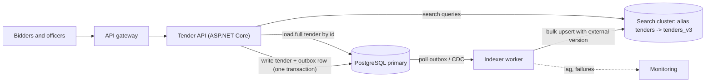
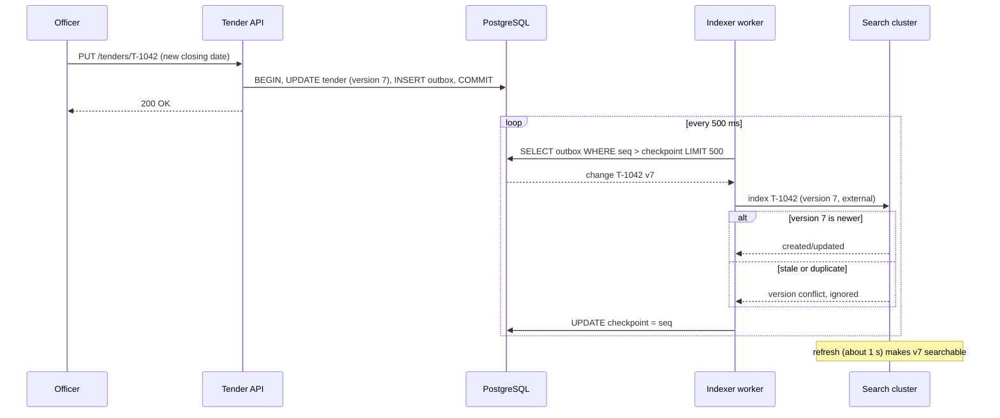
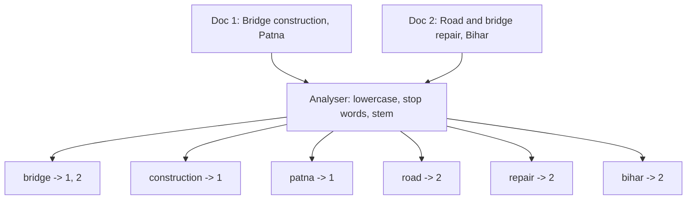

Every product with more than a few thousand records eventually gets a search box. Users type "bridge tender patna" and expect the right result first, in under 200 ms, even with typos and plurals. A `LIKE '%bridge%'` query cannot do that. This lesson explains the data structure that can (the inverted index), how ranking works, how dedicated search clusters scale it, how to keep it in sync with your database, and when PostgreSQL alone is enough.

## Learning objectives

By the end of this lesson you will be able to:

1. Explain why `LIKE '%word%'` does not scale and what an inverted index does instead.
2. Describe the analysis pipeline (character filters, tokeniser, token filters) and why the same pipeline must run at index time and query time.
3. Explain BM25 in plain words: rare words count more, repeats have diminishing returns, long documents are penalised. Compute a small score by hand.
4. Build a tiny inverted index with BM25 ranking in C#, behind an `ISearchBackend` interface.
5. Describe an OpenSearch/Elasticsearch cluster: nodes, indexes, primary and replica shards, refresh, segments and scatter-gather queries.
6. Keep a search index in sync with PostgreSQL using a transactional outbox or change data capture, with versioning so that late or duplicate events do no harm.
7. Decide when PostgreSQL full-text search (`tsvector` + GIN) is the simpler and better option.

## Prerequisites

- [Indexes, composite indexes, B-tree and hash](#/lesson/m09-indexes): you should know why a B-tree helps `WHERE id = 5` but not `WHERE description LIKE '%bridge%'`.
- [Transactional outbox](#/lesson/m12-outbox): the safest way to publish "this row changed" alongside the database write.
- [Change data capture](#/lesson/m16-cdc): an alternative to the outbox that reads the database's own change log.

Helpful but optional: [CQRS in production](#/lesson/m16-cqrs), because a search index is a read model.

## Explain it like I'm a beginner

Think of a thick textbook on highway engineering. You want every page that mentions "culvert". You could read all 900 pages from start to finish. That is what `LIKE '%culvert%'` does: it reads every row (a full table scan).

Or you could turn to the **index at the back of the book**. It lists words alphabetically, and next to each word, the page numbers where it appears:

- culvert → 112, 340, 341, 702
- curing → 88, 89
- cut-and-fill → 45, 46, 210

Finding "culvert" now takes seconds. You jump to "c", find the word, and read off the pages. Looking up "culvert **and** drainage" means taking both page lists and keeping the pages that appear in both.

A search engine is that back-of-the-book index, built automatically for millions of documents. The technical name is an **inverted index**: instead of "document → words" (how the data is stored), it keeps "word → documents" (how people search).

Two more ideas make it useful:

- **Ranking (relevance scoring).** If 40,000 tenders mention "road", which one comes first? A good engine prefers documents that mention your *rare* words ("Patna") over common ones ("road"), and documents that are about your topic rather than ones that mention it once in passing.
- **A separate copy.** The search index is usually a *copy* of data that really lives in your database. Like the index at the back of a book, it must be rebuilt when the pages change. Keeping that copy fresh and correct is half of search architecture.

## First-principles explanation

### Why databases struggle with text search

A B-tree index on `title` sorts whole values. It answers "titles starting with `Bridge`" quickly, because those sit next to each other in sort order. It cannot answer "titles *containing* `bridge`", because those are scattered all over the tree. So `WHERE title ILIKE '%bridge%'` reads every row.

Rough numbers (estimates, not benchmarks): 2 million tenders with 3 KB of text each is about 6 GB. Scanning 6 GB from memory takes on the order of a second or more per query; from disk, much longer. At 100 queries per second that is impossible. And `LIKE` gives no ranking, no plurals ("bridges"), and no typo tolerance.

### The inverted index

The inverted index has two parts:

1. **A dictionary (term dictionary)** of every distinct word (term) in the collection, sorted or hashed so that lookup is fast.
2. **A posting list** for each term: the ids of the documents that contain it, usually sorted, often with extra data such as how many times the term appears (term frequency) and where (positions, for phrase queries).

```text
term         posting list (docId:termFrequency)
bridge   ->  1:1, 2:1, 3:2
patna    ->  1:1
road     ->  2:1, 4:3
bihar    ->  2:1, 4:1
```

Answering a query is now set algebra on short sorted lists:

- `bridge AND bihar` → intersect `{1,2,3}` and `{2,4}` → `{2}`.
- `bridge OR patna` → union → `{1,2,3}`, then rank.

Intersection of two sorted lists of sizes *m* and *n* takes at most *m + n* steps with two pointers. Real engines go faster by skipping ahead (skip lists, block-level metadata), because the shorter list drives the work. A query for "patna AND road" only needs to check the handful of documents containing "patna", not the 40,000 containing "road".

Real engines (Apache Lucene, which powers both Elasticsearch and OpenSearch) also compress posting lists heavily, because sorted ids have small gaps: store `1, 2, 3` as `1, +1, +1` in a few bits each.

### Analysis: turning text into terms

Before a document enters the index, its text goes through an **analyser (analysis pipeline)**:

1. **Character filters** clean the raw text: strip HTML tags, map "&" to "and".
2. **A tokeniser** splits text into tokens: "NH-48 widening, Gurugram" → `nh`, `48`, `widening`, `gurugram`.
3. **Token filters** change or drop tokens: lowercase, remove stop words ("the", "of"), reduce words to a stem ("bridges" → "bridg" with the Porter/Snowball stemmer), add synonyms ("flyover" ↔ "overpass"), fold accents.

The golden rule: **the query goes through the same analyser as the documents.** If documents are stemmed and lowercased but the query "Bridges" is not, the lookup for `Bridges` finds nothing, because the index only holds `bridg`.

Language matters. English stemmers do nothing useful for Hindi or Tamil text. Indian government portals often hold English, Hindi and transliterated text ("sadak nirman") side by side. Engines offer language-specific analysers (OpenSearch and Elasticsearch ship analysers for Hindi and other Indian languages) and you often index the same field several ways ("multi-fields"): once with a language analyser, once with a simple lowercase analyser, once as an exact keyword.

### Ranking: BM25 in plain words

The default ranking function in Lucene-based engines is **BM25** (Best Matching 25, from the probabilistic relevance framework by Robertson and others). You do not need to memorise it, but you should understand its three ideas:

1. **Rare words matter more (inverse document frequency, IDF).** If "bridge" appears in 60 % of tenders, matching it tells you little. If "Patna" appears in 0.1 %, matching it tells you a lot.
2. **Repeats help, but with diminishing returns (term-frequency saturation).** A document mentioning "bridge" 3 times is probably more about bridges than one mentioning it once. But 30 mentions should not score 10 times more than 3. The parameter `k1` (default 1.2) controls how fast the benefit flattens.
3. **Long documents are penalised (length normalisation).** A 50-page document mentions everything somewhere. The parameter `b` (default 0.75) controls how much length counts.

For one query term in one document:

```text
idf(t)   = ln(1 + (N - n + 0.5) / (n + 0.5))           N = documents, n = documents containing t
score    = idf(t) × tf × (k1 + 1) / (tf + k1 × (1 - b + b × docLength / avgDocLength))
```

A document's total score is the sum over the query's terms. The step-by-step example below works through real numbers.

BM25 is a strong *baseline*, not the last word. Production search adds field boosts ("title matches count 3×"), freshness ("tenders closing soon first"), business signals (popularity, verified sellers), and increasingly **semantic search**: embeddings that match "flyover" with "elevated corridor" even without a synonym list. Hybrid search (BM25 + vector similarity, merged) is now common. The inverted index remains the backbone because it is cheap, explainable and exact.

### Search clusters: OpenSearch and Elasticsearch basics

When one machine is not enough, or you need high availability, you run a cluster. Elasticsearch and its open-source fork OpenSearch share the same core ideas:

- **Document**: a JSON object, for example one tender.
- **Index**: a named collection of documents with a **mapping** (schema). `text` fields are analysed for full-text search; `keyword` fields are stored exactly for filters, sorting and aggregations (facets).
- **Shard**: an index is split into *primary shards*. Each shard is a complete Lucene index holding a slice of the documents, chosen by hashing the document id (routing).
- **Replica shard**: a copy of a primary on a *different* node. Replicas give fault tolerance and extra read capacity.
- **Node roles**: *cluster manager* (formerly "master") nodes keep the cluster state: which shards live where. Run three dedicated ones so a majority (quorum) survives one loss and split-brain is avoided. *Data* nodes hold shards and do the work. *Coordinating* nodes receive requests and fan them out.
- **Segments and refresh**: Lucene writes new documents into small immutable files called *segments*. A *refresh* (default every 1 second) makes new segments searchable. That is why these engines are **near-real-time**: a document indexed now is searchable about a second later, not instantly. Segments are merged in the background; deletes are just markers until a merge.
- **Translog**: a write-ahead log that makes indexed-but-not-yet-committed documents durable across a crash.

A search request is a **scatter-gather**:

1. The coordinating node sends the query to one copy (primary or replica) of every shard.
2. Each shard scores its own documents and returns its local top *k* ids and scores ("query phase").
3. The coordinator merges them into the global top *k*, then fetches those documents' fields ("fetch phase").

Consequences you must know:

- **Every query touches every shard.** 50 shards means 50 small searches per query. Too many small shards waste CPU and memory. Common guidance from the vendors is shards in the range of roughly 10–50 GB; treat this as a starting point to test, not a law.
- **The number of primary shards is fixed at index creation.** Changing it means reindexing (or the split/shrink APIs with restrictions). Plan for growth, or use time-based indexes with rollover.
- **Deep pagination is expensive.** Page 500 with 20 results per page asks every shard for its top 10,000. Use `search_after` cursors for deep scrolling, and cap `from + size`.
- **IDF is per shard by default.** With few documents per shard, scores can differ slightly between shards. Usually harmless at scale; noticeable in small test indexes.

### Keeping the index in sync

The search index is a **projection (read model)** of the source of truth, usually PostgreSQL. The tempting design is a **dual write**:

```csharp
await db.SaveTenderAsync(tender);          // 1. commit to PostgreSQL
await search.IndexAsync(tender);           // 2. then index — what if this fails or the pod dies here?
```

If step 2 fails, the index silently misses the tender forever. If you swap the order, the index can show a tender that was never saved. There is no transaction that spans PostgreSQL and a search cluster.

Two reliable designs:

1. **Transactional outbox.** In the *same* PostgreSQL transaction that saves the tender, insert a row into an `outbox` table: "tender T-1042, version 7, upserted". A background relay reads the outbox in order and indexes each change, retrying until it succeeds. See [the outbox lesson](#/lesson/m12-outbox).
2. **Change data capture (CDC).** A tool such as Debezium reads PostgreSQL's write-ahead log through logical replication and streams row changes to Kafka; an indexer consumes them. No application change is needed, but you index *rows*, not business events, and often have to join several tables into one search document. See [change data capture](#/lesson/m16-cdc).

Either way the indexer sees changes **at least once** and sometimes **out of order** (after retries or partition rebalancing). Make it safe:

- **Idempotent writes.** Indexing the same document twice with the same id simply overwrites it.
- **Versioning.** Send the row's version (a monotonically increasing number, such as an `updated_seq` column) with every write. The engine's *external versioning* rejects a write whose version is not higher than what it already has. A late "version 6" cannot overwrite "version 7".
- **Tombstones for deletes.** Remember the version of a delete, so a delayed upsert cannot resurrect a deleted tender.
- **Full rebuild ability.** Mappings change, analysers improve, bugs corrupt data. You must be able to build a new index from PostgreSQL from scratch (backfill), then switch over.

### Zero-downtime reindexing with aliases

Applications should never query an index by its real name. Query an **alias**: `tenders` → `tenders_v3`. To change the mapping:

1. Create `tenders_v4` with the new mapping.
2. Backfill it from PostgreSQL (or with the `_reindex` API) while the indexer keeps writing to **both** v3 and v4 (or replays the change stream from the backfill start point).
3. Compare document counts and run sample queries.
4. Atomically point the alias at `tenders_v4`. Keep v3 for a day as a rollback.

### PostgreSQL full-text search: the simpler option

PostgreSQL has a built-in inverted index for text:

- `tsvector`: a document already analysed into normalised terms with positions: `to_tsvector('english', 'Bridges over Ganga')` → `'bridg':1 'ganga':3`.
- `tsquery`: a parsed query. `websearch_to_tsquery('english', 'bridge -repair "ganga river"')` understands quotes and minus signs like a web search box.
- `@@`: the match operator.
- **GIN index** (Generalized Inverted Index): exactly the term → row-list structure from this lesson.
- `ts_rank` / `ts_rank_cd`: ranking by term frequency and proximity.
- The `pg_trgm` extension adds trigram similarity for typo tolerance (`'patan' % 'patna'`) and speeds up `LIKE '%x%'`.

```sql
ALTER TABLE tender ADD COLUMN search tsvector GENERATED ALWAYS AS (
  setweight(to_tsvector('english', coalesce(title, '')), 'A') ||
  setweight(to_tsvector('english', coalesce(description, '')), 'B')) STORED;
CREATE INDEX tender_search_gin ON tender USING gin (search);

SELECT id, title, ts_rank(search, q) AS rank
FROM tender, websearch_to_tsquery('english', 'bridge patna') q
WHERE search @@ q AND state = 'BR' AND closes_at > now()
ORDER BY rank DESC
LIMIT 20;
```

Why this is often the right first choice:

- **No sync problem.** The `tsvector` column updates in the same transaction as the row. No outbox, no lag, no second cluster to run, patch, monitor and pay for.
- **Joins and filters for free.** Filter by tenant, state, permissions and dates with ordinary SQL, inside the same consistent snapshot.
- **Good enough relevance** for many internal tools, admin screens and catalogues up to a few million rows (an estimate; measure with your data).

Where it runs out of road:

- **Ranking cost.** `ts_rank` must be computed for *every* matching row before sorting. A query matching 300,000 rows ranks 300,000 rows. Lucene-based engines use top-k algorithms (such as WAND/block-max WAND) that skip documents that cannot make the top 20.
- **Relevance features.** No BM25 with corpus statistics out of the box, limited synonym and typo handling, no learning-to-rank, weaker faceting at scale.
- **Scale-out.** Search load competes with your transactional workload on the same primary. Read replicas help, but you cannot shard a single search across nodes the way a search cluster does.
- **Language analysers.** Built-in configurations cover many European languages; Indian-language stemming needs extensions or external tools.

Rule of thumb: **start with PostgreSQL full-text search** unless you already know you need typo-tolerant, faceted, multilingual, heavily tuned relevance at large scale. Move to a search cluster when you can name the feature or the load that PostgreSQL cannot meet.

### What breaks first under load

1. **Indexing lag.** Bulk updates (a nightly import of 500,000 tender amendments) queue up behind the indexer. Users search and do not find yesterday's tenders. Watch "outbox age" or consumer lag as a key metric.
2. **Hot shards.** Custom routing by state sends all Uttar Pradesh tenders to one shard; that node melts during month-end. Prefer the default id-based routing unless you have measured a reason.
3. **Expensive queries.** Leading wildcards (`*bridge`), huge `from` offsets, regex queries and aggregations over high-cardinality fields. Put limits in your API layer, not just in the engine.
4. **Memory pressure.** The JVM heap, field data and caches. Long garbage-collection pauses look like node failures and can cause shard relocations that make things worse.
5. **Mapping explosion.** Indexing arbitrary user JSON creates thousands of fields; cluster state grows and the cluster slows down. Use strict mappings.

## Visual explanation

### Architecture: search as a projection of PostgreSQL



How to read it: the API writes a tender and an outbox row in one PostgreSQL transaction, so they succeed or fail together. The indexer worker reads the outbox (or a CDC stream) in order and pushes changes to the search cluster in bulk, tagging each with the row version so stale writes are rejected. Search queries go to the cluster through an alias, which lets us swap the underlying index. The API returns ids and highlights from the cluster, then loads authoritative details (status, price, permissions) from PostgreSQL for the 20 results on the page. The dotted arrow is the metric that matters most: how far behind the indexer is.

### Sequence: a tender update reaches search



The officer gets a reply as soon as PostgreSQL commits; search catches up a moment later. The worker reads from its last checkpoint, so a crash only causes a replay, not a loss. A replayed or delayed change carries an old version number and is ignored. The final note is the near-real-time gap: even after the cluster accepts the write, the next refresh makes it visible. End-to-end freshness is outbox polling interval + indexing time + refresh interval, typically a second or two (estimate).

### Inverted index shape



Both documents pass through the same analyser. The output is not stored per document; it is regrouped per term. Each box on the bottom row is one dictionary entry with its posting list. A query is analysed the same way and then looks up only the boxes for its terms.

## Step-by-step example

We will index three tenders by hand and score the query "bridge patna".

### Step 1 — analyse

| Doc | Text | Terms after analysis | Length |
|---|---|---|---|
| D1 | "Bridge construction on Ganga river, Patna" | bridge, construction, ganga, river, patna | 5 |
| D2 | "Road construction and bridge repair, Bihar" | road, construction, bridge, repair, bihar | 5 |
| D3 | "Bridge inspection by drone survey" | bridge, inspection, drone, survey | 4 |

"on", "and" and "by" are stop words and are dropped. Average length = (5 + 5 + 4) / 3 ≈ 4.67.

### Step 2 — build posting lists

`bridge → D1, D2, D3`, `patna → D1`, `construction → D1, D2`, and one entry for each remaining term.

### Step 3 — IDF

N = 3.

- `bridge` is in all 3: idf = ln(1 + (3 − 3 + 0.5) / (3 + 0.5)) = ln(1.1429) ≈ **0.134**.
- `patna` is in 1: idf = ln(1 + (3 − 1 + 0.5) / (1 + 0.5)) = ln(2.667) ≈ **0.981**.

A match on "patna" is worth about 7 times a match on "bridge". That is IDF doing its job.

### Step 4 — term-frequency saturation

With k1 = 1.2 and a document of average length, the tf part is `tf × 2.2 / (tf + 1.2)`:

| tf | tf part |
|---|---|
| 1 | 1.00 |
| 2 | 1.38 |
| 3 | 1.57 |
| 10 | 1.96 |
| ∞ | 2.20 (the ceiling, k1 + 1) |

Ten mentions score less than twice one mention. Keyword stuffing does not pay.

### Step 5 — score

D1 and D2 have length 5, slightly above average, so the length factor is `1 − 0.75 + 0.75 × 5 / 4.67 ≈ 1.054` and the tf part for tf = 1 is `2.2 / (1 + 1.2 × 1.054) ≈ 0.97`.

- D1: bridge 0.134 × 0.97 + patna 0.981 × 0.97 ≈ **1.08**
- D2: bridge only ≈ **0.13**
- D3: bridge only, shorter than average (length factor ≈ 0.89, tf part ≈ 1.07) ≈ **0.14**

Ranking: D1, D3, D2. D3 beats D2 slightly because it is shorter, so "bridge" is a bigger share of what it is about.

### Step 6 — ask "do we even need a search engine?"

The real portal holds 2 million tenders. Back-of-the-envelope (estimates):

- Text: 2 M × 3 KB ≈ **6 GB**.
- Searches: 200,000 daily users × 10 searches ≈ 2 M/day ÷ 86,400 s ≈ **23 QPS** average. Tender deadlines bunch at month-end and fiscal-year-end, so assume ×5 peak ≈ **115 QPS**.
- Writes: about 15,000 new or amended tenders per day ≈ **0.2 writes/s**.

That is modest. A PostgreSQL instance with a GIN index and enough RAM to cache it can plausibly serve this, especially with filters (open tenders only, one state) that cut matches down. The case for a search cluster rests on *features*: typo tolerance for "Patana", Hindi and English analysers, synonyms ("flyover" = "ROB" = "overbridge"), facets by department and value band, and relevance tuning. Write that justification down in an [ADR](#/lesson/m02-adr).

## Production-style C# implementation

The sample is a tender search service. It contains a real (tiny) inverted index with BM25, an `ISearchBackend` abstraction so the in-memory index can be replaced with OpenSearch, a store that writes tenders and outbox messages together, and an outbox indexer `BackgroundService` with versioned, idempotent writes. Everything runs offline.

```text
TenderSearch.Api/
  Program.cs
  Search/Tokenizer.cs           analyser: normalise, split, lowercase, stop words, tiny stemmer
  Search/Bm25.cs                BM25 maths
  Search/InvertedIndex.cs       term -> postings, OR query with BM25 ranking
  Search/SearchBackend.cs       ISearchBackend + in-memory implementation with external versions
  Tenders/TenderStore.cs        source of truth + outbox in one "transaction"
  Indexing/OutboxIndexer.cs     BackgroundService relay with checkpoint
```

### The analyser

```csharp file=Search/Tokenizer.cs
using System.Text;

namespace TenderSearch.Search;

public interface ITokenizer
{
    IReadOnlyList<string> Tokenize(string? text);
}

/// <summary>A deliberately small analyser: Unicode-normalise, split on anything that is not a letter or digit,
/// lowercase, strip a few English plurals and drop stop words. Production engines use Snowball stemmers,
/// synonym filters and language-specific analysers.</summary>
public sealed class SimpleTokenizer : ITokenizer
{
    private static readonly HashSet<string> StopWords = new(StringComparer.Ordinal)
    {
        "a", "an", "and", "the", "of", "for", "in", "on", "to", "at", "by", "with", "or", "is"
    };

    public IReadOnlyList<string> Tokenize(string? text)
    {
        var tokens = new List<string>();
        if (string.IsNullOrWhiteSpace(text)) return tokens;

        var current = new StringBuilder();
        foreach (var ch in text.Normalize(NormalizationForm.FormKC))
        {
            if (char.IsLetterOrDigit(ch)) current.Append(char.ToLowerInvariant(ch));
            else Flush();
        }
        Flush();
        return tokens;

        void Flush()
        {
            if (current.Length == 0) return;
            var token = Stem(current.ToString());
            current.Clear();
            if (token.Length > 1 && !StopWords.Contains(token)) tokens.Add(token);
        }
    }

    /// <summary>"bridges" -> "bridge", "surveys" -> "survey", "facilities" -> "facility". Crude on purpose.</summary>
    internal static string Stem(string t)
    {
        if (t.Length > 4 && t.EndsWith("ies", StringComparison.Ordinal)) return t[..^3] + "y";
        if (t.Length > 3 && t.EndsWith('s') && !t.EndsWith("ss", StringComparison.Ordinal)) return t[..^1];
        return t;
    }
}
```

The same `ITokenizer` instance analyses documents and queries, which enforces the golden rule. Note the crude stemmer's flaws: "status" becomes "statu". Real stemmers have exception lists; the important thing is that the same mistake happens on both sides, so matching still works.

### BM25 and the inverted index

```csharp file=Search/Bm25.cs
namespace TenderSearch.Search;

public sealed record Bm25Parameters(double K1, double B)
{
    public static readonly Bm25Parameters Default = new(1.2, 0.75);
}

public static class Bm25
{
    /// <summary>Lucene-style IDF: never negative, even for a term that appears in every document.</summary>
    public static double Idf(int totalDocs, int docsWithTerm) =>
        Math.Log(1 + (totalDocs - docsWithTerm + 0.5) / (docsWithTerm + 0.5));

    public static double TermScore(double idf, int termFrequency, int docLength, double avgDocLength, Bm25Parameters p)
    {
        if (termFrequency <= 0) return 0;
        var lengthFactor = 1 - p.B + p.B * (avgDocLength <= 0 ? 1 : docLength / avgDocLength);
        return idf * (termFrequency * (p.K1 + 1)) / (termFrequency + p.K1 * lengthFactor);
    }
}
```

```csharp file=Search/InvertedIndex.cs
namespace TenderSearch.Search;

public sealed record SearchHit(string DocId, double Score);

/// <summary>Thread-safe in-memory inverted index. One lock is fine for a teaching model;
/// Lucene avoids it by writing immutable segments and merging them later.</summary>
public sealed class InvertedIndex(ITokenizer tokenizer, Bm25Parameters? parameters = null)
{
    // term -> (docId -> term frequency)
    private readonly Dictionary<string, Dictionary<string, int>> _postings = new(StringComparer.Ordinal);
    // docId -> (length in terms, distinct terms) so a document can be removed cleanly
    private readonly Dictionary<string, (int Length, string[] Terms)> _docs = new(StringComparer.Ordinal);
    private readonly Bm25Parameters _p = parameters ?? Bm25Parameters.Default;
    private readonly Lock _gate = new();
    private long _totalLength;

    public int DocumentCount { get { lock (_gate) return _docs.Count; } }

    public void Upsert(string docId, string text)
    {
        ArgumentException.ThrowIfNullOrWhiteSpace(docId);
        var tokens = tokenizer.Tokenize(text);
        var frequencies = tokens.GroupBy(t => t, StringComparer.Ordinal)
                                .ToDictionary(g => g.Key, g => g.Count(), StringComparer.Ordinal);
        lock (_gate)
        {
            RemoveUnsafe(docId);
            foreach (var (term, tf) in frequencies)
            {
                if (!_postings.TryGetValue(term, out var postings))
                    _postings[term] = postings = new Dictionary<string, int>(StringComparer.Ordinal);
                postings[docId] = tf;
            }
            _docs[docId] = (tokens.Count, frequencies.Keys.ToArray());
            _totalLength += tokens.Count;
        }
    }

    public bool Remove(string docId)
    {
        lock (_gate) return RemoveUnsafe(docId);
    }

    private bool RemoveUnsafe(string docId)
    {
        if (!_docs.Remove(docId, out var doc)) return false;
        _totalLength -= doc.Length;
        foreach (var term in doc.Terms)
        {
            if (!_postings.TryGetValue(term, out var postings)) continue;
            postings.Remove(docId);
            if (postings.Count == 0) _postings.Remove(term);   // keep the dictionary small
        }
        return true;
    }

    /// <summary>OR query ranked by BM25. Documents matching more (and rarer) terms score higher.</summary>
    public IReadOnlyList<SearchHit> Search(string query, int top = 10)
    {
        var terms = tokenizer.Tokenize(query).Distinct(StringComparer.Ordinal).ToList();
        if (terms.Count == 0 || top <= 0) return [];

        lock (_gate)
        {
            var n = _docs.Count;
            if (n == 0) return [];
            var avgLength = (double)_totalLength / n;
            var scores = new Dictionary<string, double>(StringComparer.Ordinal);

            foreach (var term in terms)
            {
                if (!_postings.TryGetValue(term, out var postings)) continue;
                var idf = Bm25.Idf(n, postings.Count);
                foreach (var (docId, tf) in postings)
                {
                    var score = Bm25.TermScore(idf, tf, _docs[docId].Length, avgLength, _p);
                    scores[docId] = scores.GetValueOrDefault(docId) + score;
                }
            }

            // Ties broken by id so results are deterministic (and testable).
            return scores.OrderByDescending(kv => kv.Value).ThenBy(kv => kv.Key, StringComparer.Ordinal)
                         .Take(top).Select(kv => new SearchHit(kv.Key, Math.Round(kv.Value, 4))).ToList();
        }
    }
}
```

Two choices worth noticing. The index keeps each document's distinct terms, so `Remove` touches only the posting lists that contain the document rather than scanning the whole dictionary. And `Search` sorts all candidate scores; for millions of matches a real engine keeps a bounded min-heap of size *k* and skips documents that cannot beat the current *k*-th score.

### The search backend abstraction with external versions

```csharp file=Search/SearchBackend.cs
namespace TenderSearch.Search;

public sealed record TenderDocument(string Id, string Title, string Description, string StateCode, decimal EstimatedValueInr);

public enum IndexResult { Applied, IgnoredStale }

/// <summary>What the rest of the app needs from a search engine. An OpenSearch implementation would map
/// IndexAsync to PUT /tenders/_doc/{id}?version={v}&amp;version_type=external, batched through the _bulk API.</summary>
public interface ISearchBackend
{
    Task<IndexResult> IndexAsync(TenderDocument doc, long version, CancellationToken ct);
    Task<IndexResult> DeleteAsync(string id, long version, CancellationToken ct);
    Task<IReadOnlyList<SearchHit>> SearchAsync(string query, int top, CancellationToken ct);
}

public sealed class InMemorySearchBackend(ITokenizer tokenizer) : ISearchBackend
{
    private readonly InvertedIndex _index = new(tokenizer);
    // Highest version seen per id, including deletes (tombstones), so late events cannot resurrect a document.
    private readonly Dictionary<string, long> _versions = new(StringComparer.Ordinal);
    private readonly Lock _gate = new();

    public Task<IndexResult> IndexAsync(TenderDocument doc, long version, CancellationToken ct)
    {
        lock (_gate)
        {
            if (_versions.TryGetValue(doc.Id, out var current) && version <= current)
                return Task.FromResult(IndexResult.IgnoredStale);
            _versions[doc.Id] = version;
            // Title is repeated to give it a simple boost; real engines use per-field boosts instead.
            _index.Upsert(doc.Id, $"{doc.Title} {doc.Title} {doc.Description} {doc.StateCode}");
            return Task.FromResult(IndexResult.Applied);
        }
    }

    public Task<IndexResult> DeleteAsync(string id, long version, CancellationToken ct)
    {
        lock (_gate)
        {
            if (_versions.TryGetValue(id, out var current) && version <= current)
                return Task.FromResult(IndexResult.IgnoredStale);
            _versions[id] = version;          // tombstone
            _index.Remove(id);
            return Task.FromResult(IndexResult.Applied);
        }
    }

    public Task<IReadOnlyList<SearchHit>> SearchAsync(string query, int top, CancellationToken ct) =>
        Task.FromResult(_index.Search(query, Math.Clamp(top, 1, 100)));
}
```

The version check is the in-memory equivalent of OpenSearch's external versioning. It makes the indexer safe to retry and safe against reordering. The cap on `top` is an API-level guard against expensive deep pages.

### Source of truth plus outbox

```csharp file=Tenders/TenderStore.cs
using TenderSearch.Search;

namespace TenderSearch.Tenders;

public sealed record OutboxMessage(long Sequence, string TenderId, long Version, bool IsDelete, TenderDocument? Document);

public interface IOutboxReader
{
    Task<IReadOnlyList<OutboxMessage>> ReadAfterAsync(long sequence, int max, CancellationToken ct);
    Task<long> GetCheckpointAsync(CancellationToken ct);
    Task SaveCheckpointAsync(long sequence, CancellationToken ct);
}

/// <summary>Stands in for PostgreSQL. In production: one transaction that UPDATEs tender (version = version + 1)
/// and INSERTs into outbox; the relay's checkpoint is a row in a small table.</summary>
public sealed class InMemoryTenderStore : IOutboxReader
{
    private readonly Dictionary<string, (TenderDocument Doc, long Version)> _tenders = new(StringComparer.Ordinal);
    private readonly List<OutboxMessage> _outbox = [];
    private readonly Lock _gate = new();
    private long _sequence;
    private long _checkpoint;

    public long Save(TenderDocument doc)
    {
        lock (_gate)   // "BEGIN ... COMMIT": row and outbox entry change together or not at all
        {
            var version = _tenders.TryGetValue(doc.Id, out var existing) ? existing.Version + 1 : 1;
            _tenders[doc.Id] = (doc, version);
            _outbox.Add(new OutboxMessage(++_sequence, doc.Id, version, false, doc));
            return version;
        }
    }

    public bool Delete(string id)
    {
        lock (_gate)
        {
            if (!_tenders.Remove(id, out var existing)) return false;
            _outbox.Add(new OutboxMessage(++_sequence, id, existing.Version + 1, true, null));
            return true;
        }
    }

    public TenderDocument? Get(string id)
    {
        lock (_gate) return _tenders.TryGetValue(id, out var t) ? t.Doc : null;
    }

    public Task<IReadOnlyList<OutboxMessage>> ReadAfterAsync(long sequence, int max, CancellationToken ct)
    {
        lock (_gate)
            return Task.FromResult<IReadOnlyList<OutboxMessage>>(
                _outbox.Where(m => m.Sequence > sequence).OrderBy(m => m.Sequence).Take(max).ToList());
    }

    public Task<long> GetCheckpointAsync(CancellationToken ct) { lock (_gate) return Task.FromResult(_checkpoint); }

    public Task SaveCheckpointAsync(long sequence, CancellationToken ct)
    {
        lock (_gate) _checkpoint = Math.Max(_checkpoint, sequence);
        return Task.CompletedTask;
    }
}
```

### The indexer relay

```csharp file=Indexing/OutboxIndexer.cs
using TenderSearch.Search;
using TenderSearch.Tenders;

namespace TenderSearch.Indexing;

public sealed class IndexerOptions
{
    public int BatchSize { get; set; } = 500;
    public TimeSpan IdleDelay { get; set; } = TimeSpan.FromMilliseconds(500);
}

/// <summary>Reads the outbox in sequence order and applies each change to the search backend.
/// At-least-once: the checkpoint is saved after the batch, so a crash replays the batch, and
/// external versions make the replay harmless.</summary>
public sealed class OutboxIndexer(
    IOutboxReader outbox,
    ISearchBackend search,
    Microsoft.Extensions.Options.IOptions<IndexerOptions> options,
    TimeProvider time,
    ILogger<OutboxIndexer> log) : BackgroundService
{
    private readonly IndexerOptions _o = options.Value;

    /// <summary>One polling step, public so tests can drive it without timers. Returns messages processed.</summary>
    public async Task<int> RunOnceAsync(CancellationToken ct)
    {
        var checkpoint = await outbox.GetCheckpointAsync(ct);
        var batch = await outbox.ReadAfterAsync(checkpoint, _o.BatchSize, ct);
        foreach (var m in batch)
        {
            var result = m.IsDelete || m.Document is null
                ? await search.DeleteAsync(m.TenderId, m.Version, ct)
                : await search.IndexAsync(m.Document, m.Version, ct);
            if (result == IndexResult.IgnoredStale)
                log.LogDebug("Skipped stale change {TenderId} v{Version}", m.TenderId, m.Version);
        }
        if (batch.Count > 0) await outbox.SaveCheckpointAsync(batch[^1].Sequence, ct);
        return batch.Count;
    }

    protected override async Task ExecuteAsync(CancellationToken stoppingToken)
    {
        while (!stoppingToken.IsCancellationRequested)
        {
            try
            {
                var processed = await RunOnceAsync(stoppingToken);
                if (processed < _o.BatchSize) await Task.Delay(_o.IdleDelay, time, stoppingToken);
            }
            catch (OperationCanceledException) when (stoppingToken.IsCancellationRequested) { break; }
            catch (Exception ex)
            {
                // The search cluster is down or rejecting writes: back off, keep the checkpoint, retry later.
                log.LogWarning(ex, "Indexing batch failed; retrying");
                await Task.Delay(TimeSpan.FromSeconds(5), time, stoppingToken);
            }
        }
    }
}
```

### Wiring it up

```csharp file=Program.cs
using TenderSearch.Indexing;
using TenderSearch.Search;
using TenderSearch.Tenders;

var builder = WebApplication.CreateBuilder(args);

builder.Services.AddSingleton(TimeProvider.System);
builder.Services.AddSingleton<ITokenizer, SimpleTokenizer>();
// Swap for an OpenSearch-backed implementation in production; nothing else changes.
builder.Services.AddSingleton<ISearchBackend, InMemorySearchBackend>();
builder.Services.AddSingleton<InMemoryTenderStore>();
builder.Services.AddSingleton<IOutboxReader>(sp => sp.GetRequiredService<InMemoryTenderStore>());
builder.Services.Configure<IndexerOptions>(builder.Configuration.GetSection("Indexer"));
builder.Services.AddHostedService<OutboxIndexer>();

var app = builder.Build();

app.MapPut("/tenders/{id}", (string id, TenderDocument doc, InMemoryTenderStore store) =>
{
    if (doc.Id != id) return Results.BadRequest("Id mismatch.");
    var version = store.Save(doc);
    // 202: saved now, searchable shortly (near-real-time). Say so in the API contract.
    return Results.Accepted($"/tenders/{id}", new { id, version });
});

app.MapDelete("/tenders/{id}", (string id, InMemoryTenderStore store) =>
    store.Delete(id) ? Results.NoContent() : Results.NotFound());

app.MapGet("/search", async (string q, int? size, ISearchBackend search, InMemoryTenderStore store, CancellationToken ct) =>
{
    if (string.IsNullOrWhiteSpace(q) || q.Length > 200) return Results.BadRequest("q must be 1-200 characters.");
    var hits = await search.SearchAsync(q, size ?? 20, ct);
    // Hydrate from the source of truth; drop hits deleted since the last refresh.
    var results = hits.Select(h => (Hit: h, Doc: store.Get(h.DocId)))
                      .Where(x => x.Doc is not null)
                      .Select(x => new { x.Doc!.Id, x.Doc.Title, x.Doc.StateCode, x.Hit.Score });
    return Results.Ok(results);
});

app.Run();
```

Design notes:

- **Hydration from PostgreSQL** means a stale index can only cause a missing or extra *candidate*, never a wrong price or status on screen. It costs one batched query for 20 ids. Some teams skip it and show indexed fields directly, accepting a second or two of staleness.
- **The API returns 202 Accepted on write** to make near-real-time behaviour explicit. If a screen must show the officer's own tender in results immediately, read it from PostgreSQL for that user (read-your-writes), or use the engine's `refresh=wait_for` on that one write, sparingly.
- **What an OpenSearch adapter would add:** the `_bulk` API (hundreds of documents per request), retries with backoff for HTTP 429 (cluster overloaded), and a mapping created at startup with strict dynamic mapping.

```json
{
  "settings": { "number_of_shards": 1, "number_of_replicas": 1, "refresh_interval": "1s" },
  "mappings": {
    "dynamic": "strict",
    "properties": {
      "title":       { "type": "text", "analyzer": "english", "fields": { "raw": { "type": "keyword" } } },
      "description": { "type": "text", "analyzer": "english" },
      "stateCode":   { "type": "keyword" },
      "estimatedValueInr": { "type": "scaled_float", "scaling_factor": 100 },
      "closesAt":    { "type": "date" }
    }
  }
}
```

## Bad design vs good design

**Bad: dual writes from the controller, `LIKE` as a fallback, and the search index as the source of truth.**

```csharp
// Anti-example
app.MapPut("/tenders/{id}", async (Tender t, AppDb db, SearchClient es) =>
{
    db.Update(t);
    await db.SaveChangesAsync();
    try { await es.IndexAsync(t); } catch { /* ignore, search is not critical */ }
    return Results.Ok();
});

app.MapGet("/tenders/{id}/status", async (string id, SearchClient es) =>
    (await es.GetAsync(id)).Status);   // status read from the search index
```

What goes wrong:

- A swallowed indexing failure means a tender that bidders can never find. Nobody notices until a vendor complains that they missed a ₹40 crore bid deadline.
- Concurrent updates race: request A (version 6) and request B (version 7) both index; if A's index call lands last, search shows stale data indefinitely.
- Reading status from the index returns data that may be a second, or a day, out of date.
- When the mapping must change, there is no way to rebuild the index, because nothing records what was supposed to be in it.

**Good:** the implementation above. The tender and its outbox entry commit together. A single relay applies changes in order with versions. The index is rebuildable from PostgreSQL, queried through an alias, and treated as a candidate generator, while PostgreSQL stays authoritative.

**Also bad: a search cluster for 20,000 rows.** A team stands up a three-node cluster for an internal HR directory. It costs more to run than the app, needs a sync pipeline, and has been "slightly out of date" for months. A `tsvector` column with a GIN index plus `pg_trgm` would have done the job in an afternoon.

:::callout type=tradeoff title="Near-real-time is a product decision"
A 1-second refresh is a good default for most catalogues. Lowering it to 100 ms creates many tiny segments and more merge work; raising it to 30 s during a bulk reindex makes indexing much faster. Ask product how fresh results must be, and design the "I just saved it, where is it?" experience separately.
:::

## Practical playground

The playground gives you a fresh PostgreSQL with a small tender table. Try:

1. `SELECT to_tsvector('english', title) FROM tender;` and notice the stemming ("bridges" → "bridg") and dropped stop words.
2. Add a generated `tsvector` column and a GIN index (see the SQL earlier in the lesson).
3. Compare `plainto_tsquery`, `websearch_to_tsquery('english', 'bridge -repair')` and `to_tsquery('english', 'bridge & (patna | gaya)')`.
4. Rank with `ts_rank` and give the title more weight with `setweight`.
5. Run `EXPLAIN` on your query before and after creating the index.

:::playground type=sql title="PostgreSQL full-text search over tenders"
```sql
CREATE TABLE tender (
  id          int PRIMARY KEY,
  title       text NOT NULL,
  description text NOT NULL,
  state_code  text NOT NULL,
  value_inr   numeric(14,2) NOT NULL
);
INSERT INTO tender VALUES
  (1, 'Construction of bridges over Ganga at Patna', 'Two-lane steel bridges with approach roads', 'BR', 4200000000),
  (2, 'Road widening and bridge repair, Gaya', 'Repair of three minor bridges and resurfacing', 'BR', 380000000),
  (3, 'Drone survey for bridge inspection', 'Aerial inspection of 40 bridges in Patna division', 'BR', 25000000),
  (4, 'Flyover at Sector 29, Gurugram', 'Elevated corridor with four-lane deck', 'HR', 1750000000),
  (5, 'Water supply pipeline, Jaipur', 'Laying of DI pipes and pumping station', 'RJ', 960000000),
  (6, 'Rail over bridge near Muzaffarpur', 'ROB replacing level crossing 42', 'BR', 610000000);
```
:::

## Exercises

:::exercise id=m16-search-architecture-ex1 difficulty=beginner kind=code title="Write the analyser"
Implement `Analyzer.Tokenize` so that documents and queries are turned into search terms consistently.
::requirements
- Split on any character that is not a letter or digit.
- Lowercase every token (use invariant culture).
- Drop stop words from the provided set and tokens shorter than 2 characters.
- Keep the order of tokens, and keep duplicates (term frequency needs them).
::acceptance
- `"Bridge construction on Ganga, Patna"` → `bridge, construction, ganga, patna`.
- `"NH-48 widening (Phase-2)"` → `nh, 48, widening, phase`.
- `"the bridge, the BRIDGE"` → `bridge, bridge`.
- `null`, empty and whitespace input return an empty list.
::hint
Walk the string one character at a time and build the current token in a `StringBuilder`.
::hint
`char.IsLetterOrDigit` decides whether a character belongs to a token. Anything else ends the current token.
::hint
Write a small `Flush()` helper: if the builder is not empty, turn it into a string, clear it, and add it if it passes the length and stop-word checks.
::hint
Do not forget to call `Flush()` once more after the loop, or the last word is lost.
::hint
```csharp
foreach (var ch in text)
{
    if (char.IsLetterOrDigit(ch)) sb.Append(char.ToLowerInvariant(ch));
    else Flush();
}
Flush();
```
::starter
```csharp file=Analyzer.cs
using System;
using System.Collections.Generic;
using System.Text;

public static class Analyzer
{
    public static readonly HashSet<string> StopWords = new(StringComparer.Ordinal)
    {
        "a", "an", "and", "the", "of", "for", "in", "on", "to", "at", "by", "with"
    };

    public static IReadOnlyList<string> Tokenize(string? text)
    {
        throw new NotImplementedException();
    }
}
```
::tests
```csharp file=AnalyzerTests.cs
using Xunit;

public class AnalyzerTests
{
    [Fact]
    public void Splits_lowercases_and_drops_stop_words() =>
        Assert.Equal(new[] { "bridge", "construction", "ganga", "patna" },
            Analyzer.Tokenize("Bridge construction on Ganga, Patna"));

    [Fact]
    public void Handles_hyphens_digits_and_brackets() =>
        Assert.Equal(new[] { "nh", "48", "widening", "phase" }, Analyzer.Tokenize("NH-48 widening (Phase-2)"));

    [Fact]
    public void Keeps_duplicates_for_term_frequency() =>
        Assert.Equal(new[] { "bridge", "bridge" }, Analyzer.Tokenize("the bridge, the BRIDGE"));

    [Theory]
    [InlineData(null)]
    [InlineData("")]
    [InlineData("   ")]
    public void Empty_input_gives_no_tokens(string? input) => Assert.Empty(Analyzer.Tokenize(input));

    [Fact]
    public void Last_word_is_not_lost() => Assert.Equal("gurugram", Analyzer.Tokenize("Flyover Gurugram")[1]);
}
```
::solution
Walk the characters, build tokens, and filter when each token ends.

```csharp file=Analyzer.cs
using System;
using System.Collections.Generic;
using System.Text;

public static class Analyzer
{
    public static readonly HashSet<string> StopWords = new(StringComparer.Ordinal)
    {
        "a", "an", "and", "the", "of", "for", "in", "on", "to", "at", "by", "with"
    };

    public static IReadOnlyList<string> Tokenize(string? text)
    {
        var tokens = new List<string>();
        if (string.IsNullOrWhiteSpace(text)) return tokens;

        var sb = new StringBuilder();
        foreach (var ch in text)
        {
            if (char.IsLetterOrDigit(ch)) sb.Append(char.ToLowerInvariant(ch));
            else Flush();
        }
        Flush();
        return tokens;

        void Flush()
        {
            if (sb.Length == 0) return;
            var token = sb.ToString();
            sb.Clear();
            if (token.Length >= 2 && !StopWords.Contains(token)) tokens.Add(token);
        }
    }
}
```

"Phase-2" yields "phase" and "2"; "2" is dropped by the length rule. Whether that is right is a product decision: for tender numbers you might keep single digits, or index codes like "NH-48" as an extra keyword field so the exact code also matches.
::mistakes
- Forgetting the final `Flush()`, which silently drops the last word of every document.
- Using `ToLower()` without invariant culture; in a Turkish culture "I" lowercases to a dotless "ı" and matches break.
- Removing duplicates in the analyser. Deduplication belongs in the query, not in document analysis, because BM25 needs term frequencies.
::extensions
Add a crude plural stemmer ("bridges" → "bridge") and a synonym map ("rob" → "rail over bridge"). Write a test proving the query and document paths still match.
:::

:::exercise id=m16-search-architecture-ex2 difficulty=beginner kind=sql ordered=true title="Full-text search in PostgreSQL"
Find all tenders whose title **or** description matches the web-style query `bridge patna` (both words must match, after English stemming). Return `id` and `title`, ordered by `id`.
::setup
```sql
CREATE TABLE tender (
  id          int PRIMARY KEY,
  title       text NOT NULL,
  description text NOT NULL,
  state_code  text NOT NULL
);
INSERT INTO tender VALUES
  (1, 'Construction of bridges over Ganga at Patna', 'Two-lane steel bridges with approach roads', 'BR'),
  (2, 'Road widening and bridge repair, Gaya', 'Repair of three minor bridges and resurfacing', 'BR'),
  (3, 'Drone survey for bridge inspection', 'Aerial inspection of 40 bridges in Patna division', 'BR'),
  (4, 'Flyover at Sector 29, Gurugram', 'Elevated corridor with four-lane deck', 'HR'),
  (5, 'Patna metro depot civil works', 'Depot buildings and stabling lines', 'BR'),
  (6, 'Rail over bridge near Muzaffarpur', 'ROB replacing level crossing 42', 'BR');
```
::check
```sql
SELECT id, title
FROM tender
WHERE to_tsvector('english', title || ' ' || description) @@ websearch_to_tsquery('english', 'bridge patna')
ORDER BY id;
```
::acceptance
- Returns tenders 1 and 3 only.
- Tender 1 matches although it says "bridges" (stemming).
- Tender 3 matches because "Patna" is only in the description.
- Tender 5 (Patna, no bridge) and tender 2 (bridge, no Patna) are excluded.
::hint
You need a `tsvector` built from both columns and a `tsquery` built from the user's words.
::hint
Concatenate the columns with a space before calling `to_tsvector('english', ...)`.
::hint
`websearch_to_tsquery('english', 'bridge patna')` produces `'bridg' & 'patna'`: both terms must match.
::hint
```sql
WHERE to_tsvector('english', title || ' ' || description) @@ websearch_to_tsquery('english', 'bridge patna')
```
::solution
```sql
SELECT id, title
FROM tender
WHERE to_tsvector('english', title || ' ' || description) @@ websearch_to_tsquery('english', 'bridge patna')
ORDER BY id;
```
In production, store the `tsvector` in a generated column and index it with GIN, otherwise PostgreSQL recomputes it for every row on every query. Use `setweight` to give title matches more weight and `ts_rank` to order by relevance instead of id.
::mistakes
- Using `ILIKE '%bridge%' AND ILIKE '%patna%'`: it works on 6 rows, but scans every row, misses "bridges" vs "bridge" variants in other words, and cannot rank.
- Calling `to_tsvector` without a configuration name; the result then depends on the server's `default_text_search_config`.
- Forgetting the space when concatenating, which glues the last title word to the first description word.
:::

:::exercise id=m16-search-architecture-ex3 difficulty=intermediate kind=code title="AND queries by intersecting posting lists"
Implement `PostingIndex`, an inverted index that stores sorted posting lists of integer document ids, and answers AND queries by intersecting them with the two-pointer technique.
::requirements
- `Add(int docId, IEnumerable<string> terms)` records the document under each distinct term. Ids may arrive in any order; posting lists must stay sorted and free of duplicates.
- `Postings(string term)` returns the sorted list (empty if unknown).
- `And(params string[] terms)` returns the sorted ids containing **all** terms. Process the shortest list first.
- Do not use LINQ's `Intersect` or `HashSet` for the intersection itself.
::acceptance
- After adding docs 3, 1 and 2 with overlapping terms, `Postings` lists are sorted.
- `And("bridge", "bihar")` returns exactly the shared ids.
- An unknown term makes the AND result empty.
- `And()` with no terms returns empty.
::hint
Store `Dictionary<string, List<int>>`. Keeping each list sorted on insert makes queries simple.
::hint
`List<int>.BinarySearch` returns a negative number (the bitwise complement of the insertion point) when the id is missing. Use `~index` to insert in the right place.
::hint
Two-pointer intersection: compare `a[i]` and `b[j]`; if equal, output and advance both; otherwise advance the pointer at the smaller value.
::hint
Sort the term lists by length, start with the shortest as the "result", and intersect it with each next list. Stop early if the result becomes empty.
::hint
```csharp
static List<int> Intersect(List<int> a, List<int> b)
{
    var r = new List<int>(); int i = 0, j = 0;
    while (i < a.Count && j < b.Count)
    {
        if (a[i] == b[j]) { r.Add(a[i]); i++; j++; }
        else if (a[i] < b[j]) i++; else j++;
    }
    return r;
}
```
::starter
```csharp file=PostingIndex.cs
using System;
using System.Collections.Generic;
using System.Linq;

public sealed class PostingIndex
{
    private readonly Dictionary<string, List<int>> _postings = new(StringComparer.Ordinal);

    public void Add(int docId, IEnumerable<string> terms) => throw new NotImplementedException();

    public IReadOnlyList<int> Postings(string term) => throw new NotImplementedException();

    public IReadOnlyList<int> And(params string[] terms) => throw new NotImplementedException();
}
```
::tests
```csharp file=PostingIndexTests.cs
using Xunit;

public class PostingIndexTests
{
    private static PostingIndex Sample()
    {
        var idx = new PostingIndex();
        idx.Add(3, new[] { "bridge", "inspection", "patna" });
        idx.Add(1, new[] { "bridge", "construction", "patna", "bridge" });
        idx.Add(2, new[] { "road", "bridge", "bihar" });
        idx.Add(4, new[] { "road", "bihar", "patna" });
        return idx;
    }

    [Fact]
    public void Postings_are_sorted_and_unique() =>
        Assert.Equal(new[] { 1, 2, 3 }, Sample().Postings("bridge"));

    [Fact]
    public void Unknown_term_has_empty_postings() => Assert.Empty(Sample().Postings("tunnel"));

    [Fact]
    public void And_of_two_terms() => Assert.Equal(new[] { 2 }, Sample().And("bridge", "bihar"));

    [Fact]
    public void And_of_three_terms() => Assert.Equal(new[] { 1, 3 }, Sample().And("patna", "bridge", "patna"));

    [Fact]
    public void Unknown_term_makes_and_empty() => Assert.Empty(Sample().And("bridge", "tunnel"));

    [Fact]
    public void No_terms_gives_empty() => Assert.Empty(Sample().And());

    [Fact]
    public void Re_adding_same_doc_does_not_duplicate()
    {
        var idx = Sample();
        idx.Add(2, new[] { "bridge" });
        Assert.Equal(new[] { 1, 2, 3 }, idx.Postings("bridge"));
    }
}
```
::solution
Keep each posting list sorted at insert time with `BinarySearch`; intersect from the shortest list.

```csharp file=PostingIndex.cs
using System;
using System.Collections.Generic;
using System.Linq;

public sealed class PostingIndex
{
    private readonly Dictionary<string, List<int>> _postings = new(StringComparer.Ordinal);

    public void Add(int docId, IEnumerable<string> terms)
    {
        foreach (var term in terms.Distinct(StringComparer.Ordinal))
        {
            if (!_postings.TryGetValue(term, out var list)) _postings[term] = list = new List<int>();
            var pos = list.BinarySearch(docId);
            if (pos < 0) list.Insert(~pos, docId);   // keep sorted, skip duplicates
        }
    }

    public IReadOnlyList<int> Postings(string term) =>
        _postings.TryGetValue(term, out var list) ? list.ToArray() : Array.Empty<int>();

    public IReadOnlyList<int> And(params string[] terms)
    {
        if (terms.Length == 0) return Array.Empty<int>();
        var lists = new List<List<int>>();
        foreach (var t in terms.Distinct(StringComparer.Ordinal))
        {
            if (!_postings.TryGetValue(t, out var l)) return Array.Empty<int>();   // unknown term: nothing matches
            lists.Add(l);
        }
        lists.Sort((a, b) => a.Count.CompareTo(b.Count));   // shortest first bounds the work

        var result = lists[0];
        for (var k = 1; k < lists.Count && result.Count > 0; k++) result = Intersect(result, lists[k]);
        return result.ToArray();
    }

    private static List<int> Intersect(List<int> a, List<int> b)
    {
        var r = new List<int>(Math.Min(a.Count, b.Count));
        int i = 0, j = 0;
        while (i < a.Count && j < b.Count)
        {
            if (a[i] == b[j]) { r.Add(a[i]); i++; j++; }
            else if (a[i] < b[j]) i++;
            else j++;
        }
        return r;
    }
}
```

Starting from the shortest list matters: "patna AND road" with 50 and 40,000 entries does at most about 40,050 comparisons with two pointers, and far fewer with skipping. Real engines skip with binary or galloping search into the long list, so the cost tracks the short list (about 50 × log 40,000 ≈ 800 steps).
::alternatives
Inserting into the middle of a `List<int>` is O(n). Engines avoid it by buffering new documents in memory, sorting once, and writing an immutable segment; ids then only ever grow within a segment. For a batch-built index, append everything then sort once.
::mistakes
- Returning the internal list, so callers can mutate the index.
- Forgetting duplicate terms within one document, which inserts the same id twice.
- Intersecting in the given order rather than shortest first; correct, but slow on skewed term frequencies.
::extensions
Add `Or` (k-way merge of sorted lists) and `AndNot("bridge", "repair")`. Then add galloping search: when one list is 100× longer, binary-search ahead in it instead of stepping one by one.
:::

:::exercise id=m16-search-architecture-ex4 difficulty=intermediate kind=hld title="Search for a national tender portal"
A national e-procurement portal holds 2 million tenders (6 GB of text) and adds or amends 15,000 per day. Bidders search 2 million times a day, peaking at about 5× average around month-end. Product wants: typo tolerance ("Patana"), Hindi and English text, facets by department, state and value band, and results that reflect amendments within 5 seconds. Tender status shown on screen must always be correct.

Starting from the graph, design the search architecture. Show capacity arithmetic, how the index stays in sync, how you reindex without downtime, and what you would do if product dropped typo tolerance and Hindi.
::acceptance
- Peak query rate is calculated, and the cluster has at least 3 cluster-manager-eligible nodes and replicas.
- The sync path uses an outbox or CDC with versioning; no dual writes.
- Freshness budget adds up to 5 seconds or less (polling + indexing + refresh).
- Reindexing uses an alias swap.
- A "simpler alternative" paragraph names PostgreSQL full-text search and when it would suffice.
::hint
2 M searches/day ÷ 86,400 s ≈ 23 QPS average. Multiply for peak.
::hint
6 GB of text, plus index overhead and one replica: how many shards of 10–50 GB do you really need?
::hint
Where does the status shown to the user come from: the index or PostgreSQL?
::hint
Freshness = outbox poll interval + bulk request time + refresh interval. Pick numbers.
::hint
For reindexing: new index, backfill, dual-apply changes, compare counts, swap alias, keep old index for rollback.
::starter
```json
{
  "nodes": [
    { "id": "bidders", "type": "client", "label": "Bidders and officers", "props": { "rps": 120 } },
    { "id": "lb", "type": "load-balancer", "label": "Load balancer" },
    { "id": "api", "type": "app-server", "label": "Tender API", "props": { "instances": 3 } },
    { "id": "pg", "type": "database", "label": "PostgreSQL", "props": { "replicas": 1 } }
  ],
  "edges": [
    { "from": "bidders", "to": "lb", "kind": "sync" },
    { "from": "lb", "to": "api", "kind": "sync" },
    { "from": "api", "to": "pg", "kind": "sync", "label": "CRUD and ILIKE search" }
  ]
}
```
::solution
**Capacity (estimates).** 2 M/day ÷ 86,400 ≈ 23 QPS average, ×5 ≈ **115 QPS peak**; plan for 250 QPS headroom. Writes ≈ 15,000/day ≈ 0.2/s, with bulk amendment bursts of maybe 50,000 in an hour (≈ 14/s). Data: 6 GB source; assume the index with multi-fields (English, Hindi, keyword, n-grams for typo tolerance) is 2–3× source ≈ 12–18 GB. One primary shard fits within 10–50 GB guidance; use **2 primaries** for growth to ~5 M tenders, **1 replica** each. Total ≈ 36 GB on disk across the cluster.

**Cluster.** 3 nodes, each cluster-manager-eligible and data (small cluster, so combined roles are fine), in 3 availability zones. Losing one node keeps quorum (2 of 3) and every shard still has a copy.

**Sync.** Tender API writes `tender` and `outbox` in one transaction, with `version = version + 1`. An indexer worker polls every 500 ms, sends `_bulk` requests of up to 500 documents with `version_type=external`, and saves its checkpoint after each batch. Deletes and "withdrawn" tenders send a tombstone/delete with a version. Freshness budget: 0.5 s poll + 0.5 s bulk + 1 s refresh ≈ **2 s**, well under 5 s. Alert if outbox age exceeds 30 s.

**Read path.** The API queries the alias `tenders` (filters for state, department, value band as `keyword`/numeric filters; facets via aggregations), gets 20 ids, then loads status and closing date from PostgreSQL (replica is fine, with a primary fallback for the officer's own edits). Status on screen is therefore always correct.

**Reindex.** Create `tenders_v4`, backfill from a PostgreSQL snapshot recording the outbox sequence at start, replay the outbox from that sequence into v4, compare counts and golden queries, swap the alias atomically, keep v3 for 24 h.

```json
{
  "nodes": [
    { "id": "bidders", "type": "client", "label": "Bidders and officers", "props": { "rps": 120 } },
    { "id": "lb", "type": "load-balancer", "label": "Load balancer" },
    { "id": "api", "type": "app-server", "label": "Tender API", "props": { "instances": 3 } },
    { "id": "pg", "type": "database", "label": "PostgreSQL (tender + outbox)", "props": { "replicas": 1, "multiAz": true } },
    { "id": "idx", "type": "worker", "label": "Indexer (outbox relay, bulk, external versions)" },
    { "id": "search", "type": "search", "label": "Search cluster, alias tenders -> v3 (2 primaries, 1 replica)", "props": { "instances": 3, "multiAz": true } },
    { "id": "mon", "type": "monitoring", "label": "Outbox age, 429s, p95 latency" }
  ],
  "edges": [
    { "from": "bidders", "to": "lb", "kind": "sync" },
    { "from": "lb", "to": "api", "kind": "sync" },
    { "from": "api", "to": "pg", "kind": "sync", "label": "writes + outbox in one tx; hydrate 20 ids" },
    { "from": "api", "to": "search", "kind": "sync", "label": "query alias, facets" },
    { "from": "idx", "to": "pg", "kind": "sync", "label": "poll outbox after checkpoint" },
    { "from": "idx", "to": "search", "kind": "async", "label": "_bulk with version_type=external" },
    { "from": "idx", "to": "mon", "kind": "async", "label": "lag metrics" }
  ]
}
```

**Simpler alternative.** Without typo tolerance and Hindi, the remaining needs (English stemming, facets via `GROUP BY`, filters, 115 QPS over 2 M rows) fit PostgreSQL full-text search: a generated weighted `tsvector`, a GIN index, and searches routed to a read replica. That removes the cluster, the indexer and the freshness gap. Revisit if ranking slow queries with hundreds of thousands of matches becomes a problem.
::mistakes
- Twenty shards "for scale" on a 15 GB index: every query becomes 20 searches, for no benefit.
- Showing tender status from the index.
- Two cluster-manager nodes: losing either loses quorum.
- No plan for reindexing, so the first mapping change requires downtime.
:::

:::exercise id=m16-search-architecture-ex5 difficulty=advanced kind=code title="A versioned, idempotent index applier"
CDC events for tenders arrive **at least once** and sometimes **out of order** (after consumer restarts and partition rebalances). Implement `VersionedIndexApplier.Apply`, which applies `ChangeEvent`s to an `IIndexSink` so that the final index state always equals the state of the highest version seen for each id.
::requirements
- An event has `Id`, `Version` (higher is newer), `Kind` (`Upsert` or `Delete`) and `Text` (null for deletes).
- Apply an event only if its version is **greater** than the highest version already seen for that id; otherwise return `Outcome.Skipped` and do not touch the sink.
- A delete must leave a **tombstone**: a later-arriving upsert with a lower version must not bring the document back.
- `Apply` returns `Outcome.Indexed`, `Outcome.Deleted` or `Outcome.Skipped`.
- Thread-safe: two consumers may call `Apply` concurrently for the same id.
::acceptance
- v1 upsert then v2 upsert: the sink holds v2's text.
- v2 then a late v1: v1 is skipped.
- v3 delete then a late v2 upsert: the document stays deleted.
- A duplicate of the same version is skipped.
- 1,000 shuffled events applied from 4 threads end in the correct state.
::hint
You need to remember one number per id: the highest version seen, whether it was an upsert or a delete.
::hint
The sink only knows "put text" and "remove". The applier decides whether to call it.
::hint
Concurrency: the "check version, then write" sequence must be atomic per id, or two threads can both pass the check and write in the wrong order.
::hint
A single lock around check-and-write is correct and simple. Per-id striped locks are the scalable version.
::hint
```csharp
lock (_gate)
{
    if (_versions.TryGetValue(e.Id, out var seen) && e.Version <= seen) return Outcome.Skipped;
    _versions[e.Id] = e.Version;
    // call the sink inside the lock so writes reach it in version order
}
```
::starter
```csharp file=VersionedIndexApplier.cs
using System;
using System.Collections.Generic;
using System.Threading;

public enum ChangeKind { Upsert, Delete }
public enum Outcome { Indexed, Deleted, Skipped }

public sealed record ChangeEvent(string Id, long Version, ChangeKind Kind, string? Text);

public interface IIndexSink
{
    void Put(string id, string text);
    void Remove(string id);
}

public sealed class InMemorySink : IIndexSink
{
    private readonly Dictionary<string, string> _docs = new();
    private readonly object _gate = new();
    public void Put(string id, string text) { lock (_gate) _docs[id] = text; }
    public void Remove(string id) { lock (_gate) _docs.Remove(id); }
    public string? Get(string id) { lock (_gate) return _docs.TryGetValue(id, out var t) ? t : null; }
    public int Count { get { lock (_gate) return _docs.Count; } }
}

public sealed class VersionedIndexApplier(IIndexSink sink)
{
    public Outcome Apply(ChangeEvent e) => throw new NotImplementedException();
}
```
::tests
```csharp file=VersionedIndexApplierTests.cs
using System;
using System.Collections.Generic;
using System.Linq;
using System.Threading.Tasks;
using Xunit;

public class VersionedIndexApplierTests
{
    private static ChangeEvent Up(string id, long v) => new(id, v, ChangeKind.Upsert, $"{id}-v{v}");
    private static ChangeEvent Del(string id, long v) => new(id, v, ChangeKind.Delete, null);

    [Fact]
    public void Newer_upsert_wins()
    {
        var sink = new InMemorySink(); var a = new VersionedIndexApplier(sink);
        Assert.Equal(Outcome.Indexed, a.Apply(Up("T1", 1)));
        Assert.Equal(Outcome.Indexed, a.Apply(Up("T1", 2)));
        Assert.Equal("T1-v2", sink.Get("T1"));
    }

    [Fact]
    public void Late_older_upsert_is_skipped()
    {
        var sink = new InMemorySink(); var a = new VersionedIndexApplier(sink);
        a.Apply(Up("T1", 2));
        Assert.Equal(Outcome.Skipped, a.Apply(Up("T1", 1)));
        Assert.Equal("T1-v2", sink.Get("T1"));
    }

    [Fact]
    public void Delete_leaves_tombstone()
    {
        var sink = new InMemorySink(); var a = new VersionedIndexApplier(sink);
        a.Apply(Up("T1", 1));
        Assert.Equal(Outcome.Deleted, a.Apply(Del("T1", 3)));
        Assert.Equal(Outcome.Skipped, a.Apply(Up("T1", 2)));
        Assert.Null(sink.Get("T1"));
    }

    [Fact]
    public void Duplicate_is_skipped()
    {
        var sink = new InMemorySink(); var a = new VersionedIndexApplier(sink);
        a.Apply(Up("T1", 5));
        Assert.Equal(Outcome.Skipped, a.Apply(Up("T1", 5)));
    }

    [Fact]
    public void Upsert_after_newer_delete_can_recreate()
    {
        var sink = new InMemorySink(); var a = new VersionedIndexApplier(sink);
        a.Apply(Del("T1", 3));
        Assert.Equal(Outcome.Indexed, a.Apply(Up("T1", 4)));
        Assert.Equal("T1-v4", sink.Get("T1"));
    }

    [Fact]
    public async Task Shuffled_concurrent_events_converge()
    {
        var events = new List<ChangeEvent>();
        for (var d = 0; d < 50; d++)
            for (var v = 1; v <= 20; v++)
                events.Add(d % 5 == 0 && v == 20 ? Del($"D{d}", v) : Up($"D{d}", v));
        var rnd = new Random(42);
        var shuffled = events.OrderBy(_ => rnd.Next()).ToArray();

        var sink = new InMemorySink(); var a = new VersionedIndexApplier(sink);
        var chunks = shuffled.Chunk(250).ToArray();
        await Task.WhenAll(chunks.Select(c => Task.Run(() => { foreach (var e in c) a.Apply(e); })));

        Assert.Equal(40, sink.Count);
        Assert.Equal("D1-v20", sink.Get("D1"));
        Assert.Null(sink.Get("D5"));
    }
}
```
::solution
Track the highest version per id, including deletes, and make check-and-write atomic.

```csharp file=VersionedIndexApplier.cs
using System;
using System.Collections.Generic;
using System.Threading;

public enum ChangeKind { Upsert, Delete }
public enum Outcome { Indexed, Deleted, Skipped }

public sealed record ChangeEvent(string Id, long Version, ChangeKind Kind, string? Text);

public interface IIndexSink
{
    void Put(string id, string text);
    void Remove(string id);
}

public sealed class InMemorySink : IIndexSink
{
    private readonly Dictionary<string, string> _docs = new();
    private readonly object _gate = new();
    public void Put(string id, string text) { lock (_gate) _docs[id] = text; }
    public void Remove(string id) { lock (_gate) _docs.Remove(id); }
    public string? Get(string id) { lock (_gate) return _docs.TryGetValue(id, out var t) ? t : null; }
    public int Count { get { lock (_gate) return _docs.Count; } }
}

public sealed class VersionedIndexApplier(IIndexSink sink)
{
    // Highest version seen per id. For deletes this entry *is* the tombstone.
    private readonly Dictionary<string, long> _versions = new(StringComparer.Ordinal);
    private readonly object[] _stripes = CreateStripes(64);

    private static object[] CreateStripes(int n)
    {
        var s = new object[n];
        for (var i = 0; i < n; i++) s[i] = new object();
        return s;
    }

    public Outcome Apply(ChangeEvent e)
    {
        ArgumentNullException.ThrowIfNull(e);
        // Per-id striped lock: events for different ids rarely contend; events for one id are serialised.
        var stripe = _stripes[(e.Id.GetHashCode() & int.MaxValue) % _stripes.Length];
        lock (stripe)
        {
            lock (_versions)
            {
                if (_versions.TryGetValue(e.Id, out var seen) && e.Version <= seen) return Outcome.Skipped;
                _versions[e.Id] = e.Version;
            }
            // Still inside the stripe lock, so a newer event for this id cannot overtake this write.
            if (e.Kind == ChangeKind.Delete) { sink.Remove(e.Id); return Outcome.Deleted; }
            sink.Put(e.Id, e.Text ?? string.Empty);
            return Outcome.Indexed;
        }
    }
}
```

The stripe lock serialises all work for one id, including the sink call, so "check v19, write v19" cannot interleave with "check v20, write v20" in the wrong order. The short inner lock only protects the shared dictionary. With a real engine you push this check into the engine itself (`version_type=external`), which also survives the applier restarting, and keep tombstones for long enough to outlive the maximum redelivery delay (for example 24 hours), then let them expire.
::alternatives
`ConcurrentDictionary.AddOrUpdate` can maintain the max version lock-free, but you still need the sink write ordered with the check; without the stripe lock, two threads can pass the check in order and write out of order. Partitioning by id (Kafka key = tender id) gives per-id ordering in the transport and removes most of this concern, but only within one consumer group generation.
::mistakes
- Deleting the version entry on delete, which lets a late upsert resurrect the tender.
- Using `>=` instead of `>`, which re-applies duplicates (harmless for upserts, but wasteful and noisy).
- Checking the version under a lock but calling the sink outside it.
::extensions
Add tombstone expiry with an injected `TimeProvider`, and a metric counting skipped events per minute. A sudden jump in skips is often the first sign of a consumer replaying from an old offset.
:::

## Automated testing

Search code needs three kinds of tests.

**1. Analyser and scoring unit tests.** Pure functions with exact expectations: tokens for tricky inputs (hyphens, digits, Unicode, empty strings) and BM25 values for hand-computed cases.

```csharp
public class Bm25Tests
{
    [Fact]
    public void Rare_terms_weigh_more() =>
        Assert.True(Bm25.Idf(totalDocs: 3, docsWithTerm: 1) > 7 * Bm25.Idf(totalDocs: 3, docsWithTerm: 3));

    [Fact]
    public void Term_frequency_saturates()
    {
        var p = Bm25Parameters.Default;
        var one = Bm25.TermScore(1.0, 1, 10, 10, p);
        var ten = Bm25.TermScore(1.0, 10, 10, 10, p);
        Assert.True(ten < 2 * one);
    }
}
```

**2. Relevance tests ("golden queries").** Keep 30–100 real queries with the documents that must appear in the top 5. Run them against a small fixture index on every analyser or mapping change. Relevance regressions are silent otherwise: nothing crashes, users just stop finding things.

```csharp
[Theory]
[InlineData("bridge patna", "T-1")]
[InlineData("bridges", "T-1")]          // plural must match singular
public void Golden_queries(string query, string expectedTopId)
{
    var index = new InvertedIndex(new SimpleTokenizer());
    index.Upsert("T-1", "Bridge construction on Ganga river, Patna");
    index.Upsert("T-2", "Road construction and bridge repair, Bihar");
    Assert.Equal(expectedTopId, index.Search(query)[0].DocId);
}
```

**3. Sync tests.** Drive `OutboxIndexer.RunOnceAsync` directly (no timers): save, update and delete tenders, run the indexer, and assert search results. Then simulate a crash by resetting the checkpoint and running again; the result must be identical. Against a real cluster, use a Testcontainers-style integration test in CI with the production mapping.

Edge cases worth a test: an empty query, a query of only stop words, a deleted document still present until refresh, the same document updated twice in one batch, and a version-conflict response being treated as success.

## Real-world application

- **E-commerce catalogues** (a large Indian marketplace or a global one) typically combine an inverted index for keywords, filters and facets with vector search for semantic matches, then re-rank with business signals such as stock and delivery speed.
- **Log and observability platforms** (OpenSearch, Elasticsearch, and log stores like Grafana Loki that index less) use time-based indexes with rollover and deletion policies, because logs are written once and searched mostly when recent.
- **Government portals** for tenders, land records and grievances need multilingual analysers and exact-code matching (tender numbers, survey numbers) side by side, which is why multi-fields matter.
- **SaaS admin screens** (find a customer by name, email or GSTIN) are usually best served by PostgreSQL with `pg_trgm` and full-text search; no extra cluster.
- **Code search** tools build trigram indexes, because programmers search for substrings like `GetAsync(`, which word-based analysers would mangle.

## Interview questions

:::interview
::q beginner
What is an inverted index and why is it faster than `LIKE '%term%'`?
::a
It maps each term to the list of documents containing it (the posting list), like the index at the back of a book. A query looks up its terms and combines short sorted lists, so the work depends on how many documents match, not on the total collection size. `LIKE '%term%'` cannot use a B-tree because the match can be anywhere in the value, so it scans every row. It also offers no stemming or ranking.
::q beginner
Why must queries use the same analyser as documents?
::a
The index stores terms *after* analysis (lowercased, stemmed, stop words removed). If the query is analysed differently, its terms will not exist in the dictionary. "Bridges" in the query must become the same term as "bridges" in the document, for example `bridg`. Changing the analyser therefore means reindexing.
::q intermediate
Explain BM25 without the formula.
::a
Three ideas. Rare terms are worth more than common ones (IDF). More occurrences of a term help, but with diminishing returns, controlled by `k1`. Long documents are normalised so they do not win just by mentioning everything, controlled by `b`. A document's score is the sum over the query terms. Production systems add field boosts, freshness and business signals on top.
::q intermediate
How do you keep Elasticsearch/OpenSearch in sync with PostgreSQL?
::a
Avoid dual writes. Either write an outbox row in the same transaction as the data change and have a relay index it, or use CDC (logical replication via a tool like Debezium) to stream row changes. Both deliver at least once, possibly out of order, so index with the row version using external versioning, keep tombstones for deletes, use idempotent document ids, monitor lag, and keep the ability to rebuild the whole index from the database behind an alias.
::q advanced
A search cluster has 60 primary shards for a 40 GB index, and p99 latency is poor. What is going on and what would you do?
::a
Every query fans out to all 60 shards, so per-query overhead (thread pools, scoring, merging 60 top-k lists, network) dominates, and the slowest of 60 shard responses sets the latency (tail amplification). 40 GB fits in two or three shards within typical guidance. Reindex into a new index with far fewer primaries and swap the alias. Also check for deep pagination, expensive wildcards or aggregations, JVM pressure, and hot nodes; add replicas if read throughput is the bottleneck.
::q advanced
When would you choose PostgreSQL full-text search over a search cluster, and what would make you switch?
::a
Choose PostgreSQL when the data is in PostgreSQL already, volume is up to a few million rows, relevance needs are moderate, and you value transactional consistency, permission filtering with joins and one fewer system. Use a generated `tsvector` column, a GIN index, `websearch_to_tsquery`, `setweight` and `pg_trgm`. Switch when you can name a requirement it cannot meet: ranking cost on queries with very many matches, typo tolerance and synonyms at scale, multilingual analysers, faceting over large result sets, relevance tuning, or search load hurting the transactional primary. Record the decision in an ADR.
:::

## Summary and revision

**Key takeaways**

- An inverted index maps terms to sorted posting lists; queries become set operations on short lists.
- Analysis (tokenise, lowercase, stem, stop words, synonyms) must match at index and query time.
- BM25: rare words weigh more, repeats saturate, long documents are normalised.
- OpenSearch/Elasticsearch split an index into primary shards with replicas, refresh about every second, and scatter-gather every query; fewer, larger shards usually beat many tiny ones.
- The index is a projection. Sync it with an outbox or CDC, versioned and idempotent, and keep it rebuildable behind an alias.
- PostgreSQL full-text search is the simpler first choice; move to a cluster for named features or load.

**Terminology**: inverted index, term dictionary, posting list, analyser, tokeniser, stemming, stop words, IDF, BM25, shard, replica, segment, refresh, near-real-time, scatter-gather, external versioning, tombstone, alias, `tsvector`, `tsquery`, GIN, `pg_trgm`.

:::flashcards
Q: What does an inverted index map?
A: Each term to a posting list: the sorted ids of documents containing it (often with term frequencies and positions).
Q: Why can't a B-tree index help `LIKE '%bridge%'`?
A: A B-tree orders whole values by prefix; values containing "bridge" in the middle are scattered, so every row must be scanned.
Q: What are BM25's three ideas?
A: Rare terms weigh more (IDF), term frequency saturates (k1), and long documents are normalised (b).
Q: Why is OpenSearch "near-real-time"?
A: New documents become searchable only after a refresh writes a new segment, by default about every 1 second.
Q: Why does every query touch every shard?
A: Documents are routed to shards by id hash, so any shard may hold matches; the coordinator scatters the query and merges each shard's top-k.
Q: How do you stop a late, older change from overwriting a newer one in the index?
A: Send the row version with each write (external versioning) and keep tombstones for deletes.
Q: How do you change an index mapping without downtime?
A: Build a new index, backfill and replay changes, verify, then atomically switch an alias.
Q: Which PostgreSQL pieces give you full-text search?
A: A tsvector (ideally a generated column), a GIN index, tsquery functions like websearch_to_tsquery, the @@ operator, ts_rank, and pg_trgm for fuzzy matching.
:::

## Knowledge check

:::quiz pass=70
::q single
A team saves a product to PostgreSQL, then calls the search cluster in the same request, catching and ignoring indexing errors. What is the main risk?
- [ ] Search queries will become slower.
- [x] Products can silently go missing from search forever when indexing fails, and concurrent updates can leave stale data.
- [ ] PostgreSQL transactions will deadlock.
- [ ] The search cluster will lose its replicas.
> This is the dual-write problem. Use an outbox or CDC with versioned, retried writes so every committed change eventually reaches the index in the right order.
::q single
Query "bridge patna" over 2 million tenders. "bridge" appears in 600,000 tenders, "patna" in 3,000. Under BM25, which statement is true?
- [ ] Both terms contribute equally for a document that contains each once.
- [x] A match on "patna" contributes much more than a match on "bridge".
- [ ] "bridge" contributes more because it appears in more documents.
- [ ] IDF is ignored for two-word queries.
> IDF rewards rare terms: matching a term found in 0.15 % of documents says much more than matching one found in 30 %.
::q single
After deploying a new analyser that adds stemming, users report that "bridges" no longer finds older tenders. The most likely cause?
- [ ] The cluster needs more replicas.
- [ ] BM25's k1 is too low.
- [x] Old documents were indexed with the old analyser, so their stored terms differ from the stemmed query terms; the index must be rebuilt.
- [ ] The refresh interval is too long.
> Analysis happens at index time. Changing the analyser requires reindexing, ideally into a new index behind an alias.
::q multi
Which measures make an outbox-driven indexer safe under at-least-once, possibly reordered delivery? (Select all that apply.)
- [x] Index with the row version using external versioning.
- [x] Keep a tombstone version when a document is deleted.
- [x] Save the checkpoint after the batch has been applied.
- [ ] Generate a new random document id for every indexing request.
> Stable ids make writes idempotent; random ids would create duplicates. Versions and tombstones handle reordering; checkpointing after applying gives at-least-once with no loss.
::q single
A 30 GB index was created with 80 primary shards "for future scale". Latency is poor at modest load. Best fix?
- [ ] Add 80 more replicas.
- [x] Reindex into a new index with a few primary shards and switch the alias.
- [ ] Lower the refresh interval to 100 ms.
- [ ] Increase `from + size` limits.
> Over-sharding multiplies per-query fan-out and overhead. A few shards in the commonly recommended size range serve this volume better.
::q single
An internal admin tool searches 80,000 customers by name, email and GSTIN in PostgreSQL. Typos in names are common. What is the simplest good design?
- [ ] A three-node OpenSearch cluster fed by CDC.
- [x] PostgreSQL full-text search plus the pg_trgm extension with GIN indexes.
- [ ] `ILIKE '%term%'` on every column without indexes.
- [ ] A nightly CSV export to a search SaaS.
> At this size PostgreSQL handles it with no sync pipeline; pg_trgm gives typo-tolerant similarity and speeds up substring matching.
::q single
Users complain that a tender they just edited does not appear in search results for about a second. What explains it?
- [ ] The search cluster lost the write.
- [ ] PostgreSQL replication lag.
- [x] Outbox polling plus the cluster's refresh interval make search near-real-time, not instant.
- [ ] BM25 penalises recently changed documents.
> This is expected. Communicate it in the UI (or read the user's own edit from PostgreSQL), rather than forcing a refresh on every write.
:::

## Completion criteria

You have finished this lesson when you can:

- [ ] Score at least 70 % on the knowledge check.
- [ ] Complete exercises 1 and 2, and pass the tests for at least one of exercises 3 and 5.
- [ ] Compute a two-term BM25 score by hand and explain each factor.
- [ ] Draw the outbox-to-index pipeline from memory, including versions, checkpoint and alias.
- [ ] Argue for or against PostgreSQL full-text search for a given requirement in under two minutes.
