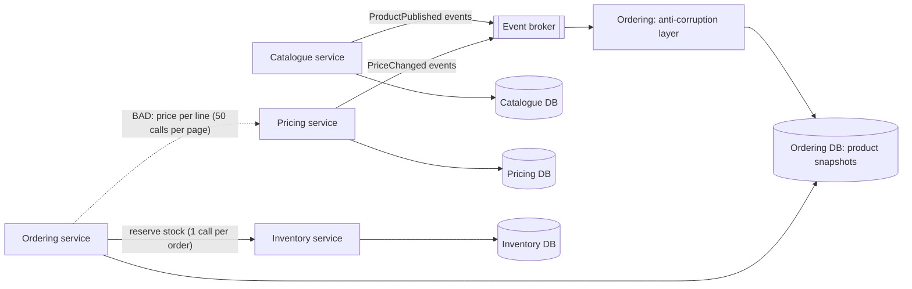
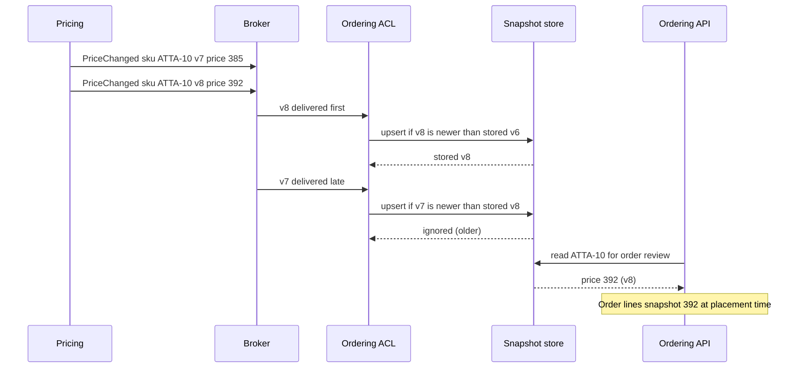

Choosing *whether* to split a system is the first decision. Choosing *where* to split it decides whether the split helps or hurts for years. A good boundary lets a team change its part without asking anyone. A bad boundary turns every feature into a negotiation between three teams and forty network calls.

## Learning objectives

By the end of this lesson you will be able to:

1. Explain bounded contexts in plain words and use language differences to find candidate boundaries.
2. Apply five boundary heuristics: language, business capability, invariants, change cadence and team ownership.
3. Give every piece of data exactly one owner, and choose how other services get it: query, local copy via events, or snapshot.
4. Recognise the chatty-boundary smell, measure it with numbers, and fix it.
5. Avoid the classic wrong cuts: entity services, layer services and shared tables.
6. Implement an anti-corruption layer and a version-aware local replica in ASP.NET Core.

## Prerequisites

- [Bounded contexts and ubiquitous language](#/lesson/m08-bounded-contexts): the core idea we build on.
- [Aggregates and aggregate roots](#/lesson/m08-aggregates): an aggregate is the smallest unit you must never split.
- [Modular monolith versus microservices](#/lesson/m16-monolith-vs-microservices): everything here applies to modules too.

## Explain it like I'm a beginner

Think about a hospital and the word **"patient"**.

- At **registration**, a patient is a name, an address, a phone number and an Aadhaar-linked ID.
- In the **ward**, a patient is a bed number, vital signs every four hours, and allergies.
- In **billing**, a patient is an insurance policy, a room tariff and a list of chargeable items.
- In the **pharmacy**, a patient is a prescription and a list of drugs already dispensed.

Same person, four different meanings. If you force all four departments to share one giant "Patient" form with 200 fields, every department fights over it. The ward cannot add a field without the billing team checking that nothing breaks.

A better hospital lets each department keep **its own file about the patient**, with only the fields it needs, linked by one shared patient number. When registration updates the phone number, it *announces* the change and anyone who cares updates their copy.

Each department's area — with its own words, rules and files — is a **bounded context**. The line between two departments is a **boundary**. Drawing those lines well is what this lesson is about.

## First-principles explanation

### What a boundary is

A service boundary (or module boundary) is a line around:

- a **model** (the classes and rules),
- the **data** that model owns (tables, documents),
- and the **team** that changes it,

such that everything inside can change without coordinating with anything outside, as long as the **contract** (API and events) stays compatible.

The boundary is good if most changes stay inside one boundary. It is bad if most changes cross it.

### Why it matters — the problem

Boundaries are expensive to move once services are deployed: data must migrate, APIs must be versioned, two teams must coordinate. A wrong boundary costs you on every feature:

- **Cross-boundary features**: a feature that touches three services needs three pull requests, three reviews and three deploys in the right order.
- **Network chatter**: a boundary through the middle of a concept causes dozens of calls per request.
- **Distributed transactions**: a business rule that needs atomicity across the line requires a saga.

### Heuristic 1 — language changes meaning

Where the same word means different things, there is probably a boundary. In a B2B wholesale grocery marketplace, "product" means:

| Context | What "product" means | Key fields |
|---|---|---|
| Catalogue | Something we describe and show | Name, images, specifications, category |
| Pricing | Something with a price per region and customer tier | List price, regional price, GST rate (HSN code) |
| Inventory | A stock-keeping unit in a warehouse | SKU, warehouse, quantity on hand, reserved |
| Fulfilment | Something heavy to move | Weight, dimensions, pallet type, truck class |
| Ordering | A line a customer committed to | SKU, quantity, price captured at order time |

One shared `Product` class with all these fields is a sign that five contexts were forced into one model. Separate models, linked by `Sku`, is the bounded-context answer.

### Heuristic 2 — business capability

A **business capability** is something the business does, described without technology: "price products", "fulfil orders", "collect payments". Capabilities are stable: a marketplace has priced products for decades, even as the software changes. Boundaries along capabilities age well. Boundaries along current screens or current database tables do not.

### Heuristic 3 — invariants stay together

An **invariant** is a rule that must always be true, such as "we never reserve more stock than we have" or "an order's total equals the sum of its lines". If enforcing an invariant needs data from both sides of a boundary *in one transaction*, the boundary is in the wrong place. Keep each invariant inside one aggregate, and each aggregate inside one service.

Test it: write down your important invariants and check which data each one touches. If "stock never goes negative" needs both `Inventory` and `Ordering` data atomically, reservations belong in Inventory, and Ordering *asks* Inventory to reserve.

### Heuristic 4 — things that change together live together

Look at history. If 70 % of pull requests that touch pricing rules also touch promotions code, pricing and promotions are one boundary today, whatever the org chart says. **Co-change** (change coupling) is the most honest boundary signal you have, because it measures what actually happened. The practical playground lets you compute it.

### Heuristic 5 — one team, manageable load

Each boundary should be owned by exactly one team, and each team should own an amount it can hold in its head (its **cognitive load**). Two teams sharing one service is a sign of a boundary that is too big; one team owning eight services is a sign of boundaries that are too small.

### Data ownership: one writer per fact

Every fact has **exactly one owner** — the only service that may write it. Others may need it. They get it in one of four ways:

| Option | How it works | Good for | Cost |
|---|---|---|---|
| **Query the owner** | Call its API when you need the fact | Fresh data, low volume | Runtime coupling: owner down → you are degraded |
| **Local copy via events** (event-carried state transfer) | Owner publishes changes; you keep a replica | High-volume reads, owner may be down | Eventual consistency; storage; replica logic |
| **Snapshot at the moment of a business act** | Copy the value into your own record when the act happens | "Price at time of order", "address at time of dispatch" | None — it is your fact now |
| **Analytics copy** | Change data capture into a warehouse | Reports across contexts | Lag of minutes; not for operational logic |

The **snapshot** option is underused. An order should store the price the customer agreed to. That is not a copy of Pricing's data; it is Ordering's own fact ("the shop accepted ₹385 per 10 kg bag of atta"). If Pricing changes the list price tomorrow, the order must not change.

### The chatty-boundary smell

A **chatty boundary** is one where completing a single user action needs many calls across it. It shows that the boundary cuts through the middle of a concept.

Back-of-the-envelope: the order review page shows 50 lines. For each line, Ordering calls Pricing (current price) and Inventory (availability), one after another.

- Calls per page: 50 × 2 = **100** network calls.
- Latency, at about 2 ms per call (estimate): 100 × 2 ms = **200 ms**, before any tail latency.
- At 300 page views per second: 300 × 100 = **30,000** internal calls per second, created by one screen.
- Chance at least one of 100 calls hits a 1 % slow path: 1 − 0.99¹⁰⁰ ≈ **63 %**. Most page views are slow.

Fixes, from cheapest to most structural:

1. **Batch API**: `POST /prices:batch` with 50 SKUs → 2 calls instead of 100. Fixes latency, not coupling.
2. **Local replica**: Ordering keeps prices and availability fed by events → 0 calls at read time. Fixes coupling, adds eventual consistency.
3. **Move the boundary**: if Ordering needs Pricing's rules on every action, maybe "quote" belongs inside Pricing, or pricing logic for checkout belongs inside Ordering.

Rule of thumb from practice: if one user action routinely needs more than a handful of synchronous calls across the same boundary, question the boundary before optimising the calls.

### Wrong cuts to avoid

- **Entity services.** `ProductService`, `CustomerService`, `OrderService` as CRUD wrappers over tables. Every business process (place order, ship order) must orchestrate several of them. Business logic ends up in the orchestrator, and the "services" are remote database tables.
- **Layer services.** "Frontend service, business service, data service". Every feature crosses all three.
- **Shared tables.** Two services writing one table. Neither owns it; both break when it changes.
- **Splitting an aggregate.** Order header in one service, order lines in another. Every invariant ("total equals sum of lines") becomes a distributed transaction.
- **Boundaries by technology.** "The Python service" is a deployment detail, not a business boundary.

### Context mapping — how boundaries relate

Boundaries are not isolated; they have relationships. Common ones:

- **Customer–supplier**: downstream (customer) needs; upstream (supplier) plans for them.
- **Conformist**: downstream just uses upstream's model as-is (common with big external APIs).
- **Anti-corruption layer (ACL)**: downstream translates upstream's model into its own, so upstream's quirks do not leak in.
- **Open host service / published language**: upstream offers a stable, documented contract (for example versioned events) for many consumers.
- **Shared kernel**: two contexts share a small piece of model (for example a `Money` type). Keep it tiny.

### When a simpler alternative is better

- **One team?** Draw the same boundaries as *modules* in one deployable. You get the thinking benefits without network costs.
- **Unsure about a boundary?** Leave the two areas together. Splitting later is cheaper than merging later.
- **Need a cross-context report?** Use a reporting database fed by change data capture, not a new service that calls five others.

## Visual explanation

### Architecture: owners, copies and a chatty edge



Each service owns one database (bottom arrows). Catalogue and Pricing publish changes to a broker. Ordering's anti-corruption layer translates those events into Ordering's own `ProductSnapshot` model and stores them locally, so Ordering can show the review page without calling anyone. Ordering still calls Inventory synchronously once per order to **reserve** stock, because "never oversell" is Inventory's invariant and needs a fresh, atomic answer. The dotted arrow is the smell we removed: one call to Pricing for every line on every page view.

### Sequence: event-carried state transfer with a version check



Pricing publishes two changes. The broker delivers them out of order — normal for many brokers when partitions or retries are involved. The ACL stores a change only if its version is newer than the stored one, so the late v7 cannot overwrite v8. When the customer places the order, Ordering copies the price (392) into the order line. From that moment the price is Ordering's own fact.

## Step-by-step example

Scenario: a B2B wholesale marketplace for groceries (rice, atta, cooking oil, detergent) that supplies kirana stores (neighbourhood shops) in 40 cities, often on credit. It started as four "microservices": `ProductService`, `CustomerService`, `OrderService`, `WarehouseService` — each a CRUD API over tables. Symptoms: placing an order makes 23 synchronous calls; the order page p95 is 1.4 s; every pricing change needs three teams.

### Step 1 — list the business capabilities and their words

Run a short event-storming session: write domain events on sticky notes in time order. "Product listed", "Regional price set", "Quote requested", "Order placed", "Stock reserved", "Truck assigned", "Delivered", "Invoice raised", "Payment received". Group them where the *language* stays consistent. You find six capabilities: Catalogue, Pricing, Ordering, Inventory, Fulfilment, Billing.

### Step 2 — check invariants

- "Never reserve more than on-hand stock" → Inventory.
- "Order total equals sum of lines, and GST is computed per line from HSN code" → Ordering (needs GST rate as a snapshot from Pricing).
- "A truck's load never exceeds its capacity" → Fulfilment.

No invariant crosses two capabilities. Good sign.

### Step 3 — assign data owners

| Fact | Owner | How others get it |
|---|---|---|
| Product description, images | Catalogue | Ordering keeps name and pack size via events |
| Regional price, GST rate | Pricing | Ordering keeps a replica; snapshots into order lines |
| Stock on hand, reservations | Inventory | Ordering calls reserve once per order |
| Delivery address at dispatch | Fulfilment | Snapshot from Ordering's order |
| Invoice | Billing | Built from `OrderPlaced` event data |

### Step 4 — measure and remove chatter

The 23 calls were: 10 to `ProductService` (names per line), 10 to `WarehouseService` (stock per line), 2 to `CustomerService`, 1 to create the order. After the redesign: names and prices are read from Ordering's local snapshots (0 calls), stock is reserved in one batch call, and the customer's credit limit arrives via events. **23 calls become 1.**

### Step 5 — map teams

Three teams: *Buying* (Catalogue, Pricing), *Ordering* (Ordering, Billing), *Logistics* (Inventory, Fulfilment). Each team runs two services, or one service with two modules. That decision belongs to the [monolith versus microservices](#/lesson/m16-monolith-vs-microservices) criteria, not to boundary design.

## Production-style C# implementation

We implement Ordering's side: an anti-corruption layer that translates Catalogue's published events, a version-aware local snapshot store, an order handler that snapshots prices, and a chattiness meter that counts outbound HTTP calls per inbound request.

```text
Ordering.Api/
  Program.cs
  Catalogue/PublishedLanguage.cs      (Catalogue's contract, as Ordering receives it)
  Ordering/ProductSnapshots.cs
  Ordering/CatalogueTranslator.cs     (anti-corruption layer)
  Ordering/PlaceOrder.cs
  Observability/Chattiness.cs
```

```csharp file=Catalogue/PublishedLanguage.cs
namespace Marketplace.Catalogue.PublishedLanguage;

/// <summary>
/// Catalogue's published event, version 2, exactly as Catalogue defines it. Ordering does not own
/// this shape and must not let it spread through its code — the translator converts it at the edge.
/// </summary>
public sealed record ProductPublishedV2(
    string Sku,
    string DisplayName,
    string UnitOfMeasure,     // e.g. "BAG_10KG", "TIN_15L", "BOX_10"
    long ListPricePaise,      // Pricing publishes regional prices separately; this is the national list price
    string HsnCode,
    long Version,
    bool Discontinued);
```

```csharp file=Ordering/ProductSnapshots.cs
using System.Collections.Concurrent;

namespace Marketplace.Ordering;

/// <summary>Ordering's own view of a product: only the fields Ordering needs, in Ordering's terms.</summary>
public sealed record ProductSnapshot(string Sku, string Name, string PackSize, decimal UnitPrice,
    decimal GstRate, bool Orderable, long SourceVersion);

public interface IProductSnapshotStore
{
    /// <summary>Stores the snapshot only if it is newer than the stored one. Returns true if stored.</summary>
    bool Upsert(ProductSnapshot snapshot);
    ProductSnapshot? Find(string sku);
}

public sealed class InMemoryProductSnapshotStore : IProductSnapshotStore
{
    private readonly ConcurrentDictionary<string, ProductSnapshot> _bySku = new(StringComparer.OrdinalIgnoreCase);

    public bool Upsert(ProductSnapshot snapshot)
    {
        while (true)
        {
            if (!_bySku.TryGetValue(snapshot.Sku, out var current))
            {
                if (_bySku.TryAdd(snapshot.Sku, snapshot)) return true;
                continue;   // another thread added it first; re-check its version
            }
            if (snapshot.SourceVersion <= current.SourceVersion) return false;   // stale or duplicate
            if (_bySku.TryUpdate(snapshot.Sku, snapshot, current)) return true;
        }
    }

    public ProductSnapshot? Find(string sku) => _bySku.TryGetValue(sku, out var s) ? s : null;
}
```

In PostgreSQL the same "only if newer" rule is one statement, and it is safe under concurrency without application-level loops:

```sql
INSERT INTO ordering.product_snapshot (sku, name, pack_size, unit_price, gst_rate, orderable, source_version)
VALUES ($1, $2, $3, $4, $5, $6, $7)
ON CONFLICT (sku) DO UPDATE
SET name = EXCLUDED.name, pack_size = EXCLUDED.pack_size, unit_price = EXCLUDED.unit_price,
    gst_rate = EXCLUDED.gst_rate, orderable = EXCLUDED.orderable, source_version = EXCLUDED.source_version
WHERE ordering.product_snapshot.source_version < EXCLUDED.source_version;
```

```csharp file=Ordering/CatalogueTranslator.cs
using Marketplace.Catalogue.PublishedLanguage;
using Microsoft.Extensions.Logging;

namespace Marketplace.Ordering;

/// <summary>
/// Anti-corruption layer: the only Ordering class that knows Catalogue's vocabulary
/// (paise, HSN codes, unit-of-measure codes). Everything behind it speaks Ordering's language.
/// </summary>
public sealed class CatalogueTranslator(IProductSnapshotStore store, ILogger<CatalogueTranslator> logger)
{
    // HSN code prefix to GST rate. In production this comes from Pricing's own events, not a hard-coded table.
    private static readonly Dictionary<string, decimal> GstByHsnPrefix = new()
    {
        ["1101"] = 0.05m,   // packaged wheat flour (rates shown for illustration; always load current rates from the owner)
        ["1512"] = 0.05m,   // sunflower oil
        ["3402"] = 0.18m,   // detergent
    };

    public bool Handle(ProductPublishedV2 evt)
    {
        var gst = GstByHsnPrefix.FirstOrDefault(kv => evt.HsnCode.StartsWith(kv.Key, StringComparison.Ordinal)).Value;
        if (gst == 0m)
        {
            logger.LogWarning("Unknown HSN {Hsn} for {Sku}; product kept not orderable", evt.HsnCode, evt.Sku);
        }

        var snapshot = new ProductSnapshot(
            Sku: evt.Sku,
            Name: evt.DisplayName.Trim(),
            PackSize: TranslateUnit(evt.UnitOfMeasure),
            UnitPrice: evt.ListPricePaise / 100m,
            GstRate: gst,
            Orderable: !evt.Discontinued && gst > 0m,
            SourceVersion: evt.Version);

        var stored = store.Upsert(snapshot);
        if (!stored) logger.LogDebug("Ignored stale ProductPublished {Sku} v{Version}", evt.Sku, evt.Version);
        return stored;
    }

    private static string TranslateUnit(string code) => code switch
    {
        "BAG_10KG" => "10 kg bag",
        "TIN_15L" => "15 litre tin",
        _ when code.StartsWith("BOX_", StringComparison.Ordinal) => $"box of {code[4..]}",
        _ => code,
    };
}
```

```csharp file=Ordering/PlaceOrder.cs
namespace Marketplace.Ordering;

public sealed record PlaceOrderLine(string Sku, int Quantity);
public sealed record PlaceOrderRequest(Guid CustomerId, IReadOnlyList<PlaceOrderLine> Lines);

/// <summary>Order line with the price and tax rate captured at placement: Ordering's own fact from now on.</summary>
public sealed record OrderLine(string Sku, string Name, int Quantity, decimal UnitPrice, decimal GstRate)
{
    public decimal Net => UnitPrice * Quantity;
    public decimal Gst => Math.Round(Net * GstRate, 2, MidpointRounding.ToEven);
}

public sealed record PlacedOrder(Guid OrderId, Guid CustomerId, IReadOnlyList<OrderLine> Lines)
{
    public decimal Total => Lines.Sum(l => l.Net + l.Gst);
}

public interface IStockReservations
{
    /// <summary>One batched call to Inventory, which owns the "never oversell" invariant.</summary>
    Task<bool> TryReserveAsync(Guid orderId, IReadOnlyList<PlaceOrderLine> lines, CancellationToken ct);
}

public sealed class PlaceOrderHandler(IProductSnapshotStore products, IStockReservations stock)
{
    public async Task<(PlacedOrder? Order, string? Error)> HandleAsync(PlaceOrderRequest request, CancellationToken ct)
    {
        if (request.Lines.Count == 0) return (null, "Order has no lines.");

        var lines = new List<OrderLine>(request.Lines.Count);
        foreach (var l in request.Lines)
        {
            if (l.Quantity <= 0) return (null, $"Quantity for {l.Sku} must be positive.");
            var p = products.Find(l.Sku);   // local read: no call to Catalogue or Pricing
            if (p is null || !p.Orderable) return (null, $"{l.Sku} is not available to order.");
            lines.Add(new OrderLine(p.Sku, p.Name, l.Quantity, p.UnitPrice, p.GstRate));
        }

        var orderId = Guid.NewGuid();
        if (!await stock.TryReserveAsync(orderId, request.Lines, ct))
            return (null, "Not enough stock for one or more lines.");

        return (new PlacedOrder(orderId, request.CustomerId, lines), null);
    }
}

/// <summary>Development stand-in for the Inventory client.</summary>
public sealed class AlwaysAvailableStock : IStockReservations
{
    public Task<bool> TryReserveAsync(Guid orderId, IReadOnlyList<PlaceOrderLine> lines, CancellationToken ct) =>
        Task.FromResult(true);
}
```

The chattiness meter makes the smell visible in production. A middleware starts a counter for each inbound request; a `DelegatingHandler` on every outgoing `HttpClient` increments it; the total goes to a histogram.

```csharp file=Observability/Chattiness.cs
using System.Diagnostics.Metrics;
using System.Runtime.CompilerServices;
using Microsoft.Extensions.Logging;

namespace Marketplace.Observability;

/// <summary>Counts outbound calls made while handling the current inbound request.</summary>
public static class OutboundCallScope
{
    private static readonly AsyncLocal<StrongBox<int>?> Current = new();
    public static StrongBox<int> Begin() => Current.Value = new StrongBox<int>(0);
    public static void End() => Current.Value = null;
    public static void Increment() { if (Current.Value is { } box) Interlocked.Increment(ref box.Value); }
}

public sealed class OutboundCallCounter : DelegatingHandler
{
    protected override Task<HttpResponseMessage> SendAsync(HttpRequestMessage request, CancellationToken ct)
    {
        OutboundCallScope.Increment();
        return base.SendAsync(request, ct);
    }
}

public sealed class ChattinessMiddleware(RequestDelegate next, ILogger<ChattinessMiddleware> logger, IMeterFactory meters)
{
    private readonly Histogram<int> _calls = meters.Create("Marketplace.Ordering")
        .CreateHistogram<int>("ordering.outbound_calls_per_request", unit: "{call}");
    private const int WarnAbove = 5;

    public async Task InvokeAsync(HttpContext context)
    {
        var box = OutboundCallScope.Begin();
        try { await next(context); }
        finally
        {
            var route = context.GetEndpoint()?.DisplayName ?? context.Request.Path.ToString();
            _calls.Record(box.Value, new KeyValuePair<string, object?>("route", route));
            if (box.Value > WarnAbove)
                logger.LogWarning("Chatty request {Route}: {Calls} outbound calls", route, box.Value);
            OutboundCallScope.End();
        }
    }
}
```

```csharp file=Program.cs
using Marketplace.Catalogue.PublishedLanguage;
using Marketplace.Observability;
using Marketplace.Ordering;

var builder = WebApplication.CreateBuilder(args);

builder.Services.AddSingleton<IProductSnapshotStore, InMemoryProductSnapshotStore>();
builder.Services.AddSingleton<CatalogueTranslator>();
builder.Services.AddSingleton<IStockReservations, AlwaysAvailableStock>();
builder.Services.AddScoped<PlaceOrderHandler>();
builder.Services.AddTransient<OutboundCallCounter>();
builder.Services.AddHttpClient("inventory", c => c.BaseAddress = new Uri("http://inventory"))
    .AddHttpMessageHandler<OutboundCallCounter>();

var app = builder.Build();
app.UseMiddleware<ChattinessMiddleware>();

// In production a broker consumer calls the translator; an endpoint keeps the demo self-contained.
app.MapPost("/_dev/catalogue-events", (ProductPublishedV2 evt, CatalogueTranslator acl) =>
    acl.Handle(evt) ? Results.Accepted() : Results.Ok(new { ignored = "stale version" }));

app.MapPost("/orders", async (PlaceOrderRequest request, PlaceOrderHandler handler, CancellationToken ct) =>
{
    var (order, error) = await handler.HandleAsync(request, ct);
    return order is null
        ? Results.Problem(error, statusCode: StatusCodes.Status422UnprocessableEntity)
        : Results.Created($"/orders/{order.OrderId}", new { order.OrderId, order.Total });
});

app.Run();
```

**Design notes**

- Ordering never sees `ListPricePaise` or `UnitOfMeasure` outside the translator. When Catalogue ships `ProductPublishedV3`, only one class changes.
- The snapshot store's version check makes the consumer safe against duplicates *and* reordering. Use the owner's version (or a monotonically increasing sequence), never your own receive time.
- `Orderable` is Ordering's own decision derived from several upstream facts. That is fine — derived facts are owned by the deriver.

## Bad design vs good design

**Bad: the entity-service orchestrator.**

```csharp
// OrderService.PlaceAsync — 23 synchronous calls per order
foreach (var line in request.Lines)
{
    var product = await productApi.GetAsync(line.Sku);           // call 1..10
    var stock   = await warehouseApi.GetStockAsync(line.Sku);    // call 11..20
    if (stock.Available < line.Quantity) return Error("No stock");
}
var customer = await customerApi.GetAsync(request.CustomerId);   // 21
var credit   = await customerApi.GetCreditAsync(request.CustomerId); // 22
await orderApi.CreateAsync(...);                                // 23
// ...and stock is checked but never reserved, so two orders can take the last 10 bags.
```

Problems: 23 network hops per order; any of four services down stops ordering; the stock check is not atomic, so it oversells; the business process lives in an orchestrator while the "services" are remote tables.

**Good:** Ordering owns orders and keeps snapshots of what it needs; Inventory owns reservation and exposes one atomic "reserve these lines" command; credit limit arrives as events. One synchronous call per order, at the one place where a fresh answer is required.

:::callout type=tradeoff title="Local copies are not free"
A replica means eventual consistency: a price change may take a second or two to reach Ordering. Decide with the business what happens in that window. For a quote it is usually fine (the customer sees ₹385 and is charged ₹385). If the business requires the latest price at the instant of payment, call Pricing once at checkout — one call, not one per line.
:::

:::callout type=mistake title="Sharing the database to 'avoid' events"
Letting Ordering read Pricing's tables avoids the replica, but now Pricing cannot change its schema, and its database load depends on Ordering's traffic. If you truly cannot accept a replica, keep the two capabilities in the same service.
:::

## Practical playground

The database below holds six months of history: which modules each merged pull request touched. Use SQL to find **change coupling** — module pairs that change together. Try: for each pair, count commits touching both, and divide by the commits touching either. Pairs with high coupling are candidates for one boundary.

:::playground type=sql title="Find change coupling in commit history"
```sql
CREATE TABLE commit_change (
  commit_id text NOT NULL,
  module    text NOT NULL,
  PRIMARY KEY (commit_id, module)
);
INSERT INTO commit_change VALUES
  ('c01','pricing'),('c01','promotions'),
  ('c02','pricing'),('c02','promotions'),
  ('c03','pricing'),
  ('c04','pricing'),('c04','promotions'),
  ('c05','catalogue'),
  ('c06','catalogue'),
  ('c07','ordering'),('c07','billing'),
  ('c08','ordering'),
  ('c09','ordering'),('c09','billing'),
  ('c10','inventory'),
  ('c11','inventory'),('c11','fulfilment'),
  ('c12','promotions'),('c12','pricing'),
  ('c13','catalogue'),('c13','pricing'),
  ('c14','billing');
-- Starter query: commits per module
SELECT module, COUNT(*) AS commits FROM commit_change GROUP BY module ORDER BY commits DESC;
```
:::

## Exercises

:::exercise id=m16-service-boundaries-ex1 difficulty=beginner kind=written title="One word, four meanings"
A hospital group is designing its software. The team proposes one `PatientService` with a `patients` table of 180 columns used by registration, wards, pharmacy and billing.

1. For each of the four areas, list what "patient" means and 4–5 fields it really needs.
2. Propose bounded contexts and say which one owns each of these facts: phone number, current bed, drug allergies, insurance policy number, discharge date.
3. Explain how the pharmacy learns about a new allergy recorded in the ward.
::acceptance
- Four contexts, each with its own patient model.
- Each fact has exactly one owner, with a reason.
- Allergy propagation uses an event or a query, and the answer says which and why.
- Shared identity (a patient number) is explicitly named.
::hint
Ask each department: "What do you do with a patient?" The verbs differ, so the data differs.
::hint
Who records an allergy in real life? That department owns the fact.
::hint
Is it acceptable for the pharmacy to see a new allergy a few seconds late? A few hours late? This decides query versus event.
::hint
All contexts share one thing: the patient identifier issued at registration.
::solution
**Contexts and models**

- **Registration**: patient = identity. Fields: patient number, name, date of birth, phone, address, ID document reference.
- **Clinical (wards)**: patient = someone under care. Fields: patient number, admission id, current bed, vitals, allergies, diagnoses.
- **Pharmacy**: patient = someone receiving drugs. Fields: patient number, active prescriptions, dispensed items, known allergies (copy).
- **Billing**: patient = account. Fields: patient number, insurance policy, room tariff, chargeable items, discharge date (copy).

**Owners**: phone → Registration (it captures contact details). Current bed → Clinical (bed allocation is a clinical/ward decision). Allergies → Clinical (recorded by clinicians). Insurance policy → Billing (verified by the insurance desk). Discharge date → Clinical (a clinical decision), copied by Billing to close the account.

**Allergy propagation**: Clinical publishes `AllergyRecorded`; Pharmacy keeps a local copy. Because dispensing a contraindicated drug is dangerous, Pharmacy should *also* make a fresh check against Clinical before dispensing high-risk drugs, or the two capabilities' allergy check should be one shared clinical safety service. This is a case where the business decides how much staleness is tolerable — here, close to none.

**Shared identity**: the patient number from Registration links all models. It is the only field every context shares.
::mistakes
- Keeping one 180-column table and splitting only the API — the coupling is in the data.
- Making Registration own allergies because "it owns the patient".
- Ignoring patient safety when choosing eventual consistency.
:::

:::exercise id=m16-service-boundaries-ex2 difficulty=beginner kind=code title="Detect chatty edges from traces"
Given spans from distributed traces, find service-to-service edges that are chatty: on average more than `threshold` calls per trace.
::requirements
- A span is `(TraceId, From, To)`: one call from service `From` to service `To` within one trace.
- For each directed edge (From → To), compute the average number of calls **over the traces in which that edge appears**.
- Return edges with average > threshold, sorted by average descending, then From, then To.
::acceptance
- An edge called 50 times in each of two traces has average 50.
- An edge called once per trace is not chatty at threshold 5.
- Edge direction matters: A→B and B→A are separate.
::hint
Group by (From, To), then inside that group by TraceId.
::hint
The average is "total calls on this edge ÷ number of distinct traces containing the edge".
::hint
```csharp
spans.GroupBy(s => (s.From, s.To))
     .Select(g => new ChattyEdge(g.Key.From, g.Key.To, (double)g.Count() / g.Select(s => s.TraceId).Distinct().Count()))
```
::starter
```csharp file=ChattyEdgeDetector.cs
using System;
using System.Collections.Generic;
using System.Linq;

public sealed record Span(string TraceId, string From, string To);
public sealed record ChattyEdge(string From, string To, double AverageCallsPerTrace);

public static class ChattyEdgeDetector
{
    public static IReadOnlyList<ChattyEdge> Find(IEnumerable<Span> spans, double threshold) =>
        throw new NotImplementedException();
}
```
::tests
```csharp file=ChattyEdgeDetectorTests.cs
using System.Collections.Generic;
using System.Linq;
using Xunit;

public class ChattyEdgeDetectorTests
{
    private static IEnumerable<Span> Repeat(string trace, string from, string to, int n) =>
        Enumerable.Range(0, n).Select(_ => new Span(trace, from, to));

    [Fact]
    public void Finds_chatty_edge()
    {
        var spans = Repeat("t1", "ordering", "pricing", 50)
            .Concat(Repeat("t2", "ordering", "pricing", 40))
            .Concat(Repeat("t1", "gateway", "ordering", 1))
            .Concat(Repeat("t2", "gateway", "ordering", 1));
        var edge = Assert.Single(ChattyEdgeDetector.Find(spans, 5));
        Assert.Equal(("ordering", "pricing"), (edge.From, edge.To));
        Assert.Equal(45.0, edge.AverageCallsPerTrace, 6);
    }

    [Fact]
    public void Direction_matters_and_results_are_sorted()
    {
        var spans = Repeat("t1", "a", "b", 10).Concat(Repeat("t1", "b", "a", 20)).Concat(Repeat("t1", "c", "d", 2));
        var result = ChattyEdgeDetector.Find(spans, 5);
        Assert.Equal(2, result.Count);
        Assert.Equal(("b", "a"), (result[0].From, result[0].To));
        Assert.Equal(("a", "b"), (result[1].From, result[1].To));
    }

    [Fact]
    public void Average_counts_only_traces_containing_the_edge()
    {
        var spans = Repeat("t1", "x", "y", 12).Concat(Repeat("t2", "p", "q", 1));
        var edge = Assert.Single(ChattyEdgeDetector.Find(spans, 5));
        Assert.Equal(12.0, edge.AverageCallsPerTrace, 6);
    }
}
```
::solution
```csharp file=ChattyEdgeDetector.cs
using System;
using System.Collections.Generic;
using System.Linq;

public sealed record Span(string TraceId, string From, string To);
public sealed record ChattyEdge(string From, string To, double AverageCallsPerTrace);

public static class ChattyEdgeDetector
{
    public static IReadOnlyList<ChattyEdge> Find(IEnumerable<Span> spans, double threshold)
    {
        ArgumentNullException.ThrowIfNull(spans);
        return spans
            .GroupBy(s => (s.From, s.To))
            .Select(g => new ChattyEdge(g.Key.From, g.Key.To,
                (double)g.Count() / g.Select(s => s.TraceId).Distinct(StringComparer.Ordinal).Count()))
            .Where(e => e.AverageCallsPerTrace > threshold)
            .OrderByDescending(e => e.AverageCallsPerTrace)
            .ThenBy(e => e.From, StringComparer.Ordinal)
            .ThenBy(e => e.To, StringComparer.Ordinal)
            .ToList();
    }
}
```
In a real system the spans come from OpenTelemetry: client spans with `peer.service` (or `server.address`) give you `To`, and the resource's `service.name` gives `From`. Run the query daily and alert when a new chatty edge appears.
::mistakes
- Dividing by *all* traces, which hides an edge that is extremely chatty in the few traces where it appears.
- Treating A→B and B→A as one edge; the fix for each is different.
::extensions
Weight each edge by the traces' user-facing latency, so you fix the chatter that users actually feel first.
:::

:::exercise id=m16-service-boundaries-ex3 difficulty=intermediate kind=code title="Order-safe local replica"
Implement a projector that keeps Ordering's local copy of customer credit limits, fed by events from the Customer Accounts context. Events can arrive duplicated and out of order.
::requirements
- Events: `CreditLimitSet(CustomerId, LimitRupees, Version)` and `AccountClosed(CustomerId, Version)`. Versions increase per customer.
- Apply an event only if its version is greater than the stored version for that customer.
- `AccountClosed` keeps a tombstone (so an older `CreditLimitSet` arriving later cannot "reopen" the account).
- `CanPlace(customerId, amount)` returns true only for open accounts with `amount <= limit`. Unknown customers return false.
- `Apply` returns true when the event changed state.
::acceptance
- A duplicate event returns false and changes nothing.
- A late, older event does not overwrite a newer one.
- After `AccountClosed` v5, a late `CreditLimitSet` v4 is ignored.
- Unknown customers cannot place orders.
::hint
Store, per customer, a small record: limit, closed flag, version.
::hint
Both event types share the same rule: "ignore if version ≤ stored version". Write it once.
::hint
A tombstone is just a record with `Closed = true` that you keep instead of deleting.
::hint
```csharp
if (_state.TryGetValue(id, out var cur) && version <= cur.Version) return false;
```
::starter
```csharp file=CreditLimitProjector.cs
using System;
using System.Collections.Generic;

public abstract record AccountEvent(Guid CustomerId, long Version);
public sealed record CreditLimitSet(Guid CustomerId, decimal LimitRupees, long Version) : AccountEvent(CustomerId, Version);
public sealed record AccountClosed(Guid CustomerId, long Version) : AccountEvent(CustomerId, Version);

public sealed class CreditLimitProjector
{
    public bool Apply(AccountEvent evt) => throw new NotImplementedException();
    public bool CanPlace(Guid customerId, decimal amountRupees) => throw new NotImplementedException();
}
```
::tests
```csharp file=CreditLimitProjectorTests.cs
using System;
using Xunit;

public class CreditLimitProjectorTests
{
    private static readonly Guid C = Guid.Parse("11111111-1111-1111-1111-111111111111");

    [Fact]
    public void Applies_and_checks_limit()
    {
        var p = new CreditLimitProjector();
        Assert.True(p.Apply(new CreditLimitSet(C, 500_000m, 1)));
        Assert.True(p.CanPlace(C, 500_000m));
        Assert.False(p.CanPlace(C, 500_001m));
    }

    [Fact]
    public void Duplicate_is_ignored()
    {
        var p = new CreditLimitProjector();
        p.Apply(new CreditLimitSet(C, 100m, 1));
        Assert.False(p.Apply(new CreditLimitSet(C, 100m, 1)));
    }

    [Fact]
    public void Late_older_event_does_not_overwrite()
    {
        var p = new CreditLimitProjector();
        p.Apply(new CreditLimitSet(C, 900m, 3));
        Assert.False(p.Apply(new CreditLimitSet(C, 100m, 2)));
        Assert.True(p.CanPlace(C, 900m));
    }

    [Fact]
    public void Closed_account_cannot_be_reopened_by_late_event()
    {
        var p = new CreditLimitProjector();
        p.Apply(new CreditLimitSet(C, 900m, 3));
        Assert.True(p.Apply(new AccountClosed(C, 5)));
        Assert.False(p.Apply(new CreditLimitSet(C, 2_000m, 4)));
        Assert.False(p.CanPlace(C, 1m));
    }

    [Fact]
    public void Unknown_customer_cannot_place() =>
        Assert.False(new CreditLimitProjector().CanPlace(Guid.NewGuid(), 1m));

    [Fact]
    public void Close_arriving_before_any_limit_still_blocks()
    {
        var p = new CreditLimitProjector();
        Assert.True(p.Apply(new AccountClosed(C, 2)));
        Assert.False(p.Apply(new CreditLimitSet(C, 500m, 1)));
        Assert.False(p.CanPlace(C, 1m));
    }
}
```
::solution
```csharp file=CreditLimitProjector.cs
using System;
using System.Collections.Generic;

public abstract record AccountEvent(Guid CustomerId, long Version);
public sealed record CreditLimitSet(Guid CustomerId, decimal LimitRupees, long Version) : AccountEvent(CustomerId, Version);
public sealed record AccountClosed(Guid CustomerId, long Version) : AccountEvent(CustomerId, Version);

public sealed class CreditLimitProjector
{
    private sealed record State(decimal Limit, bool Closed, long Version);
    private readonly Dictionary<Guid, State> _state = new();
    private readonly object _gate = new();

    public bool Apply(AccountEvent evt)
    {
        ArgumentNullException.ThrowIfNull(evt);
        lock (_gate)
        {
            _state.TryGetValue(evt.CustomerId, out var current);
            if (current is not null && evt.Version <= current.Version) return false;   // duplicate or stale

            _state[evt.CustomerId] = evt switch
            {
                CreditLimitSet s => new State(s.LimitRupees, false, s.Version),
                AccountClosed c => new State(current?.Limit ?? 0m, true, c.Version),   // tombstone
                _ => throw new ArgumentException($"Unknown event {evt.GetType().Name}", nameof(evt)),
            };
            return true;
        }
    }

    public bool CanPlace(Guid customerId, decimal amountRupees)
    {
        lock (_gate)
            return _state.TryGetValue(customerId, out var s) && !s.Closed && amountRupees <= s.Limit;
    }
}
```
Notice the rule "a closed account stays closed" works only because the upstream version is monotonic across *both* event types. If Customer Accounts ever reopens accounts, it must publish `AccountReopened` with a higher version.
::mistakes
- Deleting the record on `AccountClosed`; a late older `CreditLimitSet` then recreates it.
- Comparing timestamps from different machines instead of the owner's version.
- Treating "unknown customer" as "unlimited credit".
::extensions
Persist the replica in PostgreSQL with the `ON CONFLICT ... WHERE version < EXCLUDED.version` upsert from the lesson, and add a metric for the age of the newest event applied (replica lag).
:::

:::exercise id=m16-service-boundaries-ex4 difficulty=intermediate kind=sql ordered=true title="Find shared tables in a 'microservice' estate"
A query log records which service read or wrote which table. List every table touched by **more than one service**, with the number of distinct services, the number of distinct **writers**, and a comma-separated list of services (alphabetical). Order by writers descending, then table name.
::setup
```sql
CREATE TABLE table_access (
  service    text NOT NULL,
  table_name text NOT NULL,
  access     text NOT NULL CHECK (access IN ('read','write')),
  calls      int  NOT NULL
);
INSERT INTO table_access VALUES
  ('ordering',  'orders',         'write', 9000),
  ('ordering',  'order_lines',    'write', 30000),
  ('billing',   'order_lines',    'read',  12000),
  ('billing',   'invoices',       'write', 4000),
  ('pricing',   'prices',         'write', 300),
  ('ordering',  'prices',         'read',  45000),
  ('promotions','prices',         'write', 120),
  ('inventory', 'stock',          'write', 8000),
  ('ordering',  'stock',          'write', 2000),
  ('fulfilment','stock',          'read',  500),
  ('catalogue', 'products',       'write', 200),
  ('catalogue', 'product_images', 'write', 150);
```
::check
```sql
SELECT table_name,
       COUNT(DISTINCT service) AS services,
       COUNT(DISTINCT service) FILTER (WHERE access = 'write') AS writers,
       string_agg(DISTINCT service, ',' ORDER BY service) AS used_by
FROM table_access
GROUP BY table_name
HAVING COUNT(DISTINCT service) > 1
ORDER BY writers DESC, table_name;
```
::acceptance
- Three rows: `prices`, `stock` (2 writers each) and `order_lines` (1 writer).
- `used_by` lists services alphabetically without duplicates.
- `products` and `invoices` (one service each) are not listed.
::hint
Group by table; count distinct services. Which clause filters groups (not rows)?
::hint
`COUNT(DISTINCT service) FILTER (WHERE access = 'write')` counts writers only.
::hint
`string_agg(DISTINCT service, ',' ORDER BY service)` builds the list; with `DISTINCT`, the `ORDER BY` must use the same expression.
::hint
Order with `ORDER BY writers DESC, table_name`.
::solution
```sql
SELECT table_name,
       COUNT(DISTINCT service) AS services,
       COUNT(DISTINCT service) FILTER (WHERE access = 'write') AS writers,
       string_agg(DISTINCT service, ',' ORDER BY service) AS used_by
FROM table_access
GROUP BY table_name
HAVING COUNT(DISTINCT service) > 1
ORDER BY writers DESC, table_name;
```
**Reading the result**

- `prices` has **two writers** (pricing, promotions): no one owns prices. Either promotions publishes "promotional price requested" to Pricing, or promotions becomes part of Pricing.
- `stock` has **two writers** (inventory, ordering): Ordering decrements stock directly — that is Inventory's invariant leaking. Ordering must call Inventory's reserve command.
- `order_lines` has one writer and one reader: the ownership is clear, but Billing's 12,000 reads couple it to Ordering's schema. Billing should build invoices from `OrderPlaced` event data.
- Two writers is the urgent fix; reader-only sharing is the next one.
::mistakes
- Using `WHERE COUNT(...) > 1` — aggregates belong in `HAVING`.
- Counting rows instead of distinct services (a service appears once per access type).
:::

:::exercise id=m16-service-boundaries-ex5 difficulty=advanced kind=hld title="Redraw boundaries for an entity-service school platform"
An ed-tech platform has six services, each a CRUD API over one table: `StudentService`, `CourseService`, `EnrollmentService`, `LessonService`, `ProgressService`, `PaymentService`. Rendering a student's dashboard makes 38 synchronous calls (enrolments → courses → lessons → progress per lesson). Enrolling in a paid course needs Payment, Enrollment and Course to agree, and failures leave students "enrolled but unpaid". 3 teams, 1,500 dashboard views per second at exam time.

Propose new boundaries by business capability, assign data owners, and show how the dashboard and paid enrolment work. Include the call arithmetic before and after.
::acceptance
- Boundaries are capabilities (not tables), each owned by one of the 3 teams.
- The dashboard is served with at most 2 synchronous calls, and the answer says how.
- Paid enrolment has a clear owner and a state machine or saga, with no "enrolled but unpaid" ambiguity.
- Arithmetic: internal calls per second before and after at 1,500 views per second.
- The graph includes at least one `queue` or `stream` and a read model (`cache` or `database`).
::hint
What does the business do? Publish courses, sell access, deliver learning, track progress. Those are better candidates than tables.
::hint
"Progress per lesson" is read on every dashboard view and written every time a student finishes a video. Who should own the dashboard's data shape?
::hint
For paid enrolment: who owns the rule "access is granted only after payment"? Make that one service's state machine: Pending → Paid → Active, or Pending → Expired.
::hint
38 × 1,500 = ? Compare with a read model fed by events.
::starter
```json
{
  "nodes": [
    { "id": "app", "type": "client", "label": "Student app", "props": { "rps": 1500 } },
    { "id": "gw", "type": "api-gateway", "label": "Gateway" },
    { "id": "stu", "type": "app-server", "label": "StudentService" },
    { "id": "crs", "type": "app-server", "label": "CourseService" },
    { "id": "enr", "type": "app-server", "label": "EnrollmentService" },
    { "id": "les", "type": "app-server", "label": "LessonService" },
    { "id": "prg", "type": "app-server", "label": "ProgressService" },
    { "id": "pay", "type": "app-server", "label": "PaymentService" },
    { "id": "db", "type": "database", "label": "Shared PostgreSQL" }
  ],
  "edges": [
    { "from": "app", "to": "gw", "kind": "sync" },
    { "from": "gw", "to": "enr", "kind": "sync" },
    { "from": "enr", "to": "crs", "kind": "sync" },
    { "from": "crs", "to": "les", "kind": "sync" },
    { "from": "les", "to": "prg", "kind": "sync" },
    { "from": "enr", "to": "pay", "kind": "sync" },
    { "from": "gw", "to": "stu", "kind": "sync" },
    { "from": "stu", "to": "db", "kind": "sync" },
    { "from": "crs", "to": "db", "kind": "sync" },
    { "from": "enr", "to": "db", "kind": "sync" },
    { "from": "les", "to": "db", "kind": "sync" },
    { "from": "prg", "to": "db", "kind": "sync" },
    { "from": "pay", "to": "db", "kind": "sync" }
  ]
}
```
::solution
**New boundaries (capabilities → teams)**

1. **Course Authoring** (team A): courses, lessons, videos, publishing. Owns course structure. Publishes `CoursePublished` with the full lesson outline.
2. **Commerce** (team B): pricing, checkout, payments, **access grants**. Owns "who may access which course". Paid enrolment is a state machine here: `Pending → Paid → AccessGranted`, or `Pending → Expired` after 30 minutes with no payment. Publishes `AccessGranted`.
3. **Learning** (team C): the student's learning experience — progress per lesson, dashboard, resume points. Owns progress. Keeps a local copy of course outlines (from `CoursePublished`) and of access (from `AccessGranted`), and maintains a **dashboard read model** per student: courses, next lesson, percent complete.
4. Student identity moves to a shared identity provider (generic subdomain), not a custom service.

**Dashboard.** One call: gateway → Learning → read model (one row or document per student). Optionally a second call for recommendations, with a timeout and fallback.

**Arithmetic.** Before: 38 calls × 1,500 views/s = **57,000** internal calls/s, and availability of a 5-deep chain. After: 1 call × 1,500 = **1,500** calls/s, served from a read model that can be cached. Progress writes (say 1 per student per 5 minutes; at 200,000 active students ≈ 670 writes/s) update the read model in the same service.

**Paid enrolment.** Commerce owns it end to end, so there is no cross-service agreement: the payment provider's webhook moves the state machine to Paid, Commerce grants access and publishes `AccessGranted`, Learning adds the course to the dashboard (a second or two later — show "Setting up your course…" in the meantime). "Enrolled but unpaid" cannot happen because enrolment *is* the access grant, and it is only created after payment.

```json
{
  "nodes": [
    { "id": "app", "type": "client", "label": "Student app", "props": { "rps": 1500 } },
    { "id": "gw", "type": "api-gateway", "label": "Gateway (auth, routing)" },
    { "id": "auth", "type": "external", "label": "Identity provider" },
    { "id": "authoring", "type": "app-server", "label": "Course Authoring (team A)", "props": { "instances": 2 } },
    { "id": "adb", "type": "database", "label": "Authoring DB" },
    { "id": "commerce", "type": "app-server", "label": "Commerce: checkout, payments, access grants (team B)", "props": { "instances": 2 } },
    { "id": "cdb", "type": "database", "label": "Commerce DB" },
    { "id": "pg", "type": "external", "label": "Payment gateway (UPI, cards)" },
    { "id": "bus", "type": "stream", "label": "Event stream: CoursePublished, AccessGranted" },
    { "id": "learning", "type": "app-server", "label": "Learning: progress and dashboard (team C)", "props": { "instances": 4 } },
    { "id": "ldb", "type": "database", "label": "Learning DB: progress, dashboard read model", "props": { "replicas": 1 } },
    { "id": "cache", "type": "cache", "label": "Dashboard cache", "props": { "ttlSeconds": 30 } }
  ],
  "edges": [
    { "from": "app", "to": "gw", "kind": "sync" },
    { "from": "gw", "to": "auth", "kind": "sync", "label": "token validation keys" },
    { "from": "gw", "to": "learning", "kind": "sync", "label": "dashboard: 1 call" },
    { "from": "gw", "to": "commerce", "kind": "sync", "label": "checkout" },
    { "from": "gw", "to": "authoring", "kind": "sync", "label": "instructors" },
    { "from": "authoring", "to": "adb", "kind": "sync" },
    { "from": "commerce", "to": "cdb", "kind": "sync" },
    { "from": "commerce", "to": "pg", "kind": "sync" },
    { "from": "pg", "to": "commerce", "kind": "async", "label": "payment webhook" },
    { "from": "authoring", "to": "bus", "kind": "async" },
    { "from": "commerce", "to": "bus", "kind": "async" },
    { "from": "bus", "to": "learning", "kind": "async" },
    { "from": "learning", "to": "cache", "kind": "sync" },
    { "from": "learning", "to": "ldb", "kind": "sync" }
  ]
}
```
::mistakes
- Keeping `ProgressService` separate from the dashboard: every view still fans out to it.
- Using a distributed transaction across Payment and Enrollment instead of giving one capability the whole rule.
- Making the dashboard service call Authoring for lesson titles on every view instead of keeping a copy.
:::

## Automated testing

**Contract tests at the published language.** Ordering depends on `ProductPublishedV2`. Keep a test that deserialises a real sample message captured from Catalogue's staging environment into the record. When Catalogue changes the contract, this test fails in *Ordering's* pipeline the next time the sample is refreshed — or better, Catalogue runs Ordering's consumer test in its own pipeline (consumer-driven contracts).

**Translator tests.** The ACL is pure translation; test every mapping and every "unknown value" path:

```csharp
[Fact]
public void Unknown_hsn_makes_product_not_orderable()
{
    var store = new InMemoryProductSnapshotStore();
    var acl = new CatalogueTranslator(store, NullLogger<CatalogueTranslator>.Instance);
    acl.Handle(new ProductPublishedV2("X-1", "Mystery", "BOX_10", 10_000, "9999", 1, false));
    Assert.False(store.Find("X-1")!.Orderable);
    Assert.Equal("box of 10", store.Find("X-1")!.PackSize);
}
```

**Replica ordering tests.** Feed events in every permutation of a small set (3 events have 6 orders) and assert the final state is always the one from the highest version. This catches "last write wins by arrival time" bugs.

**Boundary health in production.** Track per edge: calls per request (the chattiness histogram), replica lag (now minus the timestamp of the newest applied event), and tables accessed by more than one service role (from database audit logs).

## Real-world application

- **Retail and marketplaces** commonly separate catalogue, pricing, inventory, ordering and fulfilment because each changes on its own rhythm (catalogue daily, pricing hourly in sales, inventory every second).
- **Banking** keeps the ledger as its own bounded context with a strict published language; product teams (cards, loans, UPI) never write ledger tables directly.
- **Travel booking platforms** often confuse "booking" across contexts: for search it is a seat or room held for ten minutes, for payments it is a charge and a refund policy, for customer support it is a case with a history of changes. Separate models linked by the booking reference (PNR) avoid a 300-column `bookings` table.
- **Healthcare**: standards like HL7 FHIR act as a published language between hospital systems; each system keeps its own internal model and translates at the edge — an anti-corruption layer in practice.

## Interview questions

:::interview
::q beginner
What is a bounded context, and how does it help you find service boundaries?
::a
A bounded context is an area of the business where words and rules have one consistent meaning, with its own model. "Product" in Catalogue (description, images) differs from "product" in Inventory (SKU, stock). Where meanings change, a boundary is likely. Each bounded context gets its own model and data; contexts communicate through contracts and translate between models.
::q beginner
Why should each service own its data?
::a
So it can change its schema, scale its storage and enforce its rules without coordinating with others. If two services write the same table, neither owns the invariants, schema changes need joint releases, and one service's load affects the other. Others get data through the owner's API, through events they store locally, or by snapshotting values into their own records.
::q intermediate
What is a chatty boundary and how would you fix it?
::a
A boundary where one user action needs many synchronous calls across it — for example one call per order line. It adds latency (100 calls × 2 ms = 200 ms), multiplies tail-latency risk, and couples availability. Fixes in order: batch API (fewer calls), local replica via events (zero calls at read time, eventual consistency), or move the boundary so the data and the logic that uses it live together. Measure it with a per-request outbound-call histogram.
::q intermediate
Why are "entity services" like ProductService and OrderService a poor decomposition?
::a
They split by data noun, not by business capability, so every business process (place an order, ship an order) needs several of them and an orchestrator that holds the real logic. Invariants like "do not oversell" span services and become non-atomic. The result is chatty, fragile, and behaves like a remote database. Better: capabilities such as Ordering, Inventory and Fulfilment, each owning the data and rules for its process.
::q advanced
A local replica of prices in Ordering lags behind Pricing by up to 3 seconds. Product says customers must never pay a price that has expired. What do you design?
::a
Separate *showing* a price from *committing* a price. Pages use the replica (fast, slightly stale). At checkout, Ordering asks Pricing for a **quote** for the whole basket in one call: Pricing returns prices with a quote id and an expiry (say 15 minutes). The order stores the quote id and snapshotted prices; payment must happen before expiry or the quote is refreshed. Pricing remains the owner of "valid price", Ordering owns "price the customer accepted". If Pricing is down at checkout, fail closed (ask the customer to retry) rather than charge an unverified price. Track replica lag as a metric, with an alert above, say, 10 seconds.
::q advanced
How would you find the right boundaries in an existing system with no domain experts available?
::a
Use the evidence in the system. Change coupling from version control (modules that change in the same commits), runtime coupling from traces (call counts per edge), data coupling from database logs (tables touched by several components, multiple writers), and the language in the code and tickets (where the same word is used differently). Cluster tightly coupled parts into candidate boundaries, then validate with whoever knows the business best — support staff and product managers often do. Start with module boundaries inside one deployable and only split deployables after the boundaries hold for a few months.
:::

## Summary and revision

**Key takeaways**

- A boundary is good when most changes stay inside it. Find candidates where language changes meaning, along business capabilities, around invariants, and where code changes together.
- Every fact has exactly one writer. Others query it, keep an event-fed copy, or snapshot it into their own records.
- Snapshots at business moments (price at order time) are your own facts, not copies.
- Chatty boundaries (many calls per action) mean the line is in the wrong place; batch, replicate or move it.
- Avoid entity services, layer services, shared tables and split aggregates.
- Protect your model from upstream models with an anti-corruption layer.

**Terminology**: bounded context, ubiquitous language, business capability, invariant, change coupling, data owner, event-carried state transfer, snapshot, chatty boundary, anti-corruption layer, published language, context map.

:::flashcards
Q: What is a bounded context?
A: An area where a model and its words have one consistent meaning, with its own data and rules.
Q: Name three signals of a good service boundary.
A: Language consistency inside it, invariants fully inside it, and changes that rarely cross it (low change coupling).
Q: Four ways a service gets data it doesn't own?
A: Query the owner, keep a local copy via events, snapshot the value at a business moment, or use an analytics copy (CDC).
Q: Why store the price on the order line?
A: It is the price the customer accepted — Ordering's own fact — and must not change when the list price changes.
Q: What is a chatty boundary?
A: A boundary where one user action needs many synchronous calls across it, showing the line cuts through a concept.
Q: How do you keep a replica correct with out-of-order events?
A: Apply an event only if its owner-assigned version is newer than the stored version; keep tombstones for deletions.
Q: What is an anti-corruption layer?
A: A translator at the edge of your context that converts another context's model into yours.
Q: Why are entity services a poor decomposition?
A: Processes span several of them, logic lands in orchestrators, invariants span services, and calls become chatty.
:::

## Knowledge check

:::quiz pass=70
::q single
Rendering one order page makes 60 calls from Ordering to Pricing (one per line). What is the most structural fix?
- [ ] Add more Pricing instances.
- [ ] Increase the HTTP client timeout.
- [x] Keep a local, event-fed price replica in Ordering (or move the pricing logic Ordering needs into the same boundary).
- [ ] Cache the whole page in the browser.
> More instances or longer timeouts treat symptoms. A replica removes the runtime dependency; a moved boundary removes the coupling.
::q single
Ordering and Inventory both decrement the `stock` table. What is wrong?
- [ ] Nothing, as long as both use transactions.
- [x] The "never oversell" invariant has two writers and no owner; Inventory should own stock and Ordering should ask it to reserve.
- [ ] Inventory should read from a replica.
- [ ] The table should be renamed.
> One writer per fact. Shared writes make the invariant impossible to reason about and couple both schemas.
::q single
Which is a sign you have found a *good* boundary?
- [ ] Every feature needs changes in both services.
- [x] Changes to pricing rules rarely touch any other service's code.
- [ ] The two services share a domain-entities NuGet package.
- [ ] The services read each other's tables for speed.
> Low change coupling across the line is the goal.
::q single
Events from Pricing can arrive out of order. How should Ordering's replica decide whether to apply one?
- [ ] By the time Ordering received it.
- [x] By comparing the owner-assigned version with the stored version.
- [ ] Always apply; the last one wins.
- [ ] By asking Pricing for confirmation every time.
> Arrival time does not reflect the order of changes. The owner's monotonic version does.
::q multi
Which of these are poor ways to decompose a system? (Select all that apply.)
- [x] One service per database table, each exposing CRUD.
- [x] A UI service, a business-logic service and a data-access service.
- [ ] One service per business capability, each owning its data.
- [x] Order header in one service and order lines in another.
> Entity services, layer services and split aggregates all force every change and every invariant across boundaries.
::q single
In a hospital, the ward records drug allergies and the pharmacy must avoid dispensing dangerous drugs. Which design is safest?
- [ ] Pharmacy reads allergy data from a nightly report.
- [ ] Pharmacy owns allergies too and both write the same table.
- [x] Clinical owns allergies and publishes changes; for high-risk drugs Pharmacy also checks Clinical directly before dispensing.
- [ ] Registration owns allergies because it owns the patient.
> One owner, a fast copy for normal use, and a fresh check where staleness is dangerous.
::q single
A Catalogue team renames `UnitOfMeasure` codes in its event. Where should the change land in Ordering?
- [ ] Everywhere Ordering uses product data.
- [x] Only in the anti-corruption layer that translates Catalogue events.
- [ ] In the database schema of Ordering.
- [ ] Nowhere; Ordering should crash so someone notices.
> The ACL confines upstream vocabulary to one class.
:::

## Completion criteria

You have finished this lesson when you can:

- [ ] Score at least 70 % on the knowledge check.
- [ ] Complete exercises 2 and 3 with all tests passing, and exercise 4 in the SQL playground.
- [ ] Complete exercise 5 and compare your boundaries with the reference.
- [ ] Take a system you know and name, for each important fact, its single owner and how others get it.
- [ ] Explain the chatty-boundary smell with a worked number, and three fixes.
