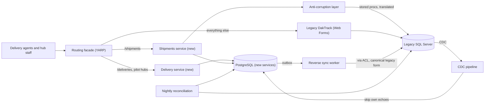
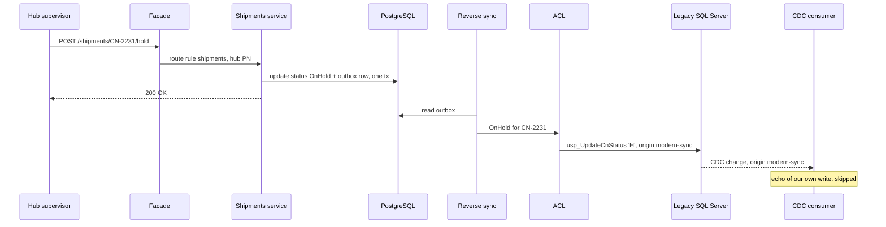
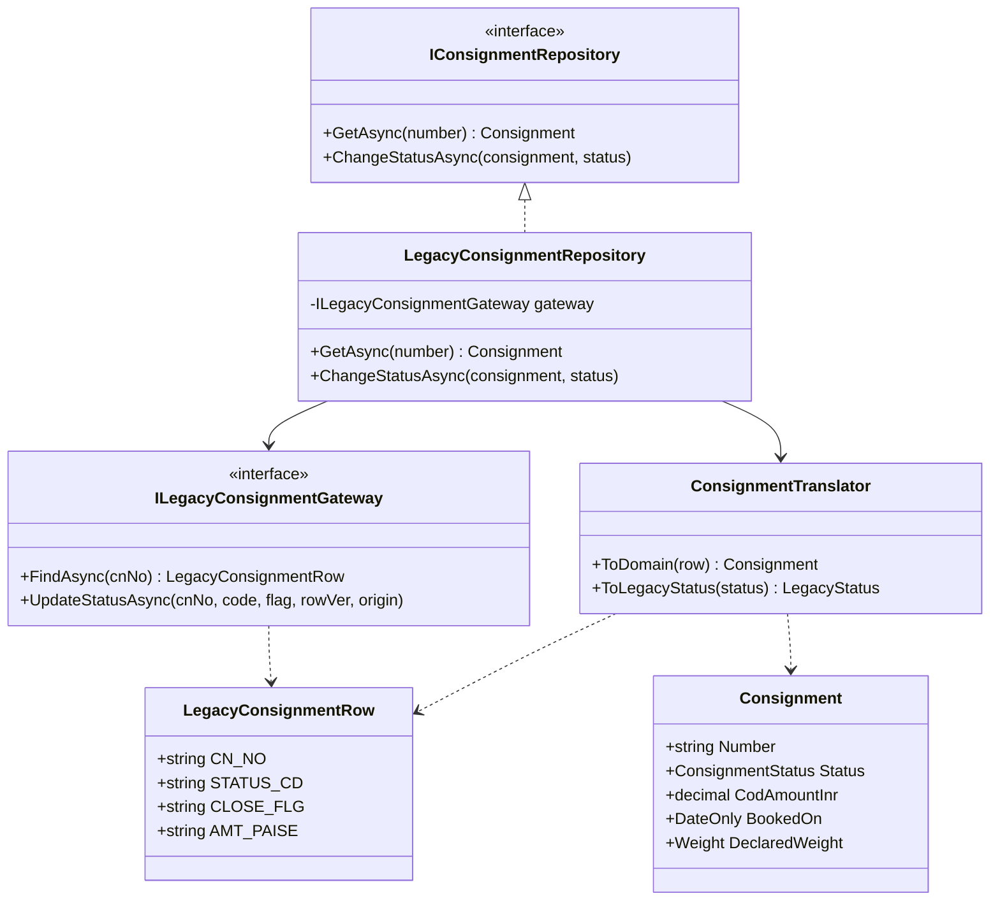

Most systems you will work on already exist. The big rewrite ("freeze features for 18 months, then switch over one weekend") fails often enough that it has its own folklore. The **strangler fig** approach replaces a legacy system one slice at a time while it keeps running, and the **anti-corruption layer** keeps the new code from inheriting the old system's confusing model. This lesson migrates a 15-year-old parcel-delivery system to ASP.NET Core and PostgreSQL, feature by feature and hub by hub, with data kept in sync in both directions so that every step can be rolled back.

## Learning objectives

By the end of this lesson you will be able to:

1. Explain the strangler fig pattern and why incremental replacement beats a big-bang rewrite in most cases.
2. Put a routing facade in front of a legacy system and route by feature, by tenant or region, and by percentage.
3. Design an anti-corruption layer (ACL) that translates legacy data and concepts into a clean domain model, and back.
4. Choose a data strategy for each migration phase: shared database, CDC from legacy, reverse sync, and final ownership transfer.
5. Prevent sync loops and detect conflicting writes during bidirectional sync.
6. Plan cut-over with parallel runs, rollback paths and a decommission milestone.
7. Recognise the failure modes: the strangler that never finishes, ACLs that leak, proxies that add risk.
8. Know when an in-place refactor, a framework upgrade or a rewrite is the simpler choice.

## Prerequisites

- [Service boundaries and domain-driven decomposition](#/lesson/m16-service-boundaries): what the new pieces should be.
- [Adapter](#/lesson/m06-adapter) and [Facade](#/lesson/m06-facade): the building blocks of an ACL.
- [Transactional outbox](#/lesson/m12-outbox): publishing changes reliably from the new side.

## Explain it like I'm a beginner

A strangler fig is a tree that starts as a seed on a branch of an old tree. It grows roots down around the trunk. Over years its roots and branches take over, and eventually the old tree inside dies and rots away, leaving the fig standing in its shape. At no point was there "no tree".

Migrating software this way means: put a **doorman** in front of the old system (a routing facade). At first the doorman sends every visitor to the old system. Then you build one new room, say "delivery-attempt entries", and tell the doorman to send those visitors to the new room. Then the next room. When nobody is sent to the old building any more, you demolish it.

The new rooms still need some things from the old building, and the old building speaks a strange dialect: status `A` with flag `Y` means "delivered", amounts are text in paise, weights are written `2+450` for 2 kg 450 g, dates are `dd/MM/yyyy` strings. You do not want that dialect spreading into the new rooms. So you hire an **interpreter** who stands at the border, translating old words into new ones and back. That interpreter is the **anti-corruption layer**.

And because some visitors still use the old building for reports, every change made in a new room is copied back to the old building's records until the old building is gone (**data synchronisation**).

## First-principles explanation

### Why not rewrite?

A rewrite looks simpler: no compromises, no old code. In practice:

- **The old system is the specification.** Fifteen years of fixes encode rules nobody wrote down (a hub that rounds parcel weight up to the next 500 g instead of 100 g, a merchant category exempt from the fuel surcharge). A rewrite rediscovers them in production.
- **The business does not stop.** During an 18-month rewrite, the old system keeps changing, and the new one chases a moving target.
- **Value arrives at the end.** Nothing reaches users until cut-over day, which is also the riskiest day.
- **Cut-over is all or nothing.** If it fails, rolling back a whole system with weeks of new data is very hard.

The strangler fig turns one huge risky step into fifty small ones, each delivering value and each reversible.

### The running example

A regional parcel-delivery company runs **DakTrack**, a consignment-management system built in 2010: ASP.NET Web Forms, SQL Server, 600 stored procedures, one 140-column `CONSIGNMENT` table. It handles parcel bookings, delivery-attempt entries (recorded by delivery agents on their rounds: delivered, customer not home, address not found), cash-on-delivery (COD) remittances and invoices for merchant customers, and reports. About 4,000 users (hub staff, counter staff and delivery agents) across 38 hubs; around 20 requests per second at the evening peak when agents close their rounds (an estimate from 4,000 users × 60 requests in the busiest hour ÷ 3,600 s ≈ 67 per second at the very top, 20 per second sustained).

The target: ASP.NET Core 10 services on PostgreSQL 17, organised by bounded context: **Shipments** (consignments), **Delivery** (delivery attempts and proof of delivery), **Billing**. Constraints: the finance team's COD reconciliation and merchant-invoice reports still run from DakTrack's SQL Server for at least a year, and the company cannot freeze changes.

### The four parts of a strangler migration

1. **A routing facade** in front of the legacy system. Day one, it routes 100 % to legacy and changes nothing. This is the most important step: it gives you a place to switch traffic. In ASP.NET Core this is usually **YARP** (Yet Another Reverse Proxy), or an API gateway, or an existing load balancer with path rules.
2. **New capabilities** built one at a time, each owning a slice of behaviour (and eventually its data).
3. **An anti-corruption layer** wherever new code must talk to legacy code or data.
4. **Data synchronisation** so both systems see consistent data while they coexist.

### Choosing the first slice

Pick a slice that is:

- **Valuable**: users feel the improvement (the delivery-attempt entry screen is slow and not mobile-friendly; delivery agents suffer on every round).
- **Loosely coupled**: few stored procedures and tables touch it.
- **Low risk**: mistakes are recoverable (a delivery-attempt entry can be corrected; a COD remittance paid to a merchant cannot be taken back).
- **Representative**: it exercises the facade, ACL and sync, so you learn the hard parts early.

Read-only features (dashboards, search, reports) are often the easiest first slice: the new service reads replicated data and never writes to legacy.

### Routing by feature, by tenant and by percentage

The facade decides, per request, which backend serves it:

- **By feature (path)**: `/deliveries/*` goes to the new Delivery service; everything else goes to DakTrack.
- **By tenant or region**: Delivery is live for the Pune and Nashik hubs only. The hub comes from the user's claims or a header.
- **By percentage**: 10 % of users get the new screen. Use a **stable hash** of the user id, not a random number per request, so a user does not bounce between old and new screens. Raising the percentage from 10 to 20 must keep the first 10 % on the new side (a monotonic bucket).
- **Kill switch**: one configuration flag sends a feature back to legacy instantly. This only works if legacy data is still up to date, which is why sync matters.

Order of precedence matters and should be explicit: kill switch first, then explicit tenant lists, then percentage.

These are feature flags with a routing job. If you already run a flag system, use it for the percentages and kill switches instead of inventing configuration: `Microsoft.FeatureManagement` has percentage and targeting filters (users and groups, so a hub can be a group) and reads flags from configuration or Azure App Configuration, and OpenFeature gives a vendor-neutral API in front of whichever flag provider you use. Keep the precedence rules in one tested class either way, and delete migration flags once a slice is retired; old flags are their own kind of legacy.

Sessions and authentication must work on both sides. Common approaches: move authentication to a shared identity provider (OpenID Connect) early, so both systems accept the same token; or use the **System.Web adapters** from Microsoft, which let ASP.NET Core share session and authentication with an ASP.NET Framework app during incremental migration.

### The anti-corruption layer

Eric Evans named the anti-corruption layer in *Domain-Driven Design*: when your model must interact with another system's model, put a layer between them that translates, so the other model's concepts do not leak into yours.

Legacy DakTrack has these "corruptions":

| Legacy | Meaning | New model |
|---|---|---|
| `STATUS_CD = 'A'`, `CLOSE_FLG = 'Y'` | Delivered (the 2014 "close" feature reused active status plus a flag) | `ConsignmentStatus.Delivered` |
| `STATUS_CD = 'H'` | On hold (for example, held at the hub for an address check) | `ConsignmentStatus.OnHold` |
| `AMT_PAISE = '0000482500'` | COD amount ₹4,825.00 as zero-padded text in paise | `decimal CodAmountInr = 4825.00m` |
| `BOOKED_DT = '05/11/2025'` | Day first: 5 November 2025 | `DateOnly(2025, 11, 5)` |
| `WT_DECL = '2+450'` | Declared weight: 2 kg 450 g | `Weight(2450)` grams |
| `WT_DECL = ''` | Not applicable (document envelopes are charged flat) | `null` |
| `HUB_CD = 'PN'` | Hub code | `HubCode = "PN"` |

The ACL usually has three parts:

- **A facade or gateway** that hides how you reach legacy (stored procedure calls, a SOAP endpoint, screen-scraping, a replicated table).
- **A translator** that maps legacy shapes to domain objects and back. It is pure code, easy to test with "golden" examples taken from real legacy rows.
- **An adapter** that implements a port defined by the new domain (`IConsignmentRepository`), so the domain does not know legacy exists.

Rules for a good ACL:

- **Translate at the border, once.** No legacy codes inside domain classes, ever.
- **Fail loudly on unknown values.** An unknown status code should raise a `LegacyDataException` with the field and value, and be logged and counted; silently mapping it to "Active" corrupts data.
- **Translate both ways.** Writes back to legacy need the canonical legacy form (`Delivered` → `STATUS_CD = 'C'`, `CLOSE_FLG = 'Y'`), even if legacy also accepts the odd `'A'` + `'Y'` form.
- **Keep it temporary but well-built.** The ACL lives as long as legacy does, often years. Test it like production code.

An ACL is also useful permanently, not only in migrations: wrapping a partner's API or an ERP system whose model you do not control.

### Data during the migration

Data is the hardest part. For each entity, decide **who owns writes** in each phase.

| Phase | Writes owned by | Data flow | Rollback possible? |
|---|---|---|---|
| 0. Facade only | Legacy | none | Yes, trivially |
| 1. New reads | Legacy | CDC from legacy DB → new DB | Yes: route reads back |
| 2. New writes, legacy still used for reports | New service | New DB → outbox → reverse sync into legacy DB | Yes, while reverse sync keeps legacy current |
| 3. Legacy retired for this entity | New service | Reverse sync stopped | Only by restoring from backup |

**Phase 1: read from a replica.** Capture changes from the legacy database with change data capture (SQL Server has built-in CDC; Debezium can stream it to Kafka) and build the new service's own tables from them. See [Change data capture](#/lesson/m16-cdc). The new service never reads legacy tables directly at request time, so legacy load and schema do not leak in.

**Phase 2: move writes.** The new service becomes the owner. It writes to its PostgreSQL database and an outbox in one transaction; a sync worker applies those changes to legacy tables (through the ACL, translating to legacy form) so that legacy reports and screens that have not moved yet stay correct.

**Avoid dual writes.** Writing to both databases from the request handler ("save to PostgreSQL, then save to SQL Server") fails halfway sooner or later, leaving them inconsistent with no record of which one is right. Write to one owner and sync asynchronously, with an outbox.

**Avoid sync loops.** During phase 2, changes flow both ways for different entities, and sometimes the same entity (a legacy batch job still marks parcels "returned to origin" at night). A change written by the new service to legacy is captured by CDC and arrives back at the new service. Without protection, it is applied again, which triggers another sync, and so on. Defences:

- **Origin marker.** The sync writer sets a column (`LAST_UPD_BY = 'modern-sync'`) or uses a dedicated database login; the CDC consumer skips changes with that origin (echoes).
- **Version check.** Apply a change only if its version is newer than the last version applied for that key; drop stale ones.
- **Conflict detection.** If a change from the other side arrives while your own write to the same row is still in flight, you have a conflict. Log it, count it and pick a rule (owner wins, or park for a human). During a migration, conflicts should be rare; a non-zero rate means ownership is not as clear as you thought.

**Reconcile.** Run a nightly comparison of row counts and checksums per hub between legacy and new databases. Investigate any difference before it becomes a month of drift.

### Verifying before cut-over: parallel runs

For behaviour that must match legacy exactly (COD remittance and invoice calculations, surcharges, deductions), run both:

- **Shadow traffic (dark launch).** The facade sends the request to legacy (whose answer the user gets) and asynchronously to the new service, then compares results and logs differences. Only safe for reads or for writes into an isolated shadow store.
- **Parallel run of calculations.** For a month, compute every merchant invoice in both systems and compare. Each mismatch is either a bug in the new code or an undocumented legacy rule; both are worth knowing.

### Failure modes

| Failure | What it looks like | Mitigation |
|---|---|---|
| The strangler never finishes | Two systems for five years, double the operations cost | A decommission date per slice, tracked like a feature; budget for the last 20 % |
| ACL leaks | Domain code checks `STATUS_CD == "A"` | Code review rule and tests: legacy types only in the ACL namespace |
| Facade becomes a single point of failure | Proxy outage takes down old and new | Run it highly available; keep it thin (routing only, no business logic) |
| Facade adds latency | Every request gets an extra hop | Usually 1–3 ms in-region (estimate); measure it |
| Sync lag | Agent saves in the new screen, the old report does not show it | Measure lag; show "updated a few seconds ago"; move the report next |
| Sync loop | CPU and write volume climb with no user activity | Origin markers, version checks, alert on sync volume |
| Divergent rules | Same invoice computes differently in old and new | Parallel runs, golden tests from legacy data |
| Rollback impossible | Kill switch sends users to stale legacy data | Keep reverse sync running until the slice is retired |
| Shared database coupling | New service reads legacy tables directly at request time | Read from its own replica via CDC; ACL for any remaining calls |

### When a simpler alternative is better

- **Small system, small team.** If the legacy app is 20 screens and one database, a focused rewrite in a few months can be cheaper than building a facade, ACL and sync.
- **The problem is the framework, not the design.** If DakTrack's model is fine and only the platform is old, an in-place upgrade (for example the .NET Upgrade Assistant and System.Web adapters for incremental ASP.NET Core migration) moves you forward with less machinery than a full strangler with new databases.
- **Modularise in place.** Refactoring the monolith into modules ([modular monolith](#/lesson/m16-monolith-vs-microservices)) may deliver most of the benefit without new deployables.
- **Leave it alone.** A stable legacy system that rarely changes can simply be wrapped with an API and an ACL. Migration is not a goal in itself.
- **Buy.** If the capability is a commodity (HR, accounting), replacing it with a product may beat rebuilding it.

### What it costs

| You gain | You pay |
|---|---|
| Value delivered slice by slice | A facade, ACL and sync code that exist only for the migration |
| Every step reversible | Running two systems (and their teams) in parallel for months or years |
| Undocumented rules found early via parallel runs | Effort to compare and explain mismatches |
| A clean new model | Translation code and its tests |
| No big-bang cut-over day | Discipline to actually finish and decommission |

## Visual explanation

### Architecture during phase 2



Users always hit the facade. Delivery-attempt entries for pilot hubs and consignment screens go to the new services; everything else still goes to DakTrack. The Shipments service occasionally needs legacy-only data, which it gets through the ACL. CDC streams legacy changes into PostgreSQL so the new services have their own copy, skipping changes that the reverse sync itself wrote. The new services' changes leave through an outbox and the reverse sync worker writes them into SQL Server in legacy form, so old reports stay correct. Reconciliation compares the two stores every night.

### Sequence: putting a parcel on hold in the new system



The facade routes the request to the new Shipments service, which commits the change and an outbox row together and replies immediately. Moments later, the reverse sync worker translates the change through the ACL into the legacy stored-procedure call with the canonical code `'H'` and an origin marker. That write is captured by CDC like any other change, but the consumer recognises the origin and skips it, which is what prevents a sync loop.

### Class diagram: the anti-corruption layer



The domain owns `IConsignmentRepository` and `Consignment`, and knows nothing else. `LegacyConsignmentRepository` is the adapter that implements the domain's port. It uses `ILegacyConsignmentGateway` (the facade over stored procedures) and `ConsignmentTranslator` (pure mapping). Only these classes, in one namespace, ever see `LegacyConsignmentRow`. When legacy is retired, you replace the adapter with a PostgreSQL repository and the domain does not change.

## Step-by-step example

### Step 1: put the facade in, change nothing

Deploy YARP in front of DakTrack with a single catch-all route to legacy. Measure the added latency and error rate for a week. Nothing else changes, and that is the point: you now have a switch.

```json
{
  "ReverseProxy": {
    "Routes": {
      "legacy": { "ClusterId": "daktrack", "Match": { "Path": "{**catch-all}" } }
    },
    "Clusters": {
      "daktrack": { "Destinations": { "d1": { "Address": "https://daktrack.internal/" } } }
    }
  }
}
```

### Step 2: move authentication to a shared identity provider

Both DakTrack and the new services accept tokens from the company's OpenID Connect provider, so a user moving between old and new screens is not asked to log in again.

### Step 3: build the first read slice

The Shipments service gets its own `consignments` table, filled by CDC from `CONSIGNMENT` through the translator. The new "track a parcel" page reads only from PostgreSQL. Route it for two pilot hubs.

### Step 4: move writes, add reverse sync

Status changes ("put on hold", "mark delivered") move to the new service. It writes PostgreSQL plus outbox; the reverse sync worker updates SQL Server with origin `modern-sync`; the CDC consumer skips those echoes. Run reconciliation nightly.

### Step 5: expand, verify, retire

Raise the rollout hub by hub, then by percentage for the rest. When every consignment write has gone through the new service for a month with zero reconciliation differences, and the reports have moved, stop the reverse sync and remove the legacy screens. Record the decommission date. Then pick the next slice.

## Production-style C# implementation

The code below is the new side: a routing middleware with feature rules, a minimal forwarder (in production you would use YARP; it is a NuGet package, so here a hand-written forwarder keeps the example self-contained), the ACL, and the CDC consumer that skips echoes.

### Routing rules

```csharp file=Strangler/FeatureRouter.cs
using System.Security.Cryptography;
using System.Text;
using Microsoft.Extensions.Options;

namespace ParcelMigration.Strangler;

public enum Backend { Legacy, Modern }

public sealed class RouteRule
{
    public string Feature { get; set; } = "";
    public string PathPrefix { get; set; } = "";
    public List<string> Hubs { get; set; } = new();
    public int RolloutPercent { get; set; }
    public bool KillSwitch { get; set; }
}

public sealed class StranglerOptions
{
    public string LegacyBaseUrl { get; set; } = "https://daktrack.internal/";
    public List<RouteRule> Rules { get; set; } = new();
}

public sealed record RouteDecision(Backend Backend, string Feature, string Reason);

/// <summary>Kill switch, then explicit pilot hubs, then a stable percentage. Unmapped paths go to legacy.</summary>
public sealed class FeatureRouter(IOptionsMonitor<StranglerOptions> options)
{
    public RouteDecision Decide(string path, string? hub, string userKey)
    {
        var rule = options.CurrentValue.Rules
            .Where(r => r.PathPrefix.Length > 0 && path.StartsWith(r.PathPrefix, StringComparison.OrdinalIgnoreCase))
            .OrderByDescending(r => r.PathPrefix.Length)
            .FirstOrDefault();

        if (rule is null) return new(Backend.Legacy, "unmapped", "no rule");
        if (rule.KillSwitch) return new(Backend.Legacy, rule.Feature, "kill switch");
        if (hub is not null && rule.Hubs.Contains(hub, StringComparer.OrdinalIgnoreCase))
            return new(Backend.Modern, rule.Feature, "pilot hub");
        return StableBucket.Of(rule.Feature + ":" + userKey) < rule.RolloutPercent
            ? new(Backend.Modern, rule.Feature, "rollout bucket")
            : new(Backend.Legacy, rule.Feature, "outside rollout");
    }
}

/// <summary>Deterministic 0..99 bucket: a user stays on one side, and raising the percentage only adds users.</summary>
public static class StableBucket
{
    public static int Of(string key)
    {
        var hash = SHA256.HashData(Encoding.UTF8.GetBytes(key));
        return (int)(BitConverter.ToUInt32(hash, 0) % 100);
    }
}
```

### The facade middleware and a minimal forwarder

```csharp file=Strangler/StranglerMiddleware.cs
using System.Diagnostics;
using System.Security.Claims;
using Microsoft.Extensions.Options;

namespace ParcelMigration.Strangler;

public sealed class StranglerMiddleware(RequestDelegate next, FeatureRouter router, LegacyForwarder forwarder, ILogger<StranglerMiddleware> logger)
{
    public async Task InvokeAsync(HttpContext context)
    {
        var hub = context.User.FindFirstValue("hub") ?? context.Request.Headers["X-Hub"].FirstOrDefault();
        var userKey = context.User.FindFirstValue(ClaimTypes.NameIdentifier) ?? context.Connection.RemoteIpAddress?.ToString() ?? "anonymous";
        var decision = router.Decide(context.Request.Path.Value ?? "/", hub, userKey);

        Activity.Current?.SetTag("strangler.backend", decision.Backend.ToString());
        Activity.Current?.SetTag("strangler.feature", decision.Feature);
        context.Response.Headers["X-Served-By"] = decision.Backend.ToString().ToLowerInvariant();

        if (decision.Backend == Backend.Modern)
        {
            await next(context);
            return;
        }
        logger.LogDebug("Forwarding {Path} to legacy ({Reason})", context.Request.Path, decision.Reason);
        await forwarder.ForwardAsync(context);
    }
}

/// <summary>Stand-in for YARP's forwarder: copies method, path, headers and body to legacy, and the response back.</summary>
public sealed class LegacyForwarder(IHttpClientFactory httpClientFactory, IOptionsMonitor<StranglerOptions> options)
{
    private static readonly HashSet<string> HopByHop = new(StringComparer.OrdinalIgnoreCase)
    {
        "Connection", "Keep-Alive", "Transfer-Encoding", "Upgrade", "Proxy-Connection", "TE", "Trailer", "Host"
    };

    public async Task ForwardAsync(HttpContext context)
    {
        var target = new Uri(new Uri(options.CurrentValue.LegacyBaseUrl), context.Request.Path + context.Request.QueryString);
        using var request = new HttpRequestMessage(new HttpMethod(context.Request.Method), target);

        if (context.Request.ContentLength > 0 || context.Request.Headers.ContainsKey("Transfer-Encoding"))
            request.Content = new StreamContent(context.Request.Body);
        foreach (var (name, values) in context.Request.Headers)
        {
            if (HopByHop.Contains(name)) continue;
            if (!request.Headers.TryAddWithoutValidation(name, values.ToArray()))
                request.Content?.Headers.TryAddWithoutValidation(name, values.ToArray());
        }
        request.Headers.TryAddWithoutValidation("X-Forwarded-Host", context.Request.Host.Value);

        var client = httpClientFactory.CreateClient("legacy");
        try
        {
            using var response = await client.SendAsync(request, HttpCompletionOption.ResponseHeadersRead, context.RequestAborted);
            context.Response.StatusCode = (int)response.StatusCode;
            foreach (var (name, values) in response.Headers.Concat(response.Content.Headers))
                if (!HopByHop.Contains(name)) context.Response.Headers[name] = values.ToArray();
            await response.Content.CopyToAsync(context.Response.Body, context.RequestAborted);
        }
        catch (HttpRequestException)
        {
            context.Response.StatusCode = StatusCodes.Status502BadGateway;
        }
    }
}
```

### The new domain model and its port

```csharp file=Shipments/Consignment.cs
namespace ParcelMigration.Shipments;

public enum ConsignmentStatus { InTransit, OnHold, Delivered, Cancelled }

/// <summary>Parcel weight in grams, written by legacy as "kg+grams" (2+450 = 2,450 g).</summary>
public readonly record struct Weight(int Grams)
{
    public override string ToString() => $"{Grams / 1000}+{Grams % 1000:D3}";
}

public sealed record Consignment(
    string Number,
    string Description,
    ConsignmentStatus Status,
    decimal CodAmountInr,
    DateOnly BookedOn,
    Weight? DeclaredWeight,
    Weight? ActualWeight,
    string HubCode,
    int SourceVersion);

/// <summary>The domain's port. It has no idea legacy exists.</summary>
public interface IConsignmentRepository
{
    Task<Consignment?> GetAsync(string number, CancellationToken ct);
    Task ChangeStatusAsync(Consignment consignment, ConsignmentStatus newStatus, CancellationToken ct);
}

public sealed class ConsignmentService(IConsignmentRepository repository)
{
    public async Task<Consignment> PutOnHoldAsync(string number, CancellationToken ct)
    {
        var consignment = await repository.GetAsync(number, ct) ?? throw new KeyNotFoundException(number);
        if (consignment.Status is ConsignmentStatus.Delivered or ConsignmentStatus.Cancelled)
            throw new InvalidOperationException($"Consignment {number} is {consignment.Status} and cannot be put on hold.");
        await repository.ChangeStatusAsync(consignment, ConsignmentStatus.OnHold, ct);
        return consignment with { Status = ConsignmentStatus.OnHold };
    }
}
```

### The anti-corruption layer

```csharp file=Acl/LegacyConsignments.cs
using System.Globalization;
using ParcelMigration.Shipments;

namespace ParcelMigration.Acl;

/// <summary>The legacy CONSIGNMENT row exactly as DakTrack stores it. Never used outside this namespace.</summary>
public sealed record LegacyConsignmentRow(
    string CN_NO, string CN_DESC, string STATUS_CD, string CLOSE_FLG, string AMT_PAISE,
    string BOOKED_DT, string WT_DECL, string WT_ACT, string HUB_CD, int ROW_VER, string LAST_UPD_BY);

public sealed record LegacyStatus(string StatusCode, string CloseFlag);

public sealed class LegacyDataException(string field, string value, string cnNo)
    : Exception($"Legacy consignment {cnNo}: unexpected {field} value '{value}'")
{
    public string Field { get; } = field;
}

public interface ILegacyConsignmentGateway
{
    Task<LegacyConsignmentRow?> FindAsync(string cnNo, CancellationToken ct);

    /// <summary>Calls usp_UpdateCnStatus; fails if ROW_VER changed (legacy optimistic concurrency).</summary>
    Task UpdateStatusAsync(string cnNo, LegacyStatus status, int expectedRowVersion, string origin, CancellationToken ct);
}

public static class ConsignmentTranslator
{
    public const string SyncOrigin = "modern-sync";

    public static Consignment ToDomain(LegacyConsignmentRow r) => new(
        Number: r.CN_NO.Trim(),
        Description: r.CN_DESC.Trim(),
        Status: ToStatus(r),
        CodAmountInr: ToRupees(r),
        BookedOn: ToDate(r),
        DeclaredWeight: ToWeight(r.WT_DECL, "WT_DECL", r.CN_NO),
        ActualWeight: ToWeight(r.WT_ACT, "WT_ACT", r.CN_NO),
        HubCode: r.HUB_CD.Trim().ToUpperInvariant(),
        SourceVersion: r.ROW_VER);

    /// <summary>Canonical legacy form for writes, even though legacy also accepts 'A' + 'Y' for delivered.</summary>
    public static LegacyStatus ToLegacyStatus(ConsignmentStatus status) => status switch
    {
        ConsignmentStatus.InTransit => new("A", "N"),
        ConsignmentStatus.OnHold => new("H", "N"),
        ConsignmentStatus.Delivered => new("C", "Y"),
        ConsignmentStatus.Cancelled => new("X", "N"),
        _ => throw new ArgumentOutOfRangeException(nameof(status))
    };

    private static ConsignmentStatus ToStatus(LegacyConsignmentRow r) => (r.STATUS_CD.Trim().ToUpperInvariant(), r.CLOSE_FLG.Trim().ToUpperInvariant()) switch
    {
        ("A", "Y") => ConsignmentStatus.Delivered,            // 2014 "close" feature reused active + flag
        ("A", _) => ConsignmentStatus.InTransit,
        ("H", _) => ConsignmentStatus.OnHold,
        ("C", _) => ConsignmentStatus.Delivered,
        ("X", _) => ConsignmentStatus.Cancelled,
        _ => throw new LegacyDataException("STATUS_CD", r.STATUS_CD, r.CN_NO)
    };

    private static decimal ToRupees(LegacyConsignmentRow r) =>
        long.TryParse(r.AMT_PAISE.Trim(), NumberStyles.AllowLeadingSign, CultureInfo.InvariantCulture, out var paise)
            ? paise / 100m
            : throw new LegacyDataException("AMT_PAISE", r.AMT_PAISE, r.CN_NO);

    private static DateOnly ToDate(LegacyConsignmentRow r) =>
        DateOnly.TryParseExact(r.BOOKED_DT.Trim(), "dd/MM/yyyy", CultureInfo.InvariantCulture, DateTimeStyles.None, out var d)
            ? d
            : throw new LegacyDataException("BOOKED_DT", r.BOOKED_DT, r.CN_NO);

    private static Weight? ToWeight(string raw, string field, string cnNo)
    {
        var s = raw.Trim();
        if (s.Length == 0) return null;                          // document envelopes are charged flat: no weight
        var parts = s.Split('+');
        if (parts.Length == 2 && int.TryParse(parts[0], out var kg) && int.TryParse(parts[1], out var g) && g is >= 0 and < 1000)
            return new Weight(kg * 1000 + g);
        throw new LegacyDataException(field, raw, cnNo);
    }
}

/// <summary>The adapter: implements the domain's port on top of legacy, translating at the border.</summary>
public sealed class LegacyConsignmentRepository(ILegacyConsignmentGateway gateway, ILogger<LegacyConsignmentRepository> logger) : IConsignmentRepository
{
    public async Task<Consignment?> GetAsync(string number, CancellationToken ct)
    {
        var row = await gateway.FindAsync(number, ct);
        if (row is null) return null;
        try { return ConsignmentTranslator.ToDomain(row); }
        catch (LegacyDataException ex)
        {
            logger.LogError(ex, "ACL translation failed on field {Field}", ex.Field);   // count these; never guess
            throw;
        }
    }

    public Task ChangeStatusAsync(Consignment consignment, ConsignmentStatus newStatus, CancellationToken ct) =>
        gateway.UpdateStatusAsync(consignment.Number, ConsignmentTranslator.ToLegacyStatus(newStatus), consignment.SourceVersion,
            ConsignmentTranslator.SyncOrigin, ct);
}

public sealed class InMemoryLegacyConsignmentGateway : ILegacyConsignmentGateway
{
    private readonly Lock _gate = new();
    private readonly Dictionary<string, LegacyConsignmentRow> _rows = new(StringComparer.OrdinalIgnoreCase)
    {
        ["CN-2231"] = new("CN-2231", "Mixer grinder, Pune to Nashik", "A", "N", "0000482500", "05/11/2025", "2+450", "2+600", "PN", 7, "daktrack"),
        ["CN-3107"] = new("CN-3107", "Documents envelope, Nashik local", "A", "Y", "0000000000", "14/02/2026", "", "", "NS", 3, "daktrack")
    };

    public Task<LegacyConsignmentRow?> FindAsync(string cnNo, CancellationToken ct)
    {
        lock (_gate) return Task.FromResult(_rows.GetValueOrDefault(cnNo));
    }

    public Task UpdateStatusAsync(string cnNo, LegacyStatus status, int expectedRowVersion, string origin, CancellationToken ct)
    {
        lock (_gate)
        {
            var row = _rows.GetValueOrDefault(cnNo) ?? throw new KeyNotFoundException(cnNo);
            if (row.ROW_VER != expectedRowVersion) throw new InvalidOperationException($"{cnNo} changed in legacy (ROW_VER {row.ROW_VER}).");
            _rows[cnNo] = row with { STATUS_CD = status.StatusCode, CLOSE_FLG = status.CloseFlag, ROW_VER = row.ROW_VER + 1, LAST_UPD_BY = origin };
        }
        return Task.CompletedTask;
    }
}
```

### The CDC consumer: legacy changes into the new store, without echoes

```csharp file=Sync/LegacyChangeConsumer.cs
using ParcelMigration.Acl;
using ParcelMigration.Shipments;

namespace ParcelMigration.Sync;

/// <summary>One change captured from legacy CONSIGNMENT (for example by Debezium from SQL Server CDC).</summary>
public sealed record LegacyRowChanged(LegacyConsignmentRow Row, long Position);

public enum SyncOutcome { Applied, SkippedEcho, SkippedStale, Rejected }

public interface IModernConsignmentStore
{
    Consignment? Find(string number);
    void Upsert(Consignment consignment);
}

public sealed class InMemoryModernConsignmentStore : IModernConsignmentStore
{
    private readonly System.Collections.Concurrent.ConcurrentDictionary<string, Consignment> _rows = new(StringComparer.OrdinalIgnoreCase);
    public Consignment? Find(string number) => _rows.GetValueOrDefault(number);
    public void Upsert(Consignment consignment) => _rows[consignment.Number] = consignment;
}

public sealed class LegacyChangeConsumer(IModernConsignmentStore store, ILogger<LegacyChangeConsumer> logger)
{
    private long _rejected;
    public long RejectedCount => Interlocked.Read(ref _rejected);

    public SyncOutcome Apply(LegacyRowChanged change)
    {
        var row = change.Row;
        if (row.LAST_UPD_BY == ConsignmentTranslator.SyncOrigin)
        {
            // Our own reverse-sync write: do not apply it again, but remember the legacy version it produced,
            // so the next genuine legacy change is not mistaken for a stale one and later writes carry the right ROW_VER.
            var mine = store.Find(row.CN_NO.Trim());
            if (mine is not null && mine.SourceVersion < row.ROW_VER) store.Upsert(mine with { SourceVersion = row.ROW_VER });
            return SyncOutcome.SkippedEcho;
        }

        var current = store.Find(row.CN_NO.Trim());
        if (current is not null && current.SourceVersion >= row.ROW_VER)
            return SyncOutcome.SkippedStale;                                   // replay or out-of-order delivery

        try
        {
            store.Upsert(ConsignmentTranslator.ToDomain(row));
            return SyncOutcome.Applied;
        }
        catch (LegacyDataException ex)
        {
            Interlocked.Increment(ref _rejected);
            logger.LogError(ex, "Rejected legacy change at position {Position}; parked for data fix", change.Position);
            return SyncOutcome.Rejected;
        }
    }
}
```

### Wiring

```csharp file=Program.cs
using ParcelMigration.Acl;
using ParcelMigration.Strangler;
using ParcelMigration.Sync;
using ParcelMigration.Shipments;

var builder = WebApplication.CreateBuilder(args);

builder.Services.Configure<StranglerOptions>(builder.Configuration.GetSection("Strangler"));
builder.Services.PostConfigure<StranglerOptions>(o =>
{
    if (o.Rules.Count == 0)
        o.Rules.Add(new RouteRule { Feature = "shipments", PathPrefix = "/shipments", Hubs = ["PN", "NS"], RolloutPercent = 10 });
});
builder.Services.AddHttpClient("legacy", c => c.Timeout = TimeSpan.FromSeconds(30));
builder.Services.AddSingleton<FeatureRouter>();
builder.Services.AddSingleton<LegacyForwarder>();
builder.Services.AddSingleton<ILegacyConsignmentGateway, InMemoryLegacyConsignmentGateway>();
builder.Services.AddSingleton<IConsignmentRepository, LegacyConsignmentRepository>();
builder.Services.AddSingleton<ConsignmentService>();
builder.Services.AddSingleton<IModernConsignmentStore, InMemoryModernConsignmentStore>();
builder.Services.AddSingleton<LegacyChangeConsumer>();

var app = builder.Build();

app.UseMiddleware<StranglerMiddleware>();                 // before endpoints: legacy-routed requests never reach them

app.MapGet("/shipments/{number}", async (string number, IConsignmentRepository repo, CancellationToken ct) =>
    await repo.GetAsync(number, ct) is { } cn ? Results.Ok(cn) : Results.NotFound());

app.MapPost("/shipments/{number}/hold", async (string number, ConsignmentService service, CancellationToken ct) =>
{
    try { return Results.Ok(await service.PutOnHoldAsync(number, ct)); }
    catch (KeyNotFoundException) { return Results.NotFound(); }
    catch (InvalidOperationException ex) { return Results.Conflict(new { error = ex.Message }); }
});

app.Run();
```

In phase 2 the repository registration switches from `LegacyConsignmentRepository` to a PostgreSQL repository with an outbox, and a reverse-sync `BackgroundService` reads that outbox and calls `ILegacyConsignmentGateway.UpdateStatusAsync` with the sync origin. The domain service and endpoints do not change; that is the payoff of the port.

With YARP, the custom middleware is replaced by configuration plus a small transform or a custom `IProxyConfigFilter` that applies the same `FeatureRouter` logic:

```csharp
// Program.cs with the Yarp.ReverseProxy package (not compiled here)
builder.Services.AddReverseProxy().LoadFromConfig(builder.Configuration.GetSection("ReverseProxy"));
app.MapReverseProxy();
```

## Bad design vs good design

**Bad: legacy codes in the domain.**

```csharp
public bool IsDelivered(Consignment c) => c.StatusCd == "C" || (c.StatusCd == "A" && c.CloseFlg == "Y");
```

Every new feature now has to remember the 2014 quirk, and the quirk outlives the legacy system. **Good:** translate once in the ACL; the domain sees `ConsignmentStatus.Delivered`.

**Bad: dual writes from the request.**

```csharp
await _pg.SaveAsync(consignment, ct);
await _legacy.SaveAsync(consignment, ct);   // fails 0.1 % of the time: the two stores now disagree, silently
```

**Good:** write once to the owner with an outbox; sync asynchronously with retries, origin markers and reconciliation.

**Bad: silent defaults in translation.** `_ => ConsignmentStatus.InTransit` for unknown codes. A new legacy code `'R'` (returned to origin) appears from a stored-procedure change, and returned parcels show as in transit in the new app while merchants wait for them. **Good:** throw `LegacyDataException`, log the field and value, count it and alert.

**Bad: per-request random rollout.** Users flip between the old and new screens on every click, and support cannot reproduce issues. **Good:** a stable hash of user and feature, with the decision visible in a response header.

**Bad: no decommission plan.** Three years later, both systems still run, every change is made twice, and the facade has business logic in it. **Good:** each slice has a retirement date and an owner, and the facade only routes.

:::callout type=warning title="The rollback path is only as good as the reverse sync"
A kill switch that sends users back to legacy is useless if legacy has not received the last week of changes made in the new system. Keep reverse sync and reconciliation running until a slice is formally retired, and test the rollback (flip the switch in staging) before every rollout step.
:::

## Practical playground

The graph below is DakTrack today. Open it in the HLD canvas and design the phase-2 migration:

1. Insert an `api-gateway` (YARP) between users and DakTrack.
2. Add a new Shipments `app-server` with its own PostgreSQL `database`.
3. Add a `worker` for the CDC pipeline from SQL Server to PostgreSQL, and a `worker` for reverse sync.
4. Add a `scheduler` for nightly reconciliation and `monitoring` for sync lag, echo count and translation rejects.
5. Label the facade's routes: which paths, which hubs, which percentage.

:::playground type=hld title="Strangle the consignment-management system"
```json
{
  "nodes": [
    { "id": "users", "type": "client", "label": "4,000 users, 38 hubs", "props": { "rps": 20 } },
    { "id": "lb", "type": "load-balancer", "label": "Load balancer" },
    { "id": "wms", "type": "app-server", "label": "Legacy DakTrack (Web Forms)", "props": { "instances": 2 } },
    { "id": "sql", "type": "database", "label": "SQL Server (600 stored procedures)" },
    { "id": "reports", "type": "worker", "label": "Finance reports (SSRS)" }
  ],
  "edges": [
    { "from": "users", "to": "lb", "kind": "sync" },
    { "from": "lb", "to": "wms", "kind": "sync" },
    { "from": "wms", "to": "sql", "kind": "sync" },
    { "from": "reports", "to": "sql", "kind": "sync" }
  ]
}
```
:::

## Exercises

:::exercise id=m16-strangler-acl-ex1 difficulty=beginner kind=written title="Pick the first three slices"
DakTrack has these capabilities: (a) parcel tracking page (read-only, 40 % of traffic); (b) delivery-attempt entry by delivery agents (writes, painful on mobile); (c) merchant COD remittance and invoice calculation (moves money, complex surcharges and deductions); (d) finance reports run monthly from SQL Server; (e) user and role administration (rarely used). Propose the order of the first three slices, the routing rule for each (by path, hub or percentage), and the data strategy for each (CDC read copy, write ownership with reverse sync, or leave in legacy). Explain why COD remittance should not be first.
::acceptance
- The first slice is low-risk and valuable, typically (a) as a read slice on CDC data.
- Delivery-attempt entry is a write slice with reverse sync so legacy reports and remittances stay correct.
- COD remittance is deferred and needs a parallel run before cut-over.
- Each slice has a routing rule and a data strategy.
::hint
Which slice can be built without writing anything to legacy?
::hint
Which slice hurts users most today, and how bad is a mistake there?
::hint
What would you need to be confident a new remittance calculation matches 15 years of legacy rules?
::hint
Reports read SQL Server directly; what must keep SQL Server up to date while writes move?
::solution
1. **Parcel tracking (a)**: read slice. Route `/shipments/*` for two pilot hubs, then by percentage. Data: CDC from `CONSIGNMENT` into the Shipments service's PostgreSQL, translated by the ACL. Nothing is written to legacy, so the risk is display bugs only. It proves the facade, CDC and translator.
2. **Delivery-attempt entry (b)**: write slice. Route `/deliveries/*` by hub (agents work from one hub, which makes support easy). The Delivery service owns writes; an outbox and reverse sync keep SQL Server's delivery tables current, because COD remittances and finance reports still read them. Kill switch tested in staging.
3. **User and role administration (e)** or **finance reports (d)**: either is a reasonable third. Moving reports off SQL Server (to read PostgreSQL) is what eventually lets you stop reverse sync, so it is often the strategic third slice.

**Why not COD remittance first:** it moves money to merchants, has the most undocumented rules (surcharges, deductions, rounding, exemptions) and a mistake cannot be undone easily. It needs a parallel run (compute in both systems for a month, explain every difference) and should come after the team has learned the facade, ACL and sync on lower-risk slices.
::mistakes
- Starting with the hardest, most valuable slice "to prove the approach".
- Moving writes without reverse sync while reports still read legacy.
- Routing by random percentage for delivery agents, so support cannot tell which system someone used.
:::

:::exercise id=m16-strangler-acl-ex2 difficulty=beginner kind=code title="Translate legacy status and money"
Implement the core of the ACL translator for two legacy fields. `LegacyTranslator.ToStatus(statusCd, closeFlg)` maps legacy codes to `ShipmentStatus`, and `ToLegacy(status)` produces the canonical legacy form. `LegacyTranslator.ToRupees(amtPaise)` turns zero-padded paise text into rupees.
::requirements
- Inputs may have surrounding spaces and any letter case.
- `'A'` with close flag `'Y'` → `Delivered`; `'A'` otherwise → `InTransit`; `'H'` → `OnHold`; `'C'` → `Delivered`; `'X'` → `Cancelled`.
- Any other status code throws `LegacyDataException` whose `Field` is `"STATUS_CD"` and `Value` is the original input.
- `ToLegacy`: InTransit → ("A","N"), OnHold → ("H","N"), Delivered → ("C","Y"), Cancelled → ("X","N").
- `ToRupees("0000482500")` = 4825.00m. A leading `-` is allowed. Empty or non-numeric text throws `LegacyDataException` with `Field` `"AMT_PAISE"`.
::acceptance
- All five status mappings, including the overloaded `'A'` + `'Y'`.
- Unknown codes fail loudly with field and value.
- The reverse mapping is canonical.
- Money conversion handles padding, sign and spaces, and rejects garbage.
::hint
Normalise first: `Trim().ToUpperInvariant()` on both inputs.
::hint
A tuple switch `(code, flag) switch { ("A", "Y") => ..., ("A", _) => ... }` puts the special case before the general one.
::hint
`long.TryParse(text, NumberStyles.AllowLeadingSign, CultureInfo.InvariantCulture, out var paise)` then divide by `100m`.
::hint
Remember to keep the original (untrimmed) value in the exception for debugging.
::starter
```csharp file=LegacyTranslator.cs
using System;
using System.Globalization;

public enum ShipmentStatus { InTransit, OnHold, Delivered, Cancelled }

public sealed class LegacyDataException : Exception
{
    public LegacyDataException(string field, string value) : base($"Unexpected {field} value '{value}'")
    {
        Field = field;
        Value = value;
    }

    public string Field { get; }
    public string Value { get; }
}

public static class LegacyTranslator
{
    public static ShipmentStatus ToStatus(string statusCd, string closeFlg) => throw new NotImplementedException();

    public static (string StatusCd, string CloseFlg) ToLegacy(ShipmentStatus status) => throw new NotImplementedException();

    public static decimal ToRupees(string amtPaise) => throw new NotImplementedException();
}
```
::tests
```csharp file=LegacyTranslatorTests.cs
using Xunit;

public class LegacyTranslatorTests
{
    [Theory]
    [InlineData("A", "N", ShipmentStatus.InTransit)]
    [InlineData("A", "", ShipmentStatus.InTransit)]
    [InlineData("A", "Y", ShipmentStatus.Delivered)]
    [InlineData(" a ", "y", ShipmentStatus.Delivered)]
    [InlineData("H", "N", ShipmentStatus.OnHold)]
    [InlineData("C", "Y", ShipmentStatus.Delivered)]
    [InlineData("X", "N", ShipmentStatus.Cancelled)]
    public void Maps_legacy_status(string code, string flag, ShipmentStatus expected) =>
        Assert.Equal(expected, LegacyTranslator.ToStatus(code, flag));

    [Fact]
    public void Unknown_status_fails_loudly()
    {
        var ex = Assert.Throws<LegacyDataException>(() => LegacyTranslator.ToStatus("R ", "N"));
        Assert.Equal("STATUS_CD", ex.Field);
        Assert.Equal("R ", ex.Value);
    }

    [Fact]
    public void Reverse_mapping_is_canonical()
    {
        Assert.Equal(("C", "Y"), LegacyTranslator.ToLegacy(ShipmentStatus.Delivered));
        Assert.Equal(("H", "N"), LegacyTranslator.ToLegacy(ShipmentStatus.OnHold));
        Assert.Equal(("A", "N"), LegacyTranslator.ToLegacy(ShipmentStatus.InTransit));
        Assert.Equal(("X", "N"), LegacyTranslator.ToLegacy(ShipmentStatus.Cancelled));
    }

    [Fact]
    public void Converts_paise_text_to_rupees()
    {
        Assert.Equal(4825.00m, LegacyTranslator.ToRupees("0000482500"));
        Assert.Equal(8750.50m, LegacyTranslator.ToRupees(" 0000875050 "));
        Assert.Equal(-125.00m, LegacyTranslator.ToRupees("-12500"));
    }

    [Fact]
    public void Rejects_bad_amounts()
    {
        Assert.Equal("AMT_PAISE", Assert.Throws<LegacyDataException>(() => LegacyTranslator.ToRupees("")).Field);
        Assert.Equal("AMT_PAISE", Assert.Throws<LegacyDataException>(() => LegacyTranslator.ToRupees("4,825.00")).Field);
    }
}
```
::solution
Normalise, switch on the tuple with the special case first, and throw with the original value.

```csharp file=LegacyTranslator.cs
using System;
using System.Globalization;

public enum ShipmentStatus { InTransit, OnHold, Delivered, Cancelled }

public sealed class LegacyDataException : Exception
{
    public LegacyDataException(string field, string value) : base($"Unexpected {field} value '{value}'")
    {
        Field = field;
        Value = value;
    }

    public string Field { get; }
    public string Value { get; }
}

public static class LegacyTranslator
{
    public static ShipmentStatus ToStatus(string statusCd, string closeFlg)
    {
        var code = (statusCd ?? "").Trim().ToUpperInvariant();
        var flag = (closeFlg ?? "").Trim().ToUpperInvariant();
        return (code, flag) switch
        {
            ("A", "Y") => ShipmentStatus.Delivered,
            ("A", _) => ShipmentStatus.InTransit,
            ("H", _) => ShipmentStatus.OnHold,
            ("C", _) => ShipmentStatus.Delivered,
            ("X", _) => ShipmentStatus.Cancelled,
            _ => throw new LegacyDataException("STATUS_CD", statusCd ?? "")
        };
    }

    public static (string StatusCd, string CloseFlg) ToLegacy(ShipmentStatus status) => status switch
    {
        ShipmentStatus.InTransit => ("A", "N"),
        ShipmentStatus.OnHold => ("H", "N"),
        ShipmentStatus.Delivered => ("C", "Y"),
        ShipmentStatus.Cancelled => ("X", "N"),
        _ => throw new ArgumentOutOfRangeException(nameof(status))
    };

    public static decimal ToRupees(string amtPaise)
    {
        var text = (amtPaise ?? "").Trim();
        return long.TryParse(text, NumberStyles.AllowLeadingSign, CultureInfo.InvariantCulture, out var paise)
            ? paise / 100m
            : throw new LegacyDataException("AMT_PAISE", amtPaise ?? "");
    }
}
```

Build the test cases from real legacy rows ("golden" examples): export 1,000 rows, translate them all in a test, and fail on any exception. That one test usually finds the undocumented codes before production does.
::mistakes
- Putting `("A", _)` before `("A", "Y")`, so delivered parcels appear in transit.
- Defaulting unknown codes to `Active`.
- Parsing amounts with `double`, losing paise precision.
- Using the current culture, so a server with a different locale parses differently.
:::

:::exercise id=m16-strangler-acl-ex3 difficulty=intermediate kind=code title="A cut-over router with stable rollout"
Implement `CutoverRouter`, which decides for each request whether the legacy or modern backend serves it. Rules are matched by **longest path prefix**. Precedence: kill switch → legacy; hub in the rule's pilot list → modern; otherwise a stable bucket of `feature + ":" + userId` below `RolloutPercent` → modern; else legacy. Unmapped paths go to legacy. Use the provided `Bucket.Of`.
::requirements
- `CutoverRouter(IEnumerable<CutoverRule> rules)`; `Route(path, hub, userId)` returns `Side.Legacy` or `Side.Modern`.
- Prefix matching is case-insensitive; the longest matching prefix wins.
- Hub comparison is case-insensitive; `hub` may be null.
- The same user always gets the same answer for a feature, and increasing `RolloutPercent` never moves a user from modern back to legacy.
::acceptance
- Longest prefix wins (`/shipments/labels` can have a different rule from `/shipments`).
- Kill switch overrides pilot hubs.
- 0 % sends everyone to legacy, 100 % everyone to modern, 30 % about 30 % of users.
- Rollout is monotonic.
::hint
Filter rules whose prefix matches, then `OrderByDescending(r => r.PathPrefix.Length).FirstOrDefault()`.
::hint
Check the kill switch before anything else.
::hint
Monotonic rollout comes for free from `Bucket.Of(key) < percent`: a user in bucket 7 is modern at 10 % and still modern at 20 %.
::hint
```csharp
if (rule is null || rule.KillSwitch) return Side.Legacy;
if (hub is not null && rule.PilotHubs.Contains(hub, StringComparer.OrdinalIgnoreCase)) return Side.Modern;
return Bucket.Of(rule.Feature + ":" + userId) < rule.RolloutPercent ? Side.Modern : Side.Legacy;
```
::starter
```csharp file=CutoverRouter.cs
using System;
using System.Collections.Generic;
using System.Linq;
using System.Security.Cryptography;
using System.Text;

public enum Side { Legacy, Modern }

public sealed record CutoverRule(string Feature, string PathPrefix, IReadOnlyList<string> PilotHubs, int RolloutPercent, bool KillSwitch = false);

public static class Bucket
{
    /// <summary>Stable 0..99 bucket for a key (provided, do not change).</summary>
    public static int Of(string key) => (int)(BitConverter.ToUInt32(SHA256.HashData(Encoding.UTF8.GetBytes(key)), 0) % 100);
}

public sealed class CutoverRouter
{
    public CutoverRouter(IEnumerable<CutoverRule> rules) => throw new NotImplementedException();

    public Side Route(string path, string? hub, string userId) => throw new NotImplementedException();
}
```
::tests
```csharp file=CutoverRouterTests.cs
using System;
using System.Linq;
using Xunit;

public class CutoverRouterTests
{
    private static CutoverRule Shipments(int percent, bool kill = false) =>
        new("shipments", "/shipments", new[] { "PN", "NS" }, percent, kill);

    [Fact]
    public void Unmapped_paths_go_to_legacy() =>
        Assert.Equal(Side.Legacy, new CutoverRouter(new[] { Shipments(100) }).Route("/invoices/77", "PN", "u1"));

    [Fact]
    public void Pilot_hubs_go_modern_case_insensitively() =>
        Assert.Equal(Side.Modern, new CutoverRouter(new[] { Shipments(0) }).Route("/Shipments/CN-1", "pn", "u1"));

    [Fact]
    public void Kill_switch_beats_pilot_hub() =>
        Assert.Equal(Side.Legacy, new CutoverRouter(new[] { Shipments(100, kill: true) }).Route("/shipments/CN-1", "PN", "u1"));

    [Fact]
    public void Longest_prefix_wins()
    {
        var router = new CutoverRouter(new[]
        {
            Shipments(100),
            new CutoverRule("shipment-labels", "/shipments/labels", Array.Empty<string>(), 0)
        });
        Assert.Equal(Side.Modern, router.Route("/shipments/CN-1", null, "u1"));
        Assert.Equal(Side.Legacy, router.Route("/shipments/labels/CN-1", null, "u1"));
    }

    [Fact]
    public void Percentages_are_respected()
    {
        var users = Enumerable.Range(0, 10_000).Select(i => "user-" + i).ToList();
        Assert.All(users.Take(200), u => Assert.Equal(Side.Legacy, new CutoverRouter(new[] { Shipments(0) }).Route("/shipments/1", null, u)));
        Assert.All(users.Take(200), u => Assert.Equal(Side.Modern, new CutoverRouter(new[] { Shipments(100) }).Route("/shipments/1", null, u)));
        var thirty = new CutoverRouter(new[] { Shipments(30) });
        var modern = users.Count(u => thirty.Route("/shipments/1", null, u) == Side.Modern);
        Assert.InRange(modern, 2_700, 3_300);
    }

    [Fact]
    public void Rollout_is_stable_and_monotonic()
    {
        var at10 = new CutoverRouter(new[] { Shipments(10) });
        var at20 = new CutoverRouter(new[] { Shipments(20) });
        foreach (var u in Enumerable.Range(0, 2_000).Select(i => "u" + i))
        {
            Assert.Equal(at10.Route("/shipments/1", "MU", u), at10.Route("/shipments/9", "MU", u));
            if (at10.Route("/shipments/1", "MU", u) == Side.Modern)
                Assert.Equal(Side.Modern, at20.Route("/shipments/1", "MU", u));
        }
    }
}
```
::solution
```csharp file=CutoverRouter.cs
using System;
using System.Collections.Generic;
using System.Linq;
using System.Security.Cryptography;
using System.Text;

public enum Side { Legacy, Modern }

public sealed record CutoverRule(string Feature, string PathPrefix, IReadOnlyList<string> PilotHubs, int RolloutPercent, bool KillSwitch = false);

public static class Bucket
{
    /// <summary>Stable 0..99 bucket for a key (provided, do not change).</summary>
    public static int Of(string key) => (int)(BitConverter.ToUInt32(SHA256.HashData(Encoding.UTF8.GetBytes(key)), 0) % 100);
}

public sealed class CutoverRouter
{
    private readonly IReadOnlyList<CutoverRule> _rules;

    public CutoverRouter(IEnumerable<CutoverRule> rules) =>
        _rules = rules.OrderByDescending(r => r.PathPrefix.Length).ToList();     // longest prefix first

    public Side Route(string path, string? hub, string userId)
    {
        var rule = _rules.FirstOrDefault(r => path.StartsWith(r.PathPrefix, StringComparison.OrdinalIgnoreCase));
        if (rule is null || rule.KillSwitch) return Side.Legacy;
        if (hub is not null && rule.PilotHubs.Contains(hub, StringComparer.OrdinalIgnoreCase)) return Side.Modern;
        return Bucket.Of(rule.Feature + ":" + userId) < rule.RolloutPercent ? Side.Modern : Side.Legacy;
    }
}
```

Sorting once in the constructor makes each decision a short linear scan; with a few dozen rules that is plenty. Including the feature name in the bucket key means a user who is in the first 10 % for shipments is not automatically in the first 10 % for every feature, which spreads the risk of early adopters.
::alternatives
Route by tenant, hub or organisation id instead of user id when a whole office should switch together (so colleagues see the same screens). Use a feature-flag service for the percentages if one already exists (`Microsoft.FeatureManagement` targeting filters, or an OpenFeature provider), but keep the precedence rules in one tested place.
::mistakes
- Using `Random` per request, which makes users bounce between systems.
- Matching the first rule in configuration order rather than the longest prefix.
- Hashing only the user id, so the same users are always the guinea pigs for every feature.
:::

:::exercise id=m16-strangler-acl-ex4 difficulty=intermediate kind=hld title="Design the data flow for phase 2"
Delivery-attempt entries (about 15,000 a day, peaking at 3,000 in the four evening hours when agents close their rounds) are moving to the new Delivery service on PostgreSQL. COD remittances (still in DakTrack) and finance reports read the legacy `DLV_ATTEMPT` table. A nightly legacy job also updates `DLV_ATTEMPT.VERIFIED_FLG` when a hub supervisor verifies proof of delivery in DakTrack. Extend the starter graph: facade, new service, CDC, reverse sync, loop prevention, reconciliation and monitoring. State the write owner for each field, and how rollback works.
::acceptance
- The Delivery service owns entry creation and edits; legacy still owns `VERIFIED_FLG` until verification moves.
- Reverse sync writes new entries into `DLV_ATTEMPT` with an origin marker; CDC brings `VERIFIED_FLG` changes back, skipping echoes.
- No dual writes from the request path.
- Reconciliation and sync-lag monitoring are present, with a rollback story.
::hint
Field-level ownership is allowed during migration: who writes `outcome`, who writes `VERIFIED_FLG`?
::hint
3,000 entries in an afternoon is about 0.2 per second (3,000 ÷ 4 h ÷ 3,600 s). What does that say about sync throughput?
::hint
What must be true about `DLV_ATTEMPT` for the kill switch to send agents back to DakTrack safely?
::starter
```json
{
  "nodes": [
    { "id": "eng", "type": "client", "label": "Delivery agents (mobile)" },
    { "id": "wms", "type": "app-server", "label": "Legacy DakTrack" },
    { "id": "sql", "type": "database", "label": "SQL Server (DLV_ATTEMPT, remittances)" },
    { "id": "night", "type": "scheduler", "label": "Nightly verification job" }
  ],
  "edges": [
    { "from": "eng", "to": "wms", "kind": "sync" },
    { "from": "wms", "to": "sql", "kind": "sync" },
    { "from": "night", "to": "sql", "kind": "sync" }
  ]
}
```
::solution
```json
{
  "nodes": [
    { "id": "eng", "type": "client", "label": "Delivery agents (mobile)" },
    { "id": "gw", "type": "api-gateway", "label": "YARP facade: /deliveries by hub" },
    { "id": "ms", "type": "app-server", "label": "Delivery service", "props": { "instances": 2 } },
    { "id": "pg", "type": "database", "label": "PostgreSQL: entries + outbox", "props": { "replicas": 1 } },
    { "id": "wms", "type": "app-server", "label": "Legacy DakTrack (remittances, verification)" },
    { "id": "sql", "type": "database", "label": "SQL Server (DLV_ATTEMPT, remittances)" },
    { "id": "night", "type": "scheduler", "label": "Nightly verification job (owns VERIFIED_FLG)" },
    { "id": "rs", "type": "worker", "label": "Reverse sync via ACL, origin=modern-sync" },
    { "id": "cdc", "type": "worker", "label": "CDC from DLV_ATTEMPT, skips modern-sync echoes" },
    { "id": "rec", "type": "scheduler", "label": "Nightly reconciliation: counts and checksums per hub" },
    { "id": "mon", "type": "monitoring", "label": "Sync lag, echo and conflict counts, translation rejects" }
  ],
  "edges": [
    { "from": "eng", "to": "gw", "kind": "sync" },
    { "from": "gw", "to": "ms", "kind": "sync", "label": "pilot hubs" },
    { "from": "gw", "to": "wms", "kind": "sync", "label": "everything else" },
    { "from": "ms", "to": "pg", "kind": "sync", "label": "entry + outbox, one tx" },
    { "from": "rs", "to": "pg", "kind": "async", "label": "read outbox" },
    { "from": "rs", "to": "sql", "kind": "sync", "label": "insert/update DLV_ATTEMPT" },
    { "from": "wms", "to": "sql", "kind": "sync" },
    { "from": "night", "to": "sql", "kind": "sync", "label": "VERIFIED_FLG" },
    { "from": "cdc", "to": "sql", "kind": "async", "label": "change stream" },
    { "from": "cdc", "to": "pg", "kind": "sync", "label": "apply VERIFIED_FLG, version check" },
    { "from": "rec", "to": "pg", "kind": "sync" },
    { "from": "rec", "to": "sql", "kind": "sync" },
    { "from": "mon", "to": "rs", "kind": "sync" },
    { "from": "mon", "to": "cdc", "kind": "sync" }
  ]
}
```

**Ownership.** The Delivery service owns creating and editing attempt entries (outcome, time, GPS location, photo or OTP proof). Legacy still owns `VERIFIED_FLG` because verification has not moved. Field-level ownership is explicit and documented; neither side writes the other's fields.

**Flow.** An entry is saved to PostgreSQL with an outbox row in one transaction. The reverse sync worker inserts or updates `DLV_ATTEMPT` through the ACL, setting `LAST_UPD_BY = 'modern-sync'`, so remittances and reports keep working. CDC on `DLV_ATTEMPT` brings verification changes back; changes whose origin is `modern-sync` are skipped (echoes), and a version check discards stale ones.

**Throughput.** 3,000 entries in four hours is about 0.2 per second, so one sync worker is ample; sync lag should be seconds. Alert if lag exceeds 5 minutes in the evening, because the overnight COD remittance run is prepared from these entries.

**Rollback.** Because reverse sync keeps `DLV_ATTEMPT` current, the facade's kill switch can send pilot hubs back to DakTrack screens at any time. Test it in staging before each rollout step. After rollback, CDC keeps the new store current, so rolling forward again is also safe.

**Reconciliation.** Nightly per hub: entry counts and a checksum of (entry id, outcome, VERIFIED_FLG) in both stores. Any difference opens a ticket the next morning.
::mistakes
- Letting the Delivery service write `VERIFIED_FLG` while the nightly job also writes it.
- Writing to SQL Server directly from the request handler (dual write).
- Forgetting that CDC will see the reverse sync's own writes.
:::

:::exercise id=m16-strangler-acl-ex5 difficulty=advanced kind=code title="A sync guard that stops loops and spots conflicts"
During bidirectional sync, each side receives change events from the other side's change stream, including echoes of its own writes. Implement `SyncGuard` for one side (for example `"modern"`). It decides for each incoming change whether to apply it, skip it as an echo, skip it as stale, or flag a conflict. Every row has a single version number assigned by the legacy database (`ROW_VER`), which increases by one per write.
::requirements
- `SyncGuard(string localOrigin)`.
- `RecordLocalWrite(key, baseVersion)`: this side has just written the row, based on `baseVersion`; its write will appear in the stream as version `baseVersion + 1` with origin `localOrigin`.
- `Evaluate(ChangeEvent e)` returns `SyncDecision`:
  - Origin equals `localOrigin` → `SkipEcho`. If it matches the pending local write for that key, clear the pending write. Also advance the last seen version for the key.
  - Version less than or equal to the last seen version for the key → `SkipStale`.
  - A pending local write exists for the key (not yet echoed) → `Conflict`; clear the pending write and advance the last seen version.
  - Otherwise → `Apply` and advance the last seen version.
- `Conflicts` counts conflicts.
::acceptance
- Echoes of local writes are never applied.
- Replayed or out-of-order old versions are skipped.
- A foreign change that lands while a local write is still pending is flagged as a conflict.
- After an echo clears the pending write, later foreign changes are applied normally.
::hint
Keep two dictionaries: last seen version per key, and pending base version per key.
::hint
Check the origin first: echoes are skipped even if their version looks new.
::hint
For the stale check, use `TryGetValue` and compare `e.Version <= last`.
::hint
A conflict means the other side wrote the row after our base version but before our write appeared; the legacy version check will have rejected one of the writes, so someone must look.
::hint
```csharp
if (e.Origin == _local) { ... return SyncDecision.SkipEcho; }
if (_lastSeen.TryGetValue(e.Key, out var last) && e.Version <= last) return SyncDecision.SkipStale;
if (_pending.Remove(e.Key)) { _lastSeen[e.Key] = e.Version; Conflicts++; return SyncDecision.Conflict; }
```
::starter
```csharp file=SyncGuard.cs
using System;
using System.Collections.Generic;

public sealed record ChangeEvent(string Key, long Version, string Origin);

public enum SyncDecision { Apply, SkipEcho, SkipStale, Conflict }

public sealed class SyncGuard
{
    public SyncGuard(string localOrigin) => throw new NotImplementedException();

    public int Conflicts => throw new NotImplementedException();

    public void RecordLocalWrite(string key, long baseVersion) => throw new NotImplementedException();

    public SyncDecision Evaluate(ChangeEvent e) => throw new NotImplementedException();
}
```
::tests
```csharp file=SyncGuardTests.cs
using Xunit;

public class SyncGuardTests
{
    [Fact]
    public void Foreign_changes_apply_once()
    {
        var g = new SyncGuard("modern");
        Assert.Equal(SyncDecision.Apply, g.Evaluate(new ChangeEvent("DA-1", 1, "daktrack")));
        Assert.Equal(SyncDecision.SkipStale, g.Evaluate(new ChangeEvent("DA-1", 1, "daktrack")));
        Assert.Equal(SyncDecision.Apply, g.Evaluate(new ChangeEvent("DA-1", 2, "daktrack")));
    }

    [Fact]
    public void Echoes_are_skipped()
    {
        var g = new SyncGuard("modern");
        g.Evaluate(new ChangeEvent("DA-2", 4, "daktrack"));
        g.RecordLocalWrite("DA-2", 4);
        Assert.Equal(SyncDecision.SkipEcho, g.Evaluate(new ChangeEvent("DA-2", 5, "modern")));
        Assert.Equal(SyncDecision.Apply, g.Evaluate(new ChangeEvent("DA-2", 6, "nightly-job")));
        Assert.Equal(0, g.Conflicts);
    }

    [Fact]
    public void Out_of_order_old_versions_are_stale()
    {
        var g = new SyncGuard("modern");
        g.Evaluate(new ChangeEvent("DA-3", 9, "daktrack"));
        Assert.Equal(SyncDecision.SkipStale, g.Evaluate(new ChangeEvent("DA-3", 7, "daktrack")));
    }

    [Fact]
    public void Foreign_change_while_local_write_pending_is_a_conflict()
    {
        var g = new SyncGuard("modern");
        g.Evaluate(new ChangeEvent("DA-4", 2, "daktrack"));
        g.RecordLocalWrite("DA-4", 2);
        Assert.Equal(SyncDecision.Conflict, g.Evaluate(new ChangeEvent("DA-4", 3, "nightly-job")));
        Assert.Equal(1, g.Conflicts);
        Assert.Equal(SyncDecision.Apply, g.Evaluate(new ChangeEvent("DA-4", 4, "daktrack")));
    }

    [Fact]
    public void Keys_are_independent()
    {
        var g = new SyncGuard("modern");
        g.RecordLocalWrite("DA-5", 1);
        Assert.Equal(SyncDecision.Apply, g.Evaluate(new ChangeEvent("DA-6", 1, "daktrack")));
    }
}
```
::solution
Order of checks: origin (echo), staleness, pending write (conflict), then apply.

```csharp file=SyncGuard.cs
using System;
using System.Collections.Generic;

public sealed record ChangeEvent(string Key, long Version, string Origin);

public enum SyncDecision { Apply, SkipEcho, SkipStale, Conflict }

public sealed class SyncGuard
{
    private readonly string _local;
    private readonly Dictionary<string, long> _lastSeen = new(StringComparer.Ordinal);
    private readonly Dictionary<string, long> _pending = new(StringComparer.Ordinal);   // key -> base version

    public SyncGuard(string localOrigin) => _local = localOrigin;

    public int Conflicts { get; private set; }

    public void RecordLocalWrite(string key, long baseVersion) => _pending[key] = baseVersion;

    public SyncDecision Evaluate(ChangeEvent e)
    {
        if (e.Origin == _local)
        {
            if (_pending.TryGetValue(e.Key, out var b) && e.Version == b + 1) _pending.Remove(e.Key);
            Advance(e);
            return SyncDecision.SkipEcho;
        }

        if (_lastSeen.TryGetValue(e.Key, out var last) && e.Version <= last) return SyncDecision.SkipStale;

        Advance(e);
        if (_pending.Remove(e.Key))
        {
            Conflicts++;
            return SyncDecision.Conflict;
        }
        return SyncDecision.Apply;
    }

    private void Advance(ChangeEvent e)
    {
        if (!_lastSeen.TryGetValue(e.Key, out var last) || e.Version > last) _lastSeen[e.Key] = e.Version;
    }
}
```

In production the "last seen version" lives in the target table itself (`source_version` column, applied with `WHERE source_version < @incoming`), and pending writes are rows in the reverse-sync outbox that have not yet been observed in the change stream. Conflicts go to a review queue and a counter; during a well-planned migration with field-level ownership, the counter should stay at zero.
::alternatives
Instead of origin markers, use a dedicated database login for reverse sync and filter by the user that made the change (SQL Server CDC does not record the user directly, so this often needs a trigger or an extra column). Another option is a per-row "sync token" written by the sync worker and compared on the way back.
::mistakes
- Checking staleness before origin, so an echo with a new version is applied.
- Never clearing pending writes, so every later foreign change looks like a conflict.
- Treating conflicts as errors that stop the sync, instead of counting and parking them.
::extensions
Add a pending-write timeout: if an echo has not appeared within 10 minutes, report "reverse sync lost a write" and clear it.
:::

## Automated testing

**Golden tests for the ACL.** Export a few thousand real rows (masked for personal data such as names, phone numbers and addresses) and keep them as test fixtures. A test translates every row and fails on any `LegacyDataException`; a second test round-trips domain → legacy → domain and asserts equality. When legacy changes a stored procedure, these tests catch new codes before production does.

```csharp
[Fact]
public void Translator_handles_every_golden_row()
{
    var rows = GoldenRows.Load("consignments_2026-09.json");          // masked export
    var failures = rows.Select(r => { try { ConsignmentTranslator.ToDomain(r); return null; } catch (LegacyDataException e) { return e.Message; } })
                       .Where(m => m is not null).ToList();
    Assert.Empty(failures);
}
```

**Router tests.** Precedence (kill switch, hubs, percentage), longest-prefix matching, stability and monotonic rollout, as in exercise 3. Also an end-to-end test with `WebApplicationFactory` asserting the `X-Served-By` header for a few paths and claims.

**Sync tests.** Echo skipping, stale versions, conflicts and replays (exercise 5). Feed the consumer the same change stream twice and assert the store is unchanged the second time.

**Parallel-run comparison.** For calculations, a job computes results in both systems and stores differences. The test is the report: the mismatch count per day must trend to zero before cut-over.

**Rollback drill.** In staging, flip the kill switch during a load test and assert that users see their latest data in legacy screens. If they do not, reverse sync is broken.

## Real-world application

- **Government and enterprise modernisation.** Moving mainframe, Web Forms or VB6 systems to web APIs is usually done feature by feature behind a gateway, with reports staying on the old database the longest.
- **ASP.NET Framework to ASP.NET Core.** Microsoft's recommended incremental approach puts an ASP.NET Core app with YARP in front of the Framework app and moves endpoints one at a time, using System.Web adapters for shared session and authentication.
- **Monolith to services.** E-commerce companies commonly strangle catalogue search first (read-only, on replicated data), then checkout last.
- **Partner and ERP integration.** An ACL around an ERP or a bank's API keeps their models (field names, status codes, units) out of your domain permanently, not just during a migration.
- **Data platform migrations.** Moving from one database engine to another with CDC replication, a period of reading from the new store, and a final cut-over of writes follows the same phases.

## Interview questions

:::interview
::q beginner
What is the strangler fig pattern?
::a
A way to replace a legacy system gradually. You put a routing facade in front of it, build new functionality one slice at a time, route that slice's traffic to the new system, and repeat until nothing is routed to the legacy system, which is then removed. Each step delivers value and can be rolled back, unlike a big-bang rewrite where everything changes on one cut-over day.
::q beginner
What is an anti-corruption layer?
::a
A translation layer between your model and another system's model, so the other system's concepts, codes and quirks do not leak into your code. It typically combines a facade or gateway (how you reach the other system), a translator (mapping data and concepts both ways), and an adapter that implements an interface your domain defines. Unknown values fail loudly rather than being guessed.
::q intermediate
How do you route traffic during an incremental migration?
::a
Through a facade such as YARP or an API gateway. Rules match by path (feature), and within a feature by tenant or region (pilot hubs) and by percentage. Percentages use a stable hash of the user or tenant and feature so a user always gets the same side and increasing the percentage only adds users. A kill switch per feature sends traffic back to legacy instantly. Authentication must work on both sides, usually through a shared identity provider or session-sharing adapters.
::q intermediate
Why are dual writes dangerous during a migration, and what do you do instead?
::a
Writing to the new and the legacy database from the same request will eventually fail between the two writes (timeout, crash, constraint), leaving the stores inconsistent with no record of which is right. Instead, give each entity (or field) one write owner per phase. The owner writes its database with an outbox in one transaction, and an asynchronous sync process applies the change to the other store with retries, origin markers and version checks. Nightly reconciliation detects drift.
::q advanced
How do you prevent sync loops in bidirectional synchronisation?
::a
Mark the origin of every write the sync process makes (a column, or a dedicated database login) and have the change-stream consumer skip changes with its own origin. Use a monotonically increasing version per row and apply a change only if it is newer than what you have, which also handles replays and reordering. Track your own in-flight writes; if a foreign change for the same row arrives before your write's echo, flag a conflict. Monitor sync volume: a loop shows up as writes with no user activity.
::q advanced
A strangler migration has been running for three years and both systems are still in production. What went wrong and how do you fix it?
::a
Usually there was no decommission plan per slice, the hardest slices (reports, batch jobs, integrations) were deferred indefinitely, and the facade or sync accumulated business logic, making both systems necessary. Fix: inventory what still uses legacy (traffic by route, report and job usage, inbound integrations), give each remaining item an owner and a retirement date, move reports to the new store early because they keep reverse sync alive, and set a target for legacy traffic reaching zero. Make the cost of running both visible. Sometimes the answer is to accept a small permanent legacy core and wrap it with an ACL, deliberately.
::q advanced
When would you not use the strangler fig pattern?
::a
When the system is small enough that a focused rewrite is cheaper than building a facade, ACL and sync; when the model is fine and only the platform is old, so an in-place upgrade works; when modularising the monolith delivers the benefit without new deployables; when the legacy system is stable and rarely changes, so wrapping it is enough; or when a commercial product can replace the capability.
:::

## Summary and revision

**Key takeaways**

- Strangle, do not rewrite: a facade first, then slice by slice, each reversible, until legacy can be removed.
- Route by feature, then tenant or region, then a stable, monotonic percentage; keep a tested kill switch.
- The ACL translates legacy codes, formats and concepts at the border, both ways, and fails loudly on the unknown.
- Each entity or field has one write owner per phase; never dual-write from the request path.
- Move reads first (CDC copy), then writes (outbox plus reverse sync), then retire.
- Prevent sync loops with origin markers and version checks; count conflicts.
- Parallel runs and golden tests find undocumented legacy rules before users do.
- Plan decommissioning from day one, or the migration never ends.

**Terminology**: strangler fig, routing facade, YARP, slice, pilot hub, stable bucket, kill switch, anti-corruption layer, translator, gateway, adapter, port, write owner, CDC, reverse sync, dual write, echo, origin marker, conflict, reconciliation, parallel run, shadow traffic, decommission.

:::flashcards
Q: What is the first step of a strangler fig migration?
A: Put a routing facade in front of the legacy system that sends 100 % of traffic to legacy, so you have a switch before changing anything.
Q: Three ways the facade can route a feature?
A: By path (feature), by tenant or region (pilot list), and by stable percentage of users, with a kill switch that overrides all.
Q: Why must percentage rollout use a stable hash?
A: So a user always lands on the same side, and raising the percentage only adds users instead of reshuffling them.
Q: Three parts of a typical anti-corruption layer?
A: A gateway or facade to reach legacy, a translator mapping both ways, and an adapter implementing the domain's port.
Q: What should the ACL do with an unknown legacy code?
A: Throw a specific exception with field and value, log and count it. Never map it to a default.
Q: What is a dual write and why avoid it?
A: Writing two stores from one request. A failure between the writes leaves them inconsistent with no record of the truth.
Q: How do you stop a sync loop?
A: Origin markers so echoes of your own writes are skipped, plus version checks so old changes are ignored.
Q: What keeps rollback possible after writes move to the new system?
A: Reverse sync keeping the legacy store current, until the slice is formally retired.
Q: What is a parallel run?
A: Computing the same results in old and new systems for a period and explaining every difference before cutting over.
:::

## Knowledge check

:::quiz pass=70
::q single
A team wants to migrate a 15-year-old system with 600 stored procedures. What should they deploy first?
- [ ] The new service for the most valuable feature.
- [x] A routing facade that sends all traffic to legacy, changing nothing.
- [ ] A new database with all legacy data copied in.
- [ ] A full rewrite behind a feature flag.
> The facade gives you a place to switch traffic, slice by slice. Everything else builds on it.
::q single
Users report that the new tracking screen and the old one alternate on each page load. What is the most likely cause?
- [ ] The kill switch is on.
- [x] Rollout percentage is decided with a random number per request instead of a stable hash.
- [ ] The ACL is translating statuses incorrectly.
- [ ] CDC lag.
> A stable bucket of user and feature keeps each user on one side.
::q single
A legacy row has `STATUS_CD = 'S'`, which the ACL does not know. What should happen?
- [ ] Map it to InTransit so the screen still works.
- [ ] Drop the row silently.
- [x] Throw a translation error with the field and value, log and count it, and fix the mapping.
- [ ] Store the raw code in the domain object.
> Guessing silently corrupts data in the new system; failing loudly finds undocumented codes quickly.
::q single
The new Delivery service saves an attempt entry to PostgreSQL and then to SQL Server in the same request. What is the risk?
- [ ] It is slower.
- [x] A failure between the two writes leaves the stores inconsistent with no record of which is right.
- [ ] SQL Server will deadlock.
- [ ] CDC will not work.
> This is a dual write. Use one owner with an outbox and asynchronous reverse sync.
::q single
After enabling reverse sync, write volume on both databases rises steadily at night with no users online. What is the likely cause?
- [ ] Reconciliation is too frequent.
- [x] A sync loop: reverse-sync writes come back through CDC and are applied and synced again.
- [ ] The facade is retrying requests.
- [ ] The rollout percentage is too high.
> Origin markers and version checks stop echoes from being reapplied.
::q multi
Which conditions must hold before you retire a slice's reverse sync? (Select all that apply.)
- [x] No legacy screens, reports or jobs read the data any more.
- [x] Reconciliation has shown no differences for an agreed period.
- [ ] The new service has been live for at least one day.
- [x] The team accepts that rollback to legacy now means restoring from backup.
- [ ] The facade has been removed.
> Reverse sync is what keeps rollback cheap; turning it off is a deliberate decision with clear preconditions.
::q single
Which slice is usually the best first candidate?
- [ ] Merchant COD remittance, because it is the most valuable.
- [x] A read-only page served from a CDC copy, for pilot hubs.
- [ ] User administration, because it is rarely used.
- [ ] Everything at once, to avoid running two systems.
> A read slice proves the facade, translator and CDC with low risk, and users notice the improvement.
::q single
The legacy app is 20 screens on one database, the model is sound, and only the framework is outdated. What is likely simplest?
- [ ] A strangler fig with new microservices and bidirectional sync.
- [x] An in-place framework upgrade or a short focused rewrite.
- [ ] An anti-corruption layer around the whole app.
- [ ] Leave it untouched forever.
> The strangler's machinery pays off for large, high-risk systems. Small, well-modelled ones rarely need it.
:::

## Completion criteria

You have finished this lesson when you can:

- [ ] Score at least 70 % on the knowledge check.
- [ ] Pass the tests for exercises 2, 3 and 5 with `dotnet test`.
- [ ] Draw the phase-2 architecture with facade, ACL, CDC, reverse sync and reconciliation from memory.
- [ ] For a legacy system you know, list three translation rules its ACL would need.
- [ ] Explain, for each migration phase, who owns writes and how rollback works.
