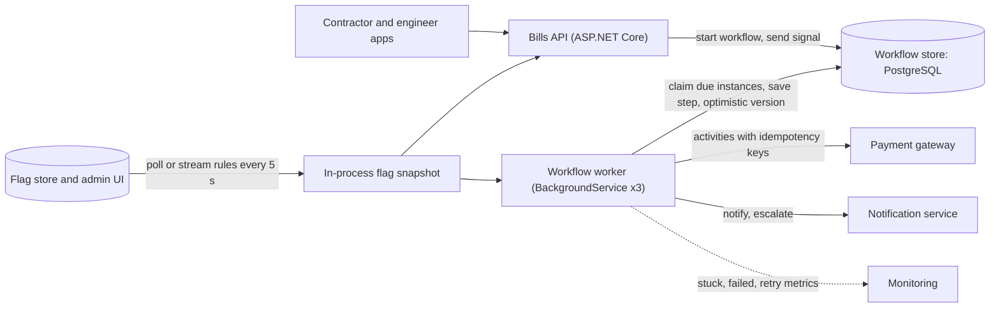
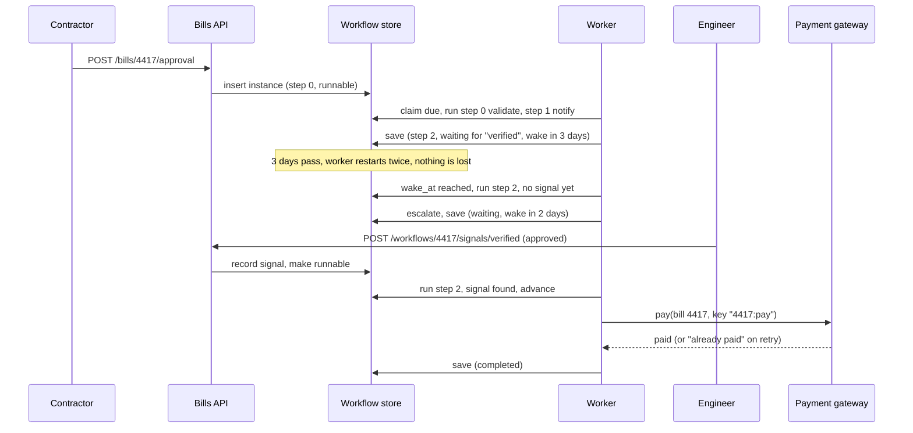
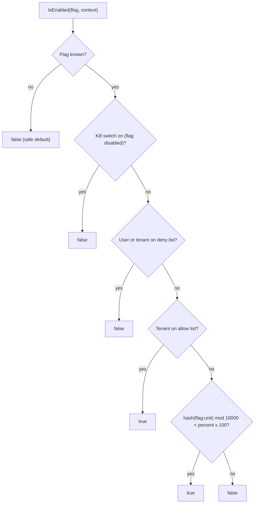

Some work finishes in 50 milliseconds. Some takes three weeks: a contractor's bill waits for an engineer's verification, gets escalated, is approved, and is paid. Code that "just waits three weeks" cannot live in a web request or in a `Task.Delay`. This lesson covers two tools for change and time: **workflow engines**, which make long processes durable, and **feature flags**, which let you switch new behaviour on gradually, and off instantly.

## Learning objectives

By the end of this lesson you will be able to:

1. Explain what "durable execution" means and why long-running processes need it.
2. Describe how Temporal, Azure Durable Functions and Elsa Workflows persist state, and why replay-based engines require deterministic workflow code.
3. Build a small, durable, step-based workflow runner in ASP.NET Core with persisted state, timers, signals, retries and optimistic concurrency.
4. Decide when a hand-rolled state table is enough and when an engine is worth its cost.
5. Describe the feature flag lifecycle and the four flag types (release, experiment, ops, permission).
6. Implement a flag evaluator with kill switches, targeting and deterministic percentage rollouts.
7. Name the failure modes of both tools: non-determinism, stuck workflows, flag debt, and flag-service outages.

## Prerequisites

- [Sagas and compensating transactions](#/lesson/m12-sagas): a workflow is often a saga's orchestrator.
- [Background processing and job queues](#/lesson/m11-background-processing): workers, schedules and retries.
- [Blue-green, canary and rolling deployments](#/lesson/m15-deployment-strategies): flags complement, not replace, deployment strategies.

## Explain it like I'm a beginner

**Workflows.** Picture a passport application. You submit a form, police verification happens days later, an officer approves, the passport is printed and posted. At every stage there is a file with a stamp showing where it is. If the officer goes on leave, the file waits on a desk; it does not vanish. If verification takes too long, someone escalates.

A computer program doing the same thing has a problem: programs crash, servers restart, and new versions are deployed every week. A variable in memory saying "waiting for police verification" disappears on restart. **Durable execution** means the program's progress is written down after every step, like the stamped file, so after any crash it picks up exactly where it stopped. A **workflow engine** is the office system that keeps those files, wakes them when a timer is due, and routes them to the next desk.

**Feature flags.** Picture a new metro line. Before opening it to everyone, the operator runs it for staff, then for one station's passengers in off-peak hours, then for everyone. If a signal fails, a controller presses one button and trains stop. A **feature flag** is that button and those rules in software: the new code is already deployed, but a flag decides who sees it. A **percentage rollout** turns it on for 5 % of users, then 25 %, then 100 %. A **kill switch** turns it off for everyone in seconds, without a deploy.

## First-principles explanation

### What a workflow is

A **workflow** (also called a process manager or orchestration) is a sequence of steps that:

- spans **time** (minutes to months),
- calls **other systems** (payments, email, a GST portal, a bank),
- **waits** for timers and human decisions, and
- must **finish correctly** despite crashes, retries and deploys.

Examples: an RA (running account) bill on a highway project from submission to payment; an e-commerce order from payment to delivery; employee onboarding; a loan from application to disbursal.

### The naive approach and why it fails

```csharp
// Anti-example: a "workflow" living in memory
public async Task ProcessBillAsync(Bill bill)
{
    await notifier.NotifyEngineerAsync(bill);
    await Task.Delay(TimeSpan.FromDays(3));          // lost on the next deploy
    if (!bill.IsVerified) await notifier.EscalateAsync(bill);
    await payments.PayAsync(bill);                   // retried after a crash? paid twice?
}
```

Every deploy kills the in-memory delay. A crash between "pay" and "mark paid" leaves you unsure whether the contractor was paid. Two pods could both run the same bill. There is no way to answer "where is bill 4417 right now?"

### Durable execution: two ways to remember progress

**1. Checkpointing state (a state machine in a table).** After each step, save `current_step`, data and `wake_at` to a database row. A worker finds rows that are due, runs the next step, and saves again. This is what most teams hand-roll, and what our C# example does. Elsa Workflows works in a broadly similar spirit: it persists workflow instances (via providers such as EF Core) and uses **bookmarks** to mark the point where an instance is waiting for a timer, an HTTP call or a signal.

**2. Event history and replay.** Temporal and Azure Durable Functions record an append-only **history** of everything that happened to a workflow: "activity *ReserveStock* scheduled", "activity completed with result X", "timer fired". When a worker needs to continue a workflow, it **re-runs the workflow function from the beginning**. Each time the code asks for an activity that already has a result in history, the engine returns the recorded result instead of executing it again. The function quickly "fast-forwards" to the first step with no recorded result, executes it, and the result is appended to history.

The replay model lets you write workflows as ordinary-looking code with loops, `if`s and local variables:

```csharp
// Durable Functions (isolated worker) style orchestrator — illustrative
[Function(nameof(BillApproval))]
public static async Task<string> BillApproval([OrchestrationTrigger] TaskOrchestrationContext ctx)
{
    var bill = ctx.GetInput<BillInput>()!;
    await ctx.CallActivityAsync(nameof(NotifyEngineer), bill);

    using var cts = new CancellationTokenSource();
    var deadline = ctx.CurrentUtcDateTime.AddDays(3);            // NOT DateTime.UtcNow
    var timeout = ctx.CreateTimer(deadline, cts.Token);           // durable timer
    var verified = ctx.WaitForExternalEvent<string>("Verified");  // human decision
    if (await Task.WhenAny(verified, timeout) == timeout)
        await ctx.CallActivityAsync(nameof(Escalate), bill);
    else cts.Cancel();

    return await ctx.CallActivityAsync<string>(nameof(ReleasePayment), bill);
}
```

```csharp
// Temporal .NET SDK style workflow — illustrative
[Workflow]
public class BillApprovalWorkflow
{
    private string? _decision;

    [WorkflowSignal]
    public Task VerifiedAsync(string decision) { _decision = decision; return Task.CompletedTask; }

    [WorkflowRun]
    public async Task<string> RunAsync(BillInput bill)
    {
        await Workflow.ExecuteActivityAsync((BillActivities a) => a.NotifyEngineerAsync(bill),
            new() { StartToCloseTimeout = TimeSpan.FromMinutes(1) });
        if (!await Workflow.WaitConditionAsync(() => _decision != null, TimeSpan.FromDays(3)))
            await Workflow.ExecuteActivityAsync((BillActivities a) => a.EscalateAsync(bill),
                new() { StartToCloseTimeout = TimeSpan.FromMinutes(1) });
        return await Workflow.ExecuteActivityAsync((BillActivities a) => a.ReleasePaymentAsync(bill),
            new() { StartToCloseTimeout = TimeSpan.FromMinutes(5) });
    }
}
```

### The price of replay: determinism

Because the workflow function re-runs many times, it must make **the same decisions in the same order** every time, given the same history. Anything that can differ between runs breaks replay:

| Forbidden in workflow code | Why | Use instead |
|---|---|---|
| `DateTime.UtcNow`, `TimeProvider.System` | Different value on replay | The engine's clock (`ctx.CurrentUtcDateTime`, `Workflow.UtcNow`) |
| `Guid.NewGuid()`, `Random` | Different value on replay | The engine's deterministic helpers (`ctx.NewGuid()`, `Workflow.Random`) or an activity |
| HTTP calls, database queries, file I/O | Result may differ; side effect repeats | An **activity** |
| `Task.Delay`, `Thread.Sleep` | Not recorded; lost on restart | A **durable timer** |
| Reading config or feature flags directly | May change between replays | Read once in an activity, or pass as input |
| Reordering steps in a new deploy | History no longer matches the code | Versioning/patching APIs, or new workflow type |

**Activities** are where real work happens. They run at least once (they may be retried after a timeout), so **activities must be idempotent**: "release payment for bill 4417" must pass an idempotency key so a retry does not pay twice.

**Versioning** is the hardest operational problem. Workflows started last month are still running when you deploy new code. Engines give you tools for it: Temporal has patching APIs (`Workflow.Patched`) and worker versioning; Durable Functions guidance includes deploying changed orchestrators side by side under a new name or task hub. The safe habit is: never change the order of activity calls in a running workflow type without a versioning mechanism.

### The three engines in one paragraph each

- **Temporal** (open source, also a managed cloud service): a cluster (frontend, history, matching services) persists workflow histories in a database (Cassandra, PostgreSQL or MySQL) and dispatches tasks to **workers** you run, through named **task queues**. Your workers host workflow and activity code. Strengths: language SDKs including .NET, very long workflows, strong visibility into every history event. Cost: another stateful platform to operate (or pay for).
- **Azure Durable Functions**: an extension of Azure Functions built on the Durable Task Framework. Orchestrator, activity and entity functions; state stored by a storage provider (Azure Storage by default, with alternatives such as MSSQL and the managed Durable Task Scheduler). Strengths: serverless scaling, familiar to Azure teams. Cost: tied to the Functions hosting model and its constraints.
- **Elsa Workflows**: an open-source .NET library you embed in your own ASP.NET Core app. Workflows can be defined in C# or in a visual designer, persisted through pluggable providers, and resumed through bookmarks. Strengths: in-process, designer for business users, no separate cluster. Cost: you own scaling, persistence and upgrades.

Others you will meet: AWS Step Functions (state machines as JSON, managed), Camunda (BPMN diagrams, common in banking and government), and Netflix Conductor-style orchestrators.

### When a hand-rolled state table is enough

A table like this, plus a worker, covers many real systems:

```sql
CREATE TABLE workflow_instance (
  id           text PRIMARY KEY,
  type         text NOT NULL,
  step         int  NOT NULL,
  status       text NOT NULL,          -- runnable | waiting | completed | failed
  data         jsonb NOT NULL,
  wake_at      timestamptz,
  version      bigint NOT NULL DEFAULT 0,
  locked_until timestamptz            -- lease, so a crashed worker's claim expires
);
CREATE INDEX workflow_due ON workflow_instance (wake_at) WHERE status IN ('runnable', 'waiting');

-- A worker claims up to 50 due instances without blocking other workers:
SELECT id FROM workflow_instance
WHERE status IN ('runnable', 'waiting') AND coalesce(wake_at, now()) <= now()
  AND (locked_until IS NULL OR locked_until < now())
ORDER BY wake_at NULLS FIRST
LIMIT 50
FOR UPDATE SKIP LOCKED;
```

Choose hand-rolled when: steps are few and mostly linear, volume is modest, the team already runs PostgreSQL well, and you need full control over data (data residency rules for government projects, for example). Choose an engine when: you have many workflow types with branching, loops, parallel fan-out and long timers; you need visibility and history out of the box; or volume is high enough that you would end up rebuilding an engine anyway.

**Back-of-the-envelope (estimates).**

- RA bills: 5,000 projects × 4 bills a month = 20,000 workflows a month, about 10 steps each = 200,000 step executions a month ≈ **0.08 steps/s**. A table and one worker are plenty.
- Order fulfilment: 2 M orders a day × 8 activities = 16 M activity executions a day ÷ 86,400 ≈ **185/s** average, ×3 peak ≈ **560/s**. If each activity writes 3 history events, the persistence store absorbs about **1,700 writes/s** at peak. This is where an engine designed for sharded history (Temporal's history shards, for example) earns its keep, or where your hand-rolled table needs partitioning and careful indexing.

### What breaks first in workflow systems

1. **The persistence store.** Every step is a write. Hot rows (a single "counter" workflow updated by thousands of events) cause contention.
2. **Stuck workflows.** A workflow waits for a signal that never comes (the approving engineer left the company). Always pair waits with timeouts and escalation.
3. **Non-determinism after a deploy.** Replays fail for in-flight workflows. Run replay tests against recorded histories in CI.
4. **Poison steps.** An activity that always fails is retried forever. Cap retries, then move the workflow to a "needs attention" state with an alert.
5. **Timer storms.** One million workflows all scheduled to wake at 00:00 on the 1st of the month. Add jitter to wake-up times.

### Feature flags: decouple deploy from release

**Deploying** puts code on servers. **Releasing** lets users experience it. Feature flags separate the two: you deploy dark (flag off), then release by changing data, not code.

Pete Hodgson's classification (published on martinfowler.com) is the most useful:

| Type | Purpose | Lifetime | Example |
|---|---|---|---|
| **Release toggle** | Ship unfinished or risky code dark, release gradually | Days to weeks, then **delete** | New bill-upload screen |
| **Experiment toggle** | A/B test variants | Weeks | Two layouts for the tender list |
| **Ops toggle / kill switch** | Turn off an expensive or risky path under load or failure | Long-lived | Disable AI anomaly checks if the model endpoint is slow |
| **Permission toggle** | Enable features for specific tenants or plans | Long-lived | Premium analytics for one state agency |

### The flag lifecycle

1. **Create** the flag with an owner, a type, a description and an expiry date.
2. **Develop** behind the flag, off in production, on in dev and test.
3. **Internal**: enable for staff tenants.
4. **Percentage rollout**: 1 % → 5 % → 25 % → 50 % → 100 %, watching error rates and latency at each step (pair this with a canary deploy and an [SLO](#/lesson/m14-sli-slo-sla)).
5. **Fully on**: remove the flag check and the old code path.
6. **Delete** the flag definition.

Step 5 is where teams fail. Every flag doubles the number of possible code paths. Ten long-forgotten release flags mean 1,024 combinations nobody tests. Treat flag removal as part of "done", track flag age, and alert on release flags older than, say, 60 days.

### How a percentage rollout must work

A 10 % rollout must be:

- **Sticky (deterministic).** The same user sees the same variant on every request and every server. Random-per-request flicker breaks user experience and experiments.
- **Monotonic.** Users in the 10 % group must still be in at 25 %. Otherwise raising the percentage flips some users *off*.
- **Independent per flag.** The first 10 % for flag A should not be the same users as the first 10 % for flag B, or the same unlucky users get every risky feature.

The standard technique: **hash `flagKey + ":" + userId`** with a stable hash, take the result modulo 10,000 to get a bucket from 0 to 9,999, and enable the flag when `bucket < percent × 100`. Including the flag key gives independence. Using a fixed threshold gives monotonicity. A cryptographic or well-mixed non-cryptographic hash gives an even spread.

Never use `string.GetHashCode()` for this. In .NET it is **randomised per process**, so the same user lands in different buckets on different servers and after every restart.

Choose the **rollout unit** deliberately: user id for UI features, tenant id when a whole organisation must see the same behaviour (for example, a new bill format that a state department audits), device id for anonymous traffic.

### Evaluation architecture

At 3,000 requests per second with 5 flag checks per request, you make 15,000 flag evaluations per second. A remote call per check (say 2 ms each) would add 10 ms per request and make the flag service a critical dependency of everything. So:

- **Evaluate locally.** Each app instance holds an in-memory snapshot of all flag rules and evaluates in microseconds. Vendor SDKs (LaunchDarkly, Unleash, Flagsmith, Azure App Configuration with Microsoft.FeatureManagement) and the OpenFeature standard API all follow this model.
- **Refresh the snapshot** by polling every few seconds or by a streaming connection (server-sent events). The kill-switch latency equals this refresh delay; for ops toggles, aim for seconds.
- **Survive the flag service being down.** Keep the last-known snapshot. On a cold start with no snapshot, use **safe code defaults**: new features off, kill switches in their "normal" position.
- **Audit every change.** Who turned the flag on for 50 % at 18:02? Flags change production behaviour exactly like a deploy does.

### Flags and workflows together

Flags and durable workflows interact in one dangerous way: a workflow that reads a flag *inside replayed workflow code* can take a different branch on replay. Read the flag once (in an activity, or when the workflow starts) and store the decision in workflow state. Our C# runner does this by evaluating the flag in the step and recording the decision in the instance data.

## Visual explanation

### Architecture: a durable workflow service with flags



Read it left to right. The API never runs long work; it only starts workflows and records signals ("engineer verified the bill"). Three identical worker instances claim instances that are due from the workflow store, run one step, and save the new state with a version check, so two workers can never both advance the same instance. Activities call external systems with idempotency keys so retries are safe. Every API and worker instance holds a flag snapshot refreshed from the flag store; flag checks never leave the process. The dotted line is the operational lifeline: alerts for stuck and failed workflows.

### Sequence: a bill waits, escalates and gets paid



The important moments: the instance is saved after every step, so the two restarts during the wait cost nothing; the timeout produces an escalation instead of an eternal wait; the signal is stored in the instance, so it is not lost even if no worker is running at that moment; and payment uses a stable idempotency key derived from the workflow id, so a retry after a crash cannot pay twice.

### Flag evaluation order



Evaluation goes from the most decisive rule to the least. The kill switch is checked first so that nothing, not even an allow list, can override an emergency stop. Unknown flags fall back to `false`, so a typo or a missing snapshot never accidentally enables an unfinished feature. The percentage check is last and is deterministic, so a user's answer only changes when someone edits the rule.

## Step-by-step example

We will move one feature through its life: an **AI anomaly check** that flags suspicious line items in RA bills before an engineer sees them.

### Step 1 — deploy dark

The code ships with flag `bills.ai-anomaly-check`, type *release*, owner "Digital team", expiry in 45 days. Rule: `Enabled = true` (no kill), allow list empty, 0 %. Nobody sees it.

### Step 2 — internal tenants

Add the internal QA tenant to the allow list. Engineers test with real bills. The workflow step that runs the check **records the decision** (`ai_check = on/off`) into the instance data, so a bill started while the flag was on keeps its behaviour, even if the flag changes mid-workflow.

### Step 3 — 5 % rollout by tenant

Unit = tenant id, because a project office should not see the check on some bills and not others. 5 % of 400 tenants ≈ 20 tenants. Bucket for tenant `pwd-bihar` = hash("bills.ai-anomaly-check:pwd-bihar") mod 10,000 = say 312; 312 < 500, so it is in.

### Step 4 — an incident

The model endpoint slows to 8 seconds per call. Bill workflows pile up behind the activity. The on-call engineer flips the **kill switch** (`Enabled = false`). Within one snapshot refresh (5 seconds) every worker skips the check. Workflows that already recorded `ai_check = on` will still call the activity in their next step; that activity also checks a separate ops toggle, `ops.ai-model-calls`, and returns "skipped" when it is off. Two flags, two purposes: the release toggle decides *who gets the feature*; the ops toggle protects *the system*.

### Step 5 — 25 %, 50 %, 100 %

Raising to 25 % keeps every tenant from the 5 % group (monotonic) and adds about 80 more. Error rate and p95 latency are compared between flagged and unflagged tenants at each stage.

### Step 6 — clean up

At 100 % for two weeks with no incidents, delete the `if (flag)` branch, delete the old path, and delete the release flag. The ops toggle stays: it is a long-lived kill switch with a documented runbook.

## Production-style C# implementation

The sample is a bills service with a durable step-based workflow runner and an in-process flag evaluator. It runs offline: in-memory stores stand in for PostgreSQL and the flag service, behind interfaces.

```text
Bills.Api/
  Program.cs
  Flags/FlagModel.cs            flag definitions, context, evaluation result
  Flags/FlagEvaluator.cs        stable bucketing + rule evaluation
  Flags/FlagSnapshotCache.cs    last-known-good snapshot refreshed in the background
  Workflows/WorkflowModel.cs    instance, step results, store contract + in-memory store
  Workflows/WorkflowEngine.cs   start, signal, run due steps with retries and versions
  Workflows/RaBillApprovalWorkflow.cs   the business process
```

### Flags

```csharp file=Flags/FlagModel.cs
namespace Bills.Flags;

/// <summary>Who is asking. UnitId is what percentage rollouts hash: a user id, or a tenant id
/// when a whole organisation must see the same behaviour.</summary>
public sealed record EvaluationContext(string UnitId, string? TenantId = null, string? UserId = null);

public sealed record FlagDefinition(
    string Key,
    bool Enabled,                                   // false = kill switch: off for everyone
    double RolloutPercent,                          // 0..100, supports 0.5 %
    IReadOnlyCollection<string> AllowTenants,
    IReadOnlyCollection<string> DenyUnits,
    string Owner,
    DateOnly? ExpiresOn = null);

public sealed record FlagEvaluation(string Key, bool Value, string Reason);

public interface IFeatureFlags
{
    FlagEvaluation Evaluate(string key, EvaluationContext context);
    bool IsEnabled(string key, EvaluationContext context) => Evaluate(key, context).Value;
}
```

```csharp file=Flags/FlagEvaluator.cs
using System.Buffers.Binary;
using System.Security.Cryptography;
using System.Text;

namespace Bills.Flags;

public static class StableBucket
{
    public const int Buckets = 10_000;

    /// <summary>Deterministic bucket 0..9999 for (flag, unit). Same answer on every server and restart,
    /// unlike string.GetHashCode(), which is randomised per process.</summary>
    public static int Of(string flagKey, string unitId)
    {
        Span<byte> hash = stackalloc byte[32];
        SHA256.HashData(Encoding.UTF8.GetBytes($"{flagKey}:{unitId}"), hash);
        return (int)(BinaryPrimitives.ReadUInt32BigEndian(hash) % Buckets);
    }

    public static bool InRollout(string flagKey, string unitId, double percent) =>
        percent > 0 && (percent >= 100 || Of(flagKey, unitId) < percent * (Buckets / 100.0));
}

public interface IFlagSnapshotSource
{
    IReadOnlyDictionary<string, FlagDefinition> Current { get; }
}

public sealed class FlagEvaluator(IFlagSnapshotSource source) : IFeatureFlags
{
    public FlagEvaluation Evaluate(string key, EvaluationContext context)
    {
        if (!source.Current.TryGetValue(key, out var flag))
            return new(key, false, "unknown-flag-default-off");
        if (!flag.Enabled)
            return new(key, false, "kill-switch");
        if (flag.DenyUnits.Contains(context.UnitId) || (context.UserId is { } u && flag.DenyUnits.Contains(u)))
            return new(key, false, "denied");
        if (context.TenantId is { } t && flag.AllowTenants.Contains(t))
            return new(key, true, "tenant-allow-list");
        return StableBucket.InRollout(flag.Key, context.UnitId, flag.RolloutPercent)
            ? new(key, true, $"rollout-{flag.RolloutPercent}%")
            : new(key, false, "outside-rollout");
    }
}
```

The evaluator returns a **reason** along with the value. Log it with the request's trace, and support questions ("why does PWD Bihar see the new screen?") answer themselves.

```csharp file=Flags/FlagSnapshotCache.cs
using System.Collections.Frozen;

namespace Bills.Flags;

public interface IFlagRepository
{
    Task<IReadOnlyList<FlagDefinition>> LoadAllAsync(CancellationToken ct);
}

/// <summary>Stands in for a flag service or a PostgreSQL table edited by an admin UI.</summary>
public sealed class InMemoryFlagRepository : IFlagRepository
{
    private readonly Lock _gate = new();
    private readonly Dictionary<string, FlagDefinition> _flags = new(StringComparer.Ordinal);

    public void Upsert(FlagDefinition flag) { lock (_gate) _flags[flag.Key] = flag; }

    public Task<IReadOnlyList<FlagDefinition>> LoadAllAsync(CancellationToken ct)
    {
        lock (_gate) return Task.FromResult<IReadOnlyList<FlagDefinition>>(_flags.Values.ToList());
    }
}

/// <summary>Holds an immutable snapshot and swaps it atomically. If the repository is down,
/// the last-known-good snapshot keeps serving; on a cold start that fails, code defaults (off) apply.</summary>
public sealed class FlagSnapshotCache(IFlagRepository repository, TimeProvider time, ILogger<FlagSnapshotCache> log)
    : BackgroundService, IFlagSnapshotSource
{
    private volatile FrozenDictionary<string, FlagDefinition> _current =
        FrozenDictionary<string, FlagDefinition>.Empty;

    public IReadOnlyDictionary<string, FlagDefinition> Current => _current;
    public DateTimeOffset? LastRefreshed { get; private set; }

    public async Task RefreshAsync(CancellationToken ct)
    {
        var all = await repository.LoadAllAsync(ct);
        _current = all.ToFrozenDictionary(f => f.Key, StringComparer.Ordinal);
        LastRefreshed = time.GetUtcNow();
    }

    protected override async Task ExecuteAsync(CancellationToken stoppingToken)
    {
        while (!stoppingToken.IsCancellationRequested)
        {
            try { await RefreshAsync(stoppingToken); }
            catch (OperationCanceledException) when (stoppingToken.IsCancellationRequested) { break; }
            catch (Exception ex) { log.LogWarning(ex, "Flag refresh failed; serving snapshot from {At}", LastRefreshed); }
            // Kill-switch latency is at most this interval. Streaming (SSE) would make it near-instant.
            await Task.Delay(TimeSpan.FromSeconds(5), time, stoppingToken);
        }
    }
}
```

### The workflow model and store

```csharp file=Workflows/WorkflowModel.cs
namespace Bills.Workflows;

public enum WorkflowStatus { Runnable, Waiting, Completed, Failed }

public sealed class WorkflowInstance
{
    public required string Id { get; init; }
    public required string Type { get; init; }
    public int Step { get; set; }
    public WorkflowStatus Status { get; set; } = WorkflowStatus.Runnable;
    public DateTimeOffset? WakeAt { get; set; }
    public string? AwaitingSignal { get; set; }
    public Dictionary<string, string> Data { get; init; } = new(StringComparer.Ordinal);
    public long Version { get; set; }
    public int Attempts { get; set; }
    public string? Error { get; set; }

    public WorkflowInstance Clone() => new()
    {
        Id = Id, Type = Type, Step = Step, Status = Status, WakeAt = WakeAt, AwaitingSignal = AwaitingSignal,
        Data = new Dictionary<string, string>(Data, StringComparer.Ordinal), Version = Version,
        Attempts = Attempts, Error = Error
    };
}

public enum StepOutcome { Next, Wait, Complete, Fail }

/// <summary>What a step asks the engine to do next. Wait = sleep until a timer or a signal, then resume at ResumeAt.</summary>
public sealed record StepResult(StepOutcome Outcome, int? ResumeAt = null, TimeSpan? Timeout = null, string? Signal = null, string? Reason = null)
{
    public static StepResult Next() => new(StepOutcome.Next);
    public static StepResult GoTo(int step) => new(StepOutcome.Next, ResumeAt: step);
    public static StepResult WaitFor(string signal, TimeSpan timeout, int resumeAt) => new(StepOutcome.Wait, resumeAt, timeout, signal);
    public static StepResult Sleep(TimeSpan delay, int resumeAt) => new(StepOutcome.Wait, resumeAt, delay);
    public static StepResult Complete() => new(StepOutcome.Complete);
    public static StepResult Fail(string reason) => new(StepOutcome.Fail, Reason: reason);
}

public interface IWorkflowDefinition
{
    string Type { get; }
    Task<StepResult> ExecuteStepAsync(WorkflowInstance instance, WorkflowStepContext context, CancellationToken ct);
}

public sealed record WorkflowStepContext(DateTimeOffset Now);

public interface IWorkflowStore
{
    /// <summary>Returns false if an instance with this id already exists (idempotent start).</summary>
    Task<bool> TryCreateAsync(WorkflowInstance instance, CancellationToken ct);
    Task<WorkflowInstance?> GetAsync(string id, CancellationToken ct);
    Task<IReadOnlyList<WorkflowInstance>> FindDueAsync(DateTimeOffset now, int max, CancellationToken ct);
    /// <summary>Optimistic concurrency: saves only if the stored version equals expectedVersion.</summary>
    Task<bool> TrySaveAsync(WorkflowInstance instance, long expectedVersion, CancellationToken ct);
}

public sealed class InMemoryWorkflowStore : IWorkflowStore
{
    private readonly Dictionary<string, WorkflowInstance> _rows = new(StringComparer.Ordinal);
    private readonly Lock _gate = new();

    public Task<bool> TryCreateAsync(WorkflowInstance instance, CancellationToken ct)
    {
        lock (_gate) return Task.FromResult(_rows.TryAdd(instance.Id, instance.Clone()));
    }

    public Task<WorkflowInstance?> GetAsync(string id, CancellationToken ct)
    {
        lock (_gate) return Task.FromResult(_rows.TryGetValue(id, out var w) ? w.Clone() : null);
    }

    public Task<IReadOnlyList<WorkflowInstance>> FindDueAsync(DateTimeOffset now, int max, CancellationToken ct)
    {
        lock (_gate)
            return Task.FromResult<IReadOnlyList<WorkflowInstance>>(_rows.Values
                .Where(w => w.Status == WorkflowStatus.Runnable || (w.Status == WorkflowStatus.Waiting && w.WakeAt <= now))
                .OrderBy(w => w.WakeAt ?? DateTimeOffset.MinValue)
                .Take(max).Select(w => w.Clone()).ToList());
    }

    public Task<bool> TrySaveAsync(WorkflowInstance instance, long expectedVersion, CancellationToken ct)
    {
        lock (_gate)
        {
            if (!_rows.TryGetValue(instance.Id, out var stored) || stored.Version != expectedVersion)
                return Task.FromResult(false);
            var copy = instance.Clone();
            copy.Version = expectedVersion + 1;
            _rows[instance.Id] = copy;
            return Task.FromResult(true);
        }
    }
}
```

In PostgreSQL, `TrySaveAsync` is `UPDATE workflow_instance SET ..., version = version + 1 WHERE id = @id AND version = @expected` and checking that one row changed.

### The engine

```csharp file=Workflows/WorkflowEngine.cs
namespace Bills.Workflows;

public sealed class WorkflowEngine(
    IWorkflowStore store,
    IEnumerable<IWorkflowDefinition> definitions,
    TimeProvider time,
    ILogger<WorkflowEngine> log)
{
    private readonly Dictionary<string, IWorkflowDefinition> _defs =
        definitions.ToDictionary(d => d.Type, StringComparer.Ordinal);
    public const int MaxAttempts = 5;

    /// <summary>Idempotent: starting the same id twice returns false the second time and changes nothing.</summary>
    public Task<bool> StartAsync(string type, string id, IReadOnlyDictionary<string, string> input, CancellationToken ct)
    {
        if (!_defs.ContainsKey(type)) throw new ArgumentException($"Unknown workflow type '{type}'.", nameof(type));
        var instance = new WorkflowInstance { Id = id, Type = type, Data = new Dictionary<string, string>(input, StringComparer.Ordinal) };
        return store.TryCreateAsync(instance, ct);
    }

    /// <summary>Signals are stored in the instance, so they are never lost, even if they arrive before the wait.</summary>
    public async Task<bool> SignalAsync(string id, string signal, string payload, CancellationToken ct)
    {
        for (var attempt = 0; attempt < 5; attempt++)
        {
            var wf = await store.GetAsync(id, ct);
            if (wf is null || wf.Status is WorkflowStatus.Completed or WorkflowStatus.Failed) return false;
            wf.Data[$"signal:{signal}"] = payload;
            if (wf.Status == WorkflowStatus.Waiting && wf.AwaitingSignal == signal)
            {
                wf.Status = WorkflowStatus.Runnable;
                wf.WakeAt = null;
            }
            if (await store.TrySaveAsync(wf, wf.Version, ct)) return true;   // lost a race: reload and retry
        }
        return false;
    }

    /// <summary>Runs one step for each due instance. Safe to call from many workers at once.</summary>
    public async Task<int> RunDueAsync(int max, CancellationToken ct)
    {
        var now = time.GetUtcNow();
        var due = await store.FindDueAsync(now, max, ct);
        var advanced = 0;
        foreach (var wf in due)
        {
            var expected = wf.Version;
            await ExecuteOneStepAsync(wf, now, ct);
            if (await store.TrySaveAsync(wf, expected, ct)) advanced++;
            else log.LogDebug("Workflow {Id} was advanced by another worker", wf.Id);
        }
        return advanced;
    }

    private async Task ExecuteOneStepAsync(WorkflowInstance wf, DateTimeOffset now, CancellationToken ct)
    {
        var def = _defs[wf.Type];
        try
        {
            var result = await def.ExecuteStepAsync(wf, new WorkflowStepContext(now), ct);
            wf.Attempts = 0;
            wf.Error = null;
            Apply(wf, result, now);
        }
        catch (Exception ex) when (ex is not OperationCanceledException)
        {
            wf.Attempts++;
            wf.Error = ex.Message;
            if (wf.Attempts >= MaxAttempts)
            {
                wf.Status = WorkflowStatus.Failed;   // needs a human; alert on this
                log.LogError(ex, "Workflow {Id} failed at step {Step} after {Attempts} attempts", wf.Id, wf.Step, wf.Attempts);
                return;
            }
            // Exponential backoff with jitter: 2, 4, 8, 16 s (+ up to 1 s), so a failing dependency is not hammered.
            var delay = TimeSpan.FromSeconds(Math.Pow(2, wf.Attempts)) + TimeSpan.FromMilliseconds(Random.Shared.Next(0, 1000));
            wf.Status = WorkflowStatus.Waiting;
            wf.AwaitingSignal = null;
            wf.WakeAt = now + delay;
        }
    }

    private static void Apply(WorkflowInstance wf, StepResult r, DateTimeOffset now)
    {
        switch (r.Outcome)
        {
            case StepOutcome.Next:
                wf.Step = r.ResumeAt ?? wf.Step + 1;
                wf.Status = WorkflowStatus.Runnable;
                wf.WakeAt = null;
                wf.AwaitingSignal = null;
                break;
            case StepOutcome.Wait:
                wf.Step = r.ResumeAt ?? wf.Step + 1;
                wf.AwaitingSignal = r.Signal;
                if (r.Signal is not null && wf.Data.ContainsKey($"signal:{r.Signal}"))
                {
                    wf.Status = WorkflowStatus.Runnable;   // signal already arrived: do not wait at all
                    wf.WakeAt = null;
                }
                else
                {
                    wf.Status = WorkflowStatus.Waiting;
                    wf.WakeAt = now + (r.Timeout ?? TimeSpan.Zero);
                }
                break;
            case StepOutcome.Complete:
                wf.Status = WorkflowStatus.Completed;
                wf.WakeAt = null;
                break;
            case StepOutcome.Fail:
                wf.Status = WorkflowStatus.Failed;
                wf.Error = r.Reason;
                break;
        }
    }
}

public sealed class WorkflowWorker(WorkflowEngine engine, TimeProvider time, ILogger<WorkflowWorker> log) : BackgroundService
{
    protected override async Task ExecuteAsync(CancellationToken stoppingToken)
    {
        while (!stoppingToken.IsCancellationRequested)
        {
            try
            {
                var n = await engine.RunDueAsync(50, stoppingToken);
                if (n == 0) await Task.Delay(TimeSpan.FromSeconds(1), time, stoppingToken);
            }
            catch (OperationCanceledException) when (stoppingToken.IsCancellationRequested) { break; }
            catch (Exception ex)
            {
                log.LogWarning(ex, "Workflow poll failed");
                await Task.Delay(TimeSpan.FromSeconds(5), time, stoppingToken);
            }
        }
    }
}
```

Note what the engine does **not** do: replay. It checkpoints after each step. That makes step code free to read the clock and flags (the engine passes `Now` in the context, which helps testing), at the cost of writing workflows as numbered steps instead of straight-line code.

### The business process

```csharp file=Workflows/RaBillApprovalWorkflow.cs
using System.Globalization;
using Bills.Flags;

namespace Bills.Workflows;

public interface IBillActivities
{
    Task NotifyAsync(string billId, string role, string idempotencyKey, CancellationToken ct);
    Task<bool> RunAnomalyCheckAsync(string billId, CancellationToken ct);
    Task PayAsync(string billId, decimal amountInr, string idempotencyKey, CancellationToken ct);
}

/// <summary>Logs instead of calling real systems. A real implementation passes the idempotency key to the
/// notification and payment providers so retries do not duplicate effects.</summary>
public sealed class LoggingBillActivities(ILogger<LoggingBillActivities> log) : IBillActivities
{
    public Task NotifyAsync(string billId, string role, string key, CancellationToken ct)
    { log.LogInformation("Notify {Role} about bill {BillId} (key {Key})", role, billId, key); return Task.CompletedTask; }

    public Task<bool> RunAnomalyCheckAsync(string billId, CancellationToken ct) => Task.FromResult(false);

    public Task PayAsync(string billId, decimal amountInr, string key, CancellationToken ct)
    { log.LogInformation("Pay ₹{Amount} for bill {BillId} (key {Key})", amountInr, billId, key); return Task.CompletedTask; }
}

public sealed class RaBillApprovalWorkflow(IBillActivities activities, IFeatureFlags flags) : IWorkflowDefinition
{
    public const string TypeName = "ra-bill-approval";
    public const string AnomalyFlag = "bills.ai-anomaly-check";
    public static readonly TimeSpan VerificationTimeout = TimeSpan.FromDays(3);
    public static readonly TimeSpan EscalationTimeout = TimeSpan.FromDays(2);
    public string Type => TypeName;

    public async Task<StepResult> ExecuteStepAsync(WorkflowInstance wf, WorkflowStepContext ctx, CancellationToken ct)
    {
        var billId = wf.Id;
        switch (wf.Step)
        {
            case 0: // validate, and decide the flag ONCE; the decision is stored with the instance
                if (!decimal.TryParse(wf.Data.GetValueOrDefault("amountInr"), NumberStyles.Number, CultureInfo.InvariantCulture, out var amount) || amount <= 0)
                    return StepResult.Fail("Bill amount must be positive.");
                var tenant = wf.Data.GetValueOrDefault("tenantId") ?? "unknown";
                wf.Data["aiCheck"] = flags.IsEnabled(AnomalyFlag, new EvaluationContext(tenant, tenant)) ? "on" : "off";
                return StepResult.Next();

            case 1:
                if (wf.Data["aiCheck"] == "on" && await activities.RunAnomalyCheckAsync(billId, ct))
                    wf.Data["anomaly"] = "true";
                await activities.NotifyAsync(billId, "engineer", $"{billId}:notify-engineer", ct);
                return StepResult.WaitFor("verified", VerificationTimeout, resumeAt: 2);

            case 2:
                if (wf.Data.TryGetValue("signal:verified", out var decision))
                    return decision == "approved" ? StepResult.Next() : StepResult.Fail("Rejected by engineer.");
                var escalations = int.Parse(wf.Data.GetValueOrDefault("escalations") ?? "0", CultureInfo.InvariantCulture);
                if (escalations >= 2) return StepResult.Fail("Verification overdue after two escalations.");
                wf.Data["escalations"] = (escalations + 1).ToString(CultureInfo.InvariantCulture);
                await activities.NotifyAsync(billId, "superintending-engineer", $"{billId}:escalate-{escalations + 1}", ct);
                return StepResult.WaitFor("verified", EscalationTimeout, resumeAt: 2);

            case 3:
                var amountInr = decimal.Parse(wf.Data["amountInr"], CultureInfo.InvariantCulture);
                await activities.PayAsync(billId, amountInr, $"{billId}:pay", ct);
                return StepResult.Complete();

            default:
                return StepResult.Fail($"Unknown step {wf.Step}.");
        }
    }
}
```

Every external call carries a key derived from the workflow id and step (`4417:pay`), so a step re-executed after a crash (the step ran, but the save failed) does not duplicate the effect. That is the "at-least-once step, exactly-once effect" contract every durable system relies on.

### Wiring it up

```csharp file=Program.cs
using Bills.Flags;
using Bills.Workflows;

var builder = WebApplication.CreateBuilder(args);

builder.Services.AddSingleton(TimeProvider.System);

// Flags: repository -> background snapshot -> evaluator. Evaluation never leaves the process.
builder.Services.AddSingleton<InMemoryFlagRepository>();
builder.Services.AddSingleton<IFlagRepository>(sp => sp.GetRequiredService<InMemoryFlagRepository>());
builder.Services.AddSingleton<FlagSnapshotCache>();
builder.Services.AddSingleton<IFlagSnapshotSource>(sp => sp.GetRequiredService<FlagSnapshotCache>());
builder.Services.AddHostedService(sp => sp.GetRequiredService<FlagSnapshotCache>());
builder.Services.AddSingleton<IFeatureFlags, FlagEvaluator>();

// Workflows
builder.Services.AddSingleton<IWorkflowStore, InMemoryWorkflowStore>();
builder.Services.AddSingleton<IBillActivities, LoggingBillActivities>();
builder.Services.AddSingleton<IWorkflowDefinition, RaBillApprovalWorkflow>();
builder.Services.AddSingleton<WorkflowEngine>();
builder.Services.AddHostedService<WorkflowWorker>();

var app = builder.Build();

app.MapPost("/bills/{billId}/approval", async (string billId, string tenantId, decimal amountInr, WorkflowEngine engine, CancellationToken ct) =>
{
    var input = new Dictionary<string, string>
    {
        ["tenantId"] = tenantId,
        ["amountInr"] = amountInr.ToString(System.Globalization.CultureInfo.InvariantCulture)
    };
    var started = await engine.StartAsync(RaBillApprovalWorkflow.TypeName, billId, input, ct);
    return started ? Results.Accepted($"/workflows/{billId}") : Results.Conflict("Approval already started.");
});

app.MapPost("/workflows/{id}/signals/{signal}", async (string id, string signal, string payload, WorkflowEngine engine, CancellationToken ct) =>
    await engine.SignalAsync(id, signal, payload, ct) ? Results.NoContent() : Results.NotFound());

app.MapGet("/workflows/{id}", async (string id, IWorkflowStore store, CancellationToken ct) =>
    await store.GetAsync(id, ct) is { } wf
        ? Results.Ok(new { wf.Id, wf.Step, Status = wf.Status.ToString(), wf.WakeAt, wf.AwaitingSignal, wf.Error })
        : Results.NotFound());

app.MapGet("/flags/{key}", (string key, string unitId, string? tenantId, IFeatureFlags flags) =>
    Results.Ok(flags.Evaluate(key, new EvaluationContext(unitId, tenantId))));

app.Run();
```

## Bad design vs good design

**Bad: the workflow in a controller and flags as random coin flips.**

```csharp
// Anti-example
app.MapPost("/bills/{id}/approve", async (string id, Db db, Pay pay) =>
{
    if (new Random().Next(100) < 10) await RunNewAiCheck(id);     // "10 % rollout"
    var bill = await db.GetAsync(id);
    while (!bill.Verified) { await Task.Delay(60_000); bill = await db.GetAsync(id); }   // hold a request for days
    await pay.PayAsync(bill.Amount);                              // no idempotency key
    return Results.Ok();
});
```

What goes wrong:

- The "rollout" flickers: the same bill sees the AI check on one request and not the next, and there is no way to turn it off without a deploy.
- A request held for days ties up a connection and dies on the next deploy or load-balancer timeout.
- A retry after a timeout pays the contractor twice.
- Nobody can answer "where is bill 4417?"

**Good:** the implementation above. The workflow state is persisted after each step with optimistic concurrency, waits have timeouts and escalation, signals are stored, external calls carry idempotency keys, and the flag decision is deterministic, recorded once, and has a kill switch with a reason.

**Also bad: a workflow engine for a three-step job.** Sending a welcome email five minutes after sign-up does not need Temporal. A scheduled job row with `run_at`, or a delayed message in a queue, is enough. Engines add a cluster, a programming model with determinism rules, and a versioning discipline. Pay that cost when processes are long, branching and numerous.

:::callout type=mistake title="Reading a flag inside replayed workflow code"
In Temporal or Durable Functions, evaluating a flag directly in workflow code can return a different answer on replay after someone changes the rollout, and the replay then fails as non-deterministic or takes a different path. Evaluate the flag in an activity (or at start) and keep the result in workflow state.
:::

## Practical playground

The playground has a hand-rolled workflow table and a flag table in PostgreSQL. Try:

1. Write the "find due instances" query: runnable, or waiting with `wake_at <= '2026-10-19 12:00+00'`, oldest first.
2. Add `FOR UPDATE SKIP LOCKED` and explain what it would do with two workers.
3. Write the optimistic save: `UPDATE ... SET step = 3, version = version + 1 WHERE id = 'B-4417' AND version = 6` and check how many rows changed.
4. Find workflows stuck in `waiting` for more than 5 days, which is your "stuck workflow" alert query.
5. List release flags older than 60 days that are at 100 % (flag debt).

:::playground type=sql title="Hand-rolled workflow state and flag debt"
```sql
CREATE TABLE workflow_instance (
  id       text PRIMARY KEY,
  type     text NOT NULL,
  step     int NOT NULL,
  status   text NOT NULL,
  wake_at  timestamptz,
  awaiting text,
  version  bigint NOT NULL,
  created  timestamptz NOT NULL
);
INSERT INTO workflow_instance VALUES
  ('B-4417', 'ra-bill-approval', 2, 'waiting',  '2026-10-19 09:00+00', 'verified', 6, '2026-10-12 10:00+00'),
  ('B-4418', 'ra-bill-approval', 0, 'runnable', NULL,                  NULL,       0, '2026-10-19 11:55+00'),
  ('B-4419', 'ra-bill-approval', 2, 'waiting',  '2026-10-21 09:00+00', 'verified', 3, '2026-10-18 09:00+00'),
  ('B-4420', 'ra-bill-approval', 4, 'completed', NULL,                 NULL,       9, '2026-10-01 08:00+00'),
  ('B-4421', 'ra-bill-approval', 3, 'failed',   NULL,                  NULL,       7, '2026-10-05 08:00+00'),
  ('B-4422', 'ra-bill-approval', 2, 'waiting',  '2026-10-19 11:30+00', 'verified', 4, '2026-10-10 08:00+00');

CREATE TABLE feature_flag (
  key        text PRIMARY KEY,
  kind       text NOT NULL,       -- release | experiment | ops | permission
  enabled    boolean NOT NULL,
  percent    numeric(5,2) NOT NULL,
  owner      text NOT NULL,
  created_at date NOT NULL
);
INSERT INTO feature_flag VALUES
  ('bills.ai-anomaly-check', 'release', true, 25, 'digital', '2026-09-30'),
  ('bills.new-upload-ui',    'release', true, 100, 'digital', '2026-06-01'),
  ('ops.ai-model-calls',     'ops',     true, 100, 'platform', '2025-11-15'),
  ('tender.list-layout-b',   'experiment', true, 50, 'product', '2026-10-01'),
  ('mpr.legacy-export',      'release', true, 100, 'digital', '2026-03-10');
```
:::

## Exercises

:::exercise id=m16-workflow-engines-ex1 difficulty=beginner kind=code title="Deterministic percentage buckets"
Implement `Rollout.Bucket` and `Rollout.IsInRollout` so percentage rollouts are sticky, monotonic and independent per flag.
::requirements
- `Bucket(flagKey, unitId)` returns an integer from 0 to 9,999, the same for the same inputs on every machine and every run.
- `IsInRollout(flagKey, unitId, percent)` is true when the bucket is below `percent × 100`. `0` is always false; `100` is always true.
- Do **not** use `string.GetHashCode()`.
::acceptance
- Calling `Bucket` twice with the same input returns the same value.
- About 10 % of 10,000 users are in a 10 % rollout (between 850 and 1,150).
- Every user in the 10 % rollout is also in the 30 % rollout.
- Two different flags at 50 % do not select the same users (overlap between 2,000 and 3,000 of 10,000).
::hint
You need a hash that does not change between processes. `string.GetHashCode()` is randomised per process in .NET.
::hint
`System.Security.Cryptography.SHA256.HashData(bytes)` is stable everywhere and spreads values evenly.
::hint
Hash the text `flagKey + ":" + unitId`, read the first 4 bytes as an unsigned integer, and take it modulo 10,000.
::hint
Monotonicity comes for free if the threshold is `bucket < percent * 100`: raising the percentage only adds buckets.
::hint
```csharp
var hash = SHA256.HashData(Encoding.UTF8.GetBytes($"{flagKey}:{unitId}"));
var value = BinaryPrimitives.ReadUInt32BigEndian(hash);
return (int)(value % 10_000);
```
::starter
```csharp file=Rollout.cs
using System;
using System.Buffers.Binary;
using System.Security.Cryptography;
using System.Text;

public static class Rollout
{
    public static int Bucket(string flagKey, string unitId) => throw new NotImplementedException();

    public static bool IsInRollout(string flagKey, string unitId, double percent) => throw new NotImplementedException();
}
```
::tests
```csharp file=RolloutTests.cs
using System.Linq;
using Xunit;

public class RolloutTests
{
    private static readonly string[] Users = Enumerable.Range(1, 10_000).Select(i => $"user-{i}").ToArray();

    [Fact]
    public void Bucket_is_deterministic_and_in_range()
    {
        var a = Rollout.Bucket("bills.new-ui", "user-42");
        Assert.Equal(a, Rollout.Bucket("bills.new-ui", "user-42"));
        Assert.InRange(a, 0, 9_999);
    }

    [Fact]
    public void Ten_percent_is_roughly_ten_percent() =>
        Assert.InRange(Users.Count(u => Rollout.IsInRollout("bills.new-ui", u, 10)), 850, 1_150);

    [Fact]
    public void Rollout_is_monotonic()
    {
        var at10 = Users.Where(u => Rollout.IsInRollout("bills.new-ui", u, 10));
        Assert.All(at10, u => Assert.True(Rollout.IsInRollout("bills.new-ui", u, 30)));
    }

    [Fact]
    public void Flags_are_independent()
    {
        var both = Users.Count(u => Rollout.IsInRollout("flag-a", u, 50) && Rollout.IsInRollout("flag-b", u, 50));
        Assert.InRange(both, 2_000, 3_000);
    }

    [Fact]
    public void Zero_and_hundred_are_absolute()
    {
        Assert.DoesNotContain(Users, u => Rollout.IsInRollout("x", u, 0));
        Assert.All(Users, u => Assert.True(Rollout.IsInRollout("x", u, 100)));
    }
}
```
::solution
Hash flag and unit together with SHA-256, reduce to 10,000 buckets, compare with a fixed threshold.

```csharp file=Rollout.cs
using System;
using System.Buffers.Binary;
using System.Security.Cryptography;
using System.Text;

public static class Rollout
{
    public static int Bucket(string flagKey, string unitId)
    {
        var hash = SHA256.HashData(Encoding.UTF8.GetBytes($"{flagKey}:{unitId}"));
        return (int)(BinaryPrimitives.ReadUInt32BigEndian(hash) % 10_000);
    }

    public static bool IsInRollout(string flagKey, string unitId, double percent)
    {
        if (percent <= 0) return false;
        if (percent >= 100) return true;
        return Bucket(flagKey, unitId) < percent * 100;
    }
}
```

Including the flag key in the hash makes flags independent: the expected overlap of two 50 % rollouts is 25 %. Using 10,000 buckets allows rollouts in steps of 0.01 %, which matters for very large user bases (1 % of 50 M users is still 500,000 people). SHA-256 costs around a microsecond (an estimate); vendors often use MurmurHash for speed, and both are fine at typical evaluation rates.
::mistakes
- `unitId.GetHashCode() % 100`: different on every server and every restart, and negative for half the values.
- Hashing only the user id: every flag's first 10 % is the same group of users.
- `Random` per request: the user's experience flickers and metrics are meaningless.
::extensions
Support "sticky by tenant" by choosing the unit id from the context, and add a `salt` per flag so you can deliberately reshuffle an experiment.
:::

:::exercise id=m16-workflow-engines-ex2 difficulty=beginner kind=written title="Find the determinism bugs"
This orchestrator runs on a replay-based engine (Durable Functions style). List every line that breaks replay or retries, explain why, and give the fix.

```csharp
public static async Task Run(TaskOrchestrationContext ctx)
{
    var order = ctx.GetInput<Order>()!;
    var requestId = Guid.NewGuid();                                   // (1)
    if (DateTime.UtcNow.Hour >= 22) await Task.Delay(TimeSpan.FromHours(8));   // (2), (3)
    var stock = await new HttpClient().GetStringAsync($"https://inventory/api/{order.Sku}");  // (4)
    if (FeatureFlags.IsOn("new-pricing"))                            // (5)
        await ctx.CallActivityAsync("PriceV2", order);
    await ctx.CallActivityAsync("Charge", new { order.Id, order.Amount });   // (6)
}
```
::acceptance
- Identifies all six numbered issues.
- For each, names the engine-safe alternative.
- Explains in one sentence why replay makes each one dangerous.
::hint
Ask of every line: "Will this produce the same result the 5th time the function replays, a week later, on another machine?"
::hint
Anything involving time, randomness, I/O or mutable configuration is suspect.
::hint
Line 6 is deterministic, but think about what happens if the `Charge` activity is retried.
::hint
The engine's context has deterministic replacements for time, GUIDs and delays.
::solution
1. `Guid.NewGuid()` returns a new value on every replay, so anything derived from it differs. Use `ctx.NewGuid()`, which is deterministic per instance, or pass the id as input.
2. `DateTime.UtcNow` gives a different hour on replay, so the branch can flip. Use `ctx.CurrentUtcDateTime`.
3. `Task.Delay` is not recorded and does not survive a restart. Use a durable timer: `await ctx.CreateTimer(ctx.CurrentUtcDateTime.AddHours(8), CancellationToken.None)`.
4. An HTTP call in orchestrator code repeats on every replay and can return different data. Move it into an activity (`CheckStock`) whose result is recorded in history.
5. A flag read in workflow code can change between replays when someone edits the rollout. Read it once in an activity or at start, and keep the decision in workflow state.
6. Deterministic, but the activity runs at least once. Pass an idempotency key (for example the instance id plus "charge") so a retried `Charge` does not charge twice.
::mistakes
- Thinking `DateTime.UtcNow` is fine "because it is only read once": the function replays many times.
- Fixing (4) with a cache: still I/O in orchestrator code.
- Missing (6) because it uses the engine's API correctly; idempotency is a separate concern from determinism.
:::

:::exercise id=m16-workflow-engines-ex3 difficulty=intermediate kind=code title="A flag evaluator with kill switch and targeting"
Implement `Evaluator.Evaluate` following the evaluation order in the lesson's diagram. Bucketing is provided.
::requirements
Rules, in order:
1. Unknown flag → `false`, reason `"unknown"`.
2. `Enabled == false` (kill switch) → `false`, reason `"killed"`. Beats everything below.
3. Unit or user on `Deny` → `false`, reason `"denied"`.
4. Tenant on `AllowTenants` → `true`, reason `"allowed"`.
5. Percentage rollout on `UnitId` → `true`/`false`, reason `"rollout"`.
::acceptance
- An allow-listed tenant is still off when the flag is killed.
- A denied user is off even if their tenant is allow-listed.
- 0 % gives off for everyone not allow-listed; 100 % gives on for everyone not denied.
- Unknown flags are off with reason `"unknown"`.
- The same context always gets the same answer.
::hint
Write the rules as early returns, in exactly the order given.
::hint
The kill switch must be checked before any rule that could return `true`.
::hint
Deny before allow: "this one user must never see it" is stronger than "their tenant may".
::hint
For the rollout, call `Bucketing.InRollout(flag.Key, ctx.UnitId, flag.Percent)`.
::hint
```csharp
if (!_flags.TryGetValue(key, out var f)) return new(false, "unknown");
if (!f.Enabled) return new(false, "killed");
// deny, allow, rollout ...
```
::starter
```csharp file=Evaluator.cs
using System;
using System.Collections.Generic;
using System.Security.Cryptography;
using System.Text;

public sealed record Flag(string Key, bool Enabled, double Percent, HashSet<string> AllowTenants, HashSet<string> Deny);
public sealed record Ctx(string UnitId, string? TenantId = null, string? UserId = null);
public sealed record Result(bool Value, string Reason);

public static class Bucketing
{
    public static bool InRollout(string key, string unit, double percent)
    {
        if (percent <= 0) return false;
        if (percent >= 100) return true;
        var h = SHA256.HashData(Encoding.UTF8.GetBytes($"{key}:{unit}"));
        var bucket = (int)(BitConverter.ToUInt32(h, 0) % 10_000);
        return bucket < percent * 100;
    }
}

public sealed class Evaluator(IEnumerable<Flag> flags)
{
    private readonly Dictionary<string, Flag> _flags = BuildIndex(flags);

    private static Dictionary<string, Flag> BuildIndex(IEnumerable<Flag> flags)
    {
        var d = new Dictionary<string, Flag>(StringComparer.Ordinal);
        foreach (var f in flags) d[f.Key] = f;
        return d;
    }

    public Result Evaluate(string key, Ctx ctx) => throw new NotImplementedException();
}
```
::tests
```csharp file=EvaluatorTests.cs
using System.Collections.Generic;
using System.Linq;
using Xunit;

public class EvaluatorTests
{
    private static Flag F(bool enabled = true, double pct = 0, string[]? allow = null, string[]? deny = null) =>
        new("f", enabled, pct, new HashSet<string>(allow ?? new string[0]), new HashSet<string>(deny ?? new string[0]));

    private static Evaluator E(Flag f) => new(new[] { f });

    [Fact]
    public void Unknown_flag_is_off() => Assert.Equal(new Result(false, "unknown"), E(F()).Evaluate("nope", new Ctx("u1")));

    [Fact]
    public void Kill_switch_beats_allow_list() =>
        Assert.Equal(new Result(false, "killed"), E(F(enabled: false, pct: 100, allow: new[] { "pwd-bihar" })).Evaluate("f", new Ctx("u1", "pwd-bihar")));

    [Fact]
    public void Deny_beats_allow() =>
        Assert.Equal(new Result(false, "denied"), E(F(allow: new[] { "pwd-bihar" }, deny: new[] { "u7" })).Evaluate("f", new Ctx("t1", "pwd-bihar", "u7")));

    [Fact]
    public void Allow_list_turns_on_at_zero_percent() =>
        Assert.Equal(new Result(true, "allowed"), E(F(allow: new[] { "pwd-bihar" })).Evaluate("f", new Ctx("u1", "pwd-bihar")));

    [Fact]
    public void Zero_percent_is_off_for_others() =>
        Assert.Equal(new Result(false, "rollout"), E(F(pct: 0)).Evaluate("f", new Ctx("u1", "nhai")));

    [Fact]
    public void Hundred_percent_is_on_unless_denied()
    {
        var e = E(F(pct: 100, deny: new[] { "u9" }));
        Assert.True(e.Evaluate("f", new Ctx("u1")).Value);
        Assert.False(e.Evaluate("f", new Ctx("u9")).Value);
    }

    [Fact]
    public void Rollout_is_stable_and_roughly_sized()
    {
        var e = E(F(pct: 20));
        var on = Enumerable.Range(0, 5_000).Count(i => e.Evaluate("f", new Ctx($"u{i}")).Value);
        Assert.InRange(on, 850, 1_150);
        Assert.Equal(e.Evaluate("f", new Ctx("u123")), e.Evaluate("f", new Ctx("u123")));
    }
}
```
::solution
Early returns in priority order: unknown, kill, deny, allow, rollout.

```csharp file=Evaluator.cs
using System;
using System.Collections.Generic;
using System.Security.Cryptography;
using System.Text;

public sealed record Flag(string Key, bool Enabled, double Percent, HashSet<string> AllowTenants, HashSet<string> Deny);
public sealed record Ctx(string UnitId, string? TenantId = null, string? UserId = null);
public sealed record Result(bool Value, string Reason);

public static class Bucketing
{
    public static bool InRollout(string key, string unit, double percent)
    {
        if (percent <= 0) return false;
        if (percent >= 100) return true;
        var h = SHA256.HashData(Encoding.UTF8.GetBytes($"{key}:{unit}"));
        var bucket = (int)(BitConverter.ToUInt32(h, 0) % 10_000);
        return bucket < percent * 100;
    }
}

public sealed class Evaluator(IEnumerable<Flag> flags)
{
    private readonly Dictionary<string, Flag> _flags = BuildIndex(flags);

    private static Dictionary<string, Flag> BuildIndex(IEnumerable<Flag> flags)
    {
        var d = new Dictionary<string, Flag>(StringComparer.Ordinal);
        foreach (var f in flags) d[f.Key] = f;
        return d;
    }

    public Result Evaluate(string key, Ctx ctx)
    {
        if (!_flags.TryGetValue(key, out var f)) return new(false, "unknown");
        if (!f.Enabled) return new(false, "killed");
        if (f.Deny.Contains(ctx.UnitId) || (ctx.UserId is not null && f.Deny.Contains(ctx.UserId)))
            return new(false, "denied");
        if (ctx.TenantId is not null && f.AllowTenants.Contains(ctx.TenantId)) return new(true, "allowed");
        return new(Bucketing.InRollout(f.Key, ctx.UnitId, f.Percent), "rollout");
    }
}
```

Returning a reason costs nothing and makes support and debugging much easier. The order encodes policy: safety (kill) first, explicit exclusions next, explicit inclusions, then the statistical rule.
::alternatives
A rules list (`IReadOnlyList<IRule>` evaluated in order, first match wins) generalises this to new rule types such as region or app version, which is how most flag products model targeting. It is the [Chain of Responsibility](#/lesson/m06-chain-of-responsibility) pattern.
::mistakes
- Checking the allow list before the kill switch, so an emergency stop does not stop the most important tenants.
- Treating an unknown flag as `true` "so the feature works": a typo then enables unfinished code.
- Evaluating the percentage on the tenant id for some calls and the user id for others, giving inconsistent results.
:::

:::exercise id=m16-workflow-engines-ex4 difficulty=intermediate kind=hld title="National RA bill workflow with a safe rollout"
A state road agency is moving bill processing for 5,000 projects onto one platform: 20,000 bills a month, each passing validation, AI anomaly check (new), engineer verification (up to 3 days, then escalation), finance approval, and payment through a bank API. Peak: 40 % of bills arrive in the last 3 days of the month. The bank API allows 20 requests per second. The AI check must roll out to 5 % of project offices first and be stoppable within 10 seconds.

Design the system. Choose between a workflow engine and a hand-rolled state table, and justify it with numbers. Show the flag evaluation path and how payment is protected against duplicates.
::acceptance
- Peak arithmetic for workflow steps and bank calls.
- A clear engine-vs-table decision with at least two reasons.
- Timers, escalation and signals are explained.
- Kill-switch latency ≤ 10 s is shown by the refresh design.
- Payment idempotency and the bank's 20 RPS limit are handled.
::hint
20,000 × 40 % over 3 days: how many bills per second at peak, and how many steps per bill?
::hint
Is the bottleneck your workflow store or the bank API?
::hint
Rollout unit: user, bill or project office? Which one keeps an office's experience consistent?
::hint
To keep payments under 20 RPS, put a queue or a concurrency limit in front of the payment activity.
::starter
```json
{
  "nodes": [
    { "id": "apps", "type": "client", "label": "Contractors, engineers, finance", "props": { "rps": 50 } },
    { "id": "api", "type": "app-server", "label": "Bills API", "props": { "instances": 2 } },
    { "id": "db", "type": "database", "label": "PostgreSQL" },
    { "id": "bank", "type": "external", "label": "Bank payment API (20 RPS)" }
  ],
  "edges": [
    { "from": "apps", "to": "api", "kind": "sync" },
    { "from": "api", "to": "db", "kind": "sync" },
    { "from": "api", "to": "bank", "kind": "sync", "label": "pay inside the request" }
  ]
}
```
::solution
**Numbers (estimates).** Peak: 20,000 × 0.4 = 8,000 bills in 3 days ≈ 2,700 per day ≈ 0.03 per second averaged, perhaps 10× in office hours ≈ 0.3 bills/s. About 8 steps per bill ≈ **2.5 step executions/s** at peak. Bank calls: at most 0.3/s, far under 20 RPS, but a backlog after a bank outage (say 3,000 queued payments) must drain at ≤ 20 RPS: 150 s. A PostgreSQL table handles this trivially.

**Decision: hand-rolled state table** (or Elsa embedded in the app), not a separate Temporal cluster. Reasons: low volume; a linear process with one wait-and-escalate loop; data must stay in the state's own PostgreSQL for audit; the team already runs PostgreSQL. Revisit if many more workflow types with parallel branches appear.

**Design.**
- `workflow_instance` table, as in the lesson, with `FOR UPDATE SKIP LOCKED` claiming and `version` optimistic saves. Two worker instances for availability.
- Verification wait: step returns `WaitFor("verified", 3 days)`; the engineer's app calls the signal endpoint; a timeout escalates to the superintending engineer, twice at most, then marks "needs attention" and alerts.
- Payment: the payment step does not call the bank directly. It enqueues a `PayBill` command with key `billId:pay`. A payment worker consumes with a concurrency limit and a token bucket of 15 RPS (headroom under 20), passes the key to the bank, and signals the workflow `paid` or `payment-failed`. The bank's idempotency (or a local `payment` table with a unique key) prevents duplicates.
- Flags: each API and worker instance loads the flag snapshot from the flag table every 5 s (kill latency ≤ 5 s, plus evaluation time). Rollout unit = project office id; 5 % first. The validation step records `aiCheck=on/off` in the instance. The AI activity also checks the ops flag `ops.ai-model-calls`, so a kill takes effect for in-flight bills too.

```json
{
  "nodes": [
    { "id": "apps", "type": "client", "label": "Contractors, engineers, finance", "props": { "rps": 50 } },
    { "id": "api", "type": "app-server", "label": "Bills API (start, signal, flag snapshot)", "props": { "instances": 2 } },
    { "id": "db", "type": "database", "label": "PostgreSQL: workflow_instance, payment, feature_flag", "props": { "replicas": 1 } },
    { "id": "wk", "type": "worker", "label": "Workflow workers (SKIP LOCKED, versioned saves)", "props": { "instances": 2 } },
    { "id": "ai", "type": "external", "label": "AI anomaly model" },
    { "id": "q", "type": "queue", "label": "PayBill commands" },
    { "id": "payw", "type": "worker", "label": "Payment worker (15 RPS token bucket)" },
    { "id": "bank", "type": "external", "label": "Bank payment API (20 RPS)" },
    { "id": "mon", "type": "monitoring", "label": "Stuck > 5 days, failed, queue depth" }
  ],
  "edges": [
    { "from": "apps", "to": "api", "kind": "sync" },
    { "from": "api", "to": "db", "kind": "sync", "label": "insert instance, record signals, read flags every 5 s" },
    { "from": "wk", "to": "db", "kind": "sync", "label": "claim due, save step" },
    { "from": "wk", "to": "ai", "kind": "sync", "label": "only if aiCheck=on and ops flag on" },
    { "from": "wk", "to": "q", "kind": "async", "label": "PayBill key billId:pay" },
    { "from": "q", "to": "payw", "kind": "async" },
    { "from": "payw", "to": "bank", "kind": "sync", "label": "idempotency key" },
    { "from": "payw", "to": "db", "kind": "sync", "label": "unique payment row, signal workflow" },
    { "from": "wk", "to": "mon", "kind": "async" }
  ]
}
```
::mistakes
- Calling the bank inside the HTTP request or straight from every workflow step with no rate control.
- A separate workflow cluster for 2.5 steps per second.
- Rolling out by user id, so two engineers in the same office see different bill screens.
- Kill switch that needs a deploy or a config restart.
:::

:::exercise id=m16-workflow-engines-ex5 difficulty=advanced kind=code title="Replay-based durable execution in miniature"
Build the heart of a replay engine. `ReplayContext.CallActivityAsync(name, activity)` must return the **recorded** result if history already contains this call, and only execute the activity otherwise, appending the result to history. If the workflow code asks for a different activity than history recorded at that position, throw `NonDeterminismException`.
::requirements
- Calls are matched to history by position (the 1st call ↔ history[0], and so on).
- On a match, check the name and return the recorded result without calling `activity`.
- Beyond the end of history, execute `activity`, append `HistoryEvent(position, name, result)`, increment `ExecutedCount`, and return the result.
- If an activity throws, nothing is appended (so the next run retries it).
- `IsReplaying` is true while the current position is inside existing history.
::acceptance
- A fresh run executes all three activities once and records three events.
- After a crash in the third activity, a re-run with the same history executes only the third activity.
- Re-running a completed workflow executes nothing and returns the same result.
- Changing the order of activities in the code makes replay throw `NonDeterminismException`.
::hint
Keep a cursor: the position of the next call. Compare it with `history.Count`.
::hint
Inside history: read the event, compare names, advance the cursor, return the stored result.
::hint
Outside history: await the activity first; only append after it succeeds.
::hint
`IsReplaying` is simply `_position < _history.Count`, evaluated before the call.
::hint
```csharp
if (_position < _history.Count)
{
    var e = _history[_position];
    if (e.ActivityName != name) throw new NonDeterminismException(...);
    _position++;
    return e.Result;
}
var result = await activity();
_history.Add(new HistoryEvent(_position, name, result));
_position++; ExecutedCount++;
return result;
```
::starter
```csharp file=Replay.cs
using System;
using System.Collections.Generic;
using System.Threading.Tasks;

public sealed record HistoryEvent(int Position, string ActivityName, string Result);

public sealed class NonDeterminismException(string message) : Exception(message);

public sealed class ReplayContext(List<HistoryEvent> history)
{
    public int ExecutedCount { get; private set; }
    public bool IsReplaying => throw new NotImplementedException();

    public Task<string> CallActivityAsync(string name, Func<Task<string>> activity) => throw new NotImplementedException();
}

public interface IShopActivities
{
    Task<string> ReserveAsync(string orderId);
    Task<string> ChargeAsync(string reservation);
    Task<string> ShipAsync(string payment);
}

public static class OrderWorkflow
{
    public static async Task<string> RunAsync(ReplayContext ctx, IShopActivities a, string orderId)
    {
        var reservation = await ctx.CallActivityAsync("Reserve", () => a.ReserveAsync(orderId));
        var payment = await ctx.CallActivityAsync("Charge", () => a.ChargeAsync(reservation));
        return await ctx.CallActivityAsync("Ship", () => a.ShipAsync(payment));
    }
}
```
::tests
```csharp file=ReplayTests.cs
using System;
using System.Collections.Generic;
using System.Threading.Tasks;
using Xunit;

public class ReplayTests
{
    private sealed class FakeActivities : IShopActivities
    {
        public int Reserve, Charge, Ship;
        public bool CrashOnShip;
        public Task<string> ReserveAsync(string o) { Reserve++; return Task.FromResult($"res-{o}"); }
        public Task<string> ChargeAsync(string r) { Charge++; return Task.FromResult($"pay-{r}"); }
        public Task<string> ShipAsync(string p)
        {
            Ship++;
            if (CrashOnShip) throw new InvalidOperationException("worker crashed");
            return Task.FromResult($"awb-{p}");
        }
    }

    [Fact]
    public async Task Fresh_run_executes_everything_once()
    {
        var history = new List<HistoryEvent>();
        var acts = new FakeActivities();
        var ctx = new ReplayContext(history);
        var result = await OrderWorkflow.RunAsync(ctx, acts, "O1");
        Assert.Equal("awb-pay-res-O1", result);
        Assert.Equal(3, ctx.ExecutedCount);
        Assert.Equal(3, history.Count);
        Assert.Equal("Charge", history[1].ActivityName);
    }

    [Fact]
    public async Task Rerun_after_crash_executes_only_remaining_step()
    {
        var history = new List<HistoryEvent>();
        var acts = new FakeActivities { CrashOnShip = true };
        await Assert.ThrowsAsync<InvalidOperationException>(() => OrderWorkflow.RunAsync(new ReplayContext(history), acts, "O1"));
        Assert.Equal(2, history.Count);

        acts.CrashOnShip = false;
        var ctx = new ReplayContext(history);
        var result = await OrderWorkflow.RunAsync(ctx, acts, "O1");
        Assert.Equal("awb-pay-res-O1", result);
        Assert.Equal(1, acts.Reserve);
        Assert.Equal(1, acts.Charge);
        Assert.Equal(2, acts.Ship);
        Assert.Equal(1, ctx.ExecutedCount);
    }

    [Fact]
    public async Task Replaying_completed_workflow_executes_nothing()
    {
        var history = new List<HistoryEvent>();
        var acts = new FakeActivities();
        await OrderWorkflow.RunAsync(new ReplayContext(history), acts, "O1");
        var ctx = new ReplayContext(history);
        Assert.True(ctx.IsReplaying);
        Assert.Equal("awb-pay-res-O1", await OrderWorkflow.RunAsync(ctx, acts, "O1"));
        Assert.Equal(0, ctx.ExecutedCount);
        Assert.False(ctx.IsReplaying);
    }

    [Fact]
    public async Task Changed_code_is_detected()
    {
        var history = new List<HistoryEvent>
        {
            new(0, "Reserve", "res-O1"),
            new(1, "Charge", "pay-res-O1")
        };
        var ctx = new ReplayContext(history);
        await ctx.CallActivityAsync("Reserve", () => Task.FromResult("x"));
        await Assert.ThrowsAsync<NonDeterminismException>(() => ctx.CallActivityAsync("Ship", () => Task.FromResult("y")));
    }
}
```
::solution
A cursor walks the history; inside it, results come from the log; past it, activities really run and are appended.

```csharp file=Replay.cs
using System;
using System.Collections.Generic;
using System.Threading.Tasks;

public sealed record HistoryEvent(int Position, string ActivityName, string Result);

public sealed class NonDeterminismException(string message) : Exception(message);

public sealed class ReplayContext(List<HistoryEvent> history)
{
    private int _position;

    public int ExecutedCount { get; private set; }
    public bool IsReplaying => _position < history.Count;

    public async Task<string> CallActivityAsync(string name, Func<Task<string>> activity)
    {
        if (_position < history.Count)
        {
            var recorded = history[_position];
            if (!string.Equals(recorded.ActivityName, name, StringComparison.Ordinal))
                throw new NonDeterminismException(
                    $"Position {_position}: history has '{recorded.ActivityName}' but the code asked for '{name}'.");
            _position++;
            return recorded.Result;
        }

        var result = await activity();          // may throw: nothing is recorded, so the next run retries
        history.Add(new HistoryEvent(_position, name, result));
        _position++;
        ExecutedCount++;
        return result;
    }
}

public interface IShopActivities
{
    Task<string> ReserveAsync(string orderId);
    Task<string> ChargeAsync(string reservation);
    Task<string> ShipAsync(string payment);
}

public static class OrderWorkflow
{
    public static async Task<string> RunAsync(ReplayContext ctx, IShopActivities a, string orderId)
    {
        var reservation = await ctx.CallActivityAsync("Reserve", () => a.ReserveAsync(orderId));
        var payment = await ctx.CallActivityAsync("Charge", () => a.ChargeAsync(reservation));
        return await ctx.CallActivityAsync("Ship", () => a.ShipAsync(payment));
    }
}
```

This is the essential trick of Temporal and Durable Functions: the workflow is a pure function of its history. Note the gap a real engine must close: if the worker crashes *after* `ShipAsync` succeeds but *before* the history append is persisted, the next run ships again. That is why activities still need idempotency keys, even with a durable engine. Real engines also record timers, signals and side effects (time, GUIDs) as history events, and persist the history in a database rather than a `List`.
::alternatives
A checkpointing engine (like the lesson's step runner) avoids replay and its determinism rules, but workflow code becomes an explicit state machine. Replay engines let you write natural code with loops and local variables at the price of determinism discipline and versioning.
::mistakes
- Appending to history *before* the activity completes, so a crash records a result that never happened.
- Matching history by activity name instead of position, which silently accepts reordered code.
- Calling the activity during replay "just to be safe", which repeats side effects such as charging a card.
::extensions
Add `Now()` and `NewGuid()` that record their values as history events on first execution and replay them afterwards. Then add a durable timer event.
:::

## Automated testing

**Workflows.** Drive the engine directly with a controllable clock; never sleep in tests.

```csharp
public sealed class ManualTime(DateTimeOffset start) : TimeProvider
{
    private DateTimeOffset _now = start;
    public override DateTimeOffset GetUtcNow() => _now;
    public void Advance(TimeSpan by) => _now += by;
}

[Fact]
public async Task Escalates_after_three_days_then_pays_on_approval()
{
    var time = new ManualTime(new DateTimeOffset(2026, 10, 19, 9, 0, 0, TimeSpan.Zero));
    var store = new InMemoryWorkflowStore();
    var acts = new RecordingActivities();                  // hand-rolled fake that records calls
    var engine = new WorkflowEngine(store,
        new IWorkflowDefinition[] { new RaBillApprovalWorkflow(acts, new AlwaysOffFlags()) },
        time, NullLogger<WorkflowEngine>.Instance);

    await engine.StartAsync(RaBillApprovalWorkflow.TypeName, "B-1",
        new Dictionary<string, string> { ["amountInr"] = "250000", ["tenantId"] = "pwd" }, default);
    await engine.RunDueAsync(10, default);   // step 0
    await engine.RunDueAsync(10, default);   // step 1: notify, wait
    time.Advance(TimeSpan.FromDays(3));
    await engine.RunDueAsync(10, default);   // step 2: timeout -> escalate
    Assert.Contains("superintending-engineer", acts.Notified);

    await engine.SignalAsync("B-1", "verified", "approved", default);
    await engine.RunDueAsync(10, default);   // step 2: approved
    await engine.RunDueAsync(10, default);   // step 3: pay
    Assert.Equal(WorkflowStatus.Completed, (await store.GetAsync("B-1", default))!.Status);
    Assert.Single(acts.Payments);
}
```

Also test: an activity that throws (attempts and backoff, then `Failed` after 5), two engines calling `RunDueAsync` concurrently on the same store (only one advance per step thanks to versions), a signal arriving before the wait, and starting the same id twice.

For replay engines, the vendors provide **replay testers**: load real histories exported from production and replay them against the new code in CI. A failing replay means your deploy would break in-flight workflows.

**Flags.** Unit-test the evaluator's rule order (as in exercise 3), test bucketing distribution and monotonicity, and test **both** branches of every flagged feature. A useful CI check: fail the build if a release flag is past its expiry date.

## Real-world application

- **Order fulfilment and payments** at large e-commerce and fintech companies commonly run on durable workflow engines; Temporal grew out of Uber's Cadence project, and its public case studies describe payment and onboarding workflows.
- **Government and infrastructure approvals** (bill verification, land acquisition, permits) map naturally to workflows with human tasks, deadlines and escalations; BPMN engines such as Camunda are common there because non-developers can read the diagrams.
- **Azure Durable Functions** is a frequent choice for fan-out/fan-in batch jobs (process 10,000 survey images, then aggregate) and human-approval flows in Azure-centric teams.
- **Feature flags at scale**: companies that deploy many times a day release behind flags with percentage rollouts and automatic rollback when SLOs degrade. Kill switches for expensive dependencies (recommendations, AI calls, third-party enrichment) are a standard part of graceful degradation.
- **Mobile apps** rely on flags heavily, because a new app version takes days to reach users; server-side flags let you disable a broken feature immediately.

## Interview questions

:::interview
::q beginner
What problem does a workflow engine solve?
::a
It makes long-running, multi-step processes survive crashes, deploys and long waits. It persists progress after each step, runs durable timers, receives signals such as human approvals, retries failed steps, and shows where every instance is. Without it, teams hand-roll status columns, cron jobs and retry logic, and often lose or duplicate work.
::q beginner
What is a kill switch, and how is it different from a release toggle?
::a
A kill switch is a long-lived ops flag that turns off a feature or dependency for everyone, fast, usually during an incident (for example "stop calling the AI model"). A release toggle is short-lived: it hides unfinished or risky code and is rolled out gradually, then deleted. Kill switches need low-latency propagation and a runbook; release toggles need an expiry date.
::q intermediate
Why must workflow code be deterministic in Temporal or Durable Functions?
::a
These engines rebuild a workflow's state by replaying its event history through the workflow code. Recorded activity results are returned instead of re-executing them. If the code makes a different decision on replay (because it read the clock, a random number, a flag or a database), it asks for different steps than history recorded and the engine cannot continue. So time, randomness and I/O must go through the engine's APIs or activities.
::q intermediate
How do you implement a sticky, monotonic percentage rollout?
::a
Hash `flagKey + ":" + unitId` with a stable hash (not `string.GetHashCode`, which is randomised per process), reduce it to buckets 0–9,999, and enable when `bucket < percent × 100`. The same input always gives the same bucket (sticky); raising the percentage only adds buckets (monotonic); including the flag key makes different flags select different users. Choose the unit (user, tenant, device) to match what must stay consistent.
::q advanced
You deploy a change that reorders two activities in a workflow type, and in-flight workflows start failing. What happened, and how should it have been done?
::a
In-flight workflows have histories recorded with the old order. On replay, the new code asks for activity B where history has A, which is a non-determinism error. Options: use the engine's versioning or patching API so old histories follow the old branch and new ones the new branch; deploy a new workflow type for new instances and let old ones drain; or use worker versioning so old workers keep serving old executions. In CI, replay a sample of production histories against the new code before deploying.
::q advanced
Your flag service goes down at 09:00 on a Monday. What should happen to the 40 services that depend on it?
::a
Nothing visible. Each service evaluates flags locally from an in-memory snapshot and keeps the last-known-good snapshot when refreshes fail; it logs and alerts on snapshot age. Only a service that cold-starts during the outage has no snapshot; it falls back to safe code defaults (new features off, ops toggles in their normal position), ideally helped by a snapshot file baked in at deploy time or a persisted cache. Changes to flags are impossible until recovery, so the runbook for urgent kills should include a fallback such as an environment-variable override.
:::

## Summary and revision

**Key takeaways**

- Durable execution persists workflow progress so long processes survive crashes, deploys and waits of days.
- Checkpointing engines save state after each step; replay engines (Temporal, Durable Functions) rebuild state from history and demand deterministic workflow code.
- Activities run at least once: give every side effect an idempotency key.
- Always pair waits with timeouts and escalation; alert on stuck and failed workflows.
- A PostgreSQL table with `SKIP LOCKED` claiming and versioned saves is enough for modest, mostly linear processes.
- Feature flags separate deploy from release. Know the four types and enforce the lifecycle, including deletion.
- Rollouts hash flag + unit into stable buckets; kill switches are checked first; unknown flags default to off; evaluation is local with a last-known-good snapshot.

**Terminology**: workflow, orchestration, durable execution, activity, history, replay, determinism, durable timer, signal, bookmark, task queue, idempotency key, release toggle, experiment toggle, ops toggle, kill switch, permission toggle, rollout unit, bucketing, flag debt.

:::flashcards
Q: What is durable execution?
A: Running a multi-step process so its progress is persisted after each step, letting it resume exactly where it stopped after a crash, deploy or long wait.
Q: Why does a replay-based engine forbid DateTime.UtcNow in workflow code?
A: The code re-runs on replay and would see a different time, making different decisions than the recorded history.
Q: What is an activity in Temporal or Durable Functions?
A: A unit of real work (I/O, side effects) whose result is recorded in history; it runs at least once, so it must be idempotent.
Q: How does a hand-rolled workflow table stop two workers advancing the same instance?
A: Claim with FOR UPDATE SKIP LOCKED or a lease, and save with an optimistic version check (WHERE version = expected).
Q: Name the four feature flag types.
A: Release, experiment, ops (including kill switches), and permission toggles.
Q: Why not use string.GetHashCode() for rollout buckets?
A: It is randomised per process in .NET, so the same user lands in different buckets on different servers and restarts.
Q: What makes a percentage rollout monotonic?
A: A fixed threshold on a stable bucket: raising the percentage only adds buckets, so nobody already in is removed.
Q: What should an app do if the flag service is unreachable?
A: Keep evaluating from its last-known-good snapshot; on a cold start with no snapshot, use safe code defaults.
:::

## Knowledge check

:::quiz pass=70
::q single
A team runs "send reminder after 7 days" with `await Task.Delay(TimeSpan.FromDays(7))` in a hosted service. What is the main problem?
- [ ] `Task.Delay` cannot wait that long.
- [x] The wait lives in memory and is lost on every restart or deploy, so reminders silently never send.
- [ ] It uses too much CPU while waiting.
- [ ] It makes the reminder non-idempotent.
> Durable timers or a persisted `wake_at` column survive restarts; in-memory delays do not.
::q single
In a Durable Functions orchestrator, which line is safe?
- [ ] `var id = Guid.NewGuid();`
- [ ] `if (DateTime.UtcNow.DayOfWeek == DayOfWeek.Monday) ...`
- [x] `var now = context.CurrentUtcDateTime;`
- [ ] `var rate = await httpClient.GetStringAsync(url);`
> The context's clock is recorded and replayed deterministically. The others differ on replay or perform I/O in orchestrator code.
::q single
A payment activity times out and the engine retries it. The bank actually processed the first call. What prevents a double payment?
- [ ] The workflow engine's exactly-once guarantee for activities.
- [x] Passing a stable idempotency key (for example workflowId + ":pay") that the bank or a local payments table deduplicates.
- [ ] Setting the retry count to zero.
- [ ] Using a longer timeout.
> Engines give at-least-once activity execution. Exactly-once *effects* come from idempotency at the receiver.
::q single
Raising a rollout from 10 % to 20 % causes some users who had the new feature to lose it. What is the likely bug?
- [ ] The flag snapshot is stale.
- [x] Buckets are not stable or the comparison is not a fixed threshold (for example a new random sample, or hashing that changes between processes).
- [ ] The kill switch was triggered.
- [ ] 20 % is too large a step.
> With stable hashing and `bucket < percent × 100`, raising the percentage only adds users.
::q multi
Which are good practices for feature flags? (Select all that apply.)
- [x] Give release flags an owner and an expiry date, and delete them after full rollout.
- [x] Evaluate flags in-process from a snapshot instead of a network call per check.
- [ ] Treat unknown flags as enabled so features are not hidden by typos.
- [x] Check the kill switch before allow lists.
> Unknown flags should default to off, otherwise a typo or missing snapshot enables unfinished code.
::q single
You need a 4-step approval process for about 300 requests a month, data must stay in your PostgreSQL, and the team has no platform engineers. Best choice?
- [ ] A self-hosted Temporal cluster.
- [x] A workflow table with a background worker (or an embedded library such as Elsa).
- [ ] Hold the HTTP request open until approval.
- [ ] A cron job that emails everyone daily.
> The volume and complexity are small; a persisted state machine is simpler to run and keeps data where it must stay.
::q single
A workflow waits for an engineer's signal with no timeout. The engineer leaves the company. What happens?
- [ ] The engine automatically reassigns the task.
- [x] The instance waits forever; the design needs a timeout with escalation and a stuck-workflow alert.
- [ ] The workflow fails after 24 hours by default.
- [ ] The signal is sent automatically by HR.
> Every human wait needs a deadline and a path for "nobody answered".
:::

## Completion criteria

You have finished this lesson when you can:

- [ ] Score at least 70 % on the knowledge check.
- [ ] Pass the tests for exercises 1 and 3, and complete exercise 2.
- [ ] Complete exercise 5 and explain why activities still need idempotency keys in a replay engine.
- [ ] Explain, with numbers, when you would hand-roll a workflow table and when you would adopt an engine.
- [ ] Describe a flag's full lifecycle, including how and when it is deleted.
