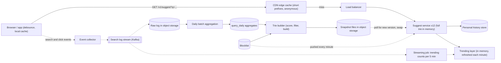
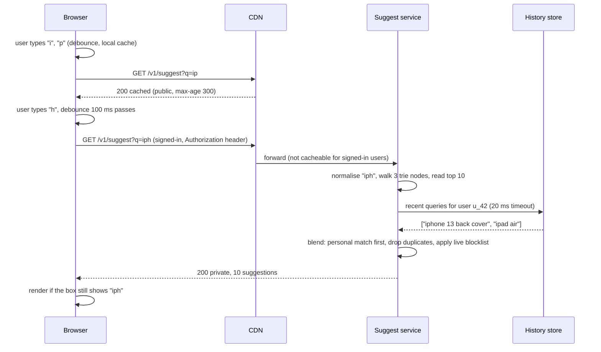
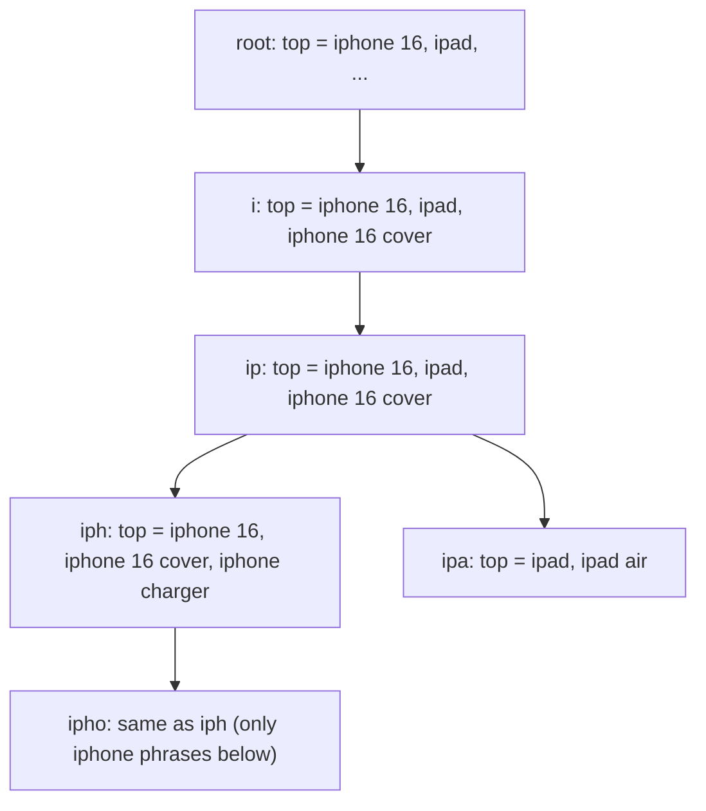

You type "iph" into a shopping site's search box and, before you finish the word, a list appears: "iphone 16", "iphone 16 cover", "iphone charger". Autocomplete (also called typeahead) saves typing, fixes spelling before it happens, and steers people to queries that actually return results. It is a classic interview question because it is small enough to finish in 45 minutes yet touches data structures (tries), offline data pipelines, caching at every layer, and a very tight latency budget: suggestions that arrive after the user has typed the next letter are useless.

## Learning objectives

By the end of this lesson you will be able to:

1. Turn "show suggestions as the user types" into concrete functional and non-functional requirements, including a per-keystroke latency budget.
2. Estimate request rate, the share of traffic that caching absorbs, and the memory needed for an in-memory trie, with explicit arithmetic.
3. Explain why the serving path should only read a precomputed structure, and why building that structure belongs in an offline pipeline.
4. Implement a trie that stores the top-k phrases at every node and answers a prefix lookup in time proportional to the prefix length.
5. Design prefix caching in the browser, at the CDN and on the server, and explain why personalised results must not be cached publicly.
6. Add trending queries and light personalisation without rebuilding the whole trie.
7. Discuss filtering, multi-language input, sharding versus replication, and when a database `LIKE` query or a search engine's completion feature is enough.

## Prerequisites

- [Capacity estimation](#/lesson/m11-capacity-estimation): requests per second, peak factors and memory sizing.
- [Caching layers](#/lesson/m11-caching-layers) and [CDN architecture](#/lesson/m11-cdn): where a response can be cached and for whom.
- [Kafka topics, partitions and consumer groups](#/lesson/m12-kafka): the search log flows through a log-based stream.

## Explain it like I'm a beginner

Imagine a very fast librarian at a busy library counter in Bengaluru.

- People walk up and start saying a book title: "Har...". Before they finish, the librarian says "Harry Potter? Harappan Civilisation? Hare Krishna?" (**suggestions**).
- She can answer instantly because every night she prepares a **card index**: for every beginning of a title ("H", "Ha", "Har", ...) there is a card listing the 10 most-requested titles that start that way (**a trie with top-k at each node**).
- She doesn't count requests while people are standing at the counter. A helper writes every request in a notebook, and at night someone tallies the notebook and rewrites the cards (**offline aggregation**).
- The new cards are prepared in a back room, and she swaps the whole box in one move, so she never works with a half-updated box (**snapshot swap**).
- Very common beginnings ("H", "Ha") are printed on a poster at the entrance, so many people don't even reach the counter (**browser and CDN caching**).
- If a regular customer always asks for cricket books, she mentions those first for him (**personalisation**), but she doesn't print his preferences on the public poster (**private versus public caching**).
- During a big event, such as a new phone launch, a quick helper keeps a small list of today's suddenly popular requests and she checks it too (**trending layer**).

## Requirements

### Functional requirements

1. As the user types in the search box, return up to **10 suggestions** that start with the typed text (prefix match).
2. Suggestions are ranked by **popularity** of past searches, weighted towards recent activity.
3. **Trending**: a query that suddenly becomes popular (a product launch, a cricket final) appears within about **15 minutes**.
4. **Personalisation** (light): a signed-in user's own recent searches that match the prefix appear first.
5. **Filtering**: no offensive, illegal or legally blocked phrases; no personal data (phone numbers, emails) that people typed into the search box.
6. Locale-aware: suggestions per site locale (`en-IN`, `hi-IN`), with the normalisation rules of that language.

### Out of scope

- Spelling correction and fuzzy matching ("ipohne" → "iphone"). We mention approaches but don't design them.
- The search results page itself ([search architecture](#/lesson/m16-search-architecture) covers inverted indexes).
- Product or category suggestions with images (a separate "rich suggestions" service).

### Non-functional requirements

| Requirement | Target |
|---|---|
| Latency | p99 under **50 ms** server-side, under 100 ms end-to-end on a typical mobile connection; anything slower than the gap between keystrokes is wasted |
| Availability | 99.9 %; if autocomplete fails, the search box still works, so it is not critical-path |
| Freshness | Base suggestions refreshed daily; trending within 15 minutes; removed (blocked) phrases disappear within minutes |
| Consistency | Eventual. Two users seeing slightly different suggestions for a few minutes is fine |
| Scale | Tens of thousands of requests per second at peak, see below |

Notice the trade-off in the requirements: we accept staleness (hours for normal ranking) in exchange for speed. That one decision shapes the whole design: the serving path only **reads** a precomputed structure.

## Capacity estimation

All figures are **estimates** for a large Indian e-commerce site.

### Request rate

- 50 M daily active users, 8 searches per user per day → **400 M searches/day**.
- People type about 6 characters before picking a suggestion or pressing enter. With a client-side debounce (wait 100 ms after the last keystroke before calling), assume **4 suggest requests per search**.
- 400 M × 4 = **1.6 B requests/day**. 1.6 B ÷ 86,400 s ≈ **18,500 requests/s** on average.
- Evening and sale-day peak ×3 ≈ **55,000 requests/s**.

### How much does caching absorb?

- 1- and 2-character prefixes in Latin script: 36 + 36² ≈ 1,300 distinct keys (letters and digits). They make up roughly the first one or two of the four requests per search. Assume **30–40 %** of anonymous traffic can be answered from browser or CDN caches for those short prefixes (an estimate; measure your own hit ratio).
- Remaining origin traffic at peak: 55,000 × 0.65 ≈ **36,000 requests/s**.
- An in-memory trie lookup plus JSON serialisation is microseconds of CPU. Assume a conservative **5,000–10,000 requests/s per instance** (an estimate; load-test it). That is 4–8 instances, so run **10–12 across two or three availability zones** for headroom and failure tolerance.

### Data volume

- Search log: 400 M searches × ~150 B (query, locale, timestamp, user or session hash, result count, clicked or not) ≈ **60 GB/day** raw, a few GB compressed.
- Distinct queries per day: assume 100 M, most of them seen once (typos, very specific searches). After keeping only phrases searched at least 5 times in 30 days and passing filters: about **10 M phrases** worth suggesting.

### Trie memory

- 10 M phrases × average 22 characters = 220 M characters. Shared prefixes collapse a lot of that: assume about **60 M trie nodes** after capping depth at 20 characters (an estimate; count during the build).
- With a compact layout (arrays, not a hash map per node): per node, a top-10 list of 4-byte phrase ids (40 B) plus child links and bookkeeping (~30 B) ≈ 70 B. 60 M × 70 B ≈ **4.2 GB**, plus 10 M phrase strings × ~40 B = 0.4 GB. **About 5 GB per replica.**
- A naive object-per-node layout in .NET (a `Dictionary<char, Node>` and a `List<T>` per node) easily costs 200+ B per node: 60 M × 200 B ≈ 12 GB. Layout matters.

### What the numbers tell us

1. The whole structure fits in memory on one server, so **replicate the full trie** on every instance instead of sharding it. Sharding adds a network hop and a routing layer for no benefit at 5 GB.
2. Request rate is high but each request is tiny; **caching short prefixes** at the edge removes a third of the load cheaply.
3. The search log is modest (60 GB/day); daily aggregation is a small batch job, and a streaming job handles trending.

## API design

```http
GET /v1/suggest?q=iph&locale=en-IN&limit=10
Accept: application/json

200 OK
Cache-Control: public, max-age=300
Content-Type: application/json

{ "q": "iph", "version": "2026-10-19.1",
  "suggestions": [
    { "text": "iphone 16", "personal": false },
    { "text": "iphone 16 pro max cover", "personal": false },
    { "text": "iphone charger type c", "personal": false } ] }
```

Design choices:

- **`GET` with the prefix in the query string**, so browsers and CDNs can cache it. A `POST` would bypass HTTP caches.
- **Normalise before lookup and before using as a cache key**: lowercase, trim, collapse spaces. Otherwise `"iPh"`, `"iph "` and `"iph"` are three cache entries and three different answers.
- **`version`** identifies the snapshot that answered; it helps debugging ("which build produced this suggestion?") and lets clients discard responses from an older snapshot if they care.
- **Anonymous responses are `public`** with a few minutes' `max-age`. **Signed-in, personalised responses are `private`** (browser-only), or personalisation is applied on the client so the server response stays public. Never let a CDN cache a response that contains one person's history.
- **Client behaviour is part of the API**: debounce 80–150 ms, cancel the previous in-flight request when a new keystroke arrives (`AbortController` in browsers), ignore responses for a prefix that is no longer in the box, and keep a small in-memory cache so backspacing from "iphon" to "ipho" doesn't call the server again.
- **Telemetry endpoint**: `POST /v1/suggest/events` (batched) records impressions and which suggestion was clicked at which position, feeding ranking.
- **Admin endpoint** (internal): `POST /v1/suggest/blocklist` adds a phrase to an immediate blocklist that all instances apply at serving time, without waiting for the next build.

## Data model

The serving path doesn't touch a database. The data model is about the **offline pipeline** and its outputs.

```sql
-- Daily aggregates produced by the batch job from the raw search log.
CREATE TABLE query_daily (
    locale     text   NOT NULL,
    day        date   NOT NULL,
    query      text   NOT NULL,          -- already normalised
    searches   bigint NOT NULL,
    clicks     bigint NOT NULL DEFAULT 0, -- searches that led to a product click
    zero_hits  bigint NOT NULL DEFAULT 0, -- searches that returned no results
    PRIMARY KEY (locale, day, query)
) PARTITION BY RANGE (day);

-- Phrases that must never be suggested (exact match), maintained by trust and safety.
CREATE TABLE blocked_phrase (
    locale   text NOT NULL,
    phrase   text NOT NULL,
    reason   text NOT NULL,              -- offensive, legal, pii, brand_request
    added_at timestamptz NOT NULL DEFAULT now(),
    PRIMARY KEY (locale, phrase)
);

-- One row per built snapshot; the trie file itself lives in object storage.
CREATE TABLE suggest_snapshot (
    version      text PRIMARY KEY,       -- '2026-10-19.1'
    locale       text NOT NULL,
    built_at     timestamptz NOT NULL,
    phrase_count int  NOT NULL,
    node_count   bigint NOT NULL,
    object_key   text NOT NULL,          -- 'suggest/en-IN/2026-10-19.1.trie'
    status       text NOT NULL CHECK (status IN ('building','validated','live','retired','rejected'))
);
```

Design notes:

- **Aggregates, not raw logs, in the relational store.** The raw log stays in the stream and object storage; only per-day counts per query land here. 30 days × 10–20 M rows per day is manageable with daily partitions, and old partitions are dropped.
- **Score** for ranking is computed by the build job, not stored per row: for example `score = Σ searches(day) × 0.5^(age_days / 7)` (exponential decay with a 7-day half-life), multiplied by a quality factor such as click-through rate, and zeroed for queries with mostly zero results. Suggesting a query that returns nothing is worse than suggesting nothing.
- **Blocklist** is applied twice: at build time (blocked phrases never enter the trie) and at serving time (phrases blocked since the last build are filtered from results).
- **Snapshots are immutable files** with a version. `status` lets the build job validate a snapshot (size within ±20 % of the previous one, spot-check queries) before marking it `live`, and makes rollback a one-row update.
- **Personal history** isn't in this database. It is either on the device (local storage, the simplest and most private option) or in a key-value store keyed by user id with a short list of recent normalised queries.

## High-level architecture



Arrow by arrow:

- **Browser → CDN → load balancer → suggest service**: a request first checks the browser's own cache, then the CDN. Anonymous responses for short prefixes are cacheable for minutes; longer prefixes mostly miss and reach the service.
- **Suggest service**: each instance holds the whole trie for its locale in memory and answers with a pure in-memory lookup. It is stateless apart from that read-only snapshot, so any instance can serve any request.
- **Suggest service → personal history store**: only for signed-in users, a single key lookup (a few ms) returning recent queries to blend in. If the store is slow, the service skips personalisation rather than waiting.
- **Suggest service → trending layer**: a small in-memory map of phrases that are spiking right now, refreshed every minute from the streaming job's output.
- **Browser ⇢ event collector ⇢ search log stream**: every search, impression and click is sent asynchronously (batched). This is the raw material for ranking.
- **Stream ⇢ streaming job ⇢ trending layer**: a streaming job counts queries in 5-minute windows and compares them with their usual rate to find spikes.
- **Stream ⇢ object storage ⇢ daily batch aggregation ⇢ `query_daily`**: the batch job turns a day of raw events into one row per (locale, day, query).
- **Aggregates + blocklist → trie builder → snapshot files**: the builder scores 30 days of aggregates, filters, builds the trie, serialises it, validates it and publishes a new version.
- **Snapshot files ⇢ suggest service**: instances poll for a newer version, load it in the background, and swap one reference. Requests in flight finish on the old snapshot.
- **Blocklist ⇢ suggest service**: urgent removals reach serving within a minute without a rebuild.

### One keystroke, end to end



The short prefix "ip" is answered by the CDN without reaching the service. The longer prefix from a signed-in user goes to the service, which does three hash lookups in the trie, one key lookup for history with a strict timeout, and a merge. The browser checks that the response still matches what is in the box, because responses can arrive out of order on mobile networks.

### What a trie with top-k looks like



Each node represents a prefix and stores the best k phrases anywhere below it, already sorted. Looking up "iph" means walking three edges and reading a list: no searching through the subtree at request time. The cost moves to build time, where it belongs, and the memory cost is k phrase references per node.

## Deep dives

### Deep dive 1: why precompute top-k at every node

A plain trie finds all phrases with a prefix by walking to the prefix node and then visiting every descendant. For "i" that could be a million phrases: far too slow for a keystroke. Options:

| Approach | Lookup cost | Memory | Notes |
|---|---|---|---|
| Plain trie, collect and sort subtree | O(size of subtree) | Low | Fine for small dictionaries (thousands of phrases) |
| Trie + top-k at each node | O(prefix length) | k references per node | The standard design; what we build |
| Sorted array of phrases + binary search, then scan | O(log n + matches) | Lowest | Good for static lists; ranking needs an extra structure |
| Database `LIKE 'iph%'` with an index | Index range scan + sort | Database | Fine at low traffic; see "simpler design" |
| Search engine completion suggester (FST-based) | Fast, built in | Managed by the engine | Good choice if you already run one ([search architecture](#/lesson/m16-search-architecture)) |

**Building top-k cheaply.** If you insert phrases in descending score order, the first k phrases that pass through a node are its top k. No heaps, no re-sorting: one sort of 10 M phrases (seconds) and one pass of insertions. The C# implementation below uses exactly this trick.

**Capping depth.** Very few people type more than 20 characters before choosing. Capping the trie at depth 20 avoids storing nodes for the long tail of long phrases. For a longer prefix, walk to depth 20 and filter that node's list by the full prefix; it may return fewer results, which is acceptable for rare long prefixes.

**Compact layouts.** Production tries often store nodes in flat arrays (children as sorted character arrays with child indexes) or use a compressed structure (radix tree, or a finite-state transducer as used by search engines' completion features). The aim is fewer objects and better CPU cache behaviour. Start with the readable version, measure, then compact.

### Deep dive 2: the offline pipeline

1. **Collect**: the browser sends search events (query, locale, timestamp, session hash, results count, clicked position) to an event collector, which writes to a Kafka topic partitioned by session.
2. **Land**: a sink writes the topic to object storage hourly as compressed files.
3. **Aggregate daily**: a batch job (Spark, or a SQL engine over the files) normalises queries, drops bots (sessions with hundreds of searches per minute), and counts per (locale, day, query) into `query_daily`.
4. **Score**: sum the last 30 days with exponential decay, multiply by a quality factor (click-through rate, penalty for zero-result queries), drop phrases below a minimum count (privacy and noise: a query seen once may contain someone's name or phone number).
5. **Filter**: blocklist, pattern filters for PII (phone numbers, emails, long digit strings), and a profanity filter per language.
6. **Build and validate**: build the trie, serialise it, check node and phrase counts against the previous build (±20 %), run golden queries ("iph" must include "iphone"), then mark the snapshot `validated`.
7. **Publish**: mark it `live`; instances pick it up on their next poll.

**Why batch for the base ranking?** Daily rebuilds are simple, reproducible and easy to debug: if a bad suggestion appears, you can find the exact build and input that produced it. Streaming everything into the main trie would make the trie mutable under concurrent reads and make mistakes harder to trace.

**Minimum frequency is also a privacy control.** People type surprising things into search boxes. Requiring that a phrase was searched by at least, say, 20 distinct sessions before it can be suggested prevents one person's typed phone number from ever appearing as a suggestion to someone else.

### Deep dive 3: trending without rebuilding

A daily build can't react to "a new phone launched at 10:30". The trending layer:

- A streaming job reads the search topic and counts queries per 5-minute window. Exact counts for every distinct query are expensive at high cardinality, so it can use a **heavy-hitters** algorithm such as Space-Saving (exercise 5), which keeps a fixed number of counters and still finds the most frequent items with bounded error.
- It compares each heavy hitter's current rate with its baseline (the daily score) and emits phrases whose rate is, say, 5× above normal and above a minimum count.
- Output: a small map of a few thousand trending phrases with a boost, published every minute.
- Serving: for a prefix, take the trie's top-k, add trending phrases with the same prefix (a linear scan of a few thousand phrases or a tiny second trie), re-rank, and keep k.

Trending lists are a common abuse target (coordinated searches to push a phrase). Require many distinct sessions and IPs, apply the same filters, and keep a human-reviewed allow or deny step for anything that would appear for very short prefixes.

### Deep dive 4: prefix caching at three layers

1. **Browser**: a map from prefix to response for the current page. Backspacing, retyping and focusing the box again are free. Also cache the empty-prefix "recent and popular" list shown on focus.
2. **CDN**: anonymous responses with `Cache-Control: public, max-age=300`. Short prefixes are a small, very hot key set, an ideal CDN workload. Normalise on the client too, so the CDN cache key matches. Include the locale in the URL, not only in a header, or set `Vary` correctly.
3. **Server**: the trie is the cache. There is little to gain from an extra in-process cache in front of an in-memory lookup. A server-side cache matters only if the suggestions come from somewhere slower, such as a sharded trie service or a search engine.

**Invalidation** is by time and by version: a 5-minute TTL means a new snapshot reaches everyone within 5 minutes, and blocked phrases are removed by the service's live blocklist. For urgent legal removals, purge the CDN by URL prefix as well, because cached responses for short prefixes may contain the phrase.

**Personalised responses** are `Cache-Control: private` or `no-store`. An alternative that keeps everything cacheable: return public suggestions from the server and blend the user's own recent searches **on the device**, where they already live.

### Deep dive 5: personalisation, lightly

Full personalisation (ranking by each user's interests) is a recommendation problem. For autocomplete, a light version gives most of the value:

- **Recent searches** matching the prefix go first (people repeat searches often).
- **Blend rule**: at most 3 personal suggestions, then global ones, de-duplicated.
- **Timeouts**: the history lookup has a strict budget (20 ms). If it is slow, return global results; personalisation is a bonus, never a dependency.
- **Privacy**: personal history is never used to build the global trie directly (only through the minimum-frequency aggregate), users can clear it, and it is shown only to that user.

### Deep dive 6: languages and normalisation

- **Case and spacing**: lowercase with the invariant culture, trim, collapse runs of whitespace.
- **Unicode**: normalise to a canonical form (NFKC) so visually identical strings compare equal. In Devanagari, vowel signs (matras) are combining marks, not letters; a normaliser that keeps only `char.IsLetter` destroys Hindi words (exercise 1).
- **Transliteration**: many Indian users type Hindi words in Latin script ("saree", "kurti", "chappal"). Treat them as normal phrases in the `en-IN` trie; they are frequent enough to rank naturally. Cross-script matching (typing "किताब" and getting "kitab" results) needs a transliteration step at build time that adds both forms.
- **Per-locale tries** keep rankings meaningful: "pan" ranks differently on an Indian grocery site and a cookware site.

### Deep dive 7: the core in ASP.NET Core

The code below is the serving side: an immutable trie with top-k per node built with the "insert in score order" trick, a snapshot holder that swaps versions atomically, a background refresher that loads new snapshots and refuses suspicious ones, and a service that blends personal history and sets the right cache headers.

```csharp file=Autocomplete/SuggestionTrie.cs
namespace Autocomplete;

public sealed record Phrase(string Text, double Score);

/// <summary>
/// Immutable after Build. Every node keeps the top K phrases below it, best first,
/// so a lookup costs O(prefix length), independent of how many phrases share the prefix.
/// </summary>
public sealed class SuggestionTrie
{
    private sealed class Node
    {
        public Dictionary<char, Node>? Children;
        public readonly List<Phrase> Top = new();
    }

    private readonly Node _root = new();

    private SuggestionTrie(int k, int maxDepth)
    {
        K = k;
        MaxDepth = maxDepth;
    }

    public int K { get; }
    public int MaxDepth { get; }
    public int NodeCount { get; private set; } = 1;
    public int PhraseCount { get; private set; }

    public static SuggestionTrie Build(IEnumerable<Phrase> phrases, int k = 10, int maxDepth = 20)
    {
        ArgumentOutOfRangeException.ThrowIfLessThan(k, 1);
        ArgumentOutOfRangeException.ThrowIfLessThan(maxDepth, 1);
        var trie = new SuggestionTrie(k, maxDepth);
        // Inserting in descending score order means the first K phrases reaching a node ARE its top K.
        foreach (var p in phrases.OrderByDescending(p => p.Score).ThenBy(p => p.Text, StringComparer.Ordinal))
            trie.Insert(p);
        return trie;
    }

    private void Insert(Phrase phrase)
    {
        PhraseCount++;
        var node = _root;
        Offer(node, phrase);
        var depth = Math.Min(phrase.Text.Length, MaxDepth);
        for (var i = 0; i < depth; i++)
        {
            node.Children ??= new Dictionary<char, Node>();
            if (!node.Children.TryGetValue(phrase.Text[i], out var child))
            {
                child = new Node();
                node.Children[phrase.Text[i]] = child;
                NodeCount++;
            }
            node = child;
            Offer(node, phrase);
        }
    }

    private void Offer(Node node, Phrase phrase)
    {
        if (node.Top.Count < K) node.Top.Add(phrase);
    }

    public IReadOnlyList<Phrase> Suggest(string prefix, int limit)
    {
        var node = _root;
        var depth = Math.Min(prefix.Length, MaxDepth);
        for (var i = 0; i < depth; i++)
        {
            if (node.Children is null || !node.Children.TryGetValue(prefix[i], out var next)) return [];
            node = next;
        }
        IEnumerable<Phrase> top = node.Top;
        if (prefix.Length > MaxDepth) // beyond the depth cap: filter the deepest node's list
            top = top.Where(p => p.Text.StartsWith(prefix, StringComparison.Ordinal));
        return top.Take(limit).ToList();
    }
}
```

```csharp file=Autocomplete/Snapshots.cs
using Microsoft.Extensions.Hosting;
using Microsoft.Extensions.Logging;

namespace Autocomplete;

public sealed record TrieSnapshot(string Version, SuggestionTrie Trie, DateTimeOffset BuiltAt);

public interface ISnapshotSource
{
    /// <summary>Returns a newer snapshot than <paramref name="currentVersion"/>, or null if there is none.</summary>
    Task<TrieSnapshot?> TryLoadNewerAsync(string currentVersion, CancellationToken ct);
}

/// <summary>Readers always see one complete snapshot; a swap is a single reference write.</summary>
public sealed class SnapshotHolder(TrieSnapshot initial)
{
    private TrieSnapshot _current = initial;
    public TrieSnapshot Current => Volatile.Read(ref _current);
    public void Swap(TrieSnapshot next) => Interlocked.Exchange(ref _current, next);
}

public sealed class InMemorySnapshotSource : ISnapshotSource
{
    private TrieSnapshot? _latest;
    public void Publish(TrieSnapshot snapshot) => Volatile.Write(ref _latest, snapshot);

    public Task<TrieSnapshot?> TryLoadNewerAsync(string currentVersion, CancellationToken ct)
    {
        var latest = Volatile.Read(ref _latest);
        return Task.FromResult(latest is not null && string.CompareOrdinal(latest.Version, currentVersion) > 0 ? latest : null);
    }
}

public sealed class SnapshotRefresher(ISnapshotSource source, SnapshotHolder holder, ILogger<SnapshotRefresher> log)
    : BackgroundService
{
    public const double MaxShrink = 0.8; // refuse a snapshot that lost more than 20 % of phrases

    protected override async Task ExecuteAsync(CancellationToken stoppingToken)
    {
        using var timer = new PeriodicTimer(TimeSpan.FromMinutes(1));
        do
        {
            try
            {
                var current = holder.Current;
                var next = await source.TryLoadNewerAsync(current.Version, stoppingToken);
                if (next is null) continue;
                if (next.Trie.PhraseCount < current.Trie.PhraseCount * MaxShrink)
                {
                    log.LogError("Rejected snapshot {Version}: {New} phrases vs {Old}", next.Version, next.Trie.PhraseCount, current.Trie.PhraseCount);
                    continue;
                }
                holder.Swap(next);
                log.LogInformation("Now serving snapshot {Version}", next.Version);
            }
            catch (Exception ex) when (ex is not OperationCanceledException)
            {
                log.LogWarning(ex, "Snapshot refresh failed; still serving {Version}", holder.Current.Version);
            }
        } while (await timer.WaitForNextTickAsync(stoppingToken));
    }
}
```

```csharp file=Autocomplete/SuggestService.cs
using System.Collections.Concurrent;
using System.Text;

namespace Autocomplete;

public static class QueryText
{
    public const int MaxLength = 100;

    public static string Normalize(string raw)
    {
        var sb = new StringBuilder(Math.Min(raw.Length, MaxLength));
        var pendingSpace = false;
        foreach (var ch in raw.Normalize(NormalizationForm.FormKC))
        {
            if (char.IsWhiteSpace(ch)) { pendingSpace = sb.Length > 0; continue; }
            if (pendingSpace) { sb.Append(' '); pendingSpace = false; }
            sb.Append(char.ToLowerInvariant(ch));
            if (sb.Length >= MaxLength) break;
        }
        return sb.ToString();
    }
}

public interface IUserHistoryStore
{
    IReadOnlyList<string> Recent(string userId);
    void Record(string userId, string normalizedQuery);
}

public sealed class InMemoryUserHistoryStore : IUserHistoryStore
{
    private const int Keep = 20;
    private readonly ConcurrentDictionary<string, LinkedList<string>> _history = new();

    public IReadOnlyList<string> Recent(string userId)
    {
        if (!_history.TryGetValue(userId, out var list)) return [];
        lock (list) return list.ToList();
    }

    public void Record(string userId, string normalizedQuery)
    {
        var list = _history.GetOrAdd(userId, _ => new LinkedList<string>());
        lock (list)
        {
            list.Remove(normalizedQuery);      // move to front if already present
            list.AddFirst(normalizedQuery);
            while (list.Count > Keep) list.RemoveLast();
        }
    }
}

public sealed class LiveBlocklist
{
    private volatile HashSet<string> _blocked = new(StringComparer.Ordinal);
    public bool IsBlocked(string phrase) => _blocked.Contains(phrase);
    public void Replace(IEnumerable<string> phrases) => _blocked = new HashSet<string>(phrases, StringComparer.Ordinal);
}

public sealed record SuggestionDto(string Text, bool Personal);

public sealed class SuggestService(SnapshotHolder snapshots, IUserHistoryStore history, LiveBlocklist blocklist)
{
    public const int MaxPersonal = 3;

    public (string Version, IReadOnlyList<SuggestionDto> Items) Suggest(string rawPrefix, string? userId, int limit = 10)
    {
        limit = Math.Clamp(limit, 1, 10);
        var prefix = QueryText.Normalize(rawPrefix);
        var snapshot = snapshots.Current; // read once: the whole request uses one consistent snapshot
        if (prefix.Length == 0) return (snapshot.Version, []);

        var result = new List<SuggestionDto>(limit);
        var seen = new HashSet<string>(StringComparer.Ordinal);

        if (userId is not null)
            foreach (var q in history.Recent(userId))
                if (result.Count < MaxPersonal && q.StartsWith(prefix, StringComparison.Ordinal) && !blocklist.IsBlocked(q) && seen.Add(q))
                    result.Add(new SuggestionDto(q, Personal: true));

        // Ask for a few extra in case some are duplicates of personal ones or newly blocked.
        foreach (var p in snapshot.Trie.Suggest(prefix, limit + MaxPersonal))
        {
            if (result.Count >= limit) break;
            if (!blocklist.IsBlocked(p.Text) && seen.Add(p.Text)) result.Add(new SuggestionDto(p.Text, Personal: false));
        }
        return (snapshot.Version, result);
    }
}
```

```csharp file=Program.cs
using Autocomplete;

var builder = WebApplication.CreateBuilder(args);

var seed = SuggestionTrie.Build(new[]
{
    new Phrase("iphone 16", 9_800), new Phrase("iphone 16 cover", 6_100), new Phrase("iphone charger type c", 4_400),
    new Phrase("ipad", 7_200), new Phrase("ipad air", 3_900), new Phrase("induction cooktop", 5_300),
    new Phrase("kurti for women", 8_900), new Phrase("kurta pyjama set", 4_700),
});
builder.Services.AddSingleton(new SnapshotHolder(new TrieSnapshot("2026-10-19.1", seed, DateTimeOffset.UtcNow)));
builder.Services.AddSingleton<InMemorySnapshotSource>();
builder.Services.AddSingleton<ISnapshotSource>(sp => sp.GetRequiredService<InMemorySnapshotSource>());
builder.Services.AddSingleton<IUserHistoryStore, InMemoryUserHistoryStore>();
builder.Services.AddSingleton<LiveBlocklist>();
builder.Services.AddSingleton<SuggestService>();
builder.Services.AddHostedService<SnapshotRefresher>();

var app = builder.Build();

app.MapGet("/v1/suggest", (string q, int? limit, HttpContext http, SuggestService service) =>
{
    var userId = http.User.Identity?.IsAuthenticated == true ? http.User.Identity.Name : null;
    var (version, items) = service.Suggest(q, userId, limit ?? 10);

    // Prefix caching: anonymous answers are shareable by browsers and the CDN; personalised ones are not.
    http.Response.Headers.CacheControl = userId is null ? "public, max-age=300" : "private, max-age=30";
    return Results.Ok(new { q = QueryText.Normalize(q), version, suggestions = items });
});

app.MapPost("/v1/suggest/history", (HistoryBody body, HttpContext http, IUserHistoryStore history) =>
{
    if (http.User.Identity?.IsAuthenticated != true || http.User.Identity.Name is not { } user) return Results.Unauthorized();
    history.Record(user, QueryText.Normalize(body.Query));
    return Results.NoContent();
});

app.Run();

public sealed record HistoryBody(string Query);
```

Points to notice:

- `SuggestionTrie.Build` sorts once and inserts; there is no per-node sorting or heap. Ties are broken by text so builds are deterministic, which makes snapshot diffs meaningful.
- `SnapshotHolder` publishes a fully built trie with one reference write. A request reads `Current` once and uses that snapshot throughout, so it can't see half of one version and half of another.
- `SnapshotRefresher` refuses a snapshot that shrank by more than 20 %, a cheap guard against a broken build (an empty input file produces an empty trie that would otherwise go live everywhere).
- `SuggestService` treats personalisation and the blocklist as filters around the trie, so they can change every minute without a rebuild.
- The endpoint sets `public` caching only for anonymous requests.

## Caching, queues and scaling

### Caching summary

| Layer | What | TTL / invalidation |
|---|---|---|
| Browser | Prefix → response for the session | Page lifetime |
| CDN | Anonymous responses, mostly 1–3 character prefixes | 5 min; purge by prefix for urgent removals |
| Service memory | The trie snapshot itself | Replaced on new version |
| Service memory | Live blocklist, trending map | Refreshed every minute |
| History store | Recent queries per user | Capped list; expires after 90 days of inactivity |

### Queues and streams

- **Search event topic** (Kafka), partitioned by session id, retained for a few days so the batch and streaming jobs can replay after a bug.
- **Streaming job** consumes the same topic for trending, with its own consumer group, so a slow trending job never delays log landing.
- **Snapshot distribution** is pull-based (instances poll object storage or a version endpoint). Push via a message is possible, but polling every minute is simpler and has no "lost message" failure mode.

### Scaling

- **Read path**: stateless replicas, each with the whole trie. Scale out on CPU. Startup time (downloading and loading 5 GB) is the main operational cost; keep a warm pool and use readiness probes so instances join the load balancer only after the snapshot is loaded.
- **Multiple locales**: one trie per locale. If the total gets too large for one machine, route by locale to different pools.
- **Sharding** becomes necessary only if one locale's trie outgrows a machine. Shard by **prefix range** (a–f, g–m, ...) with a router, but beware skew: far more phrases start with "s" than with "x". Use split points from the data, not the alphabet. Replication is preferable as long as it fits.
- **Build pipeline**: scales with the log size; a daily job over 30 days of aggregates is minutes of work.

**What breaks first?** (1) CDN hit ratio drops after someone adds a per-user header to all responses, sending the full load to the origin; (2) instance startup during a scale-out takes minutes because of snapshot loading; (3) memory as phrases and locales grow; (4) the history store's latency for signed-in users, which is why it has a strict timeout.

## Failure handling

| Failure | Effect | Mitigation |
|---|---|---|
| Suggest service down | No suggestions | Search box still works; client hides the dropdown after a timeout; CDN serves cached short prefixes |
| Bad build (empty or tiny trie) | Missing or poor suggestions everywhere | Validation before `live`, shrink guard on load, one-step rollback to the previous version |
| Offensive phrase suggested | Brand and legal risk | Live blocklist pushed within a minute, CDN purge, then fix filters and rebuild |
| History store slow | Latency for signed-in users | 20 ms timeout, fall back to global results |
| Trending job stalls | Trending stale | Trending map has a maximum age; after that it is ignored and base results are served |
| Kafka unavailable | Events lost for a while | Collector buffers briefly; small gaps in daily counts barely change rankings |
| Coordinated manipulation | Junk phrases trend | Distinct-session thresholds, bot filtering, human review for short prefixes |
| Responses arrive out of order on the client | Wrong list shown for current text | Client ignores responses for a prefix that no longer matches the box |

Autocomplete is a **degradable** feature. Every failure mode should end in "fewer or older suggestions", never "the search box doesn't work".

## Security

- **PII in suggestions** is the biggest risk: users type phone numbers, emails, addresses and names. Defend with minimum distinct-session counts, PII pattern filters at build time, and the live blocklist.
- **Abuse**: rate-limit the suggest endpoint per IP and per session (see [distributed rate limiter](#/lesson/m17-rate-limiter)); scraping the full suggestion corpus is cheap otherwise.
- **Privacy of history**: personal history is visible only to its owner, deletable, excluded from public caches, and retained for a limited time. If you can keep it on the device, do.
- **Input handling**: cap prefix length (100 characters), reject control characters, and make sure the client renders suggestions as text, not HTML, to avoid injection through a malicious phrase.
- **Legal removals**: some jurisdictions and brand agreements require removing specific suggestions; keep an audited workflow with reasons in `blocked_phrase`.

## Observability

- **Latency** histograms server-side and from real user monitoring in the browser (time from keystroke to render).
- **CDN hit ratio** per prefix length; a sudden drop usually means a header change.
- **Suggestion quality**: impressions, click-through rate on suggestions, and position of the clicked suggestion; the share of searches that used a suggestion.
- **Zero-suggestion rate** by prefix length: a spike after a release means a normalisation or loading bug.
- **Snapshot**: version served per instance (all instances should converge within minutes), load duration, node and phrase counts, rejected snapshots.
- **Blocklist latency**: time from adding a phrase to its disappearance from all instances.
- **Pipeline health**: lag of the landing sink, duration and row counts of the daily job, age of the trending map.

## Deployment and cost

### Deployment

- The suggest service is deployed like any stateless service (rolling or blue-green), but **readiness waits for the snapshot**. A pod that answers before loading returns empty lists.
- **Data deployments are separate from code deployments**: a new snapshot is a data release with its own validation, canary (serve it on two instances first and compare click-through rate) and rollback.
- Golden-query tests run in CI against a sample snapshot so a code change to normalisation can't silently break matching.

### Cost drivers (estimates)

1. **Serving compute and memory**: 10–12 instances with ~8 GB RAM each per locale group. Modest.
2. **CDN requests**: tens of thousands of requests per second of tiny responses. CDN pricing per request can exceed the bandwidth cost; check your provider's pricing model.
3. **Log storage and the pipeline**: 60 GB/day raw, compressed to a few GB, plus a short-lived daily batch cluster.
4. **People**: moderation of trending and blocklist requests is an ongoing operational cost.

### When a simpler design is enough

An internal tool with 50,000 product names and 100 requests per second doesn't need any of this. Put the names in PostgreSQL with a `text_pattern_ops` index (or a trigram index for "contains" matching) and run `WHERE name LIKE 'iph%' ORDER BY popularity DESC LIMIT 10`; or load the 50,000 names into memory at startup and filter a sorted list. If you already run a search engine, its completion suggester gives you a production-grade prefix index without building a pipeline. Build the custom trie and log pipeline when traffic or ranking quality demands it.

## Alternatives and trade-offs

| Decision | Our choice | Alternative | When the alternative wins |
|---|---|---|---|
| Lookup structure | Trie with top-k per node | Search engine completion suggester | You already operate the engine and accept its ranking options |
| Freshness | Daily rebuild + trending layer | Real-time updates to one mutable trie | Small data sets where locking and debugging are manageable |
| Distribution | Full replica per instance | Prefix-sharded trie service | Trie no longer fits in one machine's memory |
| Personalisation | Recent searches blended (server or device) | Per-user ranking models | Large teams with recommendation infrastructure; adds latency and cost |
| Caching | Browser + CDN for anonymous prefixes | No HTTP caching | Fully personalised suggestions for every user |
| Ranking signal | Searches with decay × click quality | Raw search counts | Prototypes; raw counts promote typos and zero-result queries |
| Heavy hitters for trending | Space-Saving sketch | Exact counts per query | Low cardinality streams where exact counting fits in memory |

## Practical playground

The starting graph is a first draft that queries the database on every keystroke: no CDN, no in-memory structure, no pipeline. Open it in the HLD canvas and turn it into this lesson's design: add a CDN for anonymous short prefixes, give the suggest service an in-memory trie loaded from snapshots in object storage, add a search log stream, a daily aggregation worker and a builder, and a trending path. Then set the client RPS to 55,000 and check which component saturates first.

:::playground type=hld title="From LIKE queries to a trie-backed suggest service"
```json
{
  "nodes": [
    { "id": "u", "type": "client", "label": "Browsers and apps", "props": { "rps": 18500 } },
    { "id": "lb", "type": "load-balancer", "label": "Load balancer" },
    { "id": "api", "type": "app-server", "label": "Search API", "props": { "instances": 4 } },
    { "id": "db", "type": "database", "label": "PostgreSQL (LIKE 'prefix%' on query log)", "props": { "replicas": 1 } }
  ],
  "edges": [
    { "from": "u", "to": "lb", "kind": "sync", "label": "every keystroke" },
    { "from": "lb", "to": "api", "kind": "sync" },
    { "from": "api", "to": "db", "kind": "sync", "label": "GROUP BY query ORDER BY count" }
  ]
}
```
:::

## Exercises

:::exercise id=m17-autocomplete-ex1 difficulty=beginner kind=code title="Query normaliser that respects Hindi"
Implement `QueryNormalizer.Normalize`, used both by the build pipeline and the suggest service, so that the same text always produces the same key.
::requirements
- Apply Unicode NFKC normalisation first.
- Lowercase with the invariant culture.
- Trim, and collapse any run of whitespace (spaces, tabs, newlines) into one space.
- Keep letters, digits, combining marks (Unicode categories `NonSpacingMark` and `SpacingCombiningMark`, used by Devanagari vowel signs) and the characters `&`, `-`, `+`, `.`, `'`. Remove every other character; a removed character does not create a space.
- Truncate to at most `MaxLength` (64) characters, and never return a trailing space.
::acceptance
- All tests pass, including the Hindi test.
- The method is deterministic and culture-independent.
::hint
Process the string character by character into a `StringBuilder`, deciding for each character: whitespace, keep, or drop.
::hint
`char.GetUnicodeCategory(ch)` returns a `UnicodeCategory`. The Devanagari vowel sign "ि" is `SpacingCombiningMark`, and the virama "्" is `NonSpacingMark`; `char.IsLetter` returns false for both.
::hint
For whitespace, don't append immediately. Remember that a space is pending, and append it only before the next kept character. That gives trimming and collapsing in one pass.
::hint
Check the length limit before appending each character (including a pending space), and stop when full. Because spaces are only written before a kept character, the result can't end with a space.
::hint
```csharp
foreach (var raw in input.Normalize(NormalizationForm.FormKC))
{
    if (char.IsWhiteSpace(raw)) { pendingSpace = sb.Length > 0; continue; }
    if (!Keep(raw)) continue;
    var needed = pendingSpace ? 2 : 1;
    if (sb.Length + needed > MaxLength) break;
    if (pendingSpace) sb.Append(' ');
    pendingSpace = false;
    sb.Append(char.ToLowerInvariant(raw));
}
```
::starter
```csharp file=QueryNormalizer.cs
using System;
using System.Globalization;
using System.Text;

public static class QueryNormalizer
{
    public const int MaxLength = 64;

    public static string Normalize(string input) => throw new NotImplementedException();
}
```
::tests
```csharp file=QueryNormalizerTests.cs
using Xunit;

public class QueryNormalizerTests
{
    [Fact]
    public void Lowercases_trims_and_collapses_spaces() =>
        Assert.Equal("iphone 16 pro", QueryNormalizer.Normalize("  iPhone \t 16\n\nPRO  "));

    [Fact]
    public void Removes_punctuation_without_adding_spaces() =>
        Assert.Equal("iphone16", QueryNormalizer.Normalize("iphone,16!?"));

    [Fact]
    public void Keeps_allowed_symbols() =>
        Assert.Equal("h&m t-shirt c++ 5.5 men's", QueryNormalizer.Normalize("H&M T-Shirt C++ 5.5 Men's"));

    [Fact]
    public void Keeps_devanagari_vowel_signs_and_virama() =>
        Assert.Equal("किताबें नमस्ते", QueryNormalizer.Normalize(" किताबें   नमस्ते! "));

    [Fact]
    public void Applies_nfkc() =>
        Assert.Equal("iphone 16", QueryNormalizer.Normalize("ｉｐｈｏｎｅ　１６"));

    [Fact]
    public void Truncates_without_trailing_space()
    {
        var input = new string('a', 63) + " bbbb";
        var result = QueryNormalizer.Normalize(input);
        Assert.Equal(new string('a', 63), result);
        Assert.True(result.Length <= QueryNormalizer.MaxLength);
    }

    [Fact]
    public void Truncates_long_words_to_max_length() =>
        Assert.Equal(64, QueryNormalizer.Normalize(new string('x', 200)).Length);

    [Fact]
    public void Only_punctuation_gives_empty() =>
        Assert.Equal("", QueryNormalizer.Normalize("  !!! ?? "));
}
```
::solution
```csharp file=QueryNormalizer.cs
using System;
using System.Globalization;
using System.Text;

public static class QueryNormalizer
{
    public const int MaxLength = 64;

    private static bool Keep(char ch)
    {
        if (char.IsLetterOrDigit(ch)) return true;
        var cat = char.GetUnicodeCategory(ch);
        if (cat is UnicodeCategory.NonSpacingMark or UnicodeCategory.SpacingCombiningMark) return true;
        return ch is '&' or '-' or '+' or '.' or '\'';
    }

    public static string Normalize(string input)
    {
        var sb = new StringBuilder(Math.Min(input.Length, MaxLength));
        var pendingSpace = false;
        foreach (var raw in input.Normalize(NormalizationForm.FormKC))
        {
            if (char.IsWhiteSpace(raw)) { pendingSpace = sb.Length > 0; continue; }
            if (!Keep(raw)) continue;
            var needed = pendingSpace ? 2 : 1;
            if (sb.Length + needed > MaxLength) break;
            if (pendingSpace) sb.Append(' ');
            pendingSpace = false;
            sb.Append(char.ToLowerInvariant(raw));
        }
        return sb.ToString();
    }
}
```

NFKC folds compatibility characters (full-width Latin letters and digits, the ideographic space) into their ordinary forms, so `ｉｐｈｏｎｅ` and `iphone` become one key. Keeping combining marks is what makes Hindi survive: "किताबें" is a sequence of consonants plus vowel signs and a nasal mark, and dropping the marks would produce a different, wrong word. Using `ToLowerInvariant` avoids culture surprises such as the Turkish dotted and dotless "i" when servers run with different regional settings.

The same function must run in the build pipeline and the serving path. If they disagree, the trie has keys that the service never looks up.
::alternatives
- A regular expression pass (`\s+` → space, `[^\p{L}\p{M}\p{Nd}&\-+.']` → empty) is shorter, but harder to combine with the length limit in one pass.
- Language-specific normalisers (for example removing Devanagari nukta variants) can be layered on top, per locale.
::mistakes
- Using `char.IsLetter` only, which strips matras and breaks Hindi, Tamil and other Indic scripts.
- Replacing removed punctuation with a space ("iphone,16" → "iphone 16"), creating keys that don't match how people type.
- Truncating after building, leaving a trailing space.
- Using `ToLower()` with the current culture.
::extensions
Add a per-locale option that removes diacritics for `en` locales ("café" → "cafe") but never for `hi` locales.
:::

:::exercise id=m17-autocomplete-ex2 difficulty=beginner kind=sql ordered=true title="Top completions for a prefix"
Using `query_daily` and `blocked_phrase`, return the top 5 completions for prefix `iph` in locale `en-IN` over the 7 days ending on `2026-10-19` (that is, `day` from `2026-10-13` to `2026-10-19` inclusive). Rank by total searches in that window, highest first, breaking ties by `query` ascending. Exclude phrases in `blocked_phrase` for that locale and phrases with fewer than 100 total searches in the window. Return columns `query` and `total`.
::setup
```sql
CREATE TABLE query_daily (
  locale   text   NOT NULL,
  day      date   NOT NULL,
  query    text   NOT NULL,
  searches bigint NOT NULL,
  PRIMARY KEY (locale, day, query)
);
CREATE TABLE blocked_phrase (
  locale text NOT NULL,
  phrase text NOT NULL,
  reason text NOT NULL,
  PRIMARY KEY (locale, phrase)
);
INSERT INTO query_daily VALUES
  ('en-IN', '2026-10-19', 'iphone 16',             900),
  ('en-IN', '2026-10-18', 'iphone 16',             800),
  ('en-IN', '2026-10-12', 'iphone 16',            5000),
  ('en-IN', '2026-10-19', 'iphone 16 cover',       700),
  ('en-IN', '2026-10-15', 'iphone 16 cover',       300),
  ('en-IN', '2026-10-17', 'iphone charger',        500),
  ('en-IN', '2026-10-19', 'iphone charger',        500),
  ('en-IN', '2026-10-19', 'iphone 13',             400),
  ('en-IN', '2026-10-14', 'iphone 13',             600),
  ('en-IN', '2026-10-19', 'iphone 9999999999',     150),
  ('en-IN', '2026-10-19', 'iphone 16 pro max',     450),
  ('en-IN', '2026-10-19', 'iphone stand',           60),
  ('en-IN', '2026-10-18', 'iphone stand',           30),
  ('en-IN', '2026-10-19', 'ipad',                 2000),
  ('en-IN', '2026-10-19', 'smart iphone holder',   300),
  ('hi-IN', '2026-10-19', 'iphone 16 kimat',      3000),
  ('en-IN', '2026-10-20', 'iphone 17',            9000);
INSERT INTO blocked_phrase VALUES
  ('en-IN', 'iphone 9999999999', 'pii');
```
::check
```sql
SELECT q.query, SUM(q.searches) AS total
FROM query_daily q
WHERE q.locale = 'en-IN'
  AND q.day BETWEEN DATE '2026-10-13' AND DATE '2026-10-19'
  AND q.query LIKE 'iph%'
  AND NOT EXISTS (
    SELECT 1 FROM blocked_phrase b
    WHERE b.locale = q.locale AND b.phrase = q.query)
GROUP BY q.query
HAVING SUM(q.searches) >= 100
ORDER BY total DESC, q.query ASC
LIMIT 5;
```
::acceptance
- Returns, in order: `iphone 16` (1700), `iphone 13` (1000), `iphone 16 cover` (1000), `iphone charger` (1000), `iphone 16 pro max` (450).
- The ties at 1000 are ordered alphabetically.
- `iphone 16`'s 5000 searches on 2026-10-12 and `iphone 17` on 2026-10-20 are outside the window.
- The blocked phone-number phrase, `iphone stand` (90 searches), `ipad`, `smart iphone holder` and the `hi-IN` row are excluded.
::hint
Filter rows first (locale, date window, prefix), then group by `query` and sum.
::hint
"Starts with" is `LIKE 'iph%'` (or `starts_with(query, 'iph')` in PostgreSQL). `LIKE '%iph%'` would also match "smart iphone holder".
::hint
The minimum-count rule applies to the **sum**, so it belongs in `HAVING`, not `WHERE`.
::hint
Exclude blocked phrases with `NOT EXISTS` on both locale and phrase, then `ORDER BY total DESC, query ASC LIMIT 5`.
::solution
```sql
SELECT q.query, SUM(q.searches) AS total
FROM query_daily q
WHERE q.locale = 'en-IN'
  AND q.day BETWEEN DATE '2026-10-13' AND DATE '2026-10-19'
  AND q.query LIKE 'iph%'
  AND NOT EXISTS (
    SELECT 1 FROM blocked_phrase b
    WHERE b.locale = q.locale AND b.phrase = q.query)
GROUP BY q.query
HAVING SUM(q.searches) >= 100
ORDER BY total DESC, q.query ASC
LIMIT 5;
```

This is the "simple design" version of autocomplete, and for small data sets it is a perfectly good one. At scale, the same logic moves into the build job: the job computes scores for **all** phrases once a day, and the trie answers every prefix in microseconds. Running this query per keystroke at 36,000 requests/s would scan and sort large index ranges for short prefixes like `i`, which is why the database becomes the first bottleneck in the playground's starting design.

For prefix `LIKE` queries to use a B-tree index in PostgreSQL under a non-C collation, the index needs the `text_pattern_ops` operator class, for example `CREATE INDEX ON query_daily (locale, query text_pattern_ops)`.
::mistakes
- `LIKE '%iph%'`, which matches anywhere in the string.
- Filtering `searches >= 100` in `WHERE`, which checks single days instead of the window total and drops `iphone 16 cover`.
- Forgetting the locale in the blocklist join, so a phrase blocked in one locale disappears everywhere (or the reverse).
- Missing the tie-breaker, which makes the order of the three 1000-search phrases unpredictable.
::extensions
Replace the plain sum with a decayed score: `SUM(searches * power(0.5, (DATE '2026-10-19' - day) / 7.0))`, and observe how the ranking changes.
:::

:::exercise id=m17-autocomplete-ex3 difficulty=intermediate kind=code title="Top-k trie with incremental counts"
Implement `TopKTrie`, a trie where phrases can be added with counts at any time, and `Top(prefix, k)` returns the k most frequent phrases starting with the prefix.
::requirements
- `Add(phrase, count)` adds `count` (> 0) to the phrase's total; adding the same phrase again accumulates.
- `Top(prefix, k)` returns phrases that start with `prefix`, sorted by total count descending, then by phrase (ordinal) ascending, at most `k` of them.
- An empty prefix means "all phrases".
- An unknown prefix returns an empty list.
- `Top` must only visit the subtree under the prefix node, not every phrase in the trie.
- `Count(phrase)` returns the total for an exact phrase, or 0.
::acceptance
- All tests pass.
- `Add` with `count <= 0` throws `ArgumentOutOfRangeException`.
::hint
Each node needs children (a `Dictionary<char, Node>`) and a count that is non-zero only if a phrase ends at that node.
::hint
`Top` walks to the prefix node first. If any character is missing, return an empty list.
::hint
From the prefix node, do a depth-first walk that rebuilds each phrase (prefix + characters on the path) and collects (phrase, count) pairs for nodes with a count.
::hint
Sorting all collected pairs is acceptable here. For large subtrees, keep a min-heap of size k (`PriorityQueue<string, (long, string)>`) instead, so memory stays O(k).
::hint
```csharp
void Walk(Node n, StringBuilder path, List<(string, long)> acc)
{
    if (n.Count > 0) acc.Add((path.ToString(), n.Count));
    if (n.Children is null) return;
    foreach (var (ch, child) in n.Children)
    {
        path.Append(ch);
        Walk(child, path, acc);
        path.Length--;
    }
}
```
::starter
```csharp file=TopKTrie.cs
using System;
using System.Collections.Generic;
using System.Linq;
using System.Text;

public sealed class TopKTrie
{
    public void Add(string phrase, long count) => throw new NotImplementedException();

    public long Count(string phrase) => throw new NotImplementedException();

    public IReadOnlyList<string> Top(string prefix, int k) => throw new NotImplementedException();
}
```
::tests
```csharp file=TopKTrieTests.cs
using System;
using Xunit;

public class TopKTrieTests
{
    private static TopKTrie Sample()
    {
        var t = new TopKTrie();
        t.Add("iphone 16", 900);
        t.Add("iphone 16 cover", 700);
        t.Add("iphone charger", 500);
        t.Add("ipad", 800);
        t.Add("induction", 300);
        t.Add("kurti", 1000);
        return t;
    }

    [Fact]
    public void Returns_top_k_for_prefix() =>
        Assert.Equal(new[] { "iphone 16", "iphone 16 cover", "iphone charger" }, Sample().Top("iph", 5));

    [Fact]
    public void Respects_k() =>
        Assert.Equal(new[] { "iphone 16", "ipad" }, Sample().Top("ip", 2));

    [Fact]
    public void Empty_prefix_ranks_everything() =>
        Assert.Equal(new[] { "kurti", "iphone 16", "ipad" }, Sample().Top("", 3));

    [Fact]
    public void Unknown_prefix_is_empty() =>
        Assert.Empty(Sample().Top("xyz", 5));

    [Fact]
    public void Counts_accumulate_and_change_ranking()
    {
        var t = Sample();
        t.Add("iphone charger", 450);
        Assert.Equal(950, t.Count("iphone charger"));
        Assert.Equal(new[] { "iphone charger", "iphone 16" }, t.Top("iphone", 2));
    }

    [Fact]
    public void Ties_break_alphabetically()
    {
        var t = new TopKTrie();
        t.Add("saree red", 50);
        t.Add("saree blue", 50);
        t.Add("saree", 50);
        Assert.Equal(new[] { "saree", "saree blue", "saree red" }, t.Top("sar", 3));
    }

    [Fact]
    public void Prefix_that_is_itself_a_phrase_is_included()
    {
        var t = new TopKTrie();
        t.Add("tv", 10);
        t.Add("tv stand", 20);
        Assert.Equal(new[] { "tv stand", "tv" }, t.Top("tv", 5));
    }

    [Fact]
    public void Count_of_prefix_that_is_not_a_phrase_is_zero() =>
        Assert.Equal(0, Sample().Count("iph"));

    [Fact]
    public void Rejects_non_positive_counts() =>
        Assert.Throws<ArgumentOutOfRangeException>(() => new TopKTrie().Add("x", 0));
}
```
::solution
```csharp file=TopKTrie.cs
using System;
using System.Collections.Generic;
using System.Linq;
using System.Text;

public sealed class TopKTrie
{
    private sealed class Node
    {
        public Dictionary<char, Node>? Children;
        public long Count;
    }

    private readonly Node _root = new();

    public void Add(string phrase, long count)
    {
        ArgumentOutOfRangeException.ThrowIfLessThanOrEqual(count, 0);
        var node = _root;
        foreach (var ch in phrase)
        {
            node.Children ??= new Dictionary<char, Node>();
            if (!node.Children.TryGetValue(ch, out var child))
            {
                child = new Node();
                node.Children[ch] = child;
            }
            node = child;
        }
        node.Count += count;
    }

    private Node? Find(string prefix)
    {
        var node = _root;
        foreach (var ch in prefix)
        {
            if (node.Children is null || !node.Children.TryGetValue(ch, out var next)) return null;
            node = next;
        }
        return node;
    }

    public long Count(string phrase) => Find(phrase)?.Count ?? 0;

    public IReadOnlyList<string> Top(string prefix, int k)
    {
        var start = Find(prefix);
        if (start is null || k <= 0) return Array.Empty<string>();

        var acc = new List<(string Phrase, long Count)>();
        Walk(start, new StringBuilder(prefix), acc);
        return acc.OrderByDescending(x => x.Count)
                  .ThenBy(x => x.Phrase, StringComparer.Ordinal)
                  .Take(k)
                  .Select(x => x.Phrase)
                  .ToList();
    }

    private static void Walk(Node node, StringBuilder path, List<(string, long)> acc)
    {
        if (node.Count > 0) acc.Add((path.ToString(), node.Count));
        if (node.Children is null) return;
        foreach (var (ch, child) in node.Children)
        {
            path.Append(ch);
            Walk(child, path, acc);
            path.Length--;
        }
    }
}
```

This version answers in time proportional to the **subtree size**, which is fine for a few thousand phrases but slow for the prefix "i" over 10 M phrases. That is the reason the production design precomputes top-k at each node and rebuilds offline: mutable counts and precomputed top-k lists don't mix well, because one `Add` could change the top-k of every ancestor node. Comparing this exercise with the lesson's `SuggestionTrie` is the core trade-off of the case study: **cheap updates and slow reads, or expensive builds and instant reads**.
::alternatives
- **Top-k with a bounded min-heap** during the walk keeps memory at O(k) instead of O(subtree).
- **Maintain top-k on update**: after `Add`, walk the path from root to the phrase and update each ancestor's top-k list. Works when updates are rare; contention and complexity grow with update rate.
::mistakes
- Forgetting that a prefix can itself be a complete phrase ("tv"), and only collecting leaves.
- Rebuilding phrase strings with string concatenation at every level, which allocates heavily; use a `StringBuilder` with backtracking.
- Sorting by count without a tie-breaker, which makes output order depend on dictionary iteration order.
- Walking the whole trie and filtering with `StartsWith`, which ignores the point of a trie.
::extensions
Add `Remove(phrase)` that deletes a phrase and prunes nodes that no longer lead to any phrase.
:::

:::exercise id=m17-autocomplete-ex4 difficulty=intermediate kind=hld title="Design it yourself: autocomplete for 55,000 requests per second"
Design the autocomplete system for this lesson's numbers: 1.6 B suggest requests/day, 55,000 requests/s at peak, 10 M phrases (about 5 GB as a compact trie), 60 GB/day of search logs, daily rebuilds, trending within 15 minutes, light personalisation for signed-in users, and blocked phrases removed within minutes. Annotate what is cached where and how a new snapshot reaches every instance.
::acceptance
- Anonymous responses for short prefixes are cached in the browser and at a CDN; personalised responses are not publicly cached.
- Suggest instances serve from an in-memory trie and never query a database on the request path.
- A log stream feeds a daily batch aggregation and a separate streaming trending job.
- A builder produces versioned snapshots in object storage; instances load and swap them, with validation and rollback.
- A live blocklist reaches instances without a rebuild.
- You justify replication versus sharding with the memory estimate, and size the instance count from the request rate (show the arithmetic).
::hint
Start from the read path and ask, for each hop, "can this be answered without going further?"
::hint
At 5 GB, does the trie fit on one machine? If yes, what does sharding buy you?
::hint
36,000 origin requests/s ÷ an assumed 5,000 per instance = ? Then add headroom for a zone failure.
::hint
Shape: client → CDN → LB → suggest pool (trie + trending + blocklist in memory) → history store; client ⇢ collector ⇢ stream ⇢ (landing → object storage → batch → aggregates → builder → snapshots) and (streaming job → trending); snapshots ⇢ suggest pool.
::starter
```json
{
  "nodes": [
    { "id": "u", "type": "client", "label": "Browsers and apps", "props": { "rps": 55000 } },
    { "id": "api", "type": "app-server", "label": "Suggest service" },
    { "id": "db", "type": "database", "label": "Query log" }
  ],
  "edges": [
    { "from": "u", "to": "api", "kind": "sync" },
    { "from": "api", "to": "db", "kind": "sync" }
  ]
}
```
::solution
Reference architecture:

```json
{
  "nodes": [
    { "id": "u", "type": "client", "label": "Browsers and apps (debounce, local prefix cache)", "props": { "rps": 55000 } },
    { "id": "cdn", "type": "cdn", "label": "CDN (anonymous, short prefixes, 5 min)", "props": { "ttlSeconds": 300 } },
    { "id": "lb", "type": "load-balancer", "label": "Load balancer" },
    { "id": "sug", "type": "app-server", "label": "Suggest service: trie + trending + blocklist in memory", "props": { "instances": 12, "multiAz": true } },
    { "id": "hist", "type": "cache", "label": "Personal history (key-value, 20 ms timeout)" },
    { "id": "col", "type": "app-server", "label": "Event collector", "props": { "instances": 4 } },
    { "id": "k", "type": "stream", "label": "Search log stream (partitioned by session)" },
    { "id": "trend", "type": "worker", "label": "Streaming trending job (5 min windows, heavy hitters)" },
    { "id": "land", "type": "worker", "label": "Landing sink (hourly files)" },
    { "id": "raw", "type": "object-storage", "label": "Raw search logs" },
    { "id": "sched", "type": "scheduler", "label": "Daily scheduler" },
    { "id": "agg", "type": "worker", "label": "Daily aggregation (normalise, de-bot, count)" },
    { "id": "qd", "type": "database", "label": "query_daily aggregates + blocklist" },
    { "id": "bld", "type": "worker", "label": "Trie builder (score, filter, validate)" },
    { "id": "snap", "type": "object-storage", "label": "Versioned trie snapshots" },
    { "id": "mon", "type": "monitoring", "label": "Latency, CDN hit ratio, CTR, snapshot versions" }
  ],
  "edges": [
    { "from": "u", "to": "cdn", "kind": "sync", "label": "GET /v1/suggest?q=" },
    { "from": "cdn", "to": "lb", "kind": "sync", "label": "miss or signed-in" },
    { "from": "lb", "to": "sug", "kind": "sync" },
    { "from": "sug", "to": "hist", "kind": "sync", "label": "signed-in only" },
    { "from": "u", "to": "col", "kind": "async", "label": "search, impression, click events" },
    { "from": "col", "to": "k", "kind": "async" },
    { "from": "k", "to": "trend", "kind": "async" },
    { "from": "trend", "to": "sug", "kind": "async", "label": "trending map every minute" },
    { "from": "k", "to": "land", "kind": "async" },
    { "from": "land", "to": "raw", "kind": "async" },
    { "from": "sched", "to": "agg", "kind": "async" },
    { "from": "raw", "to": "agg", "kind": "async" },
    { "from": "agg", "to": "qd", "kind": "sync" },
    { "from": "qd", "to": "bld", "kind": "sync" },
    { "from": "bld", "to": "snap", "kind": "sync", "label": "versioned, validated" },
    { "from": "snap", "to": "sug", "kind": "async", "label": "poll + atomic swap" },
    { "from": "qd", "to": "sug", "kind": "async", "label": "live blocklist each minute" },
    { "from": "sug", "to": "mon", "kind": "async" }
  ]
}
```

Reasoning:

- **Request path**: browser cache, then CDN, then a pool of identical suggest instances. Nothing on this path touches a database; the only remote call is the history lookup for signed-in users, with a strict timeout.
- **Sizing**: 55,000 requests/s at peak; assume 30–40 % absorbed by browser and CDN caches, leaving about 36,000 at the origin. At an assumed 5,000 requests/s per instance that is 8 instances; 12 across three zones means losing one zone (4 instances) still leaves enough capacity.
- **Replication, not sharding**: the compact trie is about 5 GB, which fits comfortably in memory on each instance. Sharding would add a routing hop, skewed shards ("s" versus "x") and partial-failure modes for no gain.
- **Freshness**: daily builds for the base ranking (reproducible, easy to debug, easy to roll back); a streaming job for trending within minutes; a live blocklist for removals within a minute.
- **Safety**: snapshots are validated before going live, instances refuse snapshots that shrank suspiciously, and rollback is switching the live version.
::mistakes
- Querying the database or search engine on every keystroke at this scale.
- Caching personalised responses at the CDN, leaking one user's history to others.
- Mutating a shared trie in place on every search event, causing lock contention and hard-to-debug rankings.
- Sharding by first letter without considering skew.
- No validation of new snapshots, so one bad build empties suggestions everywhere.
::extensions
Add a second locale (`hi-IN`) with its own trie and show how routing and memory change. Then add spelling correction for zero-result prefixes and explain where it fits on the request path.
:::

:::exercise id=m17-autocomplete-ex5 difficulty=advanced kind=code title="Trending heavy hitters with Space-Saving"
Implement the Space-Saving algorithm, used by the trending job to find frequent queries in a stream using a fixed number of counters.
::requirements
- `SpaceSaving(capacity)` keeps at most `capacity` counters (capacity ≥ 1).
- `Add(item, weight = 1)` with weight ≥ 1:
  - If the item is tracked, add the weight to its count.
  - Else if fewer than `capacity` items are tracked, track it with count = weight and error = 0.
  - Else evict the tracked item with the **smallest count** (ties: the ordinally smallest item), and track the new item with count = evicted count + weight and error = evicted count.
- `Top(k)` returns up to `k` counters sorted by count descending, then item ordinal ascending.
- `Tracked` is the number of items currently tracked.
- Guarantee to preserve: for every tracked item, `Count - Error ≤ true count ≤ Count`.
::acceptance
- All tests pass.
- Memory is bounded by `capacity`, whatever the stream size.
::hint
A `Dictionary<string, Counter>` handles "is it tracked?" in O(1). The tricky part is finding the minimum when evicting.
::hint
For this exercise, a linear scan over at most `capacity` counters to find the minimum is acceptable. Production implementations use a "stream summary" (buckets of equal counts in a linked list) for O(1) updates.
::hint
The new item inherits the evicted count as its error: it might have appeared up to that many times before, unseen. That's why `Count` is an upper bound and `Count - Error` a lower bound.
::hint
Tie-breaking on eviction must be deterministic, or tests (and production debugging) become flaky: compare `(Count, Item)` with ordinal string comparison.
::hint
```csharp
var victim = _counters.Values
    .OrderBy(c => c.Count).ThenBy(c => c.Item, StringComparer.Ordinal)
    .First();
_counters.Remove(victim.Item);
_counters[item] = new Counter(item, victim.Count + weight, victim.Count);
```
::starter
```csharp file=SpaceSaving.cs
using System;
using System.Collections.Generic;
using System.Linq;

public sealed record Counter(string Item, long Count, long Error);

public sealed class SpaceSaving
{
    public SpaceSaving(int capacity) => throw new NotImplementedException();

    public int Tracked => throw new NotImplementedException();

    public void Add(string item, long weight = 1) => throw new NotImplementedException();

    public IReadOnlyList<Counter> Top(int k) => throw new NotImplementedException();
}
```
::tests
```csharp file=SpaceSavingTests.cs
using System;
using System.Collections.Generic;
using System.Linq;
using Xunit;

public class SpaceSavingTests
{
    [Fact]
    public void Under_capacity_counts_are_exact()
    {
        var s = new SpaceSaving(3);
        s.Add("iphone"); s.Add("iphone"); s.Add("ipad");
        Assert.Equal(new[] { new Counter("iphone", 2, 0), new Counter("ipad", 1, 0) }, s.Top(5));
    }

    [Fact]
    public void Eviction_replaces_minimum_and_records_error()
    {
        var s = new SpaceSaving(2);
        s.Add("a", 3); s.Add("b", 1); s.Add("c");
        Assert.Equal(2, s.Tracked);
        Assert.Equal(new[] { new Counter("a", 3, 0), new Counter("c", 2, 1) }, s.Top(2));
    }

    [Fact]
    public void Eviction_ties_break_on_smallest_item()
    {
        var s = new SpaceSaving(2);
        s.Add("b"); s.Add("a"); s.Add("z");
        Assert.Equal(new[] { new Counter("z", 2, 1), new Counter("b", 1, 0) }, s.Top(2));
    }

    [Fact]
    public void Weights_are_supported()
    {
        var s = new SpaceSaving(1);
        s.Add("kurti", 10);
        s.Add("saree", 5);
        Assert.Equal(new[] { new Counter("saree", 15, 10) }, s.Top(1));
    }

    [Fact]
    public void Heavy_hitters_survive_a_long_tail_and_bounds_hold()
    {
        var s = new SpaceSaving(20);
        var truth = new Dictionary<string, long>();
        void Feed(string item) { s.Add(item); truth[item] = truth.GetValueOrDefault(item) + 1; }

        for (var round = 0; round < 200; round++)
        {
            Feed("iphone 16");                    // 200 times
            if (round % 2 == 0) Feed("diwali lights"); // 100 times
            for (var j = 0; j < 5; j++) Feed($"tail-{round}-{j}"); // 1,000 distinct one-offs
        }

        var top = s.Top(2);
        Assert.Equal("iphone 16", top[0].Item);
        Assert.Equal("diwali lights", top[1].Item);
        Assert.Equal(20, s.Tracked);
        foreach (var c in s.Top(20))
        {
            var real = truth.GetValueOrDefault(c.Item);
            Assert.True(c.Count - c.Error <= real, $"{c.Item}: lower bound broken");
            Assert.True(real <= c.Count, $"{c.Item}: upper bound broken");
        }
    }

    [Fact]
    public void Invalid_arguments_throw()
    {
        Assert.Throws<ArgumentOutOfRangeException>(() => new SpaceSaving(0));
        Assert.Throws<ArgumentOutOfRangeException>(() => new SpaceSaving(2).Add("x", 0));
    }
}
```
::solution
```csharp file=SpaceSaving.cs
using System;
using System.Collections.Generic;
using System.Linq;

public sealed record Counter(string Item, long Count, long Error);

public sealed class SpaceSaving
{
    private readonly int _capacity;
    private readonly Dictionary<string, Counter> _counters;

    public SpaceSaving(int capacity)
    {
        ArgumentOutOfRangeException.ThrowIfLessThan(capacity, 1);
        _capacity = capacity;
        _counters = new Dictionary<string, Counter>(capacity, StringComparer.Ordinal);
    }

    public int Tracked => _counters.Count;

    public void Add(string item, long weight = 1)
    {
        ArgumentOutOfRangeException.ThrowIfLessThan(weight, 1);
        if (_counters.TryGetValue(item, out var existing))
        {
            _counters[item] = existing with { Count = existing.Count + weight };
            return;
        }
        if (_counters.Count < _capacity)
        {
            _counters[item] = new Counter(item, weight, 0);
            return;
        }
        var victim = _counters.Values
            .OrderBy(c => c.Count)
            .ThenBy(c => c.Item, StringComparer.Ordinal)
            .First();
        _counters.Remove(victim.Item);
        _counters[item] = new Counter(item, victim.Count + weight, victim.Count);
    }

    public IReadOnlyList<Counter> Top(int k) =>
        _counters.Values
            .OrderByDescending(c => c.Count)
            .ThenBy(c => c.Item, StringComparer.Ordinal)
            .Take(Math.Max(k, 0))
            .ToList();
}
```

Why it works: whenever an item is evicted, its count was the minimum, and the newcomer inherits it as a pessimistic starting point. So a tracked item's count never underestimates its true frequency, and the error bounds the overestimate. The paper by Metwally, Agrawal and El Abbadi shows that any item occurring more than N ÷ capacity times in a stream of N items is guaranteed to be tracked. In the test, the stream has 1,300 items and 20 counters, so anything above 65 occurrences is guaranteed to survive: both heavy hitters (200 and 100) do.

In the trending job, run one Space-Saving summary per 5-minute window with, say, 100,000 counters, then compare each heavy hitter's count with its normal rate. The linear eviction scan here is O(capacity); the stream-summary structure from the paper makes each update O(1), which matters at 100,000 counters and tens of thousands of events per second.
::alternatives
- **Count-Min Sketch + a heap**: estimates the count of any item with bounded overestimate, using a fixed grid of counters; pair it with a min-heap of the current top candidates.
- **Exact counting per window**: a hash map per 5-minute window works if distinct queries per window fit in memory; simpler and exact, at higher memory cost.
::mistakes
- Starting the new item at count = weight (forgetting to inherit the minimum), which breaks the upper-bound guarantee and lets the long tail constantly evict real heavy hitters.
- Non-deterministic tie-breaking, making results depend on dictionary order.
- Treating `Count` as exact when reporting; it is an upper bound, and `Count - Error` is the guaranteed lower bound.
::extensions
Implement `Merge(SpaceSaving other)` so per-partition summaries from several stream workers can be combined into one global top list, and state what happens to the error bounds.
:::

## Interview questions

:::interview
::q beginner
Why not run a `LIKE 'prefix%'` database query for every keystroke?
::a
At small scale you can. At tens of thousands of requests per second, short prefixes such as "i" or "s" match millions of rows, and each request must aggregate and sort them before returning 10. The database becomes the bottleneck and latency exceeds the gap between keystrokes. Instead, precompute the answer for every prefix offline (a trie with top-k at each node), keep it in memory on stateless servers, and cache short prefixes at the CDN. The request path then does a few hash lookups and no I/O.
::q beginner
What is a debounce and why does the client use one?
::a
A debounce waits a short time (around 100 ms) after the last keystroke before sending a request. A fast typist entering "iphone" would otherwise send six requests, most of which are stale by the time they return. Debouncing cuts request volume substantially, and combined with cancelling in-flight requests and ignoring responses for outdated prefixes, it also prevents the list from flickering or showing results for text no longer in the box.
::q intermediate
How do you update suggestions without downtime or inconsistent reads?
::a
Build a complete new trie offline as an immutable, versioned snapshot; validate it (size within limits, golden queries); publish it to object storage. Each instance polls for a newer version, loads it in the background, and swaps one reference atomically. Requests read the current reference once, so they always see one complete snapshot. Rollback is pointing the live version back to the previous snapshot. Urgent removals don't wait for a rebuild: a live blocklist is applied at serving time and pushed to instances every minute.
::q intermediate
How would you add personalisation without hurting cacheability or latency?
::a
Keep it light: blend the user's recent searches that match the prefix (at most a few) ahead of global results. Either do it on the client, where history already lives, so server responses stay public and cacheable; or do it on the server with a strict timeout on the history lookup and mark responses `Cache-Control: private`. Never let a CDN cache a personalised response. If the history store is slow, return global results: personalisation is optional.
::q advanced
The trie is 5 GB today. Product wants 15 locales and longer phrases, and projections show 60 GB. What do you change?
::a
First, reduce: per-locale tries only on instances serving that locale (route by locale to separate pools), a compact array-based or FST layout instead of object-per-node, depth caps, and pruning low-score phrases. If one locale's trie still exceeds a machine, shard by prefix range using data-driven split points so shards hold similar numbers of nodes, and add a thin router (or let the client call a shard-aware endpoint). Each shard is replicated across zones. Keep short-prefix answers (which all shards would otherwise need) precomputed in a small global table, and continue to cache them at the CDN. Trade-offs: extra hop, routing configuration and uneven shard load; that is why replication wins until memory forces the change.
::q advanced
How do you detect trending queries in near real time without counting every distinct query exactly?
::a
Consume the search event stream with a streaming job using 5-minute windows. Use a heavy-hitters sketch such as Space-Saving with a fixed number of counters: memory stays bounded, and any query above N ÷ capacity occurrences is guaranteed to be tracked, with known error bounds. Compare each heavy hitter's window count with its baseline rate from the daily aggregates, and emit phrases that exceed, say, 5× baseline and a minimum count of distinct sessions. Publish a small trending map every minute that the suggest service blends into results. Add abuse defences (distinct sessions and IPs, filters, review for short prefixes) because trending is a manipulation target.
:::

## Summary and revision

- Autocomplete is a **read-heavy, latency-critical, eventually consistent** service: precompute offline, serve from memory.
- Numbers: 1.6 B requests/day ≈ 18,500/s average, 55,000/s peak; CDN and browser caches absorb roughly a third; about 5 GB for a compact 10 M-phrase trie, so **replicate, don't shard**.
- **Trie with top-k at each node**: lookup is O(prefix length). Build it by inserting phrases in descending score order.
- **Offline pipeline**: log stream → object storage → daily aggregates → scored, filtered trie → validated, versioned snapshot → atomic swap.
- **Trending** via a streaming job with heavy-hitter counting; **blocklist** applied live; **personalisation** light and never publicly cached.
- **Prefix caching**: browser, CDN (`public, max-age`), and the trie itself; personalised responses are `private`.
- Normalise identically in build and serve; respect combining marks in Indic scripts.
- For small catalogues, a `LIKE 'prefix%'` index or a search engine's completion suggester is enough.

:::flashcards
Q: Why store top-k at every trie node?
A: So a lookup is O(prefix length): walk to the node and read its precomputed list instead of scanning the subtree.
Q: How do you build top-k lists cheaply?
A: Insert phrases in descending score order; the first k phrases that reach a node are its top k.
Q: Why replicate the trie instead of sharding it?
A: A compact trie of ~5 GB fits on one machine; sharding adds routing, skew and partial failures for no gain.
Q: Which responses can a CDN cache?
A: Anonymous ones (public, short TTL). Personalised responses must be private or blended on the client.
Q: How are urgent removals handled without a rebuild?
A: A live blocklist pushed to instances every minute, plus a CDN purge for affected prefixes.
Q: What guards against a bad build going live?
A: Validation (counts within ±20 %, golden queries) and instances refusing snapshots that shrank suspiciously; rollback by version.
Q: What is the Space-Saving algorithm used for?
A: Finding heavy hitters (trending queries) in a stream with a fixed number of counters and bounded error.
Q: Why does minimum search frequency matter for privacy?
A: It stops one person's typed phone number or name from being suggested to others.
:::

## Knowledge check

:::quiz pass=70
::q single
A suggest endpoint gets 18,500 requests/s on average with a peak factor of 3. Browser and CDN caches absorb 35 % of peak traffic. About how many requests per second reach the origin at peak?
- [ ] About 6,500
- [ ] About 18,500
- [x] About 36,000
- [ ] About 55,000
> 18,500 × 3 ≈ 55,500 at peak; 65 % of that ≈ 36,000 reach the origin.
::q single
After a release, CDN hit ratio for suggestions drops from 35 % to 2 % and origin CPU doubles. What is the most likely cause?
- [ ] The trie snapshot grew.
- [ ] Debounce was increased from 100 ms to 150 ms.
- [x] Responses now vary per user (for example a `Set-Cookie` or `private` header on anonymous responses), so the CDN can't share them.
- [ ] The history store is slow.
> Cacheability is fragile. Any per-user header on anonymous responses turns a shared cache into a pass-through.
::q single
Which approach gives prefix lookups whose cost doesn't depend on how many phrases share the prefix?
- [ ] A plain trie that collects and sorts the subtree on each request.
- [x] A trie that stores precomputed top-k phrases at every node.
- [ ] A hash map from full phrase to count.
- [ ] A database index on the phrase column.
> Precomputing per node moves the work to build time. The other options scan work proportional to the number of matches.
::q multi
Which are valid reasons to rebuild the trie offline daily instead of updating it on every search? (Select all that apply.)
- [x] Reads never contend with writes on a shared structure.
- [x] Builds are reproducible, so bad suggestions can be traced to an input and a version.
- [x] Validation and rollback become simple version switches.
- [ ] It makes trending queries appear instantly.
> Daily builds are slow to react; that's why a separate trending layer exists.
::q single
A new snapshot contains 40 % fewer phrases than the current one because an upstream job wrote a partial file. What should happen?
- [ ] Instances load it; fewer phrases means less memory.
- [x] Validation rejects it (and instances refuse it), so the previous version keeps serving and an alert fires.
- [ ] Instances merge it with the old snapshot.
- [ ] The CDN cache is purged.
> A shrink guard and pre-publish validation stop one bad build from degrading every instance at once.
::q single
A Hindi user types "किताबें" and gets no suggestions, while the same phrase exists in the trie. The normaliser keeps only `char.IsLetter` characters. Why does the lookup fail?
- [ ] Hindi can't be stored in a trie.
- [x] Devanagari vowel signs are combining marks, not letters, so the normaliser strips them and produces a different key.
- [ ] The CDN doesn't support Unicode URLs.
- [ ] Lowercasing changes Devanagari letters.
> Keep `NonSpacingMark` and `SpacingCombiningMark` characters; otherwise Indic words are corrupted.
::q single
A personalised suggestion list was cached by the CDN and shown to other users. Which header should the personalised response have used?
- [ ] `Cache-Control: public, max-age=300`
- [x] `Cache-Control: private` (or `no-store`)
- [ ] `Vary: Accept-Encoding`
- [ ] `ETag`
> `private` allows only the user's own browser to cache the response; shared caches must not store it.
::q single
An internal tool needs suggestions over 30,000 project names at 50 requests/s. Which design fits?
- [ ] A Kafka log pipeline, daily trie builds and a CDN.
- [x] A `LIKE 'prefix%'` query on an indexed column (or an in-memory sorted list), ordered by popularity.
- [ ] A sharded trie service with a router.
- [ ] A Space-Saving trending job.
> At that size and rate, the simple design is fast enough and has nothing to operate.
:::

## Completion criteria

You have finished this lesson when you can:

- [ ] Score at least 70 % on the knowledge check.
- [ ] Pass the tests for exercises 1, 3 and 5 in the downloaded project.
- [ ] Return the five expected rows from the SQL exercise and explain each exclusion.
- [ ] Build the design-it-yourself graph and justify replication over sharding with the memory estimate.
- [ ] Explain the trade-off between the incremental trie (exercise 3) and the precomputed top-k trie in the lesson.
- [ ] Describe what is cached in the browser, at the CDN and on the server, and why personalised responses are different.
