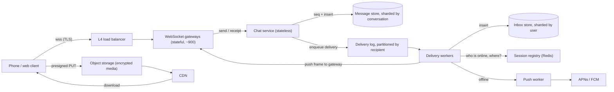
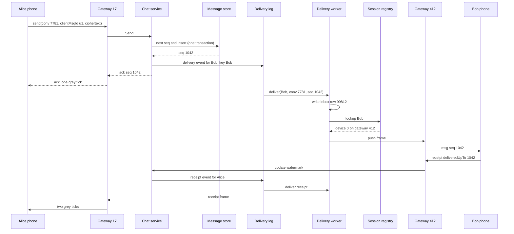

A chat app looks simple: type a message, it appears on your friend's phone. Underneath, it is one of the hardest everyday systems to build well. Tens of millions of phones hold an open connection at the same time, messages must never be lost or shown out of order, the little ticks must tell the truth, and a phone that was switched off for a week must catch up the moment it comes back. This case study designs such a system from requirements to deployment.

We reason from public engineering principles and published protocols. Nothing here claims to describe how WhatsApp, Signal or any other company builds its product internally. When we say "a system like WhatsApp", we mean "a messenger with those features".

## Learning objectives

By the end of this case study you will be able to:

1. Estimate connections, message rate, heartbeat load, storage and gateway count with back-of-the-envelope arithmetic.
2. Design the connection layer: stateful WebSocket gateways, a session registry, and routing a message to the right server.
3. Guarantee per-conversation ordering with server-assigned sequence numbers and idempotent client message ids.
4. Implement sent, delivered and read receipts as monotonic watermarks, including for groups.
5. Design offline delivery with a per-user inbox, sync cursors and push notifications.
6. Explain at a high level how end-to-end encryption (Signal-style key agreement and ratcheting) changes what the server can see and do.
7. Reason about failure modes, security, observability, cost, and when a much simpler design is enough.

## Prerequisites

- [WebSockets, Server-Sent Events and long polling](#/lesson/m10-realtime): how a server pushes data to a client.
- [Kafka topics, partitions and consumer groups](#/lesson/m12-kafka): partitioned logs and ordering per partition.
- [Idempotent consumers and inbox deduplication](#/lesson/m12-idempotent-consumers): why retries must not create duplicates.
- [Clock skew, ordering and logical clocks](#/lesson/m13-time-ordering): why wall-clock timestamps cannot order messages.
- [TLS and encryption at rest](#/lesson/m14-tls-encryption): what transport encryption does and does not protect.

## Explain it like I'm a beginner

Think of an old-fashioned post office in a big Indian city, but one that works at the speed of light.

- Every customer keeps a **private phone line open to the post office** all day. That open line is a persistent connection (a WebSocket). It lets the post office call you the moment a letter arrives, instead of you phoning every few seconds to ask (polling).
- Each of thousands of counters holds some customers' lines: a **gateway server**. A board at the back says "Priya is on counter 412": the **session registry**.
- Each conversation has its own **numbered ledger**. Letter 1, letter 2, letter 3. The number is stamped by the post office, not by the sender's watch, because watches disagree. That stamp is the **sequence number**, and it is how everyone agrees on order.
- When the post office files your letter in the ledger, it tells you "received" (one grey tick, **sent**). When your friend's phone confirms it got the letter, you get two grey ticks (**delivered**). When your friend opens the chat, the ticks turn blue (**read**). Those confirmations are **receipts**, and they are just tiny letters travelling back the other way.
- If your friend's phone is off, the letter waits in their **pigeonhole** (the offline inbox), and a short "you have mail" ping goes out through APNs or FCM. On reconnect the phone asks: "Everything after the last letter I confirmed, please."
- Finally, the letters are in **locked boxes that only the two friends have keys to**. The post office can route and store the boxes but cannot read them. That is **end-to-end encryption**.


## Requirements

### Functional requirements

1. **One-to-one messaging** of text, with media (photos, voice notes, documents) sent as attachments.
2. **Group chats** of up to about a thousand members (we choose 1,000 as our cap; the number is a product decision).
3. **Receipts**: sent (server has stored it), delivered (reached the recipient's device), read (recipient opened it). In groups, "delivered" and "read" mean "to every member", with per-member detail on request.
4. **Offline delivery**: messages sent to an offline user arrive when they reconnect, in order, without duplicates. A push notification nudges the device.
5. **Ordering**: within a conversation, every participant sees messages in the same order.
6. **Multi-device**: a user may have a phone plus up to four linked devices (web, desktop).
7. **Presence and typing indicators**: "online", "last seen", "typing…" (best effort).
8. **End-to-end encryption** (E2EE) for message content, so servers store and forward ciphertext only.

### Non-functional requirements

| Property | Target | Why |
|---|---|---|
| Delivery latency | p99 under 500 ms when both users are online in the same region | Feels instant |
| Durability | A message acknowledged as "sent" is never lost | The single tick is a promise |
| Availability | 99.99 % for send and receive | Messaging is a utility for its users |
| Ordering | Total order per conversation; no order across conversations | Cross-chat order isn't needed and is expensive |
| Duplicates | None visible to users | Retries on flaky mobile networks are constant |
| Privacy | Server can't read content | Trust, regulation |
| Battery and data | Minimal radio wake-ups | Mobile users on 4G in tier-3 towns |

### Out of scope

Voice and video calls (a separate media-relay problem), stories, payments, server-side search (impossible with E2EE) and abuse detection beyond rate limits.

:::callout type=tip title="Say the scope cut out loud"
In an interview, saying "calls are out of scope because they need their own media-relay (TURN/SFU) design" shows judgement, not ignorance.
:::

## Capacity estimation

All numbers below are **estimates** chosen to make the arithmetic clear. Change them and redo the maths; the method matters more than the figures.

### Users, messages and connections

- **Daily active users (DAU)**: 200 million.
- **Messages sent per DAU per day**: 40 (text plus media, 1:1 and group).
- Messages per day = 200 M × 40 = **8 billion**.
- Average send rate = 8 × 10⁹ ÷ 86,400 s ≈ **92,600 messages/s**.
- Peak factor: ×3 for a normal evening, but festival midnights (New Year, Diwali greetings) spike far higher. Plan for ×10 bursts: ≈ **930,000 messages/s** at the very top, ≈ **280,000/s** as everyday peak.

If 30 % of messages go to groups averaging 20 members:

- Deliveries per second (average) = 92,600 × (0.7 × 1 + 0.3 × 20) = 92,600 × 6.7 ≈ **620,000 deliveries/s**.

Receipts are messages too. Each delivery produces up to two receipts (delivered, read). That is up to **1.2 million receipt events/s** on average. Receipts outnumber messages. In groups we will batch them aggressively.

### Concurrent connections and gateways

- At peak, assume 30 % of DAU are connected at once: 200 M × 0.3 = **60 million WebSocket connections**.
- A tuned gateway can hold tens to hundreds of thousands of mostly idle sockets; the limit is memory per connection and file descriptors, not CPU. Use a conservative **100,000 per gateway** (estimate; load-test it).
- Gateways needed = 60 M ÷ 100 k = **600**, plus 50 % headroom for a zone failure and deploys ≈ **900 gateway instances**. In normal running each holds about 60 M ÷ 900 ≈ **67,000 sockets**; the spare third is what absorbs a lost zone.

### Heartbeats: the hidden load

Mobile networks silently drop idle TCP connections, so clients send a keep-alive (heartbeat).

- With one heartbeat every 30 s: 60 M ÷ 30 s = **2 million heartbeats/s**.

That is more than three times the delivery rate. Heartbeats must be handled entirely inside the gateway (no database, no registry write per beat). Registry leases are renewed far less often, for example every 60 s, and only for the session, not per heartbeat.

### Storage

Text message envelope: about 100 bytes of ciphertext plus 150 bytes of metadata (ids, sequence, timestamps) ≈ **250 bytes**.

- If the server keeps messages **only until delivered** (store-and-forward): suppose 10 % of messages wait on average one day. 8 B × 0.1 × 250 B = **200 GB** of pending messages at any moment. Small.
- If the server keeps **full history** (cloud-synced chat, like many workplace messengers): 8 B × 250 B = **2 TB/day**, ≈ 730 TB/year, ≈ **2.2 PB/year** with three replicas.

This one decision moves the storage tier from "a few sharded PostgreSQL clusters" to "petabyte-scale wide-column store". We pick **store-and-forward with 30-day retention for undelivered messages**, and leave history to encrypted device backups.

Media: 5 % of messages carry media averaging 200 KB: 8 B × 0.05 × 200 KB = **80 TB/day** of uploads into object storage. Media dominates storage and bandwidth cost, not text.

### Bandwidth

Text: 620,000 deliveries/s × 250 B ≈ 155 MB/s ≈ **1.2 Gbit/s**, modest. Media egress is the real bandwidth bill.

**What breaks first?** Not the database. The first things to hurt are connection count (memory and file descriptors on gateways), reconnect storms after a gateway or zone failure, and fan-out for large groups.

## API design

A chat system has two kinds of API: a **persistent bidirectional channel** for real-time frames, and **plain HTTPS endpoints** for everything that isn't latency critical.

### WebSocket frames (over `wss://chat.example.com/v1/ws`)

The client authenticates during the upgrade with a short-lived access token. Frames are small binary messages (Protocol Buffers or MessagePack in practice; JSON shown for readability).

```jsonc
// client -> server: send
{ "type": "send", "conversationId": 7781, "clientMessageId": "6f1c…", "ciphertext": "base64…", "sentAtClient": "2026-10-19T20:15:03Z" }

// server -> client: ack (one grey tick)
{ "type": "ack", "clientMessageId": "6f1c…", "conversationId": 7781, "seq": 1042, "serverTime": "2026-10-19T20:15:03.120Z" }

// server -> client: new message
{ "type": "msg", "conversationId": 7781, "seq": 1042, "senderId": 501, "ciphertext": "base64…", "inboxSeq": 99812 }

// client -> server: delivery and read watermarks
{ "type": "receipt", "conversationId": 7781, "deliveredUpTo": 1042, "readUpTo": 1040 }

// client -> server: inbox cursor acknowledgement
{ "type": "inboxAck", "upTo": 99812 }
```

Design decisions:

- **`clientMessageId`** (a UUID made on the phone) is the idempotency key: a resend after a lost ack gets the same `seq` back.
- **`seq`** is assigned by the server, per conversation. The client's clock is only for display.
- **Receipts are watermarks**, not per-message events: "delivered everything up to 1042" replaces 40 separate acks after a reconnect.

### HTTPS endpoints

| Method and path | Purpose |
|---|---|
| `POST /v1/conversations/{id}/messages` | Send fallback when the socket is down (same body and idempotency semantics) |
| `GET /v1/sync?after={inboxSeq}&limit=200` | Catch-up after reconnect, paged by inbox cursor |
| `POST /v1/media/uploads` | Returns a presigned upload URL for an encrypted attachment |
| `GET /v1/conversations/{id}/messages?afterSeq=…` | Fill a gap detected by the client |
| `POST /v1/groups`, `POST /v1/groups/{id}/members` | Group management |
| `GET /v1/users/{id}/prekeys` | Fetch a recipient's public prekey bundle to start an encrypted session |

## Data model

We use PostgreSQL 17 for the relational core. The message tables are partitioned and sharded by conversation, so every query for one conversation touches one shard.

```sql
CREATE TABLE app_user (
  user_id      bigint PRIMARY KEY,
  phone_e164   text   NOT NULL UNIQUE,
  display_name text   NOT NULL,
  created_at   timestamptz NOT NULL DEFAULT now()
);

CREATE TABLE device (
  user_id      bigint NOT NULL REFERENCES app_user,
  device_id    int    NOT NULL,          -- 0 = primary phone, 1..4 = linked devices
  identity_key bytea  NOT NULL,          -- public key only
  push_token   text,
  PRIMARY KEY (user_id, device_id)
);

CREATE TABLE conversation (
  conversation_id bigint PRIMARY KEY,
  kind            text   NOT NULL CHECK (kind IN ('DIRECT', 'GROUP')),
  last_seq        bigint NOT NULL DEFAULT 0   -- sequence counter
);

-- Receipts live here as watermarks: one row per member, not one row per message.
CREATE TABLE conversation_member (
  conversation_id    bigint NOT NULL REFERENCES conversation,
  user_id            bigint NOT NULL REFERENCES app_user,
  joined_seq         bigint NOT NULL DEFAULT 0,
  last_delivered_seq bigint NOT NULL DEFAULT 0,
  last_read_seq      bigint NOT NULL DEFAULT 0,
  PRIMARY KEY (conversation_id, user_id),
  CHECK (last_read_seq <= last_delivered_seq)
);

CREATE TABLE message (
  conversation_id   bigint NOT NULL,
  seq               bigint NOT NULL,
  sender_id         bigint NOT NULL,
  client_message_id uuid   NOT NULL,
  ciphertext        bytea  NOT NULL,
  created_at        timestamptz NOT NULL DEFAULT now(),
  PRIMARY KEY (conversation_id, seq),
  UNIQUE (conversation_id, sender_id, client_message_id)   -- idempotency
) PARTITION BY HASH (conversation_id);

-- Per-recipient pending queue (store-and-forward).
CREATE TABLE inbox (
  user_id         bigint NOT NULL,
  inbox_seq       bigint NOT NULL,
  conversation_id bigint NOT NULL,
  seq             bigint NOT NULL,
  created_at      timestamptz NOT NULL DEFAULT now(),
  PRIMARY KEY (user_id, inbox_seq)
) PARTITION BY HASH (user_id);
```

Why this shape:

- **`(conversation_id, seq)` as the primary key** makes "messages after seq N in this chat" a range scan on one index, which is exactly the sync query.
- **The unique `(conversation_id, sender_id, client_message_id)` constraint** is the database-level backstop for idempotency. Even if two gateway retries race, only one row wins.
- **Receipts as watermarks**: a group of 500 people exchanging 1,000 messages would need 500,000 receipt rows if stored per message. With watermarks it is 500 rows, updated in place. "Has member X read message 1042?" becomes `last_read_seq >= 1042`.
- **`inbox` is keyed by recipient**, because offline sync is "everything for me after cursor C", across all conversations. Rows are deleted once the device acknowledges them. With full history you would keep `message` forever and make `inbox` a thin pointer table, as here.
- **Two partition keys, two shard maps.** `message` is sharded by conversation, `inbox` by user. Writing one message touches one message shard and one inbox shard per recipient. That cross-shard write is why the fan-out goes through a durable queue rather than one distributed transaction.

The sequence counter `last_seq` is incremented with `UPDATE conversation SET last_seq = last_seq + 1 WHERE conversation_id = $1 RETURNING last_seq` inside the same transaction as the `INSERT INTO message`. The row lock serialises writers in one conversation only, which is the ordering we want and nothing more. A busy group of 1,000 people produces a few messages per second, so this lock is never a bottleneck.

## High-level architecture



Walk through every arrow:

1. **Client → L4 load balancer → gateway.** A TCP-level balancer spreads new connections. Layer 4 is enough because we never route individual frames; a socket stays on one gateway for life.
2. **Gateway → chat service.** Gateways are thin: authenticate, handle heartbeats, decode frames, forward `send` and `receipt` over gRPC. Logic lives elsewhere so releases don't drop 60 M sockets.
3. **Chat service → message store.** Check membership, assign the next `seq`, insert, all in one transaction on the conversation's shard. Only then ack the sender: that is the single tick's promise.
4. **Chat service → delivery log.** Via an outbox row in the same transaction, append one delivery event per recipient to a partitioned log such as Kafka, keyed by **recipient user id** so each user's deliveries stay ordered.
5. **Delivery workers → inbox store.** Write the recipient's pending entry with the next `inbox_seq`: the durable record that they have something to fetch.
6. **Delivery workers → session registry.** Redis maps `user → (device, gatewayId, lease)`. It is soft state that reconnecting clients rebuild.
7. **Delivery workers → gateway.** If the user is online, send the frame to that gateway, which writes it to the socket.
8. **Push worker → APNs / FCM.** If no device is online, wake the phone. With E2EE the push carries no readable content.
9. **Media path.** The client encrypts the file, uploads ciphertext to object storage with a presigned URL, and puts the URL and key inside the encrypted message. Downloads go through the CDN; chat servers never touch media bytes.

### Sequence: Alice sends to Bob



The key ordering detail: the sender's ack comes **after** the durable insert and the outbox record. If the chat service crashes before acking, Alice's phone retries with the same `clientMessageId`, the unique constraint finds the row, and she gets `seq 1042` again. Bob's receipt travels the same pipeline in reverse, so receipts get the same reliability for free.

## Deep dives

### 1. Connections: why gateways are stateful, and how routing works

HTTP servers are usually stateless, so any server can handle any request. A WebSocket gateway is the opposite: the socket *is* state. Bob can only be reached through gateway 412. That creates three problems.

**Finding Bob.** The session registry stores `session:{userId}` → a small hash of `deviceId → gatewayId` with a TTL of about 90 s, renewed every 60 s by the gateway. When Bob's phone dies without closing the socket, his entry expires within 90 s, and in the meantime deliveries to the dead socket fail and fall back to push. The inbox row was already written, so nothing is lost.

**Draining a gateway.** Deploying 900 gateways must not drop 60 M users at once. A gateway being drained stops accepting new sockets, then closes existing ones gradually over several minutes with a "reconnect" close code. Clients reconnect with **jittered backoff** (random delay between 0 and 5 s, growing on repeated failure) so they land on other gateways without a thundering herd.

**Reconnect storms.** If a zone fails, tens of millions of clients reconnect at once, each costing a TLS handshake and a token check. See Failure handling for the mitigations.

### 2. Ordering: why the server assigns sequence numbers

Phones have wrong clocks. Two people typing at the same second in a group can produce timestamps that disagree by minutes. If clients sorted by their own timestamps, Priya and Rahul could see different orders for the same chat. The fix is a single authority per conversation that stamps a number: the **sequence number (seq)**.

- **One writer per conversation.** The conversation row lock (or a single-threaded actor per conversation in an in-memory design) serialises sends. Different conversations proceed in parallel on different shards.
- **Gapless and dense.** Seqs go 1, 2, 3 with no gaps. Then a client that holds 1040 and receives 1043 *knows* that 1041 and 1042 are missing and can fetch them. A timestamp can't tell you that.
- **Idempotent assignment.** A retry with the same `(sender, clientMessageId)` returns the original seq.

This gives **total order per conversation**, which is all users can perceive. We deliberately do not order messages across conversations; that would need one global sequencer, a bottleneck with no user benefit.

Here is the sequencing core as it would sit behind the chat service. The in-memory store is a stand-in for the PostgreSQL transaction shown earlier, behind the same interface.

```csharp file=Chat/Models.cs
namespace ChatApp.Chat;

public enum ReceiptStatus { Sent = 1, Delivered = 2, Read = 3 }

public sealed record ChatMessage(
    long ConversationId, long Seq, long SenderId, Guid ClientMessageId,
    string Ciphertext, DateTimeOffset ServerTime);

public sealed record AppendResult(ChatMessage Message, bool WasDuplicate);

public sealed record SendCommand(long ConversationId, long SenderId, Guid ClientMessageId, string Ciphertext);

public sealed record SendMessageRequest(Guid ClientMessageId, string Ciphertext);

public sealed record ReceiptRequest(long DeliveredUpTo, long ReadUpTo);

public sealed record InboxEntry(long UserId, long InboxSeq, long ConversationId, long Seq);
```

```csharp file=Chat/MessageStore.cs
using System.Collections.Concurrent;

namespace ChatApp.Chat;

public interface IMessageStore
{
    /// <summary>Assigns the next sequence number, or returns the original one for a retried client id.</summary>
    AppendResult Append(SendCommand command);
    IReadOnlyList<ChatMessage> After(long conversationId, long afterSeq, int limit);
}

/// <summary>
/// Stand-in for: UPDATE conversation SET last_seq = last_seq + 1 ... RETURNING last_seq;
/// INSERT INTO message ... (unique on conversation, sender, client id). One lock per conversation.
/// </summary>
public sealed class InMemoryMessageStore(TimeProvider clock) : IMessageStore
{
    private sealed class ConversationLog
    {
        public readonly Lock Gate = new();
        public long LastSeq;
        public readonly List<ChatMessage> Messages = new();
        public readonly Dictionary<(long Sender, Guid ClientId), ChatMessage> ByClientId = new();
    }

    private readonly ConcurrentDictionary<long, ConversationLog> _logs = new();

    public AppendResult Append(SendCommand command)
    {
        var log = _logs.GetOrAdd(command.ConversationId, _ => new ConversationLog());
        lock (log.Gate)
        {
            var key = (command.SenderId, command.ClientMessageId);
            if (log.ByClientId.TryGetValue(key, out var existing))
                return new AppendResult(existing, WasDuplicate: true);

            var message = new ChatMessage(command.ConversationId, ++log.LastSeq, command.SenderId,
                command.ClientMessageId, command.Ciphertext, clock.GetUtcNow());
            log.Messages.Add(message);
            log.ByClientId[key] = message;
            return new AppendResult(message, WasDuplicate: false);
        }
    }

    public IReadOnlyList<ChatMessage> After(long conversationId, long afterSeq, int limit)
    {
        if (!_logs.TryGetValue(conversationId, out var log)) return [];
        lock (log.Gate)
        {
            // Seqs are dense and start at 1, so the index of seq N is N - 1.
            var start = (int)Math.Min(afterSeq, log.Messages.Count);
            return log.Messages.Skip(start).Take(limit).ToList();
        }
    }
}
```

### 3. Receipts as monotonic watermarks

A receipt says "I have everything up to here". Because seqs are dense, one number per member per conversation captures the full state. Two rules keep it correct:

1. **Monotonic.** A watermark only moves forward: `new = max(old, incoming)`. Receipts can arrive out of order (a delayed "delivered up to 1030" after "delivered up to 1042") and must not move the tick backwards.
2. **Read implies delivered.** If you read up to 1042, you obviously received it. Raising `readUpTo` also raises `deliveredUpTo`.

For a **group**, the sender's tick for message N is the *minimum* across the other members: "delivered" when every other member's delivered watermark is ≥ N, "read" when every read watermark is ≥ N. Recomputing a minimum over 1,000 members on every receipt is wasteful, so the service keeps a cached group minimum and only pushes a receipt frame to the sender when that minimum crosses one of the sender's own messages. Members who joined after message N are excluded, which is what `joined_seq` is for.

```csharp file=Chat/ReceiptTracker.cs
using System.Collections.Concurrent;

namespace ChatApp.Chat;

public sealed record Watermark(long DeliveredSeq, long ReadSeq);

public sealed class ReceiptTracker
{
    private readonly ConcurrentDictionary<(long Conversation, long User), Watermark> _marks = new();

    public Watermark Get(long conversationId, long userId) =>
        _marks.TryGetValue((conversationId, userId), out var w) ? w : new Watermark(0, 0);

    /// <summary>Applies a receipt. Watermarks never move backwards, and read implies delivered.</summary>
    public Watermark Apply(long conversationId, long userId, long deliveredUpTo, long readUpTo) =>
        _marks.AddOrUpdate((conversationId, userId),
            _ => Normalise(new Watermark(0, 0), deliveredUpTo, readUpTo),
            (_, old) => Normalise(old, deliveredUpTo, readUpTo));

    private static Watermark Normalise(Watermark old, long deliveredUpTo, long readUpTo)
    {
        var read = Math.Max(old.ReadSeq, readUpTo);
        var delivered = Math.Max(Math.Max(old.DeliveredSeq, deliveredUpTo), read);
        return new Watermark(delivered, read);
    }

    /// <summary>The tick shown to the sender for message <paramref name="seq"/>, over all other members.</summary>
    public ReceiptStatus StatusFor(long conversationId, long seq, IEnumerable<long> otherMembers)
    {
        var any = false;
        long minDelivered = long.MaxValue, minRead = long.MaxValue;
        foreach (var member in otherMembers)
        {
            any = true;
            var w = Get(conversationId, member);
            minDelivered = Math.Min(minDelivered, w.DeliveredSeq);
            minRead = Math.Min(minRead, w.ReadSeq);
        }
        if (!any) return ReceiptStatus.Sent;
        if (minRead >= seq) return ReceiptStatus.Read;
        return minDelivered >= seq ? ReceiptStatus.Delivered : ReceiptStatus.Sent;
    }
}
```

Read receipts are also a **privacy setting**: if Bob turns them off, his client never sends `readUpTo`.

### 4. Offline delivery: the inbox and the sync cursor

The inbox is a per-user queue of pointers: `(inbox_seq, conversation_id, seq)`. Its own sequence (`inbox_seq`) is per user and gapless, so the device has **one cursor** for everything, no matter how many chats it belongs to.

The reconnect flow:

1. Device opens the socket and sends `sync(after = lastAckedInboxSeq)`.
2. Server returns up to 200 entries with their message bodies, oldest first.
3. Device stores them locally, then sends `inboxAck(upTo = 99812)`.
4. Server deletes inbox rows ≤ 99812 for that device and sends the next page.
5. Once caught up, live frames flow as normal. Live frames carry `inboxSeq` too, so the device acks them the same way.

The device acks **after** saving locally. If the app crashes mid-page, the next sync resends the same entries, and the client deduplicates by `(conversationId, seq)`. That is **at-least-once delivery with idempotent receipt**, which looks like exactly-once to the user.

With **multi-device**, each device has its own cursor and keys, so the inbox is really per `(user, device)`: a phone and two laptops get three entries.

**Push notifications** are a hint, not a delivery channel: APNs and FCM may delay, coalesce or drop them. The inbox is the source of truth. Collapse pushes per user ("12 new messages").

```csharp file=Chat/OfflineInbox.cs
using System.Collections.Concurrent;

namespace ChatApp.Chat;

public interface IOfflineInbox
{
    InboxEntry Enqueue(long userId, long conversationId, long seq);
    IReadOnlyList<InboxEntry> FetchAfter(long userId, long afterInboxSeq, int limit);
    int AckUpTo(long userId, long inboxSeq);
}

public sealed class InMemoryOfflineInbox : IOfflineInbox
{
    private sealed class Box
    {
        public readonly Lock Gate = new();
        public long LastInboxSeq;
        public readonly List<InboxEntry> Pending = new();
    }

    private readonly ConcurrentDictionary<long, Box> _boxes = new();

    public InboxEntry Enqueue(long userId, long conversationId, long seq)
    {
        var box = _boxes.GetOrAdd(userId, _ => new Box());
        lock (box.Gate)
        {
            var entry = new InboxEntry(userId, ++box.LastInboxSeq, conversationId, seq);
            box.Pending.Add(entry);
            return entry;
        }
    }

    public IReadOnlyList<InboxEntry> FetchAfter(long userId, long afterInboxSeq, int limit)
    {
        if (!_boxes.TryGetValue(userId, out var box)) return [];
        lock (box.Gate) return box.Pending.Where(e => e.InboxSeq > afterInboxSeq).Take(limit).ToList();
    }

    /// <summary>Deletes everything the device has safely stored. Returns how many rows were removed.</summary>
    public int AckUpTo(long userId, long inboxSeq)
    {
        if (!_boxes.TryGetValue(userId, out var box)) return 0;
        lock (box.Gate) return box.Pending.RemoveAll(e => e.InboxSeq <= inboxSeq);
    }
}
```

### 5. Session registry and routing

```csharp file=Chat/Routing.cs
using System.Collections.Concurrent;
using System.Threading.Channels;
using Microsoft.Extensions.Logging;

namespace ChatApp.Chat;

public interface ISessionRegistry
{
    void Register(long userId, string gatewayId, TimeSpan lease);
    void Unregister(long userId, string gatewayId);
    string? Lookup(long userId);
}

/// <summary>Stand-in for Redis keys with TTL: session:{userId} -> gatewayId.</summary>
public sealed class InMemorySessionRegistry(TimeProvider clock) : ISessionRegistry
{
    private readonly ConcurrentDictionary<long, (string GatewayId, DateTimeOffset Expires)> _sessions = new();

    public void Register(long userId, string gatewayId, TimeSpan lease) =>
        _sessions[userId] = (gatewayId, clock.GetUtcNow() + lease);

    public void Unregister(long userId, string gatewayId)
    {
        // Only remove our own entry: the user may already have reconnected elsewhere.
        if (_sessions.TryGetValue(userId, out var s) && s.GatewayId == gatewayId)
            _sessions.TryRemove(new KeyValuePair<long, (string, DateTimeOffset)>(userId, s));
    }

    public string? Lookup(long userId) =>
        _sessions.TryGetValue(userId, out var s) && s.Expires > clock.GetUtcNow() ? s.GatewayId : null;
}

/// <summary>This process's sockets. In production each gateway is its own process reached over gRPC.</summary>
public sealed class LocalGateway
{
    private readonly ConcurrentDictionary<long, Channel<ChatMessage>> _sockets = new();
    public string GatewayId { get; } = $"gw-{Environment.MachineName}";

    public ChannelReader<ChatMessage> Connect(long userId)
    {
        var channel = Channel.CreateBounded<ChatMessage>(new BoundedChannelOptions(256)
        {
            FullMode = BoundedChannelFullMode.DropWrite   // slow client: inbox still has it
        });
        _sockets[userId] = channel;
        return channel.Reader;
    }

    public void Disconnect(long userId)
    {
        if (_sockets.TryRemove(userId, out var channel)) channel.Writer.TryComplete();
    }

    public bool TryDeliver(long userId, ChatMessage message) =>
        _sockets.TryGetValue(userId, out var channel) && channel.Writer.TryWrite(message);
}

public interface IPushSender
{
    Task WakeAsync(long userId, CancellationToken ct);
}

public sealed class LoggingPushSender(ILogger<LoggingPushSender> logger) : IPushSender
{
    public Task WakeAsync(long userId, CancellationToken ct)
    {
        logger.LogInformation("Push wake-up for user {UserId} (no message content)", userId);
        return Task.CompletedTask;
    }
}

public interface IMembership
{
    IReadOnlyList<long> MembersOf(long conversationId);
}

public sealed class InMemoryMembership : IMembership
{
    private readonly ConcurrentDictionary<long, long[]> _members = new();
    public void Set(long conversationId, params long[] userIds) => _members[conversationId] = userIds;
    public IReadOnlyList<long> MembersOf(long conversationId) =>
        _members.TryGetValue(conversationId, out var m) ? m : [];
}
```

### 6. The send path, end to end

```csharp file=Chat/MessageRouter.cs
namespace ChatApp.Chat;

public sealed class MessageRouter(
    IMessageStore store, IMembership membership, IOfflineInbox inbox,
    ISessionRegistry registry, LocalGateway gateway, IPushSender push)
{
    /// <summary>Returns null when the sender is not a member of the conversation.</summary>
    public async Task<AppendResult?> SendAsync(SendCommand command, CancellationToken ct)
    {
        var members = membership.MembersOf(command.ConversationId);
        if (!members.Contains(command.SenderId)) return null;

        var result = store.Append(command);          // durable point: the single tick
        // Returning early on a duplicate is only safe because, in production, the delivery events are
        // written as outbox rows in the SAME transaction as the message. If the process died after the
        // insert but before fan-out, the outbox relay still delivers; the retry must not depend on it.
        if (result.WasDuplicate) return result;

        // In production this loop runs in delivery workers fed by a log keyed by recipient.
        foreach (var recipient in members)
        {
            if (recipient == command.SenderId) continue;
            inbox.Enqueue(recipient, command.ConversationId, result.Message.Seq);

            var gatewayId = registry.Lookup(recipient);
            var deliveredLive = gatewayId == gateway.GatewayId && gateway.TryDeliver(recipient, result.Message);
            if (!deliveredLive) await push.WakeAsync(recipient, ct);
        }
        return result;
    }
}
```

`SendAsync` never waits for recipients: the sender's ack depends only on the durable append.

### 7. Groups: fan-out on write, with a cap

For a group of N members, one send creates N − 1 inbox entries. This is **fan-out on write**, the same idea as in the [news feed case study](#/lesson/m17-news-feed). It works because groups are capped (1,000 here), so the worst case is 999 inbox writes per message, done asynchronously by delivery workers.

Why not fan-out on read (each member pulls from the group log)? Because an offline phone wants a single cursor across all its chats, not 80 group logs to poll. For huge broadcast channels (100,000+ subscribers) a hybrid works: store the post once and put one coalesced "channel 55 has new posts up to seq 9001" pointer in each subscriber's inbox.

Group membership changes are messages too: "Rahul added Meera" gets a seq in the group log. Meera's `joined_seq` is that seq, so she does not receive (and can't decrypt) earlier history, and receipts ignore her for older messages.

### 8. End-to-end encryption, at a high level

Transport TLS protects data on the wire between phone and server. **End-to-end encryption** goes further: only the sender's and recipients' devices hold the keys, so the server stores and forwards ciphertext it can't read. The best-known open design is the Signal Protocol, whose specifications are public. WhatsApp has publicly stated that it uses the Signal Protocol; how any company operates it internally is outside what we can know.

The moving parts, simplified:

1. **Identity key.** Each device generates a long-term key pair and uploads only the public half.
2. **Prekeys.** Each device also uploads a signed prekey and a batch of one-time prekeys. The server hands one bundle to anyone who wants to start a conversation, even if the recipient is offline.
3. **Key agreement (X3DH).** Alice combines her keys with Bob's prekey bundle through several Diffie-Hellman operations to derive a shared secret. Bob can derive the same secret later from Alice's first message.
4. **Double Ratchet.** Every message advances a chain of keys, and every reply mixes in a fresh Diffie-Hellman exchange. Stealing today's key does not reveal yesterday's messages (forward secrecy) and the session heals after a compromise (post-compromise security).
5. **Groups (sender keys).** Encrypting a group message separately for 500 devices is expensive. With sender keys, each member distributes a symmetric sender key to the others once (over the pairwise sessions), then encrypts each group message once. Removing a member forces everyone to rotate their sender key.
6. **Safety numbers.** Users can compare a fingerprint of each other's identity keys (QR code) to detect a server that substitutes keys (a man-in-the-middle).

What this means for the system design:

- The server can't search or moderate content; spam control uses metadata (rates, reports).
- **Multi-device multiplies fan-out**: a message to 100 people with 1.5 devices each is about 150 encryptions (or one, with sender keys).
- **Backups** must be encrypted with a user-held key, and **metadata** (who, when, which IP) is still visible, so minimise logging.

## Caching, queues and scaling

**Caches.**

- *Membership cache*: `members:{conversationId}` in Redis or an in-process cache, invalidated by the membership-change event. Every send needs it, and it changes rarely.
- *Session registry*: a cache of "who is connected where"; losing it costs push fallbacks, not data.
- *Prekey bundles*: cacheable, except one-time prekeys, which must be handed out exactly once (`DELETE … RETURNING` in the database).

**Queues.** The delivery log is partitioned by recipient so each user's deliveries are ordered. Size it for the everyday peak, not the average: 280,000 sends/s × 6.7 ≈ **1.9 million deliveries/s**. At a conservative 5,000 events/s per partition per consumer (estimate), that is about 375 partitions; pick 512 for growth and even spread. Festival bursts above that are absorbed as a few seconds of consumer lag, not by adding partitions on the night (adding partitions to a keyed topic moves keys and breaks per-user order during the change). Receipts go on the same log keyed by the *sender* who will receive them. Presence and typing events use a separate, lossy channel (Redis pub/sub or direct gateway-to-gateway), because losing a "typing…" is harmless and they are very chatty.

**Scaling each tier.**

| Tier | Scales by | Breaks when |
|---|---|---|
| Gateways | Adding instances; LB spreads new connections | Memory per connection, reconnect storms |
| Chat service | Stateless replicas | Downstream database latency |
| Message store | Hash sharding by conversation id | A hot conversation (huge group) on one shard |
| Inbox store | Hash sharding by user id | Users in hundreds of busy groups |
| Delivery log | More partitions and consumers | Consumer lag during bursts |
| Push | Worker replicas; per-provider rate limits | Provider throttling at festival midnight |

**Backpressure.** At festival midnight the delivery log absorbs the burst: senders still get their tick once stored, and delivery lags a few seconds.

## Failure handling

| Failure | What users see | Mitigation |
|---|---|---|
| Network drops after server stored a message, before the ack | Clock icon, then a retry | Same `clientMessageId` returns same seq; no duplicate |
| Gateway crash | About 67,000 sockets drop (up to 100,000 on a full gateway) | Clients reconnect with jitter; inbox rows already written, so sync catches up |
| Session registry entry stale (user moved gateway) | Delivery to old gateway fails | Fall back to push; inbox has it; lease expiry cleans up |
| Delivery worker crash mid-batch | Duplicate frames after restart | Consumer offsets committed after inbox write; client dedupes by `(conversationId, seq)` |
| Message shard primary fails | Sends to those conversations fail for seconds | Synchronous replica plus automatic failover; client retries with the same id |
| APNs/FCM outage | Offline users not woken | Messages wait in inbox; delivered on next app open |
| Client receives seq 1043 while holding 1040 | Gap | Client fetches `afterSeq=1040` before displaying 1043 (reorder buffer) |

The recurring theme: **durable state lives in the message store and the inbox; everything else is soft state that clients can rebuild by reconnecting and syncing.** That is why the gateways and registry can fail without losing a single message.

:::callout type=warning title="Never ack before the durable write"
If the gateway acks "sent" before the database commit, a crash in between loses a message the user believes is safe. The single tick must mean "stored with replicas", or it is a lie.
:::

## Security

- **Authentication.** OTP phone verification, then a device credential in the platform keystore; the socket upgrade uses a short-lived token. Rate-limit OTP requests per number and IP to stop SMS-pumping fraud.
- **Authorisation.** Every send checks membership server-side; group admin actions check the admin role. The client UI is not a security boundary.
- **Transport.** TLS 1.3 everywhere, even with E2EE, because tokens and metadata need protection.
- **Key directory integrity.** Safety numbers and key-change warnings let users detect a server that substitutes keys.
- **Abuse.** Send rate limits per device (for example 30 messages/minute to new contacts), forwarding limits, and user reports that include the reported messages, decrypted on the reporter's device with consent.
- **Data minimisation.** Delete delivered messages, keep IP logs only as long as abuse handling needs, and document retention for India's DPDP Act and other regimes.

## Observability

Measure what users feel, per region and per app version:

- **Send ack latency** (client send → ack): p50, p99. SLO example: p99 < 300 ms.
- **End-to-end delivery latency** (server ack → recipient device ack), for online recipients. SLO example: p99 < 1 s.
- **Connection health**: active sockets per gateway, connects/s, disconnects/s by close code, TLS handshake failures, heartbeat timeouts.
- **Delivery log lag** per partition (seconds behind), the earliest sign of trouble.
- **Inbox depth**: number and age of the oldest undelivered entry per shard. A growing "oldest pending age" means pushes or syncs are failing.
- **Push provider** success, latency and throttling responses.

Trace the send path with OpenTelemetry (trace id in frame metadata), sampled heavily: at 280,000 sends/s, tracing everything is a cost problem. Never log phone numbers in plain text.

## Deployment and cost

**Deployment.**

- Gateways deploy slowly: drain 5 % at a time while clients migrate, so a full rollout may take an hour. Most releases touch only the chat service and workers, which use ordinary canary deployments.
- Schema changes follow expand/contract, and the frame protocol needs version negotiation, because old app versions live for months.
- Multi-region: users are homed to a region; each conversation's sequencer lives in one region and frames cross regions over the delivery log.

**Cost drivers** (relative, not quotes):

1. **Media storage and egress**, by far. 80 TB/day of uploads, downloaded several times each. CDN rates, compression on the client, and expiring undownloaded media drive this.
2. **Gateway fleet**: about 900 memory-heavy instances running 24×7 for mostly idle sockets. Memory per connection is the knob.
3. **Message and inbox databases**: modest with store-and-forward; dominant if you keep full history.
4. **Cross-zone traffic** between gateways, services and the log.

### When a simpler design is enough

A company-internal chat for 5,000 employees, or the customer-support chat of a food-delivery app, does not need any of this. One ASP.NET Core app with SignalR (backed by a Redis backplane if you run two instances), one PostgreSQL database with the `message` table above, and full history is enough. 5,000 users × 50 messages a day is 250,000 messages a day, about 3 per second. Add E2EE only if the threat model demands it, because it removes server-side search and compliance export, which enterprises often need.

## Alternatives and trade-offs

| Decision | Our choice | Alternative | When the alternative wins |
|---|---|---|---|
| Transport | WebSocket | MQTT over TCP | Very constrained devices and networks; compact protocol with built-in QoS |
| Retention | Store-and-forward | Full server history | Workplace chat, compliance, cross-device history without backups |
| Ordering | Per-conversation seq | Client timestamps or Lamport clocks | Never for display order in a chat; Lamport/vector clocks suit peer-to-peer or CRDT systems |
| Group fan-out | Write to every inbox | Pull from group log | Huge broadcast channels, where a pointer per subscriber is enough |
| Receipts | Watermarks | Per-message receipt rows | Products that must show exactly who read each message long after the fact |
| Message store | Sharded PostgreSQL | Wide-column store (Cassandra/ScyllaDB-style) | Petabyte full history with very high write rates |
| Encryption | E2EE | TLS only | Enterprise chat needing search, retention and eDiscovery |

The core trade-off in one sentence: **we accept a little delivery latency and complexity on the client (reorder buffers, dedupe, sync cursors) in exchange for a server that never loses an acknowledged message and never needs a global lock.**

Here is a minimal composition of the pieces as an ASP.NET Core host. The socket only pushes frames in this simplified model; sends go over HTTP POST so the example stays short. In production the same socket carries both directions.

```csharp file=Program.cs
using System.Net.WebSockets;
using System.Text.Json;
using ChatApp.Chat;

var builder = WebApplication.CreateBuilder(args);
builder.Services.AddSingleton(TimeProvider.System);
builder.Services.AddSingleton<IMessageStore, InMemoryMessageStore>();
builder.Services.AddSingleton<IOfflineInbox, InMemoryOfflineInbox>();
builder.Services.AddSingleton<ISessionRegistry, InMemorySessionRegistry>();
builder.Services.AddSingleton<InMemoryMembership>();
builder.Services.AddSingleton<IMembership>(sp => sp.GetRequiredService<InMemoryMembership>());
builder.Services.AddSingleton<ReceiptTracker>();
builder.Services.AddSingleton<LocalGateway>();
builder.Services.AddSingleton<IPushSender, LoggingPushSender>();
builder.Services.AddSingleton<MessageRouter>();

var app = builder.Build();
app.Services.GetRequiredService<InMemoryMembership>().Set(7781, 501, 502);   // demo conversation
app.UseWebSockets(new WebSocketOptions { KeepAliveInterval = TimeSpan.FromSeconds(30) });

// Demo identity only: real code uses JWT bearer authentication.
static long CurrentUser(HttpContext http) =>
    long.TryParse(http.Request.Headers["X-Demo-User"], out var id) ? id : 0;

app.MapPost("/v1/conversations/{conversationId:long}/messages",
    async (long conversationId, SendMessageRequest body, HttpContext http, MessageRouter router, CancellationToken ct) =>
    {
        var result = await router.SendAsync(
            new SendCommand(conversationId, CurrentUser(http), body.ClientMessageId, body.Ciphertext), ct);
        return result is null
            ? Results.StatusCode(StatusCodes.Status403Forbidden)
            : Results.Ok(new { result.Message.Seq, result.Message.ServerTime, duplicate = result.WasDuplicate });
    });

app.MapPost("/v1/conversations/{conversationId:long}/receipts",
    (long conversationId, ReceiptRequest body, HttpContext http, ReceiptTracker receipts, IMembership membership) =>
    {
        var user = CurrentUser(http);
        // Receipts are writes too: a non-member must not move anyone's ticks.
        if (!membership.MembersOf(conversationId).Contains(user)) return Results.StatusCode(StatusCodes.Status403Forbidden);
        return Results.Ok(receipts.Apply(conversationId, user, body.DeliveredUpTo, body.ReadUpTo));
    });

app.MapGet("/v1/sync", (long after, HttpContext http, IOfflineInbox inbox, IMessageStore store) =>
{
    var entries = inbox.FetchAfter(CurrentUser(http), after, 200);
    var messages = entries
        .Select(e => new { e.InboxSeq, Message = store.After(e.ConversationId, e.Seq - 1, 1).FirstOrDefault() })
        .ToList();
    return Results.Ok(messages);
});

app.MapPost("/v1/inbox/ack", (long upTo, HttpContext http, IOfflineInbox inbox) =>
    Results.Ok(new { removed = inbox.AckUpTo(CurrentUser(http), upTo) }));

app.Map("/v1/ws", async (HttpContext http, LocalGateway gateway, ISessionRegistry registry, CancellationToken ct) =>
{
    if (!http.WebSockets.IsWebSocketRequest) { http.Response.StatusCode = 400; return; }
    var userId = CurrentUser(http);
    using var socket = await http.WebSockets.AcceptWebSocketAsync();
    var frames = gateway.Connect(userId);
    registry.Register(userId, gateway.GatewayId, TimeSpan.FromSeconds(90));
    try
    {
        await foreach (var message in frames.ReadAllAsync(ct))
        {
            var bytes = JsonSerializer.SerializeToUtf8Bytes(new { type = "msg", message });
            await socket.SendAsync(new ArraySegment<byte>(bytes), WebSocketMessageType.Text, true, ct);
        }
    }
    finally
    {
        gateway.Disconnect(userId);
        registry.Unregister(userId, gateway.GatewayId);
    }
});

app.Run();
```

## Practical playground

The starting graph below is a naive chat backend: clients poll a REST API that reads from one database. Open it in the HLD canvas and evolve it.

1. Replace polling with a `websocket-gateway` tier. How many instances for 60 M connections at 100 k each, plus headroom?
2. Add a `cache` node for the session registry and a `stream` for the delivery log. Which key partitions the log?
3. Add a `worker` for delivery and an `external` node for APNs/FCM. Which edges are async?
4. Add `object-storage` and a `cdn` for media. Make sure media bytes never pass through the gateways.
5. Set client `rps` to 280,000 (peak sends) and check which node the canvas flags first.

:::playground type=hld title="Evolve a polling chat into a real-time messenger"
```json
{
  "nodes": [
    { "id": "c", "type": "client", "label": "Phones (polling every 5 s)", "props": { "rps": 280000 } },
    { "id": "lb", "type": "load-balancer", "label": "HTTP load balancer" },
    { "id": "api", "type": "app-server", "label": "Chat REST API", "props": { "instances": 20 } },
    { "id": "db", "type": "database", "label": "PostgreSQL (all messages)", "props": { "replicas": 1 } }
  ],
  "edges": [
    { "from": "c", "to": "lb", "kind": "sync", "label": "GET /new-messages" },
    { "from": "lb", "to": "api", "kind": "sync" },
    { "from": "api", "to": "db", "kind": "sync", "label": "SQL" }
  ]
}
```
:::

## Exercises

:::exercise id=m17-chat-ex1 difficulty=beginner kind=written title="Size a messenger for a state government"
A state government wants a secure messenger for 1.2 million employees (teachers, police, health workers, engineers). Expect 60 % daily active, 25 messages per active user per day, a peak hour carrying 15 % of the day's messages, and 40 % of daily users connected at the busiest moment. Messages average 300 bytes with metadata. The department wants full history kept for 7 years.

Estimate: peak messages per second, concurrent connections, number of gateway instances (assume 50,000 connections each, plus 50 % headroom), heartbeats per second at a 30 s interval, and storage for 7 years with 3 replicas. Then say whether the 7-year history requirement or the connection count drives the design.
::acceptance
- Every number shows its arithmetic.
- Peak rate is derived from the peak-hour share, not just ×3.
- Storage includes replicas and states the units clearly.
- Ends with a one-paragraph judgement about what drives the design.
::hint
Start with DAU: 1.2 M × 0.6. Then messages per day.
::hint
Peak hour: 15 % of daily messages in 3,600 s. Divide, don't multiply by a generic factor.
::hint
Connections: 40 % of DAU. Gateways: connections ÷ 50,000 × 1.5, rounded up.
::hint
Storage: messages/day × 300 B × 365 × 7 × 3. Convert bytes to TB by dividing by 10¹².
::solution
- DAU = 1.2 M × 0.6 = **720,000**.
- Messages/day = 720,000 × 25 = **18 M**.
- Peak hour = 18 M × 0.15 = 2.7 M messages in 3,600 s ≈ **750 messages/s** (average across the day is 18 M ÷ 86,400 ≈ 208/s, so the peak is ~3.6× average).
- Concurrent connections = 720,000 × 0.4 = **288,000**.
- Gateways = 288,000 ÷ 50,000 = 5.76 → 6, × 1.5 = **9 instances** (spread over at least 3 zones).
- Heartbeats = 288,000 ÷ 30 s ≈ **9,600/s**, handled inside the gateways.
- Storage = 18 M × 300 B = 5.4 GB/day → × 365 ≈ 1.97 TB/year → × 7 ≈ 13.8 TB → × 3 replicas ≈ **41 TB**.

Judgement: neither number is extreme. 750 messages/s fits one PostgreSQL primary with monthly partitions, and 41 TB over 7 years needs cheaper storage for old partitions, not a wide-column store. The design is driven by **retention and compliance** (history, legal hold, export). That also conflicts with E2EE: if the department needs server-side search, it must choose encryption at rest with strict access control instead, and say so.
::mistakes
- Using total employees instead of DAU for message volume.
- Multiplying the daily average by ×3 when the peak-hour share was given.
- Forgetting replicas, or mixing GB and GiB without saying so.
- Recommending a petabyte-scale design for 41 TB.
:::

:::exercise id=m17-chat-ex2 difficulty=beginner kind=sql ordered=true title="Compute group ticks from watermarks"
Receipts are stored as watermarks in `conversation_member`. For conversation 7 (a group), return each message's `seq`, its `sender_id`, how many **other** members have read it (`read_count`), and its tick `status`:

- `READ` if every other member has `last_read_seq >= seq`
- `DELIVERED` if every other member has `last_delivered_seq >= seq` (but not all have read)
- `SENT` otherwise

Only count members who had joined when the message was sent (`joined_seq < seq`). Order by `seq`.
::setup
```sql
CREATE TABLE conversation_member (
  conversation_id    bigint NOT NULL,
  user_id            bigint NOT NULL,
  joined_seq         bigint NOT NULL DEFAULT 0,
  last_delivered_seq bigint NOT NULL DEFAULT 0,
  last_read_seq      bigint NOT NULL DEFAULT 0,
  PRIMARY KEY (conversation_id, user_id)
);
CREATE TABLE message (
  conversation_id bigint NOT NULL,
  seq             bigint NOT NULL,
  sender_id       bigint NOT NULL,
  PRIMARY KEY (conversation_id, seq)
);
INSERT INTO conversation_member VALUES
  (7, 1, 0, 6, 6),
  (7, 2, 0, 6, 4),
  (7, 3, 0, 5, 3),
  (7, 4, 4, 6, 6),
  (8, 1, 0, 9, 9);
INSERT INTO message VALUES
  (7, 1, 1), (7, 2, 2), (7, 3, 1), (7, 4, 3), (7, 5, 2), (7, 6, 1),
  (8, 1, 1);
```
::check
```sql
SELECT m.seq,
       m.sender_id,
       COUNT(*) FILTER (WHERE cm.last_read_seq >= m.seq) AS read_count,
       CASE
         WHEN bool_and(cm.last_read_seq >= m.seq) THEN 'READ'
         WHEN bool_and(cm.last_delivered_seq >= m.seq) THEN 'DELIVERED'
         ELSE 'SENT'
       END AS status
FROM message m
JOIN conversation_member cm
  ON cm.conversation_id = m.conversation_id
 AND cm.user_id <> m.sender_id
 AND cm.joined_seq < m.seq
WHERE m.conversation_id = 7
GROUP BY m.seq, m.sender_id
ORDER BY m.seq;
```
::acceptance
- Six rows, one per message of conversation 7.
- The sender is never counted as a reader of their own message.
- Member 4 (joined at seq 4) is ignored for messages 1 to 4 and counted for 5 and 6.
- Message 6 is `SENT` because member 3 has only delivered up to 5.
::hint
Join each message to the members who should receive it. Which three conditions belong in the join?
::hint
`cm.user_id <> m.sender_id` excludes the sender; `cm.joined_seq < m.seq` excludes late joiners.
::hint
Group by message, then aggregate across members. PostgreSQL's `bool_and(condition)` is true when every row satisfies it.
::hint
`COUNT(*) FILTER (WHERE cm.last_read_seq >= m.seq)` counts readers. Put the `bool_and` checks inside a `CASE`, read first, delivered second.
::solution
```sql
SELECT m.seq,
       m.sender_id,
       COUNT(*) FILTER (WHERE cm.last_read_seq >= m.seq) AS read_count,
       CASE
         WHEN bool_and(cm.last_read_seq >= m.seq) THEN 'READ'
         WHEN bool_and(cm.last_delivered_seq >= m.seq) THEN 'DELIVERED'
         ELSE 'SENT'
       END AS status
FROM message m
JOIN conversation_member cm
  ON cm.conversation_id = m.conversation_id
 AND cm.user_id <> m.sender_id
 AND cm.joined_seq < m.seq
WHERE m.conversation_id = 7
GROUP BY m.seq, m.sender_id
ORDER BY m.seq;
```
Expected result:

| seq | sender_id | read_count | status | Why |
|---|---|---|---|---|
| 1 | 1 | 2 | READ | Members 2 and 3 (member 4 not yet joined) have read ≥ 1 |
| 2 | 2 | 2 | READ | Members 1 and 3 have read ≥ 2 |
| 3 | 1 | 2 | READ | Members 2 (read 4) and 3 (read 3) |
| 4 | 3 | 2 | READ | Members 1 and 2; member 4 joined at seq 4, so is excluded |
| 5 | 2 | 2 | DELIVERED | Member 3 has read only up to 3, but everyone has delivered ≥ 5 |
| 6 | 1 | 1 | SENT | Member 3 has delivered only up to 5 |

In production you would not run this across the whole history. The sender's client only asks about its own recent unread-by-all messages, and the server keeps a cached group minimum, as described in the deep dive.
::mistakes
- Forgetting to exclude the sender, so every message looks unread by one person.
- Filtering late joiners in `WHERE` instead of the join, which can drop messages entirely.
- Checking delivered before read in the `CASE`, so fully read messages show `DELIVERED`.
- Omitting `conversation_id` from the join and mixing in conversation 8's members.
::extensions
Add a query that, for one sender, returns the highest seq of their messages that is fully read. That single number is what the client needs to paint all earlier ticks blue.
:::

:::exercise id=m17-chat-ex3 difficulty=intermediate kind=code title="Idempotent per-conversation sequencer"
Implement `ConversationSequencer.Assign(conversationId, senderId, clientMessageId)`. It is the heart of ordering:

- The first message in each conversation gets seq 1; each new message gets the next number. Conversations are independent.
- A retry with the same `(conversationId, senderId, clientMessageId)` returns the **original** seq with `Duplicate = true`, and doesn't consume a number.
- The same client id from a **different sender** is a different message.
- It must be safe under concurrent calls: 1,000 parallel sends produce exactly the seqs 1 to 1,000.
::acceptance
- Seqs are dense (no gaps) and start at 1 per conversation.
- Duplicates return the same seq and `Duplicate = true`.
- Concurrent test passes reliably.
- `LastSeq(conversationId)` returns 0 for an unknown conversation.
::hint
You need two pieces of state per conversation: a counter and a lookup from client id to seq.
::hint
Use a dictionary of conversations, and lock per conversation, not one global lock. Different chats must not block each other.
::hint
The lookup key is `(senderId, clientMessageId)`, scoped inside a conversation.
::hint
```text
log = logs.GetOrAdd(conversationId)
lock(log):
  if log.seen has (sender, clientId) -> return (seen value, true)
  log.last += 1; log.seen[(sender, clientId)] = log.last
  return (log.last, false)
```
::hint
`ConcurrentDictionary<long, Log>` with a private `Log` class holding `long Last`, a `Dictionary<(long, Guid), long>` and a lock object.
::starter
```csharp file=ConversationSequencer.cs
using System;

public sealed record Assigned(long Seq, bool Duplicate);

public sealed class ConversationSequencer
{
    public Assigned Assign(long conversationId, long senderId, Guid clientMessageId) =>
        throw new NotImplementedException();

    public long LastSeq(long conversationId) => throw new NotImplementedException();
}
```
::tests
```csharp file=ConversationSequencerTests.cs
using System;
using System.Collections.Concurrent;
using System.Linq;
using System.Threading.Tasks;
using Xunit;

public class ConversationSequencerTests
{
    [Fact]
    public void First_message_gets_one_then_increments()
    {
        var s = new ConversationSequencer();
        Assert.Equal(1, s.Assign(10, 1, Guid.NewGuid()).Seq);
        Assert.Equal(2, s.Assign(10, 2, Guid.NewGuid()).Seq);
        Assert.Equal(2, s.LastSeq(10));
    }

    [Fact]
    public void Conversations_are_independent()
    {
        var s = new ConversationSequencer();
        s.Assign(10, 1, Guid.NewGuid());
        s.Assign(10, 1, Guid.NewGuid());
        Assert.Equal(1, s.Assign(11, 1, Guid.NewGuid()).Seq);
        Assert.Equal(0, s.LastSeq(99));
    }

    [Fact]
    public void Retry_returns_original_seq_and_does_not_consume_a_number()
    {
        var s = new ConversationSequencer();
        var id = Guid.NewGuid();
        var first = s.Assign(10, 1, id);
        var retry = s.Assign(10, 1, id);
        Assert.Equal(first.Seq, retry.Seq);
        Assert.False(first.Duplicate);
        Assert.True(retry.Duplicate);
        Assert.Equal(2, s.Assign(10, 1, Guid.NewGuid()).Seq);
    }

    [Fact]
    public void Same_client_id_from_other_sender_is_new_message()
    {
        var s = new ConversationSequencer();
        var id = Guid.NewGuid();
        s.Assign(10, 1, id);
        var other = s.Assign(10, 2, id);
        Assert.Equal(2, other.Seq);
        Assert.False(other.Duplicate);
    }

    [Fact]
    public void Concurrent_sends_are_dense_and_unique()
    {
        var s = new ConversationSequencer();
        var seqs = new ConcurrentBag<long>();
        Parallel.For(0, 1000, i => seqs.Add(s.Assign(42, i % 7, Guid.NewGuid()).Seq));
        Assert.Equal(Enumerable.Range(1, 1000).Select(x => (long)x).ToList(), seqs.OrderBy(x => x).ToList());
    }

    [Fact]
    public void Concurrent_retries_of_one_message_get_one_seq()
    {
        var s = new ConversationSequencer();
        var id = Guid.NewGuid();
        var seqs = new ConcurrentBag<long>();
        Parallel.For(0, 200, _ => seqs.Add(s.Assign(5, 1, id).Seq));
        Assert.Single(seqs.Distinct());
        Assert.Equal(1, s.LastSeq(5));
    }
}
```
::solution
One small object per conversation holds the counter and the dedupe map, protected by its own lock. `ConcurrentDictionary.GetOrAdd` creates it safely the first time.

```csharp file=ConversationSequencer.cs
using System;
using System.Collections.Concurrent;
using System.Collections.Generic;

public sealed record Assigned(long Seq, bool Duplicate);

public sealed class ConversationSequencer
{
    private sealed class Log
    {
        public readonly object Gate = new();
        public long Last;
        public readonly Dictionary<(long Sender, Guid ClientId), long> Seen = new();
    }

    private readonly ConcurrentDictionary<long, Log> _logs = new();

    public Assigned Assign(long conversationId, long senderId, Guid clientMessageId)
    {
        var log = _logs.GetOrAdd(conversationId, _ => new Log());
        lock (log.Gate)
        {
            var key = (senderId, clientMessageId);
            if (log.Seen.TryGetValue(key, out var existing)) return new Assigned(existing, true);
            log.Last++;
            log.Seen[key] = log.Last;
            return new Assigned(log.Last, false);
        }
    }

    public long LastSeq(long conversationId)
    {
        if (!_logs.TryGetValue(conversationId, out var log)) return 0;
        lock (log.Gate) return log.Last;
    }
}
```

In PostgreSQL the same logic is one transaction: `INSERT … ON CONFLICT (conversation_id, sender_id, client_message_id) DO NOTHING RETURNING seq`, preceded by the `UPDATE conversation SET last_seq = last_seq + 1 … RETURNING` row lock, and a `SELECT` of the existing seq when the insert returns nothing (rolling back the counter increment).
::alternatives
- **Actor per conversation** (a single-threaded mailbox): no locks, natural batching, but all sends for a conversation must reach the actor's host.
- **A PostgreSQL `SEQUENCE`** is not gapless (rollbacks burn numbers), which breaks gap detection. The row counter is gapless.
::mistakes
- One global lock: correct, but every chat in the system waits on every other chat.
- Incrementing before checking for duplicates, which leaves gaps.
- Keying dedupe by `clientMessageId` alone, so two users who happen to generate the same id (or a malicious client) collide.
- Using `Interlocked.Increment` for the counter and a separate `ConcurrentDictionary` for dedupe: each is atomic, but the pair is not, so concurrent retries can get two seqs.
::extensions
Dedupe entries can't live forever. Add a retention window (for example keep client ids for 7 days) and explain why that is safe given how long a phone realistically retries.
:::

:::exercise id=m17-chat-ex4 difficulty=intermediate kind=code title="Client-side reorder buffer"
Frames can arrive out of order (a live push races a sync page) or twice. Implement the client's `ReorderBuffer` for one conversation:

- Constructed with the last seq already shown on screen.
- `Accept(seq)` returns the list of seqs that can now be shown, in order. A seq that fills a gap releases everything contiguous after it.
- Duplicates (already shown or already buffered) are ignored and release nothing.
- `MissingRange` returns the first gap to fetch as `(From, To)`, or `null` if nothing is buffered.
::acceptance
- In-order frames are released immediately.
- Out-of-order frames are held until the gap is filled.
- Duplicates never appear twice in the output.
- `MissingRange` reports the correct inclusive range.
::hint
Keep `LastShown` and a sorted set of buffered seqs.
::hint
A seq ≤ `LastShown` is a duplicate. So is one already in the buffer.
::hint
After adding, loop: while the buffer contains `LastShown + 1`, remove it, append to output and advance `LastShown`.
::hint
The first gap is from `LastShown + 1` to `buffer.Min - 1`.
::starter
```csharp file=ReorderBuffer.cs
using System;
using System.Collections.Generic;

public sealed class ReorderBuffer
{
    public ReorderBuffer(long lastShown) => throw new NotImplementedException();

    public long LastShown => throw new NotImplementedException();

    public IReadOnlyList<long> Accept(long seq) => throw new NotImplementedException();

    public (long From, long To)? MissingRange => throw new NotImplementedException();
}
```
::tests
```csharp file=ReorderBufferTests.cs
using Xunit;

public class ReorderBufferTests
{
    [Fact]
    public void In_order_is_released_immediately()
    {
        var b = new ReorderBuffer(10);
        Assert.Equal(new long[] { 11 }, b.Accept(11));
        Assert.Equal(new long[] { 12 }, b.Accept(12));
        Assert.Equal(12, b.LastShown);
        Assert.Null(b.MissingRange);
    }

    [Fact]
    public void Gap_holds_until_filled()
    {
        var b = new ReorderBuffer(10);
        Assert.Empty(b.Accept(13));
        Assert.Empty(b.Accept(12));
        Assert.Equal((11L, 11L), b.MissingRange);
        Assert.Equal(new long[] { 11, 12, 13 }, b.Accept(11));
        Assert.Null(b.MissingRange);
    }

    [Fact]
    public void Duplicates_are_ignored()
    {
        var b = new ReorderBuffer(10);
        b.Accept(11);
        Assert.Empty(b.Accept(11));
        Assert.Empty(b.Accept(5));
        Assert.Empty(b.Accept(14));
        Assert.Empty(b.Accept(14));
        Assert.Equal((12L, 13L), b.MissingRange);
    }

    [Fact]
    public void Releases_only_the_contiguous_run()
    {
        var b = new ReorderBuffer(0);
        b.Accept(2);
        b.Accept(3);
        b.Accept(5);
        Assert.Equal(new long[] { 1, 2, 3 }, b.Accept(1));
        Assert.Equal(3, b.LastShown);
        Assert.Equal((4L, 4L), b.MissingRange);
    }
}
```
::solution
A `SortedSet<long>` gives ordered storage, cheap `Min` and duplicate rejection.

```csharp file=ReorderBuffer.cs
using System;
using System.Collections.Generic;

public sealed class ReorderBuffer
{
    private readonly SortedSet<long> _pending = new();
    private long _lastShown;

    public ReorderBuffer(long lastShown) => _lastShown = lastShown;

    public long LastShown => _lastShown;

    public IReadOnlyList<long> Accept(long seq)
    {
        var released = new List<long>();
        if (seq <= _lastShown || !_pending.Add(seq)) return released;

        while (_pending.Count > 0 && _pending.Min == _lastShown + 1)
        {
            _lastShown = _pending.Min;
            _pending.Remove(_lastShown);
            released.Add(_lastShown);
        }
        return released;
    }

    public (long From, long To)? MissingRange =>
        _pending.Count == 0 ? null : (_lastShown + 1, _pending.Min - 1);
}
```

In the app, when `MissingRange` is non-null for more than about a second, call `GET /v1/conversations/{id}/messages?afterSeq={From - 1}`. Don't wait forever for a frame that may never come; ask for it.
::mistakes
- Releasing buffered items without checking contiguity, which shows 13 before 12.
- Treating an old seq as new after a restart because `lastShown` wasn't persisted.
- Holding the gap forever instead of actively fetching it.
::extensions
Store message bodies instead of bare seqs (`Accept(long seq, string body)`), and cap the buffer at 500 entries; beyond that, drop the buffer and do a full re-sync.
:::

:::exercise id=m17-chat-ex5 difficulty=advanced kind=hld title="Design it yourself: a messenger for 200 M daily users"
Design the full backend for the requirements in this lesson: 1:1 and groups up to 1,000, receipts, offline delivery with push, multi-device, E2EE, media. Use the capacity numbers from the lesson (60 M concurrent connections, ~280,000 sends/s peak, ~620,000 deliveries/s average). Start from the starter graph and produce a complete architecture. In your notes, state the durable point for a message, the partition key of every store and log, and what happens when a gateway dies.
::acceptance
- Separate connection tier (`websocket-gateway`) from stateless business logic.
- A durable message store partitioned by conversation, an inbox partitioned by user, and a delivery log partitioned by recipient.
- A session registry that is soft state with leases.
- Push for offline users and a media path that bypasses the gateways.
- Notes cover ack timing, idempotency, and gateway failure.
::hint
Ask for each node: is it durable truth or rebuildable soft state?
::hint
The sender's ack depends on exactly one write. Which one?
::hint
Fan-out to recipients is asynchronous. What carries it, and what is its key?
::hint
Media is 80 TB/day. Should those bytes ever touch a chat server?
::hint
Shape: client → lb → gateway → chat service → message store; chat service → stream → delivery worker → inbox + registry + gateway; worker → push external; client → object storage → CDN.
::starter
```json
{
  "nodes": [
    { "id": "c", "type": "client", "label": "Phones and linked devices", "props": { "rps": 280000 } },
    { "id": "lb", "type": "load-balancer", "label": "Load balancer" },
    { "id": "api", "type": "app-server", "label": "Chat server", "props": { "instances": 10 } },
    { "id": "db", "type": "database", "label": "Database" }
  ],
  "edges": [
    { "from": "c", "to": "lb", "kind": "sync" },
    { "from": "lb", "to": "api", "kind": "sync" },
    { "from": "api", "to": "db", "kind": "sync" }
  ]
}
```
::solution
Reference architecture:

```json
{
  "nodes": [
    { "id": "c", "type": "client", "label": "Phones and linked devices", "props": { "rps": 280000 } },
    { "id": "lb", "type": "load-balancer", "label": "L4 load balancer", "props": { "multiAz": true } },
    { "id": "gw", "type": "websocket-gateway", "label": "WebSocket gateways (60 M sockets)", "props": { "instances": 900 } },
    { "id": "chat", "type": "app-server", "label": "Chat service (seq, membership, acks)", "props": { "instances": 120 } },
    { "id": "msg", "type": "database", "label": "Message store, sharded by conversation_id", "props": { "replicas": 2, "multiAz": true } },
    { "id": "log", "type": "stream", "label": "Delivery log, key = recipient user_id (512 partitions)" },
    { "id": "dw", "type": "worker", "label": "Delivery workers", "props": { "instances": 256 } },
    { "id": "inbox", "type": "database", "label": "Inbox store, sharded by user_id", "props": { "replicas": 2, "multiAz": true } },
    { "id": "reg", "type": "cache", "label": "Session registry (Redis, 90 s leases)", "props": { "ttlSeconds": 90 } },
    { "id": "mcache", "type": "cache", "label": "Membership cache" },
    { "id": "push", "type": "worker", "label": "Push workers", "props": { "instances": 20 } },
    { "id": "apns", "type": "external", "label": "APNs / FCM" },
    { "id": "obj", "type": "object-storage", "label": "Encrypted media" },
    { "id": "cdn", "type": "cdn", "label": "CDN for media downloads" },
    { "id": "mon", "type": "monitoring", "label": "Metrics, lag and SLO alerts" }
  ],
  "edges": [
    { "from": "c", "to": "lb", "kind": "sync", "label": "wss" },
    { "from": "lb", "to": "gw", "kind": "sync" },
    { "from": "gw", "to": "chat", "kind": "sync", "label": "send / receipt (gRPC)" },
    { "from": "chat", "to": "mcache", "kind": "sync", "label": "is member?" },
    { "from": "chat", "to": "msg", "kind": "sync", "label": "seq + insert (durable point)" },
    { "from": "chat", "to": "log", "kind": "async", "label": "delivery events (outbox)" },
    { "from": "log", "to": "dw", "kind": "async" },
    { "from": "dw", "to": "inbox", "kind": "sync", "label": "pending entry" },
    { "from": "dw", "to": "reg", "kind": "sync", "label": "lookup" },
    { "from": "dw", "to": "gw", "kind": "async", "label": "push frame" },
    { "from": "dw", "to": "push", "kind": "async", "label": "offline" },
    { "from": "push", "to": "apns", "kind": "async" },
    { "from": "c", "to": "obj", "kind": "sync", "label": "presigned PUT" },
    { "from": "c", "to": "cdn", "kind": "sync", "label": "media GET" },
    { "from": "cdn", "to": "obj", "kind": "sync", "label": "miss" },
    { "from": "gw", "to": "mon", "kind": "async" },
    { "from": "log", "to": "mon", "kind": "async" }
  ]
}
```

Reasoning:

- **Durable point**: the transaction that assigns the seq and inserts into the message store, together with an outbox row for the delivery event. The sender is acked after that commit. Everything downstream is retried until it succeeds.
- **Partition keys**: message store by `conversation_id` (ordering and sync are per conversation); inbox by `user_id` (sync is per user); delivery log by recipient `user_id` (per-user delivery order); receipts flow on the same log keyed by the user who must see them.
- **Gateway death**: its roughly 67,000 clients (60 M ÷ 900) reconnect with jitter elsewhere and sync from their inbox cursor. In-flight frames fall back to push; nothing is lost because the inbox row was written first.
- **Sizing**: 900 gateways from the estimate; the stateless chat service is sized by a load test; 512 log partitions cover the everyday peak of about 1.9 M deliveries/s at 5,000 per partition, with room for consumer parallelism (each delivery worker owns two partitions).
- **Media** never touches gateways or the chat service: the client uploads ciphertext with a presigned URL and sends the link and key inside the E2EE message.
::mistakes
- Putting business logic in gateways, so every release drops millions of sockets.
- Acking the sender after delivery to the recipient, which couples sender latency to the slowest phone.
- Treating the session registry as durable truth.
- Partitioning the delivery log by conversation, which spreads one user's deliveries across partitions and loses per-user order.
- Routing media through the chat servers.
::extensions
Add a second region. Decide where each conversation's sequencer lives, how a message between users homed in different regions flows, and what happens to sends during a regional failover.
:::

## Interview questions

:::interview
::q beginner
Why does a chat app use WebSockets instead of plain HTTP requests?
::a
The server must push messages the moment they arrive. With plain HTTP the phone would poll every few seconds, wasting battery and server capacity while still adding delay. A WebSocket keeps one connection open in both directions, so the server sends a frame instantly. The cost: servers become stateful, so you need a registry to find users and careful reconnect handling. Long polling or SSE are fallbacks for restrictive networks.
::q beginner
What do the one tick, two ticks and blue ticks mean technically?
::a
One tick (sent): the server has durably stored the message and acknowledged it to the sender. Two ticks (delivered): the recipient's device received the message and sent back a delivery receipt. Blue ticks (read): the recipient opened the conversation and the client sent a read receipt. Receipts are small messages travelling back through the same pipeline. Stored as watermarks ("delivered up to seq N"), one number per member per conversation captures them all. In groups, each tick means "every other member".
::q intermediate
How do you guarantee messages appear in the same order for everyone in a group?
::a
A single authority assigns a sequence number per conversation, for example a counter row in the conversation's shard, incremented in the same transaction as the insert. Clients display by seq, never by their own clocks, which can be minutes off. Seqs are dense, so a client that sees a jump (40 → 43) knows to fetch 41 and 42 before showing 43, using a reorder buffer. Different conversations are sequenced independently, so there is no global bottleneck. We don't promise any order across conversations because users can't perceive it.
::q intermediate
A user's phone was off for three days. Walk through what happens when it comes back.
::a
While it was off, delivery workers wrote one inbox entry per message per device, with a per-user `inbox_seq`, and pushes went unanswered. On reconnect the app opens a socket, registers in the session registry and sends `sync(after = lastAckedInboxSeq)`. The server streams pages oldest first; the app stores each page, then acks the highest `inbox_seq`, and the server deletes those rows. After a crash mid-sync it resends the old cursor and dedupes by `(conversationId, seq)`. Delivery watermarks then turn the senders' ticks to two. Anything older than the retention window (say 30 days) may have been dropped by policy.
::q advanced
A zone with 300 gateways fails during the evening peak. What happens, and how do you design for it?
::a
About 20 million sockets drop (a third of 60 M, at roughly 67,000 per gateway). No messages are lost: the message store and inbox are replicated across zones, and deliveries to dead gateways fall back to push. The danger is the reconnect storm: 20 M TLS handshakes and token checks in seconds can overload the surviving gateways and the auth service (a cascading failure). Mitigate with client jitter and exponential backoff, TLS session resumption, gateway admission control (reject above a CPU threshold with retry-after), 50 % headroom across zones, and locally verified signed tokens. Stale registry entries expire with their 90 s lease. Watch connects per second and handshake latency.
::q advanced
How does end-to-end encryption change the system design, beyond adding crypto on the client?
::a
The server becomes a ciphertext relay. No server-side search, previews or moderation, so abuse control relies on metadata and user reports. A key directory serves identity keys and one-time prekeys (each handed out once). Multi-device multiplies fan-out, or groups use sender keys rotated on membership changes. Pushes can't carry plaintext, backups need a user-held key, and key changes need visible warnings and safety numbers. Metadata stays visible, so logging and retention policies still matter. Enterprises needing eDiscovery may deliberately choose server-side encryption instead.
:::

## Summary and revision

**Key takeaways**

- Connections, not bytes, are the scaling problem: 60 M sockets, ~900 gateways, 2 M heartbeats/s kept inside gateways.
- Split stateful gateways from stateless business logic, and make the session registry soft state with leases.
- The durable point is the sequenced insert; ack the sender only after it.
- Per-conversation, server-assigned, dense sequence numbers give consistent order and let clients detect gaps.
- Receipts are monotonic watermarks; group ticks are the minimum across members who had joined.
- Offline delivery uses a per-user (per-device) inbox with one cursor; push is only a wake-up hint.
- E2EE turns the server into a ciphertext relay and reshapes moderation, multi-device fan-out and backups.
- For a few thousand users, one SignalR app with PostgreSQL is enough.

:::flashcards
Q: What is the durable point for a chat message?
A: The transaction that assigns the conversation seq and inserts the message (plus an outbox row for delivery). The sender's single tick is sent only after it commits.
Q: Why not order chat messages by client timestamps?
A: Phone clocks disagree, sometimes by minutes, so participants would see different orders. A server-assigned per-conversation sequence gives one order for everyone and reveals gaps.
Q: How does `clientMessageId` prevent duplicates?
A: The phone generates it once per message and reuses it on retries. The server keeps a unique constraint on (conversation, sender, clientMessageId) and returns the original seq for a retry.
Q: Receipts as watermarks — what are the two rules?
A: Watermarks only move forward (max of old and new), and raising the read watermark also raises the delivered watermark.
Q: Group "read" tick for message N?
A: Every other member who had joined before N has last_read_seq ≥ N, i.e. the minimum read watermark across them is ≥ N.
Q: Heartbeats for 60 M connections at 30 s intervals?
A: 60 M ÷ 30 = 2 M per second — more than the message rate — so they must be handled inside the gateways without touching shared stores.
Q: What does a push notification carry in an E2EE messenger?
A: A wake-up hint (or a payload the app decrypts locally), never server-readable plaintext. The inbox, not the push, is the delivery source of truth.
Q: What are sender keys?
A: A group optimisation: each member shares a symmetric key once over pairwise sessions, then encrypts each group message once instead of once per recipient device. Rotated when membership changes.
:::

## Knowledge check

:::quiz pass=70
::q single
The gateway acks "sent" as soon as it receives the frame, then forwards it to the chat service. The chat service's database write fails after a failover. What is the user-visible effect?
- [ ] None; the client will retry automatically.
- [x] The sender sees a single tick for a message that was never stored, so it is silently lost.
- [ ] The recipient sees the message twice.
- [ ] The message is delivered but receipts are lost.
> The client only retries until it gets an ack. An ack before the durable write is a false promise. Ack after the sequenced insert commits.
::q single
A group member sees message 43 arrive while their last shown message is 40. What should the client do?
- [ ] Show 43 immediately; order doesn't matter in groups.
- [ ] Show 43 and insert 41 and 42 later wherever they fit by timestamp.
- [x] Buffer 43, fetch messages after seq 40, and show 41, 42, 43 in order.
- [ ] Drop 43 and wait for a full re-sync.
> Dense sequence numbers make gaps detectable. A reorder buffer holds 43 and actively fetches the missing range.
::q single
Which partition key is right for the delivery log that feeds per-user delivery?
- [ ] Conversation id
- [x] Recipient user id
- [ ] Sender user id
- [ ] Random, for even spread
> Delivery order matters per recipient, and one user's frames should be handled by one consumer. Conversation id would scatter a user's deliveries over many partitions.
::q multi
Which of these are soft state that can be lost and rebuilt without losing messages? (Select all that apply.)
- [x] The session registry mapping users to gateways
- [x] The set of open sockets on a gateway
- [ ] The inbox entries for offline users
- [x] The membership cache
- [ ] The message store
> Registry, sockets and caches are rebuilt by reconnects and reloads. Inbox and message store are the durable truth.
::q single
A 500-member group exchanges 2,000 messages a day. Why store receipts as per-member watermarks rather than per-message rows?
- [ ] Watermarks are more secure.
- [x] Per-message rows would be up to about a million rows a day for one group; watermarks are 500 rows updated in place.
- [ ] PostgreSQL can't index per-message receipt rows.
- [ ] Watermarks let you show read receipts when the user disabled them.
> 2,000 × 499 ≈ 1 M receipt rows a day versus 500 watermark rows. Dense seqs make "read up to N" equivalent to all those rows.
::q single
After a zone outage, 20 M clients reconnect at once and the remaining gateways start failing TLS handshakes. Which change helps most?
- [ ] Shorter heartbeat interval
- [ ] Bigger database instances
- [x] Client reconnect jitter with exponential backoff, plus gateway admission control
- [ ] Turning off end-to-end encryption
> The bottleneck is the handshake storm. Spreading reconnects over time and shedding excess load protects the surviving gateways. The database isn't involved in reconnects.
::q single
An internal chat for a 3,000-person company is being designed with Kafka, 50 gateways and a wide-column store. What is the best review comment?
- [ ] Add a second Kafka cluster for safety.
- [x] It's over-engineered: about 2 messages per second fit one ASP.NET Core app with SignalR, a Redis backplane if scaled out, and PostgreSQL.
- [ ] Use MQTT instead of WebSockets.
- [ ] Add end-to-end encryption first.
> 3,000 × 50 messages/day ≈ 150,000/day ≈ 2/s. The simple design is cheaper, easier to operate and fully adequate.
:::

## Completion criteria

You have finished this case study when you can:

- [ ] Score at least 70 % on the knowledge check.
- [ ] Complete exercise 3 (sequencer) and exercise 4 (reorder buffer) with all tests passing.
- [ ] Write the group-tick SQL query and explain each row of its result.
- [ ] Complete the design-it-yourself exercise and compare your graph and notes with the reference.
- [ ] Explain, without notes, the durable point, the three partition keys, and what happens when a gateway dies.
