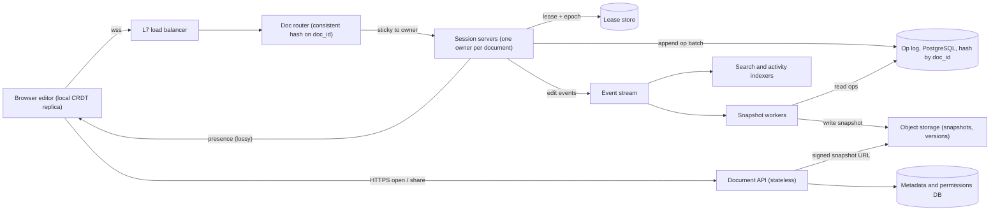
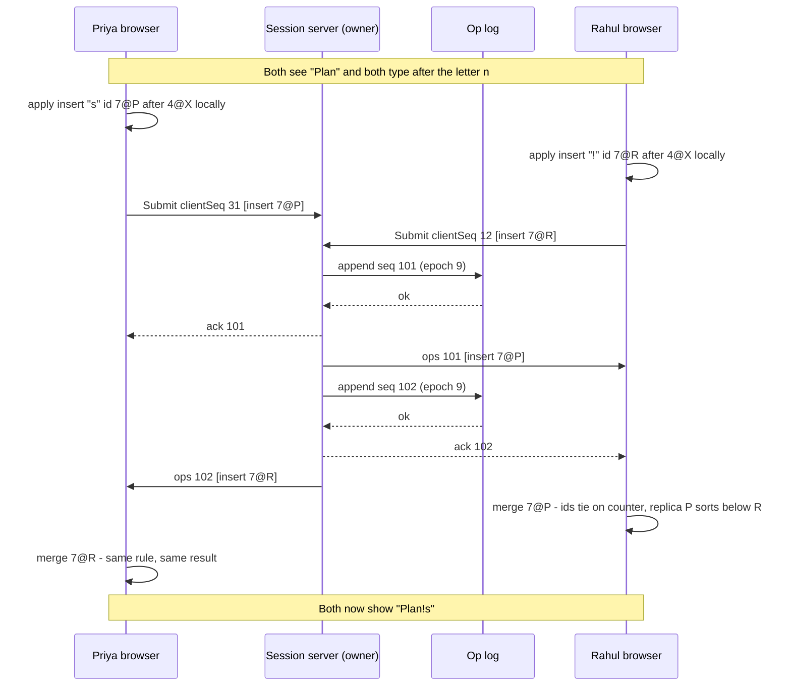

Two classmates are editing the same group-project report the night before it is due. Priya, in Pune, types "approved" at the start of line 4 while Rahul, 1,400 km away in Delhi, deletes the word before it. Both screens must end up showing the same text, nobody's work may vanish, and it must feel instant even on a 4G connection with 300 ms of delay. That is the whole problem of a real-time collaborative editor, and it is surprisingly deep.

This case study designs such a system from requirements to deployment. We reason from public papers and open-source designs (operational transformation research, CRDT papers, libraries such as Yjs and Automerge). Nothing here claims to describe how Google Docs, Microsoft 365 or any other product is built internally. "A system like Google Docs" means "an editor with those features".

## Learning objectives

By the end of this case study you will be able to:

1. Explain why naive "last write wins" and locking both fail for collaborative text, and what convergence means.
2. Compare operational transformation (OT) and conflict-free replicated data types (CRDTs) honestly, including their costs.
3. Implement a small sequence CRDT (RGA) in C# and prove to yourself that replicas converge.
4. Design the session layer: one owner server per document, chosen by consistent hashing and protected by a fenced lease.
5. Design persistence as an append-only op log plus periodic snapshots, and size it.
6. Treat presence (cursors, "who is here") as cheap, lossy, ephemeral state.
7. Reason about failure modes, security, observability, cost, and when a much simpler design is enough.

## Prerequisites

- [WebSockets, Server-Sent Events and long polling](#/lesson/m10-realtime): server push over a long-lived connection.
- [Clock skew, ordering and logical clocks](#/lesson/m13-time-ordering): Lamport clocks, which our CRDT uses for ids.
- [Consistency models](#/lesson/m13-consistency-models): strong eventual consistency is the guarantee CRDTs give.
- [Eventual consistency](#/lesson/m12-eventual-consistency): what users see while replicas disagree.
- [Distributed locks and fencing tokens](#/lesson/m13-distributed-locks): we fence the document owner with an epoch.

## Explain it like I'm a beginner

Imagine a shared notebook on a table in a college library, with three classmates writing their group assignment in it at the same time.

- If they **take turns** with the pen (a lock), nobody clashes, but two of them are always waiting. Over the internet, "waiting for the pen" means every keystroke pauses for a network round trip. That feels broken.
- If each classmate has **their own photocopy** and writes freely, typing is instant. But now the copies drift apart. Someone has to merge them, and simply keeping "whoever saved last" (last write wins) throws away the other two people's work.
- The trick is to write in a way that **merges automatically**. Instead of sending "the whole page now looks like this", each person sends small instructions: "insert 'a' after the character with sticker #17". Every character carries a **unique sticker** (an id). Because instructions point at stickers, not at "position 5", they still make sense after other people's edits move things around.
- If two people insert after the same sticker at once, a fixed rule (bigger sticker goes first) decides, so **everyone ends with the same page** whatever order instructions arrive in. That is convergence, and data types built for it are **conflict-free replicated data types (CRDTs)**.
- The older alternative keeps plain positions but has a referee who **adjusts** each instruction: "Rahul deleted a character before position 5, so your 'insert at 5' is now 'insert at 4'". That adjustment is **operational transformation (OT)**.
- Finally, coloured name tags showing where each person's cursor is are **presence**. They are nice to have, change constantly, and nobody minds if one update is lost.

## Requirements

### Functional requirements

1. **Create, open and edit rich-text documents** in the browser, with formatting (bold, headings, lists, tables).
2. **Real-time co-editing**: edits from other people appear within a fraction of a second, with no locking and no "someone else is editing" banner.
3. **Presence**: show who is in the document, their cursor and selection, in a colour per person.
4. **Offline and flaky networks**: keep typing during a short disconnection (a train tunnel, a lift) and merge on reconnect.
5. **Version history**: named versions, "see changes since yesterday", restore an older version.
6. **Comments and suggestions** anchored to text that keep pointing at the right words as the text changes.
7. **Sharing**: owner, editor, commenter and viewer roles; link sharing within an organisation.

### Non-functional requirements

| Property | Target | Why |
|---|---|---|
| Local echo | Under 16 ms (one frame) | Typing must never wait for the network |
| Remote latency | p99 under 500 ms within a region | Feels "live" |
| Convergence | All replicas identical once they have seen the same edits | Non-negotiable: divergence is data corruption |
| Durability | An edit acknowledged by the server is never lost | Users close the tab the moment they finish |
| Availability | 99.95 % for editing | A short outage is tolerable if no edits are lost |
| Collaborators | Up to 100 simultaneous editors, 1,000 viewers per document | Large review meetings |
| Document size | Up to about 1.5 million characters (roughly a 500-page report) | Theses, policy handbooks and product specs get long |

### Out of scope

Spreadsheets and slides (same ideas, different data types), full-text search across documents, and real-time voice. We mention spreadsheets where the trade-offs differ.

## Capacity estimation

All figures are **estimates** picked to make the arithmetic clear. The method matters more than the exact numbers.

### Users and edit rate

- **Daily active users (DAU)**: 20 million.
- Each active user edits for about **30 minutes a day** = 1,800 s.
- Clients batch keystrokes: instead of one message per key, they send one message per **200 ms** while typing. People don't type continuously, so assume an average of **0.5 op messages per second** of editing time.
- Op messages per day = 20 M × 1,800 s × 0.5 = **18 billion**.
- Average = 18 × 10⁹ ÷ 86,400 s ≈ **208,000 op messages/s**.
- Peak (weekday working hours concentrate traffic): ×3 ≈ **625,000 op messages/s** ingress.

### Fan-out

Most documents are edited by one person at a time; a few have 50 people in a review meeting. Assume an average of **2 other connected participants** per active session.

- Deliveries at peak ≈ 625,000 × 2 = **1.25 million messages/s** out of the session servers.

### Connections and documents in memory

- Peak concurrency: 15 % of DAU have a document open at the busiest moment = 20 M × 0.15 = **3 million connections**.
- If people per open document average 1.5, that is **2 million live documents** held in memory by session servers.
- In-memory size per live document: text plus CRDT metadata. A 50 KB document with per-character ids and tombstones can easily need 5–10× that in a naive structure; well-engineered CRDT libraries compress ids into runs and do much better. Budget **250 KB** (estimate): 2 M × 250 KB = **500 GB of RAM** across the fleet.
- At 16 GB of usable heap per session server: 500 GB ÷ 16 GB ≈ 32, plus 50 % headroom and zone spread ≈ **48 session servers**. Connections are the other limit: 3 M ÷ 48 ≈ 62,500 sockets each, which a tuned ASP.NET Core server can hold (load-test it).

### Storage

- Average op message after batching: about **120 bytes** (ids, positions, a few characters, metadata).
- Op log growth = 18 B × 120 B ≈ **2.2 TB/day**, about **800 TB/year** before replication.

That is too much to keep forever. So we **compact**: every 500 ops (or 10 minutes of activity) the session server writes a **snapshot** of the whole document to object storage, and op rows older than 30 days are deleted, except those needed for named versions.

- Snapshots: 500 M documents (lifetime) × 100 KB compressed = **50 TB**, plus older versions: say 3× ≈ **150 TB** in object storage. Cheap.
- Hot op log (30 days) ≈ 2.2 TB × 30 = **66 TB**, ×3 replicas ≈ **200 TB**. This is the main database cost and a good reason to shard it.

### Bandwidth

Egress at peak ≈ 1.25 M × 120 B = 150 MB/s ≈ **1.2 Gbit/s**. Modest. Opening documents (downloading snapshots) costs more: 5 M opens/hour at peak × 100 KB ≈ 140 MB/s, served from object storage via a CDN-like cache with authorisation.

**What breaks first?** Not bandwidth. The first things to hurt are (1) a *hot document* with 100 editors and 1,000 viewers all on one session server, (2) memory for live documents with huge tombstone histories, and (3) the op log write rate if every keystroke became its own database transaction.

## API design

Two channels again: a **persistent bidirectional connection** for edits and presence, and **plain HTTPS** for everything else.

### Real-time channel (SignalR over WebSockets, `wss://docs.example.com/hubs/documents`)

The client authenticates with a short-lived token during the connection, then calls hub methods. Messages are shown as JSON for readability; production systems use a compact binary encoding.

A client joins a document and says how far it has already caught up:

```json
{ "method": "Join", "docId": "8f2c6c1e-1d1b-4c43-9a51-3b9a2f6d0e11", "lastSeenSeq": 1830 }
```

The client submits a batch of CRDT operations. `clientId` plus `clientSeq` is the idempotency key for retries:

```json
{
  "method": "Submit",
  "docId": "8f2c6c1e-1d1b-4c43-9a51-3b9a2f6d0e11",
  "clientId": "tab-41f0",
  "clientSeq": 77,
  "ops": [
    { "kind": "insert", "id": { "counter": 912, "replica": "tab-41f0" }, "after": { "counter": 911, "replica": "tab-41f0" }, "value": "a" },
    { "kind": "delete", "target": { "counter": 640, "replica": "tab-9c2e" } }
  ]
}
```

The server acknowledges with the server sequence number it assigned, and broadcasts the same ops to everyone else:

```json
{ "type": "ack", "clientSeq": 77, "serverSeq": 1831 }
```

```json
{ "type": "ops", "serverSeq": 1831, "from": "tab-41f0", "ops": [ { "kind": "delete", "target": { "counter": 640, "replica": "tab-9c2e" } } ] }
```

Presence updates are throttled and never acknowledged:

```json
{ "method": "Cursor", "docId": "8f2c6c1e-1d1b-4c43-9a51-3b9a2f6d0e11", "anchor": { "counter": 905, "replica": "tab-41f0" }, "head": { "counter": 912, "replica": "tab-41f0" } }
```

Design decisions:

- **Ops and cursors reference character ids, not positions**, because positions shift under concurrent edits.
- **`serverSeq`** is a per-document order from the owner. CRDTs don't need it to converge, but it gives clients a catch-up cursor and the op log a key.
- **Batching** turns ~5 keystrokes into one message.

### HTTPS endpoints

| Method and path | Purpose |
|---|---|
| `POST /v1/documents` | Create a document (returns id and an empty snapshot) |
| `GET /v1/documents/{id}/snapshot` | Latest snapshot plus its `serverSeq`, for fast open |
| `GET /v1/documents/{id}/ops?afterSeq=1830&limit=500` | Catch-up if the snapshot is older than the client's state |
| `POST /v1/documents/{id}/versions` | Name the current state ("Sent to client, 14 Oct") |
| `PUT /v1/documents/{id}/permissions` | Share with a user, group or link |

## Data model

PostgreSQL 17 holds metadata, permissions and the hot op log. Snapshots live in object storage; the database stores only their keys.

```sql
CREATE TABLE document (
  doc_id      uuid PRIMARY KEY,
  org_id      bigint NOT NULL,
  title       text   NOT NULL,
  owner_id    bigint NOT NULL,
  created_at  timestamptz NOT NULL DEFAULT now(),
  deleted_at  timestamptz
);

CREATE TABLE doc_permission (
  doc_id       uuid   NOT NULL REFERENCES document,
  principal_id bigint NOT NULL,              -- user or group
  role         text   NOT NULL CHECK (role IN ('owner', 'editor', 'commenter', 'viewer')),
  PRIMARY KEY (doc_id, principal_id)
);

-- Who owns the live session, and the fencing epoch.
CREATE TABLE doc_session_lease (
  doc_id     uuid PRIMARY KEY REFERENCES document,
  server_id  text   NOT NULL,
  epoch      bigint NOT NULL,
  expires_at timestamptz NOT NULL
);

-- Append-only op log: one row per accepted batch.
CREATE TABLE doc_op (
  doc_id     uuid   NOT NULL,
  server_seq bigint NOT NULL,
  epoch      bigint NOT NULL,
  client_id  text   NOT NULL,
  client_seq bigint NOT NULL,
  actor_id   bigint NOT NULL,
  payload    bytea  NOT NULL,                -- encoded CRDT ops
  created_at timestamptz NOT NULL DEFAULT now(),
  PRIMARY KEY (doc_id, server_seq),
  UNIQUE (doc_id, client_id, client_seq)     -- idempotent retries
) PARTITION BY HASH (doc_id);

CREATE TABLE doc_snapshot (
  doc_id      uuid   NOT NULL REFERENCES document,
  version     bigint NOT NULL,               -- server_seq the snapshot includes
  storage_key text   NOT NULL,               -- object storage key
  size_bytes  bigint NOT NULL,
  created_at  timestamptz NOT NULL DEFAULT now(),
  PRIMARY KEY (doc_id, version)
);

CREATE TABLE doc_named_version (
  doc_id     uuid   NOT NULL REFERENCES document,
  version    bigint NOT NULL,
  label      text   NOT NULL,
  created_by bigint NOT NULL,
  PRIMARY KEY (doc_id, version)
);
```

Why this shape:

- **`(doc_id, server_seq)` primary key** makes catch-up ("ops after 1830 for this document") one index range scan.
- **`UNIQUE (doc_id, client_id, client_seq)`** is the database backstop for idempotency: a retried batch after a lost ack finds the existing row and gets its original `server_seq`.
- **`epoch` on every op row** records which lease holder wrote it. The insert is guarded so that only the *current* epoch can append (see the fencing deep dive). A zombie server with an old epoch gets zero rows inserted.
- **Opening a document** = read the newest `doc_snapshot` with `version ≤` what you need, download it, then replay `doc_op` rows with `server_seq > version`. Snapshots exist so that replay is short.
- **Hash partitioning by `doc_id`** spreads 66 TB of hot ops while keeping each document's rows together; permissions stay relational because "what can Meera see?" is a join.

## High-level architecture



Walk through every arrow:

1. **Browser → load balancer → doc router.** The browser holds a full local replica of the document, so typing is applied locally first. The real-time connection goes through an L7 balancer (it must read the document id from the URL or first message).
2. **Doc router → session server.** All participants of one document must reach the **same** session server, the document's *owner*. The router uses consistent hashing on `doc_id` over the healthy servers, then confirms with the lease store. This is the single most important architectural decision.
3. **Session server → lease store.** Before serving a document, the server takes a lease with a new **epoch** (a fencing token). Leases expire after about 30 s unless renewed.
4. **Session server → op log.** Each accepted batch is appended with the next `server_seq`, guarded by the epoch. Only after the insert commits does the server ack the author: that is the durability promise.
5. **Session server → browsers.** It broadcasts the batch to the other participants. Presence goes over the same socket but is throttled, never stored, and may be dropped.
6. **Session server → event stream → snapshot workers.** A lightweight event ("doc 8f2c… is now at seq 2,330") lets workers decide when to snapshot. Workers can also run inside the session server; separating them keeps CPU spikes away from latency-sensitive sockets.
7. **Snapshot workers → object storage.** Snapshots and named versions are immutable blobs, keyed by `doc_id/version`.
8. **Event stream → indexers.** Search, "recent activity" and notification emails are downstream consumers, decoupled and eventually consistent.
9. **Browser → document API → metadata DB / object storage.** Opening, sharing, listing and version history are ordinary stateless HTTPS. The API checks permissions and hands back a short-lived signed URL to the snapshot, so large downloads never pass through the session servers.

### Sequence: two people insert at the same place



Both people see their own character instantly (local echo). Each later applies the other's insert with the **same deterministic rule**: among concurrent inserts after one character, the larger id goes first. Counters tie at 7, and "R" sorts after "P", so `7@R` goes first and both screens show "Plan!s" despite opposite arrival orders. The server only ordered, stored and relayed.

## Deep dives

### 1. Why the obvious approaches fail

**Locks** make the second person wait a round trip and rule out offline editing (fine for form fields, not free text). **Last write wins** on whole documents loses work. **Raw positions** ("insert 'x' at 5") shift under concurrent edits: if Rahul deletes character 2 while Priya inserts at 5, applying both naively puts her character one place too far right on his screen, and the copies diverge for good. Every collaborative algorithm exists to fix exactly this.

### 2. Operational transformation (OT)

OT keeps position-based operations and **transforms** an incoming operation against the concurrent operations it didn't know about. For two concurrent ops `a` and `b` applied to the same state `S`, the transform function must satisfy the convergence property (called TP1):

`apply(apply(S, a), T(b, a))  ==  apply(apply(S, b), T(a, b))`

For single-character inserts and deletes the rules are short: an insert before your position shifts you right by one; a delete before your position shifts you left; two deletes of the same character turn the second into a no-op; two inserts at the same position are ordered by a tie-break such as site id. You will implement this in exercise 3.

The practical catch: with **many** concurrent clients and no central ordering, OT also needs a second, much harder property (TP2), and several published algorithms were later found to violate it. Production OT systems therefore use a **central server** that defines one order: each client sends ops tagged with the last server revision it saw, and the server transforms the op against everything committed since, then broadcasts the transformed op. This is the approach described in the Jupiter paper and used by systems like the Google Wave protocol that were documented publicly. It works very well, but it means:

- the server must run the transform for every op, so it holds document state and is CPU-bound for busy documents;
- offline editing for hours creates long transform chains;
- rich-text operations (formatting spans, tables, lists) multiply the number of transform cases, and each pair must be correct.

### 3. CRDTs: give every character an identity

A **CRDT** is a data type whose merge is commutative, associative and idempotent. Apply the same set of operations in any order, any number of times, and every replica reaches the same state (**strong eventual consistency**). No server-side transform needed.

For text, the classic approach is a **sequence CRDT**. We implement **RGA (Replicated Growable Array)**, one of the simplest:

- Every character gets a unique id `(counter, replica)`. The counter is a **Lamport clock**: each replica's counter jumps past any counter it has seen, so a character inserted after another always has a larger counter than it.
- An insert says "put value `v` with id `i` **after** character `p`" (or at the head).
- To apply it, find `p`, then skip forward over any characters with a **larger** id than `i` (those are concurrent inserts after `p` that win the tie, plus their descendants), and insert before the first smaller one.
- A delete never removes the node. It marks it as a **tombstone**, because a concurrent insert may still reference it as its `after` anchor.
- If an op arrives before the character it references (possible after reconnects), buffer it until its parent appears. This is **causal delivery**.

Here is the whole thing. It is O(n) per operation, which is fine for learning and for small documents; production libraries use trees and run-length encoding of ids.

```csharp file=Crdt/CharId.cs
namespace CollabEditor.Crdt;

/// <summary>Unique, totally ordered id for one character: a Lamport counter plus the replica that created it.</summary>
public readonly record struct CharId(long Counter, string Replica) : IComparable<CharId>
{
    public int CompareTo(CharId other)
    {
        var byCounter = Counter.CompareTo(other.Counter);
        return byCounter != 0 ? byCounter : string.CompareOrdinal(Replica, other.Replica);
    }

    public static bool operator >(CharId a, CharId b) => a.CompareTo(b) > 0;
    public static bool operator <(CharId a, CharId b) => a.CompareTo(b) < 0;

    public override string ToString() => $"{Counter}@{Replica}";
}

public abstract record CrdtOp;

/// <summary>Insert <paramref name="Value"/> after <paramref name="After"/> (null = start of document).</summary>
public sealed record InsertOp(CharId Id, CharId? After, char Value) : CrdtOp;

/// <summary>Mark a character as deleted. The node stays as a tombstone so later inserts can still anchor to it.</summary>
public sealed record DeleteOp(CharId Target) : CrdtOp;

public enum ApplyResult { Applied, Duplicate, Buffered }
```

```csharp file=Crdt/RgaDocument.cs
namespace CollabEditor.Crdt;

/// <summary>
/// A minimal RGA sequence CRDT. Replicas that apply the same set of operations, in any order,
/// end with identical text. O(n) per operation: fine for learning, not for 500-page documents.
/// </summary>
public sealed class RgaDocument(string replicaId)
{
    private sealed class Node(CharId id, char value)
    {
        public CharId Id { get; } = id;
        public char Value { get; } = value;
        public bool Deleted { get; set; }
    }

    private readonly List<Node> _nodes = new();
    private readonly Dictionary<CharId, Node> _byId = new();
    private readonly List<CrdtOp> _pending = new();
    private long _clock;

    public string ReplicaId { get; } = replicaId;
    public int TombstoneCount => _nodes.Count(n => n.Deleted);
    public int PendingCount => _pending.Count;
    public string Text => new(_nodes.Where(n => !n.Deleted).Select(n => n.Value).ToArray());

    /// <summary>
    /// True when the op's anchor (insert) or target (delete) is already known. The server uses this to reject
    /// ops before making them durable: a client can only reference characters the server has already seen.
    /// </summary>
    public bool CanApply(CrdtOp op) => op switch
    {
        InsertOp insert => insert.After is null || _byId.ContainsKey(insert.After.Value),
        DeleteOp delete => _byId.ContainsKey(delete.Target),
        _ => false
    };

    /// <summary>Local edit at a visible index. Returns the op to send to other replicas.</summary>
    public InsertOp LocalInsert(int index, char value)
    {
        ArgumentOutOfRangeException.ThrowIfNegative(index);
        CharId? after = index == 0 ? null : VisibleAt(index - 1).Id;
        var op = new InsertOp(new CharId(_clock + 1, ReplicaId), after, value);
        Apply(op);
        return op;
    }

    public DeleteOp LocalDelete(int index)
    {
        var op = new DeleteOp(VisibleAt(index).Id);
        Apply(op);
        return op;
    }

    /// <summary>Apply a local or remote op. Safe to call twice with the same op.</summary>
    public ApplyResult Apply(CrdtOp op)
    {
        var result = TryApply(op);
        if (result == ApplyResult.Buffered) _pending.Add(op);
        else if (result == ApplyResult.Applied) DrainPending();
        return result;
    }

    private ApplyResult TryApply(CrdtOp op) => op switch
    {
        InsertOp insert => ApplyInsert(insert),
        DeleteOp delete => ApplyDelete(delete),
        _ => throw new ArgumentException($"Unknown op {op}", nameof(op))
    };

    private ApplyResult ApplyInsert(InsertOp op)
    {
        if (_byId.ContainsKey(op.Id)) return ApplyResult.Duplicate;

        int position;
        if (op.After is null) position = 0;
        else if (_byId.TryGetValue(op.After.Value, out var parent)) position = _nodes.IndexOf(parent) + 1;
        else return ApplyResult.Buffered;                // parent not seen yet: wait (causal delivery)

        // Concurrent inserts after the same parent, and their descendants, all have larger ids: skip them.
        while (position < _nodes.Count && _nodes[position].Id > op.Id) position++;

        var node = new Node(op.Id, op.Value);
        _nodes.Insert(position, node);
        _byId[op.Id] = node;
        _clock = Math.Max(_clock, op.Id.Counter);       // Lamport rule
        return ApplyResult.Applied;
    }

    private ApplyResult ApplyDelete(DeleteOp op)
    {
        if (!_byId.TryGetValue(op.Target, out var node)) return ApplyResult.Buffered;
        if (node.Deleted) return ApplyResult.Duplicate;
        node.Deleted = true;
        return ApplyResult.Applied;
    }

    private void DrainPending()
    {
        var progress = true;
        while (progress && _pending.Count > 0)
        {
            progress = false;
            for (var i = 0; i < _pending.Count; i++)
            {
                if (TryApply(_pending[i]) == ApplyResult.Buffered) continue;
                _pending.RemoveAt(i--);
                progress = true;
            }
        }
    }

    private Node VisibleAt(int index)
    {
        var seen = -1;
        foreach (var node in _nodes)
            if (!node.Deleted && ++seen == index) return node;
        throw new ArgumentOutOfRangeException(nameof(index));
    }
}
```

Why it converges: a character after `p` with a larger id is either a concurrent winner or was created *after seeing* a sibling (so its Lamport counter is larger still). Every replica compares the same ids the same way, so each character lands in the same slot whatever the arrival order. Ignoring duplicate ids and buffering early arrivals make "at least once, any order" delivery safe.

**The costs of CRDTs**, which you should state in an interview:

- **Metadata.** Every character carries an id (16+ bytes naively); libraries compress one replica's consecutive characters into runs.
- **Tombstones.** Deleted characters stay. A document that was rewritten ten times may hold 90 % tombstones. They can be garbage-collected only when every replica is known to have seen the delete, which in practice means the server compacts at snapshot time and clients that were offline longer than the window reload from the snapshot.
- **Interleaving and rich text.** Some CRDT designs can interleave two people's concurrently typed words letter by letter; formatting spans, moves and tables need extra structure. Check these properties in any library you adopt.

### 4. OT or CRDT: the decision

| Question | OT with central server | CRDT (server as relay and store) |
|---|---|---|
| Needs a central authority to converge? | Yes | No (but we still use one for ordering, auth and storage) |
| Offline for hours, then merge | Painful (long transform chains) | Natural |
| Server CPU per op | Transform against concurrent ops | Apply and store; often just relay |
| Memory and storage overhead | Low (positions) | Higher (ids, tombstones), mitigated by libraries |
| Peer-to-peer or edge sync | Hard | Natural |
| Implementation risk | Transform functions for every op pair | Choosing and tuning a library |

**Our choice:** a CRDT document model on clients and server, with a **single owner session server per document** that assigns `server_seq`, persists, authorises and relays. We get offline support and order-independence from the CRDT, and simple catch-up, auditing and access control from the server. A team that already has a working OT engine and online-only users has no reason to switch.

### 5. One owner per document, and fencing it

Why insist that every participant of a document hits the same server?

- It holds the live replica in memory, so it can validate ops, build snapshots and serve late joiners without reading the log.
- It assigns `server_seq` with no distributed coordination: one in-memory counter per document.
- Broadcast is a local loop over sockets.

**Routing.** The router hashes `doc_id` onto a ring of session servers (consistent hashing with virtual nodes, see [Sharding, hot partitions and consistent hashing](#/lesson/m13-sharding)). When a server joins or leaves, only about 1/N of documents move.

**The split-brain danger.** During a deploy or a network blip, server A may still think it owns document D while the router has already sent new clients to server B. If both append to the op log, the log gets two interleaved histories with clashing `server_seq` values. The fix is a **fencing token**:

1. B acquires the lease for D, which **increments the epoch** from 8 to 9.
2. Every op append carries the writer's epoch, and the database only accepts it if it matches the current one:

```sql
INSERT INTO doc_op (doc_id, server_seq, epoch, client_id, client_seq, actor_id, payload)
SELECT $1, $2, $3, $4, $5, $6, $7
WHERE EXISTS (SELECT 1 FROM doc_session_lease WHERE doc_id = $1 AND epoch = $3 FOR SHARE)
ON CONFLICT (doc_id, client_id, client_seq) DO NOTHING;
```

3. A, still holding epoch 8, gets zero rows inserted, knows it has lost ownership, and disconnects its clients, which reconnect via the router to B.

The `FOR SHARE` matters. Without it, under PostgreSQL's default READ COMMITTED isolation, A's insert can read the lease row just before B's epoch bump commits and still succeed; if B had already loaded the log, A's op is silently missing from B's replica. With the row locked in share mode, B's `UPDATE doc_session_lease SET epoch = epoch + 1` waits until A's in-flight insert commits (so B sees it when it loads the log), and an insert that starts after B's update re-checks the new epoch and inserts nothing. A retried batch that hits `ON CONFLICT` returns no row either, so the session then reads the existing row to return its original `server_seq`.

The C# model below keeps this logic behind interfaces; the in-memory classes stand in for the SQL above.

```csharp file=Sessions/OpLog.cs
using System.Collections.Concurrent;
using CollabEditor.Crdt;

namespace CollabEditor.Sessions;

public sealed record OpEnvelope(Guid DocId, long ServerSeq, long Epoch, string ClientId, long ClientSeq,
    string ActorId, CrdtOp Op, DateTimeOffset At);

public sealed class StaleEpochException(Guid docId, long epoch)
    : Exception($"Epoch {epoch} no longer owns document {docId}");

public interface IOpLog
{
    /// <summary>Appends when <paramref name="epoch"/> is current; returns the existing envelope for a retry.</summary>
    OpEnvelope Append(Guid docId, long epoch, string clientId, long clientSeq, string actorId, CrdtOp op);
    IReadOnlyList<OpEnvelope> ReadAfter(Guid docId, long afterSeq, int limit = 500);
    /// <summary>A new owner raises the fence so that older epochs can no longer write.</summary>
    void FenceTo(Guid docId, long epoch);
}

/// <summary>Stand-in for the doc_op table with the epoch-guarded insert.</summary>
public sealed class InMemoryOpLog(TimeProvider clock) : IOpLog
{
    private sealed class Log
    {
        public readonly Lock Gate = new();
        public long Fence;
        public readonly List<OpEnvelope> Ops = new();
        public readonly Dictionary<(string ClientId, long ClientSeq), OpEnvelope> ByClient = new();
    }

    private readonly ConcurrentDictionary<Guid, Log> _logs = new();

    public OpEnvelope Append(Guid docId, long epoch, string clientId, long clientSeq, string actorId, CrdtOp op)
    {
        var log = _logs.GetOrAdd(docId, _ => new Log());
        lock (log.Gate)
        {
            if (epoch != log.Fence) throw new StaleEpochException(docId, epoch);
            if (log.ByClient.TryGetValue((clientId, clientSeq), out var existing)) return existing;

            var envelope = new OpEnvelope(docId, log.Ops.Count + 1, epoch, clientId, clientSeq, actorId, op, clock.GetUtcNow());
            log.Ops.Add(envelope);
            log.ByClient[(clientId, clientSeq)] = envelope;
            return envelope;
        }
    }

    public IReadOnlyList<OpEnvelope> ReadAfter(Guid docId, long afterSeq, int limit = 500)
    {
        if (!_logs.TryGetValue(docId, out var log)) return [];
        lock (log.Gate) return log.Ops.Skip((int)Math.Min(afterSeq, log.Ops.Count)).Take(limit).ToList();
    }

    public void FenceTo(Guid docId, long epoch)
    {
        var log = _logs.GetOrAdd(docId, _ => new Log());
        lock (log.Gate) log.Fence = Math.Max(log.Fence, epoch);
    }
}
```

```csharp file=Sessions/Leases.cs
namespace CollabEditor.Sessions;

public sealed record SessionLease(Guid DocId, string ServerId, long Epoch, DateTimeOffset ExpiresAt);

public sealed record ServerIdentity(string ServerId);

public interface ILeaseStore
{
    /// <summary>Returns a lease, or null when another live server holds the document.</summary>
    SessionLease? TryAcquire(Guid docId, string serverId, TimeSpan ttl);
}

/// <summary>Stand-in for doc_session_lease. A change of owner always increments the epoch.</summary>
public sealed class InMemoryLeaseStore(TimeProvider clock) : ILeaseStore
{
    private readonly Lock _gate = new();
    private readonly Dictionary<Guid, SessionLease> _leases = new();

    public SessionLease? TryAcquire(Guid docId, string serverId, TimeSpan ttl)
    {
        var now = clock.GetUtcNow();
        lock (_gate)
        {
            _leases.TryGetValue(docId, out var current);
            var live = current is not null && current.ExpiresAt > now;
            if (live && current!.ServerId != serverId) return null;

            var epoch = live ? current!.Epoch : (current?.Epoch ?? 0) + 1;
            var lease = new SessionLease(docId, serverId, epoch, now + ttl);
            _leases[docId] = lease;
            return lease;
        }
    }
}
```

The session itself is a single-writer object per document. It holds the server's replica, the dedupe-aware append, and the last sequence number.

```csharp file=Sessions/DocumentSession.cs
using System.Collections.Concurrent;
using CollabEditor.Crdt;

namespace CollabEditor.Sessions;

public sealed class DocumentSession
{
    private readonly Lock _gate = new();
    private readonly RgaDocument _replica;
    private readonly IOpLog _log;

    public DocumentSession(SessionLease lease, IOpLog log)
    {
        DocId = lease.DocId;
        Epoch = lease.Epoch;
        _log = log;
        _replica = new RgaDocument($"server-{lease.ServerId}");
        // Production: load the latest snapshot, then replay only the ops after it.
        long after = 0;
        while (true)
        {
            var page = log.ReadAfter(DocId, after);
            if (page.Count == 0) break;
            foreach (var envelope in page) _replica.Apply(envelope.Op);
            after = page[^1].ServerSeq;
        }
        LastSeq = after;
    }

    public Guid DocId { get; }
    public long Epoch { get; }
    public long LastSeq { get; private set; }
    public long LastSnapshotSeq { get; set; }
    public string Text { get { lock (_gate) return _replica.Text; } }

    /// <summary>The sequence number and text taken together, so a snapshot never mixes two states.</summary>
    public (long Seq, string Text) Capture() { lock (_gate) return (LastSeq, _replica.Text); }

    /// <summary>Validates, durably appends, then applies. Returns the envelope to ack and broadcast.</summary>
    public OpEnvelope Submit(string clientId, long clientSeq, string actorId, CrdtOp op)
    {
        lock (_gate)
        {
            // Validate against the server's replica BEFORE the op becomes durable: a bad op in the log
            // would be replayed into every replica forever.
            if (!_replica.CanApply(op)) throw new InvalidOpException($"Op {op} references an unknown character");
            var envelope = _log.Append(DocId, Epoch, clientId, clientSeq, actorId, op);   // may throw StaleEpochException
            if (envelope.ServerSeq <= LastSeq) return envelope;                          // retry of an old batch
            _replica.Apply(op);
            LastSeq = envelope.ServerSeq;
            return envelope;
        }
    }

    public IReadOnlyList<OpEnvelope> CatchUp(long afterSeq) => _log.ReadAfter(DocId, afterSeq);
}

public sealed class InvalidOpException(string message) : Exception(message);

public sealed class DocumentSessionManager(IOpLog log, ILeaseStore leases, ServerIdentity me)
{
    private readonly ConcurrentDictionary<Guid, DocumentSession> _sessions = new();

    public IEnumerable<DocumentSession> Live => _sessions.Values;

    /// <summary>Opens the session if this server can own the document; null means "redirect to the owner".</summary>
    public DocumentSession? GetOrOpen(Guid docId)
    {
        if (_sessions.TryGetValue(docId, out var existing)) return existing;
        var lease = leases.TryAcquire(docId, me.ServerId, TimeSpan.FromSeconds(30));
        if (lease is null) return null;
        log.FenceTo(docId, lease.Epoch);
        return _sessions.GetOrAdd(docId, _ => new DocumentSession(lease, log));
    }

    public void Drop(Guid docId) => _sessions.TryRemove(docId, out _);
}
```

The lock serialises writes **per document**, exactly the ordering we want. Production appends asynchronously with **group commit**: batches arriving within 10–20 ms share one transaction.

### 6. Presence: deliberately cheap

Cursor positions change with every arrow key. Treat them as **ephemeral, lossy, throttled** state:

- Anchor cursors to character ids (`after 912@tab-41f0`), so they stay on the right letter when others type.
- Throttle on the client and server to at most ~10 updates per second per participant, and send only the latest value (coalescing).
- Never write presence to the database. If the session server restarts, clients simply resend their cursor.
- A participant who hasn't been heard from for 30 s is shown as idle, then removed.
- For a 1,000-viewer document, broadcast viewers' presence only as a count ("and 940 others"), never 1,000 cursors.

```csharp file=Sessions/PresenceTracker.cs
using System.Collections.Concurrent;

namespace CollabEditor.Sessions;

public sealed record CursorPresence(string ClientId, string DisplayName, string AnchorId, string HeadId, DateTimeOffset SeenAt);

/// <summary>In-memory only. Losing it costs a cursor redraw, never data.</summary>
public sealed class PresenceTracker(TimeProvider clock)
{
    private static readonly TimeSpan MinInterval = TimeSpan.FromMilliseconds(100);
    private readonly ConcurrentDictionary<(Guid Doc, string Client), CursorPresence> _cursors = new();

    /// <summary>Stores the latest cursor and returns true when it should be broadcast now (throttled to 10/s).</summary>
    public bool Update(Guid docId, string clientId, string displayName, string anchorId, string headId)
    {
        var now = clock.GetUtcNow();
        var shouldBroadcast = true;
        _cursors.AddOrUpdate((docId, clientId),
            _ => new CursorPresence(clientId, displayName, anchorId, headId, now),
            (_, old) =>
            {
                shouldBroadcast = now - old.SeenAt >= MinInterval;
                return shouldBroadcast ? new CursorPresence(clientId, displayName, anchorId, headId, now) : old;
            });
        return shouldBroadcast;
    }

    public IReadOnlyList<CursorPresence> Active(Guid docId, TimeSpan idleAfter)
    {
        var cutoff = clock.GetUtcNow() - idleAfter;
        return _cursors.Where(kv => kv.Key.Doc == docId && kv.Value.SeenAt >= cutoff).Select(kv => kv.Value).ToList();
    }

    public void Leave(Guid docId, string clientId) => _cursors.TryRemove((docId, clientId), out _);
}
```

A throttled update is dropped rather than queued. That is fine for presence, because the next movement replaces it; a production version would also schedule a trailing send so the *final* cursor position always goes out.

### 7. Persistence: op log plus snapshots

Opening a document must not replay 2 million ops. The rule: **snapshot every 500 ops or 10 minutes of activity, whichever comes first**. Opening then costs one object-storage GET plus at most 500 rows.

```csharp file=Sessions/SnapshotWorker.cs
using Microsoft.Extensions.Hosting;
using Microsoft.Extensions.Logging;

namespace CollabEditor.Sessions;

public interface ISnapshotStore
{
    Task SaveAsync(Guid docId, long version, string content, CancellationToken ct);
}

public sealed class LoggingSnapshotStore(ILogger<LoggingSnapshotStore> logger) : ISnapshotStore
{
    public Task SaveAsync(Guid docId, long version, string content, CancellationToken ct)
    {
        // Production: PUT docs/{docId}/{version}.bin to object storage, then INSERT INTO doc_snapshot.
        logger.LogInformation("Snapshot {DocId} at seq {Version} ({Length} chars)", docId, version, content.Length);
        return Task.CompletedTask;
    }
}

public sealed class SnapshotWorker(DocumentSessionManager sessions, ISnapshotStore store, ILogger<SnapshotWorker> logger)
    : BackgroundService
{
    private const long OpsBetweenSnapshots = 500;

    protected override async Task ExecuteAsync(CancellationToken stoppingToken)
    {
        using var timer = new PeriodicTimer(TimeSpan.FromSeconds(30));
        while (await timer.WaitForNextTickAsync(stoppingToken))
        {
            foreach (var session in sessions.Live)
            {
                var (seq, text) = session.Capture();
                if (seq - session.LastSnapshotSeq < OpsBetweenSnapshots) continue;
                try
                {
                    await store.SaveAsync(session.DocId, seq, text, stoppingToken);
                    session.LastSnapshotSeq = seq;
                }
                catch (Exception ex) when (ex is not OperationCanceledException)
                {
                    logger.LogWarning(ex, "Snapshot failed for {DocId}; will retry next tick", session.DocId);
                }
            }
        }
    }
}
```

This model snapshots only visible text; a real snapshot stores the CRDT state **with ids** (and recent tombstones) so offline clients can still merge against it.

**Compaction.** Tombstones deleted before a snapshot that every connected client has acknowledged can be dropped from the next snapshot; clients offline beyond the 30-day retention reload and re-apply their unsent text as fresh inserts (a product decision; say it). **Version history** is snapshot versions plus labels, and "changes since yesterday" diffs two snapshots.

### 8. Joining, catching up and reconnecting

The browser downloads the latest snapshot (signed URL), calls `Join` and `CatchUp(afterSeq = version)`, then receives live broadcasts. On reconnect it resubmits **unacknowledged** batches with their original `clientSeq`; the unique constraint drops any that had already committed. Broadcasts can arrive slightly out of `serverSeq` order, which the CRDT tolerates, so the client resumes from the **highest contiguous** `serverSeq` it applied, not the maximum.

## Caching, queues and scaling

**Caches.**

- *The live document* in the session server's memory is the main cache: a 50-person meeting reads nothing from the database after open.
- *Snapshots* are immutable per version, so they cache well at the edge once the API has authorised the signed URL.
- *Permissions* are cached per session and refreshed on a "permission changed" event.

**Queues and streams.**

- The **op log is the queue** for durability. A broker on the hot path would add latency and a second source of truth.
- A coarse **event stream** (`doc X at seq Y`, `doc X shared with Z`) feeds snapshot workers, indexers and notifications; consumers can catch up from the database.

**Scaling each tier.**

| Tier | Scales by | Breaks when |
|---|---|---|
| Session servers | More nodes on the hash ring | One hot document (100 editors + 1,000 viewers) on one node |
| Op log | Hash partitioning, then sharding by `doc_id` | Per-keystroke transactions; fixed with batching and group commit |
| Snapshots | Object storage | Never, practically; cost grows linearly |
| Document API | Stateless replicas | Permission queries without indexes |
| Presence | Throttling and coalescing | Broadcasting 1,000 viewer cursors |

**Hot documents.** For 1,000 viewers, writes stay on the owner while **read-only relay servers** subscribe and re-broadcast to viewers, at the cost of one extra hop.

## Failure handling

| Failure | What users see | Mitigation |
|---|---|---|
| Ack lost after the op log commit | Client shows "saving…" then retries | Same `(clientId, clientSeq)` returns the original `serverSeq`; no duplicate |
| Session server crashes | Everyone in its documents disconnects for a few seconds | Router moves documents on the ring; new owner takes lease with epoch + 1, loads snapshot + ops; clients rejoin and resubmit unacked batches |
| Old owner still alive after takeover (GC pause, partition) | Nothing, if fenced | Epoch-guarded inserts reject the zombie; it disconnects its clients |
| Op log primary fails | Edits keep working locally, acks stall | Synchronous replica + automatic failover; clients buffer and retry; UI shows "offline, changes saved locally" |
| Client offline beyond retention (30 days) | Must reload | Reload snapshot; re-apply local text as new inserts; show a "merged your offline changes" notice |
| Malformed or malicious op | Could corrupt everyone's copy | Server validates every op against its replica before appending; rejects unknown anchors, oversized batches, wrong replica ids |

:::callout type=warning title="The server must validate, not just relay"
A pure relay that trusts clients lets one buggy or malicious tab broadcast an op that crashes every other editor, or forge a replica id to overwrite someone's text. Applying each op to the server's own replica first is both validation and the source of snapshots.
:::

## Security

- **Authentication**: OIDC sign-in; the real-time connection uses a short-lived access token (5–15 minutes) refreshed over HTTPS.
- **Authorisation on every op**: viewers cannot submit ops; commenters can only submit comment ops. Check on the server, per batch, using the cached role.
- **Revocation**: when sharing is removed, publish a "permission changed" event; the session server re-checks and disconnects the user within seconds. Without this, an employee who has just left the company could keep editing for the life of the socket.
- **Replica identity**: the server binds `replica` ids to the connection (`tab-41f0` belongs to this user's session). Ops with someone else's replica id are rejected, so ids can't be forged.
- **Tenant isolation**: `org_id` on every document and query; consider row-level security (see [Multi-tenant security](#/lesson/m14-multi-tenant-security)).
- **Content, encryption, audit**: render content as structured data and sanitise pasted HTML (stored XSS); TLS 1.3 plus encryption at rest; the immutable op log doubles as an audit trail of who changed what.

## Observability

Measure what editors feel:

- **Remote latency**: time from the author's submit to other participants applying it. SLO example: p99 < 500 ms in-region.
- **Ack latency** (submit → ack, i.e. durable): p99 < 300 ms.
- **Divergence detector**: clients periodically send a hash of their visible text with their contiguous `serverSeq`; the server compares with its own hash at that seq. Any mismatch is a sev-1 bug signal, because convergence is the product.
- **Servers and storage**: live documents, sockets, memory and GC pauses per session server; append latency, batch size and stale-epoch rejections (spikes mean ownership churn); ops since last snapshot and tombstone ratio; top documents by participants.

Trace ops with OpenTelemetry, heavily sampled. Never log document content.

## Deployment and cost

**Deployment.**

- Deploy stateful session servers by **draining**: hand each document to a new owner (new epoch), then exit; clients reconnect in under a second.
- Version the op wire format, because old browser tabs stay open for weeks.
- Home each document to a region (often for data residency); its owner always runs there and distant users accept extra latency.

**Cost drivers** (relative, not quotes):

1. **Session server memory**: ~500 GB of live documents plus socket memory, 24×7.
2. **Hot op log** storage and IOPS: ~200 TB replicated; tuned by batching, retention and compaction.
3. **Snapshot storage**: large but cheap per GB.
4. **Cross-zone traffic** between session servers and the database.

### When a simpler design is enough

A dozen teammates editing meeting notes, rarely at once, need none of this: use **optimistic concurrency** per section (a stale `version` returns 409 and shows a merge dialog) plus a SignalR "Meera is editing" hint. For a few hundred users, an open-source CRDT library such as Yjs with one relay server and PostgreSQL is enough. Build your own merge algorithm only if it is your product.

## Alternatives and trade-offs

| Decision | Our choice | Alternative | When the alternative wins |
|---|---|---|---|
| Merge algorithm | CRDT | Central-server OT | Existing OT engine, online-only users, very low memory budget |
| Session placement | One owner per document | Any server, merging via shared store | Documents are rarely co-edited and latency tolerance is high |
| Ordering | Per-document `server_seq` | Pure peer-to-peer causal delivery | Local-first apps without a central service |
| Persistence | Op log + snapshots | Snapshots only (save every N seconds) | No need for history or audit; tiny scale |
| Presence | Lossy, in memory | Stored in Redis | Presence must survive server restarts (rarely worth it) |
| Conflict model | Automatic merge | Locks or check-out/check-in | Contracts or regulated documents (for example clinical-trial protocols) that need formal sign-off per section |
| Transport | SignalR (WebSockets) | WebRTC data channels | Peer-to-peer collaboration with no server path |

The core trade-off in one sentence: **we pay for per-character metadata and a stateful owner per document in exchange for instant local typing, automatic convergence and a simple, durable, auditable history.**

Here is the composition as an ASP.NET Core host with a SignalR hub. Ops go in through the hub, are made durable by the session, and are broadcast to the rest of the document's group.

```csharp file=Sessions/DocumentHub.cs
using CollabEditor.Crdt;
using Microsoft.AspNetCore.SignalR;

namespace CollabEditor.Sessions;

public sealed class DocumentHub(DocumentSessionManager sessions, PresenceTracker presence) : Hub
{
    private DocumentSession Session(Guid docId) =>
        sessions.GetOrOpen(docId) ?? throw new HubException("Document is owned by another server; reconnect via the router.");

    // Demo identity only: production uses the authenticated user's claims.
    private string Actor => Context.UserIdentifier ?? Context.ConnectionId;

    public async Task<long> Join(Guid docId)
    {
        var session = Session(docId);
        await Groups.AddToGroupAsync(Context.ConnectionId, docId.ToString());
        return session.LastSeq;
    }

    public IReadOnlyList<OpEnvelope> CatchUp(Guid docId, long afterSeq) => Session(docId).CatchUp(afterSeq);

    public Task<long> Insert(Guid docId, string clientId, long clientSeq, InsertOp op) => SubmitAsync(docId, clientId, clientSeq, op);

    public Task<long> Delete(Guid docId, string clientId, long clientSeq, DeleteOp op) => SubmitAsync(docId, clientId, clientSeq, op);

    public async Task Cursor(Guid docId, string clientId, string anchorId, string headId)
    {
        if (presence.Update(docId, clientId, Actor, anchorId, headId))
            await Clients.OthersInGroup(docId.ToString()).SendAsync("cursor", clientId, anchorId, headId);
    }

    private async Task<long> SubmitAsync(Guid docId, string clientId, long clientSeq, CrdtOp op)
    {
        OpEnvelope envelope;
        try { envelope = Session(docId).Submit(clientId, clientSeq, Actor, op); }
        catch (StaleEpochException)
        {
            sessions.Drop(docId);
            throw new HubException("Ownership moved; reconnect.");
        }
        catch (InvalidOpException)
        {
            throw new HubException("Rejected an invalid operation; reload the document.");
        }
        await Clients.OthersInGroup(docId.ToString()).SendAsync("ops", envelope.ServerSeq, clientId, op);
        return envelope.ServerSeq;   // the ack: durable at this point
    }
}
```

```csharp file=Program.cs
using CollabEditor.Sessions;

var builder = WebApplication.CreateBuilder(args);
builder.Services.AddSingleton(TimeProvider.System);
builder.Services.AddSingleton(new ServerIdentity($"doc-{Environment.MachineName}"));
builder.Services.AddSingleton<IOpLog, InMemoryOpLog>();
builder.Services.AddSingleton<ILeaseStore, InMemoryLeaseStore>();
builder.Services.AddSingleton<DocumentSessionManager>();
builder.Services.AddSingleton<PresenceTracker>();
builder.Services.AddSingleton<ISnapshotStore, LoggingSnapshotStore>();
builder.Services.AddHostedService<SnapshotWorker>();
builder.Services.AddSignalR();

var app = builder.Build();

app.MapHub<DocumentHub>("/hubs/documents");

app.MapGet("/v1/documents/{docId:guid}/text", (Guid docId, DocumentSessionManager sessions) =>
    sessions.GetOrOpen(docId) is { } session
        ? Results.Ok(new { session.LastSeq, session.Text })
        : Results.Conflict(new { error = "owned by another server" }));

app.Run();
```

## Practical playground

The starting graph is a naive design: the browser sends the whole document to a stateless API on every save, and the API overwrites one row (last write wins). Open it in the HLD canvas and evolve it.

1. Add a `websocket-gateway` or session tier. What must be true about which server a document's participants connect to?
2. Add a lease store (`database` or `service-registry`) and explain how the epoch fences a zombie server.
3. Split storage into an op log (`database`) and snapshots (`object-storage`). Add a `worker` that writes snapshots.
4. Add a `stream` for coarse document events and a `search` indexer as a downstream consumer.
5. Set client `rps` to 625,000 (peak op messages) and see which node is flagged first. Then explain why batching keystrokes matters.

:::playground type=hld title="From last-write-wins saves to a real-time collaborative editor"
```json
{
  "nodes": [
    { "id": "c", "type": "client", "label": "Browsers (save every 5 s)", "props": { "rps": 625000 } },
    { "id": "lb", "type": "load-balancer", "label": "Load balancer" },
    { "id": "api", "type": "app-server", "label": "Document API (PUT whole doc)", "props": { "instances": 20 } },
    { "id": "db", "type": "database", "label": "PostgreSQL (one row per document)", "props": { "replicas": 1 } }
  ],
  "edges": [
    { "from": "c", "to": "lb", "kind": "sync", "label": "PUT /documents/{id}" },
    { "from": "lb", "to": "api", "kind": "sync" },
    { "from": "api", "to": "db", "kind": "sync", "label": "UPDATE ... last write wins" }
  ]
}
```
:::

## Exercises

:::exercise id=m17-collaborative-editor-ex1 difficulty=beginner kind=written title="Size a collaborative editor for a university"
A state university wants a collaborative editor for group assignments, lab reports and theses. There are 40,000 students and faculty; 25 % are active on a teaching day. Each active user edits for 45 minutes a day. Clients batch keystrokes into one op message per 200 ms while typing, and users type about 40 % of their editing time. 70 % of the day's edits happen between 10:00 and 18:00. An op message is about 150 bytes. Ops are kept for 90 days. The average open assignment has 2.5 people in it at the busiest moment, and 10 % of active users have a document open at that moment.

Estimate: op messages per day, average and peak (working-hours) op rate, peak concurrent connections and live documents, op log storage for 90 days with 3 replicas, and decide whether this needs the full design in the lesson or something simpler.
::acceptance
- Every number shows its arithmetic and units.
- Peak is derived from the 70 %-in-8-hours share, not a generic multiplier.
- Storage includes retention and replicas.
- A clear recommendation with a reason.
::hint
Start with daily active users: 40,000 × 0.25.
::hint
Op messages per user per day = editing seconds × typing share × messages per second (1 ÷ 0.2 s = 5/s).
::hint
Peak rate = 70 % of daily messages ÷ (8 × 3,600 s).
::hint
Storage = messages/day × 150 B × 90 × 3. Divide by 10⁹ for GB.
::solution
- DAU = 40,000 × 0.25 = **10,000**.
- Messages per user per day = 45 × 60 s × 0.4 × 5/s = 2,700 s × 0.4 × 5 = **5,400**.
- Messages per day = 10,000 × 5,400 = **54 M**.
- Average rate = 54 M ÷ 86,400 ≈ **625/s**.
- Working-hours rate = 54 M × 0.7 ÷ 28,800 s ≈ **1,310/s** (about 2.1× the 24-hour average).
- Concurrent connections = 10,000 × 0.10 = **1,000**; live documents ≈ 1,000 ÷ 2.5 = **400**.
- Storage = 54 M × 150 B = 8.1 GB/day → × 90 = 729 GB → × 3 ≈ **2.2 TB**.

Recommendation: the merge problem is real (students really do co-edit group assignments at midnight), so use a proven CRDT library, but the scale is small. 1,000 sockets and 400 live documents fit on **two session servers** (owner plus failover), and 1,310 ops/s with group commit fits one PostgreSQL primary. Skip the hash ring, viewer relays and event stream; focus on permissions (who may see a classmate's draft), an audit trail for academic-integrity questions, and data residency.
::mistakes
- Using all 40,000 users instead of the active 10,000.
- Forgetting the 40 % typing share, which overstates load by 2.5×.
- Multiplying the average by ×3 when the working-hours share was given.
- Recommending dozens of servers for 1,000 connections.
:::

:::exercise id=m17-collaborative-editor-ex2 difficulty=beginner kind=sql ordered=true title="Which documents are slow to open?"
Opening a document loads its latest snapshot and replays every op after it. For every document, return `doc_id`, `title`, `snapshot_version` (the highest snapshot `version`, or 0 if it has none), `ops_to_replay` (op rows with `server_seq` greater than that version) and `needs_snapshot` (true when `ops_to_replay` is more than 3). Include documents with no ops. Order by `doc_id`.
::setup
```sql
CREATE TABLE document (
  doc_id int PRIMARY KEY,
  title  text NOT NULL
);
CREATE TABLE doc_snapshot (
  doc_id  int    NOT NULL REFERENCES document,
  version bigint NOT NULL,
  PRIMARY KEY (doc_id, version)
);
CREATE TABLE doc_op (
  doc_id     int    NOT NULL REFERENCES document,
  server_seq bigint NOT NULL,
  epoch      bigint NOT NULL,
  PRIMARY KEY (doc_id, server_seq)
);
INSERT INTO document VALUES
  (1, 'Physics lab report'), (2, 'Goa trip itinerary'), (3, 'Hostel fest budget'), (4, 'Empty draft');
INSERT INTO doc_snapshot VALUES (1, 4), (1, 8), (2, 2);
INSERT INTO doc_op VALUES
  (1, 1, 1), (1, 2, 1), (1, 3, 1), (1, 4, 1), (1, 5, 1), (1, 6, 1), (1, 7, 2), (1, 8, 2), (1, 9, 2),
  (2, 1, 1), (2, 2, 1), (2, 3, 1), (2, 4, 1), (2, 5, 1), (2, 6, 1),
  (3, 1, 1), (3, 2, 1), (3, 3, 1);
```
::check
```sql
SELECT d.doc_id,
       d.title,
       COALESCE(s.version, 0)       AS snapshot_version,
       COUNT(o.server_seq)          AS ops_to_replay,
       COUNT(o.server_seq) > 3      AS needs_snapshot
FROM document d
LEFT JOIN LATERAL (
  SELECT max(version) AS version FROM doc_snapshot WHERE doc_id = d.doc_id
) s ON true
LEFT JOIN doc_op o
  ON o.doc_id = d.doc_id
 AND o.server_seq > COALESCE(s.version, 0)
GROUP BY d.doc_id, d.title, s.version
ORDER BY d.doc_id;
```
::acceptance
- Four rows, one per document, including the empty draft.
- Document 1 uses snapshot 8, not 4, and has 1 op to replay.
- Document 3 has no snapshot, so all 3 ops are replayed and it does not yet need a snapshot.
- Document 2 needs a snapshot (4 ops after version 2).
::hint
First find each document's latest snapshot. `max(version)` per document does it.
::hint
Documents without snapshots must still appear, so use a `LEFT JOIN` and `COALESCE(..., 0)`.
::hint
Join ops with the condition `server_seq > snapshot_version` inside the `ON` clause, not in `WHERE`, so documents with zero ops survive.
::hint
`COUNT(o.server_seq)` counts only matched rows (NULLs are ignored), unlike `COUNT(*)`.
::solution
```sql
SELECT d.doc_id,
       d.title,
       COALESCE(s.version, 0)       AS snapshot_version,
       COUNT(o.server_seq)          AS ops_to_replay,
       COUNT(o.server_seq) > 3      AS needs_snapshot
FROM document d
LEFT JOIN LATERAL (
  SELECT max(version) AS version FROM doc_snapshot WHERE doc_id = d.doc_id
) s ON true
LEFT JOIN doc_op o
  ON o.doc_id = d.doc_id
 AND o.server_seq > COALESCE(s.version, 0)
GROUP BY d.doc_id, d.title, s.version
ORDER BY d.doc_id;
```

| doc_id | title | snapshot_version | ops_to_replay | needs_snapshot |
|---|---|---|---|---|
| 1 | Physics lab report | 8 | 1 | false |
| 2 | Goa trip itinerary | 2 | 4 | true |
| 3 | Hostel fest budget | 0 | 3 | false |
| 4 | Empty draft | 0 | 0 | false |

`LEFT JOIN LATERAL` runs the subquery once per document; an aggregate without `GROUP BY` always returns exactly one row, so documents without snapshots get `NULL`, which `COALESCE` turns into 0. A snapshot worker would run a query like this (limited to recently active documents) to pick its next jobs.
::mistakes
- Putting `o.server_seq > ...` in `WHERE`, which removes document 4 entirely.
- Using `COUNT(*)`, which reports 1 op for the empty draft.
- Joining all snapshots instead of the latest, which multiplies op counts.
:::

:::exercise id=m17-collaborative-editor-ex3 difficulty=intermediate kind=code title="Operational transformation for inserts and deletes"
Implement the transform function at the heart of OT for single-character operations, and prove convergence (TP1) by brute force.

- `Ot.Apply(doc, op)` applies an insert, delete or no-op to a string.
- `Ot.Transform(a, b)` returns `a'`: the version of `a` to apply **after** `b` has already been applied, preserving `a`'s intent.
- Rules: an insert or delete strictly before your position shifts you; two inserts at the same position are ordered by `Site` (lower site goes first, so it stays in place); two deletes of the same character make the second a `Noop`; anything transformed against a `Noop` is unchanged.
::acceptance
- `Apply` handles all three kinds.
- For every pair of ops on "abc" from different sites, `Apply(Apply(s, a), Transform(b, a)) == Apply(Apply(s, b), Transform(a, b))`.
- Concurrent inserts at the same position keep both characters.
- Concurrent deletes of the same character delete it once.
::hint
Work through four cases: insert/insert, insert/delete, delete/insert, delete/delete. Draw "abc" and try each by hand.
::hint
Insert `a` against insert `b`: `a` moves right by one if `b.Position < a.Position`, or if they are equal and `b` has the lower site.
::hint
Insert `a` against delete `b`: `a` moves left by one only if `b.Position < a.Position`. Delete `a` against insert `b`: `a` moves right if `b.Position <= a.Position`.
::hint
Delete against delete: smaller position on the other side moves you left; equal position becomes `Noop`.
::hint
```csharp
(OpKind.Insert, OpKind.Insert) =>
    b.Position < a.Position || (b.Position == a.Position && b.Site < a.Site)
        ? a with { Position = a.Position + 1 } : a,
```
::starter
```csharp file=Ot.cs
using System;

public enum OpKind { Insert, Delete, Noop }

public sealed record TextOp(OpKind Kind, int Position, char Value = '\0', int Site = 0)
{
    public static TextOp Ins(int position, char value, int site) => new(OpKind.Insert, position, value, site);
    public static TextOp Del(int position, int site = 0) => new(OpKind.Delete, position, '\0', site);
    public static readonly TextOp Noop = new(OpKind.Noop, 0);
}

public static class Ot
{
    public static string Apply(string doc, TextOp op) => throw new NotImplementedException();

    /// <summary>Returns a' : op a rewritten to apply after concurrent op b.</summary>
    public static TextOp Transform(TextOp a, TextOp b) => throw new NotImplementedException();
}
```
::tests
```csharp file=OtTests.cs
using System.Collections.Generic;
using Xunit;

public class OtTests
{
    [Fact]
    public void Apply_handles_each_kind()
    {
        Assert.Equal("aXbc", Ot.Apply("abc", TextOp.Ins(1, 'X', 1)));
        Assert.Equal("ac", Ot.Apply("abc", TextOp.Del(1)));
        Assert.Equal("abc", Ot.Apply("abc", TextOp.Noop));
    }

    [Fact]
    public void Insert_after_concurrent_delete_before_it_shifts_left()
    {
        var a = TextOp.Ins(3, 'X', 1);
        var b = TextOp.Del(0, 2);
        Assert.Equal(TextOp.Ins(2, 'X', 1), Ot.Transform(a, b));
    }

    [Fact]
    public void Same_position_inserts_keep_both_and_lower_site_first()
    {
        var a = TextOp.Ins(1, 'P', 1);
        var b = TextOp.Ins(1, 'R', 2);
        var left = Ot.Apply(Ot.Apply("abc", a), Ot.Transform(b, a));
        var right = Ot.Apply(Ot.Apply("abc", b), Ot.Transform(a, b));
        Assert.Equal("aPRbc", left);
        Assert.Equal(left, right);
    }

    [Fact]
    public void Deleting_the_same_character_twice_deletes_once()
    {
        var a = TextOp.Del(1, 1);
        var b = TextOp.Del(1, 2);
        Assert.Equal(OpKind.Noop, Ot.Transform(a, b).Kind);
        Assert.Equal("ac", Ot.Apply(Ot.Apply("abc", b), Ot.Transform(a, b)));
    }

    [Fact]
    public void Transform_against_noop_is_identity()
    {
        var a = TextOp.Ins(2, 'Z', 1);
        Assert.Equal(a, Ot.Transform(a, TextOp.Noop));
        Assert.Equal(OpKind.Noop, Ot.Transform(TextOp.Noop, a).Kind);
    }

    [Fact]
    public void Tp1_holds_for_every_pair_on_abc()
    {
        const string s = "abc";
        var siteOne = new List<TextOp>();
        var siteTwo = new List<TextOp>();
        for (var p = 0; p <= s.Length; p++) { siteOne.Add(TextOp.Ins(p, 'x', 1)); siteTwo.Add(TextOp.Ins(p, 'y', 2)); }
        for (var p = 0; p < s.Length; p++) { siteOne.Add(TextOp.Del(p, 1)); siteTwo.Add(TextOp.Del(p, 2)); }

        foreach (var a in siteOne)
        foreach (var b in siteTwo)
        {
            var left = Ot.Apply(Ot.Apply(s, a), Ot.Transform(b, a));
            var right = Ot.Apply(Ot.Apply(s, b), Ot.Transform(a, b));
            Assert.True(left == right, $"Diverged for a={a}, b={b}: '{left}' vs '{right}'");
        }
    }
}
```
::solution
A `switch` on the pair of kinds keeps every case visible. Each rule asks one question: did `b` change the text *before* `a`'s position?

```csharp file=Ot.cs
using System;

public enum OpKind { Insert, Delete, Noop }

public sealed record TextOp(OpKind Kind, int Position, char Value = '\0', int Site = 0)
{
    public static TextOp Ins(int position, char value, int site) => new(OpKind.Insert, position, value, site);
    public static TextOp Del(int position, int site = 0) => new(OpKind.Delete, position, '\0', site);
    public static readonly TextOp Noop = new(OpKind.Noop, 0);
}

public static class Ot
{
    public static string Apply(string doc, TextOp op) => op.Kind switch
    {
        OpKind.Insert => doc.Insert(op.Position, op.Value.ToString()),
        OpKind.Delete => doc.Remove(op.Position, 1),
        _ => doc
    };

    public static TextOp Transform(TextOp a, TextOp b) => (a.Kind, b.Kind) switch
    {
        (OpKind.Noop, _) => a,
        (_, OpKind.Noop) => a,

        (OpKind.Insert, OpKind.Insert) =>
            b.Position < a.Position || (b.Position == a.Position && b.Site < a.Site)
                ? a with { Position = a.Position + 1 } : a,

        (OpKind.Insert, OpKind.Delete) =>
            b.Position < a.Position ? a with { Position = a.Position - 1 } : a,

        (OpKind.Delete, OpKind.Insert) =>
            b.Position <= a.Position ? a with { Position = a.Position + 1 } : a,

        (OpKind.Delete, OpKind.Delete) =>
            b.Position < a.Position ? a with { Position = a.Position - 1 }
            : b.Position == a.Position ? TextOp.Noop
            : a,

        _ => throw new ArgumentOutOfRangeException(nameof(a))
    };
}
```

The brute-force test is the important habit: OT bugs hide in rare pairs, so production OT engines are tested with randomised and exhaustive pairs, and rich-text engines add property-based tests for every op type combination.
::mistakes
- Using `<=` for insert-versus-insert without a site tie-break, so both sides shift and the characters swap places differently on each replica.
- Shifting a delete left when an insert happens at the same position (it should shift right: the character moved).
- Forgetting the delete-delete equal case, which deletes the neighbour by mistake.
:::

:::exercise id=m17-collaborative-editor-ex4 difficulty=intermediate kind=code title="A last-writer-wins map CRDT for document properties"
Document properties (title, page size, status) are not text; each key just needs one value. A **last-writer-wins map (LWW-map)** is the simplest CRDT for this. Every write carries a `Stamp(Time, Replica)`; the larger stamp wins; ties on time are broken by replica name so every replica picks the same winner.

Implement `LwwMap`:

- `Set(key, value, stamp)` and `Remove(key, stamp)` apply only if the stamp is larger than the key's current stamp.
- `Remove` leaves a tombstone (the stamp is kept), so an older `Set` arriving later can't resurrect the key.
- `Merge(other)` folds in every entry of `other`. Merge must be commutative, associative and idempotent.
- `Get(key)` returns the value or `null`; `Snapshot()` returns the live keys and values.
::acceptance
- Two replicas that merge each other in either order end equal.
- Merging the same map twice changes nothing.
- A later remove beats an earlier set, even if the set arrives last.
- Equal times are resolved by replica name, the same way on every replica.
::hint
Store, per key, the winning stamp, the value and whether it is a tombstone.
::hint
One private method, `Offer(key, entry)`, can implement `Set`, `Remove` and `Merge`: keep the entry with the larger stamp.
::hint
Make `Stamp` comparable: compare `Time`, then `string.CompareOrdinal` on `Replica`.
::hint
`Merge` iterates over `other._entries` (private members of the same class are accessible) and offers each one.
::starter
```csharp file=LwwMap.cs
using System;
using System.Collections.Generic;

public readonly record struct Stamp(long Time, string Replica) : IComparable<Stamp>
{
    public int CompareTo(Stamp other) => throw new NotImplementedException();
}

public sealed class LwwMap
{
    public void Set(string key, string value, Stamp stamp) => throw new NotImplementedException();
    public void Remove(string key, Stamp stamp) => throw new NotImplementedException();
    public string? Get(string key) => throw new NotImplementedException();
    public IReadOnlyDictionary<string, string> Snapshot() => throw new NotImplementedException();
    public void Merge(LwwMap other) => throw new NotImplementedException();
}
```
::tests
```csharp file=LwwMapTests.cs
using System.Linq;
using Xunit;

public class LwwMapTests
{
    private static string Dump(LwwMap m) =>
        string.Join(";", m.Snapshot().OrderBy(kv => kv.Key).Select(kv => $"{kv.Key}={kv.Value}"));

    [Fact]
    public void Larger_stamp_wins()
    {
        var m = new LwwMap();
        m.Set("title", "Draft", new Stamp(5, "a"));
        m.Set("title", "Old", new Stamp(3, "b"));
        Assert.Equal("Draft", m.Get("title"));
        m.Set("title", "Final", new Stamp(9, "b"));
        Assert.Equal("Final", m.Get("title"));
    }

    [Fact]
    public void Ties_break_by_replica_name()
    {
        var x = new LwwMap();
        var y = new LwwMap();
        x.Set("status", "review", new Stamp(7, "alpha"));
        y.Set("status", "approved", new Stamp(7, "beta"));
        x.Merge(y);
        y.Merge(x);
        Assert.Equal("approved", x.Get("status"));
        Assert.Equal("approved", y.Get("status"));
    }

    [Fact]
    public void Remove_is_a_tombstone_that_blocks_older_sets()
    {
        var m = new LwwMap();
        m.Set("page", "A4", new Stamp(1, "a"));
        m.Remove("page", new Stamp(4, "a"));
        m.Set("page", "A3", new Stamp(2, "b"));
        Assert.Null(m.Get("page"));
        Assert.False(m.Snapshot().ContainsKey("page"));
        m.Set("page", "Letter", new Stamp(6, "b"));
        Assert.Equal("Letter", m.Get("page"));
    }

    [Fact]
    public void Merge_is_commutative_and_idempotent()
    {
        var a = new LwwMap();
        var b = new LwwMap();
        a.Set("title", "Lab report", new Stamp(2, "a"));
        a.Set("owner", "Priya", new Stamp(1, "a"));
        b.Set("title", "Lab report v2", new Stamp(3, "b"));
        b.Remove("owner", new Stamp(5, "b"));
        b.Set("page", "A4", new Stamp(1, "b"));

        var ab = new LwwMap(); ab.Merge(a); ab.Merge(b);
        var ba = new LwwMap(); ba.Merge(b); ba.Merge(a);
        Assert.Equal(Dump(ab), Dump(ba));
        Assert.Equal("page=A4;title=Lab report v2", Dump(ab));

        ab.Merge(b);
        ab.Merge(a);
        Assert.Equal("page=A4;title=Lab report v2", Dump(ab));
    }
}
```
::solution
Everything reduces to "keep the entry with the larger stamp". Because `max` is commutative, associative and idempotent, so is the merge.

```csharp file=LwwMap.cs
using System;
using System.Collections.Generic;
using System.Linq;

public readonly record struct Stamp(long Time, string Replica) : IComparable<Stamp>
{
    public int CompareTo(Stamp other)
    {
        var byTime = Time.CompareTo(other.Time);
        return byTime != 0 ? byTime : string.CompareOrdinal(Replica, other.Replica);
    }
}

public sealed class LwwMap
{
    private sealed record Entry(string? Value, Stamp Stamp, bool Removed);

    private readonly Dictionary<string, Entry> _entries = new();

    public void Set(string key, string value, Stamp stamp) => Offer(key, new Entry(value, stamp, false));

    public void Remove(string key, Stamp stamp) => Offer(key, new Entry(null, stamp, true));

    public string? Get(string key) =>
        _entries.TryGetValue(key, out var e) && !e.Removed ? e.Value : null;

    public IReadOnlyDictionary<string, string> Snapshot() =>
        _entries.Where(kv => !kv.Value.Removed).ToDictionary(kv => kv.Key, kv => kv.Value.Value!);

    public void Merge(LwwMap other)
    {
        foreach (var (key, entry) in other._entries) Offer(key, entry);
    }

    private void Offer(string key, Entry candidate)
    {
        if (!_entries.TryGetValue(key, out var current) || candidate.Stamp.CompareTo(current.Stamp) > 0)
            _entries[key] = candidate;
    }
}
```

In the editor, `Time` should be a **hybrid logical clock** (wall clock combined with a Lamport counter), not raw `DateTime.UtcNow`: a laptop whose clock is an hour fast would otherwise win every title edit for an hour.
::mistakes
- Deleting the key on `Remove` instead of keeping a tombstone, so a late-arriving older `Set` brings it back.
- Using `>=` in `Offer`: equal stamps from different values then depend on arrival order.
- Comparing replica names with culture-sensitive comparison, which can differ between machines.
::extensions
Add tombstone garbage collection: drop tombstones older than a horizon that all replicas are known to have passed, and explain what goes wrong if one replica is offline beyond that horizon.
:::

:::exercise id=m17-collaborative-editor-ex5 difficulty=advanced kind=hld title="Design it yourself: a collaborative editor for 20 M daily users"
Design the backend for the requirements in this lesson: rich-text co-editing with up to 100 editors and 1,000 viewers per document, offline editing, presence, version history and sharing. Use the lesson's numbers: 3 M peak connections, ~625,000 op messages/s peak, ~1.25 M deliveries/s, ~2 M live documents. Start from the starter graph. In your notes, state: the merge approach, how all participants reach the same server, how a zombie owner is fenced, what is durable and what is soft state, and how a 1,000-viewer document is handled.
::acceptance
- A session tier with one owner per document, reached by consistent hashing on `doc_id`.
- A lease store with epochs, and an op log whose inserts are epoch-guarded and idempotent.
- Snapshots in object storage written by workers; open = snapshot + replay.
- Presence handled in memory and lossy; viewer fan-out offloaded for hot documents.
- Stateless API for open, share and history; downstream consumers via a stream.
::hint
Which component must every editor of document D agree on? How do they find it?
::hint
Two servers believe they own D. What stops both from writing to the log?
::hint
How do you open a document with 2 million historical ops in under a second?
::hint
For 1,000 viewers, do they need to talk to the owner directly?
::hint
Shape: client → lb → router → session servers → (lease store, op log) and → relay servers for viewers; session → stream → snapshot worker → object storage; client → API → metadata DB.
::starter
```json
{
  "nodes": [
    { "id": "c", "type": "client", "label": "Browsers", "props": { "rps": 625000 } },
    { "id": "lb", "type": "load-balancer", "label": "Load balancer" },
    { "id": "api", "type": "app-server", "label": "Editor backend", "props": { "instances": 10 } },
    { "id": "db", "type": "database", "label": "Database" }
  ],
  "edges": [
    { "from": "c", "to": "lb", "kind": "sync" },
    { "from": "lb", "to": "api", "kind": "sync" },
    { "from": "api", "to": "db", "kind": "sync" }
  ]
}
```
::solution
Reference architecture:

```json
{
  "nodes": [
    { "id": "c", "type": "client", "label": "Browsers with local CRDT replica", "props": { "rps": 625000 } },
    { "id": "lb", "type": "load-balancer", "label": "L7 load balancer", "props": { "multiAz": true } },
    { "id": "router", "type": "service-registry", "label": "Doc router: hash ring on doc_id" },
    { "id": "ss", "type": "websocket-gateway", "label": "Session servers (owner per document)", "props": { "instances": 48 } },
    { "id": "relay", "type": "websocket-gateway", "label": "Viewer relay servers (hot docs)", "props": { "instances": 8 } },
    { "id": "lease", "type": "database", "label": "Lease store (doc_id, server, epoch)", "props": { "replicas": 2, "multiAz": true } },
    { "id": "oplog", "type": "database", "label": "Op log, hash partitioned by doc_id", "props": { "replicas": 2, "multiAz": true } },
    { "id": "ev", "type": "stream", "label": "Document events (coarse)" },
    { "id": "snap", "type": "worker", "label": "Snapshot and compaction workers", "props": { "instances": 12 } },
    { "id": "obj", "type": "object-storage", "label": "Snapshots and named versions" },
    { "id": "api", "type": "app-server", "label": "Document API (open, share, history)", "props": { "instances": 12 } },
    { "id": "meta", "type": "database", "label": "Metadata and permissions", "props": { "replicas": 2 } },
    { "id": "search", "type": "search", "label": "Search and activity indexers" },
    { "id": "mon", "type": "monitoring", "label": "Latency, divergence and lease metrics" }
  ],
  "edges": [
    { "from": "c", "to": "lb", "kind": "sync", "label": "wss + https" },
    { "from": "lb", "to": "router", "kind": "sync", "label": "which owner?" },
    { "from": "router", "to": "ss", "kind": "sync", "label": "sticky by doc_id" },
    { "from": "ss", "to": "lease", "kind": "sync", "label": "acquire / renew, epoch + 1" },
    { "from": "ss", "to": "oplog", "kind": "sync", "label": "epoch-guarded append (group commit)" },
    { "from": "ss", "to": "relay", "kind": "async", "label": "broadcast to viewers" },
    { "from": "ss", "to": "ev", "kind": "async", "label": "doc at seq N" },
    { "from": "ev", "to": "snap", "kind": "async" },
    { "from": "snap", "to": "oplog", "kind": "sync", "label": "read ops" },
    { "from": "snap", "to": "obj", "kind": "sync", "label": "write snapshot" },
    { "from": "ev", "to": "search", "kind": "async" },
    { "from": "lb", "to": "api", "kind": "sync" },
    { "from": "api", "to": "meta", "kind": "sync", "label": "permissions" },
    { "from": "api", "to": "obj", "kind": "sync", "label": "signed snapshot URL" },
    { "from": "ss", "to": "mon", "kind": "async" }
  ]
}
```

Reasoning:

- **Merge**: a sequence CRDT (RGA-family, via a mature library) on clients and server. Local echo is instant; arrival order doesn't matter; offline merges are natural.
- **Same server**: the router hashes `doc_id` onto a ring of session servers and confirms ownership with the lease store. Moving a server moves only ~1/48 of documents.
- **Fencing**: each new owner increments the epoch; op inserts succeed only with the current epoch, so a paused or partitioned old owner writes nothing and disconnects its clients.
- **Durable vs soft**: durable = op log, snapshots, metadata and permissions. Soft = in-memory replicas (rebuilt from snapshot + ops), presence, socket membership, router cache.
- **Hot documents**: writers stay on the owner; the owner pushes each batch once to relay servers that fan out to viewers and report only a viewer count as presence.
- **Sizing**: 48 session servers from the 500 GB memory estimate with headroom; op log write rate is cut by keystroke batching on clients and group commit on the server.
::mistakes
- Letting any server handle any op and "merging in the database", which forces a distributed lock or database transform on every keystroke.
- Leases without fencing: a lease alone doesn't stop a server that was paused through its expiry.
- Storing presence in the database.
- Replaying the full op history on every open instead of snapshots.
- Putting a message broker on the hot path as a second source of truth beside the op log.
::extensions
A multinational client needs the document readable and editable from India and Europe with data stored only in India. Explain where the owner runs, the latency European editors see, and what you would cache (if anything) in Europe.
:::

## Interview questions

:::interview
::q beginner
Why can't a collaborative editor just save the whole document whenever someone types?
::a
Because two people typing at the same time would overwrite each other: last write wins, and the other person's work disappears. Saving the whole document is also wasteful (50 KB per keystroke). Instead, editors send small operations ("insert this character after that one") and merge them so every copy converges to the same text. Locking would avoid conflicts but makes everyone wait for a network round trip, which feels broken.
::q beginner
What is presence and why is it treated differently from edits?
::a
Presence is who is in the document and where their cursor is. It changes many times a second, matters only right now, and losing one update is harmless because the next one replaces it. So it lives in memory on the session server, is throttled to around 10 updates per second and coalesced, is never written to the database, and is simply resent by clients after a reconnect. Edits are the opposite: every accepted edit must be durable.
::q intermediate
Explain the difference between OT and CRDTs to a product manager, and say which you would choose.
::a
Both let people edit simultaneously and end with the same text. OT keeps plain positions ("insert at 5") and has a server adjust each edit for the edits it didn't know about. It is memory-efficient and well proven, but needs a central server to stay correct and gets hard with long offline periods and complex formatting. CRDTs give every character a permanent id, so edits say "after character #912" and can be merged in any order without adjustment. That makes offline and peer-to-peer easy, at the cost of extra metadata and tombstones. For a new product I would choose a mature CRDT library plus a central server for ordering, storage and access control; a team with a working OT engine should keep it.
::q intermediate
How do you make sure all editors of one document reach the same server, and why does it matter?
::a
Route by `doc_id`: a router uses consistent hashing over healthy session servers, and the chosen server takes a lease in a lease store. It matters because that server holds the live replica, assigns `server_seq` with a simple counter, validates ops and broadcasts locally. Without a single owner you need distributed coordination on every keystroke. Consistent hashing means adding or removing a server moves only about 1/N of documents.
::q advanced
A session server stalls for 40 seconds (a VM freeze, a long GC pause or a network partition). Its lease expires and another server takes over the document. Then the first server wakes up. What happens?
::a
Without fencing, both servers accept ops and append to the log with clashing `server_seq` values, so clients diverge and the history is corrupt. With fencing, the new owner incremented the epoch when it took the lease (say 8 to 9), and every op insert is conditioned on the current epoch. The old server's next append, tagged epoch 8, inserts zero rows (or throws `StaleEpochException` in our model). It then drops the session and disconnects its clients, which reconnect via the router to the new owner and resubmit unacknowledged batches; idempotency keys stop duplicates. The ack-after-commit rule means no acknowledged edit was lost.
::q advanced
Tombstones are making some long-lived documents use 10× more memory than their visible text. What can you do?
::a
Measure the tombstone ratio per document. Compact at snapshot time, dropping tombstones older than a horizon every connected replica has acknowledged; run-length encode ids so deleted runs cost little; and require clients offline beyond the horizon (say 30 days) to reload and re-apply their unsent text as new inserts. The honest trade-off: very old offline replicas can no longer merge character by character.
:::

## Summary and revision

**Key takeaways**

- Collaborative editing needs automatic convergence: locks are too slow, last write wins loses work, raw positions diverge.
- OT transforms position-based ops and works best with a central server; CRDTs give characters ids and merge in any order.
- RGA: ids are Lamport stamps, inserts anchor to a parent id, larger concurrent ids go first, deletes are tombstones, early ops are buffered.
- One owner session server per document, found by consistent hashing and fenced by a lease epoch, keeps ordering and broadcast simple.
- Ack only after the epoch-guarded, idempotent op log append commits.
- Persistence is an op log plus snapshots; opening is snapshot + short replay; compaction garbage-collects tombstones.
- Presence is lossy, throttled, in-memory state.
- For a small team, section-level optimistic locking or an off-the-shelf CRDT library with one relay server is enough.

:::flashcards
Q: What does "convergence" mean for a collaborative editor?
A: Every replica that has applied the same set of operations shows exactly the same document, regardless of the order the operations arrived in.
Q: What is TP1 in operational transformation?
A: For concurrent ops a and b on the same state, apply(apply(S, a), T(b, a)) equals apply(apply(S, b), T(a, b)).
Q: In RGA, where does an insert go?
A: Right after its parent character, skipping any following characters with a larger id (concurrent winners and their descendants).
Q: Why are deleted characters kept as tombstones in a sequence CRDT?
A: A concurrent or delayed insert may still name the deleted character as its anchor; removing the node would make that insert impossible to place.
Q: Why must a collaborative editor's ids use a Lamport counter?
A: So that a character inserted after another always has a larger counter than everything its creator had seen, which makes the "larger id goes first" rule place descendants correctly.
Q: What does the epoch in the lease protect against?
A: A zombie owner (paused or partitioned) appending to the op log after another server has taken over. Inserts succeed only with the current epoch.
Q: How is a document opened quickly?
A: Load the latest snapshot from object storage, then replay only the ops with server_seq greater than the snapshot's version.
Q: Name three costs of CRDTs.
A: Per-character id metadata, tombstones that need garbage collection, and extra structure for rich text and moves (plus possible interleaving anomalies in some designs).
:::

## Knowledge check

:::quiz pass=70
::q single
Priya and Rahul both insert a character after the same character at the same moment. In the RGA model, what decides the final order on every screen?
- [ ] Which insert reached the server first
- [ ] The users' wall-clock timestamps
- [x] A deterministic comparison of the two character ids (counter, then replica)
- [ ] The server transforms the second insert's position
> Every replica compares the same ids with the same rule, so arrival order doesn't matter. Server arrival order would require OT-style transformation; wall clocks disagree.
::q single
The session server acks an op batch to the author before the op log insert commits, then crashes. What is the consequence?
- [x] The author believes the edit is saved, but it is lost for everyone else and on reload.
- [ ] Nothing; the CRDT will recover it from other clients.
- [ ] The edit appears twice.
- [ ] Only presence is affected.
> The author's client stops retrying once acked. Other clients may never have received it. Ack only after the durable, idempotent append.
::q single
Two session servers both think they own document D after a network partition heals. Which mechanism prevents a corrupt op log?
- [ ] A longer lease TTL
- [ ] Sticky sessions on the load balancer
- [x] Epoch-guarded inserts: only the current lease epoch can append
- [ ] Clients deduplicate ops by id
> A longer TTL only delays the problem, and sticky sessions don't stop a zombie. The fencing epoch makes the database reject the stale owner's writes.
::q multi
Which of these are soft state that can be lost and rebuilt without losing any acknowledged edit? (Select all that apply.)
- [x] The session server's in-memory replica of the document
- [x] Cursor positions of participants
- [ ] The op log rows after the latest snapshot
- [x] SignalR group membership for a document
- [ ] Named version records
> In-memory replicas are rebuilt from snapshot plus ops; presence and group membership are rebuilt by reconnecting. The op log and version records are durable truth.
::q single
A 500-page document with 2 million historical ops takes 12 seconds to open. What is the right fix?
- [ ] Cache the op log in Redis
- [x] Snapshot every few hundred ops and open from the latest snapshot plus a short replay
- [ ] Load ops in parallel from replicas
- [ ] Switch from CRDT to OT
> Replay length is the cost. Snapshots cap it at ~500 ops regardless of history length.
::q single
An all-hands notes document has 15 editors and 1,000 viewers, and its owner server's CPU is saturated by broadcasting. What helps most?
- [ ] Move the document to a bigger database
- [ ] Shard the document across several owners
- [x] Keep writes on the owner and fan out to viewers through relay servers, showing viewers as a count
- [ ] Disable presence for editors
> Writers need one owner for ordering; viewers only need a copy of the stream. Relays remove the fan-out from the owner. Splitting one document across owners breaks the single-writer model.
::q single
A 12-person clinic team wants to co-edit weekly staff rotas and notes, rarely at the same moment. The proposed design has a hash ring, 6 session servers, Kafka and custom CRDT code. Best review comment?
- [ ] Add OT as a fallback
- [x] Over-engineered: section-level optimistic concurrency with a "someone is editing" indicator, or an off-the-shelf CRDT library with one relay server, is enough
- [ ] Use a wide-column database for the op log
- [ ] Add a second region
> Twelve users produce a handful of ops per second. Build the merge algorithm yourself only if collaborative editing is your product.
:::

## Completion criteria

You have finished this case study when you can:

- [ ] Score at least 70 % on the knowledge check.
- [ ] Pass all tests for the OT transform exercise and the LWW-map exercise.
- [ ] Write the "which documents are slow to open" SQL and explain each row.
- [ ] Complete the design-it-yourself exercise and compare it with the reference graph and notes.
- [ ] Explain, without notes, why RGA converges, how the epoch fences a zombie owner, and what is durable versus soft state.
