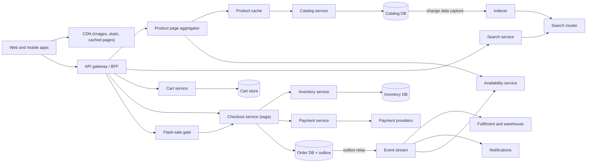
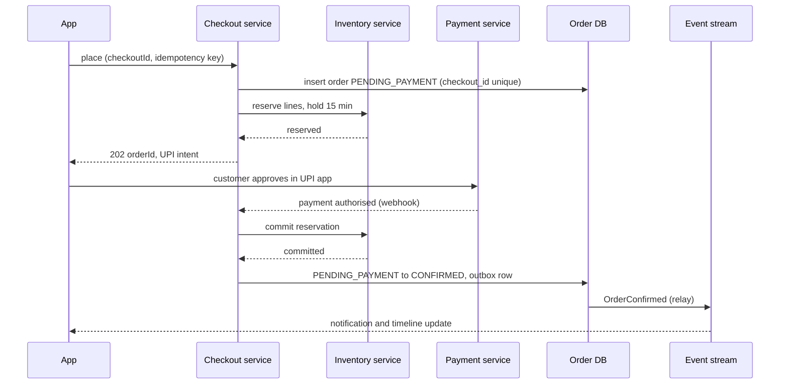
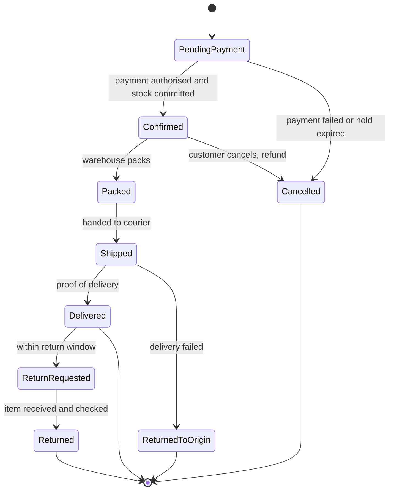

An online store is really two systems glued together. The first is a giant **read** system: millions of people browsing, searching and comparing products, where speed matters and a price that is a few seconds stale is acceptable. The second is a small, strict **write** system: a few hundred checkouts per second where every rupee and every unit of stock must be counted exactly once. Most design mistakes come from treating both halves the same way, either by making browsing as strict as checkout (slow and expensive) or by making checkout as relaxed as browsing (overselling and double charges).

This case study designs both halves and the bridge between them, then stress-tests the design with a flash sale: 10,000 phones, 2 million people, noon sharp. It reasons from public engineering principles; nothing here claims to describe how Amazon, Flipkart, Myntra or any other company actually builds its platform.

## Learning objectives

By the end of this case study you will be able to:

1. Estimate browsing, search, cart and checkout load, and the extreme per-SKU load of a flash sale.
2. Separate the read-heavy catalog and search path from the strongly consistent checkout path, and connect them with events.
3. Design inventory reservations with expiry so stock is neither oversold nor locked up forever.
4. Model checkout as a saga (reserve stock, authorise payment, confirm the order) with compensation at every step.
5. Design a flash sale with admission control, so one hot product doesn't take the whole store down.
6. Reason about the order pipeline, failure handling, security, cost and when a simpler design is enough.

## Prerequisites

- [Capacity estimation](#/lesson/m11-capacity-estimation): RPS and storage arithmetic.
- [Sagas](#/lesson/m12-sagas): multi-step workflows with compensating actions.
- [Transactional outbox](#/lesson/m12-outbox): publishing events reliably after a database write.
- [Idempotency keys](#/lesson/m10-idempotency): safe retries for "Place order".
- [Locking](#/lesson/m09-locking): conditional updates, `SELECT … FOR UPDATE` and optimistic concurrency.

## Explain it like I'm a beginner

Think of a large department store during the Diwali sale.

- The **shop floor** is the catalog: shelves full of products with price tags. Thousands of people walk around looking. If a price tag is a few minutes out of date, nobody is harmed as long as the **till** charges the correct price.
- The **store directory and helpful staff** are search: "Where are the cotton kurtas in size M under ₹1,000?" They don't carry the stock; they point you to it.
- Your **shopping basket** is the cart. Putting a kurta in your basket does not stop anyone else from buying the last one on the shelf.
- At the **till**, the cashier first sets your items aside behind the counter (a **reservation**), then swipes your card (**payment authorisation**), then prints the bill (**order confirmation**). If your card is declined, the items go back on the shelf (**compensation**). If you walk away for 15 minutes, the cashier puts them back anyway (**reservation expiry**).
- For the 12-noon doorbuster on 100 TVs, the store doesn't let 5,000 people rush the electronics aisle. It hands out 100 numbered tokens at the door, and only token holders may go to the till. That is a **flash-sale admission gate**.

## Requirements

### Functional

1. Browse categories and product pages (title, images, attributes, price, delivery estimate, seller offers, reviews summary).
2. Search with text, filters (brand, size, price range) and sorting; typo tolerance and suggestions.
3. Cart: add, remove, change quantity; cart survives across devices for a logged-in customer.
4. Checkout: address, delivery option, price breakdown with GST, payment (UPI, cards, net banking, wallets, cash on delivery), order confirmation.
5. Inventory across multiple warehouses; never sell stock you don't have (within a defined tolerance).
6. Order pipeline: confirmed → packed → shipped → delivered, cancellations and returns, with notifications.
7. Flash sales: a limited quantity of a product at a special price, starting at a fixed time, with per-customer limits.

### Non-functional

| Property | Target |
|---|---|
| Product page | p95 under 200 ms server time; served largely from cache/CDN |
| Search | p95 under 300 ms |
| Checkout | p95 under 2 s excluding the payment provider's own screens |
| Correctness | No double charge; no order confirmed without stock reserved; oversell rate near zero |
| Availability | 99.99 % for browse and checkout; search may degrade to simpler results |
| Freshness | Price and stock shown on product pages may lag by seconds; checkout always uses current values |
| Scale | 30 M daily active users, 100 M SKUs, 2 M orders/day normally, 10 M on big sale days |

### Out of scope

Payment processing internals (see the [payment system case study](#/lesson/m17-payment-system)), recommendation models, seller onboarding, warehouse robotics and last-mile logistics routing.

## Capacity estimation

All figures are **estimates** for the arithmetic.

### Browsing and search

- **30 M DAU × 15 product or listing views** = 450 M views/day ÷ 86,400 s ≈ **5,200 views/s** average. Evening peak ×3 ≈ **15,600/s**. A big sale day can be ×10 the normal average: ≈ **52,000/s**.
- **Search**: 30 M × 4 searches = 120 M/day ≈ **1,400/s** average, ≈ **4,200/s** at peak, ≈ **14,000/s** on sale days.
- Each product page fans out to several internal reads (product, price, stock badge, delivery estimate, reviews summary). Assume 5: 15,600 × 5 ≈ **78,000 internal reads/s** at a normal peak. This is why caching and aggregation matter.

### Cart and checkout

- **Add to cart**: 0.5 per DAU = 15 M/day ≈ **175/s** average.
- **Orders**: 2 M/day ÷ 86,400 ≈ **23/s** average; peak ×5 ≈ **115/s**. Sale day: 10 M orders, with 15 % in the busiest hour: 1.5 M ÷ 3,600 ≈ **420 orders/s**.
- Each order touches several rows (order, lines, reservations, payment, outbox): perhaps 10 writes, so ≈ **4,200 writes/s** at the sale-day peak. That is substantial but within a well-sized, partitioned PostgreSQL setup.

### The flash sale

- 10,000 phones at ₹9,999, sale at 12:00:00. 2 M people have the page open.
- If half of them tap "Buy" within the first 10 seconds: 1 M ÷ 10 s = **100,000 requests/s for one SKU**.
- 99 % of those requests must be told "sold out" or "you're in the queue" without touching the inventory database. This single number shapes the flash-sale design.

### Storage

- Catalog: 100 M SKUs × ~4 KB of attributes ≈ **400 GB**, plus search indexes of similar size.
- Images: 100 M × 6 images × 200 KB (all renditions) ≈ **120 TB** in object storage behind a CDN.
- Orders: 2 M × 4 KB ≈ **8 GB/day**, ≈ **2.9 TB/year** before indexes.
- Carts: 30 M active carts × 2 KB ≈ **60 GB**, fine for a key-value store or a PostgreSQL table.

| Quantity | Estimate |
|---|---|
| Product views | ~5,200/s avg, ~15,600/s peak, ~52,000/s sale day |
| Search | ~1,400/s avg, ~4,200/s peak |
| Orders | ~23/s avg, ~115/s peak, ~420/s sale-day peak |
| Flash-sale SKU | ~100,000 requests/s for 10 s |
| Catalog | ~400 GB + ~120 TB images |

**What breaks first?** On a normal day, nothing dramatic; the usual first pain is product pages doing too many synchronous internal calls. On a sale day: (1) the hot SKU's inventory row, if every "Buy" tap tries to update it, (2) cache stampedes when popular product pages expire at the same moment, (3) the payment provider's rate limits, and (4) the search cluster if sale traffic isn't cached at the query level.

## API design

```http
GET  /v1/products/{productId}                  -> product, offers, images; Cache-Control: max-age=60
GET  /v1/products/{productId}/availability?pincode=560034  -> stock badge, delivery estimate (short TTL)
GET  /v1/search?q=cotton+kurta&size=M&priceMax=1000&sort=relevance&cursor=…

PUT  /v1/cart/items/{sku}                      { "quantity": 2 }           -> whole cart
DELETE /v1/cart/items/{sku}

POST /v1/checkouts                             -> checkoutId, priced lines, delivery options, totals (prices re-read now)
POST /v1/checkouts/{checkoutId}/place          Idempotency-Key: 4b1e…
{ "addressId": "a_12", "paymentMethod": "upi" }
202 { "orderId": "ord_7d…", "status": "PENDING_PAYMENT", "paymentAction": { "type": "upi_intent", "url": "upi://…" } }

GET  /v1/orders/{orderId}                      -> status timeline
POST /v1/orders/{orderId}/cancel               { "expectedVersion": 3 }

POST /v1/flash-sales/{saleId}/admit            -> { "status": "ADMITTED", "ticket": "fs_…", "expiresAt": "…+10 min" } or SOLD_OUT / QUEUED
```

Decisions:

- **Product reads are cacheable and split by volatility.** The product document (title, images, attributes) changes rarely and is cached for minutes. Availability and delivery estimates depend on the pincode and change often, so they are a separate, short-TTL call. This split keeps the big document cacheable.
- **Checkout is a resource.** `POST /checkouts` re-prices everything from the source of truth (cart prices may be stale) and shows the final total. `place` turns it into an order. A `checkoutId` plus `Idempotency-Key` means a double tap or a retry returns the same order instead of creating two.
- **`202` for placement.** Payment often involves a redirect or a UPI app; the order exists as `PENDING_PAYMENT` and moves forward when the payment result arrives (webhook or callback).
- **Cursor pagination for search** so results are stable as the user scrolls ([pagination](#/lesson/m09-pagination)).
- **Flash-sale admission is a separate endpoint** with its own infrastructure, so the stampede for one product can't overwhelm normal checkout.

## Data model

Two worlds, two stores. The **catalog** (products, attributes, prices) lives in PostgreSQL as the source of truth, published to a search index and caches. The **transactional** side (inventory, orders, payments) lives in PostgreSQL with strict constraints, partitioned as it grows.

```sql
CREATE TABLE product (
  product_id    bigint PRIMARY KEY,
  title         text   NOT NULL,
  brand         text   NOT NULL,
  category_id   int    NOT NULL,
  attributes    jsonb  NOT NULL DEFAULT '{}',     -- size, colour, material: varies by category
  version       int    NOT NULL DEFAULT 1          -- bump on change; drives cache keys and reindexing
);

CREATE TABLE sku (
  sku           text   PRIMARY KEY,                -- 'KURTA-BLU-M'
  product_id    bigint NOT NULL REFERENCES product,
  price_paise   bigint NOT NULL CHECK (price_paise > 0),
  gst_rate_bp   int    NOT NULL                    -- basis points, e.g. 1200 = 12 %
);

CREATE TABLE inventory (
  sku           text NOT NULL REFERENCES sku,
  warehouse_id  text NOT NULL,
  on_hand       int  NOT NULL CHECK (on_hand >= 0),
  reserved      int  NOT NULL DEFAULT 0 CHECK (reserved >= 0),
  CHECK (reserved <= on_hand),                     -- the database refuses to oversell
  PRIMARY KEY (sku, warehouse_id)
);

CREATE TABLE reservation (
  reservation_id uuid PRIMARY KEY,
  order_id      uuid NOT NULL,
  sku           text NOT NULL,
  warehouse_id  text NOT NULL,
  qty           int  NOT NULL CHECK (qty > 0),
  status        text NOT NULL CHECK (status IN ('HELD','COMMITTED','RELEASED','EXPIRED')),
  expires_at    timestamptz NOT NULL,
  FOREIGN KEY (sku, warehouse_id) REFERENCES inventory
);
CREATE INDEX reservation_expiry ON reservation (expires_at) WHERE status = 'HELD';

CREATE TABLE shop_order (
  order_id      uuid PRIMARY KEY,
  customer_id   bigint NOT NULL,
  checkout_id   uuid   NOT NULL UNIQUE,            -- one order per checkout: idempotent placement
  status        text   NOT NULL,
  version       int    NOT NULL DEFAULT 1,
  total_paise   bigint NOT NULL,
  created_at    timestamptz NOT NULL DEFAULT now()
);

CREATE TABLE order_line (
  order_id      uuid   NOT NULL REFERENCES shop_order,
  line_no       int    NOT NULL,
  sku           text   NOT NULL,
  title_snapshot text  NOT NULL,
  unit_price_paise bigint NOT NULL,
  qty           int    NOT NULL CHECK (qty > 0),
  PRIMARY KEY (order_id, line_no)
);

CREATE TABLE outbox (
  id            bigserial PRIMARY KEY,
  aggregate_id  uuid  NOT NULL,
  type          text  NOT NULL,                    -- 'OrderConfirmed', 'OrderCancelled', …
  payload       jsonb NOT NULL,
  created_at    timestamptz NOT NULL DEFAULT now(),
  published_at  timestamptz
);
```

Why this shape:

- **`reserved <= on_hand` as a CHECK constraint.** Reserving stock is `UPDATE inventory SET reserved = reserved + $qty WHERE sku = $sku AND warehouse_id = $wh AND on_hand - reserved >= $qty`. If two checkouts race for the last unit, one update matches a row and the other matches zero rows. Even a buggy code path that skips the `WHERE` clause hits the constraint. The database, not application code, makes overselling impossible.
- **Reservations are rows with an expiry.** A `HELD` reservation counts against availability until it is `COMMITTED` (payment succeeded, `on_hand` and `reserved` both decrease) or `RELEASED`/`EXPIRED` (only `reserved` decreases). The partial index on `expires_at` lets a sweeper find expired holds cheaply.
- **`checkout_id UNIQUE`** makes placement idempotent at the data level.
- **Snapshots on order lines** (title, unit price) because the catalog changes; an invoice must not.
- **`attributes jsonb`** because a kurta has size and fabric, a phone has RAM and storage. A GIN index can support attribute filters for admin tools, but customer-facing filtering belongs in the search index ([JSONB](#/lesson/m09-jsonb)).
- **`product.version`** is the hook for cache keys (`product:{id}:v{version}`) and for change data capture to the search index.
- **Money in paise as `bigint`, tax rate in basis points.** No floating point anywhere near money.

## High-level architecture



Every arrow:

1. **Apps → CDN.** Images, scripts and, for anonymous users, whole cached product and category pages are served from the edge. This removes most bytes and a large share of requests.
2. **Apps → gateway → product page aggregator.** A backend-for-frontend ([BFF](#/lesson/m16-gateway-bff)) assembles a product page from several services in parallel with a time budget: product document from the product cache, availability badge, delivery estimate, reviews summary. A slow reviews service degrades the page (no stars shown) instead of failing it.
3. **Product cache → catalog service → catalog DB.** Cache-aside with versioned keys; misses read the catalog database (or a replica).
4. **Catalog DB → CDC → indexer → search cluster.** Every product or price change flows from the database's change stream to an indexer that updates the search documents within seconds ([change data capture](#/lesson/m16-cdc)). Search is a **read model**, never the source of truth.
5. **Gateway → search service → search cluster.** Text queries, filters and facets run against an inverted index ([search architecture](#/lesson/m16-search-architecture)); popular queries are cached for a short time.
6. **Gateway → cart service → cart store.** Carts are per-customer documents in a key-value store or a PostgreSQL table; they don't reserve stock.
7. **Gateway → checkout → inventory, payment, order DB.** The checkout service runs the saga: reserve stock, authorise payment, commit stock and confirm the order, compensating on failure.
8. **Order DB → outbox relay → event stream → fulfilment, notifications, availability.** Order events drive warehouse picking, emails and SMS, and stock badge updates.
9. **Gateway → flash-sale gate → checkout.** During a flash sale only admitted customers reach checkout for the sale SKU.

### Sequence: placing an order



The order row is created **first**, as `PENDING_PAYMENT`, so every later step has something to attach to and the idempotency check is a unique constraint. Stock is reserved **before** asking for money, so the customer never pays for something that is out of stock. The reservation is **committed only after** payment authorisation; if payment fails or the customer abandons the UPI screen, the hold expires after 15 minutes and stock returns to the shelf. The `OrderConfirmed` event is written in the same transaction as the status change (outbox), so fulfilment can never miss an order or ship one that wasn't confirmed.

## Deep dives

### 1. Catalog and search: a read model built from events

The catalog is the **source of truth** for products, written by sellers and catalog teams through admin tools (low write rate: perhaps hundreds of changes per second across 100 M SKUs). Customers never read it directly at scale; they read projections:

- **Product cache**: `product:{id}:v{version}` → the assembled product JSON. Because the version is in the key, an update writes a new key and the old one simply ages out: no purge race. Add TTL jitter to avoid many popular keys expiring together ([cache stampede](#/lesson/m12-cache-failures)).
- **Search index**: one document per product (or per SKU group), with text fields (title, brand, description), keyword fields for filters (brand, size, colour), numeric fields (price, rating) and a popularity signal. Facets ("Brand: Fabindia (124)") come from aggregations on keyword fields.
- **CDN-cached pages** for anonymous traffic.

**Why not search in PostgreSQL?** For a few thousand products, PostgreSQL full-text search with a GIN index is a perfectly good choice. At 100 M SKUs with typo tolerance, synonyms ("kurta" ↔ "kurti"), multi-language text, relevance tuning and facet counts at 14,000 queries/s, a dedicated search engine (OpenSearch, Elasticsearch, Solr or a managed service) is the usual answer. It is horizontally sharded by document and replicated for read throughput.

**Freshness.** CDC lag is typically seconds. That's fine for titles and descriptions, and acceptable for prices **only because checkout re-prices** from the source of truth. Stock in search results is a coarse badge ("in stock", "only 3 left"), never a promise.

**Ranking** combines text relevance with business signals (conversion rate, availability, delivery speed to the user's pincode, seller quality). Out-of-stock items are demoted, not removed, so the page doesn't jump when stock flickers.

### 2. Cart: cheap, durable, and not a reservation

The cart is a small document per customer: `[{sku, qty, addedAt, priceSeen}]`. Design choices:

- **No stock reservation at add-to-cart.** People add things they never buy; reserving at that point would lock up stock for days. The cart can show "price dropped" or "only 2 left" warnings by comparing with current data.
- **Storage**: a key-value store (Redis with persistence, DynamoDB-style table) or PostgreSQL with a JSONB column. 60 GB of carts and ~175 writes/s fit either. Anonymous carts live on the device and merge into the account cart at login.
- **Concurrency**: two devices editing the same cart is rare; last-write-wins with a version check is enough. The demo below increments `Version` but does not compare it on write; a production store would do a compare-and-set (a Redis `WATCH`/transaction or `UPDATE … WHERE version = $expected` in PostgreSQL).
- **Durability**: a cart is customer data, not a cache entry. If you keep carts in Redis behind `IDistributedCache`, give that Redis persistence (AOF) and a `noeviction` memory policy, or a memory spike will silently empty people's carts. Otherwise keep them in PostgreSQL.

```csharp file=Cart/CartStore.cs
using System.Text.Json;
using Microsoft.Extensions.Caching.Distributed;

namespace Shop.Cart;

public sealed record CartLine(string Sku, int Quantity);

public sealed record CustomerCart(long CustomerId, IReadOnlyList<CartLine> Lines, int Version);

/// <summary>Cart documents in a distributed key-value store (Redis in production, memory in this demo).</summary>
public sealed class CartStore(IDistributedCache cache)
{
    private static readonly DistributedCacheEntryOptions Keep = new() { SlidingExpiration = TimeSpan.FromDays(30) };
    private static string Key(long customerId) => $"cart:{customerId}";

    public async Task<CustomerCart> GetAsync(long customerId, CancellationToken ct)
    {
        var bytes = await cache.GetAsync(Key(customerId), ct);
        return bytes is null ? new CustomerCart(customerId, [], 0) : JsonSerializer.Deserialize<CustomerCart>(bytes)!;
    }

    public async Task<CustomerCart> SetQuantityAsync(long customerId, string sku, int quantity, CancellationToken ct)
    {
        if (quantity is < 0 or > 10) throw new ArgumentOutOfRangeException(nameof(quantity), "Quantity must be 0-10.");
        var cart = await GetAsync(customerId, ct);
        var lines = cart.Lines.Where(l => l.Sku != sku).ToList();
        if (quantity > 0) lines.Add(new CartLine(sku, quantity));
        var updated = cart with { Lines = lines, Version = cart.Version + 1 };
        await cache.SetAsync(Key(customerId), JsonSerializer.SerializeToUtf8Bytes(updated), Keep, ct);
        return updated;
    }
}
```

### 3. Inventory reservations: the heart of checkout

Three moments where you could take stock away from others:

| When | Effect | Problem |
|---|---|---|
| Add to cart | Stock locked while people browse | Locks stock for days for carts that never convert |
| Payment success | No lock before money moves | Two customers can pay for the last unit; one must be refunded (oversell) |
| **Checkout start, with expiry** | Stock held for ~15 minutes | Small risk of temporarily showing "out of stock" when holds later expire |

The usual choice is the third: **reserve at placement, hold with a TTL, commit at payment**. Mechanics:

1. **Reserve**: conditional update per warehouse line (`on_hand - reserved >= qty`), all lines in one transaction so a multi-item order is all-or-nothing. Insert `reservation` rows with `expires_at = now + 15 min`.
2. **Commit** on payment authorisation: `on_hand -= qty, reserved -= qty`, reservation `COMMITTED`. If the hold already expired (payment arrived very late), try to re-reserve; if stock is gone, void the payment and tell the customer.
3. **Release** on payment failure or cancel: `reserved -= qty`, reservation `RELEASED`.
4. **Expire**: a sweeper every few seconds releases `HELD` rows past `expires_at`, using `FOR UPDATE SKIP LOCKED` so several sweeper instances never fight over the same rows.

**Which warehouse?** Reserve from the warehouse that can deliver fastest and cheapest to the customer's pincode, falling back to others. That makes inventory a per-(SKU, warehouse) count, which also spreads a hot SKU's writes across several rows.

**Oversell tolerance.** Some businesses deliberately allow a tiny oversell (for example, when warehouse counts are known to be slightly behind physical stock) and handle it with apologies and coupons. That is a business decision; the constraint-based design gives you the strict option and lets you relax it consciously.

Here is the reservation logic as an in-memory ledger. In production the same rules are the SQL statements above.

```csharp file=Inventory/InventoryLedger.cs
namespace Shop.Inventory;

public enum HoldStatus { Held, Committed, Released, Expired }

public sealed record OrderLine(string Sku, int Quantity);

public sealed record StockLevel(string Sku, int OnHand, int Reserved)
{
    public int Available => OnHand - Reserved;
}

public sealed record Hold(Guid OrderId, string Sku, int Quantity, DateTimeOffset ExpiresAt, HoldStatus Status);

public sealed class InventoryLedger(TimeProvider clock)
{
    private readonly Dictionary<string, StockLevel> _stock = new();
    private readonly Dictionary<Guid, List<Hold>> _holds = new();
    private readonly Lock _gate = new();

    public void Receive(string sku, int quantity)
    {
        if (quantity <= 0) throw new ArgumentOutOfRangeException(nameof(quantity));
        lock (_gate)
            _stock[sku] = _stock.TryGetValue(sku, out var s) ? s with { OnHand = s.OnHand + quantity } : new StockLevel(sku, quantity, 0);
    }

    public StockLevel Get(string sku)
    {
        lock (_gate) { ExpireDueLocked(); return _stock.GetValueOrDefault(sku) ?? new StockLevel(sku, 0, 0); }
    }

    /// <summary>All-or-nothing hold for every line of an order. Idempotent per order id.</summary>
    public bool TryReserve(Guid orderId, IReadOnlyList<OrderLine> lines, TimeSpan ttl)
    {
        lock (_gate)
        {
            ExpireDueLocked();
            if (_holds.TryGetValue(orderId, out var existing))
                return existing.All(h => h.Status == HoldStatus.Held);           // retry of the same order

            foreach (var group in lines.GroupBy(l => l.Sku))
            {
                var wanted = group.Sum(l => l.Quantity);
                if (wanted <= 0 || !_stock.TryGetValue(group.Key, out var s) || s.Available < wanted) return false;
            }

            var expiresAt = clock.GetUtcNow() + ttl;
            var holds = new List<Hold>();
            foreach (var line in lines)
            {
                var s = _stock[line.Sku];
                _stock[line.Sku] = s with { Reserved = s.Reserved + line.Quantity };
                holds.Add(new Hold(orderId, line.Sku, line.Quantity, expiresAt, HoldStatus.Held));
            }
            _holds[orderId] = holds;
            return true;
        }
    }

    /// <summary>Payment succeeded: stock leaves the warehouse count. False if the hold expired or was released.</summary>
    public bool Commit(Guid orderId)
    {
        lock (_gate)
        {
            ExpireDueLocked();
            if (!_holds.TryGetValue(orderId, out var holds) || holds.Any(h => h.Status != HoldStatus.Held)) return false;
            for (var i = 0; i < holds.Count; i++)
            {
                var s = _stock[holds[i].Sku];
                _stock[holds[i].Sku] = s with { OnHand = s.OnHand - holds[i].Quantity, Reserved = s.Reserved - holds[i].Quantity };
                holds[i] = holds[i] with { Status = HoldStatus.Committed };
            }
            return true;
        }
    }

    public bool Release(Guid orderId)
    {
        lock (_gate)
        {
            if (!_holds.TryGetValue(orderId, out var holds) || holds.Any(h => h.Status != HoldStatus.Held)) return false;
            Free(holds, HoldStatus.Released);
            return true;
        }
    }

    /// <summary>The sweeper. Production: UPDATE … WHERE status = 'HELD' AND expires_at <= now() with SKIP LOCKED.</summary>
    public int ExpireDue()
    {
        lock (_gate) return ExpireDueLocked();
    }

    private int ExpireDueLocked()
    {
        var now = clock.GetUtcNow();
        var expired = 0;
        foreach (var holds in _holds.Values)
            if (holds.Count > 0 && holds.All(h => h.Status == HoldStatus.Held) && holds[0].ExpiresAt <= now)
            {
                Free(holds, HoldStatus.Expired);
                expired++;
            }
        return expired;
    }

    private void Free(List<Hold> holds, HoldStatus status)
    {
        for (var i = 0; i < holds.Count; i++)
        {
            var s = _stock[holds[i].Sku];
            _stock[holds[i].Sku] = s with { Reserved = s.Reserved - holds[i].Quantity };
            holds[i] = holds[i] with { Status = status };
        }
    }
}
```

The ledger checks every line before changing anything (all-or-nothing), treats a retried reservation for the same order as success rather than a second hold, and expires holds lazily on every call as well as through `ExpireDue`, so an expired hold never blocks a new customer even if the sweeper is late.

### 4. Checkout as a saga

Checkout touches three owners of state: inventory, payments (an external provider) and orders. There is no single database transaction across them, so we use a [saga](#/lesson/m12-sagas): a sequence of local steps, each with a compensating step.

| Step | Action | Compensation if a later step fails |
|---|---|---|
| 1 | Create order `PENDING_PAYMENT` (idempotent on `checkout_id`) | Mark `CANCELLED` |
| 2 | Reserve stock with a 15-minute hold | Release the hold |
| 3 | Authorise payment | Void the authorisation (or refund if captured) |
| 4 | Commit stock, mark order `CONFIRMED`, write outbox event | — (point of no return) |
| 5 | Capture payment at shipping (cards) or immediately (UPI) | Refund on cancellation or return |

An **orchestrator** (the checkout service) runs these steps and persists where it is, so a crash mid-way resumes from the last completed step. Each call to another service carries an idempotency key derived from the order id (`{orderId}:reserve`, `{orderId}:authorise`), so retries are safe. For more complex flows (split shipments, marketplace sellers, EMI approvals) a workflow engine is worth considering ([workflow engines](#/lesson/m16-workflow-engines)).

```csharp file=Checkout/CheckoutService.cs
using System.Collections.Concurrent;
using Shop.Inventory;

namespace Shop.Checkout;

public enum CheckoutOutcome { Confirmed, OutOfStock, PaymentDeclined, ReservationExpired }

public sealed record PaymentResult(bool Approved, string? AuthorizationId, string? DeclineReason);

public interface IPaymentGateway
{
    Task<PaymentResult> AuthorizeAsync(Guid orderId, long amountPaise, string idempotencyKey, CancellationToken ct);
    Task VoidAsync(Guid orderId, string authorizationId, CancellationToken ct);
}

/// <summary>Demo gateway: approves anything up to ₹2 lakh.</summary>
public sealed class FakePaymentGateway : IPaymentGateway
{
    public Task<PaymentResult> AuthorizeAsync(Guid orderId, long amountPaise, string idempotencyKey, CancellationToken ct) =>
        Task.FromResult(amountPaise <= 20_000_000
            ? new PaymentResult(true, $"auth_{orderId:N}", null)
            : new PaymentResult(false, null, "limit_exceeded"));

    public Task VoidAsync(Guid orderId, string authorizationId, CancellationToken ct) => Task.CompletedTask;
}

public sealed record CheckoutRequest(Guid CheckoutId, long CustomerId, IReadOnlyList<OrderLine> Lines, long TotalPaise);

public sealed record CheckoutResult(Guid OrderId, CheckoutOutcome Outcome);

public interface IOrderOutbox
{
    void Publish(string type, Guid orderId);
}

public sealed class InMemoryOutbox : IOrderOutbox
{
    public ConcurrentQueue<(string Type, Guid OrderId)> Events { get; } = new();
    public void Publish(string type, Guid orderId) => Events.Enqueue((type, orderId));
}

public sealed class CheckoutService(InventoryLedger inventory, IPaymentGateway payments, IOrderOutbox outbox)
{
    public static readonly TimeSpan HoldFor = TimeSpan.FromMinutes(15);
    private readonly ConcurrentDictionary<Guid, Task<CheckoutResult>> _byCheckout = new();

    /// <summary>Idempotent per checkout id: concurrent or repeated calls share one result.</summary>
    /// <remarks>
    /// The shared saga must not run on the first caller's CancellationToken: if that client disconnected,
    /// every retry would inherit a cancelled saga, possibly after stock was held. Each caller only stops waiting.
    /// </remarks>
    public Task<CheckoutResult> PlaceAsync(CheckoutRequest request, CancellationToken ct) =>
        _byCheckout.GetOrAdd(request.CheckoutId, _ => RunSagaAsync(request, CancellationToken.None)).WaitAsync(ct);

    private async Task<CheckoutResult> RunSagaAsync(CheckoutRequest r, CancellationToken ct)
    {
        var orderId = r.CheckoutId;                                   // production: order row inserted with checkout_id UNIQUE

        if (!inventory.TryReserve(orderId, r.Lines, HoldFor))
            return new CheckoutResult(orderId, CheckoutOutcome.OutOfStock);

        var payment = await payments.AuthorizeAsync(orderId, r.TotalPaise, $"{orderId}:authorize", ct);
        if (!payment.Approved)
        {
            inventory.Release(orderId);                               // compensate step 2
            return new CheckoutResult(orderId, CheckoutOutcome.PaymentDeclined);
        }

        if (!inventory.Commit(orderId))                               // the hold expired while the customer was paying
        {
            // Production first tries to re-reserve (see Failure handling); this demo goes straight to compensation.
            await payments.VoidAsync(orderId, payment.AuthorizationId!, ct);   // compensate step 3
            return new CheckoutResult(orderId, CheckoutOutcome.ReservationExpired);
        }

        outbox.Publish("OrderConfirmed", orderId);                    // production: same DB transaction as CONFIRMED
        return new CheckoutResult(orderId, CheckoutOutcome.Confirmed);
    }
}
```

Caching the `Task` per checkout id means a double tap that arrives while the first saga is still running waits for the same result rather than starting a second saga. The saga itself runs without the caller's cancellation token; a client that hangs up only stops waiting (`WaitAsync(ct)`). Across multiple instances, the unique `checkout_id` in the order table plays the same role, and the in-memory dictionary would need an expiry in a long-running process.

### 5. The order pipeline



After confirmation the order becomes a pipeline driven by events from other systems: the warehouse management system emits `Packed`, the courier integration emits `Shipped` and `Delivered`, the returns desk emits `Returned`. Each consumer applies the transition with a version check and ignores events that are already applied (an [idempotent consumer](#/lesson/m12-idempotent-consumers)), because couriers retry webhooks liberally. Cancellation is only allowed before `Shipped`; after that, the path is a return. Refunds are their own saga with the payment provider.

A multi-item order may split into several **shipments** from different warehouses, each with its own pipeline; the order's status is derived from its shipments ("partially shipped"). Model shipments as their own table from the start; retrofitting them is painful.

### 6. Flash sales: protecting the store from one product

This section is the e-commerce view of the problem; the [flash sale case study](#/lesson/m17-flash-sale) goes deeper into hot rows, Redis counters, queue fairness and bot defence.

10,000 units, 100,000 requests/s at noon. If each request runs the reservation `UPDATE` on the same `inventory` row, every request queues for the same row lock; latency explodes, connection pools fill, and **normal checkout for every other product** stalls because it shares the database. The design goal is: **decide who gets a unit without touching the database for the 99 % who won't**.

Layers, from the edge inward:

1. **Static sale page on the CDN** with a countdown driven by the client clock and corrected by a server time endpoint; no origin traffic until noon.
2. **Bot and abuse filtering** at the edge: rate limits per IP and device, CAPTCHA or proof-of-work challenges for suspicious traffic, login required.
3. **Waiting room / queue**: customers who tap "Buy" get a position, and the system admits them at a rate checkout can handle (say 2,000/s). This is [queue-based load levelling](#/lesson/m12-message-queues) applied to people.
4. **Admission gate with pre-allocated tokens**: an in-memory or Redis counter initialised to 10,000. Each admission atomically decrements it (`DECR` in Redis, or a Lua script that also checks a per-customer set). When it reaches zero, every later request gets `SOLD_OUT` instantly. Admitted customers get a ticket valid for 10 minutes to complete checkout.
5. **Checkout for admitted customers only**, using the normal saga. Inventory for the sale can be **split into buckets** (20 rows of 500 units each), with each request routed to a random bucket, so the database writes are spread across rows instead of one hot row. When the chosen bucket is empty, try one or two others before answering "sold out", or the last few units sit stranded in buckets nobody happened to pick.
6. **Return of unused tokens**: when a ticket expires unpaid, or payment fails, the token is returned to the counter for the next person in the queue.

```csharp file=FlashSale/FlashSaleGate.cs
using System.Collections.Concurrent;

namespace Shop.FlashSale;

public enum AdmissionStatus { Admitted, AlreadyAdmitted, SoldOut }

public sealed record Admission(AdmissionStatus Status, Guid? Ticket);

/// <summary>
/// Pre-allocated tokens for one sale. The database never sees the 99 % who won't get a unit.
/// Production: a Redis Lua script doing SISMEMBER (per-customer), DECR (tokens) and SADD atomically.
/// </summary>
public sealed class FlashSaleGate(int units)
{
    private int _tokens = units;
    private readonly ConcurrentDictionary<long, Guid> _admitted = new();

    public int Remaining => Math.Max(0, Volatile.Read(ref _tokens));

    public Admission TryAdmit(long customerId)
    {
        if (_admitted.TryGetValue(customerId, out var existing)) return new(AdmissionStatus.AlreadyAdmitted, existing);

        if (Interlocked.Decrement(ref _tokens) < 0)
        {
            Interlocked.Increment(ref _tokens);                       // undo: we went below zero
            return new(AdmissionStatus.SoldOut, null);
        }

        var ticket = Guid.NewGuid();
        if (_admitted.TryAdd(customerId, ticket)) return new(AdmissionStatus.Admitted, ticket);

        Interlocked.Increment(ref _tokens);                           // same customer raced on two devices
        return new(AdmissionStatus.AlreadyAdmitted, _admitted[customerId]);
    }

    /// <summary>Ticket expired unpaid or payment failed: give the unit to the next person in the queue.</summary>
    public bool Return(long customerId)
    {
        if (!_admitted.TryRemove(customerId, out _)) return false;
        Interlocked.Increment(ref _tokens);
        return true;
    }
}
```

A short-lived negative counter is possible under contention (many threads decrement before the first one undoes), but every thread that sees a negative result undoes its own decrement and is refused, so no more than `units` customers are ever admitted. Note that `Return` re-allows the same customer; real sales often keep them blocked for the rest of the sale.

**Isolation.** Run the flash-sale gate and waiting room on separate infrastructure (their own instances, Redis and rate limits), so if they are overwhelmed, normal shopping is not. This is the [bulkhead](#/lesson/m10-bulkhead) idea.

## Caching, queues and scaling

**Caching.**

- **CDN** for images and cached pages (anonymous traffic), with short TTLs for HTML and long ones for versioned assets.
- **Product cache** with versioned keys and TTL jitter; request coalescing so 1,000 simultaneous misses for one product make one database read.
- **Search query cache** for the top few thousand queries ("iphone", "saree"), TTL 30–60 s.
- **Availability cache** per (SKU, pincode region) with TTL of seconds, updated by inventory events.
- **Never cache** the checkout's price and stock decisions: they read the source of truth.

**Queues and streams.**

- **Outbox → event stream** for order events, partitioned by order id; consumers: fulfilment, notifications, analytics, availability, loyalty points.
- **CDC stream** from the catalog database to the search indexer and caches.
- **Reservation expiry** via a sweeper with `SKIP LOCKED`, or delayed messages per order.
- **Waiting room queue** for flash sales.

**Scaling.**

- **Browse and search scale horizontally**: stateless aggregators, replicated caches, search shards and replicas. This is most of the fleet.
- **Catalog DB**: one primary with read replicas is plenty for hundreds of writes/s; replicas serve cache misses.
- **Order and inventory DBs**: partition orders by `order_id` hash (or by customer) and archive old orders by month. Inventory is small (rows per SKU per warehouse) but hot; split hot SKUs into buckets and keep inventory in its own database so a flash sale doesn't contend with order history queries.
- **Sale-day readiness**: pre-scale before the event (autoscaling reacts too slowly to a noon spike), pre-warm caches with the sale's product pages, and load-test with recorded traffic shapes.

## Failure handling

| Failure | Effect | Mitigation |
|---|---|---|
| Customer double taps "Place order" | Two orders, two charges | `Idempotency-Key` + `checkout_id UNIQUE`; saga result cached per checkout |
| Payment authorised, service crashes before confirming | Paid order stuck | Saga state persisted; webhook retried by the provider; reconciliation job resolves `PENDING_PAYMENT` orders older than the hold |
| Payment arrives after the hold expired | Paid but stock released | Try to re-reserve; if stock is gone, void or refund automatically and notify |
| Two checkouts race for the last unit | Oversell | Conditional `UPDATE … WHERE on_hand - reserved >= qty` and the CHECK constraint |
| Sweeper stops | Expired holds keep stock locked | Lazy expiry on read (as in the ledger); alert on oldest expired-but-held reservation age |
| Search cluster degraded | Search slow or down | Fall back to cached popular queries and category browsing; search is a read model and can be rebuilt from the catalog |
| CDC lag | Search shows old price | Checkout re-prices; show "price changed" at checkout; monitor lag |
| Reviews service slow | Product page slow | Aggregator time budget; render without the reviews block |
| Flash-sale stampede | Database contention | Gate with tokens, waiting room, bulkheaded infrastructure, bucketed inventory |
| Courier webhook delivered twice | Duplicate transitions | Idempotent consumer with event ids; version checks on the order |

:::callout type=tradeoff title="Strict where money moves, relaxed where people browse"
The product page can show a price that is 5 seconds old; the checkout total must not. Stock badges can say "in stock" for an item that sold out a second ago; the reservation must not succeed. Put the strictness in a small number of places (the reservation update, the checkout re-price, the unique checkout id) and you can make everything else fast, cached and eventually consistent.
:::

## Security

- **Authentication and sessions**: OAuth 2.0 / OpenID Connect for apps, short-lived access tokens, refresh tokens bound to devices ([OAuth and OIDC](#/lesson/m14-oauth-oidc)). Step-up verification (OTP) for address changes and high-value orders.
- **Never trust client prices.** The client sends SKUs and quantities; the server computes prices, discounts and taxes. Coupon codes are validated server-side with usage limits.
- **Payment data**: card details go straight to the payment provider's hosted fields or SDK; your servers handle only tokens, keeping you out of most PCI DSS scope. Verify webhook signatures.
- **Account takeover and fraud**: credential-stuffing protection (rate limits, breached-password checks), device fingerprinting, velocity checks on orders and refunds, cash-on-delivery limits for new accounts.
- **Flash-sale fairness**: bots buying out stock for resale is the main threat; login required, per-customer limits, CAPTCHA or challenges, and post-sale cancellation of orders tied to abusive patterns.
- **Data protection**: addresses and order history are personal data; encrypt at rest, restrict access by role, log access and honour deletion requests under laws like India's DPDP Act and the EU GDPR.
- **Admin and seller tools**: price changes are powerful; require approvals for large changes, and alert on prices that drop by more than, say, 70 % in one edit (a classic "₹1 TV" incident).

## Observability

- **Golden signals per service**: rate, errors, latency (p50, p95, p99), saturation.
- **Business funnel**: product view → add to cart → checkout start → place → payment success → confirmed, per platform and payment method. A drop at one step pinpoints the failing component faster than infrastructure metrics.
- **Inventory health**: reservation success rate, hold expiry rate (customers abandoning payment), oldest expired-but-held reservation, oversell incidents (should be zero), negative-stock alerts from warehouse reconciliation.
- **Payments**: authorisation success rate per provider and method, webhook delay, orders stuck in `PENDING_PAYMENT`.
- **Search**: zero-result rate, click-through, latency, CDC lag.
- **Caches**: hit ratio per cache, stampede indicators (miss bursts on single keys).
- **Flash sale dashboards**: admission rate, tokens remaining, queue depth, checkout conversion of admitted customers.
- **Tracing** with a correlation id across BFF, checkout, inventory and payments ([OpenTelemetry](#/lesson/m14-observability)).

## Deployment and cost

**Deployment.** Browse and search services deploy many times a day with canary releases ([deployment strategies](#/lesson/m15-deployment-strategies)). Checkout, inventory and payment services deploy more carefully, never during a sale, and with expand-and-contract database migrations. A **change freeze** before big sale days is common practice, with sale features hidden behind feature flags that are turned on at the start time.

**Cost drivers** (relative, estimates):

1. **Compute for browse, BFF and search** at peak: the biggest fleet, sized for sale days and scaled down otherwise.
2. **CDN egress** for images (120 TB stored, far more served): modern formats (WebP, AVIF) and correct sizing per device are large savings.
3. **Search cluster**: memory-heavy nodes holding indexes for 100 M SKUs plus replicas.
4. **Databases**: provisioned for sale-day write peaks, with read replicas.
5. **Payment fees** usually dwarf infrastructure costs; routing payments across providers by success rate and cost is a business lever, not an infrastructure one.

### When a simpler design is enough

A D2C brand selling 800 products with 2,000 orders a day needs none of this machinery. One ASP.NET Core application, one PostgreSQL database with full-text search, a CDN for images, and a hosted payment page. Inventory reservations are the same conditional `UPDATE` and the same CHECK constraint, run in the same database as orders, inside one transaction, so no saga is needed beyond handling the payment callback. A flash sale for 500 units at that scale can use the database row directly with a short queue in front. Split out search, caches and an event stream when measurements say a specific part is the bottleneck ([modular monolith versus microservices](#/lesson/m16-monolith-vs-microservices)).

## Alternatives and trade-offs

| Decision | Choice here | Alternative | When the alternative wins |
|---|---|---|---|
| Stock reservation | At placement, 15-min TTL | At payment success only | Very high stock, low contention; accept rare refunds for oversell |
| Stock reservation | At placement | At add-to-cart | Limited-edition drops where the cart *is* the queue (with short TTLs) |
| Search | Dedicated search engine via CDC | PostgreSQL full-text search | Small catalogs (thousands of SKUs), simple relevance |
| Checkout coordination | Orchestrated saga | Choreography (services react to events) | Few, stable steps owned by different teams; harder to see the whole flow |
| Checkout coordination | Saga across services | One database transaction | Inventory and orders in the same database (modular monolith) |
| Flash sale | Token gate + waiting room | Lottery: register interest, draw winners | Very scarce items where fairness matters more than speed |
| Hot SKU inventory | Bucketed rows | Single row with queueing | Moderate contention, simpler accounting |
| Cart store | Key-value store | PostgreSQL JSONB | One-database architectures; transactional cart-to-order moves |

The essential trade-off: **eventual consistency for the many reads, strict consistency for the few writes that move money and stock.** Build the read side as caches and indexes fed by events, keep the write side small, constrained and idempotent, and put a gate in front of anything that can attract a stampede.

```csharp file=Program.cs
using System.Collections.Concurrent;
using Shop.Cart;
using Shop.Checkout;
using Shop.FlashSale;
using Shop.Inventory;

var builder = WebApplication.CreateBuilder(args);
builder.Services.AddDistributedMemoryCache();              // production: AddStackExchangeRedisCache
builder.Services.AddSingleton(TimeProvider.System);
builder.Services.AddSingleton<CartStore>();
builder.Services.AddSingleton<InventoryLedger>();
builder.Services.AddSingleton<IPaymentGateway, FakePaymentGateway>();
builder.Services.AddSingleton<InMemoryOutbox>();
builder.Services.AddSingleton<IOrderOutbox>(sp => sp.GetRequiredService<InMemoryOutbox>());
builder.Services.AddSingleton<CheckoutService>();
builder.Services.AddSingleton(new ConcurrentDictionary<string, FlashSaleGate>());

var app = builder.Build();

app.MapPost("/v1/admin/stock/{sku}", (string sku, int quantity, InventoryLedger inventory) =>
{
    inventory.Receive(sku, quantity);
    return Results.Ok(inventory.Get(sku));
});

app.MapPut("/v1/customers/{customerId:long}/cart/items/{sku}", async (long customerId, string sku, SetQuantity body,
    CartStore carts, CancellationToken ct) =>
{
    try { return Results.Ok(await carts.SetQuantityAsync(customerId, sku, body.Quantity, ct)); }
    catch (ArgumentOutOfRangeException ex) { return Results.BadRequest(new { error = ex.Message }); }
});

app.MapPost("/v1/checkouts/{checkoutId:guid}/place", async (Guid checkoutId, PlaceOrder body, CheckoutService checkout,
    CancellationToken ct) =>
{
    // Production: prices come from the catalog, never from the client; here the total is passed for brevity.
    var result = await checkout.PlaceAsync(new CheckoutRequest(checkoutId, body.CustomerId, body.Lines, body.TotalPaise), ct);
    return result.Outcome switch
    {
        CheckoutOutcome.Confirmed => Results.Ok(result),
        CheckoutOutcome.OutOfStock => Results.Conflict(result),
        _ => Results.UnprocessableEntity(result)
    };
});

app.MapPost("/v1/flash-sales/{saleId}/admit", (string saleId, long customerId, ConcurrentDictionary<string, FlashSaleGate> gates) =>
{
    var gate = gates.GetOrAdd(saleId, _ => new FlashSaleGate(units: 10_000));
    var admission = gate.TryAdmit(customerId);
    return admission.Status == AdmissionStatus.SoldOut
        ? Results.Json(admission, statusCode: StatusCodes.Status410Gone)
        : Results.Ok(new { admission.Status, admission.Ticket, gate.Remaining });
});

app.Run();

public sealed record SetQuantity(int Quantity);
public sealed record PlaceOrder(long CustomerId, List<OrderLine> Lines, long TotalPaise);
```

## Practical playground

The starting graph is the classic first version: one application server and one database handle browsing, search (`LIKE '%kurta%'`), carts and checkout. Open it in the HLD canvas.

1. Set client traffic to 15,600 RPS (normal peak). What saturates first?
2. Add a `cdn` and a product `cache`; then a `search` node fed by an async edge from the database (CDC).
3. Split checkout into its own `app-server` with separate inventory and order `database` nodes and a `stream` for order events.
4. Now raise traffic to 100,000 RPS for the flash sale. Add a `rate-limiter`, a `queue` (waiting room) and a `cache` for the token gate in front of checkout. Which nodes no longer see the stampede?

:::playground type=hld title="From one shop server to a sale-ready store"
```json
{
  "nodes": [
    { "id": "c", "type": "client", "label": "Shoppers", "props": { "rps": 15600 } },
    { "id": "lb", "type": "load-balancer", "label": "Load balancer" },
    { "id": "app", "type": "app-server", "label": "Shop app (pages, search, cart, checkout)", "props": { "instances": 6 } },
    { "id": "db", "type": "database", "label": "PostgreSQL (catalog, carts, orders, stock)", "props": { "replicas": 1 } },
    { "id": "psp", "type": "external", "label": "Payment provider" }
  ],
  "edges": [
    { "from": "c", "to": "lb", "kind": "sync" },
    { "from": "lb", "to": "app", "kind": "sync" },
    { "from": "app", "to": "db", "kind": "sync", "label": "everything, incl. LIKE search" },
    { "from": "app", "to": "psp", "kind": "sync" }
  ]
}
```
:::

## Exercises

:::exercise id=m17-ecommerce-ex1 difficulty=beginner kind=written title="Size a festive sale day"
A fashion marketplace has 12 M DAU on a normal day, with 10 product views and 3 searches per user. Orders are 600,000/day. On its festive sale day, DAU triples, views and searches per user stay the same, and orders rise to 4 M with 20 % in the busiest hour. Each order causes about 12 database writes. Images: 20 M SKUs × 5 images × 150 KB.

1. Compute normal average product views/s and searches/s.
2. Compute sale-day average views/s, and the sale-day peak assuming a ×3 peak-to-average ratio.
3. Compute the sale-day busiest-hour order rate and database writes/s for orders.
4. Compute image storage.
5. Which two components would you scale or protect first for the sale, and why?
::acceptance
- Shows each division by 86,400 or 3,600 with units.
- Applies the ×3 peak factor only where stated.
- Converts image storage to TB correctly.
- Prioritises components with reasons tied to the numbers (read path vs write path).
::hint
Normal views/day = 12 M × 10. Divide by 86,400.
::hint
Sale-day DAU = 36 M. Views/day = 360 M.
::hint
Busiest hour orders = 0.2 × 4 M. Divide by 3,600 s, then multiply by 12 writes.
::hint
Images: 20 M × 5 × 150 KB = bytes; divide by 10^12 for TB.
::solution
1. Views: 12 M × 10 = 120 M/day ÷ 86,400 ≈ **1,390/s**. Searches: 36 M/day ≈ **417/s**.
2. Sale day: 36 M × 10 = 360 M views/day ÷ 86,400 ≈ **4,170/s** average; peak ×3 ≈ **12,500/s**.
3. Busiest hour: 0.2 × 4 M = 800,000 ÷ 3,600 ≈ **222 orders/s**; × 12 ≈ **2,670 writes/s**.
4. Images: 20 M × 5 × 150 KB = 15 × 10^12 B ≈ **15 TB**.
5. First, the **read path** (CDN, product cache, search): 12,500 views/s with several internal reads each dwarfs the write load, and cache stampedes at sale start are the classic failure. Pre-warm sale product pages and add request coalescing. Second, the **inventory/checkout database**: 2,670 writes/s is manageable for a tuned PostgreSQL primary, but hot sale SKUs concentrate writes on a few rows; split hot SKUs into buckets and keep inventory isolated from catalog and history queries. The payment provider's rate limits are a close third; agree capacity with providers in advance.
::mistakes
- Applying the peak factor twice (to DAU and again to views).
- Forgetting that each order is several writes.
- Prioritising the order database while ignoring that browsing traffic is 50× larger.
:::

:::exercise id=m17-ecommerce-ex2 difficulty=beginner kind=sql ordered=true title="Compute available-to-sell stock"
The availability service needs, per SKU across all warehouses, the total `on_hand`, the quantity in **active holds** (status `HELD` and not yet expired at `2026-10-19 10:00:00+00`) and `available = on_hand − reserved`. Committed reservations have already been subtracted from `on_hand`, so they don't count. Return `sku`, `on_hand`, `reserved`, `available`, ordered by `sku`. SKUs with no holds must still appear.
::setup
```sql
CREATE TABLE inventory (
  sku          text NOT NULL,
  warehouse_id text NOT NULL,
  on_hand      int  NOT NULL CHECK (on_hand >= 0),
  PRIMARY KEY (sku, warehouse_id)
);
CREATE TABLE reservation (
  reservation_id int  PRIMARY KEY,
  sku            text NOT NULL,
  warehouse_id   text NOT NULL,
  qty            int  NOT NULL,
  status         text NOT NULL,
  expires_at     timestamptz NOT NULL
);
INSERT INTO inventory VALUES
  ('SKU-KURTA-M',   'DEL', 40),
  ('SKU-KURTA-M',   'BLR', 25),
  ('SKU-PHONE-128', 'DEL', 10),
  ('SKU-PHONE-128', 'MUM',  5),
  ('SKU-MIXER',     'BLR',  8);
INSERT INTO reservation VALUES
  (1, 'SKU-KURTA-M',   'DEL', 3, 'HELD',      '2026-10-19 10:05:00+00'),
  (2, 'SKU-KURTA-M',   'BLR', 2, 'HELD',      '2026-10-19 09:58:00+00'),
  (3, 'SKU-PHONE-128', 'DEL', 4, 'HELD',      '2026-10-19 10:10:00+00'),
  (4, 'SKU-PHONE-128', 'MUM', 1, 'COMMITTED', '2026-10-19 10:10:00+00'),
  (5, 'SKU-PHONE-128', 'DEL', 2, 'HELD',      '2026-10-19 10:01:00+00'),
  (6, 'SKU-MIXER',     'BLR', 1, 'RELEASED',  '2026-10-19 10:20:00+00');
```
::check
```sql
WITH stock AS (
  SELECT sku, SUM(on_hand) AS on_hand FROM inventory GROUP BY sku
), holds AS (
  SELECT sku, SUM(qty) AS reserved
  FROM reservation
  WHERE status = 'HELD' AND expires_at > TIMESTAMPTZ '2026-10-19 10:00:00+00'
  GROUP BY sku
)
SELECT s.sku,
       s.on_hand::int AS on_hand,
       COALESCE(h.reserved, 0)::int AS reserved,
       (s.on_hand - COALESCE(h.reserved, 0))::int AS available
FROM stock s
LEFT JOIN holds h ON h.sku = s.sku
ORDER BY s.sku;
```
::acceptance
- `SKU-KURTA-M`: 65 on hand, 3 reserved, 62 available (reservation 2 has expired).
- `SKU-MIXER`: 8, 0, 8 (released holds don't count, and the SKU still appears).
- `SKU-PHONE-128`: 15, 6, 9 (the committed reservation is not counted again).
- Rows ordered by SKU.
::hint
Aggregate stock and holds **separately**, then join the two aggregates. Why might joining the raw tables first give wrong totals?
::hint
Active hold = `status = 'HELD' AND expires_at > the fixed time`.
::hint
Use a `LEFT JOIN` from stock to holds and `COALESCE(reserved, 0)` so SKUs without holds still appear.
::hint
Cast sums to `int` so the result types are simple integers.
::solution
```sql
WITH stock AS (
  SELECT sku, SUM(on_hand) AS on_hand FROM inventory GROUP BY sku
), holds AS (
  SELECT sku, SUM(qty) AS reserved
  FROM reservation
  WHERE status = 'HELD' AND expires_at > TIMESTAMPTZ '2026-10-19 10:00:00+00'
  GROUP BY sku
)
SELECT s.sku,
       s.on_hand::int AS on_hand,
       COALESCE(h.reserved, 0)::int AS reserved,
       (s.on_hand - COALESCE(h.reserved, 0))::int AS available
FROM stock s
LEFT JOIN holds h ON h.sku = s.sku
ORDER BY s.sku;
```
Joining `inventory` to `reservation` before aggregating multiplies rows: two warehouse rows × two hold rows would count `on_hand` twice. Aggregating each side first (or using correlated subqueries) avoids that fan-out. In the production schema `inventory.reserved` is maintained by the reservation update itself, so this query is a **reconciliation check**: if the maintained counter and the computed sum disagree, something is leaking holds.
::mistakes
- Joining raw tables then summing, which double-counts `on_hand` when a SKU has several holds.
- Counting expired `HELD` rows, which makes stock look sold out when a sweeper is behind.
- Counting `COMMITTED` reservations again although `on_hand` already reflects them.
- Using an inner join, which drops SKUs that have no holds.
:::

:::exercise id=m17-ecommerce-ex3 difficulty=intermediate kind=code title="Stock holds that expire"
Implement `StockHolds`, an in-memory model of checkout reservations with a `TimeProvider`:

- `AddStock(sku, qty)` increases on-hand stock.
- `Available(sku)` = on hand − quantity in **active** holds (held and not expired).
- `TryHold(holdId, sku, qty, ttl)` creates a hold if enough stock is available; returns `false` otherwise. Calling it again with the same `holdId` returns `true` without holding more stock (idempotent retry).
- `Confirm(holdId)` succeeds only for an active hold: it removes the quantity from on-hand stock permanently. Returns `false` for unknown, released, confirmed or expired holds.
- `Release(holdId)` frees an active hold; returns `false` otherwise.
- Expired holds stop counting **immediately** at their expiry time, without any sweeper call.
::acceptance
- Holding 3 of 10 makes 7 available; confirming leaves 7 on hand and 7 available.
- A hold that expires frees its stock exactly at `ttl`, and can no longer be confirmed.
- A retried `TryHold` with the same id doesn't double-reserve.
- Insufficient stock returns `false` and changes nothing; zero or negative quantities throw `ArgumentOutOfRangeException`.
::hint
Keep two things: on-hand per SKU, and a dictionary of holds `(Sku, Qty, ExpiresAt, State)`.
::hint
"Active" = state is Held and `now < ExpiresAt`. Compute availability from active holds rather than maintaining a separate counter, so expiry is automatic.
::hint
Read the time once per call with `clock.GetUtcNow()`.
::hint
Check idempotency (existing hold id) before checking availability.
::starter
```csharp file=StockHolds.cs
using System;

public sealed class StockHolds
{
    public StockHolds(TimeProvider clock) { }

    public void AddStock(string sku, int qty) => throw new NotImplementedException();
    public int Available(string sku) => throw new NotImplementedException();
    public int OnHand(string sku) => throw new NotImplementedException();
    public bool TryHold(Guid holdId, string sku, int qty, TimeSpan ttl) => throw new NotImplementedException();
    public bool Confirm(Guid holdId) => throw new NotImplementedException();
    public bool Release(Guid holdId) => throw new NotImplementedException();
}
```
::tests
```csharp file=StockHoldsTests.cs
using System;
using Xunit;

public sealed class ManualClock : TimeProvider
{
    public DateTimeOffset Now { get; set; } = new(2026, 10, 19, 10, 0, 0, TimeSpan.Zero);
    public override DateTimeOffset GetUtcNow() => Now;
    public void Advance(TimeSpan by) => Now += by;
}

public class StockHoldsTests
{
    private static readonly TimeSpan Ttl = TimeSpan.FromMinutes(15);

    private static (StockHolds Holds, ManualClock Clock) Make(int stock = 10)
    {
        var clock = new ManualClock();
        var h = new StockHolds(clock);
        h.AddStock("PHONE", stock);
        return (h, clock);
    }

    [Fact]
    public void Hold_then_confirm()
    {
        var (h, _) = Make();
        var id = Guid.NewGuid();
        Assert.True(h.TryHold(id, "PHONE", 3, Ttl));
        Assert.Equal(7, h.Available("PHONE"));
        Assert.True(h.Confirm(id));
        Assert.Equal(7, h.OnHand("PHONE"));
        Assert.Equal(7, h.Available("PHONE"));
        Assert.False(h.Confirm(id));
    }

    [Fact]
    public void Insufficient_stock_changes_nothing()
    {
        var (h, _) = Make(2);
        Assert.False(h.TryHold(Guid.NewGuid(), "PHONE", 3, Ttl));
        Assert.Equal(2, h.Available("PHONE"));
        Assert.False(h.TryHold(Guid.NewGuid(), "UNKNOWN", 1, Ttl));
    }

    [Fact]
    public void Expiry_frees_stock_exactly_at_ttl()
    {
        var (h, clock) = Make();
        var id = Guid.NewGuid();
        h.TryHold(id, "PHONE", 10, Ttl);
        clock.Advance(Ttl - TimeSpan.FromSeconds(1));
        Assert.Equal(0, h.Available("PHONE"));
        clock.Advance(TimeSpan.FromSeconds(1));
        Assert.Equal(10, h.Available("PHONE"));
        Assert.False(h.Confirm(id));
        Assert.True(h.TryHold(Guid.NewGuid(), "PHONE", 10, Ttl));
    }

    [Fact]
    public void Retry_with_same_id_does_not_double_hold()
    {
        var (h, _) = Make();
        var id = Guid.NewGuid();
        Assert.True(h.TryHold(id, "PHONE", 4, Ttl));
        Assert.True(h.TryHold(id, "PHONE", 4, Ttl));
        Assert.Equal(6, h.Available("PHONE"));
    }

    [Fact]
    public void Release_returns_stock_once()
    {
        var (h, _) = Make();
        var id = Guid.NewGuid();
        h.TryHold(id, "PHONE", 5, Ttl);
        Assert.True(h.Release(id));
        Assert.False(h.Release(id));
        Assert.Equal(10, h.Available("PHONE"));
        Assert.False(h.Confirm(id));
    }

    [Fact]
    public void Bad_quantities_throw()
    {
        var (h, _) = Make();
        Assert.Throws<ArgumentOutOfRangeException>(() => h.TryHold(Guid.NewGuid(), "PHONE", 0, Ttl));
        Assert.Throws<ArgumentOutOfRangeException>(() => h.AddStock("PHONE", -1));
    }
}
```
::solution
Compute availability from active holds, so expiry needs no sweeper for correctness.

```csharp file=StockHolds.cs
using System;
using System.Collections.Generic;
using System.Linq;
using System.Threading;

public sealed class StockHolds
{
    private enum State { Held, Confirmed, Released }
    private sealed record HoldRow(string Sku, int Qty, DateTimeOffset ExpiresAt, State State);

    private readonly TimeProvider _clock;
    private readonly Dictionary<string, int> _onHand = new();
    private readonly Dictionary<Guid, HoldRow> _holds = new();
    private readonly Lock _gate = new();

    public StockHolds(TimeProvider clock) => _clock = clock;

    public void AddStock(string sku, int qty)
    {
        if (qty <= 0) throw new ArgumentOutOfRangeException(nameof(qty));
        lock (_gate) _onHand[sku] = _onHand.GetValueOrDefault(sku) + qty;
    }

    public int OnHand(string sku)
    {
        lock (_gate) return _onHand.GetValueOrDefault(sku);
    }

    public int Available(string sku)
    {
        lock (_gate) return AvailableLocked(sku, _clock.GetUtcNow());
    }

    public bool TryHold(Guid holdId, string sku, int qty, TimeSpan ttl)
    {
        if (qty <= 0) throw new ArgumentOutOfRangeException(nameof(qty));
        lock (_gate)
        {
            var now = _clock.GetUtcNow();
            if (_holds.TryGetValue(holdId, out var existing)) return IsActive(existing, now);
            if (AvailableLocked(sku, now) < qty) return false;
            _holds[holdId] = new HoldRow(sku, qty, now + ttl, State.Held);
            return true;
        }
    }

    public bool Confirm(Guid holdId)
    {
        lock (_gate)
        {
            if (!_holds.TryGetValue(holdId, out var h) || !IsActive(h, _clock.GetUtcNow())) return false;
            _onHand[h.Sku] -= h.Qty;
            _holds[holdId] = h with { State = State.Confirmed };
            return true;
        }
    }

    public bool Release(Guid holdId)
    {
        lock (_gate)
        {
            if (!_holds.TryGetValue(holdId, out var h) || !IsActive(h, _clock.GetUtcNow())) return false;
            _holds[holdId] = h with { State = State.Released };
            return true;
        }
    }

    private static bool IsActive(HoldRow h, DateTimeOffset now) => h.State == State.Held && now < h.ExpiresAt;

    private int AvailableLocked(string sku, DateTimeOffset now) =>
        _onHand.GetValueOrDefault(sku) - _holds.Values.Where(h => h.Sku == sku && IsActive(h, now)).Sum(h => h.Qty);
}
```

Scanning all holds per call is O(n), fine for a model. The database version keeps a maintained `reserved` counter for speed and uses a sweeper to decrement it for expired holds; the "active = held and not expired" rule is then applied at read time as a safety net, exactly as here.
::alternatives
- **Maintained counter + sweeper**: faster reads, but correctness depends on the sweeper running; combine with lazy expiry checks.
- **Redis with key TTLs**: each hold is a key with `PX`; availability is a counter adjusted by keyspace notifications. Notifications are not guaranteed delivery, so reconcile periodically.
::mistakes
- Releasing expired holds only in a background sweeper, so stock stays locked while it lags.
- Treating a retried `TryHold` as a new hold, which double-reserves when clients retry on timeout.
- Allowing `Confirm` after expiry, which can oversell if another customer already took the freed stock.
::extensions
Support multi-SKU holds (a cart of several items) that are all-or-nothing, and add a `Renew(holdId, extra)` used when the customer is still on the payment screen.
:::

:::exercise id=m17-ecommerce-ex4 difficulty=intermediate kind=code title="A flash-sale admission gate"
Implement `SaleGate`, which admits at most `units` customers to checkout and at most once per customer, safely under heavy concurrency.

- `TryAdmit(customerId)` returns `Admission.Admitted` if a unit was granted, `Admission.AlreadyAdmitted` if that customer already holds one, or `Admission.SoldOut` if none are left.
- `Remaining` is the number of units not yet granted (never negative).
- `GiveBack(customerId)` returns a customer's unit (unpaid ticket expired). It returns `false` if that customer holds no unit. After giving back, that customer may **not** be admitted again: `TryAdmit` returns `Admission.Blocked` for them.
- No database, no global lock: use atomic operations.
::acceptance
- With 100 units and 10,000 distinct customers in parallel, exactly 100 are admitted and `Remaining` is 0.
- One customer trying 50 times in parallel is admitted exactly once; the rest get `AlreadyAdmitted`.
- A given-back unit can be won by a new customer; the customer who gave it back gets `Blocked`.
- `Remaining` never reports a negative number.
::hint
`Interlocked.Decrement` on an int counter tells you atomically whether you got a unit (result ≥ 0).
::hint
If the result is negative, increment it back and refuse.
::hint
Use a `ConcurrentDictionary<long, …>` for per-customer state. What if `TryAdd` fails because the same customer won a unit on another thread? Give your unit back.
::hint
Keep a separate set (or a state value) for blocked customers and check it first.
::starter
```csharp file=SaleGate.cs
using System;

public enum Admission { Admitted, AlreadyAdmitted, SoldOut, Blocked }

public sealed class SaleGate
{
    public SaleGate(int units) { }

    public int Remaining => throw new NotImplementedException();
    public Admission TryAdmit(long customerId) => throw new NotImplementedException();
    public bool GiveBack(long customerId) => throw new NotImplementedException();
}
```
::tests
```csharp file=SaleGateTests.cs
using System;
using System.Linq;
using Xunit;

public class SaleGateTests
{
    [Fact]
    public void Exactly_units_are_admitted_under_load()
    {
        var gate = new SaleGate(100);
        var results = Enumerable.Range(1, 10_000).AsParallel().Select(c => gate.TryAdmit(c)).ToList();
        Assert.Equal(100, results.Count(r => r == Admission.Admitted));
        Assert.Equal(9_900, results.Count(r => r == Admission.SoldOut));
        Assert.Equal(0, gate.Remaining);
    }

    [Fact]
    public void One_customer_many_devices_is_admitted_once()
    {
        var gate = new SaleGate(10);
        var results = Enumerable.Range(0, 50).AsParallel().Select(_ => gate.TryAdmit(42)).ToList();
        Assert.Equal(1, results.Count(r => r == Admission.Admitted));
        Assert.Equal(49, results.Count(r => r == Admission.AlreadyAdmitted));
        Assert.Equal(9, gate.Remaining);
    }

    [Fact]
    public void Given_back_unit_goes_to_someone_else()
    {
        var gate = new SaleGate(1);
        Assert.Equal(Admission.Admitted, gate.TryAdmit(1));
        Assert.Equal(Admission.SoldOut, gate.TryAdmit(2));
        Assert.True(gate.GiveBack(1));
        Assert.Equal(1, gate.Remaining);
        Assert.Equal(Admission.Blocked, gate.TryAdmit(1));
        Assert.Equal(Admission.Admitted, gate.TryAdmit(2));
        Assert.False(gate.GiveBack(1));
    }

    [Fact]
    public void Remaining_is_never_negative()
    {
        var gate = new SaleGate(5);
        var seen = Enumerable.Range(1, 2_000).AsParallel().Select(c => { gate.TryAdmit(c); return gate.Remaining; }).ToList();
        Assert.All(seen, r => Assert.True(r >= 0));
    }

    [Fact]
    public void Units_must_be_positive() => Assert.Throws<ArgumentOutOfRangeException>(() => new SaleGate(0));
}
```
::solution
An atomic counter for units plus a concurrent map for per-customer state.

```csharp file=SaleGate.cs
using System;
using System.Collections.Concurrent;
using System.Threading;

public enum Admission { Admitted, AlreadyAdmitted, SoldOut, Blocked }

public sealed class SaleGate
{
    private enum CustomerState { Holding, GaveBack }

    private int _tokens;
    private readonly ConcurrentDictionary<long, CustomerState> _customers = new();

    public SaleGate(int units)
    {
        if (units <= 0) throw new ArgumentOutOfRangeException(nameof(units));
        _tokens = units;
    }

    public int Remaining => Math.Max(0, Volatile.Read(ref _tokens));

    public Admission TryAdmit(long customerId)
    {
        if (_customers.TryGetValue(customerId, out var state))
            return state == CustomerState.Holding ? Admission.AlreadyAdmitted : Admission.Blocked;

        if (Interlocked.Decrement(ref _tokens) < 0)
        {
            Interlocked.Increment(ref _tokens);
            return Admission.SoldOut;
        }

        if (_customers.TryAdd(customerId, CustomerState.Holding)) return Admission.Admitted;

        Interlocked.Increment(ref _tokens);                        // lost a race with the same customer
        return _customers[customerId] == CustomerState.Holding ? Admission.AlreadyAdmitted : Admission.Blocked;
    }

    public bool GiveBack(long customerId)
    {
        if (!_customers.TryUpdate(customerId, CustomerState.GaveBack, CustomerState.Holding)) return false;
        Interlocked.Increment(ref _tokens);
        return true;
    }
}
```

`TryUpdate(key, new, expected)` makes `GiveBack` a compare-and-set: two concurrent give-backs for the same customer return the unit only once. In Redis the same logic is a short Lua script over a counter and a hash, so it is atomic across all API instances.
::alternatives
- **Redis Lua script**: the production equivalent shared by all instances; one round trip per admission.
- **Pre-generated tickets in a queue**: push 10,000 ticket ids into a list and `LPOP` one per admission; natural for handing out numbered tickets.
- **Lottery**: collect interest for an hour, then draw winners; fairer for very scarce items and avoids the noon stampede entirely.
::mistakes
- `if (_tokens > 0) _tokens--;` without atomics: two threads both see 1 and both admit.
- Recording the customer before taking a unit, leaving them "admitted" with no unit when sold out.
- Letting `Remaining` show negative values during contention.
::extensions
Add a per-ticket expiry: admitted customers must reach payment within 10 minutes or their unit is given back automatically. Use a `TimeProvider` and a method `ExpireDue()`.
:::

:::exercise id=m17-ecommerce-ex5 difficulty=advanced kind=hld title="Design it yourself: a marketplace ready for its biggest sale"
Design the backend for this lesson's numbers: 30 M DAU (15,600 product views/s at a normal peak, ~52,000/s on sale days), search at up to 14,000 queries/s, 100 M SKUs, up to 420 orders/s on sale days, and a flash sale of 10,000 phones with ~100,000 requests/s at noon. Start from the starter graph. In your notes, explain: how the read path stays fast, how search is fed, where stock is reserved and how holds expire, how checkout avoids double charges, and how the flash sale is isolated from normal shopping.
::acceptance
- CDN, BFF/aggregator and versioned product cache on the read path; catalog DB separate from orders.
- Search cluster fed asynchronously by CDC from the catalog; never the source of truth.
- Checkout orchestrator with separate inventory and order databases, payment provider integration and an outbox to an event stream.
- Flash-sale path with rate limiting, a waiting room and a token gate on separate infrastructure.
- Notes cover reservation TTL and sweeper, idempotent placement, and bucketed hot-SKU inventory.
::hint
Separate the "many readers, stale is fine" path from the "few writers, must be exact" path.
::hint
What keeps the search index in step with the catalog without dual writes?
::hint
Where is the only place overselling can be prevented reliably?
::hint
For the flash sale, how many requests should reach the inventory database at all?
::starter
```json
{
  "nodes": [
    { "id": "c", "type": "client", "label": "Shoppers", "props": { "rps": 52000 } },
    { "id": "lb", "type": "load-balancer", "label": "Load balancer" },
    { "id": "app", "type": "app-server", "label": "Shop app", "props": { "instances": 10 } },
    { "id": "db", "type": "database", "label": "Database" }
  ],
  "edges": [
    { "from": "c", "to": "lb", "kind": "sync" },
    { "from": "lb", "to": "app", "kind": "sync" },
    { "from": "app", "to": "db", "kind": "sync" }
  ]
}
```
::solution
Reference architecture:

```json
{
  "nodes": [
    { "id": "u", "type": "client", "label": "Web and mobile shoppers", "props": { "rps": 52000 } },
    { "id": "cdn", "type": "cdn", "label": "CDN (images, assets, anonymous pages)" },
    { "id": "lb", "type": "load-balancer", "label": "L7 load balancer", "props": { "multiAz": true } },
    { "id": "gw", "type": "api-gateway", "label": "API gateway / BFF (auth, idempotency)" },
    { "id": "pdp", "type": "app-server", "label": "Product page aggregator", "props": { "instances": 40 } },
    { "id": "pcache", "type": "cache", "label": "Product cache (versioned keys, jittered TTL)", "props": { "ttlSeconds": 300 } },
    { "id": "cat", "type": "app-server", "label": "Catalog service", "props": { "instances": 8 } },
    { "id": "cdb", "type": "database", "label": "Catalog DB", "props": { "replicas": 3 } },
    { "id": "cdc", "type": "stream", "label": "Catalog change stream (CDC)" },
    { "id": "idxr", "type": "worker", "label": "Search indexer", "props": { "instances": 6 } },
    { "id": "srch", "type": "search", "label": "Search cluster (sharded, replicated)", "props": { "replicas": 2 } },
    { "id": "sapi", "type": "app-server", "label": "Search service + query cache", "props": { "instances": 20 } },
    { "id": "cart", "type": "app-server", "label": "Cart service", "props": { "instances": 6 } },
    { "id": "ckv", "type": "cache", "label": "Cart store (persistent KV)" },
    { "id": "chk", "type": "app-server", "label": "Checkout orchestrator (saga)", "props": { "instances": 12 } },
    { "id": "inv", "type": "app-server", "label": "Inventory service", "props": { "instances": 8 } },
    { "id": "idb", "type": "database", "label": "Inventory DB (CHECK reserved <= on_hand, bucketed hot SKUs)", "props": { "replicas": 1, "multiAz": true } },
    { "id": "sweep", "type": "scheduler", "label": "Hold expiry sweeper (SKIP LOCKED)" },
    { "id": "odb", "type": "database", "label": "Order DB + outbox (checkout_id unique)", "props": { "replicas": 2, "multiAz": true } },
    { "id": "pay", "type": "external", "label": "Payment providers" },
    { "id": "bus", "type": "stream", "label": "Order events" },
    { "id": "ful", "type": "worker", "label": "Fulfilment, notifications, availability" },
    { "id": "rl", "type": "rate-limiter", "label": "Flash-sale rate limits and bot checks" },
    { "id": "wr", "type": "queue", "label": "Waiting room (admit 2,000/s)" },
    { "id": "gate", "type": "cache", "label": "Token gate (Redis Lua, 10,000 units)" },
    { "id": "mon", "type": "monitoring", "label": "Funnel, holds, payments, sale dashboards" }
  ],
  "edges": [
    { "from": "u", "to": "cdn", "kind": "sync" },
    { "from": "cdn", "to": "lb", "kind": "sync", "label": "misses and APIs" },
    { "from": "lb", "to": "gw", "kind": "sync" },
    { "from": "gw", "to": "pdp", "kind": "sync" },
    { "from": "pdp", "to": "pcache", "kind": "sync" },
    { "from": "pcache", "to": "cat", "kind": "sync", "label": "miss" },
    { "from": "cat", "to": "cdb", "kind": "sync" },
    { "from": "cdb", "to": "cdc", "kind": "async" },
    { "from": "cdc", "to": "idxr", "kind": "async" },
    { "from": "idxr", "to": "srch", "kind": "async" },
    { "from": "gw", "to": "sapi", "kind": "sync" },
    { "from": "sapi", "to": "srch", "kind": "sync" },
    { "from": "gw", "to": "cart", "kind": "sync" },
    { "from": "cart", "to": "ckv", "kind": "sync" },
    { "from": "gw", "to": "chk", "kind": "sync", "label": "place (idempotent)" },
    { "from": "chk", "to": "odb", "kind": "sync" },
    { "from": "chk", "to": "inv", "kind": "sync", "label": "reserve / commit / release" },
    { "from": "inv", "to": "idb", "kind": "sync" },
    { "from": "sweep", "to": "idb", "kind": "async", "label": "expire holds" },
    { "from": "chk", "to": "pay", "kind": "sync", "label": "authorise / void" },
    { "from": "pay", "to": "chk", "kind": "async", "label": "webhook" },
    { "from": "odb", "to": "bus", "kind": "async", "label": "outbox relay" },
    { "from": "bus", "to": "ful", "kind": "async" },
    { "from": "gw", "to": "rl", "kind": "sync", "label": "sale SKU only" },
    { "from": "rl", "to": "wr", "kind": "async" },
    { "from": "wr", "to": "gate", "kind": "sync" },
    { "from": "gate", "to": "chk", "kind": "sync", "label": "admitted only" },
    { "from": "chk", "to": "mon", "kind": "async" }
  ]
}
```

Reasoning:

- **Read path**: CDN for images and anonymous pages; a BFF aggregates product pages from a versioned cache with jittered TTLs and request coalescing. The catalog DB with replicas sees only cache misses.
- **Search** is a read model fed by CDC from the catalog DB through an indexer, so there are no dual writes and the index can be rebuilt. A query cache absorbs popular sale searches.
- **Reservations** happen in the inventory DB with a conditional update and a `reserved <= on_hand` constraint; holds last 15 minutes and expire via a `SKIP LOCKED` sweeper plus lazy checks. Hot SKUs are split into bucket rows.
- **Checkout** is an orchestrated saga: order row first (`checkout_id UNIQUE`), reserve, authorise, commit, confirm with an outbox event; compensations release holds and void authorisations. Provider webhooks are idempotent.
- **Flash sale**: a separate path with rate limits and bot checks, a waiting room admitting at checkout's pace, and a Redis token gate. Of 100,000 requests/s, only about 10,000 ever reach checkout in total; the rest get `SOLD_OUT` from memory. Separate infrastructure keeps normal shopping unaffected.
::mistakes
- Using the search index as the source of truth for price or stock.
- Reserving stock at add-to-cart without short TTLs.
- Letting every flash-sale tap run `UPDATE inventory` on one row.
- No idempotency on "Place order", so retries double-charge.
- Sharing one database for catalog browsing, order history and inventory reservations at sale scale.
::extensions
Add a marketplace with 200,000 third-party sellers who manage their own stock through an API and spreadsheet uploads. How do seller stock updates reach reservations and search, and how do you stop one seller's bulk upload from slowing checkout?
:::

## Interview questions

:::interview
::q beginner
Why not reserve stock when the customer adds an item to the cart?
::a
Most carts never become orders, and carts live for days. Reserving at add-to-cart would lock large amounts of stock for people who are only browsing, making items look sold out to real buyers. Instead, the cart is just a list; stock is reserved at checkout placement with a short expiry (around 15 minutes) and committed when payment succeeds. Limited drops are the exception, where a short cart hold can act as the queue.
::q beginner
How do you prevent two customers from buying the last unit?
::a
Make the database decide atomically. The reservation is a conditional update, `UPDATE inventory SET reserved = reserved + 1 WHERE sku = $1 AND on_hand - reserved >= 1`, so only one of two concurrent transactions matches the row. A `CHECK (reserved <= on_hand)` constraint backs it up against bugs. The loser gets "out of stock" before paying. Read-then-write logic in application code ("check stock, then decrement") has a race and must not be used.
::q intermediate
Walk through the checkout saga and its compensations.
::a
Create the order as `PENDING_PAYMENT` with a unique checkout id (idempotency). Reserve stock with a 15-minute hold; if that fails, cancel the order as out of stock. Authorise payment; if declined, release the hold and cancel. When authorised, commit the stock (on hand and reserved both decrease) and mark the order `CONFIRMED`, writing an `OrderConfirmed` outbox event in the same transaction. If the hold had expired by then, try to re-reserve, or void the authorisation. An orchestrator persists the saga's progress and each call uses an idempotency key, so a crash or retry resumes safely. Capture and refunds are later steps with their own compensations.
::q intermediate
Your product pages call five services. How do you keep p95 under 200 ms?
::a
Aggregate in a BFF that calls services in parallel with a total time budget, and treat non-essential parts (reviews, recommendations) as optional: if they don't answer in time, render without them. Cache the product document with versioned keys so updates don't need purges, add TTL jitter and request coalescing against stampedes, and serve anonymous pages from a CDN. Keep the volatile parts (stock badge, delivery estimate for a pincode) as small, separately cached calls so the big document can be cached longer. Measure each dependency's contribution with tracing.
::q advanced
Design a flash sale for 10,000 units with 2 million interested customers.
::a
Goal: decide who gets a unit without the 99 % touching the inventory database. Serve the sale page statically from the CDN with a server-corrected countdown. At start, requests pass rate limits and bot checks, then a waiting room that admits customers at the rate checkout can handle. A token gate (a Redis counter set to 10,000, decremented atomically with a per-customer check in one Lua script) admits or answers `SOLD_OUT` instantly. Admitted customers get a 10-minute ticket and go through the normal checkout saga, against inventory split into bucket rows to spread writes. Unpaid tickets expire and return tokens to the queue. Run the whole path on separate infrastructure so normal shopping is unaffected, pre-scale before noon, and load-test with the expected spike shape.
::q advanced
A payment provider webhook says "paid" for an order whose reservation expired five minutes ago and the item is now sold out. What should happen, and how do you prevent it in future?
::a
Correctness first: the system must not confirm an order without stock. The checkout service tries to re-reserve; if that fails, it voids the authorisation (or refunds if already captured) automatically, marks the order cancelled with a clear reason, and notifies the customer, perhaps with a coupon. Every step is idempotent because the provider may resend the webhook. To make it rarer: extend holds while the customer is actively on the payment screen (renew on heartbeat), set the hold TTL slightly longer than the provider's payment window, prefer payment methods with fast confirmation, and monitor the "paid after expiry" rate as an SLO. Some businesses choose to honour such orders and backorder the item; that's a policy decision that the design should make explicit.
:::

## Summary and revision

**Key takeaways**

- E-commerce is a huge, cacheable read system plus a small, strict write system; design them differently.
- Browse at ~15,600 views/s normally and ~52,000/s on sale days lives on CDN, BFF and versioned caches; checkout at ~420 orders/s lives in constrained, idempotent databases.
- Search is a read model fed by change data capture; checkout always re-prices from the source of truth.
- Reserve stock at placement with a TTL, commit at payment, release on failure, and expire lazily as well as with a sweeper.
- A conditional update and a `reserved <= on_hand` CHECK make overselling impossible rather than unlikely.
- Checkout is a saga: order first (unique checkout id), reserve, authorise, commit and confirm with an outbox; compensate at each step.
- Flash sales need admission control: rate limits, a waiting room and an atomic token gate on isolated infrastructure.
- A small D2C store needs one app and one PostgreSQL database with the same constraints.

:::flashcards
Q: When is stock usually reserved in checkout, and for how long?
A: At order placement, held for about 15 minutes, committed when payment is authorised, released or expired otherwise.
Q: What SQL statement reserves stock safely?
A: UPDATE inventory SET reserved = reserved + q WHERE sku = s AND on_hand - reserved >= q — zero rows updated means out of stock.
Q: Why is the search index never the source of truth?
A: It is a read model updated asynchronously by CDC; it can lag or be rebuilt. Checkout re-reads prices and stock from the transactional stores.
Q: What makes "Place order" idempotent?
A: An Idempotency-Key from the client plus a UNIQUE checkout_id on the order row; retries return the existing order.
Q: Name the checkout saga's compensations.
A: Cancel the order, release the stock hold, void (or refund) the payment authorisation.
Q: Why do flash sales need a token gate?
A: So the 99 % who won't get a unit are refused from memory instead of contending on the inventory row and stalling the whole store.
Q: Why versioned cache keys for products?
A: An update writes a new key, so there is no purge race; old versions simply age out.
Q: What is bucketed inventory?
A: Splitting a hot SKU's stock across several rows (e.g. 20 × 500) so concurrent reservations update different rows.
:::

## Knowledge check

:::quiz pass=70
::q single
At noon, 1 M customers tap "Buy" on a flash-sale phone within 10 seconds. Roughly how many requests per second hit that SKU?
- [ ] 10,000
- [ ] 16,700
- [x] 100,000
- [ ] 1 M
> 1 M ÷ 10 s = 100,000/s. Only 10,000 units exist, so the design must refuse ~99 % without touching the database.
::q single
Two checkouts run `UPDATE inventory SET reserved = reserved + 1 WHERE sku = 'X' AND on_hand - reserved >= 1` for the last unit at the same moment. What happens?
- [ ] Both succeed and reserved exceeds on_hand
- [x] One updates one row; the other updates zero rows and reports out of stock
- [ ] The database deadlocks and both fail
- [ ] Both fail because of the CHECK constraint
> The second transaction waits for the first's row lock, then re-evaluates the WHERE clause against the new values and matches nothing.
::q single
A customer abandons the UPI screen. What returns their reserved stock to other buyers?
- [ ] Nothing; it stays reserved until a support agent releases it
- [x] The hold's expiry (about 15 minutes), applied lazily on reads and by a sweeper
- [ ] The cart service deleting the cart
- [ ] The search indexer
> Holds carry an expiry; availability ignores expired holds, and the sweeper cleans them up.
::q multi
Which belong on the eventually consistent read path? (Select all that apply.)
- [x] Search results
- [x] Product page title, images and description
- [ ] The total charged at checkout
- [x] "Only 3 left" stock badges
> Checkout totals must be computed from the source of truth at placement; the rest can lag by seconds.
::q single
A retry of "Place order" arrives 3 seconds after the first attempt timed out on the client. What prevents a second order?
- [ ] The cart is deleted after the first attempt
- [x] The Idempotency-Key and the UNIQUE checkout_id on the order
- [ ] The payment provider refuses duplicate amounts
- [ ] The CDN caches the response
> Idempotency belongs to your system; the provider may well accept two identical charges.
::q single
During a sale, product pages for the top 50 items all expire at 12:00:00 and the catalog DB spikes to 100 % CPU. What would have prevented it?
- [ ] Shorter TTLs
- [x] TTL jitter, request coalescing on misses, and pre-warming sale pages
- [ ] Moving search to PostgreSQL
- [ ] Reserving stock at add-to-cart
> Simultaneous expiry of hot keys causes a stampede; jitter spreads expiries and coalescing turns many misses into one read.
::q single
A D2C brand with 600 products and 1,500 orders/day asks for an architecture. What is the best first design?
- [ ] Microservices with a saga orchestrator, CDC into a search cluster and a flash-sale token gate
- [x] One ASP.NET Core app and one PostgreSQL database with full-text search, conditional stock updates in the order transaction, and a hosted payment page
- [ ] A NoSQL database for everything to scale later
- [ ] Event sourcing for carts and orders
> The same correctness rules (conditional update, constraints, idempotent placement) work in one database; split components when measurements demand it.
:::

## Completion criteria

You have finished this case study when you can:

- [ ] Score at least 70 % on the knowledge check.
- [ ] Complete the stock holds and flash-sale gate exercises with all tests passing.
- [ ] Write the available-to-sell query and explain why aggregating before joining matters.
- [ ] Complete the design-it-yourself exercise and compare your graph and notes with the reference.
- [ ] Explain, without notes, the checkout saga with its compensations and how a flash sale is kept away from the inventory database.
