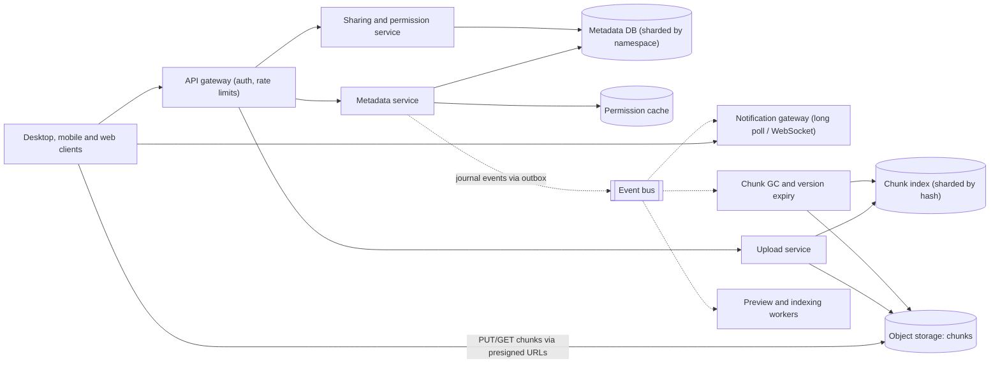
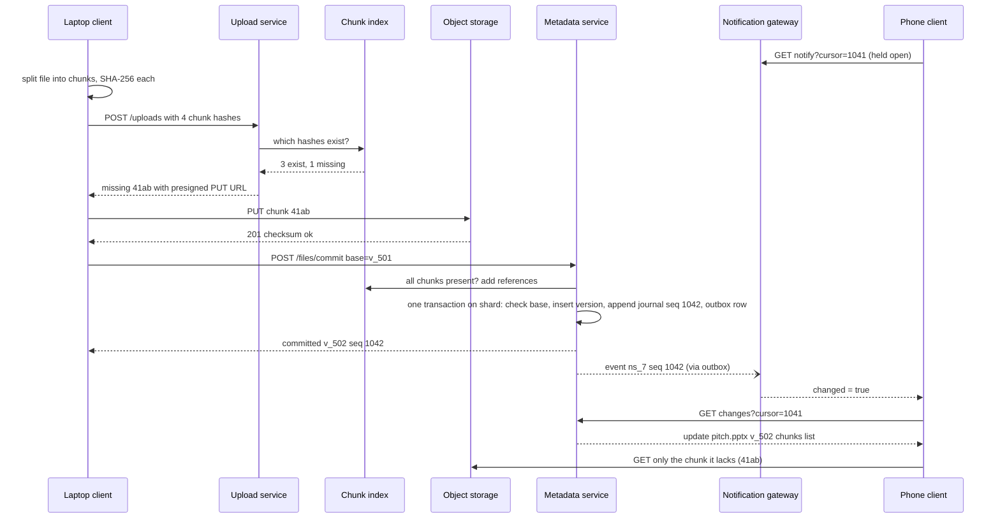

A Drive-style service lets people put files in the cloud, see the same folder tree on every device, and share folders with others. Underneath, it is two very different systems glued together: a **content store** that holds petabytes of immutable chunks, and a **metadata store** that holds the folder tree, versions, permissions and a change log that every device follows. Most of the interesting design lives in the metadata side and in the protocol between client and server.

## Learning objectives

By the end of this lesson you will be able to:

1. Split the problem into content (chunks), metadata (tree, versions, ACLs) and sync (change journal + notifications), and explain why each needs a different store.
2. Estimate users, ingress, storage, chunk counts, metadata size and concurrent sync connections with explicit arithmetic.
3. Compare fixed-size and content-defined chunking, and explain how chunk hashes enable deduplication and resumable uploads.
4. Design an upload protocol where the client only sends chunks the server doesn't already have, and a commit that is atomic and conflict-aware.
5. Design sync with a per-namespace sequence number, device cursors and long-poll notifications, and handle edit conflicts with "conflicted copies".
6. Model sharing with inherited folder permissions, compute effective access with a recursive query, and reason about revocation.
7. Garbage-collect unreferenced chunks safely, and explain why over-counting references is safe and under-counting is data loss.

## Prerequisites

- [Pastebin](#/lesson/m17-pastebin): metadata vs content split, blob keys, cleanup jobs.
- [Object storage](#/lesson/m11-object-storage): multipart uploads, presigned URLs.
- [Sharding](#/lesson/m13-sharding): we shard metadata by namespace.
- [Real-time communication](#/lesson/m10-realtime): long polling and WebSockets for change notifications.
- [Role- and policy-based authorization](#/lesson/m14-rbac-pbac): for sharing roles.

## Explain it like I'm a beginner

Imagine a marketing agency with offices in Gurgaon, Pune and Guwahati, all working from the same set of client presentations.

- The presentations themselves are stored in a big **warehouse** of filing cabinets. Each presentation is cut into numbered **pages**, and each page gets a **fingerprint** (a hash). If two offices file the same page, the warehouse keeps only one copy (**deduplication**).
- At head office there is a **register** listing every folder, every presentation, which pages make up each version of it, and who may see it (**metadata**).
- The register also has a **logbook**: line 1,041 "pitch.pptx updated by Pune", line 1,042 "budget.xlsx renamed". Each office remembers the last line it read (a **cursor**). To catch up, it reads everything after that line (**sync**).
- When the logbook gets a new line, head office rings each office that cares (a **notification**), so they don't have to keep calling to ask "anything new?".
- If Pune and Guwahati both edit the same presentation offline, head office keeps both, naming one "pitch (conflicted copy from Guwahati)". Nobody's work is silently lost (**conflict handling**).
- Sharing a folder gives someone access to everything inside it, including folders inside folders (**inherited permissions**).

## Requirements

### Functional requirements

1. **Upload and download** files up to 50 GB, resumable after network failures.
2. **Folders**: create, rename, move, delete (to trash for 30 days, then purged).
3. **Sync**: desktop and mobile clients keep a local copy of chosen folders; a change on one device appears on others.
4. **Versions**: keep previous versions for 30 days (or 100 versions), restorable.
5. **Sharing**: share a file or folder with users or groups as viewer, commenter or editor; share by link with an optional expiry. Shared folders appear in the recipient's tree.
6. **Offline edits**: clients queue changes while offline and reconcile when back online.

### Out of scope

- Real-time co-editing of documents (see [collaborative editor](#/lesson/m17-collaborative-editor)).
- Full-text search inside files, previews and thumbnails (mention as async pipelines only).
- Client-side end-to-end encryption (discussed under alternatives).

### Non-functional requirements

| Requirement | Target | Why |
|---|---|---|
| Durability | Committed file versions are never lost (object storage with multi-zone redundancy) | Losing a user's file is the worst possible failure |
| Metadata consistency | Within one namespace (a user's tree or one shared folder): strongly consistent, totally ordered changes | Devices must apply changes in the same order or trees diverge |
| Sync latency | A change appears on other online devices within 10 s (p95) | Feels "live" without being real-time |
| Upload efficiency | Only changed or new chunks are sent | Editing one slide in a 200 MB deck must not upload 200 MB |
| Availability | 99.9 % for metadata and downloads; uploads may be deferred and retried by clients | Clients already handle offline mode |
| Permission changes | Revocation effective within seconds for new requests; download links expire within minutes | Removing a freelancer who has left the project must actually remove access |
| Scale | 10 M users, 2 M daily active, 50 PB logical data | See estimates |

## Capacity estimation

All numbers are **estimates** for a regional Drive-style provider.

### Users and devices

- 10 M registered users, **2 M daily active users** (DAU).
- Average 2 devices online during the day per active user → up to about **4 M concurrent sync connections** at peak. Say 3 M to be realistic about overlap.

### Write traffic

- Each active user produces about 10 new file versions a day (saved documents, photos, synced edits): 2 M × 10 = **20 M versions/day**.
- 20 M ÷ 86,400 ≈ **231 commits/s** on average. Peak (working hours, ×3) ≈ **700 commits/s**.
- Average new bytes per version after chunk-level dedupe: assume **500 KB** (many edits change a small part of a file; new photos are a few MB).
- Ingress: 20 M × 0.5 MB = **10 TB/day** ≈ 116 MB/s ≈ 0.93 Gbit/s average, about **3 Gbit/s at peak**.

### Read traffic

- Downloads (other devices syncing, web downloads, shares): assume 2× ingress = **20 TB/day** ≈ 1.9 Gbit/s average.
- Metadata reads (list folders, check changes) are much more frequent than content reads: each sync pull, folder listing and permission check is a metadata read. Assume 50 metadata reads per active user per hour of activity, 8 active hours: 2 M × 50 × 8 = 800 M/day ≈ **9,300 metadata reads/s**, peak ~**28,000/s**.

### Storage

- 10 M users × 5 GB average = **50 PB logical**.
- Deduplication: assume 25 % saving across versions and identical files (an estimate; it depends heavily on the workload) → **37.5 PB** of unique chunk data.
- The object store adds its own redundancy (replication or erasure coding); that's inside the provider's price per GB.
- Growth: +10 TB/day ≈ **3.65 PB/year** before version expiry and trash purges.

### Chunks and metadata

- Chunk size: 4 MB maximum. Most files are smaller than one chunk, so the chunk count is dominated by the number of files.
- Files: 10 M users × 2,000 files = **20 B file entries**. Versions kept: on average 1.5 per file → 30 B versions.
- Unique chunks: roughly one per small file (up to 20 B, fewer after identical small files dedupe) plus 37.5 PB ÷ 4 MB ≈ 9.4 B for large-file data. Call it **~25 B chunk records**.
- Chunk index row (32-byte hash, size, storage key, reference count) ≈ 80 B → 25 B × 80 B ≈ **2 TB** of chunk index.
- File entry (ids, name, parent, flags) ≈ 300 B; version + manifest ≈ 200 B on average → 20 B × 300 B + 30 B × 200 B ≈ **12 TB** of metadata.

### Sync connections

- 3 M concurrent long-poll or WebSocket connections. If one gateway instance holds about 50,000 idle connections (an estimate; measure with your stack and memory budget), that's **60 gateway instances** plus headroom.
- Notification fan-out: 700 commits/s at peak. Most namespaces have 1–3 devices, but a shared folder with 500 members turns one commit into 500+ notifications.

### What the numbers tell us

1. **Content is huge but simple**: immutable chunks in object storage, addressed by hash. Object storage scales it for us.
2. **Metadata is the hard part**: 12 TB, 28,000 reads/s and 700 transactional commits/s at peak, with strict ordering per namespace. It must be sharded, and the shard key must keep each namespace's transactions on one shard.
3. **Bandwidth efficiency matters**: without chunk-level dedupe and delta uploads, ingress would be several times higher.
4. **Connections, not requests, dominate the sync tier**: 3 M mostly idle connections need a dedicated, memory-efficient gateway tier.

## API design

The client protocol has four groups: upload, commit, sync and sharing. All endpoints are authenticated with OAuth 2.0 access tokens; download and upload URLs for chunks are short-lived presigned URLs.

### 1. Plan an upload

```http
POST /api/v1/uploads
{ "namespaceId": "ns_7", "chunks": ["9f2c…", "41ab…", "9f2c…", "e07d…"] }

200 OK
{ "uploadId": "up_31", "missing": [ { "hash": "41ab…", "putUrl": "https://blob.example/…?sig=…" } ],
  "expiresAt": "2026-10-19T13:00:00Z" }
```

The client splits the file into chunks, hashes each one with SHA-256, and sends the list. The server answers with the chunks it doesn't already have, each with a presigned `PUT` URL valid for 15 minutes. If the network drops, the client calls this again and only the still-missing chunks come back. That is how resumability falls out of content addressing for free.

### 2. Upload chunks

The client `PUT`s each missing chunk straight to object storage. Large chunk payloads never pass through our app servers. The storage service can verify a checksum header so a corrupted upload is rejected.

### 3. Commit a version

```http
POST /api/v1/files/commit
{ "namespaceId": "ns_7", "fileId": "f_88", "parentId": "d_12", "name": "pitch.pptx",
  "baseVersionId": "v_501", "size": 13107200, "contentHash": "c4d1…",
  "chunks": ["9f2c…", "41ab…", "9f2c…", "e07d…"], "deviceId": "laptop-01" }

200 OK   { "status": "committed", "fileId": "f_88", "versionId": "v_502", "seq": 1042 }
200 OK   { "status": "conflict", "fileId": "f_93", "name": "pitch (conflicted copy from laptop-01 2026-10-19).pptx", "seq": 1043 }
409      { "status": "missingChunks", "missing": ["41ab…"] }
```

`baseVersionId` is the version the client's edit started from. If the file's current version on the server is still `v_501`, the commit becomes `v_502`. If someone else committed in between, the server keeps both edits by creating a conflicted copy. Either way the response carries the journal **sequence number** of the change.

### 4. Sync

```http
GET /api/v1/namespaces/ns_7/changes?cursor=1039&limit=500
200 OK { "changes": [ { "seq": 1040, "op": "update", "fileId": "f_88", "versionId": "v_501", "path": "/decks/pitch.pptx" }, … ],
         "cursor": 1043, "hasMore": false }

GET /api/v1/namespaces/ns_7/notify?cursor=1043        (long poll, held up to 60 s)
200 OK { "changed": true }     or after 60 s:  { "changed": false }
```

A device keeps one cursor per namespace it follows (its own tree plus each shared folder). It long-polls `notify`; when that returns `changed: true`, it calls `changes` from its cursor, applies the entries in order, downloads any chunks it lacks, and advances its cursor.

### 5. Files, folders and sharing

The usual resource endpoints: paginated folder listings, create/rename/move with an optimistic `baseVersion`, delete to trash, `GET /files/{id}/download` returning a `302` to a 5-minute presigned URL after the permission check, `POST /items/{id}/shares` for user or group grants, and `POST /items/{id}/links` for an unguessable link token with an optional expiry.

## Data model

Metadata lives in a relational store sharded by **namespace**. A namespace is a user's own tree, or one shared folder. Every row below carries `namespace_id`, and every transaction touches exactly one namespace, so it runs on one shard.

```sql
CREATE TABLE namespace (
    namespace_id bigint PRIMARY KEY,
    kind         text   NOT NULL CHECK (kind IN ('user','shared')),
    owner_id     bigint NOT NULL,
    next_seq     bigint NOT NULL DEFAULT 1          -- journal sequence allocator
);

CREATE TABLE item (                                  -- files and folders
    namespace_id       bigint NOT NULL,
    item_id            bigint NOT NULL,
    parent_id          bigint,                       -- NULL for the namespace root
    name               text   NOT NULL,
    is_folder          boolean NOT NULL,
    current_version_id bigint,                       -- NULL for folders
    deleted_at         timestamptz,                  -- in trash
    PRIMARY KEY (namespace_id, item_id)
);
CREATE UNIQUE INDEX item_unique_name ON item (namespace_id, parent_id, lower(name)) WHERE deleted_at IS NULL;

CREATE TABLE file_version (
    namespace_id  bigint NOT NULL,
    version_id    bigint NOT NULL,
    item_id       bigint NOT NULL,
    size_bytes    bigint NOT NULL,
    content_hash  bytea  NOT NULL,                   -- hash over the chunk hash list
    chunk_hashes  bytea[] NOT NULL,                  -- the manifest, in order
    device_id     text   NOT NULL,
    created_at    timestamptz NOT NULL DEFAULT now(),
    PRIMARY KEY (namespace_id, version_id)
);

CREATE TABLE journal (
    namespace_id bigint NOT NULL,
    seq          bigint NOT NULL,
    item_id      bigint NOT NULL,
    op           text   NOT NULL CHECK (op IN ('create','update','rename','move','delete','restore')),
    version_id   bigint,
    at           timestamptz NOT NULL DEFAULT now(),
    PRIMARY KEY (namespace_id, seq)
);

CREATE TABLE acl_grant (
    namespace_id bigint NOT NULL,
    item_id      bigint NOT NULL,
    principal    text   NOT NULL,                    -- 'user:42', 'group:design-team', 'link:<token hash>'
    role         text   NOT NULL CHECK (role IN ('viewer','commenter','editor','owner')),
    expires_at   timestamptz,
    PRIMARY KEY (namespace_id, item_id, principal)
);
```

The **chunk index** is a separate store, sharded by the chunk hash (the hash is uniformly distributed, so it shards evenly):

```sql
CREATE TABLE chunk (
    hash        bytea  PRIMARY KEY,                  -- SHA-256 of the chunk bytes
    size_bytes  integer NOT NULL,
    storage_key text   NOT NULL,                     -- object storage key, unique per upload (not the hash itself)
    ref_count   bigint NOT NULL DEFAULT 0,
    zero_since  timestamptz                          -- when ref_count last reached 0 (for GC grace)
);
```

Design notes:

- **Manifests as arrays**. A version's chunk list is stored inline as an array: one row per version, read and written whole. A separate `version_chunk` table is the normalised alternative, useful if you need "which versions use chunk X?" queries; GC can be done without that query (see deep dive 5).
- **Journal sequence allocated in the same transaction** as the change: `UPDATE namespace SET next_seq = next_seq + 1 ... RETURNING next_seq - 1`. This gives a gap-free, totally ordered log per namespace. The row lock on `namespace` serialises commits within one namespace (fine at a few commits per second per namespace), while different namespaces commit in parallel.
- **Unique name per folder** is enforced by a partial unique index that ignores trashed items, case-insensitively, because most desktop file systems treat `Pitch.pptx` and `pitch.pptx` as the same file.

## High-level architecture



Arrow by arrow:

- **Clients → API gateway**: all control-plane calls (plan upload, commit, list, share) carry an OAuth token. The gateway authenticates and rate-limits per user and per device.
- **Clients ⇄ Object storage**: chunk bytes go directly between client and object storage using presigned URLs. Our servers never proxy file content, which removes the biggest bandwidth and memory cost from our fleet.
- **Upload service → Chunk index / Object storage**: answers "which of these hashes are missing?", issues presigned `PUT` URLs, and registers chunks once they're uploaded and verified.
- **Metadata service → Metadata DB**: the transactional heart. Commits, renames, moves and deletes each run as one transaction on the namespace's shard, appending to the journal.
- **Sharing service → Metadata DB**: writes `acl_grant` rows and mounts shared namespaces into recipients' trees.
- **Metadata service → Permission cache**: effective permissions are computed from the folder tree and cached briefly; share changes invalidate them.
- **Metadata service ⇢ Event bus** (async): each committed journal entry is published through a transactional outbox ([outbox lesson](#/lesson/m12-outbox)), so an event is published if and only if the change committed.
- **Event bus ⇢ Notification gateway**: the gateway holds millions of idle client connections and wakes the ones subscribed to the changed namespace.
- **Event bus ⇢ GC / previews / indexing**: slower background work runs off the same events and never sits in the commit path.

### Upload, commit and notify



The laptop uploads one chunk instead of four, because three already exist (from the previous version of the same file). The commit is a single metadata transaction that either fully happens (new version, journal entry, outbox row) or doesn't. The phone wakes from its long poll, pulls the change, and also downloads only the one chunk it doesn't have locally. Edit one slide in a 200 MB deck, and both directions move a few MB.

## Deep dives

### Deep dive 1: chunking — fixed size vs content-defined

**Fixed-size chunking** cuts at every 4 MB boundary. It's simple and fast. Its weakness shows when bytes are **inserted**: add 10 bytes at the start of a file, and every boundary shifts by 10 bytes, so every chunk's hash changes and the whole file is "new".

**Content-defined chunking (CDC)** picks boundaries based on the content itself. A rolling hash is computed over a sliding window (say 48 bytes); wherever the hash's low bits match a fixed pattern (for example, the lowest 20 bits are all zero, giving an average chunk of 2²⁰ bytes = 1 MiB), a boundary is placed. Insert 10 bytes at the start and only the first chunk changes; the boundaries after it are found at the same content positions as before. Implementations add a minimum and maximum chunk size so pathological content can't produce tiny or giant chunks.

| | Fixed size | Content-defined |
|---|---|---|
| CPU | Hash only | Rolling hash over every byte + SHA-256 |
| Insertions | Shift all later chunks | Affect one or two chunks |
| Appends (logs, videos being recorded) | Only the last chunk changes | Same |
| In-place overwrites (databases, VM images) | Only touched chunks change | Same |
| Complexity | Trivial | Moderate; parameters to tune |

A pragmatic design: **CDC for document-like files** where insertions are common, **fixed size for large media**, which is rarely edited in the middle. Either way the server only sees a list of hashes and doesn't care how the client chose boundaries, as long as each chunk is ≤ the maximum size.

### Deep dive 2: hashes, dedupe and its privacy trap

Every chunk is named by its SHA-256 hash. That gives three properties at once:

1. **Integrity**: the server can verify an uploaded chunk matches its name.
2. **Dedupe**: two identical chunks have the same name and are stored once.
3. **Resumability**: "what's missing?" is a set difference on hashes.

The file's own `content_hash` is a hash over its ordered list of chunk hashes, which is a one-level hash tree. Two devices can compare a single hash to know whether they hold the same file version.

**The privacy trap.** If dedupe works **across users**, the upload API becomes an oracle: an attacker who suspects you have a specific file (a leaked document, say) can hash its chunks and call `POST /uploads`. If the server says "nothing missing", someone on the service already has that file. Mitigations, from strongest to weakest:

- **Dedupe within a namespace or user only** for the client-visible "missing" answer. Cross-user dedupe can still happen *server-side* after upload (the client always uploads; the server notices the duplicate and stores one copy). You lose bandwidth savings across users but keep storage savings.
- Mix a per-user secret into the client-visible chunk id, so identical content has different names for different users (and then cross-user dedupe is impossible).
- Accept the risk for non-sensitive tiers, with rate limits on upload planning.

Our design: **client-side dedupe within the user's namespaces** (where most savings come from: versions of the same file, copies within one account), **server-side dedupe across users** for storage.

### Deep dive 3: commit, sequence numbers and conflicts

A commit runs one transaction on the namespace's shard:

1. Lock the namespace row and allocate `seq = next_seq` (incrementing it).
2. Read the item. If `current_version_id` equals the client's `baseVersionId`, insert the new version, point the item at it, and append `journal(seq, 'update')`.
3. If it doesn't match, someone else changed the file since this device last synced. Insert the new version under a **new item** named `pitch (conflicted copy from laptop-01 2026-10-19).pptx` in the same folder, and append `journal(seq, 'create')`.
4. Insert an outbox row for the notification.
5. Commit.

Why not merge automatically? The storage service doesn't understand the inside of a `.pptx` or `.xlsx`. Picking a winner silently ("last writer wins") destroys someone's work. A conflicted copy is ugly but safe; people resolve it with their own tools. Text formats could be merged, but that's an application feature, not a storage one.

Renames and moves use the same optimistic check on the item (`baseItemVersion`), and the unique-name index catches two devices creating `notes.txt` in the same folder at the same time: the second gets a conflict and the client renames it `notes (1).txt`.

**Why a per-namespace sequence and not timestamps?** Clocks on servers and devices disagree. A gap-free integer allocated inside the transaction gives every device the same total order of changes for that namespace, which is what lets them all converge on the same tree. Cross-namespace ordering isn't needed, because each namespace syncs independently.

### Deep dive 4: sync with cursors and notifications

Each device follows a set of namespaces and stores a cursor for each. The loop:

1. Long-poll `notify?cursor=N` on the notification gateway. The gateway holds the request up to 60 seconds.
2. When the namespace's latest seq passes N (an event arrives on the bus), the gateway answers `changed: true`. Timeouts answer `changed: false`, and the client simply re-polls.
3. The client calls `changes?cursor=N`, gets up to 500 entries in seq order, applies them, downloads missing chunks, and stores the new cursor **only after applying**. If it crashes mid-way, it replays from the old cursor; applying an entry twice is harmless because entries are idempotent ("item 88 is now version 502").
4. Local changes go the other way through upload + commit.

The notification is only a **hint**. It carries no data, so a lost notification costs only latency: the next timeout-and-repoll (or a periodic full poll every few minutes) catches up. This makes the notification tier allowed to be lossy and stateless, which is exactly what you want for a tier holding 3 M connections.

**Journal compaction**: a device offline for six months may have a cursor older than the retained journal (say 30 days). The server answers `410 Gone, resync required`; the client then lists the whole tree and compares with its local state. That's slow but rare, and it bounds journal storage.

### Deep dive 5: garbage collection of chunks

Chunks are shared across versions and files, so you can't delete a chunk when one file is deleted. Use **reference counts**:

- When a version is committed, increment `ref_count` for each chunk in its manifest (counting a chunk once per version).
- When a version expires (30-day history) or a file is purged from trash, decrement them.
- A chunk whose count is 0 records `zero_since`. A GC job deletes chunks whose count has been 0 for more than 24 hours (a grace period).

Order matters, because the two kinds of mistake are not equal:

- **Over-counting** (count higher than the true number of references) leaks storage until a reconciliation pass fixes it. Annoying, not dangerous.
- **Under-counting** deletes a chunk that a live version still needs. That's **data loss**.

So: **increment references before the commit transaction, decrement after the deletion commits.** If the process crashes between the increment and the commit, we've over-counted, which is safe. The grace period covers the race where an upload plan said "you don't need to upload 41ab, we have it" just as its count reached zero.

Two details close the remaining race between "does the chunk exist?" and "GC deletes it":

- **Increment and existence check are one statement.** The commit runs `UPDATE chunk SET ref_count = ref_count + 1, zero_since = NULL WHERE hash = ANY($1) RETURNING hash` and treats any hash that did not come back as missing (it undoes the increments it did make and answers `missingChunks`). Checking first and incrementing later leaves a window in which GC can delete the row in between.
- **GC deletes conditionally, then removes the object.** `DELETE FROM chunk WHERE hash = $1 AND ref_count = 0 AND zero_since < now() - interval '24 hours' RETURNING storage_key`; only if a row came back is that object moved to the soft-delete area. Because `storage_key` is unique per upload rather than equal to the hash, a fresh upload of the same content after the row is gone gets a new key, so GC can never delete bytes that a new row points at.

On top of that, run a slow **mark-and-sweep reconciliation** monthly: stream all manifests, build the set of referenced hashes per chunk-index shard, and compare with stored counts. It catches drift from bugs. At 25 B chunks this is a big batch job, which is why it's monthly and not the primary mechanism.

### Deep dive 6: sharing and inherited permissions

Permissions are granted on items and **inherited by everything below**. Priya is a viewer on `/Clients/Diwali Campaign` and an editor on its `decks` subfolder. For `pitch.pptx` inside `decks`, her effective role is the **highest role** along the path from the file up to the root: editor.

Computing it means walking up the ancestors and taking the maximum grant. In SQL that's a recursive CTE (exercise 5). At 28,000 metadata reads/s you don't want to do that walk on every request, so:

- **Cache effective permissions** per (user, item) for 60 seconds in the permission cache, and invalidate entries for a subtree when a grant on that subtree changes (publish a "permissions changed under item X" event).
- **Shared folders as namespaces**: when you share a folder, it becomes (or already is) its own namespace, mounted into each member's tree. The share's grant lives at the namespace root, so membership checks are one lookup, and the shared folder's journal is followed by every member's devices.

**Revocation**: deleting a grant takes effect for new metadata requests as soon as the cache entry is invalidated (seconds). Already-issued presigned download URLs remain valid until they expire, which is why they live 5 minutes, not hours. Files already synced to a removed member's laptop stay on that laptop; the client deletes them on its next sync, but a determined user can copy them first. **Sync means copies, and you can't un-share bytes that were already downloaded**. Enterprise products add device management and remote wipe for that reason.

### Deep dive 7: the core in ASP.NET Core

The compilable sketch below implements the content-addressed pieces and the metadata commit: chunking with SHA-256, the upload plan, a namespace store whose `Commit` stands in for one database transaction (base-version check, conflicted copies, gap-free journal sequence), long-poll notifications, and references incremented before commit.

```csharp file=Drive/Content/Chunker.cs
using System.Runtime.CompilerServices;
using System.Security.Cryptography;

namespace Drive.Content;

public sealed record ChunkRef(int Index, long Offset, int Length, string Sha256);
public sealed record Chunk(ChunkRef Ref, byte[] Data);

/// <summary>Fixed-size chunking with SHA-256 per chunk. Content-defined chunking would change only
/// how boundaries are chosen; everything downstream works on the hash list.</summary>
public static class Chunker
{
    public const int DefaultChunkSize = 4 * 1024 * 1024;

    public static async IAsyncEnumerable<Chunk> ReadChunksAsync(Stream input, int chunkSize = DefaultChunkSize,
        [EnumeratorCancellation] CancellationToken ct = default)
    {
        ArgumentOutOfRangeException.ThrowIfLessThan(chunkSize, 1);
        var buffer = new byte[chunkSize];
        long offset = 0;
        var index = 0;
        while (true)
        {
            var n = await input.ReadAtLeastAsync(buffer, chunkSize, throwOnEndOfStream: false, ct);
            if (n == 0) yield break;
            var data = buffer.AsSpan(0, n).ToArray();
            yield return new Chunk(new ChunkRef(index++, offset, n, Hex(SHA256.HashData(data))), data);
            offset += n;
            if (n < chunkSize) yield break; // short read means end of stream
        }
    }

    /// <summary>Hash over the ordered chunk hashes: one value that identifies a file version's content.</summary>
    public static string ContentHash(IEnumerable<string> chunkHashes)
    {
        using var h = IncrementalHash.CreateHash(HashAlgorithmName.SHA256);
        foreach (var c in chunkHashes) h.AppendData(Convert.FromHexString(c));
        return Hex(h.GetHashAndReset());
    }

    public static string Hex(byte[] bytes) => Convert.ToHexString(bytes).ToLowerInvariant();
}
```

```csharp file=Drive/Content/ChunkIndex.cs
using System.Collections.Concurrent;

namespace Drive.Content;

public interface IChunkIndex
{
    /// <summary>Hashes from the list that are not stored yet, in first-seen order, without duplicates.</summary>
    Task<IReadOnlyList<string>> MissingAsync(IReadOnlyList<string> hashes, CancellationToken ct);
    Task RegisterAsync(string hash, int size, CancellationToken ct);
    /// <summary>Adjust reference counts and return the hashes that are NOT stored (nothing was changed for them).
    /// Callers increment BEFORE committing metadata and decrement AFTER deleting it, so a crash can only
    /// over-count (leak) and never under-count (data loss). Production: one UPDATE … WHERE hash = ANY(…) RETURNING hash.</summary>
    Task<IReadOnlyList<string>> AddRefsAsync(IEnumerable<string> hashes, int delta, CancellationToken ct);
}

public sealed class InMemoryChunkIndex : IChunkIndex
{
    private sealed class Entry { public int Size; public long Refs; }
    private readonly ConcurrentDictionary<string, Entry> _chunks = new(StringComparer.Ordinal);

    public Task<IReadOnlyList<string>> MissingAsync(IReadOnlyList<string> hashes, CancellationToken ct) =>
        Task.FromResult<IReadOnlyList<string>>(hashes.Distinct(StringComparer.Ordinal).Where(h => !_chunks.ContainsKey(h)).ToList());

    public Task RegisterAsync(string hash, int size, CancellationToken ct)
    {
        _chunks.TryAdd(hash, new Entry { Size = size });
        return Task.CompletedTask;
    }

    public Task<IReadOnlyList<string>> AddRefsAsync(IEnumerable<string> hashes, int delta, CancellationToken ct)
    {
        var notStored = new List<string>();
        foreach (var h in hashes.Distinct(StringComparer.Ordinal))
            if (_chunks.TryGetValue(h, out var e)) Interlocked.Add(ref e.Refs, delta);
            else notStored.Add(h);
        return Task.FromResult<IReadOnlyList<string>>(notStored);
    }

    public long RefsOf(string hash) => _chunks.TryGetValue(hash, out var e) ? Interlocked.Read(ref e.Refs) : 0;
}
```

```csharp file=Drive/Metadata/NamespaceStore.cs
namespace Drive.Metadata;

public sealed record FileVersion(Guid VersionId, Guid ItemId, long Size, string ContentHash,
                                 IReadOnlyList<string> ChunkHashes, string DeviceId, DateTimeOffset CreatedAt);
public sealed record Item(Guid ItemId, Guid? ParentId, string Name, Guid? CurrentVersionId);
public sealed record JournalEntry(long Seq, Guid ItemId, string Op, Guid? VersionId, string Name, DateTimeOffset At);

public enum CommitStatus { Committed, Conflict, NotFound }
public sealed record CommitResult(CommitStatus Status, Guid ItemId, Guid VersionId, long Seq, string Name);

/// <summary>Stands in for one namespace on one metadata shard. Each public method is one transaction;
/// the lock plays the role of the row lock on the namespace's sequence counter.</summary>
public sealed class NamespaceStore(Guid namespaceId)
{
    private readonly object _tx = new();
    private readonly Dictionary<Guid, Item> _items = new();
    private readonly Dictionary<Guid, FileVersion> _versions = new();
    private readonly List<JournalEntry> _journal = new();
    private long _nextSeq = 1;

    public Guid NamespaceId { get; } = namespaceId;
    public long LatestSeq { get { lock (_tx) return _nextSeq - 1; } }

    public CommitResult Commit(Guid? itemId, Guid? parentId, string name, Guid? baseVersionId,
                               long size, string contentHash, IReadOnlyList<string> chunks, string deviceId, DateTimeOffset now)
    {
        lock (_tx)
        {
            var versionId = Guid.NewGuid();
            if (itemId is { } id && !_items.ContainsKey(id)) return new(CommitStatus.NotFound, id, Guid.Empty, 0, name);

            if (itemId is { } existingId && _items[existingId].CurrentVersionId == baseVersionId)
            {
                var item = _items[existingId] with { CurrentVersionId = versionId };
                _items[existingId] = item;
                _versions[versionId] = new(versionId, existingId, size, contentHash, chunks, deviceId, now);
                return new(CommitStatus.Committed, existingId, versionId, Append(existingId, "update", versionId, item.Name, now), item.Name);
            }

            // New file, or someone else committed since our base version: keep both edits.
            var conflict = itemId is not null;
            var finalName = conflict ? ConflictName(name, deviceId, now) : name;
            var newId = Guid.NewGuid();
            _items[newId] = new Item(newId, parentId, finalName, versionId);
            _versions[versionId] = new(versionId, newId, size, contentHash, chunks, deviceId, now);
            var seq = Append(newId, "create", versionId, finalName, now);
            return new(conflict ? CommitStatus.Conflict : CommitStatus.Committed, newId, versionId, seq, finalName);
        }
    }

    public IReadOnlyList<JournalEntry> ChangesSince(long cursor, int limit)
    {
        lock (_tx) return _journal.Where(j => j.Seq > cursor).Take(limit).ToList();
    }

    public FileVersion? GetVersion(Guid versionId)
    {
        lock (_tx) return _versions.TryGetValue(versionId, out var v) ? v : null;
    }

    private long Append(Guid itemId, string op, Guid? versionId, string name, DateTimeOffset now)
    {
        var seq = _nextSeq++;   // gap-free, allocated inside the same transaction as the change
        _journal.Add(new JournalEntry(seq, itemId, op, versionId, name, now));
        return seq;
    }

    public static string ConflictName(string name, string deviceId, DateTimeOffset now)
    {
        var ext = Path.GetExtension(name);
        var stem = name[..^ext.Length];
        return $"{stem} (conflicted copy from {deviceId} {now:yyyy-MM-dd}){ext}";
    }
}
```

```csharp file=Drive/Sync/ChangeNotifier.cs
using System.Collections.Concurrent;

namespace Drive.Sync;

/// <summary>Long-poll wake-ups per namespace. A notification is only a hint: clients always pull
/// changes by cursor, so a lost wake-up costs latency, never correctness.</summary>
public sealed class ChangeNotifier
{
    private readonly ConcurrentDictionary<Guid, TaskCompletionSource> _waiters = new();

    public void Publish(Guid namespaceId)
    {
        if (_waiters.TryRemove(namespaceId, out var tcs)) tcs.TrySetResult();
    }

    public async Task<bool> WaitForChangeAsync(Guid namespaceId, Func<long> latestSeq, long cursor,
                                               TimeSpan timeout, CancellationToken ct)
    {
        if (latestSeq() > cursor) return true;
        var tcs = _waiters.GetOrAdd(namespaceId, _ => new TaskCompletionSource(TaskCreationOptions.RunContinuationsAsynchronously));
        if (latestSeq() > cursor) return true; // re-check after registering, or a commit in between is missed
        try
        {
            await tcs.Task.WaitAsync(timeout, ct);
            return true;
        }
        catch (TimeoutException)
        {
            return latestSeq() > cursor;
        }
    }
}
```

```csharp file=Drive/Sync/SyncService.cs
using System.Collections.Concurrent;
using Drive.Content;
using Drive.Metadata;

namespace Drive.Sync;

public sealed record CommitRequest(Guid NamespaceId, Guid? ItemId, Guid? ParentId, string Name, Guid? BaseVersionId,
                                   long Size, string ContentHash, IReadOnlyList<string> Chunks, string DeviceId);
public sealed record CommitResponse(string Status, Guid? ItemId, Guid? VersionId, long Seq, string? Name, IReadOnlyList<string> Missing);

public sealed class NamespaceRegistry
{
    private readonly ConcurrentDictionary<Guid, NamespaceStore> _spaces = new();
    public NamespaceStore Get(Guid id) => _spaces.GetOrAdd(id, i => new NamespaceStore(i));
}

public sealed class SyncService(NamespaceRegistry spaces, IChunkIndex chunks, ChangeNotifier notifier, TimeProvider clock)
{
    public Task<IReadOnlyList<string>> PlanUploadAsync(IReadOnlyList<string> hashes, CancellationToken ct) =>
        chunks.MissingAsync(hashes, ct);

    public async Task<CommitResponse> CommitAsync(CommitRequest req, CancellationToken ct)
    {
        if (Chunker.ContentHash(req.Chunks) != req.ContentHash) return new("badManifest", null, null, 0, null, []);

        // 1. References first (over-count is safe). Incrementing IS the existence check, so GC can't delete
        //    a chunk between "it exists" and "we hold a reference to it".
        var missing = await chunks.AddRefsAsync(req.Chunks, +1, ct);
        if (missing.Count > 0)
        {
            await chunks.AddRefsAsync(req.Chunks.Except(missing, StringComparer.Ordinal), -1, ct);   // undo our own increments
            return new("missingChunks", null, null, 0, null, missing);
        }
        var ns = spaces.Get(req.NamespaceId);
        var r = ns.Commit(req.ItemId, req.ParentId, req.Name, req.BaseVersionId, req.Size, req.ContentHash,
                          req.Chunks, req.DeviceId, clock.GetUtcNow()); // 2. one metadata transaction
        if (r.Status == CommitStatus.NotFound)
        {
            await chunks.AddRefsAsync(req.Chunks, -1, ct);            // undo only after we know nothing references them
            return new("notFound", r.ItemId, null, 0, null, []);
        }
        notifier.Publish(req.NamespaceId);                            // 3. hint; production uses an outbox + event bus
        return new(r.Status == CommitStatus.Conflict ? "conflict" : "committed", r.ItemId, r.VersionId, r.Seq, r.Name, []);
    }
}
```

```csharp file=Program.cs
using System.Security.Cryptography;
using Drive.Content;
using Drive.Sync;

var builder = WebApplication.CreateBuilder(args);
builder.Services.AddSingleton(TimeProvider.System);
builder.Services.AddSingleton<IChunkIndex, InMemoryChunkIndex>();
builder.Services.AddSingleton<NamespaceRegistry>();
builder.Services.AddSingleton<ChangeNotifier>();
builder.Services.AddSingleton<SyncService>();
var app = builder.Build();

app.MapPost("/api/v1/uploads", async (UploadPlanRequest req, SyncService sync, CancellationToken ct) =>
    Results.Ok(new { missing = await sync.PlanUploadAsync(req.Chunks, ct) }));

// Production: clients PUT to presigned object-storage URLs. This endpoint shows the verification step.
app.MapPut("/api/v1/chunks/{hash}", async (string hash, HttpRequest http, IChunkIndex index, CancellationToken ct) =>
{
    using var ms = new MemoryStream();
    await http.Body.CopyToAsync(ms, ct);
    if (ms.Length is 0 or > Chunker.DefaultChunkSize) return Results.BadRequest("Chunk must be 1 byte to 4 MB.");
    var actual = Chunker.Hex(SHA256.HashData(ms.ToArray()));
    if (!string.Equals(actual, hash, StringComparison.OrdinalIgnoreCase)) return Results.BadRequest("Hash mismatch.");
    await index.RegisterAsync(actual, (int)ms.Length, ct);
    return Results.Created($"/api/v1/chunks/{actual}", null);
});

app.MapPost("/api/v1/files/commit", async (CommitRequest req, SyncService sync, CancellationToken ct) =>
{
    var r = await sync.CommitAsync(req, ct);
    return r.Status switch
    {
        "committed" or "conflict" => Results.Ok(r),
        "missingChunks" => Results.Conflict(r),
        "notFound" => Results.NotFound(),
        _ => Results.BadRequest(r),
    };
});

app.MapGet("/api/v1/namespaces/{ns:guid}/changes", (Guid ns, long cursor, int? limit, NamespaceRegistry spaces) =>
{
    var changes = spaces.Get(ns).ChangesSince(cursor, Math.Clamp(limit ?? 500, 1, 1000));
    return Results.Ok(new { changes, cursor = changes.Count > 0 ? changes[^1].Seq : cursor });
});

app.MapGet("/api/v1/namespaces/{ns:guid}/notify", async (Guid ns, long cursor, NamespaceRegistry spaces,
                                                         ChangeNotifier notifier, CancellationToken ct) =>
{
    var store = spaces.Get(ns);
    var changed = await notifier.WaitForChangeAsync(ns, () => store.LatestSeq, cursor, TimeSpan.FromSeconds(60), ct);
    return Results.Ok(new { changed });
});

app.Run();

public sealed record UploadPlanRequest(Guid NamespaceId, IReadOnlyList<string> Chunks);
```

## Caching, queues and scaling

### Caching

| What | Where | TTL | Invalidation |
|---|---|---|---|
| Chunks (shared-link downloads, popular files) | CDN, keyed by chunk hash | Long: chunks are immutable | Never needed for content; access control stays on the presigned URL |
| Effective permissions per (user, item) | Redis | 60 s | Event "grants changed under item X" deletes the subtree's entries |
| Folder listings | Client-side, driven by the journal | Until the next change | The journal *is* the invalidation stream |
| Chunk-exists lookups | Bloom filter per chunk-index shard, in memory | Rebuilt daily | False positives only cause a real lookup |

Note that content caching is trivially safe here because chunks are named by their hash: the same name always means the same bytes.

### Queues and streams

- **Outbox → event bus**: every journal entry, partitioned by namespace so per-namespace order is kept for consumers.
- **Consumers**: notification gateway (wake devices), GC and version expiry, preview and thumbnail generation, search indexing, audit logging, abuse scanning. Each is an independent consumer group; a slow thumbnailer never delays sync.

### Scaling the metadata tier

- **Shard key: namespace id.** All transactions are per namespace, so they're single-shard. 12 TB across, say, 64 shards is under 200 GB each, comfortable for PostgreSQL with replicas.
- **Hot namespaces**: a company-wide shared folder with 20,000 members and constant writes concentrates on one shard. Options: split it into several namespaces (one per department subfolder), give large tenants dedicated shards, and rate-limit commits per namespace.
- **Cross-namespace moves** (from your tree into a shared folder) are a copy into the target namespace plus a delete in the source, coordinated by a small saga with idempotent steps ([sagas](#/lesson/m12-sagas)). Chunks aren't copied, only manifests, so it's cheap.

### Scaling the sync tier

- 3 M connections over ~60 gateway instances. The gateway keeps an in-memory map of namespace → waiting connections and subscribes to the event bus partitions for the namespaces it holds.

**What breaks first?** (1) Proxying chunk bytes through app servers (avoided with presigned URLs), (2) per-request permission walks on deep trees (cached), (3) a hot shared namespace on one shard, (4) connection storms on the notification tier after deploys or outages, and (5) GC falling behind, which shows up as storage cost rather than an outage.

## Failure handling

| Failure | Effect | Mitigation |
|---|---|---|
| Upload interrupted | Some chunks uploaded | Client re-plans; only missing chunks are returned. Abandoned uploads leave unreferenced chunks that GC removes after the grace period |
| Commit request times out (unknown outcome) | Client doesn't know whether v_502 exists | Commits carry a client-generated idempotency key; retry returns the original result instead of committing twice |
| Metadata shard primary fails | Commits for its namespaces fail | Failover to a synchronous standby (no committed journal entries lost); clients queue changes locally and retry with backoff |
| Event bus or notification gateway down | Devices don't get wake-ups | Clients poll `changes` every few minutes as a fallback; nothing is lost, sync is just slower |
| Device offline for months | Cursor older than journal retention | `410 Gone` → full resync by listing the tree |
| Two devices edit offline | Conflicting commits | Second commit becomes a conflicted copy; both edits kept |
| GC bug decrements wrongly | Risk of deleting live chunks | Grace period, soft-delete chunks for 7 days in a "deleted" prefix before physical deletion, monthly mark-and-sweep reconciliation |
| Region outage | Metadata unavailable in that region | Warm standby region with asynchronous replication; RPO of seconds for metadata (clients still hold their pending changes locally) |

## Security

- **Authentication**: OAuth 2.0 with short-lived access tokens and device-bound refresh tokens, so a lost laptop can be revoked without logging the user out everywhere.
- **Authorization on every metadata call**: effective role from the permission cache, checked before listing, downloading (issuing a presigned URL) or committing.
- **Presigned URLs** for chunks are scoped to one object and one method, valid for minutes. Download URLs for shared links are issued per request after checking the link's role and expiry.
- **Link tokens**: high-entropy random tokens; store only their hash in `acl_grant`, so a database leak doesn't leak working links.
- **Encryption**: TLS in transit; server-side encryption at rest with keys in a key management service. Enterprise tiers may use customer-managed keys.
- **Dedupe privacy**: no cross-user "chunk exists" answers to clients (deep dive 2).
- **Tenant isolation** for business customers: namespaces carry a tenant id, and queries are filtered by it at the data-access layer (row-level security is one option, see [multi-tenant security](#/lesson/m14-multi-tenant-security)).
- **Audit log**: shares, permission changes, downloads by external users and admin actions go to an append-only audit store.
- **Data residency**: Indian government, banking and healthcare clients often require data to stay in India. Keep namespace shards and chunk storage for those tenants in an Indian region, and make the region part of the namespace record.

## Observability

- **Commit latency** and **commit outcomes** (committed, conflict, missing chunks, not found) per shard.
- **Sync lag**: time from commit to the last subscribed device pulling the change (sampled with synthetic devices). This is the user-visible SLO: 95 % under 10 s.
- **Dedupe ratio**: bytes referenced ÷ bytes stored, and client-reported bytes skipped. A sudden drop means a client bug changed chunking.
- **Notification gateway**: open connections per instance, reconnect rate, wake-up fan-out time.
- **GC health**: chunks with zero references older than the grace period, bytes reclaimed per day, reconciliation drift found.
- **Per-namespace commit rate**, to find hot namespaces before they overload a shard.

## Deployment and cost

### Deployment

- Separate deployables: API gateway, metadata service, upload service, sharing service, notification gateway, workers (GC, previews, indexing). The notification gateway is deployed with connection draining and slow rollouts because every restart disconnects tens of thousands of clients.
- Metadata schema changes follow expand-then-contract ([migrations during deployments](#/lesson/m15-db-migrations-deploy)): 64 shards are migrated one by one, so old and new code must work against both schemas.
- **Desktop clients are part of the system**. Old client versions stay in the field for years. Version the sync protocol, keep the server compatible with the last N client versions, and use feature flags to switch chunking or protocol behaviours gradually.

### Cost drivers (estimate)

1. **Content storage**: ~37.5 PB unique data, growing ~3.65 PB/year. By far the largest cost. Levers: dedupe, version retention limits, trash purge, and **tiering** cold chunks (not read in 90 days) to cheaper storage classes.
2. **Egress**: 20 TB/day of downloads. CDN for shared-link downloads, and LAN sync between devices on the same network (a feature some sync clients offer) reduce it.
3. **Metadata databases**: 64 shards with replicas. Expensive per GB but small next to content.
4. **Sync gateways and workers**: connection memory, preview CPU.

### When a simpler design is enough

A document repository for one company's 400 employees, with a web UI and no desktop sync, doesn't need chunking, dedupe, a journal or a notification tier. Store each file version as one blob, keep metadata in one PostgreSQL database, check permissions with a recursive CTE (with an index on `parent_id` it's fast for trees of tens of thousands of items), and let the browser refresh. Add chunking when large files and resumable uploads become a problem, and add the journal when you add sync clients.

## Alternatives and trade-offs

| Decision | Our choice | Alternative | When the alternative wins |
|---|---|---|---|
| Chunking | CDC for documents, fixed for media | Fixed only | Simpler clients; mostly media or append-only workloads |
| Chunk size | Up to 4 MB | 64 KB–256 KB | Better dedupe for small edits, but 16–64× more chunk records and request overhead |
| Dedupe scope | Client-side within user, server-side across users | Full cross-user client dedupe | Non-sensitive public content where bandwidth savings dominate |
| Ordering | Per-namespace sequence | Vector clocks / CRDT tree | Peer-to-peer sync without a central server |
| Conflicts | Conflicted copy | Last writer wins | Never for user files; acceptable for caches or settings |
| Notifications | Long poll / WebSocket hints | Clients poll every N seconds | Small scale; simplest possible server |
| Metadata store | Sharded PostgreSQL | Distributed SQL (CockroachDB, Spanner-like) | You need cross-namespace transactions or global writes and accept higher write latency |
| Encryption | Server-side, provider-managed keys | Client-side end-to-end | Privacy-first products; costs server-side search, previews, dedupe across users and easy recovery |
| Upload path | Presigned direct-to-storage | Through app servers | Small files and a need to inspect content inline |

The core trade-off throughout: **we keep content dumb and immutable, and put all the cleverness in metadata**. That's what lets object storage do the heavy lifting while the metadata tier stays small enough to keep strongly consistent.

## Practical playground

The starting graph routes file bytes through the app servers into one database and has no sync tier. Open it in the HLD canvas. Move content to object storage with presigned URLs, add a chunk index, shard the metadata store, add an event bus and a notification gateway, and put GC behind the bus. Then set client RPS to 28,000 (the metadata peak) and see what's flagged.

:::playground type=hld title="Evolve a naive file store into a sync service"
```json
{
  "nodes": [
    { "id": "c", "type": "client", "label": "Desktop and mobile clients", "props": { "rps": 9300 } },
    { "id": "lb", "type": "load-balancer", "label": "Load balancer" },
    { "id": "app", "type": "app-server", "label": "File app (proxies file bytes)", "props": { "instances": 4 } },
    { "id": "db", "type": "database", "label": "PostgreSQL (metadata + file blobs)", "props": { "replicas": 1 } }
  ],
  "edges": [
    { "from": "c", "to": "lb", "kind": "sync", "label": "upload, download, poll every 30 s" },
    { "from": "lb", "to": "app", "kind": "sync" },
    { "from": "app", "to": "db", "kind": "sync" }
  ]
}
```
:::

## Exercises

:::exercise id=m17-file-storage-ex1 difficulty=beginner kind=code title="Plan an upload: which chunks are missing?"
Implement `UploadPlanner.Plan`. Given a file's chunk list (hash and size, in order, possibly with repeats) and the set of hashes the server already stores, return the hashes to upload (each once, in first-seen order) and the number of bytes that will be sent.
::requirements
- A hash that appears several times in the file is uploaded at most once.
- Hashes already on the server are skipped.
- Hash comparison is case-insensitive (clients may send upper- or lower-case hex).
- `BytesToUpload` sums the sizes of the chunks being uploaded (once each).
- `SavedRatio` is `1 - BytesToUpload / TotalBytes`, or 0 for an empty file.
::acceptance
- All tests pass.
- Order of `Missing` follows the first appearance in the file.
::hint
This is a set difference with two twists: duplicates within the file and preserving order.
::hint
Use a `HashSet<string>` with `StringComparer.OrdinalIgnoreCase` to remember what you've already decided.
::hint
Loop over the chunks once. For each: if it's on the server or already in your "seen" set, skip; otherwise add to the result and to the byte count.
::hint
```csharp
var seen = new HashSet<string>(StringComparer.OrdinalIgnoreCase);
foreach (var c in chunks)
    if (!existing.Contains(c.Hash) && seen.Add(c.Hash)) { missing.Add(c.Hash); bytes += c.Size; }
```
::starter
```csharp file=UploadPlanner.cs
using System;
using System.Collections.Generic;
using System.Linq;

public sealed record ChunkInfo(string Hash, int Size);
public sealed record UploadPlan(IReadOnlyList<string> Missing, long BytesToUpload, long TotalBytes)
{
    public double SavedRatio => TotalBytes == 0 ? 0 : 1 - (double)BytesToUpload / TotalBytes;
}

public static class UploadPlanner
{
    public static UploadPlan Plan(IReadOnlyList<ChunkInfo> chunks, IReadOnlySet<string> existingOnServer)
        => throw new NotImplementedException();
}
```
::tests
```csharp file=UploadPlannerTests.cs
using System;
using System.Collections.Generic;
using Xunit;

public class UploadPlannerTests
{
    private static HashSet<string> Server(params string[] h) => new(h, StringComparer.OrdinalIgnoreCase);

    [Fact]
    public void Skips_chunks_already_on_server()
    {
        var plan = UploadPlanner.Plan(new[] { new ChunkInfo("aa", 100), new ChunkInfo("bb", 200), new ChunkInfo("cc", 50) }, Server("bb"));
        Assert.Equal(new[] { "aa", "cc" }, plan.Missing);
        Assert.Equal(150L, plan.BytesToUpload);
        Assert.Equal(350L, plan.TotalBytes);
    }

    [Fact]
    public void Repeated_chunk_is_uploaded_once()
    {
        var plan = UploadPlanner.Plan(new[] { new ChunkInfo("zero", 4), new ChunkInfo("x", 4), new ChunkInfo("zero", 4) }, Server());
        Assert.Equal(new[] { "zero", "x" }, plan.Missing);
        Assert.Equal(8L, plan.BytesToUpload);
        Assert.Equal(12L, plan.TotalBytes);
    }

    [Fact]
    public void Comparison_ignores_case()
    {
        var plan = UploadPlanner.Plan(new[] { new ChunkInfo("ABCD", 10), new ChunkInfo("abcd", 10) }, Server("abcd"));
        Assert.Empty(plan.Missing);
        Assert.Equal(1.0, plan.SavedRatio, 6);
    }

    [Fact]
    public void Empty_file_has_zero_ratio()
    {
        var plan = UploadPlanner.Plan(Array.Empty<ChunkInfo>(), Server());
        Assert.Empty(plan.Missing);
        Assert.Equal(0.0, plan.SavedRatio, 6);
    }

    [Fact]
    public void Edited_deck_uploads_one_chunk()
    {
        var v2 = new[] { new ChunkInfo("c1", 4_000_000), new ChunkInfo("c2-new", 4_000_000), new ChunkInfo("c3", 4_000_000) };
        var plan = UploadPlanner.Plan(v2, Server("c1", "c2-old", "c3"));
        Assert.Equal(new[] { "c2-new" }, plan.Missing);
        Assert.Equal(2.0 / 3.0, plan.SavedRatio, 6);
    }
}
```
::solution
```csharp file=UploadPlanner.cs
using System;
using System.Collections.Generic;
using System.Linq;

public sealed record ChunkInfo(string Hash, int Size);
public sealed record UploadPlan(IReadOnlyList<string> Missing, long BytesToUpload, long TotalBytes)
{
    public double SavedRatio => TotalBytes == 0 ? 0 : 1 - (double)BytesToUpload / TotalBytes;
}

public static class UploadPlanner
{
    public static UploadPlan Plan(IReadOnlyList<ChunkInfo> chunks, IReadOnlySet<string> existingOnServer)
    {
        var seen = new HashSet<string>(StringComparer.OrdinalIgnoreCase);
        var missing = new List<string>();
        long toUpload = 0, total = 0;
        foreach (var c in chunks)
        {
            total += c.Size;
            if (existingOnServer.Contains(c.Hash)) continue;
            if (!seen.Add(c.Hash)) continue;
            missing.Add(c.Hash);
            toUpload += c.Size;
        }
        return new UploadPlan(missing, toUpload, total);
    }
}
```

Note that `existingOnServer.Contains` uses the comparer of the set the caller built. The tests build it case-insensitively; in production, normalise hashes to lower-case hex at the API boundary so you never depend on the caller's comparer.
::mistakes
- Counting `TotalBytes` only for missing chunks, so the saved ratio is always 0.
- Using `Distinct()` on the missing list after the loop, which still adds the repeated chunk's bytes twice.
- Comparing hashes case-sensitively, which uploads the same chunk again when one client sends upper-case hex.
::extensions
Make the planner take a per-user "chunk exists" set and a global one, and return two lists: chunks the client must upload, and chunks the server will dedupe internally after upload (the privacy-preserving variant from deep dive 2).
:::

:::exercise id=m17-file-storage-ex2 difficulty=beginner kind=sql ordered=true title="What does this device need to apply?"
Device `laptop-01` follows namespace 7 and has stored cursor 1040. Return the next 4 journal entries it must apply: `seq`, `op` and the item's `name`, in sequence order. Entries from other namespaces must not appear.
::setup
```sql
CREATE TABLE item (
  namespace_id bigint NOT NULL,
  item_id      bigint NOT NULL,
  name         text   NOT NULL,
  PRIMARY KEY (namespace_id, item_id)
);
CREATE TABLE journal (
  namespace_id bigint NOT NULL,
  seq          bigint NOT NULL,
  item_id      bigint NOT NULL,
  op           text   NOT NULL,
  PRIMARY KEY (namespace_id, seq)
);
CREATE TABLE device_cursor (
  device_id    text   NOT NULL,
  namespace_id bigint NOT NULL,
  last_seq     bigint NOT NULL,
  PRIMARY KEY (device_id, namespace_id)
);
INSERT INTO item VALUES
  (7, 1, 'pitch.pptx'), (7, 2, 'budget.xlsx'), (7, 3, 'shoot-photos'), (7, 4, 'pitch (conflicted copy from phone-02 2026-10-19).pptx'),
  (9, 1, 'salaries.xlsx');
INSERT INTO journal VALUES
  (7, 1039, 2, 'create'), (7, 1040, 1, 'update'), (7, 1041, 3, 'create'), (7, 1042, 1, 'update'),
  (7, 1043, 4, 'create'), (7, 1044, 2, 'rename'), (7, 1045, 2, 'delete'),
  (9, 1041, 1, 'update'), (9, 1042, 1, 'update');
INSERT INTO device_cursor VALUES ('laptop-01', 7, 1040), ('laptop-01', 9, 1042), ('phone-02', 7, 1043);
```
::check
```sql
SELECT j.seq, j.op, i.name
FROM device_cursor d
JOIN journal j ON j.namespace_id = d.namespace_id AND j.seq > d.last_seq
JOIN item i    ON i.namespace_id = j.namespace_id AND i.item_id = j.item_id
WHERE d.device_id = 'laptop-01' AND d.namespace_id = 7
ORDER BY j.seq
LIMIT 4;
```
::acceptance
- Returns seq 1041 (create shoot-photos), 1042 (update pitch.pptx), 1043 (create the conflicted copy), 1044 (rename budget.xlsx), in that order.
- Seq 1040 is not returned: the cursor means "already applied up to and including 1040".
- Namespace 9's entries (which reuse the same seq numbers) never appear.
::hint
The cursor is the last sequence the device has applied. Which comparison gives "everything after it"?
::hint
Sequence numbers are only unique within a namespace. What must every join include?
::hint
Join `device_cursor` → `journal` on namespace and `seq > last_seq`, then `journal` → `item` on (namespace, item).
::hint
`ORDER BY j.seq LIMIT 4`. The device applies them in this order and then stores 1044 as its new cursor.
::solution
```sql
SELECT j.seq, j.op, i.name
FROM device_cursor d
JOIN journal j ON j.namespace_id = d.namespace_id AND j.seq > d.last_seq
JOIN item i    ON i.namespace_id = j.namespace_id AND i.item_id = j.item_id
WHERE d.device_id = 'laptop-01' AND d.namespace_id = 7
ORDER BY j.seq
LIMIT 4;
```
The primary key `(namespace_id, seq)` makes this an index range scan starting just after the cursor: cheap no matter how long the journal is.
::mistakes
- `j.seq >= d.last_seq`, which re-sends the entry the device already applied (harmless if entries are idempotent, but wasteful and confusing).
- Joining `item` on `item_id` alone, which mixes up item 1 of namespace 7 with item 1 of namespace 9.
- Ordering by time instead of `seq`. Timestamps can tie or be skewed; the sequence is the order.
::extensions
Collapse redundant entries: if the same item appears several times in the batch, the device only needs its latest state. Write the query that returns one row per item with its highest `seq` in the window.
:::

:::exercise id=m17-file-storage-ex3 difficulty=intermediate kind=code title="Fixed-size chunker with SHA-256 and a content hash"
Implement `FixedChunker.Split(stream, chunkSize)` and `FixedChunker.ContentHash(chunks)`. Each chunk gets its index, offset, length and lower-case hex SHA-256. The content hash is SHA-256 over the concatenated raw chunk hash bytes, in order.
::requirements
- Every chunk except the last has exactly `chunkSize` bytes. An empty stream gives zero chunks.
- The stream may return fewer bytes per `Read` than requested (like a network stream); your chunks must still be full-size.
- Hashes are lower-case hex SHA-256 of the chunk bytes.
- `chunkSize < 1` throws `ArgumentOutOfRangeException`.
::acceptance
- All tests pass, including the "slow stream" test that returns at most 3 bytes per read.
- Changing the last byte of a file changes only the last chunk's hash.
- Two identical files produce identical content hashes; different files produce different ones.
::hint
The trap is `Stream.Read`: it may return fewer bytes than asked for, even when more data is coming.
::hint
Keep reading into the buffer until it is full or `Read` returns 0. `Stream.ReadAtLeast(buffer, chunkSize, throwOnEndOfStream: false)` does exactly that in .NET 7+.
::hint
Hash with `SHA256.HashData(span)` and format with `Convert.ToHexString(...).ToLowerInvariant()`.
::hint
For the content hash, use `IncrementalHash.CreateHash(HashAlgorithmName.SHA256)` and `AppendData(Convert.FromHexString(chunk.Sha256))` for each chunk.
::hint
```csharp
var buffer = new byte[chunkSize];
int n;
while ((n = stream.ReadAtLeast(buffer, chunkSize, throwOnEndOfStream: false)) > 0)
{
    var hash = Convert.ToHexString(SHA256.HashData(buffer.AsSpan(0, n))).ToLowerInvariant();
    result.Add(new ChunkRef(index++, offset, n, hash));
    offset += n;
    if (n < chunkSize) break;
}
```
::starter
```csharp file=FixedChunker.cs
using System;
using System.Collections.Generic;
using System.IO;
using System.Security.Cryptography;

public sealed record ChunkRef(int Index, long Offset, int Length, string Sha256);

public static class FixedChunker
{
    public static IReadOnlyList<ChunkRef> Split(Stream stream, int chunkSize) => throw new NotImplementedException();

    public static string ContentHash(IReadOnlyList<ChunkRef> chunks) => throw new NotImplementedException();
}
```
::tests
```csharp file=FixedChunkerTests.cs
using System;
using System.IO;
using System.Linq;
using System.Text;
using Xunit;

public sealed class TrickleStream(byte[] data, int maxPerRead) : MemoryStream(data)
{
    public override int Read(byte[] buffer, int offset, int count) => base.Read(buffer, offset, Math.Min(count, maxPerRead));
    public override int Read(Span<byte> buffer) => base.Read(buffer[..Math.Min(buffer.Length, maxPerRead)]);
}

public class FixedChunkerTests
{
    private static MemoryStream S(string s) => new(Encoding.ASCII.GetBytes(s));

    [Fact]
    public void Splits_into_full_chunks_and_a_tail()
    {
        var chunks = FixedChunker.Split(S("0123456789"), 4);
        Assert.Equal(new[] { 4, 4, 2 }, chunks.Select(c => c.Length).ToArray());
        Assert.Equal(new long[] { 0, 4, 8 }, chunks.Select(c => c.Offset).ToArray());
        Assert.Equal(new[] { 0, 1, 2 }, chunks.Select(c => c.Index).ToArray());
    }

    [Fact]
    public void Hash_is_lowercase_sha256()
    {
        var c = Assert.Single(FixedChunker.Split(S("abc"), 1024));
        Assert.Equal("ba7816bf8f01cfea414140de5dae2223b00361a396177a9cb410ff61f20015ad", c.Sha256);
    }

    [Fact]
    public void Empty_stream_has_no_chunks() => Assert.Empty(FixedChunker.Split(new MemoryStream(), 4));

    [Fact]
    public void Slow_stream_still_gives_full_chunks()
    {
        var data = Encoding.ASCII.GetBytes("abcdefghijklmnopqrstuvwxyz");
        var fast = FixedChunker.Split(new MemoryStream(data), 8);
        var slow = FixedChunker.Split(new TrickleStream(data, 3), 8);
        Assert.Equal(fast.Select(c => c.Sha256).ToArray(), slow.Select(c => c.Sha256).ToArray());
        Assert.Equal(new[] { 8, 8, 8, 2 }, slow.Select(c => c.Length).ToArray());
    }

    [Fact]
    public void Editing_last_byte_changes_only_last_chunk()
    {
        var a = FixedChunker.Split(S("AAAABBBBCCCCD"), 4);
        var b = FixedChunker.Split(S("AAAABBBBCCCCE"), 4);
        Assert.Equal(a.Take(3).Select(c => c.Sha256).ToArray(), b.Take(3).Select(c => c.Sha256).ToArray());
        Assert.NotEqual(a[3].Sha256, b[3].Sha256);
    }

    [Fact]
    public void Content_hash_identifies_content()
    {
        var h1 = FixedChunker.ContentHash(FixedChunker.Split(S("same file"), 4));
        var h2 = FixedChunker.ContentHash(FixedChunker.Split(S("same file"), 4));
        var h3 = FixedChunker.ContentHash(FixedChunker.Split(S("same filf"), 4));
        Assert.Equal(h1, h2);
        Assert.NotEqual(h1, h3);
        Assert.Equal(64, h1.Length);
    }

    [Fact]
    public void Rejects_bad_chunk_size() => Assert.Throws<ArgumentOutOfRangeException>(() => FixedChunker.Split(S("x"), 0));
}
```
::solution
```csharp file=FixedChunker.cs
using System;
using System.Collections.Generic;
using System.IO;
using System.Security.Cryptography;

public sealed record ChunkRef(int Index, long Offset, int Length, string Sha256);

public static class FixedChunker
{
    public static IReadOnlyList<ChunkRef> Split(Stream stream, int chunkSize)
    {
        ArgumentOutOfRangeException.ThrowIfLessThan(chunkSize, 1);
        var result = new List<ChunkRef>();
        var buffer = new byte[chunkSize];
        long offset = 0;
        var index = 0;
        int n;
        while ((n = stream.ReadAtLeast(buffer, chunkSize, throwOnEndOfStream: false)) > 0)
        {
            var hash = Convert.ToHexString(SHA256.HashData(buffer.AsSpan(0, n))).ToLowerInvariant();
            result.Add(new ChunkRef(index++, offset, n, hash));
            offset += n;
            if (n < chunkSize) break;
        }
        return result;
    }

    public static string ContentHash(IReadOnlyList<ChunkRef> chunks)
    {
        using var h = IncrementalHash.CreateHash(HashAlgorithmName.SHA256);
        foreach (var c in chunks) h.AppendData(Convert.FromHexString(c.Sha256));
        return Convert.ToHexString(h.GetHashAndReset()).ToLowerInvariant();
    }
}
```

`ReadAtLeast` loops internally until it has `chunkSize` bytes or the stream ends, which fixes the "short read" bug that breaks naive chunkers on network streams: with a plain `Read`, the same file would chunk differently depending on network timing, and dedupe would silently stop working.
::mistakes
- Using `stream.Read(buffer, 0, chunkSize)` once per chunk. On a network stream, chunk boundaries then depend on packet timing.
- Hashing the whole buffer instead of the first `n` bytes for the last chunk.
- Building the content hash by hashing the concatenated **hex strings** in one place and raw bytes in another. Pick one definition and use it in every client and server.
::extensions
Implement a content-defined chunker (a Gear rolling hash, 2–64 KB chunks) and test that inserting 10 bytes at the start of a 1 MB buffer leaves over 90 % of chunk hashes unchanged.
:::

:::exercise id=m17-file-storage-ex4 difficulty=intermediate kind=hld title="Design it yourself: Drive-style storage and sync"
Design the system for this lesson's numbers: 2 M DAU, 700 commits/s and 28,000 metadata reads/s at peak, 10 TB/day ingress, 3 M concurrent sync connections, 37.5 PB of unique content. Annotate the graph with shard keys, the path chunk bytes take, and how a change on one device reaches another.
::acceptance
- Chunk bytes go directly between clients and object storage (presigned URLs), not through app servers.
- A chunk index exists, sharded by hash, and the upload path asks it which chunks are missing.
- Metadata is sharded by namespace, with the reason stated.
- Changes reach other devices through a journal, an event bus (outbox) and a notification gateway; notifications are hints, not data.
- GC of chunks runs asynchronously off events, and a permission cache sits on the read path.
::hint
Start with the two data planes: where do bytes go, and where do decisions go?
::hint
Which transactions must be atomic, and what key keeps each one on a single shard?
::hint
3 M mostly idle connections need their own tier. What does it need to know, and what can it afford to lose?
::hint
Shape: client → gateway → (metadata, upload, sharing); client ⇄ object storage; upload → chunk index; metadata → sharded DB → outbox → bus ⇢ notification gateway, GC, previews.
::starter
```json
{
  "nodes": [
    { "id": "c", "type": "client", "label": "Sync clients", "props": { "rps": 28000 } },
    { "id": "app", "type": "app-server", "label": "Drive app" },
    { "id": "db", "type": "database", "label": "Database" },
    { "id": "obj", "type": "object-storage", "label": "Object storage" }
  ],
  "edges": [
    { "from": "c", "to": "app", "kind": "sync" },
    { "from": "app", "to": "db", "kind": "sync" },
    { "from": "app", "to": "obj", "kind": "sync" }
  ]
}
```
::solution
Reference architecture:

```json
{
  "nodes": [
    { "id": "c", "type": "client", "label": "Desktop, mobile, web clients", "props": { "rps": 28000 } },
    { "id": "dns", "type": "dns", "label": "DNS / geo routing" },
    { "id": "gw", "type": "api-gateway", "label": "API gateway: OAuth, per-device rate limits", "props": { "instances": 6 } },
    { "id": "meta", "type": "app-server", "label": "Metadata service (commit, list, changes)", "props": { "instances": 12 } },
    { "id": "upl", "type": "app-server", "label": "Upload service (plan, presign, verify)", "props": { "instances": 6 } },
    { "id": "share", "type": "app-server", "label": "Sharing and permissions", "props": { "instances": 3 } },
    { "id": "pcache", "type": "cache", "label": "Permission cache (60 s)", "props": { "ttlSeconds": 60 } },
    { "id": "mdb", "type": "database", "label": "Metadata DB, 64 shards by namespace_id", "props": { "replicas": 2, "multiAz": true } },
    { "id": "cidx", "type": "database", "label": "Chunk index, sharded by hash", "props": { "replicas": 2 } },
    { "id": "obj", "type": "object-storage", "label": "Chunks by hash (multi-zone, cold tier)" },
    { "id": "cdn", "type": "cdn", "label": "CDN for shared-link downloads" },
    { "id": "bus", "type": "stream", "label": "Journal events via outbox, partitioned by namespace" },
    { "id": "notif", "type": "websocket-gateway", "label": "Notification gateway (3 M long polls)", "props": { "instances": 70 } },
    { "id": "gc", "type": "worker", "label": "Chunk GC + version expiry", "props": { "instances": 4 } },
    { "id": "prev", "type": "worker", "label": "Previews, indexing, malware scan", "props": { "instances": 20 } },
    { "id": "mon", "type": "monitoring", "label": "Sync lag, dedupe ratio, GC backlog" }
  ],
  "edges": [
    { "from": "c", "to": "dns", "kind": "sync" },
    { "from": "c", "to": "gw", "kind": "sync", "label": "control plane" },
    { "from": "c", "to": "obj", "kind": "sync", "label": "chunk PUT/GET via presigned URL" },
    { "from": "c", "to": "cdn", "kind": "sync", "label": "shared-link downloads" },
    { "from": "cdn", "to": "obj", "kind": "sync" },
    { "from": "c", "to": "notif", "kind": "sync", "label": "long poll notify" },
    { "from": "gw", "to": "meta", "kind": "sync" },
    { "from": "gw", "to": "upl", "kind": "sync" },
    { "from": "gw", "to": "share", "kind": "sync" },
    { "from": "upl", "to": "cidx", "kind": "sync", "label": "missing hashes?" },
    { "from": "meta", "to": "cidx", "kind": "sync", "label": "verify + add refs" },
    { "from": "meta", "to": "mdb", "kind": "sync", "label": "one tx per namespace" },
    { "from": "meta", "to": "pcache", "kind": "sync" },
    { "from": "share", "to": "mdb", "kind": "sync" },
    { "from": "mdb", "to": "bus", "kind": "async", "label": "outbox relay" },
    { "from": "bus", "to": "notif", "kind": "async", "label": "wake subscribers" },
    { "from": "bus", "to": "gc", "kind": "async" },
    { "from": "bus", "to": "prev", "kind": "async" },
    { "from": "gc", "to": "cidx", "kind": "sync", "label": "decrement, find zero refs" },
    { "from": "gc", "to": "obj", "kind": "sync", "label": "delete after grace" },
    { "from": "meta", "to": "mon", "kind": "async" }
  ]
}
```

Reasoning:

- **Byte path**: 10 TB/day in and 20 TB/day out travel directly between clients and object storage (and the CDN for shared links). App servers only issue presigned URLs and verify hashes, so the fleet is sized for 28,000 small metadata requests per second, not 3 Gbit/s of payload.
- **Shard keys**: metadata by `namespace_id` because every commit, rename and journal append is per namespace; that keeps all transactions single-shard and per-namespace ordering trivial. The chunk index by hash, because hashes are uniform and lookups are by hash.
- **Change propagation**: commit → journal row + outbox row in one transaction → relay to the bus (partitioned by namespace, so order is kept) → notification gateway wakes subscribed long polls → devices pull `changes` by cursor. Notifications carry no data, so losing one only adds latency; clients also poll every few minutes.
- **Sync tier sizing**: 3 M connections ÷ 50,000 per instance (estimate) = 60, plus headroom for a zone failure → 70.
- **GC** consumes version-expiry and purge events, decrements references, and deletes chunks only after a grace period.
::mistakes
- Proxying file bytes through the metadata service.
- Sharding metadata by user id while shared folders span users, which turns every shared-folder commit into a cross-shard transaction.
- Running GC synchronously in the delete path.
::extensions
Add a second region for disaster recovery. Which stores replicate synchronously, which asynchronously, and what is the metadata RPO?
:::

:::exercise id=m17-file-storage-ex5 difficulty=advanced kind=sql ordered=true title="Effective permissions with inheritance"
Permissions are granted on items and inherited by everything below them. A user's effective role on an item is the **highest** role granted to them on the item itself or any ancestor (`viewer` < `commenter` < `editor` < `owner`). Return every item user `priya` can access, with `id`, `name` and her effective `role`, ordered by `id`.
::setup
```sql
CREATE TABLE item (
  id        int  PRIMARY KEY,
  parent_id int  REFERENCES item (id),
  name      text NOT NULL,
  is_folder boolean NOT NULL
);
CREATE TABLE acl_grant (
  item_id   int  NOT NULL REFERENCES item (id),
  principal text NOT NULL,
  role      text NOT NULL CHECK (role IN ('viewer','commenter','editor','owner')),
  PRIMARY KEY (item_id, principal)
);
INSERT INTO item VALUES
  (1, NULL, 'Clients', true),
  (2, 1, 'Diwali Campaign', true),
  (3, 2, 'decks', true),
  (4, 3, 'pitch.pptx', false),
  (5, 2, 'budget.xlsx', false),
  (6, NULL, 'HR', true),
  (7, 6, 'salaries.xlsx', false),
  (8, 1, 'notes.txt', false);
INSERT INTO acl_grant VALUES
  (1, 'ajit', 'owner'),
  (6, 'ajit', 'owner'),
  (2, 'priya', 'viewer'),
  (3, 'priya', 'editor'),
  (7, 'priya', 'commenter'),
  (8, 'ravi', 'viewer');
```
::check
```sql
WITH RECURSIVE anc AS (
  SELECT id AS item_id, id AS ancestor_id, parent_id FROM item
  UNION ALL
  SELECT a.item_id, i.id, i.parent_id
  FROM anc a JOIN item i ON i.id = a.parent_id
),
best AS (
  SELECT a.item_id,
         MAX(CASE g.role WHEN 'viewer' THEN 1 WHEN 'commenter' THEN 2 WHEN 'editor' THEN 3 WHEN 'owner' THEN 4 END) AS rank
  FROM anc a
  JOIN acl_grant g ON g.item_id = a.ancestor_id AND g.principal = 'priya'
  GROUP BY a.item_id
)
SELECT i.id, i.name,
       CASE b.rank WHEN 1 THEN 'viewer' WHEN 2 THEN 'commenter' WHEN 3 THEN 'editor' ELSE 'owner' END AS role
FROM best b JOIN item i ON i.id = b.item_id
ORDER BY i.id;
```
::acceptance
- Returns 5 rows: 2 viewer, 3 editor, 4 editor, 5 viewer, 7 commenter.
- `pitch.pptx` (4) is editor: it inherits viewer from 2 and editor from 3, and the higher wins.
- `Clients` (1), `HR` (6) and `notes.txt` (8) are absent: Priya has no grant on them or their ancestors.
- Roles are compared by rank, not alphabetically (alphabetically, "viewer" would beat "editor").
::hint
For each item, you need the list of the item itself plus all of its ancestors. Which SQL feature walks a tree of unknown depth?
::hint
`WITH RECURSIVE`: the base case pairs every item with itself; the recursive step moves from an ancestor to that ancestor's parent.
::hint
Keep three columns while recursing: the original `item_id`, the current `ancestor_id`, and that ancestor's `parent_id` (so the next step knows where to go).
::hint
Join the (item, ancestor) pairs to `acl_grant` for `priya`, map roles to numbers with `CASE`, and take `MAX` per item.
::hint
```sql
WITH RECURSIVE anc AS (
  SELECT id AS item_id, id AS ancestor_id, parent_id FROM item
  UNION ALL
  SELECT a.item_id, i.id, i.parent_id FROM anc a JOIN item i ON i.id = a.parent_id
)
SELECT * FROM anc ORDER BY item_id, ancestor_id;  -- inspect this first
```
::solution
```sql
WITH RECURSIVE anc AS (
  SELECT id AS item_id, id AS ancestor_id, parent_id FROM item
  UNION ALL
  SELECT a.item_id, i.id, i.parent_id
  FROM anc a JOIN item i ON i.id = a.parent_id
),
best AS (
  SELECT a.item_id,
         MAX(CASE g.role WHEN 'viewer' THEN 1 WHEN 'commenter' THEN 2 WHEN 'editor' THEN 3 WHEN 'owner' THEN 4 END) AS rank
  FROM anc a
  JOIN acl_grant g ON g.item_id = a.ancestor_id AND g.principal = 'priya'
  GROUP BY a.item_id
)
SELECT i.id, i.name,
       CASE b.rank WHEN 1 THEN 'viewer' WHEN 2 THEN 'commenter' WHEN 3 THEN 'editor' ELSE 'owner' END AS role
FROM best b JOIN item i ON i.id = b.item_id
ORDER BY i.id;
```

**How it scales.** This version computes ancestors for every item, which is fine for a few thousand items and a good way to see the logic. For a production permission check on **one** item, start the recursion from that item only (`WHERE id = $1` in the base case) and walk up: the cost is the depth of the tree (usually under 20 levels), each step a primary-key lookup. For "list everything Priya can see", walk **down** from her grants instead (base case: items she has grants on; recursive step: children), which touches only her subtrees. Both directions need an index on `parent_id`. Results go into the permission cache, invalidated when a grant in the subtree changes.

::mistakes
- Taking `MAX(role)` on the text column: alphabetical order makes "viewer" the highest.
- Recursing without carrying the original `item_id`, which loses track of which item each ancestor belongs to.
- Returning items with no grant as `NULL` role rows instead of excluding them.
- Forgetting a cycle guard in real data: if a bug ever makes a folder its own ancestor, the recursion never ends. PostgreSQL's `CYCLE` clause (or an array of visited ids) protects against that.
::extensions
Add a `group_member(group_name, user_id)` table and grants to `group:design-team`. Extend the query so Priya's effective role includes roles granted to her groups.
:::

## Interview questions

:::interview
::q beginner
Why split files into chunks instead of storing each file as one object?
::a
Chunks make three things cheap. **Delta uploads**: when a 200 MB file changes in one place, only the changed chunks (a few MB) are uploaded and downloaded. **Resumability**: an interrupted upload resumes by asking which chunks are still missing. **Deduplication**: identical chunks, named by their SHA-256 hash, are stored once across versions and files.
::q beginner
How does a device know what changed while it was offline?
::a
Each namespace has a journal: an ordered log of changes with a gap-free sequence number assigned in the same transaction as each change. The device remembers the last sequence it applied (its cursor). When it comes back, it asks for all entries after its cursor, applies them in order, and advances the cursor. If its cursor is older than the journal's retention, it does a full resync by listing the tree.
::q intermediate
Two people edit the same spreadsheet offline and both sync. What happens?
::a
Each commit carries the version the edit started from (`baseVersionId`). The first commit matches the current version and wins. The second doesn't match, so instead of overwriting, the server stores it as a new file in the same folder named like "budget (conflicted copy from laptop-01 2026-10-19).xlsx" and records a create in the journal. Both edits survive and people merge them with their own tools. Last-writer-wins would silently destroy one person's work, which is unacceptable for user files.
::q intermediate
How do you shard the metadata, and why that key?
::a
By namespace: a user's own tree, or one shared folder. Every transaction (commit, rename, move, journal append) happens inside one namespace, so it's a single-shard transaction with a simple per-namespace sequence for ordering. Sharding by user would break for shared folders, which are written by many users. The risk is a hot namespace (a huge company-wide folder), handled by splitting it into several namespaces, dedicated shards for large tenants, and per-namespace rate limits. Moves across namespaces become a small saga: copy the manifest into the target, then delete from the source.
::q advanced
Explain how you'd garbage-collect chunks safely.
::a
Reference counts per chunk, incremented when a version referencing it is committed and decremented when that version is deleted or expires. Order the steps so failures over-count: increment **before** the metadata commit, decrement **after** the deletion commits. Over-counting leaks storage until reconciliation; under-counting deletes live data. Chunks with zero references are only deleted after a grace period (say 24 hours), which covers the race where an upload plan told a client "we already have that chunk" just before its count reached zero. The commit's increment doubles as its existence check (one `UPDATE … RETURNING`), and GC deletes only with a conditional `DELETE … WHERE ref_count = 0 AND zero_since < cutoff`, so there is no window between "it exists" and "I hold a reference". Deleted chunks go to a soft-delete area for some days before physical deletion, and a monthly mark-and-sweep compares counts with the real set of referenced hashes.
::q advanced
What's the privacy risk of cross-user deduplication, and how do you mitigate it?
::a
If the client asks "which of these chunk hashes are missing?" and the answer reflects all users' data, the API becomes an oracle: anyone can test whether a specific file exists somewhere on the service, and with templated documents even guess small secrets inside them. Mitigations: answer "missing" only relative to the user's own namespaces (so client-side dedupe works within an account) and do cross-user dedupe server-side after upload; or derive chunk ids with a per-user key so identical content has different ids per user, giving up cross-user dedupe.
:::

## Summary and revision

- A Drive-style service is **dumb immutable content** plus **smart metadata**. Content is chunks in object storage named by SHA-256; metadata is a sharded transactional store.
- Numbers: 700 commits/s and 28,000 metadata reads/s at peak, 10 TB/day in, 37.5 PB unique, ~25 B chunks, ~12 TB metadata, 3 M sync connections.
- **Chunking**: fixed-size is simple; content-defined chunking survives insertions. The server only sees hash lists.
- **Upload protocol**: plan (which hashes are missing) → presigned direct uploads → atomic commit with `baseVersionId`.
- **Sync**: per-namespace gap-free sequence, client cursors, long-poll hints, idempotent journal entries, `410` → full resync.
- **Conflicts** become conflicted copies, never silent overwrites.
- **Permissions** inherit down the tree; effective role is the highest along the ancestors; cache with subtree invalidation; presigned URLs are short-lived. You can't un-share bytes already synced.
- **GC**: reference counts with "over-count is safe" ordering, grace periods and periodic reconciliation.
- For a small web-only document repository, one blob per version and one PostgreSQL database is enough.

:::flashcards
Q: Why name chunks by their SHA-256 hash?
A: It gives integrity checking, deduplication and resumable uploads (set difference on hashes) at once.
Q: Fixed-size vs content-defined chunking in one line?
A: Fixed shifts every boundary after an insertion; CDC picks boundaries from content so only nearby chunks change.
Q: What makes per-namespace ordering possible?
A: A gap-free sequence allocated inside the same transaction as each change, with metadata sharded by namespace.
Q: What does a sync notification contain?
A: Only a hint that the namespace changed. Devices then pull changes by cursor, so lost notifications cost only latency.
Q: How are offline edit conflicts resolved?
A: The commit's baseVersionId doesn't match, so the server keeps it as a "conflicted copy" file instead of overwriting.
Q: Which GC mistake is dangerous, over-counting or under-counting references?
A: Under-counting — it deletes chunks live versions need. Increment before commit, decrement after delete.
Q: Effective permission on a file with inherited grants?
A: The highest role granted to the user on the item or any ancestor.
Q: Why must presigned download URLs be short-lived?
A: Revoking a share can't recall URLs already issued; short expiry bounds the window.
:::

## Knowledge check

:::quiz pass=70
::q single
2 M daily active users each create 10 file versions a day. Roughly what is the average commit rate?
- [ ] About 23 commits/s
- [x] About 231 commits/s
- [ ] About 2,300 commits/s
- [ ] About 23,000 commits/s
> 20 M ÷ 86,400 ≈ 231 commits/s; about 700 at a 3× peak.
::q single
A user inserts a title page at the start of a 300 MB document. With fixed-size 4 MB chunks, what happens on sync?
- [ ] Only the first chunk is uploaded.
- [x] Nearly every chunk's boundaries shift, so almost the whole file is uploaded again.
- [ ] Nothing is uploaded because the content hash is the same.
- [ ] The commit is rejected as a conflict.
> Insertions shift every later boundary with fixed-size chunking. Content-defined chunking avoids this.
::q single
A device's long-poll notification was lost because a gateway instance restarted. What is the impact?
- [ ] The device permanently misses the change.
- [x] The change arrives later, when the device reconnects or does its periodic pull by cursor.
- [ ] The device's tree becomes corrupted.
- [ ] The commit is rolled back.
> Notifications are hints. The journal and cursor guarantee the device eventually sees every change, in order.
::q multi
Which choices make chunk garbage collection safe? (Select all that apply.)
- [x] Incrementing reference counts before the metadata commit.
- [x] Deleting zero-reference chunks only after a grace period.
- [ ] Decrementing reference counts before the version row is deleted.
- [x] A periodic mark-and-sweep reconciliation of counts.
> Decrementing first risks under-counting if the deletion then fails, which can delete a chunk still in use.
::q single
Laptop and phone both edit `budget.xlsx` offline from version v_10 and then sync. The phone commits first. What should the laptop's commit produce?
- [ ] Overwrite the phone's version (last writer wins).
- [ ] Reject the laptop's edit and discard it.
- [x] Keep the laptop's edit as a conflicted-copy file next to the original.
- [ ] Merge the two spreadsheets cell by cell on the server.
> The server can't safely merge arbitrary formats, and discarding or overwriting loses work. A conflicted copy keeps both.
::q single
Why is metadata sharded by namespace rather than by user id?
- [ ] Namespaces are smaller than users.
- [x] Shared folders are written by many users; namespace sharding keeps every transaction and its journal on one shard.
- [ ] It makes chunk deduplication possible.
- [ ] Object storage requires it.
> Per-namespace transactions and ordering are the core requirement; a user-id key would make shared-folder commits cross-shard.
::q single
An attacker calls the upload-planning API with the chunk hashes of a confidential document and sees that nothing is missing. What design choice enabled this leak?
- [ ] Using SHA-256 instead of MD5.
- [x] Answering "missing chunks" against all users' data (cross-user client-side dedupe).
- [ ] Short-lived presigned URLs.
- [ ] Per-namespace journals.
> Limit the client-visible answer to the user's own data and dedupe across users server-side, or use per-user chunk ids.
::q single
A company of 400 employees wants a web-only document repository with folders and sharing, no desktop sync. Which design is appropriate?
- [ ] Chunking, a chunk index, a sharded journal and a notification gateway.
- [x] One blob per file version, metadata in one PostgreSQL database, permissions via a recursive query.
- [ ] Peer-to-peer sync with CRDTs.
- [ ] A distributed SQL database across three regions.
> Without sync clients or huge files, chunking, journals and notification tiers add cost and failure modes without benefit.
:::

## Completion criteria

You have finished this lesson when you can:

- [ ] Score at least 70 % on the knowledge check.
- [ ] Pass the tests for exercises 1 and 3 in the downloaded project.
- [ ] Get the expected rows from both SQL exercises and explain the recursive CTE line by line.
- [ ] Build the design-it-yourself graph and compare it with the reference, including shard keys.
- [ ] Explain, without notes, why GC increments before commit and why notifications are only hints.
