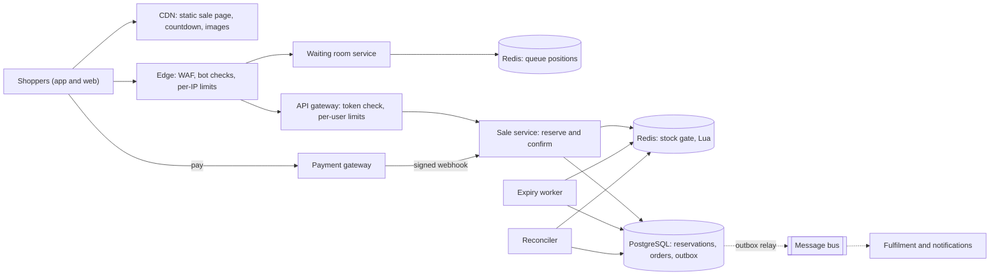
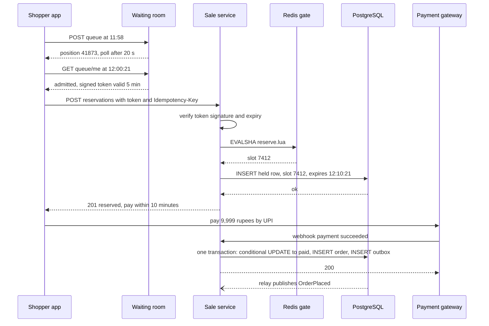
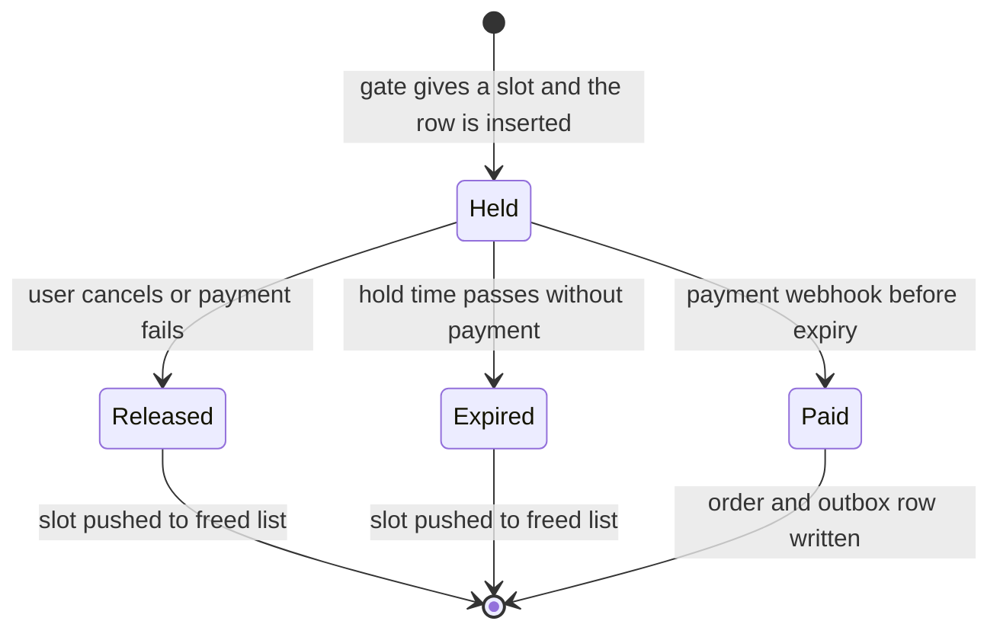

At 12:00:00 on the first day of a festival sale, two million people tap "Buy" on the same phone, and there are only 10,000. The system must sell exactly 10,000 (never 10,001), keep the rest of the store running, keep bots from taking the stock, and tell everyone else "sold out" quickly.

The [e-commerce case study](#/lesson/m17-ecommerce) introduced a flash-sale gate as one part of a store. This lesson zooms in: why the obvious database update collapses, how a waiting room and a Redis gate share the work, how reservations expire, and how PostgreSQL stays the final word. It reasons from public engineering principles, not any company's internal architecture.

## Learning objectives

By the end of this lesson you will be able to:

1. Write measurable requirements for "no overselling", "fairness" and "survive a 50–100× spike".
2. Estimate peak, admission and payment rates for a 10,000-unit sale, showing the arithmetic.
3. Explain why `UPDATE stock SET qty = qty - 1` on one row collapses under contention.
4. Design the funnel: CDN, waiting room with signed tokens, rate limits and bot defence, atomic gate.
5. Implement a stock gate with per-user limits and expiring reservations in C#, using an injectable `TimeProvider`.
6. Keep Redis fast and PostgreSQL correct together, with slot numbers, constraints, an outbox and reconciliation.
7. Plan warm-up, load tests, graceful degradation and live observability.

## Prerequisites

- [Capacity estimation](#/lesson/m11-capacity-estimation): turning "two million people" into requests per second.
- [Redis data structures](#/lesson/m12-redis): counters, lists, hashes and Lua scripts.
- [Locking in PostgreSQL](#/lesson/m09-locking): row locks explain why the naive design fails.
- [Transactional outbox](#/lesson/m12-outbox): paid reservations become orders through an outbox.
- [Rate limiting algorithms](#/lesson/m10-rate-limiting): token buckets protect every layer.

## Explain it like I'm a beginner

A sweet shop in Kolkata announces: "Tomorrow at noon, 100 boxes of our festival special at half price." At 11:55, 5,000 people push against the door. If the owner just opens it, the counter is crushed, and two staff members each sell "the last box" because they glanced at the shelf at the same moment (overselling).

A sensible owner:

1. **Puts the menu and price on a board outside**, so nobody comes in just to read it (a static page on a CDN).
2. **Hands out numbered slips** and lets people in 20 at a time (a waiting room).
3. **Keeps one ledger with exactly 100 lines**; a box is promised only by writing a name on a free line (an atomic counter).
4. **Holds a promised box for 10 minutes**; if the buyer doesn't pay, the line is crossed out and the box goes back (a reservation with expiry).

When line 100 is filled, someone tells the queue "sold out" so they can go home. The rest of this lesson makes each step survive two million people.

## Requirements

### Functional requirements

1. **Pre-sale page** with product, price (₹9,999 instead of ₹17,999) and a countdown.
2. **Join the queue** from 11:45 (logged-in users).
3. **Reserve** one unit when admitted; the hold lasts 10 minutes.
4. **Pay** by UPI, card or wallet; payment turns the hold into an order.
5. **Expire** unpaid holds and return the unit to stock.
6. **Sold out** shown to everyone waiting once stock is gone.
7. **Limit** of one unit per account (configurable).

Out of scope: the rest of the store (it must keep working), delivery and returns, dynamic pricing.

### Non-functional requirements

| Requirement | Target |
|---|---|
| No overselling | Paid orders ≤ 10,000, always, including during failures |
| Fairness | A random draw or arrival order decides, not network speed or bots |
| Spike survival | 50–100× the normal ~1,500 requests/s of the sale pages (estimate) for ~15 minutes |
| Isolation | The rest of the store keeps normal latency |
| Fast answers | p99 under 300 ms for "reserved", "sold out" or "you're in the queue" (slow answers cause refreshes) |
| Durability | A paid order is never lost; a hold shown to a user is honoured |
| Fail closed | If unsure, the gate says "try again", never "sold" |

Speed pushes towards in-memory counters; "never oversell" pushes towards a transactional database. The design uses both.

## Capacity estimation

All numbers are **estimates** for a large Indian festival sale.

**Who shows up**

- 10,000 phones; 2 M people tapped "Notify me"; about 1.5 M open the app between 11:55 and 12:01.
- 1.5 M ÷ 10,000 = **150 people per phone**. 99.3 % get no phone, so the cheapest possible "no" is the most important feature.

**Peak requests**

- 1 M taps in the first 10 seconds: 1 M ÷ 10 s = **100,000 requests/s**; with retries (1.5 per user) **150,000/s**.
- Against a normal 1,500/s that is 100,000 ÷ 1,500 ≈ **67×** to **100×**.

**Static content**

- ~1.5 MB per first visit × 1.5 M users ≈ **2.25 TB** within minutes. Only a CDN should serve that.

**Admission and gate**

- Checkout and payment were load-tested at about **2,000 new buyers/s**, so the waiting room admits 2,000 users/s.
- If 60 % of admitted users press "Reserve": 2,000 × 0.6 = **1,200 reserve calls/s**; 10,000 ÷ 1,200 ≈ **8–9 seconds** to sell out.
- Queue polling is the hidden big number: 1.5 M users polling every 5 s = 300,000/s. With server-controlled intervals averaging 20 s: 1.5 M ÷ 20 = **75,000/s** of tiny reads served from memory.

**Payments and writes**

- ~10,000 payments over ~12 minutes ≈ **14/s** average, bursting to 100–200/s. If 20 % of holders don't pay, ~2,000 units return and are re-sold.
- PostgreSQL: ~12,000 reservations and ~10,000 orders in 15 minutes: trivial, because they are **different rows**.
- Redis: ~1,200 Lua calls/s; one primary handles tens of thousands of small operations per second (estimate).

**What the numbers say**: the CDN takes the bandwidth, the waiting room turns 150,000/s into 2,000/s, and PostgreSQL sees only winners.

## API design

```http
GET  /sale/diwali-phone-2026                      -> static HTML from the CDN (no personal data)
GET  /api/v1/sales/diwali-phone-2026/state        -> { "phase": "upcoming|live|sold_out", "startsAt": "...", "unitsLeftHint": "few|many|none" }
                                                     Cache-Control: public, max-age=2
POST /api/v1/sales/diwali-phone-2026/queue        -> 202 { "position": 41873, "pollAfterSeconds": 20 }
GET  /api/v1/sales/diwali-phone-2026/queue/me     -> { "status": "waiting", "ahead": 12873, "pollAfterSeconds": 15 }
                                                  -> { "status": "admitted", "admissionToken": "..." } | { "status": "sold_out" }
POST /api/v1/sales/diwali-phone-2026/reservations
     X-Admission-Token: <token>   Idempotency-Key: 4e0c...
                                                  -> 201 { "reservationId": "...", "expiresAt": "+10 min" }
                                                  -> 409 SOLD_OUT | 409 LIMIT_REACHED | 403 NOT_ADMITTED | 429 + Retry-After
POST /api/v1/payments/webhook                     -> signed, from the payment gateway; idempotent by payment id
```

- **The page is identical for everyone**, so the CDN hit ratio stays near 100 %. Personal data comes from small API calls after load.
- **`unitsLeftHint` is coarse.** An exact live counter is a hot key and invites refresh storms.
- **The server sets `pollAfterSeconds`**, which is the biggest load lever after the CDN.
- **Reserving needs an admission token**, so calling the endpoint directly gets a cheap `403`.
- **Reserve is idempotent** by `Idempotency-Key`: a retry returns the same hold ([idempotency keys](#/lesson/m10-idempotency)).

## Data model

### PostgreSQL: the source of truth

```sql
CREATE TABLE sale (
    sale_id        text        PRIMARY KEY,
    sku            text        NOT NULL,
    units          int         NOT NULL CHECK (units > 0),
    price_paise    bigint      NOT NULL,
    per_user_limit int         NOT NULL DEFAULT 1,
    starts_at      timestamptz NOT NULL,
    hold_seconds   int         NOT NULL DEFAULT 600
);

CREATE TABLE sale_reservation (
    reservation_id uuid        PRIMARY KEY,
    sale_id        text        NOT NULL REFERENCES sale,
    user_id        bigint      NOT NULL,
    slot_no        int         NOT NULL,              -- which of the 10,000 units, 0..units-1
    status         text        NOT NULL CHECK (status IN ('held','paid','released','expired')),
    idempotency_key text       NOT NULL,
    created_at     timestamptz NOT NULL DEFAULT now(),
    expires_at     timestamptz NOT NULL,
    UNIQUE (sale_id, user_id, idempotency_key)
);

-- The hard guarantee: one live reservation per unit. Redis can be wrong; this index cannot.
CREATE UNIQUE INDEX one_live_hold_per_slot
    ON sale_reservation (sale_id, slot_no) WHERE status IN ('held', 'paid');

-- One unit per customer (when per_user_limit = 1).
CREATE UNIQUE INDEX one_live_hold_per_user
    ON sale_reservation (sale_id, user_id) WHERE status IN ('held', 'paid');

-- The expiry sweeper's work list.
CREATE INDEX held_by_expiry ON sale_reservation (expires_at) WHERE status = 'held';

CREATE TABLE sale_order (
    order_id       uuid        PRIMARY KEY,
    reservation_id uuid        NOT NULL UNIQUE REFERENCES sale_reservation,
    payment_id     text        NOT NULL UNIQUE,
    created_at     timestamptz NOT NULL DEFAULT now()
);

CREATE TABLE outbox (
    id           bigserial   PRIMARY KEY,
    topic        text        NOT NULL,
    payload      jsonb       NOT NULL,
    created_at   timestamptz NOT NULL DEFAULT now(),
    published_at timestamptz
);
```

A **slot number** says *which* unit you hold. The insert accepts only slots from 0 to `units − 1` (`INSERT ... SELECT ... FROM sale WHERE units > $slot`), and the partial unique index allows one live row per slot, so PostgreSQL can never hold more live reservations than units, even if the fast layer misbehaves. Expired and released rows stay for audit without blocking resale.

### Redis: the fast gate

| Key | Type | Meaning |
|---|---|---|
| `sale:{diwali-phone-2026}:next` | integer | Starts at 10,000; `DECR` hands out slots 9,999 … 0 |
| `sale:{diwali-phone-2026}:freed` | list | Slots returned by expired or released holds, reused first |
| `sale:{diwali-phone-2026}:per_user` | hash | user id → live holds |
| `sale:{diwali-phone-2026}:queue` | sorted set | user id → queue position |
| `sale:{diwali-phone-2026}:admitted` | integer | Positions ≤ this are admitted |

The part in braces is a **hash tag**: Redis Cluster places all keys with the same tag on one shard, so one Lua script may touch them all.

## High-level architecture



Arrow by arrow:

- **Shoppers → CDN**: page and images from the edge; the countdown uses server time, not the phone's clock.
- **Edge → Waiting room → Redis queue**: WAF and bot checks drop abuse; polls are answered from a memory snapshot refreshed every second.
- **Edge → API gateway → Sale service**: the gateway verifies the admission token's HMAC locally and applies per-user limits.
- **Sale service → Redis gate**: one atomic Lua script checks the limit, takes a slot and records the hold.
- **Sale service → PostgreSQL**: winners only; if the insert fails, the slot goes back and the user hears "try again".
- **Payment gateway → webhook → Sale service**: confirm the hold if it hasn't expired.
- **Expiry worker** frees due holds; the **reconciler** repairs Redis-versus-PostgreSQL drift.
- **PostgreSQL ⇢ relay ⇢ bus ⇢ fulfilment** (dotted = asynchronous): order and outbox row commit together.

The sale path has its own instances, Redis and capped connection pool, a bulkhead that keeps the stampede away from the rest of the store.

### Reserve and pay



The gate answers before the database insert, so the database sees only winners. Confirmation is conditional (`WHERE status = 'held' AND expires_at > now()`): if the hold expired a second ago, no row changes and the payment is refunded. Order and outbox rows share one transaction, so "order exists but nobody was told" can't happen.

### Reservation states



Each exit from `Held` is a conditional update from `held`, so whichever happens first wins. A webhook arriving after expiry finds no held row and triggers a refund. `Paid` never returns to sale stock; returns are a separate flow.

## Deep dives

### Deep dive 1: why one hot row collapses

```sql
-- BAD under contention: every buyer queues on the same row lock.
UPDATE inventory SET qty = qty - 1
WHERE sku = 'PHN-NOVA-5G-128' AND qty > 0
RETURNING qty;
```

This is *correct*, but:

1. **Every update needs the same row lock**, so buyers form one line.
2. **The line moves at commit speed.** If a transaction holds the lock ~2 ms including the WAL flush (an estimate), the row serves ~**500 updates/s**, however many servers you add.
3. **Waiters hold connections.** At 100,000 requests/s, pools empty in milliseconds, requests time out, clients retry, and the shared database stalls the whole store.
4. **Losers wait as long as winners**: after stock hits zero, each "sold out" still waits for the lock.
5. **Every update writes a new row version** (MVCC), leaving dead tuples for vacuum mid-sale.

Shorter transactions or `FOR UPDATE NOWAIT` help a little but keep the single line. The fix is to **keep the crowd away from the row**: the waiting room limits who tries, the Redis gate picks winners in memory, and PostgreSQL records each winner in its own row.

:::callout type=tradeoff title="When the hot row is fine"
For 500 units and a few thousand buyers, the conditional `UPDATE` (or a slot table with `SKIP LOCKED`) is the right design: one database, no Redis, nothing to reconcile.
:::

### Deep dive 2: static pages and the CDN

The page is identical for everyone, so it is **pre-rendered**, has **no personal data**, and is served by the CDN with versioned asset names. On sell-out, a static "sold out" version is published and the cache purged. The `state` endpoint is cached for 2 seconds with **request collapsing** (origin shielding), so when an entry expires one request goes to the origin and the rest wait for it ([cache stampede](#/lesson/m12-cache-failures)).

### Deep dive 3: the waiting room

The waiting room **protects** the backend, keeps order **fair**, and **informs** people so they stop refreshing.

- **Positions**: `INCR` for a number, `ZADD ... NX` so a second join keeps the first position.
- **Fair start**: first-come rewards bots and fast connections. A **pre-queue** gives everyone who joins between 11:45 and 12:00 a *random* position at noon; later arrivals go to the back.
- **Admission**: a pump raises one number, `admitted`, by 2,000 per second; position ≤ `admitted` means admitted. It pauses when stock is gone.
- **Tokens**: `saleId | userId | expiry` signed with HMAC-SHA256, verified with one hash and useless to anyone else.
- **Polling**: far-back users poll every 30 s, near-front every 3 s, from a memory snapshot. WebSockets would mean holding 1.5 M connections.

### Deep dive 4: rate limiting and bot defence

Layer the defences, cheapest first:

1. **Edge**: per-IP limits on queue joins and polls, WAF rules, data-centre IP reputation.
2. **Identity**: a logged-in account with a verified phone number, created before the sale was announced.
3. **Challenge at the door, not the till**: risky sessions get a challenge when joining the queue, never during payment.
4. **Per-user limits** in the Lua script and the `one_live_hold_per_user` index, plus per-user token buckets on reserve ([rate limiter case study](#/lesson/m17-rate-limiter)).
5. **After the sale**: cancel over-limit orders sharing an address, device or card (announced in advance).

### Deep dive 5: the atomic gate (Redis + Lua)

Checking the limit, taking a slot and recording the hold must be one step. Two separate commands could interleave; a Lua script runs atomically on the server.

```lua
-- reserve.lua
-- KEYS[1] = sale:{id}:next   KEYS[2] = sale:{id}:freed   KEYS[3] = sale:{id}:per_user
-- ARGV[1] = user id          ARGV[2] = per-user limit
local held = tonumber(redis.call('HGET', KEYS[3], ARGV[1]) or '0')
if held >= tonumber(ARGV[2]) then return -2 end          -- limit reached

local slot = redis.call('LPOP', KEYS[2])                 -- reuse a returned unit first
if not slot then
  local n = redis.call('DECR', KEYS[1])                  -- 10,000 -> 9,999 ... -> 0
  if n < 0 then
    redis.call('INCR', KEYS[1])                          -- undo, keep the counter at 0
    return -1                                            -- sold out
  end
  slot = n
end
redis.call('HINCRBY', KEYS[3], ARGV[1], 1)
return tonumber(slot)
```

From C# with StackExchange.Redis (a snippet; that library isn't part of the compiled code):

```csharp
var result = (long)await db.ScriptEvaluateAsync(ReserveScript,
    new RedisKey[] { $"sale:{{{saleId}}}:next", $"sale:{{{saleId}}}:freed", $"sale:{{{saleId}}}:per_user" },
    new RedisValue[] { userId, perUserLimit });
// result >= 0: slot number; -1: sold out; -2: limit reached
```

Freed slots are reused first, so slots stay inside 0..9,999; a `DECR` below zero is undone; and the script is a few O(1) commands, because it blocks Redis while running. The release script runs only after the PostgreSQL row left `held` conditionally, so a slot is never freed twice.

### Deep dive 6: Redis is fast, PostgreSQL is right

Redis replicates asynchronously. If the primary dies, a promoted replica may have missed recent `DECR`s, and hands out slots already held. A design that trusts Redis alone oversells in exactly this failure. With slots, the duplicate insert hits the `one_live_hold_per_slot` index, the user is told "try again", and nothing is oversold.

After a failover the **reconciler** pauses the gate for a few seconds, reads live slots from PostgreSQL, rebuilds `next`, `freed` and `per_user`, then reopens. During the sale it also runs every minute in check-only mode and alerts on drift.

:::callout type=warning title="Fail closed"
If Redis is slow or unreachable, the gate answers "try again in a few seconds". It never assumes stock exists. A 30-second pause is a bad headline; 500 oversold phones is a refund operation and a worse one.
:::

### Deep dive 7: reservations, expiry and payment

Ten minutes allows a UPI approval with one retry while abandoned units still return during peak demand. The sweeper returns due holds every second and confirmation checks `expires_at > now()`; late payments are refunded. `sale_order.payment_id` is unique, so a retried webhook is a no-op. Expiry uses one server-side clock (`TimeProvider` in C#, `now()` in SQL), never the client's.

### Deep dive 8: sharding stock into buckets

Bucketing helps when the gate itself is hot: many simultaneous sales on one cluster, or no waiting room. Split 10,000 units into 10 buckets of 1,000 slots on different shards and route users by hashing their id. Throughput scales with buckets, but you get **false sold out** (bucket 3 empty, bucket 7 not), fixed by probing the next bucket. Hashing by user keeps per-user limits in one place, and disjoint slot ranges keep the PostgreSQL constraint global. In PostgreSQL the same idea is **sharded counters**: ten rows instead of one hot row ([hot partitions](#/lesson/m13-sharding)).

### Deep dive 9: the core in ASP.NET Core

Below is a compilable, in-memory version of the sale service. `InMemoryStockGate` plays the Lua script: one lock per sale makes "check limit, take slot, record hold" atomic, as Redis runs one script at a time. Time comes from an injected `TimeProvider`, so tests can move 10 minutes forward instantly. Production swaps in Redis and PostgreSQL implementations behind the same interfaces.

```csharp file=FlashSale/Inventory/StockGate.cs
using System.Collections.Concurrent;
using Microsoft.Extensions.Options;

namespace FlashSale.Inventory;

public enum ReserveStatus { Reserved, SoldOut, LimitReached, NotOpen, UnknownSale, NotAdmitted }

public enum ReservationState { Held, Paid, Released, Expired }

/// <summary>One unit of one sale, held by one user. SlotNo is the unit's number, 0..units-1.</summary>
public sealed record Reservation(
    string Id, string SaleId, string UserId, int SlotNo, DateTimeOffset ExpiresAt, ReservationState State);

public sealed record ReserveResult(ReserveStatus Status, Reservation? Reservation = null);

public sealed class StockGateOptions
{
    public TimeSpan HoldDuration { get; set; } = TimeSpan.FromMinutes(10);
    public int PerUserLimit { get; set; } = 1;
}

public interface IStockGate
{
    void OpenSale(string saleId, int units, DateTimeOffset startsAt);
    ReserveResult TryReserve(string saleId, string userId);
    /// <summary>Held and not expired: becomes Paid. Already Paid: returns true again (webhook retries).</summary>
    bool TryConfirm(string reservationId, out Reservation? confirmed);
    bool Release(string reservationId);
    int ExpireDue();
    int Available(string saleId);
    Reservation? Find(string reservationId);
}

/// <summary>
/// In-memory stand-in for the Redis Lua gate. One lock per sale makes "check limit, take a slot,
/// record the hold" a single atomic step, exactly like one EVALSHA on one Redis shard.
/// </summary>
public sealed class InMemoryStockGate(TimeProvider clock, IOptions<StockGateOptions> options) : IStockGate
{
    private sealed class Sale(int units, DateTimeOffset startsAt)
    {
        public readonly object Sync = new();
        public DateTimeOffset StartsAt { get; } = startsAt;
        public int NextSlot = units - 1;                       // like DECR on sale:{id}:next
        public readonly Stack<int> FreedSlots = new();         // like the sale:{id}:freed list
        public readonly Dictionary<string, int> LivePerUser = new(StringComparer.Ordinal);
        public int Available => NextSlot + 1 + FreedSlots.Count;
    }

    private readonly ConcurrentDictionary<string, Sale> _sales = new(StringComparer.Ordinal);
    private readonly ConcurrentDictionary<string, Reservation> _reservations = new(StringComparer.Ordinal);
    private readonly StockGateOptions _options = options.Value;

    public void OpenSale(string saleId, int units, DateTimeOffset startsAt)
    {
        ArgumentOutOfRangeException.ThrowIfNegativeOrZero(units);
        if (!_sales.TryAdd(saleId, new Sale(units, startsAt)))
            throw new InvalidOperationException($"Sale {saleId} is already open.");
    }

    public ReserveResult TryReserve(string saleId, string userId)
    {
        if (!_sales.TryGetValue(saleId, out var sale)) return new(ReserveStatus.UnknownSale);
        var now = clock.GetUtcNow();
        if (now < sale.StartsAt) return new(ReserveStatus.NotOpen);

        lock (sale.Sync)
        {
            var live = sale.LivePerUser.GetValueOrDefault(userId);
            if (live >= _options.PerUserLimit) return new(ReserveStatus.LimitReached);

            int slot;
            if (sale.FreedSlots.Count > 0) slot = sale.FreedSlots.Pop();
            else if (sale.NextSlot >= 0) slot = sale.NextSlot--;
            else return new(ReserveStatus.SoldOut);

            sale.LivePerUser[userId] = live + 1;
            var reservation = new Reservation(Guid.NewGuid().ToString("N"), saleId, userId, slot,
                now + _options.HoldDuration, ReservationState.Held);
            _reservations[reservation.Id] = reservation;
            return new(ReserveStatus.Reserved, reservation);
        }
    }

    public bool TryConfirm(string reservationId, out Reservation? confirmed)
    {
        confirmed = null;
        if (!TryGet(reservationId, out var sale)) return false;
        lock (sale.Sync)
        {
            var r = _reservations[reservationId];
            if (r.State == ReservationState.Paid) { confirmed = r; return true; }
            if (r.State != ReservationState.Held) return false;
            if (clock.GetUtcNow() >= r.ExpiresAt)
            {
                ReturnToStock(sale, r, ReservationState.Expired);   // late payment: refund it, free the unit
                return false;
            }
            confirmed = r with { State = ReservationState.Paid };   // still counts towards the user's limit
            _reservations[reservationId] = confirmed;
            return true;
        }
    }

    public bool Release(string reservationId) => Finish(reservationId, ReservationState.Released, onlyIfDue: false);

    public int ExpireDue()
    {
        var now = clock.GetUtcNow();
        var expired = 0;
        foreach (var r in _reservations.Values)   // Redis/PostgreSQL would use an index ordered by expiry
            if (r.State == ReservationState.Held && r.ExpiresAt <= now && Finish(r.Id, ReservationState.Expired, onlyIfDue: true))
                expired++;
        return expired;
    }

    public int Available(string saleId)
    {
        if (!_sales.TryGetValue(saleId, out var sale)) return 0;
        lock (sale.Sync) return sale.Available;
    }

    public Reservation? Find(string reservationId) =>
        _reservations.TryGetValue(reservationId, out var r) ? r : null;

    private bool Finish(string reservationId, ReservationState final, bool onlyIfDue)
    {
        if (!TryGet(reservationId, out var sale)) return false;
        lock (sale.Sync)
        {
            var r = _reservations[reservationId];
            if (r.State != ReservationState.Held) return false;          // conditional: only from Held
            if (onlyIfDue && clock.GetUtcNow() < r.ExpiresAt) return false;
            ReturnToStock(sale, r, final);
            return true;
        }
    }

    private bool TryGet(string reservationId, out Sale sale)
    {
        sale = null!;
        return _reservations.TryGetValue(reservationId, out var r) && _sales.TryGetValue(r.SaleId, out sale!);
    }

    private void ReturnToStock(Sale sale, Reservation r, ReservationState final)
    {
        sale.FreedSlots.Push(r.SlotNo);
        var left = sale.LivePerUser[r.UserId] - 1;
        if (left == 0) sale.LivePerUser.Remove(r.UserId); else sale.LivePerUser[r.UserId] = left;
        _reservations[r.Id] = r with { State = final };
    }
}
```

```csharp file=FlashSale/Admission/Admission.cs
using System.Collections.Concurrent;
using System.Security.Cryptography;
using System.Text;
using Microsoft.Extensions.Options;

namespace FlashSale.Admission;

public sealed class AdmissionOptions
{
    public string SaleId { get; set; } = "diwali-phone-2026";
    public string SigningKey { get; set; } = "";
    public TimeSpan TokenLifetime { get; set; } = TimeSpan.FromMinutes(5);
    public int AdmitPerSecond { get; set; } = 2_000;
}

/// <summary>Signed, user-bound, short-lived proof that a user was admitted from the waiting room.
/// Checked with one HMAC: no Redis or database call on the hot path.</summary>
public sealed class AdmissionTokenService
{
    private readonly byte[] _key;
    private readonly TimeSpan _lifetime;
    private readonly TimeProvider _clock;

    public AdmissionTokenService(IOptions<AdmissionOptions> options, TimeProvider clock)
    {
        _key = Encoding.UTF8.GetBytes(options.Value.SigningKey);
        if (_key.Length < 32) throw new InvalidOperationException("Admission signing key must be at least 32 bytes.");
        _lifetime = options.Value.TokenLifetime;
        _clock = clock;
    }

    public string Issue(string saleId, string userId)
    {
        if (saleId.Contains('|') || userId.Contains('|')) throw new ArgumentException("Ids must not contain '|'.");
        var expires = _clock.GetUtcNow().Add(_lifetime).ToUnixTimeSeconds();
        var payload = $"{saleId}|{userId}|{expires}";
        return Convert.ToBase64String(Encoding.UTF8.GetBytes(payload)) + "." + Convert.ToHexString(Sign(payload));
    }

    public bool IsValid(string? token, string saleId, string userId)
    {
        if (string.IsNullOrEmpty(token)) return false;
        var dot = token.IndexOf('.');
        if (dot <= 0) return false;
        try
        {
            var payload = Encoding.UTF8.GetString(Convert.FromBase64String(token[..dot]));
            var signature = Convert.FromHexString(token[(dot + 1)..]);
            if (!CryptographicOperations.FixedTimeEquals(signature, Sign(payload))) return false;
            var parts = payload.Split('|');
            return parts.Length == 3 && parts[0] == saleId && parts[1] == userId
                && long.TryParse(parts[2], out var exp) && _clock.GetUtcNow().ToUnixTimeSeconds() < exp;
        }
        catch (FormatException) { return false; }
    }

    private byte[] Sign(string payload) => HMACSHA256.HashData(_key, Encoding.UTF8.GetBytes(payload));
}

public enum QueueState { NotJoined, Waiting, Admitted }

public sealed record QueueStatus(QueueState State, long Position, long Ahead, int PollAfterSeconds);

/// <summary>Single-sale waiting room. In production: INCR + ZADD NX in Redis, shared by all instances.</summary>
public sealed class VirtualQueue
{
    private readonly ConcurrentDictionary<string, long> _positions = new(StringComparer.Ordinal);
    private long _joined;
    private long _admittedUpTo;

    public long Join(string userId) => _positions.GetOrAdd(userId, _ => Interlocked.Increment(ref _joined));

    public void Admit(long count) => Interlocked.Add(ref _admittedUpTo, count);

    public long Waiting => Math.Max(0, Interlocked.Read(ref _joined) - Interlocked.Read(ref _admittedUpTo));

    public QueueStatus StatusOf(string userId)
    {
        if (!_positions.TryGetValue(userId, out var position)) return new(QueueState.NotJoined, 0, 0, 0);
        var admitted = Interlocked.Read(ref _admittedUpTo);
        if (position <= admitted) return new(QueueState.Admitted, position, 0, 0);
        var ahead = position - admitted;
        // The server sets the polling rate: far back polls rarely, near the front polls often.
        var poll = ahead > 100_000 ? 30 : ahead > 10_000 ? 15 : 3;
        return new(QueueState.Waiting, position, ahead, poll);
    }
}
```

```csharp file=FlashSale/Orders/Orders.cs
using System.Collections.Concurrent;

namespace FlashSale.Orders;

public sealed record OrderPlaced(string OrderId, string ReservationId, string SaleId, string UserId,
    int SlotNo, string PaymentId, DateTimeOffset At);

/// <summary>In PostgreSQL, SaveAsync is ONE transaction: UPDATE sale_reservation ... WHERE status = 'held',
/// INSERT sale_order, INSERT outbox. Returns false if this reservation already has an order.</summary>
public interface IOrderStore
{
    Task<bool> SaveWithOutboxAsync(OrderPlaced order, CancellationToken ct);
    Task<IReadOnlyList<OrderPlaced>> UnpublishedAsync(int max, CancellationToken ct);
    Task MarkPublishedAsync(string orderId, CancellationToken ct);
}

public sealed class InMemoryOrderStore : IOrderStore
{
    private readonly ConcurrentDictionary<string, OrderPlaced> _byReservation = new(StringComparer.Ordinal);
    private readonly ConcurrentDictionary<string, OrderPlaced> _outbox = new(StringComparer.Ordinal);

    public Task<bool> SaveWithOutboxAsync(OrderPlaced order, CancellationToken ct)
    {
        if (!_byReservation.TryAdd(order.ReservationId, order)) return Task.FromResult(false);
        _outbox[order.OrderId] = order;
        return Task.FromResult(true);
    }

    public Task<IReadOnlyList<OrderPlaced>> UnpublishedAsync(int max, CancellationToken ct) =>
        Task.FromResult<IReadOnlyList<OrderPlaced>>(_outbox.Values.OrderBy(o => o.At).Take(max).ToList());

    public Task MarkPublishedAsync(string orderId, CancellationToken ct)
    {
        _outbox.TryRemove(orderId, out _);
        return Task.CompletedTask;
    }

    public int OrderCount => _byReservation.Count;
}

public interface IOrderEventPublisher
{
    Task PublishAsync(OrderPlaced order, CancellationToken ct);
}
```

```csharp file=FlashSale/Checkout/SaleCheckoutService.cs
using FlashSale.Admission;
using FlashSale.Inventory;
using FlashSale.Orders;
using Microsoft.Extensions.Logging;

namespace FlashSale.Checkout;

public enum PaymentOutcome { OrderPlaced, AlreadyPlaced, ExpiredRefundNeeded, UnknownReservation }

/// <summary>The sale workflow: admission check, gate, then (on payment) order + outbox.</summary>
public sealed class SaleCheckoutService(
    IStockGate gate,
    AdmissionTokenService tokens,
    IOrderStore orders,
    TimeProvider clock,
    ILogger<SaleCheckoutService> log)
{
    public ReserveResult Reserve(string saleId, string userId, string? admissionToken)
    {
        if (!tokens.IsValid(admissionToken, saleId, userId)) return new(ReserveStatus.NotAdmitted);
        var result = gate.TryReserve(saleId, userId);
        // Production: INSERT the held row (slot_no) here. A unique violation means Redis and PostgreSQL
        // disagree: release the slot back to the gate, alert, and answer "try again".
        log.LogInformation("Reserve {Sale} {User}: {Status}", saleId, userId, result.Status);
        return result;
    }

    public async Task<PaymentOutcome> ConfirmPaymentAsync(string reservationId, string paymentId, CancellationToken ct)
    {
        var existing = gate.Find(reservationId);
        if (existing is null) return PaymentOutcome.UnknownReservation;

        if (!gate.TryConfirm(reservationId, out var paid) || paid is null)
        {
            log.LogWarning("Payment {Payment} arrived for {Reservation} after expiry; refund it", paymentId, reservationId);
            return PaymentOutcome.ExpiredRefundNeeded;
        }

        var order = new OrderPlaced("ord-" + reservationId, reservationId, paid.SaleId, paid.UserId,
            paid.SlotNo, paymentId, clock.GetUtcNow());
        return await orders.SaveWithOutboxAsync(order, ct) ? PaymentOutcome.OrderPlaced : PaymentOutcome.AlreadyPlaced;
    }
}
```

```csharp file=FlashSale/Workers/Workers.cs
using FlashSale.Admission;
using FlashSale.Inventory;
using FlashSale.Orders;
using Microsoft.Extensions.Hosting;
using Microsoft.Extensions.Logging;
using Microsoft.Extensions.Options;

namespace FlashSale.Workers;

/// <summary>Returns unpaid units to stock. Uses the injected clock, so tests and the gate agree on "now".</summary>
public sealed class ReservationExpiryWorker(IStockGate gate, TimeProvider clock, ILogger<ReservationExpiryWorker> log)
    : BackgroundService
{
    protected override async Task ExecuteAsync(CancellationToken stoppingToken)
    {
        using var timer = new PeriodicTimer(TimeSpan.FromSeconds(1), clock);
        try
        {
            while (await timer.WaitForNextTickAsync(stoppingToken))
            {
                var n = gate.ExpireDue();
                if (n > 0) log.LogInformation("Expired {Count} unpaid holds; units returned to stock", n);
            }
        }
        catch (OperationCanceledException) when (stoppingToken.IsCancellationRequested) { }
    }
}

/// <summary>Moves the admission cursor forward at the rate checkout was load-tested for.</summary>
public sealed class AdmissionPump(VirtualQueue queue, IStockGate gate, IOptions<AdmissionOptions> options, TimeProvider clock)
    : BackgroundService
{
    protected override async Task ExecuteAsync(CancellationToken stoppingToken)
    {
        var o = options.Value;
        using var timer = new PeriodicTimer(TimeSpan.FromSeconds(1), clock);
        try
        {
            while (await timer.WaitForNextTickAsync(stoppingToken))
            {
                // Don't admit more people than there are units to try for; resume as holds expire.
                var units = gate.Available(o.SaleId);
                if (units > 0 && queue.Waiting > 0) queue.Admit(Math.Min(o.AdmitPerSecond, Math.Max(units, 100)));
            }
        }
        catch (OperationCanceledException) when (stoppingToken.IsCancellationRequested) { }
    }
}

/// <summary>Outbox relay: publish committed orders, then mark them. At-least-once; consumers dedupe by OrderId.</summary>
public sealed class OutboxRelay(IOrderStore store, IOrderEventPublisher publisher, TimeProvider clock, ILogger<OutboxRelay> log)
    : BackgroundService
{
    protected override async Task ExecuteAsync(CancellationToken stoppingToken)
    {
        using var timer = new PeriodicTimer(TimeSpan.FromMilliseconds(500), clock);
        try
        {
            while (await timer.WaitForNextTickAsync(stoppingToken))
            {
                foreach (var order in await store.UnpublishedAsync(500, stoppingToken))
                {
                    try
                    {
                        await publisher.PublishAsync(order, stoppingToken);
                        await store.MarkPublishedAsync(order.OrderId, stoppingToken);
                    }
                    catch (Exception ex) when (ex is not OperationCanceledException)
                    {
                        log.LogWarning(ex, "Publish failed for {Order}; will retry", order.OrderId);
                        break;
                    }
                }
            }
        }
        catch (OperationCanceledException) when (stoppingToken.IsCancellationRequested) { }
    }
}

public sealed class LoggingOrderEventPublisher(ILogger<LoggingOrderEventPublisher> log) : IOrderEventPublisher
{
    public Task PublishAsync(OrderPlaced order, CancellationToken ct)
    {
        log.LogInformation("OrderPlaced {Order} for {User}, slot {Slot}", order.OrderId, order.UserId, order.SlotNo);
        return Task.CompletedTask;
    }
}
```

```csharp file=Program.cs
using System.Threading.RateLimiting;
using FlashSale.Admission;
using FlashSale.Checkout;
using FlashSale.Inventory;
using FlashSale.Orders;
using FlashSale.Workers;

var builder = WebApplication.CreateBuilder(args);

builder.Services.AddSingleton(TimeProvider.System);
builder.Services.Configure<StockGateOptions>(builder.Configuration.GetSection("StockGate"));
builder.Services.Configure<AdmissionOptions>(o =>
{
    builder.Configuration.GetSection("Admission").Bind(o);
    if (string.IsNullOrEmpty(o.SigningKey)) o.SigningKey = "dev-only-key-replace-from-key-vault-0123456789"; // never in production
});
builder.Services.AddSingleton<IStockGate, InMemoryStockGate>();          // production: Redis Lua gate
builder.Services.AddSingleton<AdmissionTokenService>();
builder.Services.AddSingleton<VirtualQueue>();                           // production: Redis sorted set
builder.Services.AddSingleton<IOrderStore, InMemoryOrderStore>();        // production: PostgreSQL + outbox
builder.Services.AddSingleton<IOrderEventPublisher, LoggingOrderEventPublisher>();
builder.Services.AddSingleton<SaleCheckoutService>();
builder.Services.AddHostedService<ReservationExpiryWorker>();
builder.Services.AddHostedService<AdmissionPump>();
builder.Services.AddHostedService<OutboxRelay>();

builder.Services.AddRateLimiter(o =>
{
    o.RejectionStatusCode = StatusCodes.Status429TooManyRequests;
    // Per user: 5 reserve attempts per 10 seconds. Bots that retry in a tight loop get 429s, not stock.
    o.AddPolicy("reserve", ctx => RateLimitPartition.GetTokenBucketLimiter(
        UserOf(ctx) ?? ctx.Connection.RemoteIpAddress?.ToString() ?? "anon",
        _ => new TokenBucketRateLimiterOptions
        {
            TokenLimit = 5, TokensPerPeriod = 5, ReplenishmentPeriod = TimeSpan.FromSeconds(10), QueueLimit = 0,
        }));
});

var app = builder.Build();
app.UseRateLimiter();

var saleId = app.Services.GetRequiredService<Microsoft.Extensions.Options.IOptions<AdmissionOptions>>().Value.SaleId;
var startsAt = builder.Configuration.GetValue<DateTimeOffset?>("Sale:StartsAt") ?? TimeProvider.System.GetUtcNow();
app.Services.GetRequiredService<IStockGate>().OpenSale(saleId, units: 10_000, startsAt);

app.MapPost("/api/v1/sales/{id}/queue", (string id, HttpContext ctx, VirtualQueue queue) =>
    UserOf(ctx) is not { } user || id != saleId
        ? Results.Unauthorized()
        : Results.Accepted(value: queue.StatusOf(user) with { Position = queue.Join(user) }));

app.MapGet("/api/v1/sales/{id}/queue/me", (string id, HttpContext ctx, VirtualQueue queue, IStockGate gate,
                                            AdmissionTokenService tokens) =>
{
    if (UserOf(ctx) is not { } user || id != saleId) return Results.Unauthorized();
    if (gate.Available(id) == 0) return Results.Ok(new { status = "sold_out" });
    var s = queue.StatusOf(user);
    return s.State == QueueState.Admitted
        ? Results.Ok(new { status = "admitted", admissionToken = tokens.Issue(id, user) })
        : Results.Ok(new { status = s.State.ToString().ToLowerInvariant(), ahead = s.Ahead, pollAfterSeconds = s.PollAfterSeconds });
});

app.MapPost("/api/v1/sales/{id}/reservations", (string id, HttpContext ctx, SaleCheckoutService checkout) =>
{
    if (UserOf(ctx) is not { } user) return Results.Unauthorized();
    var r = checkout.Reserve(id, user, ctx.Request.Headers["X-Admission-Token"].FirstOrDefault());
    return r.Status switch
    {
        ReserveStatus.Reserved => Results.Created($"/api/v1/reservations/{r.Reservation!.Id}",
            new { reservationId = r.Reservation.Id, expiresAt = r.Reservation.ExpiresAt }),
        ReserveStatus.NotAdmitted => Results.Json(new { code = "NOT_ADMITTED" }, statusCode: StatusCodes.Status403Forbidden),
        ReserveStatus.NotOpen => Results.Json(new { code = "NOT_OPEN" }, statusCode: StatusCodes.Status409Conflict),
        ReserveStatus.UnknownSale => Results.NotFound(),
        _ => Results.Json(new { code = r.Status == ReserveStatus.SoldOut ? "SOLD_OUT" : "LIMIT_REACHED" },
                          statusCode: StatusCodes.Status409Conflict),
    };
}).RequireRateLimiting("reserve");

// Called by the payment gateway. Production: verify the gateway's signature header before anything else.
app.MapPost("/api/v1/payments/webhook", async (PaymentWebhook body, SaleCheckoutService checkout, CancellationToken ct) =>
{
    var outcome = await checkout.ConfirmPaymentAsync(body.ReservationId, body.PaymentId, ct);
    return outcome == PaymentOutcome.UnknownReservation ? Results.NotFound() : Results.Ok(new { outcome = outcome.ToString() });
});

app.Run();

// Demo identity: production reads the authenticated user's id from the access token's claims.
static string? UserOf(HttpContext ctx) =>
    ctx.User.Identity?.IsAuthenticated == true ? ctx.User.Identity.Name : ctx.Request.Headers["X-Demo-User"].FirstOrDefault();

public sealed record PaymentWebhook(string ReservationId, string PaymentId);
```

The gate returns a status, not an exception, because "sold out" is the normal answer. `TryConfirm` is idempotent and expires a late hold itself, so correctness doesn't depend on sweeper timing. The pump never admits more people per second than units left (minimum 100).

## Caching, queues and scaling

| What | Where | TTL |
|---|---|---|
| Page, scripts, images | CDN | Hours, versioned names; purge for "sold out" |
| `state` endpoint | CDN with request collapsing | 2 s |
| Queue status | App memory snapshot | 1 s refresh |
| Stock | **Never cached**: the gate *is* the stock | n/a |

**Queues.** The waiting room levels load: bursty arrivals, steady admissions ([backpressure](#/lesson/m13-backpressure)). The outbox → bus path carries `OrderPlaced` to idempotent consumers ([idempotent consumers](#/lesson/m12-idempotent-consumers)). Putting every buy request on a message queue is an alternative, but users then wait for an asynchronous answer while a million messages compete for 10,000 units.

**Scaling.** Traffic rises 100× in two seconds and autoscalers react in minutes, so **pre-scale** 30–60 minutes ahead. App servers are stateless; about 20 sale-service instances give generous headroom for 2,000 admitted users/s (estimate; load-test it). Use one Redis primary + replica per sale on a cluster separate from the store's cache, and a capped PostgreSQL pool (say 50 connections) for the sale service.

**What breaks first?** Without this design: origin rendering, the row lock, the shared pool. With it: uncontrolled polling, the payment gateway's limits, Redis CPU if the queue is bypassed.

## Failure handling

| Failure | Mitigation |
|---|---|
| Redis gate primary fails | Fail closed; reconciler rebuilds from PostgreSQL before reopening; slot index rejects duplicates meanwhile |
| Insert fails after Redis gave a slot | Release the slot in a `finally`; the reconciler frees slots with no live row after 30 s |
| Sale service crashes before replying | The client retries with the same `Idempotency-Key` and gets the existing hold |
| Payment succeeds after expiry | Conditional confirm fails; automatic refund and apology |
| Payment gateway slow | Agree capacity in advance; extend existing holds and slow admissions if its errors rise |
| Waiting room instance dies | Positions are in Redis; clients retry with jitter on another instance |
| Outbox relay down | Orders are safe; relay resumes from unpublished rows |
| Bot wave bypasses the queue | Token check rejects without touching Redis; per-user and per-IP limits; live WAF rules |

**Graceful degradation**, switchable by feature flags: turn off recommendations and live widgets on the sale page; publish the static "sold out" page as soon as stock hits zero; if the gate is unhealthy, pause admissions rather than show errors; pause non-essential background jobs during the sale window.

## Security

- **Admission tokens**: HMAC key from a secrets store, bound to user and sale, minutes-long expiry, rotated after each sale.
- **Webhooks**: verify the gateway's signature, reject replays, take the price from the `sale` table, never from the client.
- **Identity**: the user id comes from the access token, never the body. The demo `X-Demo-User` header is for local testing only.
- **Privacy**: fingerprints and IPs are personal data (DPDP Act 2023, GDPR); keep them briefly.
- **Origin protection**: the origin accepts traffic only via the CDN and edge.

## Observability

One war-room dashboard at one-second resolution ([observability](#/lesson/m14-observability)):

- **Funnel**: joins, admissions, reserve outcomes by status, payments, orders per second.
- **Stock truth**: Redis remaining vs `units − live rows`; page on a gap lasting over 30 s.
- **Latency**: reserve p99, Lua script, PostgreSQL insert, webhooks.
- **Holds**: created, paid, released, expired; late-payment refunds.
- **Protection**: 429s and 403s by reason, WAF blocks, CDN hit ratio.
- **Business**: units sold over time. A flat line at 9,000 with a full queue means something is stuck.

Tag OpenTelemetry traces with the reservation id, so "I paid but have no order" is one search.

## Deployment and cost

**Before the event**

1. Load-test at 1.5× peak with the real shape: a cliff at noon, retries, polling.
2. Game day: kill a Redis primary and sale instances mid-test; confirm fail-closed and reconciliation.
3. Freeze changes 48 hours before; agree peak capacity with the payment gateway.
4. Pre-scale 30–60 minutes before and send warm-up requests, so first users don't pay JIT and connection costs.
5. Pre-warm the CDN; load the Redis keys from PostgreSQL.
6. Rehearse the runbook: who flips which flag, what "abort" means.

**Cost drivers (estimates)**: CDN bandwidth (largest), per-request edge bot protection, an hour or two of pre-scaled compute, a small Redis, and engineering time.

**When simpler is enough**: a bookshop selling 300 signed copies to 5,000 fans needs one ASP.NET Core app, one PostgreSQL database with a 300-row slot table and `SELECT ... FOR UPDATE SKIP LOCKED LIMIT 1`, the built-in rate limiter and a static page.

## Alternatives and trade-offs

| Decision | Our choice | Alternative | When the alternative wins |
|---|---|---|---|
| Who picks winners | Redis Lua gate + PostgreSQL slot index | PostgreSQL only, unit rows with `SKIP LOCKED` | Up to a few thousand attempts/s |
| Crowd control | Waiting room, random pre-queue | Rate limiting with `429` | Small sales; `429` invites refresh storms |
| Fairness | Queue + per-user limit | Lottery: register for a day, draw winners | Concert tickets and other very scarce items |
| Order intake | Synchronous reserve, async order events | Queue every buy request | No immediate answer needed |
| Stock layout | One counter per sale | Buckets | Many concurrent sales or no waiting room |
| Hold length | 10 minutes | 3–5 minutes | Saved cards; faster turnover, more failed UPI approvals |

The **lottery** removes the stampede: fans register over 48 hours and drawn winners get a personal link valid for a day. Bots gain nothing; you lose the countdown excitement.

## Practical playground

The starting graph is the naive design: the app renders the page and decrements one PostgreSQL row. Open it in the HLD canvas at 100,000 RPS and evolve it: CDN for static content, waiting room and rate limiter, Redis gate, PostgreSQL for winners only, expiry worker and outbox. Watch which node the simulator flags at each step.

:::playground type=hld title="Fix the noon stampede"
```json
{
  "nodes": [
    { "id": "c", "type": "client", "label": "Shoppers at 12:00", "props": { "rps": 100000 } },
    { "id": "lb", "type": "load-balancer", "label": "Load balancer" },
    { "id": "app", "type": "app-server", "label": "Store app (renders page + reserves)", "props": { "instances": 6 } },
    { "id": "db", "type": "database", "label": "PostgreSQL (UPDATE stock on one row)", "props": { "replicas": 1 } }
  ],
  "edges": [
    { "from": "c", "to": "lb", "kind": "sync" },
    { "from": "lb", "to": "app", "kind": "sync" },
    { "from": "app", "to": "db", "kind": "sync", "label": "UPDATE inventory SET qty = qty - 1" }
  ]
}
```
:::

## Exercises

:::exercise id=m17-flash-sale-ex1 difficulty=beginner kind=code title="Concert tickets: holds that expire"
A music app sells 2,000 front-row tickets for a Mumbai concert. "Hold" reserves a ticket for 10 minutes; unpaid tickets go back on sale. Implement `TicketHoldCounter` using the injected `TimeProvider` for every time decision.
::requirements
- `TryHold(fanId)` returns a hold id, or `null` when none are available.
- `Pay(holdId)` returns `true` if the hold exists, is unpaid and hasn't expired. Paid is final.
- `Pay` at or after expiry returns `false` **and** returns the ticket immediately.
- `ExpireDue()` returns due unpaid holds to stock and returns how many; a second run doesn't double-count.
- Concurrent calls never hand out more tickets than exist.
::acceptance
- All tests pass, including those that move a fake clock.
- No `DateTime.Now` or `DateTimeOffset.UtcNow` in your code.
::hint
Each hold needs two facts: when it expires and whether it's paid.
::hint
Keep a count of free tickets. Holding decrements it; expiring an unpaid hold increments it; paying doesn't change it.
::hint
"Expired" means `clock.GetUtcNow() >= expiresAt`. Use the same comparison in `Pay` and `ExpireDue`.
::hint
One `lock` around the dictionary and counter makes "check, then decrement" atomic.
::hint
```csharp
lock (_sync)
{
    if (_free == 0) return null;
    _free--;
    var id = Guid.NewGuid().ToString("N");
    _holds[id] = new Hold(_clock.GetUtcNow() + _holdFor, Paid: false);
    return id;
}
```
::starter
```csharp file=TicketHoldCounter.cs
using System;
using System.Collections.Generic;

public sealed class TicketHoldCounter
{
    private readonly int _tickets;
    private readonly TimeSpan _holdFor;
    private readonly TimeProvider _clock;

    public TicketHoldCounter(int tickets, TimeSpan holdFor, TimeProvider clock)
    {
        ArgumentOutOfRangeException.ThrowIfNegativeOrZero(tickets);
        ArgumentOutOfRangeException.ThrowIfLessThanOrEqual(holdFor, TimeSpan.Zero);
        _tickets = tickets;
        _holdFor = holdFor;
        _clock = clock;
    }

    public int Available => throw new NotImplementedException();

    public string? TryHold(string fanId) => throw new NotImplementedException();

    public bool Pay(string holdId) => throw new NotImplementedException();

    public int ExpireDue() => throw new NotImplementedException();
}
```
::tests
```csharp file=TicketHoldCounterTests.cs
using System;
using System.Linq;
using System.Threading.Tasks;
using Xunit;

public sealed class ManualClock(DateTimeOffset start) : TimeProvider
{
    private DateTimeOffset _now = start;
    public override DateTimeOffset GetUtcNow() => _now;
    public void Advance(TimeSpan by) => _now += by;
}

public class TicketHoldCounterTests
{
    private static readonly DateTimeOffset Noon = new(2026, 11, 1, 6, 30, 0, TimeSpan.Zero); // 12:00 IST
    private static readonly TimeSpan TenMinutes = TimeSpan.FromMinutes(10);

    [Fact]
    public void Hold_reduces_available()
    {
        var c = new TicketHoldCounter(3, TenMinutes, new ManualClock(Noon));
        Assert.NotNull(c.TryHold("fan-1"));
        Assert.Equal(2, c.Available);
    }

    [Fact]
    public void Sold_out_returns_null()
    {
        var c = new TicketHoldCounter(2, TenMinutes, new ManualClock(Noon));
        Assert.NotNull(c.TryHold("fan-1"));
        Assert.NotNull(c.TryHold("fan-2"));
        Assert.Null(c.TryHold("fan-3"));
    }

    [Fact]
    public void Expired_hold_returns_ticket()
    {
        var clock = new ManualClock(Noon);
        var c = new TicketHoldCounter(1, TenMinutes, clock);
        Assert.NotNull(c.TryHold("fan-1"));
        clock.Advance(TenMinutes);
        Assert.Equal(1, c.ExpireDue());
        Assert.Equal(1, c.Available);
        Assert.NotNull(c.TryHold("fan-2"));
    }

    [Fact]
    public void Not_expired_one_second_before_deadline()
    {
        var clock = new ManualClock(Noon);
        var c = new TicketHoldCounter(1, TenMinutes, clock);
        c.TryHold("fan-1");
        clock.Advance(TenMinutes - TimeSpan.FromSeconds(1));
        Assert.Equal(0, c.ExpireDue());
        Assert.Equal(0, c.Available);
    }

    [Fact]
    public void Paid_hold_never_expires()
    {
        var clock = new ManualClock(Noon);
        var c = new TicketHoldCounter(1, TenMinutes, clock);
        var id = c.TryHold("fan-1")!;
        clock.Advance(TimeSpan.FromMinutes(4));
        Assert.True(c.Pay(id));
        clock.Advance(TimeSpan.FromHours(1));
        Assert.Equal(0, c.ExpireDue());
        Assert.Equal(0, c.Available);
    }

    [Fact]
    public void Late_payment_is_rejected_and_ticket_returned_without_sweep()
    {
        var clock = new ManualClock(Noon);
        var c = new TicketHoldCounter(1, TenMinutes, clock);
        var id = c.TryHold("fan-1")!;
        clock.Advance(TenMinutes + TimeSpan.FromSeconds(20));
        Assert.False(c.Pay(id));
        Assert.Equal(1, c.Available);
        Assert.Equal(0, c.ExpireDue());
    }

    [Fact]
    public void Expire_twice_counts_once()
    {
        var clock = new ManualClock(Noon);
        var c = new TicketHoldCounter(5, TenMinutes, clock);
        c.TryHold("a"); c.TryHold("b");
        clock.Advance(TimeSpan.FromMinutes(11));
        Assert.Equal(2, c.ExpireDue());
        Assert.Equal(0, c.ExpireDue());
        Assert.Equal(5, c.Available);
    }

    [Fact]
    public void Unknown_hold_cannot_be_paid() =>
        Assert.False(new TicketHoldCounter(1, TenMinutes, new ManualClock(Noon)).Pay("nope"));

    [Fact]
    public async Task Parallel_fans_never_get_more_than_stock()
    {
        var c = new TicketHoldCounter(2_000, TenMinutes, new ManualClock(Noon));
        var results = await Task.WhenAll(Enumerable.Range(0, 5_000).Select(i => Task.Run(() => c.TryHold("fan-" + i))));
        Assert.Equal(2_000, results.Count(r => r is not null));
        Assert.Equal(0, c.Available);
    }
}
```
::solution
One lock protects the free count and the hold table. `Pay` applies the same expiry rule as `ExpireDue`, so a late payment never succeeds just because the sweeper hasn't run.

```csharp file=TicketHoldCounter.cs
using System;
using System.Collections.Generic;

public sealed class TicketHoldCounter
{
    private sealed record Hold(DateTimeOffset ExpiresAt, bool Paid);

    private readonly int _tickets;
    private readonly TimeSpan _holdFor;
    private readonly TimeProvider _clock;
    private readonly object _sync = new();
    private readonly Dictionary<string, Hold> _holds = new(StringComparer.Ordinal);
    private int _free;

    public TicketHoldCounter(int tickets, TimeSpan holdFor, TimeProvider clock)
    {
        ArgumentOutOfRangeException.ThrowIfNegativeOrZero(tickets);
        ArgumentOutOfRangeException.ThrowIfLessThanOrEqual(holdFor, TimeSpan.Zero);
        _tickets = tickets;
        _holdFor = holdFor;
        _clock = clock;
        _free = tickets;
    }

    public int Available { get { lock (_sync) return _free; } }

    public string? TryHold(string fanId)
    {
        lock (_sync)
        {
            if (_free == 0) return null;
            _free--;
            var id = Guid.NewGuid().ToString("N");
            _holds[id] = new Hold(_clock.GetUtcNow() + _holdFor, Paid: false);
            return id;
        }
    }

    public bool Pay(string holdId)
    {
        lock (_sync)
        {
            if (!_holds.TryGetValue(holdId, out var hold) || hold.Paid) return false;
            if (_clock.GetUtcNow() >= hold.ExpiresAt)
            {
                _holds.Remove(holdId);   // expire now: the ticket goes back on sale
                _free++;
                return false;
            }
            _holds[holdId] = hold with { Paid = true };
            return true;
        }
    }

    public int ExpireDue()
    {
        lock (_sync)
        {
            var now = _clock.GetUtcNow();
            var due = new List<string>();
            foreach (var (id, hold) in _holds)
                if (!hold.Paid && now >= hold.ExpiresAt) due.Add(id);
            foreach (var id in due) _holds.Remove(id);
            _free += due.Count;
            return due.Count;
        }
    }
}
```

Removing an expired hold is what makes `ExpireDue` idempotent. In PostgreSQL the same idea is `UPDATE ... SET status = 'expired' WHERE status = 'held' AND expires_at <= now()`: a row leaves `held` only once.
::alternatives
- **Lazy expiry only** (expire inside `TryHold`): simpler, but `Available` is wrong until someone buys, so admissions lag.
- **A priority queue by expiry** makes sweeping O(k log n); worth it at hundreds of thousands of holds.
::mistakes
- `>` in one place and `>=` in another, so `Pay` and the sweeper disagree at the deadline.
- Calling `DateTime.UtcNow`, which makes expiry tests slow or flaky.
- Checking `_free > 0` outside the lock: two threads both take the last ticket.
::extensions
Add `Release(holdId)` and a limit of 4 tickets per fan, then sweep with a `PriorityQueue<string, DateTimeOffset>`.
:::

:::exercise id=m17-flash-sale-ex2 difficulty=beginner kind=sql ordered=true title="Mid-sale reconciliation report"
At 12:10 IST on 1 November 2026, the war room wants one row per sale: `sale_id`, `units`, `sold` (paid), `held` (status `held` **and** `expires_at` after 12:10), and `remaining` (`units − sold − held`). Held rows past expiry don't count; the sweeper just hasn't reached them. Order by `sale_id`.
::setup
```sql
CREATE TABLE sale (
  sale_id text PRIMARY KEY,
  units   int  NOT NULL
);
CREATE TABLE sale_reservation (
  reservation_id text PRIMARY KEY,
  sale_id        text NOT NULL REFERENCES sale (sale_id),
  user_id        text NOT NULL,
  slot_no        int  NOT NULL,
  status         text NOT NULL CHECK (status IN ('held','paid','released','expired')),
  expires_at     timestamptz NOT NULL
);
INSERT INTO sale VALUES ('phone-diwali', 5), ('buds-diwali', 3), ('watch-diwali', 4);
INSERT INTO sale_reservation VALUES
  ('r1', 'phone-diwali', 'u1', 4, 'paid',     '2026-11-01 12:10:00+05:30'),
  ('r2', 'phone-diwali', 'u2', 3, 'paid',     '2026-11-01 12:10:30+05:30'),
  ('r3', 'phone-diwali', 'u3', 2, 'held',     '2026-11-01 12:15:00+05:30'),
  ('r4', 'phone-diwali', 'u4', 1, 'held',     '2026-11-01 12:05:00+05:30'),
  ('r5', 'phone-diwali', 'u5', 0, 'released', '2026-11-01 12:11:00+05:30'),
  ('r6', 'buds-diwali',  'u6', 2, 'paid',     '2026-11-01 12:10:00+05:30'),
  ('r7', 'buds-diwali',  'u7', 1, 'paid',     '2026-11-01 12:10:00+05:30'),
  ('r8', 'buds-diwali',  'u9', 0, 'expired',  '2026-11-01 12:09:00+05:30'),
  ('r9', 'buds-diwali',  'u8', 0, 'paid',     '2026-11-01 12:19:00+05:30');
```
::check
```sql
SELECT s.sale_id,
       s.units,
       COUNT(r.reservation_id) FILTER (WHERE r.status = 'paid') AS sold,
       COUNT(r.reservation_id) FILTER (WHERE r.status = 'held'
                                         AND r.expires_at > TIMESTAMPTZ '2026-11-01 12:10:00+05:30') AS held,
       s.units
         - COUNT(r.reservation_id) FILTER (WHERE r.status = 'paid')
         - COUNT(r.reservation_id) FILTER (WHERE r.status = 'held'
                                             AND r.expires_at > TIMESTAMPTZ '2026-11-01 12:10:00+05:30') AS remaining
FROM sale s
LEFT JOIN sale_reservation r ON r.sale_id = s.sale_id
GROUP BY s.sale_id, s.units
ORDER BY s.sale_id;
```
::acceptance
- `buds-diwali`: 3, 3, 0, 0.
- `phone-diwali`: 5, 2, 1, 2 (`r4` is past expiry, `r5` was released).
- `watch-diwali`: 4, 0, 0, 4, even with no reservations.
::hint
Every sale must appear, including one with no reservations. Which join keeps unmatched left rows?
::hint
`LEFT JOIN sale_reservation` and `GROUP BY s.sale_id, s.units`.
::hint
`COUNT(...) FILTER (WHERE ...)` counts only matching rows within a group.
::hint
Count `r.reservation_id`, not `*`, so a sale with no reservations counts 0.
::solution
```sql
SELECT s.sale_id,
       s.units,
       COUNT(r.reservation_id) FILTER (WHERE r.status = 'paid') AS sold,
       COUNT(r.reservation_id) FILTER (WHERE r.status = 'held'
                                         AND r.expires_at > TIMESTAMPTZ '2026-11-01 12:10:00+05:30') AS held,
       s.units
         - COUNT(r.reservation_id) FILTER (WHERE r.status = 'paid')
         - COUNT(r.reservation_id) FILTER (WHERE r.status = 'held'
                                             AND r.expires_at > TIMESTAMPTZ '2026-11-01 12:10:00+05:30') AS remaining
FROM sale s
LEFT JOIN sale_reservation r ON r.sale_id = s.sale_id
GROUP BY s.sale_id, s.units
ORDER BY s.sale_id;
```

This is the PostgreSQL half of the reconciler: a persistent gap from the Redis count means lost slots or a failover. In production use `now()`.
::mistakes
- Counting `r4` as held: expiry time is part of the definition, not just status.
- An inner `JOIN`, which drops `watch-diwali`.
- `units - COUNT(*)`, which also subtracts released and expired rows.
::extensions
Add an `oversold` column (`sold + held > units`) and explain why `one_live_hold_per_slot` makes it always `false`.
:::

:::exercise id=m17-flash-sale-ex3 difficulty=intermediate kind=code title="Per-user limits and safe retries"
A phone sale allows 2 units per customer, and the app retries reserve requests with the same request id when the network drops. Implement `PerUserLimitGate` so limits hold under concurrency and a retry never takes a second unit.
::requirements
- `Reserve(userId, requestId)` returns `Reserved` with a new id, `SoldOut` or `LimitReached`.
- The same `(userId, requestId)` always returns its first outcome without changing stock.
- `Release(reservationId)` returns the unit and frees one place in the user's limit; a second release or unknown id returns `false`.
- 1,000 parallel users on 100 units produce exactly 100 reservations; one user's 50 parallel requests get exactly the limit.
::acceptance
- All tests pass.
- Stock never goes below zero and no user exceeds the limit, under any interleaving.
::hint
You need units left, live holds per user, and remembered outcomes per `(userId, requestId)`.
::hint
Check the idempotency record first and return the stored outcome.
::hint
For a new request: limit, then stock, then update everything, all in one `lock`, like one Lua script.
::hint
`Release` needs the owner, so store `reservationId → userId` and remove it on release.
::hint
```csharp
lock (_sync)
{
    if (_seen.TryGetValue((userId, requestId), out var previous)) return previous;
    GateOutcome outcome;
    var live = _livePerUser.GetValueOrDefault(userId);
    if (live >= _perUserLimit) outcome = new(GateResult.LimitReached, null);
    else if (_available == 0) outcome = new(GateResult.SoldOut, null);
    else { /* decrement, record owner, increment live */ }
    _seen[(userId, requestId)] = outcome;
    return outcome;
}
```
::starter
```csharp file=PerUserLimitGate.cs
using System;
using System.Collections.Generic;

public enum GateResult { Reserved, SoldOut, LimitReached }

public sealed record GateOutcome(GateResult Result, string? ReservationId);

public sealed class PerUserLimitGate
{
    private readonly int _perUserLimit;

    public PerUserLimitGate(int units, int perUserLimit)
    {
        ArgumentOutOfRangeException.ThrowIfNegativeOrZero(units);
        ArgumentOutOfRangeException.ThrowIfNegativeOrZero(perUserLimit);
        _perUserLimit = perUserLimit;
    }

    public int Available => throw new NotImplementedException();

    public GateOutcome Reserve(string userId, string requestId) => throw new NotImplementedException();

    public bool Release(string reservationId) => throw new NotImplementedException();
}
```
::tests
```csharp file=PerUserLimitGateTests.cs
using System;
using System.Linq;
using System.Threading.Tasks;
using Xunit;

public class PerUserLimitGateTests
{
    [Fact]
    public void Limit_of_two_per_user()
    {
        var gate = new PerUserLimitGate(units: 10, perUserLimit: 2);
        Assert.Equal(GateResult.Reserved, gate.Reserve("asha", "req-1").Result);
        Assert.Equal(GateResult.Reserved, gate.Reserve("asha", "req-2").Result);
        Assert.Equal(GateResult.LimitReached, gate.Reserve("asha", "req-3").Result);
        Assert.Equal(8, gate.Available);
    }

    [Fact]
    public void Retried_request_returns_same_reservation_and_takes_one_unit()
    {
        var gate = new PerUserLimitGate(units: 10, perUserLimit: 2);
        var first = gate.Reserve("ravi", "req-9");
        var retry = gate.Reserve("ravi", "req-9");
        Assert.Equal(GateResult.Reserved, retry.Result);
        Assert.Equal(first.ReservationId, retry.ReservationId);
        Assert.Equal(9, gate.Available);
    }

    [Fact]
    public void Same_request_id_from_different_users_is_independent()
    {
        var gate = new PerUserLimitGate(units: 10, perUserLimit: 1);
        var a = gate.Reserve("asha", "req-1");
        var b = gate.Reserve("ravi", "req-1");
        Assert.NotEqual(a.ReservationId, b.ReservationId);
        Assert.Equal(8, gate.Available);
    }

    [Fact]
    public void Sold_out_after_stock_is_gone()
    {
        var gate = new PerUserLimitGate(units: 2, perUserLimit: 1);
        gate.Reserve("a", "1");
        gate.Reserve("b", "1");
        Assert.Equal(GateResult.SoldOut, gate.Reserve("c", "1").Result);
    }

    [Fact]
    public void Release_returns_unit_and_frees_quota_once()
    {
        var gate = new PerUserLimitGate(units: 1, perUserLimit: 1);
        var r = gate.Reserve("meera", "req-1");
        Assert.True(gate.Release(r.ReservationId!));
        Assert.False(gate.Release(r.ReservationId!));
        Assert.False(gate.Release("unknown"));
        Assert.Equal(1, gate.Available);
        Assert.Equal(GateResult.Reserved, gate.Reserve("meera", "req-2").Result);
    }

    [Fact]
    public async Task Thousand_users_hundred_units()
    {
        var gate = new PerUserLimitGate(units: 100, perUserLimit: 1);
        var outcomes = await Task.WhenAll(Enumerable.Range(0, 1_000)
            .Select(i => Task.Run(() => gate.Reserve("user-" + i, "req-1"))));
        Assert.Equal(100, outcomes.Count(o => o.Result == GateResult.Reserved));
        Assert.Equal(0, gate.Available);
        Assert.Equal(100, outcomes.Where(o => o.ReservationId is not null).Select(o => o.ReservationId).Distinct().Count());
    }

    [Fact]
    public async Task One_user_fifty_parallel_requests_gets_limit()
    {
        var gate = new PerUserLimitGate(units: 100, perUserLimit: 2);
        var outcomes = await Task.WhenAll(Enumerable.Range(0, 50)
            .Select(i => Task.Run(() => gate.Reserve("bot-account", "req-" + i))));
        Assert.Equal(2, outcomes.Count(o => o.Result == GateResult.Reserved));
        Assert.Equal(98, gate.Available);
    }
}
```
::solution
Idempotency lookup, limit check, stock check and the updates all happen in one lock, mirroring one Lua script.

```csharp file=PerUserLimitGate.cs
using System;
using System.Collections.Generic;

public enum GateResult { Reserved, SoldOut, LimitReached }

public sealed record GateOutcome(GateResult Result, string? ReservationId);

public sealed class PerUserLimitGate
{
    private readonly int _perUserLimit;
    private readonly object _sync = new();
    private readonly Dictionary<string, int> _livePerUser = new(StringComparer.Ordinal);
    private readonly Dictionary<string, string> _ownerByReservation = new(StringComparer.Ordinal);
    private readonly Dictionary<(string User, string Request), GateOutcome> _seen = new();
    private int _available;

    public PerUserLimitGate(int units, int perUserLimit)
    {
        ArgumentOutOfRangeException.ThrowIfNegativeOrZero(units);
        ArgumentOutOfRangeException.ThrowIfNegativeOrZero(perUserLimit);
        _perUserLimit = perUserLimit;
        _available = units;
    }

    public int Available { get { lock (_sync) return _available; } }

    public GateOutcome Reserve(string userId, string requestId)
    {
        lock (_sync)
        {
            if (_seen.TryGetValue((userId, requestId), out var previous)) return previous;

            GateOutcome outcome;
            var live = _livePerUser.GetValueOrDefault(userId);
            if (live >= _perUserLimit) outcome = new(GateResult.LimitReached, null);
            else if (_available == 0) outcome = new(GateResult.SoldOut, null);
            else
            {
                _available--;
                _livePerUser[userId] = live + 1;
                var id = Guid.NewGuid().ToString("N");
                _ownerByReservation[id] = userId;
                outcome = new(GateResult.Reserved, id);
            }
            _seen[(userId, requestId)] = outcome;
            return outcome;
        }
    }

    public bool Release(string reservationId)
    {
        lock (_sync)
        {
            if (!_ownerByReservation.Remove(reservationId, out var userId)) return false;
            _available++;
            var left = _livePerUser[userId] - 1;
            if (left == 0) _livePerUser.Remove(userId); else _livePerUser[userId] = left;
            return true;
        }
    }
}
```

The key is scoped to the user; a global key would let users collide with, or replay, each other's ids. In production outcomes live in PostgreSQL (`UNIQUE (sale_id, user_id, idempotency_key)`) or Redis with a TTL.
::alternatives
- **Remember only successes**: a retried `SoldOut` gets a fresh answer, friendlier but less strictly idempotent. Document whichever you choose.
- **Per-user locks plus `Interlocked` stock**: more concurrency, but two atomic steps must be ordered carefully.
::mistakes
- Checking idempotency after stock, so a retried success sees "sold out" or takes a second unit.
- Several `ConcurrentDictionary`s with no common lock: each is safe, the combination isn't atomic.
- Not freeing the user's quota on release.
::extensions
Add hold expiry with an injected `TimeProvider` (combine with exercise 1) and expire idempotency records after 24 hours.
:::

:::exercise id=m17-flash-sale-ex4 difficulty=intermediate kind=hld title="Design it yourself: 10,000 phones at noon"
Design the system for this lesson's numbers: 1.5 M shoppers, up to 150,000 requests/s, 10,000 units, checkout sized for 2,000 new buyers/s, one unit per customer, 10-minute holds. Note the load each layer receives.
::acceptance
- CDN for static content; the origin doesn't render the page per request.
- Waiting room with signed tokens; the sale service rejects requests without one.
- An atomic gate picks winners; PostgreSQL stores winners only, with a constraint capping live holds at units.
- Expiry worker, outbox to orders, and a reconciler.
- The sale path is isolated from the rest of the store.
- Notes show the funnel (for example 150,000 → 2,000 → ~1,200 → ~15 writes/s).
::hint
Follow one request from phone to database: how many per second arrive at each hop, and how many leave?
::hint
CDN and edge take 150,000/s; the waiting room admits 2,000/s; ~60 % reserve; only winners write.
::hint
Don't forget the after-rush paths: webhooks, expiry, outbox relay, reconciler.
::hint
Queue polling is the largest stream after static content; serve it from memory.
::starter
```json
{
  "nodes": [
    { "id": "c", "type": "client", "label": "Shoppers", "props": { "rps": 150000 } },
    { "id": "app", "type": "app-server", "label": "Store app", "props": { "instances": 6 } },
    { "id": "db", "type": "database", "label": "PostgreSQL" }
  ],
  "edges": [
    { "from": "c", "to": "app", "kind": "sync" },
    { "from": "app", "to": "db", "kind": "sync" }
  ]
}
```
::solution
Reference architecture:

```json
{
  "nodes": [
    { "id": "c", "type": "client", "label": "Shoppers (1.5 M)", "props": { "rps": 150000 } },
    { "id": "dns", "type": "dns", "label": "DNS" },
    { "id": "cdn", "type": "cdn", "label": "CDN: static sale page, state endpoint (2 s TTL)" },
    { "id": "edge", "type": "rate-limiter", "label": "Edge WAF, bot checks, per-IP limits" },
    { "id": "lb", "type": "load-balancer", "label": "L7 load balancer (sale path only)", "props": { "multiAz": true } },
    { "id": "wr", "type": "app-server", "label": "Waiting room (positions, polls from memory)", "props": { "instances": 12 } },
    { "id": "rq", "type": "cache", "label": "Redis: queue sorted set + admitted cursor" },
    { "id": "gw", "type": "api-gateway", "label": "Gateway: admission token check, per-user limits" },
    { "id": "sale", "type": "app-server", "label": "Sale service (reserve, confirm)", "props": { "instances": 20 } },
    { "id": "gate", "type": "cache", "label": "Redis: stock gate (Lua), separate cluster" },
    { "id": "pg", "type": "database", "label": "PostgreSQL: reservations (slot index), orders, outbox", "props": { "replicas": 1, "multiAz": true } },
    { "id": "pay", "type": "external", "label": "Payment gateway (UPI, cards, wallets)" },
    { "id": "exp", "type": "worker", "label": "Expiry worker (every 1 s)" },
    { "id": "rec", "type": "worker", "label": "Reconciler (Redis vs PostgreSQL)" },
    { "id": "relay", "type": "worker", "label": "Outbox relay" },
    { "id": "bus", "type": "queue", "label": "Message bus: OrderPlaced" },
    { "id": "ful", "type": "worker", "label": "Fulfilment, invoices, notifications" },
    { "id": "mon", "type": "monitoring", "label": "War-room dashboard, alerts" }
  ],
  "edges": [
    { "from": "c", "to": "dns", "kind": "sync" },
    { "from": "c", "to": "cdn", "kind": "sync", "label": "page, assets, state" },
    { "from": "c", "to": "edge", "kind": "sync", "label": "queue + API" },
    { "from": "edge", "to": "lb", "kind": "sync" },
    { "from": "lb", "to": "wr", "kind": "sync", "label": "join, poll (~75k/s)" },
    { "from": "wr", "to": "rq", "kind": "sync" },
    { "from": "lb", "to": "gw", "kind": "sync", "label": "reserve (~1.2k/s)" },
    { "from": "gw", "to": "sale", "kind": "sync" },
    { "from": "sale", "to": "gate", "kind": "sync", "label": "EVALSHA reserve" },
    { "from": "sale", "to": "pg", "kind": "sync", "label": "INSERT winners only" },
    { "from": "c", "to": "pay", "kind": "sync", "label": "pay" },
    { "from": "pay", "to": "sale", "kind": "async", "label": "signed webhook" },
    { "from": "exp", "to": "pg", "kind": "sync" },
    { "from": "exp", "to": "gate", "kind": "sync", "label": "push freed slots" },
    { "from": "rec", "to": "pg", "kind": "sync" },
    { "from": "rec", "to": "gate", "kind": "sync" },
    { "from": "relay", "to": "pg", "kind": "sync", "label": "read outbox" },
    { "from": "relay", "to": "bus", "kind": "async" },
    { "from": "bus", "to": "ful", "kind": "async" },
    { "from": "sale", "to": "mon", "kind": "async" },
    { "from": "wr", "to": "mon", "kind": "async" }
  ]
}
```

Load per layer (estimates): the **CDN** absorbs page traffic; the **waiting room** answers ~75,000 polls/s from memory on 12 instances; the **sale service** sees ~1,200 reserve calls/s on 20 instances; the **Redis gate** ~1,200 Lua calls/s on its own cluster; **PostgreSQL** a few hundred inserts/s, then ~14 payments/s, on different rows.
::mistakes
- Sizing by units instead of attempts and sending reserves straight to PostgreSQL.
- A queue-status endpoint that reads Redis on every poll.
- Redis as the only truth, with no constraint or reconciler.
- Sharing the store's Redis and connection pool with the sale.
::extensions
Add a second simultaneous sale (5,000 earbuds). What is shared, what is per sale, and does the gate need buckets?
:::

:::exercise id=m17-flash-sale-ex5 difficulty=advanced kind=written title="Post-mortem: 10,000 phones, 10,214 orders"
Last year a store sold 10,214 phones against 10,000 units. A Redis `DECR` counter was the only stock check; PostgreSQL stored orders after payment. At 12:00:04 the Redis primary was killed for memory pressure and a replica was promoted at 12:00:06. At 12:09 the sweeper returned holds by `INCR`, including holds whose payments were in flight. Write a post-mortem (400–700 words): root causes, why each layer let the error through, fixes, and how you'd prove them before next year.
::acceptance
- Explains asynchronous replication and how a promoted replica "forgets" recent decrements.
- Identifies the expiry versus late-payment race and why unconditional `INCR` double-counts.
- Proposes a database guarantee (slot numbers with a partial unique index, or equivalent).
- Proposes conditional transitions from `held` and refunds for late payments.
- Includes reconciliation, fail-closed after failover, drift alerts and a game-day plan, plus customer handling for the 214 orders.
::hint
What does a replica know at the moment it's promoted?
::hint
If payment and expiry hit the same hold at nearly the same time, what decided the winner in their design?
::hint
What single rule, enforced by a system that doesn't lose committed writes, would make the 10,001st sale impossible?
::hint
For proof: which failures would you inject in a load test, and which number must never pass 10,000?
::solution
**Summary.** Two faults combined: a Redis failover lost recent decrements, and expiry returned units that were being paid for. The database had no rule tying orders to a finite set of units, so nothing stopped either.

**Root cause 1: asynchronous replication.** The primary acknowledged `DECR`s before the replica had them. At ~1,200 reservations/s, half a second of lag means ~600 units handed out twice after promotion; some were later expired, so the visible excess was smaller.

**Root cause 2: unconditional expiry.** The sweeper ran `INCR` for old holds while confirmation created orders for any successful payment. Nothing made "expired" and "paid" mutually exclusive.

**Why every layer let it through.** Redis was the only truth, PostgreSQL had no stock rule, and the dashboard showed Redis's count, which looked right.

**Fixes.**
1. Slot numbers 0..9,999 under a partial unique index for live rows: Redis duplicates fail the insert.
2. Expiry and confirmation become conditional updates from `held`; the sweeper frees a slot only after its update succeeds; losing payments are refunded.
3. After a Redis role change, fail closed until the reconciler rebuilds from PostgreSQL.
4. Give Redis headroom on its own cluster with no eviction; optionally `WAIT 1` after the script.
5. Alert on Redis-versus-PostgreSQL drift every 30 seconds.

**Customers.** The 214 last-paid orders get immediate refunds, an apology and a voucher before any shipping message.

**Proof.** In a 1.5× load test, kill the Redis primary twice, fire webhooks exactly at expiry, and crash instances between gate and insert. Pass: live rows never exceed 10,000 and every late payment yields exactly one refund.
::mistakes
- "Redis lost data" without explaining that the design assumed durability Redis never promised.
- A distributed lock around the counter, which doesn't fix replication lag ([distributed locks](#/lesson/m13-distributed-locks)).
- Fixing only the failover and missing the expiry race.
- Moving back to one PostgreSQL row, which reintroduces the hot-row collapse.
::extensions
Estimate units "forgotten" for a given lag and reservation rate, and decide whether `WAIT` is worth its latency.
:::

## Interview questions

:::interview
::q beginner
Why not just run `UPDATE stock SET qty = qty - 1 WHERE qty > 0` for a flash sale?
::a
It's correct but serialises everyone on one row lock at commit speed, a few hundred to a thousand per second. At 100,000 requests/s the rest wait holding connections, pools run dry, timeouts trigger retries and the store's database stalls; even "sold out" answers wait. Keep the crowd away from the row: a waiting room limits who tries, an in-memory gate picks winners, and the database records winners in separate rows.
::q beginner
What is a virtual waiting room and why does it help?
::a
A queue for people. Users get positions; the system admits a fixed number per second and gives each a signed, short-lived token the purchase endpoint requires. It turns a burst into the steady load checkout was tested for, improves fairness (a random pre-queue makes 11:59:59.9 no better than 11:50) and reduces refreshing.
::q intermediate
How do you guarantee no overselling if stock lives in Redis?
::a
Don't make Redis the only guarantee. A Lua script atomically checks the limit and hands out a slot 0..units-1, reusing freed slots first. PostgreSQL stores the hold with that slot under a partial unique index for live rows, so it can never hold more live reservations than units, even if Redis loses writes in a failover. A reconciler rebuilds Redis from PostgreSQL and alerts on drift, and the gate fails closed when unsure.
::q intermediate
How do expiring reservations interact with payments?
::a
Expiry (`WHERE status = 'held' AND expires_at <= now()`) and confirmation (`WHERE status = 'held' AND expires_at > now()`) are conditional updates from `held`, so exactly one wins. The unit returns to the gate only after expiry succeeds; a late payment finds no held row and is refunded. Confirmation is idempotent by payment id, and the order and outbox row share a transaction.
::q advanced
The gate is the bottleneck with 30 simultaneous sales. What do you do?
::a
First spread sales across Redis shards with per-sale hash tags; behind waiting rooms each gate sees only thousands of calls a second. If one sale's gate is still hot, split its slots into buckets on different shards, route users by hashing their id, and probe the next bucket when one is empty, accepting some "false sold out". Disjoint slot ranges keep the database constraint global.
::q advanced
How do you prepare for and run the sale?
::a
Before: load-test the real shape at 1.5× peak, run a game day that kills Redis, freeze changes, agree capacity with the payment gateway and write a runbook. On the day: pre-scale, warm the CDN and connections, initialise Redis from PostgreSQL. During: watch the funnel and Redis-versus-PostgreSQL drift, degrade non-essentials, publish the sold-out page at zero, and pause admissions rather than show errors.
:::

## Summary and revision

- A flash sale is a **funnel**: CDN, edge, waiting room, atomic gate, PostgreSQL. Each layer passes far less than it receives.
- Numbers: 1.5 M shoppers, 100,000–150,000 requests/s (67–100×), 2,000 admissions/s, ~1,200 gate calls/s, sold out in under 10 s, ~14 payments/s.
- **One hot row** serialises everyone at commit speed; keep the crowd away from it.
- **Redis Lua** makes the gate atomic and fast; **slot numbers plus a partial unique index** make overselling impossible even when Redis forgets.
- **Expiry and payment are conditional transitions** from `held`; late payments are refunded.
- **Outbox** for order events; **reconciler** for drift and failover.
- **Fail closed**, pre-scale, load-test the real shape, degrade non-essentials, watch the funnel.
- For a few hundred units, one database with `SKIP LOCKED` is the right design.

:::flashcards
Q: Why does `UPDATE ... SET qty = qty - 1` on one row collapse in a flash sale?
A: Every buyer needs the same row lock, so requests are serialised at commit speed; waiters exhaust connection pools, and even "sold out" answers wait.
Q: What does a waiting room do?
A: Admits users at a fixed rate with signed, short-lived tokens, turning a burst into steady load and making order fair.
Q: Why a randomised pre-queue?
A: Everyone joining before the start gets a random position, so arriving a millisecond after 12:00 gives no advantage.
Q: Why a Lua script for the Redis gate?
A: Redis runs it atomically, so limit check, slot allocation and hold recording can't interleave.
Q: How do slot numbers prevent overselling after a Redis failover?
A: Each live row holds a slot in 0..units-1 under a partial unique index, so PostgreSQL rejects any duplicate slot.
Q: What decides whether a late payment or expiry wins?
A: Both are conditional updates from `held`; the first to commit wins, and a late payment is refunded.
Q: What does "fail closed" mean for the gate?
A: When unsure, answer "try again"; never assume stock exists.
Q: Trade-off of splitting stock into buckets?
A: More throughput, but "false sold out" when one bucket empties first, and harder per-user limits.
Q: Why pre-scale rather than autoscale?
A: Traffic rises 100× in seconds; autoscalers react in minutes.
:::

## Knowledge check

:::quiz pass=70
::q single
At 12:00:02 database CPU is low, but reserve p99 is 9 seconds and the pool is exhausted. Each request runs `UPDATE inventory SET qty = qty - 1 WHERE sku = $1 AND qty > 0`. Most likely cause?
- [ ] PostgreSQL needs more cores.
- [x] All requests wait for the same row lock, one commit at a time.
- [ ] A missing index on `sku`.
- [ ] A low CDN hit ratio.
> Lock waits use no CPU. Requests queue behind one row and hold connections while waiting.
::q single
The waiting room admits 2,000 users/s and 60 % reserve. With 10,000 units and no expiries, how long until sold out?
- [ ] About 1 second
- [x] About 8–9 seconds
- [ ] About 1 minute
- [ ] About 10 minutes
> 2,000 × 0.6 = 1,200/s; 10,000 ÷ 1,200 ≈ 8.3 s.
::q single
After a Redis failover, Redis has handed out 10,000 slots, PostgreSQL has 9,640 live rows, and logs show unique violations on `one_live_hold_per_slot`. What happened?
- [ ] PostgreSQL is corrupt; stop the sale.
- [x] The promoted replica re-issued forgotten slots; the index rejected duplicates, nothing is oversold, and the gate should be rebuilt from PostgreSQL.
- [ ] 360 units were oversold.
- [ ] The sweeper is too slow.
> The constraint refused duplicates. The gap is units Redis thinks are taken; rebuilding returns them to sale.
::q single
A UPI payment succeeds 15 seconds after the hold expired and the unit was re-reserved by someone else. What should happen?
- [ ] Create the order; the customer paid.
- [ ] Take the unit back from the other customer.
- [x] The conditional confirm finds no held row, so no order is created and the payment is refunded with a clear message.
- [ ] Extend the hold retroactively.
> Expiry and confirmation are mutually exclusive transitions; honouring both would oversell.
::q multi
Which measures make the sale fairer to real customers? (Select all that apply.)
- [x] A randomised pre-queue for everyone who joins before 12:00.
- [x] One unit per verified account, in the gate and a database index.
- [ ] An exact live "units left" counter updated every 100 ms.
- [x] Challenges for risky sessions at queue join, not during payment.
> An exact counter is a hot key that invites refresh storms; the others cut bot advantage without hurting buyers.
::q single
An engineer proposes relying on the autoscaler instead of pre-scaling. Main problem?
- [ ] Autoscalers can't scale ASP.NET Core.
- [x] Traffic jumps ~100× in seconds and autoscaling reacts in minutes, so the critical minute is under-provisioned.
- [ ] The CDN requires pre-scaling.
- [ ] Autoscaling breaks Lua scripts.
> An hour of extra instances costs little compared with failing during the one minute that matters.
::q single
The Redis gate starts timing out. Which response matches the requirements?
- [ ] Assume stock exists and let PostgreSQL sort it out.
- [x] Fail closed: pause admissions and answer "try again" until the gate is healthy and reconciled.
- [ ] Switch to the single-row `UPDATE`.
- [ ] Tell everyone "sold out".
> No unit is sold without a verified slot. "Sold out" would end the sale falsely; the single row would collapse.
::q single
A college bookstore sells 300 signed copies to about 4,000 students at 10:00. Appropriate design?
- [ ] Waiting room, Redis gate, buckets and a message bus.
- [x] One app and one PostgreSQL database with a 300-row slot table and `FOR UPDATE SKIP LOCKED`, the built-in rate limiter and a static page.
- [ ] A Kafka topic with a single consumer.
- [ ] Multi-region active-active.
> A few hundred requests per second fits one database; extra parts add cost and failure modes.
:::

## Completion criteria

You have finished this lesson when you can:

- [ ] Score at least 70 % on the knowledge check.
- [ ] Pass the tests for exercises 1 and 3 in the downloaded projects.
- [ ] Run the reconciliation SQL and get the three expected rows.
- [ ] Build the design-it-yourself graph and explain the load at each layer.
- [ ] Explain in two minutes why the hot row collapses and how Redis and PostgreSQL share "never oversell".
