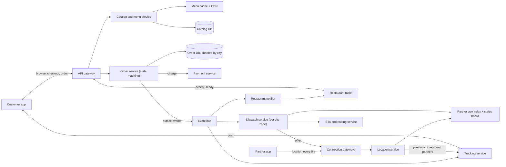
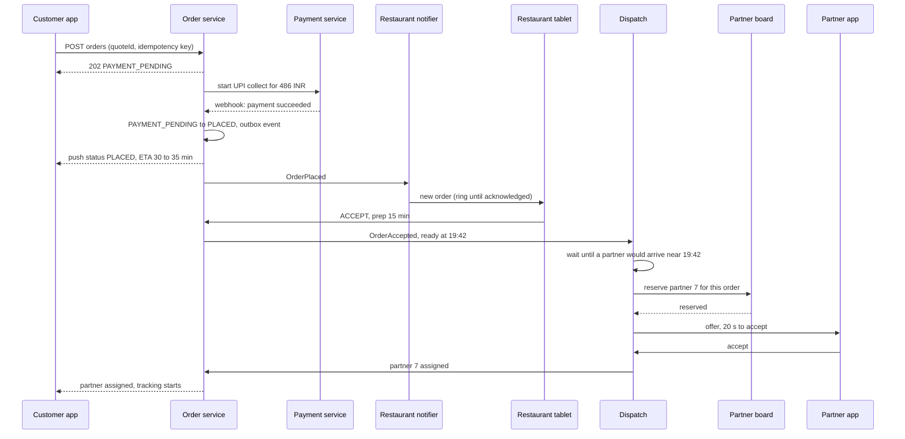
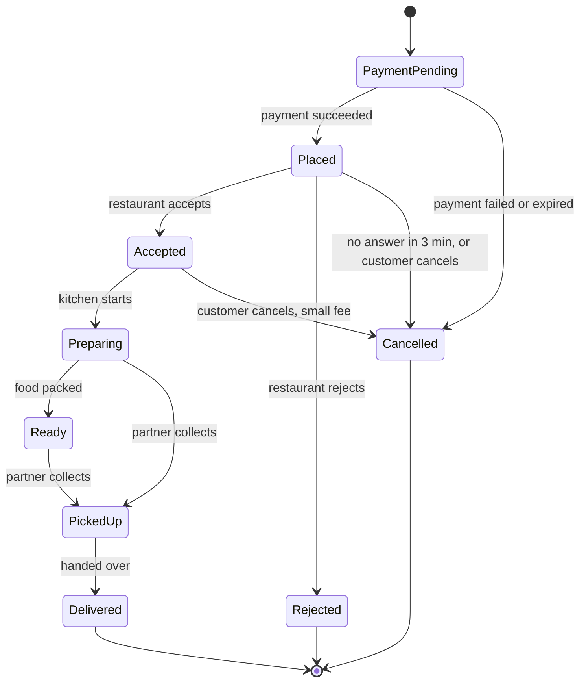

A food delivery app looks like a shop with a delivery van, but it is really a three-way coordination problem. A customer wants hot biryani in 30 minutes. A restaurant kitchen has its own rhythm and may be slammed with dine-in orders. A delivery partner on a scooter is somewhere in the city, possibly already carrying another order. The platform's job is to make all three meet at the right moment: the partner should reach the restaurant just as the food is packed, not ten minutes early (wasting the partner's time) and not ten minutes late (the food goes cold).

This case study designs that system. It borrows the geospatial ideas from the [ride-hailing case study](#/lesson/m17-ride-hailing) and focuses on what is different: a restaurant that must accept, food preparation time, dispatch timing, batching two orders on one trip, and ETAs that combine kitchen and road. It reasons from public engineering principles; nothing here claims to describe how Swiggy, Zomato, DoorDash, Uber Eats or any other company actually builds its platform.

## Learning objectives

By the end of this case study you will be able to:

1. Estimate order rates, menu-browsing load, partner location updates and live-tracking pushes for a national food delivery platform.
2. Model an order's lifecycle as a guarded state machine with restaurant acceptance timeouts, and separate it from the delivery assignment lifecycle.
3. Design dispatch that scores partners by how well their arrival time matches food readiness, not just by distance.
4. Decide when to batch two orders onto one partner and enforce the rules atomically.
5. Compute and communicate a delivery ETA from preparation time, travel time and handover, and keep it honest as the order progresses.
6. Reason about live tracking fan-out, failures, security, cost and when a much simpler design is enough.

## Prerequisites

- [Ride-hailing platform](#/lesson/m17-ride-hailing): geohash cells, the live location index and exclusive reservation.
- [Capacity estimation](#/lesson/m11-capacity-estimation): RPS and storage arithmetic.
- [Transactional outbox](#/lesson/m12-outbox): emitting events reliably after a database write.
- [Sagas](#/lesson/m12-sagas): coordinating payment, restaurant and dispatch steps that can each fail.
- [WebSockets, SSE and long polling](#/lesson/m10-realtime): pushing live updates to apps.

## Explain it like I'm a beginner

Imagine a busy wedding caterer in Lucknow coordinating three groups by phone.

- **Guests** call in orders: "Two plates of kebab to table 14." That is **placing an order**.
- The caterer phones the **kitchen**: "Can you do two kebab plates? How long?" The kitchen might say "Yes, 12 minutes" or "Sorry, out of kebabs." If the kitchen doesn't answer in three minutes, the caterer tells the guest it can't be done. That is **restaurant acceptance with a timeout**.
- The caterer has **waiters** walking around the hall. He doesn't send a waiter to the kitchen the moment the order comes in, because the waiter would stand around for 12 minutes doing nothing. He picks the waiter who will reach the kitchen at about minute 11 or 12. That is **dispatch timed to food readiness**.
- If two guests at neighbouring tables order from the same counter at about the same time, one waiter can carry both plates. That is **batching**.
- The guest asks, "When will my food come?" The caterer adds up kitchen time, walking time and a minute for handing over plates: "About 18 minutes." As things change, he updates the answer. That is the **ETA**, and the guest watching the waiter walk across the hall is **live tracking**.

The software version does exactly this, for hundreds of thousands of orders at once, with phones instead of shouting.

## Requirements

### Functional

1. Customers browse nearby restaurants (filtered by distance, open hours and whether delivery is possible right now), view menus and add items to a cart.
2. Customers place an order and pay (UPI, cards, wallets, cash on delivery). They see a promised ETA before paying.
3. Restaurants receive orders on a tablet app, accept or reject them within a time limit, and can update the preparation time and mark food ready.
4. The platform assigns a delivery partner, who accepts the offer, picks up the food and delivers it.
5. Customers track the partner live on a map and see an ETA that updates.
6. Cancellations and refunds follow rules that depend on how far the order has progressed.
7. Ratings, support tickets and partner earnings (out of scope in detail, but they consume order events).

### Non-functional

| Property | Target |
|---|---|
| Order placement | p95 under 1 s from tap to "order placed" (excluding the payment app redirect) |
| Restaurant notification | Order on the restaurant tablet within 5 s of payment success |
| Dispatch | A partner assigned before the food is ready in at least 95 % of orders |
| Tracking freshness | Partner position on the customer's map at most ~10 s old |
| Correctness | An order is charged once, assigned to at most one active partner, and never "delivered" without being picked up |
| Availability | 99.95 % for ordering and tracking; menu browsing may serve slightly stale data |
| Scale | 4 M orders/day across ~500 cities; 300,000 partners online at the dinner peak |

### Out of scope

Payments internals (see the [payment system case study](#/lesson/m17-payment-system)), the routing engine itself (we call it as a service), search ranking and recommendations, grocery quick-commerce warehouses, partner onboarding.

## Capacity estimation

All figures are **estimates** for the arithmetic; real numbers vary by market.

### Orders

- **4 M orders/day** ÷ 86,400 s ≈ **46 orders/s** on average. That average is misleading: food is extremely peaky.
- Assume 25 % of the day's orders arrive in the 2-hour dinner window: 1 M ÷ 7,200 s ≈ **139 orders/s**.
- A cricket final, a festival evening or heavy rain can add 50 %: ≈ **210 orders/s** at the design peak.

### Browsing

- Customers open many menus before ordering. Assume 20 restaurant or menu views per order: 4 M × 20 = **80 M views/day**.
- At the dinner peak: 210 orders/s × 20 ≈ **4,200 menu reads/s**. These are cacheable, so they hit a CDN or cache, not the database.
- Restaurant listing ("what's near me and open?") runs on every home-screen load: assume 3 per order session, ≈ **630 listing queries/s** at peak, each a geo plus filter query.

### Delivery partners and tracking

- **300,000 partners online** at peak, each sending a location every **5 s**: 300,000 ÷ 5 = **60,000 updates/s**. That is one sixth of the ride-hailing example: food is lighter on location writes but heavier on coordination.
- Active orders at any moment (Little's law: arrival rate × time in system): 139 orders/s × 40 min × 60 s ≈ **333,000 orders in flight** at the dinner peak.
- If each in-flight order has one customer watching and we push a position every 5 s: 333,000 ÷ 5 ≈ **67,000 pushes/s** to customer apps. In practice only perhaps a third of customers keep the tracking screen open, but we design for all.
- **Sanity check on supply.** A partner is busy for roughly 25 minutes per order (ride to the restaurant, wait, ride to the customer). 139 orders/s × 1,500 s ≈ **208,000 partners busy** at the dinner peak, so 300,000 online means about 70 % utilisation. If your estimate needs more busy partners than are online, one of the assumptions is wrong (or you are relying on batching).

### Storage

- Order record, items, address snapshot and event history ≈ **5 KB** per order (estimate): 4 M × 5 KB = **20 GB/day**, ≈ **7.3 TB/year** before indexes. Hot for 90 days in PostgreSQL, then archived.
- Partner location history: average rate perhaps one third of peak, 20,000/s × 100 B × 86,400 ≈ **173 GB/day**. Keep 30 days raw for disputes, then compress into per-order route polylines.
- Menus: 300,000 restaurants × 150 items × 1 KB ≈ **45 GB** with images stored separately in object storage behind a CDN.

| Quantity | Estimate |
|---|---|
| Orders | ~46/s average, ~139/s dinner, ~210/s spike |
| Menu reads | ~4,200/s peak (cache) |
| Partner location updates | ~60,000/s peak |
| Orders in flight | ~333,000 at peak |
| Tracking pushes | up to ~67,000/s |
| Order storage | ~20 GB/day |

**What breaks first?** Not the order rate: 210 writes/s is modest for PostgreSQL. The first failures are usually (1) restaurant tablets on flaky Wi-Fi that don't acknowledge orders, (2) dispatch in a hot zone at 8:30 pm when 2,000 orders want 600 partners, (3) the tracking fan-out if every customer app polls an uncached endpoint, and (4) menu reads hitting the database when the cache is cold after a deploy.

## API design

Customer and partner apps use HTTPS for commands and a persistent connection (WebSocket via SignalR, or Server-Sent Events) for live updates. Restaurant tablets also hold a persistent connection, with push notifications as a fallback because a sleeping tablet drops sockets.

```http
GET  /v1/restaurants?lat=26.8467&lng=80.9462&veg=true        -> open restaurants that can deliver here now
GET  /v1/restaurants/{id}/menu                                 -> cacheable, ETag + max-age=60

POST /v1/carts/{cartId}/checkout                               -> price, taxes, delivery fee, promised ETA
200 { "quoteId": "fq_31…", "total": { "amount": 486.00, "currency": "INR" }, "etaMinutes": [30, 35], "expiresAt": "…+10 min" }

POST /v1/orders                       Idempotency-Key: 8f2a…
{ "quoteId": "fq_31…", "paymentMethod": "upi", "addressId": "a_77" }
202 { "orderId": "o_5c…", "status": "PAYMENT_PENDING" }

POST /v1/restaurant/orders/{id}/events         (restaurant tablet)
{ "type": "ACCEPT", "prepMinutes": 15, "expectedVersion": 2 }

POST /v1/partner/offers/{offerId}/accept       (partner app)
POST /v1/partner/orders/{id}/events            { "type": "PICKED_UP", "expectedVersion": 5 }
POST /v1/partner/location                      { "points": [ { "lat": 26.851, "lng": 80.949, "at": "…" } ] }

GET  /v1/orders/{id}                           -> status, partner position (if picked up), ETA range
WS   /hubs/tracking?orderId=o_5c…              -> pushes: status changes, position every 5 s, ETA changes
```

Decisions:

- **Checkout creates a quote.** The price and the promised ETA the customer sees are frozen in a `quoteId` for 10 minutes, so the order charges exactly what was shown. Taxes (GST on food and on the delivery fee are computed differently in India) are computed once, here.
- **`Idempotency-Key` on order creation**, and `quote_id UNIQUE` in the database: a double tap or a retry after a timeout cannot create two orders. See [idempotency keys](#/lesson/m10-idempotency).
- **`202 Accepted` then asynchronous progress.** The order's journey (payment confirmation, restaurant acceptance, dispatch) takes minutes and involves other parties, so the API returns immediately and the app follows the order over the tracking channel.
- **ETA as a range.** "30–35 min" is more honest than "32 min", and it absorbs small changes without the number jumping every few seconds.
- **`expectedVersion` on every state-changing event** (restaurant, partner, customer) gives optimistic concurrency, so a customer's cancel that races with the restaurant's accept fails cleanly with `409 Conflict`.

## Data model

PostgreSQL holds orders, restaurants and assignments. Live partner positions live in memory or Redis per city (as in ride-hailing; the [proximity service](#/lesson/m17-proximity-service) covers geo indexes in depth). Menus are stored in PostgreSQL but served from cache.

```sql
CREATE TABLE restaurant (
  restaurant_id   bigint PRIMARY KEY,
  city_id         int    NOT NULL,
  name            text   NOT NULL,
  lat             double precision NOT NULL,
  lng             double precision NOT NULL,
  cell6           text   NOT NULL,              -- geohash for "near me" lookups
  is_open         boolean NOT NULL DEFAULT false, -- toggled by the restaurant or its schedule
  avg_prep_min    int    NOT NULL DEFAULT 15     -- recomputed nightly from history
);

CREATE TABLE menu_item (
  item_id         bigint PRIMARY KEY,
  restaurant_id   bigint NOT NULL REFERENCES restaurant,
  name            text   NOT NULL,
  price_paise     bigint NOT NULL CHECK (price_paise > 0),
  is_available    boolean NOT NULL DEFAULT true,  -- "out of stock" toggle
  version         int    NOT NULL DEFAULT 1       -- bumps invalidate the menu cache
);

CREATE TABLE food_order (
  order_id        uuid   PRIMARY KEY,
  city_id         int    NOT NULL,
  customer_id     bigint NOT NULL,
  restaurant_id   bigint NOT NULL REFERENCES restaurant,
  quote_id        uuid   NOT NULL UNIQUE,         -- one order per checkout quote
  status          text   NOT NULL,
  version         int    NOT NULL DEFAULT 1,
  total_paise     bigint NOT NULL,
  drop_lat        double precision NOT NULL,      -- address snapshot: editing the address book
  drop_lng        double precision NOT NULL,      -- later must not move this order
  promised_eta_at timestamptz NOT NULL,
  placed_at       timestamptz NOT NULL DEFAULT now(),
  accepted_at     timestamptz,
  ready_at        timestamptz,
  picked_up_at    timestamptz,
  delivered_at    timestamptz
);
CREATE INDEX food_order_restaurant_open ON food_order (restaurant_id, placed_at)
  WHERE status IN ('PLACED','ACCEPTED','PREPARING','READY');

CREATE TABLE order_item (
  order_id        uuid   NOT NULL REFERENCES food_order,
  line_no         int    NOT NULL,
  item_id         bigint NOT NULL,
  name_snapshot   text   NOT NULL,                -- price and name at order time
  price_paise     bigint NOT NULL,
  qty             int    NOT NULL CHECK (qty > 0),
  PRIMARY KEY (order_id, line_no)
);

CREATE TABLE delivery_assignment (
  assignment_id   bigserial PRIMARY KEY,
  order_id        uuid   NOT NULL REFERENCES food_order,
  partner_id      bigint NOT NULL,
  status          text   NOT NULL CHECK (status IN ('OFFERED','ACCEPTED','PICKED_UP','DELIVERED','RELEASED')),
  offered_at      timestamptz NOT NULL DEFAULT now()
);
-- An order has at most one live assignment; released ones stay for history.
CREATE UNIQUE INDEX one_live_assignment_per_order ON delivery_assignment (order_id)
  WHERE status IN ('OFFERED','ACCEPTED','PICKED_UP');

CREATE TABLE order_event (
  order_id        uuid NOT NULL REFERENCES food_order,
  version         int  NOT NULL,
  from_status     text NOT NULL,
  to_status       text NOT NULL,
  actor           text NOT NULL,                  -- 'customer:42', 'restaurant:9', 'partner:7', 'system'
  at              timestamptz NOT NULL DEFAULT now(),
  PRIMARY KEY (order_id, version)
);
```

Why this shape:

- **Snapshots, not references, for things that change.** `order_item.name_snapshot` and `price_paise` copy the menu at order time; `drop_lat/lng` copy the address. If the restaurant raises the price of paneer tikka tomorrow, yesterday's invoice must not change.
- **Two lifecycles, two tables.** The order's status (`PLACED → … → DELIVERED`) is about the food and the customer. The assignment's status is about one partner's attempt. A partner who cancels mid-way releases their assignment; the order stays `PREPARING` and dispatch creates a new assignment. Mixing these into one status column is a classic source of bugs.
- **The partial unique index** `one_live_assignment_per_order` means two dispatchers racing on the same order cannot both create live assignments. Batching (one partner, two orders) is allowed because uniqueness is per order, not per partner; the partner's capacity is enforced in the dispatch service and checked again on insert.
- **The partial index on open orders** keeps the restaurant tablet's "my active orders" query and the acceptance-timeout sweeper fast, because delivered orders (the vast majority) are not in it.
- **`order_event`** is the audit trail and doubles as the outbox source for downstream consumers (notifications, payments, analytics, partner earnings).
- **Shard key: `city_id`.** Orders, restaurants and partners never cross cities. Large metros can be split further by zone.
- **Time-ordered ids.** `order_id` is a UUID generated by the app as version 7 (`Guid.CreateVersion7()` in .NET 9 and later), so new rows land at the end of the primary-key index instead of at random pages. Random v4 UUIDs at 20 GB/day cause index bloat and cache misses. See the [unique ID generator](#/lesson/m17-unique-id-generator) for the alternatives.

## High-level architecture



Every arrow:

1. **Customer app → API gateway → catalog.** Listing and menus are read-heavy and served from a cache and CDN (menu JSON keyed by restaurant and version). Only cache misses reach the catalog database.
2. **Checkout and order → order service.** The order service validates the quote, creates the order in `PAYMENT_PENDING`, and asks the payment service to collect. On payment success it moves to `PLACED` and writes an outbox event in the same transaction.
3. **Order service → event bus → restaurant notifier → tablet.** The notifier pushes the order to the tablet over its socket and, if no acknowledgement arrives within a few seconds, retries and then sends a push notification or an automated phone call. The tablet answers with `ACCEPT` (with prep time) or `REJECT` through the gateway.
4. **Event bus → dispatch.** Dispatch listens for `OrderAccepted` (and prep-time updates). It doesn't assign immediately; it schedules assignment so a partner arrives about when the food is ready.
5. **Partner app → connection gateways → location service → geo index.** Same pipeline as ride-hailing, at about 60,000 updates/s: the index holds each online partner's cell, position, and current load (orders carried).
6. **Dispatch → index, ETA, gateways.** Dispatch picks candidates near the restaurant, asks the ETA service for travel times, scores them, reserves one atomically and sends an offer through the partner's connection.
7. **Event bus and location → tracking → customer app.** The tracking service knows which partner serves which order. It subscribes to positions of assigned partners only and pushes them, with ETA updates, to the customer's open tracking screen.

### Sequence: from payment to an accepted partner



UPI and card payments complete asynchronously: the customer approves in their UPI app, and the result reaches the order service as a signed webhook (or a status poll), which is why the API answers `202` first. Three details matter. First, the restaurant is only notified **after payment succeeds**, so kitchens never cook unpaid food (cash-on-delivery orders skip that wait but get stricter fraud limits). Second, dispatch **waits** after acceptance: with a 15-minute prep time and partners 6 minutes away, offering immediately would leave the partner idle at the counter for 9 minutes. Third, the partner is **reserved before the offer**, exactly as in ride-hailing, so no other dispatcher can offer partner 7 a conflicting order while the 20-second offer is open.

## Deep dives

### 1. The order lifecycle and restaurant acceptance

The order is a state machine. Writing it down as a table stops each endpoint from inventing its own rules.



Read it as a contract:

- **Acceptance timeout.** A `Placed` order that no one accepts within 3 minutes is cancelled automatically with a full refund. A sweeper (or a delayed message per order) applies the `Timeout` action. Without it, customers wait 20 minutes for food that was never started.
- **No customer cancel after preparing starts.** Once the kitchen is cooking, cancelling wastes food; the platform may allow it through support, with no refund. Product teams choose the exact rule; the state machine makes it explicit.
- **`Preparing → PickedUp` is allowed.** Many kitchens never press "ready"; the partner collecting the food is proof enough. Real workflows have such shortcuts, and it is better to model them than to let partners get stuck.
- **No path to `Delivered` without `PickedUp`.** This blocks a class of fraud (partners marking undelivered orders as delivered) and bugs.
- **Rejected and cancelled orders trigger compensation**: refund the payment, release the partner if one was assigned. This is a [saga](#/lesson/m12-sagas): each step has a compensating step.

```csharp file=Orders/FoodOrder.cs
namespace FoodDelivery.Orders;

public enum OrderStatus { PaymentPending, Placed, Accepted, Preparing, Ready, PickedUp, Delivered, Rejected, Cancelled }

public enum OrderAction
{
    PaymentSucceeded, PaymentFailed, RestaurantAccept, RestaurantReject, AcceptanceTimeout,
    StartPreparing, MarkReady, PickUp, Deliver, CustomerCancel
}

public enum RefundKind { None, Full, MinusCancellationFee }

public sealed class OrderConflictException(string message) : Exception(message);

public sealed class FoodOrder
{
    private static readonly Dictionary<(OrderStatus, OrderAction), OrderStatus> Transitions = new()
    {
        [(OrderStatus.PaymentPending, OrderAction.PaymentSucceeded)] = OrderStatus.Placed,
        [(OrderStatus.PaymentPending, OrderAction.PaymentFailed)] = OrderStatus.Cancelled,
        [(OrderStatus.Placed, OrderAction.RestaurantAccept)] = OrderStatus.Accepted,
        [(OrderStatus.Placed, OrderAction.RestaurantReject)] = OrderStatus.Rejected,
        [(OrderStatus.Placed, OrderAction.AcceptanceTimeout)] = OrderStatus.Cancelled,
        [(OrderStatus.Placed, OrderAction.CustomerCancel)] = OrderStatus.Cancelled,
        [(OrderStatus.Accepted, OrderAction.StartPreparing)] = OrderStatus.Preparing,
        [(OrderStatus.Accepted, OrderAction.CustomerCancel)] = OrderStatus.Cancelled,
        [(OrderStatus.Preparing, OrderAction.MarkReady)] = OrderStatus.Ready,
        [(OrderStatus.Preparing, OrderAction.PickUp)] = OrderStatus.PickedUp,
        [(OrderStatus.Ready, OrderAction.PickUp)] = OrderStatus.PickedUp,
        [(OrderStatus.PickedUp, OrderAction.Deliver)] = OrderStatus.Delivered,
    };

    private readonly Lock _gate = new();

    public FoodOrder(Guid id, long restaurantId, double dropLat, double dropLng, long totalPaise)
    {
        Id = id; RestaurantId = restaurantId; DropLat = dropLat; DropLng = dropLng; TotalPaise = totalPaise;
    }

    public Guid Id { get; }
    public long RestaurantId { get; }
    public double DropLat { get; }
    public double DropLng { get; }
    public long TotalPaise { get; }
    public OrderStatus Status { get; private set; } = OrderStatus.PaymentPending;
    public int Version { get; private set; } = 1;
    public int? PrepMinutes { get; private set; }
    public DateTimeOffset? AcceptedAt { get; private set; }
    public RefundKind Refund { get; private set; } = RefundKind.None;

    public bool IsTerminal => Status is OrderStatus.Delivered or OrderStatus.Rejected or OrderStatus.Cancelled;

    public OrderStatus Apply(OrderAction action, int expectedVersion, DateTimeOffset now, int? prepMinutes = null)
    {
        lock (_gate)
        {
            if (expectedVersion != Version)
                throw new OrderConflictException($"Order is at version {Version}, not {expectedVersion}.");
            if (!Transitions.TryGetValue((Status, action), out var next))
                throw new InvalidOperationException($"{action} is not allowed when the order is {Status}.");
            if (action == OrderAction.RestaurantAccept && prepMinutes is not (>= 1 and <= 120))
                throw new ArgumentOutOfRangeException(nameof(prepMinutes), "Accept needs a prep time of 1-120 minutes.");

            // Side effects are computed before any field changes, so a throw above leaves the order untouched.
            var refund = (Status, action) switch
            {
                (OrderStatus.Placed, OrderAction.RestaurantReject) => RefundKind.Full,
                (OrderStatus.Placed, OrderAction.AcceptanceTimeout) => RefundKind.Full,
                (OrderStatus.Placed, OrderAction.CustomerCancel) => RefundKind.Full,
                (OrderStatus.Accepted, OrderAction.CustomerCancel) => RefundKind.MinusCancellationFee,
                _ => Refund
            };

            if (action == OrderAction.RestaurantAccept) { PrepMinutes = prepMinutes; AcceptedAt = now; }
            Refund = refund;
            Status = next;
            Version++;
            return Status;
        }
    }
}
```

In the database each transition is `UPDATE food_order SET status = $next, version = version + 1 WHERE order_id = $id AND version = $expected`, plus an `order_event` insert in the same transaction. Zero rows updated means a concurrent change won, and the API returns `409`.

**Making restaurants answer.** The acceptance step is where food delivery differs most from e-commerce: a human in a hot kitchen must respond. Practical techniques: the tablet rings loudly until acknowledged; the notifier retries over the socket, then push notification, then an automated phone call at about 90 seconds; restaurants with consistently slow acceptance get auto-accept enabled (the platform accepts on their behalf using their average prep time); and restaurants that miss many orders are temporarily marked closed, because a restaurant shown as open but not answering is worse than one shown as closed.

### 2. Dispatch: time the partner to the food

Dispatch answers: **which partner, and when?** Distance alone is the wrong objective.

Two clocks run in parallel after acceptance:

- **Food ready time**: `accepted_at + prep minutes`, adjusted by the restaurant's history (if a kitchen that says 15 minutes usually takes 19, use 19).
- **Partner arrival time**: now + travel time from the partner's position to the restaurant (from the ETA service).

Define for each candidate:

- `foodWait = max(0, arrival − ready)`: the food sits on the counter getting cold.
- `partnerIdle = max(0, ready − arrival)`: the partner waits at the counter, earning nothing and unavailable to others.

A good dispatcher minimises a weighted sum, with food waiting weighted more because it hurts the customer directly: `cost = 2 × foodWait + 1 × partnerIdle + detour penalty (if batched)`. It also decides **when to start looking**: there's no point dispatching at minute 0 for a 25-minute biryani when partners are 5 minutes away. A common approach is to run dispatch in **rounds** per zone every 15–30 seconds: each round considers orders whose ready time is within the next N minutes, scores all (order, partner) pairs, and assigns greedily from the best pair (or solves an assignment problem when the zone is dense).

```csharp file=Dispatch/DispatchScorer.cs
namespace FoodDelivery.Dispatch;

public sealed record DispatchCandidate(long PartnerId, double MinutesToRestaurant, bool AlreadyCarrying, double ExtraDetourMinutes);

public sealed record ScoredCandidate(DispatchCandidate Candidate, double FoodWaitMinutes, double PartnerIdleMinutes, double Cost);

public sealed class DispatchWeights
{
    public double FoodWait { get; set; } = 2.0;     // cold food hurts the customer most
    public double PartnerIdle { get; set; } = 1.0;  // idle partners are lost capacity
    public double Detour { get; set; } = 1.5;       // the first customer's delay when batching
}

public sealed class DispatchScorer(DispatchWeights weights)
{
    /// <summary>Scores candidates for an order whose food is ready in <paramref name="minutesUntilReady"/> minutes.</summary>
    public IReadOnlyList<ScoredCandidate> Rank(double minutesUntilReady, IEnumerable<DispatchCandidate> candidates)
    {
        var ready = Math.Max(0, minutesUntilReady);
        return candidates
            .Select(c =>
            {
                var foodWait = Math.Max(0, c.MinutesToRestaurant - ready);
                var idle = Math.Max(0, ready - c.MinutesToRestaurant);
                var detour = c.AlreadyCarrying ? c.ExtraDetourMinutes : 0;
                var cost = weights.FoodWait * foodWait + weights.PartnerIdle * idle + weights.Detour * detour;
                return new ScoredCandidate(c, foodWait, idle, cost);
            })
            .OrderBy(s => s.Cost)
            .ThenBy(s => s.Candidate.MinutesToRestaurant)
            .ToList();
    }

    /// <summary>Start looking when the best plausible partner would arrive just before the food is ready.</summary>
    public static bool ShouldDispatchNow(double minutesUntilReady, double typicalMinutesToRestaurant, double bufferMinutes = 3) =>
        minutesUntilReady <= typicalMinutesToRestaurant + bufferMinutes;
}
```

Worked example: food ready in 12 minutes. Partner A is 4 minutes away (idle 8 → cost 8). Partner B is 11 minutes away (idle 1 → cost 1). Partner C is 15 minutes away (food waits 3 → cost 6). Pure distance picks A; the timing-aware scorer picks **B**, and A stays free for an order that's ready sooner. That single idea is most of what makes food dispatch different from taxi dispatch.

### 3. Batching: two orders, one trip

At 8:30 pm in a dense zone there may be 3 orders per available partner. Batching (also called stacking) lets one partner carry two orders, typically from the same restaurant or two restaurants a few hundred metres apart, to customers in roughly the same direction.

Rules that keep batching safe:

1. **Capacity**: at most 2 (sometimes 3) orders per partner; bag size and food temperature limit it.
2. **Same pickup, or a tiny detour**: same restaurant is easiest; a second restaurant must be very close and ready at about the same time.
3. **Before pickup only**: once the partner has picked up and left, adding an order means going back.
4. **Bounded delay for the first customer**: if the second drop adds more than, say, 6 minutes to the first customer's ETA, don't batch. The detour penalty in the scorer encodes this.
5. **Atomic**: two dispatch rounds must not both add an order to the same partner when only one slot is free.

```csharp file=Dispatch/PartnerBoard.cs
namespace FoodDelivery.Dispatch;

public sealed record PartnerDrop(Guid OrderId, long RestaurantId, bool PickedUp);

public sealed record PartnerState(long PartnerId, bool Online, IReadOnlyList<PartnerDrop> Drops);

/// <summary>
/// Per-zone referee for "can this partner take this order?". All mutations go through one lock (single writer per zone),
/// so capacity and batching rules are checked and applied atomically. Production: one actor per zone, or a Redis Lua script,
/// with the one-live-assignment-per-order unique index in PostgreSQL as the backstop.
/// </summary>
public sealed class PartnerBoard(int maxBatch = 2)
{
    private readonly Dictionary<long, PartnerState> _partners = new();
    private readonly Dictionary<Guid, long> _orderOwner = new();
    private readonly Lock _gate = new();

    public void GoOnline(long partnerId)
    {
        lock (_gate)
            _partners[partnerId] = _partners.TryGetValue(partnerId, out var p) ? p with { Online = true } : new PartnerState(partnerId, true, []);
    }

    public PartnerState? Get(long partnerId)
    {
        lock (_gate) return _partners.GetValueOrDefault(partnerId);
    }

    public bool TryAssign(long partnerId, Guid orderId, long restaurantId)
    {
        lock (_gate)
        {
            if (_orderOwner.ContainsKey(orderId)) return false;                     // order already has a partner
            if (!_partners.TryGetValue(partnerId, out var p) || !p.Online) return false;
            if (p.Drops.Count >= maxBatch) return false;
            if (p.Drops.Count > 0 && p.Drops.Any(d => d.PickedUp || d.RestaurantId != restaurantId)) return false;

            _partners[partnerId] = p with { Drops = [.. p.Drops, new PartnerDrop(orderId, restaurantId, false)] };
            _orderOwner[orderId] = partnerId;
            return true;
        }
    }

    public bool Release(long partnerId, Guid orderId)
    {
        lock (_gate)
        {
            if (!_orderOwner.TryGetValue(orderId, out var owner) || owner != partnerId) return false;
            var p = _partners[partnerId];
            _partners[partnerId] = p with { Drops = p.Drops.Where(d => d.OrderId != orderId).ToList() };
            _orderOwner.Remove(orderId);
            return true;
        }
    }

    public void MarkPickedUp(long partnerId, long restaurantId)
    {
        lock (_gate)
        {
            if (!_partners.TryGetValue(partnerId, out var p)) return;
            _partners[partnerId] = p with
            {
                Drops = p.Drops.Select(d => d.RestaurantId == restaurantId ? d with { PickedUp = true } : d).ToList()
            };
        }
    }

    public bool CompleteDrop(long partnerId, Guid orderId) => Release(partnerId, orderId);
}
```

The board enforces "one partner per order" (`_orderOwner`) and "capacity and same-restaurant batching" in one critical section. This simplified board only batches orders from the same restaurant; extending it to nearby restaurants is an exercise in this lesson's spirit.

### 4. ETA: kitchen plus road plus handover

The promised ETA is shown before payment and drives customer trust. It has three parts:

```
ETA = max(food ready, partner reaches restaurant) + handover at restaurant + travel to customer + handover at door
```

- **Prep time** comes from the restaurant's own estimate, corrected by its history for this hour and day (a kitchen's Friday 9 pm is slower than its Tuesday 4 pm). Before acceptance we only have the historical estimate.
- **Travel time** comes from the routing service, with a speed profile per city and hour (Bengaluru at 7 pm is not Bengaluru at 11 pm). Straight-line distance × a road factor (~1.3–1.4 in dense cities, an estimate) is a fallback when routing is slow.
- **Handovers** (finding parking, climbing to a fourth-floor flat, the society gate) are surprisingly large; learn them per building or locality from history.

The ETA is recomputed at each event (accepted, partner assigned, picked up) and from live position after pickup. Show it as a range and **never let it move by small amounts every few seconds**: update the displayed range only when the new estimate leaves the current range.

```csharp file=Eta/DeliveryEtaEstimator.cs
namespace FoodDelivery.Eta;

public sealed record EtaInputs(
    double MinutesUntilFoodReady,
    double KmPartnerToRestaurant,
    double KmRestaurantToCustomer,
    double CitySpeedKmh,
    double PickupHandoverMinutes = 2,
    double DoorHandoverMinutes = 2);

public sealed record EtaEstimate(double PickupAtMinutes, double DeliverAtMinutes, int RangeLow, int RangeHigh)
{
    public string Display => $"{RangeLow}-{RangeHigh} min";
}

public static class DeliveryEtaEstimator
{
    public static EtaEstimate Estimate(EtaInputs i)
    {
        if (i.CitySpeedKmh <= 0) throw new ArgumentOutOfRangeException(nameof(i), "Speed must be positive.");
        var toRestaurant = i.KmPartnerToRestaurant / i.CitySpeedKmh * 60;
        var toCustomer = i.KmRestaurantToCustomer / i.CitySpeedKmh * 60;
        var pickupAt = Math.Max(Math.Max(0, i.MinutesUntilFoodReady), toRestaurant) + i.PickupHandoverMinutes;
        var deliverAt = pickupAt + toCustomer + i.DoorHandoverMinutes;
        var low = (int)Math.Ceiling(deliverAt) / 5 * 5;      // 26.4 -> 27 -> 25
        return new EtaEstimate(pickupAt, deliverAt, low, low + 5);
    }

    /// <summary>Only change what the customer sees when the new estimate leaves the displayed range.</summary>
    /// Round up first, exactly as Estimate does, so recomputing the same estimate never counts as a change.
    public static bool ShouldUpdateDisplay(EtaEstimate shown, double newDeliverAtMinutes)
    {
        var minutes = Math.Ceiling(newDeliverAtMinutes);
        return minutes < shown.RangeLow || minutes > shown.RangeHigh;
    }
}
```

**Promised versus predicted.** The ETA shown at checkout is a **promise**; later ETAs are **predictions**. Track both: the promise drives customer satisfaction metrics and compensation ("late delivery" coupons), the prediction drives the tracking screen. Promising aggressively increases conversion and then increases complaints; that tension is a business decision, measured with experiments.

### 5. Live tracking without melting the system

333,000 orders in flight, positions every 5 s. Two naive designs fail:

- **Every customer polls `GET /orders/{id}` every 5 s against the database**: 67,000 reads/s of a hot, constantly changing row. It works badly and costs a lot.
- **Broadcast every partner's position to everyone**: wasteful and a privacy leak.

The tracking service instead keeps a small map `partnerId → [orderIds being tracked]`, built from `PartnerAssigned` events. The location service publishes positions only for partners with an active assignment (a few hundred thousand), partitioned by city. The tracking service forwards each position to the customer connections watching that order through the connection gateway (SignalR groups named by order id work well: `Clients.Group($"order:{id}")`). The hub adds a connection to an order's group only after checking that the caller owns that order. With dozens of gateway instances, a group message must reach whichever instance holds the customer's socket, so you need a backplane (the SignalR Redis backplane or Azure SignalR Service) or you route each order's updates to the gateway that holds its connection. Before pickup, the customer sees the partner moving towards the restaurant; after delivery, the subscription ends and the partner's position is no longer shared.

If the customer's socket drops, the app falls back to polling `GET /orders/{id}`, which reads from a cache entry updated by the tracking service, not from the order database. Positions are smoothed on the client (interpolating between points) so the scooter glides instead of jumping.

## Caching, queues and scaling

**Caching.**

- **Menus**: menu JSON per restaurant, keyed by `(restaurant_id, menu_version)`, cached at the CDN and in a distributed cache. Bumping `version` on any item change makes old keys unreachable instead of trying to purge them. Item availability ("out of stock") changes often during dinner, so it is a small separate document with a short TTL (30 s) merged on the client, so the big menu document can be cached longer.
- **Restaurant listings**: per geohash-5 cell plus filter combination, 30–60 s TTL. "Is open and accepting" is the volatile part; keep it in a separate small cache updated by events.
- **Prep-time statistics and ETA speed profiles**: computed offline, cached in memory.
- **Order status for polling clients**: written by the tracking service, read by `GET /orders/{id}`.

**Queues and streams.**

- **Order events** via the outbox to a partitioned stream keyed by order id (ordering per order). Consumers: restaurant notifier, dispatch, tracking, notifications, payments (refunds), analytics, partner earnings.
- **Acceptance timeouts** as delayed messages (or a sweeper over the partial index every 15 s; the [job scheduler](#/lesson/m17-job-scheduler) case study covers durable timers). Either way the timeout handler applies `AcceptanceTimeout` with the version it read; if the restaurant accepted in the meantime, the version check makes the timeout a harmless no-op.
- **Dispatch work per zone**: a queue or an in-memory scheduler per zone shard, so a rainy evening in Pune doesn't slow dispatch in Kochi.

**Scaling by geography.** As in ride-hailing, the city (and zone within large cities) is the natural shard for orders, partners, dispatch and tracking. The catalog is mostly read and can be replicated widely. The order database at 210 writes/s (plus several transitions per order, perhaps 1,500 writes/s at peak) fits comfortably on a well-sized PostgreSQL primary; sharding by city is for blast radius and growth more than raw throughput.

**What to do when demand exceeds supply.** When a zone has too few partners, good systems degrade deliberately: widen the delivery-radius filter less, show longer ETAs, add a small "high demand" fee, temporarily hide far restaurants, or stop taking orders in that zone for a few minutes. Taking orders you can't deliver is worse than not taking them.

## Failure handling

| Failure | Effect | Mitigation |
|---|---|---|
| Restaurant tablet offline | Order never acknowledged | Retry over socket, then push, then automated call; auto-cancel with full refund at 3 min; mark restaurant closed after repeated misses |
| Payment confirmed, order service crashes before `PLACED` | Customer charged, no order | Payment webhook is idempotent and retried; reconciliation job moves paid `PAYMENT_PENDING` orders forward or refunds them |
| Two dispatchers pick the same order | Two partners sent | Board's `_orderOwner` check; `one_live_assignment_per_order` unique index as backstop |
| Partner accepts, then goes silent | Food waits | Heartbeat timeout; release the assignment and re-dispatch; partner's acceptance rate affects future offers |
| Partner cancels after pickup | Food in limbo | Support flow; never auto-reassign food already picked up without ops review |
| Restaurant's prep time far too low | Partner idles, ETA wrong | Correct with history; prep-time update events from the tablet re-time dispatch |
| Customer cancels while restaurant accepts | Race | `expectedVersion`; loser gets `409`; refund rules depend on the winning state |
| ETA service slow | Dispatch stalls | Timeout and fall back to distance × road factor ÷ city speed |
| Event bus lag | Restaurant notified late | Monitor consumer lag; notifier also polls the partial index for `PLACED` orders older than 10 s |
| City shard down | No orders in that city | Warm standby; other cities unaffected |

:::callout type=warning title="The dangerous failure is a paid order that nobody cooks"
Most failures here are recoverable by retrying. The one that destroys trust is a customer who paid, a restaurant that never saw the order, and an app that still says "preparing". Design an explicit watchdog: any order in `PLACED` past the acceptance limit, or `ACCEPTED` with no partner 5 minutes before ready time, raises an alert and enters an automatic recovery or refund path.
:::

## Security

- **Authorisation per actor.** Only the order's restaurant can accept or mark ready; only the assigned partner can mark picked up or delivered; only the customer can cancel as customer. Check on the server for every event; never trust an id in the request body alone.
- **Proof of delivery.** For high-value orders, a 4-digit delivery OTP shown to the customer prevents "marked delivered, never arrived" fraud. Geofence checks (partner within 100 m of the drop) catch lazy or fraudulent completions.
- **Location and address privacy.** Customers see the partner's position only while their order is active; partners see the customer's exact address only after pickup; phone numbers are masked through a calling proxy. Address and location history are personal data: restrict access, log it, and set retention limits (India's DPDP Act and similar laws).
- **Restaurant tablets** are shared devices in busy kitchens: use device-bound credentials, short sessions per staff member, and limited permissions (they can't see customer phone numbers).
- **Payment safety.** Never store card data; rely on the payment provider's tokens and verify webhook signatures (see [webhooks](#/lesson/m10-webhooks)).
- **Abuse.** Promo-code farming with fake accounts, partners colluding with customers for refund fraud, and GPS spoofing; rate limits per device and account, and anomaly detection on refunds.

## Observability

- **Funnel**: menu view → checkout → paid → placed, per city; a sudden drop in paid-to-placed is a payment or order-service incident.
- **Restaurant acceptance**: time to accept (p50, p95), auto-cancel rate per restaurant and per city; the single most actionable operational metric.
- **Dispatch**: share of orders assigned before ready time, partner idle minutes at restaurants, food wait minutes, offers per order, offer acceptance rate, batching rate.
- **ETA quality**: actual minus promised delivery time distribution; percentage delivered within the promised range. Track bias (always late?) and spread.
- **Tracking**: active tracking connections, push lag (position timestamp to client receipt).
- **Watchdogs**: orders stuck in any state beyond its expected duration, per city, with alerts.
- **Traces** that follow one order across order, payment, notifier, dispatch and tracking services with a correlation id ([distributed correlation](#/lesson/m10-correlation)).

## Deployment and cost

**Deployment.** Restaurant tablet apps update slowly (kitchens don't install updates mid-service), so the backend must support several tablet versions at once; version the restaurant API. Roll out dispatch changes city by city behind feature flags and compare metrics (idle minutes, late deliveries) against control cities: dispatch tuning is an experiment, not a deploy. Avoid deploying during the dinner peak.

**Cost drivers** (relative, estimates):

1. **Routing/ETA calls**: every listing, checkout and dispatch round calls routing. Cache by cell pair and hour; limit candidates before calling.
2. **Persistent connections** for partners, restaurant tablets and tracking customers: gateway fleet sizing.
3. **Notifications and calls**: push, SMS and automated calls to restaurants and customers cost per message.
4. **Images and menus** via CDN egress.
5. **Order and location storage**: tens of GB per day; archive to object storage after 90 days.

### When a simpler design is enough

A cloud kitchen brand with its own riders in one city (say 2,000 orders/day and 150 riders: at a peak hour of about 300 orders and 25 minutes per trip, roughly 125 riders are busy) does not need geo-sharded dispatch. 150 riders ÷ 10 s = 15 location updates/s fits in one PostgreSQL table or one Redis GEO set. Restaurant acceptance disappears (it's your own kitchen). Dispatch can be a dashboard where a human dispatcher drags orders onto riders, helped by a simple "nearest free rider" suggestion. One ASP.NET Core app with SignalR for tracking, one PostgreSQL database, and the same state machine and unique index will carry it comfortably. Add automated timing-aware dispatch when the human dispatcher becomes the bottleneck. The [scaling journey](#/lesson/m17-scaling-journey) case study walks a delivery-style app through exactly these stages, adding each component only when a measured bottleneck appears.

## Alternatives and trade-offs

| Decision | Choice here | Alternative | When the alternative wins |
|---|---|---|---|
| Dispatch objective | Timing-aware cost (food wait + idle + detour) | Nearest available partner | Small fleets, short prep times, low density |
| Dispatch timing | Delayed rounds per zone | Assign instantly at acceptance | When partners are scarce and you must lock one early |
| Assignment | Greedy best pair per round | Global optimisation (assignment problem) per round | Dense zones at peak where greedy choices block each other |
| Batching | Same restaurant, max 2, before pickup | No batching | Premium "single order" deliveries; hot food that can't wait |
| Restaurant acceptance | Manual with timeout | Auto-accept | Reliable kitchens with stable prep times; cloud kitchens |
| Tracking transport | WebSocket push via groups | Polling a cached status endpoint | Low traffic, or as fallback when sockets drop |
| Partner pool | Shared gig fleet | Restaurant's own riders | Large chains with steady volume in a small area |
| Order store | PostgreSQL sharded by city | One PostgreSQL cluster | Up to many thousands of writes/s; shard for blast radius when needed |

The essential trade-off: **food delivery is a scheduling problem more than a search problem.** Finding a nearby partner is the ride-hailing part; deciding *when* to send them, and whether one partner should carry two orders, is where most of the quality and cost lives. Keep the money and order state in a transactional database with constraints; keep partner positions and the dispatch board in fast, per-zone memory.

```csharp file=Dispatch/Dispatcher.cs
using FoodDelivery.Orders;

namespace FoodDelivery.Dispatch;

public interface IPartnerOfferChannel
{
    Task<bool> OfferAsync(long partnerId, Guid orderId, TimeSpan timeout, CancellationToken ct);
}

public sealed class AutoAcceptPartnerChannel : IPartnerOfferChannel
{
    public Task<bool> OfferAsync(long partnerId, Guid orderId, TimeSpan timeout, CancellationToken ct) => Task.FromResult(true);
}

public interface ICandidateSource
{
    /// <summary>Nearby online partners with their travel time to the restaurant (geo index + ETA service).</summary>
    IReadOnlyList<DispatchCandidate> CandidatesFor(FoodOrder order);
}

public sealed class StaticCandidateSource : ICandidateSource
{
    public List<DispatchCandidate> Candidates { get; } = [];
    public IReadOnlyList<DispatchCandidate> CandidatesFor(FoodOrder order) => Candidates;
}

public sealed class Dispatcher(PartnerBoard board, DispatchScorer scorer, ICandidateSource source, IPartnerOfferChannel offers)
{
    private static readonly TimeSpan OfferTimeout = TimeSpan.FromSeconds(20);
    private const int MaxOffers = 4;

    /// <summary>Returns the partner that accepted, or null so the next round can try again.</summary>
    public async Task<long?> DispatchAsync(FoodOrder order, double minutesUntilReady, CancellationToken ct)
    {
        var ranked = scorer.Rank(minutesUntilReady, source.CandidatesFor(order));
        foreach (var candidate in ranked.Take(MaxOffers))
        {
            var partnerId = candidate.Candidate.PartnerId;
            if (!board.TryAssign(partnerId, order.Id, order.RestaurantId)) continue;   // taken, full, or batching not allowed
            if (await offers.OfferAsync(partnerId, order.Id, OfferTimeout, ct)) return partnerId;
            board.Release(partnerId, order.Id);
        }
        return null;
    }
}
```

```csharp file=Program.cs
using System.Collections.Concurrent;
using FoodDelivery.Dispatch;
using FoodDelivery.Eta;
using FoodDelivery.Orders;

var builder = WebApplication.CreateBuilder(args);
builder.Services.AddSingleton(TimeProvider.System);
builder.Services.AddSingleton(new PartnerBoard(maxBatch: 2));
builder.Services.AddSingleton(new DispatchWeights());
builder.Services.AddSingleton<DispatchScorer>();
builder.Services.AddSingleton<StaticCandidateSource>();
builder.Services.AddSingleton<ICandidateSource>(sp => sp.GetRequiredService<StaticCandidateSource>());
builder.Services.AddSingleton<IPartnerOfferChannel, AutoAcceptPartnerChannel>();
builder.Services.AddSingleton<Dispatcher>();
builder.Services.AddSingleton<ConcurrentDictionary<Guid, FoodOrder>>();
builder.Services.AddSingleton<ConcurrentDictionary<string, Guid>>();   // idempotency key -> order id (demo)

var app = builder.Build();

app.MapPost("/v1/orders", (PlaceOrderRequest body, HttpRequest http, ConcurrentDictionary<Guid, FoodOrder> orders,
    ConcurrentDictionary<string, Guid> idempotency) =>
{
    var key = http.Headers["Idempotency-Key"].ToString();
    if (string.IsNullOrWhiteSpace(key)) return Results.BadRequest(new { error = "Idempotency-Key header is required." });
    // GetOrAdd's factory can run twice under a race, so create the candidate first and drop it if another request won.
    // Production: the key and a hash of the body live in PostgreSQL, and a reused key with a different body gets 422.
    var candidate = new FoodOrder(Guid.CreateVersion7(), body.RestaurantId, body.DropLat, body.DropLng, body.TotalPaise);
    orders[candidate.Id] = candidate;
    var orderId = idempotency.GetOrAdd(key, candidate.Id);
    if (orderId != candidate.Id) orders.TryRemove(candidate.Id, out _);
    return Results.Accepted($"/v1/orders/{orderId}", new { orderId, status = orders[orderId].Status.ToString() });
});

app.MapPost("/v1/orders/{id:guid}/events", async (Guid id, OrderEventRequest body, ConcurrentDictionary<Guid, FoodOrder> orders,
    Dispatcher dispatcher, TimeProvider clock, CancellationToken ct) =>
{
    if (!orders.TryGetValue(id, out var order)) return Results.NotFound();
    try
    {
        var status = order.Apply(body.Action, body.ExpectedVersion, clock.GetUtcNow(), body.PrepMinutes);
        long? partnerId = null;
        if (status == OrderStatus.Accepted)
            partnerId = await dispatcher.DispatchAsync(order, order.PrepMinutes ?? 15, ct);  // production: delayed dispatch rounds
        return Results.Ok(new { status = status.ToString(), order.Version, refund = order.Refund.ToString(), partnerId });
    }
    catch (OrderConflictException ex) { return Results.Conflict(new { error = ex.Message, order.Version }); }
    catch (InvalidOperationException ex) { return Results.UnprocessableEntity(new { error = ex.Message }); }
    catch (ArgumentException ex) { return Results.BadRequest(new { error = ex.Message }); }
});

app.MapPost("/v1/partners/{partnerId:long}/online", (long partnerId, PartnerBoard board, StaticCandidateSource source,
    double minutesToRestaurant) =>
{
    board.GoOnline(partnerId);
    source.Candidates.Add(new DispatchCandidate(partnerId, minutesToRestaurant, false, 0));   // demo stand-in for the geo index
    return Results.NoContent();
});

app.MapGet("/v1/eta", (double prep, double kmToRestaurant, double kmToCustomer, double speedKmh) =>
{
    var eta = DeliveryEtaEstimator.Estimate(new EtaInputs(prep, kmToRestaurant, kmToCustomer, speedKmh));
    return Results.Ok(new { eta.Display, eta.PickupAtMinutes, eta.DeliverAtMinutes });
});

app.Run();

public sealed record PlaceOrderRequest(long RestaurantId, double DropLat, double DropLng, long TotalPaise);
public sealed record OrderEventRequest(OrderAction Action, int ExpectedVersion, int? PrepMinutes);
```

The `Program.cs` wires the pieces as singletons for a single-process demo. In production the order store is PostgreSQL, the board lives in a per-zone dispatch process, the candidate source queries the geo index and ETA service, and dispatch runs from `OrderAccepted` events in timed rounds rather than inside the HTTP request.

## Practical playground

The starting graph is a first version: one API does everything, including writing partner locations into PostgreSQL and letting customers poll the order row for tracking. Open it in the HLD canvas.

1. Set client traffic to 60,000 RPS (partner locations) and add 67,000 RPS of tracking polls. Which node fails first?
2. Add a `cache` + `cdn` for menus, and a separate catalog service.
3. Add `websocket-gateway` nodes for partners, restaurant tablets and tracking customers.
4. Add a `stream` for order events, with consumers for the restaurant notifier, dispatch and tracking.
5. Add a `scheduler` for acceptance timeouts and dispatch rounds, and an `external` ETA service. Where does "one live assignment per order" get enforced?

:::playground type=hld title="From one API to a dispatch-aware delivery platform"
```json
{
  "nodes": [
    { "id": "c", "type": "client", "label": "Customer, restaurant and partner apps", "props": { "rps": 60000 } },
    { "id": "lb", "type": "load-balancer", "label": "Load balancer" },
    { "id": "api", "type": "app-server", "label": "Delivery API (menus, orders, locations, tracking)", "props": { "instances": 8 } },
    { "id": "db", "type": "database", "label": "PostgreSQL (everything)", "props": { "replicas": 1 } }
  ],
  "edges": [
    { "from": "c", "to": "lb", "kind": "sync" },
    { "from": "lb", "to": "api", "kind": "sync" },
    { "from": "api", "to": "db", "kind": "sync", "label": "menus, orders, UPDATE location, poll status" }
  ]
}
```
:::

## Exercises

:::exercise id=m17-food-delivery-ex1 difficulty=beginner kind=written title="Size food delivery for one metro"
A food delivery platform in Pune handles 180,000 orders/day. 30 % of orders arrive in the 2-hour dinner window. Average time from placement to delivery is 35 minutes. 15,000 partners are online at the dinner peak, each sending a location every 6 s. Each order record (with items and events) is 6 KB; the platform keeps orders hot for 90 days.

1. Compute average and dinner-peak order rates.
2. Using Little's law, compute the number of orders in flight at the dinner peak.
3. Compute peak partner location updates per second.
4. Compute 90-day hot order storage.
5. State which component you would worry about first and why.
::acceptance
- Shows divisions with units for average and peak rates.
- Applies Little's law (rate × time in system) with consistent units.
- Gives storage in GB with the arithmetic.
- Identifies a realistic first bottleneck (not raw order writes) with a reason.
::hint
Average = 180,000 ÷ 86,400. Peak = 30 % of the day ÷ 7,200 s.
::hint
Little's law: items in system = arrival rate × average time in system. Convert 35 minutes to seconds.
::hint
Location updates = online partners ÷ interval.
::hint
Storage = orders/day × 6 KB × 90. Then compare every number with what one PostgreSQL primary handles comfortably.
::solution
1. Average: 180,000 ÷ 86,400 ≈ **2.1 orders/s**. Dinner: 0.3 × 180,000 = 54,000 ÷ 7,200 ≈ **7.5 orders/s**.
2. In flight: 7.5/s × 35 × 60 s = 7.5 × 2,100 ≈ **15,750 orders**.
3. Locations: 15,000 ÷ 6 = **2,500 updates/s**. (Sanity check: at about 25 busy minutes per order, 7.5/s × 1,500 s ≈ 11,250 partners are busy, so 15,000 online is about 75 % utilisation. Fewer than about 11,000 online would mean late orders.)
4. Storage: 180,000 × 6 KB = 1.08 GB/day; × 90 ≈ **97 GB** hot.
5. None of these numbers stresses one PostgreSQL primary for orders. The first worries are **restaurant acceptance reliability** (tablets on kitchen Wi-Fi), **dispatch quality** in the busiest zones at dinner, and **tracking fan-out** if 15,750 customers poll an uncached endpoint every few seconds (≈ 3,150 reads/s against hot rows). A cached status document and push over sockets fix the last one cheaply. Location updates at 2,500/s fit in one Redis GEO set.
::mistakes
- Using the daily average for capacity planning, which underestimates dinner load by more than 3×.
- Mixing minutes and seconds in Little's law.
- Assuming order writes are the bottleneck at single-digit writes per second.
:::

:::exercise id=m17-food-delivery-ex2 difficulty=beginner kind=sql ordered=true title="Find orders the restaurant hasn't accepted in time"
The acceptance watchdog runs every 15 seconds. At `2026-10-19 19:30:00+00`, find orders still in `PLACED` for **more than 3 minutes**. Return `order_id`, `restaurant_name` and `waiting_seconds` (whole seconds since `placed_at`), longest-waiting first. Only consider restaurants in city 7 (Pune).
::setup
```sql
CREATE TABLE restaurant (
  restaurant_id bigint PRIMARY KEY,
  city_id       int    NOT NULL,
  name          text   NOT NULL
);
CREATE TABLE food_order (
  order_id      text   PRIMARY KEY,
  restaurant_id bigint NOT NULL REFERENCES restaurant,
  status        text   NOT NULL,
  placed_at     timestamptz NOT NULL
);
CREATE INDEX food_order_open ON food_order (restaurant_id, placed_at) WHERE status = 'PLACED';
INSERT INTO restaurant VALUES
  (1, 7, 'Kothrud Misal House'),
  (2, 7, 'FC Road Biryani'),
  (3, 7, 'Baner Dosa Corner'),
  (4, 3, 'Indiranagar Thali');
INSERT INTO food_order VALUES
  ('o1', 1, 'PLACED',    '2026-10-19 19:24:10+00'),
  ('o2', 2, 'PLACED',    '2026-10-19 19:26:30+00'),
  ('o3', 2, 'ACCEPTED',  '2026-10-19 19:20:00+00'),
  ('o4', 3, 'PLACED',    '2026-10-19 19:27:30+00'),
  ('o5', 3, 'PLACED',    '2026-10-19 19:25:59+00'),
  ('o6', 4, 'PLACED',    '2026-10-19 19:21:00+00'),
  ('o7', 1, 'CANCELLED', '2026-10-19 19:22:00+00'),
  ('o8', 2, 'PLACED',    '2026-10-19 19:27:00+00');
```
::check
```sql
SELECT o.order_id,
       r.name AS restaurant_name,
       EXTRACT(EPOCH FROM (TIMESTAMPTZ '2026-10-19 19:30:00+00' - o.placed_at))::int AS waiting_seconds
FROM food_order o
JOIN restaurant r ON r.restaurant_id = o.restaurant_id
WHERE o.status = 'PLACED'
  AND r.city_id = 7
  AND o.placed_at < TIMESTAMPTZ '2026-10-19 19:30:00+00' - interval '3 minutes'
ORDER BY waiting_seconds DESC;
```
::acceptance
- Returns o1 (350 s), o5 (241 s) and o2 (210 s), in that order.
- o8 (exactly 3 minutes) and o4 (2.5 minutes) are not yet overdue.
- o6 is excluded because it is in another city; o3 and o7 because they are not `PLACED`.
::hint
Join orders to restaurants so you can filter by city and return the name.
::hint
"More than 3 minutes" means `placed_at < now − interval '3 minutes'` (strictly less).
::hint
`EXTRACT(EPOCH FROM interval)` gives seconds; cast to `int`.
::hint
Use the fixed timestamp `TIMESTAMPTZ '2026-10-19 19:30:00+00'` instead of `now()` so the answer is reproducible.
::solution
```sql
SELECT o.order_id,
       r.name AS restaurant_name,
       EXTRACT(EPOCH FROM (TIMESTAMPTZ '2026-10-19 19:30:00+00' - o.placed_at))::int AS waiting_seconds
FROM food_order o
JOIN restaurant r ON r.restaurant_id = o.restaurant_id
WHERE o.status = 'PLACED'
  AND r.city_id = 7
  AND o.placed_at < TIMESTAMPTZ '2026-10-19 19:30:00+00' - interval '3 minutes'
ORDER BY waiting_seconds DESC;
```
The partial index `food_order_open` contains only `PLACED` orders, so the watchdog scans a few hundred rows even when the table holds millions of delivered orders. In production the watchdog applies `AcceptanceTimeout` to each row with `WHERE version = $read_version`, so an order the restaurant accepted a millisecond earlier is left alone.
::mistakes
- Using `<=`, which cancels an order at exactly 3 minutes and races with a restaurant pressing accept.
- Using `now()` in a test query, which gives a different answer each run.
- Forgetting the status filter, which would "time out" orders already accepted or cancelled.
:::

:::exercise id=m17-food-delivery-ex3 difficulty=intermediate kind=code title="Estimate a delivery ETA and its display range"
Implement `EtaCalculator.Estimate(...)`:

- `travelToRestaurant = kmToRestaurant ÷ speedKmh × 60` minutes; `travelToCustomer` likewise.
- `PickupAt = max(prepRemaining, travelToRestaurant) + pickupHandover`.
- `DeliverAt = PickupAt + travelToCustomer + doorHandover`.
- `FoodWaitMinutes = max(0, travelToRestaurant − prepRemaining)`; `PartnerIdleMinutes = max(0, prepRemaining − travelToRestaurant)`.
- Display range: round `DeliverAt` **up** to a whole minute, then down to a multiple of 5 for the low end; the high end is low + 5. Format as `"25-30 min"`.
- Throw `ArgumentOutOfRangeException` if speed ≤ 0 or any distance, time or handover is negative.
::acceptance
- Prep 12, 2 km and 4 km at 20 km/h, handovers 2 and 2 → DeliverAt 28, display `25-30 min`, partner idle 6, food wait 0.
- Prep 5, 3 km and 1.5 km at 18 km/h, handovers 2 and 2 → DeliverAt 19, display `15-20 min`, food wait 5.
- An exact multiple of 5 stays in the low end (DeliverAt 30.0 → `30-35 min`), while 30.2 also gives `30-35 min`.
- Invalid inputs throw.
::hint
Compute both travel times in minutes first; everything else is built from them.
::hint
The partner can't leave the restaurant before both the food is ready and they have arrived: that's the `max`.
::hint
`(int)Math.Ceiling(x) / 5 * 5` uses integer division to round down to a multiple of 5.
::hint
Validate all inputs at the top, before computing anything.
::starter
```csharp file=EtaCalculator.cs
using System;

public sealed record EtaResult(double PickupAt, double DeliverAt, double FoodWaitMinutes, double PartnerIdleMinutes, string Display);

public static class EtaCalculator
{
    public static EtaResult Estimate(double prepRemainingMin, double kmToRestaurant, double kmToCustomer,
        double speedKmh, double pickupHandoverMin = 2, double doorHandoverMin = 2) =>
        throw new NotImplementedException();
}
```
::tests
```csharp file=EtaCalculatorTests.cs
using System;
using Xunit;

public class EtaCalculatorTests
{
    [Fact]
    public void Partner_arrives_before_food_is_ready()
    {
        var r = EtaCalculator.Estimate(12, 2, 4, 20);
        Assert.Equal(14, r.PickupAt, 3);
        Assert.Equal(28, r.DeliverAt, 3);
        Assert.Equal(6, r.PartnerIdleMinutes, 3);
        Assert.Equal(0, r.FoodWaitMinutes, 3);
        Assert.Equal("25-30 min", r.Display);
    }

    [Fact]
    public void Food_waits_for_a_far_partner()
    {
        var r = EtaCalculator.Estimate(5, 3, 1.5, 18);
        Assert.Equal(12, r.PickupAt, 3);
        Assert.Equal(19, r.DeliverAt, 3);
        Assert.Equal(5, r.FoodWaitMinutes, 3);
        Assert.Equal(0, r.PartnerIdleMinutes, 3);
        Assert.Equal("15-20 min", r.Display);
    }

    [Fact]
    public void Exact_multiple_of_five_stays_low()
    {
        var r = EtaCalculator.Estimate(20, 1, 2, 30, 2, 4);   // 20 + 2 + 4 + 4 = 30
        Assert.Equal(30, r.DeliverAt, 3);
        Assert.Equal("30-35 min", r.Display);
    }

    [Fact]
    public void Fraction_rounds_up_before_bucketing()
    {
        var r = EtaCalculator.Estimate(20.2, 1, 2, 30, 2, 4);
        Assert.Equal("30-35 min", r.Display);
        var r2 = EtaCalculator.Estimate(24.2, 1, 2, 30, 2, 4);  // 34.2 -> 35 -> 35-40
        Assert.Equal("35-40 min", r2.Display);
    }

    [Fact]
    public void Already_ready_food_is_not_negative()
    {
        var r = EtaCalculator.Estimate(0, 1, 1, 30);
        Assert.Equal(4, r.PickupAt, 3);
        Assert.Equal(2, r.FoodWaitMinutes, 3);
    }

    [Theory]
    [InlineData(10, 1, 1, 0)]
    [InlineData(10, -1, 1, 20)]
    [InlineData(10, 1, -1, 20)]
    [InlineData(-1, 1, 1, 20)]
    public void Invalid_inputs_throw(double prep, double km1, double km2, double speed) =>
        Assert.Throws<ArgumentOutOfRangeException>(() => EtaCalculator.Estimate(prep, km1, km2, speed));
}
```
::solution
Two travel times, one `max`, two handovers, and an integer-division bucket.

```csharp file=EtaCalculator.cs
using System;

public sealed record EtaResult(double PickupAt, double DeliverAt, double FoodWaitMinutes, double PartnerIdleMinutes, string Display);

public static class EtaCalculator
{
    public static EtaResult Estimate(double prepRemainingMin, double kmToRestaurant, double kmToCustomer,
        double speedKmh, double pickupHandoverMin = 2, double doorHandoverMin = 2)
    {
        if (speedKmh <= 0) throw new ArgumentOutOfRangeException(nameof(speedKmh));
        if (prepRemainingMin < 0) throw new ArgumentOutOfRangeException(nameof(prepRemainingMin));
        if (kmToRestaurant < 0) throw new ArgumentOutOfRangeException(nameof(kmToRestaurant));
        if (kmToCustomer < 0) throw new ArgumentOutOfRangeException(nameof(kmToCustomer));
        if (pickupHandoverMin < 0 || doorHandoverMin < 0) throw new ArgumentOutOfRangeException(nameof(pickupHandoverMin));

        var toRestaurant = kmToRestaurant / speedKmh * 60;
        var toCustomer = kmToCustomer / speedKmh * 60;
        var pickupAt = Math.Max(prepRemainingMin, toRestaurant) + pickupHandoverMin;
        var deliverAt = pickupAt + toCustomer + doorHandoverMin;
        var foodWait = Math.Max(0, toRestaurant - prepRemainingMin);
        var idle = Math.Max(0, prepRemainingMin - toRestaurant);

        var low = (int)Math.Ceiling(deliverAt - 1e-9) / 5 * 5;   // tolerate floating-point noise like 30.000000001
        return new EtaResult(pickupAt, deliverAt, foodWait, idle, $"{low}-{low + 5} min");
    }
}
```

The small epsilon in `Ceiling` protects against binary floating-point results such as `29.999999999` or `30.000000001` from what should be exactly 30. In production, inputs come from learned models (prep time per restaurant and hour, speed per city and hour) and the range width itself can depend on the model's uncertainty.
::alternatives
- **Percentile ranges**: show the 20th to 80th percentile of a predicted distribution instead of a fixed 5-minute bucket. Better when uncertainty varies a lot (rain, festivals).
- **Use routing ETAs directly** instead of distance ÷ speed when the routing service is fast and cached.
::mistakes
- Adding prep time and travel to the restaurant instead of taking the maximum: the partner travels while the kitchen cooks.
- Rounding `DeliverAt` to the nearest minute instead of up, which promises earlier than the estimate.
- Letting a negative prep time (food already ready) reduce the ETA below travel time.
::extensions
Add `ShouldRefresh(EtaResult shown, double newDeliverAt)` that returns true only when the new estimate falls outside the displayed range, so the customer's screen doesn't flicker.
:::

:::exercise id=m17-food-delivery-ex4 difficulty=intermediate kind=code title="A batching-aware partner board"
Implement `BatchBoard`, the referee that decides whether a partner may take an order.

- `GoOnline(partnerId)` registers a partner with no orders.
- `TryAssign(partnerId, orderId, restaurantId)` returns `true` and records the order only if: the partner is online; the order is not already assigned to anyone; the partner carries fewer than `maxBatch` orders; and, if the partner already carries orders, **all** of them are from the same restaurant and **none** has been picked up.
- `MarkPickedUp(partnerId)` marks all the partner's current orders as picked up.
- `Complete(partnerId, orderId)` removes a delivered order; returns `false` if that partner doesn't hold it.
- `Release(partnerId, orderId)` (decline or timeout) removes the order so another partner can take it; returns `false` if that partner doesn't hold it.
- `OrdersOf(partnerId)` returns the partner's current order ids.
- Must be safe under concurrent calls.
::acceptance
- A second order from the same restaurant batches; a third (with `maxBatch = 2`) is refused.
- An order from a different restaurant is refused while the partner carries an order.
- After pickup, no new orders are batched until the partner has delivered everything.
- An order can never be held by two partners, even under 100 parallel `TryAssign` calls.
- `Release` by the wrong partner returns false and changes nothing.
::hint
You need two maps: partner → their orders, and order → owning partner.
::hint
Check every rule before mutating anything; return false on the first failure.
::hint
A single `lock` around each public method is simple and correct; contention is per zone, not global.
::hint
Store each held order as a small record `(OrderId, RestaurantId, PickedUp)`.
::starter
```csharp file=BatchBoard.cs
using System;
using System.Collections.Generic;

public sealed class BatchBoard
{
    public BatchBoard(int maxBatch = 2) { }

    public void GoOnline(long partnerId) => throw new NotImplementedException();
    public bool TryAssign(long partnerId, Guid orderId, long restaurantId) => throw new NotImplementedException();
    public void MarkPickedUp(long partnerId) => throw new NotImplementedException();
    public bool Complete(long partnerId, Guid orderId) => throw new NotImplementedException();
    public bool Release(long partnerId, Guid orderId) => throw new NotImplementedException();
    public IReadOnlyList<Guid> OrdersOf(long partnerId) => throw new NotImplementedException();
}
```
::tests
```csharp file=BatchBoardTests.cs
using System;
using System.Linq;
using System.Threading.Tasks;
using Xunit;

public class BatchBoardTests
{
    private static readonly Guid A = Guid.NewGuid(), B = Guid.NewGuid(), C = Guid.NewGuid();

    [Fact]
    public void Offline_partner_cannot_take_orders() => Assert.False(new BatchBoard().TryAssign(1, A, 10));

    [Fact]
    public void Same_restaurant_batches_up_to_capacity()
    {
        var b = new BatchBoard(2);
        b.GoOnline(1);
        Assert.True(b.TryAssign(1, A, 10));
        Assert.True(b.TryAssign(1, B, 10));
        Assert.False(b.TryAssign(1, C, 10));
        Assert.Equal(2, b.OrdersOf(1).Count);
    }

    [Fact]
    public void Different_restaurant_is_refused_while_carrying()
    {
        var b = new BatchBoard(2);
        b.GoOnline(1);
        b.TryAssign(1, A, 10);
        Assert.False(b.TryAssign(1, B, 11));
    }

    [Fact]
    public void No_batching_after_pickup()
    {
        var b = new BatchBoard(2);
        b.GoOnline(1);
        b.TryAssign(1, A, 10);
        b.MarkPickedUp(1);
        Assert.False(b.TryAssign(1, B, 10));
        Assert.True(b.Complete(1, A));
        Assert.True(b.TryAssign(1, B, 10));
    }

    [Fact]
    public void Order_cannot_go_to_two_partners()
    {
        var b = new BatchBoard(2);
        b.GoOnline(1); b.GoOnline(2);
        Assert.True(b.TryAssign(1, A, 10));
        Assert.False(b.TryAssign(2, A, 10));
    }

    [Fact]
    public void Release_by_wrong_partner_changes_nothing()
    {
        var b = new BatchBoard(2);
        b.GoOnline(1); b.GoOnline(2);
        b.TryAssign(1, A, 10);
        Assert.False(b.Release(2, A));
        Assert.Contains(A, b.OrdersOf(1));
        Assert.True(b.Release(1, A));
        Assert.True(b.TryAssign(2, A, 10));
    }

    [Fact]
    public void Concurrent_assignment_has_one_winner()
    {
        var b = new BatchBoard(2);
        for (var p = 1; p <= 100; p++) b.GoOnline(p);
        var order = Guid.NewGuid();
        var wins = Enumerable.Range(1, 100).AsParallel().Count(p => b.TryAssign(p, order, 10));
        Assert.Equal(1, wins);
    }

    [Fact]
    public void Concurrent_capacity_is_never_exceeded()
    {
        var b = new BatchBoard(2);
        b.GoOnline(1);
        var wins = Enumerable.Range(0, 50).AsParallel().Count(_ => b.TryAssign(1, Guid.NewGuid(), 10));
        Assert.Equal(2, wins);
        Assert.Equal(2, b.OrdersOf(1).Count);
    }
}
```
::solution
Two dictionaries guarded by one lock; every rule is checked before anything changes.

```csharp file=BatchBoard.cs
using System;
using System.Collections.Generic;
using System.Linq;
using System.Threading;

public sealed class BatchBoard
{
    private sealed record Held(Guid OrderId, long RestaurantId, bool PickedUp);

    private readonly int _maxBatch;
    private readonly Dictionary<long, List<Held>> _partners = new();
    private readonly Dictionary<Guid, long> _owner = new();
    private readonly Lock _gate = new();

    public BatchBoard(int maxBatch = 2)
    {
        if (maxBatch < 1) throw new ArgumentOutOfRangeException(nameof(maxBatch));
        _maxBatch = maxBatch;
    }

    public void GoOnline(long partnerId)
    {
        lock (_gate) _partners.TryAdd(partnerId, new List<Held>());
    }

    public bool TryAssign(long partnerId, Guid orderId, long restaurantId)
    {
        lock (_gate)
        {
            if (_owner.ContainsKey(orderId)) return false;
            if (!_partners.TryGetValue(partnerId, out var held)) return false;
            if (held.Count >= _maxBatch) return false;
            if (held.Count > 0 && held.Any(h => h.PickedUp || h.RestaurantId != restaurantId)) return false;
            held.Add(new Held(orderId, restaurantId, false));
            _owner[orderId] = partnerId;
            return true;
        }
    }

    public void MarkPickedUp(long partnerId)
    {
        lock (_gate)
        {
            if (!_partners.TryGetValue(partnerId, out var held)) return;
            for (var i = 0; i < held.Count; i++) held[i] = held[i] with { PickedUp = true };
        }
    }

    public bool Complete(long partnerId, Guid orderId) => Remove(partnerId, orderId);

    public bool Release(long partnerId, Guid orderId) => Remove(partnerId, orderId);

    public IReadOnlyList<Guid> OrdersOf(long partnerId)
    {
        lock (_gate)
            return _partners.TryGetValue(partnerId, out var held) ? held.Select(h => h.OrderId).ToList() : [];
    }

    private bool Remove(long partnerId, Guid orderId)
    {
        lock (_gate)
        {
            if (!_owner.TryGetValue(orderId, out var owner) || owner != partnerId) return false;
            _partners[partnerId].RemoveAll(h => h.OrderId == orderId);
            _owner.Remove(orderId);
            return true;
        }
    }
}
```

In production the same logic runs inside one actor per zone (so no lock is needed) or as a Redis Lua script that checks and updates a partner hash atomically. The PostgreSQL partial unique index on live assignments per order still backs it up, because a failover can briefly run two boards for one zone.
::alternatives
- **Optimistic concurrency per partner**: store a version per partner and retry on conflict; useful when the board is a distributed key-value store without scripting.
- **Nearby-restaurant batching**: allow a different restaurant within 300 m whose ready time is within 3 minutes of the first; needs positions and ready times on `Held`.
::mistakes
- Checking capacity outside the lock and adding inside it, which lets two threads both see "1 slot free".
- Forgetting the order → partner map, so one order can be added to two partners.
- Allowing batching after pickup, sending a partner carrying hot food back to a restaurant.
::extensions
Add a time-based rule: the second order may join only if its ready time is within 4 minutes of the first order's ready time. Pass ready times as `DateTimeOffset` and inject a `TimeProvider`.
:::

:::exercise id=m17-food-delivery-ex5 difficulty=advanced kind=hld title="Design it yourself: national food delivery"
Design the backend for this lesson's numbers: 4 M orders/day (peak ~210 orders/s), ~4,200 menu reads/s, 300,000 partners online (60,000 location updates/s), ~333,000 orders in flight and up to 67,000 tracking pushes/s. Restaurants must accept within 3 minutes. Start from the starter graph. In your notes, explain: how menus are served, how restaurant acceptance and its timeout work, when and how dispatch assigns a partner, where batching rules are enforced, and how tracking reaches customers without polling the order database.
::acceptance
- Separate catalog path with CDN and cache, independent of the order database.
- Order service with a transactional DB, outbox and an event stream; restaurant notifier with retries and a timeout path.
- Location ingest into a per-city geo index; dispatch per zone using an ETA service and a partner board.
- Tracking service pushing over persistent connections, subscribed only to assigned partners.
- Notes justify the shard key, the dispatch timing and the "one live assignment per order" guarantee.
::hint
Which requests are reads of nearly static data, and which are writes of money-critical state? Give them different paths.
::hint
Who notices if a restaurant never answers? Make that a component, not a hope.
::hint
Dispatch is triggered by an event but shouldn't run immediately. What schedules it?
::hint
Tracking needs only positions of partners with active orders, and only for the customers watching those orders.
::starter
```json
{
  "nodes": [
    { "id": "c", "type": "client", "label": "Apps (customers, restaurants, partners)", "props": { "rps": 60000 } },
    { "id": "lb", "type": "load-balancer", "label": "Load balancer" },
    { "id": "api", "type": "app-server", "label": "Delivery API", "props": { "instances": 8 } },
    { "id": "db", "type": "database", "label": "Database" }
  ],
  "edges": [
    { "from": "c", "to": "lb", "kind": "sync" },
    { "from": "lb", "to": "api", "kind": "sync" },
    { "from": "api", "to": "db", "kind": "sync" }
  ]
}
```
::solution
Reference architecture:

```json
{
  "nodes": [
    { "id": "cust", "type": "client", "label": "Customer apps", "props": { "rps": 5000 } },
    { "id": "rest", "type": "client", "label": "Restaurant tablets", "props": { "rps": 500 } },
    { "id": "part", "type": "client", "label": "Partner apps (300k online)", "props": { "rps": 60000 } },
    { "id": "cdn", "type": "cdn", "label": "CDN (menu JSON, images)" },
    { "id": "gw", "type": "api-gateway", "label": "API gateway (auth, idempotency, rate limits)" },
    { "id": "ws", "type": "websocket-gateway", "label": "Connection gateways (partners, tablets, tracking)", "props": { "instances": 30 } },
    { "id": "cat", "type": "app-server", "label": "Catalog and listing service", "props": { "instances": 10 } },
    { "id": "mcache", "type": "cache", "label": "Menu + availability cache", "props": { "ttlSeconds": 60 } },
    { "id": "cdb", "type": "database", "label": "Catalog DB", "props": { "replicas": 2 } },
    { "id": "ord", "type": "app-server", "label": "Order service (state machine)", "props": { "instances": 12 } },
    { "id": "odb", "type": "database", "label": "Order DB sharded by city (unique live assignment per order)", "props": { "replicas": 2, "multiAz": true } },
    { "id": "pay", "type": "external", "label": "Payment service / gateway" },
    { "id": "bus", "type": "stream", "label": "Order events (outbox, key = order id)" },
    { "id": "notif", "type": "worker", "label": "Restaurant notifier (retry, push, call)", "props": { "instances": 6 } },
    { "id": "sched", "type": "scheduler", "label": "Acceptance timeouts and dispatch rounds" },
    { "id": "loc", "type": "app-server", "label": "Location service", "props": { "instances": 10 } },
    { "id": "idx", "type": "cache", "label": "Partner geo index + board per zone" },
    { "id": "dsp", "type": "worker", "label": "Dispatch per zone (timing-aware, batching)", "props": { "instances": 20 } },
    { "id": "eta", "type": "external", "label": "Routing / ETA service" },
    { "id": "trk", "type": "app-server", "label": "Tracking service", "props": { "instances": 12 } },
    { "id": "tcache", "type": "cache", "label": "Order status for polling fallback" },
    { "id": "mon", "type": "monitoring", "label": "Watchdogs, funnel, ETA accuracy" }
  ],
  "edges": [
    { "from": "cust", "to": "cdn", "kind": "sync", "label": "menus" },
    { "from": "cdn", "to": "cat", "kind": "sync", "label": "miss" },
    { "from": "cat", "to": "mcache", "kind": "sync" },
    { "from": "cat", "to": "cdb", "kind": "sync" },
    { "from": "cust", "to": "gw", "kind": "sync", "label": "checkout, order" },
    { "from": "rest", "to": "gw", "kind": "sync", "label": "accept, ready" },
    { "from": "gw", "to": "ord", "kind": "sync" },
    { "from": "ord", "to": "odb", "kind": "sync", "label": "versioned updates + outbox" },
    { "from": "ord", "to": "pay", "kind": "sync" },
    { "from": "odb", "to": "bus", "kind": "async", "label": "outbox relay" },
    { "from": "bus", "to": "notif", "kind": "async", "label": "OrderPlaced" },
    { "from": "notif", "to": "ws", "kind": "async", "label": "ring tablet" },
    { "from": "sched", "to": "ord", "kind": "async", "label": "AcceptanceTimeout" },
    { "from": "bus", "to": "sched", "kind": "async", "label": "OrderAccepted" },
    { "from": "sched", "to": "dsp", "kind": "async", "label": "dispatch round" },
    { "from": "part", "to": "ws", "kind": "sync" },
    { "from": "ws", "to": "loc", "kind": "async", "label": "locations" },
    { "from": "loc", "to": "idx", "kind": "sync" },
    { "from": "dsp", "to": "idx", "kind": "sync", "label": "candidates, reserve" },
    { "from": "dsp", "to": "eta", "kind": "sync" },
    { "from": "dsp", "to": "ws", "kind": "async", "label": "offer" },
    { "from": "dsp", "to": "ord", "kind": "sync", "label": "record assignment" },
    { "from": "bus", "to": "trk", "kind": "async", "label": "assignments, status" },
    { "from": "loc", "to": "trk", "kind": "async", "label": "assigned partners only" },
    { "from": "trk", "to": "ws", "kind": "async", "label": "push to customer" },
    { "from": "trk", "to": "tcache", "kind": "sync" },
    { "from": "ord", "to": "mon", "kind": "async" }
  ]
}
```

Reasoning:

- **Menus** never touch the order database: CDN plus a versioned menu cache, with item availability as a small, short-TTL document. 4,200 reads/s become mostly CDN hits.
- **Orders**: PostgreSQL sharded by city; every transition is a versioned update with an outbox row. ~210 orders/s and a handful of transitions each is well within one primary per shard group.
- **Acceptance**: the notifier rings the tablet and escalates; a scheduler applies `AcceptanceTimeout` at 3 minutes with the version it read, so a late accept or a late timeout can't both win.
- **Dispatch** is scheduled from `OrderAccepted` so a partner arrives near the ready time; it runs per zone, scores candidates by food wait, idle time and detour, and reserves through the zone's partner board, which enforces capacity and same-restaurant batching. The database's unique live assignment per order is the backstop during failovers.
- **Tracking** subscribes only to positions of assigned partners and pushes to customers through groups on the connection gateways; a status cache serves clients that fall back to polling.
- **Shard key: city / zone**, because orders, partners and restaurants never cross it, and an overloaded city must not affect others.
::mistakes
- Serving menus from the order database, so dinner browsing competes with order writes.
- Dispatching at the moment of placement, before the restaurant has even accepted.
- Having no timeout path for unaccepted orders.
- Tracking by polling the order row, or broadcasting all partner positions.
- One global dispatcher, so rain in one city slows assignment everywhere.
::extensions
Add grocery quick-commerce from dark stores: inventory is now yours, prep time is picking time, and batching across many small orders is the norm. Which components change, and which stay as they are?
:::

## Interview questions

:::interview
::q beginner
Why doesn't the platform assign the nearest delivery partner as soon as an order is placed?
::a
Because the food isn't ready. If the kitchen needs 15 minutes and the nearest partner is 4 minutes away, sending them now means 11 minutes of waiting at the counter, during which they can't take other orders. Worse, if the restaurant rejects the order, the trip was wasted. Dispatch waits for acceptance and then aims for a partner whose arrival matches the food's ready time, minimising both food waiting (cold food) and partner idle time. The nearest partner is often better used for an order that's ready sooner.
::q beginner
What happens if the restaurant never accepts an order?
::a
The order stays `PLACED` while the notifier escalates: re-sending over the tablet's socket, a push notification, then an automated phone call. If no one accepts within the limit (say 3 minutes), a timeout handler moves the order to `CANCELLED` and refunds the customer in full. The timeout uses optimistic concurrency, so if the restaurant accepted a moment earlier, the timeout is a no-op. Restaurants that miss orders repeatedly are temporarily shown as closed.
::q intermediate
How do you compute the ETA shown before the customer pays?
::a
ETA = max(food ready time, partner's arrival at the restaurant) + pickup handover + travel to the customer + door handover. Before acceptance, prep time comes from the restaurant's history for this hour and day; travel time comes from the routing service with a city- and hour-specific speed profile, falling back to distance × road factor ÷ speed. Handover times are learned per locality or building. The result is shown as a range (30–35 min), frozen in the checkout quote as a promise, and later predictions update the tracking screen only when they leave the displayed range. Accuracy is measured as actual minus promised time per city.
::q intermediate
Why keep the order status and the delivery assignment as separate state machines?
::a
They describe different things with different lifetimes. The order is about the food and the customer: placed, accepted, preparing, picked up, delivered. An assignment is one partner's attempt: offered, accepted, picked up, delivered, or released. A partner can cancel or time out and be replaced while the order is still `PREPARING`; with one status column you'd need awkward states like "preparing but partner lost". Separate tables let you keep the history of every attempt, enforce "one live assignment per order" with a partial unique index, and allow batching (one partner, several assignments).
::q advanced
At 8:30 pm on a rainy Friday, one zone has 1,800 open orders and 500 available partners. What does your system do?
::a
First, dispatch quality: switch the zone to batched rounds that solve an assignment over all (order, partner) pairs every 15–30 seconds, and allow stacking of two orders from the same or adjacent restaurants with a bounded detour. Second, demand shaping: lengthen promised ETAs honestly, add a small high-demand fee, shrink the delivery radius so far restaurants drop out of listings, and if the backlog still grows, pause new orders in the zone for a few minutes. Third, supply: rain and peak incentives for partners, shown in the partner app. Fourth, protect correctness: the watchdog for orders accepted with no partner near their ready time, and support tooling for late orders. Everything is per zone, so the rest of the city and other cities run normally.
::q advanced
A payment succeeds but the order service crashes before marking the order as placed. Walk through the recovery.
::a
The order exists in `PAYMENT_PENDING` with its quote and idempotency key. The payment provider's webhook (signed, retried until acknowledged) arrives again or is processed by another instance; it looks up the order by payment reference and applies `PaymentSucceeded` with optimistic concurrency, moving it to `PLACED` and writing the outbox event in the same transaction. If the webhook never arrives, a reconciliation job queries the provider for orders stuck in `PAYMENT_PENDING` past a few minutes: paid ones move forward (or are refunded if the restaurant has since closed), unpaid ones are cancelled. Because the restaurant is notified only from the outbox event after `PLACED`, no kitchen cooks an unpaid order, and because transitions are idempotent, retries never double-place or double-refund.
:::

## Summary and revision

**Key takeaways**

- Food delivery is a three-sided coordination problem: customer, restaurant and partner must meet at the right time.
- Order writes are modest (~210/s at peak); the hard parts are restaurant acceptance, dispatch timing in hot zones, and tracking fan-out.
- The order lifecycle is a guarded state machine with an acceptance timeout and compensation (refunds) on rejection or cancel; the delivery assignment is a separate lifecycle.
- Dispatch minimises food waiting and partner idle time, not distance; it runs in timed rounds per zone after acceptance.
- Batching doubles capacity at peak but needs atomic rules: capacity, same pickup, before pickup only, bounded detour.
- ETA = max(food ready, partner arrival) + handovers + travel, shown as a range and frozen as a promise at checkout.
- Tracking pushes only assigned partners' positions to the customers watching those orders.
- A single-city cloud kitchen needs one database, one app and a human dispatcher.

:::flashcards
Q: Why does dispatch wait after the restaurant accepts?
A: So the partner arrives about when the food is ready, instead of idling at the counter (lost capacity) or arriving late (cold food).
Q: What are food wait and partner idle in dispatch scoring?
A: Food wait = max(0, arrival − ready); partner idle = max(0, ready − arrival). Cost weights food wait higher because it hurts the customer.
Q: Delivery ETA formula?
A: max(food ready, partner reaches restaurant) + pickup handover + travel to customer + door handover.
Q: Why show the ETA as a range?
A: It is more honest about uncertainty and absorbs small changes without the number flickering.
Q: Four batching rules?
A: Capacity limit, same (or adjacent) pickup, only before pickup, bounded extra delay for the first customer — all checked atomically.
Q: What makes an acceptance timeout safe against a last-second accept?
A: Both apply transitions with optimistic concurrency on the order's version, so only one wins.
Q: Why snapshot item names, prices and the drop address on the order?
A: Menus and address books change later; the order must keep what the customer actually bought and where it was going.
Q: How does tracking avoid 67,000 database reads per second?
A: It pushes positions of assigned partners over sockets to subscribed customers, and serves polling fallbacks from a status cache.
:::

## Knowledge check

:::quiz pass=70
::q single
Food is ready in 12 minutes. Partner A is 4 minutes away, B is 11, C is 15. With cost = 2 × food wait + 1 × idle, who is chosen?
- [ ] A, because it is closest
- [x] B, with 1 minute of idle time
- [ ] C, because the food will be ready when it arrives
- [ ] Any of them; cost is equal
> A: idle 8 → cost 8. B: idle 1 → cost 1. C: food waits 3 → cost 6. B wins, and A stays free for an order that's ready sooner.
::q single
139 orders/s arrive at dinner and each takes 40 minutes from placement to delivery. Roughly how many orders are in flight?
- [ ] 5,560
- [ ] 83,000
- [x] 333,000
- [ ] 1.2 M
> Little's law: 139/s × 2,400 s ≈ 333,600.
::q single
A partner cancels after accepting an order whose food is still being prepared. What should the order's status become?
- [ ] Cancelled, with a full refund
- [x] It stays Preparing; the assignment is released and dispatch finds another partner
- [ ] Placed, so the restaurant accepts again
- [ ] Rejected
> The order and the assignment are separate lifecycles. The food and customer are unaffected; only the delivery attempt failed.
::q multi
Which rules must a batching check enforce atomically? (Select all that apply.)
- [x] The partner holds fewer orders than the batch limit
- [x] The partner has not yet picked up their current orders
- [x] The order is not already held by another partner
- [ ] The partner has the highest rating in the zone
> Capacity, pre-pickup and single ownership are correctness rules; rating is a ranking preference applied before the check.
::q single
Customers keep the tracking screen open and the app polls `GET /orders/{id}` every 5 s, which reads the order row from PostgreSQL. At peak the database is overloaded. What is the best fix?
- [ ] Add more read replicas
- [ ] Increase the poll interval to 60 s
- [x] Push positions and status over sockets from a tracking service, and serve polls from a status cache
- [ ] Store partner positions in the order row
> The data changes every few seconds and has one watcher per order: push it, and keep the database for state transitions.
::q single
The restaurant presses Accept at 19:33:00.200 and the acceptance-timeout handler fires at 19:33:00.250 using the version it read at 19:32:59. What happens?
- [x] The accept wins; the timeout's version check fails and it does nothing
- [ ] The order is cancelled because the timeout ran later
- [ ] Both apply and the order is Accepted and Cancelled
- [ ] The database deadlocks
> Optimistic concurrency: the accept bumped the version, so the timeout's `WHERE version = expected` matches zero rows.
::q single
A cloud kitchen in Indore with 1,500 orders/day and 120 riders asks you to design its delivery system. What do you recommend first?
- [ ] Geo-sharded dispatch with batched assignment rounds and a stream per city
- [x] One ASP.NET Core app with PostgreSQL and SignalR, an order state machine, and a dispatcher screen with nearest-free-rider suggestions
- [ ] A separate microservice per order state
- [ ] A third-party workflow engine with sagas for every order
> 120 riders and a few orders per minute fit one app and one database; automate dispatch when the human dispatcher becomes the bottleneck.
:::

## Completion criteria

You have finished this case study when you can:

- [ ] Score at least 70 % on the knowledge check.
- [ ] Complete the ETA and batching board exercises with all tests passing.
- [ ] Write the acceptance-watchdog query and explain why it uses a strict comparison and a fixed time.
- [ ] Complete the design-it-yourself exercise and compare your graph and notes with the reference.
- [ ] Explain, without notes, why dispatch is timed to food readiness and how a paid-but-unplaced order recovers.
