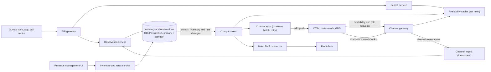
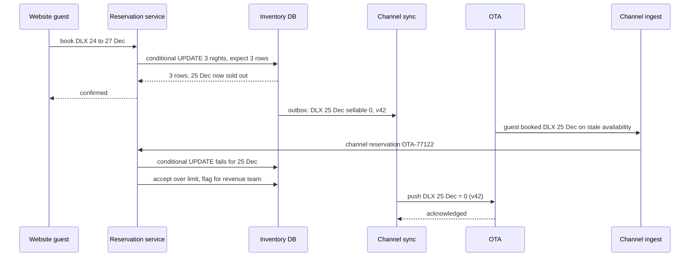

A hotel sells something odd: a room **for a night**. The same physical room is 365 different products a year, and a guest staying three nights buys three of them at once, all or nothing. The hotel sells those products through its own website, a call centre, the front desk, corporate contracts and half a dozen online travel agencies (OTAs), each showing availability it learned some seconds or minutes ago. And hotels deliberately sell **more rooms than they have**, because some guests never turn up.

This case study designs a central reservation system (CRS) for a group of hotels: the availability calendar, booking consistency, overbooking as an explicit, measured policy, and synchronisation with external channels. It complements the [movie booking case study](#/lesson/m17-movie-booking): there the contention is extreme and short-lived; here it is mild but spread across many channels that don't share a database. It reasons from public engineering principles; nothing here claims to describe how Marriott, Taj, OYO, Booking.com, MakeMyTrip, Expedia or any other company actually builds its systems.

## Learning objectives

By the end of this case study you will be able to:

1. Estimate inventory size, booking rates, search load and channel-update volume, and identify which number matters.
2. Model inventory as counters per (hotel, room type, night) and book multi-night stays atomically.
3. Design an overbooking policy from no-show rates and costs, and enforce it in the database.
4. Keep inventory consistent across OTAs and other channels with fast, coalesced, idempotent updates.
5. Ingest channel reservations idempotently, including bookings that arrive after the last room has gone.
6. Reason about search caching, physical room assignment, failures, security, cost and simpler alternatives.

## Prerequisites

- [Capacity estimation](#/lesson/m11-capacity-estimation): RPS and storage arithmetic.
- [Transactions and ACID](#/lesson/m09-transactions-acid): multi-row all-or-nothing updates.
- [Locking](#/lesson/m09-locking): conditional updates and row locks.
- [Idempotent consumers](#/lesson/m12-idempotent-consumers): processing the same message twice safely.
- [Movie ticket booking](#/lesson/m17-movie-booking): holds, TTLs and "the database is the final judge".

## Explain it like I'm a beginner

Imagine a family-run guest house in Udaipur with 20 rooms and a big wall calendar.

- Each day on the calendar has a box with **"rooms left"** for each kind of room: "Lake view: 4, Garden: 7". That is the **availability calendar**, counted per **room type per night**, not per physical room.
- A guest phones to book a lake-view room from the 24th to the 27th. The owner checks the boxes for the 24th, 25th and 26th (not the 27th: the guest leaves that morning). Only if **all three** boxes show at least one room does he write the booking and subtract one from each box. That is an **all-or-nothing multi-night booking**.
- The owner's cousin sells rooms to tourists at the railway station, and a travel agent in Delhi sells them online. Each time a room is sold anywhere, the owner phones the others: "Lake view on the 25th: now 3 left." If he's slow, two of them may sell the last room. That is **channel synchronisation**, and the risk is **double selling the last room**.
- Every season, about 1 in 20 guests don't show up. So the owner happily sells **21 rooms** for a busy night. If all 21 arrive, he books the extra guest into his friend's guest house next door and pays for the taxi. That is a deliberate **overbooking policy**, with a **walk** (relocation) plan for the bad case.
- Which actual room number you get (Room 7 or Room 12) is decided when you arrive. That is **room assignment**, separate from booking.

## Requirements

### Functional

1. Hotels define room types (Deluxe, Suite), the number of rooms of each, rate plans (room only, with breakfast, non-refundable) and nightly prices.
2. Guests search by city or hotel, dates and occupancy; results show room types and prices available for **every night** of the stay.
3. Guests book directly (website, app, call centre); multi-night stays are booked all-or-nothing.
4. Reservations can be modified (dates, room type) and cancelled under the rate plan's policy.
5. Inventory is distributed to channels: OTAs, metasearch, corporate travel tools and the front-desk property management system (PMS). Channel reservations flow back into the CRS.
6. Revenue managers can set an **overbooking limit**, **stop-sell** and **minimum length of stay** per room type and night.
7. Physical rooms are assigned before arrival, with no two guests in the same room on the same night.

### Non-functional

| Property | Target |
|---|---|
| Correctness | Inventory never goes below what the overbooking policy allows; one reservation per channel booking reference |
| Channel freshness | Availability changes reach channels within ~10 s (p95) |
| Search latency | p95 under 500 ms for a city search |
| Booking latency | p95 under 1 s (excluding payment pages) |
| Availability | 99.95 % for booking and channel ingest; search may serve cached data |
| Scale | 5,000 hotels, ~300,000 rooms, ~84,000 reservations/day, ~100 M availability and rate requests/day from channels and search |

### Out of scope

Payment processing ([payment system case study](#/lesson/m17-payment-system)), dynamic pricing models, loyalty programmes, housekeeping and the detailed workings of the PMS.

## Capacity estimation

All figures are **estimates** for the arithmetic.

### Inventory

- **5,000 hotels × ~60 rooms** = **300,000 rooms**.
- Inventory is per (hotel, room type, night). With 5 room types per hotel and a booking window of ~500 days: 5,000 × 5 × 500 = **12.5 M inventory rows**. At ~100 bytes each, ≈ **1.25 GB**. Rates per rate plan multiply this by 3–4: still a few GB. The whole inventory fits in memory.

### Bookings

- 300,000 rooms × 70 % occupancy = **210,000 room-nights sold per day**.
- Average stay 2.5 nights → 210,000 ÷ 2.5 ≈ **84,000 reservations/day** ÷ 86,400 ≈ **1 reservation/s** on average. Peaks (holiday weekends, sale campaigns) ×10 ≈ **10/s**.
- Each reservation updates ~2.5 inventory rows: **~25 row updates/s at peak**. Tiny for PostgreSQL.

### Search and channel reads

- Travellers look far more than they book (the **look-to-book ratio**). Direct website: 3 M searches/day ≈ **35/s**.
- Channels and metasearch request availability and prices on behalf of their own users: assume **100 M requests/day** ≈ **1,160/s** average, ≈ **3,500/s** at peak. Each asks for several nights and room types. This read load, not bookings, sizes the read path.

### Channel updates (ARI: availability, rates, inventory)

- **Booking-driven**: each reservation changes ~2.5 nights, pushed to ~8 channels: 84,000 × 2.5 × 8 ≈ **1.7 M messages/day** ≈ 19/s.
- **Revenue-manager changes**: "raise December rates by 10 %" for one hotel = 31 nights × 5 room types × 2 rate plans × 8 channels = **2,480 updates from one click**. 5,000 hotels × 5 such changes/day ≈ **62 M updates/day** ≈ **720/s** average, extremely bursty.
- Coalescing (latest value per key wins) and range messages (one message for "Deluxe, 1–31 Dec, ₹6,200") cut this by one or two orders of magnitude. Without them, channel APIs rate-limit you and updates queue for minutes, which is exactly when the last room gets sold twice.

| Quantity | Estimate |
|---|---|
| Rooms | ~300,000 across 5,000 hotels |
| Inventory rows | ~12.5 M (~1.25 GB) |
| Reservations | ~1/s average, ~10/s peak |
| Availability/rate reads | ~1,160/s average, ~3,500/s peak |
| ARI updates (raw) | ~720/s average, bursts of thousands |

**What breaks first?** Not bookings. The weak points are (1) **channel sync lag**: during a burst of rate updates, availability changes wait behind them and OTAs keep selling rooms that are gone, (2) **search fan-out** if every channel request computes availability from the database, (3) **duplicate or out-of-order channel messages** creating ghost or duplicate reservations, and (4) a single hotel's popular night (New Year's Eve in Goa) where all channels compete for the last few rooms.

## API design

```http
GET  /v1/search?city=goa&checkIn=2026-12-30&checkOut=2027-01-02&adults=2
     -> hotels with room types available for all nights, cheapest rate plan, total price

GET  /v1/hotels/{hotelId}/availability?checkIn=…&checkOut=…   -> per room type and rate plan

POST /v1/reservations                        Idempotency-Key: 7d3a…
{ "hotelId": 12, "roomType": "DLX", "ratePlan": "BB", "checkIn": "2026-12-24", "checkOut": "2026-12-27",
  "guests": [ { "name": "A. Sharma" } ], "paymentToken": "tok_…" }
201 { "reservationId": "r_9f…", "confirmation": "HX-482913", "status": "CONFIRMED", "total": { "amount": 21600.00, "currency": "INR" } }
409 { "error": "NO_AVAILABILITY", "nights": ["2026-12-25"] }

PATCH /v1/reservations/{id}                  { "checkOut": "2026-12-28", "expectedVersion": 2 }
POST  /v1/reservations/{id}/cancel

# Revenue management
PUT  /v1/hotels/{hotelId}/inventory/{roomType}?from=2026-12-01&to=2026-12-31
{ "overbookLimit": 2, "stopSell": false, "minStay": 2 }

# Channel integration (inbound)
POST /v1/channels/{channel}/reservations     (signed webhook from the channel or the channel manager)
{ "externalRef": "OTA-77122", "type": "NEW", "hotelId": 12, "roomType": "DLX", "checkIn": "…", "checkOut": "…", "sentAt": "…" }
200 { "reservationId": "r_…", "status": "CONFIRMED" }
```

Decisions:

- **Dates as check-in and check-out (half-open interval).** A stay from the 24th to the 27th uses the nights of the 24th, 25th and 26th. Every component must use the same rule; off-by-one errors here cause real overbookings.
- **`409` names the failing nights**, so the app can suggest "available if you check out on the 25th".
- **Idempotency key** on direct bookings; **`(channel, externalRef)` uniqueness** on channel bookings. OTAs retry, and the same booking may arrive by webhook and by a polling job.
- **Revenue controls are range updates**, because people think in ranges ("all of December"), and ranges map directly onto range messages to channels.
- **Search returns a total price** for the stay, because nightly prices differ (Saturday ≠ Tuesday) and taxes depend on the nightly tariff (in India, GST slabs for hotel rooms depend on the room price per night).

## Data model

```sql
CREATE TABLE hotel (
  hotel_id     bigint PRIMARY KEY,
  name         text   NOT NULL,
  city         text   NOT NULL,
  timezone     text   NOT NULL                    -- 'Asia/Kolkata': "tonight" is the hotel's night
);

CREATE TABLE room_type (
  hotel_id     bigint NOT NULL REFERENCES hotel,
  room_type    text   NOT NULL,                   -- 'DLX', 'STE'
  total_rooms  int    NOT NULL CHECK (total_rooms >= 0),
  PRIMARY KEY (hotel_id, room_type)
);

CREATE TABLE room_inventory (
  hotel_id       bigint NOT NULL,
  room_type      text   NOT NULL,
  stay_date      date   NOT NULL,                 -- the night of this date
  total          int    NOT NULL,                 -- physical rooms sellable (minus out-of-order rooms)
  sold           int    NOT NULL DEFAULT 0,
  overbook_limit int    NOT NULL DEFAULT 0 CHECK (overbook_limit >= 0),
  stop_sell      boolean NOT NULL DEFAULT false,
  version        bigint NOT NULL DEFAULT 1,       -- bumps on every change; drives channel sync
  PRIMARY KEY (hotel_id, room_type, stay_date),
  FOREIGN KEY (hotel_id, room_type) REFERENCES room_type,
  CHECK (sold >= 0)
);

CREATE TABLE rate (
  hotel_id     bigint NOT NULL,
  room_type    text   NOT NULL,
  rate_plan    text   NOT NULL,                   -- 'RO', 'BB', 'NRF'
  stay_date    date   NOT NULL,
  price_paise  bigint NOT NULL CHECK (price_paise > 0),
  version      bigint NOT NULL DEFAULT 1,
  PRIMARY KEY (hotel_id, room_type, rate_plan, stay_date)
);

CREATE TABLE reservation (
  reservation_id uuid PRIMARY KEY,
  hotel_id      bigint NOT NULL,
  room_type     text   NOT NULL,
  rate_plan     text   NOT NULL,
  check_in      date   NOT NULL,
  check_out     date   NOT NULL CHECK (check_out > check_in),
  status        text   NOT NULL CHECK (status IN ('CONFIRMED','CANCELLED','CHECKED_IN','CHECKED_OUT','NO_SHOW')),
  channel       text   NOT NULL,                  -- 'DIRECT', 'OTA_A', 'GDS', 'FRONT_DESK'
  external_ref  text   NOT NULL,                  -- channel's booking id, or the idempotency key for direct
  total_paise   bigint NOT NULL,
  version       int    NOT NULL DEFAULT 1,
  over_limit    boolean NOT NULL DEFAULT false,   -- accepted beyond the overbooking limit: needs action
  created_at    timestamptz NOT NULL DEFAULT now(),
  UNIQUE (channel, external_ref)                  -- one reservation per channel booking, however often it is sent
);

-- Physical rooms and assignments: no two stays may overlap in the same room.
CREATE EXTENSION IF NOT EXISTS btree_gist;
CREATE TABLE room_assignment (
  room_id        bigint NOT NULL,
  reservation_id uuid   NOT NULL REFERENCES reservation,
  stay           daterange NOT NULL,              -- [check_in, check_out)
  EXCLUDE USING gist (room_id WITH =, stay WITH &&)
);
```

Why this shape:

- **Counters per night, not rows per room.** Guests buy "a Deluxe room for these nights", not "room 304". A counter per (hotel, room type, night) makes availability a simple read and booking a small update. Physical rooms are assigned later, when the hotel knows who's arriving and which rooms are clean.
- **Booking is one conditional update across all nights:**

```sql
UPDATE room_inventory
SET sold = sold + 1, version = version + 1
WHERE hotel_id = $1 AND room_type = $2
  AND stay_date >= $check_in AND stay_date < $check_out      -- half-open: the check-out night isn't used
  AND NOT stop_sell
  AND sold + 1 <= total + overbook_limit;
-- If the updated row count != number of nights, ROLLBACK. All nights or none.
```

  Two concurrent bookings for the last room serialise on the row lock of the contested night; under PostgreSQL's default READ COMMITTED level the second waits, re-reads the updated row, re-checks `sold + 1 <= total + overbook_limit` and fails for that night, so its transaction rolls back entirely. Two overlapping multi-night bookings can deadlock if they lock the same nights in different orders (for example a modification that touches the 26th before the 24th). Lock nights in one fixed order, with `SELECT … WHERE … ORDER BY stay_date FOR UPDATE` before the update when a transaction touches several ranges, and retry the rare deadlock error (SQLSTATE `40P01`) once.
- **`overbook_limit` per night** turns overbooking from an accident into a policy that the database enforces. Normal channels can't sell beyond `total + overbook_limit`.
- **`version` on inventory and rates** gives each change an order, so channel messages can be compared ("is this newer than what I last sent?") and duplicates or reordering can be detected.
- **`UNIQUE (channel, external_ref)`** is the idempotency rule for channel reservations, and for direct bookings (channel `DIRECT`, idempotency key as `external_ref`).
- **`over_limit`** marks reservations that had to be accepted beyond the limit (an OTA sold a room on stale data and the guest already has a confirmation). They appear on a revenue manager's worklist.
- **The exclusion constraint** on `room_assignment` uses a date range and the `btree_gist` extension so that the database itself refuses two overlapping stays in room 304.
- **Partition key: `hotel_id`.** Every booking, search result and channel message is about one hotel, so `hotel_id` leads every primary key and every index. At these numbers (about 25 inventory row updates/s at peak and a few GB of data) **one PostgreSQL primary with a standby** holds everything; sharding would add cost and operational risk for no gain. If the group grows tenfold, or a SaaS CRS needs hard tenant isolation, `hotel_id` is the shard key that splits cleanly (see [multi-tenancy](#/lesson/m16-multi-tenancy)).

## High-level architecture



Every arrow:

1. **Guests → gateway → search → availability cache.** Search reads a per-hotel availability and price cache (nights × room types × rate plans), never the transactional tables directly.
2. **OTAs → channel gateway → availability cache.** Channels that pull availability are served from the same cache, with rate limits per channel.
3. **Gateway → reservation service → DB.** Direct bookings run the conditional multi-night update in one transaction with the reservation insert and an outbox row.
4. **OTAs → channel gateway → ingest → reservation service.** Channel reservations arrive as signed webhooks (or are pulled). Ingest deduplicates on `(channel, external_ref)`, normalises formats and passes them to the reservation service.
5. **Revenue UI → inventory service → DB.** Range updates for overbooking limits, stop-sell, minimum stay and rates.
6. **DB → outbox → change stream.** Every inventory or rate change emits an event with its version, in the same transaction ([transactional outbox](#/lesson/m12-outbox)).
7. **Change stream → availability cache.** The cache is updated within a second or two, so search and channel pulls see new availability quickly.
8. **Change stream → channel sync → OTAs.** The sync worker coalesces changes per channel and key, batches them into range messages, respects each channel's rate limits, and retries on failure.
9. **Change stream → PMS connector → front desk.** The hotel's own system receives reservations and inventory changes; front-desk walk-in bookings flow back as another channel.

### Sequence: the race for the last room



This is the unavoidable race in multi-channel distribution: between the website booking and the OTA receiving the update, the OTA sold the same last room. The OTA's guest already holds a confirmation, so refusing the booking is often not an option commercially or contractually. The system accepts it **beyond the limit**, flags it, and the revenue team resolves it (upgrade someone, relocate, or rely on a cancellation). The design goal is to make this window **seconds, not minutes**, and to keep a small buffer for channels on very high-demand nights.

## Deep dives

### 1. The availability calendar and multi-night bookings

Availability for a stay is the **minimum** sellable count across its nights:

```
sellable(night) = stop_sell ? 0 : total + overbook_limit − sold
available(stay) = min over nights in [check_in, check_out) of sellable(night)
```

Search shows a room type only if every night has sellable ≥ rooms requested, and also checks restrictions: **minimum length of stay** (a hotel may require 3 nights over New Year), **closed to arrival** (no check-ins on 31 Dec) and **stop-sell**.

Booking modifications reuse the same logic: changing 24–27 to 24–28 books one extra night (26→27 is already held), changing room type releases nights of one type and books nights of another, all in one transaction so the guest never ends up with neither. Cancellations decrement `sold` and bump versions so channels learn about the freed room.

Here is the calendar as an in-memory model with the same rules. It also publishes every change to a sink that the channel sync uses.

```csharp file=Inventory/InventoryCalendar.cs
namespace Hotels.Inventory;

public sealed record NightKey(string RoomType, DateOnly Night);

public sealed record NightInventory(int Total, int Sold, int OverbookLimit, bool StopSell, long Version)
{
    public int Sellable => StopSell ? 0 : Math.Max(0, Total + OverbookLimit - Sold);
    public bool Oversold => Sold > Total;
}

public sealed record InventoryChange(string RoomType, DateOnly Night, int Sellable, long Version);

public interface IInventoryChangeSink
{
    void Publish(InventoryChange change);
}

public enum BookOutcome { Booked, NoAvailability, AlreadyBooked }

public sealed record BookResult(BookOutcome Outcome, bool BeyondLimit, IReadOnlyList<DateOnly> FailedNights);

/// <summary>
/// One hotel's per-night inventory. Production: room_inventory rows with the conditional multi-night UPDATE,
/// a reservation insert and an outbox row in one transaction.
/// </summary>
public sealed class InventoryCalendar(IInventoryChangeSink sink)
{
    public const int MaxNights = 30;

    private readonly Dictionary<NightKey, NightInventory> _nights = new();
    private readonly Dictionary<string, (string RoomType, DateOnly CheckIn, DateOnly CheckOut)> _reservations = new();
    private readonly Lock _gate = new();
    private long _version;

    public static IEnumerable<DateOnly> Nights(DateOnly checkIn, DateOnly checkOut)
    {
        if (checkOut <= checkIn) throw new ArgumentException("Check-out must be after check-in.");
        if (checkOut.DayNumber - checkIn.DayNumber > MaxNights) throw new ArgumentException($"Stays are limited to {MaxNights} nights.");
        for (var d = checkIn; d < checkOut; d = d.AddDays(1)) yield return d;     // half-open interval
    }

    public void SetNight(string roomType, DateOnly night, int total, int overbookLimit, bool stopSell = false)
    {
        lock (_gate)
        {
            var key = new NightKey(roomType, night);
            var sold = _nights.TryGetValue(key, out var n) ? n.Sold : 0;
            Write(key, new NightInventory(total, sold, overbookLimit, stopSell, 0));
        }
    }

    public NightInventory? Get(string roomType, DateOnly night)
    {
        lock (_gate) return _nights.GetValueOrDefault(new NightKey(roomType, night));
    }

    public int AvailableFor(string roomType, DateOnly checkIn, DateOnly checkOut)
    {
        lock (_gate)
        {
            var min = int.MaxValue;
            foreach (var night in Nights(checkIn, checkOut))
            {
                if (!_nights.TryGetValue(new NightKey(roomType, night), out var n)) return 0;   // not loaded = not for sale
                min = Math.Min(min, n.Sellable);
            }
            return min;
        }
    }

    /// <summary>
    /// All-or-nothing booking. <paramref name="acceptBeyondLimit"/> is for channel bookings the guest already holds
    /// a confirmation for: they are recorded even if inventory ran out, and flagged.
    /// </summary>
    public BookResult TryBook(string reservationId, string roomType, DateOnly checkIn, DateOnly checkOut, bool acceptBeyondLimit = false)
    {
        var nights = Nights(checkIn, checkOut).ToList();
        lock (_gate)
        {
            if (_reservations.ContainsKey(reservationId)) return new BookResult(BookOutcome.AlreadyBooked, false, []);

            var failed = nights.Where(d => !_nights.TryGetValue(new NightKey(roomType, d), out var n) || n.Sellable < 1).ToList();
            var missing = nights.Where(d => !_nights.ContainsKey(new NightKey(roomType, d))).ToList();
            if (missing.Count > 0 || (failed.Count > 0 && !acceptBeyondLimit))
                return new BookResult(BookOutcome.NoAvailability, false, failed);

            foreach (var d in nights)
            {
                var key = new NightKey(roomType, d);
                var n = _nights[key];
                Write(key, n with { Sold = n.Sold + 1 });
            }
            _reservations[reservationId] = (roomType, checkIn, checkOut);
            return new BookResult(BookOutcome.Booked, failed.Count > 0, failed);
        }
    }

    public bool Cancel(string reservationId)
    {
        lock (_gate)
        {
            if (!_reservations.Remove(reservationId, out var r)) return false;
            foreach (var d in Nights(r.CheckIn, r.CheckOut))
            {
                var key = new NightKey(r.RoomType, d);
                var n = _nights[key];
                Write(key, n with { Sold = n.Sold - 1 });
            }
            return true;
        }
    }

    private void Write(NightKey key, NightInventory value)
    {
        var stamped = value with { Version = ++_version };
        _nights[key] = stamped;
        sink.Publish(new InventoryChange(key.RoomType, key.Night, stamped.Sellable, stamped.Version));   // production: outbox row
    }
}
```

Two details are worth noticing. `Nights` uses `d < checkOut`, the half-open rule from the API, in exactly one place. And every write goes through `Write`, which stamps a version and publishes a change, so channel sync can never miss an update and can always tell newer from older.

### 2. Overbooking as a policy, not an accident

Some guests cancel late or never arrive (no-shows). If a 100-room hotel sells exactly 100 rooms and 5 guests don't come, it loses 5 nights of revenue. If it sells 104 and 5 don't come, it loses 1. But if only 2 don't come, it must **walk** two guests: book them into a comparable nearby hotel, pay for it and the taxi, and apologise. The question is how many extra rooms to sell.

A simple model (an estimate, not a revenue-management system):

- Let **Cu** = cost of an empty room (lost revenue), say ₹4,000.
- Let **Co** = cost of walking a guest (alternative hotel, transport, goodwill), say ₹9,000.
- Model no-shows as a Poisson random variable with mean λ = bookings × no-show rate. For 100 bookings at 5 %, λ = 5.
- Selling the k-th extra room pays off if the chance that at least k guests don't show, P(N ≥ k), is large enough: P(N ≥ k) × Cu > (1 − P(N ≥ k)) × Co, which rearranges to **P(N ≥ k) > Co ÷ (Cu + Co)** = 9,000 ÷ 13,000 ≈ **0.69**.

With λ = 5 (Poisson): P(N ≥ 1) ≈ 0.99, P(N ≥ 2) ≈ 0.96, P(N ≥ 3) ≈ 0.88, P(N ≥ 4) ≈ 0.74, P(N ≥ 5) ≈ 0.56. The 4th extra room still clears 0.69, the 5th doesn't, so the policy is **overbook by 4**. If walking were cheaper (₹4,000), the threshold drops to 0.5 and the answer becomes 5.

Real revenue systems refine this: no-show rates per segment (corporate versus leisure, non-refundable versus flexible), day of week, lead time and events, and they recompute nightly. But the system design point is the same: **the limit is calculated, stored per night as `overbook_limit`, enforced by the booking update, and lowered to zero close to arrival** when the remaining uncertainty is small.

```csharp file=Inventory/OverbookingPolicy.cs
namespace Hotels.Inventory;

public static class OverbookingPolicy
{
    /// <summary>
    /// Extra rooms to sell beyond physical capacity: the largest k with P(no-shows ≥ k) > walkCost / (walkCost + emptyRoomCost),
    /// modelling no-shows as Poisson(rooms × noShowRate). A teaching model, not a revenue-management system.
    /// </summary>
    public static int ExtraRooms(int rooms, double noShowRate, decimal emptyRoomCost, decimal walkCost, int cap)
    {
        if (rooms <= 0 || noShowRate is < 0 or >= 1 || emptyRoomCost <= 0 || walkCost <= 0 || cap < 0)
            throw new ArgumentOutOfRangeException(nameof(rooms), "Invalid overbooking inputs.");

        var threshold = (double)(walkCost / (walkCost + emptyRoomCost));
        var lambda = rooms * noShowRate;
        var term = Math.Exp(-lambda);           // P(N = 0)
        var cdf = term;                          // P(N <= 0)
        var extra = 0;
        for (var k = 1; k <= cap; k++)
        {
            var atLeastK = 1 - cdf;              // P(N >= k) = 1 - P(N <= k - 1)
            if (atLeastK <= threshold) break;
            extra = k;
            term *= lambda / k;                  // P(N = k)
            cdf += term;
        }
        return extra;
    }
}
```

**The walk procedure is part of the system.** When a night is oversold on the day of arrival (`sold > total` and no further cancellations expected), the system lists candidate guests to relocate (typically the latest-booked, lowest-loyalty, single-night stays, never guests who have already checked in), finds nearby partner hotels with availability, and records the cost. The rules are business policy; the system makes them explicit and auditable.

### 3. Channel distribution: one inventory, many shops

Hotels sell through many channels that don't share a database. Two models:

| Model | How it works | Strength | Weakness |
|---|---|---|---|
| **Allotment** | Each channel gets a fixed block (5 Deluxe rooms on Booking site A), returned to the pool N days before arrival | A channel can sell its block with no sync risk | Unsold allotments waste rooms; blocks must be managed |
| **Pooled (free sell)** | All channels sell from one shared count; the CRS pushes the current number to every channel | No wasted rooms; flexible | The last rooms can be sold twice during sync lag |

Most modern setups use **pooled inventory** with a **channel manager** (either a component of the CRS, as here, or a third-party service) that pushes ARI updates to every connected channel. The engineering challenge is keeping lag small and messages correct:

- **Push on change, not on a timer.** Every inventory and rate change produces an outbox event; the sync worker sends it within seconds.
- **Coalesce.** If Deluxe on 25 Dec changes five times in two seconds, send only the latest value. Key: (channel, hotel, room type, rate plan, night); value: latest version.
- **Batch into ranges.** Consecutive nights with the same value become one message ("DLX 1–31 Dec, 3 rooms").
- **Prioritise availability over rates.** When a revenue manager reprices a whole year, those thousands of rate messages must not delay "25 Dec is now sold out". Use separate queues or priorities.
- **Respect each channel's rate limits** with a per-channel token bucket ([rate limiting](#/lesson/m10-rate-limiting)).
- **Versioned and idempotent.** Each message carries the version; a retried or reordered message never overwrites newer data.
- **Close-out buffers** on very high-demand nights: show channels one room fewer than reality (or close a channel at "1 left") so the last room is sold only through the channel with the fastest confirmation, typically the hotel's own website.
- **Full refresh** nightly (or on reconnection) to repair any drift.

```csharp file=Channels/ChannelSync.cs
using Hotels.Inventory;

namespace Hotels.Channels;

public sealed record ChannelUpdate(string Channel, string RoomType, DateOnly Night, int Sellable, long Version);

public interface IChannelClient
{
    string Channel { get; }
    Task PushAsync(IReadOnlyList<ChannelUpdate> batch, CancellationToken ct);
}

public sealed class LoggingChannelClient(string channel, ILogger<LoggingChannelClient> logger) : IChannelClient
{
    public string Channel => channel;
    public Task PushAsync(IReadOnlyList<ChannelUpdate> batch, CancellationToken ct)
    {
        logger.LogInformation("Pushed {Count} ARI updates to {Channel}", batch.Count, channel);
        return Task.CompletedTask;
    }
}

/// <summary>Latest-version-wins buffer per (channel, room type, night). Receives every inventory change.</summary>
public sealed class ChannelSyncQueue(IReadOnlyList<string> channels) : IInventoryChangeSink
{
    private readonly Dictionary<(string Channel, string RoomType, DateOnly Night), ChannelUpdate> _pending = new();
    private readonly Lock _gate = new();

    public void Publish(InventoryChange change)
    {
        foreach (var channel in channels)
            Offer(new ChannelUpdate(channel, change.RoomType, change.Night, change.Sellable, change.Version));
    }

    /// <summary>Also used to requeue a failed batch: older versions never overwrite newer ones.</summary>
    public void Offer(ChannelUpdate update)
    {
        lock (_gate)
        {
            var key = (update.Channel, update.RoomType, update.Night);
            if (!_pending.TryGetValue(key, out var existing) || existing.Version < update.Version)
                _pending[key] = update;
        }
    }

    public IReadOnlyList<ChannelUpdate> Take(string channel, int max)
    {
        lock (_gate)
        {
            var batch = _pending.Values.Where(u => u.Channel == channel)
                .OrderBy(u => u.Night).ThenBy(u => u.RoomType, StringComparer.Ordinal).Take(max).ToList();
            foreach (var u in batch) _pending.Remove((u.Channel, u.RoomType, u.Night));
            return batch;
        }
    }

    public int Pending(string channel)
    {
        lock (_gate) return _pending.Values.Count(u => u.Channel == channel);
    }
}

/// <summary>Flushes each channel every two seconds; failed batches go back into the queue.</summary>
public sealed class ChannelSyncWorker(ChannelSyncQueue queue, IEnumerable<IChannelClient> clients, ILogger<ChannelSyncWorker> logger)
    : BackgroundService
{
    private const int BatchSize = 200;

    protected override async Task ExecuteAsync(CancellationToken stoppingToken)
    {
        using var timer = new PeriodicTimer(TimeSpan.FromSeconds(2));
        while (await timer.WaitForNextTickAsync(stoppingToken))
        {
            foreach (var client in clients)
            {
                var batch = queue.Take(client.Channel, BatchSize);
                if (batch.Count == 0) continue;
                try
                {
                    await client.PushAsync(batch, stoppingToken);
                }
                catch (Exception ex) when (ex is not OperationCanceledException)
                {
                    logger.LogWarning(ex, "Push to {Channel} failed; requeueing {Count} updates", client.Channel, batch.Count);
                    foreach (var u in batch) queue.Offer(u);
                }
            }
        }
    }
}
```

In production the queue is durable (the outbox table or a stream), each channel has its own worker and rate limiter, and availability updates are taken before rate updates. The core rule is visible here: **latest version wins, per key**, both when changes arrive and when a failed batch is requeued.

### 4. Channel reservations: idempotent, and sometimes beyond the limit

Reservations from channels arrive as webhooks or are pulled from the channel's API. Expect every bad thing a network can do:

- **Duplicates**: the same booking sent twice, or by webhook and by the polling backup. `UNIQUE (channel, external_ref)` makes the second insert a no-op that returns the existing reservation ([idempotent receiver](#/lesson/m12-idempotent-consumers)).
- **Out of order**: a modification arriving before the original booking. Store unknown modifications and apply them when the booking arrives, or fetch the booking from the channel.
- **Stale availability**: the channel sold a room that is gone (the race above). The guest already has a confirmation; accept it **beyond the limit**, flag it, and alert.
- **Cancellations**: decrement inventory, bump versions, push to all other channels.

```csharp file=Channels/ChannelReservationIngest.cs
using System.Collections.Concurrent;
using Hotels.Inventory;

namespace Hotels.Channels;

public enum ChannelMessageType { New, Cancel }

public sealed record ChannelReservation(string Channel, string ExternalRef, ChannelMessageType Type,
    string RoomType, DateOnly CheckIn, DateOnly CheckOut);

public sealed record IngestResult(string ReservationId, string Status, bool NeedsAttention);

public interface IRevenueAlerts
{
    void OverLimit(string reservationId, IReadOnlyList<DateOnly> nights);
}

public sealed class LoggingRevenueAlerts(ILogger<LoggingRevenueAlerts> logger) : IRevenueAlerts
{
    public void OverLimit(string reservationId, IReadOnlyList<DateOnly> nights) =>
        logger.LogWarning("Reservation {Id} accepted beyond the overbooking limit for {Nights}", reservationId, string.Join(", ", nights));
}

public sealed class ChannelReservationIngest(InventoryCalendar calendar, IRevenueAlerts alerts)
{
    private readonly ConcurrentDictionary<string, IngestResult> _seen = new();   // production: UNIQUE (channel, external_ref)

    public IngestResult Handle(ChannelReservation message)
    {
        var reservationId = $"{message.Channel}:{message.ExternalRef}";
        var dedupeKey = $"{reservationId}:{message.Type}";
        return _seen.GetOrAdd(dedupeKey, _ => Apply(reservationId, message));
    }

    private IngestResult Apply(string reservationId, ChannelReservation m)
    {
        if (m.Type == ChannelMessageType.Cancel)
            return new IngestResult(reservationId, calendar.Cancel(reservationId) ? "CANCELLED" : "UNKNOWN_RESERVATION", false);

        var result = calendar.TryBook(reservationId, m.RoomType, m.CheckIn, m.CheckOut, acceptBeyondLimit: true);
        if (result.Outcome == BookOutcome.NoAvailability)
            return new IngestResult(reservationId, "REJECTED_NOT_FOR_SALE", true);           // room type or nights not loaded
        if (result.BeyondLimit) alerts.OverLimit(reservationId, result.FailedNights);
        return new IngestResult(reservationId, "CONFIRMED", result.BeyondLimit);
    }
}
```

The dedupe key includes the message type, so a "new" and a later "cancel" for the same booking are both processed once, while a repeated "new" is ignored. `GetOrAdd` with a factory can, under a race, run the factory twice for the same key; the calendar's own reservation-id check (`AlreadyBooked`) makes that harmless, which is the in-memory version of the database's unique constraint doing the real work.

### 5. Search and the availability cache

1,160 to 3,500 availability requests per second, each spanning several nights and room types, would be wasteful to compute from `room_inventory` and `rate` with joins every time. Instead:

- Keep a **per-hotel availability document** in a cache: for each room type and rate plan, an array of (night, sellable, price, restrictions) for the next 500 days. A 5-room-type hotel with 3 rate plans is a few hundred KB; all 5,000 hotels fit in memory on a few cache nodes.
- **Update it from the change stream** within a second or two of each inventory or rate change, rather than with TTL expiry, so it is both fresh and cheap.
- Search for a stay = for each candidate hotel, slice the arrays for the stay's nights, take the minimum sellable and the sum of prices. City search first filters hotels with a search index (location, amenities, star rating), then checks availability in the cache.
- The cache may be a second or two stale. That's fine: booking re-checks in the database, and a `409` with the failing nights lets the app offer alternatives.

### 6. Physical room assignment

Inventory counts room types; guests sleep in rooms. Assignment happens at the property, usually the day before arrival or at check-in, using the PMS. Rules: no two overlapping stays in one room (the exclusion constraint), guest preferences (high floor, near the lift), housekeeping status, connecting rooms for families, and keeping long stays in one room. An **upgrade** (assigning a Suite to a Deluxe guest) is how many overbookings are resolved without walking anyone: the Deluxe count goes down by one, the Suite count by one, and the guest is delighted.

## Caching, queues and scaling

**Caching.**

- **Availability documents per hotel**, event-driven updates, serving search and channel pulls.
- **Hotel content** (photos, descriptions, amenities) on a CDN and in a content cache; changes rarely.
- **Rate-limit and session data** at the gateway.
- **Never cache** the booking decision: it is the conditional update.

**Queues and streams.**

- **Outbox → change stream** for inventory, rate and reservation events, partitioned by `hotel_id` so each hotel's changes stay ordered.
- **Channel sync queues** per channel, coalesced, with availability prioritised over rates.
- **Channel ingest queue** in front of the reservation service, absorbing bursts and retries from OTAs.
- **Nightly jobs**: full ARI refresh to each channel, overbooking-limit recalculation, no-show processing.

**Scaling.**

- **Booking writes are small**: about 10 reservations/s at peak is a few percent of what one PostgreSQL primary handles. Keep one primary with a synchronous standby; shard by `hotel_id` only when growth or tenant isolation demands it, not on day one.
- **Reads scale through the cache**, not replicas: search and channel pulls never hit the primary.
- **Channel sync scales by channel and hotel**: workers partitioned by hotel range, rate-limited per channel.
- **Hot nights** (New Year's Eve in Goa, a cricket final in Ahmedabad) concentrate bookings on a few rows of a few hotels; row-level locking on `room_inventory` serialises them correctly, and close-out buffers limit cross-channel races. That is mild contention (a few bookings per second on one row). When thousands of buyers per second compete for one counter, you need the techniques in the [flash sale](#/lesson/m17-flash-sale) case study.

## Failure handling

| Failure | Effect | Mitigation |
|---|---|---|
| Two channels sell the last room | Oversold night | Fast coalesced pushes, close-out buffers on hot nights, accept beyond limit + alert, upgrades or walk procedure |
| Channel sends a booking twice | Duplicate reservation | `UNIQUE (channel, external_ref)`; idempotent ingest returns the existing reservation |
| Modification before original booking | Orphan update | Park the modification; fetch the booking from the channel; reconcile |
| Channel API down | Updates pile up | Coalescing keeps only latest values; retry with backoff; full refresh when it returns |
| Revenue manager reprices a year | Thousands of messages delay availability | Separate priority for availability updates; range messages |
| Sync worker crashes | Changes not pushed | Outbox is durable; worker resumes from last published version; nightly full refresh |
| Availability cache stale | Search shows sold-out rooms | Event-driven updates; booking re-checks; `409` with failing nights |
| Off-by-one on check-out date | Overbooking or empty nights | Half-open interval defined once (`stay_date < check_out`) and used everywhere; tests for it |
| Time zone confusion | "Tonight" wrong for a hotel | Store dates as the hotel's local dates; use the hotel's timezone for cut-offs |
| PMS offline at the property | Front-desk walk-ins not synced | PMS queues locally; CRS keeps a small front-desk allotment for the day; reconcile on reconnect |

:::callout type=tradeoff title="You can't have zero overbooking and fully pooled channels"
With pooled inventory pushed to independent channels, there is always a window in which two channels can sell the last room. You can shrink it (seconds of lag, coalescing, priorities), protect it (close-out buffers, allotments on hot nights) and handle the residue (accept beyond limit, upgrades, walk procedure). Choosing allotments everywhere removes the race but strands unsold rooms. Most hotels choose pooled inventory and manage the small, measurable risk.
:::

## Security

- **Channel authentication**: mutual TLS or signed requests for each channel integration; verify webhook signatures and timestamps; per-channel credentials and rate limits; channel A must never see channel B's reservations.
- **Tenant isolation** for a multi-hotel SaaS: every query scoped by `hotel_id` (row-level security in PostgreSQL is a good safety net), and staff accounts limited to their properties ([multi-tenant security](#/lesson/m14-multi-tenant-security)).
- **Guest data**: names, phone numbers, passport or ID details for foreign guests (hotels in India report foreign guests' stays to the authorities) are sensitive personal data. Encrypt at rest, restrict access to front-desk roles that need it, log access, and set retention limits under the DPDP Act and GDPR for EU guests.
- **Payment data**: card details for guarantees and no-show charges go to a payment provider's vault; the CRS stores tokens only (PCI DSS scope reduction). Virtual cards from OTAs are handled the same way.
- **Revenue controls**: setting `overbook_limit`, stop-sell or rates is powerful; role-based permissions, approvals for large changes and a full audit trail of who changed what.
- **Abuse**: fake bookings to block inventory (rate-limit, require guarantees on high-demand nights), and scraping of rates (rate-limit channel pull endpoints per partner).

## Observability

- **Inventory health**: oversold nights per hotel (sold > total), reservations accepted beyond limit, walks per month and their cost; these are the business outcomes of the design.
- **Channel sync**: lag from inventory change to channel acknowledgement (p50, p95) per channel, queue depth, coalescing ratio, push errors, rate-limit rejections. Lag spikes are the leading indicator of oversells.
- **Channel ingest**: reservations per channel, duplicate rate, out-of-order modifications, rejections.
- **Search**: availability cache freshness (event time to cache update), search latency, look-to-book per channel.
- **Overbooking policy**: forecast no-shows versus actual per hotel and segment, so limits can be tuned.
- **Reconciliation**: nightly comparison of CRS inventory versus each channel's view and the PMS; differences per hotel should be near zero.

## Deployment and cost

**Deployment.** Channel integrations are the most fragile part, because each external API has its own formats, quirks and versions. Deploy each channel connector independently, behind feature flags per hotel, and test against the channel's certification or sandbox environment. Database migrations on `room_inventory` (always hot) follow expand-and-contract. Avoid deploying connectors during known peak booking windows (festival sale campaigns, New Year booking rush).

**Cost drivers** (relative, estimates):

1. **Channel commissions** dwarf infrastructure costs: OTA commissions on each booking are typically a significant percentage of the room rate. Fast, accurate direct booking is a business lever, not only an engineering one.
2. **Availability cache and search compute** for ~3,500 requests/s at peak.
3. **Channel connectivity**: some channel managers and GDS connections charge per message or per booking; coalescing saves money directly.
4. **Walk costs** from oversells: each one costs an alternative room plus goodwill; a few seconds of extra sync lag on hot nights can be expensive.
5. **Database and storage**: a few GB of inventory and modest reservation history.

### When a simpler design is enough

A single boutique hotel with 25 rooms that sells on its website and two OTAs doesn't need a CRS, change streams or availability documents. Use a hosted channel manager service for OTA connectivity and a simple booking engine on one ASP.NET Core app with one PostgreSQL database. Keep the same three rules: per-night counters with the conditional multi-night update, the half-open date interval, and a unique `(channel, external_ref)` for incoming bookings. Set overbooking to zero until you have a year of no-show data.

## Alternatives and trade-offs

| Decision | Choice here | Alternative | When the alternative wins |
|---|---|---|---|
| Inventory unit | Counter per room type per night | Row per physical room per night | Small properties that sell specific rooms (villas, named cottages) |
| Channel model | Pooled inventory with fast pushes | Allotments per channel | Channels with slow sync, contracted blocks (tour operators), hot nights |
| Channel sync | Event-driven, coalesced, prioritised | Periodic full sync every N minutes | Very few changes, channels without delta APIs |
| Overbooking | Calculated limit per night, enforced in DB | No overbooking | New hotels without no-show history; luxury segments where walking is unacceptable |
| Stale channel booking | Accept beyond limit and resolve | Reject | Contracts that allow rejection; channels with instant confirmation flows |
| Search | Event-updated per-hotel availability documents | SQL over inventory tables | Few hotels and low search traffic |
| Room assignment | At property, day before arrival | At booking time | Specific-room products; it otherwise reduces flexibility and upgrades |
| Booking hold | No hold; book directly with payment guarantee | Hold with TTL (as in movie booking) | Flows with slow payment confirmation on high-demand nights |

The essential trade-off: **one source of truth for inventory, many shops that see it with a delay.** Make the source of truth strict (conditional updates, policy limits in the database, idempotent ingestion), make the delay as short as possible (event-driven, coalesced, prioritised sync), and treat the remaining risk as a measured business process (overbooking policy, upgrades, walks) rather than pretending it doesn't exist.

```csharp file=Program.cs
using Hotels.Channels;
using Hotels.Inventory;

var builder = WebApplication.CreateBuilder(args);
string[] channels = ["OTA_A", "OTA_B", "META"];
builder.Services.AddSingleton(new ChannelSyncQueue(channels));
builder.Services.AddSingleton<IInventoryChangeSink>(sp => sp.GetRequiredService<ChannelSyncQueue>());
builder.Services.AddSingleton<InventoryCalendar>();                     // demo: one hotel; production: room_inventory rows keyed by hotel_id
builder.Services.AddSingleton<IRevenueAlerts, LoggingRevenueAlerts>();
builder.Services.AddSingleton<ChannelReservationIngest>();
foreach (var channel in channels)
    builder.Services.AddSingleton<IChannelClient>(sp =>
        new LoggingChannelClient(channel, sp.GetRequiredService<ILogger<LoggingChannelClient>>()));
builder.Services.AddHostedService<ChannelSyncWorker>();

var app = builder.Build();

app.MapPut("/v1/inventory/{roomType}", (string roomType, DateOnly from, DateOnly to, InventorySettings body, InventoryCalendar calendar) =>
{
    for (var d = from; d <= to; d = d.AddDays(1))
        calendar.SetNight(roomType, d, body.Total, body.OverbookLimit, body.StopSell);
    return Results.NoContent();
});

app.MapGet("/v1/availability/{roomType}", (string roomType, DateOnly checkIn, DateOnly checkOut, InventoryCalendar calendar) =>
{
    try { return Results.Ok(new { roomType, checkIn, checkOut, available = calendar.AvailableFor(roomType, checkIn, checkOut) }); }
    catch (ArgumentException ex) { return Results.BadRequest(new { error = ex.Message }); }
});

app.MapPost("/v1/reservations", (DirectBooking body, HttpRequest http, InventoryCalendar calendar) =>
{
    var key = http.Headers["Idempotency-Key"].ToString();
    if (string.IsNullOrWhiteSpace(key)) return Results.BadRequest(new { error = "Idempotency-Key header is required." });
    try
    {
        var result = calendar.TryBook($"DIRECT:{key}", body.RoomType, body.CheckIn, body.CheckOut);
        return result.Outcome == BookOutcome.NoAvailability
            ? Results.Conflict(new { error = "NO_AVAILABILITY", nights = result.FailedNights })
            : Results.Created($"/v1/reservations/DIRECT:{key}", new { reservationId = $"DIRECT:{key}", status = "CONFIRMED" });
    }
    catch (ArgumentException ex) { return Results.BadRequest(new { error = ex.Message }); }
});

// Signed webhook from a channel (signature verification omitted in this demo).
app.MapPost("/v1/channels/{channel}/reservations", (string channel, ChannelBooking body, ChannelReservationIngest ingest) =>
    Results.Ok(ingest.Handle(new ChannelReservation(channel, body.ExternalRef, body.Type, body.RoomType, body.CheckIn, body.CheckOut))));

app.MapGet("/v1/overbooking", (int rooms, double noShowRate, decimal emptyRoomCost, decimal walkCost) =>
    Results.Ok(new { extraRooms = OverbookingPolicy.ExtraRooms(rooms, noShowRate, emptyRoomCost, walkCost, cap: 10) }));

app.Run();

public sealed record InventorySettings(int Total, int OverbookLimit, bool StopSell);
public sealed record DirectBooking(string RoomType, DateOnly CheckIn, DateOnly CheckOut);
public sealed record ChannelBooking(string ExternalRef, ChannelMessageType Type, string RoomType, DateOnly CheckIn, DateOnly CheckOut);
```

## Practical playground

The starting graph is a first version: a booking website and an hourly batch job that emails availability spreadsheets to OTAs, which send reservations back by email for manual entry. Open it in the HLD canvas.

1. Set client traffic to 3,500 RPS of availability requests. Which node is overloaded?
2. Replace the hourly job with a `stream` fed by the database (outbox) and a `worker` for channel sync. What happens to the oversell window?
3. Add a `cache` for per-hotel availability documents updated from the stream, and route search and channel pulls to it.
4. Add an `api-gateway` for inbound channel webhooks with a `queue` in front of an idempotent ingest `worker`. Where is `(channel, external_ref)` uniqueness enforced?

:::playground type=hld title="From emailed spreadsheets to an event-driven CRS"
```json
{
  "nodes": [
    { "id": "c", "type": "client", "label": "Guests and channel requests", "props": { "rps": 3500 } },
    { "id": "lb", "type": "load-balancer", "label": "Load balancer" },
    { "id": "web", "type": "app-server", "label": "Booking website (search + book)", "props": { "instances": 3 } },
    { "id": "db", "type": "database", "label": "PostgreSQL (inventory, rates, reservations)", "props": { "replicas": 0 } },
    { "id": "job", "type": "scheduler", "label": "Hourly availability export" },
    { "id": "ota", "type": "external", "label": "OTAs (email and extranet)" }
  ],
  "edges": [
    { "from": "c", "to": "lb", "kind": "sync" },
    { "from": "lb", "to": "web", "kind": "sync" },
    { "from": "web", "to": "db", "kind": "sync", "label": "availability SQL per search" },
    { "from": "job", "to": "db", "kind": "sync" },
    { "from": "job", "to": "ota", "kind": "async", "label": "hourly spreadsheet" }
  ]
}
```
:::

## Exercises

:::exercise id=m17-hotel-reservation-ex1 difficulty=beginner kind=written title="Size a hotel group's CRS"
A hotel group runs 400 hotels averaging 120 rooms, with 6 room types and 3 rate plans per hotel, and sells 365 days ahead. Occupancy is 75 % and the average stay is 2 nights. Channels and metasearch send 30 M availability requests/day. Each reservation is pushed to 10 channels. Revenue managers make 8 bulk rate changes per hotel per day, each covering 30 nights × 6 room types × 3 rate plans.

1. Compute inventory rows (per room type per night) and rate rows.
2. Compute reservations/day and average reservations/s.
3. Compute average availability requests/s.
4. Compute booking-driven channel messages/day, and rate-change messages/day before coalescing.
5. Which number should drive the design of channel sync, and what two techniques reduce it?
::acceptance
- Shows multiplications and divisions with units.
- Uses room-nights ÷ average stay to get reservations.
- Compares booking-driven and rate-driven channel volumes.
- Names coalescing/range messages and prioritisation (or similar) with reasons.
::hint
Inventory rows = hotels × room types × days. Rates multiply by rate plans.
::hint
Room-nights/day = rooms × occupancy. Reservations = room-nights ÷ nights per stay.
::hint
Booking messages = reservations × nights × channels.
::hint
Rate messages = hotels × changes × nights × room types × rate plans × channels.
::solution
1. Inventory rows: 400 × 6 × 365 = **876,000**. Rate rows: × 3 = **2.63 M**. Both tiny.
2. Rooms: 400 × 120 = 48,000. Room-nights: 48,000 × 0.75 = 36,000/day. Reservations: 36,000 ÷ 2 = **18,000/day** ÷ 86,400 ≈ **0.21/s**.
3. Availability: 30 M ÷ 86,400 ≈ **347 requests/s** average.
4. Booking-driven: 18,000 × 2 nights × 10 channels = **360,000 messages/day**. Rate-driven: 400 × 8 × 30 × 6 × 3 × 10 = **17.3 M messages/day**, about 48× more.
5. **Rate changes** dominate channel traffic, and they are bursty (one click creates 5,400 messages for one hotel). Reduce them with **coalescing** (latest value per key wins) and **range messages** (consecutive nights with the same price in one message), and **prioritise availability updates** over rate updates so a burst of repricing never delays "sold out" messages. The booking rate (0.21/s) is irrelevant for sizing; the read path (347 req/s) is handled by an availability cache.
::mistakes
- Treating reservations as the scaling problem when they are a fraction of a request per second.
- Forgetting the channel multiplier on rate changes.
- Sending one message per night per rate plan without coalescing or ranges.
:::

:::exercise id=m17-hotel-reservation-ex2 difficulty=beginner kind=sql ordered=true title="Search availability for every night of a stay"
A guest searches hotel 12 for check-in `2026-12-24` and check-out `2026-12-27` (3 nights: 24th, 25th, 26th). A room type qualifies only if **every** night exists in the inventory, none is on stop-sell, and each night has at least one sellable room, where `sellable = total + overbook_limit − sold`. Return `room_type` and `rooms_left` (the minimum sellable over the 3 nights), ordered by `room_type`.
::setup
```sql
CREATE TABLE room_inventory (
  hotel_id       bigint  NOT NULL,
  room_type      text    NOT NULL,
  stay_date      date    NOT NULL,
  total          int     NOT NULL,
  sold           int     NOT NULL,
  overbook_limit int     NOT NULL DEFAULT 0,
  stop_sell      boolean NOT NULL DEFAULT false,
  PRIMARY KEY (hotel_id, room_type, stay_date)
);
INSERT INTO room_inventory (hotel_id, room_type, stay_date, total, sold, overbook_limit, stop_sell) VALUES
  (12, 'DLX', '2026-12-24', 20, 18, 1, false),
  (12, 'DLX', '2026-12-25', 20, 20, 1, false),
  (12, 'DLX', '2026-12-26', 20, 17, 1, false),
  (12, 'DLX', '2026-12-27', 20, 21, 1, false),
  (12, 'STD', '2026-12-24', 30, 30, 2, false),
  (12, 'STD', '2026-12-25', 30, 28, 2, false),
  (12, 'STD', '2026-12-26', 30, 25, 2, false),
  (12, 'STE', '2026-12-24',  4,  4, 0, false),
  (12, 'STE', '2026-12-25',  4,  3, 0, false),
  (12, 'STE', '2026-12-26',  4,  2, 0, false),
  (12, 'FAM', '2026-12-24',  6,  2, 0, false),
  (12, 'FAM', '2026-12-25',  6,  2, 0, true),
  (12, 'FAM', '2026-12-26',  6,  2, 0, false),
  (12, 'PRM', '2026-12-24',  8,  1, 0, false),
  (12, 'PRM', '2026-12-25',  8,  1, 0, false),
  (13, 'DLX', '2026-12-24', 50,  1, 0, false),
  (13, 'DLX', '2026-12-25', 50,  1, 0, false),
  (13, 'DLX', '2026-12-26', 50,  1, 0, false);
```
::check
```sql
SELECT room_type,
       MIN(total + overbook_limit - sold) AS rooms_left
FROM room_inventory
WHERE hotel_id = 12
  AND stay_date >= DATE '2026-12-24'
  AND stay_date <  DATE '2026-12-27'
GROUP BY room_type
HAVING COUNT(*) = 3
   AND BOOL_AND(NOT stop_sell)
   AND MIN(total + overbook_limit - sold) >= 1
ORDER BY room_type;
```
::acceptance
- Returns `DLX` with 1 and `STD` with 2.
- `DLX` qualifies only because the check-out night (27th, oversold) is excluded by the half-open range.
- `STE` is full on the 24th, `FAM` is on stop-sell on the 25th, and `PRM` has no inventory loaded for the 26th.
- Hotel 13 is ignored.
::hint
Filter the nights with a half-open range: `stay_date >= check_in AND stay_date < check_out`.
::hint
Group by room type; the stay's availability is the `MIN` of the nightly sellable count.
::hint
Use `HAVING COUNT(*) = 3` so a missing night disqualifies the room type.
::hint
`BOOL_AND(NOT stop_sell)` is true only if no night is on stop-sell.
::solution
```sql
SELECT room_type,
       MIN(total + overbook_limit - sold) AS rooms_left
FROM room_inventory
WHERE hotel_id = 12
  AND stay_date >= DATE '2026-12-24'
  AND stay_date <  DATE '2026-12-27'
GROUP BY room_type
HAVING COUNT(*) = 3
   AND BOOL_AND(NOT stop_sell)
   AND MIN(total + overbook_limit - sold) >= 1
ORDER BY room_type;
```
`DLX`: sellable 3, 1, 4 → 1. `STD`: 2, 4, 7 → 2 (the 24th works only thanks to the overbooking limit of 2). Including the 27th would make `DLX` look sold out (sellable 0) and lose a sale; using `BETWEEN '2026-12-24' AND '2026-12-27'` is the classic way to introduce that bug. In production this logic runs over the cached availability document; this query is what the cache must agree with.
::mistakes
- Using `BETWEEN` (inclusive) and counting the check-out night.
- Forgetting `COUNT(*) = 3`, so a room type with a missing night appears available.
- Checking only the first night's availability.
- Ignoring stop-sell.
:::

:::exercise id=m17-hotel-reservation-ex3 difficulty=intermediate kind=code title="An all-or-nothing nightly inventory"
Implement `NightlyInventory` for one hotel:

- `Load(roomType, night, total, overbookLimit)` sets a night's capacity (sold starts at 0, or keeps its current value if already loaded).
- `Sellable(roomType, night)` = `total + overbookLimit − sold`, never below 0; 0 if the night isn't loaded.
- `TryReserve(reservationId, roomType, checkIn, checkOut)` books **every** night in `[checkIn, checkOut)` or none. Returns `true` on success. A repeated call with the same `reservationId` returns `true` without booking again. Returns `false` if any night is missing or has no sellable room.
- `Cancel(reservationId)` releases all its nights; returns `false` for unknown ids.
- `checkOut <= checkIn` or stays over 30 nights throw `ArgumentException`.
- Safe under concurrent calls.
::acceptance
- A 3-night stay decrements exactly 3 nights; the check-out night is untouched.
- If the middle night is full, nothing is booked.
- The overbooking limit allows sales beyond `total` up to `total + overbookLimit`, and no further.
- 50 parallel attempts for the last room (limit 0) produce exactly one booking.
::hint
Store nights in a dictionary keyed by `(roomType, DateOnly)`.
::hint
Enumerate nights with `for (var d = checkIn; d < checkOut; d = d.AddDays(1))`.
::hint
First check every night, then update every night: never update while checking.
::hint
Remember each reservation's room type and dates so `Cancel` can undo exactly what was booked.
::starter
```csharp file=NightlyInventory.cs
using System;

public sealed class NightlyInventory
{
    public void Load(string roomType, DateOnly night, int total, int overbookLimit) => throw new NotImplementedException();
    public int Sellable(string roomType, DateOnly night) => throw new NotImplementedException();
    public bool TryReserve(string reservationId, string roomType, DateOnly checkIn, DateOnly checkOut) => throw new NotImplementedException();
    public bool Cancel(string reservationId) => throw new NotImplementedException();
}
```
::tests
```csharp file=NightlyInventoryTests.cs
using System;
using System.Linq;
using Xunit;

public class NightlyInventoryTests
{
    private static readonly DateOnly D24 = new(2026, 12, 24), D25 = new(2026, 12, 25), D26 = new(2026, 12, 26), D27 = new(2026, 12, 27);

    private static NightlyInventory Make(int total = 2, int limit = 0)
    {
        var inv = new NightlyInventory();
        foreach (var d in new[] { D24, D25, D26, D27 }) inv.Load("DLX", d, total, limit);
        return inv;
    }

    [Fact]
    public void Books_every_night_except_checkout()
    {
        var inv = Make();
        Assert.True(inv.TryReserve("r1", "DLX", D24, D27));
        Assert.Equal(1, inv.Sellable("DLX", D24));
        Assert.Equal(1, inv.Sellable("DLX", D26));
        Assert.Equal(2, inv.Sellable("DLX", D27));
    }

    [Fact]
    public void Full_middle_night_books_nothing()
    {
        var inv = Make(total: 1);
        Assert.True(inv.TryReserve("r1", "DLX", D25, D26));
        Assert.False(inv.TryReserve("r2", "DLX", D24, D27));
        Assert.Equal(1, inv.Sellable("DLX", D24));
        Assert.Equal(1, inv.Sellable("DLX", D26));
    }

    [Fact]
    public void Missing_night_fails()
    {
        var inv = new NightlyInventory();
        inv.Load("DLX", D24, 5, 0);
        Assert.False(inv.TryReserve("r1", "DLX", D24, D26));
        Assert.Equal(5, inv.Sellable("DLX", D24));
        Assert.Equal(0, inv.Sellable("STE", D24));
    }

    [Fact]
    public void Overbooking_limit_is_respected()
    {
        var inv = Make(total: 1, limit: 1);
        Assert.True(inv.TryReserve("r1", "DLX", D24, D25));
        Assert.True(inv.TryReserve("r2", "DLX", D24, D25));
        Assert.False(inv.TryReserve("r3", "DLX", D24, D25));
        Assert.Equal(0, inv.Sellable("DLX", D24));
    }

    [Fact]
    public void Retry_is_idempotent_and_cancel_restores()
    {
        var inv = Make();
        Assert.True(inv.TryReserve("r1", "DLX", D24, D26));
        Assert.True(inv.TryReserve("r1", "DLX", D24, D26));
        Assert.Equal(1, inv.Sellable("DLX", D24));
        Assert.True(inv.Cancel("r1"));
        Assert.False(inv.Cancel("r1"));
        Assert.Equal(2, inv.Sellable("DLX", D25));
    }

    [Fact]
    public void Invalid_dates_throw()
    {
        var inv = Make();
        Assert.Throws<ArgumentException>(() => inv.TryReserve("r1", "DLX", D25, D25));
        Assert.Throws<ArgumentException>(() => inv.TryReserve("r1", "DLX", D24, D24.AddDays(31)));
    }

    [Fact]
    public void Last_room_has_one_winner()
    {
        var inv = Make(total: 1);
        var wins = Enumerable.Range(0, 50).AsParallel().Count(i => inv.TryReserve($"r{i}", "DLX", D24, D26));
        Assert.Equal(1, wins);
    }
}
```
::solution
Check all nights, then update all nights, under one lock.

```csharp file=NightlyInventory.cs
using System;
using System.Collections.Generic;
using System.Linq;
using System.Threading;

public sealed class NightlyInventory
{
    private sealed record Night(int Total, int Sold, int OverbookLimit)
    {
        public int Sellable => Math.Max(0, Total + OverbookLimit - Sold);
    }

    private readonly Dictionary<(string RoomType, DateOnly Night), Night> _nights = new();
    private readonly Dictionary<string, (string RoomType, List<DateOnly> Nights)> _reservations = new();
    private readonly Lock _gate = new();

    public void Load(string roomType, DateOnly night, int total, int overbookLimit)
    {
        if (total < 0 || overbookLimit < 0) throw new ArgumentOutOfRangeException(nameof(total));
        lock (_gate)
        {
            var sold = _nights.TryGetValue((roomType, night), out var n) ? n.Sold : 0;
            _nights[(roomType, night)] = new Night(total, sold, overbookLimit);
        }
    }

    public int Sellable(string roomType, DateOnly night)
    {
        lock (_gate) return _nights.TryGetValue((roomType, night), out var n) ? n.Sellable : 0;
    }

    public bool TryReserve(string reservationId, string roomType, DateOnly checkIn, DateOnly checkOut)
    {
        var nights = NightsOf(checkIn, checkOut);
        lock (_gate)
        {
            if (_reservations.ContainsKey(reservationId)) return true;
            foreach (var d in nights)
                if (!_nights.TryGetValue((roomType, d), out var n) || n.Sellable < 1) return false;
            foreach (var d in nights)
            {
                var n = _nights[(roomType, d)];
                _nights[(roomType, d)] = n with { Sold = n.Sold + 1 };
            }
            _reservations[reservationId] = (roomType, nights);
            return true;
        }
    }

    public bool Cancel(string reservationId)
    {
        lock (_gate)
        {
            if (!_reservations.Remove(reservationId, out var r)) return false;
            foreach (var d in r.Nights)
            {
                var n = _nights[(r.RoomType, d)];
                _nights[(r.RoomType, d)] = n with { Sold = n.Sold - 1 };
            }
            return true;
        }
    }

    private static List<DateOnly> NightsOf(DateOnly checkIn, DateOnly checkOut)
    {
        if (checkOut <= checkIn) throw new ArgumentException("Check-out must be after check-in.");
        if (checkOut.DayNumber - checkIn.DayNumber > 30) throw new ArgumentException("At most 30 nights.");
        var nights = new List<DateOnly>();
        for (var d = checkIn; d < checkOut; d = d.AddDays(1)) nights.Add(d);
        return nights;
    }
}
```

The database version is one conditional `UPDATE` over the date range with `sold + 1 <= total + overbook_limit`, checking that the row count equals the number of nights before committing. The in-memory version makes the same promise with a lock: either every night changes, or none does.
::alternatives
- **One row per physical room per night**: lets you sell specific rooms, but availability becomes a count over many rows and booking must pick a room.
- **Optimistic versions per night**: read versions, then update `WHERE version = …`; fine for low contention, retries on hot nights.
::mistakes
- Updating nights one by one and returning `false` halfway, leaving a partial booking.
- Including the check-out date.
- Treating a missing night as available.
- Booking twice on a retry with the same reservation id.
::extensions
Add `Modify(reservationId, newCheckIn, newCheckOut)` that changes dates atomically: release nights no longer needed and book new ones, or change nothing if any new night is unavailable.
:::

:::exercise id=m17-hotel-reservation-ex4 difficulty=intermediate kind=code title="Coalesce channel updates by version"
Implement `AriCoalescer`, the buffer between inventory changes and channel pushes.

- `Enqueue(update)` stores an `AriUpdate(Channel, RoomType, Night, Sellable, Version)`. For each `(Channel, RoomType, Night)` keep **only the highest version**; an older or equal version is ignored. Returns `true` if the update was stored.
- `Drain(channel, max)` removes and returns up to `max` pending updates for that channel, ordered by `Night` then `RoomType`.
- `Requeue(updates)` puts back a failed batch; it must **not** overwrite newer versions that arrived in the meantime.
- `PendingCount(channel)` returns the number of pending keys for that channel.
- Safe under concurrent calls.
::acceptance
- 10 updates to the same key leave 1 pending update with the highest version.
- An out-of-order older update is ignored.
- Draining respects `max` and ordering and only returns the requested channel.
- Requeueing a failed batch after a newer update keeps the newer one.
::hint
A dictionary keyed by `(Channel, RoomType, Night)` holding the latest `AriUpdate`.
::hint
Store an incoming update only if the key is absent or the stored version is lower.
::hint
`Requeue` can simply call `Enqueue` for each update: the version rule does the rest.
::hint
For `Drain`, filter by channel, sort, take `max`, then remove those keys, all under one lock.
::starter
```csharp file=AriCoalescer.cs
using System;
using System.Collections.Generic;

public sealed record AriUpdate(string Channel, string RoomType, DateOnly Night, int Sellable, long Version);

public sealed class AriCoalescer
{
    public bool Enqueue(AriUpdate update) => throw new NotImplementedException();
    public IReadOnlyList<AriUpdate> Drain(string channel, int max) => throw new NotImplementedException();
    public void Requeue(IEnumerable<AriUpdate> updates) => throw new NotImplementedException();
    public int PendingCount(string channel) => throw new NotImplementedException();
}
```
::tests
```csharp file=AriCoalescerTests.cs
using System;
using System.Linq;
using Xunit;

public class AriCoalescerTests
{
    private static readonly DateOnly D1 = new(2026, 12, 24), D2 = new(2026, 12, 25), D3 = new(2026, 12, 26);

    [Fact]
    public void Keeps_latest_version_per_key()
    {
        var q = new AriCoalescer();
        for (var v = 1; v <= 10; v++) q.Enqueue(new AriUpdate("OTA_A", "DLX", D1, 10 - v, v));
        Assert.Equal(1, q.PendingCount("OTA_A"));
        var batch = q.Drain("OTA_A", 10);
        Assert.Single(batch);
        Assert.Equal(10, batch[0].Version);
        Assert.Equal(0, batch[0].Sellable);
    }

    [Fact]
    public void Older_updates_are_ignored()
    {
        var q = new AriCoalescer();
        Assert.True(q.Enqueue(new AriUpdate("OTA_A", "DLX", D1, 2, 7)));
        Assert.False(q.Enqueue(new AriUpdate("OTA_A", "DLX", D1, 5, 6)));
        Assert.False(q.Enqueue(new AriUpdate("OTA_A", "DLX", D1, 5, 7)));
        Assert.Equal(2, q.Drain("OTA_A", 1)[0].Sellable);
    }

    [Fact]
    public void Drain_respects_channel_order_and_max()
    {
        var q = new AriCoalescer();
        q.Enqueue(new AriUpdate("OTA_A", "STD", D2, 1, 1));
        q.Enqueue(new AriUpdate("OTA_A", "DLX", D2, 1, 2));
        q.Enqueue(new AriUpdate("OTA_A", "DLX", D3, 1, 3));
        q.Enqueue(new AriUpdate("OTA_A", "STE", D1, 1, 4));
        q.Enqueue(new AriUpdate("OTA_B", "DLX", D1, 1, 5));

        var first = q.Drain("OTA_A", 3);
        Assert.Equal(new[] { (D1, "STE"), (D2, "DLX"), (D2, "STD") }, first.Select(u => (u.Night, u.RoomType)).ToArray());
        Assert.Equal(1, q.PendingCount("OTA_A"));
        Assert.Equal(1, q.PendingCount("OTA_B"));
    }

    [Fact]
    public void Requeue_does_not_overwrite_newer_updates()
    {
        var q = new AriCoalescer();
        q.Enqueue(new AriUpdate("OTA_A", "DLX", D1, 3, 10));
        var failed = q.Drain("OTA_A", 10);
        q.Enqueue(new AriUpdate("OTA_A", "DLX", D1, 0, 11));    // sold out while the push was failing
        q.Requeue(failed);
        var retry = q.Drain("OTA_A", 10);
        Assert.Single(retry);
        Assert.Equal(11, retry[0].Version);
        Assert.Equal(0, retry[0].Sellable);
    }

    [Fact]
    public void Requeue_restores_failed_batch()
    {
        var q = new AriCoalescer();
        q.Enqueue(new AriUpdate("OTA_A", "DLX", D1, 3, 1));
        q.Requeue(q.Drain("OTA_A", 10));
        Assert.Equal(1, q.PendingCount("OTA_A"));
    }

    [Fact]
    public void Concurrent_enqueues_keep_the_maximum()
    {
        var q = new AriCoalescer();
        Enumerable.Range(1, 5_000).AsParallel().ForAll(v => q.Enqueue(new AriUpdate("OTA_A", "DLX", D1, v % 7, v)));
        Assert.Equal(5_000, q.Drain("OTA_A", 10).Single().Version);
    }
}
```
::solution
One dictionary, one lock, and a version comparison that makes both coalescing and safe requeueing fall out naturally.

```csharp file=AriCoalescer.cs
using System;
using System.Collections.Generic;
using System.Linq;
using System.Threading;

public sealed record AriUpdate(string Channel, string RoomType, DateOnly Night, int Sellable, long Version);

public sealed class AriCoalescer
{
    private readonly Dictionary<(string Channel, string RoomType, DateOnly Night), AriUpdate> _pending = new();
    private readonly Lock _gate = new();

    public bool Enqueue(AriUpdate update)
    {
        lock (_gate)
        {
            var key = (update.Channel, update.RoomType, update.Night);
            if (_pending.TryGetValue(key, out var existing) && existing.Version >= update.Version) return false;
            _pending[key] = update;
            return true;
        }
    }

    public IReadOnlyList<AriUpdate> Drain(string channel, int max)
    {
        if (max <= 0) throw new ArgumentOutOfRangeException(nameof(max));
        lock (_gate)
        {
            var batch = _pending.Values
                .Where(u => u.Channel == channel)
                .OrderBy(u => u.Night)
                .ThenBy(u => u.RoomType, StringComparer.Ordinal)
                .Take(max)
                .ToList();
            foreach (var u in batch) _pending.Remove((u.Channel, u.RoomType, u.Night));
            return batch;
        }
    }

    public void Requeue(IEnumerable<AriUpdate> updates)
    {
        foreach (var u in updates) Enqueue(u);
    }

    public int PendingCount(string channel)
    {
        lock (_gate) return _pending.Values.Count(u => u.Channel == channel);
    }
}
```

There is one subtle gap: after `Drain`, a stale update with a lower version could be enqueued and later sent, because the key is gone from the dictionary. Production systems close it by remembering the **last version successfully pushed** per key (the `channel_sync_state` idea) and dropping anything older, and channels that accept versions or timestamps reject stale messages on their side too.
::alternatives
- **Range compression** after draining: merge consecutive nights with equal values into one range message.
- **Separate queues** for availability and rates, draining availability first.
- **Durable outbox table** as the queue: `SELECT DISTINCT ON (channel, room_type, night) … ORDER BY version DESC` gives the same coalescing in SQL.
::mistakes
- Using a FIFO queue, so a burst sends every intermediate value and delays the latest one.
- Requeueing a failed batch by overwriting, which can resurrect "3 rooms left" after "sold out".
- Comparing timestamps from different servers instead of a single version sequence.
::extensions
Add `LastPushed` tracking: `MarkPushed(batch)` records versions per key, and `Enqueue` ignores anything not newer than the last pushed version.
:::

:::exercise id=m17-hotel-reservation-ex5 difficulty=advanced kind=hld title="Design it yourself: a CRS for 5,000 hotels and their channels"
Design the system for this lesson's numbers: 5,000 hotels (300,000 rooms), ~84,000 reservations/day (10/s at peak), ~3,500 availability and rate requests/s at peak from search and channels, 8 OTA/meta channels and raw ARI bursts of thousands of messages per click. Start from the starter graph. In your notes, explain the inventory model and booking transaction, how overbooking limits are applied, how changes reach channels within ~10 s, how channel reservations are ingested idempotently (including stale ones), and how search avoids the database.
::acceptance
- Inventory per (hotel, room type, night) with an all-or-nothing conditional update and a DB-enforced overbooking limit.
- Outbox and change stream feeding an availability cache and a channel sync service with coalescing, ranges, priorities and per-channel rate limits.
- Channel ingest with idempotency on (channel, external_ref) and an "accept beyond limit + alert" path.
- Search and channel pulls served from per-hotel availability documents.
- Notes discuss the race window, close-out buffers and nightly reconciliation.
::hint
What single attribute do all bookings, searches and channel messages share? Use it as the partition key, and ask whether the numbers justify sharding at all.
::hint
Why must rate updates not delay availability updates?
::hint
A channel booking for a sold-out night arrives. The guest already has a confirmation from the OTA. What do you do?
::hint
How fresh does the search cache need to be, and what corrects it when it is stale?
::starter
```json
{
  "nodes": [
    { "id": "c", "type": "client", "label": "Guests and channels", "props": { "rps": 3500 } },
    { "id": "lb", "type": "load-balancer", "label": "Load balancer" },
    { "id": "app", "type": "app-server", "label": "Reservation app", "props": { "instances": 3 } },
    { "id": "db", "type": "database", "label": "Database" },
    { "id": "ota", "type": "external", "label": "OTAs" }
  ],
  "edges": [
    { "from": "c", "to": "lb", "kind": "sync" },
    { "from": "lb", "to": "app", "kind": "sync" },
    { "from": "app", "to": "db", "kind": "sync" },
    { "from": "app", "to": "ota", "kind": "async" }
  ]
}
```
::solution
Reference architecture:

```json
{
  "nodes": [
    { "id": "g", "type": "client", "label": "Guests (web, app, call centre)", "props": { "rps": 500 } },
    { "id": "ch", "type": "client", "label": "OTAs, metasearch, GDS", "props": { "rps": 3000 } },
    { "id": "cdn", "type": "cdn", "label": "CDN (hotel content, images)" },
    { "id": "gw", "type": "api-gateway", "label": "API gateway (guests)" },
    { "id": "cgw", "type": "api-gateway", "label": "Channel gateway (mTLS, signatures, per-channel limits)" },
    { "id": "srch", "type": "app-server", "label": "Search service", "props": { "instances": 8 } },
    { "id": "idx", "type": "search", "label": "Hotel search index (location, amenities)" },
    { "id": "avc", "type": "cache", "label": "Availability documents per hotel (event-updated)" },
    { "id": "res", "type": "app-server", "label": "Reservation service", "props": { "instances": 6 } },
    { "id": "inq", "type": "queue", "label": "Channel reservation inbox" },
    { "id": "ing", "type": "worker", "label": "Channel ingest (idempotent, accept beyond limit + alert)", "props": { "instances": 4 } },
    { "id": "invs", "type": "app-server", "label": "Inventory and rates service (revenue UI)", "props": { "instances": 3 } },
    { "id": "db", "type": "database", "label": "Inventory + reservations DB (one primary, keyed by hotel_id)", "props": { "replicas": 2, "multiAz": true } },
    { "id": "bus", "type": "stream", "label": "Change stream (outbox, key = hotel_id)" },
    { "id": "sync", "type": "worker", "label": "Channel sync (coalesce, ranges, availability first)", "props": { "instances": 8 } },
    { "id": "rl", "type": "rate-limiter", "label": "Per-channel token buckets" },
    { "id": "ota", "type": "external", "label": "Channel APIs" },
    { "id": "pms", "type": "worker", "label": "PMS connectors (front desk)" },
    { "id": "night", "type": "scheduler", "label": "Nightly full refresh, overbooking limits, reconciliation" },
    { "id": "mon", "type": "monitoring", "label": "Sync lag, oversells, walks, reconciliation diffs" }
  ],
  "edges": [
    { "from": "g", "to": "cdn", "kind": "sync" },
    { "from": "g", "to": "gw", "kind": "sync" },
    { "from": "gw", "to": "srch", "kind": "sync" },
    { "from": "srch", "to": "idx", "kind": "sync" },
    { "from": "srch", "to": "avc", "kind": "sync" },
    { "from": "gw", "to": "res", "kind": "sync", "label": "book (idempotency key)" },
    { "from": "ch", "to": "cgw", "kind": "sync" },
    { "from": "cgw", "to": "avc", "kind": "sync", "label": "availability pulls" },
    { "from": "cgw", "to": "inq", "kind": "async", "label": "reservation webhooks" },
    { "from": "inq", "to": "ing", "kind": "async" },
    { "from": "ing", "to": "res", "kind": "sync" },
    { "from": "res", "to": "db", "kind": "sync", "label": "conditional multi-night UPDATE + outbox" },
    { "from": "invs", "to": "db", "kind": "sync", "label": "limits, stop-sell, rates" },
    { "from": "db", "to": "bus", "kind": "async", "label": "outbox relay" },
    { "from": "bus", "to": "avc", "kind": "async" },
    { "from": "bus", "to": "sync", "kind": "async" },
    { "from": "sync", "to": "rl", "kind": "sync" },
    { "from": "rl", "to": "ota", "kind": "async", "label": "ARI push" },
    { "from": "bus", "to": "pms", "kind": "async" },
    { "from": "night", "to": "sync", "kind": "async", "label": "full refresh" },
    { "from": "night", "to": "db", "kind": "sync", "label": "recompute overbook_limit" },
    { "from": "sync", "to": "mon", "kind": "async" }
  ]
}
```

Reasoning:

- **Inventory model**: counters per (hotel, room type, night) with `sold`, `total`, `overbook_limit` and `stop_sell`; booking is one conditional `UPDATE` over `[check_in, check_out)` that must touch every night, in a transaction with the reservation insert and an outbox row. `hotel_id` leads every key; at ~10 bookings/s one primary with a standby is enough, and `hotel_id` is the shard key if that ever changes.
- **Overbooking** limits are recomputed nightly from no-show data per hotel and segment, stored per night and enforced by the update's `sold + 1 <= total + overbook_limit`; they are reduced to zero close to arrival.
- **Channel sync** consumes the change stream, coalesces to the latest version per key, merges nights into ranges, sends availability before rates and respects each channel's token bucket, so availability changes reach channels in seconds even during repricing bursts. Close-out buffers apply on hot nights; a nightly full refresh repairs drift.
- **Ingest** deduplicates on `(channel, external_ref)`; stale-availability bookings are accepted beyond the limit (the guest has a confirmation), flagged for the revenue team and resolved by upgrade, cancellation or walk.
- **Search** and channel pulls read event-updated availability documents; the booking transaction is the real check, and `409` responses name failing nights.
::mistakes
- Pushing availability to channels on a timer (every 15–60 minutes), which leaves a huge oversell window.
- Sending every intermediate change in FIFO order, so a repricing burst delays sold-out messages.
- Rejecting stale channel bookings that guests already hold confirmations for, without a process.
- Computing every channel availability request with SQL joins.
- Inclusive date ranges that count the check-out night.
::extensions
Add rate parity monitoring: detect when a channel displays a lower price than the hotel's own website for the same room and dates. Where do the observations come from, and how do you avoid false alarms from taxes, currencies and cached prices?
:::

## Interview questions

:::interview
::q beginner
Why is hotel inventory stored per room type per night rather than per physical room?
::a
Guests buy "a Deluxe room for these nights", not a specific room number, and channels sell counts ("3 Deluxe left on 25 Dec"). A counter per (hotel, room type, night) makes availability a quick read (minimum over the stay's nights) and booking a small conditional update. Assigning actual rooms later, at the property, keeps flexibility: the hotel can place long stays in one room, honour preferences and upgrade guests to resolve overbookings. Products that really are specific rooms (named villas) can use per-room inventory instead.
::q beginner
How do you book a three-night stay so that you never end up with only two of the nights?
::a
Update all three night rows in one transaction with a conditional `UPDATE … SET sold = sold + 1 WHERE … AND stay_date >= check_in AND stay_date < check_out AND sold + 1 <= total + overbook_limit AND NOT stop_sell`, then check that exactly three rows were updated; if not, roll back. Either all nights are booked or none. The half-open date range excludes the check-out night, and the same rule must be used by search, booking and channel sync.
::q intermediate
Why do hotels overbook, and how would you decide the limit?
::a
Some guests cancel late or never arrive, so selling exactly the physical capacity leaves rooms empty. The limit trades the cost of an empty room against the cost of walking a guest (alternative hotel, transport, goodwill). A simple model: no-shows ~ Poisson(bookings × no-show rate); sell the k-th extra room only if P(no-shows ≥ k) > walk cost ÷ (walk cost + empty-room cost). With 100 rooms, a 5 % no-show rate, ₹4,000 empty-room cost and ₹9,000 walk cost, the threshold is 0.69 and the answer is 4 extra rooms. In the system the limit is stored per night, enforced in the booking update, recomputed nightly and reduced near arrival, with a defined walk procedure for the bad case.
::q intermediate
An OTA sends the same reservation three times, and once a cancellation arrives before the booking. How do you handle it?
::a
Store reservations with a unique `(channel, external_ref)`, so the second and third copies of the booking are no-ops that return the existing reservation. Deduplicate per message type, so "new" and "cancel" are each processed once. For a cancellation that arrives before its booking, park it (or record a tombstone), and when the booking arrives apply the cancellation immediately, or fetch the authoritative state from the channel's API. Every change bumps inventory versions and flows to other channels through the outbox, so all channels converge.
::q advanced
How do you minimise the chance of two channels selling the last room?
::a
The race comes from sync lag, so shorten and protect it. Emit every inventory change through an outbox and push within seconds rather than on a timer; coalesce to the latest version per key and merge nights into ranges so queues stay short; send availability before rate updates so repricing bursts never delay "sold out"; respect each channel's rate limits so you aren't throttled. On high-demand nights, apply close-out buffers (show one fewer room to slower channels, or close them at the last room) and use allotments for contracted partners. Handle the residue explicitly: accept stale channel bookings beyond the limit with an alert, resolve by upgrades or the walk procedure, and reconcile every channel's view nightly. Measure sync lag and oversells per channel.
::q advanced
A revenue manager changes rates for the next 365 days across 6 room types and 3 rate plans, for 10 channels. What happens in your system?
::a
That's 365 × 6 × 3 = 6,570 rate rows changed, each bumping its version and writing outbox events in batches. Downstream, the availability cache updates per hotel. Channel sync would naively need 65,700 messages; instead, it coalesces per key (only the latest price matters), merges consecutive nights with the same price into range messages (often reducing to tens or hundreds of messages per channel), and places them on the lower-priority rate queue so availability changes from bookings keep flowing first. Per-channel token buckets pace the push, and the change is complete within minutes without delaying sold-out messages. The UI shows sync progress per channel, and the audit log records who changed what.
:::

## Summary and revision

**Key takeaways**

- Hotel inventory is a small dataset (~12.5 M night rows for 5,000 hotels); bookings are ~10/s at peak. Reads and channel updates are the volume.
- Store counters per (hotel, room type, night); book multi-night stays with one conditional update over a **half-open** date range, all nights or none.
- Overbooking is a calculated policy: a per-night `overbook_limit` from no-show rates and costs, enforced in the database, with a walk procedure.
- Pooled inventory across channels has an unavoidable race window; shrink it with event-driven, coalesced, prioritised, rate-limited pushes and protect hot nights with buffers.
- Channel reservations are idempotent on `(channel, external_ref)`; stale ones are accepted beyond the limit and resolved explicitly.
- Search and channel pulls read event-updated availability documents; booking is the real check.
- A single small hotel needs a hosted channel manager, one app and one database with the same rules.

:::flashcards
Q: What is the unit of hotel inventory?
A: A counter per (hotel, room type, night): total, sold, overbook limit, stop-sell.
Q: Which nights does a stay from the 24th to the 27th use?
A: The 24th, 25th and 26th: the half-open interval [check-in, check-out).
Q: How is a multi-night booking made all-or-nothing?
A: One conditional UPDATE over the nights with sold + 1 <= total + overbook_limit; roll back unless the row count equals the number of nights.
Q: Overbooking decision rule (simple model)?
A: Sell the k-th extra room if P(no-shows ≥ k) > walk cost ÷ (walk cost + empty-room cost).
Q: Allotment versus pooled inventory?
A: Allotment gives each channel a fixed block (no sync race, wasted rooms); pooled shares one count (no waste, race during sync lag).
Q: Why coalesce channel updates?
A: Only the latest value per key matters; coalescing and range messages cut message volume and keep sold-out updates fast.
Q: How are duplicate channel reservations prevented?
A: UNIQUE (channel, external_ref) and an idempotent ingest that returns the existing reservation.
Q: What happens to a channel booking for a night that sold out moments earlier?
A: It is usually accepted beyond the limit (the guest holds a confirmation), flagged, and resolved by upgrade, cancellation or walk.
:::

## Knowledge check

:::quiz pass=70
::q single
A guest books check-in 10 March, check-out 13 March. Which nights must have availability?
- [ ] 10, 11, 12 and 13 March
- [x] 10, 11 and 12 March
- [ ] 11, 12 and 13 March
- [ ] Only 10 March
> Half-open interval: the guest leaves on the morning of the 13th, so that night is free to sell.
::q single
5,000 hotels × 5 room types × 500 days of booking window. Roughly how many inventory rows is that, and what does it imply?
- [ ] 2.5 M; it needs sharding for size
- [x] 12.5 M; small enough that size isn't the problem, reads and channel sync are
- [ ] 125 M; it must live in a NoSQL store
- [ ] 1.25 B; it needs a data warehouse
> 5,000 × 5 × 500 = 12.5 M rows, about a gigabyte. Volume comes from reads and channel messages.
::q single
A booking update for a 3-night stay reports 2 rows updated. What should the reservation service do?
- [ ] Commit and book the 2 available nights
- [x] Roll back and return 409 naming the night that failed
- [ ] Retry until 3 rows update
- [ ] Commit and alert the revenue team
> All nights or none. The 409 lets the app suggest alternative dates.
::q single
With no-shows ~ Poisson(5), walk cost ₹9,000 and empty-room cost ₹4,000, the threshold is 0.69. P(N ≥ 4) ≈ 0.74 and P(N ≥ 5) ≈ 0.56. How many extra rooms should be sold?
- [ ] 3
- [x] 4
- [ ] 5
- [ ] 0
> The 4th extra room clears the threshold (0.74 > 0.69); the 5th doesn't (0.56).
::q multi
Which measures shrink the window in which two channels can sell the last room? (Select all that apply.)
- [x] Pushing inventory changes from the outbox within seconds
- [x] Sending availability updates before bulk rate updates
- [x] Close-out buffers on high-demand nights
- [ ] Syncing all channels with a full export every hour
> Event-driven, prioritised pushes and buffers shrink or protect the window; hourly exports widen it.
::q single
A channel's push fails, and while it is retried the same night sells out (new version). The failed batch is then requeued. What must the queue do?
- [ ] Overwrite with the requeued batch, since it was first
- [x] Keep the newer version; ignore older ones from the requeued batch
- [ ] Send both, in order
- [ ] Drop all updates for that night
> Latest version wins per key, so requeueing can never resurrect stale availability.
::q single
A 22-room heritage hotel in Jaipur sells on its website and two OTAs. What should you build?
- [ ] A sharded CRS with a change stream and availability documents
- [x] A hosted channel manager plus one app and one PostgreSQL database with per-night counters, half-open dates and unique channel references
- [ ] Per-channel allotments managed by spreadsheet
- [ ] An event-sourced inventory with CQRS read models
> The correctness rules are the same; the distributed machinery is for thousands of hotels and heavy channel traffic.
:::

## Completion criteria

You have finished this case study when you can:

- [ ] Score at least 70 % on the knowledge check.
- [ ] Complete the nightly inventory and channel coalescer exercises with all tests passing.
- [ ] Write the stay availability query and explain why the check-out night is excluded.
- [ ] Complete the design-it-yourself exercise and compare your graph and notes with the reference.
- [ ] Explain, without notes, how an overbooking limit is chosen and enforced, and how a stale OTA booking is handled.
