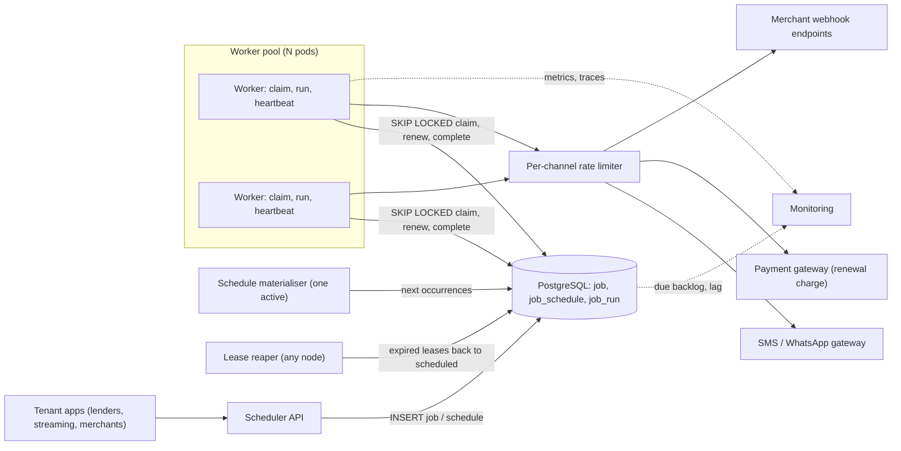
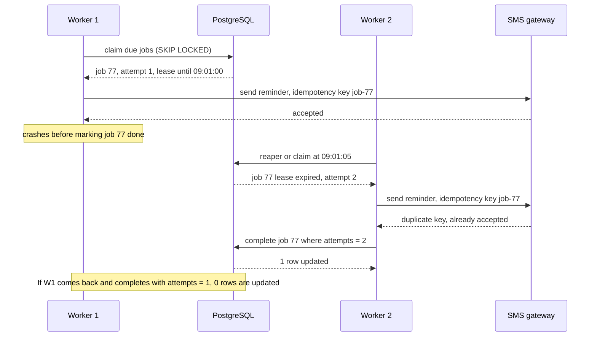

"Send a reminder three days before the EMI is due." "Renew this subscription on the 14th." "Email every branch manager their sales report at 1 AM." "Retry this failed webhook in two minutes." Every product grows a pile of these, and the first version is usually a cron job on one VM. This case study designs the system that replaces it: a scheduler that runs millions of jobs a day for many tenants, survives crashes without losing or duplicating work, and gets time zones right.

## Learning objectives

By the end of this lesson you will be able to:

1. Turn "we need cron, but reliable" into requirements with explicit delivery semantics (at-least-once) and timing tolerance.
2. Estimate job volume, the top-of-the-hour spike and database load, and see why downstream rate limits dominate.
3. Model jobs, schedules and runs in PostgreSQL and claim due jobs safely with `FOR UPDATE SKIP LOCKED`.
4. Use leases, heartbeats and fencing tokens so a crashed or paused worker never causes lost or double-completed jobs.
5. Make handlers idempotent so at-least-once execution has exactly-once effects where it matters.
6. Compute next run times for cron and interval schedules across time zones and DST, and choose a misfire policy.
7. Keep tenants fair, partition the scheduler, and decide between leader election and lock-free claiming.
8. Compare a home-grown scheduler with Hangfire, Quartz.NET, Temporal and cloud schedulers.

## Prerequisites

- [Background processing and job queues](#/lesson/m11-background-processing): workers, queues and retries.
- [Deadlocks, optimistic and pessimistic locking](#/lesson/m09-locking): row locks are how claiming works.
- [Distributed locks and fencing tokens](#/lesson/m13-distributed-locks): a lease is a lock with an expiry.
- [Idempotent consumers](#/lesson/m12-idempotent-consumers): handlers will sometimes run twice.

## Explain it like I'm a beginner

Picture a hospital front desk with a big whiteboard of tasks: "Call Mrs. Rao at 9 AM to confirm her appointment", "Print tomorrow's surgery list at 6 PM", "Re-send lab report to Dr. Khan if he hasn't opened it in 2 hours".

- Several receptionists share the board. When one picks a task, she writes her **name and a time** next to it: "Priya, until 9:10" (a lease). Others skip tasks with a name on them (skip locked).
- If Priya is pulled into an emergency and the time passes, the next receptionist can take the task (lease expiry). That's why the time is written down, not just the name.
- Sometimes Priya made the call but was interrupted before ticking it off, so the next receptionist calls again. The patient system must remember the confirmation (idempotency).
- If the desk was closed on Sunday, Monday's staff decide: do all of Sunday's tasks, only the latest one, or none (misfire policy). A 9 AM reminder at 6 PM may be pointless; a missed report should still be printed.

That's a distributed job scheduler: a shared board (a database table), many workers, leases instead of permanent locks, and explicit rules for crashes and missed times.

## Requirements

### Functional requirements

1. **One-off delayed jobs**: "run `emi_reminder` for loan 8812 at 2026-11-02 09:00 IST".
2. **Recurring schedules**: cron (`0 1 * * *` in `Asia/Kolkata`) or fixed interval (every 15 minutes), each producing job occurrences.
3. **Retries** with exponential backoff and a dead-letter state after N attempts.
4. **Cancel and reschedule** a job before it runs (customer paid early: cancel the reminder).
5. **Priorities** (renewals and webhook retries before reports) and **per-tenant limits**.
6. **Idempotent submission**: the same request with the same dedup key creates the job once.
7. **History**: every attempt is recorded with worker, timing and error, for support and audits.

### Out of scope

- Multi-step workflows with branching and compensation (that's a [workflow engine](#/lesson/m16-workflow-engines)).
- Sub-second precision. Jobs run "at or shortly after" their time.
- Running arbitrary customer code. Job types are handlers we deploy.

### Non-functional requirements

| Requirement | Target | Why |
|---|---|---|
| Delivery | **At least once**; never silently lost | A missed renewal loses revenue; a missed EMI reminder causes late fees |
| Duplicate effects | Handlers idempotent; duplicate side effects under 0.01 % and only where harmless | Two reminder SMS are annoying; two renewal charges are a complaint and a refund |
| Timing | p99 start delay under 30 s after `run_at` in normal operation | Reminders at 09:00 should arrive by 09:01 |
| Throughput | 5 M jobs/day, bursts to 30,000 due jobs in one minute | Top-of-the-hour schedules |
| Availability | 99.9 %; a worker or scheduler node loss heals within a minute | Work just runs a little late |
| Fairness | One tenant's backlog can't delay others by more than a few seconds | Multi-tenant platform |
| Time zones | Schedules in the tenant's local zone, correct across DST | Customers think in local time |

The key word is **at least once**. Exactly-once execution of a side effect (an SMS, a card charge) is impossible to guarantee in general, because a worker can crash after the effect but before recording it. We guarantee at-least-once delivery and make **effects** idempotent.

## Capacity estimation

All numbers are **estimates** for a fintech platform that runs scheduled work for its business customers (tenants): lenders, a streaming service, and merchants receiving payment webhooks.

### Job volume

| Source | Calculation | Jobs/day |
|---|---|---|
| EMI reminders | 20 M active loans × 3 reminders per monthly cycle ÷ 30 | 2.0 M |
| Subscription renewals | 10 M subscriptions renewing monthly ÷ 30 | 0.33 M |
| Webhook retries | 50 M webhooks/day × 2 % fail first time × about 2 retries each | 2.0 M |
| Reports and housekeeping | 50,000 recurring schedules, mostly nightly, some hourly | 0.6 M |
| **Total** | | **≈ 5 M** |

Average: 5 M ÷ 86,400 ≈ **58 jobs/s**. That's tiny. The average is misleading.

### The 9 AM spike

Lenders want reminders "at 9 AM". If all 2 M reminders had `run_at = 09:00:00`, the scheduler would see 2 M jobs due in the same second. Worse, the SMS gateway contract allows (say) **3,000 messages/s**. Minimum send time: 2 M ÷ 3,000 ≈ 667 s ≈ **11 minutes**, whatever we build.

So the design spreads the load **at scheduling time**: reminders get `run_at` = 09:00 plus a deterministic jitter across a 30-minute window (hash of the loan id). 2 M ÷ 1,800 s ≈ **1,100 jobs/s**, comfortably under the gateway limit. Treat `run_at` as **"not before"**, never "exactly at".

### Database load

- Claiming in batches of 100: 1,100 ÷ 100 = **11 claim queries/s**.
- Completions: one `UPDATE` per job, **1,100/s** at peak, plus one history insert each. Batch completions (one statement per 50 jobs) to cut round trips.
- Rows: about 500 B per job including payload and indexes. 5 M × 500 B = **2.5 GB/day**. Keep 14 days in the hot `job` table (≈ 35 GB); move finished jobs to a monthly-partitioned history table and drop partitions after 90 days.
- Updates create dead row versions. A table with 1,000+ updates/s needs aggressive autovacuum settings on that table, or we partition by day so old data is dropped, not vacuumed.

### What the numbers tell us

1. Average load is trivial; **spikes and downstream limits** decide the design.
2. One PostgreSQL primary can hold the job table and serve claiming at this scale. Partitioning is a later step, not day one.
3. The expensive part is **writes per job** (claim, complete, history), so batching matters more than clever reads.

## API design

```http
POST /api/v1/jobs
Authorization: Bearer <tenant token>
Idempotency-Key: emi-8812-2026-11-02-d3

{ "type": "emi_reminder", "runAt": "2026-11-02T09:00:00+05:30", "jitterSeconds": 1800,
  "priority": 5, "maxAttempts": 5, "payload": { "loanId": 8812, "dueDate": "2026-11-05" } }

201 Created   { "id": "240331102617612289", "runAt": "2026-11-02T09:17:42+05:30", "status": "scheduled" }
200 OK        (same body, when the Idempotency-Key was already used)
```

```http
POST /api/v1/schedules
{ "name": "branch-sales-report", "type": "nightly_report", "cron": "0 1 * * *",
  "timeZone": "Asia/Kolkata", "misfire": "fire_once", "misfireThresholdSeconds": 3600 }

DELETE /api/v1/jobs/{id}           → 204, or 409 if already running or finished
GET    /api/v1/jobs/{id}           → status, attempts, last error, next run
GET    /api/v1/jobs/{id}/runs      → attempt history
POST   /api/v1/schedules/{id}/pause
```

Notes:

- `runAt` must include an offset; recurring schedules take an **IANA zone name** (`Asia/Kolkata`, `America/New_York`), never a fixed offset, because offsets change with DST.
- The response returns the **effective** `runAt` after jitter, so the tenant sees what will actually happen.
- Cancelling a running job returns `409`: the handler may already have sent the SMS. The client can still request "cancel if not started".
- Job ids are Snowflake-style 64-bit ids returned as strings ([unique ID generator](#/lesson/m17-unique-id-generator)).

## Data model

```sql
CREATE TABLE job_schedule (
    id              bigint      PRIMARY KEY,
    tenant_id       text        NOT NULL,
    job_type        text        NOT NULL,
    cron_expr       text,                       -- '0 1 * * *' or NULL for interval
    interval_secs   int,                        -- 900 or NULL for cron
    time_zone       text        NOT NULL,       -- IANA name
    misfire_policy  text        NOT NULL DEFAULT 'fire_once',  -- fire_once | fire_all | skip
    misfire_secs    int         NOT NULL DEFAULT 300,
    next_fire_at    timestamptz NOT NULL,       -- next occurrence not yet materialised
    paused          boolean     NOT NULL DEFAULT false,
    CHECK ((cron_expr IS NULL) <> (interval_secs IS NULL))
);
CREATE INDEX schedule_due ON job_schedule (next_fire_at) WHERE NOT paused;

CREATE TABLE job (
    id               bigint      PRIMARY KEY,
    tenant_id        text        NOT NULL,
    job_type         text        NOT NULL,
    schedule_id      bigint      REFERENCES job_schedule (id),
    payload          jsonb       NOT NULL DEFAULT '{}',
    run_at           timestamptz NOT NULL,
    priority         smallint    NOT NULL DEFAULT 0,
    status           text        NOT NULL DEFAULT 'scheduled', -- scheduled | running | succeeded | dead | cancelled
    attempts         int         NOT NULL DEFAULT 0,           -- also the fencing token
    max_attempts     int         NOT NULL DEFAULT 5,
    lease_owner      text,
    lease_expires_at timestamptz,
    dedup_key        text,
    last_error       text,
    UNIQUE (tenant_id, dedup_key)
);
-- Partial indexes stay small: only rows that can still be claimed.
CREATE INDEX job_due     ON job (priority DESC, run_at) WHERE status = 'scheduled';
CREATE INDEX job_leases  ON job (lease_expires_at)      WHERE status = 'running';

CREATE TABLE job_run (
    job_id      bigint      NOT NULL,
    attempt     int         NOT NULL,
    worker      text        NOT NULL,
    started_at  timestamptz NOT NULL,
    finished_at timestamptz,
    outcome     text,                    -- succeeded | failed | lease_lost
    error       text,
    PRIMARY KEY (job_id, attempt, started_at)
) PARTITION BY RANGE (started_at);
```

### Claiming due jobs

```sql
WITH due AS (
    SELECT id FROM job
    WHERE status = 'scheduled' AND run_at <= now()
    ORDER BY priority DESC, run_at
    LIMIT 100
    FOR UPDATE SKIP LOCKED
)
UPDATE job j
SET status = 'running', lease_owner = $1,
    lease_expires_at = now() + interval '60 seconds', attempts = j.attempts + 1
FROM due WHERE j.id = due.id
RETURNING j.id, j.job_type, j.payload, j.attempts, j.lease_expires_at;
```

`FOR UPDATE` locks the selected rows; `SKIP LOCKED` makes other workers running the same query **skip** rows that are already locked instead of waiting for them. Ten workers polling at once each get a different batch, with no blocking and no double claims. The claim is one short transaction; the job runs **outside** any transaction, protected by the lease.

### Completing with a fencing token

```sql
UPDATE job SET status = 'succeeded', lease_owner = NULL, lease_expires_at = NULL
WHERE id = $1 AND status = 'running' AND attempts = $2;     -- 0 rows: someone else owns it now
```

`attempts` doubles as a **fencing token**. If our lease expired and another worker re-claimed the job, `attempts` was incremented, so our late completion updates zero rows and can't overwrite the newer attempt's outcome.

### Reclaiming expired leases

```sql
UPDATE job SET status = 'scheduled', lease_owner = NULL
WHERE status = 'running' AND lease_expires_at < now()
RETURNING id;
```

A "reaper" runs this every 10 seconds (any node can; it's idempotent). Alternatively, fold the condition into the claim query's `WHERE` with an `OR`.

## High-level architecture



Arrow by arrow:

- **Tenant apps → API → PostgreSQL**: the API validates the request (job type exists, `runAt` has an offset, tenant quota), applies jitter, and inserts the job with the dedup key. A repeated request hits the unique constraint and returns the existing job.
- **Materialiser → PostgreSQL**: recurring schedules don't run themselves. One active materialiser finds schedules whose `next_fire_at` is within the next few minutes, inserts a job row per occurrence (dedup key `schedule:{id}:{fireTime}`), and advances `next_fire_at`. Insert and advance happen in one transaction, so a crash can't skip or double an occurrence.
- **Workers → PostgreSQL**: each worker claims a batch with `SKIP LOCKED`, renews leases for long jobs, and completes with the fencing token. No worker talks to another; the table is the only shared state.
- **Reaper → PostgreSQL**: returns jobs with expired leases to `scheduled`, so jobs from crashed workers run again.
- **Workers → rate limiter → external systems**: the slowest dependency sets the pace. Each channel has a limiter (SMS 3,000/s, each merchant endpoint 50/s). A job that can't get a token is rescheduled a few seconds later instead of holding a worker.
- **Dotted edges → Monitoring**: start delay, due backlog, lease expiries and dead jobs per tenant.

### A crash and a re-claim



Worker 1 did the work but crashed before recording it. After the lease expired, Worker 2 re-claimed the job as attempt 2 and ran it again: **at-least-once**. The duplicate SMS was avoided because the handler passed a stable idempotency key (`job-77`, the same for every attempt) to a gateway that deduplicates. Without that, the handler keeps its own "sent" table keyed by job id, accepting a tiny duplicate window. The fencing token makes Worker 1's late completion harmless.

## Deep dives

### Deep dive 1: why the cron-on-a-VM version breaks

The first version is a crontab running a console app at 09:00 that loops over loans and sends SMS. The VM is a single point of failure; a crash at loan 1.2 M of 2 M means a rerun resends 1.2 M; a second VM "for redundancy" sends everything twice; the loop ignores the gateway's limits; and "9 AM" is in the server's zone. The fix is to turn each unit of work into a **row with a state**: durable, shareable and visible.

### Deep dive 2: claiming with SKIP LOCKED vs alternatives

- **Naive `SELECT` then `UPDATE`**: two workers read the same due row and both run it.
- **`FOR UPDATE` without `SKIP LOCKED`**: correct, but workers wait on each other's locks and serialise.
- **`FOR UPDATE SKIP LOCKED`**: disjoint rows, nobody waits. Locked rows are briefly invisible to others, fine for a queue and wrong for a consistent report, which is why it isn't the default.
- **Advisory locks**: work, but are awkward with `LIMIT` and ordering.
- **A message broker**: great throughput, but delayed delivery, cancellation, per-tenant queries and history are harder. A common hybrid keeps the table as truth and publishes due jobs to a broker.

Keep the claim transaction **short**: holding it open during a 20-minute report blocks vacuum and pins a connection.

### Deep dive 3: leases, heartbeats and fencing

A lease is a lock that **expires on its own**, so a crashed worker can't hold a job forever.

- **Lease length**: 60 s for SMS reminders, which take about 200 ms. A 20-minute report **heartbeats** instead of taking a long lease: every 20 s it extends the lease by 60 s, so a dead worker's job is picked up within about a minute.
- **Heartbeat failure means stop.** If renewal fails, another worker may already be running the job, so the heartbeat loop cancels a `CancellationTokenSource` the handler observes.
- **Pauses are the hard case.** A worker frozen by a long GC pause or VM migration wakes up after expiry, unaware. Every write it makes about the job (completion, progress, ideally the side effect) carries `attempts`, the fencing token, and stale values are rejected.
- **Clocks**: lease expiry uses the **database's** `now()`, so all workers compare against one clock.

### Deep dive 4: at-least-once and idempotent handlers

Every handler must be safe to run twice for the same job. Patterns, from best to weakest:

1. **Downstream idempotency key**: pass `job-{id}` to the payment gateway or SMS provider. A renewal charge with the same key is processed once by the provider. (Most payment gateways support idempotency keys for exactly this reason.)
2. **Effect-and-record in one transaction**: if the effect is a database write in our own database (create an invoice, add a ledger entry), do it in the same transaction as `UPDATE job SET status = 'succeeded' WHERE attempts = $2`. Then it's truly exactly-once.
3. **Check-then-act with a processed table**: `INSERT INTO sent_reminder (job_id) ... ON CONFLICT DO NOTHING` before sending; skip if the row exists. A crash between insert and send loses the SMS (at-most-once for that window); a crash between send and insert duplicates it. Pick the order based on which failure is worse.
4. **Naturally idempotent effects**: "set subscription status to renewed until 14 Dec" can be applied twice safely; "add one month" can't.

The scheduler can't make handlers idempotent; it can only make it easy by passing a **stable key** (the job id, not the attempt) and the attempt number.

### Deep dive 5: cron, time zones and DST

Store recurring schedules as **local time + IANA zone**, and convert to UTC only when computing each occurrence.

- `0 9 * * *` in `Asia/Kolkata` is always 03:30 UTC: India has no DST.
- `0 9 * * *` in `America/New_York` is 13:00 UTC in summer (EDT, UTC−4) and 14:00 UTC in winter (EST, UTC−5). Storing "13:00 UTC" would shift the reminder to 8 AM local every winter.

Two DST traps:

- **Spring forward**: on the second Sunday of March in New York, clocks jump from 02:00 to 03:00. A job at **02:30 doesn't exist** that day. Choose a rule: run at the first valid instant after the gap (03:00), or skip that day. Most schedulers run it.
- **Fall back**: on the first Sunday of November, 01:00–02:00 happens **twice**. A job at 01:30 is ambiguous. Run it once, at the first occurrence; never twice.

.NET gives you the tools: `TimeZoneInfo.FindSystemTimeZoneById("America/New_York")` (IANA ids work on Windows too, through ICU), `IsInvalidTime` for the gap and `IsAmbiguousTime` / `GetAmbiguousTimeOffsets` for the overlap. For full cron syntax, use a tested library rather than writing a parser; the hard part is DST, not parsing five fields.

Interval schedules ("every 15 minutes") are different: they're usually defined in **elapsed time** and computed in UTC, so DST doesn't affect them. Compute the next time from the **schedule's grid** (`anchor + k × interval`), not from "last run finished + interval", or the schedule drifts later every time a run is slow.

### Deep dive 6: misfire policies

A **misfire** happens when an occurrence's time passed without it running: the scheduler was down, the database failed over, or the backlog was so long that the job is now late. The misfire threshold (say 5 minutes) separates "a bit late" from "missed". For missed occurrences, choose per schedule:

| Policy | Behaviour | Good for |
|---|---|---|
| **Fire once** (coalesce) | Run one occurrence now for all missed ones | Nightly report, cache refresh, cleanup |
| **Fire all** (catch up) | Run every missed occurrence, capped (for example the last 10) | Hourly billing aggregation where each hour matters |
| **Skip** | Drop missed occurrences, wait for the next one | "Good morning" push notification, live score refresh |

Quartz.NET calls these misfire instructions and has its own names for them (for example "fire now" and "do nothing"). For one-off jobs, the same idea is a **deadline**: an EMI reminder for 09:00 that can't run by 18:00 should be **expired**, not sent at 23:00. Store `expires_at` on the job and have the handler (or the claim query) drop it.

### Deep dive 7: priorities and fairness between tenants

`ORDER BY priority DESC, run_at` is simple, but it has two problems.

- **Starvation**: if high-priority jobs never stop arriving, priority-1 jobs never run. Fix with **aging**: order by an effective priority that grows with wait time, for example `priority + extract(epoch from now() - run_at) / 600` (one level per 10 minutes late). That expression can't use the plain index, so in practice you claim from each priority band separately with a quota (say 70 % high, 20 % normal, 10 % low per batch).
- **Noisy tenants**: a lender bulk-uploads 3 M reminders for 09:00. Everyone else's jobs queue behind them. Fixes:
  - **Per-tenant concurrency caps**: at most N running jobs per tenant (`count(*) WHERE tenant_id = $1 AND status = 'running'`, or a counter table).
  - **Fair claiming**: claim a small batch per tenant in turn (`LATERAL` join over active tenants, each with its own `LIMIT 10 ... SKIP LOCKED`), so a tenant with 3 M due jobs and a tenant with 30 each make progress.
  - **Separate lanes**: very large tenants get their own partition or worker pool.

### Deep dive 8: partitioning, leader election and scaling out

**Lock-free claiming** (every worker runs `SKIP LOCKED`) needs no leader at all. That's why it's the default for executing jobs. It scales until the job table's write rate or index contention becomes the limit: our estimate puts that well above our 1,100 jobs/s peak, but measure it.

Some tasks should run on **one node at a time**: the schedule materialiser and the reaper (the reaper is idempotent, so running it on several nodes is wasteful but safe). Options:

- **PostgreSQL advisory lock as a leader lease**: `SELECT pg_try_advisory_lock(42)` on a dedicated connection. The holder is the leader until its session ends. Simple, but a network blip ends the session and leadership, so the new leader must tolerate overlap (dedup keys make materialising twice harmless).
- **Kubernetes Lease objects, etcd or ZooKeeper** for leader election.
- **SKIP LOCKED on schedule rows**: each node materialises whichever schedules it can lock. No leader needed, which is often simplest.

When one database isn't enough (tens of thousands of jobs per second, or regulatory separation), **partition**:

- Hash `tenant_id` into, say, 16 logical partitions, each a separate table or database. Workers lease partitions (like worker ids) and claim only from their own.
- Or split into **two tiers**: a **timer store** that only knows "job X is due at T" (time-bucketed, very write-efficient) and a **dispatcher** that moves due jobs into a broker queue for execution. Large-scale schedulers are often built this way.

### Deep dive 9: the core in ASP.NET Core

The code below is a compilable core: an in-memory job store that mimics the SQL above (claim with lease, renew, complete and fail with fencing, per-tenant fairness), a `BackgroundService` worker with heartbeats, a handler that passes a stable idempotency key, and DST-aware daily schedule computation. A PostgreSQL implementation of `IJobStore` would run the SQL from the data model section.

```csharp file=Scheduling/Jobs.cs
namespace Scheduling;

public enum JobStatus { Scheduled, Running, Succeeded, Dead, Cancelled }

public sealed record NewJob(string TenantId, string JobType, string Payload, DateTimeOffset RunAt,
                            int Priority = 0, int MaxAttempts = 5, string? DedupKey = null);

/// <summary>What a worker gets back from a claim. Attempt is the fencing token.</summary>
public sealed record ClaimedJob(long Id, string TenantId, string JobType, string Payload,
                                int Attempt, int MaxAttempts, DateTimeOffset LeaseExpiresAt);

public interface IJobStore
{
    Task<(long Id, bool Created)> EnqueueAsync(NewJob job, CancellationToken ct);
    Task<IReadOnlyList<ClaimedJob>> ClaimDueAsync(string workerId, int max, TimeSpan lease, CancellationToken ct);
    Task<bool> RenewAsync(long jobId, int attempt, TimeSpan lease, CancellationToken ct);
    Task<bool> CompleteAsync(long jobId, int attempt, CancellationToken ct);
    /// <summary>retryAt null means no more retries: the job becomes Dead.</summary>
    Task<bool> FailAsync(long jobId, int attempt, string error, DateTimeOffset? retryAt, CancellationToken ct);
}

public static class RetryPolicy
{
    private static readonly TimeSpan Base = TimeSpan.FromSeconds(30);
    private static readonly TimeSpan Cap = TimeSpan.FromHours(1);

    /// <summary>Exponential backoff with up to 20 % jitter so retries from one outage don't arrive together.</summary>
    public static DateTimeOffset? NextAttemptAt(int failedAttempt, int maxAttempts, DateTimeOffset now)
    {
        if (failedAttempt >= maxAttempts) return null;
        var exp = Math.Min(failedAttempt - 1, 20);
        var delay = TimeSpan.FromTicks(Math.Min(Base.Ticks << exp, Cap.Ticks));
        return now + delay * (1 + Random.Shared.NextDouble() * 0.2);
    }
}
```

```csharp file=Scheduling/InMemoryJobStore.cs
namespace Scheduling;

/// <summary>Mimics the PostgreSQL design: claim = SKIP LOCKED + lease, writes fenced by attempt number.</summary>
public sealed class InMemoryJobStore(TimeProvider clock, int maxPerTenantPerClaim = 20) : IJobStore
{
    private sealed class Row
    {
        public required long Id;
        public required NewJob Spec;
        public DateTimeOffset RunAt;
        public JobStatus Status = JobStatus.Scheduled;
        public int Attempts;
        public string? LeaseOwner;
        public DateTimeOffset LeaseExpiresAt;
        public string? LastError;
    }

    private readonly Lock _gate = new();
    private readonly Dictionary<long, Row> _rows = new();
    private readonly Dictionary<(string Tenant, string Key), long> _dedup = new();
    private long _nextId;

    public Task<(long Id, bool Created)> EnqueueAsync(NewJob job, CancellationToken ct)
    {
        lock (_gate)
        {
            if (job.DedupKey is { } key && _dedup.TryGetValue((job.TenantId, key), out var existing))
                return Task.FromResult((existing, false));
            var row = new Row { Id = ++_nextId, Spec = job, RunAt = job.RunAt };
            _rows.Add(row.Id, row);
            if (job.DedupKey is { } k) _dedup[(job.TenantId, k)] = row.Id;
            return Task.FromResult((row.Id, true));
        }
    }

    public Task<IReadOnlyList<ClaimedJob>> ClaimDueAsync(string workerId, int max, TimeSpan lease, CancellationToken ct)
    {
        lock (_gate)
        {
            var now = clock.GetUtcNow();
            var perTenant = new Dictionary<string, int>();
            var claimed = new List<ClaimedJob>();
            var due = _rows.Values
                .Where(r => (r.Status == JobStatus.Scheduled && r.RunAt <= now)
                         || (r.Status == JobStatus.Running && r.LeaseExpiresAt <= now)) // reaper folded in
                .OrderByDescending(r => r.Spec.Priority).ThenBy(r => r.RunAt).ThenBy(r => r.Id);
            foreach (var r in due)
            {
                if (claimed.Count == max) break;
                var n = perTenant.GetValueOrDefault(r.Spec.TenantId);
                if (n >= maxPerTenantPerClaim) continue; // fairness: one tenant can't take the whole batch
                perTenant[r.Spec.TenantId] = n + 1;
                r.Status = JobStatus.Running;
                r.Attempts++;
                r.LeaseOwner = workerId;
                r.LeaseExpiresAt = now + lease;
                claimed.Add(new ClaimedJob(r.Id, r.Spec.TenantId, r.Spec.JobType, r.Spec.Payload,
                                           r.Attempts, r.Spec.MaxAttempts, r.LeaseExpiresAt));
            }
            return Task.FromResult<IReadOnlyList<ClaimedJob>>(claimed);
        }
    }

    public Task<bool> RenewAsync(long jobId, int attempt, TimeSpan lease, CancellationToken ct)
    {
        lock (_gate)
        {
            var now = clock.GetUtcNow();
            if (!_rows.TryGetValue(jobId, out var r) || !Owns(r, attempt) || r.LeaseExpiresAt <= now)
                return Task.FromResult(false);
            r.LeaseExpiresAt = now + lease;
            return Task.FromResult(true);
        }
    }

    public Task<bool> CompleteAsync(long jobId, int attempt, CancellationToken ct)
    {
        lock (_gate)
        {
            if (!_rows.TryGetValue(jobId, out var r) || !Owns(r, attempt)) return Task.FromResult(false);
            r.Status = JobStatus.Succeeded;
            r.LeaseOwner = null;
            return Task.FromResult(true);
        }
    }

    public Task<bool> FailAsync(long jobId, int attempt, string error, DateTimeOffset? retryAt, CancellationToken ct)
    {
        lock (_gate)
        {
            if (!_rows.TryGetValue(jobId, out var r) || !Owns(r, attempt)) return Task.FromResult(false);
            r.LastError = error;
            r.LeaseOwner = null;
            if (retryAt is { } at) { r.Status = JobStatus.Scheduled; r.RunAt = at; }
            else r.Status = JobStatus.Dead;
            return Task.FromResult(true);
        }
    }

    public JobStatus StatusOf(long jobId) { lock (_gate) return _rows[jobId].Status; }

    private static bool Owns(Row r, int attempt) => r.Status == JobStatus.Running && r.Attempts == attempt;
}
```

```csharp file=Scheduling/JobWorker.cs
using System.Collections.Concurrent;
using Microsoft.Extensions.Hosting;
using Microsoft.Extensions.Logging;

namespace Scheduling;

public interface IJobHandler
{
    string JobType { get; }
    Task HandleAsync(ClaimedJob job, CancellationToken ct);
}

public sealed class WorkerOptions
{
    public string WorkerId { get; set; } = Environment.MachineName;
    public int Concurrency { get; set; } = 16;
    public TimeSpan Lease { get; set; } = TimeSpan.FromSeconds(60);
    public TimeSpan PollInterval { get; set; } = TimeSpan.FromSeconds(1);
}

public sealed class JobWorker(IJobStore store, IEnumerable<IJobHandler> handlers, TimeProvider clock,
                              WorkerOptions options, ILogger<JobWorker> log) : BackgroundService
{
    private readonly Dictionary<string, IJobHandler> _handlers = handlers.ToDictionary(h => h.JobType);
    private readonly ConcurrentDictionary<long, Task> _running = new();

    protected override async Task ExecuteAsync(CancellationToken stoppingToken)
    {
        using var slots = new SemaphoreSlim(options.Concurrency);
        try
        {
            while (!stoppingToken.IsCancellationRequested)
            {
                var free = slots.CurrentCount;
                var batch = free == 0
                    ? []
                    : await store.ClaimDueAsync(options.WorkerId, free, options.Lease, stoppingToken);
                foreach (var job in batch)
                {
                    await slots.WaitAsync(stoppingToken);
                    var task = RunOneAsync(job, slots, stoppingToken);
                    _running[job.Id] = task;
                    if (task.IsCompleted) _running.TryRemove(job.Id, out _); // finished before we tracked it
                }
                if (batch.Count == 0) await Task.Delay(options.PollInterval, clock, stoppingToken);
            }
        }
        catch (OperationCanceledException) when (stoppingToken.IsCancellationRequested) { }
        await Task.WhenAll(_running.Values); // let in-flight jobs finish or observe cancellation
    }

    private async Task RunOneAsync(ClaimedJob job, SemaphoreSlim slots, CancellationToken stopping)
    {
        using var jobCts = CancellationTokenSource.CreateLinkedTokenSource(stopping);
        var heartbeat = HeartbeatAsync(job, jobCts);
        try
        {
            if (!_handlers.TryGetValue(job.JobType, out var handler))
                throw new InvalidOperationException($"No handler for {job.JobType}");
            await handler.HandleAsync(job, jobCts.Token);
            if (!await store.CompleteAsync(job.Id, job.Attempt, CancellationToken.None))
                log.LogWarning("Job {JobId} attempt {Attempt} finished after losing its lease", job.Id, job.Attempt);
        }
        catch (OperationCanceledException) when (jobCts.IsCancellationRequested)
        {
            // Lease lost or shutting down: do not complete. The lease expires and another worker retries.
            log.LogInformation("Job {JobId} attempt {Attempt} cancelled", job.Id, job.Attempt);
        }
        catch (Exception ex)
        {
            var retryAt = RetryPolicy.NextAttemptAt(job.Attempt, job.MaxAttempts, clock.GetUtcNow());
            await store.FailAsync(job.Id, job.Attempt, ex.Message, retryAt, CancellationToken.None);
            log.LogWarning(ex, "Job {JobId} attempt {Attempt} failed; retry at {RetryAt}", job.Id, job.Attempt, retryAt);
        }
        finally
        {
            await jobCts.CancelAsync();
            try { await heartbeat; } catch (OperationCanceledException) { }
            _running.TryRemove(job.Id, out _);
            slots.Release();
        }
    }

    private async Task HeartbeatAsync(ClaimedJob job, CancellationTokenSource jobCts)
    {
        while (!jobCts.IsCancellationRequested)
        {
            await Task.Delay(options.Lease / 3, clock, jobCts.Token);
            if (!await store.RenewAsync(job.Id, job.Attempt, options.Lease, jobCts.Token))
            {
                log.LogWarning("Lost lease on job {JobId}; cancelling handler", job.Id);
                await jobCts.CancelAsync();
                return;
            }
        }
    }
}
```

```csharp file=Scheduling/EmiReminderHandler.cs
using System.Collections.Concurrent;
using System.Text.Json;

namespace Scheduling;

public interface ISmsGateway
{
    /// <summary>Real gateways accept a client reference and ignore repeats of it.</summary>
    Task SendAsync(string phone, string text, string idempotencyKey, CancellationToken ct);
}

public sealed class FakeSmsGateway : ISmsGateway
{
    private readonly ConcurrentDictionary<string, string> _sent = new();
    public int Sent => _sent.Count;
    public Task SendAsync(string phone, string text, string idempotencyKey, CancellationToken ct)
    {
        _sent.TryAdd(idempotencyKey, phone);
        return Task.CompletedTask;
    }
}

public sealed record EmiReminderPayload(long LoanId, string Phone, decimal AmountInr, DateOnly DueDate);

public sealed class EmiReminderHandler(ISmsGateway sms) : IJobHandler
{
    public string JobType => "emi_reminder";

    public async Task HandleAsync(ClaimedJob job, CancellationToken ct)
    {
        var p = JsonSerializer.Deserialize<EmiReminderPayload>(job.Payload, JsonSerializerOptions.Web)
                ?? throw new InvalidOperationException("Empty payload");
        var text = $"Your EMI of Rs {p.AmountInr:N0} for loan {p.LoanId} is due on {p.DueDate:dd MMM}.";
        // Stable across attempts: the job id, never the attempt number.
        await sms.SendAsync(p.Phone, text, idempotencyKey: $"job-{job.Id}", ct);
    }
}
```

```csharp file=Scheduling/DailySchedule.cs
namespace Scheduling;

/// <summary>"Every day at 09:00 in zone Z", correct across DST gaps and overlaps.</summary>
public static class DailySchedule
{
    public static DateTimeOffset NextAfter(DateTimeOffset after, TimeOnly localTime, TimeZoneInfo zone)
    {
        var localDate = DateOnly.FromDateTime(TimeZoneInfo.ConvertTime(after, zone).DateTime);
        for (var day = 0; day < 3; day++)
        {
            var wall = localDate.AddDays(day).ToDateTime(localTime); // Kind = Unspecified
            // Spring forward: the wall time doesn't exist; run at the first valid minute after the gap.
            while (zone.IsInvalidTime(wall)) wall = wall.AddMinutes(1);
            // Fall back: the wall time happens twice; take the first (larger offset = earlier instant).
            var offset = zone.IsAmbiguousTime(wall) ? zone.GetAmbiguousTimeOffsets(wall).Max() : zone.GetUtcOffset(wall);
            var candidate = new DateTimeOffset(wall, offset);
            if (candidate > after) return candidate.ToUniversalTime();
        }
        throw new InvalidOperationException("No occurrence found within three days.");
    }
}
```

```csharp file=Program.cs
using Scheduling;

var builder = WebApplication.CreateBuilder(args);

builder.Services.AddSingleton(TimeProvider.System);
// Swap for a PostgreSQL-backed IJobStore that runs the SKIP LOCKED SQL in production.
builder.Services.AddSingleton<IJobStore>(sp => new InMemoryJobStore(sp.GetRequiredService<TimeProvider>()));
builder.Services.AddSingleton<ISmsGateway, FakeSmsGateway>();
builder.Services.AddSingleton<IJobHandler, EmiReminderHandler>();
builder.Services.AddSingleton(new WorkerOptions { WorkerId = $"{Environment.MachineName}-{Environment.ProcessId}" });
builder.Services.AddHostedService<JobWorker>();

var app = builder.Build();

app.MapPost("/api/v1/jobs", async (CreateJobRequest req, HttpContext http, IJobStore store, CancellationToken ct) =>
{
    var tenant = http.User.Identity?.Name ?? "demo-tenant";
    var key = http.Request.Headers["Idempotency-Key"].ToString();
    // Deterministic jitter: the same job always lands at the same second inside the window.
    var jitter = req.JitterSeconds > 0 ? TimeSpan.FromSeconds(StableHash.Fnv1a($"{tenant}/{key}") % (uint)req.JitterSeconds) : TimeSpan.Zero;
    var (id, created) = await store.EnqueueAsync(
        new NewJob(tenant, req.Type, req.Payload.GetRawText(), req.RunAt + jitter, req.Priority, req.MaxAttempts,
                   string.IsNullOrEmpty(key) ? null : key), ct);
    var body = new { id = id.ToString(), runAt = req.RunAt + jitter, status = "scheduled" };
    return created ? Results.Created($"/api/v1/jobs/{id}", body) : Results.Ok(body);
});

app.MapGet("/api/v1/schedules/preview", (string zone, string at, int count) =>
{
    var tz = TimeZoneInfo.FindSystemTimeZoneById(zone); // IANA ids such as "America/New_York"
    var local = TimeOnly.Parse(at);
    var next = DateTimeOffset.UtcNow;
    var list = new List<DateTimeOffset>();
    for (var i = 0; i < Math.Clamp(count, 1, 30); i++) list.Add(next = DailySchedule.NextAfter(next, local, tz));
    return Results.Ok(list);
});

app.Run();

public sealed record CreateJobRequest(string Type, DateTimeOffset RunAt, System.Text.Json.JsonElement Payload,
                                      int JitterSeconds = 0, int Priority = 0, int MaxAttempts = 5);

public static class StableHash
{
    /// <summary>FNV-1a: unlike string.GetHashCode or HashCode.Combine, it gives the same value in every process.</summary>
    public static uint Fnv1a(string s)
    {
        var h = 2166136261u;
        foreach (var c in s) { h ^= c; h *= 16777619u; }
        return h;
    }
}
```

Two points to notice. The jitter uses a **stable** hash, because .NET's string hashing is randomised per process: a retried request landing on another pod must compute the same `runAt`. And the worker never holds a database transaction while a handler runs; the lease and the fencing token carry the safety.

## Caching, queues and scaling

### Caching and queues

Correctness depends on fresh job state, so the only caches are **configuration** (job types, channel limits, tenant quotas) with a short TTL.

- The job table **is** the queue, with delays, cancellation and queries that brokers lack.
- At higher scale, a **dispatcher** publishes due jobs to a broker (RabbitMQ, Azure Service Bus, Kafka) partitioned by channel; consumers execute and complete the job row with the fencing token.
- Each channel's token bucket sets real throughput ([rate limiter](#/lesson/m17-rate-limiter)). Jobs without a token are pushed back a few seconds, not retried in a hot loop.

### Scaling path

1. **Up to ~100 jobs/s**: one ASP.NET Core app with a `BackgroundService`, one PostgreSQL table, `SKIP LOCKED`. Or just use Hangfire or Quartz.NET.
2. **Up to a few thousand jobs/s**: separate API and worker deployments, partial indexes, batched completions, a history table partitioned by month, aggressive autovacuum on `job`.
3. **Beyond that**: hash-partition by tenant across several databases, or the two-tier timer + broker design.

**What breaks first?** (1) The downstream gateway at the top of the hour, (2) table bloat from millions of updates per day, (3) one big tenant starving others, (4) slow claim queries when the due index includes finished rows (fixed by partial indexes).

## Failure handling

| Failure | Effect | Mitigation |
|---|---|---|
| Worker crashes mid-job | Job stuck in `running` | Lease expires (60 s), job re-claimed as next attempt; handler idempotent |
| Worker paused past lease (GC, VM freeze) | Two workers may run the same job | Heartbeat failure cancels work; fencing token rejects stale completion; idempotency keys stop duplicate effects |
| Handler throws | Job failed | Exponential backoff with jitter; `dead` after `max_attempts`; alert on dead jobs per tenant |
| Poison job (always crashes the worker process) | Repeated crashes | `attempts` increments on claim, so the job goes `dead` after N crashes even without a `FailAsync` call |
| PostgreSQL failover | Claims and completions fail for 30–60 s | Workers retry with backoff; leases measured with DB `now()`; jobs run late, misfire policy applies |
| Scheduler down for hours | Occurrences missed | Misfire policies per schedule; deadlines on one-off jobs |
| Downstream gateway slow or returning `429` | Jobs pile up, retries amplify load | Per-channel rate limiter, honour `Retry-After`, circuit breaker; reschedule instead of hot retry |
| Duplicate submission | Two identical jobs | `UNIQUE (tenant_id, dedup_key)` and `Idempotency-Key` |
| Materialiser runs twice | Duplicate occurrences | Dedup key `schedule:{id}:{fireTime}` |
| Clock skew between nodes | Inconsistent lease checks | Use database time for all lease comparisons |

## Security

- **Tenant isolation**: every query filters on `tenant_id` from the authenticated token; a tenant can never cancel or read another tenant's jobs. Consider row-level security in PostgreSQL as a second line ([multi-tenant security](#/lesson/m14-multi-tenant-security)).
- **Payloads are data, not code**: tenants choose from deployed job types. Never execute scripts or URLs from a payload without allow-lists; webhook retry jobs can only call the merchant's registered, verified endpoint (SSRF protection).
- **Secrets**: payloads must not contain API keys or card data. Store references (`loanId`, `subscriptionId`); handlers load what they need with their own credentials.
- **Quotas**: per-tenant limits on jobs per day and on schedule frequency (no `* * * * *` every-minute cron for free plans), so one tenant can't overload the platform.
- **Audit**: who created, cancelled or paused each schedule, from the `job_run` history and an audit log.
- **Personal data**: reminder payloads carry phone numbers; encrypt sensitive columns and purge finished jobs on a retention schedule (DPDP Act and GDPR obligations).

## Observability

The most important metric is **start delay**: `claimed_at − run_at`, as a histogram per job type and tenant. It tells you directly whether the scheduler keeps its promise.

- **Due backlog**: `count(*) WHERE status = 'scheduled' AND run_at <= now()`. Should hover near zero; growth means workers can't keep up.
- **Lease expiries per minute**: each one is a crashed or stuck worker.
- **Fencing rejections**: late completions from stale attempts. Rare and non-zero is normal; a spike means leases are too short.
- **Attempts and dead jobs** per job type and tenant; alert when dead jobs appear for payments or renewals.
- **Downstream throttling**: tokens denied per channel, `429`s from gateways.
- **Table health**: dead tuples and autovacuum runs on `job`.
- **Traces**: the job id and attempt in every log line and span, linked to the trace that created the job.

An SLO could be: "99 % of jobs start within 60 seconds of `run_at`, measured per tenant over 28 days, excluding jobs deliberately delayed by rate limits."

## Deployment and cost

### Deployment

- Run API and workers as separate deployments; scale workers on due backlog and start delay, not CPU.
- On shutdown, a worker stops claiming and lets in-flight jobs finish within the grace period; leases cover the rest.
- Queued payloads outlive deployments, so keep them backward compatible, and change the `job` schema with expand-and-contract.

### Cost

The database is the main infrastructure cost, driven by writes; batching and dropping partitions keep it modest. Workers are I/O-bound and cheap. SMS and WhatsApp fees usually dwarf the scheduler itself, so avoiding duplicate sends pays for the idempotency work.

### When a simpler design is enough

A gym chain sending 5,000 membership-renewal reminders a day needs a single ASP.NET Core app with a `BackgroundService` and a `PeriodicTimer`, or Hangfire with PostgreSQL storage. A one-off nightly export with no business impact if it fails once can stay a cloud timer trigger. Build the full design only when volume, tenants or correctness demands it.

## Alternatives and trade-offs

| Option | What it gives you | Watch out for | Good fit |
|---|---|---|---|
| **Home-grown** (this lesson) | Full control over fairness, tenancy, misfire rules, schema | You own every bug in leases and DST | Multi-tenant platforms with special needs |
| **Hangfire** | Background jobs, delayed jobs, recurring cron jobs, retries and a dashboard in .NET; PostgreSQL storage through a community package | At-least-once (handlers must be idempotent); fairness and multi-tenancy are up to you | Most .NET apps that need reliable background jobs |
| **Quartz.NET** | Rich triggers and calendars, misfire instructions, clustering through a shared database with row locks | Clustering scales to moderate rates; jobs and triggers model takes learning | Complex calendar-driven schedules |
| **Temporal** (or Azure Durable Functions) | Durable workflows with timers, retries and state that survive crashes | A cluster or service to run; different programming model | Multi-step processes: renewals with payment retries, dunning and notifications |
| **Cloud schedulers** (Azure Functions timer triggers, Logic Apps, AWS EventBridge Scheduler, Google Cloud Scheduler) | Managed, no servers; EventBridge Scheduler supports one-time schedules and time zones | Per-schedule pricing and quotas, limited fairness control, vendor lock-in | A modest number of schedules, or triggering your own dispatcher |
| **Broker delayed messages** (Service Bus scheduled messages, RabbitMQ delayed exchange plugin) | High throughput, simple consumers | Querying, cancelling and auditing delayed messages is limited | Short retry delays (webhook retry in 2 minutes) |

The honest default for a single .NET product is **Hangfire or Quartz.NET on PostgreSQL**. This lesson's design is roughly what they do internally, plus the tenancy, fairness and spike handling they leave to you.

## Practical playground

The starting graph is the cron-on-one-VM design: a single scheduler VM runs a script at 09:00 that reads the database and calls the SMS gateway directly. Open it in the HLD canvas and set the client traffic to the 9 AM spike. Then evolve it: add a worker pool, a lease-based claim path, a reaper, a per-channel rate limiter and monitoring.

:::playground type=hld title="From one cron VM to a scheduler"
```json
{
  "nodes": [
    { "id": "t", "type": "client", "label": "Lender apps creating reminders", "props": { "rps": 200 } },
    { "id": "api", "type": "app-server", "label": "Loan API", "props": { "instances": 2 } },
    { "id": "db", "type": "database", "label": "PostgreSQL (loans)" },
    { "id": "cron", "type": "scheduler", "label": "Single VM crontab: 0 9 * * *", "props": { "instances": 1 } },
    { "id": "sms", "type": "external", "label": "SMS gateway (3,000 msg/s)" }
  ],
  "edges": [
    { "from": "t", "to": "api", "kind": "sync" },
    { "from": "api", "to": "db", "kind": "sync" },
    { "from": "cron", "to": "db", "kind": "sync", "label": "SELECT all loans due in 3 days" },
    { "from": "cron", "to": "sms", "kind": "sync", "label": "send in a loop" }
  ]
}
```
:::

## Exercises

:::exercise id=m17-job-scheduler-ex1 difficulty=beginner kind=sql ordered=true title="Which jobs can a worker claim right now?"
It is `2026-10-26 09:00:00+05:30`. Write the query a worker would use to pick its next batch: jobs that are `scheduled` with `run_at` at or before now, **plus** jobs stuck in `running` whose lease expired before now. Return `id`, `tenant` and `job_type` for at most 5 jobs, highest `priority` first, then oldest `run_at`, then lowest `id`.
::setup
```sql
CREATE TABLE job (
  id               bigint PRIMARY KEY,
  tenant           text NOT NULL,
  job_type         text NOT NULL,
  status           text NOT NULL,
  run_at           timestamptz NOT NULL,
  priority         int NOT NULL,
  lease_expires_at timestamptz
);
INSERT INTO job VALUES
  (1,  'lendwise', 'emi_reminder',   'scheduled', '2026-10-26 08:59:00+05:30', 5, NULL),
  (2,  'lendwise', 'emi_reminder',   'scheduled', '2026-10-26 09:00:00+05:30', 5, NULL),
  (3,  'streamly', 'renewal',        'scheduled', '2026-10-26 08:30:00+05:30', 9, NULL),
  (4,  'shopnow',  'webhook_retry',  'running',   '2026-10-26 08:55:00+05:30', 5, '2026-10-26 08:58:00+05:30'),
  (5,  'shopnow',  'webhook_retry',  'running',   '2026-10-26 08:56:00+05:30', 5, '2026-10-26 09:01:00+05:30'),
  (6,  'streamly', 'nightly_report', 'scheduled', '2026-10-26 09:00:01+05:30', 9, NULL),
  (7,  'lendwise', 'emi_reminder',   'succeeded', '2026-10-26 08:00:00+05:30', 5, NULL),
  (8,  'shopnow',  'webhook_retry',  'dead',      '2026-10-26 07:00:00+05:30', 5, NULL),
  (9,  'streamly', 'renewal',        'scheduled', '2026-10-26 08:45:00+05:30', 1, NULL),
  (10, 'lendwise', 'statement',      'scheduled', '2026-10-26 02:00:00+05:30', 1, NULL),
  (11, 'shopnow',  'webhook_retry',  'running',   '2026-10-26 08:40:00+05:30', 9, '2026-10-26 08:59:59+05:30');
```
::check
```sql
SELECT id, tenant, job_type
FROM job
WHERE (status = 'scheduled' AND run_at <= TIMESTAMPTZ '2026-10-26 09:00:00+05:30')
   OR (status = 'running' AND lease_expires_at < TIMESTAMPTZ '2026-10-26 09:00:00+05:30')
ORDER BY priority DESC, run_at, id
LIMIT 5;
```
::acceptance
- Returns ids 3, 11, 4, 1, 2 in that order.
- Job 5 is excluded (its lease is still valid until 09:01), job 6 is excluded (due one second later), and finished jobs 7 and 8 never appear.
- Low-priority jobs 9 and 10 are due but don't fit in this batch of 5.
::hint
There are two different reasons a job is claimable. Write each as its own condition.
::hint
Combine them with `OR`, and put each in parentheses: `(status = 'scheduled' AND run_at <= ...) OR (status = 'running' AND lease_expires_at < ...)`.
::hint
Sort by `priority DESC`, then `run_at`, then `id` as a tie-breaker, and `LIMIT 5`.
::hint
In production you'd add `FOR UPDATE SKIP LOCKED` and wrap it in an `UPDATE ... FROM (that query)` that sets the lease. The result rows are the same.
::solution
```sql
SELECT id, tenant, job_type
FROM job
WHERE (status = 'scheduled' AND run_at <= TIMESTAMPTZ '2026-10-26 09:00:00+05:30')
   OR (status = 'running' AND lease_expires_at < TIMESTAMPTZ '2026-10-26 09:00:00+05:30')
ORDER BY priority DESC, run_at, id
LIMIT 5;
```

Job 11 is claimable because its worker's lease ran out at 08:59:59 (that worker probably crashed); job 4 likewise at priority 5. The two priority-1 jobs are starving: with continuous high-priority traffic they'd never run, which is why real schedulers add aging or per-band quotas.

The `OR` across two statuses can't use one partial index, so production versions run two claim queries or let a reaper move expired leases back to `scheduled`.
::mistakes
- Forgetting the expired-lease half, so jobs from crashed workers stay `running` forever.
- Writing `status = 'scheduled' AND run_at <= ... OR status = 'running' AND ...` without parentheses and then adding another `AND` that binds to only one side.
- Using `now()` in a test query: the result changes every time you run it. Fixed timestamps make it reproducible.
::extensions
Add aging: order by `priority + floor(extract(epoch FROM (TIMESTAMPTZ '2026-10-26 09:00:00+05:30' - run_at)) / 3600)` so a job gains one priority level per hour late. Which jobs are in the batch now?
:::

:::exercise id=m17-job-scheduler-ex2 difficulty=beginner kind=code title="Backoff schedule for failed merchant webhooks"
A payments platform retries webhooks that merchants failed to accept. Implement `WebhookRetryPolicy.NextAttemptAt`: after a failed attempt number `n` (1-based), wait `30 s × 2^(n−1)`, capped at 1 hour. After `maxAttempts` failed attempts, return `null` (the job goes to the dead-letter state). If the merchant sent a `Retry-After`, wait at least that long, still capped at 1 hour.
::requirements
- Attempt 1 → +30 s, 2 → +60 s, 3 → +120 s, 7 → +32 min.
- The delay never exceeds 1 hour, even for attempt 60 (no overflow).
- `failedAttempt >= maxAttempts` returns `null`.
- `retryAfter` larger than the computed delay wins; a smaller one is ignored.
- `failedAttempt < 1` or `maxAttempts < 1` throws `ArgumentOutOfRangeException`.
::acceptance
- All tests pass.
- No floating-point `Math.Pow`; delays are exact.
::hint
Write the delay for attempts 1, 2, 3 as a formula with a power of two.
::hint
`30 s × 2^(n−1)` in ticks is `TimeSpan.FromSeconds(30).Ticks << (n - 1)`. What happens when `n` is 60?
::hint
Cap the shift: once `2^(n−1) × 30 s` passes 1 hour (already at n = 8: 30 × 128 = 3,840 s), the answer is always 1 hour. So any shift limit of 7 or more works, for example `Math.Min(n - 1, 8)`, before comparing with the cap.
::hint
```csharp
var shift = Math.Min(failedAttempt - 1, 8);
var delay = TimeSpan.FromTicks(Math.Min(Base.Ticks << shift, Cap.Ticks));
if (retryAfter is { } ra && ra > delay) delay = ra < Cap ? ra : Cap;
```
::starter
```csharp file=WebhookRetryPolicy.cs
using System;

public static class WebhookRetryPolicy
{
    public static readonly TimeSpan Base = TimeSpan.FromSeconds(30);
    public static readonly TimeSpan Cap = TimeSpan.FromHours(1);

    public static DateTimeOffset? NextAttemptAt(int failedAttempt, int maxAttempts, DateTimeOffset now, TimeSpan? retryAfter = null)
        => throw new NotImplementedException();
}
```
::tests
```csharp file=WebhookRetryPolicyTests.cs
using System;
using Xunit;

public class WebhookRetryPolicyTests
{
    private static readonly DateTimeOffset Now = new(2026, 10, 26, 9, 0, 0, TimeSpan.FromHours(5.5));

    [Theory]
    [InlineData(1, 30)]
    [InlineData(2, 60)]
    [InlineData(3, 120)]
    [InlineData(7, 1920)]
    [InlineData(8, 3600)]
    public void Doubles_from_thirty_seconds_with_cap(int attempt, int expectedSeconds) =>
        Assert.Equal(Now.AddSeconds(expectedSeconds), WebhookRetryPolicy.NextAttemptAt(attempt, 20, Now));

    [Fact]
    public void Very_high_attempt_does_not_overflow() =>
        Assert.Equal(Now.AddHours(1), WebhookRetryPolicy.NextAttemptAt(60, 100, Now));

    [Fact]
    public void Gives_up_after_max_attempts()
    {
        Assert.Null(WebhookRetryPolicy.NextAttemptAt(8, 8, Now));
        Assert.NotNull(WebhookRetryPolicy.NextAttemptAt(7, 8, Now));
    }

    [Fact]
    public void Larger_retry_after_wins() =>
        Assert.Equal(Now.AddMinutes(10), WebhookRetryPolicy.NextAttemptAt(1, 8, Now, TimeSpan.FromMinutes(10)));

    [Fact]
    public void Smaller_retry_after_is_ignored() =>
        Assert.Equal(Now.AddSeconds(120), WebhookRetryPolicy.NextAttemptAt(3, 8, Now, TimeSpan.FromSeconds(5)));

    [Fact]
    public void Retry_after_is_capped_at_one_hour() =>
        Assert.Equal(Now.AddHours(1), WebhookRetryPolicy.NextAttemptAt(1, 8, Now, TimeSpan.FromHours(6)));

    [Fact]
    public void Rejects_attempt_zero() =>
        Assert.Throws<ArgumentOutOfRangeException>(() => WebhookRetryPolicy.NextAttemptAt(0, 8, Now));
}
```
::solution
Shift instead of `Math.Pow`, cap the shift so it can't overflow, then apply the cap and `Retry-After`.

```csharp file=WebhookRetryPolicy.cs
using System;

public static class WebhookRetryPolicy
{
    public static readonly TimeSpan Base = TimeSpan.FromSeconds(30);
    public static readonly TimeSpan Cap = TimeSpan.FromHours(1);

    public static DateTimeOffset? NextAttemptAt(int failedAttempt, int maxAttempts, DateTimeOffset now, TimeSpan? retryAfter = null)
    {
        ArgumentOutOfRangeException.ThrowIfLessThan(failedAttempt, 1);
        ArgumentOutOfRangeException.ThrowIfLessThan(maxAttempts, 1);
        if (failedAttempt >= maxAttempts) return null;

        var shift = Math.Min(failedAttempt - 1, 8); // 30 s << 8 = 2h08m, already above the cap
        var delay = TimeSpan.FromTicks(Math.Min(Base.Ticks << shift, Cap.Ticks));
        if (retryAfter is { } ra && ra > delay) delay = ra < Cap ? ra : Cap;
        return now + delay;
    }
}
```

With 8 attempts the total wait before giving up is 30 + 60 + 120 + 240 + 480 + 960 + 1,920 s ≈ 63 minutes, a reasonable window for a merchant's server to recover from a deployment. In production, add jitter (for example up to 20 %) so thousands of webhooks that failed in the same outage don't retry in the same second; this exercise leaves it out so results are exact.
::mistakes
- `Math.Pow(2, n)` with doubles: fine for small `n`, but converting large values back to ticks overflows.
- Shifting by `n - 1` without a limit: `30 s << 62` silently overflows to a negative number of ticks.
- Letting a merchant's `Retry-After: 86400` park a job for a day without a cap.
::extensions
Add "full jitter" with an injectable `Random` (delay is uniform between 0 and the computed value) and a test using a seeded `Random`.
:::

:::exercise id=m17-job-scheduler-ex3 difficulty=intermediate kind=code title="Leases with expiry, re-claim and fencing"
Implement `LeaseStore`: workers claim jobs with a time-limited lease, renew it while working, and complete the job. Use the injected `TimeProvider` for all time checks. When a lease expires, another worker may claim the job; the new lease gets a **higher token**, and the old holder's renew and complete calls must fail.
::requirements
- `Add(jobId)` registers a job as available.
- `TryClaim(jobId, workerId, duration)` returns a `Lease` with token 1 for the first claim; `null` if the job is unknown, completed, or leased and not yet expired (`now < ExpiresAt`).
- After expiry, a new claim succeeds with token + 1.
- `Renew(lease, duration)` returns the renewed lease (new expiry = now + duration) only if the lease's token is current, the job isn't done and `now < ExpiresAt`; otherwise `null`.
- `Complete(lease)` returns `true` only if the token is current and the job isn't done. Completed jobs can never be claimed again.
- `TryClaimNext(workerId, duration)` claims the lowest-id available job.
- Thread-safe: 50 concurrent `TryClaim` calls on one job yield exactly one lease.
::acceptance
- All tests pass.
- No `DateTime.UtcNow` or `DateTimeOffset.UtcNow`; only the injected clock.
::hint
Per job you need: is it done, the current token, the current holder and the expiry.
::hint
"Claimable" is: not done, and either never leased or `now >= ExpiresAt`. Claiming increments the token.
::hint
Renew and complete both start with the same check: does this lease's token equal the job's current token? A re-claim incremented it, so stale holders fail automatically.
::hint
Guard everything with one `Lock`. The operations are tiny, and a single lock makes "check then update" atomic.
::hint
```csharp
lock (_gate)
{
    if (!_jobs.TryGetValue(jobId, out var s) || s.Done) return null;
    var now = _clock.GetUtcNow();
    if (s.Token > 0 && now < s.ExpiresAt) return null;
    s.Token++; s.Holder = workerId; s.ExpiresAt = now + duration;
    return new Lease(jobId, workerId, s.Token, s.ExpiresAt);
}
```
::starter
```csharp file=LeaseStore.cs
using System;
using System.Collections.Generic;
using System.Threading;

public sealed record Lease(long JobId, string WorkerId, int Token, DateTimeOffset ExpiresAt);

public sealed class LeaseStore
{
    private readonly TimeProvider _clock;

    public LeaseStore(TimeProvider clock) => _clock = clock;

    public void Add(long jobId) => throw new NotImplementedException();

    public Lease? TryClaim(long jobId, string workerId, TimeSpan duration) => throw new NotImplementedException();

    public Lease? TryClaimNext(string workerId, TimeSpan duration) => throw new NotImplementedException();

    public Lease? Renew(Lease lease, TimeSpan duration) => throw new NotImplementedException();

    public bool Complete(Lease lease) => throw new NotImplementedException();

    public bool IsDone(long jobId) => throw new NotImplementedException();
}
```
::tests
```csharp file=LeaseStoreTests.cs
using System;
using System.Linq;
using System.Threading.Tasks;
using Xunit;

public sealed class ManualClock(DateTimeOffset start) : TimeProvider
{
    public DateTimeOffset Now { get; set; } = start;
    public void Advance(TimeSpan by) => Now += by;
    public override DateTimeOffset GetUtcNow() => Now;
}

public class LeaseStoreTests
{
    private static readonly TimeSpan Thirty = TimeSpan.FromSeconds(30);
    private readonly ManualClock _clock = new(new DateTimeOffset(2026, 10, 26, 3, 30, 0, TimeSpan.Zero));

    private LeaseStore StoreWith(params long[] ids)
    {
        var s = new LeaseStore(_clock);
        foreach (var id in ids) s.Add(id);
        return s;
    }

    [Fact]
    public void First_claim_gets_token_one_and_blocks_others()
    {
        var s = StoreWith(77);
        var a = s.TryClaim(77, "worker-a", Thirty);
        Assert.NotNull(a);
        Assert.Equal(1, a!.Token);
        Assert.Equal(_clock.Now + Thirty, a.ExpiresAt);
        Assert.Null(s.TryClaim(77, "worker-b", Thirty));
    }

    [Fact]
    public void Expired_lease_is_reclaimed_with_higher_token()
    {
        var s = StoreWith(77);
        s.TryClaim(77, "worker-a", Thirty);
        _clock.Advance(TimeSpan.FromSeconds(31));
        var b = s.TryClaim(77, "worker-b", Thirty);
        Assert.NotNull(b);
        Assert.Equal(2, b!.Token);
        Assert.Equal("worker-b", b.WorkerId);
    }

    [Fact]
    public void Stale_holder_cannot_renew_or_complete_after_reclaim()
    {
        var s = StoreWith(77);
        var a = s.TryClaim(77, "worker-a", Thirty)!;
        _clock.Advance(TimeSpan.FromSeconds(31));
        var b = s.TryClaim(77, "worker-b", Thirty)!;
        Assert.Null(s.Renew(a, Thirty));
        Assert.False(s.Complete(a));
        Assert.True(s.Complete(b));
        Assert.True(s.IsDone(77));
    }

    [Fact]
    public void Renew_before_expiry_extends_the_lease()
    {
        var s = StoreWith(77);
        var a = s.TryClaim(77, "worker-a", Thirty)!;
        _clock.Advance(TimeSpan.FromSeconds(20));
        var renewed = s.Renew(a, Thirty);
        Assert.NotNull(renewed);
        Assert.Equal(_clock.Now + Thirty, renewed!.ExpiresAt);
        _clock.Advance(TimeSpan.FromSeconds(20)); // 40 s after the claim, but only 20 s after renewal
        Assert.Null(s.TryClaim(77, "worker-b", Thirty));
    }

    [Fact]
    public void Renew_after_expiry_fails()
    {
        var s = StoreWith(77);
        var a = s.TryClaim(77, "worker-a", Thirty)!;
        _clock.Advance(Thirty);
        Assert.Null(s.Renew(a, Thirty));
    }

    [Fact]
    public void Completed_job_is_never_claimed_again()
    {
        var s = StoreWith(77);
        var a = s.TryClaim(77, "worker-a", Thirty)!;
        Assert.True(s.Complete(a));
        Assert.False(s.Complete(a));
        _clock.Advance(TimeSpan.FromHours(1));
        Assert.Null(s.TryClaim(77, "worker-b", Thirty));
        Assert.Null(s.TryClaimNext("worker-b", Thirty));
    }

    [Fact]
    public void Claim_next_takes_lowest_available_id()
    {
        var s = StoreWith(5, 3, 9);
        Assert.Equal(3L, s.TryClaimNext("worker-a", Thirty)!.JobId);
        Assert.Equal(5L, s.TryClaimNext("worker-b", Thirty)!.JobId);
        _clock.Advance(TimeSpan.FromSeconds(31));
        var c = s.TryClaimNext("worker-c", Thirty)!;
        Assert.Equal(3L, c.JobId);
        Assert.Equal(2, c.Token);
    }

    [Fact]
    public void Unknown_job_cannot_be_claimed() => Assert.Null(StoreWith(1).TryClaim(42, "worker-a", Thirty));

    [Fact]
    public async Task Concurrent_claims_yield_exactly_one_lease()
    {
        var s = StoreWith(77);
        var results = await Task.WhenAll(Enumerable.Range(0, 50)
            .Select(i => Task.Run(() => s.TryClaim(77, $"worker-{i}", Thirty))));
        Assert.Equal(1, results.Count(r => r is not null));
    }
}
```
::solution
One lock, one small state object per job. The token is incremented on every claim, which makes every older lease stale at once.

```csharp file=LeaseStore.cs
using System;
using System.Collections.Generic;
using System.Threading;

public sealed record Lease(long JobId, string WorkerId, int Token, DateTimeOffset ExpiresAt);

public sealed class LeaseStore
{
    private sealed class JobState
    {
        public bool Done;
        public int Token;
        public string? Holder;
        public DateTimeOffset ExpiresAt;
    }

    private readonly TimeProvider _clock;
    private readonly Lock _gate = new();
    private readonly SortedDictionary<long, JobState> _jobs = new();

    public LeaseStore(TimeProvider clock) => _clock = clock;

    public void Add(long jobId)
    {
        lock (_gate) _jobs.TryAdd(jobId, new JobState());
    }

    public Lease? TryClaim(long jobId, string workerId, TimeSpan duration)
    {
        lock (_gate)
        {
            return _jobs.TryGetValue(jobId, out var s) ? ClaimIfFree(jobId, s, workerId, duration, _clock.GetUtcNow()) : null;
        }
    }

    public Lease? TryClaimNext(string workerId, TimeSpan duration)
    {
        lock (_gate)
        {
            var now = _clock.GetUtcNow();
            foreach (var (id, s) in _jobs) // SortedDictionary: ascending job id
            {
                var lease = ClaimIfFree(id, s, workerId, duration, now);
                if (lease is not null) return lease;
            }
            return null;
        }
    }

    public Lease? Renew(Lease lease, TimeSpan duration)
    {
        lock (_gate)
        {
            var now = _clock.GetUtcNow();
            if (!_jobs.TryGetValue(lease.JobId, out var s) || s.Done || s.Token != lease.Token || now >= s.ExpiresAt)
                return null;
            s.ExpiresAt = now + duration;
            return lease with { ExpiresAt = s.ExpiresAt };
        }
    }

    public bool Complete(Lease lease)
    {
        lock (_gate)
        {
            if (!_jobs.TryGetValue(lease.JobId, out var s) || s.Done || s.Token != lease.Token) return false;
            s.Done = true;
            s.Holder = null;
            return true;
        }
    }

    public bool IsDone(long jobId)
    {
        lock (_gate) return _jobs.TryGetValue(jobId, out var s) && s.Done;
    }

    private static Lease? ClaimIfFree(long jobId, JobState s, string workerId, TimeSpan duration, DateTimeOffset now)
    {
        if (s.Done || (s.Token > 0 && now < s.ExpiresAt)) return null;
        s.Token++;
        s.Holder = workerId;
        s.ExpiresAt = now + duration;
        return new Lease(jobId, workerId, s.Token, s.ExpiresAt);
    }
}
```

`Complete` deliberately accepts a current token even if the lease has just expired but nobody re-claimed it: the work was done and no one else is doing it. The PostgreSQL equivalent is `UPDATE job SET status = 'succeeded' WHERE id = $1 AND attempts = $2 AND status = 'running'`.
::alternatives
- **Check the holder name instead of a token**: breaks when the same worker re-claims its own expired job after a pause; tokens are unambiguous.
::mistakes
- Treating `now == ExpiresAt` as valid in one method and expired in another; use `now < ExpiresAt` everywhere.
- Resetting the token when a job is completed or re-added, which can revive an ancient lease.
- Letting `Renew` resurrect an expired lease; the worker should treat expiry as lost.
::extensions
Add `Release(lease)` for graceful shutdown, making the job claimable at once with token + 1.
:::

:::exercise id=m17-job-scheduler-ex4 difficulty=intermediate kind=hld title="Design it yourself: a reminder and renewal scheduler for 40 tenants"
Design the scheduler for this lesson's numbers: 5 M jobs/day across 40+ tenants (lenders, a streaming service, merchants), 2 M EMI reminders targeted at 09:00 IST, an SMS gateway limited to 3,000 messages/s, subscription renewals that charge cards through a payment gateway, webhook retries, and 50,000 recurring report schedules. Jobs must never be lost; duplicate charges are unacceptable. Start from the minimal graph and annotate each node with the arithmetic and the failure behaviour.
::acceptance
- The job table in PostgreSQL is the source of truth; workers claim with `SKIP LOCKED` and leases (state the lease length and heartbeat interval).
- The 9 AM spike is handled: jitter at scheduling time and a per-channel rate limiter, with the arithmetic (2 M ÷ 3,000/s ≈ 11 minutes minimum; 30-minute window ≈ 1,100/s).
- Renewals pass a stable idempotency key to the payment gateway; reminders use the SMS provider's reference or a sent table.
- A materialiser (single active, or SKIP LOCKED on schedules) turns schedules into jobs with dedup keys.
- Tenant fairness (per-tenant caps or fair claiming) and the monitoring signals (start delay, due backlog, lease expiries, dead jobs) appear.
::hint
List what's on the hot path at 09:00. Which component has the lowest throughput limit?
::hint
The SMS gateway caps you at 3,000/s, so the scheduler only needs to feed it at that rate. Spreading reminders over 30 minutes needs about 1,100/s.
::hint
Split responsibilities: API (create), materialiser (schedules to jobs), workers (claim and run), reaper (expired leases), rate limiter (per channel).
::hint
For renewals, think about the crash right after the card is charged. What does attempt 2 send to the payment gateway?
::starter
```json
{
  "nodes": [
    { "id": "t", "type": "client", "label": "Tenant apps", "props": { "rps": 200 } },
    { "id": "app", "type": "app-server", "label": "Scheduler", "props": { "instances": 1 } },
    { "id": "db", "type": "database", "label": "PostgreSQL" },
    { "id": "sms", "type": "external", "label": "SMS gateway" }
  ],
  "edges": [
    { "from": "t", "to": "app", "kind": "sync" },
    { "from": "app", "to": "db", "kind": "sync" },
    { "from": "app", "to": "sms", "kind": "sync" }
  ]
}
```
::solution
Reference architecture:

```json
{
  "nodes": [
    { "id": "t", "type": "client", "label": "Tenant apps (lenders, streaming, merchants)", "props": { "rps": 200 } },
    { "id": "gw", "type": "api-gateway", "label": "API gateway: auth, tenant quotas" },
    { "id": "api", "type": "app-server", "label": "Scheduler API (jitter, dedup keys)", "props": { "instances": 2 } },
    { "id": "db", "type": "database", "label": "PostgreSQL: job, job_schedule, job_run (monthly partitions)", "props": { "replicas": 1, "multiAz": true } },
    { "id": "mat", "type": "scheduler", "label": "Materialiser (SKIP LOCKED on schedules)", "props": { "instances": 2 } },
    { "id": "w", "type": "worker", "label": "Workers: claim 100, lease 60 s, heartbeat 20 s", "props": { "instances": 8 } },
    { "id": "reap", "type": "worker", "label": "Lease reaper every 10 s" },
    { "id": "rl", "type": "rate-limiter", "label": "Per-channel token buckets (SMS 3,000/s, per merchant 50/s)" },
    { "id": "sms", "type": "external", "label": "SMS / WhatsApp gateway (client reference dedup)" },
    { "id": "pay", "type": "external", "label": "Payment gateway (idempotency key job-id)" },
    { "id": "mer", "type": "external", "label": "Merchant webhook endpoints" },
    { "id": "mon", "type": "monitoring", "label": "Start delay, backlog, lease expiries, dead jobs per tenant" }
  ],
  "edges": [
    { "from": "t", "to": "gw", "kind": "sync" },
    { "from": "gw", "to": "api", "kind": "sync" },
    { "from": "api", "to": "db", "kind": "sync", "label": "INSERT ... ON CONFLICT (tenant, dedup_key)" },
    { "from": "mat", "to": "db", "kind": "sync", "label": "insert occurrences + advance next_fire_at" },
    { "from": "w", "to": "db", "kind": "sync", "label": "claim / renew / complete with attempt token" },
    { "from": "reap", "to": "db", "kind": "sync" },
    { "from": "w", "to": "rl", "kind": "sync" },
    { "from": "rl", "to": "sms", "kind": "sync" },
    { "from": "rl", "to": "pay", "kind": "sync" },
    { "from": "rl", "to": "mer", "kind": "sync" },
    { "from": "w", "to": "mon", "kind": "async" },
    { "from": "db", "to": "mon", "kind": "async" }
  ]
}
```

Reasoning:

- **Spike**: jitter over 09:00–09:30 gives about 1,100 reminders/s, under the 3,000/s SMS limit, leaving room for renewals and retries. The limiter is the backstop if a tenant schedules everything at 09:00:00.
- **Workers**: an SMS call takes about 200 ms (estimate), so one worker with 16 concurrent slots handles about 80 jobs/s; 1,100/s ÷ 80 ≈ 14 workers at peak. Start with 8 and autoscale on start delay and due backlog.
- **Database**: 11 claim queries/s plus about 1,100 completions/s (batched) and history inserts; one primary with a standby. Partial indexes on `scheduled` and `running` keep claims fast.
- **No duplicate charges**: the renewal handler sends `Idempotency-Key: job-{id}`; attempt 2 after a crash gets the provider's original result instead of a second charge.
- **Fairness**: at most 20 jobs per tenant per claim batch, plus per-tenant running caps, so a 3 M-job upload can't starve the streaming service.
- **Failure**: worker crash means the lease expires in 60 s and the job is re-run; a database failover means jobs run late and misfire rules apply; gateway `429` means rescheduling with backoff.
::mistakes
- Letting workers call the SMS gateway as fast as they can claim, ignoring the 3,000/s contract.
- Treating `run_at = 09:00:00` as a promise to send at exactly 09:00 for 2 M people.
- Using the attempt number in the payment idempotency key (it changes on every retry, so it doesn't deduplicate).
- One global leader for job execution: a throughput cap and a failover gap with no benefit over SKIP LOCKED.
::extensions
A tenant in Dubai (UTC+4) and one in New York join. What changes in the materialiser and in the 9 AM spike analysis?
:::

:::exercise id=m17-job-scheduler-ex5 difficulty=advanced kind=code title="Next runs for an interval schedule with misfire policies"
A streaming service refreshes its "trending now" rail every hour, and a lending platform aggregates repayments hourly. When the scheduler wakes up (after normal operation or an outage), it calls `IntervalPlanner.Plan(schedule, nextDue, now)` to decide which occurrences to run now and when the next one is. Occurrences sit on a fixed grid: `nextDue + k × Every`. An occurrence is **on time** if `now − occurrence <= MisfireThreshold`, otherwise it's **late** (missed).
::requirements
- If `now < nextDue`: run nothing; `NextDue` is unchanged.
- Occurrences due so far are those with time `<= now`. The new `NextDue` is the first grid time strictly after `now` (no drift from the grid).
- On-time occurrences always run.
- Late occurrences follow the policy: **FireOnceNow** runs just the latest late one, and only if there's no on-time occurrence to cover it; **FireAll** runs the most recent `MaxCatchUp` late ones (oldest dropped); **Skip** runs none.
- `FireNow` is in ascending time order.
- `Every <= 0` or `MaxCatchUp < 1` throws `ArgumentOutOfRangeException`.
- Must be fast even when a 1-minute schedule missed a whole year (don't loop over every missed occurrence).
::acceptance
- All tests pass.
- Uses integer tick arithmetic, so `NextDue` lands exactly on the grid.
::hint
How many grid occurrences are `<= now`? It's `floor((now − nextDue) / Every) + 1` when `now >= nextDue`.
::hint
Occurrence `k` is on time when `nextDue + k × Every >= now − threshold`. Solve for the smallest such `k` with a ceiling division; call it `firstOnTime` and clamp it to `[0, count]`.
::hint
Late occurrences are indexes `0 .. firstOnTime − 1`; on-time ones are `firstOnTime .. count − 1`. Each policy picks a range of indexes, so you never need to build the full list.
::hint
FireAll: indexes from `max(0, firstOnTime − MaxCatchUp)` to `count − 1`. FireOnceNow: the on-time range if non-empty, else just index `count − 1`. Skip: the on-time range.
::hint
```csharp
long every = s.Every.Ticks;
long count = (now - nextDue).Ticks / every + 1;
long d = (now - s.MisfireThreshold - nextDue).Ticks;
long firstOnTime = d <= 0 ? 0 : Math.Min(count, (d + every - 1) / every);
```
::starter
```csharp file=IntervalPlanner.cs
using System;
using System.Collections.Generic;

public enum MisfirePolicy { FireOnceNow, FireAll, Skip }

public sealed record IntervalSchedule(TimeSpan Every, MisfirePolicy Policy, TimeSpan MisfireThreshold, int MaxCatchUp = 10);

public sealed record SchedulePlan(IReadOnlyList<DateTimeOffset> FireNow, DateTimeOffset NextDue);

public static class IntervalPlanner
{
    public static SchedulePlan Plan(IntervalSchedule schedule, DateTimeOffset nextDue, DateTimeOffset now)
        => throw new NotImplementedException();

    /// <summary>Convenience overload for production code.</summary>
    public static SchedulePlan Plan(IntervalSchedule schedule, DateTimeOffset nextDue, TimeProvider clock)
        => Plan(schedule, nextDue, clock.GetUtcNow());
}
```
::tests
```csharp file=IntervalPlannerTests.cs
using System;
using Xunit;

public class IntervalPlannerTests
{
    private static readonly TimeSpan Ist = TimeSpan.FromHours(5.5);
    private static DateTimeOffset At(int h, int m = 0) => new(2026, 10, 26, h, m, 0, Ist);
    private static IntervalSchedule Hourly(MisfirePolicy p, int maxCatchUp = 10) =>
        new(TimeSpan.FromHours(1), p, TimeSpan.FromMinutes(5), maxCatchUp);

    [Fact]
    public void Before_due_runs_nothing()
    {
        var plan = IntervalPlanner.Plan(Hourly(MisfirePolicy.FireAll), At(9), At(8, 59));
        Assert.Empty(plan.FireNow);
        Assert.Equal(At(9), plan.NextDue);
    }

    [Theory]
    [InlineData(MisfirePolicy.FireOnceNow)]
    [InlineData(MisfirePolicy.FireAll)]
    [InlineData(MisfirePolicy.Skip)]
    public void Slightly_late_is_on_time_for_every_policy(MisfirePolicy policy)
    {
        var plan = IntervalPlanner.Plan(Hourly(policy), At(9), At(9, 2));
        Assert.Equal(new[] { At(9) }, plan.FireNow);
        Assert.Equal(At(10), plan.NextDue);
    }

    [Fact]
    public void One_missed_occurrence_by_policy()
    {
        Assert.Equal(new[] { At(9) }, IntervalPlanner.Plan(Hourly(MisfirePolicy.FireOnceNow), At(9), At(9, 30)).FireNow);
        Assert.Equal(new[] { At(9) }, IntervalPlanner.Plan(Hourly(MisfirePolicy.FireAll), At(9), At(9, 30)).FireNow);
        var skip = IntervalPlanner.Plan(Hourly(MisfirePolicy.Skip), At(9), At(9, 30));
        Assert.Empty(skip.FireNow);
        Assert.Equal(At(10), skip.NextDue);
    }

    [Fact]
    public void Outage_ending_just_after_an_occurrence()
    {
        // Down from before 09:00 until 13:02: 09, 10, 11, 12 are late; 13:00 is on time.
        Assert.Equal(new[] { At(13) }, IntervalPlanner.Plan(Hourly(MisfirePolicy.FireOnceNow), At(9), At(13, 2)).FireNow);
        Assert.Equal(new[] { At(13) }, IntervalPlanner.Plan(Hourly(MisfirePolicy.Skip), At(9), At(13, 2)).FireNow);
        var all = IntervalPlanner.Plan(Hourly(MisfirePolicy.FireAll, maxCatchUp: 2), At(9), At(13, 2));
        Assert.Equal(new[] { At(11), At(12), At(13) }, all.FireNow);
        Assert.Equal(At(14), all.NextDue);
    }

    [Fact]
    public void Outage_ending_mid_interval()
    {
        Assert.Equal(new[] { At(13) }, IntervalPlanner.Plan(Hourly(MisfirePolicy.FireOnceNow), At(9), At(13, 30)).FireNow);
        Assert.Empty(IntervalPlanner.Plan(Hourly(MisfirePolicy.Skip), At(9), At(13, 30)).FireNow);
        var all = IntervalPlanner.Plan(Hourly(MisfirePolicy.FireAll), At(9), At(13, 30));
        Assert.Equal(new[] { At(9), At(10), At(11), At(12), At(13) }, all.FireNow);
        Assert.Equal(At(14), all.NextDue);
    }

    [Fact]
    public void Exactly_on_the_boundary_is_on_time_and_next_is_strictly_later()
    {
        var plan = IntervalPlanner.Plan(Hourly(MisfirePolicy.Skip), At(14), At(14));
        Assert.Equal(new[] { At(14) }, plan.FireNow);
        Assert.Equal(At(15), plan.NextDue);
    }

    [Fact]
    public void A_year_long_outage_is_computed_without_looping()
    {
        var everyMinute = new IntervalSchedule(TimeSpan.FromMinutes(1), MisfirePolicy.FireAll, TimeSpan.FromSeconds(30), 3);
        var start = At(9);
        var now = start.AddDays(365).AddSeconds(30);
        var plan = IntervalPlanner.Plan(everyMinute, start, now);
        var last = start.AddDays(365);
        Assert.Equal(new[] { last.AddMinutes(-3), last.AddMinutes(-2), last.AddMinutes(-1), last }, plan.FireNow);
        Assert.Equal(last.AddMinutes(1), plan.NextDue);
    }

    [Fact]
    public void Rejects_zero_interval() =>
        Assert.Throws<ArgumentOutOfRangeException>(() =>
            IntervalPlanner.Plan(new IntervalSchedule(TimeSpan.Zero, MisfirePolicy.Skip, TimeSpan.Zero), At(9), At(10)));
}
```
::solution
Work in indexes on the grid, not in lists of times. Everything is O(MaxCatchUp) at most.

```csharp file=IntervalPlanner.cs
using System;
using System.Collections.Generic;

public enum MisfirePolicy { FireOnceNow, FireAll, Skip }

public sealed record IntervalSchedule(TimeSpan Every, MisfirePolicy Policy, TimeSpan MisfireThreshold, int MaxCatchUp = 10);

public sealed record SchedulePlan(IReadOnlyList<DateTimeOffset> FireNow, DateTimeOffset NextDue);

public static class IntervalPlanner
{
    public static SchedulePlan Plan(IntervalSchedule schedule, DateTimeOffset nextDue, DateTimeOffset now)
    {
        ArgumentOutOfRangeException.ThrowIfLessThanOrEqual(schedule.Every, TimeSpan.Zero);
        ArgumentOutOfRangeException.ThrowIfLessThan(schedule.MaxCatchUp, 1);
        if (now < nextDue) return new SchedulePlan(Array.Empty<DateTimeOffset>(), nextDue);

        long every = schedule.Every.Ticks;
        long count = (now - nextDue).Ticks / every + 1;                // occurrences with time <= now
        long d = (now - schedule.MisfireThreshold - nextDue).Ticks;     // on time if k * every >= d
        long firstOnTime = d <= 0 ? 0 : Math.Min(count, (d + every - 1) / every);

        long from, to; // inclusive index range to fire; empty when from > to
        switch (schedule.Policy)
        {
            case MisfirePolicy.FireAll:
                from = Math.Max(0, firstOnTime - schedule.MaxCatchUp);
                to = count - 1;
                break;
            case MisfirePolicy.FireOnceNow:
                from = firstOnTime < count ? firstOnTime : count - 1;
                to = count - 1;
                break;
            default: // Skip
                from = firstOnTime;
                to = count - 1;
                break;
        }

        var fire = new List<DateTimeOffset>();
        for (var k = from; k <= to; k++) fire.Add(nextDue + TimeSpan.FromTicks(k * every));
        return new SchedulePlan(fire, nextDue + TimeSpan.FromTicks(count * every));
    }

    public static SchedulePlan Plan(IntervalSchedule schedule, DateTimeOffset nextDue, TimeProvider clock)
        => Plan(schedule, nextDue, clock.GetUtcNow());
}
```

Why the grid matters: "now + 1 hour" after a run at 09:02 gives 10:02, then 11:05: the schedule drifts. `nextDue + count × Every` always lands on the hour. The materialiser stores `NextDue` and inserts one job per `FireNow` entry (dedup key `schedule:{id}:{time}`) in the same transaction.
::alternatives
- **Enumerate and filter**: simpler, but a 1-minute schedule after a year-long pause builds a 525,600-element list.
::mistakes
- Computing `NextDue` from `now` instead of the grid, which drifts.
- Treating an occurrence exactly `MisfireThreshold` late as missed in one place and on time in another; use `<=` consistently.
- With FireOnceNow, firing both the coalesced late run and the on-time run, which doubles work.
- Unbounded catch-up: an hourly billing job firing 2,000 times after a long outage and hammering the payment gateway.
::extensions
Add a `MisfirePolicy.FireOnceNowAtCurrentTime` that records the run's logical time as `now` instead of the latest grid time, and discuss which reports should use which.
:::

## Interview questions

:::interview
::q beginner
Why not just run a cron job on one server?
::a
Because one server is a single point of failure (if it's down at 09:00, nothing runs and nobody notices), it keeps no durable record of progress (a crash halfway means rerunning everything or nothing), adding a second server for redundancy makes every job run twice, and it has no backpressure toward downstream systems. A scheduler stores each unit of work as a row with a state, so work survives crashes, can be shared by many workers, and every run is visible.
::q beginner
What does `FOR UPDATE SKIP LOCKED` do and why is it useful for job queues?
::a
`FOR UPDATE` locks the rows a `SELECT` returns. `SKIP LOCKED` tells other transactions running the same query to skip rows that are already locked instead of waiting for them. So ten workers polling at once each get a different batch of due jobs, with no double claims and no blocking. The claim transaction is short: lock, set status and lease, commit, then run the job outside the transaction.
::q intermediate
A worker sent an SMS and crashed before marking the job done. What happens, and how do you avoid a duplicate SMS?
::a
The job stays `running` until its lease expires; then the reaper or the claim query re-claims it as the next attempt, and it runs again. That's at-least-once delivery. To avoid the duplicate effect, the handler passes a stable idempotency key (the job id, not the attempt number) to the SMS provider, which ignores repeats. If the provider can't deduplicate, keep a `sent` table keyed by job id and check it first, accepting a small window of possible duplicates. For effects in our own database, update the business row and the job row in one transaction for exactly-once.
::q intermediate
How do you schedule "every day at 9 AM" for a customer in New York, and what happens on DST days?
::a
Store the schedule as local time plus the IANA zone (`09:00`, `America/New_York`), not as a UTC time, and convert each occurrence to UTC when computing it: 13:00 UTC in summer, 14:00 UTC in winter. On the spring-forward day, local times between 02:00 and 03:00 don't exist; 9 AM is unaffected, but a 02:30 schedule must either run at the first valid time (03:00) or skip. On the fall-back day, 01:00–02:00 happens twice; an ambiguous time should run once, at the first occurrence. In .NET, `TimeZoneInfo.IsInvalidTime` and `IsAmbiguousTime` detect both.
::q advanced
A worker is paused for 90 seconds by a VM freeze while holding a 60-second lease. Walk through what can go wrong and how the design prevents damage.
::a
After 60 seconds the lease expires and another worker runs the job as attempt 2. The paused worker wakes up unaware and may try to complete. Defences: (1) its completion carries the fencing token `attempts = 1`, but the row says 2, so zero rows update; (2) its heartbeat renewal fails, cancelling the handler; (3) the side effect carries the stable idempotency key, so a duplicate charge or SMS is rejected downstream. Lease expiry uses the database clock, so worker skew doesn't matter. The remaining risk is a side effect with no idempotency support, which needs the token passed downstream or must be accepted.
::q advanced
The platform must grow from 1,000 to 30,000 jobs/s. What do you change?
::a
First confirm the bottleneck: usually write volume on the job table (claim, complete, history) and vacuum, not reads. Batch completions, move history to a partitioned table, and partition `job` by day so finished rows are dropped. Then partition the work: hash `tenant_id` into N partitions, each its own table or database, with workers leasing partitions. Many teams then split into a time-bucketed timer store and a dispatcher that pushes due jobs to a broker partitioned by channel. Keep fencing and idempotency end to end, and check that downstream gateways can even absorb 30,000/s.
:::

## Summary and revision

- A scheduler turns time-based work into **rows with state**: durable, shareable between workers, observable.
- Average load is small; the **top-of-the-hour spike and downstream rate limits** drive the design. Jitter at scheduling time; `run_at` means "not before".
- Claim with **`FOR UPDATE SKIP LOCKED`** in a short transaction; run the job outside it, protected by a **lease**.
- **Heartbeats** extend leases for long jobs; failed renewal means stop. **Fencing tokens** (the attempt number) reject stale completions.
- Delivery is **at least once**; **idempotent handlers** with stable keys make effects exactly-once where it matters.
- Schedules are **local time + IANA zone**; handle DST gaps (run at first valid time) and overlaps (run once). Interval schedules stay on their **grid**.
- **Misfire policies** (fire once, fire all with a cap, skip) and deadlines decide what happens to missed runs.
- **Fairness**: per-tenant caps or fair claiming; **aging** prevents priority starvation.
- No leader is needed for execution; use a leader (or SKIP LOCKED) for the materialiser. Partition by tenant or split into timer + broker tiers at large scale.
- For most single products, **Hangfire or Quartz.NET** on PostgreSQL is the right start.

:::flashcards
Q: What does SKIP LOCKED add to SELECT ... FOR UPDATE?
A: Rows already locked by another transaction are skipped instead of waited for, so concurrent workers claim disjoint batches without blocking.
Q: Why does a job lease need an expiry?
A: So a crashed or frozen worker can't hold a job forever; after expiry another worker re-claims it.
Q: What is a fencing token in a job scheduler?
A: A number that increases on every claim (for example the attempt count); writes carrying an older number are rejected.
Q: Why can't a scheduler guarantee exactly-once execution of an SMS?
A: A worker can crash after sending but before recording success, so the job must run again; only idempotent effects make it look exactly-once.
Q: What should the idempotency key for a job's side effect be based on?
A: The job id (stable across attempts), never the attempt number.
Q: Why store recurring schedules as local time plus an IANA zone?
A: UTC offsets change with DST; a fixed UTC time drifts by an hour in local time twice a year.
Q: What are the three common misfire policies?
A: Fire once now (coalesce), fire all missed (with a cap), skip to the next occurrence.
Q: What is the most important scheduler SLI?
A: Start delay: claimed time minus run_at, per job type and tenant.
:::

## Knowledge check

:::quiz pass=70
::q single
Two workers run `SELECT id FROM job WHERE status = 'scheduled' AND run_at <= now() LIMIT 100` and then `UPDATE` those rows to `running`. Customers report duplicate reminders. What's the fix?
- [ ] Add an index on `run_at`.
- [x] Lock the rows in the select with `FOR UPDATE SKIP LOCKED` (or do the claim in one `UPDATE ... RETURNING`), so each worker gets disjoint rows.
- [ ] Run only one worker.
- [ ] Increase the lease to 10 minutes.
> Without locking, both workers read the same rows before either updates them. SKIP LOCKED gives disjoint batches without blocking.
::q single
A lender schedules 2 M reminders for exactly 09:00:00. The SMS gateway allows 3,000 messages/s. What is the best change?
- [ ] Add more workers so all 2 M go out in the first second.
- [x] Spread `run_at` with deterministic jitter over a window (for example 30 minutes) and keep a per-channel rate limiter as a backstop.
- [ ] Ask the gateway to raise its limit to 2 M/s.
- [ ] Retry rejected messages immediately.
> The gateway sets the pace: at least 11 minutes for 2 M messages. Jitter at scheduling time turns a spike into about 1,100/s.
::q single
A renewal handler charged a card, then the worker crashed. On attempt 2 the handler charges again. Which change prevents a double charge?
- [ ] Lower `max_attempts` to 1.
- [ ] Use the attempt number as the payment idempotency key.
- [x] Pass a stable idempotency key such as `job-{id}` to the payment gateway, so the repeat returns the original result.
- [ ] Make the lease longer than any possible crash.
> At-least-once delivery means attempt 2 will happen. A key that stays the same across attempts lets the provider deduplicate.
::q single
Worker A's lease on job 77 expired during a long GC pause; worker B re-claimed it as attempt 2 and completed it. Then A wakes up and runs `UPDATE job SET status = 'failed' WHERE id = 77`. What should have stopped this?
- [ ] A longer heartbeat interval.
- [x] A fencing condition `AND attempts = 1` on A's update, which matches zero rows because the attempt is now 2.
- [ ] Running the reaper more often.
- [ ] Using `SKIP LOCKED` on the update.
> The attempt number is the fencing token. Stale holders' writes must include it so they can't overwrite newer outcomes.
::q single
A nightly sales report scheduled at 01:00 couldn't run because the database was being upgraded from 00:30 to 04:00. What's the most sensible misfire policy?
- [x] Fire once when the scheduler is back, for the 01:00 occurrence.
- [ ] Skip it until tomorrow night.
- [ ] Fire it 3 times, once for each missed hour.
- [ ] Fire it and also fire tomorrow's report early.
> The report is still useful a few hours late, and there's only one missed occurrence. "Fire once" (coalesce) is the usual choice for reports.
::q multi
A tenant in New York wants a reminder every day at 02:30 local time. Which statements are correct? (Select all that apply.)
- [x] Store `02:30` with the zone `America/New_York`, not a fixed UTC time.
- [x] On the spring-forward day, 02:30 doesn't exist, so the scheduler must run at the first valid time or skip, by an explicit rule.
- [ ] On the fall-back day, 02:30 happens twice, so it should run twice.
- [x] On the fall-back day, the repeated hour is 01:00–02:00, so 02:30 is not ambiguous.
> US clocks jump 02:00→03:00 in March, so 02:30 is skipped; in November they fall back 02:00→01:00, so 01:00–01:59 repeats and 02:30 happens once.
::q single
One tenant uploads 3 M jobs due now; other tenants' jobs start 20 minutes late. Which change helps most directly?
- [ ] Raise every job's priority.
- [ ] Add a read replica.
- [x] Cap jobs per tenant per claim batch (or claim per tenant in turn) and limit concurrent running jobs per tenant.
- [ ] Shorten the lease.
> Fairness has to be enforced in claiming. Per-tenant caps let small tenants make progress while the big backlog drains.
:::

## Completion criteria

You have finished this lesson when you can:

- [ ] Score at least 70 % on the knowledge check.
- [ ] Pass the tests for exercises 2, 3 and 5 in the downloaded project.
- [ ] Run the SQL exercise and explain why jobs 5 and 6 are not in the batch.
- [ ] Build the design-it-yourself graph with the 9 AM arithmetic and the idempotency story for renewals.
- [ ] Explain in two minutes why the scheduler is at-least-once and how fencing tokens and idempotency keys make that safe.
