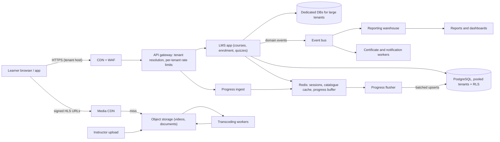
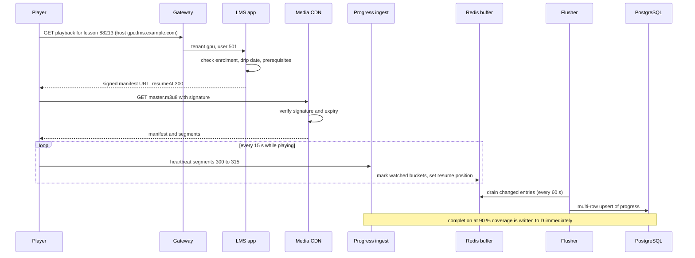

A learning management system (LMS) is where a course lives: the videos, reading material, quizzes, assignments, the list of who is enrolled, how far each learner has got, and the certificate at the end. Universities use one for semesters, companies for compliance and skills training, state skill missions for lakhs of learners across districts. When one platform serves hundreds of such institutions at once, it becomes a **multi-tenant** system, and most of the interesting design decisions come from that.

This case study designs a multi-tenant LMS. We reason from public principles and standards (HLS, LTI, xAPI). Nothing here describes how Moodle, Canvas, Coursera or any other product is built internally; "a system like Canvas" means "an LMS with those features".

## Learning objectives

By the end of this case study you will be able to:

1. Estimate learners, progress events, video egress and storage for an LMS, and identify the real cost driver.
2. Choose a tenancy model (pooled, siloed or a mix) and enforce isolation from the HTTP request down to the database row.
3. Deliver protected video and documents through a CDN with signed, expiring URLs.
4. Track progress (resume position, watched coverage, completion) without writing to the database on every heartbeat.
5. Model enrolment with cohorts, seat licences and waitlists.
6. Design assessments, grading and certificates that survive re-grading and audits.
7. Reason about failures, security, observability, cost, and when a simpler design is enough.

## Prerequisites

- [Multi-tenancy](#/lesson/m16-multi-tenancy): silo, pool and bridge models.
- [Multi-tenant security](#/lesson/m14-multi-tenant-security): row-level security and tenant isolation.
- [CDN architecture](#/lesson/m11-cdn): edges, origins and cache keys.
- [Object storage](#/lesson/m11-object-storage): blobs and presigned URLs.
- [Cache-aside, read-through, write-through and write-behind](#/lesson/m12-cache-patterns): we use write-behind for progress.

## Explain it like I'm a beginner

Imagine one huge building that rents out floors to 300 different colleges.

- Each college has **its own name board, its own students and its own rules**, but they share the lifts, the electricity and the security desk. That is **multi-tenancy**: one system, many customers (tenants), shared infrastructure. The security desk must make sure a student from College A can never walk into College B's classrooms. That is **tenant isolation**.
- The lectures are recorded and stored in a central library. Students don't all walk to the basement to watch them; copies are kept in small **kiosks in every neighbourhood** (a CDN). A kiosk only plays a lecture for someone holding a **ticket that expires in a few hours** (a signed URL).
- Every few seconds while you watch, your player tells the office "I'm at minute 12". If the office wrote that in the main register every time, the clerks would drown. So a **notepad at the desk** (a cache) keeps the latest note, and once a minute the clerk copies the latest line into the register (**write-behind**).
- A course has a **limited number of seats** the college has paid for (licences). When it is full, new students go on a **waiting list** and get a seat when someone leaves.
- At the end, a **quiz** checks what you learned, and a **certificate** with a unique number proves you passed. Anyone can check the number online.

## Requirements

### Functional requirements

1. **Tenants (institutions)**: onboarding, custom domain (`learn.abc-university.edu.in`), branding, single sign-on per tenant (SAML or OpenID Connect), tenant administrators.
2. **Catalogue and courses**: courses made of modules and lessons; lesson types are video, document, SCORM or HTML package, live session link, quiz and assignment. Courses are **versioned**: editing a published course must not break learners mid-way.
3. **Enrolment**: self-enrolment, cohort (batch) enrolment by admins, bulk CSV import, paid enrolment, seat licences per tenant, waitlists for capped cohorts.
4. **Content delivery**: adaptive video (HLS), downloadable documents, protected from casual sharing.
5. **Progress tracking**: resume where you left off, per-lesson status, video coverage (did they actually watch it?), course completion percentage, prerequisites and drip release ("module 3 opens on 1 November").
6. **Assessments**: quizzes with question banks and randomisation, auto-grading, assignments with file upload and rubric grading, re-attempt rules.
7. **Certificates**: issued on completion criteria, verifiable by a public URL.
8. **Reporting**: instructors see learner progress, admins see tenant-wide completion and engagement; exports.
9. **Interoperability**: launch external tools via LTI 1.3; accept learning records (xAPI) from external content.

### Non-functional requirements

| Property | Target | Why |
|---|---|---|
| Isolation | Zero cross-tenant data access | Contracts, privacy law, reputation |
| Availability | 99.9 % overall; 99.95 % during scheduled exam windows | Learning tolerates short blips, assessments less so |
| Page latency | p95 under 300 ms for course pages | Learners on mid-range phones and 4G |
| Video start | Under 2 s to first frame at p95 | Drop-off rises quickly with startup delay |
| Progress durability | Lose at most ~60 s of position on a crash; never lose a completion | Learners hate re-watching; completion drives certificates |
| Noisy neighbours | One tenant's bulk import must not slow others | Shared infrastructure |
| Data residency | Tenant data stays in its chosen region | Government and regulated customers |

### Out of scope

Live-class video conferencing (integrate an external provider), discussion forums in depth, AI tutoring, and payments beyond "an order was paid".

## Capacity estimation

All figures are **estimates** for clear arithmetic.

### Tenants and learners

- **300 tenants**: a few large (a state skill mission with 3 M learners, universities with 100,000), many small (companies with 2,000).
- **10 M enrolled learners** in total; **1.5 M daily active** (15 %).

### Page and API traffic

- Each DAU makes about **60 API requests** a day (course pages, lesson loads, quiz actions).
- 1.5 M × 60 = 90 M requests/day ÷ 86,400 ≈ **1,040 requests/s** average.
- Learning peaks in the evening (19:00–23:00) and before deadlines: ×4 ≈ **4,200 requests/s**. Modest.

### Progress heartbeats

- Each DAU watches **40 minutes** of video a day. The player sends a heartbeat every **15 s**.
- Heartbeats/day = 1.5 M × 40 × 60 ÷ 15 = **240 M**; average ≈ **2,800/s**; evening peak ×4 ≈ **11,000/s**.
- If each heartbeat were a database `UPDATE`, that alone would be 11,000 writes/s, mostly overwriting the same rows. With **write-behind** (keep the latest per learner-lesson in a cache, flush every 60 s), database writes drop to at most one per active learner-lesson per minute: at peak, perhaps 300,000 concurrent viewers ÷ 60 s = **5,000 writes/s**, and far fewer when batched into multi-row upserts.

### Video

- Watch minutes/day = 1.5 M × 40 = **60 M minutes**.
- Average delivered bitrate: many learners watch at 480p or 720p on mobile data. Assume **1 Mbit/s** = 7.5 MB per minute.
- Egress/day = 60 M × 7.5 MB = **450 TB/day**; average ≈ 450 × 10¹² × 8 ÷ 86,400 ≈ **42 Gbit/s**, evening peak ≈ **150 Gbit/s**, almost all from CDN edges.
- Library: 200,000 hours of course video. An encoding ladder (240p to 1080p) sums to roughly 5 Mbit/s across renditions ≈ 2.25 GB per hour of video → **450 TB** in object storage.

### Other storage

- Progress rows: 10 M learners × 60 lessons on average = 600 M rows × ~100 B ≈ **60 GB** (plus indexes). Fits a well-provisioned PostgreSQL cluster; partition by tenant.
- Assignments: 2 M submissions per term × 2 MB ≈ **4 TB** per term in object storage.

**What breaks first?** Not the API. In order: **video egress cost** (the bill), **progress write amplification** if heartbeats hit the database, **noisy neighbours** (a 3-million-learner tenant importing a cohort or running reports at 10:00), and **reporting queries** on the transactional database.

## API design

REST over HTTPS. The **tenant is resolved from the host name** (custom domain or `{tenant}.lms.example.com`), never from a request parameter the client can change.

| Method and path | Purpose |
|---|---|
| `GET /v1/courses?search=&page=` | Tenant's catalogue |
| `GET /v1/courses/{courseId}` | Course outline with the learner's lock and progress state |
| `POST /v1/courses/{courseId}/enrolments` | Self-enrol (idempotent per learner and course) |
| `POST /v1/admin/cohorts/{cohortId}/enrolments:bulk` | Bulk enrol from an uploaded CSV (async job) |
| `GET /v1/lessons/{lessonId}/playback` | Signed, expiring HLS manifest URL |
| `POST /v1/progress/heartbeats` | Player heartbeat (batched, fire-and-forget) |
| `POST /v1/lessons/{lessonId}/complete` | Explicit completion for non-video lessons |
| `POST /v1/quizzes/{quizId}/attempts` | Start an attempt (randomised question set) |
| `PUT /v1/attempts/{attemptId}/answers/{questionId}` | Save an answer |
| `POST /v1/attempts/{attemptId}/submit` | Submit for grading |
| `GET /v1/certificates/{code}` | Public verification of a certificate |
| `POST /lti/launch` | LTI 1.3 launch endpoint for external tools |

A heartbeat batch from the player:

```json
{
  "lessonId": 88213,
  "sessionId": "c1f4e0a2",
  "durationSeconds": 1260,
  "segments": [ { "from": 300, "to": 315 }, { "from": 315, "to": 330 } ],
  "position": 330,
  "playbackRate": 1.25
}
```

The playback response:

```json
{
  "manifestUrl": "https://media.lms.example.com/gpu/videos/88213/master.m3u8?exp=1792420000&sig=Q2x2b0xL",
  "resumeAt": 300,
  "expiresInSeconds": 14400
}
```

Design decisions:

- **Heartbeats report watched segments**, not "I watched 60 %". The server computes coverage, so skipping to the end doesn't mark a lesson complete.
- **Bulk enrolment is an async job** with a job id and a result file, so a 50,000-row CSV never ties up a request thread.
- **Signed URLs expire** (a few hours) and are bound to the tenant and the path prefix, so a copied link stops working and cannot be used for another tenant's videos.

## Data model

PostgreSQL 17. Most tenants share one cluster (pooled), with `tenant_id` on every row and row-level security (RLS) as a safety net. Large or regulated tenants get a dedicated database with the same schema (siloed). Tables below show the pooled shape.

```sql
CREATE TABLE tenant (
  tenant_id     text PRIMARY KEY,                 -- 'gpu', 'skillmission-up'
  name          text NOT NULL,
  primary_host  text NOT NULL UNIQUE,
  model         text NOT NULL CHECK (model IN ('POOLED', 'DEDICATED')),
  region        text NOT NULL,
  seat_limit    int  NOT NULL
);

CREATE TABLE app_user (
  tenant_id  text   NOT NULL REFERENCES tenant,
  user_id    bigint NOT NULL,
  email      text   NOT NULL,
  full_name  text   NOT NULL,
  PRIMARY KEY (tenant_id, user_id),
  UNIQUE (tenant_id, email)
);

CREATE TABLE course (
  tenant_id     text   NOT NULL REFERENCES tenant,
  course_id     bigint NOT NULL,
  title         text   NOT NULL,
  published_version int,
  PRIMARY KEY (tenant_id, course_id)
);

CREATE TABLE lesson (
  tenant_id     text   NOT NULL,
  course_id     bigint NOT NULL,
  version       int    NOT NULL,                  -- course version the lesson belongs to
  lesson_id     bigint NOT NULL,
  kind          text   NOT NULL CHECK (kind IN ('VIDEO', 'DOCUMENT', 'SCORM', 'QUIZ', 'ASSIGNMENT', 'LIVE')),
  required      boolean NOT NULL DEFAULT true,
  duration_s    int,
  available_from timestamptz,                     -- drip release
  PRIMARY KEY (tenant_id, lesson_id),
  FOREIGN KEY (tenant_id, course_id) REFERENCES course
);

CREATE TABLE enrolment (
  tenant_id     text   NOT NULL,
  enrolment_id  bigint NOT NULL,
  user_id       bigint NOT NULL,
  course_id     bigint NOT NULL,
  course_version int   NOT NULL,                  -- pinned at enrolment
  cohort_id     bigint,
  status        text   NOT NULL CHECK (status IN ('ACTIVE', 'WAITLISTED', 'COMPLETED', 'WITHDRAWN')),
  enrolled_at   timestamptz NOT NULL DEFAULT now(),
  PRIMARY KEY (tenant_id, enrolment_id),
  UNIQUE (tenant_id, user_id, course_id)          -- idempotent enrolment
);

CREATE TABLE lesson_progress (
  tenant_id     text   NOT NULL,
  enrolment_id  bigint NOT NULL,
  lesson_id     bigint NOT NULL,
  status        text   NOT NULL CHECK (status IN ('IN_PROGRESS', 'COMPLETED')),
  resume_at_s   int    NOT NULL DEFAULT 0,
  coverage      real   NOT NULL DEFAULT 0,        -- 0..1 share of the video actually watched
  completed_at  timestamptz,
  updated_at    timestamptz NOT NULL DEFAULT now(),
  PRIMARY KEY (tenant_id, enrolment_id, lesson_id)
) PARTITION BY LIST (tenant_id);

CREATE TABLE certificate (
  tenant_id     text   NOT NULL,
  code          text   PRIMARY KEY,               -- random, unguessable, printed on the PDF
  enrolment_id  bigint NOT NULL,
  issued_at     timestamptz NOT NULL DEFAULT now(),
  revoked_at    timestamptz
);

ALTER TABLE lesson_progress ENABLE ROW LEVEL SECURITY;
CREATE POLICY tenant_isolation ON lesson_progress
  USING (tenant_id = current_setting('app.tenant_id'));
```

Why this shape:

- **`tenant_id` leads every primary key.** All queries are tenant-scoped, so the composite keys make every index naturally tenant-local, and moving one tenant to a dedicated database is a filtered copy.
- **RLS is the seatbelt, not the steering wheel.** The application always filters by tenant; the policy guarantees that a forgotten `WHERE` returns nothing instead of another college's data. The connection sets `app.tenant_id` per request (`SET LOCAL` inside the transaction, so pooled connections don't leak it).
- **`course_version` is pinned on enrolment.** An instructor can publish version 3 while learners on version 2 finish the course they started; their progress keys still point at version 2's lessons.
- **`UNIQUE (tenant_id, user_id, course_id)`** makes enrolment idempotent: a double click or a retried bulk import cannot create two enrolments.
- **`lesson_progress` is list-partitioned by tenant** (large tenants get their own partition; small ones share a default partition), which keeps the biggest tenant's 180 M rows from bloating everyone's indexes and makes per-tenant export and deletion cheap.
- **Certificate codes are random**, not sequential, so they can't be enumerated by guessing.

## High-level architecture



Walk through every arrow:

1. **Browser → CDN + WAF.** Static assets (the web app, tenant logos and themes) come from the edge. The web application firewall filters abuse before it reaches the origin.
2. **CDN → API gateway.** The gateway maps the **host name to a tenant**, attaches the tenant id to the request context, and applies **per-tenant rate limits** so one tenant's burst can't starve the rest.
3. **Gateway → LMS app.** A modular monolith (catalogue, enrolment, assessments, certificates) is enough here; the request rates are modest. Splitting into microservices is a later decision driven by teams, not traffic.
4. **App → pooled DB / dedicated DBs.** A **tenant directory** says where each tenant's data lives. Most go to the shared cluster with RLS; a 3-million-learner tenant or a government tenant with residency rules gets its own database (possibly in another region).
5. **App → Redis.** Sessions, catalogue and course-outline caches (with **tenant-prefixed keys**), and the progress buffer.
6. **Gateway → progress ingest → Redis.** Heartbeats skip the main app; a small, horizontally scaled ingest service validates them and updates the buffer.
7. **Redis → flusher → DB.** A background service drains changed progress entries every 60 s and writes them with multi-row upserts. Completions are flushed **immediately**, because they trigger certificates.
8. **Browser → media CDN → object storage.** Video segments are cached at the edge; the CDN validates the signed URL before serving. Misses go to object storage.
9. **Instructor upload → object storage → transcoding → object storage.** Uploads go straight to storage via presigned URLs; workers produce the HLS ladder and thumbnails (the same pipeline as in the [video streaming case study](#/lesson/m17-video-streaming)).
10. **App → event bus → workers and warehouse.** Domain events (`EnrolmentCreated`, `LessonCompleted`, `QuizGraded`) feed certificate issuing, emails and the reporting warehouse, so heavy reports never run on the transactional database.

### Sequence: watching a lesson



The app only authorises playback once; after that the CDN serves bytes without touching the origin. Heartbeats touch only Redis. The database sees one batched write per learner-lesson per minute, plus an immediate write when a lesson completes.

## Deep dives

### 1. Tenancy: pooled, siloed, and the bridge between

| Model | What it means | Good for | Costs |
|---|---|---|---|
| **Pooled** | All tenants share app and database; `tenant_id` on every row | Hundreds of small and medium tenants | Isolation relies on code + RLS; noisy neighbours |
| **Siloed** | Tenant gets its own database (or whole stack) | Very large, regulated or data-residency tenants | Cost per tenant; more operations (migrations × N) |
| **Bridge** | Shared app, per-tenant database for some | The usual real answer | A tenant directory and routing layer |

We use the **bridge**: a stateless shared application tier, a **tenant directory** (`tenant_id → host names, region, database connection, plan, limits`), and data either in the pooled cluster or in a dedicated database. Moving a tenant from pooled to dedicated is a planned migration: copy its rows (every key starts with `tenant_id`), switch the directory entry during a short write freeze, then delete from the pool.

**Tenant resolution** happens once, at the edge of the application, from the host name. Everything after that reads the tenant from a scoped context, never from user input.

```csharp file=Tenancy/Tenancy.cs
using System.Collections.Concurrent;
using Microsoft.AspNetCore.Http;

namespace Lms.Tenancy;

public enum TenancyModel { Pooled, Dedicated }

public sealed record Tenant(string TenantId, string Name, string PrimaryHost, TenancyModel Model, string Region, int SeatLimit);

public interface ITenantCatalog
{
    Tenant? FindByHost(string host);
}

/// <summary>Stand-in for the tenant directory (a table plus an in-memory cache refreshed on change events).</summary>
public sealed class InMemoryTenantCatalog : ITenantCatalog
{
    private readonly ConcurrentDictionary<string, Tenant> _byHost = new(StringComparer.OrdinalIgnoreCase);

    public void Add(Tenant tenant, params string[] extraHosts)
    {
        _byHost[tenant.PrimaryHost] = tenant;
        foreach (var host in extraHosts) _byHost[host] = tenant;
    }

    public Tenant? FindByHost(string host) => _byHost.GetValueOrDefault(host);
}

public interface ITenantContext
{
    Tenant Current { get; }
}

public sealed class TenantContext : ITenantContext
{
    public Tenant? Tenant { get; set; }
    public Tenant Current => Tenant ?? throw new InvalidOperationException("No tenant resolved for this request.");
}

/// <summary>Resolves the tenant from the Host header. Unknown hosts get 404, never a default tenant.</summary>
public sealed class TenantResolutionMiddleware(RequestDelegate next, ILogger<TenantResolutionMiddleware> logger)
{
    public async Task InvokeAsync(HttpContext http, ITenantCatalog catalog, TenantContext context)
    {
        var tenant = catalog.FindByHost(http.Request.Host.Host);
        if (tenant is null)
        {
            http.Response.StatusCode = StatusCodes.Status404NotFound;
            return;
        }
        context.Tenant = tenant;
        using (logger.BeginScope(new Dictionary<string, object> { ["TenantId"] = tenant.TenantId }))
            await next(http);
    }
}

public static class TenantKeys
{
    /// <summary>Every cache key starts with the tenant, so a key collision can never leak data across tenants.</summary>
    public static string For(ITenantContext tenant, string kind, string id) => $"t:{tenant.Current.TenantId}:{kind}:{id}";
}
```

**Noisy neighbours.** Per-tenant limits at the gateway (requests per second and concurrent bulk jobs), a separate queue per tenant tier for background jobs (so a 50,000-row import doesn't delay a small tenant's 20-row import), and reporting moved to the warehouse. For a tenant that is consistently heavy, the fix is to move it to a dedicated database, not to buy a bigger shared one.

### 2. Content delivery: video and documents

Video is the cost driver (450 TB/day of egress). The pipeline:

1. The instructor uploads the master file directly to object storage (presigned PUT).
2. Transcoding workers produce an HLS ladder (for example 240p, 360p, 480p, 720p, 1080p), 6-second segments, thumbnails and captions. A low rung such as 240p at ~300 kbit/s matters for learners on weak rural connections.
3. The player requests a **signed manifest URL** from the app, which checks enrolment, drip dates and prerequisites.
4. The CDN validates the signature on every manifest and segment request. Segments are cached at the edge, so a popular course's lecture is fetched from the origin once per edge, not once per learner.

**Signed URLs** carry an expiry and an HMAC over the path, tenant and expiry, computed with a key shared with the CDN. A copied link dies when it expires; changing the path or tenant invalidates the signature. Many CDNs support this pattern natively (token authentication); the same idea works for documents.

```csharp file=Content/SignedUrlIssuer.cs
using System.Security.Cryptography;
using System.Text;

namespace Lms.Content;

/// <summary>
/// HMAC-signed, expiring URLs for media. The CDN holds the same key and rejects bad or expired signatures.
/// </summary>
public sealed class SignedUrlIssuer(byte[] key, TimeProvider clock)
{
    public string Sign(string path, string tenantId, TimeSpan ttl)
    {
        var expires = clock.GetUtcNow().Add(ttl).ToUnixTimeSeconds();
        return $"{path}?t={tenantId}&exp={expires}&sig={Signature(path, tenantId, expires)}";
    }

    public bool Verify(string path, string tenantId, long expires, string signature)
    {
        if (clock.GetUtcNow().ToUnixTimeSeconds() > expires) return false;
        if (!path.StartsWith($"/{tenantId}/", StringComparison.Ordinal)) return false;   // tenant owns the prefix
        var expected = Encoding.ASCII.GetBytes(Signature(path, tenantId, expires));
        return CryptographicOperations.FixedTimeEquals(expected, Encoding.ASCII.GetBytes(signature));
    }

    private string Signature(string path, string tenantId, long expires)
    {
        var mac = HMACSHA256.HashData(key, Encoding.UTF8.GetBytes($"{path}|{tenantId}|{expires}"));
        return Convert.ToBase64String(mac).TrimEnd('=').Replace('+', '-').Replace('/', '_');
    }
}
```

Two honest limits: a signed URL stops **casual** sharing, not a determined learner who screen-records; and paid premium content that truly must not be copied needs DRM (Widevine, FairPlay, PlayReady), which adds licence servers and cost. Most institutional LMS content doesn't justify DRM.

**Documents** (PDFs, slides) follow the same path: object storage, CDN, signed URLs. Watermarking PDFs with the learner's name at download time discourages sharing for premium courses.

**SCORM and HTML packages** are zip files unpacked into a per-tenant, per-package prefix and served from a **separate content domain** (for example `content.lms-usercontent.example`), so a malicious package's JavaScript can't read the LMS session cookies (origin isolation).

### 3. Progress tracking without drowning the database

Progress has three parts with different needs:

| Part | Example | Durability need | Where it lives |
|---|---|---|---|
| Resume position | "Minute 12:34" | Losing 60 s is fine | Redis buffer, flushed every 60 s |
| Coverage | "Watched 87 % of the video" | Approximate, monotonic | Redis buffer as a bitmap of 10-second buckets |
| Completion | "Lesson completed at 21:14" | Must never be lost or reversed | Written to PostgreSQL immediately; never downgraded |

**Coverage, not position.** If completion meant "position reached 90 %", a learner could drag the slider to the end. Instead, heartbeats report the segments actually played, and the server marks 10-second buckets as watched. Coverage = watched buckets ÷ total buckets. The server also rejects implausible heartbeats (a 15-second heartbeat claiming 600 seconds watched). Playback at 1.25× still counts each content second once.

**Monotonic completion.** Once completed, a lesson stays completed, even if a later heartbeat flush carries a lower coverage from another device. The upsert enforces it:

```sql
INSERT INTO lesson_progress AS p (tenant_id, enrolment_id, lesson_id, status, resume_at_s, coverage, completed_at, updated_at)
VALUES ($1, $2, $3, $4, $5, $6, $7, now())
ON CONFLICT (tenant_id, enrolment_id, lesson_id) DO UPDATE
   SET resume_at_s  = EXCLUDED.resume_at_s,
       coverage     = GREATEST(p.coverage, EXCLUDED.coverage),
       status       = CASE WHEN p.status = 'COMPLETED' THEN 'COMPLETED' ELSE EXCLUDED.status END,
       completed_at = COALESCE(p.completed_at, EXCLUDED.completed_at),
       updated_at   = now();
```

Here is the buffer and the write-behind flusher. In production the buffer is Redis (a hash per learner-lesson plus a bitmap via `SETBIT`), and the flusher drains a "dirty" set.

```csharp file=Progress/ProgressBuffer.cs
using System.Collections;
using System.Collections.Concurrent;

namespace Lms.Progress;

public enum LessonStatus { InProgress, Completed }

public sealed record Heartbeat(string TenantId, long EnrolmentId, long LessonId, int DurationSeconds, int FromSecond, int ToSecond);

public sealed record LessonProgress(string TenantId, long EnrolmentId, long LessonId, int ResumeAt, double Coverage,
    LessonStatus Status, DateTimeOffset UpdatedAt);

public enum HeartbeatResult { Accepted, Rejected, Completed }

/// <summary>Stand-in for Redis: latest position and a watched-bucket bitmap per learner-lesson.</summary>
public sealed class ProgressBuffer(TimeProvider clock)
{
    public const int BucketSeconds = 10;
    public const double CompletionThreshold = 0.9;
    private const int MaxSecondsPerHeartbeat = 45;   // 15 s interval, 2x playback speed, plus slack

    private sealed class Entry(int durationSeconds)
    {
        public readonly Lock Gate = new();
        public readonly BitArray Buckets = new((durationSeconds + BucketSeconds - 1) / BucketSeconds);
        public int ResumeAt;
        public bool Completed;
        public bool Dirty;
    }

    private readonly ConcurrentDictionary<(string Tenant, long Enrolment, long Lesson), Entry> _entries = new();

    public HeartbeatResult Apply(Heartbeat hb, out LessonProgress snapshot)
    {
        snapshot = null!;
        var to = Math.Min(hb.ToSecond, hb.DurationSeconds);
        var from = Math.Max(0, hb.FromSecond);
        if (hb.DurationSeconds <= 0 || to <= from || to - from > MaxSecondsPerHeartbeat) return HeartbeatResult.Rejected;

        var entry = _entries.GetOrAdd((hb.TenantId, hb.EnrolmentId, hb.LessonId), _ => new Entry(hb.DurationSeconds));
        lock (entry.Gate)
        {
            for (var b = from / BucketSeconds; b <= (to - 1) / BucketSeconds && b < entry.Buckets.Length; b++)
                entry.Buckets[b] = true;
            entry.ResumeAt = to;
            entry.Dirty = true;

            var justCompleted = !entry.Completed && Coverage(entry) >= CompletionThreshold;
            if (justCompleted) entry.Completed = true;
            snapshot = Snapshot(hb.TenantId, hb.EnrolmentId, hb.LessonId, entry);
            return justCompleted ? HeartbeatResult.Completed : HeartbeatResult.Accepted;
        }
    }

    /// <summary>Returns and clears the changed entries; the flusher writes them in one batch.</summary>
    public IReadOnlyList<LessonProgress> DrainDirty()
    {
        var drained = new List<LessonProgress>();
        foreach (var (key, entry) in _entries)
        {
            lock (entry.Gate)
            {
                if (!entry.Dirty) continue;
                entry.Dirty = false;
                drained.Add(Snapshot(key.Tenant, key.Enrolment, key.Lesson, entry));
            }
        }
        return drained;
    }

    private static double Coverage(Entry e)
    {
        var watched = 0;
        foreach (bool bit in e.Buckets) if (bit) watched++;
        return e.Buckets.Length == 0 ? 0 : (double)watched / e.Buckets.Length;
    }

    private LessonProgress Snapshot(string tenant, long enrolment, long lesson, Entry e) =>
        new(tenant, enrolment, lesson, e.ResumeAt, Coverage(e),
            e.Completed ? LessonStatus.Completed : LessonStatus.InProgress, clock.GetUtcNow());
}
```

```csharp file=Progress/ProgressStore.cs
using System.Collections.Concurrent;
using Microsoft.Extensions.Hosting;

namespace Lms.Progress;

public interface IProgressRepository
{
    /// <summary>Stand-in for the monotonic upsert: coverage never drops, completion is never reversed.</summary>
    void Upsert(IReadOnlyList<LessonProgress> batch);
    LessonProgress? Get(string tenantId, long enrolmentId, long lessonId);
}

public sealed class InMemoryProgressRepository : IProgressRepository
{
    private readonly ConcurrentDictionary<(string, long, long), LessonProgress> _rows = new();

    public void Upsert(IReadOnlyList<LessonProgress> batch)
    {
        foreach (var p in batch)
            _rows.AddOrUpdate((p.TenantId, p.EnrolmentId, p.LessonId), p, (_, old) => p with
            {
                Coverage = Math.Max(old.Coverage, p.Coverage),
                Status = old.Status == LessonStatus.Completed ? LessonStatus.Completed : p.Status
            });
    }

    public LessonProgress? Get(string tenantId, long enrolmentId, long lessonId) =>
        _rows.GetValueOrDefault((tenantId, enrolmentId, lessonId));
}

/// <summary>Write-behind: drains the buffer every 60 s and writes one batch.</summary>
public sealed class ProgressFlusher(ProgressBuffer buffer, IProgressRepository repository, ILogger<ProgressFlusher> logger)
    : BackgroundService
{
    protected override async Task ExecuteAsync(CancellationToken stoppingToken)
    {
        using var timer = new PeriodicTimer(TimeSpan.FromSeconds(60));
        while (await timer.WaitForNextTickAsync(stoppingToken)) Flush();
    }

    public override Task StopAsync(CancellationToken cancellationToken)
    {
        Flush();   // graceful shutdown: don't drop the last minute
        return base.StopAsync(cancellationToken);
    }

    private void Flush()
    {
        var batch = buffer.DrainDirty();
        if (batch.Count == 0) return;
        repository.Upsert(batch);
        logger.LogInformation("Flushed {Count} progress rows", batch.Count);
    }
}
```

Completions are not left for the flusher: the ingest endpoint writes them straight through (see `Program.cs` at the end of the lesson) and publishes `LessonCompleted`, which updates course completion and may trigger a certificate. If Redis is lost, learners lose at most a minute of resume position, never a completion.

### 4. Enrolment, cohorts, licences and waitlists

- **Idempotent**: `UNIQUE (tenant_id, user_id, course_id)`; a retry returns the existing enrolment.
- **Seat licences**: a tenant on a 20,000-seat plan can't exceed 20,000 active learners. Count with a per-tenant counter row updated in the same transaction (`UPDATE tenant_usage SET active = active + 1 WHERE tenant_id = $1 AND active < seat_limit`), which is race-free; counting rows on every enrolment is slow and racy.
- **Cohorts with capacity** (a lab batch of 60): when full, new requests join a **waitlist** in arrival order; a withdrawal promotes the first in line. Exercise 4 implements this.
- **Bulk import**: the CSV is uploaded to object storage, a job validates every row, writes enrolments in batches of 1,000, and produces a result file of errors. It runs on the tenant's job queue so it can't starve other tenants.
- **Course versions**: an enrolment pins `course_version`; a learner can be offered "switch to the new version" with progress mapped for lessons that still exist.

```csharp file=Enrolment/EnrolmentService.cs
using System.Collections.Concurrent;
using Lms.Tenancy;

namespace Lms.Enrolment;

public enum EnrolResult { Enrolled, AlreadyEnrolled, SeatLimitReached }

public sealed record Enrolment(string TenantId, long UserId, long CourseId, DateTimeOffset EnrolledAt);

/// <summary>Stand-in for the enrolment table plus the per-tenant usage counter row.</summary>
public sealed class InMemoryEnrolmentStore
{
    public readonly Lock Gate = new();
    public readonly Dictionary<(string Tenant, long User, long Course), Enrolment> Enrolments = new();
    public readonly ConcurrentDictionary<string, HashSet<long>> ActiveLearners = new();
}

public sealed class EnrolmentService(ITenantContext tenant, InMemoryEnrolmentStore store, TimeProvider clock)
{
    public EnrolResult Enrol(long userId, long courseId)
    {
        var t = tenant.Current;
        lock (store.Gate)
        {
            if (store.Enrolments.ContainsKey((t.TenantId, userId, courseId))) return EnrolResult.AlreadyEnrolled;

            var learners = store.ActiveLearners.GetOrAdd(t.TenantId, _ => new HashSet<long>());
            // A seat is per learner, not per course: a learner in five courses uses one seat.
            if (!learners.Contains(userId) && learners.Count >= t.SeatLimit) return EnrolResult.SeatLimitReached;

            learners.Add(userId);
            store.Enrolments[(t.TenantId, userId, courseId)] = new Enrolment(t.TenantId, userId, courseId, clock.GetUtcNow());
            return EnrolResult.Enrolled;
        }
    }
}
```

### 5. Assessments, grading and certificates

- **Question banks** per course; a quiz draws N questions per topic at random, shuffling options, so neighbours get different papers. The drawn set is stored on the attempt, so grading and review show exactly what the learner saw.
- **Attempts** reuse the [online exam](#/lesson/m17-online-exam) ideas at a smaller scale: server-side time limits, idempotent answer saves with a client sequence, auto-submit at the deadline.
- **Grading**: objective questions are graded synchronously on submit; assignments go to an instructor queue with rubrics; plagiarism or code checks run asynchronously and attach a report. Store **scores together with the grading-scheme version**, so a corrected answer key can re-grade deterministically.
- **Completion rules** are data, not code: "all required lessons completed AND final quiz ≥ 60 % AND assignment graded ≥ C". The rule is evaluated on `LessonCompleted` and `QuizGraded` events.
- **Certificates**: issued by a worker when the rule passes; a random code, a PDF in object storage, and a public verification page. Revocation (a cheating finding) sets `revoked_at`, and the verification page shows it.
- **Interoperability**: external tools (a coding sandbox, a virtual lab) launch via **LTI 1.3** (OIDC-based launch with signed JWTs) and post grades back; external content can send **xAPI** statements ("learner X completed simulation Y") to the LMS's learning record store.

## Caching, queues and scaling

**Caches** (always with tenant-prefixed keys):

- *Course outline* per course version: changes only on publish, so cache-aside with explicit invalidation on the `CoursePublished` event and a long TTL. One popular course is read by 100,000 learners.
- *Learner's course state* (locks, progress summary): short TTL (30 s) or invalidated on progress events.
- *Tenant directory*: in-process cache on every app instance, refreshed by a change event.
- *Sessions*: Redis, so app instances stay stateless.

**Queues.**

- **Per-tenant job queues** for bulk imports, report exports and certificate generation, with weighted fair scheduling across tenants.
- **Event bus** for domain events (`LessonCompleted`, `QuizGraded`, `EnrolmentCreated`), consumed by completion rules, certificates, notifications and the warehouse loader. Consumers are idempotent (deduplicate by event id), because events are delivered at least once.
- **Transcoding queue** for video uploads, with priority for small tenants' first uploads so a huge batch upload doesn't block them.

**Scaling each tier.**

| Tier | Scales by | Breaks when |
|---|---|---|
| Media CDN | Provider capacity | Cost, not capacity; low cache hit ratio for long-tail videos |
| App tier | Stateless replicas | Expensive per-request permission or outline queries |
| Progress ingest | Stateless replicas + Redis cluster | Redis memory if the bitmap per learner-lesson is too fine |
| Pooled DB | Bigger instance, partitions, replicas for reads | A heavy tenant; move it to a dedicated DB |
| Reporting | Warehouse | Reports run on the primary database |
| Transcoding | Worker autoscaling on queue depth | Semester-start upload bursts |

## Failure handling

| Failure | What users see | Mitigation |
|---|---|---|
| Redis progress buffer lost | Resume position up to 60 s old | Completions were written through; positions rebuild from the next heartbeats |
| Flusher crashes mid-batch | Nothing visible | Entries re-marked dirty on failure; upsert is idempotent and monotonic |
| Pooled DB primary fails | Seconds of errors for pooled tenants | Synchronous standby, automatic failover; dedicated tenants unaffected |
| One tenant's bulk import floods jobs | Other tenants' jobs slow | Per-tenant queues and fair scheduling; per-tenant concurrency caps |
| CDN signing key rotated | Playback 403s | Two active keys (current and previous) during rotation |
| Transcoding backlog at semester start | New videos "processing" for hours | Autoscale workers on queue depth; publish lessons only when renditions are ready |
| Certificate worker fails | Certificate appears late | Event retried; issuance idempotent per enrolment |
| Wrong tenant resolved (misconfigured domain) | Could expose data | Unknown hosts return 404, never a default tenant; RLS blocks cross-tenant rows; alert on host-tenant mismatches |

:::callout type=warning title="Never fall back to a default tenant"
A tempting shortcut is "if the host isn't recognised, use the main tenant". One DNS mistake then shows a university's learners another institution's courses. Unknown host means 404. Isolation failures are the worst bugs in a multi-tenant system.
:::

## Security

- **Tenant isolation in depth**: tenant from host only; scoped tenant context; every query filtered by `tenant_id`; RLS on every tenant table with `SET LOCAL app.tenant_id`; tenant-prefixed cache keys and object storage paths; automated tests that try to read across tenants.
- **Identity**: per-tenant SSO (SAML or OIDC) so universities use their own accounts; local accounts with strong password hashing for small tenants; just-in-time provisioning from SSO claims.
- **Authorisation**: roles per tenant (learner, instructor, teaching assistant, tenant admin) and per course (instructor of course 12 only). Platform operators access tenant data only through audited break-glass procedures.
- **Content safety**: user-uploaded HTML and SCORM run on a separate origin; uploaded files are scanned for malware; video and document links are signed and expiring.
- **Privacy**: learners include minors in schools; collect minimum data, honour deletion requests per tenant, and keep data in the tenant's region. India's DPDP Act requires verifiable parental consent for children's data, which affects school tenants.
- **Exports**: tenant admins export their own data; exports are generated per tenant into tenant-scoped storage with expiring links.

## Observability

- **Per-tenant dashboards**: request rate, error rate, p95 latency, job queue depth and age per tenant. A tenant-blind dashboard hides a single tenant in trouble.
- **Video**: startup time, rebuffering ratio, CDN hit ratio, egress per tenant (also the input for cost allocation).
- **Progress pipeline**: heartbeats/s, rejected heartbeats (a spike means a buggy player release or abuse), buffer size, flush duration and lag, completions/s.
- **Business signals**: enrolments, completions and certificates per tenant per day. A sudden drop in completions after a release usually means a broken completion rule.
- **Isolation canaries**: synthetic requests that try to access another tenant's resources must always fail; alert if one succeeds.

Every log line and trace carries `tenant_id` (the middleware's logging scope does this), which also makes per-tenant support investigations fast.

## Deployment and cost

**Deployment.**

- One shared application deployment for pooled tenants, rolled out with canaries (a few low-risk tenants first). Dedicated tenants can be pinned to a release ring and upgraded later.
- Database migrations follow expand and contract, and run across the pooled cluster and every dedicated database, so migration tooling must loop over the tenant directory and report per tenant.
- Avoid deploying during a tenant's declared exam windows (stored in the directory).
- Regions: tenants choose a home region; a region runs the full stack, and the tenant directory routes requests.

**Cost drivers** (relative, not quotes):

1. **Video egress**: hundreds of TB per day. Levers: sensible default quality (480p on mobile data), a good low rung, high CDN hit ratio, and per-tenant reporting so pricing reflects usage.
2. **Video storage and transcoding**: the encoding ladder multiplies storage; drop unused renditions for old courses.
3. **Dedicated databases** for large tenants: priced into their plan.
4. **Shared database and app tier**: modest, thanks to caching and write-behind.

### When a simpler design is enough

A single engineering college with 4,000 students, or a company training 2,000 site engineers, should **run an existing open-source or hosted LMS** rather than build one. If you must build, one ASP.NET Core app, one PostgreSQL database, videos on a hosted video platform or object storage plus a CDN, and progress written directly (4,000 learners produce a few heartbeats per second) is plenty. Multi-tenancy, write-behind and per-tenant queues become worth it only when you serve many institutions.

## Alternatives and trade-offs

| Decision | Our choice | Alternative | When the alternative wins |
|---|---|---|---|
| Tenancy | Bridge (pooled + dedicated) | All siloed | Few, very large, regulated tenants willing to pay |
| Isolation | App filter + RLS | Schema per tenant | Hundreds (not thousands) of tenants that need per-tenant schema changes |
| Progress writes | Write-behind via Redis | Write-through to DB | Small scale; or strict audit of every heartbeat |
| Coverage | 10 s bucket bitmap | Exact interval merge | Short videos, compliance training that must prove exact watching |
| Video protection | Signed URLs | DRM | Paid premium content with real piracy risk |
| Architecture | Modular monolith | Microservices | Many independent teams; very different scaling per module |
| Reporting | Warehouse via events | Read replica queries | Small tenants, simple reports |

The core trade-off: **we accept eventual consistency in progress and reports (up to a minute behind) and a tenant directory with routing, in exchange for low database load, cheap per-tenant isolation and the ability to move big tenants out.**

Here is the composition as an ASP.NET Core host.

```csharp file=Program.cs
using System.Text;
using Lms.Content;
using Lms.Enrolment;
using Lms.Progress;
using Lms.Tenancy;

var builder = WebApplication.CreateBuilder(args);
builder.Services.AddSingleton(TimeProvider.System);

var catalog = new InMemoryTenantCatalog();
catalog.Add(new Tenant("gpu", "Government Polytechnic University", "gpu.lms.example.com", TenancyModel.Pooled, "india-central", 20_000),
    "learn.gpu.edu.in");
catalog.Add(new Tenant("infra-academy", "Infra Academy", "academy.lms.example.com", TenancyModel.Dedicated, "india-south", 2_000));
builder.Services.AddSingleton<ITenantCatalog>(catalog);
builder.Services.AddScoped<TenantContext>();
builder.Services.AddScoped<ITenantContext>(sp => sp.GetRequiredService<TenantContext>());

builder.Services.AddSingleton<InMemoryEnrolmentStore>();
builder.Services.AddScoped<EnrolmentService>();
builder.Services.AddSingleton<ProgressBuffer>();
builder.Services.AddSingleton<IProgressRepository, InMemoryProgressRepository>();
builder.Services.AddHostedService<ProgressFlusher>();
builder.Services.AddSingleton(sp => new SignedUrlIssuer(
    Encoding.UTF8.GetBytes(builder.Configuration["Cdn:SigningKey"] ?? "dev-only-signing-key-change-me"),
    sp.GetRequiredService<TimeProvider>()));

var app = builder.Build();
app.UseMiddleware<TenantResolutionMiddleware>();

app.MapGet("/v1/tenant", (ITenantContext tenant) => Results.Ok(new { tenant.Current.Name, tenant.Current.Region }));

app.MapPost("/v1/courses/{courseId:long}/enrolments", (long courseId, EnrolRequest body, EnrolmentService enrolments) =>
    enrolments.Enrol(body.UserId, courseId) switch
    {
        EnrolResult.SeatLimitReached => Results.Conflict(new { error = "seat limit reached" }),
        var result => Results.Ok(new { result = result.ToString() })
    });

app.MapGet("/v1/lessons/{lessonId:long}/playback", (long lessonId, ITenantContext tenant, SignedUrlIssuer signer) =>
{
    // Production: check enrolment, drip date and prerequisites before signing.
    var path = $"/{tenant.Current.TenantId}/videos/{lessonId}/master.m3u8";
    return Results.Ok(new { manifestUrl = signer.Sign(path, tenant.Current.TenantId, TimeSpan.FromHours(4)) });
});

app.MapPost("/v1/progress/heartbeats", (HeartbeatRequest body, ITenantContext tenant, ProgressBuffer buffer, IProgressRepository repository) =>
{
    var result = buffer.Apply(new Heartbeat(tenant.Current.TenantId, body.EnrolmentId, body.LessonId,
        body.DurationSeconds, body.From, body.To), out var snapshot);
    if (result == HeartbeatResult.Rejected) return Results.BadRequest(new { error = "implausible heartbeat" });
    if (result == HeartbeatResult.Completed) repository.Upsert([snapshot]);   // write-through for completions
    return Results.Accepted(value: new { snapshot.Coverage, snapshot.Status });
});

app.Run();

public sealed record EnrolRequest(long UserId);
public sealed record HeartbeatRequest(long EnrolmentId, long LessonId, int DurationSeconds, int From, int To);
```

## Practical playground

The starting graph is a single-tenant LMS: one app writes every heartbeat to the database, and videos are served by the app. Open it in the HLD canvas and evolve it into a multi-tenant platform.

1. Add a `cdn` for media and an `object-storage` origin. Which requests still reach the app for video?
2. Put an `api-gateway` in front that resolves the tenant and applies per-tenant limits.
3. Add a `cache` as a progress buffer and a `worker` that flushes it. What is written through immediately?
4. Add a second `database` for dedicated tenants and explain how the app knows which one to use.
5. Add a `stream` for domain events feeding certificate workers and a reporting `database` (warehouse).
6. Set client `rps` to 11,000 (peak heartbeats) and compare the database load before and after the buffer.

:::playground type=hld title="From a single-college LMS to a multi-tenant platform"
```json
{
  "nodes": [
    { "id": "c", "type": "client", "label": "Learners (heartbeat every 15 s)", "props": { "rps": 11000 } },
    { "id": "lb", "type": "load-balancer", "label": "Load balancer" },
    { "id": "app", "type": "app-server", "label": "LMS app (pages, video, progress)", "props": { "instances": 8 } },
    { "id": "db", "type": "database", "label": "PostgreSQL (everything)", "props": { "replicas": 1 } },
    { "id": "disk", "type": "object-storage", "label": "Video files" }
  ],
  "edges": [
    { "from": "c", "to": "lb", "kind": "sync" },
    { "from": "lb", "to": "app", "kind": "sync" },
    { "from": "app", "to": "db", "kind": "sync", "label": "UPDATE progress per heartbeat" },
    { "from": "app", "to": "disk", "kind": "sync", "label": "stream video bytes" }
  ]
}
```
:::

## Exercises

:::exercise id=m17-lms-ex1 difficulty=beginner kind=written title="Size an LMS for a state skill mission"
A state skill development mission runs an LMS for 2.4 million enrolled learners across 75 districts. 10 % are active on a given day. Each active learner watches 30 minutes of video at an average of 0.8 Mbit/s and makes 40 API requests. The player sends a heartbeat every 20 s. 60 % of daily activity happens between 18:00 and 22:00. The course library has 15,000 hours of video, stored as a ladder totalling 4 Mbit/s across renditions.

Estimate: DAU, average and peak (evening window) API requests per second, heartbeats per second in the evening window, video egress per day in TB and the evening-window bandwidth in Gbit/s, and library storage in TB. Then say which number dominates cost and one lever to reduce it.
::acceptance
- Each figure shows its arithmetic and units.
- The evening peak uses the 60 %-in-4-hours share.
- Bits and bytes are converted correctly.
- A cost judgement with a concrete lever.
::hint
DAU = 2.4 M × 0.1. API requests per day = DAU × 40.
::hint
Evening rate = 60 % of the daily total ÷ (4 × 3,600 s).
::hint
Heartbeats per learner per day = 30 × 60 ÷ 20. Egress per minute at 0.8 Mbit/s = 0.8 × 60 ÷ 8 MB.
::hint
Storage: 15,000 hours × 3,600 s × 4 Mbit/s ÷ 8 = bytes. Divide by 10¹² for TB.
::solution
- DAU = 2.4 M × 0.1 = **240,000**.
- API requests/day = 240,000 × 40 = 9.6 M → average ≈ 9.6 M ÷ 86,400 ≈ **111/s**; evening = 9.6 M × 0.6 ÷ 14,400 s = **400/s**.
- Heartbeats/day = 240,000 × (1,800 ÷ 20) = 240,000 × 90 = 21.6 M → evening = 21.6 M × 0.6 ÷ 14,400 ≈ **900/s**.
- Egress per minute = 0.8 × 60 ÷ 8 = 6 MB. Watch minutes/day = 240,000 × 30 = 7.2 M → 7.2 M × 6 MB = 43.2 TB/day, so **≈ 43 TB/day**.
- Evening bandwidth = 43.2 TB × 0.6 ÷ 14,400 s = 1.8 GB/s ≈ **14.4 Gbit/s**.
- Library = 15,000 × 3,600 × 4 Mbit ÷ 8 = 27 × 10⁶ MB = **27 TB**.

Judgement: API (400/s) and heartbeats (900/s) are small; one modest cluster handles them, and write-behind is nice but optional at this scale. **Video egress (~43 TB/day, ~14 Gbit/s in the evening)** dominates cost. Levers: default to 480p on mobile data, offer a 240p rung for weak connections, keep CDN hit ratio high (most learners watch the same core courses), and allow offline downloads in the app for repeat viewing.
::mistakes
- Using all 2.4 M enrolled learners as daily users.
- Dividing evening traffic by 24 hours.
- Forgetting to divide bits by 8 when converting to bytes.
- Optimising the API tier when video is 100× the cost.
:::

:::exercise id=m17-lms-ex2 difficulty=beginner kind=sql ordered=true title="Course progress report for an instructor"
An instructor of course 10 in tenant `gpu` wants a progress report as of `2026-10-19`. For every learner **enrolled in that course in that tenant**, return `full_name`, `completed` (required lessons of course 10 with status `COMPLETED`), `required` (number of required lessons in course 10), `pct` (completed ÷ required × 100, rounded to a whole number), `last_activity` (latest `updated_at` of any progress row for that enrolment, or NULL), and `at_risk`: true when `pct` is below 50 **and** the learner has had no activity in the 14 days before 2026-10-19 (or none at all). Order by `pct` descending, then `full_name`.
::setup
```sql
CREATE TABLE lesson (
  tenant_id text   NOT NULL,
  lesson_id bigint NOT NULL,
  course_id bigint NOT NULL,
  required  boolean NOT NULL,
  PRIMARY KEY (tenant_id, lesson_id)
);
CREATE TABLE enrolment (
  tenant_id    text   NOT NULL,
  enrolment_id bigint NOT NULL,
  full_name    text   NOT NULL,
  course_id    bigint NOT NULL,
  PRIMARY KEY (tenant_id, enrolment_id)
);
CREATE TABLE lesson_progress (
  tenant_id    text   NOT NULL,
  enrolment_id bigint NOT NULL,
  lesson_id    bigint NOT NULL,
  status       text   NOT NULL,
  updated_at   timestamptz NOT NULL,
  PRIMARY KEY (tenant_id, enrolment_id, lesson_id)
);
INSERT INTO lesson VALUES
  ('gpu', 1, 10, true), ('gpu', 2, 10, true), ('gpu', 3, 10, true), ('gpu', 4, 10, true), ('gpu', 5, 10, false),
  ('gpu', 6, 11, true),
  ('acme', 1, 10, true);
INSERT INTO enrolment VALUES
  ('gpu', 100, 'Aarav Sharma', 10),
  ('gpu', 101, 'Fatima Khan', 10),
  ('gpu', 102, 'Joseph Mathew', 10),
  ('gpu', 103, 'Lakshmi Iyer', 10),
  ('gpu', 104, 'Ravi Teja', 11),
  ('acme', 100, 'Other Tenant Learner', 10);
INSERT INTO lesson_progress VALUES
  ('gpu', 100, 1, 'COMPLETED',   '2026-10-01'),
  ('gpu', 100, 2, 'COMPLETED',   '2026-10-03'),
  ('gpu', 100, 3, 'COMPLETED',   '2026-10-10'),
  ('gpu', 100, 4, 'COMPLETED',   '2026-10-18'),
  ('gpu', 101, 1, 'COMPLETED',   '2026-09-20'),
  ('gpu', 101, 2, 'IN_PROGRESS', '2026-09-22'),
  ('gpu', 101, 5, 'COMPLETED',   '2026-09-23'),
  ('gpu', 102, 1, 'COMPLETED',   '2026-10-15'),
  ('gpu', 102, 5, 'COMPLETED',   '2026-10-16'),
  ('gpu', 104, 6, 'COMPLETED',   '2026-10-18'),
  ('acme', 100, 1, 'COMPLETED',  '2026-10-18');
```
::check
```sql
WITH req AS (
  SELECT lesson_id FROM lesson
  WHERE tenant_id = 'gpu' AND course_id = 10 AND required
),
per_learner AS (
  SELECT e.full_name,
         COUNT(*) FILTER (WHERE p.status = 'COMPLETED' AND p.lesson_id IN (SELECT lesson_id FROM req)) AS completed,
         (SELECT COUNT(*) FROM req)                                                                AS required,
         MAX(p.updated_at)                                                                          AS last_activity
  FROM enrolment e
  LEFT JOIN lesson_progress p
    ON p.tenant_id = e.tenant_id AND p.enrolment_id = e.enrolment_id
  WHERE e.tenant_id = 'gpu' AND e.course_id = 10
  GROUP BY e.enrolment_id, e.full_name
)
SELECT full_name,
       completed,
       required,
       ROUND(100.0 * completed / required)::int AS pct,
       last_activity,
       (100.0 * completed / required < 50
        AND COALESCE(last_activity < timestamptz '2026-10-19' - interval '14 days', true)) AS at_risk
FROM per_learner
ORDER BY pct DESC, full_name;
```
::acceptance
- Four rows: only `gpu` learners enrolled in course 10.
- The optional lesson 5 never counts towards `completed`.
- Lakshmi has no progress at all: `pct` 0, `last_activity` NULL, `at_risk` true.
- Joseph is below 50 % but active recently, so not at risk.
- The `acme` tenant's learner never appears, even though the ids overlap.
::hint
Start from `enrolment`, filtered by tenant and course, and `LEFT JOIN` progress so learners without progress still appear.
::hint
Join progress on **both** `tenant_id` and `enrolment_id`. Enrolment ids can repeat across tenants.
::hint
Count only completed rows whose lesson is a required lesson of course 10: `COUNT(*) FILTER (WHERE ... AND p.lesson_id IN (...))`.
::hint
`at_risk` combines two conditions. For learners with no activity, `last_activity < ...` is NULL, so wrap it with `COALESCE(..., true)`.
::hint
Compute percentages with `100.0 *` to avoid integer division, then `ROUND(...)::int`.
::solution
```sql
WITH req AS (
  SELECT lesson_id FROM lesson
  WHERE tenant_id = 'gpu' AND course_id = 10 AND required
),
per_learner AS (
  SELECT e.full_name,
         COUNT(*) FILTER (WHERE p.status = 'COMPLETED' AND p.lesson_id IN (SELECT lesson_id FROM req)) AS completed,
         (SELECT COUNT(*) FROM req)                                                                AS required,
         MAX(p.updated_at)                                                                          AS last_activity
  FROM enrolment e
  LEFT JOIN lesson_progress p
    ON p.tenant_id = e.tenant_id AND p.enrolment_id = e.enrolment_id
  WHERE e.tenant_id = 'gpu' AND e.course_id = 10
  GROUP BY e.enrolment_id, e.full_name
)
SELECT full_name,
       completed,
       required,
       ROUND(100.0 * completed / required)::int AS pct,
       last_activity,
       (100.0 * completed / required < 50
        AND COALESCE(last_activity < timestamptz '2026-10-19' - interval '14 days', true)) AS at_risk
FROM per_learner
ORDER BY pct DESC, full_name;
```

| full_name | completed | required | pct | last_activity | at_risk |
|---|---|---|---|---|---|
| Aarav Sharma | 4 | 4 | 100 | 2026-10-18 | false |
| Fatima Khan | 1 | 4 | 25 | 2026-09-23 | true |
| Joseph Mathew | 1 | 4 | 25 | 2026-10-16 | false |
| Lakshmi Iyer | 0 | 4 | 0 | NULL | true |

Fatima's last activity (23 September) is more than 14 days before 19 October, and her optional lesson 5 doesn't help her percentage. In production this report runs on the warehouse or a read replica, with `tenant_id` set by RLS rather than typed into the query.
::mistakes
- Joining progress on `enrolment_id` alone, which mixes in the `acme` learner's row.
- Using an inner join, which drops Lakshmi.
- Counting optional lessons as completed work.
- Integer division (`completed / required`), which makes 25 % into 0.
- Forgetting the NULL case for learners with no activity.
:::

:::exercise id=m17-lms-ex3 difficulty=intermediate kind=code title="Exact watched coverage by merging intervals"
The lesson's buffer uses 10-second buckets. Compliance training sometimes needs exact numbers: "this employee watched 1,134 of 1,260 seconds". Implement `WatchedIntervals`:

- Constructed with the video's `durationSeconds`.
- `Add(from, to)` records that seconds `[from, to)` were played. Clamp to `[0, duration]`; ignore empty or reversed ranges.
- Overlapping **or touching** intervals merge (`[0,10)` and `[10,20)` become `[0,20)`).
- `Intervals` returns the merged intervals, sorted.
- `UniqueSecondsWatched` counts each second once, however many times it was rewatched.
- `IsComplete(threshold)` is true when unique seconds ÷ duration ≥ threshold.
::acceptance
- Rewatching never increases the unique total.
- Skipping ahead leaves a gap that isn't counted.
- Out-of-range values are clamped.
- Intervals added in any order produce the same result.
::hint
Keep a sorted list of non-overlapping intervals. Each `Add` merges one new interval into it.
::hint
Walk the list: intervals that end before the new one starts stay; intervals that overlap or touch get absorbed by widening the new interval; the rest stay after it.
::hint
"Touching" means `existing.To >= new.From && existing.From <= new.To`.
::hint
```text
merged = []
for each existing:
  if existing.To < from or existing.From > to: keep existing
  else: from = min(from, existing.From); to = max(to, existing.To)
add (from, to); sort by From
```
::starter
```csharp file=WatchedIntervals.cs
using System;
using System.Collections.Generic;

public sealed class WatchedIntervals
{
    public WatchedIntervals(int durationSeconds) => throw new NotImplementedException();

    public void Add(int from, int to) => throw new NotImplementedException();

    public IReadOnlyList<(int From, int To)> Intervals => throw new NotImplementedException();

    public int UniqueSecondsWatched => throw new NotImplementedException();

    public bool IsComplete(double threshold) => throw new NotImplementedException();
}
```
::tests
```csharp file=WatchedIntervalsTests.cs
using Xunit;

public class WatchedIntervalsTests
{
    [Fact]
    public void Rewatching_does_not_double_count()
    {
        var w = new WatchedIntervals(100);
        w.Add(0, 30);
        w.Add(10, 20);
        w.Add(0, 30);
        Assert.Equal(30, w.UniqueSecondsWatched);
        Assert.Single(w.Intervals);
    }

    [Fact]
    public void Touching_intervals_merge()
    {
        var w = new WatchedIntervals(100);
        w.Add(0, 10);
        w.Add(10, 20);
        Assert.Equal(new[] { (0, 20) }, w.Intervals);
    }

    [Fact]
    public void Skipping_ahead_leaves_a_gap()
    {
        var w = new WatchedIntervals(100);
        w.Add(0, 15);
        w.Add(90, 100);
        Assert.Equal(25, w.UniqueSecondsWatched);
        Assert.Equal(new[] { (0, 15), (90, 100) }, w.Intervals);
        Assert.False(w.IsComplete(0.9));
    }

    [Fact]
    public void Out_of_order_adds_bridge_gaps()
    {
        var w = new WatchedIntervals(60);
        w.Add(40, 50);
        w.Add(0, 10);
        w.Add(20, 30);
        w.Add(5, 45);
        Assert.Equal(new[] { (0, 50) }, w.Intervals);
        Assert.Equal(50, w.UniqueSecondsWatched);
    }

    [Fact]
    public void Values_are_clamped_and_empty_ranges_ignored()
    {
        var w = new WatchedIntervals(50);
        w.Add(-10, 5);
        w.Add(45, 500);
        w.Add(30, 30);
        w.Add(20, 10);
        Assert.Equal(new[] { (0, 5), (45, 50) }, w.Intervals);
        Assert.Equal(10, w.UniqueSecondsWatched);
    }

    [Fact]
    public void Completion_threshold()
    {
        var w = new WatchedIntervals(1260);
        w.Add(0, 1134);
        Assert.True(w.IsComplete(0.9));
        Assert.False(w.IsComplete(0.91));
    }
}
```
::solution
Maintain a sorted, non-overlapping list. Each `Add` absorbs every interval it overlaps or touches, then the result is re-sorted.

```csharp file=WatchedIntervals.cs
using System;
using System.Collections.Generic;
using System.Linq;

public sealed class WatchedIntervals
{
    private readonly int _duration;
    private List<(int From, int To)> _intervals = new();

    public WatchedIntervals(int durationSeconds) => _duration = Math.Max(0, durationSeconds);

    public void Add(int from, int to)
    {
        from = Math.Clamp(from, 0, _duration);
        to = Math.Clamp(to, 0, _duration);
        if (to <= from) return;

        var kept = new List<(int From, int To)>();
        foreach (var existing in _intervals)
        {
            if (existing.To < from || existing.From > to) kept.Add(existing);
            else
            {
                from = Math.Min(from, existing.From);
                to = Math.Max(to, existing.To);
            }
        }
        kept.Add((from, to));
        _intervals = kept.OrderBy(i => i.From).ToList();
    }

    public IReadOnlyList<(int From, int To)> Intervals => _intervals;

    public int UniqueSecondsWatched => _intervals.Sum(i => i.To - i.From);

    public bool IsComplete(double threshold) =>
        _duration > 0 && (double)UniqueSecondsWatched / _duration >= threshold;
}
```

Each `Add` is O(n) in the number of stored intervals, which stays small (a learner rarely has more than a few dozen gaps). Store the merged list as JSON on the progress row, or in Redis next to the resume position.
::mistakes
- Summing every heartbeat's length, so rewatching a section counts twice.
- Merging only overlapping intervals, not touching ones, which leaves thousands of tiny fragments from consecutive heartbeats.
- Not clamping, so a buggy player claims 500 seconds of a 50-second video.
- Using the playback position for completion, which a slider drag defeats.
::extensions
Store intervals compactly for a 3-hour lecture with thousands of heartbeats, and explain how you would compute "average coverage for this lecture across 50,000 learners" in the warehouse.
:::

:::exercise id=m17-lms-ex4 difficulty=intermediate kind=code title="Cohort enrolment with a waitlist"
A lab cohort has a fixed capacity. Implement `Cohort`:

- `Enrol(userId)` returns `Enrolled` if there is space, otherwise `Waitlisted` (appended in arrival order). Repeating a request returns `AlreadyEnrolled` or `AlreadyWaitlisted` without changing anything.
- `Withdraw(userId)`: an enrolled learner leaving frees a seat and **promotes the first waitlisted learner**, whose id is returned. A waitlisted learner leaving just leaves the queue (returns `null`). Unknown users return `null`.
- `Enrolled`, `Waitlist` (in order) and `WaitlistPosition(userId)` (1-based, or `null`).
- Thread-safe: 500 concurrent enrolments into a cohort of 100 produce exactly 100 enrolled and 400 waitlisted.
::acceptance
- Capacity is never exceeded, including under concurrency.
- Waitlist order is first come, first served, and promotion takes the head.
- Repeated requests are idempotent.
- Positions update after a withdrawal.
::hint
You need an ordered set of enrolled ids and an ordered queue of waitlisted ids, plus one lock.
::hint
`List<long>` for the waitlist keeps order; a `HashSet<long>` for enrolled makes membership checks O(1).
::hint
In `Withdraw`, check enrolled first. If you removed an enrolled learner and the waitlist is not empty, move the head of the waitlist into enrolled and return it.
::hint
Wrap every public method's body in the same `lock`, including the read-only properties (return copies).
::starter
```csharp file=Cohort.cs
using System;
using System.Collections.Generic;

public enum EnrolOutcome { Enrolled, Waitlisted, AlreadyEnrolled, AlreadyWaitlisted }

public sealed class Cohort
{
    public Cohort(int capacity) => throw new NotImplementedException();

    public EnrolOutcome Enrol(long userId) => throw new NotImplementedException();

    public long? Withdraw(long userId) => throw new NotImplementedException();

    public IReadOnlyCollection<long> Enrolled => throw new NotImplementedException();

    public IReadOnlyList<long> Waitlist => throw new NotImplementedException();

    public int? WaitlistPosition(long userId) => throw new NotImplementedException();
}
```
::tests
```csharp file=CohortTests.cs
using System.Collections.Concurrent;
using System.Linq;
using System.Threading.Tasks;
using Xunit;

public class CohortTests
{
    [Fact]
    public void Fills_then_waitlists()
    {
        var c = new Cohort(2);
        Assert.Equal(EnrolOutcome.Enrolled, c.Enrol(1));
        Assert.Equal(EnrolOutcome.Enrolled, c.Enrol(2));
        Assert.Equal(EnrolOutcome.Waitlisted, c.Enrol(3));
        Assert.Equal(EnrolOutcome.Waitlisted, c.Enrol(4));
        Assert.Equal(new long[] { 3, 4 }, c.Waitlist);
        Assert.Equal(2, c.WaitlistPosition(4));
    }

    [Fact]
    public void Repeats_are_idempotent()
    {
        var c = new Cohort(1);
        c.Enrol(1);
        c.Enrol(2);
        Assert.Equal(EnrolOutcome.AlreadyEnrolled, c.Enrol(1));
        Assert.Equal(EnrolOutcome.AlreadyWaitlisted, c.Enrol(2));
        Assert.Single(c.Enrolled);
        Assert.Single(c.Waitlist);
    }

    [Fact]
    public void Withdrawal_promotes_head_of_waitlist()
    {
        var c = new Cohort(2);
        c.Enrol(1); c.Enrol(2); c.Enrol(3); c.Enrol(4);
        Assert.Equal(3L, c.Withdraw(1));
        Assert.Contains(3L, c.Enrolled);
        Assert.Equal(new long[] { 4 }, c.Waitlist);
        Assert.Equal(1, c.WaitlistPosition(4));
    }

    [Fact]
    public void Leaving_the_waitlist_promotes_nobody()
    {
        var c = new Cohort(1);
        c.Enrol(1); c.Enrol(2); c.Enrol(3);
        Assert.Null(c.Withdraw(2));
        Assert.Equal(new long[] { 3 }, c.Waitlist);
        Assert.Null(c.Withdraw(99));
        Assert.Null(c.WaitlistPosition(2));
    }

    [Fact]
    public void Concurrent_enrolments_respect_capacity()
    {
        var c = new Cohort(100);
        var outcomes = new ConcurrentBag<EnrolOutcome>();
        Parallel.For(0, 500, i => outcomes.Add(c.Enrol(i)));
        Assert.Equal(100, outcomes.Count(o => o == EnrolOutcome.Enrolled));
        Assert.Equal(400, outcomes.Count(o => o == EnrolOutcome.Waitlisted));
        Assert.Equal(100, c.Enrolled.Count);
        Assert.Equal(400, c.Waitlist.Count);
    }
}
```
::solution
One lock protects both collections, so "check capacity, then add" is atomic.

```csharp file=Cohort.cs
using System;
using System.Collections.Generic;
using System.Linq;

public enum EnrolOutcome { Enrolled, Waitlisted, AlreadyEnrolled, AlreadyWaitlisted }

public sealed class Cohort
{
    private readonly object _gate = new();
    private readonly int _capacity;
    private readonly HashSet<long> _enrolled = new();
    private readonly List<long> _waitlist = new();

    public Cohort(int capacity) => _capacity = capacity;

    public EnrolOutcome Enrol(long userId)
    {
        lock (_gate)
        {
            if (_enrolled.Contains(userId)) return EnrolOutcome.AlreadyEnrolled;
            if (_waitlist.Contains(userId)) return EnrolOutcome.AlreadyWaitlisted;
            if (_enrolled.Count < _capacity)
            {
                _enrolled.Add(userId);
                return EnrolOutcome.Enrolled;
            }
            _waitlist.Add(userId);
            return EnrolOutcome.Waitlisted;
        }
    }

    public long? Withdraw(long userId)
    {
        lock (_gate)
        {
            if (_waitlist.Remove(userId)) return null;
            if (!_enrolled.Remove(userId)) return null;
            if (_waitlist.Count == 0) return null;
            var promoted = _waitlist[0];
            _waitlist.RemoveAt(0);
            _enrolled.Add(promoted);
            return promoted;
        }
    }

    public IReadOnlyCollection<long> Enrolled { get { lock (_gate) return _enrolled.ToList(); } }

    public IReadOnlyList<long> Waitlist { get { lock (_gate) return _waitlist.ToList(); } }

    public int? WaitlistPosition(long userId)
    {
        lock (_gate)
        {
            var index = _waitlist.IndexOf(userId);
            return index < 0 ? null : index + 1;
        }
    }
}
```

In PostgreSQL the same invariant is a conditional update on a counter row (`UPDATE cohort SET enrolled = enrolled + 1 WHERE cohort_id = $1 AND enrolled < capacity RETURNING enrolled`): zero rows updated means "waitlist". Promotion on withdrawal happens in the same transaction, selecting the head with `ORDER BY requested_at LIMIT 1 FOR UPDATE SKIP LOCKED`.
::mistakes
- Checking `Count < capacity` and adding in two separately locked steps, which overfills under concurrency.
- Forgetting to promote on withdrawal, leaving seats empty while people wait.
- Promoting when a *waitlisted* learner leaves.
- Returning the internal lists, so callers can modify them without the lock.
::extensions
Promoted learners should get 48 hours to accept before the seat passes to the next person. Add `Offer` and `Accept` states with expiry driven by a `TimeProvider`.
:::

:::exercise id=m17-lms-ex5 difficulty=advanced kind=hld title="Design it yourself: a multi-tenant LMS for 300 institutions"
Design the backend for the requirements in this lesson: 300 tenants (a few very large, most small), 10 M learners, 1.5 M DAU, ~4,200 API requests/s and ~11,000 heartbeats/s at peak, ~150 Gbit/s of evening video egress, custom domains and SSO per tenant, data residency for some tenants. Start from the starter graph. In your notes, state: the tenancy model and how a request finds the right database, how isolation is enforced (at least three layers), how progress writes are kept cheap without losing completions, how video is protected and delivered, and how one heavy tenant is kept from hurting the rest.
::acceptance
- A gateway or middleware that resolves tenants from host names and applies per-tenant limits.
- A tenant directory, a pooled database with RLS and at least one dedicated database.
- A progress buffer with write-behind and write-through for completions.
- Media CDN with signed URLs in front of object storage, plus a transcoding pipeline.
- Events feeding certificates and a reporting warehouse; per-tenant job queues.
::hint
Which single lookup tells every request which tenant it is and where its data lives?
::hint
List isolation layers from the edge to the row. What happens if a developer forgets a `WHERE tenant_id = ...`?
::hint
Heartbeats are 11,000/s, mostly overwriting the same rows. What pattern from caching fits?
::hint
Where do reports for a 3-million-learner tenant run?
::hint
Shape: client → CDN/WAF → gateway (tenant, limits) → app → directory → pooled DB / dedicated DB; app → Redis; ingest → Redis → flusher → DB; client → media CDN → object storage ← transcoders; app → stream → certificate workers, warehouse.
::starter
```json
{
  "nodes": [
    { "id": "c", "type": "client", "label": "Learners of 300 institutions", "props": { "rps": 15000 } },
    { "id": "lb", "type": "load-balancer", "label": "Load balancer" },
    { "id": "app", "type": "app-server", "label": "LMS", "props": { "instances": 6 } },
    { "id": "db", "type": "database", "label": "Database" }
  ],
  "edges": [
    { "from": "c", "to": "lb", "kind": "sync" },
    { "from": "lb", "to": "app", "kind": "sync" },
    { "from": "app", "to": "db", "kind": "sync" }
  ]
}
```
::solution
Reference architecture:

```json
{
  "nodes": [
    { "id": "c", "type": "client", "label": "Learners (web and app)", "props": { "rps": 15000 } },
    { "id": "edge", "type": "cdn", "label": "CDN + WAF (app assets, tenant themes)" },
    { "id": "gw", "type": "api-gateway", "label": "Gateway: host to tenant, per-tenant limits", "props": { "multiAz": true } },
    { "id": "dir", "type": "service-registry", "label": "Tenant directory (hosts, region, DB, plan)" },
    { "id": "app", "type": "app-server", "label": "LMS modular monolith", "props": { "instances": 12 } },
    { "id": "pool", "type": "database", "label": "Pooled PostgreSQL + RLS, partitioned by tenant", "props": { "replicas": 2, "multiAz": true } },
    { "id": "ded", "type": "database", "label": "Dedicated DBs (large / residency tenants)", "props": { "replicas": 1 } },
    { "id": "redis", "type": "cache", "label": "Redis: sessions, outlines, progress buffer", "props": { "ttlSeconds": 300 } },
    { "id": "ingest", "type": "app-server", "label": "Progress ingest", "props": { "instances": 6 } },
    { "id": "flush", "type": "worker", "label": "Progress flusher (60 s batches)", "props": { "instances": 2 } },
    { "id": "mcdn", "type": "cdn", "label": "Media CDN (signed URLs)" },
    { "id": "obj", "type": "object-storage", "label": "Videos, documents, submissions" },
    { "id": "tx", "type": "worker", "label": "Transcoding workers", "props": { "instances": 20 } },
    { "id": "bus", "type": "stream", "label": "Domain events" },
    { "id": "jobs", "type": "queue", "label": "Per-tenant job queues (imports, exports)" },
    { "id": "cert", "type": "worker", "label": "Completion rules, certificates, notifications" },
    { "id": "wh", "type": "database", "label": "Reporting warehouse" },
    { "id": "mon", "type": "monitoring", "label": "Per-tenant SLOs, egress, isolation canaries" }
  ],
  "edges": [
    { "from": "c", "to": "edge", "kind": "sync" },
    { "from": "edge", "to": "gw", "kind": "sync" },
    { "from": "gw", "to": "dir", "kind": "sync", "label": "resolve tenant (cached)" },
    { "from": "gw", "to": "app", "kind": "sync" },
    { "from": "app", "to": "pool", "kind": "sync", "label": "SET LOCAL app.tenant_id" },
    { "from": "app", "to": "ded", "kind": "sync", "label": "large tenants" },
    { "from": "app", "to": "redis", "kind": "sync", "label": "tenant-prefixed keys" },
    { "from": "gw", "to": "ingest", "kind": "sync", "label": "heartbeats" },
    { "from": "ingest", "to": "redis", "kind": "sync", "label": "buckets + resume" },
    { "from": "ingest", "to": "pool", "kind": "sync", "label": "completions write-through" },
    { "from": "flush", "to": "redis", "kind": "sync", "label": "drain dirty" },
    { "from": "flush", "to": "pool", "kind": "sync", "label": "batched monotonic upserts" },
    { "from": "c", "to": "mcdn", "kind": "sync", "label": "HLS with signature" },
    { "from": "mcdn", "to": "obj", "kind": "sync", "label": "miss" },
    { "from": "obj", "to": "tx", "kind": "async", "label": "new uploads" },
    { "from": "tx", "to": "obj", "kind": "sync", "label": "renditions" },
    { "from": "app", "to": "bus", "kind": "async", "label": "LessonCompleted, QuizGraded" },
    { "from": "app", "to": "jobs", "kind": "async", "label": "bulk import" },
    { "from": "bus", "to": "cert", "kind": "async" },
    { "from": "bus", "to": "wh", "kind": "async" },
    { "from": "gw", "to": "mon", "kind": "async" }
  ]
}
```

Reasoning:

- **Tenancy**: bridge model. The gateway maps the host to a tenant using the cached tenant directory, which also says whether the tenant's data lives in the pooled cluster or a dedicated database (and in which region).
- **Isolation layers**: (1) tenant from host only, unknown hosts 404; (2) scoped tenant context and mandatory `tenant_id` filters in the data layer; (3) RLS with `SET LOCAL app.tenant_id` per transaction; (4) tenant-prefixed cache keys and storage paths; (5) isolation canaries in monitoring.
- **Progress**: heartbeats go to the ingest service and Redis only; the flusher writes batched, monotonic upserts every 60 s; completions are written through immediately and published as events.
- **Video**: transcoded HLS ladder in object storage, delivered by a media CDN that validates HMAC-signed, expiring URLs bound to the tenant's path prefix.
- **Noisy neighbours**: per-tenant rate limits at the gateway, per-tenant job queues with fair scheduling, reports on the warehouse, and moving persistently heavy tenants to dedicated databases.
::mistakes
- Taking the tenant id from a query string or request body.
- Relying on RLS alone, or on application filters alone.
- Writing every heartbeat to the database.
- Serving video bytes from the app servers.
- Running tenant-wide reports on the primary database.
::extensions
A government tenant requires that its data never leaves a specific state data centre, but wants the same features. Which parts of your design are deployed there, and what stays global (if anything)?
:::

## Interview questions

:::interview
::q beginner
What does "multi-tenant" mean for an LMS, and what is the biggest risk?
::a
One platform serves many institutions (tenants), sharing application servers and often databases, while each sees only its own users, courses and data, with its own domain and branding. The biggest risk is an isolation failure: one college's learners or admins seeing another's data. Defend in layers: resolve the tenant from the host name only, carry it in a scoped context, filter every query by `tenant_id`, back it with row-level security, and prefix cache keys and storage paths with the tenant.
::q beginner
Why shouldn't the LMS servers stream video directly?
::a
Video is the bulk of the traffic, hundreds of terabytes a day at scale. App servers would need enormous bandwidth and would slow down page requests. Instead, transcode once into an adaptive HLS ladder, store it in object storage, and deliver through a CDN, which caches segments near learners. The app only authorises playback by issuing a short-lived signed URL; the CDN checks the signature on each request.
::q intermediate
How do you track video progress without writing to the database every 15 seconds?
::a
Use write-behind: heartbeats update a cache entry (Redis) with the latest resume position and a bitmap of watched 10-second buckets; a background flusher writes changed entries to PostgreSQL in batches every 60 s using a monotonic upsert (coverage never drops, completion never reverses). Completion itself is written through immediately and published as an event because certificates depend on it. If the cache is lost, learners lose at most a minute of resume position, not completions.
::q intermediate
A course is edited while 5,000 learners are halfway through it. How do you avoid breaking their progress?
::a
Version the course. Publishing creates a new version; enrolments pin the version they started on, and progress rows reference that version's lessons. Learners on version 2 finish version 2. Offer an optional migration to version 3 that maps progress for lessons that still exist (by stable lesson keys) and shows what is new. Small corrections (typos, a re-uploaded video of the same lesson) can be applied in place without a new version.
::q advanced
One tenant with 3 million learners runs a 50,000-row enrolment import and a full progress export at 10:00, and every other tenant slows down. What do you change?
::a
First isolate the work: per-tenant job queues with fair scheduling and per-tenant concurrency caps, so the import runs as batches without starving others; move exports and reports to the warehouse or a replica, never the primary. Add per-tenant rate limits at the gateway. Make the import stream from object storage in batches of 1,000 with idempotent upserts. If the tenant is consistently heavy, migrate it to a dedicated database using the bridge model: copy rows by `tenant_id`, switch the directory entry during a short freeze, and delete from the pool.
::q advanced
How would you design certificates so they can be trusted and also revoked?
::a
Issue them from a worker when a data-defined completion rule passes (required lessons, quiz threshold, graded assignment), idempotently per enrolment. Each gets a random, unguessable code and a PDF in object storage; a public verification page looks the code up and shows learner, course, date, tenant and status. Revocation sets `revoked_at` with a reason and audit record, and the page shows "revoked". Optionally sign the certificate data with the tenant's key, so third parties can verify offline. Keep grading-scheme versions so a regrade that changes the outcome can be traced.
:::

## Summary and revision

**Key takeaways**

- Video egress dominates LMS cost; API traffic is modest. Deliver video via a CDN with signed URLs and a sensible bitrate ladder.
- Use a bridge tenancy model: pooled tenants with `tenant_id` and RLS, dedicated databases for large or regulated tenants, and a tenant directory to route.
- Resolve the tenant from the host only, never fall back to a default, and prefix every key and path with it.
- Track progress with write-behind (resume position, coverage buckets) and write-through for completions; keep updates monotonic.
- Make enrolment idempotent, enforce seat licences with conditional counters, and run imports on per-tenant queues.
- Version courses and grading schemes so changes don't break learners or audits.
- For one institution, use an existing LMS or a simple single-tenant app.

:::flashcards
Q: Pooled, siloed and bridge tenancy, in one line each?
A: Pooled: everyone shares app and database with tenant_id on rows. Siloed: each tenant has its own database or stack. Bridge: shared app, with some tenants pooled and some dedicated.
Q: Where should the tenant id come from in a request?
A: From the host name (custom domain or subdomain), resolved once by middleware into a scoped context — never from user-supplied parameters.
Q: Why is RLS called the seatbelt, not the steering wheel?
A: The application still filters by tenant on every query; RLS guarantees that a forgotten filter returns nothing instead of another tenant's rows.
Q: What does a signed media URL contain?
A: The path, tenant and expiry plus an HMAC over them, computed with a key shared with the CDN, which rejects expired or tampered URLs.
Q: Why use watched coverage instead of playback position for completion?
A: Position can be dragged to the end; coverage counts only segments actually played, each second once.
Q: Which progress data is written through, and which is written behind?
A: Completions are written through immediately; resume position and coverage are buffered and flushed in batches.
Q: How is enrolment made idempotent?
A: A unique constraint on (tenant_id, user_id, course_id); a retry returns the existing enrolment.
Q: How do you stop one tenant's bulk import from slowing others?
A: Per-tenant job queues with fair scheduling and concurrency caps, per-tenant rate limits, reports on a warehouse, and moving heavy tenants to dedicated databases.
:::

## Knowledge check

:::quiz pass=70
::q single
A request arrives for `learn.unknown-college.in`, a host that isn't in the tenant directory. What should the LMS do?
- [ ] Serve the platform's default tenant
- [ ] Ask the user to pick their institution
- [x] Return 404
- [ ] Use the tenant id from the request's query string
> Falling back to a default or trusting client input risks cross-tenant exposure. Unknown host means not found.
::q single
At the evening peak, 11,000 heartbeats per second each run an `UPDATE` on `lesson_progress`, and the primary's CPU is saturated. What is the best fix?
- [ ] Add read replicas
- [x] Buffer heartbeats in Redis and flush batched upserts every 60 s, writing completions through immediately
- [ ] Increase the heartbeat interval to 5 minutes
- [ ] Move progress to object storage
> The writes are repeated overwrites of the same rows; write-behind collapses them. Replicas don't help writes; a 5-minute interval loses too much resume accuracy.
::q multi
Which of these are layers of tenant isolation in this design? (Select all that apply.)
- [x] Resolving the tenant from the host name only
- [x] Row-level security keyed on a per-transaction setting
- [x] Tenant-prefixed cache keys and storage paths
- [ ] A larger database instance
- [x] Monitoring canaries that attempt cross-tenant access
> Size is capacity, not isolation. The other four each catch a different class of mistake.
::q single
A learner drags the video slider to the end and the lesson shows "completed". What is wrong?
- [ ] The CDN cache TTL is too long
- [x] Completion is based on playback position instead of watched coverage computed by the server
- [ ] Heartbeats should be sent every second
- [ ] The video should be served by the app servers
> Coverage of actually played segments, computed server-side, defeats slider dragging.
::q single
A 3-million-learner tenant's monthly report runs on the pooled primary and slows every tenant for 20 minutes. Best fix?
- [ ] Run reports at night
- [ ] Give the pooled primary more CPU
- [x] Run reports on a warehouse fed by events (and consider moving the tenant to a dedicated database)
- [ ] Cache the report in Redis
> Analytical queries don't belong on the transactional primary. Night runs still hurt other time zones and exam windows; bigger hardware just delays the problem.
::q single
An instructor republishes a course while 5,000 learners are mid-way. Which design prevents broken progress?
- [ ] Edit lessons in place and reset everyone's progress
- [x] Version courses and pin each enrolment to the version it started on
- [ ] Block edits until every learner finishes
- [ ] Copy the course for each learner
> Version pinning lets learners finish what they started, with optional migration later.
::q single
A company wants an LMS for its own 1,500 employees. The team proposes a bridge tenancy model, Redis write-behind and a warehouse. Best review comment?
- [ ] Add Kafka for heartbeats
- [x] Over-engineered: use an existing LMS, or one simple single-tenant app with PostgreSQL and a CDN for video
- [ ] Use schema-per-tenant instead
- [ ] Add DRM to every video
> 1,500 learners generate a handful of heartbeats per second. Multi-tenancy machinery only pays off when serving many institutions.
:::

## Completion criteria

You have finished this case study when you can:

- [ ] Score at least 70 % on the knowledge check.
- [ ] Pass all tests for the watched-intervals and cohort waitlist exercises.
- [ ] Write the instructor progress report query and explain why it joins on both tenant and enrolment.
- [ ] Complete the design-it-yourself exercise and compare it with the reference graph and notes.
- [ ] Explain, without notes, the bridge tenancy model, five isolation layers, and why completions are written through while positions are written behind.
