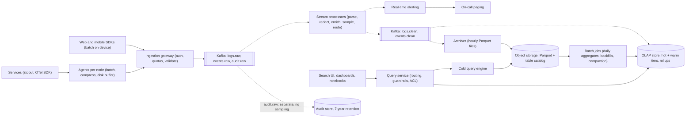
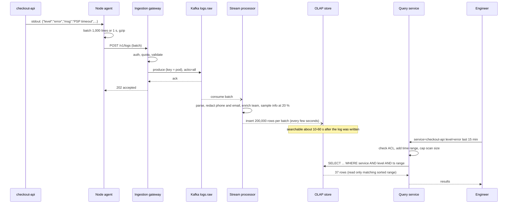

Every service writes logs, every app emits events, and sooner or later someone asks "why did checkout fail for users in Pune between 10:02 and 10:09?" or "how many people who opened the Diwali offer actually paid?". A logging and analytics platform collects all of that data in one place, keeps the last few days searchable within seconds, keeps months of aggregates queryable for dashboards, and does it without the storage bill growing faster than the company. This case study designs such a platform for a large organisation with thousands of services and tens of millions of app users. The core challenges are volume (tens of terabytes a day), the very different needs of "search the last hour" and "trend over a year", and the discipline needed to decide what not to keep.

## Learning objectives

By the end of this lesson you will be able to:

1. Separate the needs of operational logs, product analytics events and audit logs, and turn them into requirements with latency, retention and accuracy targets.
2. Estimate ingest throughput, Kafka sizing, storage per tier and query load with explicit arithmetic, and see where compression and sampling change the answer.
3. Design an ingestion path with agents, a gateway, batching and backpressure that never takes down the services it observes.
4. Choose between stream and batch processing for each job, and explain the lambda and kappa approaches.
5. Explain why columnar OLAP storage suits analytics, and design table layout (partitioning, sort keys, rollups) for common queries.
6. Design retention tiers (hot, warm, cold) and sampling policies (head, tail, per level) that control cost without losing the data that matters.
7. Handle failure modes: ingestion spikes, poison records, duplicates, late events, PII leaks and runaway queries.

## Prerequisites

- [Kafka topics, partitions and consumer groups](#/lesson/m12-kafka): the durable buffer at the centre of the design.
- [Logs, metrics, traces and OpenTelemetry](#/lesson/m14-observability): what telemetry looks like at the source.
- [Object storage](#/lesson/m11-object-storage): the cold tier.
- [Partitioning and sharding](#/lesson/m09-partitioning-sharding): time partitioning and shard keys.
- [Backpressure and load shedding](#/lesson/m13-backpressure): what to do when ingest exceeds capacity.

## Explain it like I'm a beginner

Think of the records department of a huge railway network like Indian Railways.

- Every station, train and ticket counter writes notes all day: "train 12951 left at 16:35", "printer jammed", "ticket booked" (**logs and events**).
- Each station has a clerk who collects the notes into bundles and sends them by van to head office, instead of mailing every note separately (**agents and batching**).
- At head office, a big **sorting hall with conveyor belts** takes every bundle in arrival order and keeps it safely for three days, even if the offices behind it are slow (**Kafka as a durable buffer**).
- Some clerks read the belt live and shout immediately if they see "signal failure" (**stream processing and alerts**); others work overnight and produce daily summaries such as "passengers per route" (**batch processing**).
- Recent records sit in **fast filing cabinets** right next to the investigators' desks (**hot tier**). Older ones go to a basement (**warm tier**), and very old ones to a cheap warehouse outside the city, where fetching them takes longer (**cold tier, object storage**).
- The cabinets are organised **by column**, not by note: one drawer holds all the "train numbers", another all the "delay minutes". If you want average delay, you only open the delay drawer (**columnar storage**).
- The department can't keep every "door opened" note forever, so it keeps 1 in 10 routine notes, but every "accident" note (**sampling**), and throws away routine notes after a month (**retention policy**).
- Before filing, a clerk blacks out passengers' phone numbers (**PII redaction**).

## Requirements

### Functional requirements

1. **Ingest** application logs (structured JSON and plain text) from about 3,000 services running on 20,000 containers, and product analytics events from web and mobile apps.
2. **Search recent logs** by service, level, time range, trace id and free text, with results in seconds, for at least the last 7 days.
3. **Dashboards and ad hoc analytics**: error rates, latency percentiles from logs, product funnels and retention cohorts from events, over months.
4. **Real-time alerting** on log patterns and rates ("payment errors above 2 % for 3 minutes") within about a minute.
5. **Retention and sampling policies** per team, data type and level, with cost visibility per team.
6. **Exports and backfills**: rerun a job over the last 30 days after a bug fix; export a data set for the data science team.
7. **Access control**: teams see their own services' logs; sensitive fields are redacted; audit logs have restricted access and long retention.

### Out of scope

- Metrics time-series storage (counters and gauges scraped by a metrics system) and distributed tracing storage, although the platform shares the ingestion path and links logs to traces by trace id.
- A full business-intelligence tool (we provide the query layer; a BI tool can sit on top).
- Security information and event management (SIEM) analytics; the security team consumes a filtered stream.

### Non-functional requirements

| Requirement | Target |
|---|---|
| Ingest availability | 99.9 %; **never block or crash the producing service** |
| Ingest-to-searchable latency | p95 under **60 s** for logs in the hot tier |
| Alert latency | Under 1–2 minutes from event to page |
| Query latency | Typical log searches over 1 hour: under 5 s; dashboard panels: under 2 s (from rollups) |
| Durability | Logs: best effort with at-least-once delivery; audit events: no loss, at-least-once with deduplication |
| Retention | Debug and info: 30 days; warn and error: 1 year; audit: 7 years (check your regulatory needs); product events: 13 months raw, aggregates for longer |
| Cost | Grows slower than ingest volume, with per-team quotas and showback |

The trade-off to notice: **logs tolerate loss, audit doesn't**. A logging platform that blocks payments because the log pipeline is slow has failed its first requirement. Audit events take a separate, stricter path.

## Capacity estimation

All figures are **estimates** for illustration.

### Ingest volume

- **Application logs**: 20,000 containers × an average of 50 lines/s ≈ **1 M lines/s**, peaking at about **2 M lines/s** during incidents (failing services log more, exactly when you need the data).
- Average log line ≈ 500 B as JSON → 1 M × 500 B = **500 MB/s** average ≈ 500 MB × 86,400 ≈ **43 TB/day raw**.
- **Product events**: 30 M daily active users × 200 events per user per day = **6 B events/day** ≈ 6 B ÷ 86,400 ≈ **70,000 events/s** average, about 210,000/s at the evening peak; ~1 KB each → **6 TB/day**.
- **Total ≈ 50 TB/day raw**, roughly 600 MB/s average and 1.2 GB/s at peak.

### Kafka

- Producers compress batches. Logs are repetitive, so a compression ratio of around 4–5× is a reasonable planning assumption (measure with your data and codec). 600 MB/s ÷ 5 ≈ **120 MB/s** of compressed data on average, ~240 MB/s peak.
- Replication factor 3 → the cluster writes 3 × 120 = **360 MB/s** to disk on average.
- Retention of 3 days (time to recover from a downstream outage or replay after a bug): 120 MB/s × 86,400 × 3 days × 3 replicas ≈ **93 TB** of Kafka disk. A 7-day retention would be ~220 TB: retention is a direct cost lever. The `*.clean` topics written by the stream processors need disk too: at a similar compressed rate and 1-day retention they add about 120 MB/s × 86,400 × 3 replicas ≈ **31 TB**, so plan for roughly **125 TB** in total.
- Partitions: if one partition comfortably handles around 10 MB/s of compressed writes on your hardware (an assumption to benchmark), 240 MB/s peak needs ≥ 24 partitions for logs. Consumer parallelism also needs partitions, so choose **128 partitions** for the log topic and 48 for events, leaving room to grow.

### Storage tiers

- Columnar compression on structured logs is often around 10× or better relative to raw JSON (planning assumption): 43 TB/day of logs → **~4.3 TB/day** in the OLAP store; events 6 TB → ~0.8 TB/day.
- **Hot (7 days, fast SSD, 2 replicas)**: (4.3 + 0.8) TB × 7 × 2 ≈ **71 TB**.
- **Warm (days 8–30, cheaper disks or object-storage-backed)**: 5.1 TB × 23 ≈ **117 TB** (1 copy on durable storage).
- **Cold (object storage, Parquet)**: if everything were kept a year: 5.1 TB × 365 ≈ **1.9 PB**. Apply the retention policy instead: debug and info are about 85 % of log volume and expire after 30 days, so only 15 % of logs (≈ 0.65 TB/day) plus events (0.8 TB/day) stay for a year: (0.65 + 0.8) × 335 days ≈ **490 TB**. Retention by level cuts cold storage by about 4×.
- **Sampling** debug and info at 20 % for high-volume, low-value services would cut log ingest roughly in half (if those services produce most of the info volume): the cheapest byte is the one never sent.

### Query load

- 1,500 engineers, peak of ~100 concurrent ad hoc queries during an incident.
- 3,000 dashboard panels refreshing every minute → 3,000 ÷ 60 = **50 queries/s**, every one scanning recent data. They must hit **pre-aggregated rollups** (per service, per minute), not raw logs.

### What the numbers tell us

1. Ingest is a **throughput** problem: 1.2 GB/s raw at peak needs batching and compression everywhere, and partitioned, horizontally scaled consumers.
2. **Storage cost is dominated by retention × volume**: tiering, compression and level-based retention change the bill by multiples.
3. **Dashboards must read rollups**, or 50 queries/s over raw data will saturate the OLAP cluster.
4. **Incidents double log volume** at the worst possible moment; the pipeline needs headroom and backpressure.

## API design

### Ingestion

Agents (an OpenTelemetry Collector or a lightweight log shipper running as a sidecar or a node daemon) tail container output and send batches to the ingestion gateway:

```http
POST /v1/logs
Authorization: Bearer <workload identity token for "checkout-api">
Content-Type: application/x-ndjson
Content-Encoding: gzip

{"ts":"2026-10-20T10:02:13.441Z","service":"checkout-api","level":"error","msg":"PSP timeout","traceId":"4bf92f35...","attrs":{"region":"ap-south-1","orderId":"ord_88213"}}
{"ts":"2026-10-20T10:02:13.502Z","service":"checkout-api","level":"info","msg":"retrying","traceId":"4bf92f35..."}

202 Accepted
{ "accepted": 2, "sampledOut": 0, "rejected": 0 }
```

- **Batches, compressed**: one request carries hundreds or thousands of records. Per-record HTTP calls would cost more than the logging itself.
- **NDJSON (newline-delimited JSON)** or OTLP (the OpenTelemetry protocol over gRPC or HTTP) as formats. OTLP is the better default for new systems because agents and SDKs already speak it.
- **`202 Accepted`** means "durably queued in Kafka", not "searchable".
- **Backpressure**: when the gateway can't keep up, it returns `429` or `503` with `Retry-After`. Agents buffer to local disk (bounded, for example 2 GB) and retry with backoff. If the buffer fills, agents **drop lowest-priority logs first** (debug, then info), never blocking the application's stdout.
- **Per-team quotas** (records/s and bytes/s) are enforced at the gateway using the [distributed rate limiter](#/lesson/m17-rate-limiter) design; a team exceeding its quota gets sampled rather than starving others.
- **Product events** use a similar endpoint (`POST /v1/events`) from apps via an SDK that batches on the device and sends when online, with an `eventId` for deduplication.

### Query

```http
POST /v1/query
{ "source": "logs", "from": "2026-10-20T10:00:00Z", "to": "2026-10-20T10:15:00Z",
  "filter": "service = 'checkout-api' AND level = 'error' AND msg LIKE '%PSP%'",
  "limit": 200 }
```

- The query service rewrites queries per tier: hot data from the OLAP store, older ranges from the cold query engine over Parquet, and merges results.
- **Guardrails**: mandatory time range, maximum scanned bytes per query (for example 2 TB), per-user concurrency limits, and timeouts. A query without a time filter over a petabyte must be rejected, not attempted.
- **Saved queries and dashboards** compile to queries over rollup tables.
- **Alert rules** are registered through `POST /v1/alerts` and evaluated by the stream processor, not by polling the database.

## Data model

### The event envelope

Every record, log or event, is normalised into one envelope with a small fixed schema plus a map of attributes:

| Field | Type | Notes |
|---|---|---|
| `ts` | timestamp (ms) | Event time from the source; `ingested_at` is added separately |
| `service`, `env`, `region` | low-cardinality strings | Used for partitioning, sorting and access control |
| `level` | enum | trace, debug, info, warn, error, fatal |
| `trace_id`, `span_id` | strings | Join logs to traces |
| `message` | string | Free text, redacted |
| `attrs` | map of string to string | Structured fields; popular keys are promoted to real columns |
| `event_id` | string | For deduplication (required for product and audit events) |

### Columnar table (ClickHouse-style, illustrative)

```sql
-- Illustrative DDL for a columnar OLAP store such as ClickHouse.
CREATE TABLE logs
(
    ts          DateTime64(3),
    ingested_at DateTime64(3),
    service     LowCardinality(String),
    env         LowCardinality(String),
    level       LowCardinality(String),
    host        String,
    trace_id    String,
    message     String,
    attrs       Map(String, String),
    http_status UInt16,           -- promoted from attrs because dashboards use it constantly
    latency_ms  UInt32
)
ENGINE = MergeTree
PARTITION BY toDate(ts)
ORDER BY (service, level, ts)
TTL toDateTime(ts) + INTERVAL 7 DAY TO VOLUME 'warm',
    toDateTime(ts) + INTERVAL 30 DAY DELETE
SETTINGS storage_policy = 'hot_warm';

-- Rollup maintained on insert: one row per (service, minute, level, status class).
CREATE MATERIALIZED VIEW logs_per_minute
ENGINE = SummingMergeTree
PARTITION BY toYYYYMM(minute)
ORDER BY (service, minute, level, status_class)
AS SELECT service,
          toStartOfMinute(ts)        AS minute,
          level,
          intDiv(http_status, 100)   AS status_class,
          count()                    AS requests,
          sum(latency_ms)            AS latency_sum
   FROM logs
   GROUP BY service, minute, level, status_class;
```

Design notes:

- **Partition by day**: retention becomes "drop whole partitions", which is cheap; queries with a time range skip partitions entirely.
- **Sort key `(service, level, ts)`**: the most common filters are "this service, this level, this time range". Data is physically sorted that way, so the engine reads a small contiguous range and skips the rest using sparse indexes.
- **Low-cardinality encoding** for `service`, `level`, `env`: dictionary-encoded, compresses extremely well and makes filters fast.
- **Promote hot attributes to columns**: filtering on `attrs['http_status']` in a map is much slower than on a real column. Watch query logs and promote keys that appear in many queries.
- **Avoid unbounded cardinality in sort keys**: putting `trace_id` or `user_id` first in the sort key ruins compression and locality for every other query. Use a secondary index (a bloom-filter skip index on `trace_id`) instead.
- **Rollups on insert**: the materialized view keeps per-minute counts as data arrives, so dashboards read thousands of rows instead of billions. A `SummingMergeTree` collapses rows with the same key only when background merges run, so queries must still aggregate (`SELECT service, minute, sum(requests) … GROUP BY service, minute`); reading the rows as if they were already final double-counts.
- **Free-text search**: columnar stores scan `message` quickly but don't have a full inverted index by default; token bloom-filter indexes help. If heavy free-text search is the main use case, a search engine (an inverted index, see [search architecture](#/lesson/m16-search-architecture)) is the alternative, at higher storage cost.

### Cold tier

Cold data is written as **Parquet** files in object storage, laid out as `s3://logs-archive/source=logs/date=2026-10-20/service=checkout-api/part-0001.parquet`. Parquet is columnar too, so the cold query engine (an engine such as Trino or Spark SQL) reads only the columns and partitions it needs. A table catalog (an open table format such as Apache Iceberg) adds schema evolution, partition pruning and safe concurrent writes.

## High-level architecture



Arrow by arrow:

- **Services → agents → gateway**: applications only write to stdout or the OpenTelemetry SDK. The node agent batches, compresses and buffers to local disk. Applications never wait for the logging platform.
- **Web and mobile SDKs → gateway**: events batch on the device and are sent when online, so they can arrive minutes or days late (late events matter for analytics).
- **Gateway → Kafka**: the gateway authenticates the workload, enforces team quotas, validates size and schema, and produces to raw topics. Once Kafka acknowledges, the data is durable; everything downstream can fall behind and catch up.
- **Kafka ⇢ stream processors ⇢ clean topics**: parse plain-text logs into fields, redact PII, add metadata (team, cluster, region), apply sampling policies, and route by type. Writing back to "clean" topics decouples processing from storage.
- **Stream processors ⇢ real-time alerting → paging**: alert rules (rates and patterns) are evaluated on the stream in sliding windows.
- **Clean topics ⇢ OLAP store**: inserted in large batches (hundreds of thousands of rows per insert), which columnar stores need for efficient writes.
- **Clean topics ⇢ archiver → object storage**: hourly Parquet files form the long-term record and the source for backfills.
- **Object storage → batch jobs → OLAP store**: daily aggregates (funnels, retention cohorts), compaction of small files, and recomputation after bugs.
- **UI → query service → OLAP or cold engine**: the query service enforces access control and guardrails and routes each time range to the right tier.
- **Audit stream → audit store**: audit events bypass sampling and take a stricter path (deduplication by event id, long retention, restricted access).

### Ingesting a log line, and finding it



Every hop batches: the agent per second, the gateway per request, Kafka per producer batch, the OLAP insert per few seconds. Batching is what makes 1 M lines/s affordable, and it is also why "searchable within 60 s" is a realistic target and "within 1 s" is not. The query reads only the sorted range for one service and level within 15 minutes, which is why the sort key matters so much.

## Deep dives

### Deep dive 1: ingestion that never hurts the producer

The first rule of a logging platform: **it must not take down what it observes**. During an incident, log volume doubles, and if logging becomes slow, applications that log synchronously stall. Defences, from the source outward:

1. **Applications log asynchronously** to stdout or an in-process buffer with a bounded size; if the buffer is full, drop (and count) debug and info lines rather than blocking request threads.
2. **Agents buffer to disk** (bounded) when the gateway is slow, and retry with exponential backoff and jitter.
3. **The gateway sheds load by priority** when overloaded: reject debug and info batches with `429` first, accept warn and error. Audit has its own reserved capacity.
4. **Kafka absorbs bursts**: the gateway only needs Kafka to accept writes; consumers can lag for hours without losing data, within the retention window.
5. **Per-team quotas** stop one service stuck in an error loop (logging 50,000 identical stack traces per second) from starving everyone else. Over-quota traffic is sampled, and the team is alerted.

**Partition key choice**: keying by `service` keeps one service's lines in order on one partition, but a very chatty service then makes one partition hot. Keying by `service + host` or by a random key spreads load; ordering only matters within a single container's stream, which the timestamp and host already capture. A common compromise: key by `host` (or pod), which spreads load and keeps per-source ordering.

### Deep dive 2: stream versus batch

| Job | Stream or batch | Why |
|---|---|---|
| Parse, redact, enrich, sample | Stream | Must happen before data is stored or seen |
| Alerting ("errors > 2 % for 3 min") | Stream | Latency matters |
| Per-minute rollups for dashboards | Stream (or insert-time views) | Fresh dashboards |
| Daily product funnels and cohorts | Batch | Needs complete days, joins across many events, late data |
| Backfill after a parsing bug | Batch (replay from archive) | Reprocess history |
| Compaction of small files | Batch | Housekeeping |

**Lambda architecture** runs both: a stream layer for fast, approximate results and a batch layer that recomputes exact results later. The cost is two code paths that must agree. **Kappa architecture** uses only a stream processor and handles reprocessing by replaying the log from the beginning (or from the archive) through a new version of the job. Kappa needs long retention or a replayable archive and a stream processor that handles large backfills. A practical middle ground, used here: **streaming for everything time-sensitive, batch for heavy daily analytics and backfills, both reading the same archived data and sharing transformation libraries**.

**Event time versus processing time**: a mobile event created at 22:58 on a train without network may arrive at 07:10 the next morning. Windows must be based on **event time**, with a **watermark** ("we believe we have seen nearly everything up to time T") and an **allowed lateness**, after which late events are counted as dropped or sent to a correction path. Exercise 5 implements this. Batch jobs for "yesterday" run a few hours after midnight and are rerun if many late events arrive.

### Deep dive 3: why columnar storage

A row store keeps each record's fields together. A columnar store keeps each column's values together. Consider "error count per service per minute for the last day":

- Rows touched: about 86 B lines in a day (1 M/s × 86,400).
- A row store reads every field of every row in range: 86 B × 500 B ≈ **43 TB** (before indexes help).
- A columnar store reads only `ts`, `service` and `level`. Those are small and compress extremely well (sorted, low-cardinality): maybe 2–4 bytes per row combined after compression (estimate) → **170–350 GB**, and much less if the query only touches a few services thanks to the sort key.

That two-orders-of-magnitude difference is the reason analytics systems are columnar. Other properties:

- **Compression**: similar values sit next to each other (all `level` values together, sorted), so dictionary, run-length and delta encodings work very well.
- **Vectorised execution**: operators process blocks of values from one column at a time, using CPU caches and SIMD instructions efficiently.
- **Writes in large batches**: columnar stores write immutable parts and merge them in the background. Thousands of tiny inserts per second create too many parts; insert in batches of tens of thousands to hundreds of thousands of rows.
- **Updates and deletes are expensive**: fine for logs (append-only), awkward for data that changes often.
- **Point lookups are weaker** than in a row store with a B-tree; finding one `trace_id` needs a skip index or a separate lookup table.

Columnar OLAP databases such as ClickHouse, Apache Druid and Apache Pinot, and cloud warehouses, all build on these ideas, with different trade-offs in real-time ingestion, joins and operations.

### Deep dive 4: retention tiers

| Tier | Age | Storage | Query speed | Use |
|---|---|---|---|---|
| Hot | 0–7 days | Local NVMe SSD, 2 replicas | Seconds | Incident debugging, live dashboards |
| Warm | 8–30 days | Cheaper disks or object-storage-backed volumes | Seconds to tens of seconds | Investigations, weekly comparisons |
| Cold | 31 days – 1 year (warn+), 13 months (events) | Object storage, Parquet | Tens of seconds to minutes | Audits, trend analysis, backfills |
| Archive | Audit up to 7 years | Archival object storage class | Hours to retrieve | Compliance |
| Rollups | Years | OLAP store | Seconds | Long-term dashboards |

**Retention is a policy, not a constant**: per data type and level, overridable per team within limits. A team that needs debug logs for 90 days pays for it in the showback report. Old data is deleted by dropping partitions (OLAP) and by object storage lifecycle rules (cold), both cheap operations because the layout is partitioned by time.

**Rollups outlive raw data**: per-minute error counts kept for 2 years cost almost nothing compared with the raw logs and answer most "is it worse than last year?" questions.

### Deep dive 5: sampling

Sampling decides which records to keep before paying to store them.

- **Level-based**: keep 100 % of warn, error and fatal; sample debug and info per service (for example 20 %).
- **Deterministic by trace id**: hash the trace id and keep the record if `hash % 10,000 < rate × 10,000`. Every service makes the **same** decision for the same request, so a sampled request has complete logs across all services instead of random fragments. Exercise 1 implements this.
- **Head versus tail sampling** (mostly for traces, sometimes for logs): head sampling decides at the start of a request (cheap, but can't know the request will fail); tail sampling buffers all data for a request and decides at the end, keeping slow or failed requests. Tail sampling needs a buffering tier that holds all spans of a request for some seconds, which costs memory.
- **Dynamic sampling**: reduce rates automatically for services that exceed their quota, and keep rare messages (by hashing the message template) at higher rates than frequent ones.
- **Record the sample rate** in each kept record (`sample_rate = 0.2`), so queries can scale counts back up (`count() / sample_rate`). Without it, sampled dashboards silently undercount.
- **Never sample**: audit events, billing events, security events. They go through a separate path.

Product analytics usually avoids sampling raw events, because funnels and cohorts need complete user journeys; it reduces cost through retention and aggregation instead.

### Deep dive 6: duplicates, late data and correctness

Kafka-based pipelines deliver **at least once**: an agent retries after a timeout, a consumer crashes after inserting but before committing its offset. For logs, an occasional duplicate line is harmless. For product events (funnels, revenue dashboards) and audit, duplicates matter:

- Every event carries an `event_id` created at the source.
- The OLAP insert path deduplicates, for example with insert deduplication tokens per batch, or a table engine that collapses rows with the same key during merges, plus `FINAL`-style queries or explicit `GROUP BY event_id` where exact counts are needed.
- Batch jobs deduplicate by `event_id` when building daily tables.
- Kafka's idempotent producer and transactions give exactly-once **within Kafka**, but the end-to-end guarantee to an external store still depends on idempotent writes ([delivery guarantees](#/lesson/m12-delivery-guarantees)).

### Deep dive 7: PII and multi-tenancy

- **Redact in the stream processor**, before data reaches any store: emails, phone numbers (for Indian numbers, a 10-digit mobile starting with 6–9, optionally prefixed with +91), card-number-like digit sequences, auth tokens and passwords in URLs. Pattern-based redaction has false positives (order ids that look like phone numbers) and false negatives; combine it with **structured logging guidelines** (log `userId`, never the email) and allow-lists of fields.
- **Data protection rules** (such as India's DPDP Act and GDPR) affect retention and deletion requests; keeping identifiers pseudonymised (a hashed user id) in logs makes compliance much easier.
- **Access control by service ownership**: the query service adds a filter on `service` based on the user's team; sensitive sources (payments, auth) are restricted further.
- **Quotas and showback**: ingest bytes, storage and query scan bytes per team, published weekly. Cost visibility changes logging behaviour more than any policy document.

### Deep dive 8: the core in ASP.NET Core

The code below is the ingestion gateway's core: parse NDJSON batches, validate, redact, apply deterministic sampling, and push into a bounded in-memory channel (backpressure: when it is full, the endpoint returns `503` with `Retry-After` and agents keep the data). A `BackgroundService` drains the channel into size- and time-bounded batches and publishes them to a sink (Kafka in production, an in-memory fake here), retrying with backoff.

```csharp file=Telemetry/Model.cs
namespace Telemetry;

public enum Severity { Trace, Debug, Info, Warn, Error, Fatal }

public sealed record LogRecord(
    DateTimeOffset Timestamp, string Service, Severity Level, string Message, string? TraceId,
    IReadOnlyDictionary<string, string> Attributes, double SampleRate = 1.0);

public sealed record LogRecordDto(DateTimeOffset? Ts, string? Service, string? Level, string? Msg, string? TraceId,
    Dictionary<string, string>? Attrs);

public sealed record EventEnvelope(string Topic, string Key, byte[] Value);

public interface IEventSink
{
    /// <summary>Publish a batch durably (Kafka producer with acks=all in production).</summary>
    Task PublishAsync(IReadOnlyList<EventEnvelope> batch, CancellationToken ct);
}

public sealed class InMemoryEventSink : IEventSink
{
    private long _published;
    public long Published => Interlocked.Read(ref _published);

    public Task PublishAsync(IReadOnlyList<EventEnvelope> batch, CancellationToken ct)
    {
        Interlocked.Add(ref _published, batch.Count);
        return Task.CompletedTask;
    }
}
```

```csharp file=Telemetry/Policies.cs
using System.Text;
using System.Text.RegularExpressions;

namespace Telemetry;

/// <summary>Keeps every warn+ record; samples lower levels by trace id so all services agree per request.</summary>
public sealed class SamplingPolicy(IReadOnlyDictionary<string, double> infoRatePerService, double defaultInfoRate = 1.0)
{
    public double RateFor(LogRecord r) => r.Level switch
    {
        >= Severity.Warn => 1.0,
        Severity.Info => infoRatePerService.GetValueOrDefault(r.Service, defaultInfoRate),
        _ => Math.Min(0.1, infoRatePerService.GetValueOrDefault(r.Service, defaultInfoRate)), // debug and trace
    };

    public bool ShouldKeep(LogRecord r, out double rate)
    {
        rate = RateFor(r);
        if (rate >= 1.0) return true;
        if (rate <= 0.0) return false;
        var bucket = r.TraceId is { Length: > 0 } t ? Fnv1a(t) % 10_000 : (ulong)Random.Shared.Next(10_000);
        return bucket < (ulong)(rate * 10_000);
    }

    public static ulong Fnv1a(string s)
    {
        var hash = 14695981039346656037UL;
        foreach (var b in Encoding.UTF8.GetBytes(s))
        {
            hash ^= b;
            hash *= 1099511628211UL;
        }
        return hash;
    }
}

public static partial class Redactor
{
    [GeneratedRegex(@"[A-Za-z0-9._%+-]+@[A-Za-z0-9.-]+\.[A-Za-z]{2,}")]
    private static partial Regex Email();

    [GeneratedRegex(@"(?<!\d)(?:\+?91[\s-]?)?[6-9]\d{9}(?!\d)")]
    private static partial Regex IndianMobile();

    [GeneratedRegex(@"(?<!\d)(?:\d[ -]?){12,18}\d(?!\d)")]
    private static partial Regex CardLike();

    public static string Redact(string text)
    {
        text = Email().Replace(text, "[email]");
        text = CardLike().Replace(text, "[number]"); // before phones, so long numbers aren't half-matched
        return IndianMobile().Replace(text, "[phone]");
    }
}
```

```csharp file=Telemetry/Ingestion.cs
using System.Text.Json;
using System.Threading.Channels;

namespace Telemetry;

public sealed record IngestResult(int Accepted, int SampledOut, int Rejected, bool Overloaded);

public sealed class IngestQueue
{
    // Bounded: when full, the gateway pushes back instead of growing memory until it crashes.
    private readonly Channel<LogRecord> _channel = Channel.CreateBounded<LogRecord>(
        new BoundedChannelOptions(100_000) { FullMode = BoundedChannelFullMode.Wait, SingleReader = true });

    public ChannelReader<LogRecord> Reader => _channel.Reader;
    public bool TryEnqueue(LogRecord record) => _channel.Writer.TryWrite(record);
}

public sealed class LogIngestor(IngestQueue queue, SamplingPolicy sampling, TimeProvider clock)
{
    public const int MaxRecordBytes = 64 * 1024;
    private static readonly JsonSerializerOptions Json = new(JsonSerializerDefaults.Web);

    public IngestResult Ingest(string workloadService, IEnumerable<string> ndjsonLines)
    {
        int accepted = 0, sampled = 0, rejected = 0;
        foreach (var line in ndjsonLines)
        {
            if (string.IsNullOrWhiteSpace(line)) continue;
            if (System.Text.Encoding.UTF8.GetByteCount(line) > MaxRecordBytes) { rejected++; continue; }   // bytes, not UTF-16 chars

            LogRecordDto? dto;
            try { dto = JsonSerializer.Deserialize<LogRecordDto>(line, Json); }
            catch (JsonException) { rejected++; continue; } // poison record: count it, never fail the batch

            if (dto?.Msg is null || !Enum.TryParse<Severity>(dto.Level, ignoreCase: true, out var level)) { rejected++; continue; }

            // The authenticated workload decides the service name, so one team can't write into another's logs.
            var record = new LogRecord(dto.Ts ?? clock.GetUtcNow(), workloadService, level, Redactor.Redact(dto.Msg),
                dto.TraceId, dto.Attrs ?? new Dictionary<string, string>());

            if (!sampling.ShouldKeep(record, out var rate)) { sampled++; continue; }
            if (!queue.TryEnqueue(record with { SampleRate = rate }))
                return new IngestResult(accepted, sampled, rejected, Overloaded: true); // agent retries the rest
            accepted++;
        }
        return new IngestResult(accepted, sampled, rejected, Overloaded: false);
    }
}

public sealed class BatchingPublisher(IngestQueue queue, IEventSink sink, TimeProvider clock, ILogger<BatchingPublisher> log)
    : BackgroundService
{
    public const int MaxBatch = 1_000;
    public const long MaxBatchBytes = 512 * 1024;
    public static readonly TimeSpan MaxDelay = TimeSpan.FromMilliseconds(200);

    protected override async Task ExecuteAsync(CancellationToken stoppingToken)
    {
        var batch = new List<EventEnvelope>(MaxBatch);
        long bytes = 0;
        var reader = queue.Reader;

        while (await reader.WaitToReadAsync(stoppingToken))
        {
            var deadline = clock.GetUtcNow() + MaxDelay;
            while (batch.Count < MaxBatch && bytes < MaxBatchBytes)
            {
                if (reader.TryRead(out var record))
                {
                    var value = JsonSerializer.SerializeToUtf8Bytes(record);
                    batch.Add(new EventEnvelope("logs.raw", record.Service, value));   // production: key by pod or host (deep dive 1)
                    bytes += value.Length;
                    continue;
                }
                var remaining = deadline - clock.GetUtcNow();
                if (remaining <= TimeSpan.Zero) break;
                using var wait = CancellationTokenSource.CreateLinkedTokenSource(stoppingToken);
                wait.CancelAfter(remaining);
                try
                {
                    if (!await reader.WaitToReadAsync(wait.Token)) break;
                }
                catch (OperationCanceledException) when (!stoppingToken.IsCancellationRequested)
                {
                    break; // time limit reached: publish what we have
                }
            }

            await PublishWithRetryAsync(batch, stoppingToken);
            batch.Clear();
            bytes = 0;
        }
    }

    private async Task PublishWithRetryAsync(List<EventEnvelope> batch, CancellationToken ct)
    {
        for (var attempt = 1; ; attempt++)
        {
            try
            {
                await sink.PublishAsync(batch.ToList(), ct);
                return;
            }
            catch (Exception ex) when (ex is not OperationCanceledException)
            {
                if (attempt == 5)
                {
                    // Never let the exception escape: an unhandled BackgroundService exception stops the whole host
                    // (the default since .NET 6), which would take the gateway down with the broker.
                    // Logs tolerate loss; production spills the batch to local disk and replays it later.
                    log.LogError(ex, "Dropping {Count} records after {Attempts} failed publishes", batch.Count, attempt);
                    return;
                }
                var delay = TimeSpan.FromMilliseconds(100 * Math.Pow(2, attempt - 1) * (0.5 + Random.Shared.NextDouble()));
                log.LogWarning(ex, "Publish failed (attempt {Attempt}); retrying in {Delay}", attempt, delay);
                await Task.Delay(delay, clock, ct);
            }
        }
    }
}
```

```csharp file=Program.cs
using Telemetry;

var builder = WebApplication.CreateBuilder(args);
builder.Services.AddSingleton(TimeProvider.System);
builder.Services.AddSingleton<IngestQueue>();
builder.Services.AddSingleton(new SamplingPolicy(new Dictionary<string, double>
{
    ["search-api"] = 0.2,       // very chatty service: keep 20 % of info logs
    ["checkout-api"] = 1.0,
}));
builder.Services.AddSingleton<LogIngestor>();
builder.Services.AddSingleton<IEventSink, InMemoryEventSink>(); // production: Kafka producer, acks=all, compression on
builder.Services.AddHostedService<BatchingPublisher>();
builder.Services.AddRequestDecompression();   // agents send Content-Encoding: gzip

var app = builder.Build();
app.UseRequestDecompression();                // bounded by Kestrel's MaxRequestBodySize after decompression

app.MapPost("/v1/logs", async (HttpRequest request, LogIngestor ingestor, CancellationToken ct) =>
{
    // Production: the service name comes from the workload identity in the bearer token.
    var service = request.Headers["X-Workload-Service"].ToString();
    if (string.IsNullOrWhiteSpace(service)) return Results.Unauthorized();

    var lines = new List<string>();
    using (var reader = new StreamReader(request.Body))
    {
        while (await reader.ReadLineAsync(ct) is { } line)
        {
            lines.Add(line);
            if (lines.Count > 10_000) return Results.Problem("Batch too large; send at most 10,000 records.", statusCode: 413);
        }
    }

    var result = ingestor.Ingest(service, lines);
    if (result.Overloaded)
    {
        request.HttpContext.Response.Headers.RetryAfter = "2";
        return Results.Json(result, statusCode: StatusCodes.Status503ServiceUnavailable);
    }
    return Results.Accepted(value: result);
});

app.Run();
```

What the code demonstrates:

- **The bounded channel is the backpressure point.** When downstream is slow, the channel fills, `TryEnqueue` fails, and the gateway returns `503` with `Retry-After`. Memory stays bounded and agents keep the unsent data on their disks.
- **Poison records are counted, not fatal.** One malformed JSON line in a batch of 1,000 doesn't reject the other 999.
- **Gzip bodies need the request decompression middleware.** ASP.NET Core does not decompress request bodies by default; `UseRequestDecompression` does, and Kestrel's request-size limit then applies to the decompressed bytes, which is the defence against gzip bombs.
- **A `503` mid-batch means partial acceptance.** Records before the overload point are already queued; the agent resends the whole batch, so a few lines may arrive twice. That is acceptable for logs, and it is why product and audit events carry an `event_id`.
- **A broker outage never crashes the gateway.** After five failed publishes the batch is dropped and counted (production spills it to disk), because an exception escaping a `BackgroundService` stops the host.
- **The service name comes from the caller's identity**, not the payload, which is the basis for per-team access control and quotas.
- **Sampling records its rate**, so counts can be scaled back up at query time.
- **The publisher batches by count, bytes and time**: under load, full batches go out immediately; when quiet, a lone record waits at most 200 ms.

## Caching, queues and scaling

### Caching

- **Query results**: dashboards cache panel results for 30–60 s keyed by (query, time bucket). Ten engineers opening the same incident dashboard shouldn't run ten identical scans.
- **Rollups are the real cache**: precomputed per-minute aggregates replace raw scans for most dashboard panels.
- **Metadata**: service → team mapping, sampling policies and access rules cached in the gateway and query service, refreshed every minute.
- **Cold-tier file metadata** (the table catalog's manifests) is cached by the cold query engine so partition pruning doesn't list millions of objects.

### Queues and streams

- **Kafka topics**: `logs.raw` (128 partitions), `events.raw` (48), `audit.raw` (separate, stricter durability settings), plus `*.clean` topics after processing. Retention 3 days for raw topics (the replay window), shorter for clean topics if the archive is the long-term replay source.
- **Consumer groups**: OLAP loader, archiver, alerting and the security team's consumer each read independently; a slow consumer only lags itself.
- **Dead-letter topic** for records that fail parsing repeatedly, with counts per service alerting the owning team.

### Scaling

- **Gateway**: stateless, scaled on CPU and request rate; mostly decompression and JSON parsing.
- **Kafka**: add brokers and partitions; partition count is hard to reduce later, so start generous.
- **Stream processors**: one consumer instance per partition at most, so partitions cap parallelism; 128 partitions allow up to 128 instances.
- **OLAP store**: shard by a hash of (service, time) or by service groups, replicate for availability. Scale storage (more shards) and compute (more replicas for queries) separately where the engine allows.
- **Cold tier**: object storage scales without limit; the cold query engine scales its workers per query.

**What breaks first?** (1) Ingest during an incident when error logs double; (2) OLAP inserts with too many small batches ("too many parts"); (3) a dashboard or ad hoc query scanning raw data over weeks, starving other queries; (4) Kafka disk if retention is raised casually; (5) high-cardinality attributes promoted to columns or sort keys.

## Failure handling

| Failure | Effect | Mitigation |
|---|---|---|
| Ingest spike during an incident | Gateway and Kafka overloaded | Priority shedding (debug/info first), agent disk buffers, quotas, headroom of 2× peak |
| Gateway down in one zone | Agents can't send | Multiple zones behind the load balancer; agents buffer and retry |
| Kafka broker failure | Partitions move leaders | Replication factor 3, `min.insync.replicas` 2, producers with `acks=all` and retries |
| OLAP store slow or down | Search unavailable; consumers lag | Kafka holds 3 days; consumers catch up later; alerting runs on the stream and keeps working |
| Poison records | Consumer crash loops | Per-record error handling, dead-letter topic, never fail a whole batch |
| Duplicate delivery | Inflated counts | Event ids and deduplication for events and audit; tolerated for logs |
| Late events | Incomplete windows | Event-time windows, watermarks, allowed lateness, batch reruns for daily tables |
| PII leaked into logs | Compliance incident | Redaction in the stream, field allow-lists, ability to delete by partition and rewrite affected cold files |
| Runaway query | Cluster saturated | Scan-byte caps, timeouts, per-user concurrency limits, separate pools for dashboards and ad hoc |
| Parsing bug discovered after a week | Bad data stored | Replay from the archive through a fixed job; versioned outputs |

## Security

- **Workload identity** for ingestion (mutual TLS or tokens from the platform's identity system); the authenticated identity sets the `service` field.
- **Least-privilege access**: teams query their own services; cross-team access by request; sensitive sources restricted; all queries logged (queries over logs are themselves an audit trail) ([least privilege and audit](#/lesson/m14-least-privilege-audit)).
- **Redaction and minimisation**: redact in the stream, log identifiers rather than personal data, and provide a deletion path for data subject requests that touches hot, warm and cold tiers.
- **Encryption** in transit (TLS between agents, gateway, Kafka and stores) and at rest (disk and object storage encryption with managed keys).
- **Audit stream integrity**: separate topic and store, no sampling, write-once storage settings where available, restricted deletion.
- **Abuse resistance**: size limits per record and batch, decompression limits (a small gzip bomb can expand to gigabytes), quotas per workload.

## Observability

The platform needs its own observability, kept separate from itself (if the logging platform is down, its own alerts can't depend on it):

- **Ingest**: records and bytes per second per team, rejection and shedding counts by reason, gateway latency, agent buffer usage.
- **Kafka**: consumer lag per group (in time, not just offsets), under-replicated partitions, disk usage versus retention.
- **Freshness**: end-to-end delay from record timestamp to searchable, measured with synthetic "canary" log lines written every 10 s by a probe service and searched for.
- **Data quality**: parse failure rate per service, dead-letter volume, redaction hit counts (a spike means someone started logging emails).
- **OLAP**: insert batch sizes, part counts, merge backlog, query latency by pool, scanned bytes per query.
- **Cost**: storage per tier, ingest and scan bytes per team, published as showback.

## Deployment and cost

### Deployment

- Agents roll out as a node daemon with canaries per cluster; a broken agent config can silence logging everywhere, so changes go to one cluster first and are watched with the canary log probe.
- Stream processors deploy with versioned consumer groups when output semantics change (run old and new side by side, compare outputs, then switch).
- Schema changes are **additive** (new attributes, promoted columns) with backfills where needed; never repurpose a field.
- Kafka and the OLAP cluster are stateful: rolling restarts one broker or replica at a time, with health checks on replication before moving on.

### Cost drivers (estimates)

1. **Storage × retention**: hot SSD replicas are the most expensive per TB; tiering and level-based retention are the biggest levers (the capacity section showed about 4× savings on the cold tier from level-based retention alone).
2. **Ingest volume**: every byte is paid for several times (network, Kafka replicas, processing, storage). Sampling noisy services and removing useless log lines is the cheapest optimisation.
3. **Kafka disk**: retention days × compressed throughput × replication factor.
4. **Query compute**: ad hoc scans over large ranges; rollups and scan caps keep this predictable.
5. **Cross-zone and cross-region network** for replication can be significant; keep ingestion zone-local where possible.

### When a simpler design is enough

A company with 30 services and a few GB of logs a day doesn't need Kafka, stream processors or tiered storage. Ship logs with an OpenTelemetry Collector to a managed logging service (for example Azure Monitor Logs or another hosted log platform), or to a single-node search or columnar database, keep 14–30 days, and build a handful of dashboards. For product analytics at that scale, a managed analytics product or a daily export into a warehouse is enough. Introduce Kafka when you need a durable buffer between many producers and several independent consumers, and tiering when storage cost becomes a line item someone asks about.

## Alternatives and trade-offs

| Decision | Our choice | Alternative | When the alternative wins |
|---|---|---|---|
| Buffer | Kafka between gateway and stores | Direct writes from agents to the store | Small scale; one consumer; managed service handles buffering |
| Storage for logs | Columnar OLAP + Parquet cold tier | Search engine (inverted index) | Free-text search dominates and volume is moderate; higher storage cost per GB |
| Processing | Stream for time-sensitive, batch for heavy daily jobs | Kappa (stream only, replay for backfills) | Team runs one stream platform well and keeps long, replayable history |
| Schema | Fixed envelope + attribute map + promoted columns | Fully schemaless (schema on read) | Exploratory data with unpredictable fields; slower queries |
| Sampling | Level-based, deterministic by trace id, rate recorded | Keep everything | Audit, billing, low volume |
| Retention | Tiered by age and level | Single tier | Small data volumes where simplicity beats savings |
| Build vs buy | Self-hosted pipeline | Managed observability vendor | Teams without platform engineers; vendor pricing per GB can dominate at scale, so model it |

## Practical playground

The starting graph is a common first version: every service writes directly to one search cluster, which keeps everything for 90 days, and dashboards query raw data. Open it in the HLD canvas and turn it into this lesson's design: add agents and an ingestion gateway with quotas, Kafka as a buffer, stream processors for parsing, redaction and alerting, a columnar OLAP store with rollups, an archiver to object storage, and a query service with guardrails. Then raise the client RPS to simulate an incident doubling log volume, and see what absorbs the spike.

:::playground type=hld title="From direct writes to a tiered log pipeline"
```json
{
  "nodes": [
    { "id": "svc", "type": "client", "label": "3,000 services writing logs", "props": { "rps": 1000000 } },
    { "id": "es", "type": "search", "label": "Search cluster (all logs, 90 days)", "props": { "replicas": 1 } },
    { "id": "dash", "type": "app-server", "label": "Dashboards (query raw logs every minute)", "props": { "instances": 2 } },
    { "id": "mon", "type": "monitoring", "label": "Alerts (poll search cluster)" }
  ],
  "edges": [
    { "from": "svc", "to": "es", "kind": "sync", "label": "one HTTP call per log line" },
    { "from": "dash", "to": "es", "kind": "sync", "label": "3,000 panels/min" },
    { "from": "mon", "to": "es", "kind": "sync" }
  ]
}
```
:::

## Exercises

:::exercise id=m17-logging-analytics-ex1 difficulty=beginner kind=code title="Deterministic trace-based sampler"
Implement `TraceSampler.ShouldKeep`, so that every service makes the same keep-or-drop decision for the same trace id, while warnings and errors are always kept.
::requirements
- Levels are `"debug"`, `"info"`, `"warn"`, `"error"`, `"fatal"` (case-insensitive). `warn`, `error` and `fatal` are always kept.
- For `debug` and `info`: compute FNV-1a 64-bit over the UTF-8 bytes of the trace id (offset basis `14695981039346656037`, prime `1099511628211`), take `hash % 10000`, and keep the record if that value is **less than** `rate × 10000` (rounded down to an integer).
- `rate` is between 0 and 1 inclusive; outside that range throw `ArgumentOutOfRangeException` from the constructor. Rate 1 keeps everything, rate 0 keeps nothing (except warn and above).
- A null or empty trace id with a rate strictly between 0 and 1 is dropped (no way to agree across services).
- An unknown level throws `ArgumentException`.
::acceptance
- All tests pass, including the ones that check agreement across instances and the approximate rate over 100,000 trace ids.
::hint
Two sampler instances with the same rate must return the same answer for the same trace id. So the decision may depend only on the trace id and the rate, never on randomness or time.
::hint
FNV-1a: start with the offset basis; for each byte, XOR the byte into the hash, then multiply by the prime. Use `ulong` arithmetic, which wraps around on overflow in an unchecked context (the default).
::hint
Compute the threshold once in the constructor: `(ulong)Math.Floor(rate * 10_000)`.
::hint
Check the level first: warn and above return `true` before any hashing.
::hint
```csharp
var hash = 14695981039346656037UL;
foreach (var b in Encoding.UTF8.GetBytes(traceId))
{
    hash ^= b;
    hash *= 1099511628211UL;
}
return hash % 10_000 < _threshold;
```
::starter
```csharp file=TraceSampler.cs
using System;
using System.Text;

public sealed class TraceSampler
{
    public TraceSampler(double rate) => throw new NotImplementedException();

    public static ulong Fnv1a64(string text) => throw new NotImplementedException();

    public bool ShouldKeep(string level, string? traceId) => throw new NotImplementedException();
}
```
::tests
```csharp file=TraceSamplerTests.cs
using System;
using System.Linq;
using Xunit;

public class TraceSamplerTests
{
    [Fact]
    public void Fnv1a_matches_known_values()
    {
        Assert.Equal(14695981039346656037UL, TraceSampler.Fnv1a64(""));
        Assert.Equal(0xAF63DC4C8601EC8CUL, TraceSampler.Fnv1a64("a"));
    }

    [Fact]
    public void Warnings_and_errors_are_always_kept()
    {
        var s = new TraceSampler(0);
        Assert.True(s.ShouldKeep("warn", "t1"));
        Assert.True(s.ShouldKeep("ERROR", null));
        Assert.True(s.ShouldKeep("fatal", ""));
        Assert.False(s.ShouldKeep("info", "t1"));
    }

    [Fact]
    public void Rate_one_keeps_all_info()
    {
        var s = new TraceSampler(1);
        Assert.True(s.ShouldKeep("info", "anything"));
        Assert.True(s.ShouldKeep("debug", null));
    }

    [Fact]
    public void Instances_agree_for_the_same_trace()
    {
        var a = new TraceSampler(0.2);
        var b = new TraceSampler(0.2);
        foreach (var id in Enumerable.Range(0, 1000).Select(i => $"trace-{i}"))
        {
            Assert.Equal(a.ShouldKeep("info", id), b.ShouldKeep("debug", id));
        }
    }

    [Fact]
    public void Keeps_roughly_the_configured_fraction()
    {
        var s = new TraceSampler(0.2);
        var kept = Enumerable.Range(0, 100_000).Count(i => s.ShouldKeep("info", $"4bf92f35-{i}"));
        Assert.InRange(kept, 19_000, 21_000);
    }

    [Fact]
    public void Higher_rate_keeps_a_superset()
    {
        var low = new TraceSampler(0.1);
        var high = new TraceSampler(0.5);
        foreach (var id in Enumerable.Range(0, 5000).Select(i => $"t{i}"))
            if (low.ShouldKeep("info", id)) Assert.True(high.ShouldKeep("info", id));
    }

    [Fact]
    public void Missing_trace_id_is_dropped_when_sampling()
    {
        var s = new TraceSampler(0.5);
        Assert.False(s.ShouldKeep("info", null));
        Assert.False(s.ShouldKeep("info", ""));
    }

    [Fact]
    public void Invalid_inputs_throw()
    {
        Assert.Throws<ArgumentOutOfRangeException>(() => new TraceSampler(1.5));
        Assert.Throws<ArgumentOutOfRangeException>(() => new TraceSampler(-0.1));
        Assert.Throws<ArgumentException>(() => new TraceSampler(0.5).ShouldKeep("verbose", "t"));
    }
}
```
::solution
```csharp file=TraceSampler.cs
using System;
using System.Text;

public sealed class TraceSampler
{
    private readonly double _rate;
    private readonly ulong _threshold;

    public TraceSampler(double rate)
    {
        if (double.IsNaN(rate) || rate < 0 || rate > 1) throw new ArgumentOutOfRangeException(nameof(rate));
        _rate = rate;
        _threshold = (ulong)Math.Floor(rate * 10_000);
    }

    public static ulong Fnv1a64(string text)
    {
        var hash = 14695981039346656037UL;
        foreach (var b in Encoding.UTF8.GetBytes(text))
        {
            hash ^= b;
            hash *= 1099511628211UL;
        }
        return hash;
    }

    public bool ShouldKeep(string level, string? traceId)
    {
        switch (level.ToLowerInvariant())
        {
            case "warn" or "error" or "fatal":
                return true;
            case "debug" or "info":
                if (_rate >= 1) return true;
                if (_rate <= 0 || string.IsNullOrEmpty(traceId)) return false;
                return Fnv1a64(traceId) % 10_000 < _threshold;
            default:
                throw new ArgumentException($"Unknown level '{level}'.", nameof(level));
        }
    }
}
```

The decision depends only on the trace id and the rate, so `checkout-api`, `payment-api` and `inventory-api` all keep or all drop the logs of the same request: an engineer who finds one sampled line for a trace finds the whole story. Because the comparison is "bucket < threshold", raising the rate from 10 % to 50 % keeps every trace that was kept before plus more, which makes rate changes predictable.

Use a stable hash such as FNV-1a, not `string.GetHashCode()`: .NET randomises string hash codes per process, so two services (or two restarts of one service) would disagree. In production also store `sample_rate` on every kept record so that dashboards can multiply counts back up.
::alternatives
- **xxHash or MurmurHash** are faster and distribute better than FNV-1a for long keys; the principle is the same as long as every service uses the same function.
- **Random sampling** (`Random.Shared.NextDouble() < rate`) is fine for single-service logs where cross-service consistency doesn't matter.
::mistakes
- Using `string.GetHashCode()`, which differs between processes.
- Sampling warnings and errors, losing the records most needed during incidents.
- Using `<=` against the threshold, which makes rate 0 keep bucket 0.
- Forgetting to record the sample rate, so dashboards undercount by the sampling factor.
::extensions
Support per-service rates from configuration and a rule that always keeps the first occurrence of each distinct message template per minute, even when sampled.
:::

:::exercise id=m17-logging-analytics-ex2 difficulty=beginner kind=sql ordered=true title="Which services had error spikes?"
An access-log table holds one row per HTTP request. For the hour from `2026-10-20 10:00` (inclusive) to `11:00` (exclusive), return each service whose server error rate (status 500 or higher) was **above 1.0 %**, with columns `service`, `total`, `errors` and `error_pct` (percentage rounded to 1 decimal place), ordered by `error_pct` descending, then `service`.
::setup
```sql
CREATE TABLE access_log (
  ts      timestamp NOT NULL,
  service text      NOT NULL,
  status  int       NOT NULL
);
INSERT INTO access_log
SELECT TIMESTAMP '2026-10-20 10:00' + i * INTERVAL '15 seconds', 'checkout', CASE WHEN i % 20 = 0 THEN 502 ELSE 200 END
FROM generate_series(1, 200) AS i;
INSERT INTO access_log
SELECT TIMESTAMP '2026-10-20 10:00' + i * INTERVAL '8 seconds', 'search', CASE WHEN i % 100 = 0 THEN 500 ELSE 200 END
FROM generate_series(1, 400) AS i;
INSERT INTO access_log
SELECT TIMESTAMP '2026-10-20 10:00' + i * INTERVAL '30 seconds', 'search', 404
FROM generate_series(1, 100) AS i;
INSERT INTO access_log
SELECT TIMESTAMP '2026-10-20 10:00' + i * INTERVAL '60 seconds', 'payments', CASE WHEN i % 10 = 0 THEN 503 ELSE 200 END
FROM generate_series(1, 50) AS i;
INSERT INTO access_log
SELECT TIMESTAMP '2026-10-20 10:00' + i * INTERVAL '10 seconds', 'catalog', CASE WHEN i % 50 = 0 THEN 500 ELSE 200 END
FROM generate_series(1, 300) AS i;
INSERT INTO access_log
SELECT TIMESTAMP '2026-10-20 11:05' + i * INTERVAL '1 second', 'payments', 500
FROM generate_series(1, 100) AS i;
```
::check
```sql
SELECT service,
       count(*)                                   AS total,
       count(*) FILTER (WHERE status >= 500)      AS errors,
       round(100.0 * count(*) FILTER (WHERE status >= 500) / count(*), 1) AS error_pct
FROM access_log
WHERE ts >= TIMESTAMP '2026-10-20 10:00' AND ts < TIMESTAMP '2026-10-20 11:00'
GROUP BY service
HAVING 100.0 * count(*) FILTER (WHERE status >= 500) / count(*) > 1.0
ORDER BY error_pct DESC, service;
```
::acceptance
- Returns `payments` (50, 5, 10.0), `checkout` (200, 10, 5.0) and `catalog` (300, 6, 2.0), in that order.
- `search` is excluded: 4 errors out of 500 requests (the 404s count as requests, not as server errors) is 0.8 %.
- The 100 `payments` errors at 11:05 are outside the window.
::hint
Filter the time window with a half-open range: `ts >= start AND ts < end`.
::hint
`count(*) FILTER (WHERE status >= 500)` counts only server errors; `count(*)` counts all requests.
::hint
Use `100.0` (not `100`) so the division is done in numeric rather than integer arithmetic.
::hint
Filter on the unrounded percentage in `HAVING`, then sort by the rounded column and the service name.
::solution
```sql
SELECT service,
       count(*)                                   AS total,
       count(*) FILTER (WHERE status >= 500)      AS errors,
       round(100.0 * count(*) FILTER (WHERE status >= 500) / count(*), 1) AS error_pct
FROM access_log
WHERE ts >= TIMESTAMP '2026-10-20 10:00' AND ts < TIMESTAMP '2026-10-20 11:00'
GROUP BY service
HAVING 100.0 * count(*) FILTER (WHERE status >= 500) / count(*) > 1.0
ORDER BY error_pct DESC, service;
```

This is the shape of most log analytics: filter a time range, group by a low-cardinality column, count with conditions. In the columnar store the same query reads only the `ts`, `service` and `status` columns, and because the table is sorted by service and time, each service's range is contiguous. For a dashboard that runs it every minute, the per-minute rollup table (requests and errors per service per minute) answers it from a few thousand pre-aggregated rows instead of millions of raw ones.
::mistakes
- Counting 4xx responses as errors; client errors such as 404 are usually tracked separately from server errors.
- Integer division (`100 * errors / total`), which turns 0.8 into 0.
- Using `BETWEEN` with an inclusive end, which counts requests at exactly 11:00 in two consecutive windows.
- Filtering on the rounded value, which changes boundary behaviour.
::extensions
Compute the error rate per service **per 5-minute bucket** and return buckets where the rate is above 5 % and there were at least 20 requests (`date_bin('5 minutes', ts, TIMESTAMP '2026-10-20 00:00')` groups timestamps into 5-minute buckets).
:::

:::exercise id=m17-logging-analytics-ex3 difficulty=intermediate kind=code title="Size-, count- and time-bounded batcher"
Implement `Batcher`, the core of every agent and gateway in the pipeline: collect records and emit a batch when it reaches a maximum count, would exceed a maximum size, or has waited too long.
::requirements
- Constructor `(int maxCount, long maxBytes, TimeSpan maxAge, TimeProvider clock)`.
- A record's size is its UTF-8 byte count. A single record larger than `maxBytes` throws `ArgumentException` (the caller dead-letters it).
- `Add(record)` returns the batches emitted by this call (zero, one or two):
  - If the pending batch is non-empty and adding the record would make its size exceed `maxBytes`, first emit the pending batch with reason `"bytes"`.
  - Then add the record. If the pending batch now has `maxCount` records, emit it with reason `"count"`.
- `FlushIfDue()` emits the pending batch with reason `"time"` if it is non-empty and its **first** record was added at least `maxAge` ago; otherwise returns `null`.
- `Flush()` emits any pending records with reason `"flush"`, or returns `null` if there are none.
- `Pending` is the number of records waiting.
- Records keep their order within and across batches.
::acceptance
- All tests pass.
- Each emitted `Batch` reports its total `Bytes` correctly.
::hint
State to keep: the pending list, its total byte count, and the time the first pending record arrived.
::hint
Write a private `Emit(reason)` that builds a `Batch` from the pending list, clears the state and returns the batch. Every public method uses it.
::hint
In `Add`, compute the size first and validate it. Then: "would exceed bytes?" → emit; add; "reached count?" → emit. Collect emitted batches in a list and return it.
::hint
Set the first-record time only when adding to an empty pending list.
::hint
```csharp
var size = Encoding.UTF8.GetByteCount(record);
if (size > _maxBytes) throw new ArgumentException("Record exceeds maxBytes.", nameof(record));
var emitted = new List<Batch>();
if (_items.Count > 0 && _bytes + size > _maxBytes) emitted.Add(Emit("bytes"));
if (_items.Count == 0) _firstAt = _clock.GetUtcNow();
_items.Add(record);
_bytes += size;
if (_items.Count >= _maxCount) emitted.Add(Emit("count"));
return emitted;
```
::starter
```csharp file=Batcher.cs
using System;
using System.Collections.Generic;
using System.Text;

public sealed record Batch(IReadOnlyList<string> Records, long Bytes, string Reason);

public sealed class Batcher
{
    public Batcher(int maxCount, long maxBytes, TimeSpan maxAge, TimeProvider clock) => throw new NotImplementedException();

    public int Pending => throw new NotImplementedException();

    public IReadOnlyList<Batch> Add(string record) => throw new NotImplementedException();

    public Batch? FlushIfDue() => throw new NotImplementedException();

    public Batch? Flush() => throw new NotImplementedException();
}
```
::tests
```csharp file=BatcherTests.cs
using System;
using System.Linq;
using Xunit;

public sealed class ManualTime : TimeProvider
{
    public DateTimeOffset Now { get; set; } = new(2026, 10, 20, 10, 0, 0, TimeSpan.Zero);
    public override DateTimeOffset GetUtcNow() => Now;
}

public class BatcherTests
{
    [Fact]
    public void Emits_when_count_is_reached()
    {
        var b = new Batcher(3, 1_000, TimeSpan.FromSeconds(1), new ManualTime());
        Assert.Empty(b.Add("a"));
        Assert.Empty(b.Add("b"));
        var batch = Assert.Single(b.Add("c"));
        Assert.Equal(new[] { "a", "b", "c" }, batch.Records);
        Assert.Equal("count", batch.Reason);
        Assert.Equal(3, batch.Bytes);
        Assert.Equal(0, b.Pending);
    }

    [Fact]
    public void Emits_before_exceeding_bytes()
    {
        var b = new Batcher(100, 10, TimeSpan.FromSeconds(1), new ManualTime());
        Assert.Empty(b.Add("aaaa"));      // 4 bytes
        Assert.Empty(b.Add("bbbb"));      // 8 bytes
        var batch = Assert.Single(b.Add("ccc"));   // 11 would exceed 10
        Assert.Equal(new[] { "aaaa", "bbbb" }, batch.Records);
        Assert.Equal("bytes", batch.Reason);
        Assert.Equal(8, batch.Bytes);
        Assert.Equal(1, b.Pending);
    }

    [Fact]
    public void Exactly_max_bytes_is_allowed()
    {
        var b = new Batcher(100, 8, TimeSpan.FromSeconds(1), new ManualTime());
        b.Add("aaaa");
        Assert.Empty(b.Add("bbbb"));
        Assert.Equal(2, b.Pending);
    }

    [Fact]
    public void Utf8_size_is_used()
    {
        var b = new Batcher(100, 6, TimeSpan.FromSeconds(1), new ManualTime());
        b.Add("नम");                       // 2 chars, 6 UTF-8 bytes
        var batch = Assert.Single(b.Add("x"));
        Assert.Equal(6, batch.Bytes);
    }

    [Fact]
    public void Bytes_and_count_can_both_emit_in_one_call()
    {
        var b = new Batcher(1, 10, TimeSpan.FromSeconds(1), new ManualTime());
        var first = b.Add("hello");
        Assert.Equal("count", Assert.Single(first).Reason);
        var b2 = new Batcher(2, 10, TimeSpan.FromSeconds(1), new ManualTime());
        b2.Add("aaaaaaaa");
        b2.Add("bb");                       // 10 bytes, count 2 -> emits on count
        Assert.Equal(0, b2.Pending);
    }

    [Fact]
    public void Time_flush_uses_first_record_age()
    {
        var t = new ManualTime();
        var b = new Batcher(100, 1_000, TimeSpan.FromMilliseconds(200), t);
        Assert.Null(b.FlushIfDue());
        b.Add("a");
        t.Now = t.Now.AddMilliseconds(150);
        b.Add("b");
        Assert.Null(b.FlushIfDue());
        t.Now = t.Now.AddMilliseconds(50);  // first record is now 200 ms old
        var batch = b.FlushIfDue();
        Assert.NotNull(batch);
        Assert.Equal("time", batch!.Reason);
        Assert.Equal(new[] { "a", "b" }, batch.Records);
    }

    [Fact]
    public void Flush_emits_pending_or_null()
    {
        var b = new Batcher(100, 1_000, TimeSpan.FromSeconds(1), new ManualTime());
        Assert.Null(b.Flush());
        b.Add("a");
        Assert.Equal("flush", b.Flush()!.Reason);
        Assert.Null(b.Flush());
    }

    [Fact]
    public void Oversized_record_throws_and_keeps_state()
    {
        var b = new Batcher(100, 4, TimeSpan.FromSeconds(1), new ManualTime());
        b.Add("ab");
        Assert.Throws<ArgumentException>(() => b.Add("too long"));
        Assert.Equal(1, b.Pending);
    }

    [Fact]
    public void Order_is_preserved_across_batches()
    {
        var b = new Batcher(2, 1_000, TimeSpan.FromSeconds(1), new ManualTime());
        var all = new[] { "1", "2", "3", "4", "5" }.SelectMany(b.Add).SelectMany(x => x.Records).ToList();
        all.AddRange(b.Flush()!.Records);
        Assert.Equal(new[] { "1", "2", "3", "4", "5" }, all);
    }
}
```
::solution
```csharp file=Batcher.cs
using System;
using System.Collections.Generic;
using System.Text;

public sealed record Batch(IReadOnlyList<string> Records, long Bytes, string Reason);

public sealed class Batcher
{
    private readonly int _maxCount;
    private readonly long _maxBytes;
    private readonly TimeSpan _maxAge;
    private readonly TimeProvider _clock;
    private List<string> _items = new();
    private long _bytes;
    private DateTimeOffset _firstAt;

    public Batcher(int maxCount, long maxBytes, TimeSpan maxAge, TimeProvider clock)
    {
        ArgumentOutOfRangeException.ThrowIfLessThan(maxCount, 1);
        ArgumentOutOfRangeException.ThrowIfLessThan(maxBytes, 1L);
        _maxCount = maxCount;
        _maxBytes = maxBytes;
        _maxAge = maxAge;
        _clock = clock;
    }

    public int Pending => _items.Count;

    private Batch Emit(string reason)
    {
        var batch = new Batch(_items, _bytes, reason);
        _items = new List<string>();
        _bytes = 0;
        return batch;
    }

    public IReadOnlyList<Batch> Add(string record)
    {
        var size = Encoding.UTF8.GetByteCount(record);
        if (size > _maxBytes) throw new ArgumentException("Record exceeds maxBytes.", nameof(record));

        var emitted = new List<Batch>();
        if (_items.Count > 0 && _bytes + size > _maxBytes) emitted.Add(Emit("bytes"));
        if (_items.Count == 0) _firstAt = _clock.GetUtcNow();
        _items.Add(record);
        _bytes += size;
        if (_items.Count >= _maxCount) emitted.Add(Emit("count"));
        return emitted;
    }

    public Batch? FlushIfDue() =>
        _items.Count > 0 && _clock.GetUtcNow() - _firstAt >= _maxAge ? Emit("time") : null;

    public Batch? Flush() => _items.Count > 0 ? Emit("flush") : null;
}
```

Three limits, three purposes: **count** bounds per-batch processing work, **bytes** keeps requests under gateway and broker size limits (Kafka has a maximum message and request size), and **age** bounds latency when traffic is quiet. Measuring age from the **first** record is the important detail: measuring from the last record would let a slow trickle of logs (one every 150 ms) wait forever.

`Emit` hands the old list to the batch and starts a new one rather than copying, so emitted batches are never modified afterwards. This class isn't thread safe by design; in an agent it runs on one consumer loop (as in the lesson's `BatchingPublisher`), which avoids locks on the hot path.
::alternatives
- **Linger-based batching** as in the Kafka producer (`linger.ms` and `batch.size`): the same idea implemented inside the client library; use it rather than double-batching where possible.
- **Adaptive batching**: grow the age limit when the downstream is slow and shrink it when idle, trading latency for throughput automatically.
::mistakes
- Measuring age from the most recent record.
- Emitting **after** exceeding the byte limit, producing batches the broker rejects.
- Using `record.Length` (UTF-16 characters) instead of UTF-8 bytes; Hindi text is 3 bytes per character in UTF-8.
- Silently dropping oversized records instead of surfacing them for dead-lettering.
::extensions
Make the batcher thread safe for multiple producers with a lock or a `Channel<string>`, and add a `MaxPendingBytes` limit that makes `Add` return a "rejected: buffer full" result (backpressure) instead of growing memory.
:::

:::exercise id=m17-logging-analytics-ex4 difficulty=intermediate kind=hld title="Design it yourself: a logging and analytics platform"
Design the platform for this lesson's numbers: about 1 M log lines/s average and 2 M/s during incidents (500 B each), 70,000 product events/s average (1 KB each), 3,000 dashboard panels refreshing every minute, logs searchable within 60 s, alerts within 2 minutes, retention of 30 days for debug and info, 1 year for warn and above, 7 years for audit. Annotate where data is buffered, where it is sampled and redacted, which tier serves which query, and how a downstream outage is survived.
::acceptance
- Agents batch, compress and buffer on disk; applications never block on logging.
- An ingestion gateway enforces authentication and per-team quotas, and sheds low-priority data first under load.
- Kafka (or an equivalent durable log) buffers between ingestion and all consumers, with retention sized by arithmetic.
- Stream processing parses, redacts, samples and evaluates alerts; batch jobs handle daily analytics and backfills from an archive.
- A columnar OLAP store serves hot and warm queries; rollups serve dashboards; Parquet in object storage serves cold queries.
- Audit events take a separate path without sampling.
- Storage per tier is estimated with arithmetic, including the effect of level-based retention.
::hint
Work out the raw bytes per day first. Then apply compression in Kafka and in the columnar store separately: they are different ratios.
::hint
What happens when the OLAP store is down for 6 hours? Which component must hold the data, and for how long?
::hint
3,000 panels per minute is 50 queries per second. What do they read?
::hint
Shape: services → agents → gateway → Kafka raw ⇢ stream processors ⇢ Kafka clean ⇢ (OLAP loader → OLAP), (archiver → object storage → batch → OLAP); stream → alerts; query service → OLAP and cold engine; audit topic → audit store.
::starter
```json
{
  "nodes": [
    { "id": "svc", "type": "client", "label": "Services and apps", "props": { "rps": 1070000 } },
    { "id": "gw", "type": "app-server", "label": "Ingestion" },
    { "id": "db", "type": "database", "label": "Log storage" },
    { "id": "ui", "type": "app-server", "label": "Dashboards" }
  ],
  "edges": [
    { "from": "svc", "to": "gw", "kind": "sync" },
    { "from": "gw", "to": "db", "kind": "sync" },
    { "from": "ui", "to": "db", "kind": "sync" }
  ]
}
```
::solution
Reference architecture:

```json
{
  "nodes": [
    { "id": "svc", "type": "client", "label": "Services (stdout / OTel SDK) and app SDKs", "props": { "rps": 1070000 } },
    { "id": "agent", "type": "worker", "label": "Node agents (batch 1 s, gzip, 2 GB disk buffer)", "props": { "instances": 2000 } },
    { "id": "lb", "type": "load-balancer", "label": "Load balancer", "props": { "multiAz": true } },
    { "id": "gw", "type": "app-server", "label": "Ingestion gateway (identity, quotas, priority shedding)", "props": { "instances": 30, "multiAz": true } },
    { "id": "kraw", "type": "stream", "label": "Kafka raw topics: logs 128 partitions, events 48, RF 3, 3-day retention" },
    { "id": "kaudit", "type": "stream", "label": "Kafka audit topic (no sampling, strict durability)" },
    { "id": "sp", "type": "worker", "label": "Stream processors: parse, redact, enrich, sample", "props": { "instances": 64 } },
    { "id": "alert", "type": "worker", "label": "Alert evaluator (sliding windows)", "props": { "instances": 8 } },
    { "id": "page", "type": "external", "label": "On-call paging" },
    { "id": "kclean", "type": "stream", "label": "Kafka clean topics" },
    { "id": "loader", "type": "worker", "label": "OLAP loader (200k-row inserts)", "props": { "instances": 16 } },
    { "id": "olap", "type": "database", "label": "Columnar OLAP: hot 7 d SSD x2, warm to 30 d, per-minute rollups", "props": { "replicas": 1, "multiAz": true } },
    { "id": "arch", "type": "worker", "label": "Archiver (hourly Parquet)", "props": { "instances": 8 } },
    { "id": "cold", "type": "object-storage", "label": "Object storage: Parquet + table catalog, lifecycle by level" },
    { "id": "sched", "type": "scheduler", "label": "Batch scheduler" },
    { "id": "batch", "type": "worker", "label": "Batch jobs: funnels, cohorts, compaction, backfills" },
    { "id": "auditdb", "type": "object-storage", "label": "Audit store, 7-year retention, restricted" },
    { "id": "qs", "type": "app-server", "label": "Query service (ACL, time range required, scan caps)", "props": { "instances": 6 } },
    { "id": "cq", "type": "worker", "label": "Cold query engine" },
    { "id": "ui", "type": "client", "label": "Search UI, dashboards, notebooks" },
    { "id": "mon", "type": "monitoring", "label": "Platform self-monitoring: lag, freshness canary, cost" }
  ],
  "edges": [
    { "from": "svc", "to": "agent", "kind": "async", "label": "stdout, never blocks" },
    { "from": "agent", "to": "lb", "kind": "sync", "label": "compressed batches, retry with backoff" },
    { "from": "lb", "to": "gw", "kind": "sync" },
    { "from": "gw", "to": "kraw", "kind": "sync", "label": "acks=all" },
    { "from": "gw", "to": "kaudit", "kind": "sync" },
    { "from": "kraw", "to": "sp", "kind": "async" },
    { "from": "sp", "to": "kclean", "kind": "async" },
    { "from": "sp", "to": "alert", "kind": "async" },
    { "from": "alert", "to": "page", "kind": "sync" },
    { "from": "kclean", "to": "loader", "kind": "async" },
    { "from": "loader", "to": "olap", "kind": "sync" },
    { "from": "kclean", "to": "arch", "kind": "async" },
    { "from": "arch", "to": "cold", "kind": "sync" },
    { "from": "sched", "to": "batch", "kind": "async" },
    { "from": "cold", "to": "batch", "kind": "sync" },
    { "from": "batch", "to": "olap", "kind": "sync", "label": "daily tables, backfills" },
    { "from": "kaudit", "to": "auditdb", "kind": "async", "label": "dedupe by event id" },
    { "from": "ui", "to": "qs", "kind": "sync" },
    { "from": "qs", "to": "olap", "kind": "sync", "label": "hot, warm, rollups" },
    { "from": "qs", "to": "cq", "kind": "sync", "label": "older than 30 days" },
    { "from": "cq", "to": "cold", "kind": "sync" },
    { "from": "kraw", "to": "mon", "kind": "async", "label": "consumer lag" }
  ]
}
```

Reasoning:

- **Volume**: 1 M × 500 B = 500 MB/s of logs plus 70,000 × 1 KB = 70 MB/s of events ≈ 570 MB/s ≈ 49 TB/day raw, doubling for logs during incidents.
- **Kafka sizing**: with ~5× producer compression, ~115 MB/s on average; × 3 replicas × 3 days ≈ 90 TB of broker disk. That buffer is what survives a 6-hour OLAP outage (6 h is well inside 3 days) while ingestion continues normally.
- **Columnar storage**: assuming ~10× compression, ~4.3 TB/day of logs and ~0.6–0.8 TB/day of events. Hot 7 days with 2 replicas ≈ 70 TB of SSD; warm to 30 days ≈ 115 TB on cheaper storage.
- **Cold tier with level-based retention**: debug and info (~85 % of logs) expire at 30 days, so the cold tier keeps ~0.65 TB/day of logs plus events for the rest of the year, about 0.5 PB instead of about 1.9 PB.
- **Dashboards**: 50 queries/s read per-minute rollups maintained on insert, not raw logs.
- **Isolation**: alerting runs on the stream, so it keeps working when the OLAP store is down; audit has its own topic and store and is never sampled; quotas and priority shedding at the gateway keep one noisy team or an incident spike from dropping everyone's errors.
::mistakes
- Letting applications send logs synchronously to the store, so a slow store slows checkout.
- Sizing Kafka for average throughput without compression and replication, or with retention shorter than the longest plausible downstream outage.
- Serving dashboards from raw data.
- Sampling or expiring audit events with the rest of the logs.
- Redacting PII only in the UI, after it has been stored in three tiers.
::extensions
Add a second region. Do logs replicate across regions, or are they queried in place with a federated query service? Estimate the cross-region network cost of replicating everything.
:::

:::exercise id=m17-logging-analytics-ex5 difficulty=advanced kind=code title="Event-time minute rollups with watermarks and lateness"
Implement `MinuteRollup`, a stream-processing operator that counts events per (service, minute) by **event time**, emits windows when the watermark says they are complete, and handles late events.
::requirements
- Windows are tumbling, one minute long, aligned to the minute: an event at 10:02:13 belongs to window `[10:02, 10:03)`.
- Constructor `MinuteRollup(TimeSpan allowedLateness)`, lateness ≥ 0.
- A window `[start, start + 1 min)` is **closed** once the watermark is at or after `start + 1 min + allowedLateness`.
- `Add(service, eventTime)`: if the event's window is closed, increment `DroppedLate` and don't count it; otherwise count it.
- `AdvanceWatermark(watermark)`: if the new watermark is earlier than the current one, ignore it (watermarks never go backwards) and return an empty list. Otherwise set it and return every open window that is now closed, as `WindowCount(Service, WindowStart, Count)` ordered by `WindowStart` then `Service` (ordinal); emitted windows are removed.
- `Flush()` returns all remaining open windows in the same order and removes them (used at shutdown).
- `Watermark` is `null` until the first `AdvanceWatermark` call. Before that, nothing is late.
::acceptance
- All tests pass.
- A window is never emitted twice, and an event is never both counted and dropped.
::hint
Window start = the event time truncated to the minute. With `DateTimeOffset`, subtract `TimeSpan.FromTicks(t.Ticks % TimeSpan.TicksPerMinute)`.
::hint
Keep a dictionary from (service, windowStart) to count. "Is this window closed?" is a pure function of windowStart, lateness and the current watermark.
::hint
In `AdvanceWatermark`, select the keys whose `windowStart + 1 min + lateness <= watermark`, build results, sort, remove them from the dictionary.
::hint
Late check in `Add`: `Watermark is { } w && start + OneMinute + lateness <= w`. If a window was already emitted and removed, the same condition makes any later event for it count as dropped, so it can't be emitted twice.
::hint
```csharp
var closed = _counts
    .Where(kv => kv.Key.Start + OneMinute + _lateness <= watermark)
    .Select(kv => new WindowCount(kv.Key.Service, kv.Key.Start, kv.Value))
    .OrderBy(w => w.WindowStart).ThenBy(w => w.Service, StringComparer.Ordinal)
    .ToList();
foreach (var w in closed) _counts.Remove((w.Service, w.WindowStart));
```
::starter
```csharp file=MinuteRollup.cs
using System;
using System.Collections.Generic;
using System.Linq;

public sealed record WindowCount(string Service, DateTimeOffset WindowStart, long Count);

public sealed class MinuteRollup
{
    public MinuteRollup(TimeSpan allowedLateness) => throw new NotImplementedException();

    public DateTimeOffset? Watermark => throw new NotImplementedException();

    public long DroppedLate => throw new NotImplementedException();

    public void Add(string service, DateTimeOffset eventTime) => throw new NotImplementedException();

    public IReadOnlyList<WindowCount> AdvanceWatermark(DateTimeOffset watermark) => throw new NotImplementedException();

    public IReadOnlyList<WindowCount> Flush() => throw new NotImplementedException();
}
```
::tests
```csharp file=MinuteRollupTests.cs
using System;
using System.Linq;
using Xunit;

public class MinuteRollupTests
{
    private static readonly DateTimeOffset T0 = new(2026, 10, 20, 10, 0, 0, TimeSpan.Zero);
    private static DateTimeOffset At(int minute, int second) => T0.AddMinutes(minute).AddSeconds(second);

    [Fact]
    public void Counts_per_service_and_minute_and_emits_when_closed()
    {
        var r = new MinuteRollup(TimeSpan.Zero);
        r.Add("checkout", At(2, 13));
        r.Add("checkout", At(2, 59));
        r.Add("search", At(2, 30));
        r.Add("checkout", At(3, 1));
        Assert.Empty(r.AdvanceWatermark(At(2, 59)));
        var out1 = r.AdvanceWatermark(At(3, 0));
        Assert.Equal(new[]
        {
            new WindowCount("checkout", At(2, 0), 2),
            new WindowCount("search", At(2, 0), 1),
        }, out1);
        Assert.Equal(new[] { new WindowCount("checkout", At(3, 0), 1) }, r.Flush());
    }

    [Fact]
    public void Late_event_within_lateness_is_counted()
    {
        var r = new MinuteRollup(TimeSpan.FromSeconds(30));
        r.Add("checkout", At(2, 10));
        Assert.Empty(r.AdvanceWatermark(At(3, 20)));   // window [10:02,10:03) closes at 10:03:30
        r.Add("checkout", At(2, 50));                  // late but allowed
        var emitted = r.AdvanceWatermark(At(3, 30));
        Assert.Equal(new[] { new WindowCount("checkout", At(2, 0), 2) }, emitted);
        Assert.Equal(0, r.DroppedLate);
    }

    [Fact]
    public void Event_for_closed_window_is_dropped_and_never_re_emitted()
    {
        var r = new MinuteRollup(TimeSpan.FromSeconds(30));
        r.Add("checkout", At(2, 10));
        r.AdvanceWatermark(At(3, 30));
        r.Add("checkout", At(2, 40));
        Assert.Equal(1, r.DroppedLate);
        Assert.Empty(r.AdvanceWatermark(At(10, 0)));
        Assert.Empty(r.Flush());
    }

    [Fact]
    public void Watermark_never_moves_backwards()
    {
        var r = new MinuteRollup(TimeSpan.Zero);
        r.AdvanceWatermark(At(5, 0));
        Assert.Empty(r.AdvanceWatermark(At(1, 0)));
        Assert.Equal(At(5, 0), r.Watermark);
        r.Add("search", At(4, 59));
        Assert.Equal(1, r.DroppedLate);
    }

    [Fact]
    public void Nothing_is_late_before_the_first_watermark()
    {
        var r = new MinuteRollup(TimeSpan.Zero);
        Assert.Null(r.Watermark);
        r.Add("search", At(-60, 0));
        Assert.Equal(0, r.DroppedLate);
        Assert.Single(r.Flush());
    }

    [Fact]
    public void Emits_several_windows_in_order()
    {
        var r = new MinuteRollup(TimeSpan.Zero);
        r.Add("search", At(1, 5));
        r.Add("checkout", At(0, 5));
        r.Add("checkout", At(1, 5));
        var emitted = r.AdvanceWatermark(At(2, 0));
        Assert.Equal(new[] { At(0, 0), At(1, 0), At(1, 0) }, emitted.Select(w => w.WindowStart).ToArray());
        Assert.Equal(new[] { "checkout", "checkout", "search" }, emitted.Select(w => w.Service).ToArray());
    }

    [Fact]
    public void Non_utc_offsets_align_to_the_same_minute()
    {
        var r = new MinuteRollup(TimeSpan.Zero);
        r.Add("checkout", new DateTimeOffset(2026, 10, 20, 15, 32, 45, TimeSpan.FromHours(5.5)));
        var w = Assert.Single(r.Flush());
        Assert.Equal(new DateTimeOffset(2026, 10, 20, 10, 2, 0, TimeSpan.Zero), w.WindowStart);
    }
}
```
::solution
```csharp file=MinuteRollup.cs
using System;
using System.Collections.Generic;
using System.Linq;

public sealed record WindowCount(string Service, DateTimeOffset WindowStart, long Count);

public sealed class MinuteRollup
{
    private static readonly TimeSpan OneMinute = TimeSpan.FromMinutes(1);
    private readonly Dictionary<(string Service, DateTimeOffset Start), long> _counts = new();
    private readonly TimeSpan _lateness;

    public MinuteRollup(TimeSpan allowedLateness)
    {
        if (allowedLateness < TimeSpan.Zero) throw new ArgumentOutOfRangeException(nameof(allowedLateness));
        _lateness = allowedLateness;
    }

    public DateTimeOffset? Watermark { get; private set; }

    public long DroppedLate { get; private set; }

    private static DateTimeOffset WindowStart(DateTimeOffset t)
    {
        var utc = t.ToUniversalTime();
        return utc.AddTicks(-(utc.Ticks % TimeSpan.TicksPerMinute));
    }

    private bool IsClosed(DateTimeOffset start, DateTimeOffset watermark) => start + OneMinute + _lateness <= watermark;

    public void Add(string service, DateTimeOffset eventTime)
    {
        var start = WindowStart(eventTime);
        if (Watermark is { } w && IsClosed(start, w))
        {
            DroppedLate++;
            return;
        }
        _counts[(service, start)] = _counts.GetValueOrDefault((service, start)) + 1;
    }

    public IReadOnlyList<WindowCount> AdvanceWatermark(DateTimeOffset watermark)
    {
        if (Watermark is { } current && watermark < current) return Array.Empty<WindowCount>();
        Watermark = watermark;
        return Take(k => IsClosed(k.Start, watermark));
    }

    public IReadOnlyList<WindowCount> Flush() => Take(_ => true);

    private List<WindowCount> Take(Func<(string Service, DateTimeOffset Start), bool> predicate)
    {
        var result = _counts.Where(kv => predicate(kv.Key))
            .Select(kv => new WindowCount(kv.Key.Service, kv.Key.Start, kv.Value))
            .OrderBy(w => w.WindowStart)
            .ThenBy(w => w.Service, StringComparer.Ordinal)
            .ToList();
        foreach (var w in result) _counts.Remove((w.Service, w.WindowStart));
        return result;
    }
}
```

This is the core idea behind event-time windowing in stream processors: windows are defined by **when things happened**, completeness is signalled by a **watermark** (typically "the largest event time seen, minus the expected delay"), and **allowed lateness** keeps windows open a little longer for stragglers. Once a window is emitted and removed, the same closed-window test rejects any later event for it, which is what guarantees "never emitted twice".

The trade-off is explicit in the parameters: a longer lateness catches more mobile events that arrive late but delays every dashboard by that amount and holds more windows in memory. Real systems count `DroppedLate` per source as a metric, and either send dropped events to a correction path (a batch job that rebuilds the day's table) or emit **updated** results for late data (retractions), which downstream stores must then handle as upserts.

Normalising to UTC before truncating matters: the IST event at 15:32:45+05:30 belongs to the same window as 10:02:45 UTC, whatever offset the device reported.
::alternatives
- **Processing-time windows** (count by arrival time) need no watermarks and never drop data, but a mobile backlog arriving at 07:10 then inflates the 07:10 window with events from last night.
- **Updating results** instead of dropping: re-emit a corrected count for a closed window when late data arrives, and store rollups with upsert semantics.
::mistakes
- Using arrival time instead of event time for analytics windows.
- Letting the watermark move backwards when partitions report out of order (take the minimum across partitions, and never decrease it).
- Emitting a window as soon as the watermark passes its end, ignoring the allowed lateness.
- Truncating local times without converting to UTC, so events from different offsets land in different windows.
::extensions
Track one watermark per input partition and define the operator's watermark as the minimum across partitions; then add an idle-partition timeout so one quiet partition doesn't hold every window open forever.
:::

## Interview questions

:::interview
::q beginner
Why put Kafka between the ingestion gateway and the storage systems?
::a
It decouples producers from consumers. Ingestion only needs Kafka to accept writes; the OLAP store, the archiver and the alerting job read at their own pace, and if one of them is down or slow, data waits in Kafka (for the retention period, say 3 days) instead of being lost or pushing back on applications. Several independent consumers can read the same data, and a fixed job can replay it. The cost is another stateful system to operate and its disk, which grows with throughput × retention × replication.
::q beginner
Why are analytics databases usually columnar?
::a
Analytics queries read a few columns over many rows: "count errors per service per minute" needs `ts`, `service` and `level`, not 40 fields. A columnar store keeps each column's values together, so it reads only those columns, which also compress very well because similar values sit next to each other. Execution is vectorised over blocks of one column. The result is often orders of magnitude less I/O than a row store for the same query. The trade-offs: writes should be batched, and updates, deletes and single-row lookups are slower than in a row store.
::q intermediate
How do you keep the logging pipeline from hurting the applications it monitors during an incident?
::a
Make every layer asynchronous and bounded. Applications log to stdout or a bounded in-process buffer and drop debug and info lines when it is full rather than blocking. Node agents batch, compress and buffer to a bounded local disk, retrying with backoff. The gateway enforces per-team quotas and sheds the lowest-priority levels first when overloaded, returning `429` or `503` with `Retry-After`. Kafka absorbs bursts so downstream slowness never reaches producers. Capacity planning assumes incident volume (about 2× normal), and audit events get a separate, reserved path.
::q intermediate
How would you cut the storage bill of a logging platform in half without losing important data?
::a
Attack volume and retention separately. Volume: sample debug and info logs for chatty services deterministically by trace id (and record the sample rate), drop known-useless lines at the agent, and promote structured fields so messages are shorter. Retention: tier storage (hot SSD for 7 days, warm to 30, cold Parquet in object storage after that) and set retention by level, so debug and info expire after 30 days while warnings and errors stay a year. Keep long-term per-minute rollups, which are tiny. Publish per-team showback so teams see the cost of their logging. Never sample audit, billing or security events.
::q advanced
Mobile analytics events arrive up to two days late. How do you build accurate daily and real-time metrics?
::a
Use event time, not arrival time. For real-time dashboards, use event-time windows with a watermark and a short allowed lateness (minutes), accepting that they are provisional; count late drops as a metric. For accurate daily numbers, run a batch job over the archive a few hours after the day ends, and rerun it (or run a correction job) when the late-arrival metric shows significant volume for past days, replacing that day's partition atomically. Deduplicate by event id because retries from devices create duplicates. Label dashboards with their completeness ("provisional until T+2 days").
::q advanced
Engineers complain that searching logs by `trace_id` over the last 7 days takes 40 seconds, while service-level queries are fast. What is happening and what can you do?
::a
The table is sorted by `(service, level, ts)`, so filters on those columns read small contiguous ranges, but a `trace_id` filter has no locality: the engine must scan the `trace_id` column across all 7 days of partitions. Options: add a skip index such as a bloom filter on `trace_id` so most data blocks can be skipped; maintain a small lookup table from trace id to (service, time range) populated by the stream processor, then query only those services and minutes; or use the tracing system's index to find the services and time range first. Don't make `trace_id` the leading sort key: it would destroy compression and locality for the far more common service-level queries.
:::

## Summary and revision

- A logging and analytics platform is **agents → gateway → Kafka → stream processing → columnar OLAP (hot, warm) + Parquet archive (cold) → query service**, with batch jobs for heavy analytics and backfills.
- Numbers: ~1 M log lines/s (2 M in incidents) and 70,000 events/s ≈ 50 TB/day raw; Kafka with compression, replication 3 and 3-day retention ≈ 90 TB; columnar compression brings logs to ~4 TB/day; level-based retention cuts the cold tier ~4×.
- **Never hurt the producer**: asynchronous, bounded buffers at every layer; priority shedding; quotas per team.
- **Stream for time-sensitive work** (parse, redact, sample, alert, rollups); **batch for complete-day analytics and backfills**; event time, watermarks and allowed lateness for late data.
- **Columnar storage** reads only needed columns, compresses well and suits append-only data; partition by day, sort by common filters, avoid high-cardinality sort keys, use rollups for dashboards.
- **Sampling**: keep all warn+; sample low levels deterministically by trace id and store the rate; never sample audit.
- **Retention tiers** and per-team showback control cost; rollups outlive raw data.
- At-least-once delivery; deduplicate by event id where counts matter.
- For small organisations, a managed log service with 14–30 days of retention is enough.

:::flashcards
Q: What is Kafka's role in a logging pipeline?
A: A durable buffer that decouples producers from consumers, absorbs bursts, allows several independent consumers and supports replay.
Q: Why does columnar storage suit analytics?
A: Queries read few columns over many rows; columns are stored and compressed together, so far less data is read.
Q: Why sample by trace id instead of randomly?
A: Every service makes the same decision for a request, so sampled requests keep their complete logs across services.
Q: What must a sampled record carry?
A: Its sample rate, so counts can be scaled back up at query time.
Q: What is a watermark?
A: A signal that events up to time T have (nearly) all arrived, so event-time windows ending before T can be closed.
Q: Why partition log tables by day?
A: Time-range queries skip partitions, and retention becomes cheap partition drops.
Q: What should dashboards query?
A: Pre-aggregated rollups (for example per service per minute), not raw logs.
Q: Which data is never sampled?
A: Audit, billing and security events; they take a separate path.
Q: What is the first rule of a logging platform?
A: It must never block or crash the services it observes.
:::

## Knowledge check

:::quiz pass=70
::q single
A platform ingests 600 MB/s of raw telemetry. Producers compress at 5×, replication factor is 3, and retention is 3 days. About how much Kafka disk is needed?
- [ ] About 15 TB
- [x] About 93 TB
- [ ] About 470 TB
- [ ] About 1.5 PB
> 600 ÷ 5 = 120 MB/s; × 86,400 s × 3 days ≈ 31 TB; × 3 replicas ≈ 93 TB.
::q single
During an outage, checkout requests slow down because the logging library waits on a slow log endpoint. What is the best fix?
- [ ] Add more replicas to the log store.
- [x] Log asynchronously through bounded buffers (agent with disk buffer, gateway with backpressure), dropping low-priority lines rather than blocking.
- [ ] Turn off logging during incidents.
- [ ] Log only to local files and never ship them.
> The producer must never wait on the pipeline. Bounded, asynchronous buffers and priority shedding keep incidents from spreading.
::q single
A dashboard with 3,000 panels refreshes every minute and saturates the OLAP cluster. What should change?
- [ ] Refresh every 10 seconds instead.
- [ ] Move dashboards to the cold tier.
- [x] Serve panels from per-minute rollups maintained on insert, and cache panel results briefly.
- [ ] Shard by trace id.
> 50 queries/s over raw data is wasteful; rollups reduce each query to thousands of pre-aggregated rows.
::q multi
Which choices make a columnar log table fast for "errors for service X in the last hour"? (Select all that apply.)
- [x] Partitioning by day.
- [x] Sorting by (service, level, ts).
- [x] Low-cardinality encoding for service and level.
- [ ] Putting trace_id first in the sort key.
> A high-cardinality leading sort key destroys locality and compression for service-level queries.
::q single
Info logs are sampled at 20 % in every service by hashing the trace id. An engineer finds one info line for trace T in `checkout-api`. What can they expect in `payment-api`?
- [ ] About a 20 % chance its info lines for T were kept.
- [x] Its info lines for T were also kept, because every service makes the same decision for the same trace id.
- [ ] Nothing, because sampling is per service.
- [ ] Only its error lines.
> Deterministic hashing gives consistent decisions across services, which keeps sampled requests complete.
::q single
A mobile event happened at 22:58 but arrived at 07:10 the next day. The real-time job uses event-time windows with 5 minutes of allowed lateness. What happens to it?
- [ ] It is counted in the 07:10 window.
- [x] It is late beyond the allowed lateness: counted as dropped by the real-time job, and included when the daily batch job runs over the archive.
- [ ] It crashes the stream processor.
- [ ] It is counted in both windows.
> Real-time windows are provisional; complete daily numbers come from batch over the archive.
::q single
Which data should bypass sampling and the normal 30-day retention?
- [ ] Debug logs from search-api.
- [ ] Info logs from checkout-api.
- [x] Audit events such as "admin changed a refund limit".
- [ ] Health-check access logs.
> Audit events need completeness and long retention, so they take a separate path.
::q single
A startup with 25 services produces 5 GB of logs a day. Which design fits?
- [ ] Kafka with 128 partitions, stream processors and a tiered OLAP cluster.
- [x] An OpenTelemetry Collector shipping to a managed log service (or a single database) with 14–30 days of retention.
- [ ] A self-built Parquet archive with a cold query engine.
- [ ] Lambda architecture with separate batch and stream layers.
> At that volume the managed option costs less than the operational work of running a pipeline.
:::

## Completion criteria

You have finished this lesson when you can:

- [ ] Score at least 70 % on the knowledge check.
- [ ] Pass the tests for exercises 1, 3 and 5 in the downloaded project.
- [ ] Return `payments`, `checkout` and `catalog` from the SQL exercise and explain why `search` is excluded.
- [ ] Build the design-it-yourself graph and show the Kafka and storage-tier arithmetic.
- [ ] Explain when a job belongs in the stream layer versus the batch layer, with one example of each.
- [ ] Describe a sampling and retention policy that cuts storage cost while keeping every error and audit event.
