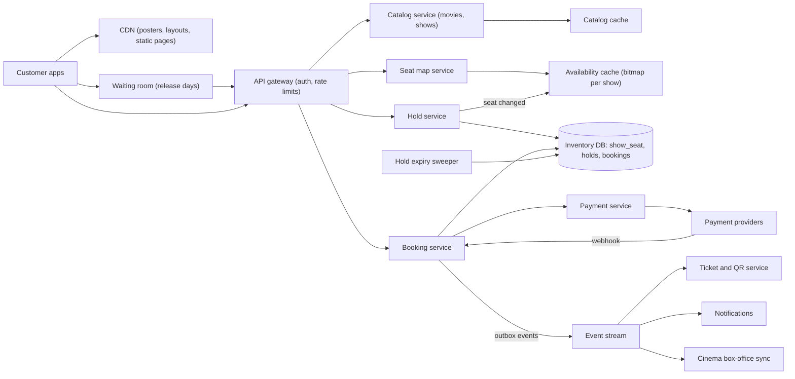
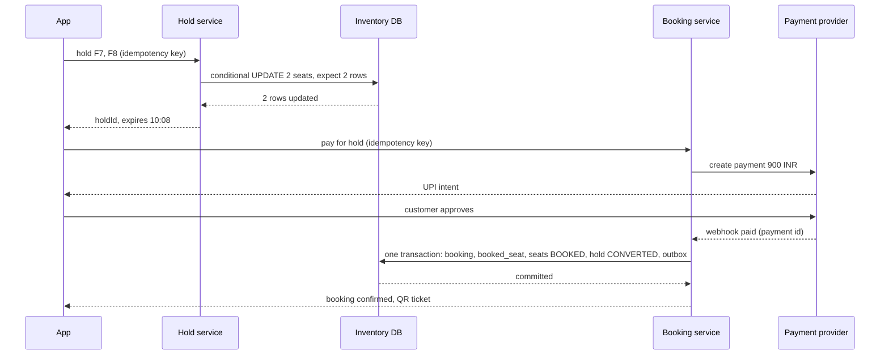
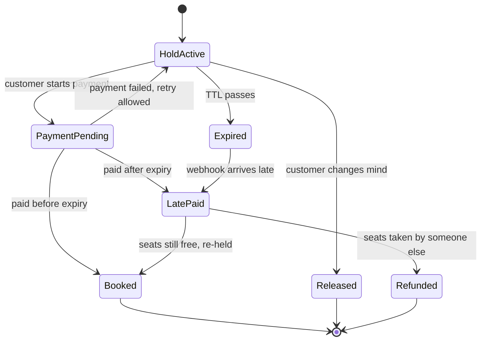

Booking a cinema seat sounds easy until two people tap seat F7 in the same second. One of them must get it and the other must be told immediately, before either has paid. Then the winner has a few minutes to pay, and the seat must stay theirs while the UPI app opens, but go back to everyone else if they wander off. And once a year a superstar's film opens bookings at 10 a.m., and a million fans arrive at once for a few hundred thousand seats.

This case study designs that system: seat maps, **seat holds with a time limit**, payments that time out or arrive late, and blockbuster releases. The data volumes are small compared with e-commerce or video; the interesting part is **concurrency on a small number of very contested rows**. It reasons from public engineering principles; nothing here claims to describe how BookMyShow, Paytm, Fandango or any cinema chain actually builds its systems.

## Learning objectives

By the end of this case study you will be able to:

1. Estimate normal and release-day load, and see why per-show contention, not total volume, drives the design.
2. Design all-or-nothing seat holds with a TTL, using conditional updates in PostgreSQL or atomic operations in Redis.
3. Make double booking impossible with a database constraint, independent of the hold logic.
4. Handle payment timeouts, late payments and retries with idempotency and a clear state machine.
5. Design a waiting room and admission control for high-demand releases.
6. Reason about seat-map caching, failures, security, cost and when a simpler design is enough.

## Prerequisites

- [Capacity estimation](#/lesson/m11-capacity-estimation): RPS and storage arithmetic.
- [Locking](#/lesson/m09-locking): row locks, optimistic and pessimistic concurrency.
- [Transactions and ACID](#/lesson/m09-transactions-acid): all-or-nothing updates.
- [Distributed locks and fencing tokens](#/lesson/m13-distributed-locks): why a lock with a timeout needs care.
- [Idempotency keys](#/lesson/m10-idempotency): safe retries for payments and bookings.

## Explain it like I'm a beginner

Picture the ticket counter of a single-screen cinema in Chennai on the morning a big film opens.

- On the wall is a **seat chart**: every seat drawn as a box. Green boxes are free, grey boxes are sold. That is the **seat map**.
- You point at F7 and F8. The clerk puts a **paper clip with the time written on it** on those two boxes: "Held for you until 10:08." Nobody else can buy F7 and F8 while the clip is there. That is a **seat hold with a TTL** (time to live).
- If you pay before 10:08, the clerk colours the boxes grey: **booked**. If you walk away, at 10:08 the clerk removes the clip and the seats are green again: the hold **expired**.
- If two people point at F7 at the same time, the clerk can only put one clip on the box. The second person hears "Sorry, F7 just went" **before** paying anything. That is **concurrency control**.
- On release day, the queue stretches around the block. The manager lets 20 people into the hall at a time so the counter isn't mobbed. That is a **waiting room**.

The software does the same thing for thousands of cinemas, with the clip being a database row or a Redis key and the clock being the server's.

## Requirements

### Functional

1. Browse movies, cinemas and showtimes by city and date.
2. View the seat map of a show with seat categories and prices (Recliner ₹450, Prime ₹250, Classic ₹180).
3. Select up to 10 seats and **hold** them for a limited time (say 8 minutes) while paying.
4. Pay (UPI, cards, wallets); on success, receive a booking with a QR-code ticket.
5. Holds expire automatically; payments that arrive late are handled without double booking.
6. Cancellations and refunds per the cinema's policy (e.g. up to 2 hours before the show, with a fee).
7. High-demand releases: fair access when demand far exceeds supply.
8. Cinemas manage screens, layouts and shows; some seats are sold at the box office through the same inventory.

### Non-functional

| Property | Target |
|---|---|
| Correctness | A seat is never sold twice for the same show; a customer is never charged without a booking or a refund |
| Hold latency | p95 under 300 ms from "select seats" to "held" |
| Seat map freshness | Within a few seconds of reality; the hold call is the real check |
| Availability | 99.95 %; release-day traffic must not break normal bookings for other films |
| Fairness | On release day, first come, first served at the waiting room, with bots filtered |
| Scale | 8,000 screens, ~40,000 shows/day, ~2 M tickets/day normally; release spikes of ~1 M users in minutes |

### Out of scope

Payments internals ([payment system case study](#/lesson/m17-payment-system)), food and beverage add-ons (they reuse the same checkout), recommendations, the cinema's projection and access-control systems.

## Capacity estimation

All figures are **estimates** for the arithmetic.

### Inventory

- **8,000 screens × 5 shows/day** = **40,000 shows/day**.
- **~250 seats per screen** (multiplexes vary from 100 to 400): 40,000 × 250 = **10 M seats on sale per day**.
- Seat rows to keep: 10 M/day; with 7 days of shows on sale at once, ≈ **70 M `show_seat` rows** live. At ~100 bytes each that's ≈ **7 GB**: small for PostgreSQL, comfortably partitioned by show date.

### Normal traffic

- **2 M tickets/day**, 2.5 tickets per booking ≈ **800,000 bookings/day** ÷ 86,400 ≈ **9 bookings/s** average.
- Evening and weekend peaks ×4: ≈ **37 bookings/s**.
- Seat map views: about 10 per booking (people compare shows and refresh): 8 M/day ≈ **93/s** average, ≈ **370/s** at peak.
- Browsing (movies, showtimes): perhaps 20 M requests/day ≈ **230/s** average; highly cacheable.

These numbers are modest. One well-tuned PostgreSQL primary could handle normal days alone.

### Release day: where it gets hard

- A superstar film opens bookings at 10:00 for its first weekend: **3,000 shows × 250 seats ≈ 750,000 seats**.
- **1 M fans** arrive within the first 5 minutes. Each session makes ~5 requests in that window (seat map loads, refreshes, hold attempts): 1 M × 5 ÷ 300 s ≈ **17,000 requests/s**, with the first minute perhaps 3× that ≈ **50,000 requests/s**.
- The real problem is **concentration**: the 10 most popular shows (first-day-first-show in big cities) might have 20,000 people each looking at the same 250 seats. That is **80 people per seat** competing for the same rows in the same seconds.

| Quantity | Estimate |
|---|---|
| Shows | ~40,000/day |
| Live seat rows | ~70 M (~7 GB) |
| Bookings | ~9/s avg, ~37/s peak |
| Seat map views | ~93/s avg, ~370/s peak |
| Release-day spike | ~17,000–50,000 requests/s for minutes |
| Contention on hot shows | ~80 people per seat |

**What breaks first?** On a normal day: nothing much. On release day: (1) the seat map endpoint, if every refresh queries the database, (2) row-lock contention on a hot show's seats, with connection pools filling while transactions wait, (3) the payment provider's throughput, and (4) **fairness**, as bots grab seats faster than humans.

## API design

```http
GET  /v1/cities/{city}/movies?date=2026-10-24
GET  /v1/movies/{movieId}/shows?city=chennai&date=2026-10-24
GET  /v1/shows/{showId}/seatmap                -> layout (long cache) + availability bitmap (1-2 s cache)

POST /v1/shows/{showId}/holds                  Idempotency-Key: 9c4e…
{ "seats": ["F7", "F8"] }
201 { "holdId": "h_51…", "seats": ["F7","F8"], "expiresAt": "2026-10-24T10:08:00Z", "amount": { "value": 900.00, "currency": "INR" } }
409 { "error": "SEATS_UNAVAILABLE", "seats": ["F7"] }

DELETE /v1/holds/{holdId}                      -> release (customer changed their mind)

POST /v1/holds/{holdId}/payments               Idempotency-Key: 2a7d…
{ "method": "upi" }
202 { "paymentId": "p_88…", "action": { "type": "upi_intent", "url": "upi://pay?…" } }

GET  /v1/bookings/{bookingId}                  -> status, seats, QR ticket
POST /v1/bookings/{bookingId}/cancel

GET  /v1/releases/{releaseId}/queue            -> waiting room position or admission token
```

Decisions:

- **The seat map is split.** The **layout** (rows, seat positions, categories, aisles) changes almost never and is cached for hours. The **availability** is a small bitmap (250 seats = 32 bytes) cached for 1–2 seconds or pushed. Stale availability is acceptable because the hold call is the real check.
- **A hold is a resource** with an id and an expiry. The client shows a countdown from `expiresAt` (server time, not the phone's clock).
- **`409 Conflict` names the seats that failed**, so the app can grey them out and let the customer pick others without reloading everything.
- **Idempotency keys** on holds and payments: a retry after a network blip returns the same hold or payment instead of creating a second one.
- **Payments attach to a hold.** The booking is created only when the payment succeeds, from the hold's seats.

## Data model

```sql
CREATE TABLE screen (
  screen_id     bigint PRIMARY KEY,
  cinema_id     bigint NOT NULL,
  name          text   NOT NULL,
  layout        jsonb  NOT NULL          -- rows, seat positions, aisles, categories: rendered by the app
);

CREATE TABLE show (
  show_id       bigint PRIMARY KEY,
  screen_id     bigint NOT NULL REFERENCES screen,
  movie_id      bigint NOT NULL,
  starts_at     timestamptz NOT NULL,
  sales_open_at timestamptz NOT NULL
);

CREATE TABLE show_seat (
  show_id       bigint NOT NULL REFERENCES show,
  seat_id       text   NOT NULL,                    -- 'F7'
  category      text   NOT NULL,
  price_paise   bigint NOT NULL,
  status        text   NOT NULL DEFAULT 'AVAILABLE' CHECK (status IN ('AVAILABLE','HELD','BOOKED','BLOCKED')),
  hold_id       uuid,
  held_until    timestamptz,
  booking_id    uuid,
  version       int    NOT NULL DEFAULT 1,
  PRIMARY KEY (show_id, seat_id),
  CHECK ((status = 'HELD') = (hold_id IS NOT NULL AND held_until IS NOT NULL)),
  CHECK ((status = 'BOOKED') = (booking_id IS NOT NULL))
);

CREATE TABLE seat_hold (
  hold_id       uuid PRIMARY KEY,
  show_id       bigint NOT NULL,
  customer_id   bigint NOT NULL,
  seat_count    int    NOT NULL CHECK (seat_count BETWEEN 1 AND 10),
  expires_at    timestamptz NOT NULL,
  status        text   NOT NULL CHECK (status IN ('ACTIVE','CONVERTED','RELEASED','EXPIRED'))
);
-- One active hold per customer per show: picking new seats replaces the old hold.
CREATE UNIQUE INDEX one_active_hold ON seat_hold (show_id, customer_id) WHERE status = 'ACTIVE';

CREATE TABLE booking (
  booking_id    uuid PRIMARY KEY,
  hold_id       uuid NOT NULL UNIQUE REFERENCES seat_hold,   -- one booking per hold
  customer_id   bigint NOT NULL,
  show_id       bigint NOT NULL,
  payment_id    text   NOT NULL UNIQUE,                       -- one booking per payment
  amount_paise  bigint NOT NULL,
  status        text   NOT NULL CHECK (status IN ('CONFIRMED','CANCELLED')),
  created_at    timestamptz NOT NULL DEFAULT now()
);

CREATE TABLE booked_seat (
  show_id       bigint NOT NULL,
  seat_id       text   NOT NULL,
  booking_id    uuid   NOT NULL REFERENCES booking,
  PRIMARY KEY (show_id, seat_id)                            -- a seat can be booked once. Full stop.
);
```

Why this shape:

- **`booked_seat` primary key `(show_id, seat_id)`** is the unbreakable rule. Whatever happens with holds, caches, Redis failovers or bugs, the database cannot store two bookings for F7 in show 501. Cancellation deletes the row (after recording it in an audit table) so the seat can be resold.
- **`show_seat` is the live inventory**: one row per seat per show, created when the show is scheduled. Status plus `hold_id` and `held_until` are the clip with the time on it. The CHECK constraints keep the columns consistent (a `HELD` seat always has a hold id and an expiry).
- **Holding is one conditional update** for all requested seats:

```sql
UPDATE show_seat
SET status = 'HELD', hold_id = $hold, held_until = now() + interval '8 minutes', version = version + 1
WHERE show_id = $show
  AND seat_id = ANY($seats)
  AND (status = 'AVAILABLE' OR (status = 'HELD' AND held_until <= now()));   -- expired holds count as free
-- If the updated row count is less than the number of seats requested, ROLLBACK: all or nothing.
```

  Expired holds are treated as available **in the WHERE clause**, so correctness never depends on a cleanup job running on time.
- **`seat_hold`** records who holds what and until when. The partial unique index enforces one active hold per customer per show, which stops one person (or bot) from hoarding many seats through parallel requests.
- **`booking.hold_id UNIQUE` and `payment_id UNIQUE`** make booking creation idempotent: a payment webhook delivered three times creates one booking.
- **Partitioning**: `show_seat` by show date (old shows are dropped as partitions), which keeps the hot table small.
- **`BLOCKED`** covers seats the cinema withholds (broken recliner, VIP quota, box-office allocation).

## High-level architecture



Every arrow:

1. **Apps → CDN.** Posters, trailers, screen layouts and static listing pages come from the edge.
2. **Apps → waiting room → gateway.** On release days, traffic for the hot film passes through a waiting room that admits users at a controlled rate; other films bypass it.
3. **Gateway → catalog → catalog cache.** Movies and showtimes are read-heavy and cached for minutes.
4. **Gateway → seat map service → availability cache.** The seat map combines the cached layout with an availability bitmap per show, refreshed from the hold service's change events or with a 1–2 s TTL.
5. **Gateway → hold service → inventory DB.** The hold service runs the all-or-nothing conditional update. On success it publishes "seats changed" so the availability cache updates.
6. **Gateway → booking service → payment service → providers.** Payment is attached to a hold; the provider's result arrives by redirect and by webhook.
7. **Booking service → inventory DB.** On payment success, one transaction inserts the booking and `booked_seat` rows, marks seats `BOOKED` and the hold `CONVERTED`, and writes an outbox event.
8. **Event stream → tickets, notifications, box office.** The QR ticket is generated, SMS/email sent, and the cinema's point-of-sale system learns the seats are gone.
9. **Sweeper → inventory DB.** Every few seconds, expired holds are marked `EXPIRED` and their seats returned to `AVAILABLE`; this is housekeeping, since the hold query already treats expired holds as free.

### Sequence: hold, pay, book



The hold is taken **before** any money moves, so a customer who loses the race for F7 is told in milliseconds and pays nothing. The booking transaction checks that the hold is still `ACTIVE` and unexpired; the `booked_seat` primary key is the final guard. The webhook (not the browser redirect) is the trusted signal, because a customer can close the browser after paying; both paths call the same idempotent "confirm" operation.

## Deep dives

### 1. Seat holds: three ways to put the clip on the box

**Option A: conditional update in PostgreSQL (the default).** The `UPDATE … WHERE status = 'AVAILABLE' OR expired` shown above, inside a transaction that checks the row count. Concurrent holds on the same seat serialise on the row lock: the second transaction waits for the first to commit, then re-checks the condition and matches nothing. Advantages: one source of truth, transactional with bookings, simple to reason about. Cost: on a hot show, many transactions queue on the same rows.

To avoid deadlocks when two customers request overlapping seat sets in different orders ({F7, F8} and {F8, F7}), always lock seats in a **consistent order** (sort the seat ids), or let the single `UPDATE … WHERE seat_id = ANY(...)` statement take the locks. A variant uses `SELECT … FOR UPDATE NOWAIT` on the sorted seats first, failing fast instead of waiting; on a hot show, failing fast and letting the customer pick again is better than queueing.

**Option B: Redis keys with expiry.** One key per seat: `SET hold:{show}:{seat} {holdId} NX PX 480000` (set only if absent, expire in 8 minutes). Multi-seat holds must be all-or-nothing, so use a Lua script that checks all keys and sets them only if all are free:

```lua
-- KEYS = seat keys, ARGV[1] = hold id, ARGV[2] = ttl ms
for i, key in ipairs(KEYS) do
  if redis.call('EXISTS', key) == 1 then return 0 end
end
for i, key in ipairs(KEYS) do
  redis.call('SET', key, ARGV[1], 'PX', ARGV[2])
end
return 1
```

Advantages: very fast, expiry is automatic, contention is handled in memory. Risks: Redis is now a second source of truth; a failover can lose recent keys (asynchronous replication), briefly allowing a second hold on the same seat. That's acceptable **only because the booking step re-checks in PostgreSQL** and `booked_seat` cannot hold duplicates. In other words, Redis may make a hold *optimistically wrong*, but it can never make a booking wrong.

**Option C: optimistic concurrency with versions.** Read seats with their `version`, then `UPDATE … WHERE version = $read`. Good when contention is low; on a hot show nearly every attempt conflicts and retries, so it performs worst exactly when it matters.

| | Conditional update (PG) | Redis + Lua | Optimistic versions |
|---|---|---|---|
| Normal days | Excellent | Excellent | Excellent |
| Hot show contention | Queues on row locks; use NOWAIT | Best | Retry storms |
| Expiry | In the WHERE clause + sweeper | Automatic TTL | In the WHERE clause |
| Failure risk | DB is the bottleneck | Failover can lose holds | Wasted work |
| Sources of truth | One | Two (re-check at booking) | One |

A common practical design: **PostgreSQL conditional updates by default, with Redis holds switched on only for shows flagged as high demand**, both protected by the same `booked_seat` constraint.

Here is the hold logic as an in-memory service. It shows the rules the SQL and Lua versions implement: all-or-nothing, lazy expiry, one active hold per customer, a seat limit, and confirmation only of an active hold.

```csharp file=Seats/ShowSeatInventory.cs
namespace Cinema.Seats;

public enum SeatStatus { Available, Held, Booked }

public sealed record SeatState(string SeatId, SeatStatus Status, Guid? HoldId, DateTimeOffset? HeldUntil);

public sealed record SeatHold(Guid HoldId, long ShowId, long CustomerId, IReadOnlyList<string> Seats, DateTimeOffset ExpiresAt);

public sealed record HoldAttempt(SeatHold? Hold, IReadOnlyList<string> Unavailable)
{
    public bool Succeeded => Hold is not null;
}

/// <summary>
/// One show's seats. Production: the show_seat conditional UPDATE (or a Redis Lua script for hot shows),
/// with the booked_seat primary key as the final guarantee.
/// </summary>
public sealed class ShowSeatInventory
{
    public const int MaxSeatsPerHold = 10;

    private readonly long _showId;
    private readonly TimeProvider _clock;
    private readonly TimeSpan _holdFor;
    private readonly Dictionary<string, SeatState> _seats;
    private readonly Dictionary<long, Guid> _activeHoldByCustomer = new();
    private readonly Dictionary<Guid, SeatHold> _holds = new();
    private readonly Lock _gate = new();

    public ShowSeatInventory(long showId, IEnumerable<string> seatIds, TimeProvider clock, TimeSpan holdFor)
    {
        _showId = showId;
        _clock = clock;
        _holdFor = holdFor;
        _seats = seatIds.ToDictionary(s => s, s => new SeatState(s, SeatStatus.Available, null, null));
    }

    public HoldAttempt TryHold(long customerId, IReadOnlyList<string> requested)
    {
        var seats = requested.Distinct().OrderBy(s => s, StringComparer.Ordinal).ToList();   // consistent order
        if (seats.Count is 0 or > MaxSeatsPerHold)
            throw new ArgumentOutOfRangeException(nameof(requested), $"Hold 1-{MaxSeatsPerHold} seats.");

        lock (_gate)
        {
            var now = _clock.GetUtcNow();
            _activeHoldByCustomer.TryGetValue(customerId, out var previousHold);

            // A seat is free if available, expired, or held by this customer's own previous hold (re-selection).
            var unavailable = seats.Where(id => !_seats.TryGetValue(id, out var s) || !IsFreeFor(s, now, previousHold)).ToList();
            if (unavailable.Count > 0) return new HoldAttempt(null, unavailable);

            if (previousHold != Guid.Empty) ReleaseLocked(previousHold);                 // new selection replaces old

            var hold = new SeatHold(Guid.NewGuid(), _showId, customerId, seats, now + _holdFor);
            foreach (var id in seats) _seats[id] = new SeatState(id, SeatStatus.Held, hold.HoldId, hold.ExpiresAt);
            _holds[hold.HoldId] = hold;
            _activeHoldByCustomer[customerId] = hold.HoldId;
            return new HoldAttempt(hold, []);
        }
    }

    /// <summary>Payment succeeded. Only an active, unexpired hold can become a booking.</summary>
    public bool TryConfirm(Guid holdId)
    {
        lock (_gate)
        {
            if (!IsActiveLocked(holdId, _clock.GetUtcNow(), out var hold)) return false;
            foreach (var id in hold.Seats) _seats[id] = new SeatState(id, SeatStatus.Booked, null, null);
            _holds.Remove(holdId);
            _activeHoldByCustomer.Remove(hold.CustomerId);
            return true;
        }
    }

    public bool Release(Guid holdId)
    {
        lock (_gate)
        {
            if (!IsActiveLocked(holdId, _clock.GetUtcNow(), out _)) return false;
            ReleaseLocked(holdId);
            return true;
        }
    }

    public SeatStatus StatusOf(string seatId)
    {
        lock (_gate)
        {
            var s = _seats[seatId];
            return s.Status == SeatStatus.Held && s.HeldUntil <= _clock.GetUtcNow() ? SeatStatus.Available : s.Status;
        }
    }

    public int AvailableCount()
    {
        lock (_gate)
        {
            var now = _clock.GetUtcNow();
            return _seats.Values.Count(s => IsFreeFor(s, now, Guid.Empty));
        }
    }

    private static bool IsFreeFor(SeatState s, DateTimeOffset now, Guid ownHold) =>
        s.Status == SeatStatus.Available ||
        (s.Status == SeatStatus.Held && (s.HeldUntil <= now || (ownHold != Guid.Empty && s.HoldId == ownHold)));

    private bool IsActiveLocked(Guid holdId, DateTimeOffset now, out SeatHold hold)
    {
        if (!_holds.TryGetValue(holdId, out hold!)) return false;
        if (hold.ExpiresAt > now) return true;
        ReleaseLocked(holdId);                                                           // lazy expiry
        return false;
    }

    private void ReleaseLocked(Guid holdId)
    {
        if (!_holds.Remove(holdId, out var hold)) return;
        foreach (var id in hold.Seats)
            if (_seats[id].HoldId == holdId) _seats[id] = new SeatState(id, SeatStatus.Available, null, null);
        if (_activeHoldByCustomer.TryGetValue(hold.CustomerId, out var current) && current == holdId)
            _activeHoldByCustomer.Remove(hold.CustomerId);
    }
}
```

Notice three details. Seat ids are **sorted** before locking (in SQL, this is what prevents deadlocks). A customer re-selecting seats may keep seats from their own previous hold, so changing F7+F8 to F8+F9 doesn't fail on F8. And an expired hold **can't be confirmed**, even if its seats happen to still be free: the booking step must re-hold explicitly, which is the late-payment path below.

### 2. Choosing the hold duration

The TTL is a trade-off between two kinds of unhappy customer:

- **Too short** (2 minutes): people paying through a UPI app, entering card OTPs or switching apps lose their seats mid-payment.
- **Too long** (20 minutes): abandoned holds keep seats away from real buyers. On release day, a bot holding 10 seats per account for 20 minutes is a disaster.

A practical design: **8 minutes by default**, shown as a countdown; the hold is **extended once** (say by 3 minutes) when payment has been initiated and the provider reports it as pending; **shorter holds (4–5 minutes) on high-demand shows**, plus one active hold per customer and a 10-seat limit. Measure "hold → paid" conversion and "paid after expiry" rates to tune it.

### 3. Payment timeouts and late payments

Payment providers are asynchronous. A UPI collect request can take minutes; a card 3-D Secure page may be abandoned; webhooks can arrive late or more than once. The booking flow must handle every ordering of "hold expires" and "payment succeeds".



Reading the diagram:

- **Paid before expiry**: the normal path. One transaction converts the hold into a booking.
- **Payment failed**: the hold stays active until its expiry, so the customer can retry with another method without losing seats.
- **Paid after expiry (late payment)**: the money has moved, but the seats may have gone. The booking service tries to re-hold the **same seats**; if they're still free (common on normal days), it books them. If not, it refunds automatically and tells the customer clearly. It never books different seats without asking.
- **Every arrow is idempotent.** The payment id is unique on the booking; a webhook delivered twice finds the booking already exists and returns success.
- **Reconciliation.** A job queries the provider for payments stuck in pending and for paid payments with no booking or refund, and resolves each one. This catches lost webhooks.

```csharp file=Booking/BookingService.cs
using System.Collections.Concurrent;
using Cinema.Seats;

namespace Cinema.Booking;

public enum BookingOutcome { Booked, AlreadyBooked, RefundIssued, UnknownHold }

public sealed record BookingResult(BookingOutcome Outcome, Guid? BookingId);

public interface IRefunds
{
    Task RefundAsync(string paymentId, string reason, CancellationToken ct);
}

public sealed class LoggingRefunds : IRefunds
{
    public ConcurrentQueue<string> Issued { get; } = new();
    public Task RefundAsync(string paymentId, string reason, CancellationToken ct)
    {
        Issued.Enqueue($"{paymentId}:{reason}");
        return Task.CompletedTask;
    }
}

/// <summary>
/// Handles "payment succeeded" for a hold, whether it arrives on time, late, or more than once.
/// Production: one PostgreSQL transaction with booking.payment_id UNIQUE and booked_seat (show_id, seat_id) PRIMARY KEY.
/// </summary>
public sealed class BookingService(IRefunds refunds)
{
    private readonly ConcurrentDictionary<string, BookingResult> _byPayment = new();
    private readonly Lock _gate = new();

    public async Task<BookingResult> OnPaymentSucceededAsync(ShowSeatInventory show, SeatHold hold, string paymentId, CancellationToken ct)
    {
        if (_byPayment.TryGetValue(paymentId, out var earlier))
            return earlier with { Outcome = BookingOutcome.AlreadyBooked };                 // duplicate webhook

        BookingResult result;
        lock (_gate)
        {
            if (_byPayment.TryGetValue(paymentId, out earlier)) return earlier with { Outcome = BookingOutcome.AlreadyBooked };

            if (show.TryConfirm(hold.HoldId))
                result = new BookingResult(BookingOutcome.Booked, Guid.NewGuid());
            else
            {
                // Late payment: try to re-hold exactly the same seats, then confirm immediately.
                var retry = show.TryHold(hold.CustomerId, hold.Seats);
                result = retry.Succeeded && show.TryConfirm(retry.Hold!.HoldId)
                    ? new BookingResult(BookingOutcome.Booked, Guid.NewGuid())
                    : new BookingResult(BookingOutcome.RefundIssued, null);
            }
            _byPayment[paymentId] = result;
        }

        if (result.Outcome == BookingOutcome.RefundIssued)
            await refunds.RefundAsync(paymentId, "seats_no_longer_available", ct);            // production: via outbox
        return result;
    }
}
```

### 4. Seat maps under load

On release day, 20,000 people refreshing one show's seat map every few seconds would be thousands of queries per second on the same 250 rows, competing with the holds themselves. Instead:

- **Layout** (positions, categories, prices) is static JSON per screen, cached at the CDN.
- **Availability** is a bitmap per show: 250 seats → 250 bits → 32 bytes. Kept in a cache (a Redis string with `SETBIT`/`GETBIT`, or an in-memory map in the seat map service), updated on every hold, release, expiry and booking event.
- **Reads** return the bitmap with a 1–2 s cache TTL at the edge, or the app subscribes over Server-Sent Events and gets diffs ("F7, F8 now held").
- The seat map can be **slightly wrong**. That is fine: the hold is the real check, and the app greys out seats named in a `409` immediately.

This turns 20,000 readers of one show into **one cache key**, read at memory speed, and keeps the database free for holds.

### 5. High-demand releases: the waiting room

Even with holds and bitmaps, letting 1 M people loose at 10:00 means 50,000 requests/s and 80 people fighting for each seat on hot shows. Most will fail repeatedly and retry, multiplying load (a [retry storm](#/lesson/m13-retry-storms)). A **waiting room** turns the crowd into an orderly queue:

1. Before 10:00, users land on a static waiting page (CDN). At 10:00, each gets a **random or arrival-ordered position** and a signed queue token.
2. An admission controller lets users through at a rate the booking path can handle (say 3,000/minute per hot show cluster), issuing a short-lived **access token** (a signed JWT with an expiry of 10–15 minutes) that the gateway checks on hold and payment calls for that film.
3. The page shows position and an estimate ("about 6 minutes"), refreshed every 15–30 seconds from a cheap endpoint.
4. When the film's shows are sold out, the waiting room says so and stops admitting.

Randomising positions among everyone who arrived before 10:00 is fairer than "whoever's script was fastest at 09:59:59.999", and it removes the incentive to hammer the site early.

```csharp file=Queue/WaitingRoom.cs
using System.Collections.Concurrent;

namespace Cinema.Queue;

public enum QueueStatus { Waiting, Admitted, NotInQueue }

public sealed record QueuePosition(QueueStatus Status, int? Position);

/// <summary>
/// A FIFO waiting room with a controlled admission rate. Production: a queue service or Redis sorted set,
/// with signed access tokens checked by the gateway.
/// </summary>
public sealed class WaitingRoom
{
    private readonly LinkedList<long> _queue = new();
    private readonly Dictionary<long, LinkedListNode<long>> _nodes = new();
    private readonly ConcurrentDictionary<long, DateTimeOffset> _admittedUntil = new();
    private readonly TimeProvider _clock;
    private readonly TimeSpan _accessWindow;
    private readonly Lock _gate = new();

    public WaitingRoom(TimeProvider clock, TimeSpan accessWindow)
    {
        _clock = clock;
        _accessWindow = accessWindow;
    }

    public QueuePosition Join(long userId)
    {
        if (IsAdmitted(userId)) return new(QueueStatus.Admitted, null);
        lock (_gate)
        {
            if (!_nodes.ContainsKey(userId)) _nodes[userId] = _queue.AddLast(userId);   // joining twice keeps your place
            return new(QueueStatus.Waiting, PositionLocked(userId));
        }
    }

    /// <summary>Called by a timer: admit the next <paramref name="count"/> users.</summary>
    public int AdmitNext(int count)
    {
        var until = _clock.GetUtcNow() + _accessWindow;
        var admitted = 0;
        lock (_gate)
        {
            while (admitted < count && _queue.First is { } first)
            {
                _queue.RemoveFirst();
                _nodes.Remove(first.Value);
                _admittedUntil[first.Value] = until;
                admitted++;
            }
        }
        return admitted;
    }

    public bool IsAdmitted(long userId) =>
        _admittedUntil.TryGetValue(userId, out var until) && until > _clock.GetUtcNow();

    public QueuePosition StatusOf(long userId)
    {
        if (IsAdmitted(userId)) return new(QueueStatus.Admitted, null);
        lock (_gate)
            return _nodes.ContainsKey(userId) ? new(QueueStatus.Waiting, PositionLocked(userId)) : new(QueueStatus.NotInQueue, null);
    }

    private int PositionLocked(long userId)
    {
        var position = 1;
        for (var node = _queue.First; node is not null && node.Value != userId; node = node.Next) position++;
        return position;   // O(n) for clarity; production keeps a sequence number per user
    }
}
```

### 6. Box office and partner channels

Cinemas also sell tickets at the counter and possibly through other apps. If each channel has its own inventory, double booking is guaranteed. Options:

- **One inventory, many channels**: the box-office terminal calls the same hold and booking API. Simple and strongly consistent; needs the cinema's network to be reliable.
- **Allocations**: each channel gets a block of seats (the box office keeps rows A–B), released back to the common pool a few hours before the show. Works offline, wastes some inventory.

Most designs combine them: online sync by default, with a small offline allocation for when the cinema's internet fails, reconciled when it returns. The same problem, at larger scale, is the core of the [hotel reservation case study](#/lesson/m17-hotel-reservation).

## Caching, queues and scaling

**Caching.**

- **CDN**: posters, trailers, screen layouts, static listing pages and the waiting-room page.
- **Catalog cache**: movies and showtimes per city and date, minutes of TTL, invalidated on schedule changes.
- **Availability bitmaps** per show, updated from seat events, 1–2 s edge TTL.
- **Never cache** the hold decision or booking confirmation.

**Queues and streams.**

- **Outbox → event stream** for bookings and cancellations; consumers: ticket/QR generation, notifications, box-office sync, analytics.
- **Seat change events** (held, released, booked) to update availability bitmaps.
- **Waiting room** queue for high-demand releases.
- **Refund jobs** for late payments and cancellations, retried with idempotency keys.

**Scaling.**

- The inventory database is small; scale it for **contention**, not size. Partition `show_seat` by date; if one primary is not enough, shard by `cinema_id` or region (a show never spans cinemas, so holds and bookings stay on one shard).
- Hold and booking services are stateless and scale horizontally; the database row locks are the serialisation point, which is exactly what we want.
- For hot shows, switch to Redis holds (option B) and shorter TTLs; keep the booking transaction in PostgreSQL.
- **Bulkhead** the release: separate rate limits, waiting room and possibly separate service instances for the hot film, so a stampede for one movie doesn't slow bookings for others ([bulkheads](#/lesson/m10-bulkhead)).

## Failure handling

| Failure | Effect | Mitigation |
|---|---|---|
| Two customers hold F7 at once | Double hold | Conditional update serialises on the row; one gets `409` |
| Overlapping multi-seat holds | Deadlock | Lock seats in sorted order, or one `UPDATE … ANY` statement; `NOWAIT` on hot shows |
| Sweeper stops | Expired seats look held | Expiry is part of the hold `WHERE` clause; sweeper is housekeeping; alert on age of expired holds |
| Payment succeeds after hold expired | Paid, no seats | Re-hold same seats or refund automatically; reconciliation job |
| Webhook delivered three times | Three bookings | `booking.payment_id UNIQUE`; idempotent confirm |
| Webhook never arrives | Paid, no booking | Reconciliation polls provider for pending/paid-without-booking |
| Redis hold store fails over | Recent holds lost | Booking re-checks in PostgreSQL; `booked_seat` PK prevents double booking |
| Release-day stampede | Timeouts everywhere | Waiting room, rate limits, bitmap cache, bulkheaded infrastructure |
| Cinema POS offline | Box office can't sell | Offline allocation, reconciled on reconnect |
| Show cancelled (projector failure) | Many refunds | Bulk refund job via outbox; notify customers; idempotent per booking |

:::callout type=mistake title="Trusting the lock with a timeout"
A hold is a lock with a timeout, and locks with timeouts can be lost: the TTL passes during a long GC pause, Redis fails over, a clock is skewed. If the booking step trusts "I hold the lock" without re-checking, two customers can end up with F7. The fix is the same idea as fencing tokens in [distributed locks](#/lesson/m13-distributed-locks): the final write (the booking) re-validates in the source of truth, and a uniqueness constraint makes the forbidden state unrepresentable.
:::

## Security

- **Bots and scalping** are the main threat on release days. Login required, one active hold per customer per show, 10 seats per booking, per-account and per-device rate limits, CAPTCHA or challenges when behaviour looks automated, and cancellation of bookings tied to abusive patterns. Use ASP.NET Core's [rate limiting middleware](#/lesson/m10-rate-limiting) with partitioned limiters per user and per IP.
- **Signed waiting-room tokens** (short-lived JWTs bound to the user) so admission can't be forged or shared.
- **Hold hoarding**: limits per customer and shorter TTLs for hot shows; repeated hold-and-abandon patterns lower an account's limits.
- **Payments**: hosted payment pages or SDKs, verified webhook signatures, amounts computed server-side from the hold.
- **Tickets**: QR codes contain a signed booking reference (not just a guessable id), validated at the cinema entrance; a ticket can be scanned once.
- **Privacy**: phone numbers and emails are personal data; minimise what cinemas see and set retention limits.

## Observability

- **Hold metrics**: hold attempts, success rate, `409` rate per show (a high rate means a hot show or a stale seat map), hold latency p95, lock wait time in the database.
- **Conversion**: hold → payment started → paid → booked; abandoned holds; average time to pay.
- **Payment timing**: paid-after-expiry count, refunds issued for late payments, webhook delay, reconciliation fixes per hour (should trend to zero).
- **Release day**: waiting room size, admission rate, time in queue, sold-out time per show, bot challenges served.
- **Database**: lock waits, deadlocks (should be zero), connection pool saturation on the hold service.
- **Correctness alarm**: any attempt to insert a duplicate `booked_seat` is logged and alerted; it means a bug upstream was caught by the constraint.

## Deployment and cost

**Deployment.** Avoid deploying the hold and booking services during evening peaks and never during a scheduled release. Release days are planned like events: pre-scaled infrastructure, the waiting room configured for the film, feature flags for Redis holds on flagged shows, a load test the week before, and a war room with dashboards. Schema changes to `show_seat` use expand-and-contract migrations because the table is always hot.

**Cost drivers** (relative, estimates):

1. **Release-day peak capacity**: mostly idle the rest of the year; use autoscaling with scheduled pre-scaling rather than permanent capacity.
2. **CDN** for posters, trailers and static pages.
3. **Payment fees**, far larger than infrastructure.
4. **Notifications** (SMS for tickets).
5. **The database** is a small cost: ~7 GB of live inventory.

### When a simpler design is enough

A single multiplex chain with 60 screens (300 shows/day, a few thousand bookings/day) needs one ASP.NET Core app and one PostgreSQL database. Holds are the conditional `UPDATE`, expiry is in the `WHERE` clause, `booked_seat`'s primary key prevents double booking, and a `BackgroundService` runs the sweeper and payment reconciliation. Seat maps can be read straight from the database with a one-second in-memory cache. Add Redis holds and a waiting room only if the chain starts running hyped premieres with tens of thousands of concurrent users.

## Alternatives and trade-offs

| Decision | Choice here | Alternative | When the alternative wins |
|---|---|---|---|
| Hold store | PostgreSQL conditional update | Redis keys with TTL + Lua | Hot shows with extreme contention |
| Hold store | Conditional update | Optimistic versions | Low contention, simple CRUD stacks |
| Expiry | Checked in the hold query + sweeper | Sweeper only | Never; correctness shouldn't depend on a job's schedule |
| Hold TTL | 8 min, extend once on pending payment | Fixed long TTL | Payment methods with slow confirmation and low demand |
| Late payment | Re-hold same seats or auto-refund | Always refund | Simpler support policy; worse customer experience |
| Release day | Waiting room with randomised start | Open free-for-all | Small releases; the waiting room adds friction |
| Release day | Waiting room | Pre-registration lottery | Extremely scarce events (concert-style), fairness over speed |
| Seat map | Bitmap cache, 1–2 s | Live DB query | Small cinemas with little traffic |
| Box office | Same inventory via API | Fixed allocations | Unreliable cinema connectivity |

The essential trade-off: **use fast, forgiving mechanisms (cached seat maps, Redis holds, TTLs) to keep the experience smooth, and a single strict mechanism (the booking transaction and the `booked_seat` key) to keep it correct.** If the fast layer is ever wrong, a customer sees "sorry, that seat just went" or receives an automatic refund; they never share a seat.

```csharp file=Program.cs
using System.Collections.Concurrent;
using Cinema.Booking;
using Cinema.Queue;
using Cinema.Seats;

var builder = WebApplication.CreateBuilder(args);
builder.Services.AddSingleton(TimeProvider.System);
builder.Services.AddSingleton<LoggingRefunds>();
builder.Services.AddSingleton<IRefunds>(sp => sp.GetRequiredService<LoggingRefunds>());
builder.Services.AddSingleton<BookingService>();
builder.Services.AddSingleton(sp => new WaitingRoom(sp.GetRequiredService<TimeProvider>(), TimeSpan.FromMinutes(15)));
builder.Services.AddSingleton<ConcurrentDictionary<long, ShowSeatInventory>>();
builder.Services.AddSingleton<ConcurrentDictionary<Guid, SeatHold>>();

var app = builder.Build();

ShowSeatInventory ShowFor(long showId, ConcurrentDictionary<long, ShowSeatInventory> shows, TimeProvider clock) =>
    shows.GetOrAdd(showId, id => new ShowSeatInventory(id,
        from row in "ABCDEFGHIJ" from n in Enumerable.Range(1, 25) select $"{row}{n}",   // demo: 250 seats
        clock, TimeSpan.FromMinutes(8)));

app.MapGet("/v1/shows/{showId:long}/availability", (long showId, ConcurrentDictionary<long, ShowSeatInventory> shows, TimeProvider clock) =>
    Results.Ok(new { showId, available = ShowFor(showId, shows, clock).AvailableCount() }));

app.MapPost("/v1/shows/{showId:long}/holds", (long showId, HoldRequest body, ConcurrentDictionary<long, ShowSeatInventory> shows,
    ConcurrentDictionary<Guid, SeatHold> holds, TimeProvider clock) =>
{
    try
    {
        var attempt = ShowFor(showId, shows, clock).TryHold(body.CustomerId, body.Seats);
        if (!attempt.Succeeded) return Results.Conflict(new { error = "SEATS_UNAVAILABLE", seats = attempt.Unavailable });
        holds[attempt.Hold!.HoldId] = attempt.Hold;
        return Results.Created($"/v1/holds/{attempt.Hold.HoldId}", attempt.Hold);
    }
    catch (ArgumentOutOfRangeException ex) { return Results.BadRequest(new { error = ex.Message }); }
});

// The payment provider's webhook (signature verification omitted in this demo).
app.MapPost("/v1/webhooks/payments", async (PaymentWebhook body, ConcurrentDictionary<long, ShowSeatInventory> shows,
    ConcurrentDictionary<Guid, SeatHold> holds, BookingService bookings, TimeProvider clock, CancellationToken ct) =>
{
    if (!holds.TryGetValue(body.HoldId, out var hold)) return Results.Ok(new { outcome = BookingOutcome.UnknownHold.ToString() });
    var result = await bookings.OnPaymentSucceededAsync(ShowFor(hold.ShowId, shows, clock), hold, body.PaymentId, ct);
    return Results.Ok(new { outcome = result.Outcome.ToString(), result.BookingId });
});

app.MapPost("/v1/releases/{releaseId}/queue", (string releaseId, long userId, WaitingRoom room) => Results.Ok(room.Join(userId)));

app.Run();

public sealed record HoldRequest(long CustomerId, List<string> Seats);
public sealed record PaymentWebhook(Guid HoldId, string PaymentId);
```

## Practical playground

The starting graph is a first version: one booking app and one database. Every seat map refresh queries the database and every hold runs a transaction there. Open it in the HLD canvas.

1. Set client traffic to 50,000 RPS (release-day first minute). Which node saturates first?
2. Add a `cdn` for layouts and a `cache` for availability bitmaps. How many requests now reach the database?
3. Add a `rate-limiter` and a `queue` (waiting room) in front of holds for the hot film.
4. Add an `external` payment provider with an async webhook edge back to a booking service, a `stream` for booking events and a `scheduler` for the hold sweeper and reconciliation. Where is double booking ultimately prevented?

:::playground type=hld title="From one booking app to a release-day-ready system"
```json
{
  "nodes": [
    { "id": "c", "type": "client", "label": "Movie fans", "props": { "rps": 50000 } },
    { "id": "lb", "type": "load-balancer", "label": "Load balancer" },
    { "id": "app", "type": "app-server", "label": "Booking app (seat maps, holds, payments)", "props": { "instances": 4 } },
    { "id": "db", "type": "database", "label": "PostgreSQL (shows, seats, bookings)", "props": { "replicas": 1 } }
  ],
  "edges": [
    { "from": "c", "to": "lb", "kind": "sync" },
    { "from": "lb", "to": "app", "kind": "sync" },
    { "from": "app", "to": "db", "kind": "sync", "label": "seat map SELECT + hold UPDATE" }
  ]
}
```
:::

## Exercises

:::exercise id=m17-movie-booking-ex1 difficulty=beginner kind=written title="Size a blockbuster opening"
A ticketing platform lists 6,000 screens with an average of 220 seats and 4 shows/day. Normally it sells 1.2 M tickets/day at 2.4 tickets per booking. For a big release, bookings open at 09:00 for 2,500 shows; 800,000 users arrive in the first 4 minutes, each making 6 requests in that window. The 5 hottest shows each attract 12,000 users.

1. Compute seats on sale per day and normal bookings/s (average).
2. Compute the release-day request rate over the first 4 minutes.
3. Compute seats available in the release and the users-per-seat ratio on a hottest show (220 seats).
4. Estimate how many hold attempts per second a hottest show sees if each of its users makes one hold attempt every 20 s during the first 4 minutes.
5. Name the first component to protect and how.
::acceptance
- Shows each division with units.
- Separates total release load from per-show contention.
- Gives a concrete protection mechanism tied to the numbers.
::hint
Seats/day = screens × seats × shows. Bookings/day = tickets ÷ 2.4.
::hint
Release rate = users × requests ÷ 240 s.
::hint
Per-show hold attempts = 12,000 users ÷ 20 s.
::hint
Which requests could be served without the database, and which can't?
::solution
1. Seats: 6,000 × 220 × 4 = **5.28 M seats/day**. Bookings: 1.2 M ÷ 2.4 = 500,000/day ÷ 86,400 ≈ **5.8 bookings/s**.
2. Release: 800,000 × 6 ÷ 240 s = **20,000 requests/s**.
3. Release seats: 2,500 × 220 = **550,000**. Hot show ratio: 12,000 ÷ 220 ≈ **55 users per seat**.
4. Hold attempts on one hot show: 12,000 ÷ 20 ≈ **600/s** on 220 rows. Most will fail after the first few seconds because the seats are gone.
5. Protect the **inventory database from per-show contention**: serve seat maps from a bitmap cache (20,000 req/s of seat map loads become cache reads), and put a **waiting room** in front of holds for the release so admitted users arrive at a rate the hold path can serve. For the 5 hottest shows, enable Redis holds with a short TTL; bookings still commit in PostgreSQL with the `booked_seat` key.
::mistakes
- Computing only the total load (which looks manageable) and missing the per-show concentration.
- Assuming the database is too small, when its size (a few GB) is irrelevant and contention is the issue.
:::

:::exercise id=m17-movie-booking-ex2 difficulty=beginner kind=sql ordered=true title="Which seats can be held right now?"
For show 501 at `2026-10-19 18:00:00+00`, list the seats a customer can hold: seats that are `AVAILABLE`, or `HELD` with a hold that has expired (`held_until <= now`, because a hold is valid only while `now < held_until`). Return `seat_row` and `seat_no`, ordered by row then number.
::setup
```sql
CREATE TABLE show_seat (
  show_id    bigint NOT NULL,
  seat_row   text   NOT NULL,
  seat_no    int    NOT NULL,
  status     text   NOT NULL,
  held_until timestamptz,
  PRIMARY KEY (show_id, seat_row, seat_no)
);
INSERT INTO show_seat VALUES
  (501, 'A', 1, 'BOOKED',    NULL),
  (501, 'A', 2, 'AVAILABLE', NULL),
  (501, 'A', 3, 'HELD',      '2026-10-19 18:03:00+00'),
  (501, 'A', 4, 'HELD',      '2026-10-19 17:59:00+00'),
  (501, 'B', 1, 'AVAILABLE', NULL),
  (501, 'B', 2, 'HELD',      '2026-10-19 18:00:00+00'),
  (501, 'B', 3, 'BOOKED',    NULL),
  (501, 'B', 4, 'BLOCKED',   NULL),
  (502, 'A', 1, 'AVAILABLE', NULL);
```
::check
```sql
SELECT seat_row, seat_no
FROM show_seat
WHERE show_id = 501
  AND (status = 'AVAILABLE'
       OR (status = 'HELD' AND held_until <= TIMESTAMPTZ '2026-10-19 18:00:00+00'))
ORDER BY seat_row, seat_no;
```
::acceptance
- Returns A2, A4, B1, B2 in that order.
- A3 is excluded (hold still active); A1 and B3 (booked) and B4 (blocked) are excluded.
- B2's hold ends exactly at 18:00:00, so it counts as expired.
- Show 502's seat is excluded.
::hint
Two kinds of holdable seat: available ones, and held ones whose hold has ended.
::hint
Parenthesise the `OR` so the `show_id` filter applies to both branches.
::hint
A hold is valid while `now < held_until`, so it is expired when `held_until <= now`.
::hint
Use the fixed timestamp instead of `now()` for a reproducible answer.
::solution
```sql
SELECT seat_row, seat_no
FROM show_seat
WHERE show_id = 501
  AND (status = 'AVAILABLE'
       OR (status = 'HELD' AND held_until <= TIMESTAMPTZ '2026-10-19 18:00:00+00'))
ORDER BY seat_row, seat_no;
```
The same predicate goes into the hold `UPDATE`'s `WHERE` clause, so expired holds are free even if the sweeper hasn't run. Choosing `<=` versus `<` is a definition, not a detail: the hold service, the booking service and this query must all use the same rule, or a seat can be "expired" for one and "held" for another at exactly 18:00:00.
::mistakes
- Forgetting the parentheses, so `OR status = 'HELD' …` matches seats from other shows.
- Using `<` here while the hold service uses `<=` (or vice versa), creating a one-instant disagreement.
- Treating `BLOCKED` seats as available.
:::

:::exercise id=m17-movie-booking-ex3 difficulty=intermediate kind=code title="All-or-nothing seat holds with a TTL"
Implement `SeatHolds` for one show:

- The constructor takes the show's seat ids, a `TimeProvider` and the hold duration.
- `TryHold(customerId, seats)` holds **all** requested seats or **none**. It returns a `HoldResult` with a `HoldId` on success, or the list of seats that were unavailable. Seats are unavailable if unknown, booked, or held by an **active** hold (expired holds are free).
- More than 6 seats, or an empty list, throws `ArgumentOutOfRangeException`. Duplicate seat ids in one request count once.
- A customer may have only **one active hold**: a successful new hold releases their previous one.
- `Confirm(holdId)` books the seats of an **active** hold and returns `true`; `false` for unknown, expired, released or already confirmed holds.
- `Release(holdId)` frees an active hold.
- `StateOf(seat)` returns `Available`, `Held` or `Booked` (an expired hold shows as `Available`).
::acceptance
- Holding F7+F8 when F8 is taken returns failure listing F8 and leaves F7 available.
- A hold expires exactly at its TTL; its seats can then be held by someone else, and the old hold can't be confirmed.
- A second hold by the same customer releases their first hold's seats.
- Under 200 parallel attempts on the same seat, exactly one succeeds.
::hint
Keep `seat → (state, holdId, expiresAt)` and `holdId → (customerId, seats, expiresAt)`.
::hint
Check every seat first; only if all are free, mark them all. That is all-or-nothing.
::hint
A seat is free if `Available`, or `Held` with `now >= expiresAt`.
::hint
Use one lock per show for every public method; contention is per show, so this is the right granularity.
::starter
```csharp file=SeatHolds.cs
using System;
using System.Collections.Generic;

public enum SeatState { Available, Held, Booked }

public sealed record HoldResult(Guid? HoldId, IReadOnlyList<string> Unavailable)
{
    public bool Ok => HoldId is not null;
}

public sealed class SeatHolds
{
    public SeatHolds(IEnumerable<string> seats, TimeProvider clock, TimeSpan holdFor) { }

    public HoldResult TryHold(long customerId, IReadOnlyList<string> seats) => throw new NotImplementedException();
    public bool Confirm(Guid holdId) => throw new NotImplementedException();
    public bool Release(Guid holdId) => throw new NotImplementedException();
    public SeatState StateOf(string seat) => throw new NotImplementedException();
}
```
::tests
```csharp file=SeatHoldsTests.cs
using System;
using System.Linq;
using Xunit;

public sealed class TestClock : TimeProvider
{
    public DateTimeOffset Now { get; set; } = new(2026, 10, 24, 10, 0, 0, TimeSpan.Zero);
    public override DateTimeOffset GetUtcNow() => Now;
}

public class SeatHoldsTests
{
    private static readonly string[] Seats = ["F6", "F7", "F8", "F9", "G1", "G2", "G3", "G4"];

    private static (SeatHolds Holds, TestClock Clock) Make()
    {
        var clock = new TestClock();
        return (new SeatHolds(Seats, clock, TimeSpan.FromMinutes(8)), clock);
    }

    [Fact]
    public void All_or_nothing()
    {
        var (h, _) = Make();
        Assert.True(h.TryHold(1, ["F8"]).Ok);
        var r = h.TryHold(2, ["F7", "F8"]);
        Assert.False(r.Ok);
        Assert.Equal(new[] { "F8" }, r.Unavailable);
        Assert.Equal(SeatState.Available, h.StateOf("F7"));
    }

    [Fact]
    public void Unknown_seats_are_unavailable()
    {
        var (h, _) = Make();
        var r = h.TryHold(1, ["F7", "Z99"]);
        Assert.False(r.Ok);
        Assert.Contains("Z99", r.Unavailable);
    }

    [Fact]
    public void Hold_expires_exactly_at_ttl()
    {
        var (h, clock) = Make();
        var first = h.TryHold(1, ["F7"]).HoldId!.Value;
        clock.Now += TimeSpan.FromMinutes(8) - TimeSpan.FromMilliseconds(1);
        Assert.Equal(SeatState.Held, h.StateOf("F7"));
        Assert.False(h.TryHold(2, ["F7"]).Ok);
        clock.Now += TimeSpan.FromMilliseconds(1);
        Assert.Equal(SeatState.Available, h.StateOf("F7"));
        Assert.True(h.TryHold(2, ["F7"]).Ok);
        Assert.False(h.Confirm(first));
    }

    [Fact]
    public void Confirm_books_and_only_once()
    {
        var (h, _) = Make();
        var id = h.TryHold(1, ["G1", "G2"]).HoldId!.Value;
        Assert.True(h.Confirm(id));
        Assert.False(h.Confirm(id));
        Assert.Equal(SeatState.Booked, h.StateOf("G1"));
        Assert.False(h.TryHold(2, ["G1"]).Ok);
        Assert.False(h.Release(id));
    }

    [Fact]
    public void New_hold_replaces_customers_previous_hold()
    {
        var (h, _) = Make();
        var first = h.TryHold(1, ["F6", "F7"]).HoldId!.Value;
        Assert.True(h.TryHold(1, ["G3"]).Ok);
        Assert.Equal(SeatState.Available, h.StateOf("F6"));
        Assert.False(h.Confirm(first));
    }

    [Fact]
    public void Release_frees_seats()
    {
        var (h, _) = Make();
        var id = h.TryHold(1, ["F9"]).HoldId!.Value;
        Assert.True(h.Release(id));
        Assert.Equal(SeatState.Available, h.StateOf("F9"));
        Assert.False(h.Release(id));
    }

    [Fact]
    public void Limits_are_enforced()
    {
        var (h, _) = Make();
        Assert.Throws<ArgumentOutOfRangeException>(() => h.TryHold(1, []));
        Assert.Throws<ArgumentOutOfRangeException>(() => h.TryHold(1, ["F6", "F7", "F8", "F9", "G1", "G2", "G3"]));
        Assert.True(h.TryHold(1, ["F6", "F6", "F7"]).Ok);
    }

    [Fact]
    public void One_winner_under_contention()
    {
        var (h, _) = Make();
        var wins = Enumerable.Range(1, 200).AsParallel().Count(c => h.TryHold(c, ["F7"]).Ok);
        Assert.Equal(1, wins);
    }
}
```
::solution
Two maps and one lock; every rule is checked before anything changes.

```csharp file=SeatHolds.cs
using System;
using System.Collections.Generic;
using System.Linq;
using System.Threading;

public enum SeatState { Available, Held, Booked }

public sealed record HoldResult(Guid? HoldId, IReadOnlyList<string> Unavailable)
{
    public bool Ok => HoldId is not null;
}

public sealed class SeatHolds
{
    private const int MaxSeats = 6;

    private sealed record Seat(SeatState State, Guid? HoldId, DateTimeOffset ExpiresAt);
    private sealed record Hold(long CustomerId, List<string> Seats, DateTimeOffset ExpiresAt);

    private readonly Dictionary<string, Seat> _seats;
    private readonly Dictionary<Guid, Hold> _holds = new();
    private readonly Dictionary<long, Guid> _byCustomer = new();
    private readonly TimeProvider _clock;
    private readonly TimeSpan _holdFor;
    private readonly Lock _gate = new();

    public SeatHolds(IEnumerable<string> seats, TimeProvider clock, TimeSpan holdFor)
    {
        _seats = seats.ToDictionary(s => s, _ => new Seat(SeatState.Available, null, default));
        _clock = clock;
        _holdFor = holdFor;
    }

    public HoldResult TryHold(long customerId, IReadOnlyList<string> seats)
    {
        var wanted = seats.Distinct().OrderBy(s => s, StringComparer.Ordinal).ToList();
        if (wanted.Count is 0 or > MaxSeats) throw new ArgumentOutOfRangeException(nameof(seats));

        lock (_gate)
        {
            var now = _clock.GetUtcNow();
            var unavailable = wanted.Where(s => !_seats.TryGetValue(s, out var seat) || !IsFree(seat, now)).ToList();
            if (unavailable.Count > 0) return new HoldResult(null, unavailable);

            if (_byCustomer.TryGetValue(customerId, out var previous)) Free(previous);

            var id = Guid.NewGuid();
            var expires = now + _holdFor;
            foreach (var s in wanted) _seats[s] = new Seat(SeatState.Held, id, expires);
            _holds[id] = new Hold(customerId, wanted, expires);
            _byCustomer[customerId] = id;
            return new HoldResult(id, []);
        }
    }

    public bool Confirm(Guid holdId)
    {
        lock (_gate)
        {
            if (!IsActive(holdId, out var hold)) return false;
            foreach (var s in hold.Seats) _seats[s] = new Seat(SeatState.Booked, null, default);
            _holds.Remove(holdId);
            _byCustomer.Remove(hold.CustomerId);
            return true;
        }
    }

    public bool Release(Guid holdId)
    {
        lock (_gate)
        {
            if (!IsActive(holdId, out _)) return false;
            Free(holdId);
            return true;
        }
    }

    public SeatState StateOf(string seat)
    {
        lock (_gate)
        {
            var s = _seats[seat];
            return s.State == SeatState.Held && s.ExpiresAt <= _clock.GetUtcNow() ? SeatState.Available : s.State;
        }
    }

    private static bool IsFree(Seat seat, DateTimeOffset now) =>
        seat.State == SeatState.Available || (seat.State == SeatState.Held && seat.ExpiresAt <= now);

    private bool IsActive(Guid holdId, out Hold hold) =>
        _holds.TryGetValue(holdId, out hold!) && hold.ExpiresAt > _clock.GetUtcNow();

    private void Free(Guid holdId)
    {
        if (!_holds.Remove(holdId, out var hold)) return;
        foreach (var s in hold.Seats)
            if (_seats[s].HoldId == holdId) _seats[s] = new Seat(SeatState.Available, null, default);
        if (_byCustomer.TryGetValue(hold.CustomerId, out var current) && current == holdId) _byCustomer.Remove(hold.CustomerId);
    }
}
```

`Free` only resets seats whose `HoldId` still matches, so freeing an old, expired hold can never release seats that a new customer has since taken. That is the in-memory version of `UPDATE show_seat … WHERE hold_id = $old`.
::alternatives
- **Redis Lua script** with one key per seat and `PX` expiry; the same all-or-nothing check-then-set, atomic across instances.
- **PostgreSQL** `UPDATE … WHERE seat_id = ANY($1) AND (status = 'AVAILABLE' OR held_until <= now())` and roll back if the row count is short.
::mistakes
- Holding seats one by one and failing halfway, leaving a partial hold.
- Releasing an expired hold by seat id without checking the hold id, freeing seats now held by someone else.
- Allowing `Confirm` on an expired hold because the seats "look" free.
::extensions
Add `Extend(holdId, by)` that works once per hold and only while the hold is active, used when payment is pending.
:::

:::exercise id=m17-movie-booking-ex4 difficulty=intermediate kind=sql ordered=true title="Find blocks of adjacent free seats"
A family of three wants seats together. For show 701, find every block of **at least 3 consecutive available seats** in the same row. Return `seat_row`, `first_seat`, `last_seat` and `block_len`, ordered by row then first seat. Assume consecutive seat numbers are physically adjacent (no aisles in this screen).
::setup
```sql
CREATE TABLE show_seat (
  show_id  bigint NOT NULL,
  seat_row text   NOT NULL,
  seat_no  int    NOT NULL,
  status   text   NOT NULL,
  PRIMARY KEY (show_id, seat_row, seat_no)
);
INSERT INTO show_seat (show_id, seat_row, seat_no, status)
SELECT 701, r, n, 'AVAILABLE' FROM (VALUES ('A'), ('B'), ('C')) AS seat_rows(r), generate_series(1, 10) AS n;
UPDATE show_seat SET status = 'BOOKED' WHERE show_id = 701 AND seat_row = 'A' AND seat_no IN (4, 7);
UPDATE show_seat SET status = 'BOOKED' WHERE show_id = 701 AND seat_row = 'B' AND seat_no IN (1, 6, 8, 9, 10);
UPDATE show_seat SET status = 'HELD'   WHERE show_id = 701 AND seat_row = 'C' AND seat_no BETWEEN 3 AND 10;
INSERT INTO show_seat VALUES (702, 'A', 1, 'AVAILABLE'), (702, 'A', 2, 'AVAILABLE'), (702, 'A', 3, 'AVAILABLE');
```
::check
```sql
WITH free AS (
  SELECT seat_row, seat_no,
         seat_no - ROW_NUMBER() OVER (PARTITION BY seat_row ORDER BY seat_no) AS grp
  FROM show_seat
  WHERE show_id = 701 AND status = 'AVAILABLE'
)
SELECT seat_row,
       MIN(seat_no) AS first_seat,
       MAX(seat_no) AS last_seat,
       COUNT(*)::int AS block_len
FROM free
GROUP BY seat_row, grp
HAVING COUNT(*) >= 3
ORDER BY seat_row, first_seat;
```
::acceptance
- Returns A 1–3 (3), A 8–10 (3) and B 2–5 (4), in that order.
- A 5–6 and B 7 are too short; row C has only 2 free seats.
- Show 702 is ignored.
::hint
This is a "gaps and islands" problem: group consecutive numbers together.
::hint
Number the free seats in each row with `ROW_NUMBER()`. For consecutive seats, what stays constant between `seat_no` and that row number?
::hint
`seat_no − ROW_NUMBER()` is the same for every seat in one consecutive block. Use it as a group key with `seat_row`.
::hint
Group, take `MIN`, `MAX` and `COUNT(*)`, and keep groups with `HAVING COUNT(*) >= 3`.
::solution
```sql
WITH free AS (
  SELECT seat_row, seat_no,
         seat_no - ROW_NUMBER() OVER (PARTITION BY seat_row ORDER BY seat_no) AS grp
  FROM show_seat
  WHERE show_id = 701 AND status = 'AVAILABLE'
)
SELECT seat_row,
       MIN(seat_no) AS first_seat,
       MAX(seat_no) AS last_seat,
       COUNT(*)::int AS block_len
FROM free
GROUP BY seat_row, grp
HAVING COUNT(*) >= 3
ORDER BY seat_row, first_seat;
```
In row A the free seats are 1, 2, 3, 5, 6, 8, 9, 10 with row numbers 1–8; `seat_no − row_number` gives 0, 0, 0, 1, 1, 2, 2, 2, so three islands. A "best available" feature runs this (or the equivalent over a cached bitmap) and then picks the block closest to the screen's ideal viewing position. Real layouts need an aisle-aware adjacency (a `next_seat` column or a layout graph), because seat 10 and seat 11 may be on opposite sides of an aisle.
::mistakes
- Comparing each seat only with the next one (`LEAD`), which finds pairs but not blocks of arbitrary length.
- Forgetting to partition by row, so the last seat of row A and the first of row B join one block.
- Including held seats, which a family cannot actually book.
:::

:::exercise id=m17-movie-booking-ex5 difficulty=advanced kind=hld title="Design it yourself: release day for a superstar film"
Design the booking backend for this lesson's numbers: normal days with ~37 bookings/s at peak and 370 seat-map views/s; release day with 1 M users in 5 minutes (~17,000–50,000 requests/s), 750,000 seats across 3,000 shows, and ~80 users per seat on the hottest shows. Start from the starter graph. In your notes, explain how seat maps are served, where holds live for normal and hot shows, how expiry works, how payments and late payments become bookings or refunds, how double booking is made impossible, and how release traffic is kept away from other films.
::acceptance
- CDN for static assets and layouts; availability bitmaps in a cache updated by seat events.
- Waiting room with admission tokens and rate limits for the release, bulkheaded from normal traffic.
- Hold service with PostgreSQL conditional updates, optionally Redis holds for hot shows, expiry in the hold predicate plus a sweeper.
- Booking service with payment provider webhooks, an idempotent confirm, reconciliation and refunds.
- Notes name the `booked_seat (show_id, seat_id)` key as the final guarantee.
::hint
Which requests can be answered without the inventory database? Make that the majority.
::hint
How many people should reach the hold service per second for one hot show?
::hint
If Redis loses a hold during failover, what prevents two bookings for the same seat?
::hint
List the orders in which "hold expired" and "payment succeeded" can happen, and handle each.
::starter
```json
{
  "nodes": [
    { "id": "c", "type": "client", "label": "Movie fans", "props": { "rps": 50000 } },
    { "id": "lb", "type": "load-balancer", "label": "Load balancer" },
    { "id": "app", "type": "app-server", "label": "Booking app", "props": { "instances": 4 } },
    { "id": "db", "type": "database", "label": "Database" }
  ],
  "edges": [
    { "from": "c", "to": "lb", "kind": "sync" },
    { "from": "lb", "to": "app", "kind": "sync" },
    { "from": "app", "to": "db", "kind": "sync" }
  ]
}
```
::solution
Reference architecture:

```json
{
  "nodes": [
    { "id": "u", "type": "client", "label": "Fans (1 M in 5 min)", "props": { "rps": 50000 } },
    { "id": "cdn", "type": "cdn", "label": "CDN (posters, layouts, waiting page)" },
    { "id": "wr", "type": "queue", "label": "Waiting room (randomised start, signed tokens)" },
    { "id": "rl", "type": "rate-limiter", "label": "Per-user and per-IP limits, bot checks" },
    { "id": "gw", "type": "api-gateway", "label": "API gateway (checks admission token for the release)" },
    { "id": "cat", "type": "app-server", "label": "Catalog (movies, shows)", "props": { "instances": 6 } },
    { "id": "ccache", "type": "cache", "label": "Catalog cache", "props": { "ttlSeconds": 300 } },
    { "id": "map", "type": "app-server", "label": "Seat map service", "props": { "instances": 10 } },
    { "id": "bits", "type": "cache", "label": "Availability bitmaps per show", "props": { "ttlSeconds": 2 } },
    { "id": "hold", "type": "app-server", "label": "Hold service", "props": { "instances": 12 } },
    { "id": "rhold", "type": "cache", "label": "Redis holds for hot shows (Lua, PX TTL)" },
    { "id": "db", "type": "database", "label": "Inventory DB (show_seat, holds, bookings, booked_seat PK)", "props": { "replicas": 2, "multiAz": true } },
    { "id": "sweep", "type": "scheduler", "label": "Hold sweeper + payment reconciliation" },
    { "id": "bk", "type": "app-server", "label": "Booking service (idempotent confirm)", "props": { "instances": 6 } },
    { "id": "psp", "type": "external", "label": "Payment providers" },
    { "id": "bus", "type": "stream", "label": "Booking and seat events (outbox)" },
    { "id": "tix", "type": "worker", "label": "Tickets, notifications, refunds, box-office sync" },
    { "id": "mon", "type": "monitoring", "label": "Holds, conversion, queue, late payments" }
  ],
  "edges": [
    { "from": "u", "to": "cdn", "kind": "sync" },
    { "from": "cdn", "to": "wr", "kind": "sync", "label": "release film" },
    { "from": "wr", "to": "rl", "kind": "async", "label": "admitted at a set rate" },
    { "from": "cdn", "to": "rl", "kind": "sync", "label": "other films" },
    { "from": "rl", "to": "gw", "kind": "sync" },
    { "from": "gw", "to": "cat", "kind": "sync" },
    { "from": "cat", "to": "ccache", "kind": "sync" },
    { "from": "gw", "to": "map", "kind": "sync" },
    { "from": "map", "to": "bits", "kind": "sync" },
    { "from": "gw", "to": "hold", "kind": "sync" },
    { "from": "hold", "to": "rhold", "kind": "sync", "label": "hot shows" },
    { "from": "hold", "to": "db", "kind": "sync", "label": "conditional UPDATE" },
    { "from": "hold", "to": "bus", "kind": "async", "label": "seat changed" },
    { "from": "bus", "to": "bits", "kind": "async", "label": "update bitmap" },
    { "from": "gw", "to": "bk", "kind": "sync", "label": "pay for hold" },
    { "from": "bk", "to": "psp", "kind": "sync" },
    { "from": "psp", "to": "bk", "kind": "async", "label": "webhook" },
    { "from": "bk", "to": "db", "kind": "sync", "label": "booking txn" },
    { "from": "db", "to": "bus", "kind": "async", "label": "outbox relay" },
    { "from": "bus", "to": "tix", "kind": "async" },
    { "from": "sweep", "to": "db", "kind": "async" },
    { "from": "sweep", "to": "psp", "kind": "sync", "label": "reconcile" },
    { "from": "bk", "to": "mon", "kind": "async" }
  ]
}
```

Reasoning:

- **Seat maps** never touch the database: layouts come from the CDN and availability from per-show bitmaps updated by seat events, cached for 1–2 s. 20,000 viewers of one show read one key.
- **Waiting room** for the release film only, with randomised order among early arrivals, admitting users at a rate the hold path can serve and issuing short-lived signed tokens the gateway checks. Other films bypass it, and the release runs on separate limits (bulkhead).
- **Holds**: PostgreSQL conditional updates for normal shows; Redis Lua holds with short TTLs for flagged hot shows. Expiry is part of the hold predicate; the sweeper is housekeeping.
- **Payments**: the booking service confirms idempotently on the provider's webhook (unique payment id); late payments re-hold the same seats or refund automatically; reconciliation catches lost webhooks.
- **Double booking is impossible** because the booking transaction re-checks the hold in PostgreSQL and inserts `booked_seat` rows whose primary key is `(show_id, seat_id)`, whatever Redis or caches say.
::mistakes
- Querying the database for every seat map refresh.
- Using Redis holds as the final truth, so a failover can double-book.
- Expiring holds only with a sweeper.
- Trusting the browser redirect instead of the webhook for payment success.
- Letting the release share rate limits and capacity with all other films.
::extensions
Add "best available" seating: the customer asks for 4 seats in the Prime category and the system picks the best block. Where does the algorithm run (bitmap or database), and how do you avoid two customers being offered the same block?
:::

## Interview questions

:::interview
::q beginner
Why do we hold seats before payment instead of booking them after payment succeeds?
::a
If we only booked after payment, two customers could select and pay for the same seat; one would have to be refunded after already paying, which is a poor experience and costs payment fees. Holding first means the race is decided in milliseconds, before money moves: the loser is told "seat taken" immediately. The hold has a time limit (say 8 minutes) so abandoned selections return to sale automatically.
::q beginner
What stops two people from booking the same seat if both requests arrive at the same instant?
::a
The hold is a conditional update in the database: `UPDATE show_seat SET status = 'HELD' … WHERE seat_id = 'F7' AND (status = 'AVAILABLE' OR held_until <= now())`. Both transactions try to update the same row; the database serialises them on the row lock, and the second re-checks the condition after the first commits and matches zero rows. As a final guarantee, the `booked_seat` table's primary key `(show_id, seat_id)` makes a duplicate booking impossible to store.
::q intermediate
How do holds expire, and why shouldn't expiry depend only on a cleanup job?
::a
Each hold has `held_until`. The hold query treats a seat as free if it is available or its hold has expired, so an expired hold is reusable the instant it expires, regardless of any background job. A sweeper still runs every few seconds to mark holds `EXPIRED`, reset seats and publish availability changes, but it is housekeeping. If correctness depended on the sweeper, a slow or crashed job would keep seats unsellable, exactly during the busiest times when jobs are most likely to lag.
::q intermediate
A customer pays, but the payment webhook arrives two minutes after their hold expired. What happens?
::a
The booking service receives "paid" for a hold that's no longer active. It tries to re-hold the same seats; if they're still free, it books them in the same transaction, and the customer never notices. If someone else has taken them, it does not substitute other seats; it issues an automatic refund (idempotent per payment id), marks the payment as refunded and notifies the customer. To make this rarer, extend the hold once when the payment is pending, choose a TTL that matches the payment methods' typical completion times, and monitor the paid-after-expiry rate.
::q advanced
Compare holding seats in PostgreSQL versus Redis for a blockbuster release.
::a
PostgreSQL conditional updates keep one source of truth and are transactional with bookings, but under extreme contention many transactions queue on the same seat rows, filling connection pools; `NOWAIT` and sorted locking help. Redis with one key per seat (`SET NX PX` or a Lua script for multi-seat holds) handles contention in memory with automatic expiry and is much faster for hot shows, but it is a second source of truth: asynchronous replication means a failover can lose recent holds, allowing two customers to hold the same seat briefly. That's acceptable only if the booking transaction re-validates in PostgreSQL and the `booked_seat` primary key prevents duplicates. A practical design uses PostgreSQL by default and Redis holds only for shows flagged as high demand.
::q advanced
Design release-day protection for 1 M users arriving in 5 minutes.
::a
Keep most requests off the core: static pages and layouts on the CDN, availability bitmaps in a cache. Put a waiting room in front of the release film: users who arrive before opening get randomised positions, then are admitted at a rate the hold path can handle with short-lived signed tokens checked at the gateway. Apply per-user and per-IP rate limits, bot challenges, one active hold per customer per show and seat limits per booking. Use Redis holds with short TTLs for the hottest shows. Run the release on separate rate limits and possibly separate instances (bulkhead) so other films book normally. Pre-scale before opening, load-test the expected curve, and watch queue size, admission rate, hold success and payment conversion live.
:::

## Summary and revision

**Key takeaways**

- Movie booking is small in data (~7 GB of live seats) but intense in **contention**: ~80 users per seat on hot shows.
- Hold before paying; a hold is a lock with a time limit, taken all-or-nothing for the selected seats.
- Expiry belongs in the hold predicate (`held_until <= now` counts as free); the sweeper is housekeeping.
- The `booked_seat (show_id, seat_id)` primary key makes double booking impossible, whatever happens to holds, caches or Redis.
- Payments are asynchronous: confirm idempotently on the webhook, re-hold or refund on late payment, and reconcile.
- Seat maps are a cached bitmap per show; the hold call is the real check.
- Release days need a waiting room, rate limits, bot defences and bulkheads.
- A single cinema chain needs one app and one PostgreSQL database with the same rules.

:::flashcards
Q: Why hold seats before payment?
A: The race for a seat is decided before money moves, so losers pay nothing and are told immediately.
Q: SQL condition for a holdable seat?
A: status = 'AVAILABLE' OR (status = 'HELD' AND held_until <= now()).
Q: What makes double booking impossible?
A: The booked_seat table's primary key (show_id, seat_id), plus the booking transaction re-checking the hold.
Q: How do you avoid deadlocks on multi-seat holds?
A: Lock seats in a consistent (sorted) order, or use one UPDATE … WHERE seat_id = ANY(…) statement; NOWAIT on hot shows.
Q: What happens on a late payment?
A: Re-hold the same seats and book if still free; otherwise refund automatically. Never substitute seats silently.
Q: Why a bitmap for seat availability?
A: 250 seats fit in 32 bytes; one cache key serves thousands of viewers and updates on every seat event.
Q: Risk of Redis holds?
A: Async replication can lose recent holds on failover; acceptable only if bookings re-check in PostgreSQL.
Q: Two jobs of a release-day waiting room?
A: Protect the booking path by admitting users at a controlled rate, and make access fair (randomised start, signed tokens).
:::

## Knowledge check

:::quiz pass=70
::q single
12,000 users target a 220-seat show, each trying a hold every 20 seconds. Roughly how many hold attempts per second hit that show?
- [ ] 55
- [x] 600
- [ ] 2,400
- [ ] 12,000
> 12,000 ÷ 20 s = 600/s on 220 rows. Total volume is small; per-show contention is the problem.
::q single
The sweeper that expires holds crashed 10 minutes ago during an evening peak. What happens if the hold query uses `WHERE status = 'AVAILABLE' OR (status = 'HELD' AND held_until <= now())`?
- [x] Expired seats can still be held immediately; only housekeeping and availability updates lag
- [ ] All expired seats stay unsellable until the sweeper restarts
- [ ] Seats are double booked
- [ ] Holds never expire
> Expiry in the predicate makes correctness independent of the job. Bitmaps may lag, but holds still work.
::q single
Customer A requests seats {F7, F8} while B requests {F8, F7}, each locking seats in the order given. What risk does this create, and what fixes it?
- [ ] Lost updates; fix with a higher isolation level
- [x] Deadlock; lock seats in sorted order or use one UPDATE for all seats
- [ ] Phantom reads; fix with a unique index
- [ ] None; row locks never conflict
> Opposite lock orders on two rows can deadlock. A consistent order removes the cycle.
::q single
A payment webhook arrives three times for the same payment. What prevents three bookings?
- [ ] The payment provider deduplicates webhooks
- [x] A UNIQUE payment_id on the booking table and an idempotent confirm operation
- [ ] The hold TTL
- [ ] The seat map cache
> Providers retry webhooks by design. Idempotency must live in your system.
::q multi
Redis holds are enabled for a hot show. Which statements are true? (Select all that apply.)
- [x] A Redis failover can lose recent holds
- [x] The booking transaction must re-check the hold in PostgreSQL
- [x] `booked_seat`'s primary key still prevents double booking
- [ ] Redis makes the PostgreSQL constraint unnecessary
> Redis speeds up the contested part; the database remains the final judge.
::q single
On release day, 20,000 users refresh one show's seat map every 3 seconds. What design keeps this off the database?
- [ ] Read replicas for show_seat
- [ ] A longer hold TTL
- [x] A per-show availability bitmap in a cache, updated by seat events and cached briefly at the edge
- [ ] Locking the show row while users view the map
> ~6,700 reads/s become reads of one tiny cache key; holds remain the real check.
::q single
A single-screen cinema in Kochi with 4 shows a day wants online booking. What's the right design?
- [ ] Redis Lua holds, a waiting room and an event stream
- [x] One app with PostgreSQL: conditional-update holds with expiry in the WHERE clause, a booked_seat primary key, and a background job for sweeping and payment reconciliation
- [ ] A distributed lock service for every seat
- [ ] No holds; refund whoever pays second
> The same correctness rules work in one database; the extra machinery is for extreme contention.
:::

## Completion criteria

You have finished this case study when you can:

- [ ] Score at least 70 % on the knowledge check.
- [ ] Complete the seat holds exercise with all tests passing.
- [ ] Write the holdable-seats and adjacent-blocks queries and explain the gaps-and-islands trick.
- [ ] Complete the design-it-yourself exercise and compare your graph and notes with the reference.
- [ ] Explain, without notes, why expiry lives in the hold predicate, how a late payment is handled, and why double booking is impossible.
