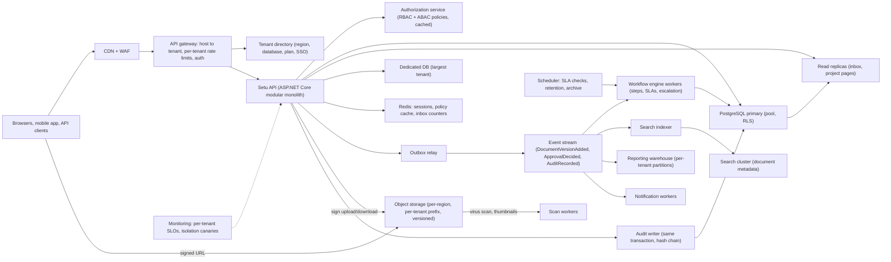
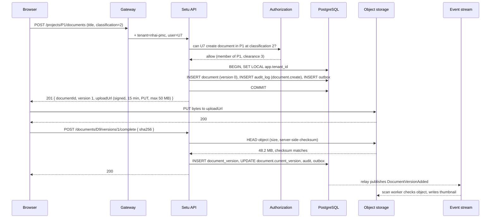
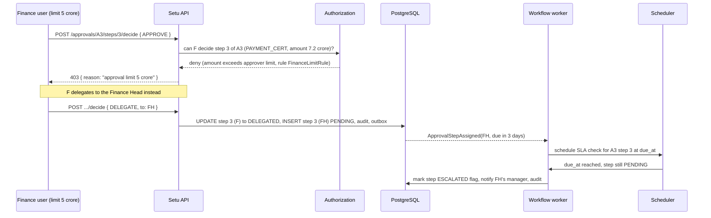

An infrastructure project is a long argument between organisations. An authority awards a highway package; a project-management consultant supervises; a contractor builds; a lender wants monthly progress; an auditor wants to know who approved the variation order and when. A project management platform for this world is not a to-do list. It is a system of record for money and accountability across organisations that do not fully trust one another, and it is sold to hundreds of them at once. This case study designs that platform, which we will call **Setu**, from tenancy to audit.

## Learning objectives

By the end of this lesson you will be able to:

1. Choose a tenancy model for an enterprise SaaS where tenants are organisations with thousands of users and projects involve several organisations at once.
2. Combine role-based access (what a project manager may do) with attribute-based rules (only on projects they belong to, only for documents at or below their clearance) and implement it as ASP.NET Core authorization policies.
3. Design versioned document storage on object storage with signed URLs, checksums and per-tenant storage prefixes.
4. Model multi-step approval workflows (sequential, parallel, quorum, delegation, SLA) as a state machine stored in PostgreSQL.
5. Separate transactional data from reporting with read models and a warehouse, without breaking tenant isolation.
6. Build a tamper-evident, append-only audit log that satisfies auditors and survives database administrators.
7. Place each tenant's data in its home region and prove it from the architecture diagram.
8. Estimate capacity and cost with arithmetic, and say which part breaks first.

## Prerequisites

- [Multi-tenancy](#/lesson/m16-multi-tenancy): silo, pool and bridge models and row-level security.
- [Role-based and policy-based authorization](#/lesson/m14-rbac-pbac): claims, policies and requirements in ASP.NET Core.
- [Multi-tenant security](#/lesson/m14-multi-tenant-security): the isolation failure modes we must design out.
- [Least privilege and audit trails](#/lesson/m14-least-privilege-audit): what an audit log must record.
- [Object storage](#/lesson/m11-object-storage): presigned URLs and why application servers should not stream files.

## Explain it like I'm a beginner

Think of a large office building where 400 companies rent floors. Each company's staff can only enter their own floor (that is **tenancy**: one building, many separate tenants). Inside a company, the receptionist, the engineers and the finance head each have different keys (**roles**). But a key alone is not enough: an engineer can open the drawing cabinet only for the projects she is assigned to, and only drawers marked at or below her clearance (**attributes**). Some rooms are shared project rooms where the company invites people from a partner company for one project only; those guests get a badge that works for that one room and nothing else.

Every drawing in the cabinet is kept with all its earlier versions, each stamped with who filed it and a fingerprint that proves it has not been altered (**versioned documents with checksums**). When a contractor asks for extra payment, the request travels along a chain of desks: site engineer, then team leader, then project manager, then two people in finance who must both sign (**approval workflow**). If a desk is empty for three days, the request is escalated (**SLA**). Every door opened, every drawing filed, every signature given is written into a bound ledger with numbered pages where nothing can be erased (**audit log**). And the ledger and cabinets for a German company's projects physically sit in Germany, because their law says so (**data residency**).

Setu is that building, in software, for infrastructure projects: highways, metro lines, water supply schemes, power substations.

## Requirements

### Functional

- **Tenants**: an organisation (authority, consultancy, contractor, lender) signs up as a tenant with its own users, branding, single sign-on and settings.
- **Projects**: a tenant owns projects. A project has packages (sections of work), milestones, a bill of quantities, a schedule and a team.
- **Cross-organisation participation**: the owning tenant invites users from other tenants (or external people) as **project guests** with a role limited to that project.
- **RBAC + ABAC**: roles per tenant (Tenant Admin, Portfolio Manager, Project Manager, Engineer, Finance, Viewer) and per project (Project Lead, Member, Guest). Rules such as "Finance may approve payment certificates only for projects in their portfolio and only up to ₹5 crore" and "documents classified `Restricted` are visible only to users with `Restricted` clearance".
- **Documents**: upload drawings, reports, photos, contracts; versions; check-in/check-out; folder structure per project; full-text search over metadata; retention per tenant policy.
- **Approvals**: configurable workflows per tenant and per document or request type: sequential steps, parallel steps with "any one" or "all" rules, delegation, SLA with escalation, comments, and a final immutable decision.
- **Reporting**: project dashboards (physical and financial progress, delays, pending approvals), portfolio dashboards across projects, tenant-wide exports, and authority-level views across tenants that have granted visibility.
- **Audit**: every create/update/delete/approve/download recorded with who, what, when, from where, before/after; exportable; tamper-evident.
- **Data residency**: tenants choose a home region at sign-up (India, EU, Middle East); all their data, documents, backups and logs with personal data stay there.

### Non-functional

- 400 tenants in year three; the largest tenant has 8,000 users and 900 projects; the median tenant has 40 users and 6 projects.
- Availability 99.9 % for the application; 99.95 % for document download (field teams depend on it).
- Interactive pages p95 under 500 ms; document upload of 50 MB completes in under 30 s on a 20 Mbit/s site connection.
- Audit records are written synchronously with the action they describe and are never lost.
- RTO 1 hour, RPO 5 minutes per region.
- Cost target: under ₹120 per active user per month at year three, all-in (estimate).

### Out of scope

Scheduling engines (critical path), BIM model viewing, payments to contractors.

## Capacity estimation

**Users and requests.** 400 tenants; total registered users ≈ 60,000 (one very large tenant with 8,000, a handful with 1,000–3,000, most under 100). Daily active users ≈ 25 % ≈ 15,000. Each active user makes about 150 requests a day (page loads, API calls from the SPA, dashboard refreshes). 15,000 × 150 = 2.25 M requests/day ÷ 86,400 ≈ 26 req/s average. Activity concentrates in a 9-hour working day and peaks at month-end: use ×4 for the daily peak ≈ 105 req/s, and ×8 for month-end report runs ≈ 210 req/s. This is a small API load; the design is driven by isolation, documents and reporting, not by request rate.

**Documents.** A mid-sized highway package produces around 3,000 documents a year (drawings, RFIs, test reports, site photos, correspondence). 6,000 active projects × 3,000 ≈ 18 M documents a year, but photos dominate the count. Average size, weighted: 4 MB (photos 2–3 MB, drawings 10–30 MB, reports 1 MB). Storage growth ≈ 18 M × 4 MB ≈ 72 TB a year, plus versions (×1.3) ≈ 94 TB a year. Three years retained: around 280 TB. Object storage at roughly ₹1.7–2 per GB-month (estimate for a hot tier in an Indian region) puts year-three storage at about ₹5–6 lakh a month, the single largest infrastructure line. Uploads per day ≈ 18 M ÷ 250 working days ≈ 72,000 ÷ 32,400 working seconds ≈ 2.2 uploads/s average, maybe 10/s at peak. Download traffic ≈ 5× uploads by count: 50/s at peak, ≈ 200 MB/s ≈ 1.6 Gbit/s at peak from object storage via CDN, mostly within India.

**Approvals.** Each project runs perhaps 40 approval requests a month with 4 steps each: 6,000 × 40 × 4 ÷ 22 working days ≈ 44,000 step decisions a day ≈ 1.4/s during working hours. Trivial for the database; the design question is correctness and SLAs, not throughput.

**Audit.** Every write and every download produces an audit row. Writes ≈ 15 % of requests ≈ 340,000 a day; downloads ≈ 300,000 a day; approvals 44,000: about 700,000 audit rows a day, around 1 KB each with before/after JSON ≈ 0.7 GB a day ≈ 250 GB a year. Partition by month; keep 7 years for regulated tenants (about 1.8 TB, cheap in cold partitions or archive).

**Database.** Transactional data excluding audit and documents: projects, BoQ lines (a highway package can have 5,000 lines), milestones, tasks, approvals, document metadata (18 M rows a year at ~500 bytes ≈ 9 GB a year). Total hot transactional data in year three: under 200 GB. One PostgreSQL primary per region with two replicas handles it; the largest tenant is the only candidate for a dedicated database.

**Summary table**

| Item | Average | Peak | Yearly growth |
|---|---|---|---|
| API requests | 26/s | 210/s | — |
| Document uploads | 2.2/s | 10/s | 18 M files, 94 TB |
| Document downloads | 11/s | 50/s (1.6 Gbit/s) | — |
| Approval decisions | 0.5/s | 1.4/s | 12 M rows |
| Audit rows | 8/s | 60/s | 250 GB |

**What breaks first**: not the API. In order: (1) the month-end reporting queries on the transactional database, which scan BoQ and progress tables across hundreds of projects; (2) object storage cost and egress; (3) the audit table's write volume on a single primary during peak. Each has a specific answer below.

## API design

The API is tenant-scoped by host name (`nhai-pmc.setu.app`) or by a tenant claim in the token for API clients; never by a tenant id in the URL or body. All identifiers are ULIDs (time-ordered, globally unique, safe to generate at the client for idempotent creates).

| Method and path | Purpose | Notes |
|---|---|---|
| `POST /projects` | Create a project | Body: name, code, package list; idempotency key header |
| `GET /projects/{id}` | Project summary | Authorisation: project member or tenant portfolio role |
| `POST /projects/{id}/members` | Add a member or guest | Guest invitations create a cross-tenant membership scoped to the project |
| `POST /projects/{id}/documents` | Begin an upload | Returns a signed upload URL and a document id; client uploads directly to object storage |
| `POST /documents/{id}/versions/{v}/complete` | Finish an upload | Server verifies the object exists, records size and checksum, and emits `DocumentVersionAdded` |
| `GET /documents/{id}/download?version=` | Get a signed download URL | Checks classification against clearance; writes an audit row before returning |
| `POST /approvals` | Start a workflow | Body: subject (document or request), workflow template id |
| `POST /approvals/{id}/steps/{step}/decide` | Approve, reject or delegate | Idempotent on `(approval id, step, decision id)` |
| `GET /approvals/inbox` | My pending steps | Read model |
| `GET /reports/projects/{id}/progress` | Project progress | Served from read model |
| `GET /reports/portfolio` | Cross-project dashboard | Served from warehouse, tenant-filtered |
| `GET /audit?from=&to=&actor=&entity=` | Audit search | Tenant Admin and Auditor roles only; itself audited |

Error contract: `403` distinguishes "no such permission" from "no such project" only for users who are members of the project; for everyone else a project they cannot see returns `404`, so project existence does not leak across tenants.

## Data model

Setu uses the **pool model with row-level security** (one database per region, shared tables, `tenant_id` on every row) for most tenants, plus the **bridge** option of a dedicated database for the largest tenant or any tenant whose contract requires it. A tenant directory records each tenant's region and database.

```sql
-- One database per region. Every tenant-owned table carries tenant_id and is protected by RLS.
CREATE TABLE tenant (
  tenant_id     text PRIMARY KEY,          -- ULID
  name          text NOT NULL,
  home_region   text NOT NULL,             -- 'in-central', 'eu-west', 'me-central'
  plan          text NOT NULL,
  created_at    timestamptz NOT NULL DEFAULT now()
);

CREATE TABLE app_user (
  tenant_id     text NOT NULL REFERENCES tenant,
  user_id       text NOT NULL,
  email         text NOT NULL,
  full_name     text NOT NULL,
  clearance     smallint NOT NULL DEFAULT 0,   -- 0 Public, 1 Internal, 2 Confidential, 3 Restricted
  PRIMARY KEY (tenant_id, user_id),
  UNIQUE (tenant_id, email)
);

CREATE TABLE project (
  tenant_id     text NOT NULL,
  project_id    text NOT NULL,
  code          text NOT NULL,
  name          text NOT NULL,
  portfolio_id  text,
  status        text NOT NULL DEFAULT 'ACTIVE',
  PRIMARY KEY (tenant_id, project_id),
  UNIQUE (tenant_id, code)
);

-- Membership: tenant users and cross-tenant guests. A guest row carries the guest's home tenant.
CREATE TABLE project_member (
  tenant_id       text NOT NULL,            -- owning tenant of the project
  project_id      text NOT NULL,
  member_tenant   text NOT NULL,            -- tenant the user belongs to (same as tenant_id for staff)
  member_user     text NOT NULL,
  project_role    text NOT NULL,            -- LEAD | MEMBER | GUEST
  PRIMARY KEY (tenant_id, project_id, member_tenant, member_user),
  FOREIGN KEY (tenant_id, project_id) REFERENCES project
);

CREATE TABLE document (
  tenant_id       text NOT NULL,
  document_id     text NOT NULL,
  project_id      text NOT NULL,
  folder_path     text NOT NULL,
  title           text NOT NULL,
  classification  smallint NOT NULL DEFAULT 1,
  current_version int NOT NULL DEFAULT 0,
  checked_out_by  text,
  PRIMARY KEY (tenant_id, document_id),
  FOREIGN KEY (tenant_id, project_id) REFERENCES project
);

CREATE TABLE document_version (
  tenant_id     text NOT NULL,
  document_id   text NOT NULL,
  version       int  NOT NULL,
  object_key    text NOT NULL,              -- '<region>/<tenant_id>/<project_id>/<document_id>/v<version>'
  size_bytes    bigint NOT NULL,
  sha256        bytea NOT NULL,
  uploaded_by   text NOT NULL,
  uploaded_at   timestamptz NOT NULL DEFAULT now(),
  PRIMARY KEY (tenant_id, document_id, version),
  FOREIGN KEY (tenant_id, document_id) REFERENCES document
);

CREATE TABLE approval_request (
  tenant_id     text NOT NULL,
  approval_id   text NOT NULL,
  project_id    text NOT NULL,
  subject_type  text NOT NULL,              -- DOCUMENT | PAYMENT_CERT | VARIATION | RFI
  subject_id    text NOT NULL,
  template_id   text NOT NULL,
  status        text NOT NULL,              -- IN_PROGRESS | APPROVED | REJECTED | CANCELLED
  amount        numeric(18,2),              -- for ABAC limits on financial approvals
  started_by    text NOT NULL,
  started_at    timestamptz NOT NULL DEFAULT now(),
  PRIMARY KEY (tenant_id, approval_id)
);

CREATE TABLE approval_step (
  tenant_id     text NOT NULL,
  approval_id   text NOT NULL,
  step_no       int  NOT NULL,              -- steps with the same step_no run in parallel
  rule          text NOT NULL,              -- ALL | ANY
  assignee_user text NOT NULL,
  status        text NOT NULL,              -- WAITING | PENDING | APPROVED | REJECTED | DELEGATED | SKIPPED
  delegated_to  text,
  due_at        timestamptz,
  decided_at    timestamptz,
  comment       text,
  PRIMARY KEY (tenant_id, approval_id, step_no, assignee_user),
  FOREIGN KEY (tenant_id, approval_id) REFERENCES approval_request
);

-- Append-only, partitioned by month, hash-chained per tenant.
CREATE TABLE audit_log (
  tenant_id     text NOT NULL,
  seq           bigint NOT NULL,            -- per-tenant sequence, assigned by the application in order
  occurred_at   timestamptz NOT NULL,
  actor_user    text NOT NULL,
  actor_ip      inet,
  action        text NOT NULL,              -- document.download, approval.decide, project.member.add ...
  entity_type   text NOT NULL,
  entity_id     text NOT NULL,
  before        jsonb,
  after         jsonb,
  prev_hash     bytea NOT NULL,
  hash          bytea NOT NULL,             -- sha256(prev_hash || canonical json of this row)
  PRIMARY KEY (tenant_id, seq, occurred_at)
) PARTITION BY RANGE (occurred_at);

CREATE TABLE audit_log_2026_10 PARTITION OF audit_log FOR VALUES FROM ('2026-10-01') TO ('2026-11-01');
```

**Row-level security** on every tenant table, with the tenant id supplied per transaction:

```sql
ALTER TABLE project ENABLE ROW LEVEL SECURITY;
ALTER TABLE project FORCE ROW LEVEL SECURITY;
CREATE POLICY tenant_isolation ON project
  USING (tenant_id = current_setting('app.tenant_id', true))
  WITH CHECK (tenant_id = current_setting('app.tenant_id', true));

-- Audit is append-only even for the application role: no UPDATE or DELETE policy exists,
-- and the role has no UPDATE/DELETE privilege on the table.
ALTER TABLE audit_log ENABLE ROW LEVEL SECURITY;
CREATE POLICY audit_read   ON audit_log FOR SELECT USING (tenant_id = current_setting('app.tenant_id', true));
CREATE POLICY audit_insert ON audit_log FOR INSERT WITH CHECK (tenant_id = current_setting('app.tenant_id', true));
REVOKE UPDATE, DELETE ON audit_log FROM setu_app;
```

Why `FORCE ROW LEVEL SECURITY`: without it, the table owner bypasses policies, and migrations often run as the owner. Why `current_setting(..., true)`: with the second argument the function returns NULL instead of throwing when the setting is absent, and NULL compares false, so a request that forgot to set the tenant sees **nothing** rather than everything.

**Indexes that matter**: `(tenant_id, project_id, folder_path)` on `document`; `(tenant_id, assignee_user, status) WHERE status = 'PENDING'` on `approval_step` for inboxes (a partial index keeps it small); `(tenant_id, occurred_at)` and `(tenant_id, entity_type, entity_id)` on each audit partition; `(tenant_id, project_id, status)` on `approval_request`.

**Cross-tenant guests** are the subtle part. A guest's identity lives in their home tenant's `app_user` row (or an external identity provider), and their membership lives in the owning tenant's `project_member` row with `member_tenant` set to the home tenant. The guest's session carries *two* tenant ids: the home tenant (for their profile) and the acting tenant (the project owner, for RLS). The application sets `app.tenant_id` to the acting tenant only after verifying the membership row exists; everything the guest can see is then bounded by the project filter in the authorisation layer, not by RLS alone.

## High-level architecture



Walk through the arrows. Users reach a CDN and web application firewall, then the **gateway**, which resolves the tenant from the host name (or token), enforces per-tenant rate limits so one large tenant's month-end export cannot starve 399 others, and validates the identity token. It consults the **tenant directory** to learn the tenant's region and database; a request for an EU tenant arriving at the Indian gateway is redirected to the EU deployment (see [multi-region](#/lesson/m16-multi-region)). The **API** is a modular monolith (projects, documents, approvals, reporting, audit, admin modules) because one deployable per region is simpler to operate and the load is modest. The **authorization service** is a module that evaluates RBAC and ABAC policies against the request, with the user's roles and memberships cached in Redis for the session. Writes go to the **PostgreSQL primary** with RLS; inbox and project pages read from **replicas**. The largest tenant lives in a **dedicated database** chosen by the directory. Every state change writes a row to the **outbox** in the same transaction; the relay publishes to the **event stream**, which feeds the **workflow engine** (which advances steps, assigns the next approvers and schedules SLA timers), the **search indexer**, the **reporting warehouse** and **notifications**. Documents never pass through the API: the API **signs** an upload or download URL and the browser talks to **object storage** directly; **scan workers** check new objects for malware and generate thumbnails. The **audit writer** runs in the same database transaction as the action, chaining each row to the previous by hash. The **scheduler** fires SLA checks and retention jobs. **Monitoring** includes isolation canaries: synthetic users in two tenants who continuously try to read each other's projects and page the team if they ever succeed.

### Sequence: a document upload with classification and audit



The upload never touches the API's memory or bandwidth. The signed URL is bound to a specific object key under the tenant's prefix, a method (`PUT`), a size limit and an expiry, so it cannot be reused for another document or tenant (the Valet Key pattern). The `complete` call makes the version real only after the server confirms the object exists with the expected checksum; an abandoned upload leaves no version. Both the `create` and `complete` steps write audit rows inside the same transaction as their data changes, so there is no window in which a document exists without a record of who created it.

### Sequence: an approval step with ABAC and SLA



Authorisation is evaluated at decision time against the request's attributes (type, amount) and the user's attributes (role, limit, portfolio). The denial is explained, because an unexplained 403 in an approval system generates support tickets. Delegation creates a new pending step row for the delegate while recording the delegator's action, so the audit trail shows the full chain. The SLA timer is owned by the workflow engine, not by a client, and it is durable: if the worker restarts, the scheduler still fires.

## Deep dives

### 1. Tenancy model and tenant resolution

Three candidate models, evaluated against Setu's requirements:

| Model | Isolation | Cost at 400 tenants | Cross-tenant guests | Residency |
|---|---|---|---|---|
| Silo (database per tenant) | Strongest | 400 databases: expensive, slow migrations | Hard: a guest's membership must be copied into the owner's database | Easy per database |
| Pool (shared tables + RLS) | Strong if RLS is enforced everywhere | One database per region | Natural: membership rows reference other tenants | Per region, with a directory |
| Bridge (pool + dedicated for some) | Pool plus silo for the few | A few extra databases | Same as pool | Same as pool |

Setu chooses **bridge**: pooled with RLS by default, dedicated databases for the largest tenant and for any tenant paying for it. Tenant resolution happens exactly once, at the gateway, from the host name or a verified token claim, and is carried as a scoped `TenantContext`. The data layer opens every transaction with `SET LOCAL app.tenant_id = @tenant`, and a **connection-level canary** asserts on each pooled connection checkout that no `app.tenant_id` is lingering from a previous transaction (`SET LOCAL` is reset at commit, but belt-and-braces is cheap).

The guest problem deserves a precise rule. A guest from tenant G acting on tenant O's project P:

1. Authenticates with G's identity provider (or Setu's external-user flow).
2. The gateway resolves the *acting* tenant O from the host name (`nhai-pmc.setu.app`).
3. The API looks up `project_member (O, P, G, user)`; if absent, `404`.
4. `app.tenant_id` is set to O for the transaction. The guest's authorisation context contains `ProjectIds = {P}` and nothing else of O's.
5. Every query in the request is filtered by `project_id IN (user's project ids)` in the authorisation layer in addition to RLS.

RLS stops tenant leakage; the project filter stops a guest from seeing the owner's other projects. Both are needed.

### 2. RBAC + ABAC

Pure RBAC fails here because roles are not enough: "Project Manager" says what a user may *do*; it cannot say *on which projects* or *up to what amount*. Pure ABAC (every rule is an expression over attributes) is flexible but opaque to administrators. Setu uses **roles for capabilities and attributes for scope**:

- Roles grant **permissions** (`document.create`, `approval.decide`, `report.portfolio.read`).
- Attribute rules **constrain** a permission: `ProjectMembership` (the project must be in the user's memberships, unless the user has a tenant-wide portfolio role), `Clearance` (document classification ≤ user clearance), `ApprovalLimit` (amount ≤ user's limit for financial subjects), `Portfolio` (project's portfolio in the user's portfolios).

In ASP.NET Core this maps to **policy-based authorization**: a requirement per rule, a handler per requirement, a resource passed to `IAuthorizationService.AuthorizeAsync(user, resource, policy)`. The user's roles, memberships, clearance and limits are loaded once per session into a compact `Principal` cached in Redis (TTL 5 minutes, invalidated on role change by publishing `PrincipalChanged`). Evaluation is in-process and takes microseconds; the cache miss costs one query.

Administrators see roles and a short list of named rules. Developers see requirements and handlers. Auditors see, in each audit row for a denied or allowed sensitive action, *which rule* decided it.

### 3. Documents

Objects live in a per-region bucket under the prefix `<tenant>/<project>/<document>/v<n>`. The prefix is part of the signed URL, so a URL can never address another tenant's objects. The bucket has versioning off (Setu manages versions itself, so that the metadata row is the source of truth) and object lock on for tenants with legal-hold requirements. Checksums are computed by the client on upload and verified against the storage service's server-side checksum on `complete`. Check-out sets `checked_out_by` and blocks other users' new versions until check-in or an admin override (audited). Retention is a per-tenant policy executed by the scheduler: expired versions are moved to an archive tier, never deleted while any legal hold exists.

Search covers metadata and extracted text (for PDFs and Office files) in a search cluster with **one index per tenant** for the large tenants and a shared index with a tenant filter for the rest; the query layer always injects the tenant filter and the user's project filter.

### 4. Approval workflows

A workflow template is a list of steps; each step has a `step_no`, a rule (`ALL` or `ANY`), and assignees resolved from roles or named users at start time (so a later role change does not silently change who must approve a running request). Steps with the same `step_no` run in parallel. The engine's rules:

- Starting a request creates all step rows with status `WAITING`, then marks `step_no = 1` as `PENDING` and sets `due_at = now + SLA`.
- A decision on a `PENDING` step by its assignee (or a delegate) records it. For `ALL`, the step completes when every assignee has approved; for `ANY`, when one has. A rejection by any assignee rejects the request and marks remaining steps `SKIPPED`.
- When a step completes, the next `step_no` becomes `PENDING`. When the last completes, the request is `APPROVED`.
- Delegation marks the delegator's row `DELEGATED` and inserts a `PENDING` row for the delegate with the same `due_at`.
- SLA breach does not change the decision state; it sets an escalation flag and notifies, so humans decide, and the breach is in the audit trail.
- Decisions are idempotent on a client-generated decision id; a retried `decide` returns the original result.

All of this is ordinary rows and transactions in PostgreSQL. A general workflow engine ([workflow engines and feature flags](#/lesson/m16-workflow-engines)) becomes worth it when templates need loops, conditional branches on arbitrary data, or long-running external waits; approvals rarely do.

### 5. Reporting

Reports are the first thing that breaks. A portfolio dashboard across 900 projects joins BoQ lines, progress entries and approvals; on the primary it would hold locks and burn CPU during month-end. Setu separates three tiers:

- **Inbox and project pages**: read replicas, with the API retrying on the primary if replication lag exceeds 2 s for a user who just wrote (read-your-writes).
- **Project and portfolio dashboards**: **read models** maintained from events (`ProgressRecorded`, `ApprovalDecided`): a `project_progress_summary` table updated incrementally, so the dashboard is a single-row read.
- **Cross-project analysis and exports**: the **warehouse**, loaded from the event stream, partitioned by tenant, with the same RLS policy pattern (tenant id from the session) and per-tenant query quotas. Authority-level views across tenants are a *grant* stored in the directory (tenant A allows authority tenant B to see projects tagged with B's programme), evaluated in the warehouse query layer.

### 6. Audit

Requirements from auditors: complete (every sensitive action), attributable (who, from where), ordered (sequence), immutable (nobody, including a DBA, can alter without detection), and retained (7 years for some tenants). Design:

- Written **in the same transaction** as the action it describes, so either both commit or neither.
- **Append-only** by privilege: the application role has `INSERT` and `SELECT` only; there is no update path in the code either.
- **Hash-chained per tenant**: each row stores `prev_hash` and `hash = SHA-256(prev_hash || canonical row)`. A nightly job re-walks each tenant's chain and compares the final hash with a copy stored in a separate, write-once location (object storage with object lock in the tenant's region). A DBA who edits a row breaks the chain; a DBA who deletes a row leaves a gap in `seq`.
- Per-tenant sequence assigned under a per-tenant advisory lock in the transaction, so concurrent writers never produce the same `seq` and the chain is linear.
- Partitioned by month; old partitions detached and archived to cold storage in the tenant's region.

### 7. Data residency

The tenant directory holds `home_region`. Each region is a complete deployment: gateway, API, database, object storage bucket, search, warehouse partitions, logging. The gateway in region X redirects any request for a tenant homed elsewhere. A `ResidencyGuard` in the data layer refuses to persist rows for a tenant whose region differs from the process's region. Logs with personal data are shipped to a per-region logging workspace; global telemetry carries only tenant ids and counts. Backups are region-local. This is the same pattern as [multi-region](#/lesson/m16-multi-region), applied per tenant.

### Production-style C# implementation

The pieces that benefit from code: the tenant context, policy-based authorisation with resource-aware handlers, the approval step state transition, and the hash-chained audit writer. Persistence is behind interfaces with in-memory implementations so the set compiles offline.

```csharp file=Setu/Tenancy/TenantContext.cs
namespace Setu.Tenancy;

/// <summary>Resolved once per request by the gateway or middleware; scoped lifetime.</summary>
public sealed class TenantContext
{
    public string ActingTenantId { get; private set; } = "";
    public string HomeTenantId { get; private set; } = "";
    public bool IsGuest => ActingTenantId != HomeTenantId;
    public bool IsResolved => ActingTenantId.Length > 0;

    public void Set(string actingTenantId, string homeTenantId)
    {
        if (IsResolved) throw new InvalidOperationException("Tenant already resolved for this request.");
        ActingTenantId = actingTenantId;
        HomeTenantId = homeTenantId;
    }
}

public sealed class TenantResolutionMiddleware(RequestDelegate next)
{
    public async Task InvokeAsync(HttpContext ctx, TenantContext tenant)
    {
        // The gateway sets X-Acting-Tenant from the host name and X-Home-Tenant from the verified token.
        var acting = ctx.Request.Headers["X-Acting-Tenant"].ToString();
        var home = ctx.Request.Headers["X-Home-Tenant"].ToString();
        if (string.IsNullOrEmpty(acting) || string.IsNullOrEmpty(home))
        {
            ctx.Response.StatusCode = StatusCodes.Status404NotFound;   // unknown host: do not reveal anything
            return;
        }
        tenant.Set(acting, home);
        await next(ctx);
    }
}
```

```csharp file=Setu/Authorization/Principal.cs
namespace Setu.Authorization;

public sealed record SetuPrincipal(
    string TenantId,
    string UserId,
    IReadOnlySet<string> Roles,
    IReadOnlySet<string> ProjectIds,
    IReadOnlySet<string> PortfolioIds,
    int Clearance,
    decimal ApprovalLimit);

public sealed record ProjectResource(string ProjectId, string? PortfolioId);
public sealed record DocumentResource(string ProjectId, string? PortfolioId, int Classification);
public sealed record ApprovalResource(string ProjectId, string? PortfolioId, string SubjectType, decimal? Amount, string AssigneeUserId);

/// <summary>Maps roles to permissions. In production this is tenant-configurable and cached.</summary>
public static class RolePermissions
{
    private static readonly Dictionary<string, HashSet<string>> Map = new()
    {
        ["TenantAdmin"] = ["*"],
        ["PortfolioManager"] = ["project.read", "document.read", "document.create", "approval.decide", "report.portfolio.read"],
        ["ProjectManager"] = ["project.read", "document.read", "document.create", "approval.start", "approval.decide"],
        ["Engineer"] = ["project.read", "document.read", "document.create", "approval.start"],
        ["Finance"] = ["project.read", "document.read", "approval.decide"],
        ["Viewer"] = ["project.read", "document.read"],
        ["Guest"] = ["project.read", "document.read"],
    };

    public static bool Grants(IReadOnlySet<string> roles, string permission) =>
        roles.Any(r => Map.TryGetValue(r, out var perms) && (perms.Contains("*") || perms.Contains(permission)));
}
```

```csharp file=Setu/Authorization/Requirements.cs
using Microsoft.AspNetCore.Authorization;

namespace Setu.Authorization;

public sealed class PermissionRequirement(string permission) : IAuthorizationRequirement
{
    public string Permission { get; } = permission;
}

public sealed class ProjectMembershipRequirement : IAuthorizationRequirement;
public sealed class ClearanceRequirement : IAuthorizationRequirement;
public sealed class ApprovalLimitRequirement : IAuthorizationRequirement;

public interface IPrincipalProvider
{
    SetuPrincipal? Current { get; }
}

/// <summary>Role grants the capability.</summary>
public sealed class PermissionHandler(IPrincipalProvider principals) : AuthorizationHandler<PermissionRequirement>
{
    protected override Task HandleRequirementAsync(AuthorizationHandlerContext context, PermissionRequirement requirement)
    {
        var p = principals.Current;
        if (p is not null && RolePermissions.Grants(p.Roles, requirement.Permission)) context.Succeed(requirement);
        return Task.CompletedTask;
    }
}

/// <summary>Attribute: the project must be in the user's memberships, or its portfolio in the user's portfolios.</summary>
public sealed class ProjectMembershipHandler(IPrincipalProvider principals) : AuthorizationHandler<ProjectMembershipRequirement>
{
    protected override Task HandleRequirementAsync(AuthorizationHandlerContext context, ProjectMembershipRequirement requirement)
    {
        var p = principals.Current;
        var (projectId, portfolioId) = context.Resource switch
        {
            ProjectResource r => (r.ProjectId, r.PortfolioId),
            DocumentResource d => (d.ProjectId, d.PortfolioId),
            ApprovalResource a => (a.ProjectId, a.PortfolioId),
            _ => (null, null),
        };
        if (p is null || projectId is null) return Task.CompletedTask;
        if (p.Roles.Contains("TenantAdmin") || p.ProjectIds.Contains(projectId) ||
            (portfolioId is not null && p.PortfolioIds.Contains(portfolioId)))
            context.Succeed(requirement);
        return Task.CompletedTask;
    }
}

/// <summary>Attribute: document classification must not exceed the user's clearance.</summary>
public sealed class ClearanceHandler(IPrincipalProvider principals) : AuthorizationHandler<ClearanceRequirement>
{
    protected override Task HandleRequirementAsync(AuthorizationHandlerContext context, ClearanceRequirement requirement)
    {
        var p = principals.Current;
        if (p is not null && context.Resource is DocumentResource d && d.Classification <= p.Clearance) context.Succeed(requirement);
        return Task.CompletedTask;
    }
}

/// <summary>Attribute: financial approvals are limited by amount; non-financial subjects have no limit.</summary>
public sealed class ApprovalLimitHandler(IPrincipalProvider principals) : AuthorizationHandler<ApprovalLimitRequirement>
{
    protected override Task HandleRequirementAsync(AuthorizationHandlerContext context, ApprovalLimitRequirement requirement)
    {
        var p = principals.Current;
        if (p is null || context.Resource is not ApprovalResource a) return Task.CompletedTask;
        if (a.AssigneeUserId != p.UserId) { context.Fail(new AuthorizationFailureReason(this, "Not the assignee of this step.")); return Task.CompletedTask; }
        if (a.Amount is decimal amount && amount > p.ApprovalLimit)
        {
            context.Fail(new AuthorizationFailureReason(this, $"Amount {amount:N0} exceeds approval limit {p.ApprovalLimit:N0}."));
            return Task.CompletedTask;
        }
        context.Succeed(requirement);
        return Task.CompletedTask;
    }
}
```

The handlers are small and independently testable. `context.Fail` with a reason is what lets the API return an explained 403; a plain non-success is an unexplained denial. Policies compose them: `DocumentRead` = permission `document.read` + membership + clearance; `ApprovalDecide` = permission `approval.decide` + membership + limit.

```csharp file=Setu/Approvals/ApprovalStep.cs
namespace Setu.Approvals;

public enum StepStatus { Waiting, Pending, Approved, Rejected, Delegated, Skipped }
public enum StepRule { All, Any }
public enum RequestStatus { InProgress, Approved, Rejected, Cancelled }

public sealed class ApprovalStep(int stepNo, StepRule rule, string assignee)
{
    public int StepNo { get; } = stepNo;
    public StepRule Rule { get; } = rule;
    public string Assignee { get; } = assignee;
    public StepStatus Status { get; internal set; } = StepStatus.Waiting;
    public string? DelegatedTo { get; internal set; }
    public DateTimeOffset? DueAt { get; internal set; }
    public DateTimeOffset? DecidedAt { get; internal set; }
}

/// <summary>Aggregate holding the state machine for one request. Persistence maps it to approval_request + approval_step.</summary>
public sealed class ApprovalRequest
{
    private readonly List<ApprovalStep> _steps;
    private readonly TimeSpan _sla;

    public ApprovalRequest(string approvalId, IEnumerable<ApprovalStep> steps, TimeSpan sla, DateTimeOffset now)
    {
        ApprovalId = approvalId;
        _steps = steps.OrderBy(s => s.StepNo).ToList();
        if (_steps.Count == 0) throw new ArgumentException("A workflow needs at least one step.");
        _sla = sla;
        Activate(_steps[0].StepNo, now);
    }

    public string ApprovalId { get; }
    public RequestStatus Status { get; private set; } = RequestStatus.InProgress;
    public IReadOnlyList<ApprovalStep> Steps => _steps;

    public void Approve(string userId, DateTimeOffset now)
    {
        var step = PendingStepFor(userId);
        step.Status = StepStatus.Approved;
        step.DecidedAt = now;
        var group = _steps.Where(s => s.StepNo == step.StepNo).ToList();
        var complete = group[0].Rule == StepRule.Any
            ? group.Any(s => s.Status == StepStatus.Approved)
            : group.Where(s => s.Status != StepStatus.Delegated).All(s => s.Status == StepStatus.Approved);
        if (!complete) return;
        foreach (var s in group.Where(s => s.Status == StepStatus.Pending)) s.Status = StepStatus.Skipped;   // ANY: others no longer needed
        var next = _steps.Where(s => s.StepNo > step.StepNo).Select(s => (int?)s.StepNo).FirstOrDefault();
        if (next is int n) Activate(n, now); else Status = RequestStatus.Approved;
    }

    public void Reject(string userId, DateTimeOffset now)
    {
        var step = PendingStepFor(userId);
        step.Status = StepStatus.Rejected;
        step.DecidedAt = now;
        foreach (var s in _steps.Where(s => s.Status is StepStatus.Pending or StepStatus.Waiting)) s.Status = StepStatus.Skipped;
        Status = RequestStatus.Rejected;
    }

    public void Delegate(string fromUserId, string toUserId, DateTimeOffset now)
    {
        if (fromUserId == toUserId) throw new InvalidOperationException("Cannot delegate to yourself.");
        var step = PendingStepFor(fromUserId);
        step.Status = StepStatus.Delegated;
        step.DelegatedTo = toUserId;
        step.DecidedAt = now;
        var delegated = new ApprovalStep(step.StepNo, step.Rule, toUserId) { Status = StepStatus.Pending, DueAt = step.DueAt };
        _steps.Add(delegated);
        _steps.Sort((a, b) => a.StepNo.CompareTo(b.StepNo));
    }

    public IEnumerable<ApprovalStep> OverdueSteps(DateTimeOffset now) =>
        _steps.Where(s => s.Status == StepStatus.Pending && s.DueAt is not null && s.DueAt < now);

    private void Activate(int stepNo, DateTimeOffset now)
    {
        foreach (var s in _steps.Where(s => s.StepNo == stepNo && s.Status == StepStatus.Waiting))
        {
            s.Status = StepStatus.Pending;
            s.DueAt = now + _sla;
        }
    }

    private ApprovalStep PendingStepFor(string userId)
    {
        if (Status != RequestStatus.InProgress) throw new InvalidOperationException($"Request is {Status}.");
        return _steps.FirstOrDefault(s => s.Status == StepStatus.Pending && s.Assignee == userId)
            ?? throw new InvalidOperationException($"{userId} has no pending step on {ApprovalId}.");
    }
}
```

The aggregate enforces the rules in one place; the API layer handles authorisation (is this user allowed to decide at all, given the amount?) before calling it. The two concerns stay apart: the aggregate does not know about clearance or limits, and the handlers do not know about step ordering.

```csharp file=Setu/Audit/AuditWriter.cs
using System.Security.Cryptography;
using System.Text;
using System.Text.Json;

namespace Setu.Audit;

public sealed record AuditEntry(string TenantId, long Seq, DateTimeOffset OccurredAt, string ActorUserId, string Action,
    string EntityType, string EntityId, JsonElement? Before, JsonElement? After, byte[] PrevHash, byte[] Hash);

public interface IAuditStore
{
    /// <summary>Returns the last entry for the tenant inside the current transaction, holding a per-tenant lock.</summary>
    Task<AuditEntry?> LockAndGetLastAsync(string tenantId, CancellationToken ct);
    Task AppendAsync(AuditEntry entry, CancellationToken ct);
}

/// <summary>Appends hash-chained audit rows. Must be called inside the same transaction as the audited change.</summary>
public sealed class AuditWriter(IAuditStore store, TimeProvider time)
{
    private static readonly JsonSerializerOptions Canonical = new() { WriteIndented = false };

    public async Task<AuditEntry> RecordAsync(string tenantId, string actorUserId, string action, string entityType, string entityId,
        JsonElement? before, JsonElement? after, CancellationToken ct)
    {
        var last = await store.LockAndGetLastAsync(tenantId, ct);
        var prevHash = last?.Hash ?? new byte[32];
        var seq = (last?.Seq ?? 0) + 1;
        var occurredAt = time.GetUtcNow();
        var hash = ComputeHash(prevHash, tenantId, seq, occurredAt, actorUserId, action, entityType, entityId, before, after);
        var entry = new AuditEntry(tenantId, seq, occurredAt, actorUserId, action, entityType, entityId, before, after, prevHash, hash);
        await store.AppendAsync(entry, ct);
        return entry;
    }

    public static byte[] ComputeHash(byte[] prevHash, string tenantId, long seq, DateTimeOffset occurredAt, string actor, string action,
        string entityType, string entityId, JsonElement? before, JsonElement? after)
    {
        var payload = JsonSerializer.Serialize(new
        {
            tenantId, seq, occurredAt = occurredAt.ToUnixTimeMilliseconds(), actor, action, entityType, entityId,
            before = before?.GetRawText(), after = after?.GetRawText(),
        }, Canonical);
        var bytes = new byte[prevHash.Length + Encoding.UTF8.GetByteCount(payload)];
        prevHash.CopyTo(bytes, 0);
        Encoding.UTF8.GetBytes(payload, 0, payload.Length, bytes, prevHash.Length);
        return SHA256.HashData(bytes);
    }

    /// <summary>Walks a tenant's chain and returns the first broken sequence number, or null if intact.</summary>
    public static long? Verify(IEnumerable<AuditEntry> entriesInOrder)
    {
        var prev = new byte[32];
        long expectedSeq = 1;
        foreach (var e in entriesInOrder)
        {
            if (e.Seq != expectedSeq || !e.PrevHash.AsSpan().SequenceEqual(prev)) return e.Seq;
            var h = ComputeHash(prev, e.TenantId, e.Seq, e.OccurredAt, e.ActorUserId, e.Action, e.EntityType, e.EntityId, e.Before, e.After);
            if (!h.AsSpan().SequenceEqual(e.Hash)) return e.Seq;
            prev = e.Hash;
            expectedSeq++;
        }
        return null;
    }
}

public sealed class InMemoryAuditStore : IAuditStore
{
    private readonly Dictionary<string, List<AuditEntry>> _byTenant = new();
    public Task<AuditEntry?> LockAndGetLastAsync(string tenantId, CancellationToken ct) =>
        Task.FromResult(_byTenant.TryGetValue(tenantId, out var l) && l.Count > 0 ? l[^1] : null);
    public Task AppendAsync(AuditEntry entry, CancellationToken ct)
    {
        if (!_byTenant.TryGetValue(entry.TenantId, out var l)) _byTenant[entry.TenantId] = l = new List<AuditEntry>();
        l.Add(entry);
        return Task.CompletedTask;
    }
    public IReadOnlyList<AuditEntry> For(string tenantId) => _byTenant.GetValueOrDefault(tenantId) ?? new List<AuditEntry>();
}
```

In PostgreSQL, `LockAndGetLastAsync` is `SELECT pg_advisory_xact_lock(hashtext(@tenant)); SELECT ... ORDER BY seq DESC LIMIT 1;` inside the caller's transaction, so two concurrent writers for the same tenant serialise on the chain. `Verify` runs nightly per tenant and compares the final hash with the copy in write-once storage.

```csharp file=Program.cs
using Microsoft.AspNetCore.Authorization;
using Setu.Approvals;
using Setu.Audit;
using Setu.Authorization;
using Setu.Tenancy;

var builder = WebApplication.CreateBuilder(args);

builder.Services.AddSingleton(TimeProvider.System);
builder.Services.AddScoped<TenantContext>();
builder.Services.AddScoped<IPrincipalProvider, HeaderPrincipalProvider>();
builder.Services.AddHttpContextAccessor();
builder.Services.AddSingleton<IAuditStore, InMemoryAuditStore>();
builder.Services.AddSingleton<AuditWriter>();

builder.Services.AddAuthorization(o =>
{
    o.AddPolicy("DocumentRead", p => p.AddRequirements(new PermissionRequirement("document.read"), new ProjectMembershipRequirement(), new ClearanceRequirement()));
    o.AddPolicy("ApprovalDecide", p => p.AddRequirements(new PermissionRequirement("approval.decide"), new ProjectMembershipRequirement(), new ApprovalLimitRequirement()));
});
builder.Services.AddScoped<IAuthorizationHandler, PermissionHandler>();
builder.Services.AddScoped<IAuthorizationHandler, ProjectMembershipHandler>();
builder.Services.AddScoped<IAuthorizationHandler, ClearanceHandler>();
builder.Services.AddScoped<IAuthorizationHandler, ApprovalLimitHandler>();

var app = builder.Build();
app.UseMiddleware<TenantResolutionMiddleware>();

app.MapGet("/documents/{id}/download", async (string id, IAuthorizationService authz, IPrincipalProvider principals, AuditWriter audit, TenantContext tenant, HttpContext ctx) =>
{
    var doc = new DocumentResource(ProjectId: "P1", PortfolioId: "PF-NORTH", Classification: 2);   // loaded from the database in reality
    var result = await authz.AuthorizeAsync(ctx.User, doc, "DocumentRead");
    if (!result.Succeeded) return Results.StatusCode(StatusCodes.Status403Forbidden);
    await audit.RecordAsync(tenant.ActingTenantId, principals.Current!.UserId, "document.download", "document", id, null, null, ctx.RequestAborted);
    return Results.Ok(new { url = $"https://objects.example/{tenant.ActingTenantId}/P1/{id}?sig=..." });
});

app.MapPost("/approvals/{id}/steps/{step:int}/decide", async (string id, int step, DecideRequest body, IAuthorizationService authz, HttpContext ctx) =>
{
    var resource = new ApprovalResource("P1", "PF-NORTH", "PAYMENT_CERT", 72_000_000m, body.AssigneeUserId);
    var result = await authz.AuthorizeAsync(ctx.User, resource, "ApprovalDecide");
    if (!result.Succeeded)
        return Results.Json(new { reason = string.Join("; ", result.Failure?.FailureReasons.Select(r => r.Message) ?? Enumerable.Empty<string>()) }, statusCode: 403);
    return Results.Ok(new { id, step, body.Decision });
});

app.Run();

public sealed record DecideRequest(string Decision, string AssigneeUserId, string? DelegateTo);

/// <summary>Demo provider reading a principal from headers; production loads it from the cached session.</summary>
public sealed class HeaderPrincipalProvider(IHttpContextAccessor accessor, TenantContext tenant) : IPrincipalProvider
{
    public SetuPrincipal? Current
    {
        get
        {
            var h = accessor.HttpContext?.Request.Headers;
            if (h is null || !tenant.IsResolved) return null;
            return new SetuPrincipal(tenant.ActingTenantId, h["X-User"].ToString(),
                new HashSet<string>(h["X-Roles"].ToString().Split(',', StringSplitOptions.RemoveEmptyEntries)),
                new HashSet<string>(h["X-Projects"].ToString().Split(',', StringSplitOptions.RemoveEmptyEntries)),
                new HashSet<string>(), int.TryParse(h["X-Clearance"].ToString(), out var c) ? c : 0,
                decimal.TryParse(h["X-Limit"].ToString(), out var l) ? l : 0m);
        }
    }
}
```

## Caching, queues and scaling

- **Principal cache** (Redis, 5-minute TTL, invalidated on change): roles, project memberships, clearance, limits. Avoids four queries per request. Keyed by `tenant:user`.
- **Project page cache**: project header and tree in Redis for 60 s, keyed by tenant and project; invalidated by events.
- **Inbox counters**: per-user pending count kept in Redis, updated by the workflow worker, so the badge in the header does not query `approval_step` on every page.
- **Queues and events**: the outbox relay publishes domain events; consumers are the workflow engine (assign next step, schedule SLA), search indexer, read-model updater, warehouse loader and notifications. Per-tenant **job queues** with fair scheduling for exports and bulk imports, so one tenant's 50,000-document import does not delay others' notifications.
- **Scaling**: the API is stateless and scales horizontally behind the gateway; the database scales by read replicas, partitioning (`audit_log`, `document_version` by month for the largest tenants) and moving heavy tenants to dedicated databases. Object storage and the CDN scale without design effort; cost is the constraint.
- **Month-end**: pre-compute read models continuously rather than on demand; warehouse queries get per-tenant concurrency limits; exports run as jobs with progress, not as HTTP requests.

## Failure handling

| Failure | Effect | Mitigation |
|---|---|---|
| A developer forgets `SET LOCAL app.tenant_id` | Query returns no rows (not all rows) because the policy compares against NULL | RLS with `current_setting(..., true)`; integration test that asserts an unscoped query returns zero rows; isolation canaries in production |
| Object storage unreachable | Uploads and downloads fail; metadata operations continue | 99.95 % target met by multi-zone storage; download URLs fall back to a replica bucket in the same region; uploads can be retried by the client with the same document id |
| Workflow worker crashes mid-step | Step assignment or SLA timer lost | Outbox guarantees the event is redelivered; handlers are idempotent on `(approval id, step, assignee)`; timers are persisted by the scheduler |
| Replica lag at month-end | Users see stale inboxes | Read-your-writes: after a write, the session reads from the primary for 5 s; lag alerting at 2 s |
| Audit insert fails | The whole transaction fails | Correct by design: an action without its audit row must not happen; alert on audit failures because they indicate a real problem |
| Heavy tenant export | Primary CPU spikes | Exports run from the warehouse via per-tenant job queue with concurrency 1 |
| Region outage | Tenants homed there are down | Per-region active-passive standby; RTO 1 h, RPO 5 min; drills quarterly |
| Signed URL leaked | Anyone with the URL can download for its lifetime | Short expiry (5 min for downloads, 15 for uploads), bound to object key, IP-bound where the client supports it, every issuance audited |

:::callout type=warning title="Never resolve the tenant from user input"
The tenant comes from the host name or a verified token claim, resolved once at the edge. A tenant id in a query string, body or cookie is an invitation to try someone else's id. This single rule removes the most common class of multi-tenant breaches.
:::

## Security

- **Identity**: per-tenant SSO (OpenID Connect with the tenant's provider) or Setu-managed accounts with MFA; guest accounts are invited by email and verified; tokens carry the home tenant.
- **Isolation layers**: edge tenant resolution; scoped `TenantContext`; RLS with `FORCE`; tenant-prefixed object keys and cache keys; per-tenant search index or filter; residency guard; canaries.
- **Authorisation**: policy-based, resource-aware, explained denials, cached principals with fast invalidation. Privileged actions (role changes, retention overrides, check-out overrides) require a second administrator for regulated tenants (four-eyes).
- **Documents**: malware scanning before a version becomes downloadable; content-type verification; signed URLs with short expiry; encryption at rest with per-tenant keys for tenants who require it (key in the tenant's region).
- **Audit**: append-only privileges, hash chain, external anchor, audited access to the audit log itself.
- **OWASP basics**: parameterised queries everywhere, output encoding in the SPA, CSRF tokens for cookie sessions, SSRF protection on any URL the server fetches (such as webhook targets), rate limits per tenant and per user.
- **Secrets**: per-region vaults; no shared global secret store (it is a residency and an availability problem).

## Observability

- **Per-tenant SLOs**: availability and p95 latency labelled by tenant, so a problem affecting one tenant is visible even when the global average is fine.
- **Isolation canaries**: synthetic users in two canary tenants continuously attempt cross-tenant reads; any success pages immediately and freezes deploys.
- **Workflow metrics**: pending steps by age, SLA breaches per tenant, time-to-decision distribution. These are also product metrics customers ask for.
- **Document pipeline**: upload completion rate, scan backlog, time from upload to searchable.
- **Audit health**: audit rows per minute versus writes per minute (a divergence means a code path is missing its audit); nightly chain verification results.
- **Tracing**: every request carries tenant id and correlation id through the API, outbox, workers and warehouse loads. Logs containing personal data stay in the tenant's region.

## Deployment and cost

Each region (India, EU, Middle East) is a complete deployment from one pipeline, differing only in configuration. India is the largest.

Estimated monthly cost for the Indian region at year three (estimates for a managed-services deployment; prices vary):

| Item | Estimate |
|---|---|
| API and worker compute (12 app instances, 8 workers, autoscaled) | ₹1.8 lakh |
| PostgreSQL primary (multi-AZ) + 2 replicas | ₹2.2 lakh |
| Dedicated database for the largest tenant | ₹0.8 lakh |
| Object storage (~200 TB hot, ~80 TB archive) + CDN egress | ₹5.5 lakh |
| Redis, event stream, queues | ₹0.9 lakh |
| Search cluster | ₹0.7 lakh |
| Warehouse | ₹1.0 lakh |
| Monitoring, logging (region-local), vault, WAF | ₹0.9 lakh |
| Warm standby region (database replica + 2 app instances) | ₹1.6 lakh |
| **Total** | **≈ ₹15.4 lakh** |

With roughly 13,000 Indian active users that is about ₹118 per active user per month, inside the ₹120 target, and object storage is 36 % of it. The levers: tiering versions older than a year to cold storage, image compression for site photos (often 60–70 % savings), and charging large tenants for storage above a quota.

Deployment: blue-green for the API, with database migrations in expand/contract form; workers drain before upgrade; RLS policies are part of migrations and tested in CI against a seeded database with two tenants.

## Alternatives and trade-offs

- **Silo per tenant** would give the strongest isolation and simplest residency, at the cost of 400 databases, slow fleet-wide migrations and awkward cross-tenant guests. Right for a platform with 20 very large government tenants; wrong for 400 mixed-size ones.
- **A general workflow engine** (durable execution) instead of the approval aggregate: more flexible, more to operate. Choose it when templates need branches, loops and waits on external systems. For approvals, rows and transitions are enough.
- **Storing documents in the database** (bytea or large objects): simpler transactions, catastrophic for backup size and cost at 280 TB. Object storage with metadata in the database is the standard answer.
- **Pure ABAC** with a policy language (such as a Rego-style engine): powerful, auditable rules, but administrators struggle to read them and evaluation needs a sidecar. Roles for capability plus a short list of attribute rules covers Setu's needs and stays explainable.
- **Audit via database triggers** instead of application code: catches every change including ad-hoc SQL, but cannot record *why* or the business action name, and triggers on hot tables add latency. Setu uses application-level audit for business actions and database-level logging (pgAudit-style) for DBA activity; the two together satisfy auditors.
- **Event sourcing** for approvals: a natural fit (the decision history is the state), but it adds projection complexity for a modest gain over the explicit step rows, which already form a complete history.
- **When a simpler design is enough**: a single-tenant deployment for one authority with 200 users needs none of the tenancy machinery, no warehouse and no dedicated databases: one API, one database, one bucket, RLS off. Build that first if there is one customer, but keep `tenant_id` on the tables and ULID identifiers so that the multi-tenant version is a migration, not a rewrite.

## Practical playground

The starting graph is a single-tenant project tool: one API that streams files itself, one database, no audit or workflow separation. Evolve it in the HLD canvas into Setu for one region.

1. Put an `api-gateway` in front that resolves the tenant and applies per-tenant limits; add a `service-registry` as the tenant directory.
2. Move file bytes out of the API: add `object-storage` and a `cdn`, and label the edge from the client with "signed URL".
3. Add a `queue` or `stream` fed by an outbox, and `worker` nodes for workflow, indexing and scanning.
4. Add a `read-replica` for inboxes and a second `database` as the reporting warehouse. Which reports go where?
5. Add `monitoring` with isolation canaries. Then set the client `rps` to 210 (month-end) and ask which node you would scale first.

:::playground type=hld title="From a single-tenant project tool to Setu"
```json
{
  "nodes": [
    { "id": "c", "type": "client", "label": "Users (one organisation)", "props": { "rps": 30 } },
    { "id": "lb", "type": "load-balancer", "label": "Load balancer" },
    { "id": "api", "type": "app-server", "label": "Project API (serves files too)", "props": { "instances": 2 } },
    { "id": "db", "type": "database", "label": "PostgreSQL (projects, approvals, documents as bytea)" }
  ],
  "edges": [
    { "from": "c", "to": "lb", "kind": "sync" },
    { "from": "lb", "to": "api", "kind": "sync" },
    { "from": "api", "to": "db", "kind": "sync", "label": "everything" }
  ]
}
```
:::

## Exercises

:::exercise id=m17-multi-tenant-pm-ex1 difficulty=beginner kind=written title="Size the document store and the audit log"
A state-level water-supply programme adopts Setu: 1 authority tenant and 85 contractor and consultant tenants, 1,100 schemes (projects), 9,000 users with 30 % daily active, 120 requests per active user per day. Each scheme produces 1,800 documents a year averaging 3 MB; 20 % of documents get a second version. Every write (12 % of requests) and every download (2 per active user per day) produces a 900-byte audit row. Estimate: average and peak (×4) API RPS, documents and storage per year, uploads per working second (250 working days, 9-hour days), audit rows and audit storage per year, and the storage cost at ₹2 per GB-month after three years. Say which number drives cost and name one lever.
::acceptance
- Every figure shows the arithmetic and units.
- Peak uses the ×4 factor on the daily average.
- Versions are included in storage.
- A cost judgement with a specific lever.
::hint
DAU = 9,000 × 0.3. Requests/day = DAU × 120; divide by 86,400 for average RPS.
::hint
Documents/year = 1,100 × 1,800; storage = documents × 3 MB × 1.2 for versions.
::hint
Uploads per working second = documents per year ÷ (250 × 9 × 3,600).
::hint
Audit rows/day = writes (DAU × 120 × 0.12) + downloads (DAU × 2). Multiply by 365 and by 900 bytes.
::solution
- DAU = 9,000 × 0.3 = **2,700**. Requests/day = 2,700 × 120 = 324,000 → average ≈ 324,000 ÷ 86,400 ≈ **3.75 RPS**; peak ≈ **15 RPS**. Tiny: the API is not the problem.
- Documents/year = 1,100 × 1,800 = **1.98 M**. Storage/year = 1.98 M × 3 MB × 1.2 = 7.13 M MB ≈ **7.1 TB** (7,130 GB).
- Uploads per working second = 1.98 M ÷ (250 × 9 × 3,600 = 8.1 M s) ≈ **0.24/s**; peak perhaps 1/s.
- Audit rows/day = writes 2,700 × 120 × 0.12 = 38,880 + downloads 2,700 × 2 = 5,400 → **≈ 44,300/day** ≈ 16.2 M/year × 900 B ≈ **14.6 GB/year**.
- Storage after three years ≈ 21.4 TB ≈ 21,400 GB × ₹2 ≈ **₹42,800 per month** for documents; audit storage is negligible (about ₹90).

**Judgement**: documents dominate, and within documents, volume not throughput. Lever: tier versions and documents older than 12 months to an archive class (typically a quarter of the hot price, estimate), and compress site photos on upload. Database and API can run on a single modest tier.
::mistakes
- Treating all 9,000 users as daily active.
- Forgetting the 1.2 version multiplier.
- Dividing uploads by calendar seconds (86,400 × 365) rather than working seconds, which understates the working-hour rate by about 4×.
- Spending design effort on API scaling when storage is the only material cost.
:::

:::exercise id=m17-multi-tenant-pm-ex2 difficulty=beginner kind=sql ordered=true title="Overdue approval steps for a tenant"
Tenant `nhai-pmc` wants its SLA breach report as of `2026-10-19 09:00+05:30`. For every approval step in that tenant that is `PENDING` and whose `due_at` is before that moment, return `project_code`, `subject_type`, `assignee` (the assignee's `full_name`), `step_no`, `days_overdue` (whole days between `due_at` and the report time, rounded down) and `amount`. Only include requests whose status is `IN_PROGRESS`. Order by `days_overdue` descending, then `project_code`, then `step_no`.
::setup
```sql
CREATE TABLE app_user (
  tenant_id text NOT NULL,
  user_id   text NOT NULL,
  full_name text NOT NULL,
  PRIMARY KEY (tenant_id, user_id)
);
CREATE TABLE project (
  tenant_id  text NOT NULL,
  project_id text NOT NULL,
  code       text NOT NULL,
  PRIMARY KEY (tenant_id, project_id)
);
CREATE TABLE approval_request (
  tenant_id    text NOT NULL,
  approval_id  text NOT NULL,
  project_id   text NOT NULL,
  subject_type text NOT NULL,
  status       text NOT NULL,
  amount       numeric(18,2),
  PRIMARY KEY (tenant_id, approval_id)
);
CREATE TABLE approval_step (
  tenant_id     text NOT NULL,
  approval_id   text NOT NULL,
  step_no       int  NOT NULL,
  assignee_user text NOT NULL,
  status        text NOT NULL,
  due_at        timestamptz,
  PRIMARY KEY (tenant_id, approval_id, step_no, assignee_user)
);
INSERT INTO app_user VALUES
  ('nhai-pmc', 'u1', 'Meera Nair'),
  ('nhai-pmc', 'u2', 'Arjun Mehta'),
  ('nhai-pmc', 'u3', 'Sunita Rao'),
  ('nhai-pmc', 'u4', 'Karan Gill'),
  ('lt-infra',  'u1', 'Other Tenant User');
INSERT INTO project VALUES
  ('nhai-pmc', 'p1', 'NH-48-PKG3'),
  ('nhai-pmc', 'p2', 'NH-44-PKG7'),
  ('lt-infra',  'p1', 'LT-METRO-1');
INSERT INTO approval_request VALUES
  ('nhai-pmc', 'a1', 'p1', 'PAYMENT_CERT', 'IN_PROGRESS', 72000000.00),
  ('nhai-pmc', 'a2', 'p1', 'VARIATION',    'IN_PROGRESS', 4500000.00),
  ('nhai-pmc', 'a3', 'p2', 'DOCUMENT',     'IN_PROGRESS', NULL),
  ('nhai-pmc', 'a4', 'p2', 'PAYMENT_CERT', 'REJECTED',    12000000.00),
  ('lt-infra',  'a1', 'p1', 'PAYMENT_CERT', 'IN_PROGRESS', 9900000.00);
INSERT INTO approval_step VALUES
  ('nhai-pmc', 'a1', 1, 'u1', 'APPROVED', '2026-10-05 09:00+05:30'),
  ('nhai-pmc', 'a1', 2, 'u2', 'PENDING',  '2026-10-10 09:00+05:30'),
  ('nhai-pmc', 'a1', 2, 'u3', 'PENDING',  '2026-10-10 09:00+05:30'),
  ('nhai-pmc', 'a2', 1, 'u4', 'PENDING',  '2026-10-17 18:00+05:30'),
  ('nhai-pmc', 'a2', 2, 'u2', 'WAITING',  NULL),
  ('nhai-pmc', 'a3', 1, 'u1', 'PENDING',  '2026-10-21 09:00+05:30'),
  ('nhai-pmc', 'a4', 1, 'u3', 'PENDING',  '2026-10-01 09:00+05:30'),
  ('lt-infra',  'a1', 1, 'u1', 'PENDING',  '2026-10-01 09:00+05:30');
```
::check
```sql
SELECT p.code AS project_code,
       r.subject_type,
       u.full_name AS assignee,
       s.step_no,
       FLOOR(EXTRACT(EPOCH FROM (timestamptz '2026-10-19 09:00+05:30' - s.due_at)) / 86400)::int AS days_overdue,
       r.amount
FROM approval_step s
JOIN approval_request r ON r.tenant_id = s.tenant_id AND r.approval_id = s.approval_id
JOIN project p          ON p.tenant_id = r.tenant_id AND p.project_id = r.project_id
JOIN app_user u         ON u.tenant_id = s.tenant_id AND u.user_id = s.assignee_user
WHERE s.tenant_id = 'nhai-pmc'
  AND s.status = 'PENDING'
  AND r.status = 'IN_PROGRESS'
  AND s.due_at < timestamptz '2026-10-19 09:00+05:30'
ORDER BY days_overdue DESC, p.code, s.step_no;
```
::acceptance
- Three rows: two parallel approvers on `a1` step 2 (9 days overdue) and one on `a2` (1 day overdue).
- `a3` is not overdue, `a4` is rejected, and the `lt-infra` row never appears although its ids collide.
- `days_overdue` is a whole number of days, rounded down.
- Every join includes `tenant_id`.
::hint
Start from `approval_step`, join the request, project and user. Filter on the step status, the request status, the tenant and the due time.
::hint
Join on **both** `tenant_id` and the id column every time; user ids and project ids repeat across tenants.
::hint
Days overdue: subtract the two timestamps to get an interval, take `EXTRACT(EPOCH FROM ...)` to get seconds, divide by 86,400 and `FLOOR`.
::hint
`a2`'s step is due 17 Oct 18:00; at 19 Oct 09:00 that is 1.625 days → 1.
::solution
```sql
SELECT p.code AS project_code,
       r.subject_type,
       u.full_name AS assignee,
       s.step_no,
       FLOOR(EXTRACT(EPOCH FROM (timestamptz '2026-10-19 09:00+05:30' - s.due_at)) / 86400)::int AS days_overdue,
       r.amount
FROM approval_step s
JOIN approval_request r ON r.tenant_id = s.tenant_id AND r.approval_id = s.approval_id
JOIN project p          ON p.tenant_id = r.tenant_id AND p.project_id = r.project_id
JOIN app_user u         ON u.tenant_id = s.tenant_id AND u.user_id = s.assignee_user
WHERE s.tenant_id = 'nhai-pmc'
  AND s.status = 'PENDING'
  AND r.status = 'IN_PROGRESS'
  AND s.due_at < timestamptz '2026-10-19 09:00+05:30'
ORDER BY days_overdue DESC, p.code, s.step_no;
```

| project_code | subject_type | assignee | step_no | days_overdue | amount |
|---|---|---|---|---|---|
| NH-48-PKG3 | PAYMENT_CERT | Arjun Mehta | 2 | 9 | 72000000.00 |
| NH-48-PKG3 | PAYMENT_CERT | Sunita Rao | 2 | 9 | 72000000.00 |
| NH-48-PKG3 | VARIATION | Karan Gill | 1 | 1 | 4500000.00 |

Both parallel approvers on `a1` appear because each has their own pending row. In production `tenant_id = 'nhai-pmc'` comes from RLS rather than the query text, and this report is served from a replica; the partial index on `(tenant_id, assignee_user, status) WHERE status = 'PENDING'` keeps it fast.
::mistakes
- Joining `app_user` on `user_id` alone, which pulls in the other tenant's `u1`.
- Forgetting the request status, which includes the rejected `a4` step still marked `PENDING`.
- Using `AGE()` or date subtraction that rounds rather than floors.
- Ordering by `due_at` instead of the computed days, which gives the same order here but not in general when the tie-break matters.
:::

:::exercise id=m17-multi-tenant-pm-ex3 difficulty=intermediate kind=code title="An RBAC + ABAC access evaluator"
Implement `AccessEvaluator.Evaluate` that combines role permissions with attribute rules and returns an explained decision.
::requirements
- Roles grant permissions through the provided `RolePermissions` map (`"*"` grants everything).
- `document.read` requires: permission, project scope (user is a member of the project, or the project's portfolio is in the user's portfolios, or the user is `TenantAdmin`), and `document.Classification <= user.Clearance`.
- `approval.decide` requires: permission, project scope, the user is the step's assignee, and if `Amount` is not null, `Amount <= user.ApprovalLimit`.
- Any other permission requires only the permission and project scope (when the resource has a project).
- Return `Decision(true, "ok")` when allowed; otherwise `Decision(false, reason)` with the **first** failing rule in this order: permission, scope, assignee, clearance, limit. Reasons: `"missing permission <perm>"`, `"not in project scope"`, `"not the assignee"`, `"classification <c> exceeds clearance <cl>"`, `"amount <a> exceeds limit <l>"` (amounts formatted with `ToString("0")`).
::acceptance
- An Engineer who is a member of P1 with clearance 1 can read a classification-1 document in P1 but not a classification-2 one.
- A PortfolioManager with portfolio PF-N can read documents in a P2 that is in PF-N without being a member.
- Finance with limit 50,000,000 cannot decide a 72,000,000 step even as the assignee; the reason names both amounts.
- A Viewer trying to decide gets "missing permission approval.decide".
- TenantAdmin passes scope for any project but still fails clearance.
::hint
Write small private helpers: `HasPermission`, `InScope`, then branch on the permission string for the extra rules.
::hint
Order matters for the reason text: check permission first, scope second, and only then the permission-specific rules.
::hint
Scope check: `TenantAdmin` role, or `ProjectIds.Contains`, or `PortfolioId is not null && PortfolioIds.Contains`.
::hint
```csharp
if (!HasPermission(user, permission)) return new Decision(false, $"missing permission {permission}");
if (!InScope(user, resource)) return new Decision(false, "not in project scope");
```
::starter
```csharp file=AccessEvaluator.cs
using System;
using System.Collections.Generic;
using System.Linq;

public sealed record User(string UserId, IReadOnlySet<string> Roles, IReadOnlySet<string> ProjectIds, IReadOnlySet<string> PortfolioIds, int Clearance, decimal ApprovalLimit);
public sealed record Resource(string ProjectId, string? PortfolioId, int? Classification = null, string? AssigneeUserId = null, decimal? Amount = null);
public sealed record Decision(bool Allowed, string Reason);

public static class RolePermissions
{
    public static readonly IReadOnlyDictionary<string, IReadOnlySet<string>> Map = new Dictionary<string, IReadOnlySet<string>>
    {
        ["TenantAdmin"] = new HashSet<string> { "*" },
        ["PortfolioManager"] = new HashSet<string> { "project.read", "document.read", "approval.decide", "report.portfolio.read" },
        ["ProjectManager"] = new HashSet<string> { "project.read", "document.read", "document.create", "approval.start", "approval.decide" },
        ["Engineer"] = new HashSet<string> { "project.read", "document.read", "document.create", "approval.start" },
        ["Finance"] = new HashSet<string> { "project.read", "document.read", "approval.decide" },
        ["Viewer"] = new HashSet<string> { "project.read", "document.read" },
    };
}

public static class AccessEvaluator
{
    public static Decision Evaluate(User user, string permission, Resource resource) => throw new NotImplementedException();
}
```
::tests
```csharp file=AccessEvaluatorTests.cs
using System.Collections.Generic;
using Xunit;

public class AccessEvaluatorTests
{
    private static User U(string role, int clearance = 1, decimal limit = 0, string[]? projects = null, string[]? portfolios = null) =>
        new("me", new HashSet<string> { role }, new HashSet<string>(projects ?? new[] { "P1" }), new HashSet<string>(portfolios ?? new string[0]), clearance, limit);

    [Fact]
    public void Engineer_reads_document_within_clearance()
    {
        var d = AccessEvaluator.Evaluate(U("Engineer", clearance: 1), "document.read", new Resource("P1", null, Classification: 1));
        Assert.True(d.Allowed);
        Assert.Equal("ok", d.Reason);
    }

    [Fact]
    public void Engineer_blocked_by_clearance()
    {
        var d = AccessEvaluator.Evaluate(U("Engineer", clearance: 1), "document.read", new Resource("P1", null, Classification: 2));
        Assert.False(d.Allowed);
        Assert.Equal("classification 2 exceeds clearance 1", d.Reason);
    }

    [Fact]
    public void Portfolio_manager_in_scope_via_portfolio()
    {
        var u = U("PortfolioManager", clearance: 2, projects: new string[0], portfolios: new[] { "PF-N" });
        var d = AccessEvaluator.Evaluate(u, "document.read", new Resource("P2", "PF-N", Classification: 2));
        Assert.True(d.Allowed);
    }

    [Fact]
    public void Member_of_other_project_is_out_of_scope()
    {
        var d = AccessEvaluator.Evaluate(U("Engineer"), "document.read", new Resource("P9", "PF-S", Classification: 0));
        Assert.False(d.Allowed);
        Assert.Equal("not in project scope", d.Reason);
    }

    [Fact]
    public void Finance_limit_is_enforced_with_explained_reason()
    {
        var u = U("Finance", limit: 50_000_000m);
        var d = AccessEvaluator.Evaluate(u, "approval.decide", new Resource("P1", null, AssigneeUserId: "me", Amount: 72_000_000m));
        Assert.False(d.Allowed);
        Assert.Equal("amount 72000000 exceeds limit 50000000", d.Reason);
        var ok = AccessEvaluator.Evaluate(u, "approval.decide", new Resource("P1", null, AssigneeUserId: "me", Amount: 40_000_000m));
        Assert.True(ok.Allowed);
    }

    [Fact]
    public void Non_assignee_cannot_decide()
    {
        var d = AccessEvaluator.Evaluate(U("Finance", limit: 1m), "approval.decide", new Resource("P1", null, AssigneeUserId: "someone-else", Amount: null));
        Assert.Equal("not the assignee", d.Reason);
    }

    [Fact]
    public void Viewer_lacks_permission()
    {
        var d = AccessEvaluator.Evaluate(U("Viewer"), "approval.decide", new Resource("P1", null, AssigneeUserId: "me"));
        Assert.Equal("missing permission approval.decide", d.Reason);
    }

    [Fact]
    public void Tenant_admin_passes_scope_but_not_clearance()
    {
        var u = U("TenantAdmin", clearance: 0, projects: new string[0]);
        var d = AccessEvaluator.Evaluate(u, "document.read", new Resource("P7", null, Classification: 3));
        Assert.Equal("classification 3 exceeds clearance 0", d.Reason);
        Assert.True(AccessEvaluator.Evaluate(u, "project.read", new Resource("P7", null)).Allowed);
    }
}
```
::solution
```csharp file=AccessEvaluator.cs
using System;
using System.Collections.Generic;
using System.Linq;

public sealed record User(string UserId, IReadOnlySet<string> Roles, IReadOnlySet<string> ProjectIds, IReadOnlySet<string> PortfolioIds, int Clearance, decimal ApprovalLimit);
public sealed record Resource(string ProjectId, string? PortfolioId, int? Classification = null, string? AssigneeUserId = null, decimal? Amount = null);
public sealed record Decision(bool Allowed, string Reason);

public static class RolePermissions
{
    public static readonly IReadOnlyDictionary<string, IReadOnlySet<string>> Map = new Dictionary<string, IReadOnlySet<string>>
    {
        ["TenantAdmin"] = new HashSet<string> { "*" },
        ["PortfolioManager"] = new HashSet<string> { "project.read", "document.read", "approval.decide", "report.portfolio.read" },
        ["ProjectManager"] = new HashSet<string> { "project.read", "document.read", "document.create", "approval.start", "approval.decide" },
        ["Engineer"] = new HashSet<string> { "project.read", "document.read", "document.create", "approval.start" },
        ["Finance"] = new HashSet<string> { "project.read", "document.read", "approval.decide" },
        ["Viewer"] = new HashSet<string> { "project.read", "document.read" },
    };
}

public static class AccessEvaluator
{
    public static Decision Evaluate(User user, string permission, Resource resource)
    {
        if (!HasPermission(user, permission)) return new Decision(false, $"missing permission {permission}");
        if (!InScope(user, resource)) return new Decision(false, "not in project scope");

        switch (permission)
        {
            case "document.read":
                if (resource.Classification is int c && c > user.Clearance)
                    return new Decision(false, $"classification {c} exceeds clearance {user.Clearance}");
                break;
            case "approval.decide":
                if (resource.AssigneeUserId != user.UserId) return new Decision(false, "not the assignee");
                if (resource.Amount is decimal a && a > user.ApprovalLimit)
                    return new Decision(false, $"amount {a.ToString("0")} exceeds limit {user.ApprovalLimit.ToString("0")}");
                break;
        }
        return new Decision(true, "ok");
    }

    private static bool HasPermission(User u, string permission) =>
        u.Roles.Any(r => RolePermissions.Map.TryGetValue(r, out var perms) && (perms.Contains("*") || perms.Contains(permission)));

    private static bool InScope(User u, Resource r) =>
        u.Roles.Contains("TenantAdmin") || u.ProjectIds.Contains(r.ProjectId) ||
        (r.PortfolioId is not null && u.PortfolioIds.Contains(r.PortfolioId));
}
```

Roles answer "may this kind of user do this kind of thing"; attributes answer "to this particular thing". Keeping the evaluation order fixed makes denials predictable for support staff and for the audit log, which records the reason string.
::alternatives
In ASP.NET Core the same rules become `IAuthorizationRequirement` + `AuthorizationHandler<T>` pairs composed into named policies, as in the lesson body. The pure evaluator here is easier to unit-test and can be called from workers that have no `HttpContext`.
::mistakes
- Checking clearance before scope, so a user learns a document's classification for a project they cannot see.
- Treating `Amount == null` as zero and failing non-financial approvals for users with a zero limit.
- Granting scope by portfolio even when the resource has no portfolio (`null` must not match).
:::

:::exercise id=m17-multi-tenant-pm-ex4 difficulty=intermediate kind=code title="Approval workflow with parallel steps, delegation and SLA"
Implement the `Workflow` aggregate: sequential step groups, `ALL`/`ANY` rules within a group, rejection, delegation and overdue detection.
::requirements
- Construction activates the lowest `StepNo` group: its steps become `Pending` with `DueAt = now + sla`.
- `Approve(user, now)`: the user's pending step becomes `Approved`. The group completes when (`ANY`) one step is approved or (`ALL`) every non-delegated step is approved. On completion, remaining `Pending` steps in the group become `Skipped`, and the next group is activated; if none, `Status = Approved`.
- `Reject(user, now)`: the step becomes `Rejected`; every `Pending` or `Waiting` step becomes `Skipped`; `Status = Rejected`.
- `Delegate(from, to, now)`: the delegator's step becomes `Delegated` with `DelegatedTo = to`; a new `Pending` step for `to` is added in the same group with the same `DueAt` and rule. Delegating to yourself throws `InvalidOperationException`.
- Acting on a request that is not `InProgress`, or by a user with no pending step, throws `InvalidOperationException`.
- `Overdue(now)` returns pending steps with `DueAt < now`.
::acceptance
- Two-group workflow: group 1 `ANY` (u1, u2), group 2 `ALL` (u3, u4). u1 approves → u2 skipped, u3 and u4 pending. u3 approves → still in progress. u4 approves → `Approved`.
- u4 delegates to u5; u3 and u5 approve → `Approved`; u4's step shows `Delegated` with `DelegatedTo = u5`.
- A rejection by u3 after group 1 completes sets `Rejected` and skips u4.
- `Overdue` reports only pending steps past their due time.
- Invalid actions throw.
::hint
Keep a `List<Step>` sorted by `StepNo`. Find the user's pending step with a LINQ query; throw if none.
::hint
Group completion for `ALL`: ignore steps whose status is `Delegated`, since their delegate's step carries the obligation.
::hint
After completing a group, activate the next: the smallest `StepNo` greater than the completed one.
::hint
```csharp
var next = _steps.Where(s => s.StepNo > step.StepNo).Select(s => (int?)s.StepNo).FirstOrDefault();
if (next is int n) Activate(n, now); else Status = RequestStatus.Approved;
```
::starter
```csharp file=Workflow.cs
using System;
using System.Collections.Generic;
using System.Linq;

public enum StepStatus { Waiting, Pending, Approved, Rejected, Delegated, Skipped }
public enum StepRule { All, Any }
public enum RequestStatus { InProgress, Approved, Rejected }

public sealed class Step(int stepNo, StepRule rule, string assignee)
{
    public int StepNo { get; } = stepNo;
    public StepRule Rule { get; } = rule;
    public string Assignee { get; } = assignee;
    public StepStatus Status { get; set; } = StepStatus.Waiting;
    public string? DelegatedTo { get; set; }
    public DateTimeOffset? DueAt { get; set; }
}

public sealed class Workflow
{
    private readonly List<Step> _steps;
    private readonly TimeSpan _sla;

    public Workflow(IEnumerable<Step> steps, TimeSpan sla, DateTimeOffset now)
    {
        _steps = steps.OrderBy(s => s.StepNo).ToList();
        if (_steps.Count == 0) throw new ArgumentException("A workflow needs at least one step.");
        _sla = sla;
        // TODO: activate the first group
    }

    public RequestStatus Status { get; private set; } = RequestStatus.InProgress;
    public IReadOnlyList<Step> Steps => _steps;

    public void Approve(string userId, DateTimeOffset now) => throw new NotImplementedException();
    public void Reject(string userId, DateTimeOffset now) => throw new NotImplementedException();
    public void Delegate(string fromUserId, string toUserId, DateTimeOffset now) => throw new NotImplementedException();
    public IEnumerable<Step> Overdue(DateTimeOffset now) => throw new NotImplementedException();
}
```
::tests
```csharp file=WorkflowTests.cs
using System;
using System.Linq;
using Xunit;

public class WorkflowTests
{
    private static readonly DateTimeOffset T0 = new(2026, 10, 19, 9, 0, 0, TimeSpan.FromHours(5.5));
    private static readonly TimeSpan Sla = TimeSpan.FromDays(3);

    private static Workflow TwoGroups() => new(new[]
    {
        new Step(1, StepRule.Any, "u1"), new Step(1, StepRule.Any, "u2"),
        new Step(2, StepRule.All, "u3"), new Step(2, StepRule.All, "u4"),
    }, Sla, T0);

    private static Step S(Workflow w, string user) => w.Steps.First(s => s.Assignee == user);

    [Fact]
    public void First_group_is_pending_with_due_dates()
    {
        var w = TwoGroups();
        Assert.Equal(StepStatus.Pending, S(w, "u1").Status);
        Assert.Equal(T0 + Sla, S(w, "u1").DueAt);
        Assert.Equal(StepStatus.Waiting, S(w, "u3").Status);
        Assert.Null(S(w, "u3").DueAt);
    }

    [Fact]
    public void Any_group_completes_on_first_approval_and_skips_the_rest()
    {
        var w = TwoGroups();
        w.Approve("u1", T0.AddHours(1));
        Assert.Equal(StepStatus.Approved, S(w, "u1").Status);
        Assert.Equal(StepStatus.Skipped, S(w, "u2").Status);
        Assert.Equal(StepStatus.Pending, S(w, "u3").Status);
        Assert.Equal(StepStatus.Pending, S(w, "u4").Status);
        Assert.Equal(RequestStatus.InProgress, w.Status);
    }

    [Fact]
    public void All_group_needs_everyone()
    {
        var w = TwoGroups();
        w.Approve("u2", T0);
        w.Approve("u3", T0.AddDays(1));
        Assert.Equal(RequestStatus.InProgress, w.Status);
        w.Approve("u4", T0.AddDays(2));
        Assert.Equal(RequestStatus.Approved, w.Status);
    }

    [Fact]
    public void Delegation_moves_the_obligation()
    {
        var w = TwoGroups();
        w.Approve("u1", T0);
        w.Delegate("u4", "u5", T0.AddHours(2));
        Assert.Equal(StepStatus.Delegated, S(w, "u4").Status);
        Assert.Equal("u5", S(w, "u4").DelegatedTo);
        Assert.Equal(S(w, "u3").DueAt, S(w, "u5").DueAt);
        w.Approve("u3", T0.AddDays(1));
        Assert.Equal(RequestStatus.InProgress, w.Status);
        w.Approve("u5", T0.AddDays(1));
        Assert.Equal(RequestStatus.Approved, w.Status);
    }

    [Fact]
    public void Rejection_ends_the_request_and_skips_others()
    {
        var w = TwoGroups();
        w.Approve("u1", T0);
        w.Reject("u3", T0.AddDays(1));
        Assert.Equal(RequestStatus.Rejected, w.Status);
        Assert.Equal(StepStatus.Rejected, S(w, "u3").Status);
        Assert.Equal(StepStatus.Skipped, S(w, "u4").Status);
        Assert.Throws<InvalidOperationException>(() => w.Approve("u4", T0.AddDays(2)));
    }

    [Fact]
    public void Overdue_reports_only_pending_past_due()
    {
        var w = TwoGroups();
        Assert.Empty(w.Overdue(T0.AddDays(2)));
        var late = w.Overdue(T0.AddDays(4)).Select(s => s.Assignee).OrderBy(x => x).ToArray();
        Assert.Equal(new[] { "u1", "u2" }, late);
    }

    [Fact]
    public void Invalid_actions_throw()
    {
        var w = TwoGroups();
        Assert.Throws<InvalidOperationException>(() => w.Approve("u3", T0));          // not pending yet
        Assert.Throws<InvalidOperationException>(() => w.Delegate("u1", "u1", T0));  // self
        Assert.Throws<InvalidOperationException>(() => w.Approve("nobody", T0));
    }
}
```
::solution
```csharp file=Workflow.cs
using System;
using System.Collections.Generic;
using System.Linq;

public enum StepStatus { Waiting, Pending, Approved, Rejected, Delegated, Skipped }
public enum StepRule { All, Any }
public enum RequestStatus { InProgress, Approved, Rejected }

public sealed class Step(int stepNo, StepRule rule, string assignee)
{
    public int StepNo { get; } = stepNo;
    public StepRule Rule { get; } = rule;
    public string Assignee { get; } = assignee;
    public StepStatus Status { get; set; } = StepStatus.Waiting;
    public string? DelegatedTo { get; set; }
    public DateTimeOffset? DueAt { get; set; }
}

public sealed class Workflow
{
    private readonly List<Step> _steps;
    private readonly TimeSpan _sla;

    public Workflow(IEnumerable<Step> steps, TimeSpan sla, DateTimeOffset now)
    {
        _steps = steps.OrderBy(s => s.StepNo).ToList();
        if (_steps.Count == 0) throw new ArgumentException("A workflow needs at least one step.");
        _sla = sla;
        Activate(_steps[0].StepNo, now);
    }

    public RequestStatus Status { get; private set; } = RequestStatus.InProgress;
    public IReadOnlyList<Step> Steps => _steps;

    public void Approve(string userId, DateTimeOffset now)
    {
        var step = PendingFor(userId);
        step.Status = StepStatus.Approved;
        var group = _steps.Where(s => s.StepNo == step.StepNo).ToList();
        var complete = group[0].Rule == StepRule.Any
            ? group.Any(s => s.Status == StepStatus.Approved)
            : group.Where(s => s.Status != StepStatus.Delegated).All(s => s.Status == StepStatus.Approved);
        if (!complete) return;
        foreach (var s in group.Where(s => s.Status == StepStatus.Pending)) s.Status = StepStatus.Skipped;
        var next = _steps.Where(s => s.StepNo > step.StepNo).Select(s => (int?)s.StepNo).FirstOrDefault();
        if (next is int n) Activate(n, now); else Status = RequestStatus.Approved;
    }

    public void Reject(string userId, DateTimeOffset now)
    {
        var step = PendingFor(userId);
        step.Status = StepStatus.Rejected;
        foreach (var s in _steps.Where(s => s.Status is StepStatus.Pending or StepStatus.Waiting)) s.Status = StepStatus.Skipped;
        Status = RequestStatus.Rejected;
    }

    public void Delegate(string fromUserId, string toUserId, DateTimeOffset now)
    {
        if (fromUserId == toUserId) throw new InvalidOperationException("Cannot delegate to yourself.");
        var step = PendingFor(fromUserId);
        step.Status = StepStatus.Delegated;
        step.DelegatedTo = toUserId;
        _steps.Add(new Step(step.StepNo, step.Rule, toUserId) { Status = StepStatus.Pending, DueAt = step.DueAt });
        _steps.Sort((a, b) => a.StepNo.CompareTo(b.StepNo));
    }

    public IEnumerable<Step> Overdue(DateTimeOffset now) =>
        _steps.Where(s => s.Status == StepStatus.Pending && s.DueAt is not null && s.DueAt < now);

    private void Activate(int stepNo, DateTimeOffset now)
    {
        foreach (var s in _steps.Where(s => s.StepNo == stepNo && s.Status == StepStatus.Waiting))
        {
            s.Status = StepStatus.Pending;
            s.DueAt = now + _sla;
        }
    }

    private Step PendingFor(string userId)
    {
        if (Status != RequestStatus.InProgress) throw new InvalidOperationException($"Request is {Status}.");
        return _steps.FirstOrDefault(s => s.Status == StepStatus.Pending && s.Assignee == userId)
            ?? throw new InvalidOperationException($"{userId} has no pending step.");
    }
}
```

The aggregate is deliberately unaware of authorisation (that happened before the call) and of persistence (a repository maps steps to rows). That separation is what keeps it testable in milliseconds and keeps the rules in one place: when the business adds "a delegate may not re-delegate", it is one line here and nowhere else.
::alternatives
Model each decision as an event (`StepApproved`, `StepDelegated`) and rebuild state from events; the audit trail and the state then share one source. Worth it when regulators ask for the full decision history as a first-class query; otherwise the explicit rows already serve as history.
::mistakes
- Counting a `Delegated` step as outstanding in an `ALL` group, so delegation deadlocks the request.
- Activating the next group before checking that the current one really completed.
- Mutating `Status` to `Approved` while later groups still exist.
- Forgetting to carry `DueAt` to the delegate, which resets the SLA clock.
:::

:::exercise id=m17-multi-tenant-pm-ex5 difficulty=advanced kind=hld title="Design it yourself: Setu for 400 tenants in two regions"
Design the full platform for the requirements in this lesson: 400 tenants in India and the EU with residency, 15,000 DAU, 210 req/s at month-end, 10 uploads/s and 1.6 Gbit/s of downloads at peak, cross-tenant guests, RBAC + ABAC, versioned documents, approval workflows with SLAs, portfolio reporting, a tamper-evident audit trail, RTO 1 h and RPO 5 min. Start from the starter graph. In your notes state: the tenancy model and how a request finds its database; the isolation layers; how documents are uploaded and protected; how approvals and SLAs are made durable; where each class of report runs; how the audit log is made tamper-evident; and how residency is visible in the graph.
::acceptance
- Gateway with tenant resolution and per-tenant limits; a tenant directory; pooled PostgreSQL with RLS plus at least one dedicated database.
- Object storage with signed URLs and a CDN; scan workers; no file bytes through the API.
- Outbox/event stream feeding workflow, indexing, read models or warehouse, and notifications; a scheduler for SLAs.
- Read replica for interactive reads and a warehouse for cross-project reports.
- Audit written in-transaction, hash-chained, with an external anchor in write-once storage.
- Two residency zones with no tenant-data edge crossing; a warm standby per zone.
- Monitoring with isolation canaries and per-tenant SLOs.
::hint
Which single lookup tells a request where its tenant's data lives? Put it near the gateway.
::hint
List isolation from edge to row: host, context, authorisation filters, RLS, storage prefixes, canaries.
::hint
Documents: the API signs, the browser uploads, a worker scans, and only then is the version downloadable. Draw those four arrows.
::hint
Approvals: what makes a timer survive a worker crash? A scheduler with persisted jobs fed from the event stream.
::hint
Shape per zone: client → CDN/WAF → gateway (directory) → API → pooled DB (RLS) / dedicated DB; API → replica; API → Redis; API → outbox → stream → workflow, indexer, read models, warehouse, notifier; client → object storage (signed) ← scanner; audit anchor → write-once storage; standby region with replica. Duplicate per zone; nothing crosses.
::starter
```json
{
  "nodes": [
    { "id": "c", "type": "client", "label": "Users of 400 organisations (IN + EU)", "props": { "rps": 210 } },
    { "id": "lb", "type": "load-balancer", "label": "Load balancer" },
    { "id": "api", "type": "app-server", "label": "Setu API", "props": { "instances": 4 } },
    { "id": "db", "type": "database", "label": "PostgreSQL" },
    { "id": "obj", "type": "object-storage", "label": "Documents" }
  ],
  "edges": [
    { "from": "c", "to": "lb", "kind": "sync" },
    { "from": "lb", "to": "api", "kind": "sync" },
    { "from": "api", "to": "db", "kind": "sync" },
    { "from": "api", "to": "obj", "kind": "sync", "label": "upload/download through API" }
  ]
}
```
::solution
Reference architecture for the Indian zone; the EU zone is a copy with its own nodes and no edges to these.

```json
{
  "nodes": [
    { "id": "c", "type": "client", "label": "Users: staff, guests, API clients", "props": { "rps": 210 } },
    { "id": "edge", "type": "cdn", "label": "CDN + WAF (SPA assets, document cache)" },
    { "id": "gw", "type": "api-gateway", "label": "Gateway: host to tenant, token check, per-tenant limits", "props": { "multiAz": true } },
    { "id": "dir", "type": "service-registry", "label": "Tenant directory: region, database, plan, SSO" },
    { "id": "api", "type": "app-server", "label": "Setu API modular monolith (projects, documents, approvals, audit, reporting)", "props": { "instances": 12, "region": "in-central" } },
    { "id": "authz", "type": "cache", "label": "Redis: principals (roles, memberships, clearance, limits), inbox counters", "props": { "ttlSeconds": 300 } },
    { "id": "pg", "type": "database", "label": "PostgreSQL primary: pool with RLS, audit partitioned by month", "props": { "multiAz": true, "region": "in-central" } },
    { "id": "rr", "type": "read-replica", "label": "Replicas: inboxes, project pages (read-your-writes guard)", "props": { "replicas": 2 } },
    { "id": "ded", "type": "database", "label": "Dedicated DB: largest tenant (8,000 users)", "props": { "region": "in-central" } },
    { "id": "relay", "type": "worker", "label": "Outbox relay", "props": { "instances": 2 } },
    { "id": "bus", "type": "stream", "label": "Event stream: DocumentVersionAdded, ApprovalDecided, ProgressRecorded" },
    { "id": "wf", "type": "worker", "label": "Workflow engine: activate steps, delegation, escalation", "props": { "instances": 4 } },
    { "id": "sched", "type": "scheduler", "label": "Durable scheduler: SLA timers, retention, chain verification" },
    { "id": "idx", "type": "worker", "label": "Search indexer (tenant filter injected)" },
    { "id": "srch", "type": "search", "label": "Search cluster: per-tenant index for large tenants" },
    { "id": "rm", "type": "worker", "label": "Read-model updater: project_progress_summary" },
    { "id": "wh", "type": "database", "label": "Reporting warehouse: tenant partitions, per-tenant quotas, grants for authority views" },
    { "id": "notif", "type": "worker", "label": "Notifications: email, push, webhooks" },
    { "id": "obj", "type": "object-storage", "label": "Object storage: in-central bucket, prefix tenant/project/document/v", "props": { "region": "in-central" } },
    { "id": "scan", "type": "worker", "label": "Scan workers: malware, thumbnails, text extraction" },
    { "id": "anchor", "type": "object-storage", "label": "Write-once storage: nightly audit chain anchors" },
    { "id": "jobs", "type": "queue", "label": "Per-tenant job queues: exports, bulk imports (fair scheduling)" },
    { "id": "sby_app", "type": "app-server", "label": "Warm standby API (in-south)", "props": { "instances": 2, "region": "in-south" } },
    { "id": "sby_db", "type": "read-replica", "label": "Standby replica (in-south), RPO 5 min", "props": { "region": "in-south" } },
    { "id": "mon", "type": "monitoring", "label": "Per-tenant SLOs, isolation canaries, audit-rate divergence, chain checks" }
  ],
  "edges": [
    { "from": "c", "to": "edge", "kind": "sync" },
    { "from": "edge", "to": "gw", "kind": "sync" },
    { "from": "gw", "to": "dir", "kind": "sync", "label": "tenant -> region, database (cached 30 s)" },
    { "from": "gw", "to": "api", "kind": "sync", "label": "X-Acting-Tenant, X-Home-Tenant" },
    { "from": "api", "to": "authz", "kind": "sync", "label": "principal cache" },
    { "from": "api", "to": "pg", "kind": "sync", "label": "SET LOCAL app.tenant_id; data + audit + outbox in one tx" },
    { "from": "api", "to": "ded", "kind": "sync", "label": "largest tenant" },
    { "from": "api", "to": "rr", "kind": "sync", "label": "inbox, project pages" },
    { "from": "pg", "to": "rr", "kind": "async", "label": "streaming replication" },
    { "from": "pg", "to": "sby_db", "kind": "async", "label": "cross-region replication inside IN" },
    { "from": "sby_app", "to": "sby_db", "kind": "sync", "label": "promoted on failover" },
    { "from": "relay", "to": "pg", "kind": "sync", "label": "poll outbox" },
    { "from": "relay", "to": "bus", "kind": "async" },
    { "from": "bus", "to": "wf", "kind": "async" },
    { "from": "wf", "to": "pg", "kind": "sync", "label": "advance steps (idempotent)" },
    { "from": "wf", "to": "sched", "kind": "async", "label": "schedule SLA at due_at" },
    { "from": "sched", "to": "wf", "kind": "async", "label": "fire escalation" },
    { "from": "bus", "to": "idx", "kind": "async" },
    { "from": "idx", "to": "srch", "kind": "sync" },
    { "from": "api", "to": "srch", "kind": "sync", "label": "query with tenant + project filter" },
    { "from": "bus", "to": "rm", "kind": "async" },
    { "from": "rm", "to": "pg", "kind": "sync", "label": "upsert summaries" },
    { "from": "bus", "to": "wh", "kind": "async", "label": "load per tenant" },
    { "from": "api", "to": "wh", "kind": "sync", "label": "portfolio and authority reports" },
    { "from": "bus", "to": "notif", "kind": "async" },
    { "from": "api", "to": "obj", "kind": "sync", "label": "sign upload/download URL; HEAD on complete" },
    { "from": "c", "to": "obj", "kind": "sync", "label": "PUT/GET with signed URL (via CDN for GET)" },
    { "from": "obj", "to": "scan", "kind": "async", "label": "new object" },
    { "from": "scan", "to": "pg", "kind": "sync", "label": "mark version scanned" },
    { "from": "sched", "to": "anchor", "kind": "sync", "label": "nightly: final hash per tenant" },
    { "from": "api", "to": "jobs", "kind": "async", "label": "exports, imports" },
    { "from": "jobs", "to": "wh", "kind": "sync", "label": "export workers read" },
    { "from": "mon", "to": "api", "kind": "async", "label": "canary tenants attempt cross-tenant reads" },
    { "from": "mon", "to": "pg", "kind": "async", "label": "audit rows vs writes" }
  ]
}
```

Reasoning:

- **Tenancy**: bridge. The gateway resolves the tenant from the host name, the directory says which region and database, and the API opens every transaction with `SET LOCAL app.tenant_id`. The largest tenant has a dedicated database behind the same code.
- **Isolation layers**: (1) tenant from host or verified token only; (2) scoped `TenantContext` and guest membership check; (3) authorisation filters by project; (4) RLS with `FORCE`; (5) tenant-prefixed object keys, cache keys and search filters; (6) residency guard; (7) canaries that page on any cross-tenant success.
- **Documents**: the API signs a URL bound to the tenant prefix, method, size and expiry; the browser uploads directly; `complete` verifies the checksum; the scan worker clears the version for download; downloads are signed, short-lived and audited.
- **Approvals**: state lives in `approval_request` and `approval_step`; decisions are idempotent; events via the outbox drive the workflow worker; SLA timers are persisted by the scheduler so a crash cannot lose an escalation.
- **Reports**: inboxes and project pages on replicas; dashboards from read models updated by events; cross-project and authority views from the warehouse with tenant partitions, quotas and explicit visibility grants.
- **Audit**: written in the same transaction as the change, append-only by privilege, hash-chained per tenant under an advisory lock, anchored nightly to write-once storage, verified by the scheduler and watched by monitoring for rate divergence.
- **Residency**: every node carries its region; the EU zone is a disjoint copy of this graph. The only cross-zone components are global DNS and the tenant directory's replicated index of tenant-to-region mappings, which contains no customer data.
- **Availability**: warm standby in a second Indian region with a 5-minute replication lag budget and quarterly failover drills.
::mistakes
- Streaming document bytes through the API, which makes the API the bandwidth bottleneck and doubles egress.
- Relying on RLS alone for guests, who must also be bounded by project membership.
- Audit written asynchronously after the transaction, which loses rows on crash and lets an action exist without a record.
- Running portfolio reports on the primary.
- A single global object storage bucket, which breaks residency.
- SLA timers held in worker memory.
::extensions
A lender tenant wants read access to progress and payment certificates across 60 projects owned by 14 different contractor tenants, each of which must consent. Design the grant model, the query path and the audit implications without copying data between tenants.
:::

## Interview questions

:::interview
::q beginner
What is the difference between RBAC and ABAC, and why does an enterprise project platform need both?
::a
RBAC grants permissions by role: a Project Manager may approve. ABAC decides by attributes of the user, resource and context: only on projects they belong to, only for documents at or below their clearance, only up to an amount. Roles alone cannot express scope, and attribute rules alone are hard for administrators to read. Use roles for capability and a short list of attribute rules for scope, implemented as composable authorization policies with explained denials.
::q beginner
Why should the API never stream document bytes itself?
::a
At 1.6 Gbit/s of peak downloads, the API tier would need to be sized for bandwidth rather than logic, every byte would be billed twice (storage to API, API to client), and a large upload would hold an API worker for the whole transfer. Instead the API signs a short-lived URL bound to one object key under the tenant's prefix, and the client talks to object storage directly, with a CDN in front for downloads. The API still authorises, audits and verifies the checksum on completion.
::q intermediate
How do cross-tenant guests work without breaking isolation?
::a
A guest authenticates with their home tenant's identity, but acts in the owning tenant's context, resolved from the host name. The API verifies a membership row `(owner tenant, project, guest tenant, guest user)` before setting `app.tenant_id` to the owner for the transaction, and the authorisation context for the guest contains only that project. RLS stops tenant leakage; the project filter stops the guest from seeing the owner's other projects. Both layers are needed, and the membership itself is audited when granted or revoked.
::q intermediate
Design the audit log so that a database administrator cannot silently alter it.
::a
Write each audit row in the same transaction as the action; give the application role insert and select only; chain rows per tenant with `hash = SHA-256(prev_hash || canonical row)` and a per-tenant sequence assigned under an advisory lock; store the final hash nightly in write-once storage in the tenant's region; re-verify the chain nightly and alert on any break or sequence gap. An edit breaks hashes; a deletion leaves a gap; a replaced tail disagrees with the external anchor. Pair it with database-level logging of DBA sessions to cover ad-hoc SQL.
::q advanced
Month-end reporting is slowing down everything. Walk through the fix.
::a
Classify the reads. Inboxes and project pages go to read replicas with a read-your-writes guard. Dashboards become read models (`project_progress_summary`) updated incrementally from events, so the page reads one row. Cross-project and authority views move to a warehouse loaded from the event stream, partitioned by tenant, with per-tenant query quotas and exports run as jobs from per-tenant queues with concurrency limits. Keep RLS-equivalent filtering in the warehouse. Then measure: primary CPU at month-end should fall to transactional load only; if one tenant still dominates, move it to a dedicated database. Alert on replica lag and on warehouse load lag so staleness is visible.
::q advanced
A regulator asks you to prove that no EU tenant's data has ever been stored in India. What in your design lets you answer?
::a
The tenant directory records each tenant's home region from sign-up; every region is a disjoint deployment (database, object storage, search, warehouse, logs, backups) and the architecture graph shows no tenant-data edge between zones. The gateway redirects misrouted requests, and a residency guard in the data layer throws if a process in one zone tries to persist another zone's tenant. Audit rows record the region of every write. Evidence for the regulator: the directory entry, the per-region deployment inventory, the guard's test and alert history, and a query over the EU audit log showing all writes carry the EU region. The honest caveat is that side channels (support exports, global telemetry) must be shown to be region-scoped too, which is why logs with personal data are kept per region.
:::

## Summary and revision

**Key takeaways**

- Tenancy: bridge model (pool with RLS, dedicated databases for the few), tenant resolved once at the edge, never from user input; guests are bounded by membership plus RLS.
- Authorisation: roles grant capabilities, attributes constrain scope; policy-based handlers with explained denials; principals cached with fast invalidation.
- Documents: metadata in PostgreSQL, bytes in per-region object storage under tenant prefixes, signed URLs, checksums, scanning before availability.
- Approvals: step rows and a small state machine; parallel groups with `ALL`/`ANY`; delegation; durable SLA timers; idempotent decisions.
- Reporting: replicas for interactive reads, read models for dashboards, a tenant-partitioned warehouse for cross-project views; never the primary at month-end.
- Audit: in-transaction, append-only, hash-chained per tenant, externally anchored, monitored for rate divergence.
- Residency: one complete deployment per zone; prove it from the graph.
- What breaks first: reporting queries, then storage cost, then audit write volume; the API itself is small.

**Terminology**: tenant, pool, bridge, RLS, `FORCE ROW LEVEL SECURITY`, tenant context, guest membership, RBAC, ABAC, policy, requirement, handler, clearance, approval limit, signed URL (valet key), checksum, check-out, step group, `ALL`/`ANY` rule, delegation, SLA escalation, outbox, read model, warehouse, hash chain, anchor, residency guard, isolation canary.

:::flashcards
Q: Where does the tenant id come from, and where must it never come from?
A: From the host name or a verified token claim, resolved once at the edge. Never from a query string, body or cookie.
Q: What does `current_setting('app.tenant_id', true)` do when the setting is missing?
A: Returns NULL instead of throwing, so the RLS policy compares false and the query returns no rows rather than all rows.
Q: Roles versus attributes in one line?
A: Roles say what kind of action a user may perform; attributes say on which resources and within what limits.
Q: Why is the audit row written in the same transaction as the action?
A: So the action and its record either both commit or neither; an asynchronous audit can lose rows and leave actions unrecorded.
Q: What makes the audit log tamper-evident?
A: Per-tenant hash chain with sequence numbers, append-only privileges, and a nightly anchor of the final hash in write-once storage.
Q: How is an approval SLA made durable?
A: The workflow worker schedules a persisted timer in a scheduler at `due_at`; a worker crash does not lose it.
Q: Which reads go to replicas, read models and the warehouse?
A: Replicas: inboxes and project pages. Read models: project dashboards. Warehouse: cross-project, portfolio and authority views, and exports.
Q: How do you bound a cross-tenant guest?
A: Verify the membership row, set the acting tenant for RLS, and restrict the authorisation context to that one project.
Q: What is the largest cost line at year three?
A: Object storage for documents (about a third of the bill); levers are tiering, photo compression and storage quotas.
:::

## Knowledge check

:::quiz pass=70
::q single
A developer adds a new reporting endpoint and forgets to set `app.tenant_id` for the transaction. With the lesson's RLS policy, what does the query return?
- [ ] All tenants' rows.
- [x] No rows.
- [ ] Only the developer's tenant's rows.
- [ ] An error, because the setting is required.
> `current_setting(..., true)` returns NULL when unset; `tenant_id = NULL` is never true, so the policy filters everything. Failing closed is the point.
::q single
Finance user F (approval limit ₹5 crore) is the assignee on a ₹7.2 crore payment certificate step. What should the system do when F clicks Approve?
- [ ] Approve, because F is the assignee.
- [x] Deny with an explained reason (amount exceeds limit) and allow F to delegate to someone with a higher limit.
- [ ] Silently route the step to the Finance Head.
- [ ] Approve but flag the request for review.
> Assignment and authority are different things. ABAC enforces the limit at decision time; the explained denial avoids a support ticket; delegation keeps the audit chain intact.
::q multi
Which of these are necessary for a tamper-evident audit log? (Select all that apply.)
- [x] Rows written in the same transaction as the action they record.
- [x] A per-tenant hash chain with sequence numbers.
- [ ] Storing audit rows as CSV files on the API server.
- [x] An external, write-once anchor of the latest hash.
- [ ] Allowing administrators to correct mistaken entries.
> Correction is exactly what must be impossible; a mistaken entry gets a new compensating entry. Files on the API server are neither durable nor protected.
::q single
A guest from contractor tenant G is invited to project P of authority tenant O. Which combination bounds what the guest can see?
- [ ] RLS alone with `app.tenant_id = G`.
- [ ] RLS alone with `app.tenant_id = O`.
- [x] RLS with `app.tenant_id = O` plus an authorisation context limited to project P after verifying the membership row.
- [ ] No RLS, because guests are trusted.
> RLS with the owner's tenant stops cross-tenant leakage, but inside O the guest must be limited to P by the authorisation layer.
::q single
Where should a portfolio dashboard across 900 projects run at month-end?
- [ ] On the PostgreSQL primary, with a bigger instance.
- [ ] In the browser, by fetching every project.
- [x] From read models updated by events, or from the tenant-partitioned warehouse.
- [ ] From the audit log.
> The primary is for transactions. Pre-computed summaries make the dashboard a single-row read; the warehouse handles arbitrary cross-project analysis.
::q single
A signed upload URL is issued for document D in project P of tenant T. What must the signature bind so that it cannot be misused?
- [ ] Only the expiry time.
- [x] The exact object key under T's prefix, the HTTP method, a size limit and an expiry.
- [ ] The user's password hash.
- [ ] The project name.
> Binding the key and method means the URL cannot write anywhere else or read; the size limit and expiry bound the damage of a leaked URL.
::q single
In an `ALL` step group, u4 delegates to u5. When is the group complete?
- [ ] When u4 approves.
- [x] When every non-delegated step and the delegate's step are approved (u3 and u5).
- [ ] When u5 approves, regardless of u3.
- [ ] Never; delegation cancels the group.
> Delegation moves the obligation to u5; u4's row is marked Delegated and is ignored for completion. u3 must still approve.
::q single
An EU council signs up. Which design element guarantees its documents are not stored in the Indian bucket?
- [ ] The CDN's geo-routing.
- [ ] A note in the contract.
- [x] A tenant directory with the home region, a gateway that redirects to that region's deployment, and a residency guard in the data layer that refuses to persist out of zone.
- [ ] Encrypting the documents.
> Residency is a routing and enforcement problem. Encryption does not change where bytes live.
:::

## Completion criteria

You have finished this lesson when you can:

- [ ] Score at least 70 % on the knowledge check.
- [ ] Complete exercise 2 in the SQL playground and exercises 3 and 4; your downloaded projects' `dotnet test` should pass.
- [ ] Complete exercise 5 in the HLD canvas and list the seven isolation layers in your notes.
- [ ] Explain, in under three minutes, why audit rows are written in-transaction and how the hash chain is verified.
- [ ] Give the three things that break first under load and the fix for each.
