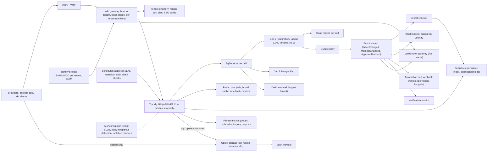
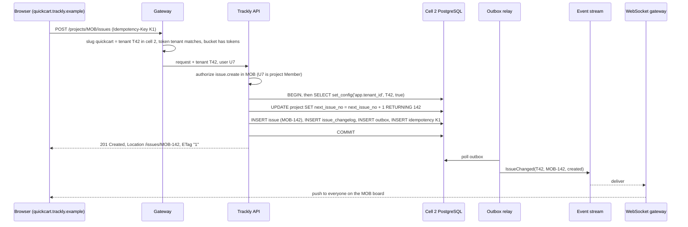
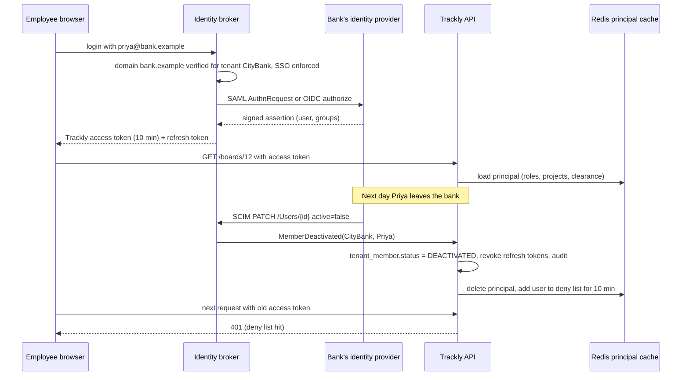

A project-management tool for one team is a weekend project: a table of tasks, a board with three columns, a login page. The same tool sold to five thousand companies at once is a different system. Every company expects to be alone in it: nobody else may ever see its issues, one customer's import script must not slow everybody else down, the bank among the customers wants its own SSO, its own audit trail and its data kept in its own region. This case study designs such a platform, a system like Jira or Asana, which we will call **Trackly**. We reason from public engineering principles, not from any company's internal design.

## Learning objectives

By the end of this lesson you will be able to:

1. Choose a tenancy model for a SaaS with thousands of mostly small tenants and a few very large ones, and explain why a cell-based pool with row-level security fits.
2. Enforce tenant isolation in PostgreSQL 17 with row-level security, and name the gotchas (table owners, empty settings, views, unique constraints, connection pools).
3. Combine roles (what a project admin may do) with attributes (only in projects they belong to, only issues at or below their security level) as ASP.NET Core authorization policies.
4. Protect tenants from each other's load with per-tenant rate limits, quotas, fair job queues and the ability to move a hot tenant to its own database.
5. Design enterprise SSO (SAML or OpenID Connect per tenant) and SCIM provisioning so that a deactivated employee loses access within minutes.
6. Build issue keys, optimistic concurrency, permission-aware search and real-time boards on top of that foundation.
7. Keep a tamper-evident audit log and place each tenant's data in its home region, and prove both.
8. Estimate capacity and cost with arithmetic, and say what breaks first.

## Prerequisites

- [Multi-tenancy](#/lesson/m16-multi-tenancy): silo, pool and bridge models and row-level security.
- [Role-based and policy-based authorization](#/lesson/m14-rbac-pbac): claims, policies and requirements in ASP.NET Core.
- [Multi-tenant security](#/lesson/m14-multi-tenant-security): the isolation failure modes we must design out.
- [Least privilege and audit trails](#/lesson/m14-least-privilege-audit): what an audit log must record.
- [Object storage](#/lesson/m11-object-storage): presigned URLs and why application servers should not stream files.

## Explain it like I'm a beginner

Picture a large co-working building. Five thousand companies rent desks in it: a two-person design studio, a 300-person online grocery company, a bank with 25,000 staff. They share the lifts, the electricity and the reception, but each company's rooms open only with that company's key card. That is **multi-tenancy**: one building, many separate tenants.

Inside each company, people work the way most teams do: a wall of sticky notes. Each note is a piece of work (an **issue**: "Fix the checkout button on Android"). Notes move across columns on the wall from *To do* to *In progress* to *Done* (a **board** with a **workflow**). Every two weeks the team picks which notes to finish next (a **sprint**). Each note gets a short label such as `MOB-142` so people can talk about it (an **issue key**).

Not everyone in a company may touch every wall. The finance team's wall is closed to the marketing interns. A manager can rearrange the whole wall; a visitor from an outside agency can only read the notes on the one wall they were invited to (**roles** and **attributes**). Some notes are marked "security sensitive" and only a few people may read them (**issue security levels**).

The building has rules so that tenants do not hurt each other. If one company starts moving 50,000 boxes through the lift at once, the building manager makes them use the goods lift at night, so other tenants can still get to work (**per-tenant limits** and **noisy-neighbour protection**). Big companies want their own badge system: staff swipe in with the company's own ID card, and when someone leaves, HR deactivates the card and the building door stops opening for them within minutes (**enterprise SSO** and **SCIM provisioning**). Every key-card change and every export of files is written in a bound logbook with numbered pages (**audit log**). A German customer insists that its rooms be in the Frankfurt building, not the Mumbai one (**data residency**).

Trackly is that building, in software.

## Requirements

### Functional

- **Tenants**: a company signs up as a tenant (an *organisation*) with a subdomain (`quickcart.trackly.example`), a plan, settings and an administrator. Users have one global login and can belong to several organisations (a freelancer working for two clients).
- **Projects**: an organisation has projects with a short key (`MOB`, `WEB`), members and a visibility (`OPEN` to every member of the organisation, or `PRIVATE` to project members).
- **Issues**: create, edit, assign, comment, attach files, link issues, watch. Each issue has a type (story, bug, task, change request), status, priority, assignee, reporter, due date, custom fields defined per project, and a human-friendly key (`MOB-142`) that is unique within the organisation.
- **Boards and sprints**: Kanban and Scrum boards over a saved filter; sprints with start and end dates; backlog ordering by drag and drop; burndown and velocity reports.
- **Workflows**: each project has a status workflow (allowed transitions, such as *In review → Done* only by a reviewer). Change-request issues need approvals: sequential groups, "any one" or "all" approvers, delegation and an SLA.
- **Permissions**: organisation roles (Org Admin, Member, Guest) and project roles (Project Admin, Member, Viewer); issue security levels; guests see only projects they are invited to.
- **Search**: a filter language (project, status, assignee, text, labels, dates) over issues the user is allowed to see.
- **Real-time**: boards update live when a teammate moves a card.
- **Integrations**: a public REST API with personal and app tokens, outgoing webhooks, and an automation engine ("when an issue moves to Done, notify the release channel").
- **Enterprise features**: SAML 2.0 or OpenID Connect single sign-on per organisation, verified e-mail domains, SCIM user and group provisioning, a tamper-evident audit log of security and admin events, data residency (India or EU), and per-plan limits.

### Non-functional

- 5,000 organisations in year three; 400,000 registered users; the largest organisation has 25,000 users and 1,200 projects; the median has 25 users and 4 projects.
- Availability 99.9 % for Standard plans, 99.95 % for Enterprise.
- Board and issue pages p95 under 300 ms; search p95 under 800 ms; a card move appears on teammates' boards within 2 s.
- One tenant may not degrade another: per-tenant limits and isolation of heavy work.
- A deactivated user loses access within 10 minutes.
- Audit rows for security events are written in the same transaction as the change and never lost.
- RTO 1 hour, RPO 5 minutes per region.
- Cost target: under ₹120 of infrastructure per registered user per month at year three (estimate).

### Out of scope

Billing and invoicing, a marketplace for third-party apps, wiki pages, time tracking and the mobile app's offline mode.

## Capacity estimation

All numbers below are **estimates** for planning, not measurements.

**Users and requests.** 400,000 registered users. A work tool is used daily by about half its users: DAU ≈ 200,000. A single-page app makes many small calls (board load, card details, comments, typeahead, notifications): about 300 API calls per active user per day. 200,000 × 300 = 60 M calls/day ÷ 86,400 ≈ **694 req/s** averaged over the whole day.

That average hides two things. First, each region is its own deployment: about 60 % of users are homed in India and 40 % in the EU. Second, people work about 9 hours a day. For India: 60 M × 0.6 = 36 M calls/day ÷ (9 × 3,600 = 32,400 s) ≈ **1,110 req/s** during working hours, and about **2× that, ≈ 2,200 req/s**, at the Monday-morning peak when every team opens its board for sprint planning. For the EU: 24 M ÷ 32,400 ≈ 740 req/s, peak ≈ 1,500 req/s.

**Writes.** About 10 % of calls change something (edit a field, move a card, comment): India peak ≈ 220 writes/s. Each write touches about four rows (the issue, a changelog row, an outbox row, sometimes an audit row): ≈ 900 row changes/s. One modern PostgreSQL primary handles this comfortably; write throughput does not force sharding.

**Live boards.** About 40 % of India's 120,000 DAU are online at the peak: ≈ 48,000 WebSocket connections. At a conservative 20,000 connections per gateway instance, that is 3 instances plus one spare.

**Search.** Board, backlog and filter views are about a quarter of reads: India peak reads ≈ 1,980/s × 0.25 ≈ **500 search queries/s**.

**Data (all regions, after three years, 250 working days a year).**

| Data | Rate | Size per item | Three-year total |
|---|---|---|---|
| Issues | 0.5 per DAU per day = 100,000/day → 75 M | ≈ 2 KB (fields, custom fields as JSON, description) | ≈ 150 GB |
| Changelog (field history) | 15 per DAU per day = 3 M/day → 2.25 B rows | ≈ 250 bytes | ≈ 560 GB |
| Comments | 2 per DAU per day = 400,000/day → 300 M | ≈ 1 KB | ≈ 300 GB |
| Security/admin audit | 3 per DAU per day = 600,000/day → 450 M | ≈ 500 bytes | ≈ 225 GB |
| Attachments (object storage) | 0.2 per DAU per day = 40,000/day × 1.5 MB = 60 GB/day | 1.5 MB | ≈ 45 TB |

Table data in PostgreSQL ≈ 1.25 TB, about 1.8 TB with indexes; India's share (60 %) ≈ 1.1 TB. Attachments at roughly ₹2 per GB-month (estimate for a hot object-storage tier) cost about 45,000 GB × ₹2 ≈ ₹90,000 a month across both regions: real, but not the largest line.

**Summary for the India region at year three (estimates)**

| Item | Average (working hours) | Peak | Notes |
|---|---|---|---|
| API requests | 1,110/s | 2,200/s | 90 % reads |
| Writes | 110/s | 220/s | ≈ 900 row changes/s at peak |
| Search queries | 250/s | 500/s | permission-filtered |
| WebSocket connections | — | 48,000 | 3 + 1 gateway instances |
| Hot database | — | ≈ 1.1 TB | split across cells |
| Attachments | 36 GB/day | — | ≈ 27 TB after three years |

**What breaks first.** Not raw throughput. In order: (1) **noisy neighbours**: one tenant's integration script, bulk edit of 40,000 issues or runaway automation rule saturates the shared database's CPU or connection pool and every tenant on it slows down; (2) **permission-aware search** for large tenants, where a user can see 1,200 projects and the filter is expensive; (3) the **connection count** on a pooled database (16 API instances × 50 connections each is 800 connections, far past what PostgreSQL likes). Each has a specific answer below.

## API design

The tenant comes from the host name (`quickcart.trackly.example`) for browser traffic, and from a verified token claim for API clients; never from a tenant id in the URL path, query string or body. Internal identifiers are UUIDv7 values (time-ordered, so B-tree inserts stay at the right edge of the index; `Guid.CreateVersion7()` in .NET 9 and later). Issue keys such as `MOB-142` are for humans and are resolved to ids by the API; see [unique ID generation](#/lesson/m17-unique-id-generator) for the trade-offs between these id styles.

| Method and path | Purpose | Notes |
|---|---|---|
| `POST /projects` | Create a project | Body: key, name, visibility; `Idempotency-Key` header |
| `POST /projects/{key}/issues` | Create an issue | Returns `201` with the new key, `Location` and `ETag` |
| `GET /issues/{key}` | Issue details | `404` if the caller cannot see it, never `403` (see below) |
| `PATCH /issues/{key}` | Edit fields | Requires `If-Match: <etag>`; `412 Precondition Failed` on a stale version |
| `POST /issues/{key}/transitions` | Move to another status | Body: transition id; the workflow decides if it is allowed |
| `POST /issues/{key}/attachments` | Begin an upload | Returns a signed upload URL; the client uploads directly to object storage |
| `POST /attachments/{id}/complete` | Finish an upload | Server verifies size and checksum; the file is downloadable only after a malware scan |
| `GET /search?q=&cursor=` | Filter issues | Cursor pagination; the server injects tenant and permission filters |
| `GET /boards/{id}` | Board columns and cards | Served from the read path; live updates over WebSocket |
| `POST /approvals/{id}/steps/{step}/decide` | Approve, reject or delegate | Idempotent on a client-generated decision id |
| `POST /bulk/issues` | Bulk edit | Returns `202` and a job id; runs on the tenant's job queue |
| `GET /audit?from=&to=&actor=&action=` | Audit search | Org Admin and Auditor only; the read itself is audited |
| `/scim/v2/Users`, `/scim/v2/Groups` | SCIM provisioning | Called by the customer's identity provider with a per-tenant bearer token |

Rate-limited calls return `429 Too Many Requests` with a `Retry-After` header. Errors use RFC 9457 problem details.

**Why `404` rather than `403`.** If `GET /issues/FIN-7` returned `403` to someone outside the finance project, it would confirm that `FIN-7` exists and is interesting. Trackly returns `404` when the caller cannot see the project or the issue's security level, and `403` only when the caller can see the issue but may not perform this particular action (for example, a Viewer trying to edit).

## Data model

Trackly uses a **pool model with row-level security**: shared tables, `tenant_id` on every row, a PostgreSQL policy that filters by the tenant of the current transaction. The pool is split into **cells**: each cell is a complete PostgreSQL cluster (primary, replica, connection pooler) holding about 1,000 tenants. A few very large or contract-bound tenants get a **dedicated cell** that runs the same schema with one tenant in it. A global **tenant directory** maps each tenant to its region and cell.

```sql
-- Global tenant directory (replicated per region; holds no issue data).
CREATE TABLE tenant (
  tenant_id     uuid PRIMARY KEY,
  slug          text NOT NULL UNIQUE,         -- 'quickcart' -> quickcart.trackly.example
  home_region   text NOT NULL,                -- 'in-west', 'eu-central'
  cell          text NOT NULL,                -- 'in-west-c2' or 'in-west-ded-citycare'
  plan          text NOT NULL,                -- FREE | STANDARD | PREMIUM | ENTERPRISE
  status        text NOT NULL DEFAULT 'ACTIVE' -- ACTIVE | MOVING | SUSPENDED
);
```

Inside every cell:

```sql
CREATE TABLE tenant_member (
  tenant_id     uuid NOT NULL,
  user_id       uuid NOT NULL,                -- global identity id
  display_name  text NOT NULL,
  email         text NOT NULL,
  kind          text NOT NULL,                -- MEMBER | GUEST
  org_role      text NOT NULL DEFAULT 'MEMBER', -- ORG_ADMIN | MEMBER | GUEST
  clearance     smallint NOT NULL DEFAULT 0,  -- highest issue security level the user may see
  status        text NOT NULL DEFAULT 'ACTIVE', -- ACTIVE | DEACTIVATED
  scim_external_id text,
  PRIMARY KEY (tenant_id, user_id),
  UNIQUE (tenant_id, email)
);

CREATE TABLE project (
  tenant_id     uuid NOT NULL,
  project_id    uuid NOT NULL,
  key           text NOT NULL,                -- 'MOB'
  name          text NOT NULL,
  visibility    text NOT NULL DEFAULT 'PRIVATE', -- OPEN | PRIVATE
  next_issue_no int  NOT NULL DEFAULT 1,
  PRIMARY KEY (tenant_id, project_id),
  UNIQUE (tenant_id, key)
);

CREATE TABLE project_member (
  tenant_id     uuid NOT NULL,
  project_id    uuid NOT NULL,
  user_id       uuid NOT NULL,
  project_role  text NOT NULL,                -- ADMIN | MEMBER | VIEWER
  PRIMARY KEY (tenant_id, project_id, user_id),
  FOREIGN KEY (tenant_id, project_id) REFERENCES project,
  FOREIGN KEY (tenant_id, user_id) REFERENCES tenant_member
);

CREATE TABLE sprint (
  tenant_id     uuid NOT NULL,
  sprint_id     uuid NOT NULL,
  project_id    uuid NOT NULL,
  name          text NOT NULL,
  state         text NOT NULL,                -- FUTURE | ACTIVE | CLOSED
  starts_at     timestamptz,
  ends_at       timestamptz,
  PRIMARY KEY (tenant_id, sprint_id),
  FOREIGN KEY (tenant_id, project_id) REFERENCES project
);

CREATE TABLE issue (
  tenant_id       uuid NOT NULL,
  issue_id        uuid NOT NULL,              -- UUIDv7, generated by the application
  project_id      uuid NOT NULL,
  issue_no        int  NOT NULL,              -- MOB-142 -> project key + issue_no
  issue_type      text NOT NULL,              -- STORY | BUG | TASK | CHANGE_REQUEST
  summary         text NOT NULL,
  description     text,
  status          text NOT NULL,              -- per-project workflow status, e.g. 'In review'
  status_category text NOT NULL,              -- TODO | IN_PROGRESS | DONE (for reports)
  priority        text NOT NULL,
  assignee_user   uuid,
  reporter_user   uuid NOT NULL,
  sprint_id       uuid,
  rank            text NOT NULL,              -- lexicographic rank for drag-and-drop ordering
  security_level  smallint NOT NULL DEFAULT 0,
  due_at          timestamptz,
  custom_fields   jsonb NOT NULL DEFAULT '{}',
  version         int  NOT NULL DEFAULT 1,    -- optimistic concurrency, exposed as ETag
  created_at      timestamptz NOT NULL DEFAULT now(),
  updated_at      timestamptz NOT NULL DEFAULT now(),
  PRIMARY KEY (tenant_id, issue_id),
  UNIQUE (tenant_id, project_id, issue_no),
  FOREIGN KEY (tenant_id, project_id) REFERENCES project,
  FOREIGN KEY (tenant_id, sprint_id) REFERENCES sprint
);

-- Field history shown on the issue page. High volume, so partitioned by month; not hash-chained.
CREATE TABLE issue_changelog (
  tenant_id   uuid NOT NULL,
  issue_id    uuid NOT NULL,
  changed_at  timestamptz NOT NULL,
  actor_user  uuid NOT NULL,
  field       text NOT NULL,
  old_value   text,
  new_value   text,
  PRIMARY KEY (tenant_id, issue_id, changed_at, field)
) PARTITION BY RANGE (changed_at);

CREATE TABLE attachment (
  tenant_id     uuid NOT NULL,
  attachment_id uuid NOT NULL,
  issue_id      uuid NOT NULL,
  object_key    text NOT NULL,                -- '<tenant_id>/<issue_id>/<attachment_id>'
  file_name     text NOT NULL,
  size_bytes    bigint NOT NULL,
  sha256        bytea,
  scan_status   text NOT NULL DEFAULT 'PENDING', -- PENDING | CLEAN | INFECTED
  PRIMARY KEY (tenant_id, attachment_id),
  FOREIGN KEY (tenant_id, issue_id) REFERENCES issue
);

-- Change-request approvals.
CREATE TABLE approval_step (
  tenant_id     uuid NOT NULL,
  issue_id      uuid NOT NULL,
  step_no       int  NOT NULL,                -- steps with the same step_no run in parallel
  rule          text NOT NULL,                -- ALL | ANY
  assignee_user uuid NOT NULL,
  status        text NOT NULL,                -- WAITING | PENDING | APPROVED | REJECTED | DELEGATED | SKIPPED
  delegated_to  uuid,
  due_at        timestamptz,
  PRIMARY KEY (tenant_id, issue_id, step_no, assignee_user)
);

-- Security and admin events: append-only, hash-chained per tenant, partitioned by month.
CREATE TABLE audit_log (
  tenant_id     uuid NOT NULL,
  seq           bigint NOT NULL,              -- per-tenant sequence, assigned under a per-tenant lock
  occurred_at   timestamptz NOT NULL,
  actor_user    uuid,
  actor_ip      inet,
  action        text NOT NULL,                -- member.role.change, sso.config.update, export.create ...
  entity_type   text NOT NULL,
  entity_id     text NOT NULL,
  before        jsonb,
  after         jsonb,
  prev_hash     bytea NOT NULL,
  hash          bytea NOT NULL,               -- sha256(prev_hash || canonical row)
  PRIMARY KEY (tenant_id, seq, occurred_at)
) PARTITION BY RANGE (occurred_at);
```

Every unique constraint and every foreign key includes `tenant_id`. That is not decoration: a foreign key `(tenant_id, project_id)` makes it impossible for an issue of one tenant to point at another tenant's project, even through a bug.

**Row-level security** on every tenant table, with the tenant supplied per transaction:

```sql
ALTER TABLE issue ENABLE ROW LEVEL SECURITY;
ALTER TABLE issue FORCE ROW LEVEL SECURITY;
CREATE POLICY tenant_isolation ON issue
  USING      (tenant_id = NULLIF(current_setting('app.tenant_id', true), '')::uuid)
  WITH CHECK (tenant_id = NULLIF(current_setting('app.tenant_id', true), '')::uuid);

-- The application role is an ordinary role: not a superuser, not BYPASSRLS, not the table owner.
GRANT SELECT, INSERT, UPDATE, DELETE ON issue TO trackly_app;

-- Audit is append-only: no UPDATE or DELETE privilege, no UPDATE or DELETE policy.
ALTER TABLE audit_log ENABLE ROW LEVEL SECURITY;
ALTER TABLE audit_log FORCE ROW LEVEL SECURITY;
CREATE POLICY audit_read   ON audit_log FOR SELECT USING      (tenant_id = NULLIF(current_setting('app.tenant_id', true), '')::uuid);
CREATE POLICY audit_insert ON audit_log FOR INSERT WITH CHECK (tenant_id = NULLIF(current_setting('app.tenant_id', true), '')::uuid);
GRANT SELECT, INSERT ON audit_log TO trackly_app;
```

The details matter:

- **`FORCE ROW LEVEL SECURITY`**: without it the table owner bypasses policies, and migrations or a misconfigured service often run as the owner. Superusers and roles with `BYPASSRLS` always bypass RLS, so the application must never connect as one.
- **`current_setting('app.tenant_id', true)`**: the second argument makes it return NULL instead of throwing when the setting was never defined. On a pooled connection that has used the setting in an earlier transaction, it returns an empty string instead. `NULLIF(..., '')` turns both into NULL, and `tenant_id = NULL` is never true, so a request that forgot to set its tenant sees **no rows**, not every row. The policy fails closed.
- **Set the tenant with `set_config`, not `SET LOCAL`**: `SET LOCAL app.tenant_id = ...` cannot take a bind parameter, which tempts people into string concatenation. `SELECT set_config('app.tenant_id', @tenant, true)` is parameterised, and the `true` makes it transaction-local, so it resets at commit and is safe behind a transaction-mode pooler such as PgBouncer.
- **Views**: a view runs with its owner's rights by default, which can bypass RLS. Create views `WITH (security_invoker = true)` (PostgreSQL 15 and later).
- **Constraints leak existence**: a unique violation or foreign-key check is evaluated against all rows, not just visible ones. Including `tenant_id` in every unique key means one tenant's `MOB` project key never collides with another's, so the error cannot reveal anything.
- **Indexes lead with `tenant_id`**: the policy adds `tenant_id = $x` to every query, so `(tenant_id, project_id, status_category)`, `(tenant_id, sprint_id)`, `(tenant_id, assignee_user) WHERE status_category <> 'DONE'` and `(tenant_id, project_id, rank)` serve boards, backlogs and "my open issues".

**Issue keys.** `MOB-142` needs a per-project counter without gaps that confuse humans. Inside the create transaction: `UPDATE project SET next_issue_no = next_issue_no + 1 WHERE tenant_id = @t AND project_id = @p RETURNING next_issue_no - 1`. The row lock serialises issue creation per project, which is fine at a few creations per second per project. A bulk import of 40,000 issues reserves numbers in blocks (`+ 1000`) instead of locking 40,000 times. If a transaction rolls back after taking a number, the number is lost; small gaps are acceptable, duplicates are not.

**Optimistic concurrency.** Two people edit the same issue. `PATCH` carries `If-Match: "7"`; the update is `... SET ..., version = version + 1 WHERE tenant_id = @t AND issue_id = @i AND version = 7`. Zero rows updated means someone else saved first: return `412` and let the client re-fetch and merge. Card moves on a board touch only `status` and `rank`, so the client retries them automatically.

**Guests.** Identity is global (one login, many organisations), but membership is per tenant. A guest has a `tenant_member` row with `kind = 'GUEST'` and `project_member` rows only for the projects they were invited to. RLS keeps them inside the tenant; the authorisation layer keeps them inside their projects (a guest never sees `OPEN` projects, which are open to members only).

## High-level architecture



Walk through the arrows. Users reach a **CDN and web application firewall**, then the **API gateway**. The gateway reads the host name, looks the slug up in the **tenant directory** (cached for 30 s), validates the access token, checks that the token's tenant matches the host, and applies a **per-tenant token bucket** sized by plan. Login is delegated to an **identity broker**: it talks SAML or OpenID Connect to each enterprise tenant's own identity provider, receives SCIM calls from those providers, and issues Trackly's own short-lived tokens, so the API only ever validates one kind of token.

The **API** is a modular monolith (projects, issues, boards, search, approvals, admin, audit modules). One deployable per region is simpler to operate than a dozen services, and the load does not need more. It reaches the right **cell** through a **PgBouncer** pooler per cell, which collapses 800 application connections into about 100 server connections. Every transaction begins by setting `app.tenant_id`; RLS does the rest. Board and search pages that tolerate a second of staleness read from the cell's **replica**. The largest tenant lives in a **dedicated cell** behind exactly the same code; the directory, not an `if` statement, decides.

Every change writes an **outbox** row in the same transaction. The relay publishes to the **event stream**, which feeds the **search indexer**, the **read models** for burndown and velocity charts, the **automation and webhook workers** (each tenant with its own execution budget), the [notification service](#/lesson/m17-notification-platform) for e-mail and push, and the **WebSocket gateway**, which pushes "card moved" messages to everyone viewing that board. Heavy operations (bulk edits, CSV imports, exports) go to **per-tenant job queues** with fair scheduling. Attachments never pass through the API: it **signs** an upload or download URL and the browser talks to **object storage** directly; **scan workers** check new files for malware. A durable **scheduler** (see the [job scheduler](#/lesson/m17-job-scheduler) case study) fires approval SLA checks, retention jobs and the nightly audit-chain verification. **Monitoring** tracks per-tenant SLOs, spots tenants that consume a disproportionate share of a cell, and runs **isolation canaries**: synthetic users in two test tenants who continuously try to read each other's issues and page the on-call engineer if they ever succeed.

### Sequence: creating an issue in a pooled cell



The gateway rejects the request with `429` before any database work if the tenant's bucket is empty, which is what keeps one tenant's script from reaching the shared cell. The API sets the tenant with a parameterised `set_config` at the start of the transaction; every statement after that is filtered by RLS. The key allocation, the issue, its first changelog row, the outbox event and the idempotency record commit together, so a retried request with the same `Idempotency-Key` returns the same `MOB-142` instead of creating `MOB-143`. Live updates are asynchronous: the board on a teammate's screen typically refreshes within a second, and if the WebSocket is down the browser falls back to polling every 30 s.

### Sequence: enterprise SSO login and SCIM deactivation



Home-realm discovery uses the e-mail domain: once the bank has proved it owns `bank.example` (a DNS TXT record), anyone logging in with that domain is sent to the bank's identity provider, and password login is refused if the tenant enforces SSO. The broker turns the provider's assertion into a short-lived Trackly token. Deactivation arrives through SCIM, the standard API that identity providers use to create, update and deactivate accounts in SaaS apps. The API marks the membership deactivated, revokes refresh tokens, drops the cached principal and puts the user on a short deny list that covers the remaining lifetime of any access token already issued. That is how "lose access within 10 minutes" becomes a guarantee rather than a hope.

## Deep dives

### 1. Tenancy model: pool, cells and dedicated databases

| Model | Isolation | Cost at 5,000 tenants | Operations | Fits |
|---|---|---|---|---|
| Silo (database per tenant) | Strongest | 5,000 databases, most nearly empty | Migrations across 5,000 databases; monitoring 5,000 of everything | A few dozen large customers |
| Schema per tenant | Medium | One cluster, 5,000 schemas × 40 tables = 200,000 tables | Catalog bloat, slow migrations, connection pools per schema | Hundreds of tenants at most |
| Pool (shared tables + RLS) | Strong if enforced everywhere | A few clusters | One migration per cell | Many small tenants |
| Cells of pools + dedicated cells | Pool, plus a blast-radius limit, plus silo for the few | Five pooled cells and three dedicated ones across two regions | Same code everywhere; tenant moves between cells | Trackly |

Trackly chooses **pooled cells with dedicated cells for the few**. Why cells at all, when the capacity estimate showed one cluster per region could hold the data? Because size is not the only reason to split:

- **Blast radius**: a bad migration, a runaway query or a failover affects one cell's 1,000 tenants, not all 3,000 in the region.
- **Noisy neighbours**: when one tenant grows heavy, there are other cells to move its neighbours to, or a dedicated cell to move it to.
- **Safe rollout**: schema migrations and new releases go to a canary cell first.
- **Maintenance**: vacuuming a 330 GB cell, taking its backup and restoring it in a drill are all faster than for a 1.1 TB cluster.

Cells cost something: more clusters to run and a directory that must always be right. At 50 tenants, one database is the right answer; cells start paying off in the thousands.

**Moving a tenant between cells** happens when a tenant outgrows its neighbours or signs an Enterprise contract. The steps: copy the tenant's rows to the target cell (logical replication filtered by `tenant_id`, or a bulk copy followed by replaying the outbox), wait for lag near zero, mark the tenant `MOVING` in the directory so the gateway briefly queues or rejects its writes (seconds, announced in advance), verify row counts and checksums, flip the directory entry to the new cell, resume writes, and delete the old rows after a quarantine period. Because every key includes `tenant_id` and ids are globally unique UUIDs, rows move without renumbering.

### 2. Tenant resolution and isolation layers

Tenant resolution happens exactly once, at the gateway, from the host name or a verified token claim. If a token issued for tenant A is presented at `b.trackly.example`, the gateway rejects it. The resolved tenant travels as a scoped `TenantContext` in the API, and the data layer opens every transaction with `set_config('app.tenant_id', @tenant, true)`.

Isolation is layered, because any single layer will one day have a bug:

1. Tenant from the host or the token only, never from user input.
2. A scoped `TenantContext` that can be set once per request.
3. Authorisation that limits the user to their projects and security levels.
4. RLS with `FORCE` on every tenant table; the application role cannot bypass it.
5. Tenant-prefixed keys everywhere outside the database: object storage (`<tenant_id>/...`), Redis (`t:{tenant}:...`), search documents (a `tenant_id` field and a mandatory filter), event payloads.
6. A residency guard that refuses to write a tenant's data in the wrong region.
7. Isolation canaries in production and an integration test in CI that runs a query without setting the tenant and asserts it returns zero rows.

### 3. Permissions: roles for capability, attributes for scope

Pure role-based access control (RBAC) cannot say "Member, *but only in the projects I belong to*". Pure attribute-based control (ABAC) can say anything, but administrators cannot read it. Trackly uses **roles for capabilities and attributes for scope**:

- Roles grant **permissions**: `issue.read`, `issue.create`, `issue.edit`, `issue.delete`, `issue.bulk-edit`, `project.admin`.
- The **effective project role** is the user's explicit project role if they are a member; `Admin` if they are an Org Admin; `Viewer` if the project is `OPEN` and the user is a regular member (not a guest); otherwise none, and the project is invisible.
- Attribute rules **constrain** a permission: issue `security_level ≤ user clearance`; `issue.delete` only by the reporter or a project admin; bulk edits up to a plan-defined count.

In ASP.NET Core this maps to **policy-based authorization**: a requirement per rule, a handler per requirement, a resource passed to `IAuthorizationService.AuthorizeAsync(user, resource, policy)`. The user's memberships, roles and clearance are loaded once into a compact principal and cached in Redis for 5 minutes, invalidated immediately on a membership change by a `MemberChanged` event. Evaluation is in memory and takes microseconds.

### 4. Noisy neighbours and per-tenant limits

A noisy neighbour is a tenant whose load hurts other tenants on shared resources. In a project tool the usual culprits, in rough order of how often they cause incidents, are:

| Source | Example | Control |
|---|---|---|
| API scripts and integrations | A CI pipeline polls `GET /search` 200 times a second | Per-tenant and per-token token buckets by plan; `429` with `Retry-After`; webhooks recommended instead of polling |
| Bulk operations | "Move 40,000 issues to the new sprint" | `202 Accepted` and a job on the tenant's own queue; one or two concurrent jobs per tenant; batches of 500 rows per transaction |
| Automation rules | A rule triggered by "issue updated" updates the issue, which triggers itself | Monthly execution budget per plan; loop detection (a rule may not trigger itself more than 10 levels deep); per-tenant worker concurrency |
| Expensive searches | Free-text search across 1,200 projects with sorting by a custom field | Query cost limits and timeouts in the search tier; cursor pagination capped at 100 per page |
| Database hotspots | A dashboard query scanning a large tenant's changelog | `statement_timeout` for the application role, read models instead of ad-hoc scans, and moving the tenant to a dedicated cell |
| Storage | One tenant uploads 2 TB of build artefacts | Plan quotas on attachment bytes, checked when the upload begins |

**Where to enforce rate limits.** The gateway is the first line, because it rejects traffic before it reaches the cell. ASP.NET Core's built-in rate limiter (`Microsoft.AspNetCore.RateLimiting`) gives a second line inside the API with a **partitioned limiter keyed by tenant**. An in-process limiter counts per instance, so with 16 instances the effective limit is up to 16 times the configured value; either divide the plan's limit by the instance count (simple, approximate) or keep the counters in Redis (exact, one extra round trip). Trackly uses Redis counters at the gateway for the contractual plan limit and an in-process limiter as a cheap safety net. The [rate limiting](#/lesson/m10-rate-limiting) and [rate limiter](#/lesson/m17-rate-limiter) lessons cover the algorithms.

Plan limits (estimates a product team would tune):

| Plan | API requests per tenant | Burst | Concurrent bulk jobs | Automation runs per month | Attachment storage |
|---|---|---|---|---|---|
| Free | 10/s | 20 | 1 | 100 | 2 GB |
| Standard | 100/s | 200 | 1 | 1,000 + 10 per user | 250 GB |
| Premium | 300/s | 600 | 2 | 1,000 + 100 per user | 1 TB |
| Enterprise | 1,000/s (contract) | 2,000 | 4 | Contract | Contract |

Check against reality: the largest tenant has 12,500 daily active users; 12,500 × 300 calls ÷ 32,400 s ≈ 116 req/s on average, about 230 at peak, well inside its 1,000/s Enterprise limit. A 500-person Standard tenant generates about 2.3 req/s from humans. The limits are not there to ration people; they stop scripts.

**Fair queues.** Bulk jobs, imports and exports go to a queue per tenant, and workers pick tenants round-robin. Without that, one tenant's 50,000-row import queued first delays every other tenant's 20-row bulk edit for half an hour.

### 5. Permission-aware search

Search is where isolation and performance collide. The index stores, for each issue, `tenant_id`, `project_id`, `security_level`, status, assignee, labels, dates, custom fields and text. The query layer translates the user's filter into a search query and **always adds**: `tenant_id = T`, `project_id IN (projects the user can see)`, `security_level <= clearance`. The user's visible project list comes from the cached principal.

Two approaches were considered:

- **Pre-filter** (inject permissions into the query): correct counts and pagination; the project list can be long (1,200 ids for an Org Admin), which search engines handle well as a terms filter.
- **Post-filter** (search, then drop hits the user may not see): simple, but pages come back short or empty, total counts leak the existence of hidden issues, and deep pagination becomes expensive.

Trackly pre-filters. Large tenants get their own index (or routing key) so their 20 million issues do not slow down queries for small tenants; small tenants share indexes with a mandatory tenant filter. The index is eventually consistent (about 1–2 s behind), so the issue page itself always reads from PostgreSQL, and a user who just created an issue sees it via a read-your-writes merge on the board. The [search architecture](#/lesson/m16-search-architecture) lesson explains indexing pipelines in depth.

### 6. Workflows and change-request approvals

Each project has a **status workflow**: statuses (`To do`, `In progress`, `In review`, `Done`) mapped to three categories (`TODO`, `IN_PROGRESS`, `DONE`) that reports use, plus allowed transitions with conditions ("only a member of the QA group may move to *Done*"). A transition is one transaction: check the transition is allowed from the current status, check conditions, update the issue with the version check, write changelog and outbox.

**Change requests** (for example "deploy the new payment gateway on Friday") add approvals. A template lists step groups; each group has a `step_no`, a rule (`ALL` or `ANY`) and assignees resolved when the request starts, so a later group change does not silently change who must approve a running request. The engine's rules:

- Starting a request creates all step rows as `WAITING`, then marks the lowest `step_no` `PENDING` with `due_at = now + SLA`.
- For `ALL`, a group completes when every non-delegated assignee has approved; for `ANY`, when one has. A rejection by anyone rejects the request and skips the rest.
- When a group completes, the next `step_no` becomes `PENDING`. When the last completes, the request is approved and the issue may transition to `Approved`.
- Delegation marks the delegator's row `DELEGATED` and inserts a `PENDING` row for the delegate with the same `due_at`, so delegation does not reset the clock.
- An SLA breach does not decide anything: it sets an escalation flag, notifies the approver's manager and is recorded.
- Decisions are idempotent on a client-generated decision id; a retried click returns the original result.

These are ordinary rows and transactions. A general workflow engine ([workflow engines](#/lesson/m16-workflow-engines)) becomes worth it when templates need loops, branches on arbitrary data or long waits on external systems; approvals rarely do.

### 7. Reporting

Burndown, velocity and cumulative-flow charts are the reports teams look at every day. Computing them from the changelog on each page load would scan millions of rows for a large tenant. Instead, **read models** updated from events keep a small table per sprint (`sprint_burndown(tenant_id, sprint_id, day, remaining_points)`), so the chart is a 14-row read. Cross-project dashboards for the largest tenants ("open bugs by priority across 1,200 projects") run from a regional **analytics store** loaded from the event stream, partitioned by tenant, with per-tenant query concurrency limits. Exports are jobs on the tenant's queue that write a file to object storage and send a signed link.

### 8. Audit

Trackly distinguishes two histories:

- The **changelog** ("Meera changed priority from Medium to High") is product data: high volume, shown on every issue, partitioned by month, not hash-chained.
- The **audit log** records security and admin events: logins, SSO configuration, role and membership changes, permission scheme edits, exports, API token creation, audit reads, data deletion. It must be complete, attributable, ordered, immutable and retained (seven years for some customers).

The audit design:

- Written **in the same transaction** as the change it describes, so both commit or neither does.
- **Append-only** by privilege: the application role has `INSERT` and `SELECT` only.
- **Hash-chained per tenant**: each row stores `prev_hash` and `hash = SHA-256(prev_hash || canonical row)`, and a per-tenant `seq` is assigned under a per-tenant advisory lock (`pg_advisory_xact_lock`) so the chain is linear. A nightly job re-walks each tenant's chain and compares the final hash with a copy kept in write-once object storage in the tenant's region. Editing a row breaks the chain; deleting one leaves a gap in `seq`.
- The lock serialises audit writes per tenant. That is acceptable because audit events are about 3 per active user per day (a few per second even for the largest tenant). Issue edits, at 15 per user per day and bursty, stay in the changelog; chaining them would make the lock a bottleneck for exactly the tenants who can least afford it.
- Partitioned by month; old partitions detached and archived in the tenant's region.

### 9. Enterprise SSO and SCIM

- **Per-tenant identity configuration**: SAML 2.0 metadata or OpenID Connect issuer, client id and secret, stored encrypted in the directory and loaded by the identity broker per tenant. The API never handles SAML; it validates the broker's JWTs.
- **Domain verification** (DNS TXT record) before SSO can be enforced for a domain, so a tenant cannot claim `gmail.com`.
- **Just-in-time provisioning** creates a member on first login; **SCIM** creates, updates and deactivates members and syncs groups ahead of time. Groups map to project roles ("IdP group `mobile-devs` = Member of `MOB`").
- **Deprovisioning** is the security-critical path: 10-minute access tokens, refresh-token revocation, principal cache eviction and a deny list, as in the sequence above.
- **Break-glass**: one tenant-designated admin account with a hardware key can log in without SSO, so a broken identity provider does not lock the company out; every use is audited and alerts.

### 10. Data residency

The tenant directory holds `home_region`. Each region is a complete deployment: gateway, API, cells, object storage, search, analytics store, logs and backups. The gateway in one region redirects requests for tenants homed elsewhere. A residency guard in the data layer refuses to write a tenant's rows if the process's region differs from the tenant's. Logs with personal data go to a per-region logging workspace; global telemetry carries only tenant ids and counts.

The honest exception is **identity**: a global login means the e-mail address must be findable before we know the region. Trackly keeps a global index of `hash(email) → home region` and stores the profile itself (name, e-mail, avatar) in the region of the user's primary organisation; residency commitments are written for product data (issues, comments, attachments, audit) and name this exception explicitly. This is the same pattern as [multi-region](#/lesson/m16-multi-region), applied per tenant.

### Production-style C# implementation

The pieces that benefit from code: the tenant context, the per-tenant rate limiter, policy-based authorisation with resource-aware handlers, the approval state machine and the hash-chained audit writer. Persistence is behind interfaces with in-memory implementations so that the set compiles offline. With Npgsql, the start of every transaction looks like this (not compiled here):

```csharp
await using var tx = await conn.BeginTransactionAsync(ct);
await using (var cmd = new NpgsqlCommand("SELECT set_config('app.tenant_id', @t, true)", conn, tx))
{
    cmd.Parameters.AddWithValue("t", tenant.TenantId);   // parameterised; transaction-local
    await cmd.ExecuteNonQueryAsync(ct);
}
// ... every statement in this transaction is now filtered by RLS ...
await tx.CommitAsync(ct);
```

```csharp file=Trackly/Tenancy/TenantContext.cs
namespace Trackly.Tenancy;

/// <summary>Resolved once per request; scoped lifetime. Never populated from the URL, query string or body.</summary>
public sealed class TenantContext
{
    public string TenantId { get; private set; } = "";
    public string Plan { get; private set; } = "FREE";
    public bool IsResolved => TenantId.Length > 0;

    public void Set(string tenantId, string plan)
    {
        if (IsResolved) throw new InvalidOperationException("Tenant already resolved for this request.");
        ArgumentException.ThrowIfNullOrWhiteSpace(tenantId);
        TenantId = tenantId;
        Plan = plan;
    }
}

public interface ITenantDirectory
{
    /// <summary>Maps a host slug (quickcart) to a tenant id and plan, or null if unknown.</summary>
    (string TenantId, string Plan)? FindBySlug(string slug);
}

public sealed class InMemoryTenantDirectory : ITenantDirectory
{
    private readonly Dictionary<string, (string, string)> _bySlug = new(StringComparer.OrdinalIgnoreCase)
    {
        ["quickcart"] = ("t-quickcart", "STANDARD"),
        ["citycare"] = ("t-citycare", "ENTERPRISE"),
    };

    public (string TenantId, string Plan)? FindBySlug(string slug) =>
        _bySlug.TryGetValue(slug, out var t) ? t : null;
}

public sealed class TenantResolutionMiddleware(RequestDelegate next)
{
    public async Task InvokeAsync(HttpContext ctx, TenantContext tenant, ITenantDirectory directory)
    {
        // quickcart.trackly.example -> "quickcart". Health checks and SCIM use other routes in production.
        var host = ctx.Request.Host.Host;
        var slug = host.Split('.')[0];
        var found = directory.FindBySlug(slug);
        if (found is null)
        {
            ctx.Response.StatusCode = StatusCodes.Status404NotFound;   // unknown tenant: reveal nothing
            return;
        }

        // A token issued for one tenant must not be used on another tenant's host.
        var tokenTenant = ctx.User.FindFirst("tid")?.Value;
        if (tokenTenant is not null && tokenTenant != found.Value.TenantId)
        {
            ctx.Response.StatusCode = StatusCodes.Status401Unauthorized;
            return;
        }

        tenant.Set(found.Value.TenantId, found.Value.Plan);
        await next(ctx);
    }
}
```

```csharp file=Trackly/Limits/TenantRateLimiting.cs
using System.Threading.RateLimiting;
using Trackly.Tenancy;

namespace Trackly.Limits;

public sealed record PlanLimits(int RequestsPerSecond, int Burst);

public static class PlanCatalog
{
    public static PlanLimits For(string plan) => plan switch
    {
        "ENTERPRISE" => new PlanLimits(1_000, 2_000),
        "PREMIUM" => new PlanLimits(300, 600),
        "STANDARD" => new PlanLimits(100, 200),
        _ => new PlanLimits(10, 20),
    };
}

/// <summary>
/// One token bucket per tenant, sized by plan. Counts are per API instance, so the configured
/// figures are divided by the instance count; exact global limits live in Redis at the gateway.
/// </summary>
public static class TenantRateLimiter
{
    public static PartitionedRateLimiter<HttpContext> Create(int instanceCount) =>
        PartitionedRateLimiter.Create<HttpContext, string>(ctx =>
        {
            var tenant = ctx.RequestServices.GetRequiredService<TenantContext>();
            if (!tenant.IsResolved)
                return RateLimitPartition.GetNoLimiter("unresolved");   // the middleware has already returned 404

            var limits = PlanCatalog.For(tenant.Plan);
            var perInstance = Math.Max(1, limits.RequestsPerSecond / instanceCount);
            var burst = Math.Max(perInstance, limits.Burst / instanceCount);
            // The plan is part of the key, so an upgrade takes effect on the next request.
            return RateLimitPartition.GetTokenBucketLimiter($"{tenant.TenantId}:{tenant.Plan}", _ => new TokenBucketRateLimiterOptions
            {
                TokenLimit = burst,
                TokensPerPeriod = perInstance,
                ReplenishmentPeriod = TimeSpan.FromSeconds(1),
                QueueLimit = 0,                 // reject immediately; queuing hides overload
                AutoReplenishment = true,
            });
        });
}
```

```csharp file=Trackly/Authorization/Principal.cs
namespace Trackly.Authorization;

public sealed record TracklyPrincipal(
    string TenantId,
    string UserId,
    bool IsOrgAdmin,
    bool IsGuest,
    IReadOnlyDictionary<string, string> ProjectRoles,   // projectId -> Admin | Member | Viewer
    int Clearance);

public sealed record ProjectResource(string ProjectId, bool IsOpen);
public sealed record IssueResource(string ProjectId, bool ProjectIsOpen, int SecurityLevel, string ReporterUserId);

/// <summary>Maps project roles to permissions. In production this is a per-project permission scheme, cached.</summary>
public static class RolePermissions
{
    private static readonly Dictionary<string, HashSet<string>> Map = new()
    {
        ["Admin"] = ["project.read", "project.admin", "issue.read", "issue.create", "issue.edit", "issue.delete", "issue.bulk-edit"],
        ["Member"] = ["project.read", "issue.read", "issue.create", "issue.edit", "issue.delete", "issue.bulk-edit"],
        ["Viewer"] = ["project.read", "issue.read"],
    };

    /// <summary>Explicit membership wins; Org Admins act as Admin; open projects give members Viewer; guests get nothing implicit.</summary>
    public static string? EffectiveRole(TracklyPrincipal p, string projectId, bool projectIsOpen)
    {
        if (p.ProjectRoles.TryGetValue(projectId, out var role)) return role;
        if (p.IsOrgAdmin) return "Admin";
        if (projectIsOpen && !p.IsGuest) return "Viewer";
        return null;
    }

    public static bool Grants(string? role, string permission) =>
        role is not null && Map.TryGetValue(role, out var perms) && perms.Contains(permission);
}
```

```csharp file=Trackly/Authorization/Requirements.cs
using Microsoft.AspNetCore.Authorization;

namespace Trackly.Authorization;

public sealed class ProjectPermissionRequirement(string permission) : IAuthorizationRequirement
{
    public string Permission { get; } = permission;
}

public sealed class SecurityLevelRequirement : IAuthorizationRequirement;
public sealed class ReporterOrAdminRequirement : IAuthorizationRequirement;

public interface IPrincipalProvider
{
    TracklyPrincipal? Current { get; }
}

/// <summary>Scope and capability: the user's effective role in the resource's project grants the permission.</summary>
public sealed class ProjectPermissionHandler(IPrincipalProvider principals) : AuthorizationHandler<ProjectPermissionRequirement>
{
    protected override Task HandleRequirementAsync(AuthorizationHandlerContext context, ProjectPermissionRequirement requirement)
    {
        var p = principals.Current;
        var (projectId, isOpen) = context.Resource switch
        {
            ProjectResource r => (r.ProjectId, r.IsOpen),
            IssueResource i => (i.ProjectId, i.ProjectIsOpen),
            _ => ((string?)null, false),
        };
        if (p is null || projectId is null) return Task.CompletedTask;

        var role = RolePermissions.EffectiveRole(p, projectId, isOpen);
        if (role is null)
            context.Fail(new AuthorizationFailureReason(this, "not-visible"));   // the API maps this to 404
        else if (RolePermissions.Grants(role, requirement.Permission))
            context.Succeed(requirement);
        else
            context.Fail(new AuthorizationFailureReason(this, $"Role {role} lacks {requirement.Permission}."));
        return Task.CompletedTask;
    }
}

/// <summary>Attribute: an issue's security level must not exceed the user's clearance. Hidden issues look absent.</summary>
public sealed class SecurityLevelHandler(IPrincipalProvider principals) : AuthorizationHandler<SecurityLevelRequirement>
{
    protected override Task HandleRequirementAsync(AuthorizationHandlerContext context, SecurityLevelRequirement requirement)
    {
        var p = principals.Current;
        if (p is null || context.Resource is not IssueResource i) return Task.CompletedTask;
        if (i.SecurityLevel <= p.Clearance) context.Succeed(requirement);
        else context.Fail(new AuthorizationFailureReason(this, "not-visible"));
        return Task.CompletedTask;
    }
}

/// <summary>Attribute: only the reporter or a project admin may delete an issue.</summary>
public sealed class ReporterOrAdminHandler(IPrincipalProvider principals) : AuthorizationHandler<ReporterOrAdminRequirement>
{
    protected override Task HandleRequirementAsync(AuthorizationHandlerContext context, ReporterOrAdminRequirement requirement)
    {
        var p = principals.Current;
        if (p is null || context.Resource is not IssueResource i) return Task.CompletedTask;
        var role = RolePermissions.EffectiveRole(p, i.ProjectId, i.ProjectIsOpen);
        if (i.ReporterUserId == p.UserId || role == "Admin") context.Succeed(requirement);
        else context.Fail(new AuthorizationFailureReason(this, "Only the reporter or a project admin can delete this issue."));
        return Task.CompletedTask;
    }
}
```

The handlers are small and independently testable. `context.Fail` with a reason lets the API tell two cases apart: a `"not-visible"` failure becomes `404` (the user must not learn the issue exists), any other failure becomes `403` with an explanation. Policies compose them: `IssueRead` = `issue.read` + security level; `IssueDelete` = `issue.delete` + security level + reporter-or-admin.

```csharp file=Trackly/Approvals/ApprovalStep.cs
namespace Trackly.Approvals;

public enum StepStatus { Waiting, Pending, Approved, Rejected, Delegated, Skipped }
public enum StepRule { All, Any }
public enum RequestStatus { InProgress, Approved, Rejected, Cancelled }

public sealed class ApprovalStep(int stepNo, StepRule rule, string assignee)
{
    public int StepNo { get; } = stepNo;
    public StepRule Rule { get; } = rule;
    public string Assignee { get; } = assignee;
    public StepStatus Status { get; internal set; } = StepStatus.Waiting;
    public string? DelegatedTo { get; internal set; }
    public DateTimeOffset? DueAt { get; internal set; }
    public DateTimeOffset? DecidedAt { get; internal set; }
}

/// <summary>State machine for the approvals on one change-request issue. Persistence maps it to approval_step rows.</summary>
public sealed class ApprovalRequest
{
    private readonly List<ApprovalStep> _steps;
    private readonly TimeSpan _sla;

    public ApprovalRequest(string issueKey, IEnumerable<ApprovalStep> steps, TimeSpan sla, DateTimeOffset now)
    {
        IssueKey = issueKey;
        _steps = steps.OrderBy(s => s.StepNo).ToList();
        if (_steps.Count == 0) throw new ArgumentException("An approval needs at least one step.");
        _sla = sla;
        Activate(_steps[0].StepNo, now);
    }

    public string IssueKey { get; }
    public RequestStatus Status { get; private set; } = RequestStatus.InProgress;
    public IReadOnlyList<ApprovalStep> Steps => _steps;

    public void Approve(string userId, DateTimeOffset now)
    {
        var step = PendingStepFor(userId);
        step.Status = StepStatus.Approved;
        step.DecidedAt = now;
        var group = _steps.Where(s => s.StepNo == step.StepNo).ToList();
        var complete = group[0].Rule == StepRule.Any
            ? group.Any(s => s.Status == StepStatus.Approved)
            : group.Where(s => s.Status != StepStatus.Delegated).All(s => s.Status == StepStatus.Approved);
        if (!complete) return;
        foreach (var s in group.Where(s => s.Status == StepStatus.Pending)) s.Status = StepStatus.Skipped;   // ANY: others no longer needed
        var next = _steps.Where(s => s.StepNo > step.StepNo).Select(s => (int?)s.StepNo).FirstOrDefault();
        if (next is int n) Activate(n, now); else Status = RequestStatus.Approved;
    }

    public void Reject(string userId, DateTimeOffset now)
    {
        var step = PendingStepFor(userId);
        step.Status = StepStatus.Rejected;
        step.DecidedAt = now;
        foreach (var s in _steps.Where(s => s.Status is StepStatus.Pending or StepStatus.Waiting)) s.Status = StepStatus.Skipped;
        Status = RequestStatus.Rejected;
    }

    public void Delegate(string fromUserId, string toUserId, DateTimeOffset now)
    {
        if (fromUserId == toUserId) throw new InvalidOperationException("Cannot delegate to yourself.");
        var step = PendingStepFor(fromUserId);
        step.Status = StepStatus.Delegated;
        step.DelegatedTo = toUserId;
        step.DecidedAt = now;
        var delegated = new ApprovalStep(step.StepNo, step.Rule, toUserId) { Status = StepStatus.Pending, DueAt = step.DueAt };
        _steps.Add(delegated);
        _steps.Sort((a, b) => a.StepNo.CompareTo(b.StepNo));
    }

    public IEnumerable<ApprovalStep> OverdueSteps(DateTimeOffset now) =>
        _steps.Where(s => s.Status == StepStatus.Pending && s.DueAt is not null && s.DueAt < now);

    private void Activate(int stepNo, DateTimeOffset now)
    {
        foreach (var s in _steps.Where(s => s.StepNo == stepNo && s.Status == StepStatus.Waiting))
        {
            s.Status = StepStatus.Pending;
            s.DueAt = now + _sla;
        }
    }

    private ApprovalStep PendingStepFor(string userId)
    {
        if (Status != RequestStatus.InProgress) throw new InvalidOperationException($"Request is {Status}.");
        return _steps.FirstOrDefault(s => s.Status == StepStatus.Pending && s.Assignee == userId)
            ?? throw new InvalidOperationException($"{userId} has no pending step on {IssueKey}.");
    }
}
```

The aggregate enforces the approval rules in one place; the API layer handles authorisation before calling it. The aggregate does not know about roles or security levels, and the handlers do not know about step ordering.

```csharp file=Trackly/Audit/AuditWriter.cs
using System.Security.Cryptography;
using System.Text;
using System.Text.Json;

namespace Trackly.Audit;

public sealed record AuditEntry(string TenantId, long Seq, DateTimeOffset OccurredAt, string ActorUserId, string Action,
    string EntityType, string EntityId, JsonElement? Before, JsonElement? After, byte[] PrevHash, byte[] Hash);

public interface IAuditStore
{
    /// <summary>Returns the last entry for the tenant inside the current transaction, holding a per-tenant lock.</summary>
    Task<AuditEntry?> LockAndGetLastAsync(string tenantId, CancellationToken ct);
    Task AppendAsync(AuditEntry entry, CancellationToken ct);
}

/// <summary>Appends hash-chained audit rows. Must be called inside the same transaction as the audited change.</summary>
public sealed class AuditWriter(IAuditStore store, TimeProvider time)
{
    private static readonly JsonSerializerOptions Canonical = new() { WriteIndented = false };

    public async Task<AuditEntry> RecordAsync(string tenantId, string actorUserId, string action, string entityType, string entityId,
        JsonElement? before, JsonElement? after, CancellationToken ct)
    {
        var last = await store.LockAndGetLastAsync(tenantId, ct);
        var prevHash = last?.Hash ?? new byte[32];
        var seq = (last?.Seq ?? 0) + 1;
        var occurredAt = time.GetUtcNow();
        var hash = ComputeHash(prevHash, tenantId, seq, occurredAt, actorUserId, action, entityType, entityId, before, after);
        var entry = new AuditEntry(tenantId, seq, occurredAt, actorUserId, action, entityType, entityId, before, after, prevHash, hash);
        await store.AppendAsync(entry, ct);
        return entry;
    }

    public static byte[] ComputeHash(byte[] prevHash, string tenantId, long seq, DateTimeOffset occurredAt, string actor, string action,
        string entityType, string entityId, JsonElement? before, JsonElement? after)
    {
        var payload = JsonSerializer.Serialize(new
        {
            tenantId, seq, occurredAt = occurredAt.ToUnixTimeMilliseconds(), actor, action, entityType, entityId,
            before = before?.GetRawText(), after = after?.GetRawText(),
        }, Canonical);
        var bytes = new byte[prevHash.Length + Encoding.UTF8.GetByteCount(payload)];
        prevHash.CopyTo(bytes, 0);
        Encoding.UTF8.GetBytes(payload, 0, payload.Length, bytes, prevHash.Length);
        return SHA256.HashData(bytes);
    }

    /// <summary>Walks a tenant's chain and returns the first broken sequence number, or null if intact.</summary>
    public static long? Verify(IEnumerable<AuditEntry> entriesInOrder)
    {
        var prev = new byte[32];
        long expectedSeq = 1;
        foreach (var e in entriesInOrder)
        {
            if (e.Seq != expectedSeq || !e.PrevHash.AsSpan().SequenceEqual(prev)) return e.Seq;
            var h = ComputeHash(prev, e.TenantId, e.Seq, e.OccurredAt, e.ActorUserId, e.Action, e.EntityType, e.EntityId, e.Before, e.After);
            if (!h.AsSpan().SequenceEqual(e.Hash)) return e.Seq;
            prev = e.Hash;
            expectedSeq++;
        }
        return null;
    }
}

public sealed class InMemoryAuditStore : IAuditStore
{
    private readonly Dictionary<string, List<AuditEntry>> _byTenant = new();
    private readonly Lock _gate = new();

    public Task<AuditEntry?> LockAndGetLastAsync(string tenantId, CancellationToken ct)
    {
        lock (_gate)
            return Task.FromResult(_byTenant.TryGetValue(tenantId, out var l) && l.Count > 0 ? l[^1] : null);
    }

    public Task AppendAsync(AuditEntry entry, CancellationToken ct)
    {
        lock (_gate)
        {
            if (!_byTenant.TryGetValue(entry.TenantId, out var l)) _byTenant[entry.TenantId] = l = new List<AuditEntry>();
            l.Add(entry);
        }
        return Task.CompletedTask;
    }

    public IReadOnlyList<AuditEntry> For(string tenantId)
    {
        lock (_gate) return _byTenant.GetValueOrDefault(tenantId)?.ToList() ?? new List<AuditEntry>();
    }
}
```

In PostgreSQL, `LockAndGetLastAsync` is `SELECT pg_advisory_xact_lock(hashtextextended(@tenant::text, 0)); SELECT ... ORDER BY seq DESC LIMIT 1;` inside the caller's transaction, so two concurrent writers for the same tenant serialise on the chain and the lock is released at commit. The in-memory store is only a stand-in: its lock protects the list, not the read-then-append sequence, which is why the real store holds a transaction-scoped lock. `Verify` runs nightly per tenant and compares the final hash with the copy in write-once storage.

```csharp file=Program.cs
using Microsoft.AspNetCore.Authorization;
using Trackly.Audit;
using Trackly.Authorization;
using Trackly.Limits;
using Trackly.Tenancy;

var builder = WebApplication.CreateBuilder(args);

builder.Services.AddSingleton(TimeProvider.System);
builder.Services.AddSingleton<ITenantDirectory, InMemoryTenantDirectory>();
builder.Services.AddScoped<TenantContext>();
builder.Services.AddScoped<IPrincipalProvider, HeaderPrincipalProvider>();
builder.Services.AddHttpContextAccessor();
builder.Services.AddSingleton<IAuditStore, InMemoryAuditStore>();
builder.Services.AddSingleton<AuditWriter>();

var instanceCount = builder.Configuration.GetValue("Api:InstanceCount", 16);
builder.Services.AddRateLimiter(o =>
{
    o.GlobalLimiter = TenantRateLimiter.Create(instanceCount);
    o.RejectionStatusCode = StatusCodes.Status429TooManyRequests;
    o.OnRejected = (ctx, _) =>
    {
        ctx.HttpContext.Response.Headers.RetryAfter = "1";
        return ValueTask.CompletedTask;
    };
});

builder.Services.AddAuthorization(o =>
{
    o.AddPolicy("IssueRead", p => p.AddRequirements(new ProjectPermissionRequirement("issue.read"), new SecurityLevelRequirement()));
    o.AddPolicy("IssueDelete", p => p.AddRequirements(
        new ProjectPermissionRequirement("issue.delete"), new SecurityLevelRequirement(), new ReporterOrAdminRequirement()));
});
builder.Services.AddScoped<IAuthorizationHandler, ProjectPermissionHandler>();
builder.Services.AddScoped<IAuthorizationHandler, SecurityLevelHandler>();
builder.Services.AddScoped<IAuthorizationHandler, ReporterOrAdminHandler>();

var app = builder.Build();
app.UseMiddleware<TenantResolutionMiddleware>();   // tenant first: the limiter partitions by it
app.UseRateLimiter();

app.MapGet("/issues/{key}", async (string key, IAuthorizationService authz, HttpContext ctx) =>
{
    var issue = new IssueResource(ProjectId: "MOB", ProjectIsOpen: false, SecurityLevel: 0, ReporterUserId: "u-meera"); // loaded under RLS in reality
    var result = await authz.AuthorizeAsync(ctx.User, issue, "IssueRead");
    return result.Succeeded ? Results.Ok(new { key, summary = "Checkout button unresponsive on Android" }) : Deny(result);
});

app.MapDelete("/issues/{key}", async (string key, IAuthorizationService authz, IPrincipalProvider principals, AuditWriter audit,
    TenantContext tenant, HttpContext ctx) =>
{
    var issue = new IssueResource("MOB", false, 0, "u-meera");
    var result = await authz.AuthorizeAsync(ctx.User, issue, "IssueDelete");
    if (!result.Succeeded) return Deny(result);
    // Same transaction as the delete in reality: soft-delete the issue, then record the audit row.
    await audit.RecordAsync(tenant.TenantId, principals.Current!.UserId, "issue.delete", "issue", key, null, null, ctx.RequestAborted);
    return Results.NoContent();
});

app.Run();

static IResult Deny(AuthorizationResult result)
{
    var reasons = result.Failure?.FailureReasons.Select(r => r.Message).ToList() ?? [];
    if (reasons.Count == 0 || reasons.Contains("not-visible")) return Results.NotFound();   // never confirm existence
    return Results.Json(new { reason = string.Join("; ", reasons) }, statusCode: StatusCodes.Status403Forbidden);
}

/// <summary>Demo provider reading a principal from headers; production loads it from the cached session.</summary>
public sealed class HeaderPrincipalProvider(IHttpContextAccessor accessor, TenantContext tenant) : IPrincipalProvider
{
    public TracklyPrincipal? Current
    {
        get
        {
            var h = accessor.HttpContext?.Request.Headers;
            if (h is null || !tenant.IsResolved) return null;
            // X-Project-Roles: "MOB:Member,WEB:Viewer"
            var roles = h["X-Project-Roles"].ToString().Split(',', StringSplitOptions.RemoveEmptyEntries)
                .Select(pair => pair.Split(':'))
                .Where(parts => parts.Length == 2)
                .GroupBy(parts => parts[0])
                .ToDictionary(g => g.Key, g => g.Last()[1]);
            return new TracklyPrincipal(tenant.TenantId, h["X-User"].ToString(),
                IsOrgAdmin: h["X-Org-Admin"] == "true", IsGuest: h["X-Guest"] == "true", roles,
                int.TryParse(h["X-Clearance"].ToString(), out var c) ? c : 0);
        }
    }
}
```

Note the middleware order: tenant resolution runs before the rate limiter, because the limiter partitions by tenant. The header-based principal provider is a stand-in for a principal loaded from Redis after validating the access token; never trust such headers from the internet in production.

## Caching, queues and scaling

- **Principal cache** (Redis, 5-minute TTL, evicted on `MemberChanged`): org role, project roles, clearance, guest flag. Avoids three or four queries per request. Key `t:{tenant}:principal:{user}`.
- **Board cache**: the column layout and card order for a board in Redis for 30 s, keyed by tenant and board, invalidated by `IssueChanged` events for that board's project. Card details are fetched lazily.
- **Tenant directory cache** at the gateway: 30 s TTL, with immediate invalidation when a tenant moves cells (the old cell also rejects writes for a `MOVING` tenant, so a stale cache cannot write to the wrong place).
- **Rate-limit counters** in Redis per tenant and per API token.
- **Events**: the outbox relay publishes `IssueChanged`, `MemberChanged`, `ApprovalDecided`; consumers are the search indexer, read models, automation, webhooks, notifications and the WebSocket gateway. All consumers are idempotent on the event id.
- **Per-tenant job queues** with round-robin workers for bulk edits, imports and exports; automation runs on per-tenant budgets.
- **Scaling**: the API and WebSocket gateways are stateless and scale horizontally; each cell scales vertically and with a replica; when a region's cells reach about 1,000 tenants or about 60 % CPU at peak, a new cell is added and new sign-ups go there; heavy tenants move to dedicated cells. Object storage and the CDN scale without design effort.

## Failure handling

| Failure | Effect | Mitigation |
|---|---|---|
| A developer forgets to set `app.tenant_id` | Query returns no rows, not all rows | RLS with `NULLIF(current_setting(..., true), '')`; CI test that an unscoped query returns zero rows; isolation canaries |
| A tenant's script floods the API | Shared cell CPU climbs; other tenants slow | Per-tenant token bucket at the gateway returns `429`; API-level limiter as a backstop; alert on top tenants by request share |
| A bulk edit of 40,000 issues | Long transactions, lock waits on the board | Job queue per tenant; batches of 500 rows; one or two concurrent jobs per tenant |
| An automation rule loops | Thousands of updates per minute from one tenant | Loop depth limit, monthly budget, automatic rule disable with a notice to the tenant admin |
| A cell's primary fails | That cell's tenants see errors for about a minute | Multi-AZ failover; other cells unaffected (the point of cells); clients retry idempotent writes |
| Search cluster degraded | Filters and boards slow or fail | Boards fall back to PostgreSQL queries for small projects; search shows "results may be incomplete"; the issue page never depends on search |
| WebSocket gateway down | Boards stop updating live | Client falls back to polling every 30 s; no data loss because the database is the source of truth |
| Identity provider of a tenant is down | That tenant's users cannot log in | Existing sessions continue until refresh; break-glass admin; other tenants unaffected |
| SCIM deactivation delayed | A departed employee keeps access | 10-minute access tokens bound the window; deny list on deactivation; daily SCIM reconciliation report |
| Audit insert fails | The whole transaction fails | Correct by design: a security change without its audit row must not happen; alert, because it signals a real bug |
| Region outage | Tenants homed there are down | Warm standby in a second zone of the same jurisdiction; RTO 1 h, RPO 5 min; quarterly failover drills |
| Signed URL leaked | Anyone with it can fetch that one file until expiry | 5-minute download expiry, bound to one object key; every issuance audited for Enterprise tenants |

:::callout type=warning title="Never resolve the tenant from user input"
The tenant comes from the host name or a verified token claim, resolved once at the edge, and the two must agree. A tenant id in a query string, body, header from the client or cookie is an invitation to try someone else's id. This single rule removes the most common class of multi-tenant breaches.
:::

## Security

- **Identity**: an identity broker federates to each enterprise tenant's SAML or OIDC provider; others use Trackly accounts with MFA. Access tokens live 10 minutes and carry the tenant id (`tid`); refresh tokens are revocable. Personal and app API tokens are scoped to one tenant and a set of permissions, shown once, stored hashed.
- **Isolation layers**: edge resolution with a host-token check; scoped `TenantContext`; project and security-level authorisation; RLS with `FORCE` and a non-owner, non-`BYPASSRLS` application role; tenant-prefixed object, cache and search keys; residency guard; canaries.
- **Authorisation**: policy-based, resource-aware, `404` for invisible resources, explained `403` for visible ones; privileged admin actions (enforcing SSO, changing the audit retention) require a second admin for Enterprise tenants.
- **Attachments**: malware scanning before a file is downloadable; served from a separate download domain with `Content-Disposition: attachment` so an uploaded HTML file cannot run scripts on the app's origin; short-lived signed URLs; per-tenant encryption keys for Enterprise tenants who require them.
- **Integrations**: outgoing webhooks are signed (HMAC) and their target URLs are checked against private IP ranges to prevent server-side request forgery; automation rules run with the permissions of their owner, not with system rights.
- **OWASP basics**: parameterised queries everywhere (including `set_config`), output encoding of issue descriptions rendered from Markdown, CSRF protection for cookie sessions, per-tenant and per-user rate limits on login.
- **Secrets**: per-region vaults; SSO client secrets and SCIM tokens encrypted at rest and rotatable by the tenant admin.

## Observability

- **Per-tenant SLOs**: availability and p95 latency per tenant computed from logs and traces (which carry the tenant id), so a problem affecting one tenant is visible even when the global average is fine. Avoid putting the tenant id as a label on every metric: 5,000 tenants × many metrics is a high-cardinality bill. Use plan tier and cell as metric labels, and the tenant id in logs, traces and a usage-metering pipeline.
- **Noisy-neighbour detection**: per cell, the top 10 tenants by request share, database time and job time; an alert when one tenant exceeds, say, 30 % of a cell's database time for 15 minutes.
- **Isolation canaries**: synthetic users in two canary tenants continuously attempt cross-tenant reads through the API, search and attachment download; any success pages immediately and freezes deploys.
- **Identity health**: SSO login success rate per tenant, SCIM error rate, time from SCIM deactivation to token denial.
- **Workflow and product metrics**: approval steps by age, SLA breaches per tenant, search index lag, WebSocket delivery delay.
- **Audit health**: audit rows per minute versus security-relevant writes per minute (a divergence means a code path skipped its audit); nightly chain verification results.
- **Tracing**: every request carries tenant id and correlation id through the gateway, API, outbox, workers and search indexing. Logs containing personal data stay in the tenant's region.

## Deployment and cost

Each region (India, EU) is a complete deployment from one pipeline, differing only in configuration. Releases go to a canary cell first (internal tenants and a few volunteers), then to the other cells over a day. Database migrations use expand/contract (add a nullable column, backfill in batches per tenant, switch reads, drop later) and run cell by cell. RLS policies are part of migrations and are tested in CI against a seeded database with two tenants.

Estimated monthly infrastructure cost for the India region at year three (estimates for a managed-services deployment; real prices vary by provider and commitment):

| Item | Estimate |
|---|---|
| API compute (16 instances of 8 vCPU, autoscaled) | ₹3.5 lakh |
| Workers: relay, indexer, automation, jobs, scan (10 instances) | ₹2.2 lakh |
| WebSocket gateways (4 instances) | ₹0.9 lakh |
| PostgreSQL: 3 pooled cells (multi-AZ primary + 1 replica each) | ₹6.8 lakh |
| PostgreSQL: 2 dedicated cells for the largest Indian tenants | ₹1.6 lakh |
| Search cluster | ₹2.5 lakh |
| Redis and event stream | ₹1.8 lakh |
| Object storage (≈ 27 TB) and CDN egress | ₹1.2 lakh |
| Observability, WAF, vault, identity broker | ₹2.0 lakh |
| Warm standby (replica of every cell, minimal compute) | ₹3.0 lakh |
| **Total** | **≈ ₹25.5 lakh** |

India has about 240,000 registered users (60 % of 400,000), so that is about ₹25,50,000 ÷ 240,000 ≈ **₹106 per registered user per month**, inside the ₹120 target. Databases are the largest line: ₹8.4 lakh, about a third of the bill, before counting their share of the standby. The levers: right-size cells (most of the 3,000 pooled tenants are tiny), keep older changelog partitions on cheaper storage, move dashboards to read models so replicas stay small, and buy committed-use pricing for the steady base.

## Alternatives and trade-offs

- **Silo per tenant** would give the strongest isolation and the simplest residency and deletion story, at the cost of 5,000 mostly idle databases and fleet-wide migrations that take days. Right for a product sold to 30 large banks; wrong for 5,000 mixed-size companies. Trackly offers it as the dedicated cell for the few who pay for it.
- **Schema per tenant** looks like a middle ground but multiplies catalog size (200,000 tables), slows migrations and complicates connection pooling, while giving little extra isolation over RLS.
- **One giant pool per region without cells**: simpler directory, but every incident and every migration touches every tenant. Fine below a few hundred tenants.
- **Microservices per domain** (issues, boards, search, identity as separate deployables): useful when separate teams need to deploy independently. At this load a modular monolith with clear modules is cheaper and easier; the identity broker and search are already separate because they are different kinds of system.
- **Pure ABAC with a policy language** (a Rego-style engine): powerful and auditable, but tenant admins cannot read it and evaluation adds a sidecar hop to every request. Roles plus a short list of attribute rules covers project-tool permissions and stays explainable.
- **Audit via database triggers**: catches every change including ad-hoc SQL, but cannot record *why* or the business action name. Trackly uses application-level audit for business and security events and database-level session logging (pgAudit-style) for administrator activity.
- **Event sourcing for issues**: the changelog already looks like an event log, and event sourcing would make history first-class. It adds projections and replay complexity for a modest gain; the explicit issue row plus changelog serves the product.
- **When a simpler design is enough**: a project tool for 50 companies needs one PostgreSQL database with RLS, one API deployment, one bucket and no cells, no search cluster (PostgreSQL full-text search is enough), no identity broker (OIDC login with a couple of providers) and no automation budgets. Build that first, but keep `tenant_id` on every table and in every key from day one; adding it later is the most expensive migration in SaaS. The [scaling journey](#/lesson/m17-scaling-journey) case study shows that same "grow in stages" discipline for a delivery platform.

## Practical playground

The starting graph is a single-tenant project tool: one API that also serves attachments, one database. Evolve it in the HLD canvas into Trackly for one region.

1. Put an `api-gateway` in front that resolves the tenant from the host and applies per-tenant limits; add a `service-registry` as the tenant directory and a `rate-limiter` backed by a `cache`.
2. Split the database into two pooled cells and one dedicated cell. Which tenants go where, and who decides?
3. Move attachments out of the API: add `object-storage` and a `cdn`, and label the client edge "signed URL".
4. Add a `stream` fed by an outbox, with `worker` nodes for search indexing, automation and notifications, and a `websocket-gateway` for live boards.
5. Add a `search` node and a `queue` for per-tenant bulk jobs.
6. Add `monitoring` with isolation canaries. Then set the client `rps` to 2,200 and decide which node you would scale first.

:::playground type=hld title="From a single-tenant project tool to Trackly"
```json
{
  "nodes": [
    { "id": "c", "type": "client", "label": "Users (one company)", "props": { "rps": 40 } },
    { "id": "lb", "type": "load-balancer", "label": "Load balancer" },
    { "id": "api", "type": "app-server", "label": "Project API (serves attachments too)", "props": { "instances": 2 } },
    { "id": "db", "type": "database", "label": "PostgreSQL (projects, issues, attachments as bytea)" }
  ],
  "edges": [
    { "from": "c", "to": "lb", "kind": "sync" },
    { "from": "lb", "to": "api", "kind": "sync" },
    { "from": "api", "to": "db", "kind": "sync", "label": "everything" }
  ]
}
```
:::

## Exercises

:::exercise id=m17-multi-tenant-pm-ex1 difficulty=beginner kind=written title="Size a new EU cell"
Trackly's EU region is adding a cell for 1,200 new tenants with 60,000 users in total, 50 % daily active. Each active user makes 250 API calls per day, 12 field changes per day (one 250-byte changelog row each), 0.25 attachment uploads per day averaging 1.2 MB (add 10 % for thumbnails and previews), and generates 3 security/admin audit events per day of 600 bytes. Use a 9-hour working day for the request rate, 2× the working-hours average for the peak, and 250 working days a year. Estimate: working-hours average and peak API RPS; changelog rows and storage per year; attachment storage per year and its monthly cost after three years at ₹2 per GB-month; audit storage per year. Then answer: does this cell exist because of data volume? If not, why does it exist?
::acceptance
- Every figure shows the arithmetic and units.
- The peak is 2× the working-hours average, not 2× the 24-hour average.
- Thumbnails are included in attachment storage.
- The judgement names the real reason for a new cell (tenant count and blast radius), not data size.
::hint
DAU = 60,000 × 0.5. Calls/day = DAU × 250; divide by 9 × 3,600 for the working-hours rate.
::hint
Changelog rows/year = DAU × 12 × 250. Multiply by 250 bytes.
::hint
Attachments/year = DAU × 0.25 × 1.2 MB × 1.1 × 250. After three years multiply by 3, convert to GB and multiply by ₹2.
::hint
Compare the database growth per year with the 300+ GB a typical cell already holds. Then reread the deep dive on why cells exist.
::solution
- DAU = 60,000 × 0.5 = **30,000**. Calls/day = 30,000 × 250 = 7.5 M. Working-hours average = 7.5 M ÷ 32,400 s ≈ **231 req/s**; peak ≈ **463 req/s**. (The 24-hour average, 7.5 M ÷ 86,400 ≈ 87 req/s, would understate the working-day load by almost 3×.)
- Changelog rows/year = 30,000 × 12 × 250 = **90 M** rows × 250 B = **22.5 GB/year**.
- Attachments/year = 30,000 × 0.25 = 7,500 uploads/day × 1.2 MB = 9 GB/day × 1.1 = 9.9 GB/day × 250 = **2.475 TB/year**. After three years ≈ 7.4 TB ≈ 7,425 GB × ₹2 ≈ **₹14,850 per month**.
- Audit rows/year = 30,000 × 3 × 250 = 22.5 M × 600 B = **13.5 GB/year**.

**Judgement**: the database grows by roughly 36 GB a year before indexes, plus issues and comments; that is small. Data volume does not justify a cell; a single EU cluster could hold it. The cell exists because the existing EU cells already hold about 1,000 tenants each, and the cell policy caps tenants per cell to limit the **blast radius** of a failover, a bad migration or a noisy neighbour, and to keep backups and restores fast. Peak load of about 460 req/s, 90 % reads, is comfortable for one primary and one replica.
::mistakes
- Using the 24-hour average as the working-day rate.
- Applying the peak factor to the 24-hour average.
- Forgetting the 10 % thumbnail overhead or the three-year multiplier.
- Concluding that a new cell is needed "because the database is full" when the numbers say it is not.
:::

:::exercise id=m17-multi-tenant-pm-ex2 difficulty=beginner kind=sql ordered=true title="Overdue issues in active sprints for one tenant"
Tenant `quickcart` wants a list of overdue work as of `2026-10-19 09:00+05:30`. Return every issue in tenant `quickcart` that is in an `ACTIVE` sprint, whose `status_category` is not `DONE`, and whose `due_at` is before that moment. Columns: `issue_key` (project key, a hyphen, and the issue number, for example `MOB-101`), `assignee` (the assignee's `display_name`, or `Unassigned` when there is no assignee), `priority`, and `days_overdue` (whole days between `due_at` and the report time, rounded down). Order by `days_overdue` descending, then `issue_key`.
::setup
```sql
CREATE TABLE tenant_member (
  tenant_id    text NOT NULL,
  user_id      text NOT NULL,
  display_name text NOT NULL,
  PRIMARY KEY (tenant_id, user_id)
);
CREATE TABLE project (
  tenant_id  text NOT NULL,
  project_id text NOT NULL,
  key        text NOT NULL,
  PRIMARY KEY (tenant_id, project_id)
);
CREATE TABLE sprint (
  tenant_id  text NOT NULL,
  sprint_id  text NOT NULL,
  project_id text NOT NULL,
  state      text NOT NULL,
  PRIMARY KEY (tenant_id, sprint_id)
);
CREATE TABLE issue (
  tenant_id       text NOT NULL,
  issue_id        text NOT NULL,
  project_id      text NOT NULL,
  issue_no        int  NOT NULL,
  sprint_id       text,
  assignee_user   text,
  status_category text NOT NULL,
  priority        text NOT NULL,
  due_at          timestamptz,
  PRIMARY KEY (tenant_id, issue_id)
);
INSERT INTO tenant_member VALUES
  ('quickcart', 'u1', 'Meera Nair'),
  ('quickcart', 'u2', 'Arjun Mehta'),
  ('quickcart', 'u3', 'Sunita Rao'),
  ('citycare',  'u1', 'Other Tenant User');
INSERT INTO project VALUES
  ('quickcart', 'p1', 'MOB'),
  ('quickcart', 'p2', 'WEB'),
  ('citycare',  'p1', 'OPD');
INSERT INTO sprint VALUES
  ('quickcart', 's1', 'p1', 'ACTIVE'),
  ('quickcart', 's2', 'p1', 'CLOSED'),
  ('quickcart', 's3', 'p2', 'ACTIVE'),
  ('citycare',  's1', 'p1', 'ACTIVE');
INSERT INTO issue VALUES
  ('quickcart', 'i1', 'p1', 101, 's1', 'u1', 'IN_PROGRESS', 'HIGH',    '2026-10-10 18:00+05:30'),
  ('quickcart', 'i2', 'p1', 102, 's1', 'u2', 'TODO',        'MEDIUM',  '2026-10-17 18:00+05:30'),
  ('quickcart', 'i3', 'p1', 103, 's1', 'u1', 'DONE',        'HIGH',    '2026-10-05 09:00+05:30'),
  ('quickcart', 'i4', 'p1', 90,  's2', 'u3', 'IN_PROGRESS', 'HIGH',    '2026-10-01 09:00+05:30'),
  ('quickcart', 'i5', 'p2', 7,   's3', NULL, 'TODO',        'HIGHEST', '2026-10-10 09:00+05:30'),
  ('quickcart', 'i6', 'p2', 8,   's3', 'u3', 'IN_PROGRESS', 'LOW',     '2026-10-21 09:00+05:30'),
  ('quickcart', 'i7', 'p2', 9,   's3', 'u2', 'TODO',        'MEDIUM',  NULL),
  ('quickcart', 'i8', 'p2', 10,  NULL, 'u2', 'TODO',        'HIGH',    '2026-10-01 09:00+05:30'),
  ('citycare',  'i1', 'p1', 101, 's1', 'u1', 'TODO',        'HIGH',    '2026-10-01 09:00+05:30');
```
::check
```sql
SELECT p.key || '-' || i.issue_no AS issue_key,
       COALESCE(m.display_name, 'Unassigned') AS assignee,
       i.priority,
       FLOOR(EXTRACT(EPOCH FROM (timestamptz '2026-10-19 09:00+05:30' - i.due_at)) / 86400)::int AS days_overdue
FROM issue i
JOIN project p ON p.tenant_id = i.tenant_id AND p.project_id = i.project_id
JOIN sprint s  ON s.tenant_id = i.tenant_id AND s.sprint_id = i.sprint_id
LEFT JOIN tenant_member m ON m.tenant_id = i.tenant_id AND m.user_id = i.assignee_user
WHERE i.tenant_id = 'quickcart'
  AND s.state = 'ACTIVE'
  AND i.status_category <> 'DONE'
  AND i.due_at < timestamptz '2026-10-19 09:00+05:30'
ORDER BY days_overdue DESC, issue_key;
```
::acceptance
- Three rows: `WEB-7` (Unassigned, 9 days), `MOB-101` (Meera Nair, 8 days), `MOB-102` (Arjun Mehta, 1 day).
- The done issue, the closed-sprint issue, the backlog issue, the issue without a due date and the not-yet-due issue are excluded.
- The `citycare` rows never appear even though their ids collide with `quickcart` ids.
- Every join includes `tenant_id`; the unassigned issue is kept with a `LEFT JOIN`.
::hint
Start from `issue`, join `project` for the key and `sprint` for the state. The assignee may be missing, so that join must not drop rows.
::hint
Join on **both** `tenant_id` and the id column every time; user ids, project ids and sprint ids repeat across tenants.
::hint
Days overdue: subtract the two timestamps to get an interval, take `EXTRACT(EPOCH FROM ...)` to get seconds, divide by 86,400 and `FLOOR`. Build the key with `p.key || '-' || i.issue_no`.
::hint
`MOB-101` is due 10 Oct 18:00; at 19 Oct 09:00 that is 8 days 15 hours → 8. `WEB-7` is due 10 Oct 09:00 → exactly 9.
::solution
```sql
SELECT p.key || '-' || i.issue_no AS issue_key,
       COALESCE(m.display_name, 'Unassigned') AS assignee,
       i.priority,
       FLOOR(EXTRACT(EPOCH FROM (timestamptz '2026-10-19 09:00+05:30' - i.due_at)) / 86400)::int AS days_overdue
FROM issue i
JOIN project p ON p.tenant_id = i.tenant_id AND p.project_id = i.project_id
JOIN sprint s  ON s.tenant_id = i.tenant_id AND s.sprint_id = i.sprint_id
LEFT JOIN tenant_member m ON m.tenant_id = i.tenant_id AND m.user_id = i.assignee_user
WHERE i.tenant_id = 'quickcart'
  AND s.state = 'ACTIVE'
  AND i.status_category <> 'DONE'
  AND i.due_at < timestamptz '2026-10-19 09:00+05:30'
ORDER BY days_overdue DESC, issue_key;
```

| issue_key | assignee | priority | days_overdue |
|---|---|---|---|
| WEB-7 | Unassigned | HIGHEST | 9 |
| MOB-101 | Meera Nair | HIGH | 8 |
| MOB-102 | Arjun Mehta | MEDIUM | 1 |

The inner join to `sprint` drops backlog issues (no sprint) and the `ACTIVE` filter drops the closed sprint. `due_at < ...` is false for NULL, so the issue without a due date disappears without a special case. In production `tenant_id = 'quickcart'` comes from RLS rather than the query text, and the partial index `(tenant_id, sprint_id) WHERE status_category <> 'DONE'` keeps the query fast.
::mistakes
- Joining `tenant_member` or `sprint` on the id alone, which pulls in `citycare`'s `u1` or `s1`.
- Using an inner join to `tenant_member`, which silently drops the unassigned `WEB-7`, often the most urgent row.
- Forgetting the sprint state and including `MOB-90` from the closed sprint.
- Rounding instead of flooring the days.
:::

:::exercise id=m17-multi-tenant-pm-ex3 difficulty=intermediate kind=code title="An RBAC + ABAC access evaluator"
Implement `AccessEvaluator.Evaluate` that combines project roles with attribute rules and returns an explained decision, as Trackly's API does before touching data.
::requirements
- The **effective role** in a project: the user's explicit project role if present; otherwise `Admin` if `IsOrgAdmin`; otherwise `Viewer` if the project is open and the user is not a guest; otherwise none.
- Permissions come from the provided `RolePermissions.Map` for the effective role.
- Check, in this order, and return the **first** failing rule:
  1. Scope: no effective role → `"not in project scope"`.
  2. Permission: the role does not grant it → `"missing permission <perm>"`.
  3. Reporter (only for `issue.delete`): the user is not the reporter and the effective role is not `Admin` → `"not the reporter"`.
  4. Security level (when `SecurityLevel` is set): `SecurityLevel > Clearance` → `"security level <s> exceeds clearance <c>"`.
  5. Bulk limit (only for `issue.bulk-edit`, when `Count` is set): `Count > BulkEditLimit` → `"bulk edit of <n> issues exceeds limit <l>"`.
- Otherwise return `Decision(true, "ok")`.
::acceptance
- A Member of MOB with clearance 1 can read a level-1 issue in MOB but not a level-2 one.
- A regular member can read issues in an open project they have not joined; a guest cannot.
- A Member can delete an issue they reported but not someone else's; a project Admin can delete either.
- A bulk edit of 5,000 issues with a limit of 1,000 is denied with both numbers in the reason; 800 is allowed.
- A Viewer trying to edit gets `"missing permission issue.edit"`.
- An Org Admin is in scope for any project but still respects security levels.
::hint
Write a private `EffectiveRole` helper first; scope and permission both depend on it.
::hint
Order matters for the reason text: scope, then permission, then the permission-specific rules.
::hint
Security level applies to any permission when the resource has one; reporter and bulk rules apply only to their own permission strings.
::hint
```csharp
var role = EffectiveRole(user, resource);
if (role is null) return new Decision(false, "not in project scope");
if (!RolePermissions.Map[role].Contains(permission)) return new Decision(false, $"missing permission {permission}");
```
::starter
```csharp file=AccessEvaluator.cs
using System;
using System.Collections.Generic;
using System.Linq;

public sealed record User(string UserId, bool IsOrgAdmin, bool IsGuest, IReadOnlyDictionary<string, string> ProjectRoles, int Clearance, int BulkEditLimit);
public sealed record Resource(string ProjectId, bool ProjectIsOpen, int? SecurityLevel = null, string? ReporterUserId = null, int? Count = null);
public sealed record Decision(bool Allowed, string Reason);

public static class RolePermissions
{
    public static readonly IReadOnlyDictionary<string, IReadOnlySet<string>> Map = new Dictionary<string, IReadOnlySet<string>>
    {
        ["Admin"] = new HashSet<string> { "project.read", "project.admin", "issue.read", "issue.create", "issue.edit", "issue.delete", "issue.bulk-edit" },
        ["Member"] = new HashSet<string> { "project.read", "issue.read", "issue.create", "issue.edit", "issue.delete", "issue.bulk-edit" },
        ["Viewer"] = new HashSet<string> { "project.read", "issue.read" },
    };
}

public static class AccessEvaluator
{
    public static Decision Evaluate(User user, string permission, Resource resource) => throw new NotImplementedException();
}
```
::tests
```csharp file=AccessEvaluatorTests.cs
using System.Collections.Generic;
using Xunit;

public class AccessEvaluatorTests
{
    private static User U(string? mobRole = "Member", int clearance = 1, int bulkLimit = 1000, bool orgAdmin = false, bool guest = false)
    {
        var roles = new Dictionary<string, string>();
        if (mobRole is not null) roles["MOB"] = mobRole;
        return new User("me", orgAdmin, guest, roles, clearance, bulkLimit);
    }

    [Fact]
    public void Member_reads_issue_within_clearance()
    {
        var d = AccessEvaluator.Evaluate(U(clearance: 1), "issue.read", new Resource("MOB", false, SecurityLevel: 1));
        Assert.True(d.Allowed);
        Assert.Equal("ok", d.Reason);
    }

    [Fact]
    public void Member_blocked_by_security_level()
    {
        var d = AccessEvaluator.Evaluate(U(clearance: 1), "issue.read", new Resource("MOB", false, SecurityLevel: 2));
        Assert.False(d.Allowed);
        Assert.Equal("security level 2 exceeds clearance 1", d.Reason);
    }

    [Fact]
    public void Open_project_is_visible_to_members_but_not_guests()
    {
        Assert.True(AccessEvaluator.Evaluate(U(), "issue.read", new Resource("WEB", true, SecurityLevel: 0)).Allowed);
        var guest = AccessEvaluator.Evaluate(U(guest: true), "issue.read", new Resource("WEB", true, SecurityLevel: 0));
        Assert.Equal("not in project scope", guest.Reason);
        var privateProject = AccessEvaluator.Evaluate(U(), "issue.read", new Resource("FIN", false));
        Assert.Equal("not in project scope", privateProject.Reason);
    }

    [Fact]
    public void Bulk_limit_is_enforced_with_explained_reason()
    {
        var d = AccessEvaluator.Evaluate(U(bulkLimit: 1000), "issue.bulk-edit", new Resource("MOB", false, Count: 5000));
        Assert.False(d.Allowed);
        Assert.Equal("bulk edit of 5000 issues exceeds limit 1000", d.Reason);
        Assert.True(AccessEvaluator.Evaluate(U(bulkLimit: 1000), "issue.bulk-edit", new Resource("MOB", false, Count: 800)).Allowed);
    }

    [Fact]
    public void Only_reporter_or_admin_can_delete()
    {
        var other = new Resource("MOB", false, SecurityLevel: 0, ReporterUserId: "someone-else");
        Assert.Equal("not the reporter", AccessEvaluator.Evaluate(U("Member"), "issue.delete", other).Reason);
        Assert.True(AccessEvaluator.Evaluate(U("Member"), "issue.delete", other with { ReporterUserId = "me" }).Allowed);
        Assert.True(AccessEvaluator.Evaluate(U("Admin"), "issue.delete", other).Allowed);
    }

    [Fact]
    public void Viewer_lacks_permission()
    {
        var d = AccessEvaluator.Evaluate(U("Viewer"), "issue.edit", new Resource("MOB", false, SecurityLevel: 0));
        Assert.Equal("missing permission issue.edit", d.Reason);
    }

    [Fact]
    public void Org_admin_passes_scope_but_not_security_level()
    {
        var admin = U(mobRole: null, clearance: 0, orgAdmin: true);
        var d = AccessEvaluator.Evaluate(admin, "issue.read", new Resource("FIN", false, SecurityLevel: 3));
        Assert.Equal("security level 3 exceeds clearance 0", d.Reason);
        Assert.True(AccessEvaluator.Evaluate(admin, "project.admin", new Resource("FIN", false)).Allowed);
    }
}
```
::solution
```csharp file=AccessEvaluator.cs
using System;
using System.Collections.Generic;
using System.Linq;

public sealed record User(string UserId, bool IsOrgAdmin, bool IsGuest, IReadOnlyDictionary<string, string> ProjectRoles, int Clearance, int BulkEditLimit);
public sealed record Resource(string ProjectId, bool ProjectIsOpen, int? SecurityLevel = null, string? ReporterUserId = null, int? Count = null);
public sealed record Decision(bool Allowed, string Reason);

public static class RolePermissions
{
    public static readonly IReadOnlyDictionary<string, IReadOnlySet<string>> Map = new Dictionary<string, IReadOnlySet<string>>
    {
        ["Admin"] = new HashSet<string> { "project.read", "project.admin", "issue.read", "issue.create", "issue.edit", "issue.delete", "issue.bulk-edit" },
        ["Member"] = new HashSet<string> { "project.read", "issue.read", "issue.create", "issue.edit", "issue.delete", "issue.bulk-edit" },
        ["Viewer"] = new HashSet<string> { "project.read", "issue.read" },
    };
}

public static class AccessEvaluator
{
    public static Decision Evaluate(User user, string permission, Resource resource)
    {
        var role = EffectiveRole(user, resource);
        if (role is null) return new Decision(false, "not in project scope");
        if (!RolePermissions.Map.TryGetValue(role, out var perms) || !perms.Contains(permission))
            return new Decision(false, $"missing permission {permission}");

        if (permission == "issue.delete" && resource.ReporterUserId != user.UserId && role != "Admin")
            return new Decision(false, "not the reporter");

        if (resource.SecurityLevel is int s && s > user.Clearance)
            return new Decision(false, $"security level {s} exceeds clearance {user.Clearance}");

        if (permission == "issue.bulk-edit" && resource.Count is int n && n > user.BulkEditLimit)
            return new Decision(false, $"bulk edit of {n} issues exceeds limit {user.BulkEditLimit}");

        return new Decision(true, "ok");
    }

    private static string? EffectiveRole(User u, Resource r)
    {
        if (u.ProjectRoles.TryGetValue(r.ProjectId, out var role)) return role;
        if (u.IsOrgAdmin) return "Admin";
        if (r.ProjectIsOpen && !u.IsGuest) return "Viewer";
        return null;
    }
}
```

Roles answer "may this kind of user do this kind of thing"; attributes answer "to this particular thing". Keeping the evaluation order fixed makes denials predictable for support staff and for the audit log. In the API, a scope or security-level failure becomes `404` (the user must not learn the issue exists) and the other failures become an explained `403`.
::alternatives
In ASP.NET Core the same rules become `IAuthorizationRequirement` + `AuthorizationHandler<T>` pairs composed into named policies, as in the lesson body. The pure evaluator here is easier to unit-test and can be called from workers (automation, exports) that have no `HttpContext`.
::mistakes
- Checking the security level before scope, so the reason text tells an outsider that a hidden issue in a private project is "level 3".
- Giving guests implicit Viewer access to open projects.
- Letting an Org Admin's implicit `Admin` role bypass security levels.
- Treating a missing `Count` as zero or a missing `SecurityLevel` as a failure.
:::

:::exercise id=m17-multi-tenant-pm-ex4 difficulty=intermediate kind=code title="Change-request approvals with parallel steps, delegation and SLA"
A change-request issue ("deploy the new payment gateway on Friday") needs approvals before it can move to *Approved*. Implement the `Workflow` aggregate: sequential step groups, `ALL`/`ANY` rules within a group, rejection, delegation and overdue detection.
::requirements
- The constructor activates the lowest `StepNo` group: its steps become `Pending` with `DueAt = now + sla`.
- `Approve(user, now)`: the user's pending step becomes `Approved`. The group completes when (`ANY`) one step is approved or (`ALL`) every non-delegated step is approved. On completion, remaining `Pending` steps in the group become `Skipped`, and the next group is activated; if none, `Status = Approved`.
- `Reject(user, now)`: the step becomes `Rejected`; every `Pending` or `Waiting` step becomes `Skipped`; `Status = Rejected`.
- `Delegate(from, to, now)`: the delegator's step becomes `Delegated` with `DelegatedTo = to`; a new `Pending` step for `to` is added in the same group with the same `DueAt` and rule. Delegating to yourself throws `InvalidOperationException`.
- Acting on a request that is not `InProgress`, or by a user with no pending step, throws `InvalidOperationException`.
- `Overdue(now)` returns pending steps with `DueAt < now`.
::acceptance
- Two-group workflow: group 1 `ANY` (u1, u2: the two team leads), group 2 `ALL` (u3, u4: security and the release manager). u1 approves → u2 skipped, u3 and u4 pending. u3 approves → still in progress. u4 approves → `Approved`.
- u4 delegates to u5; u3 and u5 approve → `Approved`; u4's step shows `Delegated` with `DelegatedTo = u5`.
- A rejection by u3 after group 1 completes sets `Rejected` and skips u4.
- `Overdue` reports only pending steps past their due time.
- Invalid actions throw.
::hint
Keep a `List<Step>` sorted by `StepNo`. Find the user's pending step with a LINQ query; throw if none.
::hint
Group completion for `ALL`: ignore steps whose status is `Delegated`, since their delegate's step carries the obligation.
::hint
After completing a group, activate the next: the smallest `StepNo` greater than the completed one.
::hint
```csharp
var next = _steps.Where(s => s.StepNo > step.StepNo).Select(s => (int?)s.StepNo).FirstOrDefault();
if (next is int n) Activate(n, now); else Status = RequestStatus.Approved;
```
::starter
```csharp file=Workflow.cs
using System;
using System.Collections.Generic;
using System.Linq;

public enum StepStatus { Waiting, Pending, Approved, Rejected, Delegated, Skipped }
public enum StepRule { All, Any }
public enum RequestStatus { InProgress, Approved, Rejected }

public sealed class Step(int stepNo, StepRule rule, string assignee)
{
    public int StepNo { get; } = stepNo;
    public StepRule Rule { get; } = rule;
    public string Assignee { get; } = assignee;
    public StepStatus Status { get; set; } = StepStatus.Waiting;
    public string? DelegatedTo { get; set; }
    public DateTimeOffset? DueAt { get; set; }
}

public sealed class Workflow
{
    private readonly List<Step> _steps;
    private readonly TimeSpan _sla;

    public Workflow(IEnumerable<Step> steps, TimeSpan sla, DateTimeOffset now)
    {
        _steps = steps.OrderBy(s => s.StepNo).ToList();
        if (_steps.Count == 0) throw new ArgumentException("A workflow needs at least one step.");
        _sla = sla;
        // TODO: activate the first group
    }

    public RequestStatus Status { get; private set; } = RequestStatus.InProgress;
    public IReadOnlyList<Step> Steps => _steps;

    public void Approve(string userId, DateTimeOffset now) => throw new NotImplementedException();
    public void Reject(string userId, DateTimeOffset now) => throw new NotImplementedException();
    public void Delegate(string fromUserId, string toUserId, DateTimeOffset now) => throw new NotImplementedException();
    public IEnumerable<Step> Overdue(DateTimeOffset now) => throw new NotImplementedException();
}
```
::tests
```csharp file=WorkflowTests.cs
using System;
using System.Linq;
using Xunit;

public class WorkflowTests
{
    private static readonly DateTimeOffset T0 = new(2026, 10, 19, 9, 0, 0, TimeSpan.FromHours(5.5));
    private static readonly TimeSpan Sla = TimeSpan.FromDays(3);

    private static Workflow TwoGroups() => new(new[]
    {
        new Step(1, StepRule.Any, "u1"), new Step(1, StepRule.Any, "u2"),
        new Step(2, StepRule.All, "u3"), new Step(2, StepRule.All, "u4"),
    }, Sla, T0);

    private static Step S(Workflow w, string user) => w.Steps.First(s => s.Assignee == user);

    [Fact]
    public void First_group_is_pending_with_due_dates()
    {
        var w = TwoGroups();
        Assert.Equal(StepStatus.Pending, S(w, "u1").Status);
        Assert.Equal(T0 + Sla, S(w, "u1").DueAt);
        Assert.Equal(StepStatus.Waiting, S(w, "u3").Status);
        Assert.Null(S(w, "u3").DueAt);
    }

    [Fact]
    public void Any_group_completes_on_first_approval_and_skips_the_rest()
    {
        var w = TwoGroups();
        w.Approve("u1", T0.AddHours(1));
        Assert.Equal(StepStatus.Approved, S(w, "u1").Status);
        Assert.Equal(StepStatus.Skipped, S(w, "u2").Status);
        Assert.Equal(StepStatus.Pending, S(w, "u3").Status);
        Assert.Equal(StepStatus.Pending, S(w, "u4").Status);
        Assert.Equal(RequestStatus.InProgress, w.Status);
    }

    [Fact]
    public void All_group_needs_everyone()
    {
        var w = TwoGroups();
        w.Approve("u2", T0);
        w.Approve("u3", T0.AddDays(1));
        Assert.Equal(RequestStatus.InProgress, w.Status);
        w.Approve("u4", T0.AddDays(2));
        Assert.Equal(RequestStatus.Approved, w.Status);
    }

    [Fact]
    public void Delegation_moves_the_obligation()
    {
        var w = TwoGroups();
        w.Approve("u1", T0);
        w.Delegate("u4", "u5", T0.AddHours(2));
        Assert.Equal(StepStatus.Delegated, S(w, "u4").Status);
        Assert.Equal("u5", S(w, "u4").DelegatedTo);
        Assert.Equal(S(w, "u3").DueAt, S(w, "u5").DueAt);
        w.Approve("u3", T0.AddDays(1));
        Assert.Equal(RequestStatus.InProgress, w.Status);
        w.Approve("u5", T0.AddDays(1));
        Assert.Equal(RequestStatus.Approved, w.Status);
    }

    [Fact]
    public void Rejection_ends_the_request_and_skips_others()
    {
        var w = TwoGroups();
        w.Approve("u1", T0);
        w.Reject("u3", T0.AddDays(1));
        Assert.Equal(RequestStatus.Rejected, w.Status);
        Assert.Equal(StepStatus.Rejected, S(w, "u3").Status);
        Assert.Equal(StepStatus.Skipped, S(w, "u4").Status);
        Assert.Throws<InvalidOperationException>(() => w.Approve("u4", T0.AddDays(2)));
    }

    [Fact]
    public void Overdue_reports_only_pending_past_due()
    {
        var w = TwoGroups();
        Assert.Empty(w.Overdue(T0.AddDays(2)));
        var late = w.Overdue(T0.AddDays(4)).Select(s => s.Assignee).OrderBy(x => x).ToArray();
        Assert.Equal(new[] { "u1", "u2" }, late);
    }

    [Fact]
    public void Invalid_actions_throw()
    {
        var w = TwoGroups();
        Assert.Throws<InvalidOperationException>(() => w.Approve("u3", T0));          // not pending yet
        Assert.Throws<InvalidOperationException>(() => w.Delegate("u1", "u1", T0));  // self
        Assert.Throws<InvalidOperationException>(() => w.Approve("nobody", T0));
    }
}
```
::solution
```csharp file=Workflow.cs
using System;
using System.Collections.Generic;
using System.Linq;

public enum StepStatus { Waiting, Pending, Approved, Rejected, Delegated, Skipped }
public enum StepRule { All, Any }
public enum RequestStatus { InProgress, Approved, Rejected }

public sealed class Step(int stepNo, StepRule rule, string assignee)
{
    public int StepNo { get; } = stepNo;
    public StepRule Rule { get; } = rule;
    public string Assignee { get; } = assignee;
    public StepStatus Status { get; set; } = StepStatus.Waiting;
    public string? DelegatedTo { get; set; }
    public DateTimeOffset? DueAt { get; set; }
}

public sealed class Workflow
{
    private readonly List<Step> _steps;
    private readonly TimeSpan _sla;

    public Workflow(IEnumerable<Step> steps, TimeSpan sla, DateTimeOffset now)
    {
        _steps = steps.OrderBy(s => s.StepNo).ToList();
        if (_steps.Count == 0) throw new ArgumentException("A workflow needs at least one step.");
        _sla = sla;
        Activate(_steps[0].StepNo, now);
    }

    public RequestStatus Status { get; private set; } = RequestStatus.InProgress;
    public IReadOnlyList<Step> Steps => _steps;

    public void Approve(string userId, DateTimeOffset now)
    {
        var step = PendingFor(userId);
        step.Status = StepStatus.Approved;
        var group = _steps.Where(s => s.StepNo == step.StepNo).ToList();
        var complete = group[0].Rule == StepRule.Any
            ? group.Any(s => s.Status == StepStatus.Approved)
            : group.Where(s => s.Status != StepStatus.Delegated).All(s => s.Status == StepStatus.Approved);
        if (!complete) return;
        foreach (var s in group.Where(s => s.Status == StepStatus.Pending)) s.Status = StepStatus.Skipped;
        var next = _steps.Where(s => s.StepNo > step.StepNo).Select(s => (int?)s.StepNo).FirstOrDefault();
        if (next is int n) Activate(n, now); else Status = RequestStatus.Approved;
    }

    public void Reject(string userId, DateTimeOffset now)
    {
        var step = PendingFor(userId);
        step.Status = StepStatus.Rejected;
        foreach (var s in _steps.Where(s => s.Status is StepStatus.Pending or StepStatus.Waiting)) s.Status = StepStatus.Skipped;
        Status = RequestStatus.Rejected;
    }

    public void Delegate(string fromUserId, string toUserId, DateTimeOffset now)
    {
        if (fromUserId == toUserId) throw new InvalidOperationException("Cannot delegate to yourself.");
        var step = PendingFor(fromUserId);
        step.Status = StepStatus.Delegated;
        step.DelegatedTo = toUserId;
        _steps.Add(new Step(step.StepNo, step.Rule, toUserId) { Status = StepStatus.Pending, DueAt = step.DueAt });
        _steps.Sort((a, b) => a.StepNo.CompareTo(b.StepNo));
    }

    public IEnumerable<Step> Overdue(DateTimeOffset now) =>
        _steps.Where(s => s.Status == StepStatus.Pending && s.DueAt is not null && s.DueAt < now);

    private void Activate(int stepNo, DateTimeOffset now)
    {
        foreach (var s in _steps.Where(s => s.StepNo == stepNo && s.Status == StepStatus.Waiting))
        {
            s.Status = StepStatus.Pending;
            s.DueAt = now + _sla;
        }
    }

    private Step PendingFor(string userId)
    {
        if (Status != RequestStatus.InProgress) throw new InvalidOperationException($"Request is {Status}.");
        return _steps.FirstOrDefault(s => s.Status == StepStatus.Pending && s.Assignee == userId)
            ?? throw new InvalidOperationException($"{userId} has no pending step.");
    }
}
```

The aggregate is deliberately unaware of authorisation (that happened before the call) and of persistence (a repository maps steps to `approval_step` rows). That separation keeps it testable in milliseconds and keeps the rules in one place: when the business adds "a delegate may not re-delegate", it is one line here and nowhere else.
::alternatives
Model each decision as an event (`StepApproved`, `StepDelegated`) and rebuild state from events; the audit trail and the state then share one source. Worth it when auditors ask for the decision history as a first-class query; otherwise the explicit rows already serve as history.
::mistakes
- Counting a `Delegated` step as outstanding in an `ALL` group, so delegation deadlocks the request.
- Activating the next group before checking that the current one really completed.
- Setting `Status` to `Approved` while later groups still exist.
- Forgetting to carry `DueAt` to the delegate, which resets the SLA clock.
:::

:::exercise id=m17-multi-tenant-pm-ex5 difficulty=advanced kind=hld title="Design it yourself: Trackly for 5,000 tenants in two regions"
Design the platform for the requirements in this lesson: 5,000 tenants homed in India or the EU, 200,000 DAU, about 2,200 req/s at the India peak, 48,000 live board connections, permission-aware search at 500 queries/s, per-tenant limits, enterprise SSO and SCIM, attachments on object storage, change-request approvals with SLAs, a tamper-evident audit log, RTO 1 h and RPO 5 min. Start from the starter graph and draw the India region. In your notes state: the tenancy model and how a request finds its cell; the isolation layers; how noisy neighbours are contained; how a deactivated employee loses access within 10 minutes; how attachments are uploaded and protected; how the audit log is made tamper-evident; and how residency is visible in the graph.
::acceptance
- Gateway with host-based tenant resolution and per-tenant rate limits; a tenant directory; pooled PostgreSQL cells with RLS plus at least one dedicated cell; a connection pooler.
- An identity broker for SAML/OIDC and SCIM, with short-lived tokens and a revocation path.
- Object storage with signed URLs, a CDN and scan workers; no attachment bytes through the API.
- Outbox and event stream feeding search indexing, read models, automation/webhooks, notifications and the WebSocket gateway; per-tenant job queues; a durable scheduler for SLAs.
- Audit written in-transaction, hash-chained, anchored in write-once storage.
- The EU region is a disjoint copy with no tenant-data edges between regions; a warm standby per region.
- Monitoring with per-tenant SLOs, noisy-neighbour detection and isolation canaries.
::hint
Which single lookup tells a request which cell holds its tenant? Put it next to the gateway.
::hint
List isolation from edge to row: host and token agree, tenant context, project and security-level authorisation, RLS, prefixed keys, residency guard, canaries.
::hint
Noisy neighbours: limits at the gateway, heavy work on per-tenant queues, budgets for automation, and a dedicated cell as the last resort. Which nodes represent each of those?
::hint
Shape per region: client → CDN/WAF → gateway (directory, rate limiter) → API → PgBouncer → pooled cells / dedicated cell; cells → replicas; API → Redis, search, job queues; cells → outbox relay → stream → indexer, read models, automation, notifications, WebSocket gateway; client → object storage (signed) → scanner; identity broker → gateway; scheduler → API; audit anchor → write-once storage; standby replicas in a second zone.
::starter
```json
{
  "nodes": [
    { "id": "c", "type": "client", "label": "Users of 3,000 Indian tenants", "props": { "rps": 2200 } },
    { "id": "lb", "type": "load-balancer", "label": "Load balancer" },
    { "id": "api", "type": "app-server", "label": "Trackly API", "props": { "instances": 4 } },
    { "id": "db", "type": "database", "label": "PostgreSQL (all tenants)" },
    { "id": "obj", "type": "object-storage", "label": "Attachments" }
  ],
  "edges": [
    { "from": "c", "to": "lb", "kind": "sync" },
    { "from": "lb", "to": "api", "kind": "sync" },
    { "from": "api", "to": "db", "kind": "sync" },
    { "from": "api", "to": "obj", "kind": "sync", "label": "upload/download through API" }
  ]
}
```
::solution
Reference architecture for the India region; the EU region is a copy with its own nodes and no tenant-data edges to these.

```json
{
  "nodes": [
    { "id": "c", "type": "client", "label": "Members, guests, API clients", "props": { "rps": 2200 } },
    { "id": "edge", "type": "cdn", "label": "CDN + WAF (SPA assets, attachment downloads)" },
    { "id": "gw", "type": "api-gateway", "label": "Gateway: host to tenant, host-token check", "props": { "multiAz": true } },
    { "id": "rl", "type": "rate-limiter", "label": "Per-tenant and per-token token buckets by plan" },
    { "id": "dir", "type": "service-registry", "label": "Tenant directory: region, cell, plan, SSO config" },
    { "id": "idb", "type": "external", "label": "Identity broker: SAML/OIDC per tenant, SCIM, 10-min tokens" },
    { "id": "api", "type": "app-server", "label": "Trackly API modular monolith", "props": { "instances": 16, "region": "in-west" } },
    { "id": "ws", "type": "websocket-gateway", "label": "WebSocket gateway: live boards (48k connections)", "props": { "instances": 4 } },
    { "id": "redis", "type": "cache", "label": "Redis: principals, board cache, rate counters, deny list", "props": { "ttlSeconds": 300 } },
    { "id": "pgb", "type": "load-balancer", "label": "PgBouncer per cell (transaction pooling)" },
    { "id": "cell1", "type": "database", "label": "Pooled cell 1 (~1,000 tenants, RLS)", "props": { "multiAz": true, "region": "in-west" } },
    { "id": "cell2", "type": "database", "label": "Pooled cell 2", "props": { "multiAz": true, "region": "in-west" } },
    { "id": "cell3", "type": "database", "label": "Pooled cell 3 (canary cell)", "props": { "multiAz": true, "region": "in-west" } },
    { "id": "ded", "type": "database", "label": "Dedicated cell: largest tenant (25,000 users)", "props": { "multiAz": true, "region": "in-west" } },
    { "id": "rr", "type": "read-replica", "label": "Replica per cell: boards, backlogs", "props": { "replicas": 4 } },
    { "id": "relay", "type": "worker", "label": "Outbox relay per cell", "props": { "instances": 2 } },
    { "id": "bus", "type": "stream", "label": "Event stream: IssueChanged, MemberChanged, ApprovalDecided" },
    { "id": "idx", "type": "worker", "label": "Search indexer (tenant, project, security level fields)" },
    { "id": "srch", "type": "search", "label": "Search: own index for large tenants, shared with mandatory filter for small" },
    { "id": "rm", "type": "worker", "label": "Read models: burndown, velocity" },
    { "id": "auto", "type": "worker", "label": "Automation + webhooks: per-tenant budgets, loop limits" },
    { "id": "notif", "type": "worker", "label": "Notification service" },
    { "id": "jobs", "type": "queue", "label": "Per-tenant job queues: bulk edits, imports, exports (round robin)" },
    { "id": "jw", "type": "worker", "label": "Job workers: 500-row batches" },
    { "id": "sched", "type": "scheduler", "label": "Durable scheduler: approval SLAs, retention, audit chain checks" },
    { "id": "obj", "type": "object-storage", "label": "Object storage (in-west), prefix tenant/issue/attachment", "props": { "region": "in-west" } },
    { "id": "scan", "type": "worker", "label": "Scan workers: malware, previews" },
    { "id": "anchor", "type": "object-storage", "label": "Write-once storage: nightly audit chain anchors" },
    { "id": "sby", "type": "read-replica", "label": "Warm standby replicas of every cell (in-south), RPO 5 min", "props": { "region": "in-south" } },
    { "id": "mon", "type": "monitoring", "label": "Per-tenant SLOs, top tenants per cell, isolation canaries" }
  ],
  "edges": [
    { "from": "c", "to": "edge", "kind": "sync" },
    { "from": "edge", "to": "gw", "kind": "sync" },
    { "from": "c", "to": "idb", "kind": "sync", "label": "login, SSO redirect" },
    { "from": "idb", "to": "gw", "kind": "sync", "label": "issues tokens with tid; SCIM deactivations" },
    { "from": "gw", "to": "dir", "kind": "sync", "label": "slug -> tenant, cell, plan (cached 30 s)" },
    { "from": "gw", "to": "rl", "kind": "sync", "label": "429 before any cell work" },
    { "from": "rl", "to": "redis", "kind": "sync" },
    { "from": "gw", "to": "api", "kind": "sync", "label": "tenant, user, cell" },
    { "from": "gw", "to": "ws", "kind": "sync", "label": "board subscriptions" },
    { "from": "api", "to": "redis", "kind": "sync", "label": "principal, deny list" },
    { "from": "api", "to": "pgb", "kind": "sync", "label": "set_config(app.tenant_id); data + changelog + audit + outbox in one tx" },
    { "from": "pgb", "to": "cell1", "kind": "sync" },
    { "from": "pgb", "to": "cell2", "kind": "sync" },
    { "from": "pgb", "to": "cell3", "kind": "sync" },
    { "from": "pgb", "to": "ded", "kind": "sync" },
    { "from": "api", "to": "rr", "kind": "sync", "label": "board and backlog reads" },
    { "from": "cell1", "to": "rr", "kind": "async", "label": "streaming replication" },
    { "from": "cell1", "to": "sby", "kind": "async", "label": "replication to second zone" },
    { "from": "relay", "to": "cell1", "kind": "sync", "label": "poll outbox" },
    { "from": "relay", "to": "bus", "kind": "async" },
    { "from": "bus", "to": "idx", "kind": "async" },
    { "from": "idx", "to": "srch", "kind": "sync" },
    { "from": "api", "to": "srch", "kind": "sync", "label": "query + tenant, project, security filters" },
    { "from": "bus", "to": "rm", "kind": "async" },
    { "from": "bus", "to": "auto", "kind": "async" },
    { "from": "bus", "to": "notif", "kind": "async" },
    { "from": "bus", "to": "ws", "kind": "async", "label": "card moved" },
    { "from": "api", "to": "jobs", "kind": "async", "label": "202 + job id" },
    { "from": "jobs", "to": "jw", "kind": "async" },
    { "from": "jw", "to": "pgb", "kind": "sync", "label": "batched updates" },
    { "from": "sched", "to": "api", "kind": "async", "label": "SLA escalation, retention" },
    { "from": "sched", "to": "anchor", "kind": "sync", "label": "nightly final hash per tenant" },
    { "from": "api", "to": "obj", "kind": "sync", "label": "sign URL; HEAD on complete" },
    { "from": "c", "to": "obj", "kind": "sync", "label": "PUT/GET with signed URL" },
    { "from": "obj", "to": "scan", "kind": "async", "label": "new object" },
    { "from": "scan", "to": "pgb", "kind": "sync", "label": "mark CLEAN or INFECTED" },
    { "from": "mon", "to": "api", "kind": "async", "label": "canaries attempt cross-tenant reads" },
    { "from": "mon", "to": "cell1", "kind": "async", "label": "DB time per tenant" }
  ]
}
```

Reasoning:

- **Tenancy**: pooled cells of about 1,000 tenants with RLS, plus dedicated cells for the largest and contract-bound tenants. The gateway resolves the slug, the directory names the cell, PgBouncer routes to it, and every transaction sets `app.tenant_id` with a parameterised `set_config`. The same code serves all cells. New releases and migrations land on the canary cell first.
- **Isolation layers**: (1) host and token tenant must agree; (2) scoped `TenantContext`; (3) project roles, open/private visibility and security levels, with `404` for invisible issues; (4) RLS with `FORCE`, a non-owner application role and `NULLIF(current_setting(...), '')`; (5) tenant-prefixed object, cache and search keys with mandatory search filters; (6) residency guard; (7) canaries.
- **Noisy neighbours**: per-tenant token buckets at the gateway; bulk work as jobs on per-tenant queues in 500-row batches; automation budgets and loop limits; search query timeouts; per-cell top-tenant monitoring; a dedicated cell for any tenant that still dominates.
- **Deactivation within 10 minutes**: SCIM from the tenant's identity provider reaches the broker; the API marks the member deactivated, revokes refresh tokens, evicts the principal and adds the user to a deny list that outlives any 10-minute access token already issued.
- **Attachments**: the API checks the quota and signs a URL bound to one object key under the tenant prefix, a method, a size limit and an expiry; the browser uploads directly; `complete` verifies size and checksum; the scanner marks the file clean before it can be downloaded; downloads are short-lived signed URLs from a separate domain.
- **Audit**: security and admin events written in the same transaction, append-only by privilege, hash-chained per tenant under an advisory lock, anchored nightly in write-once storage, verified by the scheduler.
- **Residency**: every node carries its region; the EU region is a disjoint copy. Only DNS, the tenant directory's tenant-to-region index and the hashed-email login index are global, and they hold no issue data.
- **Availability**: multi-AZ cells, warm standby replicas in a second Indian zone with a 5-minute lag budget, quarterly failover drills.
::mistakes
- Streaming attachment bytes through the API, which makes the API a bandwidth bottleneck and doubles egress.
- One shared database for every tenant in the region, so every incident and migration affects all 3,000.
- Rate limits only per user, so an integration with 50 tokens still floods the cell.
- Relying on long-lived access tokens, so SCIM deactivation does not take effect for hours.
- Permission filtering after search, which leaks counts and returns empty pages.
- A single global bucket or search cluster, which breaks residency.
::extensions
A customer with 25,000 users asks for "bring your own key" encryption and a guaranteed maintenance window. Design the key hierarchy (per-tenant data keys wrapped by the customer's key), what happens when the customer revokes the key, and how their dedicated cell is patched without affecting the pooled cells.
:::

## Interview questions

:::interview
::q beginner
What is the difference between RBAC and ABAC, and why does a project-management SaaS need both?
::a
RBAC grants permissions by role: a project Member may edit issues. ABAC decides by attributes of the user, the resource and the context: only in projects the user belongs to, only issues at or below their security level, only bulk edits up to a limit. Roles alone cannot express scope, and attribute rules alone are hard for tenant admins to read. Use roles for capability and a short list of attribute rules for scope, implemented as composable authorization policies, returning `404` for things the user must not know exist and an explained `403` otherwise.
::q beginner
Why must the tenant never come from a URL parameter or request body?
::a
Anything in the URL or body is chosen by the caller, so a tenant id there invites the caller to try someone else's id. Resolve the tenant once at the edge from the host name (`quickcart.trackly.example`) or from a claim in a token the platform signed, check that the two agree, and carry it in a scoped context. Then defend in depth: RLS in the database, tenant-prefixed keys in caches, object storage and search, and canaries that try cross-tenant reads.
::q intermediate
One tenant's integration polls the search API 200 times a second and other tenants on the same database complain. Walk through your response, now and long term.
::a
Now: the per-tenant token bucket at the gateway should already return `429` with `Retry-After`; if limits were too loose, lower that tenant's limit and contact its admin. Long term: enforce plan limits per tenant and per token at the gateway with shared counters in Redis, keep an in-process limiter as a backstop, recommend webhooks instead of polling, cap search page sizes and add query timeouts, move bulk work to per-tenant queues, and monitor the top tenants by share of each cell's database time. If one tenant still dominates legitimately, move it to a dedicated cell; the directory makes that a data migration, not a code change.
::q intermediate
How do you make search permission-aware without leaking hidden issues?
::a
Index each issue with `tenant_id`, `project_id` and `security_level` alongside its fields. At query time the server, never the client, adds `tenant_id = T`, `project_id IN (projects the user can see)` and `security_level <= clearance` to the query. Pre-filtering keeps counts and pagination correct; post-filtering leaks counts and returns short pages. Large tenants get their own index or routing key. Because the index lags by a second or two, the issue page itself reads from PostgreSQL.
::q intermediate
An enterprise customer says "when we deactivate someone in our identity provider, they must lose access within 10 minutes". How do you guarantee it?
::a
Support SCIM so the provider pushes the deactivation instead of waiting for the next login. On deactivation, mark the membership inactive, revoke refresh tokens, evict the cached principal and add the user to a deny list checked on every request for as long as an access token could still be valid. Keep access tokens short (10 minutes). Measure the time from SCIM call to first denied request, and send a daily reconciliation report in case SCIM calls fail.
::q advanced
A tenant on a pooled cell has grown to 30 % of the cell's database time. Move it to its own database with minimal downtime.
::a
Provision a dedicated cell with the same schema and RLS. Copy the tenant's rows with logical replication filtered by `tenant_id` (or a bulk copy plus outbox replay) and let it catch up. Announce a short write pause. Set the tenant to `MOVING` in the directory so the gateway briefly holds or rejects its writes, wait for replication lag to reach zero, verify row counts and checksums per table, flip the directory entry to the new cell, resume writes, then invalidate directory caches. Keep the old rows read-only for a quarantine period before deleting them. This works only because every key includes `tenant_id`, ids are globally unique, and object storage keys are already tenant-prefixed, so nothing needs renumbering.
::q advanced
A regulator asks you to prove that no EU tenant's data has ever been stored in India. What in your design lets you answer?
::a
The directory records each tenant's home region from sign-up; every region is a disjoint deployment (cells, object storage, search, analytics, logs, backups) and the architecture shows no tenant-data path between them. The gateway redirects misrouted requests, and a residency guard throws if a process tries to persist another region's tenant; its tests and alert history are evidence. The audit log records the region of every security event. Be honest about global components: DNS, the tenant-to-region index and the hashed-email login index are global and hold no product data, and that exception is written into the residency commitment. Support exports and telemetry must also be shown to be region-scoped.
:::

## Summary and revision

**Key takeaways**

- Tenancy: pooled cells of about 1,000 tenants with RLS, dedicated cells for the few; the directory maps tenants to cells; cells exist for blast radius and rebalancing, not because the data is large.
- Tenant resolution: once at the edge, from host or signed token, and the two must agree; never from user input.
- RLS done right: `FORCE`, a non-owner non-`BYPASSRLS` role, `NULLIF(current_setting(..., true), '')`, parameterised `set_config(..., true)`, `security_invoker` views, `tenant_id` in every key and index.
- Permissions: roles for capability, attributes for scope; `404` for invisible, explained `403` for forbidden.
- Noisy neighbours: per-tenant rate limits by plan, jobs on per-tenant queues, automation budgets, search limits, top-tenant monitoring, and moving heavy tenants.
- Enterprise identity: an identity broker for SAML/OIDC, SCIM for provisioning, short tokens plus a deny list for fast deprovisioning.
- Issues: per-project keys from a locked counter, UUIDv7 internal ids, optimistic concurrency with ETags, changelog separate from the hash-chained audit log.
- What breaks first: noisy neighbours, then permission-aware search for large tenants, then connection counts; raw request rate is modest.

**Terminology**: tenant, pool, cell, dedicated cell, tenant directory, RLS, `FORCE ROW LEVEL SECURITY`, `set_config`, tenant context, guest, effective role, issue security level, RBAC, ABAC, policy, requirement, handler, noisy neighbour, token bucket, fair queue, SAML, OIDC, SCIM, home-realm discovery, deny list, issue key, optimistic concurrency, changelog, hash chain, anchor, residency guard, isolation canary.

:::flashcards
Q: Where does the tenant id come from, and where must it never come from?
A: From the host name or a verified token claim, resolved once at the edge, and the two must agree. Never from a query string, body, client header or cookie.
Q: Why `NULLIF(current_setting('app.tenant_id', true), '')` in the RLS policy?
A: The setting is NULL in a fresh session and an empty string on a pooled connection that used it before. NULLIF turns both into NULL, so the policy matches no rows and fails closed.
Q: Why `set_config('app.tenant_id', @t, true)` instead of `SET LOCAL`?
A: `SET LOCAL` cannot take a bind parameter; `set_config` can, and `true` makes it transaction-local, safe behind a transaction-mode pooler.
Q: Why split a pool into cells if one database could hold the data?
A: To limit blast radius, give room to move noisy tenants, roll out migrations to a canary cell first, and keep backups and restores fast.
Q: Roles versus attributes in one line?
A: Roles say what kind of action a user may perform; attributes say on which projects and issues and within what limits.
Q: How do you contain a noisy neighbour?
A: Per-tenant token buckets by plan, heavy work on per-tenant queues, automation budgets, search limits, top-tenant monitoring, and a dedicated cell as the last resort.
Q: How does a deactivated employee lose access within 10 minutes?
A: SCIM deactivation, refresh-token revocation, principal cache eviction, a deny list, and access tokens that live only 10 minutes.
Q: Changelog versus audit log?
A: The changelog is high-volume issue field history shown in the product; the audit log is security and admin events, append-only and hash-chained per tenant.
Q: Why return 404 instead of 403 for an issue in a private project?
A: A 403 confirms the issue exists; a 404 reveals nothing to someone who should not know about it.
:::

## Knowledge check

:::quiz pass=70
::q single
A developer adds a new reporting endpoint and forgets to set `app.tenant_id` for the transaction. The connection comes from a pool and has served other tenants before. With the lesson's RLS policy, what does the query return?
- [ ] All tenants' rows.
- [x] No rows.
- [ ] The rows of the tenant that last used the connection.
- [ ] An error, because the setting is required.
> The transaction-local setting was reset at the previous commit, so `current_setting(..., true)` returns an empty string; `NULLIF` turns it into NULL and `tenant_id = NULL` is never true. Failing closed is the point.
::q single
A Standard-plan tenant's CI pipeline sends 400 search requests a second. What should happen?
- [ ] The cell's PostgreSQL slows down for everyone until the pipeline finishes.
- [x] The gateway's per-tenant token bucket returns `429` with `Retry-After` for that tenant, and other tenants are unaffected.
- [ ] The API queues the requests in memory until capacity frees up.
- [ ] The tenant is suspended automatically.
> Limits at the edge stop the excess before it reaches shared resources. Queuing in memory hides overload and grows latency; suspension is an over-reaction to a misconfigured script.
::q multi
Which of these are necessary for a tamper-evident audit log? (Select all that apply.)
- [x] Rows written in the same transaction as the action they record.
- [x] A per-tenant hash chain with sequence numbers.
- [ ] Storing audit rows as CSV files on the API server.
- [x] An external, write-once anchor of the latest hash.
- [ ] Allowing admins to correct mistaken entries.
> Correction is exactly what must be impossible; a mistake gets a new compensating entry. Files on the API server are neither durable nor protected.
::q single
An agency designer is invited as a guest to project `WEB` of tenant `quickcart`. Project `MOB` is `OPEN` to all members. Which statement is true?
- [ ] The guest can read `MOB` because open projects are visible to everyone in the tenant.
- [x] RLS keeps the guest inside `quickcart`, and the authorisation layer limits them to `WEB`; open projects are open to members, not guests.
- [ ] RLS alone is enough to limit the guest to `WEB`.
- [ ] Guests should get their own tenant so RLS can isolate them.
> RLS isolates tenants, not projects. Inside the tenant, the effective-role rule gives guests access only where they have an explicit project role.
::q single
A velocity chart across 1,200 projects is slow for the largest tenant. Where should it come from?
- [ ] A bigger PostgreSQL primary.
- [ ] The browser, by fetching every issue.
- [x] Read models updated from events, or the regional analytics store for ad-hoc cross-project queries.
- [ ] The audit log.
> Pre-computed per-sprint summaries make the chart a small read; the analytics store handles arbitrary cross-project questions without touching the transactional cell.
::q single
A bank deactivates an employee in its identity provider at 10:00. Which combination ensures the employee is locked out of Trackly by 10:10?
- [ ] Nightly user sync and 24-hour access tokens.
- [ ] Asking the bank's admin to also remove the user in Trackly.
- [x] SCIM deactivation, refresh-token revocation, principal cache eviction and a deny list, with 10-minute access tokens.
- [ ] Changing the bank's SSO certificate.
> SCIM pushes the change immediately; revocation and the deny list cover tokens already issued; the short token lifetime bounds the worst case.
::q single
In an `ALL` approval group, u4 delegates to u5. When is the group complete?
- [ ] When u4 approves.
- [x] When every non-delegated step and the delegate's step are approved (u3 and u5).
- [ ] When u5 approves, regardless of u3.
- [ ] Never; delegation cancels the group.
> Delegation moves the obligation to u5; u4's row is marked Delegated and ignored for completion. u3 must still approve.
::q single
An EU company signs up. Which design element guarantees its attachments are not stored in the Indian bucket?
- [ ] The CDN's geo-routing.
- [ ] A clause in the contract.
- [x] A directory with the home region, a gateway that routes to that region's deployment, and a residency guard that refuses to persist out of region.
- [ ] Encrypting the attachments.
> Residency is a routing and enforcement problem. Encryption does not change where bytes live.
:::

## Completion criteria

You have finished this lesson when you can:

- [ ] Score at least 70 % on the knowledge check.
- [ ] Complete exercise 2 in the SQL playground and exercises 3 and 4; your downloaded projects' `dotnet test` should pass.
- [ ] Complete exercise 5 in the HLD canvas and list the seven isolation layers in your notes.
- [ ] Explain, in under three minutes, the RLS gotchas (owner bypass, empty setting, `SET LOCAL` parameters, views, constraints).
- [ ] Describe how you would contain a noisy neighbour and when you would move it to a dedicated cell.
- [ ] Give the three things that break first and the fix for each.
