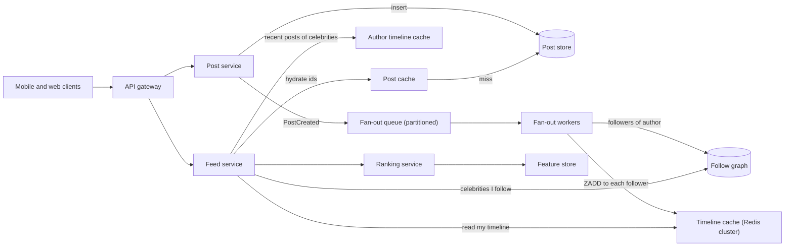
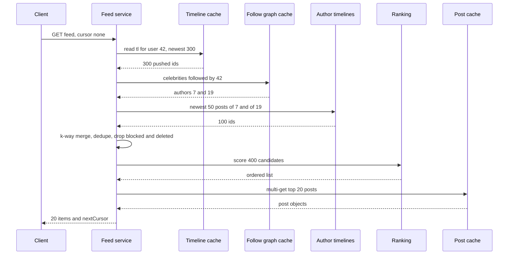

Open any social app and the first screen is a feed: a list of recent posts from people you follow, usually re-ordered by what the app thinks you'll care about. Building one for a few thousand users is a single SQL query. Building one for hundreds of millions, where one celebrity post must reach 50 million followers and every pull-to-refresh must come back in under 200 ms, is a classic system design problem. Its central question is simple to say: **do you do the work when someone posts, or when someone reads?**

We reason from public engineering principles. Nothing here describes how Facebook, Instagram, X or LinkedIn actually build their feeds; "a system like X" means "a feed with those properties".

## Learning objectives

By the end of this case study you will be able to:

1. Estimate read, write and fan-out load for a feed, and show why fan-out cost depends on follower distribution, not averages.
2. Compare fan-out on write (push) and fan-out on read (pull), and design the hybrid that handles celebrities.
3. Model posts, the follow graph and materialised timelines in PostgreSQL and Redis.
4. Merge pre-computed timelines with on-demand celebrity posts using a k-way merge and a stable cursor.
5. Describe a ranking pipeline (candidates, features, scoring, filtering, diversity) and implement a simple scorer.
6. Plan for hot keys, cache loss, deletes and privacy changes, and explain when a plain SQL query is enough.

## Prerequisites

- [Capacity estimation](#/lesson/m11-capacity-estimation): RPS, peak factors, storage maths.
- [Redis data structures](#/lesson/m12-redis): sorted sets and lists, which hold timelines.
- [Message queues](#/lesson/m12-message-queues): fan-out runs as background work.
- [Offset versus keyset pagination](#/lesson/m09-pagination): feeds need stable cursors.
- [Sharding and hot partitions](#/lesson/m13-sharding): celebrities are hot keys.

## Explain it like I'm a beginner

Imagine a housing society in Bengaluru with a noticeboard problem. Every resident wants to see the latest notices from the people they "follow": the secretary, the gym, a few neighbours.

**Option 1: the postman approach (fan-out on write).** When the gym posts a notice, a helper photocopies it and drops a copy in the letterbox of every resident who follows the gym. Reading is instant: open your letterbox, the notices are already there, newest on top. But if a film star living in the society posts, and all 5,000 residents follow her, the helper makes 5,000 copies for one notice.

**Option 2: the walk-around approach (fan-out on read).** Nobody copies anything. When you want your feed, you walk to the gym's board, the secretary's board and each neighbour's board, collect the latest notices and sort them in your hand. Posting is free, but reading is slow if you follow 300 boards.

**Option 3: what real systems do (hybrid).** Copy notices into letterboxes for ordinary posters, because each has few followers. For the film star, don't copy; everyone glances at her one board when they open their letterbox, and merges the two piles.

Then there is **ranking**: instead of strictly newest first, the helper puts the notices you're most likely to care about on top (your close neighbour's post before the gym's 10th offer this week).

## Requirements

### Functional

1. Users follow other users (one-directional, like most public social apps).
2. Users publish posts (text, images, video links).
3. The home feed shows posts from followed accounts, newest first or ranked, with infinite scroll.
4. New posts appear in followers' feeds within a few seconds (not instantly; this is not chat).
5. Deleted posts and blocked or unfollowed authors disappear from feeds.
6. Like and comment counts shown on each post.

### Non-functional

| Property | Target |
|---|---|
| Feed read latency | p99 < 200 ms server-side for the first page |
| Freshness | A post visible to most followers within 5 s (p95) |
| Availability | 99.95 % for reads; posting may degrade more gracefully |
| Consistency | Eventual. A follower seeing a post 3 s late is fine; seeing a deleted post for minutes is not |
| Scale | 300 M DAU, follower counts from 0 to 100 M |

### Out of scope

Ads insertion, search, stories, direct messages ([see the chat case study](#/lesson/m17-chat)), and the machine-learning training pipeline (we cover how ranking is served, not how models are trained).

## Capacity estimation

All figures are **estimates** for the arithmetic.

### Reads

- 300 M DAU, each opening or refreshing the feed 10 times a day: 300 M × 10 = **3 billion feed requests/day**.
- 3 × 10⁹ ÷ 86,400 ≈ **34,700 RPS** average; ×3 for the evening peak ≈ **105,000 RPS**.
- Each request returns a page of 20 posts, so the post-hydration layer serves about 105,000 × 20 = **2.1 M post lookups/s** at peak. That is why post objects must be cached.

### Writes

- 20 % of DAU post once a day: 300 M × 0.2 = **60 M posts/day** ≈ 700 posts/s average, ≈ 2,100/s peak.
- Posts are rare compared with reads: a **read/write ratio of about 50:1**. Feeds are read-heavy, which is the argument for doing work at write time.

### Fan-out on write, naive

- Average followers per poster: 200 (estimate). Feed inserts = 60 M × 200 = **12 billion/day** ≈ 139,000 inserts/s average.
- Now the celebrity: one account with 50 M followers posts. At 139,000 inserts/s of spare capacity, that single post takes 50 M ÷ 139,000 ≈ **6 minutes** to land in every feed, and it delays everyone else's fan-out queued behind it. Ten celebrity posts in a big cricket moment and the fan-out backlog is an hour.

**The average hides the problem.** Follower counts follow a heavy-tailed (power-law-like) distribution: most accounts have dozens of followers, a few have tens of millions. Capacity planning must look at the tail.

### Timeline cache size

- Keep the latest 500 entries per user. Each entry is a post id (8 bytes) plus author id (8 bytes) ≈ 16 bytes, plus Redis overhead; call it **~40 bytes** per entry with overhead (estimate).
- 500 × 40 B = 20 KB per user. For all 300 M DAU: 300 M × 20 KB = **6 TB** of RAM.
- Only keep timelines for users active in the last 30 days, and rebuild on demand for others. With 400 M monthly actives the hot set is roughly the DAU, so plan for **6 TB across a Redis cluster** (for example 60 shards of ~100 GB usable each, plus replicas).

### Post storage

- Post metadata and text ≈ 1 KB: 60 M × 1 KB = **60 GB/day**, ≈ 22 TB/year before replicas. Media lives in object storage behind a CDN ([video case study](#/lesson/m17-video-streaming)).

**What breaks first?** Fan-out queues during celebrity bursts, the hot Redis shard holding a celebrity's post list, and the post-hydration cache at 2 M lookups/s.

## API design

```http
GET /v1/feed?cursor=eyJiIjo3MjM0…&limit=20&mode=ranked
200 OK
{
  "items": [
    { "postId": "7234918877123584001", "author": { "id": 99, "name": "Kavya R" },
      "text": "Site visit at Palashbari bypass today", "media": [...],
      "likeCount": 132, "commentCount": 8, "createdAt": "2026-10-19T09:12:44Z" }
  ],
  "nextCursor": "eyJiIjo3MjM0OTE4ODc3MTIzNTg0MDAxfQ"
}

POST /v1/posts            { "text": "...", "mediaIds": ["m_81f2"], "visibility": "followers" }
DELETE /v1/posts/{postId}
POST /v1/users/{id}/follow
DELETE /v1/users/{id}/follow
POST /v1/posts/{postId}/likes
```

Decisions:

- **Opaque cursor, not page numbers.** New posts arrive at the top all the time. `?page=3` would show duplicates or skip posts as the list shifts. The cursor encodes "posts older than id X" (keyset pagination) and, for ranked mode, a snapshot id of the ranked list.
- **Post ids are time-sortable** (Snowflake-style: timestamp bits first). "Older than id X" is then the same as "older than time T", and merging timelines needs only the id.
- **Ids as strings in JSON.** 64-bit ids exceed JavaScript's safe integer range (2⁵³).
- **Counts are approximate.** `likeCount` comes from a cached counter, not a `COUNT(*)`.

## Data model

```sql
CREATE TABLE app_user (
  user_id        bigint PRIMARY KEY,
  handle         text   NOT NULL UNIQUE,
  follower_count bigint NOT NULL DEFAULT 0,      -- denormalised, updated asynchronously
  is_celebrity   boolean NOT NULL DEFAULT false  -- set by a job when follower_count crosses a threshold
);

CREATE TABLE follow (
  follower_id bigint NOT NULL,
  followee_id bigint NOT NULL,
  created_at  timestamptz NOT NULL DEFAULT now(),
  PRIMARY KEY (follower_id, followee_id)          -- "whom do I follow?"
);
CREATE INDEX follow_by_followee ON follow (followee_id, follower_id);  -- "who follows me?" for fan-out

CREATE TABLE post (
  post_id     bigint PRIMARY KEY,                 -- Snowflake id: time-ordered
  author_id   bigint NOT NULL,
  body        text   NOT NULL,
  visibility  text   NOT NULL DEFAULT 'followers',
  created_at  timestamptz NOT NULL,
  deleted_at  timestamptz
);
CREATE INDEX post_by_author ON post (author_id, post_id DESC) WHERE deleted_at IS NULL;
```

In Redis (the materialised timelines and hot data):

| Key | Type | Content |
|---|---|---|
| `tl:{userId}` | Sorted set, score = post id | Latest 500 `postId:authorId` entries pushed by fan-out |
| `ut:{authorId}` | Sorted set | Latest 200 posts by an author (used for celebrities' pull path) |
| `post:{postId}` | Hash | Hydrated post object for rendering |
| `cnt:{postId}` | Hash | `likes`, `comments` counters |

Why this shape:

- **Two indexes on `follow`.** Reading your feed by pull needs "whom do I follow" (`follower_id` first). Fan-out needs "who follows this author" (`followee_id` first). One table, two access paths.
- **`post_by_author (author_id, post_id DESC)`** serves the per-author recent list for the pull path, and the partial index skips deleted rows.
- **Timelines store ids, not posts.** A post is hydrated once from `post:{id}` no matter how many timelines contain it. Copying full posts into 50 M timelines would multiply storage and make edits and deletes impossible.
- **Sharding.** `post` is sharded by `post_id` (or author id); `follow` by `follower_id` with the reverse index maintained as its own sharded table by `followee_id`. Redis is sharded by key hash.

## High-level architecture



Every arrow:

1. **Client → API gateway → services.** Authentication, rate limiting and routing to the post service (writes) or feed service (reads). Separating them is a [CQRS](#/lesson/m16-cqrs)-style split: the write model is the post store, the read model is the timeline cache.
2. **Post service → post store.** The post is durably saved with a Snowflake id. The author sees it immediately in their own profile (read-your-writes) because the client inserts it locally too.
3. **Post service → fan-out queue.** A `PostCreated` event (via a transactional outbox) is queued. Posting returns without waiting for fan-out.
4. **Fan-out workers → follow graph → timeline cache.** For ordinary authors, workers page through the author's followers (1,000 at a time) and push `postId:authorId` into each follower's `tl:{userId}`, trimming to 500. Celebrities are **skipped**; their posts go only into `ut:{authorId}`.
5. **Feed service → timeline cache.** Reads the user's pushed timeline: one `ZREVRANGEBYSCORE` call.
6. **Feed service → follow graph → author timeline cache.** Finds which celebrities the user follows (a small, cacheable list) and reads each one's recent posts.
7. **Feed service → post cache.** Merges the candidate ids, then hydrates the page from `post:{id}` (multi-get), falling back to the post store on a miss.
8. **Feed service → ranking service → feature store.** In ranked mode, a few hundred candidates are scored using features such as author affinity and engagement, then the top 20 are returned.

### The read path for a user who follows two celebrities



The feed service makes a small, fixed number of calls regardless of how many accounts the user follows: one timeline read, one celebrity-list read, a handful of author-timeline reads (users rarely follow more than a few dozen celebrities, and we cap it), one ranking call and one multi-get. That fixed shape is what keeps p99 under 200 ms. The merge step is where push and pull meet.

## Deep dives

### 1. Push, pull and the hybrid

| | Fan-out on write (push) | Fan-out on read (pull) |
|---|---|---|
| Work at post time | O(followers) inserts | None |
| Work at read time | One cache read | O(followees) queries plus a merge |
| Read latency | Very low | Grows with followees |
| Write amplification | Huge for celebrities | None |
| Wasted work | Pushing to inactive followers | None |
| Freshness | Seconds (queue lag) | Immediate |

**Hybrid rule**: push for authors under a threshold (say 10,000 followers, a tunable number), pull for authors above it. A user's feed = their pushed timeline ∪ recent posts of the celebrities they follow.

Refinements that matter in practice:

- **Skip inactive followers.** Don't push to users who haven't opened the app in 30 days; rebuild their timeline by pull when they return. This alone can remove a large share of fan-out writes.
- **Hysteresis on the threshold.** An author oscillating around 10,000 followers would flip between modes. Mark celebrity at 10,000 and un-mark at 8,000.
- **Changing mode is safe** because the merge deduplicates: during the switch a post may be both pushed and pulled.
- **Following someone new.** Fan-out only affects future posts, so a backfill job pushes the new followee's last ~20 posts into the follower's timeline (or the client simply gets them via pull for the first page).

### 2. Time-sortable ids

If post ids grow with time, then "newest first" is "largest id first", timelines can be sorted sets scored by id, and cursors are just "id < X". A Snowflake-style id packs 41 bits of milliseconds since a custom epoch, 10 bits of worker id and 12 bits of per-millisecond sequence into a 64-bit integer. Each worker generates ids without coordination; ids from different workers are ordered to within clock skew, which is fine for a feed.

```csharp file=Feed/SnowflakeIdGenerator.cs
namespace FeedApp.Feed;

/// <summary>64-bit time-ordered ids: 41 bits ms since epoch | 10 bits worker | 12 bits sequence.</summary>
public sealed class SnowflakeIdGenerator
{
    private static readonly DateTimeOffset Epoch = new(2024, 1, 1, 0, 0, 0, TimeSpan.Zero);
    private readonly TimeProvider _clock;
    private readonly long _workerId;
    private readonly Lock _gate = new();
    private long _lastMs = -1;
    private long _sequence;

    public SnowflakeIdGenerator(TimeProvider clock, int workerId)
    {
        if (workerId is < 0 or > 1023) throw new ArgumentOutOfRangeException(nameof(workerId));
        _clock = clock;
        _workerId = workerId;
    }

    public long Next()
    {
        lock (_gate)
        {
            var ms = (long)(_clock.GetUtcNow() - Epoch).TotalMilliseconds;
            if (ms < _lastMs) ms = _lastMs;                 // clock went backwards: don't reuse ids
            if (ms == _lastMs)
            {
                _sequence = (_sequence + 1) & 0xFFF;
                if (_sequence == 0) ms = ++_lastMs;          // 4,096 ids used in this ms: borrow the next ms
            }
            else _sequence = 0;
            _lastMs = ms;
            return (ms << 22) | (_workerId << 12) | _sequence;
        }
    }

    public static DateTimeOffset TimestampOf(long id) => Epoch.AddMilliseconds(id >> 22);
}
```

### 3. The stores behind interfaces

```csharp file=Feed/Models.cs
namespace FeedApp.Feed;

public sealed record Post(long PostId, long AuthorId, string Body, DateTimeOffset CreatedAt, bool Deleted = false);

/// <summary>What a timeline holds: ids only, never the post body.</summary>
public sealed record FeedEntry(long PostId, long AuthorId);

public sealed record FeedPage(IReadOnlyList<Post> Items, long? NextBeforeId);

public sealed record CreatePostRequest(string Body);

public sealed class FeedOptions
{
    public int CelebrityThreshold { get; set; } = 10_000;
    public int TimelineCapacity { get; set; } = 500;
    public int CelebrityPostsPerAuthor { get; set; } = 50;
    public int MaxCelebritiesMerged { get; set; } = 50;
}
```

```csharp file=Feed/Stores.cs
using System.Collections.Concurrent;

namespace FeedApp.Feed;

public interface IFollowGraph
{
    IReadOnlyList<long> FolloweesOf(long userId);
    IReadOnlyList<long> FollowersOf(long authorId, int skip, int take);
    int FollowerCount(long authorId);
}

public interface IPostStore
{
    void Save(Post post);
    Post? Get(long postId);
    IReadOnlyList<FeedEntry> RecentByAuthor(long authorId, int take);   // newest first
}

/// <summary>Stand-in for Redis sorted sets tl:{userId}, score = post id, trimmed to capacity.</summary>
public interface ITimelineCache
{
    void Push(long userId, FeedEntry entry);
    IReadOnlyList<FeedEntry> Read(long userId, int take);               // newest first
}

public sealed class InMemoryFollowGraph : IFollowGraph
{
    private readonly ConcurrentDictionary<long, HashSet<long>> _followees = new();
    private readonly ConcurrentDictionary<long, HashSet<long>> _followers = new();

    public void Follow(long follower, long followee)
    {
        lock (_followees) { _followees.GetOrAdd(follower, _ => new()).Add(followee); _followers.GetOrAdd(followee, _ => new()).Add(follower); }
    }

    public IReadOnlyList<long> FolloweesOf(long userId)
    {
        lock (_followees) return _followees.TryGetValue(userId, out var s) ? s.ToList() : [];
    }

    public IReadOnlyList<long> FollowersOf(long authorId, int skip, int take)
    {
        lock (_followees) return _followers.TryGetValue(authorId, out var s) ? s.OrderBy(x => x).Skip(skip).Take(take).ToList() : [];
    }

    public int FollowerCount(long authorId)
    {
        lock (_followees) return _followers.TryGetValue(authorId, out var s) ? s.Count : 0;
    }
}

public sealed class InMemoryPostStore : IPostStore
{
    private readonly ConcurrentDictionary<long, Post> _posts = new();

    public void Save(Post post) => _posts[post.PostId] = post;
    public Post? Get(long postId) => _posts.TryGetValue(postId, out var p) ? p : null;

    public IReadOnlyList<FeedEntry> RecentByAuthor(long authorId, int take) =>
        _posts.Values.Where(p => p.AuthorId == authorId && !p.Deleted)
            .OrderByDescending(p => p.PostId).Take(take)
            .Select(p => new FeedEntry(p.PostId, p.AuthorId)).ToList();
}

public sealed class InMemoryTimelineCache(FeedOptions options) : ITimelineCache
{
    private readonly ConcurrentDictionary<long, List<FeedEntry>> _timelines = new();

    public void Push(long userId, FeedEntry entry)
    {
        var list = _timelines.GetOrAdd(userId, _ => new List<FeedEntry>());
        lock (list)
        {
            // Keep newest first. Usually the new id is the largest, so this inserts at index 0.
            var index = list.FindIndex(e => e.PostId <= entry.PostId);
            if (index >= 0 && list[index].PostId == entry.PostId) return;       // idempotent re-push
            list.Insert(index < 0 ? list.Count : index, entry);
            if (list.Count > options.TimelineCapacity) list.RemoveRange(options.TimelineCapacity, list.Count - options.TimelineCapacity);
        }
    }

    public IReadOnlyList<FeedEntry> Read(long userId, int take)
    {
        if (!_timelines.TryGetValue(userId, out var list)) return [];
        lock (list) return list.Take(take).ToList();
    }
}
```

The timeline push is **idempotent**: the queue delivers at least once, so a worker retry may push the same post twice. In Redis, `ZADD tl:42 <postId> "<postId>:<authorId>"` is naturally idempotent, followed by `ZREMRANGEBYRANK tl:42 0 -501` to trim.

### 4. The fan-out worker

```csharp file=Feed/FanoutWorker.cs
using System.Threading.Channels;
using Microsoft.Extensions.Hosting;
using Microsoft.Extensions.Logging;

namespace FeedApp.Feed;

/// <summary>Stand-in for a partitioned queue (Kafka, Service Bus) carrying PostCreated events.</summary>
public sealed class FanoutQueue
{
    private readonly Channel<Post> _channel = Channel.CreateBounded<Post>(new BoundedChannelOptions(10_000)
    {
        FullMode = BoundedChannelFullMode.Wait    // backpressure on the post service, never silent loss
    });
    public ValueTask EnqueueAsync(Post post, CancellationToken ct) => _channel.Writer.WriteAsync(post, ct);
    public ChannelReader<Post> Reader => _channel.Reader;
}

public sealed class FanoutWorker(
    FanoutQueue queue, IFollowGraph graph, ITimelineCache timelines,
    FeedOptions options, ILogger<FanoutWorker> logger) : BackgroundService
{
    private const int PageSize = 1_000;

    protected override async Task ExecuteAsync(CancellationToken stoppingToken)
    {
        await foreach (var post in queue.Reader.ReadAllAsync(stoppingToken))
        {
            try { FanOut(post); }
            catch (Exception ex) { logger.LogError(ex, "Fan-out failed for post {PostId}", post.PostId); }
        }
    }

    public int FanOut(Post post)
    {
        if (graph.FollowerCount(post.AuthorId) >= options.CelebrityThreshold)
            return 0;   // celebrity: followers pull from the author timeline at read time

        var entry = new FeedEntry(post.PostId, post.AuthorId);
        var pushed = 0;
        timelines.Push(post.AuthorId, entry);   // authors see their own posts in their feed
        for (var skip = 0; ; skip += PageSize)
        {
            var page = graph.FollowersOf(post.AuthorId, skip, PageSize);
            foreach (var follower in page) { timelines.Push(follower, entry); pushed++; }
            if (page.Count < PageSize) break;
        }
        return pushed;
    }
}
```

In production each page of 1,000 followers becomes its own small job on the queue, so one author with 9,000 followers is processed by several workers in parallel, and a crash re-runs only one page. Pipelining Redis commands (one round trip per page) is what makes ~139,000 inserts/s achievable on a modest cluster.

### 5. Merging: the k-way merge

At read time we have several lists, each already sorted newest first: the pushed timeline and one list per followed celebrity. Merging k sorted lists into one is the classic **k-way merge**: put the head of each list in a max-heap (priority queue), pop the largest, push that list's next element, repeat until the page is full. Cost is O(n log k) for n items from k lists, and it stops as soon as it has enough, so a page of 20 from 50 lists touches about 20 × log₂ 50 ≈ 120 heap operations.

```csharp file=Feed/FeedMerger.cs
namespace FeedApp.Feed;

public static class FeedMerger
{
    /// <summary>
    /// Merges lists that are each sorted by PostId descending. Returns up to <paramref name="limit"/>
    /// unique entries with PostId &lt; <paramref name="beforeId"/> (null = from the newest).
    /// </summary>
    public static IReadOnlyList<FeedEntry> Merge(IReadOnlyList<IReadOnlyList<FeedEntry>> sources, long? beforeId, int limit)
    {
        // Max-heap on PostId: invert the comparer.
        var heap = new PriorityQueue<(int Source, int Index), long>(Comparer<long>.Create((a, b) => b.CompareTo(a)));
        for (var s = 0; s < sources.Count; s++)
        {
            var start = FirstIndexBefore(sources[s], beforeId);
            if (start < sources[s].Count) heap.Enqueue((s, start), sources[s][start].PostId);
        }

        var seen = new HashSet<long>();
        var result = new List<FeedEntry>(limit);
        while (result.Count < limit && heap.TryDequeue(out var head, out _))
        {
            var entry = sources[head.Source][head.Index];
            if (seen.Add(entry.PostId)) result.Add(entry);      // same post pushed and pulled: keep one
            var next = head.Index + 1;
            if (next < sources[head.Source].Count)
                heap.Enqueue((head.Source, next), sources[head.Source][next].PostId);
        }
        return result;
    }

    private static int FirstIndexBefore(IReadOnlyList<FeedEntry> list, long? beforeId)
    {
        if (beforeId is null) return 0;
        int lo = 0, hi = list.Count;                 // binary search on a descending list
        while (lo < hi)
        {
            var mid = (lo + hi) / 2;
            if (list[mid].PostId >= beforeId.Value) lo = mid + 1; else hi = mid;
        }
        return lo;
    }
}
```

### 6. Ranking

Chronological feeds are simple and predictable. Ranked feeds usually raise engagement, at the cost of complexity and user trust ("why didn't I see my friend's post?"). Many products offer both. A ranked feed is a **pipeline**:

1. **Candidate generation**: the merged ids, a few hundred to a few thousand.
2. **Filtering**: remove deleted posts, blocked or muted authors, posts already seen (a small "seen" set per user), and content that fails policy checks.
3. **Feature fetch**: per candidate, features like author affinity (how often you interact with this author), post engagement so far, age, media type. These come from a **feature store**, a low-latency key-value store refreshed by streaming jobs.
4. **Scoring**: a model predicts the probability of engagement. Large systems use trained ML models; a hand-tuned formula is a fine start.
5. **Re-ranking for diversity**: avoid five posts in a row from one author, mix media types, insert fresh posts.
6. **Pagination**: ranked lists are not stable as scores change, so the first page's ranked ids are stored briefly (a "feed session", say 30 minutes) and later pages are read from it.

A simple, explainable scorer: `score = (affinity + 0.1) × (1 + ln(1 + engagement)) × 0.5^(ageHours / halfLife)`. The log stops viral posts from swamping everything; the half-life (6 hours here) makes freshness matter; the `+ 0.1` gives strangers' posts a small chance.

```csharp file=Feed/FeedRankerService.cs
namespace FeedApp.Feed;

public interface IFeatureStore
{
    double Affinity(long viewerId, long authorId);   // 0..1
    double Engagement(long postId);                  // likes + 2 × comments, say
}

public sealed class InMemoryFeatureStore : IFeatureStore
{
    public double Affinity(long viewerId, long authorId) => 0.5;
    public double Engagement(long postId) => 0;
}

public sealed class FeedRankerService(IFeatureStore features, TimeProvider clock)
{
    public const double HalfLifeHours = 6;

    public IReadOnlyList<Post> Rank(long viewerId, IEnumerable<Post> candidates)
    {
        var now = clock.GetUtcNow();
        return candidates
            .Select(p => (Post: p, Score: Score(features.Affinity(viewerId, p.AuthorId), features.Engagement(p.PostId), p.CreatedAt, now)))
            .OrderByDescending(x => x.Score).ThenByDescending(x => x.Post.PostId)
            .Select(x => x.Post).ToList();
    }

    public static double Score(double affinity, double engagement, DateTimeOffset createdAt, DateTimeOffset now)
    {
        var ageHours = Math.Max(0, (now - createdAt).TotalHours);   // clamp clock skew
        return (affinity + 0.1) * (1 + Math.Log(1 + engagement)) * Math.Pow(0.5, ageHours / HalfLifeHours);
    }
}
```

### 7. The feed service ties it together

```csharp file=Feed/FeedService.cs
namespace FeedApp.Feed;

public sealed class FeedService(
    ITimelineCache timelines, IFollowGraph graph, IPostStore posts,
    FeedRankerService ranker, FeedOptions options)
{
    public FeedPage GetFeed(long userId, long? beforeId, int limit, bool ranked)
    {
        limit = Math.Clamp(limit, 1, 50);
        var sources = new List<IReadOnlyList<FeedEntry>> { timelines.Read(userId, options.TimelineCapacity) };

        var celebrities = graph.FolloweesOf(userId)
            .Where(a => graph.FollowerCount(a) >= options.CelebrityThreshold)
            .Take(options.MaxCelebritiesMerged);
        foreach (var author in celebrities)
            sources.Add(posts.RecentByAuthor(author, options.CelebrityPostsPerAuthor));

        // Over-fetch so that filtering (deleted posts) still leaves a full page.
        var candidates = FeedMerger.Merge(sources, beforeId, ranked ? limit * 5 : limit * 2)
            .Select(e => posts.Get(e.PostId))
            .Where(p => p is { Deleted: false })
            .Select(p => p!)
            .ToList();

        var page = (ranked ? ranker.Rank(userId, candidates) : candidates).Take(limit).ToList();
        // Chronological cursor. A ranked feed would store the ranked list in a session and page through it.
        long? next = page.Count == limit ? page.Min(p => p.PostId) : null;
        return new FeedPage(page, next);
    }
}
```

## Caching, queues and scaling

**Caches (and what each protects).**

| Cache | Protects | Size estimate | Invalidation |
|---|---|---|---|
| Timelines `tl:{user}` | Follow-graph joins | ~6 TB | Trimmed to 500; rebuilt by pull on miss |
| Author timelines `ut:{author}` | Post store for celebrity pulls | Small (only celebrities + active authors) | Updated on post and delete |
| Post objects `post:{id}` | Post store at 2 M lookups/s | Hot posts of the last few days | Deleted or edited post → delete key |
| Counters `cnt:{id}` | Like/comment tables | Small | Incremented in place; periodically reconciled |
| Celebrity list per user | Follow graph | Small | On follow/unfollow |

**Hot keys.** A celebrity's `ut:{author}` and their newest `post:{id}` are read by millions of feed requests per minute. One Redis shard can't take that. Fixes: an **in-process L1 cache** in each feed service instance with a 1–5 second TTL ([multi-level caching](#/lesson/m16-multi-level-caching)), and replicating hot keys to several shards (`ut:7#0` … `ut:7#7`, read at random).

**Queues.** The fan-out queue is partitioned by author id so one author's posts are fanned out in order. Each follower page is a separate task, so big authors parallelise. Separate queues (or priorities) for normal posts and "backfill on follow" stop bulk jobs from delaying fresh posts.

**Scaling.** The feed service is stateless and scales with read RPS. Fan-out workers scale with queue lag. Redis scales by adding shards; timelines are independent per user, so they spread evenly. The follow graph's reverse index (followers of X) is the largest table and is sharded by `followee_id`; a celebrity's follower list is huge but is only scanned by fan-out, which skips celebrities.

## Failure handling

| Failure | Effect | Mitigation |
|---|---|---|
| Timeline cache shard lost | Those users' feeds are empty | Rebuild on read: pull the last 2 days of posts from followees (slower, rate-limited), repopulate in the background |
| Fan-out workers lagging | New posts appear late | Autoscale on lag; prioritise fresh posts over backfill; skip inactive followers |
| Celebrity posts at a cricket final | Hot keys, spikes | Pull path plus L1 cache; precompute their author timelines |
| Duplicate fan-out after a retry | Same post twice | Idempotent `ZADD` and dedupe in merge |
| Post deleted after fan-out | Deleted post in 9,000 timelines | Don't chase timelines; filter at hydration (`post:{id}` marked deleted) and remove lazily |
| Ranking service slow or down | Latency budget blown | Timeout at 50 ms and fall back to chronological order |
| Feature store stale | Slightly worse ranking | Acceptable; ranking degrades gracefully |
| Unfollow or block | Old posts still in timeline | Filter at read time with the current follow/block set; clean the timeline asynchronously |

The pattern: **timelines are a disposable cache of ids; the truth is the post store and the follow graph, checked at read time for anything that must be correct (deletes, blocks, privacy).**

:::callout type=warning title="Privacy filters belong on the read path"
If a user makes their account private or blocks someone, waiting for an async job to scrub thousands of timelines leaves a window where content leaks. Always check visibility and blocks during hydration, even though the timeline "should" already be clean.
:::

## Security

- **Authorisation on hydration.** Every post returned is checked against its visibility (`public`, `followers`, `close friends`) and the viewer's block list. The timeline is not an authorisation decision.
- **Abuse of fan-out.** Spam accounts that follow millions of users don't cost fan-out (they are followers, not authors), but spam accounts that *post* to many followers do. Rate-limit posts per account, and down-rank new accounts.
- **Enumeration.** Opaque cursors and string ids; don't expose follower lists of private accounts; rate-limit follow-graph endpoints to stop scraping.
- **Content safety.** Media and text pass through asynchronous safety classifiers; flagged posts are hidden at hydration until reviewed.
- **Data protection.** Feature stores contain behavioural data (who you interact with). Treat it as personal data: access control, retention limits, and deletion when an account is deleted.

## Observability

- **Feed latency** p50/p99 split by stage: timeline read, celebrity pulls, ranking, hydration. The stage breakdown tells you what to fix.
- **Freshness**: time from post creation to appearing in a sample of follower timelines (a synthetic "canary author" that posts every minute and a probe that reads a canary follower's feed).
- **Fan-out queue lag** and fan-out writes per second, split by follower-count bucket.
- **Cache hit ratios** for posts and timelines; timeline rebuilds per minute (a spike means a shard was lost).
- **Empty or short feeds** rate: a silent correctness signal.
- **Ranking fallback rate**: how often ranking timed out and we served chronological.
- Business metrics (scroll depth, engagement) watched by product teams, but alert on the system signals.

## Deployment and cost

**Deployment.** Feed and post services roll out with canaries watching p99 latency and empty-feed rate. Ranking model changes are A/B tested on a small percentage of users, behind feature flags, with automatic rollback if engagement or latency regress. Changing the celebrity threshold is a config change rolled out gradually, because it shifts load between fan-out workers and the read path.

**Cost drivers** (relative):

1. **RAM for timelines** (~6 TB plus replicas). Biggest lever: skip inactive users and cap timeline length.
2. **Fan-out compute and Redis writes**, proportional to Σ followers of active posters.
3. **Ranking compute** if you use ML models per candidate: 105,000 RPS × 400 candidates = 42 M scores/s at peak. Cheap formulas or smaller candidate sets save a lot.
4. **Media egress** through the CDN, usually the largest bill overall, shared with the media platform.

### When a simpler design is enough

A company intranet or a project-site update feed for 20,000 staff doesn't need fan-out at all. One query does it:

```sql
SELECT p.* FROM post p
JOIN follow f ON f.followee_id = p.author_id
WHERE f.follower_id = $1 AND p.deleted_at IS NULL
  AND (p.created_at, p.post_id) < ($2, $3)
ORDER BY p.created_at DESC, p.post_id DESC
LIMIT 20;
```

With the `post_by_author` index and a few hundred followees, PostgreSQL answers this in milliseconds. 20,000 users × 10 reads a day ≈ 2.3 RPS. Add an output cache of 30 seconds per user and you are done. Move to fan-out only when this query's p99 or the database CPU says so.

## Alternatives and trade-offs

| Decision | Choice here | Alternative | When the alternative wins |
|---|---|---|---|
| Fan-out | Hybrid push/pull | Pure push | Small networks with capped follower counts (a private team app) |
| Fan-out | Hybrid | Pure pull | Low read volume, or users follow few accounts; simplest to build |
| Timeline store | Redis sorted sets | Wide-column store (per-user partitions) | Timelines too big for RAM, or longer history needed |
| Ordering | Ranked with chronological fallback | Chronological only | Trust and transparency matter more than engagement |
| Ids | Snowflake | UUIDv7 | You want standard 128-bit ids; also time-ordered, but twice the size in every timeline |
| Deletes | Filter at read | Scrub every timeline | Legal takedowns where the id itself must disappear quickly |
| Ranking pagination | Feed session snapshot | Re-rank every page | Very short sessions; simpler but risks duplicates between pages |

The essential trade-off: **fan-out on write buys fast reads with write amplification; fan-out on read buys cheap writes with slow reads. The hybrid spends write work where it is cheap (ordinary authors) and read work where it is unavoidable (celebrities).**

```csharp file=Program.cs
using FeedApp.Feed;

var builder = WebApplication.CreateBuilder(args);
var options = new FeedOptions();
builder.Configuration.GetSection("Feed").Bind(options);

builder.Services.AddSingleton(options);
builder.Services.AddSingleton(TimeProvider.System);
builder.Services.AddSingleton(sp => new SnowflakeIdGenerator(sp.GetRequiredService<TimeProvider>(), workerId: 1));
builder.Services.AddSingleton<InMemoryFollowGraph>();
builder.Services.AddSingleton<IFollowGraph>(sp => sp.GetRequiredService<InMemoryFollowGraph>());
builder.Services.AddSingleton<IPostStore, InMemoryPostStore>();
builder.Services.AddSingleton<ITimelineCache, InMemoryTimelineCache>();
builder.Services.AddSingleton<IFeatureStore, InMemoryFeatureStore>();
builder.Services.AddSingleton<FeedRankerService>();
builder.Services.AddSingleton<FeedService>();
builder.Services.AddSingleton<FanoutQueue>();
builder.Services.AddHostedService<FanoutWorker>();

var app = builder.Build();

static long CurrentUser(HttpContext http) =>
    long.TryParse(http.Request.Headers["X-Demo-User"], out var id) ? id : 0;   // demo only: use JWT auth

app.MapPost("/v1/posts", async (CreatePostRequest body, HttpContext http, SnowflakeIdGenerator ids,
    IPostStore posts, FanoutQueue queue, TimeProvider clock, CancellationToken ct) =>
{
    var post = new Post(ids.Next(), CurrentUser(http), body.Body, clock.GetUtcNow());
    posts.Save(post);                       // durable write first (with an outbox in production)
    await queue.EnqueueAsync(post, ct);     // fan-out happens in the background
    return Results.Created($"/v1/posts/{post.PostId}", new { postId = post.PostId.ToString() });
});

app.MapPost("/v1/users/{id:long}/follow", (long id, HttpContext http, InMemoryFollowGraph graph) =>
{
    graph.Follow(CurrentUser(http), id);
    return Results.NoContent();
});

app.MapGet("/v1/feed", (long? before, int? limit, string? mode, HttpContext http, FeedService feed) =>
{
    var page = feed.GetFeed(CurrentUser(http), before, limit ?? 20, ranked: mode == "ranked");
    return Results.Ok(new
    {
        items = page.Items.Select(p => new { postId = p.PostId.ToString(), p.AuthorId, p.Body, p.CreatedAt }),
        nextCursor = page.NextBeforeId?.ToString()
    });
});

app.Run();
```

## Practical playground

The starting graph is the "simple design": every feed request runs the follow-join query on one PostgreSQL primary. Set the client to 105,000 RPS and evolve it.

1. Add a `cache` for timelines and a `queue` plus `worker` for fan-out. Which edges are async?
2. Add a post cache in front of the database. What hit ratio do you need so the database sees under 50,000 lookups/s out of 2.1 M?
3. Add the pull path for celebrities: which store does the feed service read for them?
4. Add a `read-replica` for the follow graph and a ranking `app-server`. What happens to p99 if ranking takes 80 ms?

:::playground type=hld title="From one SQL query to a hybrid fan-out feed"
```json
{
  "nodes": [
    { "id": "c", "type": "client", "label": "Feed readers", "props": { "rps": 105000 } },
    { "id": "lb", "type": "load-balancer", "label": "Load balancer" },
    { "id": "api", "type": "app-server", "label": "Feed API (join query)", "props": { "instances": 12 } },
    { "id": "db", "type": "database", "label": "PostgreSQL: post + follow", "props": { "replicas": 1 } }
  ],
  "edges": [
    { "from": "c", "to": "lb", "kind": "sync" },
    { "from": "lb", "to": "api", "kind": "sync" },
    { "from": "api", "to": "db", "kind": "sync", "label": "follow JOIN post" }
  ]
}
```
:::

## Exercises

:::exercise id=m17-news-feed-ex1 difficulty=beginner kind=written title="How much does fan-out really cost?"
A professional network has 40 M DAU. 5 % of DAU post once a day. Follower counts among posters are: 90 % have 150 followers, 9.9 % have 5,000 followers, and 0.1 % have 2 M followers. Only 40 % of any author's followers are active in a given month.

1. Compute daily fan-out writes with pure push to all followers.
2. Compute them with push only to active followers.
3. Compute them with the hybrid rule (pull for authors ≥ 100,000 followers) plus active-only push.
4. Convert the result of step 3 into average writes per second, and say which group of authors dominated the original cost.
::acceptance
- Shows the number of posts in each bucket before multiplying.
- Applies the 40 % active factor correctly.
- Gives the step 3 result in writes/day and writes/s.
- Names the bucket that dominated and explains why averages mislead.
::hint
Posts/day = 40 M × 0.05. Split that number into the three buckets first.
::hint
Fan-out writes for a bucket = posts in bucket × followers per author.
::hint
The hybrid removes the 2 M bucket entirely from push; its cost moves to the read path.
::hint
Divide by 86,400 for writes per second.
::solution
Posts/day = 40 M × 0.05 = **2 M**. Buckets: 1.8 M posts (150 followers), 198,000 posts (5,000), 2,000 posts (2 M).

1. Pure push: 1.8 M × 150 = 270 M; 198,000 × 5,000 = 990 M; 2,000 × 2 M = 4,000 M. Total ≈ **5.26 billion/day**.
2. Active only (× 0.4): ≈ **2.10 billion/day**.
3. Hybrid + active: (270 M + 990 M) × 0.4 = **504 M/day**.
4. 504 M ÷ 86,400 ≈ **5,800 writes/s** on average (perhaps 17,500/s at a ×3 peak).

The **0.1 % of authors with 2 M followers** caused 76 % of the original cost (4,000 M of 5,260 M). An "average followers" estimate (5.26 B ÷ 2 M posts ≈ 2,630) would hide that the tail, not the typical author, drives the design. Moving those 2,000 daily posts to the pull path costs each reader one extra small read per followed celebrity.
::mistakes
- Using an average follower count for all posters.
- Applying the active factor to posts instead of followers.
- Forgetting that pulled celebrity posts add read cost, so the trade-off is not free.
:::

:::exercise id=m17-news-feed-ex2 difficulty=beginner kind=sql ordered=true title="Fan-out on read with a keyset cursor"
Write the pull-model feed query for user 1: posts by accounts user 1 follows, excluding deleted posts, newest first by `(created_at, post_id)`, **older than** the cursor `('2026-10-19 10:00:00+00', 500)`, limited to 3 rows. Return `post_id`, `author_id` and `created_at`.
::setup
```sql
CREATE TABLE follow (
  follower_id bigint NOT NULL,
  followee_id bigint NOT NULL,
  PRIMARY KEY (follower_id, followee_id)
);
CREATE TABLE post (
  post_id    bigint PRIMARY KEY,
  author_id  bigint NOT NULL,
  created_at timestamptz NOT NULL,
  deleted_at timestamptz
);
INSERT INTO follow VALUES (1, 10), (1, 11), (1, 12), (2, 13);
INSERT INTO post VALUES
  (501, 10, '2026-10-19 10:05:00+00', NULL),
  (500, 11, '2026-10-19 10:00:00+00', NULL),
  (499, 12, '2026-10-19 10:00:00+00', NULL),
  (498, 10, '2026-10-19 09:30:00+00', NULL),
  (497, 13, '2026-10-19 09:20:00+00', NULL),
  (496, 11, '2026-10-19 09:10:00+00', '2026-10-19 09:15:00+00'),
  (495, 12, '2026-10-19 09:00:00+00', NULL),
  (494, 10, '2026-10-19 08:00:00+00', NULL);
```
::check
```sql
SELECT p.post_id, p.author_id, p.created_at
FROM post p
JOIN follow f ON f.followee_id = p.author_id
WHERE f.follower_id = 1
  AND p.deleted_at IS NULL
  AND (p.created_at, p.post_id) < (TIMESTAMPTZ '2026-10-19 10:00:00+00', 500)
ORDER BY p.created_at DESC, p.post_id DESC
LIMIT 3;
```
::acceptance
- Returns 499, 498, 495 in that order.
- Post 500 (the cursor itself) and 501 (newer) are excluded.
- Post 499 has the same timestamp as the cursor but a smaller id, so it is included.
- Deleted post 496 and unfollowed author 13 never appear.
::hint
Join `post` to `follow` on the author, filtered by the follower.
::hint
The cursor has two parts because timestamps can tie. Comparing only `created_at < cursor` would skip post 499.
::hint
PostgreSQL supports row comparison: `(a, b) < (x, y)` means `a < x OR (a = x AND b < y)`.
::hint
The `ORDER BY` must use the same columns, in the same direction, as the cursor comparison.
::solution
```sql
SELECT p.post_id, p.author_id, p.created_at
FROM post p
JOIN follow f ON f.followee_id = p.author_id
WHERE f.follower_id = 1
  AND p.deleted_at IS NULL
  AND (p.created_at, p.post_id) < (TIMESTAMPTZ '2026-10-19 10:00:00+00', 500)
ORDER BY p.created_at DESC, p.post_id DESC
LIMIT 3;
```
The row comparison keeps pagination stable when two posts share a timestamp. With Snowflake ids, `post_id` alone is time-ordered and the cursor can be just the id. An index on `post (author_id, created_at DESC, post_id DESC)` lets the planner read each followee's newest posts and merge them.
::mistakes
- `OFFSET`-based paging, which shows duplicates when new posts arrive.
- Comparing only `created_at`, which skips or repeats rows that share a timestamp.
- Ordering by `created_at` only, which makes ties non-deterministic.
- Forgetting the `deleted_at IS NULL` filter.
::extensions
Rewrite the query with a `LATERAL` subquery that takes the newest 20 posts per followee, then merges them. Compare the plans with `EXPLAIN ANALYZE` on a seeded dataset of 500 followees.
:::

:::exercise id=m17-news-feed-ex3 difficulty=intermediate kind=code title="K-way merge of timelines"
Implement `TimelineMerger.Merge(sources, beforeId, limit)`. Each source is a list of post ids sorted **descending** (newest first). Return up to `limit` unique ids, newest first, all strictly smaller than `beforeId` (or from the top when `beforeId` is null). Use a priority queue so the cost is about O(limit × log k), not a full sort of every list.
::acceptance
- Output is descending and has no duplicates, even when the same id appears in several sources.
- Respects `beforeId` and `limit`.
- Handles empty sources and an empty source list.
- Does not read more of each list than needed (verified by a large-list test that must finish fast).
::hint
Think of each list as a queue whose head is its newest remaining id.
::hint
Keep the head of every list in a max-heap. The largest head is the next id of the merged feed.
::hint
After popping from list i, push list i's next element. Track seen ids in a `HashSet<long>`.
::hint
`PriorityQueue<TElement, TPriority>` is a min-heap. Pass `Comparer<long>.Create((a, b) => b.CompareTo(a))` to make it a max-heap.
::hint
For `beforeId`, skip each list's leading ids that are `>= beforeId` before seeding the heap (a binary search works, a linear skip is fine too).
::starter
```csharp file=TimelineMerger.cs
using System;
using System.Collections.Generic;

public static class TimelineMerger
{
    public static IReadOnlyList<long> Merge(IReadOnlyList<IReadOnlyList<long>> sources, long? beforeId, int limit) =>
        throw new NotImplementedException();
}
```
::tests
```csharp file=TimelineMergerTests.cs
using System.Collections.Generic;
using System.Linq;
using Xunit;

public class TimelineMergerTests
{
    private static IReadOnlyList<IReadOnlyList<long>> Lists(params long[][] lists) => lists;

    [Fact]
    public void Merges_newest_first()
    {
        var result = TimelineMerger.Merge(Lists(new long[] { 90, 50, 10 }, new long[] { 80, 70 }, new long[] { 60 }), null, 10);
        Assert.Equal(new long[] { 90, 80, 70, 60, 50, 10 }, result);
    }

    [Fact]
    public void Removes_duplicates_across_sources()
    {
        var result = TimelineMerger.Merge(Lists(new long[] { 90, 50 }, new long[] { 90, 60, 50 }), null, 10);
        Assert.Equal(new long[] { 90, 60, 50 }, result);
    }

    [Fact]
    public void Respects_cursor_and_limit()
    {
        var result = TimelineMerger.Merge(Lists(new long[] { 90, 50, 10 }, new long[] { 80, 70, 20 }), 80, 3);
        Assert.Equal(new long[] { 70, 50, 20 }, result);
    }

    [Fact]
    public void Handles_empty_inputs()
    {
        Assert.Empty(TimelineMerger.Merge(Lists(), null, 5));
        Assert.Equal(new long[] { 5 }, TimelineMerger.Merge(Lists(new long[0], new long[] { 5 }), null, 5));
        Assert.Empty(TimelineMerger.Merge(Lists(new long[] { 5, 4 }), 4, 5));
    }

    [Fact]
    public void Large_lists_are_merged_lazily()
    {
        var big = Enumerable.Range(0, 2_000_000).Select(i => (long)(4_000_000 - 2 * i)).ToArray();
        var other = Enumerable.Range(0, 2_000_000).Select(i => (long)(3_999_999 - 2 * i)).ToArray();
        var sw = System.Diagnostics.Stopwatch.StartNew();
        var result = TimelineMerger.Merge(Lists(big, other), null, 4);
        Assert.Equal(new long[] { 4_000_000, 3_999_999, 3_999_998, 3_999_997 }, result);
        Assert.True(sw.ElapsedMilliseconds < 200, $"took {sw.ElapsedMilliseconds} ms");
    }
}
```
::solution
Seed the heap with each list's first id below the cursor, then pop and refill until the page is full.

```csharp file=TimelineMerger.cs
using System;
using System.Collections.Generic;

public static class TimelineMerger
{
    public static IReadOnlyList<long> Merge(IReadOnlyList<IReadOnlyList<long>> sources, long? beforeId, int limit)
    {
        var heap = new PriorityQueue<(int Source, int Index), long>(Comparer<long>.Create((a, b) => b.CompareTo(a)));
        for (var s = 0; s < sources.Count; s++)
        {
            var start = StartIndex(sources[s], beforeId);
            if (start < sources[s].Count) heap.Enqueue((s, start), sources[s][start]);
        }

        var seen = new HashSet<long>();
        var result = new List<long>(Math.Max(0, limit));
        while (result.Count < limit && heap.TryDequeue(out var head, out var id))
        {
            if (seen.Add(id)) result.Add(id);
            var next = head.Index + 1;
            if (next < sources[head.Source].Count) heap.Enqueue((head.Source, next), sources[head.Source][next]);
        }
        return result;
    }

    // Binary search: first index whose id is < beforeId in a descending list.
    private static int StartIndex(IReadOnlyList<long> list, long? beforeId)
    {
        if (beforeId is null) return 0;
        int lo = 0, hi = list.Count;
        while (lo < hi)
        {
            var mid = lo + (hi - lo) / 2;
            if (list[mid] >= beforeId.Value) lo = mid + 1; else hi = mid;
        }
        return lo;
    }
}
```

Each output id costs one dequeue and at most one enqueue on a heap of size ≤ k, so a 20-item page from 50 sources is about 20 × 2 × log₂ 50 ≈ 230 comparisons, regardless of list lengths. Duplicates still consume a pop, which is why a heavily duplicated input can need slightly more work than `limit` pops.
::alternatives
- **Concatenate and sort**: O(N log N) for all N ids. Fine for 500 + 2 × 50 ids, which is honestly the real size in many feeds; the heap matters when sources are long or numerous.
- **Redis `ZUNIONSTORE`** into a temporary key: does the merge server-side, but creates a write per read and is awkward across shards.
::mistakes
- Using the min-heap default, which returns the oldest posts first.
- Pushing every element of every list into the heap up front (correct but O(N log N) and memory-heavy).
- Treating `beforeId` as inclusive, which repeats the last item of the previous page.
- Deduplicating with `Distinct()` after taking `limit` items, which returns short pages.
::extensions
Return the next cursor too, and handle the case where the page ends exactly at a duplicated id.
:::

:::exercise id=m17-news-feed-ex4 difficulty=intermediate kind=code title="Score, then diversify"
Implement `SimpleRanker`:

- `Score(c, now)` = `(c.Affinity + 0.1) × (1 + ln(1 + c.Engagement)) × 0.5^(ageHours / 6)`. Negative ages (clock skew) count as 0.
- `Rank(candidates, now, maxRun)` orders by score descending (ties: larger `PostId` first), then re-ranks greedily so that no author appears more than `maxRun` times in a row, **unless** no other author is left.
::acceptance
- A brand-new post with affinity 0.9 and engagement 0 scores exactly 1.0; six hours later it scores 0.5.
- Future timestamps are treated as age 0.
- With authors A (three high scores) and B (one low score) and `maxRun = 2`, the order is A, A, B, A.
- If only one author remains, its posts are still returned.
::hint
Compute scores once, then sort a working list.
::hint
For diversity, build the output one item at a time. Track the current author run length.
::hint
At each step, take the best remaining candidate whose author would not exceed `maxRun`; if there is none, take the best remaining candidate.
::hint
```text
while remaining:
  pick = first r in remaining where !(r.Author == lastAuthor && run == maxRun)
  pick ??= remaining[0]
  run = pick.Author == lastAuthor ? run + 1 : 1
```
::starter
```csharp file=SimpleRanker.cs
using System;
using System.Collections.Generic;

public sealed record Candidate(long PostId, long AuthorId, double Affinity, double Engagement, DateTimeOffset CreatedAt);

public static class SimpleRanker
{
    public static double Score(Candidate c, DateTimeOffset now) => throw new NotImplementedException();

    public static IReadOnlyList<Candidate> Rank(IEnumerable<Candidate> candidates, DateTimeOffset now, int maxRun = 2) =>
        throw new NotImplementedException();
}
```
::tests
```csharp file=SimpleRankerTests.cs
using System;
using System.Linq;
using Xunit;

public class SimpleRankerTests
{
    private static readonly DateTimeOffset Now = new(2026, 10, 19, 12, 0, 0, TimeSpan.Zero);
    private static Candidate C(long id, long author, double hoursOld) =>
        new(id, author, 0.9, 0, Now.AddHours(-hoursOld));

    [Fact]
    public void Fresh_post_scores_one_and_halves_after_six_hours()
    {
        Assert.Equal(1.0, SimpleRanker.Score(C(1, 1, 0), Now), 9);
        Assert.Equal(0.5, SimpleRanker.Score(C(1, 1, 6), Now), 9);
    }

    [Fact]
    public void Future_timestamp_is_clamped()
    {
        Assert.Equal(1.0, SimpleRanker.Score(C(1, 1, -2), Now), 9);
    }

    [Fact]
    public void Engagement_uses_log_scale()
    {
        var viral = new Candidate(1, 1, 0.9, Math.E - 1, Now);
        Assert.Equal(2.0, SimpleRanker.Score(viral, Now), 9);
    }

    [Fact]
    public void Diversity_breaks_long_runs()
    {
        var ranked = SimpleRanker.Rank(new[] { C(1, 7, 0), C(2, 7, 1), C(3, 7, 2), C(4, 8, 12) }, Now);
        Assert.Equal(new long[] { 1, 2, 4, 3 }, ranked.Select(c => c.PostId).ToArray());
    }

    [Fact]
    public void Single_author_still_returns_everything()
    {
        var ranked = SimpleRanker.Rank(new[] { C(1, 7, 2), C(2, 7, 0), C(3, 7, 1) }, Now);
        Assert.Equal(new long[] { 2, 3, 1 }, ranked.Select(c => c.PostId).ToArray());
    }

    [Fact]
    public void Ties_prefer_newer_post_id()
    {
        var ranked = SimpleRanker.Rank(new[] { C(10, 1, 0), C(11, 2, 0) }, Now);
        Assert.Equal(11, ranked[0].PostId);
    }
}
```
::solution
Score once, sort, then build the output greedily with a run counter.

```csharp file=SimpleRanker.cs
using System;
using System.Collections.Generic;
using System.Linq;

public sealed record Candidate(long PostId, long AuthorId, double Affinity, double Engagement, DateTimeOffset CreatedAt);

public static class SimpleRanker
{
    private const double HalfLifeHours = 6;

    public static double Score(Candidate c, DateTimeOffset now)
    {
        var age = Math.Max(0, (now - c.CreatedAt).TotalHours);
        return (c.Affinity + 0.1) * (1 + Math.Log(1 + c.Engagement)) * Math.Pow(0.5, age / HalfLifeHours);
    }

    public static IReadOnlyList<Candidate> Rank(IEnumerable<Candidate> candidates, DateTimeOffset now, int maxRun = 2)
    {
        var remaining = candidates
            .Select(c => (Item: c, Score: Score(c, now)))
            .OrderByDescending(x => x.Score).ThenByDescending(x => x.Item.PostId)
            .Select(x => x.Item)
            .ToList();

        var output = new List<Candidate>(remaining.Count);
        long? lastAuthor = null;
        var run = 0;
        while (remaining.Count > 0)
        {
            var index = remaining.FindIndex(c => !(c.AuthorId == lastAuthor && run >= maxRun));
            if (index < 0) index = 0;                        // only the same author is left
            var pick = remaining[index];
            remaining.RemoveAt(index);
            run = pick.AuthorId == lastAuthor ? run + 1 : 1;
            lastAuthor = pick.AuthorId;
            output.Add(pick);
        }
        return output;
    }
}
```

The greedy pass is O(n²) in the worst case, which is fine for a few hundred candidates. Production re-rankers apply several such rules (author, media type, topic) with a small penalty instead of a hard rule.
::alternatives
- **Penalty instead of a hard rule**: multiply a candidate's score by 0.7 for each consecutive post by the same author, then re-sort. Softer and easier to tune.
- **Learned diversity**: let the model see "position" and "previous items" as features. Powerful, much harder to debug.
::mistakes
- Applying the log to the whole score instead of only to engagement.
- Forgetting to clamp negative ages, so posts with clocks set in the future score above 1.0 forever.
- Dropping posts when no other author is left, which shortens the feed.
::extensions
Add a "freshness slot": guarantee that at least one post younger than 30 minutes appears in the top 5 if any exist.
:::

:::exercise id=m17-news-feed-ex5 difficulty=advanced kind=hld title="Design it yourself: a hybrid feed for 300 M DAU"
Design the feed backend for the requirements in this lesson: 105,000 feed RPS at peak, 2,100 posts/s at peak, follower counts up to 100 M, freshness under 5 s at p95, and p99 read latency under 200 ms. Start from the starter graph. In your notes, give the celebrity threshold and why, the source of truth versus caches, how deletes and blocks are enforced, and what happens when a timeline shard is lost.
::acceptance
- Separate write path (post service, queue, fan-out workers) and read path (feed service, caches).
- Timeline cache, author-timeline cache for celebrities, post cache, and the durable post store and follow graph.
- A ranking component with a fallback.
- Notes cover the threshold, deletes/blocks at read time, and cache-loss recovery.
::hint
Write down the two stores that are truth. Everything else can be rebuilt.
::hint
Fan-out is asynchronous. What carries it, and how is a big author's follower list split into tasks?
::hint
The read path needs a fixed number of calls. List them.
::hint
At 2.1 M post lookups/s, which cache tier keeps the database alive, and what protects hot keys?
::starter
```json
{
  "nodes": [
    { "id": "c", "type": "client", "label": "Apps", "props": { "rps": 105000 } },
    { "id": "lb", "type": "load-balancer", "label": "Load balancer" },
    { "id": "api", "type": "app-server", "label": "Social API", "props": { "instances": 10 } },
    { "id": "db", "type": "database", "label": "Database" }
  ],
  "edges": [
    { "from": "c", "to": "lb", "kind": "sync" },
    { "from": "lb", "to": "api", "kind": "sync" },
    { "from": "api", "to": "db", "kind": "sync" }
  ]
}
```
::solution
Reference architecture:

```json
{
  "nodes": [
    { "id": "c", "type": "client", "label": "Apps", "props": { "rps": 105000 } },
    { "id": "cdn", "type": "cdn", "label": "CDN (media)" },
    { "id": "gw", "type": "api-gateway", "label": "API gateway + rate limits" },
    { "id": "ps", "type": "app-server", "label": "Post service", "props": { "instances": 12 } },
    { "id": "fs", "type": "app-server", "label": "Feed service (stateless, L1 cache)", "props": { "instances": 80 } },
    { "id": "pdb", "type": "database", "label": "Post store (sharded by post_id)", "props": { "replicas": 2, "multiAz": true } },
    { "id": "gdb", "type": "database", "label": "Follow graph (both directions, sharded)", "props": { "replicas": 2, "multiAz": true } },
    { "id": "q", "type": "queue", "label": "Fan-out tasks (1,000 followers per task)" },
    { "id": "fw", "type": "worker", "label": "Fan-out workers", "props": { "instances": 60 } },
    { "id": "tl", "type": "cache", "label": "Timelines tl:{user} (Redis, ~6 TB)" },
    { "id": "ut", "type": "cache", "label": "Author timelines ut:{author}" },
    { "id": "pc", "type": "cache", "label": "Post cache post:{id}", "props": { "ttlSeconds": 86400 } },
    { "id": "rk", "type": "app-server", "label": "Ranking (50 ms timeout)", "props": { "instances": 40 } },
    { "id": "fst", "type": "cache", "label": "Feature store" },
    { "id": "obj", "type": "object-storage", "label": "Media" },
    { "id": "mon", "type": "monitoring", "label": "Latency, lag, freshness canary" }
  ],
  "edges": [
    { "from": "c", "to": "gw", "kind": "sync" },
    { "from": "c", "to": "cdn", "kind": "sync", "label": "images" },
    { "from": "cdn", "to": "obj", "kind": "sync" },
    { "from": "gw", "to": "ps", "kind": "sync", "label": "POST /posts" },
    { "from": "gw", "to": "fs", "kind": "sync", "label": "GET /feed" },
    { "from": "ps", "to": "pdb", "kind": "sync", "label": "insert + outbox" },
    { "from": "ps", "to": "ut", "kind": "sync", "label": "author timeline" },
    { "from": "ps", "to": "q", "kind": "async", "label": "PostCreated" },
    { "from": "q", "to": "fw", "kind": "async" },
    { "from": "fw", "to": "gdb", "kind": "sync", "label": "followers page" },
    { "from": "fw", "to": "tl", "kind": "sync", "label": "ZADD + trim" },
    { "from": "fs", "to": "tl", "kind": "sync" },
    { "from": "fs", "to": "gdb", "kind": "sync", "label": "celebrities I follow, blocks" },
    { "from": "fs", "to": "ut", "kind": "sync", "label": "celebrity pull" },
    { "from": "fs", "to": "pc", "kind": "sync", "label": "hydrate" },
    { "from": "pc", "to": "pdb", "kind": "sync", "label": "miss" },
    { "from": "fs", "to": "rk", "kind": "sync" },
    { "from": "rk", "to": "fst", "kind": "sync" },
    { "from": "fs", "to": "mon", "kind": "async" },
    { "from": "q", "to": "mon", "kind": "async" }
  ]
}
```

Reasoning:

- **Threshold** around 10,000 followers (tunable, with hysteresis): below it, fan-out is cheap and parallel; above it, a single post would create a backlog of minutes. Each reader follows few celebrities, so the pull side adds a handful of small reads, capped at 50 authors.
- **Truth versus cache**: post store and follow graph are truth. Timelines, author timelines, post cache and features are caches that can be rebuilt.
- **Deletes and blocks** are enforced at hydration time in the feed service using the current post state and block list; timelines are cleaned lazily.
- **Timeline shard lost**: affected users get a feed rebuilt by pull from their followees' recent posts (rate-limited), and the result is written back. Reads are slower for a while but correct.
- **Latency**: one timeline read, one graph-cache read, a few author-timeline reads, one ranking call (50 ms timeout, chronological fallback) and one multi-get keep p99 under 200 ms.
- **Hot keys**: the feed service's L1 cache (1–5 s TTL) absorbs celebrity author timelines and viral post objects.
::mistakes
- Pure push with no plan for 100 M-follower accounts.
- Storing full post bodies in every timeline, which makes edits and deletes impossible.
- Making the ranking service a hard dependency with no fallback.
- Relying on async scrubbing for blocks and privacy changes.
- Forgetting a backfill path when a user follows someone new.
::extensions
Add a "close friends" visibility level. Where is it enforced, and does it change fan-out?
:::

## Interview questions

:::interview
::q beginner
What is the difference between fan-out on write and fan-out on read?
::a
Fan-out on write (push) copies a new post's id into every follower's precomputed timeline when it is published, so reading a feed is a single fast lookup, but posting costs one write per follower. Fan-out on read (pull) stores posts only once and builds each feed at read time by fetching recent posts from everyone the reader follows and merging them; posting is cheap, but reads are slower and cost grows with the number of followees. Read-heavy feeds favour push, except for accounts with huge follower counts.
::q beginner
Why should a feed use cursor-based pagination rather than page numbers?
::a
New posts keep arriving at the top. With `?page=2` (offset 20), a new post shifts everything down by one, so the user sees a duplicate or misses a post. A cursor says "posts older than id X" (keyset pagination), which stays correct no matter what is inserted above it. It is also faster, because the database seeks directly to X instead of counting and discarding offset rows.
::q intermediate
Explain the celebrity problem and how a hybrid design solves it.
::a
With pure push, an account with 50 M followers creates 50 M timeline writes per post. At about 140,000 writes/s, that's around 6 minutes per post, delaying every other fan-out queued behind it. The hybrid pushes for ordinary authors (below a threshold such as 10,000 followers) and pulls for celebrities: their posts live only in an author timeline, and the feed service merges the reader's pushed timeline with the recent posts of the few celebrities they follow. Use hysteresis on the threshold, dedupe in the merge so mode changes are safe, and cache celebrity author timelines in-process because they are hot keys.
::q intermediate
A user deletes a post that was already fanned out to 8,000 timelines. How do you make it disappear?
::a
Don't try to synchronously remove it from 8,000 timelines. Mark the post deleted in the post store and invalidate its `post:{id}` cache entry. The feed service hydrates every id before returning it and drops deleted posts, so it vanishes on the next read. A background job can remove the id from timelines lazily to reclaim space. The same read-time check enforces blocks and privacy changes, which must never wait for an async cleanup. Over-fetch candidates slightly so filtered posts don't produce short pages.
::q advanced
Your timeline Redis cluster loses one shard holding 5 M users' timelines. What happens and how do you recover?
::a
Those users see empty or short feeds. The feed service treats a missing timeline as a cache miss and rebuilds by pull: fetch the user's followees, read recent posts from their author timelines or the post store, merge, and write the result back as the new timeline. 5 M rebuilds at once would overload the follow graph and post store, so rebuild lazily on first read, rate-limit rebuilds, serve a degraded feed (for example, celebrities plus top followees only) while the limiter is saturated, and prioritise the most active users. Meanwhile the replacement shard warms up from new fan-out writes. Afterwards, check replica configuration so a single node loss does not lose data, and alert on timeline rebuild rate.
::q advanced
How would you serve a ranked feed with stable pagination?
::a
Ranking scores change constantly, so re-ranking on each page would show duplicates and skip items. On the first request, generate candidates (merged timeline and celebrity pulls, a few hundred items), filter them, fetch features, score and diversify, then store the ordered id list in a short-lived feed session (Redis, about 30 minutes) and return the first 20 with a cursor containing the session id and offset. Later pages read the session, re-checking deletes and blocks at hydration. When the session expires or the user pulls to refresh, a new session is built, and the client deduplicates against items already shown. If ranking times out, fall back to chronological order with a keyset cursor.
:::

## Summary and revision

**Key takeaways**

- Feeds are read-heavy (about 50:1 here), so work moves to write time, except where follower counts explode.
- Averages lie: follower counts are heavy-tailed, and 0.1 % of authors can cause most of the fan-out cost.
- Hybrid: push for ordinary authors, pull for celebrities, merge at read time with a k-way merge and dedupe.
- Timelines hold ids, not posts; hydration from a post cache enforces deletes, blocks and privacy at read time.
- Time-sortable ids (Snowflake, UUIDv7) make "newest first" a sort by id and cursors a single number.
- Ranking is a pipeline: candidates, filtering, features, scoring, diversity, then a feed session for stable paging.
- Timelines are a disposable cache; truth is the post store and the follow graph.
- For tens of thousands of users, one keyset-paginated SQL join is enough.

:::flashcards
Q: Fan-out on write in one sentence?
A: When a post is published, push its id into every follower's precomputed timeline, so reads are a single lookup but writes cost one per follower.
Q: Fan-out on read in one sentence?
A: Store each post once and assemble the feed at read time by fetching and merging recent posts from all followees.
Q: What is the celebrity problem?
A: Pure push makes one post from an account with tens of millions of followers create tens of millions of writes, taking minutes and delaying all other fan-out.
Q: Why add hysteresis to the celebrity threshold?
A: So an author hovering around the threshold doesn't flip between push and pull repeatedly (mark at 10,000, unmark at 8,000).
Q: Why store ids rather than full posts in timelines?
A: One copy of each post means edits and deletes take effect everywhere, storage stays small, and hydration can enforce privacy at read time.
Q: Cost of a k-way merge for a page?
A: About page size × log k heap operations for k sources, independent of list lengths.
Q: Why does a ranked feed need a feed session?
A: Scores change between requests; storing the ranked id list briefly keeps later pages consistent with the first.
Q: What does a Snowflake id contain?
A: Milliseconds since an epoch (41 bits), a worker id (10 bits) and a per-millisecond sequence (12 bits), so ids sort by creation time.
:::

## Knowledge check

:::quiz pass=70
::q single
An account with 30 M followers posts. Fan-out workers have about 150,000 writes/s of spare capacity. With pure push, roughly how long until the post is in every follower's timeline?
- [ ] About 2 seconds
- [ ] About 20 seconds
- [x] About 3 to 4 minutes
- [ ] About 1 hour
> 30,000,000 ÷ 150,000 = 200 s ≈ 3.3 minutes, and every other post queued behind it waits too. That is the celebrity problem.
::q single
Which statement about the hybrid model is correct?
- [ ] Celebrities' posts are pushed to active followers only, everyone else's are pulled.
- [x] Ordinary authors' posts are pushed; celebrities' posts are pulled and merged at read time.
- [ ] All posts are pulled, but timelines are cached for 5 minutes.
- [ ] Readers with many followees get push; others get pull.
> The split is by the author's follower count. The reader's feed is their pushed timeline merged with the recent posts of the celebrities they follow.
::q single
After a user blocks someone, the blocked person's posts still show in their feed for an hour. What is the root cause?
- [ ] The ranking model is stale.
- [x] Blocks are enforced only by an async timeline-scrubbing job, not at read time.
- [ ] The timeline cache TTL is too long.
- [ ] Fan-out used the wrong partition key.
> Privacy-critical rules must be checked during hydration on every read. Async cleanup is only for reclaiming space.
::q multi
Which are good reasons to store post ids (not full post objects) in timelines? (Select all that apply.)
- [x] Edits and deletes take effect in every feed at once.
- [x] Timeline memory is much smaller.
- [ ] It removes the need for a post cache.
- [x] Visibility can be re-checked when hydrating.
> Storing ids requires a post cache for hydration, which is a cost, not a benefit. The other three are the reasons.
::q single
Your feed's p99 jumped from 150 ms to 900 ms. Stage metrics show ranking at 750 ms. What is the best immediate mitigation?
- [ ] Increase the timeline length to 2,000.
- [ ] Switch every user to pure pull.
- [x] Enforce a short ranking timeout and fall back to chronological order, then investigate ranking.
- [ ] Disable the post cache.
> Ranking should never be a hard dependency. A timeout with a chronological fallback restores latency while you fix the slow component.
::q single
Paging the pull-model query with `ORDER BY created_at DESC LIMIT 20 OFFSET 40` gives users duplicate posts. Why?
- [ ] PostgreSQL doesn't support descending order with OFFSET.
- [x] New posts inserted at the top shift every row down, so page 3 repeats items from page 2.
- [ ] OFFSET ignores the LIMIT clause.
- [ ] The index on created_at is wrong.
> Use a keyset cursor `(created_at, post_id) < (x, y)` so inserts above the cursor don't affect later pages.
::q single
A construction company wants an internal project-update feed for 8,000 staff. What should you build?
- [ ] Hybrid fan-out with a Redis cluster and Kafka.
- [ ] Pure push with a wide-column store.
- [x] A keyset-paginated SQL join on PostgreSQL with good indexes and a short output cache.
- [ ] A machine-learning ranked feed.
> 8,000 users × 10 reads/day is about 1 RPS. A single indexed query handles it; fan-out machinery would only add cost and failure modes.
:::

## Completion criteria

You have finished this case study when you can:

- [ ] Score at least 70 % on the knowledge check.
- [ ] Complete the k-way merge and ranking exercises with all tests passing.
- [ ] Write the keyset-paginated pull query and explain why the cursor has two parts.
- [ ] Complete the design-it-yourself exercise and compare your graph and notes with the reference.
- [ ] Explain the celebrity problem with numbers, and how the hybrid solves it, without notes.
