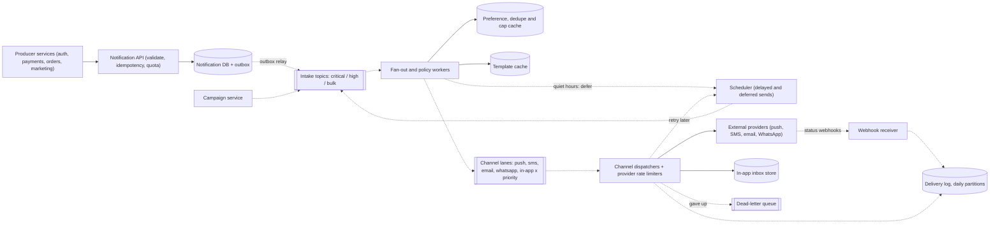
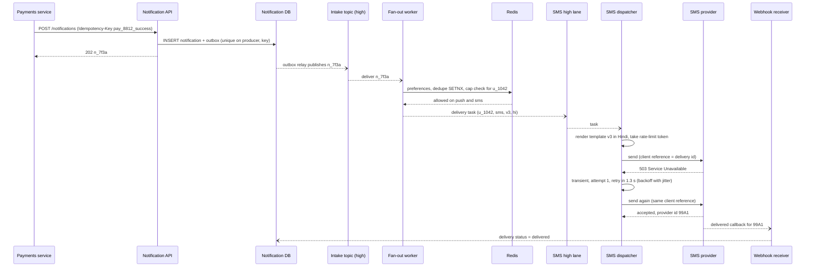

Almost every product eventually builds the same thing: one place that every team calls to "tell the user something". An OTP for login, "your payment of ₹2,450 succeeded", "your bill is due", a Diwali sale blast to 30 million people. Each team could call an SMS or email provider directly, but then nobody can answer "how many messages did we send this person today?", quiet hours aren't respected, and a marketing campaign can starve the OTPs. A notification platform centralises that, and the interesting design problems are fan-out, priorities, preferences and failure handling.

## Learning objectives

By the end of this lesson you will be able to:

1. Gather requirements for a multi-channel notification platform and separate transactional, critical and marketing traffic.
2. Estimate message volume, campaign burst rates, provider limits, log storage and preference data with explicit arithmetic.
3. Design an intake API that is idempotent and returns quickly, with fan-out happening asynchronously.
4. Keep critical messages (OTPs) fast during a marketing blast using priority lanes and separate worker pools (bulkheads).
5. Apply preferences, quiet hours, consent and frequency caps in the right order, and decide when to defer rather than drop.
6. Design versioned, localised templates, including channel constraints like SMS segment length and registered templates.
7. Implement retries with exponential backoff and jitter, provider failover and dead-lettering, and explain why "exactly once" delivery to a phone isn't achievable.

## Prerequisites

- [Message queues](#/lesson/m12-message-queues): producers, consumers, acknowledgements.
- [Retries and dead-letter queues](#/lesson/m12-retries-dlq): poison messages and retry policies.
- [Idempotent consumers](#/lesson/m12-idempotent-consumers): dedupe tables.
- [Rate limiting algorithms](#/lesson/m10-rate-limiting): token bucket and sliding window.

## Explain it like I'm a beginner

Think of the dispatch office of a big courier company in Mumbai.

- Many shops (**producer teams**) hand over parcels with a label: who it's for, what kind it is, how urgent.
- The office **sorts** parcels into separate lines: a red line for medicines (urgent), a yellow line for normal parcels, and a big green line for flyers (bulk). Flyers never block medicines, even on the busiest day (**priority lanes**).
- Before dispatch, a clerk checks the customer's **instructions**: "no flyers", "don't ring the bell after 9 pm", "deliver to my office, not home" (**preferences, quiet hours, channel choice**).
- Each parcel goes out through a **delivery partner**: bike, van, post (**channels and providers**). Each partner can only take so many parcels an hour (**provider rate limits**).
- If a delivery fails because nobody was home, the courier tries again later, waiting longer each time. If the address doesn't exist, there's no point retrying (**transient vs permanent errors**).
- Parcels that fail too many times go to a **problem shelf** for a human to look at (**dead-letter queue**).
- The office keeps a **register** of everything sent, so when a customer calls asking "did you send my OTP?", support can check (**delivery log**).

## Requirements

### Functional requirements

1. **Send API** for internal producers: recipient(s), template id, data, category, priority, optional channel list, optional schedule time, and an idempotency key.
2. **Channels**: mobile push, SMS, email, WhatsApp, and in-app (an inbox plus a real-time badge).
3. **Campaigns**: send one template to a user segment (up to tens of millions of users), optionally paced over hours.
4. **Preferences**: per user, per category and channel opt-out; marketing consent; quiet hours in the user's time zone; a preferred language.
5. **Templates**: per channel, versioned, localised, with typed variables.
6. **Limits**: per-user frequency caps (for example at most 3 marketing messages a day), per-producer quotas, and per-provider throughput limits.
7. **Delivery tracking**: status per message (accepted, sent, delivered, opened, failed, bounced), from provider callbacks.
8. **In-app inbox**: list, mark read, unread count.

### Out of scope

- Building our own SMS gateway or push service. We integrate providers (push services such as FCM and APNs, SMS aggregators, email service providers, the WhatsApp Business Platform).
- A campaign authoring UI and audience segmentation engine. We receive a segment id or a file of user ids.
- Chat (see [chat application](#/lesson/m17-chat)).

### Non-functional requirements

| Requirement | Target |
|---|---|
| Critical (OTP, security alerts) | p99 under 5 s from API call to provider hand-off, even during campaigns |
| Transactional (payment, order updates) | p99 under 60 s |
| Marketing | Best effort within the campaign window (hours) |
| Intake availability | 99.95 % for the send API; producers must not lose requests |
| Delivery semantics | At-least-once internally, deduplicated per (idempotency key, user, channel) |
| Compliance | Never send marketing without consent or during quiet hours; honour unsubscribes within minutes |
| Isolation | One producer or campaign can't exhaust capacity for others |
| Auditability | Every message attempt is logged for 90 days |

## Capacity estimation

All numbers are **estimates** for a large consumer app (think a payments or e-commerce company in India with 100 M users).

### Volume

| Type | Per day | Average rate | Peak assumption |
|---|---|---|---|
| Critical (OTP, security) | 10 M | 10 M ÷ 86,400 ≈ 116/s | ×5 ≈ 600/s |
| Transactional | 40 M | ≈ 460/s | ×3 ≈ 1,400/s |
| Marketing (campaigns) | 200 M | ≈ 2,300/s | Bursty: see below |
| In-app only | 50 M | ≈ 580/s | ×3 ≈ 1,700/s |
| **Total** | **300 M** | **≈ 3,500/s** | |

### Campaign burst

A Diwali campaign targets 30 M users with push and SMS. Marketing wants it "all out within an hour":

- 30 M ÷ 3,600 s ≈ **8,300 messages/s per channel**.
- Push services accept high throughput, so push is mostly limited by our own workers.
- SMS is limited by the aggregator. Suppose the contract allows **2,000 SMS/s** (an assumption; get the real figure from your provider). Then 30 M SMS take 30 M ÷ 2,000 = 15,000 s ≈ **4.2 hours** on one provider, or about 2 hours across two.
- And during those hours, OTPs (600/s at peak) must still flow through the same providers. So we **reserve** capacity: for example, 300/s of the SMS contract is held for critical traffic, and campaigns get the rest.

The numbers turn "send it in an hour" into a negotiation: push in an hour, SMS paced over 4 hours, or pay for a second provider.

### SMS segments

An SMS segment holds 160 characters in the GSM-7 alphabet, or 70 when the text needs UCS-2 (any Devanagari, Tamil or emoji character). Long messages are split into segments of 153 (GSM-7) or 67 (UCS-2), and **each segment is billed and counts against throughput**. A 200-character Hindi message is 3 segments, so "2,000 SMS/s" may mean only about 670 Hindi messages/s. Template design is a capacity decision.

### Fan-out work

- 30 M recipients in batches of 1,000 = **30,000 batch jobs** per campaign.
- Each recipient needs a preference lookup, a frequency-cap check, a dedupe check and a render: 4 small operations × 8,300/s ≈ **33,000 cache operations/s** at full speed. Preferences must come from a cache, not the database.

### Storage

- Delivery log: 300 M messages/day × ~1 KB (ids, channel, template version, status history, provider ids) = **300 GB/day**. 90 days ≈ **27 TB**. Partition by day; keep 7 days hot in a database for support lookups, older data in cheap columnar or object storage.
- Preferences: 100 M users × ~200 B = **20 GB**. Fits in a Redis cluster with room to spare.
- Device tokens for push: 100 M users × 2 devices × ~250 B ≈ **50 GB**.
- In-app inbox: 50 M/day × 500 B, kept 30 days ≈ **750 GB**.

### Callbacks

Providers report delivery status through webhooks: roughly one callback per SMS, email and WhatsApp message, plus opens and clicks. Call it **250 M callbacks/day ≈ 2,900/s**, with spikes after campaigns. The webhook receiver is as busy as the send path.

### What the numbers tell us

1. Average load (3,500/s) is moderate; **bursts and provider limits** dominate the design.
2. **Isolation** is the main correctness property: a campaign at 8,300/s must not delay 600 OTPs/s.
3. Preference and dedupe checks must be **cache-speed**, because they happen per recipient during fan-out.
4. The **log** is the largest store, and it is write-heavy and time-partitioned.

## API design

### Send (producer-facing)

```http
POST /api/v1/notifications
Authorization: Bearer <service token for "payments-service">
Idempotency-Key: pay_8812_success

{ "userIds": ["u_1042"], "templateId": "payment_success", "category": "transactions",
  "priority": "high", "channels": ["push", "sms"],
  "data": { "amount": "₹2,450.00", "merchant": "Metro Fresh", "txnRef": "UPI/4401..." } }

202 Accepted
{ "notificationId": "n_7f3a…", "status": "accepted" }
```

- `202 Accepted`, not `200`: the request is durably queued; delivery happens later.
- Repeating the same `Idempotency-Key` from the same producer returns the original `notificationId` without sending again.
- `channels` is optional. If omitted, the template's default channel order applies (for example push, then SMS if push isn't available).
- Validation is synchronous: unknown template, missing variables, a producer not allowed to use that category, or more than 1,000 user ids (use the campaign API instead) → `400` / `403`.
- Over quota → `429` with `Retry-After`.

### Campaigns

```http
POST /api/v1/campaigns
{ "segmentId": "seg_diwali_active_90d", "templateId": "diwali_offer_2026", "category": "offers",
  "channels": ["push", "sms"], "startAt": "2026-10-20T10:00:00+05:30", "endBy": "2026-10-20T20:00:00+05:30",
  "maxRatePerSecond": 6000 }
→ 202 { "campaignId": "c_219" }

GET  /api/v1/campaigns/c_219          → progress: targeted, skipped (by reason), sent, failed
POST /api/v1/campaigns/c_219/pause    → stops fan-out at the next batch
```

### Preferences, inbox, status

- `GET/PUT /api/v1/users/{id}/preferences`: opt-outs per (category, channel), quiet hours, language.
- `POST /api/v1/unsubscribe?token=…`: one-click unsubscribe from an email link (signed token, no login needed). Email also carries the `List-Unsubscribe` and `List-Unsubscribe-Post` headers from RFC 8058, which large mailbox providers expect from bulk senders.
- `GET /api/v1/users/{id}/inbox?cursor=…`, `POST /api/v1/users/{id}/inbox/{msgId}/read`.
- `POST /webhooks/{provider}`: provider status callbacks, verified by signature ([webhooks](#/lesson/m10-webhooks)).
- `GET /api/v1/notifications/{id}`: status per channel, for support tools.

## Data model

```sql
CREATE TABLE notification (                 -- one row per accepted request
    notification_id  uuid        PRIMARY KEY,
    producer         text        NOT NULL,
    idempotency_key  text        NOT NULL,
    template_id      text        NOT NULL,
    template_version int         NOT NULL,   -- pinned at accept time
    category         text        NOT NULL,
    priority         text        NOT NULL CHECK (priority IN ('critical','high','bulk')),
    payload          jsonb       NOT NULL,
    created_at       timestamptz NOT NULL DEFAULT now(),
    UNIQUE (producer, idempotency_key)
);

CREATE TABLE delivery (                     -- one row per (notification, user, channel)
    delivery_id      uuid        NOT NULL,
    notification_id  uuid        NOT NULL,
    user_id          text        NOT NULL,
    channel          text        NOT NULL,
    status           text        NOT NULL,   -- queued, skipped, sent, delivered, failed, dead
    skip_reason      text,                   -- opted_out, quiet_hours_deferred, capped, no_device...
    attempts         int         NOT NULL DEFAULT 0,
    provider         text,
    provider_msg_id  text,
    created_at       timestamptz NOT NULL DEFAULT now(),
    updated_at       timestamptz NOT NULL DEFAULT now(),
    PRIMARY KEY (created_at, delivery_id),
    UNIQUE (notification_id, user_id, channel, created_at)
) PARTITION BY RANGE (created_at);           -- daily partitions, dropped after the hot window

CREATE TABLE template (
    template_id text NOT NULL,
    version     int  NOT NULL,
    channel     text NOT NULL,
    locale      text NOT NULL,               -- 'en', 'hi', 'ta-IN' ...
    subject     text,                        -- email only
    body        text NOT NULL,               -- with {{variables}}
    variables   text[] NOT NULL,             -- declared, validated at accept time
    external_id text,                        -- e.g. a registered SMS template id
    status      text NOT NULL CHECK (status IN ('draft','approved','retired')),
    PRIMARY KEY (template_id, version, channel, locale)
);

CREATE TABLE user_pref (
    user_id           text PRIMARY KEY,
    locale            text NOT NULL DEFAULT 'en',
    time_zone         text NOT NULL DEFAULT 'Asia/Kolkata',
    quiet_start       time,                  -- local time, e.g. 21:00
    quiet_end         time,                  -- e.g. 09:00
    marketing_consent boolean NOT NULL DEFAULT false
);
CREATE TABLE channel_optout (
    user_id  text NOT NULL,
    category text NOT NULL,
    channel  text NOT NULL,
    PRIMARY KEY (user_id, category, channel)
);
CREATE TABLE device_token (
    user_id     text NOT NULL,
    platform    text NOT NULL,               -- android, ios, web
    token       text NOT NULL,
    last_seen   timestamptz NOT NULL,
    invalid_at  timestamptz,                 -- set when the push service reports it unregistered
    PRIMARY KEY (user_id, token)
);
```

Design notes:

- `UNIQUE (producer, idempotency_key)` makes the send API idempotent at intake. `UNIQUE (notification_id, user_id, channel, …)` makes fan-out idempotent: if a fan-out worker crashes and its batch is redelivered, the second insert conflicts and that recipient is skipped. (On a partitioned table, unique constraints must include the partition key, hence `created_at`; in practice use a deterministic `created_at` from the notification so retries collide.)
- **Template version is pinned at accept time.** If marketing edits the template mid-campaign, recipients still get the version that was approved for this send.
- **Preferences are read from cache** (Redis, keyed by user id) during fan-out; the tables are the source of truth, and updates write through to the cache.
- **The delivery table is the log.** Daily partitions make "drop data older than 7 days" a cheap `DROP TABLE` of a partition, after exporting it to columnar storage for the 90-day retention.

## High-level architecture



Arrow by arrow:

- **Producers → Notification API**: synchronous validation, per-producer quota, and idempotency. The API writes the request and an outbox row in one transaction and returns `202`. Producers never wait for delivery.
- **Notification DB ⇢ Intake topics**: an outbox relay ([outbox lesson](#/lesson/m12-outbox)) publishes the accepted request to one of three topics by priority. Campaigns and the scheduler also publish into these topics.
- **Intake ⇢ Fan-out and policy workers**: for each request, expand recipients, load preferences, apply consent, opt-outs, quiet hours and frequency caps, dedupe, choose channels, pick the template version and locale, and produce one delivery task per (user, channel). Separate worker pools consume each priority topic.
- **Fan-out → caches**: preferences, dedupe keys and frequency counters live in Redis; templates are cached in memory.
- **Fan-out ⇢ Scheduler**: messages blocked only by quiet hours are deferred to the end of the quiet window, not dropped.
- **Fan-out ⇢ Channel lanes**: delivery tasks go to per-channel, per-priority queues, so the SMS bulk lane filling up doesn't affect the SMS critical lane or the push lanes.
- **Lanes ⇢ Dispatchers → Providers**: dispatchers render the final message, take a token from the provider's rate limiter, call the provider with a timeout, and record the result. In-app messages go to the inbox store and a real-time push to connected clients.
- **Dispatchers ⇢ Scheduler / DLQ**: transient failures are rescheduled with backoff; permanent failures and exhausted retries go to the dead-letter queue.
- **Providers ⇢ Webhook receiver ⇢ Delivery log**: delivered, bounced, opened and failed statuses arrive asynchronously and update the log.

### A transactional send, end to end



The payments service gets its `202` after one database write. Everything after the dotted arrows is asynchronous and can retry independently. The dedupe check in Redis (`SETNX` on `n_7f3a:u_1042:sms`) means a redelivered intake message won't send a second SMS. The dispatcher passes the delivery id as the provider's client reference, so if the provider supports deduplication on it, the retry after a lost response can't produce two SMS either.

## Deep dives

### Deep dive 1: priority lanes, not a priority field

A single queue with a `priority` field doesn't work. When a campaign drops 30 M bulk messages into it, an OTP enqueued afterwards sits behind them (head-of-line blocking), and most brokers don't reorder a queue by priority efficiently.

Instead:

- **Separate topics or queues per priority** at intake, and **per channel and priority** after fan-out.
- **Separate worker pools** for each lane, sized independently (a bulkhead, see [bulkheads](#/lesson/m10-bulkhead)). Bulk workers can be scaled to zero without touching critical ones.
- **Reserved provider capacity**: the SMS rate limiter has a critical bucket (say 300/s) that bulk traffic can never use, plus a shared bucket.
- **Strict preference for critical** where a single worker reads several lanes: always drain critical first. Starving bulk is acceptable because critical volume is small and bounded by quotas.

### Deep dive 2: campaign fan-out

A campaign is one request that becomes 30 M deliveries. The campaign service:

1. Exports the segment as a list of user ids, split into **batches of 1,000**, each written as a batch job with a stable id (`c_219:batch:00042`).
2. Publishes batch jobs to the bulk intake topic at a **paced** rate derived from `maxRatePerSecond` and provider capacity. Pacing at the batch level is cheaper than pacing individual messages.
3. Records progress per batch, so `pause` stops new batches and a crashed fan-out worker's batch is simply redelivered.

Each fan-out worker processes a batch: bulk-load preferences for 1,000 users from Redis (one pipelined call), evaluate policy, `SETNX` dedupe keys in one pipeline, increment frequency counters, and enqueue up to 2,000 delivery tasks (push + SMS). Because each step is idempotent per (campaign, user, channel), redelivery is safe.

**Backpressure**: if SMS lanes grow beyond, say, 10 minutes of provider capacity, the campaign service slows batch publishing. Without this, a campaign fills queues with messages that will be stale (an "offer ends tonight" SMS delivered tomorrow morning). Messages also carry an **expiry** (`endBy`): dispatchers drop marketing tasks past their expiry rather than send them late. See [backpressure](#/lesson/m13-backpressure).

### Deep dive 3: preferences, consent and quiet hours

Order of checks for each (user, channel), cheapest and most absolute first:

1. **Is the channel possible?** A verified phone for SMS, a valid push token, an email address that hasn't hard-bounced.
2. **Is the category mandatory?** Security alerts and OTPs can't be turned off (but can still only go to channels the user has). Mandatory categories skip steps 3–5.
3. **Consent**: marketing requires explicit consent. No consent → skip with reason `no_consent`.
4. **Opt-outs**: (category, channel) opt-out → skip `opted_out`.
5. **Frequency cap**: at most N per category per rolling 24 h → skip `capped`.
6. **Quiet hours** in the user's local time zone: transactional messages may be allowed (a delivery update at 22:00 is useful) while marketing is **deferred** to the end of quiet hours. If deferring would push it past the campaign's `endBy`, skip with `quiet_hours_expired`.

Every skip is logged with its reason. "Why didn't I get the offer?" is a common support question, and "targeted 30 M, skipped 6.2 M (opted out 3.1 M, no consent 2.4 M, capped 0.7 M)" is the first thing marketing asks after a campaign.

In India, commercial SMS also has regulatory rules (registered sender headers and templates on a DLT platform, and restricted hours for promotional messages). Treat those as hard rules in step 6, separate from user-chosen quiet hours, and check current regulations with your compliance team.

### Deep dive 4: templates

- **Per channel**: push needs a short title and body, SMS a single short body, email a subject, HTML and plain-text parts, WhatsApp a pre-approved template (business-initiated WhatsApp messages outside a customer-service window must use approved templates), and in-app a title, body and deep link.
- **Versioned and approved**: producers reference `payment_success`; the platform resolves the latest **approved** version at accept time and pins it.
- **Localised with fallback**: try the user's locale (`hi-IN`), then the language (`hi`), then the default (`en`). Log fallbacks so missing translations get noticed.
- **Variables declared and validated at accept time**. A missing `{{amount}}` should fail the producer's API call with `400`, not produce "Your payment of {{amount}} succeeded" on 30 M phones.
- **Escaping per channel**: HTML-encode variables in email HTML; never let variables inject markup.
- **Registered templates**: where an SMS template must be registered with operators, store its external id on the template row and make sure the rendered text matches the registered pattern; messages that don't match are blocked downstream.
- **Length checks** at approval time: count SMS segments for each locale (Hindi text uses the 70-character UCS-2 segments), and warn when a template exceeds one segment.

### Deep dive 5: rate limits at three levels

1. **Per producer**: token bucket per calling service at the API (for example 500 requests/s for `payments-service`), so one buggy producer can't flood the platform.
2. **Per user**: frequency caps per category, using a sliding window counter in Redis (exercise 3). These protect users from being spammed by many well-meaning teams.
3. **Per provider**: a distributed token bucket per provider account (in Redis, shared by all dispatcher instances), split into a reserved critical bucket and a shared bucket. When a provider returns `429` with `Retry-After`, the dispatcher pauses that provider's lane, not the whole channel.

### Deep dive 6: retries, failover and "exactly once"

Classify every provider response:

- **Transient**: timeouts, connection errors, `5xx`, `429`. Retry with **exponential backoff and full jitter**: delay = random(0, min(cap, base × 2^(attempt−1))). Jitter spreads retries so 50,000 failed sends don't all retry in the same second ([timeouts and retries](#/lesson/m10-timeouts-retries)).
- **Permanent**: invalid number, unregistered push token, hard email bounce, recipient blocked. Don't retry. Update the source data (mark the token invalid, mark the email bounced) so future messages skip it at step 1.
- **Unknown outcome**: a timeout after the request was sent. The message may have been delivered. Retrying risks a duplicate; not retrying risks a miss.

Policies differ by priority:

| Priority | Base | Cap | Max attempts | Failover |
|---|---|---|---|---|
| Critical | 1 s | 10 s | 4 | To a secondary provider after 2 transient failures |
| High | 5 s | 5 min | 6 | Optional |
| Bulk | 60 s | 1 h | 8 | No; also dropped after campaign expiry |

**Why not exactly once?** The last hop is an external provider and then a phone network. If the provider accepts the message but its response is lost, we can't know whether it was sent. We get as close as possible with: dedupe keys at every internal step (so *we* never send twice on purpose), the delivery id as the provider's client reference where idempotent sends are supported, and a rule for unknown outcomes per category. For OTPs, a rare duplicate is better than a missing code; for a "₹50,000 debited" alert, a duplicate can cause panic, so some teams prefer not to retry unknown outcomes for that category. That is a product decision you should make explicitly.

After the last attempt, the task goes to the **dead-letter queue** with its full history. An operator can inspect, fix (for example a broken template variable), and replay.

### Deep dive 7: the core in ASP.NET Core

The sketch below wires the core: priority lanes on `System.Threading.Channels`, a fan-out worker that applies policy and dedupe per recipient, and a dispatch worker that renders, sends and retries with backoff and jitter. Stores and providers are in-memory fakes behind interfaces.

```csharp file=Notify/Model.cs
namespace Notify;

public enum Priority { Critical, High, Bulk }
public enum ChannelKind { Push, Sms, Email, WhatsApp, InApp }

public sealed record NotificationRequest(
    string NotificationId, string Producer, string IdempotencyKey, string TemplateId, string Category,
    Priority Priority, IReadOnlyList<string> UserIds, IReadOnlyList<ChannelKind> Channels,
    IReadOnlyDictionary<string, string> Data, DateTimeOffset? ExpiresAt);

public sealed record DeliveryTask(
    string DeliveryId, string NotificationId, string UserId, ChannelKind Channel, Priority Priority,
    string TemplateId, string Locale, IReadOnlyDictionary<string, string> Data, int Attempt, DateTimeOffset? ExpiresAt)
{
    public string DedupeKey => $"{NotificationId}:{UserId}:{Channel}";
}

public sealed record UserPreferences(
    string UserId, string Locale, TimeSpan UtcOffset, TimeOnly? QuietStart, TimeOnly? QuietEnd, bool MarketingConsent,
    IReadOnlySet<(string Category, ChannelKind Channel)> OptOuts, IReadOnlySet<ChannelKind> Reachable);
```

```csharp file=Notify/Policy.cs
namespace Notify;

public enum Verdict { Send, Skip, Defer }
public sealed record PolicyDecision(Verdict Verdict, string? Reason = null, DateTimeOffset? DeferUntil = null);

/// <summary>Checks in order: reachable, mandatory, consent, opt-out, quiet hours. Frequency caps are applied by the caller,
/// because they need shared counters.</summary>
public static class PreferencePolicy
{
    private static readonly HashSet<string> Mandatory = new(StringComparer.Ordinal) { "security", "otp" };
    private static readonly HashSet<string> Marketing = new(StringComparer.Ordinal) { "offers", "newsletter" };

    public static bool IsMarketing(string category) => Marketing.Contains(category);

    public static PolicyDecision Evaluate(UserPreferences p, string category, ChannelKind channel, DateTimeOffset nowUtc)
    {
        if (!p.Reachable.Contains(channel)) return new(Verdict.Skip, "unreachable");
        if (Mandatory.Contains(category)) return new(Verdict.Send);
        if (IsMarketing(category) && !p.MarketingConsent) return new(Verdict.Skip, "no_consent");
        if (p.OptOuts.Contains((category, channel))) return new(Verdict.Skip, "opted_out");

        if (IsMarketing(category) && p.QuietStart is { } qs && p.QuietEnd is { } qe)
        {
            var local = nowUtc.ToOffset(p.UtcOffset);
            var t = TimeOnly.FromDateTime(local.DateTime);
            var inQuiet = qs <= qe ? t >= qs && t < qe : t >= qs || t < qe;   // window may cross midnight
            if (inQuiet)
            {
                var endDate = DateOnly.FromDateTime(local.DateTime);
                if (qs > qe && t >= qs) endDate = endDate.AddDays(1);           // e.g. 21:00-09:00, now 22:00 -> tomorrow 09:00
                var until = new DateTimeOffset(endDate.ToDateTime(qe), p.UtcOffset);
                return new(Verdict.Defer, "quiet_hours", until);
            }
        }
        return new(Verdict.Send);
    }
}
```

```csharp file=Notify/Infrastructure.cs
using System.Collections.Concurrent;
using System.Threading.Channels;

namespace Notify;

/// <summary>Per-priority lanes. Readers always drain Critical first, so a bulk backlog never delays OTPs.</summary>
public sealed class PriorityLanes
{
    private readonly Dictionary<Priority, Channel<DeliveryTask>> _lanes = new()
    {
        [Priority.Critical] = Channel.CreateUnbounded<DeliveryTask>(),
        [Priority.High] = Channel.CreateBounded<DeliveryTask>(50_000),
        [Priority.Bulk] = Channel.CreateBounded<DeliveryTask>(200_000), // full => fan-out waits (backpressure)
    };

    public ValueTask EnqueueAsync(DeliveryTask t, CancellationToken ct) => _lanes[t.Priority].Writer.WriteAsync(t, ct);

    public async ValueTask<DeliveryTask> DequeueAsync(CancellationToken ct)
    {
        while (true)
        {
            foreach (var p in new[] { Priority.Critical, Priority.High, Priority.Bulk })
                if (_lanes[p].Reader.TryRead(out var t)) return t;
            var waits = _lanes.Values.Select(c => c.Reader.WaitToReadAsync(ct).AsTask());
            await Task.WhenAny(waits);
        }
    }

    public int Pending(Priority p) => _lanes[p].Reader.Count;
}

public interface IPreferenceStore { Task<UserPreferences?> GetAsync(string userId, CancellationToken ct); }

/// <summary>In production: Redis SET key NX EX 172800 for dedupe, and a sliding-window counter for caps.</summary>
public interface IDeliveryGuard
{
    bool TryMarkOnce(string dedupeKey);
    bool TryConsumeCap(string userId, string category, DateTimeOffset now, int maxPerDay);
}

public sealed class InMemoryDeliveryGuard : IDeliveryGuard
{
    private readonly ConcurrentDictionary<string, byte> _seen = new();
    private readonly ConcurrentDictionary<string, Queue<DateTimeOffset>> _windows = new();

    public bool TryMarkOnce(string dedupeKey) => _seen.TryAdd(dedupeKey, 0);

    public bool TryConsumeCap(string userId, string category, DateTimeOffset now, int maxPerDay)
    {
        var q = _windows.GetOrAdd($"{userId}:{category}", _ => new Queue<DateTimeOffset>());
        lock (q)
        {
            while (q.Count > 0 && q.Peek() <= now.AddDays(-1)) q.Dequeue();
            if (q.Count >= maxPerDay) return false;
            q.Enqueue(now);
            return true;
        }
    }
}

public sealed class InMemoryPreferenceStore : IPreferenceStore
{
    private readonly ConcurrentDictionary<string, UserPreferences> _prefs = new();
    public void Put(UserPreferences p) => _prefs[p.UserId] = p;
    public Task<UserPreferences?> GetAsync(string userId, CancellationToken ct) =>
        Task.FromResult(_prefs.TryGetValue(userId, out var p) ? p : null);
}

/// <summary>Accepted requests waiting for fan-out. In production: the intake topics fed by the outbox relay.</summary>
public sealed class IntakeQueue
{
    private readonly Channel<NotificationRequest> _ch = Channel.CreateUnbounded<NotificationRequest>();
    public ValueTask EnqueueAsync(NotificationRequest r, CancellationToken ct) => _ch.Writer.WriteAsync(r, ct);
    public ChannelReader<NotificationRequest> Reader => _ch.Reader;
}
```

```csharp file=Notify/Sending.cs
using System.Text.RegularExpressions;
using Microsoft.Extensions.Logging;

namespace Notify;

public enum SendStatus { Accepted, Transient, Permanent }
public sealed record SendResult(SendStatus Status, string? ProviderMessageId = null, TimeSpan? RetryAfter = null);

public interface IChannelSender
{
    ChannelKind Channel { get; }
    Task<SendResult> SendAsync(DeliveryTask task, string renderedText, CancellationToken ct);
}

public interface ITemplateStore { string? Find(string templateId, ChannelKind channel, string locale); }

public sealed class InMemoryTemplateStore : ITemplateStore
{
    private readonly Dictionary<(string, ChannelKind, string), string> _bodies = new();
    public void Put(string id, ChannelKind ch, string locale, string body) => _bodies[(id, ch, locale)] = body;

    /// <summary>Locale fallback: hi-IN -> hi -> en.</summary>
    public string? Find(string templateId, ChannelKind channel, string locale)
    {
        foreach (var l in new[] { locale, locale.Split('-')[0], "en" })
            if (_bodies.TryGetValue((templateId, channel, l), out var b)) return b;
        return null;
    }
}

public static class Renderer
{
    private static readonly Regex Var = new(@"\{\{\s*([A-Za-z0-9_]+)\s*\}\}", RegexOptions.Compiled);

    public static string Render(string body, IReadOnlyDictionary<string, string> data) =>
        Var.Replace(body, m => data.TryGetValue(m.Groups[1].Value, out var v)
            ? v
            : throw new KeyNotFoundException($"Template variable '{m.Groups[1].Value}' has no value."));
}

/// <summary>Exponential backoff with full jitter; limits differ by priority.</summary>
public sealed class RetryPolicy(Func<double> random)
{
    public static (TimeSpan Base, TimeSpan Cap, int Max) For(Priority p) => p switch
    {
        Priority.Critical => (TimeSpan.FromSeconds(1), TimeSpan.FromSeconds(10), 4),
        Priority.High => (TimeSpan.FromSeconds(5), TimeSpan.FromMinutes(5), 6),
        _ => (TimeSpan.FromSeconds(60), TimeSpan.FromHours(1), 8),
    };

    public TimeSpan? NextDelay(Priority p, int attempt, TimeSpan? retryAfter)
    {
        var (b, cap, max) = For(p);
        if (attempt >= max) return null;
        if (retryAfter is { } ra) return ra;
        var ceiling = Math.Min(cap.TotalMilliseconds, b.TotalMilliseconds * Math.Pow(2, attempt - 1));
        return TimeSpan.FromMilliseconds(random() * ceiling);
    }
}

public sealed class LoggingSender(ChannelKind channel, ILogger<LoggingSender> log) : IChannelSender
{
    public ChannelKind Channel => channel;
    public Task<SendResult> SendAsync(DeliveryTask task, string renderedText, CancellationToken ct)
    {
        log.LogInformation("[{Channel}] to {User}: {Text}", channel, task.UserId, renderedText);
        return Task.FromResult(new SendResult(SendStatus.Accepted, Guid.NewGuid().ToString("N")));
    }
}
```

```csharp file=Notify/Workers.cs
using System.Collections.Concurrent;
using Microsoft.Extensions.Hosting;
using Microsoft.Extensions.Logging;

namespace Notify;

/// <summary>Expands requests into per-(user, channel) tasks: preferences, caps, dedupe. Idempotent per dedupe key,
/// so a redelivered request or batch never produces a second task.</summary>
public sealed class FanOutWorker(IntakeQueue intake, IPreferenceStore prefs, IDeliveryGuard guard, PriorityLanes lanes,
                                 TimeProvider clock, ILogger<FanOutWorker> log) : BackgroundService
{
    public const int MarketingPerDay = 3;
    public ConcurrentDictionary<string, int> SkipCounts { get; } = new();

    protected override async Task ExecuteAsync(CancellationToken stoppingToken)
    {
        try
        {
            await foreach (var req in intake.Reader.ReadAllAsync(stoppingToken))
            {
                try { await FanOutAsync(req, stoppingToken); }
                catch (Exception ex) when (ex is not OperationCanceledException)
                {
                    log.LogError(ex, "Fan-out failed for {NotificationId}; it will be redelivered", req.NotificationId);
                }
            }
        }
        catch (OperationCanceledException) when (stoppingToken.IsCancellationRequested) { }
    }

    public async Task FanOutAsync(NotificationRequest req, CancellationToken ct)
    {
        var now = clock.GetUtcNow();
        foreach (var userId in req.UserIds)
        {
            var p = await prefs.GetAsync(userId, ct);
            if (p is null) { Skip("unknown_user"); continue; }
            var cappedThisUser = false;

            foreach (var channel in req.Channels)
            {
                var d = PreferencePolicy.Evaluate(p, req.Category, channel, now);
                if (d.Verdict == Verdict.Skip) { Skip(d.Reason!); continue; }
                if (d.Verdict == Verdict.Defer) { Skip("deferred_" + d.Reason); continue; } // production: hand to the scheduler

                if (PreferencePolicy.IsMarketing(req.Category) && !cappedThisUser
                    && !guard.TryConsumeCap(userId, req.Category, now, MarketingPerDay))
                { Skip("capped"); break; }
                cappedThisUser = true; // one cap unit per user per notification, not per channel

                var task = new DeliveryTask($"{req.NotificationId}:{userId}:{channel}", req.NotificationId, userId, channel,
                                            req.Priority, req.TemplateId, p.Locale, req.Data, 1, req.ExpiresAt);
                if (!guard.TryMarkOnce(task.DedupeKey)) { Skip("duplicate"); continue; }
                await lanes.EnqueueAsync(task, ct);
            }
        }
    }

    private void Skip(string reason) => SkipCounts.AddOrUpdate(reason, 1, (_, n) => n + 1);
}

/// <summary>Renders and sends; retries transient failures with backoff and jitter; dead-letters the rest.</summary>
public sealed class DispatchWorker(PriorityLanes lanes, IEnumerable<IChannelSender> senders, ITemplateStore templates,
                                   RetryPolicy retry, TimeProvider clock, ILogger<DispatchWorker> log) : BackgroundService
{
    private readonly Dictionary<ChannelKind, IChannelSender> _senders = senders.ToDictionary(s => s.Channel);
    public ConcurrentQueue<(DeliveryTask Task, string Reason)> DeadLetters { get; } = new();

    protected override async Task ExecuteAsync(CancellationToken stoppingToken)
    {
        try
        {
            while (!stoppingToken.IsCancellationRequested)
                await DispatchOnceAsync(await lanes.DequeueAsync(stoppingToken), stoppingToken);
        }
        catch (OperationCanceledException) when (stoppingToken.IsCancellationRequested) { }
    }

    public async Task DispatchOnceAsync(DeliveryTask task, CancellationToken ct)
    {
        if (task.ExpiresAt is { } exp && exp <= clock.GetUtcNow()) { DeadLetters.Enqueue((task, "expired")); return; }
        var body = templates.Find(task.TemplateId, task.Channel, task.Locale);
        if (body is null || !_senders.TryGetValue(task.Channel, out var sender)) { DeadLetters.Enqueue((task, "no_template_or_sender")); return; }

        string text;
        try { text = Renderer.Render(body, task.Data); }
        catch (KeyNotFoundException ex) { DeadLetters.Enqueue((task, ex.Message)); return; } // permanent: retrying won't help

        SendResult result;
        try
        {
            using var timeout = CancellationTokenSource.CreateLinkedTokenSource(ct);
            timeout.CancelAfter(TimeSpan.FromSeconds(task.Priority == Priority.Critical ? 3 : 10));
            result = await sender.SendAsync(task, text, timeout.Token);
        }
        catch (Exception ex) when (ex is not OperationCanceledException || !ct.IsCancellationRequested)
        {
            result = new SendResult(SendStatus.Transient); // timeout or network error: outcome unknown, treat as transient
        }

        if (result.Status == SendStatus.Accepted) return;
        if (result.Status == SendStatus.Permanent) { DeadLetters.Enqueue((task, "permanent")); return; }

        var delay = retry.NextDelay(task.Priority, task.Attempt, result.RetryAfter);
        if (delay is null) { DeadLetters.Enqueue((task, "retries_exhausted")); return; }
        log.LogInformation("Retrying {DeliveryId} in {Delay}", task.DeliveryId, delay);
        // Sketch only: production schedules the retry durably (delayed message or a sorted set), not in process memory.
        _ = Task.Run(async () =>
        {
            await Task.Delay(delay.Value, clock, CancellationToken.None);
            await lanes.EnqueueAsync(task with { Attempt = task.Attempt + 1 }, CancellationToken.None);
        });
    }
}
```

```csharp file=Program.cs
using Microsoft.Extensions.Logging;
using Notify;

var builder = WebApplication.CreateBuilder(args);
builder.Services.AddSingleton(TimeProvider.System);
builder.Services.AddSingleton<IntakeQueue>();
builder.Services.AddSingleton<PriorityLanes>();
builder.Services.AddSingleton<InMemoryPreferenceStore>();
builder.Services.AddSingleton<IPreferenceStore>(sp => sp.GetRequiredService<InMemoryPreferenceStore>());
builder.Services.AddSingleton<IDeliveryGuard, InMemoryDeliveryGuard>();
builder.Services.AddSingleton<ITemplateStore>(_ =>
{
    var t = new InMemoryTemplateStore();
    t.Put("payment_success", ChannelKind.Sms, "en", "Payment of {{amount}} to {{merchant}} succeeded. Ref {{txnRef}}");
    t.Put("payment_success", ChannelKind.Push, "en", "{{amount}} paid to {{merchant}}");
    return t;
});
builder.Services.AddSingleton(new RetryPolicy(Random.Shared.NextDouble));
foreach (var ch in Enum.GetValues<ChannelKind>())
    builder.Services.AddSingleton<IChannelSender>(sp => new LoggingSender(ch, sp.GetRequiredService<ILogger<LoggingSender>>()));
builder.Services.AddHostedService<FanOutWorker>();
builder.Services.AddHostedService<DispatchWorker>();

var app = builder.Build();

app.MapPost("/api/v1/notifications", async (SendRequest body, HttpContext http, IntakeQueue intake, CancellationToken ct) =>
{
    var key = http.Request.Headers["Idempotency-Key"].ToString();
    if (string.IsNullOrWhiteSpace(key)) return Results.Problem("Idempotency-Key header is required.", statusCode: 400);
    if (body.UserIds.Count is 0 or > 1000) return Results.Problem("Send to 1-1000 users; use campaigns for more.", statusCode: 400);
    var producer = http.User.Identity?.Name ?? "anonymous-producer";
    // Production: INSERT notification + outbox row, UNIQUE (producer, idempotency_key); on conflict return the original id.
    var id = $"n_{Convert.ToHexString(System.Security.Cryptography.SHA256.HashData(System.Text.Encoding.UTF8.GetBytes(producer + "|" + key)))[..16].ToLowerInvariant()}";
    await intake.EnqueueAsync(new NotificationRequest(id, producer, key, body.TemplateId, body.Category, body.Priority,
        body.UserIds, body.Channels, body.Data, body.ExpiresAt), ct);
    return Results.Accepted($"/api/v1/notifications/{id}", new { notificationId = id, status = "accepted" });
});

app.Run();

public sealed record SendRequest(IReadOnlyList<string> UserIds, string TemplateId, string Category, Priority Priority,
                                 IReadOnlyList<ChannelKind> Channels, IReadOnlyDictionary<string, string> Data,
                                 DateTimeOffset? ExpiresAt);
```

The notification id is derived deterministically from (producer, idempotency key), so a producer's retry produces the same id and the fan-out dedupe keys (`id:user:channel`) collide, even in this in-memory sketch. Production replaces the in-process lanes with a broker, the in-process retry timer with durable delayed messages, and the guard with Redis.

## Caching, queues and scaling

### Caching

| What | Where | TTL / invalidation |
|---|---|---|
| Preferences, opt-outs, consent | Redis hash per user | Write-through on update; 24 h TTL as a safety net |
| Device tokens | Redis set per user | Updated on app open; removed when the push service reports them invalid |
| Templates | In-process per worker | Versioned and immutable once approved, so cache forever by (id, version, channel, locale) |
| Dedupe keys | Redis `SET NX` | 48 h expiry (longer than any retry window) |
| Frequency counters | Redis sorted set or bucketed counters per (user, category) | Sliding 24 h window |

Unsubscribes must take effect within minutes, so preference updates write through to Redis synchronously, and fan-out reads Redis, never a stale local copy.

### Queues

- **Intake topics** by priority (a log such as Kafka, or a broker such as RabbitMQ or Azure Service Bus). Partition by user id so one user's notifications are processed in order.
- **Channel lanes** by channel × priority. Fifteen queues sounds like a lot, but it's what gives isolation.
- **Delay queue** for retries, quiet-hour deferrals and scheduled sends: broker-native scheduled messages, or a Redis sorted set scored by due time polled by the scheduler.
- **Dead-letter queue** per lane, with tooling to inspect and replay.

### Scaling

- **API**: stateless; scale on RPS. It does one database write per request.
- **Fan-out workers**: scale on intake lag. Bulk fan-out is CPU- and cache-bound (preference lookups); critical fan-out has its own small, always-on pool.
- **Dispatchers**: scale per lane, but **throughput is capped by providers**, so adding dispatchers beyond the provider rate limit only grows queues. Scale providers (contracts, second providers), not just pods.
- **Webhook receiver**: stateless, behind its own load balancer; it only verifies signatures and enqueues status events, so a burst of callbacks never touches the send path.
- **Delivery log**: write-heavy, time-partitioned. Batch status updates (one write per 100 events) to keep database load down.

**What breaks first?** (1) OTP latency during a campaign if lanes aren't separated, (2) provider rate limits and `429` storms, (3) preference lookups if they hit the database during fan-out, (4) the delivery log's write volume, and (5) the webhook receiver after a large campaign.

## Failure handling

| Failure | Effect | Mitigation |
|---|---|---|
| SMS provider outage | SMS sends fail | Circuit breaker per provider; critical lane fails over to a secondary provider; bulk lane pauses and resumes later |
| Provider returns `429` | Throttled | Honour `Retry-After`; pause that provider's lane; lower the shared token bucket |
| Push token invalid | Permanent failure | Mark token invalid; next sends skip it; fall back to SMS for transactional categories if the template allows |
| Fan-out worker crashes mid-batch | Batch redelivered | Dedupe keys make reprocessing idempotent |
| Redis (preferences / dedupe) down | Can't evaluate policy | Critical: proceed with defaults (mandatory categories don't need preferences) and accept possible duplicates; bulk: pause campaigns |
| Template bug (missing variable) | Rendering fails | Validated at accept time; anything that slips through dead-letters as permanent and alerts; campaign auto-pauses above an error threshold |
| Campaign overruns its window | Stale offers delivered late | Message expiry; dispatchers drop expired bulk tasks |
| Duplicate request from producer | Same notification twice | `UNIQUE (producer, idempotency_key)` returns the original id |
| Region outage | Platform unavailable in region | Active-passive second region for intake; producers buffer locally (or use their own outbox) and retry |

## Security

- **Producer authentication** with service identities (mutual TLS or OAuth client credentials). Each producer is authorised for specific categories and templates; the marketing service can't send "security" category messages, which bypass opt-outs.
- **Template approval workflow**: templates are reviewed before approval, because an approved template is effectively permission to message millions of people.
- **PII minimisation**: phone numbers and emails are resolved at dispatch time from the user service, not passed through queues by producers. The delivery log stores masked contact details.
- **OTP handling**: OTP values are secrets. Don't log rendered OTP messages in plain text; mask variables marked sensitive in the log and in DLQ tooling.
- **Webhook verification**: verify provider signatures and timestamps on every callback; reject replays.
- **Unsubscribe tokens** are signed and scoped (user, category), so they can't be forged to unsubscribe someone else from security alerts.
- **Rate limits** protect users from abuse by internal bugs as much as from attackers: a misconfigured loop in one service shouldn't be able to send someone 500 SMS.
- **Compliance**: consent records with timestamps and source (for marketing), data-protection rules (India's DPDP Act 2023, GDPR for EU users), and channel regulations (registered SMS templates in India, WhatsApp template approval, email bulk-sender rules).

## Observability

- **End-to-end latency per priority**: API accept → provider accepted, as a histogram. The key SLO: 99 % of critical messages handed to a provider within 5 s.
- **Lane depth and age of oldest message** per channel × priority. Age is more useful than depth: 50,000 bulk messages may be fine; a 30-second-old OTP is not.
- **Provider health**: error rate, `429` rate, latency and circuit-breaker state per provider.
- **Delivery funnel per campaign**: targeted → skipped (by reason) → sent → delivered → opened.
- **Skip reasons over time**: a jump in `unreachable` usually means a push-token sync bug in a new app release.
- **DLQ size and reasons**, with alerts on any critical-lane dead letter.
- **Duplicate rate**, measured by dedupe-key hits after fan-out: should be near zero; a spike means redelivery storms.
- **Cost per channel per day** (SMS segments especially).

Trace a single notification across services with a correlation id carried from the producer's request through intake, fan-out, dispatch and the provider callback ([correlation](#/lesson/m10-correlation)). "Did user X get message Y, and if not, why?" should be one query in the support tool.

## Deployment and cost

### Deployment

- Separate deployables: API, fan-out workers (per priority pool), dispatchers (per channel), webhook receiver, scheduler, campaign service. Each scales and deploys independently; dispatchers for one channel can be rolled back without affecting others.
- **Provider adapters behind feature flags**: switching 10 % of SMS traffic to a new provider is a configuration change.
- **Canary for templates and policy changes**: a policy bug can message millions of people or nobody, so new policy versions start on internal users, then 1 %, then everyone.
- **Kill switches** per category and per campaign that stop fan-out within seconds.

### Cost drivers (estimate)

1. **Per-message provider fees**, especially SMS (per segment) and WhatsApp (per conversation or message, depending on the provider's pricing model). These usually dwarf infrastructure cost. Levers: prefer push and in-app where they work, keep SMS templates to one segment, use SMS fallback only when push fails for transactional messages.
2. **Delivery log storage**: 27 TB for 90 days; tier old partitions to cheap storage.
3. **Redis** for preferences, dedupe and counters (tens of GB with replicas).
4. **Brokers** and worker compute: modest compared to provider fees.

### When a simpler design is enough

A B2B application with 20,000 users sending a few thousand emails and in-app messages a day doesn't need lanes, campaigns or a scheduler service. A `notification` table, a `BackgroundService` that polls it every few seconds (`SELECT ... FOR UPDATE SKIP LOCKED`), one email provider, an in-app inbox table, and per-user preference columns cover it. Add priority lanes when you add OTPs, and a campaign pipeline when marketing asks to message the whole user base.

## Alternatives and trade-offs

| Decision | Our choice | Alternative | When the alternative wins |
|---|---|---|---|
| Intake | Async (`202`) with outbox | Synchronous send | Tiny systems; or when the producer must know immediately that the provider accepted (rare) |
| Priority | Separate lanes and pools | One queue with a priority field | Low volume where head-of-line blocking can't happen |
| Rendering | At dispatch, template version pinned at accept | Render at accept | When data changes after accept must not affect the message (then store the rendered text) |
| Preferences | Central platform owns them | Each producer checks its own | Never at scale: users can't manage scattered preferences, and compliance becomes impossible |
| Retries | Durable delayed messages | In-memory timers | Prototypes only: a restart loses pending retries |
| Exactly once | At-least-once + dedupe + provider idempotency | Distributed transactions with providers | Not available: providers don't take part in your transactions |
| Build vs buy | Build orchestration, buy delivery | Buy a notification SaaS | Teams without scale or special compliance needs; you trade control and per-message cost for speed |

## Practical playground

The starting graph sends everything through one queue and one worker pool, calls a single SMS provider directly, and has no preference cache. Open it in the HLD canvas. Add priority lanes and separate pools, a preference/dedupe cache, a scheduler for retries and quiet hours, a DLQ, a webhook receiver and a second SMS provider. Then raise the client RPS to simulate a 8,300/s campaign and check whether critical traffic still flows.

:::playground type=hld title="Keep OTPs fast during a campaign"
```json
{
  "nodes": [
    { "id": "prod", "type": "client", "label": "Producer services", "props": { "rps": 3500 } },
    { "id": "api", "type": "app-server", "label": "Notification API", "props": { "instances": 2 } },
    { "id": "q", "type": "queue", "label": "One queue for everything" },
    { "id": "w", "type": "worker", "label": "Workers (fan-out + send)", "props": { "instances": 4 } },
    { "id": "db", "type": "database", "label": "PostgreSQL (prefs, log)" },
    { "id": "sms", "type": "external", "label": "SMS provider (2,000/s)" },
    { "id": "push", "type": "external", "label": "Push service" }
  ],
  "edges": [
    { "from": "prod", "to": "api", "kind": "sync" },
    { "from": "api", "to": "q", "kind": "async" },
    { "from": "q", "to": "w", "kind": "async" },
    { "from": "w", "to": "db", "kind": "sync", "label": "prefs per recipient" },
    { "from": "w", "to": "sms", "kind": "sync" },
    { "from": "w", "to": "push", "kind": "sync" }
  ]
}
```
:::

## Exercises

:::exercise id=m17-notification-platform-ex1 difficulty=beginner kind=code title="Template renderer with strict variables"
Implement `TemplateEngine.Render(template, data)`, replacing `{{name}}` placeholders (spaces inside the braces allowed) with values, and `TemplateEngine.Variables(template)`, returning the distinct variable names in order of first appearance. A missing value must throw `MissingVariablesException` listing **all** missing names, not just the first.
::requirements
- `{{ amount }}` and `{{amount}}` are the same variable.
- Variable names are letters, digits and underscores.
- Text that isn't a placeholder (including a lone `{` or `}`) is left unchanged.
- Values are inserted as-is (escaping is the channel's job).
- `MissingVariablesException.Missing` lists each missing name once, in order of first appearance.
::acceptance
- All tests pass.
- Rendering a template with two missing variables reports both.
::hint
A regular expression can find placeholders: braces, optional spaces, a name, optional spaces, braces.
::hint
`\{\{\s*([A-Za-z0-9_]+)\s*\}\}` captures the name in group 1.
::hint
Collect missing names first (using `Variables`), throw if any, and only then do the replacement. That gives you the "report all" behaviour for free.
::hint
```csharp
var missing = Variables(template).Where(v => !data.ContainsKey(v)).ToList();
if (missing.Count > 0) throw new MissingVariablesException(missing);
return Placeholder.Replace(template, m => data[m.Groups[1].Value]);
```
::starter
```csharp file=TemplateEngine.cs
using System;
using System.Collections.Generic;
using System.Linq;
using System.Text.RegularExpressions;

public sealed class MissingVariablesException(IReadOnlyList<string> missing)
    : Exception("Missing template variables: " + string.Join(", ", missing))
{
    public IReadOnlyList<string> Missing { get; } = missing;
}

public static class TemplateEngine
{
    public static IReadOnlyList<string> Variables(string template) => throw new NotImplementedException();

    public static string Render(string template, IReadOnlyDictionary<string, string> data) => throw new NotImplementedException();
}
```
::tests
```csharp file=TemplateEngineTests.cs
using System.Collections.Generic;
using Xunit;

public class TemplateEngineTests
{
    private static Dictionary<string, string> D(params (string K, string V)[] kv)
    {
        var d = new Dictionary<string, string>();
        foreach (var (k, v) in kv) d[k] = v;
        return d;
    }

    [Fact]
    public void Replaces_variables_with_and_without_spaces() =>
        Assert.Equal("Paid ₹2,450.00 to Metro Fresh",
            TemplateEngine.Render("Paid {{amount}} to {{ merchant }}", D(("amount", "₹2,450.00"), ("merchant", "Metro Fresh"))));

    [Fact]
    public void Lists_variables_once_in_order() =>
        Assert.Equal(new[] { "otp", "minutes" }, TemplateEngine.Variables("{{otp}} is your code. Valid {{minutes}} min. Never share {{ otp }}."));

    [Fact]
    public void Reports_all_missing_variables()
    {
        var ex = Assert.Throws<MissingVariablesException>(() =>
            TemplateEngine.Render("Hi {{name}}, {{amount}} due on {{date}}", D(("name", "Asha"))));
        Assert.Equal(new[] { "amount", "date" }, ex.Missing);
    }

    [Fact]
    public void Leaves_non_placeholders_alone() =>
        Assert.Equal("Use {code} or }} or {{ }} here: 42",
            TemplateEngine.Render("Use {code} or }} or {{ }} here: {{n}}", D(("n", "42"))));

    [Fact]
    public void Same_variable_twice_is_replaced_twice() =>
        Assert.Equal("1234 ... 1234", TemplateEngine.Render("{{otp}} ... {{otp}}", D(("otp", "1234"))));

    [Fact]
    public void Template_without_variables_is_unchanged() =>
        Assert.Equal("Welcome!", TemplateEngine.Render("Welcome!", D()));
}
```
::solution
```csharp file=TemplateEngine.cs
using System;
using System.Collections.Generic;
using System.Linq;
using System.Text.RegularExpressions;

public sealed class MissingVariablesException(IReadOnlyList<string> missing)
    : Exception("Missing template variables: " + string.Join(", ", missing))
{
    public IReadOnlyList<string> Missing { get; } = missing;
}

public static class TemplateEngine
{
    private static readonly Regex Placeholder = new(@"\{\{\s*([A-Za-z0-9_]+)\s*\}\}", RegexOptions.Compiled);

    public static IReadOnlyList<string> Variables(string template) =>
        Placeholder.Matches(template).Select(m => m.Groups[1].Value).Distinct().ToList();

    public static string Render(string template, IReadOnlyDictionary<string, string> data)
    {
        var missing = Variables(template).Where(v => !data.ContainsKey(v)).ToList();
        if (missing.Count > 0) throw new MissingVariablesException(missing);
        return Placeholder.Replace(template, m => data[m.Groups[1].Value]);
    }
}
```

`Distinct()` keeps first-occurrence order in LINQ to Objects, which is what the tests rely on. The same `Variables` method runs at template approval (to store the declared list) and at the send API (to reject requests with missing data before anything is queued). Validating early is the real point: a missing variable discovered by a dispatcher is already 30 M bad messages in a queue.
::mistakes
- Throwing on the first missing variable, so producers fix one, retry, and hit the next.
- A regex like `\{\{(.*)\}\}`, which is greedy and swallows everything between the first `{{` and the last `}}`.
- Replacing with `string.Replace` per variable, which fails on `{{ name }}` with spaces and can replace text inside values that happen to contain `{{x}}`.
::extensions
Add per-channel escaping: an `IEscaper` for email HTML (HTML-encode values) and one for SMS (no-op), and a `sensitive` marker so OTP values are masked when the rendered text is logged.
:::

:::exercise id=m17-notification-platform-ex2 difficulty=beginner kind=sql ordered=true title="Who may receive the Diwali SMS?"
The `offers` campaign targets segment `diwali_90d` on the `sms` channel. A user is eligible if they are in the segment, have given marketing consent, have a verified phone, and have not opted out of `offers` on `sms`. Return eligible `user_id`s in ascending order.
::setup
```sql
CREATE TABLE app_user (
  user_id           text PRIMARY KEY,
  phone             text,
  phone_verified    boolean NOT NULL DEFAULT false,
  marketing_consent boolean NOT NULL DEFAULT false
);
CREATE TABLE segment_member (
  segment_id text NOT NULL,
  user_id    text NOT NULL REFERENCES app_user (user_id),
  PRIMARY KEY (segment_id, user_id)
);
CREATE TABLE channel_optout (
  user_id  text NOT NULL REFERENCES app_user (user_id),
  category text NOT NULL,
  channel  text NOT NULL,
  PRIMARY KEY (user_id, category, channel)
);
INSERT INTO app_user VALUES
  ('u01', '+919800000001', true,  true),
  ('u02', '+919800000002', true,  false),
  ('u03', '+919800000003', false, true),
  ('u04', NULL,            false, true),
  ('u05', '+919800000005', true,  true),
  ('u06', '+919800000006', true,  true),
  ('u07', '+919800000007', true,  true),
  ('u08', '+919800000008', true,  true);
INSERT INTO segment_member VALUES
  ('diwali_90d','u01'), ('diwali_90d','u02'), ('diwali_90d','u03'), ('diwali_90d','u04'),
  ('diwali_90d','u05'), ('diwali_90d','u06'), ('diwali_90d','u07'), ('new_users','u08');
INSERT INTO channel_optout VALUES
  ('u05', 'offers', 'sms'),
  ('u06', 'offers', 'email'),
  ('u07', 'transactions', 'sms');
```
::check
```sql
SELECT u.user_id
FROM segment_member s
JOIN app_user u ON u.user_id = s.user_id
WHERE s.segment_id = 'diwali_90d'
  AND u.marketing_consent
  AND u.phone_verified
  AND u.phone IS NOT NULL
  AND NOT EXISTS (
    SELECT 1 FROM channel_optout o
    WHERE o.user_id = u.user_id AND o.category = 'offers' AND o.channel = 'sms')
ORDER BY u.user_id;
```
::acceptance
- Returns u01, u06, u07.
- u02 (no consent), u03 and u04 (phone not verified or missing) and u05 (opted out of offers by SMS) are excluded.
- u06 opted out of offers by **email** only, and u07 opted out of **transactions** only, so both still receive this SMS.
- u08 isn't in the segment.
::hint
Start from the segment and join to users. Then add one condition per rule.
::hint
"Has not opted out" is an absence. `NOT EXISTS` with a correlated subquery expresses it directly.
::hint
The opt-out must match the user, the category **and** the channel. Missing either of the last two excludes the wrong people.
::hint
Boolean columns can be used directly: `AND u.marketing_consent AND u.phone_verified`.
::solution
```sql
SELECT u.user_id
FROM segment_member s
JOIN app_user u ON u.user_id = s.user_id
WHERE s.segment_id = 'diwali_90d'
  AND u.marketing_consent
  AND u.phone_verified
  AND u.phone IS NOT NULL
  AND NOT EXISTS (
    SELECT 1 FROM channel_optout o
    WHERE o.user_id = u.user_id AND o.category = 'offers' AND o.channel = 'sms')
ORDER BY u.user_id;
```
In production you'd run this kind of query once to **export** the segment for a campaign, not per message. Fan-out workers then check preferences again from the cache at send time, because a user may unsubscribe between the export and their batch (hours later in a paced campaign). The export narrows the list; the send-time check is what guarantees compliance.
::mistakes
- `LEFT JOIN channel_optout ... WHERE o.user_id IS NULL` without the category and channel in the `ON` clause, which excludes u06 and u07.
- Forgetting `phone_verified`, which sends to numbers that may belong to someone else.
- Relying only on the export and skipping the send-time check, so late unsubscribes are ignored.
::extensions
Add a `delivery` table and exclude users who already received 3 `offers` messages in the last 24 hours (the frequency cap) as of a given timestamp.
:::

:::exercise id=m17-notification-platform-ex3 difficulty=intermediate kind=code title="Sliding-window frequency cap"
Implement `FrequencyCap`. `TryAcquire(userId, category)` returns `true` and records a send if the user has received fewer than `limit` messages in that category within the last `window`; otherwise it returns `false` and records nothing.
::requirements
- Limits are per (user, category): offers for u1 don't affect offers for u2, or newsletter for u1.
- The window slides: a send exactly `window` ago no longer counts.
- Rejected attempts don't consume capacity.
- Time comes from an injected `TimeProvider`.
- Safe under concurrency: 50 parallel calls for one user with limit 3 grant exactly 3.
::acceptance
- All tests pass.
- `Remaining(userId, category)` reports how many sends are left right now.
::hint
For each key you need the timestamps of accepted sends within the window.
::hint
A `Queue<DateTimeOffset>` per key works: old timestamps are always at the front, so you drop from the front until the oldest is inside the window.
::hint
Use a `ConcurrentDictionary<string, Queue<DateTimeOffset>>` to find the queue, and `lock` on the queue itself for the check-and-add, so different users don't contend.
::hint
"Exactly `window` ago no longer counts" means drop while `oldest <= now - window`.
::hint
```csharp
lock (q)
{
    var cutoff = now - _window;
    while (q.Count > 0 && q.Peek() <= cutoff) q.Dequeue();
    if (q.Count >= _limit) return false;
    q.Enqueue(now);
    return true;
}
```
::starter
```csharp file=FrequencyCap.cs
using System;
using System.Collections.Concurrent;
using System.Collections.Generic;

public sealed class FrequencyCap
{
    private readonly ConcurrentDictionary<string, Queue<DateTimeOffset>> _sends = new();
    private readonly TimeProvider _clock;
    private readonly int _limit;
    private readonly TimeSpan _window;

    public FrequencyCap(TimeProvider clock, int limit, TimeSpan window)
    {
        ArgumentOutOfRangeException.ThrowIfLessThan(limit, 1);
        _clock = clock;
        _limit = limit;
        _window = window;
    }

    public bool TryAcquire(string userId, string category) => throw new NotImplementedException();

    public int Remaining(string userId, string category) => throw new NotImplementedException();
}
```
::tests
```csharp file=FrequencyCapTests.cs
using System;
using System.Linq;
using System.Threading.Tasks;
using Xunit;

public sealed class SteppingClock : TimeProvider
{
    public DateTimeOffset Now { get; set; } = new(2026, 10, 20, 10, 0, 0, TimeSpan.FromHours(5.5));
    public override DateTimeOffset GetUtcNow() => Now.ToUniversalTime();
}

public class FrequencyCapTests
{
    [Fact]
    public void Allows_up_to_limit_then_rejects()
    {
        var cap = new FrequencyCap(new SteppingClock(), 3, TimeSpan.FromHours(24));
        Assert.True(cap.TryAcquire("u1", "offers"));
        Assert.True(cap.TryAcquire("u1", "offers"));
        Assert.True(cap.TryAcquire("u1", "offers"));
        Assert.False(cap.TryAcquire("u1", "offers"));
        Assert.Equal(0, cap.Remaining("u1", "offers"));
    }

    [Fact]
    public void Keys_are_independent()
    {
        var cap = new FrequencyCap(new SteppingClock(), 1, TimeSpan.FromHours(24));
        Assert.True(cap.TryAcquire("u1", "offers"));
        Assert.True(cap.TryAcquire("u2", "offers"));
        Assert.True(cap.TryAcquire("u1", "newsletter"));
        Assert.False(cap.TryAcquire("u1", "offers"));
    }

    [Fact]
    public void Window_slides_and_boundary_is_exclusive()
    {
        var clock = new SteppingClock();
        var cap = new FrequencyCap(clock, 2, TimeSpan.FromHours(24));
        cap.TryAcquire("u1", "offers");                    // 10:00 day 1
        clock.Now = clock.Now.AddHours(6);
        cap.TryAcquire("u1", "offers");                    // 16:00 day 1
        clock.Now = clock.Now.AddHours(17);                // 09:00 day 2: both still inside
        Assert.False(cap.TryAcquire("u1", "offers"));
        clock.Now = clock.Now.AddHours(1);                 // 10:00 day 2: first send is exactly 24 h old
        Assert.True(cap.TryAcquire("u1", "offers"));
        Assert.Equal(0, cap.Remaining("u1", "offers"));
    }

    [Fact]
    public void Rejections_do_not_consume_capacity()
    {
        var clock = new SteppingClock();
        var cap = new FrequencyCap(clock, 1, TimeSpan.FromHours(1));
        cap.TryAcquire("u1", "offers");
        for (var i = 0; i < 10; i++) { clock.Now = clock.Now.AddMinutes(5); cap.TryAcquire("u1", "offers"); }
        clock.Now = clock.Now.AddMinutes(10);              // 60 min after the only accepted send
        Assert.True(cap.TryAcquire("u1", "offers"));
    }

    [Fact]
    public async Task Concurrent_calls_grant_exactly_the_limit()
    {
        var cap = new FrequencyCap(new SteppingClock(), 3, TimeSpan.FromHours(24));
        var results = await Task.WhenAll(Enumerable.Range(0, 50).Select(_ => Task.Run(() => cap.TryAcquire("u1", "offers"))));
        Assert.Equal(3, results.Count(r => r));
    }

    [Fact]
    public void Remaining_for_new_key_is_limit() =>
        Assert.Equal(3, new FrequencyCap(new SteppingClock(), 3, TimeSpan.FromHours(24)).Remaining("nobody", "offers"));
}
```
::solution
```csharp file=FrequencyCap.cs
using System;
using System.Collections.Concurrent;
using System.Collections.Generic;

public sealed class FrequencyCap
{
    private readonly ConcurrentDictionary<string, Queue<DateTimeOffset>> _sends = new();
    private readonly TimeProvider _clock;
    private readonly int _limit;
    private readonly TimeSpan _window;

    public FrequencyCap(TimeProvider clock, int limit, TimeSpan window)
    {
        ArgumentOutOfRangeException.ThrowIfLessThan(limit, 1);
        _clock = clock;
        _limit = limit;
        _window = window;
    }

    private Queue<DateTimeOffset> QueueFor(string userId, string category) =>
        _sends.GetOrAdd(userId + "\u001f" + category, _ => new Queue<DateTimeOffset>());

    private void Evict(Queue<DateTimeOffset> q, DateTimeOffset now)
    {
        var cutoff = now - _window;
        while (q.Count > 0 && q.Peek() <= cutoff) q.Dequeue();
    }

    public bool TryAcquire(string userId, string category)
    {
        var q = QueueFor(userId, category);
        var now = _clock.GetUtcNow();
        lock (q)
        {
            Evict(q, now);
            if (q.Count >= _limit) return false;
            q.Enqueue(now);
            return true;
        }
    }

    public int Remaining(string userId, string category)
    {
        if (!_sends.TryGetValue(userId + "\u001f" + category, out var q)) return _limit;
        lock (q)
        {
            Evict(q, _clock.GetUtcNow());
            return _limit - q.Count;
        }
    }
}
```

The key uses a separator character that can't appear in ids, so `("u1", "0offers")` and `("u10", "offers")` can't collide. Memory is bounded by `limit` timestamps per active key. In Redis the same logic is a sorted set per key: `ZREMRANGEBYSCORE` to evict, `ZCARD` to count, `ZADD` to record, run atomically in a Lua script or a `MULTI` block, with an expiry of one window on the key.
::alternatives
- **Fixed daily buckets** (`INCR cap:u1:offers:2026-10-20` with a 48 h expiry): one counter per key, very cheap, but allows 2 × limit around midnight. Often acceptable for marketing caps.
- **Sliding-window counter** (weighted current + previous bucket): approximate, constant memory, good for very high cardinality.
::mistakes
- Recording the attempt before checking the limit, so rejected attempts fill the window.
- One global lock for all users, which serialises every fan-out worker on one lock.
- Using `<` for eviction, which keeps a send that is exactly one window old and disagrees with the test's boundary.
- Concatenating keys without a separator.
::extensions
Make the cap category-aware: offers 3/day, newsletter 1/week, with a configuration dictionary, and add a "global marketing" cap of 5/day across all marketing categories.
:::

:::exercise id=m17-notification-platform-ex4 difficulty=intermediate kind=hld title="Design it yourself: a multi-channel notification platform"
Design the full platform for this lesson's numbers: 300 M messages/day, 600 OTPs/s peak with a 5 s p99, an 8,300/s campaign burst, an SMS provider limited to 2,000/s, preferences for 100 M users, and 2,900 provider callbacks/s. Annotate the graph with which queues exist, how OTPs are isolated, and where preferences are checked.
::acceptance
- The send API returns `202` after a durable write (outbox or broker), with idempotency.
- Critical, transactional and bulk traffic use separate queues and worker pools.
- Preferences, dedupe and frequency caps are checked from a cache during fan-out.
- A scheduler or delay queue handles retries and quiet-hour deferrals; a DLQ exists.
- Provider callbacks enter through a separate webhook receiver.
- SMS has reserved capacity or failover for critical traffic, and the campaign is paced to provider limits (show the arithmetic).
::hint
Draw the OTP path first and make sure nothing marketing-related sits on it.
::hint
How long does 30 M SMS take at 2,000/s? What does that mean for "send in an hour"?
::hint
Fan-out needs per-recipient checks at 8,300/s. Where must that data live?
::hint
Shape: producers → API → DB/outbox ⇢ intake topics by priority ⇢ fan-out pools → cache; fan-out ⇢ channel lanes ⇢ dispatchers → providers; providers ⇢ webhook receiver ⇢ log; dispatchers ⇢ scheduler and DLQ.
::starter
```json
{
  "nodes": [
    { "id": "prod", "type": "client", "label": "Producers", "props": { "rps": 3500 } },
    { "id": "api", "type": "app-server", "label": "Notification API" },
    { "id": "q", "type": "queue", "label": "Queue" },
    { "id": "w", "type": "worker", "label": "Workers" },
    { "id": "sms", "type": "external", "label": "SMS provider" }
  ],
  "edges": [
    { "from": "prod", "to": "api", "kind": "sync" },
    { "from": "api", "to": "q", "kind": "async" },
    { "from": "q", "to": "w", "kind": "async" },
    { "from": "w", "to": "sms", "kind": "sync" }
  ]
}
```
::solution
Reference architecture:

```json
{
  "nodes": [
    { "id": "prod", "type": "client", "label": "Producer services", "props": { "rps": 3500 } },
    { "id": "gw", "type": "api-gateway", "label": "Gateway: service auth, per-producer quotas" },
    { "id": "api", "type": "app-server", "label": "Notification API (validate, idempotency)", "props": { "instances": 4 } },
    { "id": "ndb", "type": "database", "label": "Notification DB + outbox", "props": { "replicas": 1, "multiAz": true } },
    { "id": "qc", "type": "queue", "label": "Intake: critical" },
    { "id": "qh", "type": "queue", "label": "Intake: high" },
    { "id": "qb", "type": "stream", "label": "Intake: bulk (campaign batches)" },
    { "id": "camp", "type": "app-server", "label": "Campaign service (segment export, pacing)" },
    { "id": "fc", "type": "worker", "label": "Fan-out pool: critical", "props": { "instances": 4 } },
    { "id": "fb", "type": "worker", "label": "Fan-out pool: high + bulk", "props": { "instances": 20 } },
    { "id": "cache", "type": "cache", "label": "Redis: prefs, tokens, dedupe, caps" },
    { "id": "lanes", "type": "queue", "label": "Channel lanes (channel x priority)" },
    { "id": "disp", "type": "worker", "label": "Dispatchers per channel", "props": { "instances": 24 } },
    { "id": "rl", "type": "rate-limiter", "label": "Provider token buckets (critical reserve 300/s)" },
    { "id": "smsA", "type": "external", "label": "SMS provider A (2,000/s)" },
    { "id": "smsB", "type": "external", "label": "SMS provider B (failover)" },
    { "id": "push", "type": "external", "label": "Push services" },
    { "id": "email", "type": "external", "label": "Email provider" },
    { "id": "inbox", "type": "database", "label": "In-app inbox store" },
    { "id": "ws", "type": "websocket-gateway", "label": "Real-time badge to apps" },
    { "id": "sched", "type": "scheduler", "label": "Delay queue: retries, quiet hours, scheduled" },
    { "id": "dlq", "type": "queue", "label": "Dead-letter queues" },
    { "id": "hook", "type": "app-server", "label": "Webhook receiver", "props": { "instances": 4 } },
    { "id": "log", "type": "database", "label": "Delivery log (daily partitions)" },
    { "id": "mon", "type": "monitoring", "label": "Lane age, provider health, funnel" }
  ],
  "edges": [
    { "from": "prod", "to": "gw", "kind": "sync" },
    { "from": "gw", "to": "api", "kind": "sync" },
    { "from": "api", "to": "ndb", "kind": "sync", "label": "insert + outbox" },
    { "from": "ndb", "to": "qc", "kind": "async", "label": "relay" },
    { "from": "ndb", "to": "qh", "kind": "async", "label": "relay" },
    { "from": "camp", "to": "qb", "kind": "async", "label": "paced batches of 1,000" },
    { "from": "qc", "to": "fc", "kind": "async" },
    { "from": "qh", "to": "fb", "kind": "async" },
    { "from": "qb", "to": "fb", "kind": "async" },
    { "from": "fc", "to": "cache", "kind": "sync" },
    { "from": "fb", "to": "cache", "kind": "sync" },
    { "from": "fc", "to": "lanes", "kind": "async" },
    { "from": "fb", "to": "lanes", "kind": "async" },
    { "from": "fb", "to": "sched", "kind": "async", "label": "quiet-hour deferrals" },
    { "from": "lanes", "to": "disp", "kind": "async" },
    { "from": "disp", "to": "rl", "kind": "sync" },
    { "from": "disp", "to": "smsA", "kind": "sync" },
    { "from": "disp", "to": "smsB", "kind": "sync", "label": "critical failover" },
    { "from": "disp", "to": "push", "kind": "sync" },
    { "from": "disp", "to": "email", "kind": "sync" },
    { "from": "disp", "to": "inbox", "kind": "sync" },
    { "from": "inbox", "to": "ws", "kind": "async" },
    { "from": "disp", "to": "sched", "kind": "async", "label": "retry with backoff" },
    { "from": "sched", "to": "lanes", "kind": "async" },
    { "from": "disp", "to": "dlq", "kind": "async" },
    { "from": "smsA", "to": "hook", "kind": "async", "label": "status callbacks" },
    { "from": "email", "to": "hook", "kind": "async" },
    { "from": "hook", "to": "log", "kind": "sync", "label": "batched updates" },
    { "from": "disp", "to": "log", "kind": "async" },
    { "from": "disp", "to": "mon", "kind": "async" }
  ]
}
```

Reasoning:

- **OTP isolation**: critical requests have their own intake queue, fan-out pool and channel lanes, and the SMS token bucket reserves 300/s that bulk can't use. A campaign can fill every bulk queue and OTPs still see empty queues.
- **Campaign pacing**: 30 M SMS at 2,000/s minus the 300/s reserve = 1,700/s → 30 M ÷ 1,700 ≈ 17,600 s ≈ **4.9 hours** on provider A. Push goes out in about an hour. The campaign service paces batches to those rates and attaches an expiry so stale offers are dropped.
- **Per-recipient checks** at 8,300/s come from Redis (pipelined per batch of 1,000); the database is never on the fan-out hot path.
- **Retries and quiet hours** go through the durable delay queue; nothing waits in process memory.
- **Callbacks** (≈ 2,900/s) hit a separate receiver that only verifies signatures and writes batched status updates, so a callback storm doesn't slow sending.
::mistakes
- One queue with a priority field.
- Checking preferences in PostgreSQL per recipient during a campaign.
- No reserved provider capacity, so the campaign consumes the SMS contract and OTPs get `429`s.
- Retrying in process memory, losing pending retries on every deploy.
::extensions
Add a second region. Which parts must be active in both (intake for OTPs), and which can fail over (campaigns, log)? How do you avoid sending an OTP twice when both regions process the same request?
:::

:::exercise id=m17-notification-platform-ex5 difficulty=advanced kind=code title="Retry planner: backoff, jitter, failover and dead-lettering"
Implement `RetryPlanner.Decide`, which turns a send outcome into the next action. Use exponential backoff with **full jitter** (`delay = jitter() × min(cap, base × 2^(attempt − 1))`), priority-specific limits, `Retry-After` for rate limits, a one-time failover for critical traffic, and dead-lettering for permanent failures or exhausted attempts.
::requirements
- Policies: Critical base 1 s, cap 10 s, max 4 attempts. High base 5 s, cap 5 min, max 6. Bulk base 60 s, cap 1 h, max 8.
- `Delivered` → `Done`. `Permanent` → `DeadLetter` immediately.
- If `attempt >= maxAttempts` (the attempt that just failed was the last allowed) → `DeadLetter`.
- Critical + `Transient` + `attempt >= 2` + failover not yet used → `Failover` with zero delay.
- `RateLimited` with `RetryAfter` → `Retry` after exactly `RetryAfter`. Without it, treat as transient.
- Otherwise `Retry` with the jittered delay. `attempt` is 1 for the first failed attempt.
- The jitter source is injected (`Func<double>` returning values in [0, 1)) so tests are deterministic.
::acceptance
- All tests pass.
- No `Thread.Sleep` or `Task.Delay`: the planner only decides; a scheduler acts.
::hint
Write it as a sequence of early returns, from the most absolute rule to the most general.
::hint
Order: delivered → permanent → attempts exhausted → critical failover → rate-limited with Retry-After → backoff.
::hint
Compute the ceiling in milliseconds as a `double` and cap it before multiplying by jitter, so large attempts don't overflow.
::hint
`2^(attempt − 1)`: attempt 1 → 1 × base, attempt 2 → 2 × base, attempt 3 → 4 × base.
::hint
```csharp
var (b, cap, max) = PolicyFor(priority);
if (attempt >= max) return new(RetryAction.DeadLetter, TimeSpan.Zero);
var ceiling = Math.Min(cap.TotalMilliseconds, b.TotalMilliseconds * Math.Pow(2, attempt - 1));
return new(RetryAction.Retry, TimeSpan.FromMilliseconds(_jitter() * ceiling));
```
::starter
```csharp file=RetryPlanner.cs
using System;

public enum Priority { Critical, High, Bulk }
public enum OutcomeKind { Delivered, Transient, RateLimited, Permanent }
public enum RetryAction { Done, Retry, Failover, DeadLetter }

public sealed record SendOutcome(OutcomeKind Kind, TimeSpan? RetryAfter = null);
public sealed record RetryDecision(RetryAction Action, TimeSpan Delay);

public sealed class RetryPlanner
{
    private readonly Func<double> _jitter;

    public RetryPlanner(Func<double> jitter) => _jitter = jitter;

    public static (TimeSpan Base, TimeSpan Cap, int MaxAttempts) PolicyFor(Priority p) => throw new NotImplementedException();

    public RetryDecision Decide(SendOutcome outcome, int attempt, Priority priority, bool failoverUsed)
        => throw new NotImplementedException();
}
```
::tests
```csharp file=RetryPlannerTests.cs
using System;
using Xunit;

public class RetryPlannerTests
{
    private static readonly RetryPlanner Half = new(() => 0.5);
    private static readonly SendOutcome Transient = new(OutcomeKind.Transient);

    [Fact]
    public void Delivered_is_done() =>
        Assert.Equal(RetryAction.Done, Half.Decide(new SendOutcome(OutcomeKind.Delivered), 1, Priority.Bulk, false).Action);

    [Fact]
    public void Permanent_goes_to_dlq_immediately() =>
        Assert.Equal(RetryAction.DeadLetter, Half.Decide(new SendOutcome(OutcomeKind.Permanent), 1, Priority.Critical, false).Action);

    [Fact]
    public void Critical_first_transient_retries_with_jitter()
    {
        var d = Half.Decide(Transient, 1, Priority.Critical, false);
        Assert.Equal(RetryAction.Retry, d.Action);
        Assert.Equal(TimeSpan.FromMilliseconds(500), d.Delay);
    }

    [Fact]
    public void Critical_second_transient_fails_over_once()
    {
        Assert.Equal(new RetryDecision(RetryAction.Failover, TimeSpan.Zero), Half.Decide(Transient, 2, Priority.Critical, false));
        var after = Half.Decide(Transient, 2, Priority.Critical, true);
        Assert.Equal(RetryAction.Retry, after.Action);
        Assert.Equal(TimeSpan.FromSeconds(1), after.Delay);
    }

    [Fact]
    public void Critical_gives_up_after_four_attempts() =>
        Assert.Equal(RetryAction.DeadLetter, Half.Decide(Transient, 4, Priority.Critical, true).Action);

    [Fact]
    public void Bulk_delay_is_capped_before_jitter()
    {
        var d = Half.Decide(Transient, 7, Priority.Bulk, false);   // 60 s x 64 = 3,840 s, capped at 3,600 s
        Assert.Equal(TimeSpan.FromSeconds(1800), d.Delay);
    }

    [Fact]
    public void High_backoff_doubles()
    {
        Assert.Equal(TimeSpan.FromSeconds(2.5), Half.Decide(Transient, 1, Priority.High, false).Delay);
        Assert.Equal(TimeSpan.FromSeconds(5), Half.Decide(Transient, 2, Priority.High, false).Delay);
        Assert.Equal(TimeSpan.FromSeconds(10), Half.Decide(Transient, 3, Priority.High, false).Delay);
    }

    [Fact]
    public void Rate_limit_honours_retry_after()
    {
        var d = Half.Decide(new SendOutcome(OutcomeKind.RateLimited, TimeSpan.FromSeconds(20)), 1, Priority.Bulk, false);
        Assert.Equal(new RetryDecision(RetryAction.Retry, TimeSpan.FromSeconds(20)), d);
    }

    [Fact]
    public void Rate_limit_without_header_backs_off() =>
        Assert.Equal(TimeSpan.FromSeconds(30), Half.Decide(new SendOutcome(OutcomeKind.RateLimited), 1, Priority.Bulk, false).Delay);

    [Fact]
    public void Zero_jitter_means_immediate_retry() =>
        Assert.Equal(TimeSpan.Zero, new RetryPlanner(() => 0.0).Decide(Transient, 3, Priority.High, false).Delay);

    [Fact]
    public void Policies_match_the_table()
    {
        Assert.Equal((TimeSpan.FromSeconds(1), TimeSpan.FromSeconds(10), 4), RetryPlanner.PolicyFor(Priority.Critical));
        Assert.Equal((TimeSpan.FromSeconds(5), TimeSpan.FromMinutes(5), 6), RetryPlanner.PolicyFor(Priority.High));
        Assert.Equal((TimeSpan.FromSeconds(60), TimeSpan.FromHours(1), 8), RetryPlanner.PolicyFor(Priority.Bulk));
    }
}
```
::solution
```csharp file=RetryPlanner.cs
using System;

public enum Priority { Critical, High, Bulk }
public enum OutcomeKind { Delivered, Transient, RateLimited, Permanent }
public enum RetryAction { Done, Retry, Failover, DeadLetter }

public sealed record SendOutcome(OutcomeKind Kind, TimeSpan? RetryAfter = null);
public sealed record RetryDecision(RetryAction Action, TimeSpan Delay);

public sealed class RetryPlanner
{
    private readonly Func<double> _jitter;

    public RetryPlanner(Func<double> jitter) => _jitter = jitter;

    public static (TimeSpan Base, TimeSpan Cap, int MaxAttempts) PolicyFor(Priority p) => p switch
    {
        Priority.Critical => (TimeSpan.FromSeconds(1), TimeSpan.FromSeconds(10), 4),
        Priority.High => (TimeSpan.FromSeconds(5), TimeSpan.FromMinutes(5), 6),
        _ => (TimeSpan.FromSeconds(60), TimeSpan.FromHours(1), 8),
    };

    public RetryDecision Decide(SendOutcome outcome, int attempt, Priority priority, bool failoverUsed)
    {
        ArgumentOutOfRangeException.ThrowIfLessThan(attempt, 1);
        if (outcome.Kind == OutcomeKind.Delivered) return new(RetryAction.Done, TimeSpan.Zero);
        if (outcome.Kind == OutcomeKind.Permanent) return new(RetryAction.DeadLetter, TimeSpan.Zero);

        var (b, cap, max) = PolicyFor(priority);
        if (attempt >= max) return new(RetryAction.DeadLetter, TimeSpan.Zero);

        if (priority == Priority.Critical && outcome.Kind == OutcomeKind.Transient && attempt >= 2 && !failoverUsed)
            return new(RetryAction.Failover, TimeSpan.Zero);

        if (outcome is { Kind: OutcomeKind.RateLimited, RetryAfter: { } ra })
            return new(RetryAction.Retry, ra);

        var ceiling = Math.Min(cap.TotalMilliseconds, b.TotalMilliseconds * Math.Pow(2, attempt - 1));
        return new(RetryAction.Retry, TimeSpan.FromMilliseconds(_jitter() * ceiling));
    }
}
```

**Why full jitter?** When a provider has a 30-second outage, thousands of sends fail at once. With plain exponential backoff they all retry at exactly +1 s, +2 s, +4 s, hitting the recovering provider in synchronised waves. Multiplying by a random value in [0, 1) spreads each wave across the whole interval. The AWS analysis in the references compares variants; full jitter keeps total work low while finishing quickly.

**Why does failover come before the `RetryAfter` rule?** Only transient outcomes trigger failover. A `429` means the provider is healthy but busy; switching to a secondary for a rate limit would move the overload rather than solve it. So `RateLimited` falls through to the `Retry-After` rule.
::alternatives
- **Decorrelated jitter** (`delay = min(cap, random(base, previous × 3))`) needs the previous delay as state but behaves well under contention.
- **Retry budgets** (allow retries up to, say, 10 % of sends per provider per minute) stop retries from amplifying an outage; see [retry storms](#/lesson/m13-retry-storms).
::mistakes
- Applying jitter after capping in the wrong order (`min(cap, jitter × base × 2^n)`), which makes the cap rarely matter and still allows huge ceilings for high attempts.
- Treating `Permanent` as retryable "just in case", which wastes provider quota on invalid numbers every day.
- Failing over on rate limits, moving the overload to the secondary provider.
- Using `Math.Pow` on large attempts without capping first, so delays overflow `TimeSpan`.
::extensions
Add a per-provider retry budget: a token bucket that allows retries at no more than 10 % of the provider's recent send rate, and returns `DeadLetter` with reason `budget_exhausted` (or a long delay for bulk) when it's empty.
:::

## Interview questions

:::interview
::q beginner
Why should the send API return 202 Accepted instead of waiting for delivery?
::a
Delivery depends on slow and unreliable external providers, retries can take minutes, and fan-out to many users or channels takes time. If producers waited, every provider hiccup would become an outage in the payments or login service. Instead the API validates the request, writes it durably (with an outbox or a broker publish), and returns `202` with a notification id. Producers can check status later or receive a callback. Validation (template exists, variables present, producer allowed) still happens synchronously, so obvious mistakes fail fast.
::q beginner
What is the difference between a transient and a permanent failure, and why does it matter?
::a
A transient failure might succeed if retried: timeouts, `5xx` responses, rate limits. A permanent failure won't: an invalid phone number, an unregistered push token, a hard email bounce. Retrying permanent failures wastes money and provider quota and can hurt your sender reputation (especially for email). Permanent failures should also update source data, for example marking the push token invalid, so future messages skip it.
::q intermediate
How do you keep OTPs fast while a 30-million-user campaign is running?
::a
Isolation at every shared resource. Separate intake queues and fan-out worker pools per priority, separate channel lanes per priority, and dispatchers that drain critical lanes first. Reserve provider capacity: the SMS rate limiter keeps, say, 300/s for critical traffic that bulk can't use. Pace the campaign to the provider's remaining capacity and attach an expiry so bulk tasks are dropped rather than sent late. Monitor the age of the oldest message in the critical lanes and alert on seconds, not minutes.
::q intermediate
How do you prevent duplicate notifications?
::a
At each hop. At intake, a unique constraint on (producer, idempotency key) makes producer retries return the original id. At fan-out, a dedupe key per (notification, user, channel) set with `SET NX` (or a unique constraint) makes redelivered batches harmless. At dispatch, pass the delivery id as the provider's client reference where idempotent sends are supported. The last hop can still duplicate when a provider accepts a message but the response is lost; you choose per category whether to retry unknown outcomes (yes for OTPs, maybe not for large debit alerts).
::q advanced
A user unsubscribes from offers at 14:00, but receives a campaign SMS at 15:30. The campaign segment was exported at 10:00. What went wrong and how do you fix it?
::a
The platform relied on the segment export for compliance. In a paced campaign, a user's batch may be processed hours after export. The fix is to re-check preferences at send time, from a cache that is updated synchronously on unsubscribe (write-through to Redis), so the fan-out worker for the 15:30 batch sees the opt-out. Add a metric for "sends to users whose preference changed after export" to catch regressions, and keep the consent and opt-out history with timestamps for audits.
::q advanced
How would you design retries so a provider outage doesn't turn into a retry storm?
::a
Exponential backoff with full jitter so retries spread out; a circuit breaker per provider so, once error rates cross a threshold, sends to that provider pause and only probes go through; a retry budget so retries can't exceed a fraction of normal traffic; durable delay queues so retries survive restarts; failover to a secondary provider only for critical traffic and only for transient errors (not rate limits); and expiry on bulk messages so the backlog shrinks while the provider is down. After recovery, ramp the bulk lanes back up gradually rather than releasing the whole backlog at once.
:::

## Summary and revision

- A notification platform is **intake → fan-out with policy → channel lanes → dispatch → status**, all asynchronous after a durable `202`.
- Numbers: 300 M/day ≈ 3,500/s average; OTP peak 600/s; a 30 M campaign is 8,300/s per channel, but SMS at 2,000/s takes over 4 hours; 300 GB/day of delivery log; 20 GB of preferences.
- **Isolation**: separate queues, pools and provider capacity per priority. A priority *field* in one queue isn't enough.
- **Policy order**: reachable → mandatory → consent → opt-out → frequency cap → quiet hours (defer, don't drop). Re-check at send time.
- **Templates**: per channel, versioned, approved, localised with fallback, variables validated at accept time; SMS segment length is a cost and capacity issue.
- **Rate limits** at producer, user and provider level.
- **Retries**: classify outcomes; exponential backoff with full jitter; critical failover; durable delays; DLQ. Exactly-once to a phone isn't possible; dedupe at every hop and decide per category on unknown outcomes.
- For a small B2B app, a table, a polling `BackgroundService` and one email provider are enough.

:::flashcards
Q: Why return 202 Accepted from the send API?
A: Delivery is slow and unreliable; producers shouldn't wait. The request is durably queued and delivered asynchronously.
Q: How do you keep OTPs fast during a campaign?
A: Separate queues, worker pools and channel lanes per priority, plus reserved provider capacity for critical traffic.
Q: What is full jitter?
A: delay = random(0, min(cap, base × 2^(attempt−1))) — spreads retries so they don't arrive in synchronised waves.
Q: Order of preference checks?
A: Reachable channel → mandatory category → consent → opt-out → frequency cap → quiet hours (defer).
Q: Why re-check preferences at send time?
A: Paced campaigns send hours after segment export; users may have unsubscribed since.
Q: How many characters in an SMS segment?
A: 160 in GSM-7 (153 when concatenated); 70 in UCS-2, e.g. Hindi or emoji (67 when concatenated).
Q: Where can duplicates still happen despite dedupe?
A: At the provider hop, when the provider accepts but its response is lost.
Q: What should a permanent push-token failure trigger?
A: No retry, and marking the token invalid so future sends skip it.
:::

## Knowledge check

:::quiz pass=70
::q single
A campaign must send 30 M SMS through a provider limited to 2,000 messages/s. About how long does it take on that provider alone?
- [ ] About 15 minutes
- [ ] About 1 hour
- [x] About 4 hours
- [ ] About 15 hours
> 30,000,000 ÷ 2,000 = 15,000 s ≈ 4.2 hours, and longer if some capacity is reserved for OTPs.
::q single
During a Diwali campaign, login OTPs take 3 minutes to arrive. All traffic shares one queue with a `priority` field. What is the best fix?
- [ ] Add more workers to the shared queue.
- [x] Separate queues, worker pools and reserved provider capacity per priority.
- [ ] Increase the OTP validity to 5 minutes.
- [ ] Send OTPs by email instead.
> More workers don't help when the provider is the bottleneck and OTPs sit behind millions of bulk messages. Isolation does.
::q single
A push send returns "unregistered token". What should the dispatcher do?
- [ ] Retry with exponential backoff.
- [ ] Retry once on a different provider.
- [x] Treat it as permanent: don't retry, and mark the token invalid.
- [ ] Put it back at the end of the queue.
> The token will never work again. Retrying wastes capacity, and leaving it valid repeats the failure on every future send.
::q multi
Which mechanisms help prevent duplicate notifications? (Select all that apply.)
- [x] A unique constraint on (producer, idempotency key) at intake.
- [x] A dedupe key per (notification, user, channel) checked during fan-out.
- [x] Passing the delivery id as the provider's client reference when supported.
- [ ] Retrying every timeout immediately without backoff.
> Immediate retries without backoff create more duplicates and load, not fewer.
::q single
A marketing message for a user in Pune is evaluated at 22:30 IST. The user's quiet hours are 21:00–09:00. What should happen?
- [ ] Send it now; quiet hours are only a suggestion.
- [ ] Drop it permanently.
- [x] Defer it until 09:00 the next morning, unless that is past the campaign's expiry.
- [ ] Send it by email instead.
> Quiet hours defer marketing messages; expiry decides whether a deferred message is still worth sending.
::q single
After a 20-minute SMS provider outage, all failed sends retry at exactly +1 s, +2 s, +4 s and overload the provider again as it recovers. What is missing?
- [ ] A longer cap.
- [x] Jitter (and ideally a circuit breaker and retry budget).
- [ ] More retry attempts.
- [ ] A second database.
> Synchronised retries arrive in waves. Jitter spreads them; a breaker and budget limit how much retry traffic is allowed at all.
::q single
A template variable `{{amount}}` is missing from a producer's request. Where is the best place to catch it?
- [x] At the send API, returning 400 before anything is queued.
- [ ] In the dispatcher, sending the message with the placeholder visible.
- [ ] In the provider's webhook callback.
- [ ] In a nightly report.
> Validating at accept time stops one bad request from becoming millions of broken messages in the queues.
::q single
A B2B tool with 20,000 users sends a few thousand emails and in-app messages a day. Which design fits?
- [ ] Priority lanes, campaign pacing, Redis caps and two SMS providers.
- [x] A notification table polled by a BackgroundService with SKIP LOCKED, one email provider and an inbox table.
- [ ] A Kafka cluster with 15 topics.
- [ ] A multi-region active-active deployment.
> At that volume, the extra components add cost and operational burden without solving a real problem.
:::

## Completion criteria

You have finished this lesson when you can:

- [ ] Score at least 70 % on the knowledge check.
- [ ] Pass the tests for exercises 1, 3 and 5 in the downloaded project.
- [ ] Get u01, u06, u07 from the SQL exercise and explain why u06 and u07 are included.
- [ ] Build the design-it-yourself graph and show, with arithmetic, how long the SMS part of the campaign takes.
- [ ] Explain why exactly-once delivery to a phone isn't possible and what you do instead.
