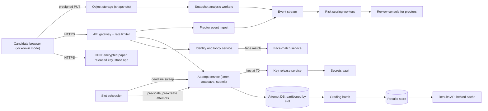
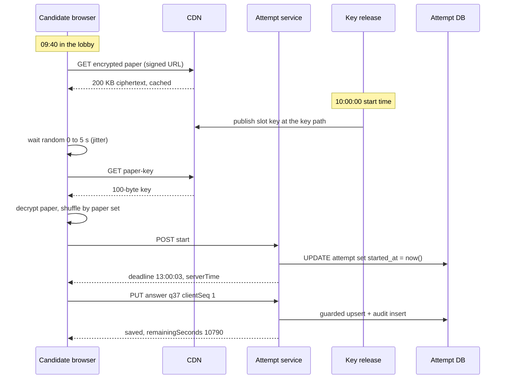

Most web systems have traffic that rises and falls smoothly. An exam platform has the opposite: almost nothing for weeks, then a million candidates pressing **Start** within the same few seconds, three hours of steady saving, a second spike when time runs out, and a third on result day. Meanwhile the stakes are personal: if a candidate's answers vanish or their timer cheats them out of five minutes, it can change their career, and it ends up in court.

This case study designs a platform for large, high-stakes online exams (recruitment tests, entrance exams, university semester exams, certification tests). We reason from public engineering principles. Nothing here describes how any exam body or vendor actually runs its systems.

## Learning objectives

By the end of this case study you will be able to:

1. Estimate the three traffic spikes of an exam (start, end, results) and the steady autosave load with clear arithmetic.
2. Defuse the thundering herd at the start with pre-staged encrypted papers and a tiny, cacheable key release.
3. Design a server-authoritative timer that handles late starts, approved pauses and compensatory time.
4. Make answer autosave idempotent and order-safe with client sequence numbers and a deadline check.
5. Design a proctoring event pipeline that scales to a million webcams without live video for everyone.
6. Grade, publish results and handle answer-key challenges without a fourth outage.
7. Reason about failures, security, observability, cost, and when a much simpler design is enough.

## Prerequisites

- [Capacity estimation](#/lesson/m11-capacity-estimation): RPS, peak factors, bandwidth and storage arithmetic.
- [Cache stampede, penetration and hot keys](#/lesson/m12-cache-failures): the thundering herd in its general form.
- [Backpressure, load shedding and graceful degradation](#/lesson/m13-backpressure): what to do when demand exceeds capacity.
- [Idempotency keys](#/lesson/m10-idempotency): safe retries on flaky networks.
- [Rate limiting algorithms](#/lesson/m10-rate-limiting): protecting endpoints from abusive or buggy clients.

## Explain it like I'm a beginner

Picture a giant exam hall in Delhi with a million desks.

- Normally the question papers arrive in sealed boxes and are opened at exactly 10:00. If a million people all queued at one printer at 10:00, nobody would start on time. So the papers are **delivered to every desk in advance, in sealed envelopes**. At 10:00 the invigilator only announces the **combination to the lock**. That tiny announcement is the only thing everyone needs at the same moment. Online, the sealed envelope is an **encrypted paper downloaded in the lobby**, and the combination is a **small decryption key released at the start time**.
- The **official clock is on the wall**, not on each candidate's wrist. Online, the server decides when your time started and when it ends (a **server-authoritative timer**). Your laptop's clock only draws the countdown.
- Every time you mark an answer, an assistant **copies it into the official register** immediately. If your pen runs out or your laptop crashes, nothing is lost. That is **autosave**. Each copy carries a little number (1, 2, 3…) so that if two copies arrive in the wrong order, the register keeps the newest one: a **client sequence number**.
- Invigilators don't stare at every candidate all the time. They **note incidents** ("candidate 4512 looked away for a long time") and a senior reviews the suspicious ones later. Online, the browser and a camera produce **proctoring events**, a scorer adds them up, and humans review only flagged candidates.
- Afterwards, sheets are **marked in bulk** against a **provisional key**, candidates may **challenge** it, and results go up on a day when everyone refreshes at once.

## Requirements

### Functional requirements

1. **Scheduling**: exams with one or more **slots** (shifts), each with a start time, duration and late-entry cut-off. Candidates are allotted to a slot and optionally a test centre.
2. **Lobby and identity**: candidates log in up to 45 minutes early, pass identity checks (photo match, ID upload), system checks (camera, browser) and wait.
3. **Paper delivery**: each candidate sees their **paper set** (questions and options shuffled per candidate) exactly at the start time, never before.
4. **Answering**: multiple-choice, multiple-select and numeric answers; mark for review; navigate freely; **autosave** every change.
5. **Timer**: a server-authoritative countdown, with auto-submit at the end, **compensatory time** for eligible candidates (for example, persons with disabilities using a scribe) and time credit for approved interruptions.
6. **Resume**: if the browser crashes or the network drops, the candidate resumes on any device with every saved answer and the correct remaining time.
7. **Proctoring**: browser events (tab hidden, full-screen exit, copy/paste), webcam snapshots, face checks; risk scoring; human review of flagged attempts.
8. **Results**: automatic marking (including negative marking), provisional key, challenge window, final key, re-marking, result publication and score cards.

### Non-functional requirements

| Property | Target | Why |
|---|---|---|
| Start latency | 99 % of candidates see question 1 within 10 s of start | Fairness and anxiety |
| Answer durability | An acknowledged save is never lost | Legal and personal stakes |
| Timer integrity | Nobody gets less than their allotted time; nobody gets more without an approved reason | Fairness, audit |
| Paper confidentiality | No candidate can see questions before start, even with a modified browser | Paper leaks cancel exams |
| Availability during a slot | 99.95 %, and degraded modes must keep answering possible | A slot cannot be "retried" cheaply |
| Auditability | Every save, timer change and proctoring decision is reconstructable | Grievances, RTI requests, courts |
| Privacy | Webcam data used only for proctoring, retained briefly | India's DPDP Act and similar laws |

### Out of scope

Question authoring and item banks (a separate secure system), payment for registration, descriptive (essay) answers with human marking, and the statistics of normalising scores across slots (we only note where it plugs in).

## Capacity estimation

All figures are **estimates** chosen for clear arithmetic.

### The exam

- **1,000,000 candidates** in one slot, starting at 10:00:00, duration **3 hours** (10,800 s).
- **100 questions**; candidates change answers often, so assume **150 answer-save events** per candidate.
- Lobby opens at 09:15. Most people arrive late: assume **60 % log in during the last 10 minutes**.

### Spike 1: logging in and the start

- Logins in the last 10 minutes = 1 M × 0.6 ÷ 600 s = **1,000 logins/s**, each with a photo-match call. Manageable, if the identity service is scaled in advance.
- **Naive start**: every candidate requests a personalised paper at 10:00. If 90 % do so within 10 s: 900,000 ÷ 10 = **90,000 requests/s**, each needing a database read, shuffling and a ~200 KB response (with images): 90,000 × 200 KB = **18 GB/s**, about **144 Gbit/s** for ten seconds. That is the thundering herd. It fails.
- **Pre-staged start**: the encrypted paper (same ciphertext for everyone in the slot, ~200 KB) is downloaded during the 45-minute lobby through a CDN: 1 M × 200 KB ÷ 2,700 s ≈ 74 MB/s ≈ **0.6 Gbit/s**. At 10:00 each client fetches only a **~100-byte key**. With 0–5 s of client jitter: 1 M ÷ 5 s = **200,000 tiny requests/s**, served from cache. Total start-spike bandwidth ≈ 200,000 × ~1 KB (with headers) ≈ 200 MB/s for five seconds. The herd is now harmless.

### Steady state: autosave and heartbeats

- Average saves = 1 M × 150 ÷ 10,800 s ≈ **13,900 saves/s**.
- Heartbeats (to keep the timer and connection status honest): one per 60 s when there is no save = up to 1 M ÷ 60 ≈ **16,700/s**. Saves double as heartbeats, so the real total is roughly **25,000–30,000 requests/s**.
- Last 15 minutes: people revisit answers. Assume 3× the save rate ≈ **42,000 saves/s**.

### Spike 2: the end

At 13:00 every client auto-submits. If the server needed a big "submit" payload from every client, that would be **1 M requests in a few seconds**. Instead, the server already holds every answer (autosave), so "submit" is a tiny flag, and the **server finalises at the deadline by itself** even if a client never calls. Clients jitter their final submit over 0–20 s: 1 M ÷ 20 ≈ **50,000 small requests/s**, all idempotent.

### Spike 3: results day

Results are published at 18:00 on a later date. 1 M candidates (plus parents) refresh: assume **2 M requests in the first minute** ≈ 33,000 requests/s, with retries multiplying it. Results are precomputed, so this is a read-caching problem.

### Storage

- Answer events: 1 M × 150 × ~200 B = **30 GB** per slot. Tiny.
- Current answers: 1 M × 100 × ~60 B = **6 GB**.
- Webcam snapshots: one 30 KB JPEG per minute = 180 per candidate × 30 KB = 5.4 MB × 1 M = **5.4 TB per slot**, kept 90 days.
- Snapshot ingress: 1 M ÷ 60 s × 30 KB = **500 MB/s ≈ 4 Gbit/s**, uploaded directly to object storage.

**What breaks first?** In order: (1) the start, if papers are fetched at 10:00; (2) the identity service during the last-10-minute login rush; (3) webcam upload bandwidth; (4) the database, only if every save is a heavy transaction on one primary. Note that the load is **scheduled**. We know the exact minute of every spike weeks in advance, so we scale out *before* it rather than relying on reactive autoscaling.

## API design

HTTPS with JSON, plus an optional WebSocket for invigilator broadcasts ("the exam is extended by 10 minutes"). Every write carries an attempt-scoped token.

| Method and path | Purpose |
|---|---|
| `POST /v1/sessions` | Log in with roll number, date of birth and OTP; returns a short-lived token |
| `POST /v1/attempts/{attemptId}/checks` | Identity photo, ID document and system-check results |
| `GET /v1/slots/{slotId}/paper` | Signed CDN URL for the encrypted paper bundle (available in the lobby) |
| `GET /v1/slots/{slotId}/paper-key` | The decryption key; `425 Too Early` with `Retry-After` before the start |
| `POST /v1/attempts/{attemptId}/start` | Records the server start time; returns the deadline and server time |
| `PUT /v1/attempts/{attemptId}/answers/{questionId}` | Autosave one answer (idempotent by `clientSeq`) |
| `GET /v1/attempts/{attemptId}/state` | Resume: saved answers, remaining time, status |
| `POST /v1/attempts/{attemptId}/events` | Batch of proctoring events |
| `POST /v1/attempts/{attemptId}/snapshots` | Presigned upload URL for a webcam snapshot |
| `POST /v1/attempts/{attemptId}/submit` | Final submit (idempotent) |
| `GET /v1/results/{rollNumber}` | Score card after publication |

An autosave request:

```json
{ "clientSeq": 418, "response": { "type": "single", "optionId": "C" }, "markedForReview": false, "clientTime": "2026-10-19T10:41:07.512Z" }
```

The response gives the server's view, so the client never trusts its own clock:

```json
{ "outcome": "saved", "questionId": 37, "clientSeq": 418, "serverTime": "2026-10-19T10:41:07.640Z", "deadline": "2026-10-19T13:00:00Z", "remainingSeconds": 8332 }
```

Design decisions:

- **`clientSeq`** rises with every change in the attempt; the server keeps a save only if it is higher than the stored one, so a delayed retry never overwrites a newer answer.
- **`425 Too Early`** with `Retry-After` tells clients when to fetch the key; the released key is cacheable for the slot.
- **Remaining time comes from the server** on every response, correcting countdown drift.
- Questions use **canonical ids**, because on-screen positions are shuffled.

## Data model

PostgreSQL 17, partitioned by slot (each slot is an independent unit of work) and sharded by `attempt_id` hash if one slot is too big for one primary.

```sql
CREATE TABLE exam_slot (
  slot_id        text PRIMARY KEY,
  exam_id        text NOT NULL,
  starts_at      timestamptz NOT NULL,
  duration       interval    NOT NULL,
  late_entry_end timestamptz NOT NULL,
  hard_end       timestamptz NOT NULL,        -- nobody without credit writes after this
  paper_key_ref  text        NOT NULL         -- reference to the key in a vault, never the key itself
);

CREATE TABLE attempt (
  attempt_id     uuid PRIMARY KEY,
  slot_id        text   NOT NULL REFERENCES exam_slot,
  candidate_id   bigint NOT NULL,
  paper_set      smallint NOT NULL,           -- which shuffled set
  status         text NOT NULL DEFAULT 'NOT_STARTED'
                 CHECK (status IN ('NOT_STARTED', 'IN_PROGRESS', 'PAUSED', 'SUBMITTED', 'AUTO_SUBMITTED')),
  started_at     timestamptz,
  paused_at      timestamptz,
  credit         interval NOT NULL DEFAULT '0',   -- compensatory time + approved pauses
  submitted_at   timestamptz,
  UNIQUE (slot_id, candidate_id)
);

-- Current answer per question: what resume and grading read.
CREATE TABLE answer (
  attempt_id   uuid     NOT NULL REFERENCES attempt,
  question_id  int      NOT NULL,
  response     jsonb,                          -- NULL = cleared
  marked       boolean  NOT NULL DEFAULT false,
  client_seq   bigint   NOT NULL,
  saved_at     timestamptz NOT NULL,
  PRIMARY KEY (attempt_id, question_id)
);

-- Append-only audit of every accepted save.
CREATE TABLE answer_event (
  attempt_id   uuid     NOT NULL,
  question_id  int      NOT NULL,
  client_seq   bigint   NOT NULL,
  response     jsonb,
  saved_at     timestamptz NOT NULL,
  client_ip    inet,
  PRIMARY KEY (attempt_id, client_seq)
);

CREATE TABLE proctor_event (
  attempt_id   uuid   NOT NULL,
  occurred_at  timestamptz NOT NULL,
  kind         text   NOT NULL,                -- TAB_HIDDEN, NO_FACE, MULTIPLE_FACES ...
  evidence_key text,                           -- object storage key of a snapshot
  PRIMARY KEY (attempt_id, occurred_at, kind)
);

CREATE TABLE timer_adjustment (
  attempt_id  uuid NOT NULL REFERENCES attempt,
  adjusted_at timestamptz NOT NULL DEFAULT now(),
  delta       interval NOT NULL,
  reason      text NOT NULL,                   -- 'PWD_COMPENSATORY', 'CENTRE_POWER_CUT' ...
  approved_by bigint NOT NULL,
  PRIMARY KEY (attempt_id, adjusted_at)
);
```

The autosave is one guarded upsert plus one audit insert, in one transaction on the attempt's shard:

```sql
INSERT INTO answer AS a (attempt_id, question_id, response, marked, client_seq, saved_at)
VALUES ($1, $2, $3, $4, $5, now())
ON CONFLICT (attempt_id, question_id) DO UPDATE
   SET response = EXCLUDED.response, marked = EXCLUDED.marked,
       client_seq = EXCLUDED.client_seq, saved_at = EXCLUDED.saved_at
 WHERE a.client_seq < EXCLUDED.client_seq;    -- an older retry changes nothing
```

Why this shape:

- **Attempt rows are pre-created** the night before (bulk `COPY`), so starting is an `UPDATE`, not an insert storm, and every attempt id is known in advance.
- **`answer` holds the current state** (fast resume and grading); **`answer_event` holds history** (grievances, forensic review). `(attempt_id, client_seq)` as its key makes a retried save a harmless conflict.
- **The guarded upsert** makes saves order-safe: whichever of two racing saves has the higher `client_seq` wins, regardless of arrival order.
- **`timer_adjustment` is append-only with an approver**, because every extra minute must be explainable later. `attempt.credit` is the running total.
- **The key is not in the database**, only a reference to a secrets vault, so a database dump before the exam leaks nothing usable.

## High-level architecture



Walk through every arrow:

1. **Browser → CDN.** The exam app, the encrypted paper bundle and, after the start, the released key are all static, cacheable files. The CDN absorbs the start spike.
2. **Browser → API gateway.** Authentication, per-attempt rate limiting and routing.
3. **Gateway → identity and lobby → face match.** Login, OTP and photo match, pre-scaled for the 1,000 logins/s rush.
4. **Gateway → attempt service → attempt DB.** Start, autosave, resume and submit. This service owns the timer rules; it is stateless, so it scales horizontally.
5. **Attempt service → key release → vault.** At start time the key release service fetches the slot key from the vault once and publishes it to the CDN path. Before the start, the path returns `425`.
6. **Gateway → proctor ingest → event stream → risk workers → review console.** Browser events are batched by the client, appended to a stream, scored per attempt, and flagged attempts go to human proctors.
7. **Browser → object storage → snapshot analysis → stream.** Webcam snapshots bypass the API entirely (presigned uploads). Workers run face detection on a sample and emit events such as `MULTIPLE_FACES` back into the same stream.
8. **Slot scheduler → attempt service.** Hours before the slot it pre-creates attempts and scales services; during the slot it runs the **deadline sweeper** that auto-submits attempts whose time is up.
9. **Attempt DB → grading → results store → results API.** After the slot closes, a set-based grading job computes scores; results are published as precomputed rows behind an aggressive cache.

### Sequence: from lobby to first answer



The heavy work (the 200 KB download) happens during a quiet 45-minute window. At 10:00 only the tiny key is fetched, from cache, with jitter spreading a million requests over five seconds. The candidate's **personal clock starts when the server records `started_at`**, so the jitter costs nobody any exam time. From then on, each save is acknowledged with the server's remaining time.

## Deep dives

### 1. The thundering herd at the start

A **thundering herd** is many clients doing the same expensive thing at the same instant. The cure is to remove one of the three ingredients: *many* clients, the *same instant*, or *expensive*.

- **Make it cheap**: pre-stage the expensive part (the paper) and make the synchronised part a tiny static file served from cache.
- **Spread the instant**: client jitter of 0–5 s for the key; staggered lobby opening (by roll-number range) for logins; jittered final submits.
- **Shield the origin**: with CDN caching and request coalescing (one origin fetch for many simultaneous misses), origin sees a handful of requests, not a million.

**Confidentiality.** The bundle is encrypted with a per-slot key (AES-256-GCM), so before 10:00 a modified browser holds only ciphertext, and the key reaches no client early. Shuffling happens **on the client** from the paper set and a seed, so the bundle is one file for everyone and caches perfectly.

**Pre-scaling.** The start time is known, so the scheduler scales out and warms caches an hour before. Reactive autoscaling takes minutes; the spike lasts seconds.

```csharp file=Exam/PaperKeyGate.cs
using System.Collections.Concurrent;

namespace OnlineExam.Exam;

public sealed record PaperRelease(string SlotId, DateTimeOffset ReleaseAt, string KeyBase64);

/// <summary>
/// Serves the slot's paper key only at or after the release time, using the server's clock.
/// In production the released key is written to a CDN path; this gate guards the origin.
/// </summary>
public sealed class PaperKeyGate(TimeProvider clock)
{
    private readonly ConcurrentDictionary<string, PaperRelease> _releases = new();

    public void Register(PaperRelease release) => _releases[release.SlotId] = release;

    /// <summary>Returns the key, or null with how long to wait (maps to 425 Too Early + Retry-After).</summary>
    public (string? Key, TimeSpan RetryAfter) TryGetKey(string slotId)
    {
        if (!_releases.TryGetValue(slotId, out var release)) throw new KeyNotFoundException(slotId);
        var wait = release.ReleaseAt - clock.GetUtcNow();
        return wait <= TimeSpan.Zero ? (release.KeyBase64, TimeSpan.Zero) : (null, wait);
    }

    /// <summary>Deterministic per-candidate jitter so retries don't re-synchronise the herd.</summary>
    public static TimeSpan JitterFor(Guid candidateId, TimeSpan window)
    {
        var bytes = candidateId.ToByteArray();
        var value = BitConverter.ToUInt32(bytes, 0);
        return TimeSpan.FromMilliseconds(value % (uint)Math.Max(1, window.TotalMilliseconds));
    }
}
```

### 2. A timer the candidate cannot cheat, and that cannot cheat the candidate

The browser's clock is untrustworthy in both directions: a candidate can change it, and a laptop's clock can simply be wrong. So the server decides:

- `started_at` is recorded by the server when the candidate starts.
- **Deadline** = `started_at + duration + credit`, but never later than `hard_end + credit`. Late starters (who entered after 10:00 but before the late-entry cut-off) lose the time they were late, because the paper is the same for everyone and the slot must end.
- **Credit** is extra time with a recorded reason: compensatory time (for example 20 minutes per hour for eligible candidates, as some exam rules provide) and **approved pauses** (a test centre's power cut, a platform incident). A pause stops the clock; on resume the paused duration is added to credit.
- Saves are accepted until `deadline + grace` (for example 30 s) to absorb network delay for an answer clicked at 12:59:59.
- The client shows `remainingSeconds` from the last server response, counting down locally and correcting on each response.

```csharp file=Exam/Attempts.cs
using System.Collections.Concurrent;

namespace OnlineExam.Exam;

public enum AttemptStatus { NotStarted, InProgress, Paused, Submitted, AutoSubmitted }

public sealed class Attempt
{
    public required Guid AttemptId { get; init; }
    public required string SlotId { get; init; }
    public required TimeSpan Duration { get; init; }
    public required DateTimeOffset HardEnd { get; init; }
    public AttemptStatus Status { get; set; } = AttemptStatus.NotStarted;
    public DateTimeOffset? StartedAt { get; set; }
    public DateTimeOffset? PausedAt { get; set; }
    public TimeSpan Credit { get; set; }
    public DateTimeOffset? SubmittedAt { get; set; }
    public readonly Lock Gate = new();
}

public interface IAttemptRepository
{
    Attempt? Find(Guid attemptId);
    void Add(Attempt attempt);
    IEnumerable<Attempt> InProgress();
}

public sealed class InMemoryAttemptRepository : IAttemptRepository
{
    private readonly ConcurrentDictionary<Guid, Attempt> _attempts = new();
    public Attempt? Find(Guid attemptId) => _attempts.GetValueOrDefault(attemptId);
    public void Add(Attempt attempt) => _attempts[attempt.AttemptId] = attempt;
    public IEnumerable<Attempt> InProgress() =>
        _attempts.Values.Where(a => a.Status is AttemptStatus.InProgress or AttemptStatus.Paused);
}

/// <summary>All timer rules in one place. The server's clock is the only clock that counts.</summary>
public sealed class AttemptClock(TimeProvider clock)
{
    public static readonly TimeSpan Grace = TimeSpan.FromSeconds(30);

    public DateTimeOffset Now => clock.GetUtcNow();

    public void Start(Attempt a)
    {
        if (a.Status != AttemptStatus.NotStarted) return;      // idempotent: a second Start changes nothing
        a.StartedAt = Now;
        a.Status = AttemptStatus.InProgress;
    }

    public DateTimeOffset Deadline(Attempt a)
    {
        if (a.StartedAt is null) throw new InvalidOperationException("Attempt not started");
        var pausedFor = a.PausedAt is { } p ? Now - p : TimeSpan.Zero;   // a running pause also pushes the deadline
        var personal = a.StartedAt.Value + a.Duration + a.Credit + pausedFor;
        var cap = a.HardEnd + a.Credit + pausedFor;                       // late starters lose their lateness
        return personal < cap ? personal : cap;
    }

    public TimeSpan Remaining(Attempt a)
    {
        if (a.Status is AttemptStatus.Submitted or AttemptStatus.AutoSubmitted or AttemptStatus.NotStarted)
            return TimeSpan.Zero;
        var end = a.Status == AttemptStatus.Paused ? Deadline(a) - (Now - a.PausedAt!.Value) : Deadline(a);
        var reference = a.Status == AttemptStatus.Paused ? a.PausedAt!.Value : Now;
        var left = end - reference;
        return left > TimeSpan.Zero ? left : TimeSpan.Zero;
    }

    public void Pause(Attempt a)
    {
        if (a.Status != AttemptStatus.InProgress) return;
        a.PausedAt = Now;
        a.Status = AttemptStatus.Paused;
    }

    public void Resume(Attempt a)
    {
        if (a.Status != AttemptStatus.Paused) return;
        a.Credit += Now - a.PausedAt!.Value;
        a.PausedAt = null;
        a.Status = AttemptStatus.InProgress;
    }

    /// <summary>Compensatory or incident time. Callers must also write a timer_adjustment audit row.</summary>
    public void Extend(Attempt a, TimeSpan extra) => a.Credit += extra;

    public bool AcceptsAnswers(Attempt a) =>
        a.Status == AttemptStatus.InProgress && Now <= Deadline(a) + Grace;
}
```

Note how `Remaining` freezes during a pause: the deadline keeps moving forward with the pause, and the remaining time is measured from the moment the pause began, so the countdown on screen stands still.

### 3. Autosave that survives flaky networks

Exam networks are terrible: shared centre Wi-Fi, home broadband in a storm, mobile hotspots. The autosave protocol must tolerate **lost requests, lost responses, retries and reordering**.

- The client keeps a **local journal** (IndexedDB) of every change with its `clientSeq`, and a send queue. It sends the latest change per question, debounced by about 1 s.
- On a timeout the client retries **the same** `clientSeq` with exponential backoff and jitter. A duplicate is acknowledged as `duplicate`, not an error.
- The server keeps the save only if `clientSeq` is newer than the stored one (`stale` otherwise), and only while the attempt accepts answers (`closed` after the deadline plus grace).
- If the client is offline for minutes, the UI shows "answers saved on this device, reconnecting", keeps the timer running (it is server time, after all), and flushes the journal on reconnect. Answers made before the deadline but delivered after the grace period are a policy question: the safe default is to **reject** them and rely on the grace window, because accepting late uploads invites clock tampering.

```csharp file=Exam/AnswerStore.cs
using System.Collections.Concurrent;

namespace OnlineExam.Exam;

public enum SaveOutcome { Saved, Duplicate, Stale, Closed, NotFound }

public sealed record AnswerRecord(Guid AttemptId, int QuestionId, string? Response, long ClientSeq, DateTimeOffset SavedAt);

public interface IAnswerStore
{
    /// <summary>Stand-in for the guarded upsert plus the answer_event insert, in one transaction.</summary>
    SaveOutcome Save(AnswerRecord record);
    IReadOnlyList<AnswerRecord> Current(Guid attemptId);
}

public sealed class InMemoryAnswerStore : IAnswerStore
{
    private sealed class Sheet
    {
        public readonly Lock Gate = new();
        public readonly Dictionary<int, AnswerRecord> Current = new();
        public readonly List<AnswerRecord> Events = new();
    }

    private readonly ConcurrentDictionary<Guid, Sheet> _sheets = new();

    public SaveOutcome Save(AnswerRecord record)
    {
        var sheet = _sheets.GetOrAdd(record.AttemptId, _ => new Sheet());
        lock (sheet.Gate)
        {
            if (sheet.Current.TryGetValue(record.QuestionId, out var existing))
            {
                if (record.ClientSeq == existing.ClientSeq) return SaveOutcome.Duplicate;
                if (record.ClientSeq < existing.ClientSeq) return SaveOutcome.Stale;
            }
            sheet.Current[record.QuestionId] = record;
            sheet.Events.Add(record);
            return SaveOutcome.Saved;
        }
    }

    public IReadOnlyList<AnswerRecord> Current(Guid attemptId)
    {
        if (!_sheets.TryGetValue(attemptId, out var sheet)) return [];
        lock (sheet.Gate) return sheet.Current.Values.OrderBy(r => r.QuestionId).ToList();
    }
}

public sealed class AttemptService(IAttemptRepository attempts, IAnswerStore answers, AttemptClock clock)
{
    public Attempt? Start(Guid attemptId)
    {
        var attempt = attempts.Find(attemptId);
        if (attempt is null) return null;
        lock (attempt.Gate) clock.Start(attempt);
        return attempt;
    }

    public (SaveOutcome Outcome, TimeSpan Remaining) SaveAnswer(Guid attemptId, int questionId, string? response, long clientSeq)
    {
        var attempt = attempts.Find(attemptId);
        if (attempt is null) return (SaveOutcome.NotFound, TimeSpan.Zero);
        lock (attempt.Gate)
        {
            if (!clock.AcceptsAnswers(attempt)) return (SaveOutcome.Closed, clock.Remaining(attempt));
            var outcome = answers.Save(new AnswerRecord(attemptId, questionId, response, clientSeq, clock.Now));
            return (outcome, clock.Remaining(attempt));
        }
    }

    /// <summary>Idempotent. Also called by the deadline sweeper with auto = true.</summary>
    public bool Submit(Guid attemptId, bool auto = false)
    {
        var attempt = attempts.Find(attemptId);
        if (attempt is null) return false;
        lock (attempt.Gate)
        {
            if (attempt.Status is AttemptStatus.Submitted or AttemptStatus.AutoSubmitted) return true;
            if (attempt.Status == AttemptStatus.NotStarted) return false;
            attempt.Status = auto ? AttemptStatus.AutoSubmitted : AttemptStatus.Submitted;
            attempt.SubmittedAt = clock.Now;
            return true;
        }
    }
}
```

**Where the durable point is.** A save is acknowledged only after the upsert and audit insert commit on a primary with a synchronous replica. 42,000 saves/s at peak, spread over 8 shards by `attempt_id`, is about 5,000 small transactions/s per shard, comfortably within what a well-provisioned PostgreSQL primary handles (verify with a load test on your hardware).

### 4. Ending the exam without a second herd

The server, not the client, ends the exam. A **deadline sweeper** runs every few seconds per slot and marks attempts whose `deadline + grace` has passed as `AUTO_SUBMITTED`. Clients still call `submit` (jittered), but if a laptop died at 12:58, the attempt is finalised anyway with every answer saved up to then.

```csharp file=Exam/DeadlineSweeper.cs
using Microsoft.Extensions.Hosting;
using Microsoft.Extensions.Logging;

namespace OnlineExam.Exam;

public sealed class DeadlineSweeper(IAttemptRepository attempts, AttemptService service, AttemptClock clock,
    ILogger<DeadlineSweeper> logger) : BackgroundService
{
    protected override async Task ExecuteAsync(CancellationToken stoppingToken)
    {
        using var timer = new PeriodicTimer(TimeSpan.FromSeconds(5));
        while (await timer.WaitForNextTickAsync(stoppingToken))
        {
            var finalised = 0;
            foreach (var attempt in attempts.InProgress().ToList())
            {
                bool due;
                lock (attempt.Gate) due = attempt.Status == AttemptStatus.InProgress
                                          && clock.Now > clock.Deadline(attempt) + AttemptClock.Grace;
                if (due && service.Submit(attempt.AttemptId, auto: true)) finalised++;
            }
            if (finalised > 0) logger.LogInformation("Auto-submitted {Count} attempts", finalised);
        }
    }
}
```

In production the sweep is one set-based `UPDATE` per slot partition, run by a leader-elected scheduler. Paused attempts are excluded: their clock is stopped.

### 5. Proctoring at the scale of a million webcams

Live video proctoring of every candidate would mean a million concurrent video streams and tens of thousands of human proctors. It is unaffordable and largely unnecessary. A layered approach is common:

1. **Browser signals** (cheap, many): the Page Visibility API (`visibilitychange` for tab switching), full-screen exit, copy and paste, window blur, a second monitor detected, network lost. Batched every 30 s.
2. **Webcam snapshots** (moderate): one per minute plus one on every suspicious browser event, uploaded straight to object storage. On-device face detection can flag "no face" instantly without uploading video.
3. **Server-side analysis** (sampled): workers run face detection and face matching on snapshots, emitting `NO_FACE`, `MULTIPLE_FACES` or `FACE_MISMATCH` events.
4. **Risk scoring** (per attempt, streaming): weighted events in sliding windows produce `NORMAL`, `REVIEW` or `CRITICAL`.
5. **Human review** (rare): proctors review only flagged attempts with the evidence timeline; a decision (warn, pause, terminate, no action) is recorded with the proctor's id.

Proctoring signals are **evidence for a human, not a verdict**. Automated face analysis has error rates that vary across lighting, cameras and skin tones, so a candidate must never be disqualified by an algorithm alone. That is both fair and legally safer.

```csharp file=Exam/Proctoring.cs
using System.Collections.Concurrent;
using System.Threading.Channels;
using Microsoft.Extensions.Hosting;
using Microsoft.Extensions.Logging;

namespace OnlineExam.Exam;

public enum ProctorEventKind { TabHidden, FullscreenExit, NoFace, MultipleFaces, CopyPaste, NetworkLost }

public sealed record ProctorEvent(Guid AttemptId, ProctorEventKind Kind, DateTimeOffset At, string? EvidenceKey);

/// <summary>Bounded buffer between the HTTP ingest and the scorers. In production: a partitioned stream keyed by attempt.</summary>
public sealed class ProctorEventQueue
{
    private readonly Channel<ProctorEvent> _channel = Channel.CreateBounded<ProctorEvent>(
        new BoundedChannelOptions(100_000) { FullMode = BoundedChannelFullMode.Wait });

    /// <summary>False when full: the endpoint returns 503 and the client keeps the batch to resend.</summary>
    public bool TryEnqueue(ProctorEvent e) => _channel.Writer.TryWrite(e);
    public IAsyncEnumerable<ProctorEvent> ReadAllAsync(CancellationToken ct) => _channel.Reader.ReadAllAsync(ct);
}

public sealed class RiskBoard
{
    private readonly ConcurrentDictionary<Guid, int> _scores = new();
    private readonly ConcurrentDictionary<Guid, DateTimeOffset> _flagged = new();

    public int Add(Guid attemptId, int weight) => _scores.AddOrUpdate(attemptId, weight, (_, s) => s + weight);
    public bool Flag(Guid attemptId, DateTimeOffset at) => _flagged.TryAdd(attemptId, at);
    public IReadOnlyCollection<Guid> Flagged => _flagged.Keys.ToList();
    public int ScoreOf(Guid attemptId) => _scores.GetValueOrDefault(attemptId);
}

public sealed class ProctoringWorker(ProctorEventQueue queue, RiskBoard board, ILogger<ProctoringWorker> logger)
    : BackgroundService
{
    private const int ReviewThreshold = 10;

    private static readonly Dictionary<ProctorEventKind, int> Weights = new()
    {
        [ProctorEventKind.TabHidden] = 2,
        [ProctorEventKind.FullscreenExit] = 2,
        [ProctorEventKind.NoFace] = 1,
        [ProctorEventKind.MultipleFaces] = 5,
        [ProctorEventKind.CopyPaste] = 3,
        [ProctorEventKind.NetworkLost] = 0,     // recorded for context, not suspicion
    };

    protected override async Task ExecuteAsync(CancellationToken stoppingToken)
    {
        await foreach (var e in queue.ReadAllAsync(stoppingToken))
        {
            var score = board.Add(e.AttemptId, Weights[e.Kind]);
            if (score >= ReviewThreshold && board.Flag(e.AttemptId, e.At))
                logger.LogInformation("Attempt {AttemptId} flagged for human review (score {Score})", e.AttemptId, score);
        }
    }
}
```

This worker uses a simple running total. Exercise 4 asks you to build the better version: sliding windows ("three tab switches within five minutes") and levels that never go down.

### 6. Results, answer keys and the result-day herd

**Grading** is a set-based batch after the slot closes: join current answers with the answer key and compute marks with the scheme (for example +4 correct, −1 wrong, 0 unanswered). One million attempts × 100 answers = 100 M rows; a parallel aggregate over a partition finishes in minutes. You will write this query in exercise 2.

**Provisional key and challenges.** Many exam bodies publish a provisional key, accept challenges for a few days, then publish a final key. Design for it: keys are **versioned** (`answer_key(version, question_id, correct_options)`), a question can be marked "bonus for all" or "multiple correct options", and grading is a **pure function of (answers, key version)**, so re-grading is just re-running the batch. Never update scores in place without the key version that produced them.

**Result day.** Precompute every score card into a results store, warm the cache before publication (so no stampede is possible), serve reads from replicas behind a **virtual waiting room** that admits users at a fixed rate, and publish by flipping one flag, never by grading at 18:00.

## Caching, queues and scaling

**Caches.**

- *CDN*: the exam app, encrypted paper bundles (per slot and set), the released key, result score cards (private cache with signed URLs or authorised edge logic).
- *In-process*: slot configuration (start time, duration, hard end) is read on every save and changes almost never; cache it in memory per attempt-service instance with explicit invalidation when an invigilator extends a slot.
- *Not cached*: answers. The database is the source of truth, and resume must read the latest saved state.

**Queues and streams.**

- Proctoring events and snapshot analysis results flow through a **partitioned stream keyed by `attempt_id`**, so one attempt's events are scored in order by one consumer.
- Grading and score-card generation are **batch jobs** triggered by the scheduler, not request-driven.
- Autosave deliberately does **not** go through a queue before acking: the candidate must know the answer is durable. (A log-first design is a valid alternative; see the trade-offs.)

**Scaling each tier.**

| Tier | Scales by | Breaks when |
|---|---|---|
| CDN | Provider capacity; pre-warming | Cache misses at start (cold edges, no request coalescing) |
| Identity and lobby | Pre-scaled replicas; staggered lobby | Face-match latency in the last-10-minute rush |
| Attempt service | Stateless replicas | Connection pool exhaustion against the DB |
| Attempt DB | Partition by slot, shard by `attempt_id` | One primary taking 42,000 saves/s with heavy indexes |
| Proctor ingest | Stream partitions and workers | Snapshot uploads if routed through the API |
| Results | Cache + waiting room | Grading at publication time instead of before |

**Backpressure.** If the database slows, the attempt service sheds load **gracefully**: it returns `503` with `Retry-After` for saves, the client keeps the change in its journal and retries, and the candidate sees "saving…" but can keep answering. Timers keep running on the server, and an incident can later credit time to affected candidates (with an audit trail) if the outage was long.

## Failure handling

| Failure | What candidates see | Mitigation |
|---|---|---|
| Response to a save is lost | "Saving…" then saved | Retry with the same `clientSeq`; server answers `duplicate` |
| Retries arrive out of order | Nothing | Guarded upsert keeps the highest `clientSeq` |
| Browser crash at 11:20 | Log in again on any device | `GET state` returns saved answers and server-computed remaining time |
| Candidate's network out for 4 minutes | "Answers saved on this device" banner | Local journal; flush on reconnect; time keeps running (policy) |
| Test centre power cut (whole centre) | Exam paused | Invigilator pauses the centre's attempts; on resume, paused time is credited with an audit record |
| DB shard primary fails mid-exam | A few seconds of `503` on saves for 1/8 of candidates | Synchronous replica, automatic failover; client journals and retries; incident credit if prolonged |
| CDN edge cold at 10:00 | Slow start in one region | Pre-warm bundle and key path; origin shield; request coalescing |
| Key release service fails at 10:00 | Nobody can start | Two independent release paths (CDN publish and origin `GET` behind the gate), and a runbook to delay the slot start uniformly |

:::callout type=warning title="Never let the client decide the deadline"
If the client says "I still have 4 minutes" and the server believes it, anyone who edits local storage gets unlimited time. The server computes the deadline from `started_at`, `duration`, `credit` and `hard_end`, and rejects saves after `deadline + grace`. The client only displays it.
:::

## Security

- **Paper confidentiality**: per-slot encryption keys in a vault, released only at start; separate duties for paper upload and key custody; access to keys logged. Question images are inside the encrypted bundle, not separate public URLs.
- **Identity**: OTP, photo match at login, periodic face re-checks during the exam, and an ID document check. Bind the token to the attempt and device fingerprint; a second concurrent session for the same attempt is flagged (or the first is ended).
- **Authorisation**: candidates can only touch their own attempt (`attempt.candidate_id = token subject`); invigilators can pause or extend only their centre; extensions need an approver and a reason.
- **Integrity of answers**: TLS everywhere; the `answer_event` table is append-only (no `UPDATE` or `DELETE` grants); daily hash chains or write-once storage for the audit trail make tampering evident.
- **Rate limiting**: per-attempt token buckets on saves and events stop runaway clients and scripted abuse.
- **Privacy**: explicit consent for webcam processing, purpose limitation, retention (for example 90 days unless a case is open), and access to snapshots only for assigned reviewers, in line with India's DPDP Act and similar regimes.

## Observability

During a live slot, an operations room watches a single dashboard:

- **Start funnel**: lobby logins, system checks passed, key fetches, starts, first saves. A gap between "key fetched" and "started" means decryption or client trouble.
- **Save health**: saves per second, p99 save latency (SLO example: < 300 ms), `stale`/`duplicate`/`closed`/`503` ratios. Rising `duplicate` means responses are being lost.
- **Timer health**: number of paused attempts, credits granted, attempts past deadline not yet finalised (should be zero after one sweep).
- **Proctoring**: events per second by kind, flagged attempts, review queue depth and age.
- **Infrastructure**: DB shard latency, CDN hit ratio (origin requests near zero at the start), snapshot upload errors.

Every log line and trace carries `attempt_id`, so a grievance ("my answer to question 37 was not saved") is answered from the audit trail in minutes. Synthetic candidates take a dummy exam in every region before and during each slot.

## Deployment and cost

**Deployment.**

- **Freeze deploys around slots**; release days before, then run a full-scale **mock exam** with synthetic candidates at the estimated peaks.
- Scale by the slot calendar, not by reactive metrics.
- Test centres may run a **local edge server** that caches the bundle and journals saves during internet outages, syncing with the same idempotent protocol.

**Cost drivers** (relative, not quotes):

1. **Peak capacity that sits idle**: the platform is busy for a few hours a month. Elastic, pay-per-use infrastructure and scheduled scaling matter more than raw efficiency.
2. **Webcam storage and analysis**: 5.4 TB per slot and face-analysis compute; sampling and short retention control it.
3. **Human proctors** reviewing flags: often the largest operating cost; better scoring lowers false positives.
4. **CDN egress** for bundles and results.

### When a simpler design is enough

A college running semester exams for 3,000 students in campus labs does not need any of this. One ASP.NET Core app, one PostgreSQL database with the `answer` table and guarded upsert, a server-side deadline, and papers released at the start time from memory is enough: 3,000 starts in 10 s is 300 requests/s. Skip remote proctoring entirely; invigilators are in the room. Keep the two non-negotiables: **server-side deadline** and **idempotent, order-safe autosave**.

## Alternatives and trade-offs

| Decision | Our choice | Alternative | When the alternative wins |
|---|---|---|---|
| Paper delivery | Pre-staged encrypted bundle + key at T0 | Fetch paper at start | Small exams; adaptive tests where questions depend on answers |
| Timer authority | Server | Client with server checks | Never for high stakes |
| Autosave durability | Ack after DB commit | Ack after append to a replicated log, DB updated by consumers | Extreme write rates; you accept resume reading from the log or tolerate lag |
| Late network uploads | Rejected after grace | Accepted with client-signed timestamps | Centre-based exams with trusted local servers that journal saves |
| Proctoring | Events + snapshots + human review | Live video for all | Very small, very high-stakes exams |
| Result day | Precomputed + cache + waiting room | Compute on request | Small cohorts |
| Item order | Client-side shuffle from seed | Server-rendered per candidate | When the bundle must differ per candidate (adaptive or per-candidate item banks) |

The central trade-off: **we push work out of the synchronised moments (start, end, results) into quiet windows before and after, at the cost of more moving parts (bundles, keys, sweepers, precomputation).**

Here is the composition as an ASP.NET Core host, including a token-bucket rate limiter on autosave.

```csharp file=Program.cs
using System.Threading.RateLimiting;
using Microsoft.AspNetCore.RateLimiting;
using OnlineExam.Exam;

var builder = WebApplication.CreateBuilder(args);
builder.Services.AddSingleton(TimeProvider.System);
builder.Services.AddSingleton<AttemptClock>();
builder.Services.AddSingleton<IAttemptRepository, InMemoryAttemptRepository>();
builder.Services.AddSingleton<IAnswerStore, InMemoryAnswerStore>();
builder.Services.AddSingleton<AttemptService>();
builder.Services.AddSingleton<PaperKeyGate>();
builder.Services.AddSingleton<ProctorEventQueue>();
builder.Services.AddSingleton<RiskBoard>();
builder.Services.AddHostedService<DeadlineSweeper>();
builder.Services.AddHostedService<ProctoringWorker>();
builder.Services.AddRateLimiter(options =>
{
    options.RejectionStatusCode = StatusCodes.Status429TooManyRequests;
    options.AddPolicy("autosave", http => RateLimitPartition.GetTokenBucketLimiter(
        http.Request.RouteValues["attemptId"]?.ToString() ?? "anonymous",
        _ => new TokenBucketRateLimiterOptions
        {
            TokenLimit = 20, TokensPerPeriod = 5, ReplenishmentPeriod = TimeSpan.FromSeconds(1),
            QueueLimit = 0, AutoReplenishment = true
        }));
});

var app = builder.Build();
app.UseRateLimiter();

app.MapGet("/v1/slots/{slotId}/paper-key", (string slotId, PaperKeyGate gate, HttpContext http) =>
{
    var (key, retryAfter) = gate.TryGetKey(slotId);
    if (key is not null) return Results.Ok(new { key });
    http.Response.Headers.RetryAfter = Math.Ceiling(retryAfter.TotalSeconds).ToString();
    return Results.StatusCode(425);   // Too Early
});

app.MapPost("/v1/attempts/{attemptId:guid}/start", (Guid attemptId, AttemptService service, AttemptClock clock) =>
    service.Start(attemptId) is { } attempt
        ? Results.Ok(new { deadline = clock.Deadline(attempt), serverTime = clock.Now })
        : Results.NotFound());

app.MapPut("/v1/attempts/{attemptId:guid}/answers/{questionId:int}",
    (Guid attemptId, int questionId, SaveAnswerRequest body, AttemptService service, AttemptClock clock) =>
    {
        var (outcome, remaining) = service.SaveAnswer(attemptId, questionId, body.Response, body.ClientSeq);
        return outcome switch
        {
            SaveOutcome.NotFound => Results.NotFound(),
            SaveOutcome.Closed => Results.Conflict(new { outcome = "closed", serverTime = clock.Now }),
            _ => Results.Ok(new
            {
                outcome = outcome.ToString().ToLowerInvariant(), questionId, body.ClientSeq,
                serverTime = clock.Now, remainingSeconds = (int)remaining.TotalSeconds
            })
        };
    }).RequireRateLimiting("autosave");

app.MapPost("/v1/attempts/{attemptId:guid}/events", (Guid attemptId, ProctorEventRequest[] events, ProctorEventQueue queue, AttemptClock clock) =>
{
    foreach (var e in events)
        if (!queue.TryEnqueue(new ProctorEvent(attemptId, e.Kind, clock.Now, e.EvidenceKey)))
            return Results.StatusCode(StatusCodes.Status503ServiceUnavailable);
    return Results.Accepted();
}).RequireRateLimiting("autosave");

app.MapPost("/v1/attempts/{attemptId:guid}/submit", (Guid attemptId, AttemptService service) =>
    service.Submit(attemptId) ? Results.Ok(new { status = "submitted" }) : Results.NotFound());

app.Run();

public sealed record SaveAnswerRequest(long ClientSeq, string? Response);
public sealed record ProctorEventRequest(ProctorEventKind Kind, string? EvidenceKey);
```

The proctoring endpoint stamps events with the **server** time on arrival; the client's own timestamp would be kept as a separate field in production, because an event batch can be delayed by 30 s.

## Practical playground

The starting graph is the naive design: every candidate fetches the paper from the API at 10:00, and every save goes to one database. Open it in the HLD canvas and fix it.

1. Add a `cdn` node and move the paper bundle and the released key onto it. What does the API serve at 10:00 now?
2. Add a `scheduler` for pre-scaling and the deadline sweep. Which edge is it on?
3. Add `object-storage` for webcam snapshots with the client uploading directly, and a `stream` plus `worker` for proctoring events.
4. Add a `rate-limiter` in front of the attempt service. What should the partition key be?
5. Set client `rps` to 200,000 (key fetches at the start) and compare the flagged nodes before and after the CDN.

:::playground type=hld title="Survive one million candidates pressing Start"
```json
{
  "nodes": [
    { "id": "c", "type": "client", "label": "Candidates (1 M at 10:00)", "props": { "rps": 200000 } },
    { "id": "lb", "type": "load-balancer", "label": "Load balancer" },
    { "id": "api", "type": "app-server", "label": "Exam API (paper + saves)", "props": { "instances": 30 } },
    { "id": "db", "type": "database", "label": "PostgreSQL (papers, answers)", "props": { "replicas": 1 } }
  ],
  "edges": [
    { "from": "c", "to": "lb", "kind": "sync", "label": "GET /paper at 10:00" },
    { "from": "lb", "to": "api", "kind": "sync" },
    { "from": "api", "to": "db", "kind": "sync", "label": "read paper, write answers" }
  ]
}
```
:::

## Exercises

:::exercise id=m17-online-exam-ex1 difficulty=beginner kind=written title="Size a two-shift recruitment exam"
A state staff selection board runs an online exam for 600,000 candidates in two shifts of 300,000 each. Each shift lasts 2 hours. Candidates make about 130 answer saves each. Clients send a heartbeat every 60 s (ignore the overlap with saves). 70 % of candidates fetch the paper key within the first 20 s after the start. Webcam snapshots are taken every 2 minutes at 25 KB each and kept for 90 days.

Estimate, per shift: the key-fetch rate at the start, average autosave rate, autosave rate in the last 15 minutes (assume 3× average), heartbeat rate, snapshot storage, and snapshot upload bandwidth. Then give the total snapshot storage for the exam day, and say which number would worry you most if papers were **not** pre-staged (assume a 250 KB paper fetched by 90 % of candidates in the first 10 s).
::acceptance
- Each figure shows its arithmetic and units.
- The naive-start bandwidth is computed and compared with the pre-staged case.
- Storage is converted to GB or TB correctly.
- A short judgement on what drives the design.
::hint
Key fetches: 300,000 × 0.7 ÷ 20 s.
::hint
Autosave: 300,000 × 130 ÷ (2 × 3,600 s).
::hint
Snapshots per candidate = 120 minutes ÷ 2. Multiply by 25 KB and by candidates.
::hint
Bandwidth for snapshots: candidates ÷ 120 s × 25 KB. For the naive start: 270,000 ÷ 10 s × 250 KB.
::solution
- Key fetches = 300,000 × 0.7 ÷ 20 = **10,500 requests/s** for 20 s (tiny responses, cacheable).
- Average saves = 300,000 × 130 ÷ 7,200 s ≈ **5,420 saves/s**; last 15 minutes ≈ **16,250 saves/s**.
- Heartbeats = 300,000 ÷ 60 = **5,000/s**.
- Snapshots per candidate = 60 × 25 KB = 1.5 MB → × 300,000 = **450 GB per shift**; **900 GB** for the day, held for 90 days.
- Snapshot upload = 300,000 ÷ 120 s × 25 KB = 62.5 MB/s ≈ **500 Mbit/s**, direct to object storage.
- Naive start = 270,000 ÷ 10 s = 27,000 requests/s × 250 KB = 6.75 GB/s ≈ **54 Gbit/s** from the origin for ten seconds, plus 27,000 database reads/s.

Judgement: autosave (≈16,000/s at the end) needs a sharded or well-provisioned database but is routine. The naive start is the real danger: 54 Gbit/s from origin for a few seconds would fail or require absurd over-provisioning. Pre-staging reduces the start to ~10,500 tiny cached requests/s. Snapshot bandwidth is significant but goes straight to object storage.
::mistakes
- Using 600,000 candidates for per-shift rates.
- Dividing by 86,400 s (a day) instead of the 2-hour shift.
- Mixing bits and bytes in bandwidth.
- Treating heartbeats and saves as the main risk while ignoring the start.
:::

:::exercise id=m17-online-exam-ex2 difficulty=intermediate kind=sql ordered=true title="Grade attempts with negative marking"
The `answer_event` table is the append-only log of every save. For each attempt, grading must use the **latest** event per question (highest `client_seq`) among events saved no later than the attempt's `deadline_at` plus 30 seconds of grace. A `NULL` option means the candidate cleared the answer.

Marking: +4 for a correct option, −1 for a wrong option, 0 for unanswered. Return `attempt_id`, `correct`, `wrong`, `unanswered` (questions in `answer_key` without a non-null answer), `score` and `rank` (`RANK()` by score, highest first). Include attempts with no events. Order by `score` descending, then `attempt_id`.
::setup
```sql
CREATE TABLE answer_key (
  question_id    int PRIMARY KEY,
  correct_option char(1) NOT NULL
);
CREATE TABLE attempt (
  attempt_id  int PRIMARY KEY,
  deadline_at timestamptz NOT NULL
);
CREATE TABLE answer_event (
  attempt_id  int NOT NULL REFERENCES attempt,
  question_id int NOT NULL REFERENCES answer_key,
  client_seq  int NOT NULL,
  option      char(1),
  saved_at    timestamptz NOT NULL,
  PRIMARY KEY (attempt_id, client_seq)
);
INSERT INTO answer_key VALUES (1, 'A'), (2, 'C'), (3, 'B'), (4, 'D'), (5, 'A');
INSERT INTO attempt VALUES
  (101, '2026-10-19 13:00:00+00'),
  (102, '2026-10-19 13:00:00+00'),
  (103, '2026-10-19 13:20:00+00'),
  (104, '2026-10-19 13:00:00+00');
INSERT INTO answer_event VALUES
  (101, 1, 1, 'A', '2026-10-19 10:05:00+00'),
  (101, 2, 2, 'B', '2026-10-19 10:10:00+00'),
  (101, 2, 3, 'C', '2026-10-19 10:50:00+00'),
  (101, 3, 4, 'B', '2026-10-19 11:00:00+00'),
  (101, 4, 5, 'A', '2026-10-19 12:00:00+00'),
  (102, 1, 1, 'A', '2026-10-19 10:02:00+00'),
  (102, 2, 2, 'C', '2026-10-19 10:03:00+00'),
  (102, 3, 3, 'B', '2026-10-19 10:04:00+00'),
  (102, 4, 4, 'D', '2026-10-19 12:59:50+00'),
  (102, 5, 5, 'B', '2026-10-19 13:00:25+00'),
  (102, 5, 6, 'A', '2026-10-19 13:01:10+00'),
  (103, 1, 1, 'A', '2026-10-19 10:30:00+00'),
  (103, 2, 2, 'C', '2026-10-19 10:31:00+00'),
  (103, 3, 3, 'B', '2026-10-19 10:32:00+00'),
  (103, 4, 4, 'D', '2026-10-19 13:10:00+00'),
  (103, 5, 5, 'C', '2026-10-19 13:15:00+00'),
  (103, 5, 6, NULL, '2026-10-19 13:16:00+00');
```
::check
```sql
WITH latest AS (
  SELECT DISTINCT ON (e.attempt_id, e.question_id)
         e.attempt_id, e.question_id, e.option
  FROM answer_event e
  JOIN attempt a ON a.attempt_id = e.attempt_id
  WHERE e.saved_at <= a.deadline_at + interval '30 seconds'
  ORDER BY e.attempt_id, e.question_id, e.client_seq DESC
),
tally AS (
  SELECT a.attempt_id,
         COUNT(*) FILTER (WHERE l.option = k.correct_option)                          AS correct,
         COUNT(*) FILTER (WHERE l.option IS NOT NULL AND l.option <> k.correct_option) AS wrong
  FROM attempt a
  LEFT JOIN latest l     ON l.attempt_id = a.attempt_id
  LEFT JOIN answer_key k ON k.question_id = l.question_id
  GROUP BY a.attempt_id
)
SELECT attempt_id,
       correct,
       wrong,
       (SELECT COUNT(*) FROM answer_key) - correct - wrong AS unanswered,
       4 * correct - wrong                                 AS score,
       RANK() OVER (ORDER BY 4 * correct - wrong DESC)     AS rank
FROM tally
ORDER BY score DESC, attempt_id;
```
::acceptance
- Four rows, including attempt 104 with no events (score 0, five unanswered).
- Attempt 101's question 2 uses the later save (C, correct), not the first (B).
- Attempt 102's save at 13:01:10 is outside the grace window, so its question 5 answer is B (wrong).
- Attempt 103 has a later deadline, so its 13:10 save counts, and its cleared question 5 is unanswered.
- Ties share a rank.
::hint
Split the problem: first find the valid latest answer per (attempt, question), then count.
::hint
PostgreSQL's `DISTINCT ON (attempt_id, question_id) ... ORDER BY attempt_id, question_id, client_seq DESC` keeps exactly the latest row per pair.
::hint
Filter late events in the first step with `saved_at <= deadline_at + interval '30 seconds'`, before choosing the latest. Otherwise a late event hides a valid earlier one.
::hint
Count with `COUNT(*) FILTER (WHERE ...)`. A cleared answer (NULL option) is neither correct nor wrong, so check `option IS NOT NULL` for wrong answers.
::hint
Unanswered = number of key questions − correct − wrong. `RANK() OVER (ORDER BY score DESC)` gives tied scores the same rank.
::solution
```sql
WITH latest AS (
  SELECT DISTINCT ON (e.attempt_id, e.question_id)
         e.attempt_id, e.question_id, e.option
  FROM answer_event e
  JOIN attempt a ON a.attempt_id = e.attempt_id
  WHERE e.saved_at <= a.deadline_at + interval '30 seconds'
  ORDER BY e.attempt_id, e.question_id, e.client_seq DESC
),
tally AS (
  SELECT a.attempt_id,
         COUNT(*) FILTER (WHERE l.option = k.correct_option)                          AS correct,
         COUNT(*) FILTER (WHERE l.option IS NOT NULL AND l.option <> k.correct_option) AS wrong
  FROM attempt a
  LEFT JOIN latest l     ON l.attempt_id = a.attempt_id
  LEFT JOIN answer_key k ON k.question_id = l.question_id
  GROUP BY a.attempt_id
)
SELECT attempt_id,
       correct,
       wrong,
       (SELECT COUNT(*) FROM answer_key) - correct - wrong AS unanswered,
       4 * correct - wrong                                 AS score,
       RANK() OVER (ORDER BY 4 * correct - wrong DESC)     AS rank
FROM tally
ORDER BY score DESC, attempt_id;
```

| attempt_id | correct | wrong | unanswered | score | rank | Why |
|---|---|---|---|---|---|---|
| 103 | 4 | 0 | 1 | 16 | 1 | Later deadline makes the 13:10 save valid; Q5 was cleared |
| 102 | 4 | 1 | 0 | 15 | 2 | Q5's 13:01:10 save is past grace, so B (wrong) stands |
| 101 | 3 | 1 | 1 | 11 | 3 | Q2 changed from B to C; Q4 wrong; Q5 never answered |
| 104 | 0 | 0 | 5 | 0 | 4 | No events |

Because grading is a pure query over the log and a key, publishing a revised key is just running it again against `answer_key` version 2.
::mistakes
- Choosing the latest event first and filtering late ones afterwards, which turns attempt 102's Q5 into "unanswered" instead of B.
- Counting a cleared (NULL) answer as wrong.
- Using `COUNT(*)` without `FILTER`, which counts unanswered rows.
- Using `ROW_NUMBER()` for rank, which breaks ties arbitrarily.
::extensions
Add a `bonus` flag to `answer_key` for questions dropped after challenges: every candidate gets +4 for a bonus question regardless of their answer.
:::

:::exercise id=m17-online-exam-ex3 difficulty=beginner kind=code title="An autosave answer sheet that survives retries"
Implement `AnswerSheet`, the per-attempt state behind autosave:

- Constructed with the attempt's `deadline` and a `grace` period.
- `Save(questionId, response, clientSeq, serverNow)` returns:
  - `Closed` if `serverNow` is after `deadline + grace` (nothing changes);
  - `Duplicate` if the stored answer for that question has the same `clientSeq`;
  - `Stale` if the stored `clientSeq` is higher;
  - `Saved` otherwise (stores the response, which may be `null` for "cleared").
- `ResponseFor(questionId)` returns the stored response or `null`.
- `AnsweredCount` counts questions with a non-null response.
::acceptance
- A higher sequence overwrites, a lower one is ignored.
- Retrying the same sequence is reported as a duplicate and changes nothing.
- Saves at exactly `deadline + grace` are accepted; one tick later they are closed.
- Clearing an answer reduces `AnsweredCount`.
::hint
One dictionary from question id to `(Response, ClientSeq)` is all the state you need.
::hint
Check the deadline first, then compare sequence numbers.
::hint
`serverNow > deadline + grace` means closed; equal is still open.
::hint
`AnsweredCount` is a count of entries whose response is not null.
::starter
```csharp file=AnswerSheet.cs
using System;

public enum SaveResult { Saved, Duplicate, Stale, Closed }

public sealed class AnswerSheet
{
    public AnswerSheet(DateTimeOffset deadline, TimeSpan grace) => throw new NotImplementedException();

    public SaveResult Save(int questionId, string? response, long clientSeq, DateTimeOffset serverNow) =>
        throw new NotImplementedException();

    public string? ResponseFor(int questionId) => throw new NotImplementedException();

    public int AnsweredCount => throw new NotImplementedException();
}
```
::tests
```csharp file=AnswerSheetTests.cs
using System;
using Xunit;

public class AnswerSheetTests
{
    private static readonly DateTimeOffset Deadline = new(2026, 10, 19, 13, 0, 0, TimeSpan.Zero);
    private static AnswerSheet NewSheet() => new(Deadline, TimeSpan.FromSeconds(30));
    private static DateTimeOffset At(int h, int m, int s = 0) => new(2026, 10, 19, h, m, s, TimeSpan.Zero);

    [Fact]
    public void Newer_sequence_overwrites()
    {
        var sheet = NewSheet();
        Assert.Equal(SaveResult.Saved, sheet.Save(37, "B", 10, At(10, 5)));
        Assert.Equal(SaveResult.Saved, sheet.Save(37, "C", 11, At(10, 6)));
        Assert.Equal("C", sheet.ResponseFor(37));
    }

    [Fact]
    public void Older_retry_arriving_late_is_stale()
    {
        var sheet = NewSheet();
        sheet.Save(37, "C", 11, At(10, 6));
        Assert.Equal(SaveResult.Stale, sheet.Save(37, "B", 10, At(10, 7)));
        Assert.Equal("C", sheet.ResponseFor(37));
    }

    [Fact]
    public void Same_sequence_is_duplicate()
    {
        var sheet = NewSheet();
        sheet.Save(5, "A", 3, At(10, 1));
        Assert.Equal(SaveResult.Duplicate, sheet.Save(5, "A", 3, At(10, 2)));
        Assert.Equal(1, sheet.AnsweredCount);
    }

    [Fact]
    public void Grace_boundary_is_inclusive()
    {
        var sheet = NewSheet();
        Assert.Equal(SaveResult.Saved, sheet.Save(1, "A", 1, At(13, 0, 30)));
        Assert.Equal(SaveResult.Closed, sheet.Save(2, "B", 2, At(13, 0, 31)));
        Assert.Null(sheet.ResponseFor(2));
    }

    [Fact]
    public void Clearing_an_answer_reduces_count()
    {
        var sheet = NewSheet();
        sheet.Save(1, "A", 1, At(10, 0));
        sheet.Save(2, "D", 2, At(10, 1));
        Assert.Equal(2, sheet.AnsweredCount);
        Assert.Equal(SaveResult.Saved, sheet.Save(2, null, 3, At(10, 2)));
        Assert.Equal(1, sheet.AnsweredCount);
        Assert.Null(sheet.ResponseFor(2));
    }

    [Fact]
    public void Questions_are_independent()
    {
        var sheet = NewSheet();
        sheet.Save(1, "A", 50, At(10, 0));
        Assert.Equal(SaveResult.Saved, sheet.Save(2, "B", 7, At(10, 1)));
    }
}
```
::solution
The order of checks is the whole design: deadline first (nothing is accepted after it), then the sequence comparison.

```csharp file=AnswerSheet.cs
using System;
using System.Collections.Generic;
using System.Linq;

public enum SaveResult { Saved, Duplicate, Stale, Closed }

public sealed class AnswerSheet
{
    private readonly DateTimeOffset _closesAt;
    private readonly Dictionary<int, (string? Response, long ClientSeq)> _answers = new();

    public AnswerSheet(DateTimeOffset deadline, TimeSpan grace) => _closesAt = deadline + grace;

    public SaveResult Save(int questionId, string? response, long clientSeq, DateTimeOffset serverNow)
    {
        if (serverNow > _closesAt) return SaveResult.Closed;
        if (_answers.TryGetValue(questionId, out var existing))
        {
            if (clientSeq == existing.ClientSeq) return SaveResult.Duplicate;
            if (clientSeq < existing.ClientSeq) return SaveResult.Stale;
        }
        _answers[questionId] = (response, clientSeq);
        return SaveResult.Saved;
    }

    public string? ResponseFor(int questionId) =>
        _answers.TryGetValue(questionId, out var a) ? a.Response : null;

    public int AnsweredCount => _answers.Values.Count(a => a.Response is not null);
}
```

This is exactly what the guarded `ON CONFLICT ... WHERE a.client_seq < EXCLUDED.client_seq` upsert does in PostgreSQL, with the deadline check done by the attempt service before the write.
::mistakes
- Comparing client timestamps instead of sequence numbers; a candidate's clock can be wrong or edited.
- Treating `Duplicate` as an error, which makes the client retry forever.
- Using `>=` for the deadline check, which rejects a save at exactly the grace boundary.
- Deleting the entry on clear, which lets an older retry resurrect the old answer.
::extensions
Make it thread-safe for concurrent requests from two tabs of the same attempt, and decide what the second tab should be told.
:::

:::exercise id=m17-online-exam-ex4 difficulty=intermediate kind=code title="A sliding-window proctoring risk scorer"
Implement `RiskScorer` for one attempt. `Record(kind, at)` adds an event and returns the attempt's current `RiskLevel`:

- **Review** if there have been at least 3 `TabHidden` events within any 5-minute window ending at `at` (events with `at - e.At < 5 minutes`).
- **Critical** if there have been at least 2 `MultipleFaces` events within a 10-minute window ending at `at`.
- **Review** if the total weighted score is at least 10, with weights TabHidden 2, FullscreenExit 2, NoFace 1, MultipleFaces 5, CopyPaste 3.
- The level **never goes down** (Normal < Review < Critical). Events arrive in time order.
::acceptance
- Three tab switches within five minutes give Review; spread over 12 minutes they do not (by themselves).
- Two multiple-face events within ten minutes give Critical; 11 minutes apart they do not.
- Reaching a weighted score of 10 gives Review.
- Once Critical, the level stays Critical.
- `Score` exposes the running weighted total.
::hint
Keep a list of `(kind, at)` events and a current level.
::hint
For each rule, count events of that kind with `at - e.At < window`. Because events arrive in order, these are the events "in the last N minutes".
::hint
Compute the candidate level from all three rules, then keep the maximum of the old and new level. An `enum` with ordered values lets you compare them.
::hint
```text
add event; score += weight
level = Normal
if count(TabHidden, 5 min) >= 3 or score >= 10: level = Review
if count(MultipleFaces, 10 min) >= 2: level = Critical
current = max(current, level)
```
::starter
```csharp file=RiskScorer.cs
using System;

public enum EventKind { TabHidden, FullscreenExit, NoFace, MultipleFaces, CopyPaste }

public enum RiskLevel { Normal = 0, Review = 1, Critical = 2 }

public sealed class RiskScorer
{
    public int Score => throw new NotImplementedException();

    public RiskLevel Level => throw new NotImplementedException();

    public RiskLevel Record(EventKind kind, DateTimeOffset at) => throw new NotImplementedException();
}
```
::tests
```csharp file=RiskScorerTests.cs
using System;
using Xunit;

public class RiskScorerTests
{
    private static readonly DateTimeOffset T0 = new(2026, 10, 19, 10, 0, 0, TimeSpan.Zero);
    private static DateTimeOffset Min(double m) => T0.AddMinutes(m);

    [Fact]
    public void Three_tab_switches_in_five_minutes_is_review()
    {
        var s = new RiskScorer();
        Assert.Equal(RiskLevel.Normal, s.Record(EventKind.TabHidden, Min(0)));
        Assert.Equal(RiskLevel.Normal, s.Record(EventKind.TabHidden, Min(1)));
        Assert.Equal(RiskLevel.Review, s.Record(EventKind.TabHidden, Min(4)));
        Assert.Equal(6, s.Score);
    }

    [Fact]
    public void Spread_out_tab_switches_are_normal()
    {
        var s = new RiskScorer();
        s.Record(EventKind.TabHidden, Min(0));
        s.Record(EventKind.TabHidden, Min(6));
        Assert.Equal(RiskLevel.Normal, s.Record(EventKind.TabHidden, Min(12)));
    }

    [Fact]
    public void Two_multiple_faces_within_ten_minutes_is_critical()
    {
        var s = new RiskScorer();
        Assert.Equal(RiskLevel.Normal, s.Record(EventKind.MultipleFaces, Min(0)));
        Assert.Equal(RiskLevel.Critical, s.Record(EventKind.MultipleFaces, Min(8)));
    }

    [Fact]
    public void Multiple_faces_eleven_minutes_apart_is_review_by_score_only()
    {
        var s = new RiskScorer();
        s.Record(EventKind.MultipleFaces, Min(0));
        Assert.Equal(RiskLevel.Review, s.Record(EventKind.MultipleFaces, Min(11)));
        Assert.Equal(10, s.Score);
    }

    [Fact]
    public void Weighted_score_of_ten_is_review()
    {
        var s = new RiskScorer();
        s.Record(EventKind.CopyPaste, Min(0));
        s.Record(EventKind.NoFace, Min(20));
        s.Record(EventKind.FullscreenExit, Min(40));
        Assert.Equal(RiskLevel.Normal, s.Record(EventKind.CopyPaste, Min(60)));
        Assert.Equal(RiskLevel.Review, s.Record(EventKind.NoFace, Min(80)));
    }

    [Fact]
    public void Level_never_goes_down()
    {
        var s = new RiskScorer();
        s.Record(EventKind.MultipleFaces, Min(0));
        s.Record(EventKind.MultipleFaces, Min(1));
        Assert.Equal(RiskLevel.Critical, s.Record(EventKind.NoFace, Min(90)));
        Assert.Equal(RiskLevel.Critical, s.Level);
    }
}
```
::solution
Store events, evaluate each rule over its window, and ratchet the level upwards.

```csharp file=RiskScorer.cs
using System;
using System.Collections.Generic;
using System.Linq;

public enum EventKind { TabHidden, FullscreenExit, NoFace, MultipleFaces, CopyPaste }

public enum RiskLevel { Normal = 0, Review = 1, Critical = 2 }

public sealed class RiskScorer
{
    private static readonly Dictionary<EventKind, int> Weights = new()
    {
        [EventKind.TabHidden] = 2,
        [EventKind.FullscreenExit] = 2,
        [EventKind.NoFace] = 1,
        [EventKind.MultipleFaces] = 5,
        [EventKind.CopyPaste] = 3,
    };

    private readonly List<(EventKind Kind, DateTimeOffset At)> _events = new();

    public int Score { get; private set; }

    public RiskLevel Level { get; private set; } = RiskLevel.Normal;

    public RiskLevel Record(EventKind kind, DateTimeOffset at)
    {
        _events.Add((kind, at));
        Score += Weights[kind];

        var candidate = RiskLevel.Normal;
        if (CountWithin(EventKind.TabHidden, at, TimeSpan.FromMinutes(5)) >= 3 || Score >= 10)
            candidate = RiskLevel.Review;
        if (CountWithin(EventKind.MultipleFaces, at, TimeSpan.FromMinutes(10)) >= 2)
            candidate = RiskLevel.Critical;

        if (candidate > Level) Level = candidate;
        return Level;
    }

    private int CountWithin(EventKind kind, DateTimeOffset now, TimeSpan window) =>
        _events.Count(e => e.Kind == kind && now - e.At < window && e.At <= now);
}
```

For a three-hour exam an attempt produces at most a few hundred events, so scanning the list is fine. At stream scale, keep one queue per rule and drop events that fall out of the window (a sliding-window counter), so memory per attempt is bounded.
::mistakes
- Counting all events ever instead of those inside the window, so a candidate with three tab switches over three hours is flagged.
- Letting the level fall back to Normal when old events leave the window; a reviewer would never see the incident.
- Ignoring the score rule because the window rules look more interesting.
- Using `<=` for the window and getting off-by-one behaviour at exactly five minutes (decide and test the boundary).
::extensions
Events can arrive up to 30 s late (batched uploads). Make the scorer evaluate windows by event time rather than arrival order, and add a test where a late `TabHidden` event completes a window.
:::

:::exercise id=m17-online-exam-ex5 difficulty=advanced kind=hld title="Design it yourself: an exam platform for one million simultaneous candidates"
Design the full backend for the requirements in this lesson: 1 M candidates starting at 10:00, 3 hours, autosave (~42,000 saves/s at the end), a server-authoritative timer with pauses and compensatory time, proctoring with snapshots and human review, and result publication to 1 M users at once. Start from the starter graph. In your notes, state: how the start spike is defused, the durable point for an answer, how the deadline is enforced, what happens when a database shard fails mid-exam, and how result day avoids an outage.
::acceptance
- Paper bundle and released key served from a CDN; key release controlled by server time.
- Attempt service separate from proctoring ingest; snapshots uploaded directly to object storage.
- Answers acknowledged only after a durable write; idempotent and order-safe.
- A scheduler for pre-scaling and the deadline sweep.
- Results precomputed and served from cache, with a waiting room.
::hint
List the three synchronised moments. For each, what can be moved earlier or later?
::hint
What is the smallest thing every candidate needs at exactly 10:00?
::hint
Who ends the exam if the candidate's laptop dies at 12:58?
::hint
Should webcam images ever pass through the attempt service?
::hint
Shape: client → CDN (bundle, key, results); client → gateway with rate limiter → identity, attempt service → sharded DB; key service → vault; client → object storage → analysis workers → stream → risk workers → review console; scheduler → attempt service; DB → grading → results store → cache.
::starter
```json
{
  "nodes": [
    { "id": "c", "type": "client", "label": "Candidates", "props": { "rps": 200000 } },
    { "id": "lb", "type": "load-balancer", "label": "Load balancer" },
    { "id": "api", "type": "app-server", "label": "Exam server", "props": { "instances": 10 } },
    { "id": "db", "type": "database", "label": "Database" }
  ],
  "edges": [
    { "from": "c", "to": "lb", "kind": "sync" },
    { "from": "lb", "to": "api", "kind": "sync" },
    { "from": "api", "to": "db", "kind": "sync" }
  ]
}
```
::solution
Reference architecture:

```json
{
  "nodes": [
    { "id": "c", "type": "client", "label": "Candidate browsers", "props": { "rps": 200000 } },
    { "id": "cdn", "type": "cdn", "label": "CDN: app, encrypted bundles, released key, score cards" },
    { "id": "gw", "type": "api-gateway", "label": "API gateway", "props": { "multiAz": true } },
    { "id": "rl", "type": "rate-limiter", "label": "Per-attempt token buckets" },
    { "id": "idp", "type": "app-server", "label": "Identity and lobby (pre-scaled)", "props": { "instances": 40 } },
    { "id": "att", "type": "app-server", "label": "Attempt service (timer, autosave, submit)", "props": { "instances": 60 } },
    { "id": "db", "type": "database", "label": "Attempt DB, partition by slot, 8 shards by attempt_id", "props": { "replicas": 2, "multiAz": true } },
    { "id": "key", "type": "app-server", "label": "Key release service", "props": { "instances": 2 } },
    { "id": "vault", "type": "external", "label": "Secrets vault (slot keys)" },
    { "id": "obj", "type": "object-storage", "label": "Webcam snapshots (90-day retention)" },
    { "id": "ml", "type": "worker", "label": "Snapshot analysis workers", "props": { "instances": 30 } },
    { "id": "st", "type": "stream", "label": "Proctor events, key = attempt_id" },
    { "id": "pi", "type": "app-server", "label": "Proctor event ingest", "props": { "instances": 12 } },
    { "id": "risk", "type": "worker", "label": "Risk scoring workers", "props": { "instances": 16 } },
    { "id": "rev", "type": "app-server", "label": "Proctor review console" },
    { "id": "sch", "type": "scheduler", "label": "Slot scheduler: pre-scale, pre-create, deadline sweep" },
    { "id": "grade", "type": "worker", "label": "Grading and score-card batch" },
    { "id": "res", "type": "database", "label": "Results store (read replicas)", "props": { "replicas": 3 } },
    { "id": "rcache", "type": "cache", "label": "Results cache + waiting room", "props": { "ttlSeconds": 3600 } },
    { "id": "mon", "type": "monitoring", "label": "Start funnel, save SLOs, sweep lag" }
  ],
  "edges": [
    { "from": "c", "to": "cdn", "kind": "sync", "label": "bundle in lobby, key at T0, results" },
    { "from": "key", "to": "vault", "kind": "sync", "label": "fetch key once" },
    { "from": "key", "to": "cdn", "kind": "sync", "label": "publish key at T0" },
    { "from": "c", "to": "gw", "kind": "sync" },
    { "from": "gw", "to": "rl", "kind": "sync" },
    { "from": "gw", "to": "idp", "kind": "sync", "label": "login, face match" },
    { "from": "gw", "to": "att", "kind": "sync", "label": "start, save, resume, submit" },
    { "from": "att", "to": "db", "kind": "sync", "label": "guarded upsert + audit (durable point)" },
    { "from": "gw", "to": "pi", "kind": "sync", "label": "event batches" },
    { "from": "pi", "to": "st", "kind": "async" },
    { "from": "c", "to": "obj", "kind": "sync", "label": "presigned PUT" },
    { "from": "obj", "to": "ml", "kind": "async" },
    { "from": "ml", "to": "st", "kind": "async", "label": "NO_FACE, MULTIPLE_FACES" },
    { "from": "st", "to": "risk", "kind": "async" },
    { "from": "risk", "to": "rev", "kind": "async", "label": "flagged attempts" },
    { "from": "sch", "to": "att", "kind": "async", "label": "auto-submit past deadline" },
    { "from": "db", "to": "grade", "kind": "async", "label": "after slot closes" },
    { "from": "grade", "to": "res", "kind": "sync" },
    { "from": "res", "to": "rcache", "kind": "sync", "label": "pre-warmed" },
    { "from": "cdn", "to": "rcache", "kind": "sync", "label": "miss" },
    { "from": "att", "to": "mon", "kind": "async" }
  ]
}
```

Reasoning:

- **Start spike**: the 200 KB encrypted bundle is downloaded through the CDN during the lobby; at T0 the key release service publishes a ~100-byte key to a CDN path. Clients jitter 0–5 s. Origin load at T0 is near zero, and each candidate's clock starts at their own server-recorded `started_at`.
- **Durable point**: the guarded upsert plus `answer_event` insert commit on the attempt's shard (synchronous replica) before the save is acknowledged.
- **Deadline**: computed only on the server from `started_at`, `duration`, `credit` and `hard_end`; saves after `deadline + 30 s` are rejected; the scheduler's sweep auto-submits.
- **Shard failure**: 1/8 of candidates get `503` for seconds during failover; clients keep changes in their local journal and retry with the same `clientSeq`; if the outage is long, an approved incident credit is added to affected attempts.
- **Result day**: grading runs well before publication; score cards are pre-warmed into the cache and CDN; a waiting room caps origin admission; publication flips a flag.
::mistakes
- Serving the paper from the API at 10:00.
- Relying on reactive autoscaling for a spike that lasts ten seconds.
- Routing webcam uploads through the attempt service.
- Trusting the client's timer or client timestamps for the deadline.
- Running the grading job at publication time.
::extensions
Add test centres with unreliable internet: design a local edge server per centre that caches the bundle, journals saves and syncs upstream. What does the server do with saves that the centre journaled before the deadline but uploaded after it?
:::

## Interview questions

:::interview
::q beginner
Why is starting an online exam for a million people harder than serving a million users of a normal website?
::a
Because they all act at the same second. A normal site with a million daily users sees maybe 10–50 requests per second on average; an exam sees a million "give me the paper" requests within about ten seconds. That is a thundering herd. The fix is to make the synchronised step tiny: download the encrypted paper during the lobby through a CDN, and at the start release only a small decryption key, cached and fetched with a few seconds of jitter.
::q beginner
Why must the exam timer be computed on the server?
::a
The candidate's device clock can be wrong or deliberately changed, and local storage can be edited. If the client decided the deadline, cheating would be trivial and honest candidates on badly set laptops would be treated unfairly. The server records when the attempt started, adds the duration and any approved credit, caps it by the slot's hard end, and rejects saves after the deadline plus a small grace. The client only displays the remaining time the server reports.
::q intermediate
A candidate's network is flaky and their browser retries saves. How do you make sure an old retry never overwrites a newer answer?
::a
Every change gets a `clientSeq` that increases within the attempt. The server stores the answer per question with its `clientSeq` and accepts a save only if the incoming sequence is higher: in PostgreSQL, `INSERT ... ON CONFLICT (attempt_id, question_id) DO UPDATE ... WHERE answer.client_seq < EXCLUDED.client_seq`. A retry of the same sequence is a duplicate and is acknowledged without change. Timestamps would not work because client clocks are unreliable and server arrival order is exactly what reordering breaks.
::q intermediate
How would you handle a power cut at one test centre in the middle of an exam?
::a
The invigilator pauses all attempts at that centre through an authorised console. Pausing records `paused_at`; the server's remaining-time calculation freezes. When power returns and candidates log back in, their saved answers are all there (autosave), and resuming adds the paused duration to `credit`, with a `timer_adjustment` audit row naming the reason and approver. The deadline sweeper skips paused attempts. If the outage is too long, the exam body may reschedule that centre, which the platform supports by voiding those attempts with an audit trail.
::q advanced
Design proctoring for a million remote candidates on a realistic budget.
::a
Layer it. Browser signals (visibility changes, full-screen exit, copy/paste) are cheap and batched. Webcam snapshots every minute and on suspicious events go straight to object storage; on-device face detection catches "no face" immediately; server workers analyse a sample for multiple faces or face mismatch. All events flow into a stream keyed by attempt, where sliding-window rules and weights produce Normal, Review or Critical. Humans review only flagged attempts with an evidence timeline and record decisions. Automated signals are evidence, never a verdict, because face analysis has error rates that vary by conditions and demographics. Retain snapshots briefly and only for proctoring, with consent.
::q advanced
After the exam, 2,000 candidates challenge question 47 and the board decides two options are correct. How should the system handle it?
::a
Answer keys are versioned, and grading is a pure function of (answers, key version). Publish key version 2 with question 47 accepting either option (or marked as bonus), then rerun the set-based grading job for that exam, which takes minutes over 100 M answer rows. Store scores with the key version that produced them, recompute ranks and any normalisation, regenerate score cards, warm the cache, and publish by flipping a flag. Never patch scores in place for individual candidates; that is not reproducible and won't survive an audit.
:::

## Summary and revision

**Key takeaways**

- An exam has three synchronised spikes (start, end, results) and steady autosave in between; all are scheduled, so pre-scale.
- Defuse the start by pre-staging an encrypted paper through a CDN and releasing a tiny key at T0 with jitter.
- The server owns the timer: `started_at + duration + credit`, capped by `hard_end + credit`, with a short grace for saves.
- Autosave is idempotent and order-safe with `clientSeq` and a guarded upsert; the ack follows the durable write.
- The server ends the exam with a deadline sweep; client submits are small, jittered and idempotent.
- Proctoring is layered: cheap browser signals, snapshots direct to storage, sampled analysis, sliding-window scoring, human review.
- Grade as a pure function of answers and a versioned key; precompute and cache results before publication.
- For a few thousand students on campus, one app and one database with the same two invariants are enough.

:::flashcards
Q: What are the three traffic spikes of a large online exam?
A: The start (everyone needs the paper at once), the end (everyone submits at once) and result day (everyone refreshes at once).
Q: How does pre-staging defuse the start spike?
A: The encrypted paper is downloaded through a CDN during the lobby; at the start only a ~100-byte key is released, cached and fetched with jitter.
Q: Formula for an attempt's deadline?
A: min(started_at + duration + credit, hard_end + credit), where credit is compensatory time plus approved pauses. Saves are accepted until deadline + grace.
Q: Why use clientSeq rather than timestamps for autosave?
A: Client clocks are unreliable and requests can arrive out of order; a per-attempt increasing sequence lets the server keep the newest change regardless of arrival order.
Q: What SQL makes autosave order-safe?
A: INSERT ... ON CONFLICT (attempt_id, question_id) DO UPDATE SET ... WHERE answer.client_seq < EXCLUDED.client_seq.
Q: Who ends the exam if the candidate's laptop dies?
A: The server's deadline sweeper auto-submits every in-progress attempt past deadline + grace, using the answers already saved.
Q: Why is proctoring output "evidence, not a verdict"?
A: Automated signals have false positives that vary with lighting, cameras and demographics; only a human reviewer should decide on penalties.
Q: How do answer-key challenges change the grading design?
A: Keys are versioned and grading is a pure, re-runnable function of answers and key version, so a revised key means rerunning the batch.
:::

## Knowledge check

:::quiz pass=70
::q single
At 10:00, one million clients request a personalised 200 KB paper from the API. What is the best fix?
- [ ] Add read replicas so the API can read papers faster
- [ ] Turn on reactive autoscaling for the API
- [x] Pre-stage one encrypted bundle via the CDN during the lobby and release a small key at 10:00
- [ ] Generate papers on the client from question ids
> Replicas and autoscaling don't help a ten-second, 144 Gbit/s burst. Moving the heavy bytes into the lobby window and caching a tiny key removes the herd.
::q single
A save with `clientSeq` 41 arrives after a save with `clientSeq` 42 for the same question. What should the server do?
- [ ] Store 41, because it arrived last
- [x] Ignore 41 (stale) and keep 42
- [ ] Reject both and ask the client to resend
- [ ] Store both and let grading choose by timestamp
> The highest sequence represents the candidate's latest intent. The guarded upsert keeps 42.
::q single
A candidate starts at 10:12 because of a login problem, in a 3-hour slot with a hard end of 13:00 and late entry allowed until 10:30. They have no credit. When is their deadline?
- [ ] 13:12
- [x] 13:00
- [ ] 13:00 plus 12 minutes of automatic credit
- [ ] 10:12 plus 3 hours, minus the grace period
> min(10:12 + 3 h, 13:00 + 0) = 13:00. Late starters lose their lateness unless an approved credit is recorded.
::q multi
Which of these should the client be trusted to decide? (Select all that apply.)
- [ ] The deadline
- [x] The order of its own changes (clientSeq)
- [x] Which question to display next
- [ ] Whether a save is on time
- [ ] The final score
> The client knows the order of its own edits and controls navigation. Time, acceptance and scoring are decided by the server.
::q single
A test centre loses power for 25 minutes. What should the platform do with those candidates' timers?
- [ ] Nothing; the timer is server-side and fair to everyone
- [x] Pause the centre's attempts, then credit the paused time on resume with an audited adjustment
- [ ] Let candidates add 25 minutes themselves
- [ ] Auto-submit them and reschedule everyone
> Pausing freezes remaining time; the credit is recorded with a reason and approver for later audit.
::q single
The proctoring service's risk model flags 2 % of candidates. What should happen next?
- [ ] Automatically disqualify flagged candidates
- [x] Queue flagged attempts for human review with the evidence timeline
- [ ] Ignore flags unless the candidate complains
- [ ] Stop the exam for flagged candidates immediately
> Signals are evidence with false positives; humans decide, and their decisions are recorded.
::q single
A college with 2,500 students in campus labs plans Kafka, a CDN key release and AI proctoring for semester exams. Best review comment?
- [ ] Add a second region for safety
- [x] Over-engineered: one app and one PostgreSQL database with a server-side deadline and order-safe autosave is enough; invigilators are in the room
- [ ] Replace PostgreSQL with a document database
- [ ] Use client-side timers to reduce server load
> 2,500 starts in 10 s is 250 requests/s. Keep the two invariants (server timer, idempotent autosave) and drop the rest.
:::

## Completion criteria

You have finished this case study when you can:

- [ ] Score at least 70 % on the knowledge check.
- [ ] Pass all tests for the answer sheet and risk scorer exercises.
- [ ] Write the grading query with negative marking and explain every row of its result.
- [ ] Complete the design-it-yourself exercise and compare it with the reference graph and notes.
- [ ] Explain, without notes, how the start spike is defused, how the deadline is computed, and why autosave uses `clientSeq`.
