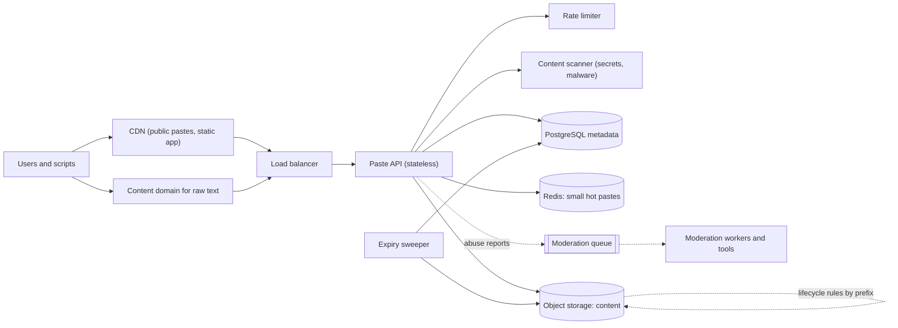
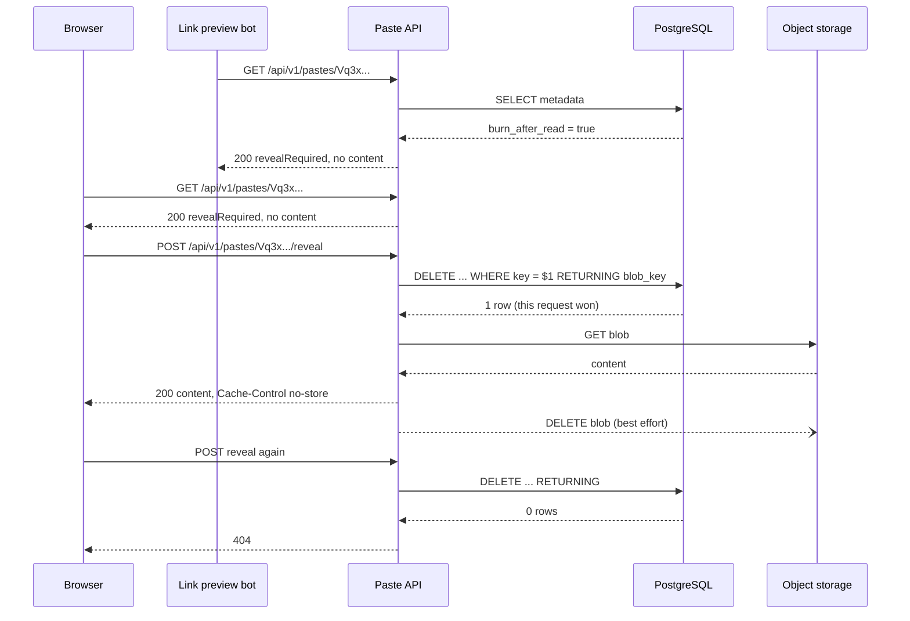

A pastebin lets someone paste a block of text (a log, a stack trace, a config file, a code snippet) and get back a link to share. It looks like the URL shortener's twin, and the read path is similar. The new ideas are about the **content**: it can be large, it must be stored cheaply, it often has to **disappear on a schedule**, and it is untrusted input that you serve back to browsers.

## Learning objectives

By the end of this lesson you will be able to:

1. Separate a paste's **metadata** (small, queried) from its **content** (large, read whole) and justify where each lives.
2. Estimate traffic, content storage growth with expiry, and metadata size with explicit arithmetic.
3. Size random keys for both collision safety and guess resistance, and explain why "unlisted" needs longer keys than "public".
4. Implement expiry three ways (lazy check on read, a sweeper job, storage lifecycle rules) and say why you want all three.
5. Make burn-after-read correct under concurrency, and safe from link-preview bots.
6. Serve user-supplied text without creating an XSS hole.
7. Decide when a single database table holding the text is simply enough.

## Prerequisites

- [URL shortener](#/lesson/m17-url-shortener): we reuse its read path, caching and rate-limit ideas and focus on what's new.
- [Object storage](#/lesson/m11-object-storage): blobs, keys, lifecycle rules and presigned URLs.
- [Capacity estimation](#/lesson/m11-capacity-estimation).

## Explain it like I'm a beginner

Think of the cloakroom at a wedding hall in Jaipur. You hand over a bag, and the attendant gives you a small token with a number. Anyone holding the token can collect the bag.

- The **bag** is the paste content. Bags come in all sizes, and the hall stores them in a big back room (object storage).
- The **token register** at the counter says which token belongs to which shelf, when it was handed in, and whether it must be returned by midnight (metadata in a database).
- Some guests say "throw it away if nobody collects it by 11 pm" (**expiry**).
- Some say "give it to the first person who shows the token, then destroy the token" (**burn after read**).
- Tokens must be hard to guess. If they were just 1, 2, 3…, anyone could walk up with token 57 and take a stranger's bag (**unguessable keys**).

A pastebin is that cloakroom, for text, at internet scale.

## Requirements

### Functional requirements

1. **Create** a paste with text up to 10 MB, an optional title, a syntax hint (for highlighting) and an optional expiry (10 minutes, 1 hour, 1 day, 1 week, 1 month, 1 year, or never for signed-in users).
2. **Visibility**: `public` (may appear in a "recent pastes" list and search), `unlisted` (anyone with the link, never listed), or `private` (only the owner, signed in).
3. **Read** a paste as a rendered page or as raw text (`/raw/{key}`).
4. **Burn after read**: the paste can be viewed exactly once, then it's deleted.
5. **Delete** your own paste at any time.
6. **Report** a paste for abuse (leaked credentials, malware, personal data).

### Out of scope

- Editing a paste after creation (we treat pastes as immutable; "edit" creates a new paste). Immutability makes caching and CDNs trivial.
- Collaborative editing, comments and version history.
- Server-side syntax highlighting. The browser does it with a JavaScript library, so the server never parses the content.

### Non-functional requirements

| Requirement | Target |
|---|---|
| Read latency | p99 under 200 ms for pastes up to 1 MB, excluding the user's network |
| Create latency | p99 under 500 ms for pastes up to 1 MB |
| Availability | 99.9 % for reads and writes |
| Durability | A paste is not lost before its expiry (object storage typically offers very high durability; check your provider's published figure) |
| Expiry accuracy | An expired paste is **never served** after its expiry time. Physical deletion may lag by up to an hour |
| Burn after read | At most one successful view, even with concurrent requests |
| Privacy | Unlisted pastes can't be found by guessing or browsing |

That "never served vs physically deleted" split is the most important line in the table. It lets us use a cheap, lazy cleanup process without ever showing expired content.

## Capacity estimation

All numbers are **estimates** for a popular public pastebin.

### Traffic

- New pastes: **1 M per day**. 1,000,000 ÷ 86,400 ≈ **12 writes/s** on average.
- Developer traffic is bursty during working hours across time zones. Assume peak = 5 × average ≈ **60 writes/s**.
- Reads: **10 reads per paste** on average (most are read once or twice, a few go viral). 10 M ÷ 86,400 ≈ **116 reads/s** average, peak ≈ **600 reads/s**.
- A paste linked from a popular forum can get 2,000 reads/s by itself. Again, hot keys matter more than the total.

### Content size

- Median paste: about 2 KB. Average: about **10 KB** (a long tail of log dumps pulls the mean up). Maximum: 10 MB.
- New content per day: 1 M × 10 KB = **10 GB/day** ≈ 3.65 TB/year before expiry and compression.
- Expiry: assume half of pastes have an expiry of a month or less. The steady-state growth is then roughly half: about **1.8 TB/year**.
- Text compresses well. Assume 3× with gzip or zstd (an estimate; logs often do better, minified code worse): about **0.6 TB/year** of stored bytes.

### Metadata size

- One row: key, blob key, size, hash, visibility, owner, timestamps, flags, plus index overhead ≈ **300 bytes**.
- 1 M × 300 B = 300 MB/day ≈ **110 GB/year**. One PostgreSQL instance holds many years of this comfortably.

### Bandwidth

- Average read: 116 reads/s × 10 KB ≈ **1.2 MB/s**; peak 600 × 10 KB = 6 MB/s ≈ 48 Mbit/s.
- A viral 1 MB paste at 2,000 reads/s is **2 GB/s**. That single case is why public pastes go behind a CDN.

### Key space

Keys are random characters from the 62-character alphabet.

- 8 characters: 62⁸ ≈ 2.18 × 10¹⁴ (218 trillion).
- 12 characters: 62¹² ≈ 3.2 × 10²¹.

**Collisions**: with 1 B live pastes, a fresh 8-character key collides with probability 10⁹ ÷ 2.18 × 10¹⁴ ≈ **4.6 × 10⁻⁶**. That's about one retry per 217,000 creations. Insert-if-absent plus one retry handles it.

**Guessing** is a different question. An attacker doesn't want one *specific* paste; they want *any* unlisted paste. With 1 B live pastes and 8-character keys, each guess hits with probability 4.6 × 10⁻⁶, so they need about 217,000 guesses on average. At 1,000 guesses/s (easy from a botnet), that's **one hit every 3.6 minutes**. For unlisted pastes, which people use for config files and logs, that is not acceptable.

With 12 characters, each guess hits with probability 10⁹ ÷ 3.2 × 10²¹ ≈ 3 × 10⁻¹³. At 1,000 guesses/s, the expected time to the first hit is about **100 years**. So: **8 characters for public pastes** (they're public anyway, short is nice), **12 characters for unlisted ones**, plus per-IP rate limits on 404s.

### What the numbers tell us

1. Write and read rates are low. The system is not compute-bound.
2. Storage grows steadily and **expiry is what keeps it bounded**. Cleanup is a first-class feature, not a cron job someone adds later.
3. Metadata is small, content is large. They want different stores.
4. Hot public pastes are a bandwidth problem, solved by a CDN, not by more servers.

## API design

### Create

```http
POST /api/v1/pastes
Content-Type: application/json
Authorization: Bearer <token>        (optional; required for private or never-expiring pastes)

{ "content": "System.NullReferenceException: ...", "syntax": "text", "expiresInMinutes": 1440,
  "visibility": "unlisted", "burnAfterRead": false }
```

- `201 Created` → `{ "key": "Vq3xP0aLm9Tz", "url": "https://paste.example/Vq3xP0aLm9Tz", "expiresAt": "..." }`.
- `400` invalid expiry or empty content. `413 Content Too Large` over 10 MB. `422` content blocked by the scanner (for example a live private key, if your policy blocks rather than warns). `429` rate-limited.

For very large uploads, a two-step flow is better: the API returns a **presigned upload URL** and the client uploads straight to object storage, then calls `POST /api/v1/pastes/{key}/complete`. That keeps 10 MB bodies off your app servers. For a 10 KB average, a single JSON request is simpler, so we start there.

### Read

- `GET /api/v1/pastes/{key}` → metadata plus content as JSON, used by the web page.
- `GET /raw/{key}` → `text/plain; charset=utf-8`, served from a **separate content domain** (see Security).
- For a burn-after-read paste, `GET` returns metadata only, with `"revealRequired": true`. The content is released by `POST /api/v1/pastes/{key}/reveal`. A `GET` must never burn the paste, because chat apps and email scanners fetch links automatically to build previews.
- Missing, expired, burned or not-yours-and-private all return `404`. We deliberately don't distinguish, so an attacker can't tell which keys once existed.

### Delete and report

- `DELETE /api/v1/pastes/{key}` (owner only) → `204`.
- `POST /api/v1/pastes/{key}/reports` with a reason → `202 Accepted`. Reports go to a moderation queue.

## Data model

### Metadata in PostgreSQL

```sql
CREATE TABLE paste (
    key              text        PRIMARY KEY,
    blob_key         text        NOT NULL,      -- where the content lives in object storage
    size_bytes       integer     NOT NULL CHECK (size_bytes BETWEEN 1 AND 10485760),
    sha256           bytea       NOT NULL,      -- integrity check, abuse matching
    syntax           text        NOT NULL DEFAULT 'text',
    visibility       text        NOT NULL CHECK (visibility IN ('public','unlisted','private')),
    owner_id         bigint,
    created_at       timestamptz NOT NULL DEFAULT now(),
    expires_at       timestamptz,               -- NULL = never
    burn_after_read  boolean     NOT NULL DEFAULT false
);
CREATE INDEX paste_expires ON paste (expires_at) WHERE expires_at IS NOT NULL;
CREATE INDEX paste_owner   ON paste (owner_id, created_at DESC) WHERE owner_id IS NOT NULL;
CREATE INDEX paste_public_recent ON paste (created_at DESC) WHERE visibility = 'public';
```

Three partial indexes, each for one query:

- `paste_expires` serves the sweeper: "give me the next 500 expired pastes". It skips never-expiring rows entirely.
- `paste_owner` serves "my pastes".
- `paste_public_recent` serves the public "recent" list without indexing unlisted pastes at all, so they can't leak through it.

### Content in object storage

The blob key is **not** the paste key. It's a random id under a prefix that names the expiry class: `ttl-1d/6f0c…`, `ttl-30d/91ab…`, `keep/0d2e…`. Two reasons:

1. If a paste key collides and we retry with a new key, the content already uploaded under a random blob key can't overwrite anyone else's.
2. **Lifecycle rules** in object storage can delete by prefix and age: "delete blobs under `ttl-1d/` older than 2 days". That is a safety net that keeps storage bounded even if our sweeper is broken for a week.

### Why not keep the text in PostgreSQL?

You can, and at small scale you should. PostgreSQL moves large values out of the main table automatically and compresses them (TOAST), so a `content text` column works well up to many gigabytes. It gets awkward when content reaches terabytes: backups, replicas and restores all carry the content, and a 10 MB value travels through the database connection on every read. Object storage is built for large immutable blobs, is cheaper per GB, and serves a CDN directly. The cost is a second system and the consistency question of "metadata row without blob" or "blob without row", which we handle below.

## High-level architecture



Reading the diagram:

- **Users → CDN → Load balancer → Paste API**: the web app (HTML, JavaScript, the syntax highlighter) and public pastes are cached at the CDN. Unlisted and private reads pass through to the API with `Cache-Control: private, no-store` so they're never cached at the edge.
- **Content domain**: raw text is served from a separate registrable domain (for example `pastecontent.example`), so even if a browser misinterprets a paste as HTML, it can't read cookies of the main site.
- **API → Rate limiter / Scanner**: creation is rate-limited per user and IP. The scanner looks for things like private keys and cloud access tokens. Depending on policy it blocks, warns, or flags for moderation.
- **API → PostgreSQL / Redis / Object storage**: metadata is read for every request (to check expiry, visibility and burn). Small, hot, non-burn pastes are cached in Redis; everything else comes from object storage.
- **Sweeper → PostgreSQL + Object storage**: a background job deletes expired pastes in batches: blob first, then the row.
- **Object storage lifecycle**: the storage service itself deletes old blobs by prefix, as a backstop.
- **Moderation queue** (dotted, async): reports are queued so a slow moderation tool never slows the API.

### Read flow for a burn-after-read paste



The preview bot only ever sees metadata, because content is released by a `POST`, which bots don't send. The `DELETE ... RETURNING` is the atomic "claim": PostgreSQL row locking guarantees that only one transaction deletes the row and gets it back, however many requests race. Blob deletion happens after the response; if it fails, the sweeper's orphan check or the lifecycle rule removes the blob later.

### Create flow, in words

1. Rate-limit, then validate size and expiry.
2. Scan the content (synchronously, because blocking a leaked key after it's public is too late).
3. Upload the content to object storage under a fresh random blob key in the right expiry prefix.
4. Generate a random paste key (8 or 12 characters by visibility) and `INSERT ... ON CONFLICT DO NOTHING`. On conflict, generate another key and retry, up to a few times.
5. Return `201`.

If step 4 never succeeds (database down), the blob from step 3 is an **orphan**: content without metadata. That's harmless (nobody can reach it) and the lifecycle rule deletes it. Choosing "orphan blob" as the failure mode is deliberate: the opposite ordering (row first, blob later) can produce a row that points at nothing, which shows users an error.

## Deep dives

### Deep dive 1: three layers of expiry

Expiry must be **exact for reads** and **eventual for storage**. We use three mechanisms, each covering the others' gaps:

1. **Lazy check on every read**. The API compares `expires_at` with the current time before returning anything. This alone guarantees "never served after expiry", even if nothing is ever deleted.
2. **Sweeper job**. Every minute, a background worker queries `WHERE expires_at <= now() ORDER BY expires_at LIMIT 500` (served by the partial index), deletes each blob, then deletes the rows. It keeps storage and the metadata table tidy.
3. **Object-storage lifecycle rules**. Rules like "delete under `ttl-1d/` after 2 days" catch anything the sweeper missed: orphans from failed creates, bugs, or a sweeper that was down for a week.

Why not rely on Redis-style TTLs alone? Because the content isn't in Redis, and a TTL in a cache isn't a deletion guarantee for the source of truth. Why not only lifecycle rules? They work on blob age, not per-paste expiry times, and they don't clean metadata.

**Sweeper sizing**: if half of 1 M daily pastes expire, that's 500,000 deletions per day ≈ 6 per second on average, but expiries cluster (everything created at 10:00 with a 1-hour expiry expires at 11:00). Batches of 500 every minute handle 30,000 per hour; run the loop until the batch comes back short, and it keeps up with bursts.

### Deep dive 2: burn after read, done properly

Three ways to get this wrong:

- **Read, then delete** as two separate steps: two concurrent requests both read before either deletes, and the paste is seen twice.
- **Burn on GET**: Slack, WhatsApp, Teams and email security scanners fetch links to make previews or check for malware. The bot "reads" the paste and the real recipient gets a 404.
- **Cache it**: a CDN or browser cache keeps a copy of a paste that was supposed to self-destruct.

The fix is the flow above: release content only on `POST /reveal`, claim with an atomic `DELETE ... RETURNING` (or `UPDATE ... SET burned = true WHERE burned = false RETURNING`), and send `Cache-Control: no-store`. If you need an audit trail, use the `UPDATE` form and keep a tombstone row.

A subtle trade-off: we delete the metadata *before* we fetch the blob. If the blob fetch then fails, the one allowed view is spent and nobody sees the content. The alternative (fetch first, then claim) risks two views. For a feature whose whole promise is "at most once", losing the view is the right side to err on.

### Deep dive 3: random keys with a cryptographic generator

`System.Random` is predictable: from a few outputs, an attacker can reconstruct its state and predict future keys. Use `RandomNumberGenerator`, which draws from the operating system's cryptographic generator. In .NET 8 and later, `RandomNumberGenerator.GetString(alphabet, length)` picks each character uniformly from the alphabet, without the modulo bias you'd get from `bytes[i] % 62`.

### Deep dive 4: hot pastes and caching

- **Public pastes** are immutable and public, so the CDN can cache them for hours: `Cache-Control: public, max-age=3600`. If the paste has an expiry, set `max-age` to the smaller of an hour and the time left. On delete or takedown, purge the URL at the CDN.
- **Unlisted pastes** are also immutable, but marked `private, no-store` at the CDN, because a shared cache makes them easier to find (cache-probing) and harder to take down. The API caches small ones (≤ 64 KB) in Redis or an in-process cache, keyed by paste key, with TTL capped at the expiry.
- **Burn-after-read** pastes are never cached anywhere.

Metadata is checked on every request even when content is cached. It's a single primary-key lookup, and it's what makes deletes and takedowns take effect immediately for non-CDN traffic.

### Deep dive 5: the core in ASP.NET Core

The code below shows the pieces that carry the design: random keys by visibility, upload-then-insert with retry, lazy expiry, an atomic burn-after-read claim, the sweeper, and safe raw-text headers. Stores are in-memory fakes behind interfaces; production versions wrap PostgreSQL and a blob SDK.

```csharp file=Pastebin/Domain.cs
using System.Security.Cryptography;

namespace Pastebin.Domain;

public enum Visibility { Public, Unlisted, Private }

public sealed record PasteRecord(
    string Key, string BlobKey, long SizeBytes, string Sha256, string Syntax, Visibility Visibility,
    string? OwnerId, DateTimeOffset CreatedAt, DateTimeOffset? ExpiresAt, bool BurnAfterRead)
{
    public bool IsExpired(DateTimeOffset now) => ExpiresAt is { } e && e <= now;
}

public static class PasteKeys
{
    public const string Alphabet = "0123456789ABCDEFGHIJKLMNOPQRSTUVWXYZabcdefghijklmnopqrstuvwxyz";

    /// <summary>Public pastes are listed anyway, so short keys are fine; unlisted and private ones must resist guessing.</summary>
    public static int LengthFor(Visibility v) => v == Visibility.Public ? 8 : 12;

    /// <summary>Uniform over the alphabet, from the OS cryptographic RNG (no modulo bias).</summary>
    public static string NewKey(int length) => RandomNumberGenerator.GetString(Alphabet, length);

    public static bool IsWellFormed(string key)
    {
        if (key.Length is not (8 or 12)) return false;
        foreach (var c in key) if (!char.IsAsciiLetterOrDigit(c)) return false;
        return true;
    }

    /// <summary>Blob prefix by expiry class, so object-storage lifecycle rules can delete by prefix and age.</summary>
    public static string BlobPrefix(int? expiresInMinutes) => expiresInMinutes switch
    {
        null => "keep",
        <= 1440 => "ttl-1d",
        <= 10080 => "ttl-7d",
        <= 43200 => "ttl-30d",
        _ => "ttl-1y",
    };
}
```

```csharp file=Pastebin/Stores.cs
using System.Collections.Concurrent;
using Pastebin.Domain;

namespace Pastebin.Storage;

public interface IBlobStore
{
    Task PutAsync(string blobKey, byte[] data, CancellationToken ct);
    Task<byte[]?> GetAsync(string blobKey, CancellationToken ct);
    Task DeleteAsync(string blobKey, CancellationToken ct);
}

public interface IPasteMetadataStore
{
    /// <summary>INSERT ... ON CONFLICT (key) DO NOTHING. False means the key is taken.</summary>
    Task<bool> TryInsertAsync(PasteRecord record, CancellationToken ct);
    Task<PasteRecord?> GetAsync(string key, CancellationToken ct);
    /// <summary>DELETE ... WHERE key = $1 RETURNING *. Only one concurrent caller gets the row back.</summary>
    Task<PasteRecord?> TryDeleteAsync(string key, CancellationToken ct);
    /// <summary>WHERE expires_at &lt;= $now ORDER BY expires_at LIMIT $limit (uses the partial index).</summary>
    Task<IReadOnlyList<PasteRecord>> FindExpiredAsync(DateTimeOffset now, int limit, CancellationToken ct);
}

public sealed class InMemoryBlobStore : IBlobStore
{
    private readonly ConcurrentDictionary<string, byte[]> _blobs = new();
    public Task PutAsync(string blobKey, byte[] data, CancellationToken ct) { _blobs[blobKey] = data; return Task.CompletedTask; }
    public Task<byte[]?> GetAsync(string blobKey, CancellationToken ct) => Task.FromResult(_blobs.TryGetValue(blobKey, out var b) ? b : null);
    public Task DeleteAsync(string blobKey, CancellationToken ct) { _blobs.TryRemove(blobKey, out _); return Task.CompletedTask; }
    public int Count => _blobs.Count;
}

public sealed class InMemoryPasteMetadataStore : IPasteMetadataStore
{
    private readonly ConcurrentDictionary<string, PasteRecord> _rows = new(StringComparer.Ordinal);
    public Task<bool> TryInsertAsync(PasteRecord record, CancellationToken ct) => Task.FromResult(_rows.TryAdd(record.Key, record));
    public Task<PasteRecord?> GetAsync(string key, CancellationToken ct) => Task.FromResult(_rows.TryGetValue(key, out var r) ? r : null);
    public Task<PasteRecord?> TryDeleteAsync(string key, CancellationToken ct) => Task.FromResult(_rows.TryRemove(key, out var r) ? r : null);
    public Task<IReadOnlyList<PasteRecord>> FindExpiredAsync(DateTimeOffset now, int limit, CancellationToken ct) =>
        Task.FromResult<IReadOnlyList<PasteRecord>>(_rows.Values.Where(r => r.IsExpired(now))
            .OrderBy(r => r.ExpiresAt).Take(limit).ToList());
}
```

```csharp file=Pastebin/PasteService.cs
using System.Security.Cryptography;
using System.Text;
using Microsoft.Extensions.Caching.Memory;
using Microsoft.Extensions.Logging;
using Pastebin.Domain;
using Pastebin.Storage;

namespace Pastebin.Services;

public sealed record CreatePasteRequest(string Content, string? Syntax, int? ExpiresInMinutes, bool BurnAfterRead,
                                        Visibility Visibility = Visibility.Unlisted);
public sealed record CreatePasteResult(string? Key, DateTimeOffset? ExpiresAt, string? Error, int Status);

public enum ReadOutcome { Ok, NotFound, RevealRequired }
public sealed record ReadResult(ReadOutcome Outcome, PasteRecord? Meta = null, string? Content = null);

public sealed class PasteService(IPasteMetadataStore meta, IBlobStore blobs, IMemoryCache cache, TimeProvider clock,
                                 ILogger<PasteService> log)
{
    public const int MaxBytes = 10 * 1024 * 1024;
    private const int CacheableBytes = 64 * 1024;

    public async Task<CreatePasteResult> CreateAsync(CreatePasteRequest req, string? ownerId, CancellationToken ct)
    {
        var bytes = Encoding.UTF8.GetBytes(req.Content ?? "");
        if (bytes.Length == 0) return new(null, null, "Content is empty.", 400);
        if (bytes.Length > MaxBytes) return new(null, null, "Content is larger than 10 MB.", 413);
        if (req.ExpiresInMinutes is { } m && (m < 10 || m > 525_600)) return new(null, null, "Expiry must be 10 minutes to 1 year.", 400);
        if (req.ExpiresInMinutes is null && ownerId is null) return new(null, null, "Anonymous pastes must expire.", 400);
        if (req.Visibility == Visibility.Private && ownerId is null) return new(null, null, "Private pastes need sign-in.", 401);

        var now = clock.GetUtcNow();
        DateTimeOffset? expiresAt = req.ExpiresInMinutes is { } mins ? now.AddMinutes(mins) : null;

        // 1. Content first, under a random blob key: a failed or retried insert leaves only a harmless orphan.
        var blobKey = $"{PasteKeys.BlobPrefix(req.ExpiresInMinutes)}/{Guid.NewGuid():N}";
        await blobs.PutAsync(blobKey, bytes, ct);
        var sha = Convert.ToHexString(SHA256.HashData(bytes)).ToLowerInvariant();

        // 2. Claim a random key; retry on the (rare) collision.
        for (var attempt = 0; attempt < 3; attempt++)
        {
            var key = PasteKeys.NewKey(PasteKeys.LengthFor(req.Visibility));
            var record = new PasteRecord(key, blobKey, bytes.Length, sha, req.Syntax ?? "text", req.Visibility,
                                         ownerId, now, expiresAt, req.BurnAfterRead);
            if (await meta.TryInsertAsync(record, ct)) return new(key, expiresAt, null, 201);
            log.LogInformation("Paste key collision on attempt {Attempt}", attempt + 1);
        }
        return new(null, null, "Could not allocate a key; please retry.", 503);
    }

    public async Task<ReadResult> ReadAsync(string key, bool reveal, string? callerId, CancellationToken ct)
    {
        if (!PasteKeys.IsWellFormed(key)) return new(ReadOutcome.NotFound);
        var now = clock.GetUtcNow();

        var m = await meta.GetAsync(key, ct);                     // always checked: deletes and expiry apply at once
        if (m is null || m.IsExpired(now)) return new(ReadOutcome.NotFound);
        if (m.Visibility == Visibility.Private && m.OwnerId != callerId) return new(ReadOutcome.NotFound);

        if (m.BurnAfterRead)
        {
            if (!reveal) return new(ReadOutcome.RevealRequired, m);   // GET never burns: preview bots only see this
            var claimed = await meta.TryDeleteAsync(key, ct);         // atomic: exactly one caller wins
            if (claimed is null) return new(ReadOutcome.NotFound);
            var once = await blobs.GetAsync(claimed.BlobKey, ct);
            _ = blobs.DeleteAsync(claimed.BlobKey, CancellationToken.None); // best effort; lifecycle rule is the backstop
            return once is null ? new(ReadOutcome.NotFound) : new(ReadOutcome.Ok, claimed, Encoding.UTF8.GetString(once));
        }

        if (cache.TryGetValue("paste:" + key, out string? cached)) return new(ReadOutcome.Ok, m, cached);
        var data = await blobs.GetAsync(m.BlobKey, ct);
        if (data is null)
        {
            log.LogError("Metadata for {Key} points to missing blob {BlobKey}", key, m.BlobKey);
            return new(ReadOutcome.NotFound);
        }
        var text = Encoding.UTF8.GetString(data);
        if (data.Length <= CacheableBytes)
        {
            var ttl = TimeSpan.FromMinutes(10);
            if (m.ExpiresAt is { } e && e - now < ttl) ttl = e - now;
            cache.Set("paste:" + key, text, ttl);
        }
        return new(ReadOutcome.Ok, m, text);
    }

    public async Task<bool> DeleteAsync(string key, string ownerId, CancellationToken ct)
    {
        var m = await meta.GetAsync(key, ct);
        if (m is null || m.OwnerId != ownerId) return false;
        if (await meta.TryDeleteAsync(key, ct) is null) return false;
        cache.Remove("paste:" + key);
        await blobs.DeleteAsync(m.BlobKey, ct);
        return true;
    }
}
```

```csharp file=Pastebin/ExpirySweeper.cs
using Microsoft.Extensions.Hosting;
using Microsoft.Extensions.Logging;
using Pastebin.Storage;

namespace Pastebin.Services;

/// <summary>Physically removes expired pastes. Reads never depend on it: the lazy check already hides them.</summary>
public sealed class ExpirySweeper(IPasteMetadataStore meta, IBlobStore blobs, TimeProvider clock, ILogger<ExpirySweeper> log)
    : BackgroundService
{
    private const int BatchSize = 500;

    protected override async Task ExecuteAsync(CancellationToken stoppingToken)
    {
        using var timer = new PeriodicTimer(TimeSpan.FromMinutes(1), clock);
        try
        {
            while (await timer.WaitForNextTickAsync(stoppingToken))
            {
                var n = await SweepOnceAsync(stoppingToken);
                if (n > 0) log.LogInformation("Swept {Count} expired pastes", n);
            }
        }
        catch (OperationCanceledException) when (stoppingToken.IsCancellationRequested) { }
    }

    public async Task<int> SweepOnceAsync(CancellationToken ct)
    {
        var total = 0;
        while (true)
        {
            var batch = await meta.FindExpiredAsync(clock.GetUtcNow(), BatchSize, ct);
            var deleted = 0;
            foreach (var p in batch)
            {
                try
                {
                    await blobs.DeleteAsync(p.BlobKey, ct);   // blob first: a failure here leaves a row that reads already hide
                    await meta.TryDeleteAsync(p.Key, ct);
                    deleted++;
                }
                catch (Exception ex) when (ex is not OperationCanceledException)
                {
                    log.LogWarning(ex, "Could not sweep paste {Key}", p.Key);
                }
            }
            total += deleted;
            if (batch.Count < BatchSize || deleted == 0) return total; // stop when caught up, or when nothing progresses
        }
    }
}
```

```csharp file=Program.cs
using Pastebin.Domain;
using Pastebin.Services;
using Pastebin.Storage;

var builder = WebApplication.CreateBuilder(args);
builder.WebHost.ConfigureKestrel(k => k.Limits.MaxRequestBodySize = 11 * 1024 * 1024); // JSON overhead on top of 10 MB

builder.Services.AddMemoryCache();
builder.Services.AddSingleton(TimeProvider.System);
builder.Services.AddSingleton<IBlobStore, InMemoryBlobStore>();
builder.Services.AddSingleton<IPasteMetadataStore, InMemoryPasteMetadataStore>();
builder.Services.AddSingleton<PasteService>();
builder.Services.AddHostedService<ExpirySweeper>(); // in production: a separate single-replica worker

var app = builder.Build();

app.MapPost("/api/v1/pastes", async (CreatePasteRequest req, HttpContext http, PasteService svc, CancellationToken ct) =>
{
    var r = await svc.CreateAsync(req, http.User.Identity?.Name, ct);
    return r.Status == 201
        ? Results.Created($"/{r.Key}", new { key = r.Key, url = $"https://paste.example/{r.Key}", expiresAt = r.ExpiresAt })
        : Results.Problem(r.Error, statusCode: r.Status);
});

app.MapGet("/api/v1/pastes/{key}", async (string key, HttpContext http, PasteService svc, CancellationToken ct) =>
    ToJson(await svc.ReadAsync(key, reveal: false, http.User.Identity?.Name, ct), http));

app.MapPost("/api/v1/pastes/{key}/reveal", async (string key, HttpContext http, PasteService svc, CancellationToken ct) =>
    ToJson(await svc.ReadAsync(key, reveal: true, http.User.Identity?.Name, ct), http));

// Served from a separate content domain in production. Headers stop browsers treating a paste as HTML.
app.MapGet("/raw/{key}", async (string key, HttpContext http, PasteService svc, CancellationToken ct) =>
{
    var r = await svc.ReadAsync(key, reveal: false, http.User.Identity?.Name, ct);
    if (r.Outcome != ReadOutcome.Ok) return Results.NotFound();
    http.Response.Headers.XContentTypeOptions = "nosniff";
    http.Response.Headers.ContentSecurityPolicy = "sandbox";
    http.Response.Headers.CacheControl = r.Meta!.Visibility == Visibility.Public ? "public, max-age=3600" : "private, no-store";
    return Results.Text(r.Content!, "text/plain; charset=utf-8");
});

app.Run();

static IResult ToJson(ReadResult r, HttpContext http)
{
    http.Response.Headers.CacheControl = "private, no-store";
    return r.Outcome switch
    {
        ReadOutcome.Ok => Results.Ok(new { key = r.Meta!.Key, syntax = r.Meta.Syntax, expiresAt = r.Meta.ExpiresAt, content = r.Content }),
        ReadOutcome.RevealRequired => Results.Ok(new { key = r.Meta!.Key, revealRequired = true }),
        _ => Results.NotFound(),
    };
}
```

Notice that the burn-after-read claim, the "blob first, then row" ordering in both create and sweep, and the lazy expiry check are each one or two lines. The design work is in choosing those orderings, not in the amount of code.

## Caching, queues and scaling

### Caching

| What | Where | TTL | Invalidation |
|---|---|---|---|
| Web app (HTML, JS, CSS) | CDN | Long, with versioned filenames | New filenames on deploy |
| Public paste pages and raw text | CDN | min(1 h, time to expiry) | CDN purge on delete or takedown |
| Small unlisted/public content | Redis or in-process | min(10 min, time to expiry) | Delete key on delete |
| Metadata | Not cached at first | – | – |

Metadata stays uncached at 600 reads/s, because PostgreSQL handles that easily and freshness matters for deletes. If metadata reads ever become the bottleneck, cache them for a few seconds and accept that a deletion takes that long to be seen.

### Queues

- **Moderation reports**: a work queue with retries and a dead-letter queue.
- **Asynchronous deep scanning**: a fast synchronous scanner blocks obvious secrets at create time; a slower, more thorough scan (for example, checking against threat-intelligence hash lists) runs from a queue after creation and can take a paste down.
- **Takedown fan-out**: one takedown triggers several actions (delete blob, purge CDN, record audit). A queue lets each step retry on its own.

### Scaling path

1. **Small (a team, a company intranet)**: one ASP.NET Core app, one PostgreSQL table with a `content` column, a cron-style sweeper. Done.
2. **Public, moderate (our numbers)**: stateless API on 2–3 instances, PostgreSQL primary + replica for metadata, object storage for content, CDN for public pastes, Redis for small hot content.
3. **Large**: metadata sharded by hash of key (or a key-value store), object storage as is (it scales by itself), multiple regions for reads with content replicated by the storage service.

**What breaks first?** In order: (1) bandwidth on a viral paste if there's no CDN, (2) storage growth if cleanup is missing or broken, (3) app server memory if 10 MB bodies are buffered by many concurrent requests (stream them, or use presigned uploads), (4) metadata write throughput only at a much larger scale.

## Failure handling

| Failure | Effect | Mitigation |
|---|---|---|
| Object storage slow or down | Reads of uncached content fail, creates fail | Serve cached content; return `503` with `Retry-After` for creates; timeouts of a few seconds so threads aren't held |
| Metadata database primary down | Creates and deletes fail; reads continue from a replica | Automatic failover; reads tolerate slightly stale metadata. Deletion during failover is retried by the client |
| Blob uploaded, row insert fails | Orphan blob | Harmless and invisible; lifecycle rule removes it. Optionally an orphan sweeper lists blobs without rows |
| Row exists, blob missing (bug, manual deletion) | Read finds metadata but no content | Return `404`, log at error level, alert if it's frequent |
| Sweeper crashes or is disabled | Expired data stays stored, but is never served | Lazy read check protects users; lifecycle rules bound storage; alert on "oldest expired row age" |
| Burn-after-read blob fetch fails after the claim | The single view is lost | Accepted trade-off, logged. Retrying the fetch a couple of times within the same request reduces the chance |
| Viral public paste | Bandwidth and origin load spike | CDN caching; request coalescing at the CDN; per-key rate limit at the origin |
| Key collision | Insert conflicts | Retry with a new key (expected about once per 200,000 creates at 1 B live pastes) |

## Security

Pastes are **untrusted input served back to browsers**, which is the textbook setup for cross-site scripting (XSS). Layers of defence:

- **Separate content domain**. Serve `/raw` from a different registrable domain than the app (like `pastecontent.example` vs `paste.example`). Cookies for the app are never sent to it, and script on it can't read the app's storage.
- **Correct headers on raw text**: `Content-Type: text/plain; charset=utf-8`, `X-Content-Type-Options: nosniff` (so browsers don't "guess" it's HTML), and `Content-Security-Policy: sandbox` (so even if rendered, it can't run script or submit forms).
- **Escape when rendering** in the web page. The highlighter must insert text as text, never as HTML. In a Razor or Blazor page this is the default; in JavaScript, use `textContent`, not `innerHTML`.
- **Unguessable keys and 404 rate limits**: 12-character random keys for unlisted pastes, and per-IP limits on 404 responses to slow down scanning.
- **Private pastes** require authentication and check ownership; the response for "not yours" is `404`, not `403`.
- **Secret scanning**: people paste API keys and database passwords by accident every day. Detect common token formats at creation and either block, warn the author, or auto-expire the paste. If you detect a token from a provider that offers a revocation or reporting programme, consider reporting it.
- **Abuse and legal**: a takedown process with an audit log, the ability to block content by hash (so the same malware can't be re-pasted), and data retention rules for logs. In India, intermediaries have obligations under the IT Rules 2021 to act on certain takedown requests within set timelines; check current rules with your legal team.
- **Request limits**: a hard 10 MB body limit at the load balancer and in Kestrel, so oversized uploads are rejected before they consume memory.

## Observability

- **Create and read latency** by size bucket (under 10 KB, 10 KB–1 MB, over 1 MB), because a 10 MB read is legitimately slower.
- **Cache hit ratio** at the CDN and in Redis.
- **Expired-but-not-deleted backlog**: count and age of the oldest row with `expires_at <= now()`. This is the sweeper's health metric. Alert if the oldest is more than 1 hour overdue.
- **Orphan blob count** (sampled daily) and **missing blob** errors.
- **404 rate per IP** for scanning detection.
- **Scanner verdicts** (blocked, warned, passed) and scanner latency.
- **Storage bytes by prefix** (`ttl-1d`, `keep` and so on): shows whether expiry is actually bounding growth.

A useful SLO: "99.9 % of reads for pastes under 1 MB complete in under 200 ms" plus "0 expired pastes served", which you verify with a synthetic check that creates a 10-minute paste and confirms a `404` at minute 11.

## Deployment and cost

### Deployment

- One stateless API image and one sweeper. The sweeper can be a `BackgroundService` inside the API, but then every API instance runs it. Either use a lease so only one instance sweeps at a time, or deploy the sweeper as a separate single-replica worker (simpler to reason about).
- Object storage lifecycle rules are infrastructure: define them in Bicep or Terraform alongside the bucket, so they can't be forgotten in a new environment.
- CDN configuration (cache rules per path) is also code-reviewed infrastructure.

### Cost drivers (estimate)

1. **Content storage**: about 0.6 TB/year of compressed growth. Object storage is the cheapest per-GB option, and colder tiers are cheaper still for pastes that are kept "forever" but rarely read.
2. **CDN egress**: viral public pastes. Usually the largest variable cost.
3. **Metadata database**: small (110 GB/year); one primary and one replica.
4. **Object-storage request charges**: about 1 M writes and up to 10 M reads a day. Per-request fees are small individually but worth checking; caching small hot pastes reduces them.
5. **Scanning**: if you use a third-party scanning API, it's charged per call.

The biggest cost lever is **expiry defaults**. If the default expiry is "never", storage grows forever. A default of 1 month (with "never" for signed-in users only) changes the cost curve more than any infrastructure choice.

### When a simpler design is enough

For an internal pastebin used by 300 engineers, put everything in one PostgreSQL table with a `content text` column, a `DELETE FROM paste WHERE expires_at < now()` job every 10 minutes, and one app instance behind your company SSO. TOAST compresses the text. You'll never notice the absence of object storage, Redis or a CDN.

## Alternatives and trade-offs

| Decision | Our choice | Alternative | When the alternative wins |
|---|---|---|---|
| Content location | Object storage, metadata in PostgreSQL | Content in PostgreSQL (TOAST) | Small scale; you want one system and transactional create/delete |
| Small pastes | Same path as large | Inline pastes under ~8 KB in the metadata row | When object-storage latency dominates reads of tiny pastes and you want one fewer round trip |
| Keys | Random, 8 public / 12 unlisted | Counter + base62 (like the shortener) | Only for public pastes, where enumeration doesn't matter |
| Expiry | Lazy check + sweeper + lifecycle rules | Only a sweeper | Small systems where a missed sweep is noticed quickly |
| Dedupe | None | Content-addressed storage by SHA-256 | Many identical pastes (bots, templates). Adds reference counting and complicates deletion and burn-after-read |
| Large uploads | JSON body (≤ 10 MB) | Presigned direct upload | Large average sizes or many concurrent big uploads |
| Rendering | Client-side highlighting | Server-side rendering to HTML | SEO for public pastes, at the cost of CPU and a bigger XSS surface |

## Practical playground

The starting graph stores everything in one database table and has no cleanup, no CDN and no separate content domain. Open it in the HLD canvas. Move content to object storage, add a sweeper and lifecycle rules, put a CDN in front of public pastes, and add a scanner on the create path. Then set client RPS to 2,000 for a viral paste and see what the simulator flags.

:::playground type=hld title="From one table to a real pastebin"
```json
{
  "nodes": [
    { "id": "c", "type": "client", "label": "Developers and scripts", "props": { "rps": 600 } },
    { "id": "lb", "type": "load-balancer", "label": "Load balancer" },
    { "id": "api", "type": "app-server", "label": "Paste app (renders HTML too)", "props": { "instances": 2 } },
    { "id": "db", "type": "database", "label": "PostgreSQL (metadata + 10 MB text column)", "props": { "replicas": 0 } }
  ],
  "edges": [
    { "from": "c", "to": "lb", "kind": "sync" },
    { "from": "lb", "to": "api", "kind": "sync" },
    { "from": "api", "to": "db", "kind": "sync", "label": "SELECT content" }
  ]
}
```
:::

## Exercises

:::exercise id=m17-pastebin-ex1 difficulty=beginner kind=code title="Random keys with collision retry"
Implement `PasteKeyAllocator`. `RandomKey(length)` returns a key from the 62-character alphabet using a cryptographic generator. `Allocate(length, tryReserve)` asks its candidate source for keys and calls `tryReserve(key)` until one succeeds, giving up after `maxAttempts`.
::requirements
- `RandomKey` uses `RandomNumberGenerator`, not `System.Random`.
- Lengths below 4 throw `ArgumentOutOfRangeException`.
- `Allocate` returns the first key for which `tryReserve` returns `true`.
- After `maxAttempts` failures, throw `KeyAllocationException`.
- The candidate source is injectable (`Func<int, string>`) so tests can force collisions.
::acceptance
- All tests pass.
- 2,000 random 12-character keys are all distinct and use only the alphabet.
::hint
Split the job: one method makes a random string, the other loops over attempts.
::hint
`RandomNumberGenerator.GetString(Alphabet, length)` exists in .NET 8+ and is uniform over the alphabet.
::hint
The constructor takes `Func<int, string>? candidateSource = null`; when null, use `RandomKey`.
::hint
```csharp
for (var i = 0; i < _maxAttempts; i++)
{
    var key = _source(length);
    if (tryReserve(key)) return key;
}
throw new KeyAllocationException(_maxAttempts);
```
::starter
```csharp file=PasteKeyAllocator.cs
using System;
using System.Security.Cryptography;

public sealed class KeyAllocationException(int attempts)
    : Exception($"No free key after {attempts} attempts.")
{
    public int Attempts { get; } = attempts;
}

public sealed class PasteKeyAllocator
{
    public const string Alphabet = "0123456789ABCDEFGHIJKLMNOPQRSTUVWXYZabcdefghijklmnopqrstuvwxyz";

    public PasteKeyAllocator(Func<int, string>? candidateSource = null, int maxAttempts = 5)
    {
        throw new NotImplementedException();
    }

    public static string RandomKey(int length) => throw new NotImplementedException();

    public string Allocate(int length, Func<string, bool> tryReserve) => throw new NotImplementedException();
}
```
::tests
```csharp file=PasteKeyAllocatorTests.cs
using System;
using System.Collections.Generic;
using System.Linq;
using Xunit;

public class PasteKeyAllocatorTests
{
    [Fact]
    public void Random_keys_have_length_and_alphabet()
    {
        var keys = Enumerable.Range(0, 2000).Select(_ => PasteKeyAllocator.RandomKey(12)).ToList();
        Assert.All(keys, k => Assert.Equal(12, k.Length));
        Assert.All(keys, k => Assert.True(k.All(c => PasteKeyAllocator.Alphabet.Contains(c))));
        Assert.Equal(2000, keys.Distinct().Count());
    }

    [Fact]
    public void Too_short_is_rejected() => Assert.Throws<ArgumentOutOfRangeException>(() => PasteKeyAllocator.RandomKey(3));

    [Fact]
    public void Retries_until_a_key_is_free()
    {
        var scripted = new Queue<string>(new[] { "aaaaaaaa", "aaaaaaaa", "bbbbbbbb" });
        var taken = new HashSet<string> { "aaaaaaaa" };
        var alloc = new PasteKeyAllocator(_ => scripted.Dequeue());
        var key = alloc.Allocate(8, k => taken.Add(k));
        Assert.Equal("bbbbbbbb", key);
    }

    [Fact]
    public void Gives_up_after_max_attempts()
    {
        var calls = 0;
        var alloc = new PasteKeyAllocator(_ => "samekey1", maxAttempts: 3);
        var ex = Assert.Throws<KeyAllocationException>(() => alloc.Allocate(8, _ => { calls++; return false; }));
        Assert.Equal(3, calls);
        Assert.Equal(3, ex.Attempts);
    }

    [Fact]
    public void Passes_length_to_source()
    {
        var seen = 0;
        var alloc = new PasteKeyAllocator(n => { seen = n; return new string('x', n); });
        alloc.Allocate(12, _ => true);
        Assert.Equal(12, seen);
    }

    [Fact]
    public void Default_source_is_random()
    {
        var alloc = new PasteKeyAllocator();
        var key = alloc.Allocate(8, _ => true);
        Assert.Equal(8, key.Length);
    }
}
```
::solution
```csharp file=PasteKeyAllocator.cs
using System;
using System.Security.Cryptography;

public sealed class KeyAllocationException(int attempts)
    : Exception($"No free key after {attempts} attempts.")
{
    public int Attempts { get; } = attempts;
}

public sealed class PasteKeyAllocator
{
    public const string Alphabet = "0123456789ABCDEFGHIJKLMNOPQRSTUVWXYZabcdefghijklmnopqrstuvwxyz";
    private readonly Func<int, string> _source;
    private readonly int _maxAttempts;

    public PasteKeyAllocator(Func<int, string>? candidateSource = null, int maxAttempts = 5)
    {
        ArgumentOutOfRangeException.ThrowIfLessThan(maxAttempts, 1);
        _source = candidateSource ?? RandomKey;
        _maxAttempts = maxAttempts;
    }

    public static string RandomKey(int length)
    {
        ArgumentOutOfRangeException.ThrowIfLessThan(length, 4);
        return RandomNumberGenerator.GetString(Alphabet, length);
    }

    public string Allocate(int length, Func<string, bool> tryReserve)
    {
        for (var i = 0; i < _maxAttempts; i++)
        {
            var key = _source(length);
            if (tryReserve(key)) return key;
        }
        throw new KeyAllocationException(_maxAttempts);
    }
}
```

In production, `tryReserve` is the `INSERT ... ON CONFLICT DO NOTHING` returning whether one row was inserted. Five attempts is generous: at 4.6 × 10⁻⁶ collision probability, needing even a second attempt is rare, and five in a row means something is broken (such as a constant source), which is exactly when you want an exception.
::mistakes
- Using `new Random().Next(62)`: predictable, so an attacker who sees a few keys can predict upcoming ones.
- `bytes[i] % 62` on random bytes: 256 isn't a multiple of 62, so the first 8 characters are slightly more likely (modulo bias).
- Checking "does the key exist?" with a `SELECT` and then inserting: two requests can pass the check at the same time. Let the unique constraint decide.
- Retrying forever. A bug that always returns the same key becomes an infinite loop under load.
::extensions
Compute, in a unit test, the probability of a collision for 8- and 12-character keys at 1 B live pastes, and assert the 12-character expected time-to-first-guess at 1,000 guesses/s exceeds 50 years.
:::

:::exercise id=m17-pastebin-ex2 difficulty=beginner kind=sql ordered=true title="The sweeper's next batch"
Write the sweeper's batch query: return `key` and `blob_key` of the pastes that are expired at `2026-10-19 12:00:00+05:30`, oldest expiry first, ties broken by `key`, at most 3 rows. A paste whose `expires_at` equals the cut-off counts as expired. Pastes with no expiry never expire.
::setup
```sql
CREATE TABLE paste (
  key             text PRIMARY KEY,
  blob_key        text NOT NULL,
  visibility      text NOT NULL,
  created_at      timestamptz NOT NULL,
  expires_at      timestamptz,
  burn_after_read boolean NOT NULL DEFAULT false
);
INSERT INTO paste VALUES
  ('k1', 'ttl-1d/a1',  'unlisted', '2026-10-17 09:00+05:30', '2026-10-18 09:00+05:30', false),
  ('k2', 'ttl-1d/a2',  'public',   '2026-10-18 12:00+05:30', '2026-10-19 12:00+05:30', false),
  ('k3', 'keep/a3',    'public',   '2026-01-01 10:00+05:30', NULL,                     false),
  ('k4', 'ttl-7d/a4',  'unlisted', '2026-10-12 06:30+00',    '2026-10-19 06:30+00',    true),
  ('k5', 'ttl-1d/a5',  'unlisted', '2026-10-16 00:00+05:30', '2026-10-17 00:00+05:30', false),
  ('k6', 'ttl-1d/a6',  'public',   '2026-10-18 12:00+05:30', '2026-10-19 12:00:01+05:30', false),
  ('k7', 'ttl-30d/a7', 'unlisted', '2026-09-25 10:00+05:30', '2026-10-25 10:00+05:30', false);
```
::check
```sql
SELECT key, blob_key
FROM paste
WHERE expires_at <= TIMESTAMPTZ '2026-10-19 12:00:00+05:30'
ORDER BY expires_at, key
LIMIT 3;
```
::acceptance
- Returns k5, k1, k2 in that order.
- k3 (never expires) and k6 (one second after the cut-off) are excluded.
- k4 expires at 06:30 UTC, which is exactly 12:00 IST. It ties with k2 and loses the tie on `key`, so the limit cuts it off this round.
::hint
Which rows are expired? Write just the `WHERE` clause first.
::hint
`expires_at <= cutoff` is automatically false for `NULL`, so never-expiring pastes drop out without an extra condition.
::hint
Compare `timestamptz` values, not strings. `'2026-10-19 06:30+00'` and `'2026-10-19 12:00+05:30'` are the same instant.
::hint
Order by `expires_at, key` and add `LIMIT 3`.
::solution
```sql
SELECT key, blob_key
FROM paste
WHERE expires_at <= TIMESTAMPTZ '2026-10-19 12:00:00+05:30'
ORDER BY expires_at, key
LIMIT 3;
```
The partial index `paste (expires_at) WHERE expires_at IS NOT NULL` serves this query directly: an index range scan from the start up to the cut-off, already in order, stopping after 3 rows. In production the cut-off is `now()` and the limit is a few hundred. The sweeper deletes each batch and runs the query again until it returns fewer rows than the limit.
::mistakes
- Using `<` instead of `<=`, which disagrees with the application's `IsExpired` check at the exact boundary.
- Converting to text or to a local date before comparing, so time zones break the ordering.
- Adding `OR expires_at IS NULL`, which would delete every paste meant to be kept forever.
::extensions
Burn-after-read pastes that nobody revealed within 30 days should also be swept. Extend the query, and say which index you'd add for it.
:::

:::exercise id=m17-pastebin-ex3 difficulty=intermediate kind=code title="A vault with lazy expiry and burn-after-read"
Implement `PasteVault`, an in-memory paste store that never returns expired content, lets a burn-after-read paste be read exactly once even under concurrent reads, and can purge expired entries.
::requirements
- `TryAdd(key, paste)` returns `false` if the key exists.
- `Read(key)` returns the content, or `null` if missing or expired. An expired entry is removed when read (lazy expiry).
- For a burn-after-read paste, exactly one call to `Read` returns the content, even with 64 concurrent readers.
- `PurgeExpired()` removes every expired entry and returns how many it removed.
- Time comes from an injected `TimeProvider`. Expiry is inclusive: at `ExpiresAt` the paste is already expired.
::acceptance
- All tests pass, including the concurrency test.
- No `lock` statement; use `ConcurrentDictionary` atomic operations.
::hint
"Exactly one reader wins" means the removal must be the atomic step. Who gets to remove the entry?
::hint
`ConcurrentDictionary.TryRemove(key, out value)` succeeds for exactly one caller.
::hint
For non-burn pastes, use `TryGetValue`. For burn pastes, the reader who successfully removes the entry is the one who returns the content.
::hint
Careful: an entry could be replaced between your read and your remove. `TryRemove(KeyValuePair<TKey, TValue>)` only removes if the value is still the one you saw.
::hint
```csharp
if (!_items.TryGetValue(key, out var p)) return null;
if (IsExpired(p)) { _items.TryRemove(new KeyValuePair<string, StoredPaste>(key, p)); return null; }
if (!p.BurnAfterRead) return p.Content;
return _items.TryRemove(new KeyValuePair<string, StoredPaste>(key, p)) ? p.Content : null;
```
::starter
```csharp file=PasteVault.cs
using System;
using System.Collections.Concurrent;
using System.Collections.Generic;

public sealed record StoredPaste(string Content, DateTimeOffset? ExpiresAt, bool BurnAfterRead);

public sealed class PasteVault
{
    private readonly ConcurrentDictionary<string, StoredPaste> _items = new(StringComparer.Ordinal);
    private readonly TimeProvider _clock;

    public PasteVault(TimeProvider clock) => _clock = clock;

    public int Count => _items.Count;

    public bool TryAdd(string key, StoredPaste paste) => throw new NotImplementedException();

    public string? Read(string key) => throw new NotImplementedException();

    public int PurgeExpired() => throw new NotImplementedException();
}
```
::tests
```csharp file=PasteVaultTests.cs
using System;
using System.Linq;
using System.Threading.Tasks;
using Xunit;

public sealed class ManualClock : TimeProvider
{
    public DateTimeOffset Now { get; set; } = new(2026, 10, 19, 12, 0, 0, TimeSpan.FromHours(5.5));
    public override DateTimeOffset GetUtcNow() => Now.ToUniversalTime();
}

public class PasteVaultTests
{
    [Fact]
    public void Duplicate_key_is_rejected()
    {
        var v = new PasteVault(new ManualClock());
        Assert.True(v.TryAdd("k1", new StoredPaste("a", null, false)));
        Assert.False(v.TryAdd("k1", new StoredPaste("b", null, false)));
        Assert.Equal("a", v.Read("k1"));
    }

    [Fact]
    public void Normal_paste_can_be_read_many_times()
    {
        var v = new PasteVault(new ManualClock());
        v.TryAdd("k", new StoredPaste("log", null, false));
        Assert.Equal("log", v.Read("k"));
        Assert.Equal("log", v.Read("k"));
    }

    [Fact]
    public void Expired_paste_is_hidden_and_removed_at_the_boundary()
    {
        var clock = new ManualClock();
        var v = new PasteVault(clock);
        v.TryAdd("k", new StoredPaste("x", clock.Now.AddMinutes(10), false));
        clock.Now = clock.Now.AddMinutes(10);
        Assert.Null(v.Read("k"));
        Assert.Equal(0, v.Count);
    }

    [Fact]
    public void Burn_after_read_works_once()
    {
        var v = new PasteVault(new ManualClock());
        v.TryAdd("b", new StoredPaste("secret", null, true));
        Assert.Equal("secret", v.Read("b"));
        Assert.Null(v.Read("b"));
    }

    [Fact]
    public async Task Burn_after_read_has_one_winner_under_concurrency()
    {
        var v = new PasteVault(new ManualClock());
        v.TryAdd("b", new StoredPaste("secret", null, true));
        var results = await Task.WhenAll(Enumerable.Range(0, 64).Select(_ => Task.Run(() => v.Read("b"))));
        Assert.Equal(1, results.Count(r => r == "secret"));
    }

    [Fact]
    public void Purge_removes_only_expired()
    {
        var clock = new ManualClock();
        var v = new PasteVault(clock);
        v.TryAdd("old", new StoredPaste("1", clock.Now.AddMinutes(5), false));
        v.TryAdd("new", new StoredPaste("2", clock.Now.AddHours(5), false));
        v.TryAdd("keep", new StoredPaste("3", null, false));
        clock.Now = clock.Now.AddHours(1);
        Assert.Equal(1, v.PurgeExpired());
        Assert.Equal(2, v.Count);
        Assert.Null(v.Read("old"));
        Assert.Equal("2", v.Read("new"));
    }
}
```
::solution
```csharp file=PasteVault.cs
using System;
using System.Collections.Concurrent;
using System.Collections.Generic;

public sealed record StoredPaste(string Content, DateTimeOffset? ExpiresAt, bool BurnAfterRead);

public sealed class PasteVault
{
    private readonly ConcurrentDictionary<string, StoredPaste> _items = new(StringComparer.Ordinal);
    private readonly TimeProvider _clock;

    public PasteVault(TimeProvider clock) => _clock = clock;

    public int Count => _items.Count;

    private bool IsExpired(StoredPaste p) => p.ExpiresAt is { } e && e <= _clock.GetUtcNow();

    public bool TryAdd(string key, StoredPaste paste) => _items.TryAdd(key, paste);

    public string? Read(string key)
    {
        if (!_items.TryGetValue(key, out var p)) return null;
        var entry = new KeyValuePair<string, StoredPaste>(key, p);
        if (IsExpired(p))
        {
            _items.TryRemove(entry);        // lazy expiry; harmless if someone else already removed it
            return null;
        }
        if (!p.BurnAfterRead) return p.Content;
        return _items.TryRemove(entry) ? p.Content : null; // the single atomic winner
    }

    public int PurgeExpired()
    {
        var removed = 0;
        foreach (var kv in _items)
            if (IsExpired(kv.Value) && _items.TryRemove(kv)) removed++;
        return removed;
    }
}
```

`TryRemove(KeyValuePair)` is the in-memory equivalent of `DELETE ... WHERE key = $1 RETURNING *`: the removal is the claim. Enumerating a `ConcurrentDictionary` while removing from it is safe; the enumerator never throws and may or may not see concurrent changes, which is fine for a cleanup pass.
::mistakes
- `if (p.BurnAfterRead) { var c = p.Content; _items.TryRemove(key, out _); return c; }`: every concurrent reader that got past `TryGetValue` returns the content.
- Using `<` for expiry, so a paste is still visible during the exact expiry tick.
- Calling `DateTimeOffset.UtcNow` directly, which makes the boundary tests impossible.
- Wrapping everything in a global `lock`: correct, but it serialises all reads of all pastes for no benefit.
::extensions
Add a size-bounded mode: when the vault holds more than N entries, `TryAdd` first purges expired entries and then rejects the add if it's still full. Test it with the manual clock.
:::

:::exercise id=m17-pastebin-ex4 difficulty=intermediate kind=hld title="Design it yourself: a pastebin for 1 M pastes a day"
Design the full system for this lesson's numbers: 1 M pastes/day (60 writes/s peak), 600 reads/s peak with viral pastes up to 2,000 reads/s, pastes up to 10 MB, expiry and burn-after-read. Annotate nodes and explain the content path, the cleanup path and the XSS defence.
::acceptance
- Metadata and content live in different stores, with the reason stated.
- A cleanup path exists (sweeper and lifecycle rules), and you explain why reads don't depend on it.
- Public pastes are served through a CDN; unlisted ones are not cached at the edge.
- Raw content is served from a separate domain or with headers that stop script execution.
- A scanner is on the create path and a moderation queue is asynchronous.
::hint
What's small and queried on every request? What's large and read whole?
::hint
How does the system stay bounded if the sweeper is down for a week?
::hint
A viral 1 MB paste at 2,000 reads/s is 2 GB/s. Which node must absorb that?
::hint
Shape: client → CDN → LB → API → (PostgreSQL metadata, Redis, object storage); sweeper → PostgreSQL + object storage; API ⇢ moderation queue ⇢ workers.
::starter
```json
{
  "nodes": [
    { "id": "c", "type": "client", "label": "Users", "props": { "rps": 600 } },
    { "id": "api", "type": "app-server", "label": "Paste app" },
    { "id": "db", "type": "database", "label": "Database" }
  ],
  "edges": [
    { "from": "c", "to": "api", "kind": "sync" },
    { "from": "api", "to": "db", "kind": "sync" }
  ]
}
```
::solution
Reference architecture:

```json
{
  "nodes": [
    { "id": "c", "type": "client", "label": "Users and scripts", "props": { "rps": 2600 } },
    { "id": "dns", "type": "dns", "label": "DNS: app domain + separate content domain" },
    { "id": "cdn", "type": "cdn", "label": "CDN: app assets, public pastes", "props": { "ttlSeconds": 3600 } },
    { "id": "lb", "type": "load-balancer", "label": "Load balancer (10 MB body limit)", "props": { "multiAz": true } },
    { "id": "rl", "type": "rate-limiter", "label": "Per-IP create and 404 limits" },
    { "id": "api", "type": "app-server", "label": "Paste API (stateless)", "props": { "instances": 3 } },
    { "id": "scan", "type": "external", "label": "Secret and malware scanner" },
    { "id": "meta", "type": "database", "label": "PostgreSQL metadata", "props": { "replicas": 1, "multiAz": true } },
    { "id": "redis", "type": "cache", "label": "Redis: content up to 64 KB", "props": { "ttlSeconds": 600 } },
    { "id": "obj", "type": "object-storage", "label": "Object storage by expiry prefix + lifecycle rules" },
    { "id": "sweep", "type": "worker", "label": "Expiry sweeper (single replica)", "props": { "instances": 1 } },
    { "id": "mq", "type": "queue", "label": "Moderation and deep-scan queue" },
    { "id": "mod", "type": "worker", "label": "Moderation workers", "props": { "instances": 2 } },
    { "id": "mon", "type": "monitoring", "label": "Metrics: expired backlog, 404 per IP" }
  ],
  "edges": [
    { "from": "c", "to": "dns", "kind": "sync" },
    { "from": "c", "to": "cdn", "kind": "sync", "label": "HTTPS" },
    { "from": "cdn", "to": "lb", "kind": "sync", "label": "misses, unlisted, API" },
    { "from": "lb", "to": "rl", "kind": "sync" },
    { "from": "lb", "to": "api", "kind": "sync" },
    { "from": "api", "to": "scan", "kind": "sync", "label": "on create" },
    { "from": "api", "to": "meta", "kind": "sync", "label": "every request" },
    { "from": "api", "to": "redis", "kind": "sync", "label": "small hot content" },
    { "from": "api", "to": "obj", "kind": "sync", "label": "put / get content" },
    { "from": "sweep", "to": "meta", "kind": "sync", "label": "expired batches" },
    { "from": "sweep", "to": "obj", "kind": "sync", "label": "delete blobs" },
    { "from": "api", "to": "mq", "kind": "async", "label": "reports, deep scan" },
    { "from": "mq", "to": "mod", "kind": "async" },
    { "from": "mod", "to": "meta", "kind": "sync", "label": "takedown" },
    { "from": "api", "to": "mon", "kind": "async" }
  ]
}
```

Reasoning:

- **Stores**: metadata (≈ 300 B per paste, 110 GB/year) is read on every request to check expiry, visibility and burn, so it lives in PostgreSQL. Content (≈ 0.6 TB/year compressed) is read whole and never queried, so it lives in object storage under expiry-class prefixes.
- **Cleanup**: reads always check `expires_at`, so correctness never depends on cleanup. The sweeper keeps the table and bucket tidy; lifecycle rules bound storage even if the sweeper is down.
- **Viral paste**: 2,000 × 1 MB = 2 GB/s is absorbed by the CDN for public pastes. The origin sees one request per edge location per TTL.
- **XSS**: raw content comes from a separate content domain with `text/plain`, `nosniff` and `CSP: sandbox`.
- **Instances**: 600 reads/s and 60 writes/s are light; 3 API instances is for zone redundancy and for streaming large bodies, not for CPU.
::mistakes
- Caching unlisted or burn-after-read pastes at the CDN.
- Making correctness depend on the sweeper ("expired pastes are deleted every hour, so they're never shown"). They are shown for up to an hour.
- Serving raw content from the main app domain with `text/html`.
::extensions
Add presigned direct uploads for pastes over 1 MB. Which nodes change, and how do you prevent a client from uploading 10 GB to the presigned URL?
:::

:::exercise id=m17-pastebin-ex5 difficulty=advanced kind=written title="Leaked secrets and abuse at scale"
Your pastebin has become a common place for leaked credentials and malware payloads. Security researchers report that cloud access keys pasted on your site are exploited within minutes, and a hosting provider has warned you about malware distribution. Write a design note (400–700 words) on how you would detect, prevent and respond, without making the service useless for its normal job of sharing logs and code.
::acceptance
- Separates fast synchronous checks at creation from slower asynchronous scanning, with latency budgets.
- Handles secrets: detection, author warning, and what happens to public vs unlisted pastes.
- Handles malware: hash blocklists, takedown with CDN purge, and preventing re-uploads.
- Covers rate limits, abuse reports, an audit trail, and legal takedown timelines.
- Discusses false positives and the cost of blocking legitimate pastes.
::hint
What must be decided before the paste is visible, and what can happen a few seconds later?
::hint
A leaked key on a public, listed paste is worse than on an unlisted one. Should they be treated the same?
::hint
Takedown isn't one action. List everything that holds a copy of the content.
::hint
Hash-based blocking only stops exact copies. What does that mean for attackers who add one space?
::solution
A strong answer includes the following.

**Two-stage scanning.** At creation, run cheap, deterministic checks within a budget of about 50 ms: regular expressions for well-known credential formats (cloud access keys, private key headers, common API token prefixes), and a lookup of the content's SHA-256 against a blocklist of known-bad payloads. After creation, publish the paste id to a deep-scan queue: entropy analysis, more expensive pattern sets, and checks against threat-intelligence sources. Deep scans finish in seconds to minutes and can take a paste down.

**Secrets.** If a credential pattern matches on a **public** paste, don't publish it as public: either reject with a clear message ("this looks like a cloud access key; remove it or make the paste unlisted") or force it to unlisted. For **unlisted** pastes, warn the author and offer one-click redaction. Never show the detected secret in logs or moderation tools unmasked. If a detected token belongs to a provider with a revocation or reporting programme, consider reporting it. That ends the exploitation window better than any takedown. Measure false positives: test data and example keys from documentation trip these rules all the time, so prefer "warn" over "block" where possible.

**Malware.** Block exact SHA-256 matches at creation. Accept that hash matching only stops exact copies; deep scanning catches variants. On takedown: delete or tombstone the metadata row (so the API returns 404 immediately), delete the blob, purge the CDN for both the page URL and the raw URL, and record the hash in the blocklist so re-uploads fail. Each of those steps goes through a queue with retries, because a takedown that half-completes leaves the content on the CDN.

**Rate limits and reputation.** Lower creation limits for anonymous users and new accounts, limits on 404s per IP (to stop key scanning), and stricter limits on public pastes than unlisted ones. Accounts with repeated takedowns lose public posting.

**Reports and audit.** A report endpoint feeds a moderation queue with priority for "credential" and "malware" categories. Every takedown records who, when, why and the content hash in an append-only audit log. Legal takedown requests have timelines under local law (for example India's IT Rules 2021 for intermediaries), so the moderation tool must show the age of each request and alert before the deadline.

**Keeping the service useful.** Logs and code legitimately contain things that look like secrets. Measure the false-positive rate per rule, let authors override warnings on unlisted pastes, and review rules that block rather than warn. The goal is to make the site a bad place to distribute stolen data and malware, not to stop people sharing stack traces.
::mistakes
- Only scanning asynchronously, so a leaked key on a public paste is visible (and crawled) before the scan finishes.
- A takedown that deletes the row but forgets the CDN copy.
- Blocking every high-entropy string, which rejects most base64 logs and test fixtures.
::extensions
Design the moderation queue's priority scheme and a service-level objective for "credential reports actioned within N minutes".
:::

## Interview questions

:::interview
::q beginner
Why store paste content in object storage instead of the database?
::a
Content is large, immutable and always read whole, which is exactly what object storage is built for. It's cheaper per GB, scales without capacity planning, and can serve a CDN directly. Keeping it out of the database keeps backups, replicas and restores small and fast. Metadata (expiry, visibility, owner) is small and checked on every request, so it stays in a database. At small scale, putting text in PostgreSQL is perfectly fine; TOAST compresses and stores large values out of line.
::q beginner
How do you implement paste expiry?
::a
In layers. Every read checks `expires_at` against the current time, so expired pastes are never served. A sweeper job periodically deletes expired pastes in batches using an index on `expires_at`. Object-storage lifecycle rules delete old blobs by prefix as a backstop. Correctness comes from the read check; the other two layers only reclaim storage.
::q intermediate
How long should paste keys be, and how do you generate them?
::a
Use a cryptographic random generator (`RandomNumberGenerator`), never `System.Random`. Size keys for guess resistance, not just collisions. With 1 B live pastes, 8 base62 characters means each random guess hits *some* paste with probability about 4.6 × 10⁻⁶, which a botnet at 1,000 guesses/s turns into a hit every few minutes. That's fine for public pastes but not for unlisted ones, so use 12 characters there (expected time to a hit: about a century at that rate), plus rate limits on 404s.
::q intermediate
How do you make burn-after-read correct?
::a
Make the claim atomic: `DELETE FROM paste WHERE key = $1 RETURNING blob_key` (or an `UPDATE ... SET burned = true WHERE burned = false RETURNING`). Only one transaction gets the row back. Release content only on an explicit `POST /reveal`, because chat apps and email scanners `GET` links to build previews. Send `Cache-Control: no-store`, and never cache these pastes at a CDN. Decide what happens if the blob fetch fails after the claim; for an "at most once" promise, losing the view is the safer failure.
::q advanced
How do you prevent pastes from becoming an XSS vector?
::a
Serve raw content from a separate registrable domain so app cookies and storage are out of reach, with `Content-Type: text/plain; charset=utf-8`, `X-Content-Type-Options: nosniff` and `Content-Security-Policy: sandbox`. In the app, render paste text as text: Razor and Blazor encode by default; in JavaScript use `textContent`. Run the syntax highlighter on the client with a library that escapes output. Don't add "preview as HTML" features without a sandboxed iframe on the content domain.
::q advanced
Your sweeper has silently failed for two weeks. What's the impact, and how should the design have limited it?
::a
Users are unaffected if every read checks expiry. The damage is storage growth (two weeks of expired content, roughly 70 GB raw at our rates) and a large backlog that, when the sweeper restarts, could hammer the database with deletes. The design limits this with lifecycle rules by expiry prefix (storage stays bounded regardless), a backlog metric with an alert ("oldest expired row is more than an hour overdue"), and a sweeper that deletes in small batches with a pause between them, so catching up is gentle on the database.
:::

## Summary and revision

- A pastebin is a shortener plus **content**: large, immutable, untrusted, and usually temporary.
- Numbers: about 12 writes/s and 116 reads/s on average (60 and 600 at peak), 10 GB/day of new content, 110 GB/year of metadata.
- **Metadata in PostgreSQL, content in object storage**, with blob keys that are random and prefixed by expiry class.
- **Expiry in three layers**: lazy read check (correctness), sweeper (tidiness), lifecycle rules (bounded storage).
- **Burn-after-read**: atomic `DELETE ... RETURNING`, reveal by `POST`, never cached.
- **Keys**: cryptographic random; 8 characters for public pastes, 12 for unlisted, plus 404 rate limits.
- **XSS defence**: separate content domain, `text/plain`, `nosniff`, `CSP: sandbox`.
- For a small internal tool, one table with a text column and a delete job is enough.

:::flashcards
Q: Where do paste metadata and content each live, and why?
A: Metadata in a database (small, checked every request); content in object storage (large, immutable, read whole).
Q: What guarantees an expired paste is never served?
A: The lazy expiry check on every read. Sweepers and lifecycle rules only reclaim storage.
Q: Why must burn-after-read not trigger on GET?
A: Link-preview bots and email scanners fetch URLs automatically and would consume the single view.
Q: What SQL makes burn-after-read atomic?
A: DELETE FROM paste WHERE key = $1 RETURNING ... — only one transaction gets the row back.
Q: Why 12-character keys for unlisted pastes?
A: With 1 B pastes, 8 characters lets a botnet guess some paste every few minutes; 12 makes it about a century at 1,000 guesses/s.
Q: Which headers make raw paste text safe to serve?
A: Content-Type text/plain; charset=utf-8, X-Content-Type-Options nosniff, Content-Security-Policy sandbox — from a separate domain.
Q: Why upload the blob before inserting the metadata row?
A: A failure leaves an invisible orphan blob (cleaned by lifecycle rules) instead of a row pointing to nothing.
Q: Biggest single cost lever in a pastebin?
A: The default expiry. "Never" by default means storage grows forever.
:::

## Knowledge check

:::quiz pass=70
::q single
Your pastebin receives 1 M new pastes a day with an average size of 10 KB. Roughly how much new raw content arrives per year, before expiry and compression?
- [ ] About 36 GB
- [ ] About 365 GB
- [x] About 3.65 TB
- [ ] About 36 TB
> 1 M × 10 KB = 10 GB/day; × 365 ≈ 3.65 TB/year.
::q single
Users report that burn-after-read pastes shared in a team chat are "already gone" when the recipient clicks. What is the most likely cause?
- [ ] The sweeper deletes them too early.
- [x] The chat app's link-preview bot fetched the link with GET, which consumed the view.
- [ ] The CDN cached the 404.
- [ ] Key collisions.
> Preview bots fetch URLs automatically. Release content only on an explicit POST from the page.
::q single
The sweeper has been down for a day. What do users see?
- [x] Nothing different: expired pastes still return 404 because each read checks expires_at.
- [ ] Expired pastes are visible until the sweeper runs.
- [ ] All reads fail.
- [ ] New pastes can't be created.
> Correctness comes from the lazy check on read. The sweeper only reclaims storage.
::q multi
Which measures reduce the XSS risk of serving user pastes? (Select all that apply.)
- [x] Serving raw content from a separate registrable domain.
- [x] `X-Content-Type-Options: nosniff` with `Content-Type: text/plain`.
- [x] `Content-Security-Policy: sandbox` on raw responses.
- [ ] Making paste keys longer.
> Longer keys help with guessing, not with script execution. The other three stop the browser running paste content as script in a privileged context.
::q single
Two concurrent requests reveal the same burn-after-read paste. Which implementation guarantees at most one gets the content?
- [ ] SELECT the row, return the content, then DELETE it.
- [x] DELETE ... WHERE key = $1 RETURNING blob_key, and only the request that gets a row back returns content.
- [ ] Cache the content in Redis with a TTL of 1 second.
- [ ] Use a 301 redirect.
> The delete is the claim. Row locking ensures only one transaction deletes and returns the row.
::q single
Why are the blob keys random and prefixed by expiry class (like `ttl-1d/…`) instead of equal to the paste key?
- [ ] Object storage requires random names.
- [x] So a retried key allocation can't overwrite another paste's content, and lifecycle rules can delete by prefix and age.
- [ ] To make URLs shorter.
- [ ] To enable burn-after-read.
> Decoupling blob keys from paste keys makes retries safe, and expiry prefixes make lifecycle rules a reliable backstop.
::q single
A 300-person engineering team wants an internal pastebin. Which design is most appropriate?
- [ ] CDN, object storage, Redis, a sharded metadata store.
- [x] One app behind SSO with one PostgreSQL table holding the text and a periodic delete job.
- [ ] A Kafka-based ingestion pipeline.
- [ ] A multi-region key-value store.
> The load is tiny. TOAST handles large text values; extra components only add cost and failure modes.
:::

## Completion criteria

You have finished this lesson when you can:

- [ ] Score at least 70 % on the knowledge check.
- [ ] Pass the tests for exercises 1 and 3 in the downloaded project.
- [ ] Get k5, k1, k2 from the sweeper SQL exercise and explain why k4 is cut off.
- [ ] Build the design-it-yourself graph and compare it with the reference.
- [ ] Explain the three expiry layers and the burn-after-read flow without notes.
