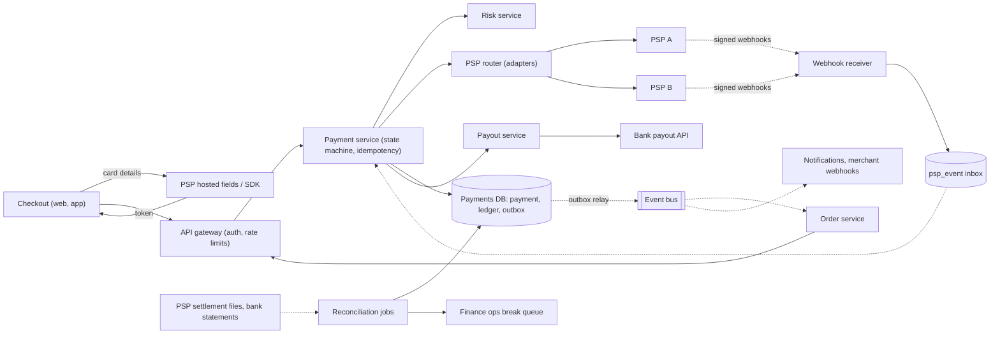
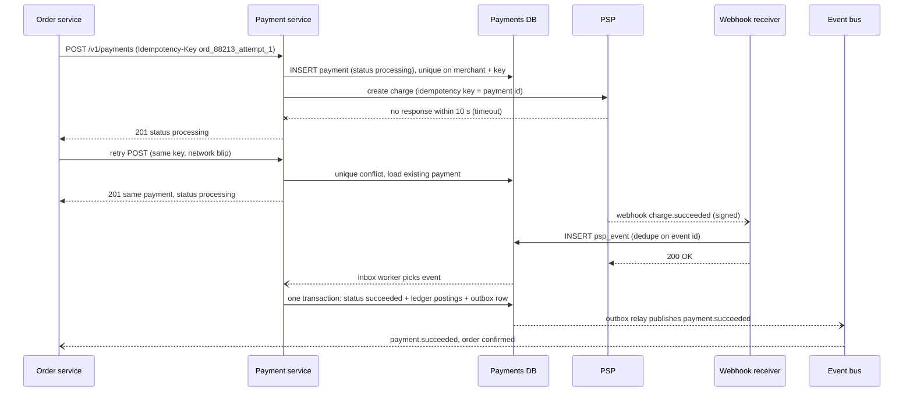
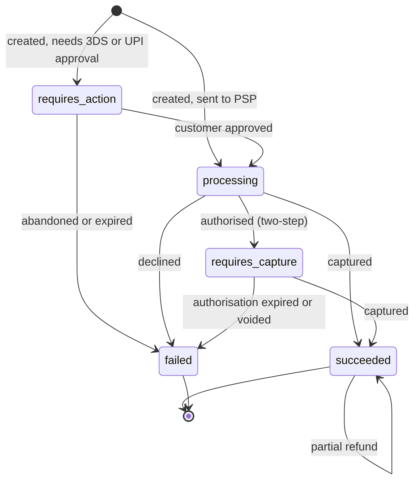

A payment system looks simple from the outside: the customer taps "Pay ₹1,499", money moves, the order is confirmed. Underneath, it is one of the hardest systems to get right, because the failure modes cost real money. A retry that charges twice, a webhook that is processed twice, a timeout that leaves you unsure whether money moved, a rounding bug that loses ₹0.01 on a million orders. This case study designs the payment platform for a mid-sized Indian marketplace that accepts cards, UPI and net banking through external payment service providers, pays out to sellers, and must be able to prove, to the paisa, where every rupee went.

## Learning objectives

By the end of this lesson you will be able to:

1. Separate what a payment platform does (orchestration, ledger, payouts, reconciliation) from what a payment service provider does (talking to card networks and banks).
2. Estimate payment throughput, ledger write volume and storage with explicit arithmetic, and see why throughput is rarely the hard part.
3. Design an idempotent payment API and explain why a retry must never create a second charge.
4. Model money with a double-entry ledger that enforces "debits equal credits" on every transaction, and implement posting in C#.
5. Handle the unknown outcome: a provider call that times out, webhooks that arrive late, twice or out of order.
6. Design daily reconciliation between your ledger, the provider's settlement report and the bank statement.
7. Explain why "exactly once" is an illusion built from at-least-once delivery plus idempotency, and keep PCI DSS scope small with tokenisation and hosted payment pages.

## Prerequisites

- [Transactions and ACID](#/lesson/m09-transactions-acid): the ledger relies on atomic multi-row writes.
- [Idempotency keys](#/lesson/m10-idempotency): safe retries for unsafe operations.
- [Webhooks](#/lesson/m10-webhooks): signatures, retries and replay protection.
- [Transactional outbox](#/lesson/m12-outbox): publishing events without dual writes.
- [Idempotent consumers](#/lesson/m12-idempotent-consumers): processing a message twice without doing the work twice.

## Explain it like I'm a beginner

Picture a busy wholesale market in Delhi where a trusted middleman (that is us, the marketplace) collects money from buyers and pays the shopkeepers.

- The middleman never handles cash directly. He uses a **bank's collection counter** (the payment service provider, PSP) that knows how to talk to every card company and every UPI app.
- He keeps a **bound ledger book** in which every movement is written twice: "₹1,499 came in from buyer Asha" on one side and "₹1,469.02 now owed to shop Metro Fresh, ₹29.98 is our 2 % commission" on the other. The two sides must always add up to the same number. If they don't, someone made a mistake, and it is caught immediately (**double-entry bookkeeping**).
- He never erases a line in the book. If something was wrong, he writes a new correcting line (**append-only ledger, reversal entries**).
- Every buyer's request carries a **token number**. If the buyer's phone loses signal and they tap "Pay" again with the same token number, the clerk recognises it and says "already done" instead of charging twice (**idempotency key**).
- Sometimes the bank counter is slow, and the clerk walks away not knowing whether the payment went through. He doesn't guess. He marks the slip **"pending"** and waits for the bank's messenger to bring a signed note later (**webhook**), or he phones the bank to ask (**status query**).
- Every evening, he compares his book with the bank's statement, line by line. Anything that doesn't match goes on a list for a person to investigate (**reconciliation**).
- He never writes down a buyer's full card number. The bank gives him a **stand-in code** for it (**token**), so a thief who steals his book can't use it (**PCI scope reduction**).

## Requirements

### Functional requirements

1. **Accept payments** for orders: cards, UPI and net banking, through one or more PSPs. Support one-step payments (authorise and capture together) and two-step card payments (authorise at checkout, capture when the seller ships).
2. **Idempotent create**: a client retry with the same idempotency key returns the original payment, never a second charge.
3. **Payment status**: clients can query status; merchants (our internal order service and, later, external sellers) receive status events.
4. **Refunds**: full and partial, never exceeding what was captured.
5. **Ledger**: every money movement is recorded as a balanced double-entry transaction, with balances for customers' wallets, seller payables, PSP clearing, fees and refunds.
6. **Payouts** to sellers on a schedule (for example T+2 days), net of commission and refunds.
7. **Reconciliation**: daily matching of the ledger against PSP settlement reports and bank statements, with a queue of breaks for the finance operations team.
8. **Webhooks in**: process PSP status callbacks (authorised, captured, failed, refunded, disputed).

### Out of scope

- Being a PSP ourselves (connecting to card networks, being a UPI payment service provider bank). We integrate PSPs.
- Fraud scoring models (we call a risk service and act on its decision).
- Tax invoicing and GST filing (finance systems consume ledger exports).
- Chargeback dispute workflows beyond recording them in the ledger.

### Non-functional requirements

| Requirement | Target |
|---|---|
| Correctness | No double charges, no lost money; ledger always balances (sum of debits = sum of credits) |
| Durability | A payment acknowledged as succeeded is never lost (synchronous replication, RPO ≈ 0 for the ledger) |
| Availability | 99.95 % for the create-payment API; brief unavailability is better than incorrect money movement |
| Latency | p99 under 2 s for our own processing, excluding the PSP and the customer's 3-D Secure or UPI approval |
| Auditability | Every change traceable to who, what and when; ledger entries immutable; retained for many years (check your regulator; several years is typical for financial records) |
| Security | Card numbers never touch our servers; PCI DSS scope kept to the smallest possible questionnaire |

Notice the trade-off already written into the targets: when the system has to choose between being available and being correct, a payment system chooses correct. A checkout that says "please try again in a minute" loses a sale; a checkout that charges twice loses a customer and creates a support ticket, a refund, and possibly a regulatory complaint.

## Capacity estimation

All figures are **estimates** for illustration, for a marketplace with 5 M orders on a normal day and a few Diwali-season festive sale days a year.

### Payment throughput

- Normal day: 5 M orders, and about 1.3 payment attempts per order (retries after declines, switching from card to UPI) ≈ **6.5 M attempts/day**.
- Average: 6.5 M ÷ 86,400 s ≈ **75 attempts/s**.
- Daily peak (evening): ×4 ≈ **300/s**.
- Festive sale: assume 6× a normal day's volume, concentrated in the first hours. 39 M attempts/day with, say, 20 % in the first two hours: 7.8 M ÷ 7,200 s ≈ **1,100/s**, and design for **2,000/s** of headroom.

2,000 short payment transactions per second (each a handful of row writes) is within what a single well-tuned PostgreSQL primary can sustain on good hardware (an estimate; measure your own with a load test). **Throughput is not the hard part of payments. Correctness is.** The hard part at peak is hot rows (see deep dive 5) and the PSPs' own limits.

### Ledger writes

Each successful payment produces several postings (lines in the ledger):

- Capture: debit PSP clearing ₹1,499; credit seller payable ₹1,469.02; credit commission revenue ₹29.98 (2 %) → **3 postings**.
- Settlement from the PSP (later, in a batch): debit bank, debit PSP fees expense, credit PSP clearing → about **3 postings**, but per settlement batch, not per payment, if you post aggregated.
- Payout to the seller (batched per seller per day): 2 postings per seller.

So roughly **4 postings per successful payment** on average. 5 M successful payments × 4 = **20 M postings/day** ≈ 230/s average. At the festive peak only the capture postings happen in real time (settlement and payout postings are batch jobs that run off-peak): about 77 % of attempts succeed (5 M of 6.5 M), so 2,000 attempts/s × 0.77 × 3 ≈ **4,600 posting inserts/s** at the design headroom, plus the `ledger_txn` and `payment` rows.

### Storage

- Payment rows: 6.5 M/day × ~1 KB (ids, amounts, status history, PSP references, metadata) ≈ **6.5 GB/day** ≈ 2.4 TB/year.
- Postings: 20 M/day × ~150 B (transaction id, account id, side, amount, currency) plus indexes (~2×) ≈ **6 GB/day** ≈ 2.2 TB/year.
- Over a 7-year retention: roughly **30 TB** for payments and ledger together, before compression. Old years move to cheaper storage and stay queryable for audits.
- Webhook events: 6.5 M payments × ~3 events × ~2 KB raw body ≈ **40 GB/day**; keep raw bodies 90 days for disputes, then archive.

### Reconciliation

- Settlement files: one per PSP per day, with one line per captured payment or refund: ~5.5 M lines/day. Matching 5.5 M lines against 5.5 M ledger rows is a join on the PSP reference: a batch job that takes minutes, not hours.

### What the numbers tell us

1. Average load (75/s) is modest; even the sale peak (2,000/s) fits a single primary database for writes. **Don't shard the ledger on day one.**
2. **Hot accounts** (one PSP clearing account touched by every payment) will cause lock contention long before raw throughput becomes a problem.
3. Storage grows steadily and must be kept for years: partition by time from the start.
4. The real cost driver is not infrastructure but **PSP fees** (often around 2 % for cards, a zero regulated merchant discount rate for most UPI payments in India at the time of writing, though gateways may still charge a platform fee; check current rules), so routing and reconciliation directly affect profit.

## API design

### Create a payment

```http
POST /v1/payments
Authorization: Bearer <service token for "order-service">
Idempotency-Key: ord_88213_attempt_1

{ "orderId": "ord_88213", "amountMinor": 149900, "currency": "INR",
  "method": { "type": "card", "token": "tok_7Hq..." },
  "captureMode": "automatic", "customerId": "cus_4410",
  "returnUrl": "https://shop.example/checkout/return" }

201 Created
{ "id": "pay_9c1e...", "status": "requires_action",
  "nextAction": { "type": "redirect", "url": "https://psp.example/3ds/..." } }
```

Design choices:

- **Amounts in minor units as integers** (`149900` paise = ₹1,499.00). Never floating point: `0.1 + 0.2` is not `0.3` in binary floating point, and a ledger must be exact. In C#, use `long` for minor units (or `decimal` for intermediate calculations such as fee percentages, rounded with an explicit rule).
- **`Idempotency-Key` is required.** The server stores (merchant, key) → request fingerprint and result. A retry with the same key and same body returns the same payment. The same key with a different body (a different amount) returns `422 Unprocessable Content`, because it is a client bug, not a retry.
- **`token`, not a card number.** The card details went from the customer's browser straight to the PSP's hosted fields; we only ever see a token.
- **`status` is a state machine**: `requires_action` (3-D Secure or UPI approval pending), `processing` (sent to the PSP, outcome not yet known), `succeeded`, `failed`, plus `requires_capture` for two-step card payments.
- **`201`** when the payment is created and we know the next step; the final outcome often arrives later through a webhook, so clients must handle `processing`.

### Other endpoints

- `GET /v1/payments/{id}`: current status, amount captured and refunded.
- `POST /v1/payments/{id}/capture` with an optional amount (≤ authorised amount), idempotent.
- `POST /v1/payments/{id}/refunds` with `Idempotency-Key` and `amountMinor`: rejected with `409` if total refunds would exceed captured.
- `POST /webhooks/psp/{pspName}`: inbound PSP events, verified by signature and timestamp.
- Outbound events to merchants (`payment.succeeded`, `payment.failed`, `refund.succeeded`), signed with HMAC and retried with backoff, published through an outbox.
- `GET /v1/ledger/accounts/{id}/balance` and `/entries?cursor=...` for finance tools (internal only).

### Error contract

Errors use RFC 9457 problem details with a stable `code` field (`card_declined`, `insufficient_funds`, `idempotency_conflict`, `amount_exceeds_capturable`). Declines are **not** HTTP errors from our point of view: a declined card is a successful API call whose payment has `status: failed` and a `declineCode`. That distinction matters for retries: clients retry `5xx` and timeouts with the same idempotency key; they never automatically retry a decline.

## Data model

```sql
CREATE TABLE payment (
    payment_id       text        PRIMARY KEY,           -- 'pay_9c1e...'
    merchant_id      text        NOT NULL,
    idempotency_key  text        NOT NULL,
    request_hash     bytea       NOT NULL,              -- fingerprint of the create body
    order_id         text        NOT NULL,
    amount_minor     bigint      NOT NULL CHECK (amount_minor > 0),
    currency         char(3)     NOT NULL,
    status           text        NOT NULL CHECK (status IN
                     ('requires_action','processing','requires_capture','succeeded','failed')),
    captured_minor   bigint      NOT NULL DEFAULT 0,
    refunded_minor   bigint      NOT NULL DEFAULT 0 CHECK (refunded_minor <= captured_minor),
    psp              text,
    psp_reference    text,
    version          int         NOT NULL DEFAULT 1,    -- optimistic concurrency
    created_at       timestamptz NOT NULL DEFAULT now(),
    updated_at       timestamptz NOT NULL DEFAULT now(),
    UNIQUE (merchant_id, idempotency_key),
    UNIQUE (psp, psp_reference)
);

CREATE TABLE ledger_account (
    account_id      text    PRIMARY KEY,                 -- 'psp_clearing:pspA', 'seller_payable:s_301'
    account_type    text    NOT NULL CHECK (account_type IN ('asset','liability','revenue','expense')),
    currency        char(3) NOT NULL,
    may_go_negative boolean NOT NULL DEFAULT true
);

CREATE TABLE ledger_txn (                                 -- one business event
    txn_id      text        PRIMARY KEY,                  -- deterministic: 'capture:pay_9c1e...'
    kind        text        NOT NULL,                     -- capture, refund, settlement, payout, reversal
    currency    char(3)     NOT NULL,
    reverses    text        REFERENCES ledger_txn (txn_id),
    posted_at   timestamptz NOT NULL DEFAULT now()
);

CREATE TABLE ledger_posting (                             -- the lines; append-only
    txn_id       text    NOT NULL REFERENCES ledger_txn (txn_id),
    line_no      smallint NOT NULL,
    account_id   text    NOT NULL REFERENCES ledger_account (account_id),
    side         char(1) NOT NULL CHECK (side IN ('D','C')),
    amount_minor bigint  NOT NULL CHECK (amount_minor > 0),
    PRIMARY KEY (txn_id, line_no)
);
CREATE INDEX ON ledger_posting (account_id, txn_id);

CREATE TABLE psp_event (                                  -- inbox for webhooks
    psp         text        NOT NULL,
    event_id    text        NOT NULL,
    payload     jsonb       NOT NULL,
    received_at timestamptz NOT NULL DEFAULT now(),
    processed_at timestamptz,
    PRIMARY KEY (psp, event_id)
);
```

Design notes:

- **Two layers.** `payment` is the operational state machine (mutable: status changes). The ledger (`ledger_txn` + `ledger_posting`) is the financial truth (immutable: rows are only ever inserted). Mixing the two leads to "the status says refunded but nobody can say where the money went".
- **Deterministic transaction ids** (`capture:pay_9c1e`, `refund:rf_221`) make posting idempotent: a second attempt to post the same capture hits the primary key and is recognised as already done.
- **Positive amounts plus a side column** (`D` or `C`) keep the invariant easy to read and check: per `txn_id`, the sum of `D` amounts equals the sum of `C` amounts. Some ledgers use signed amounts instead (debit positive, credit negative, each transaction sums to zero); both work if you pick one and enforce it.
- **Enforce the invariant in the database too**, not just in application code: a `CONSTRAINT TRIGGER ... DEFERRABLE INITIALLY DEFERRED` that checks balance per transaction at commit, plus `REVOKE UPDATE, DELETE ON ledger_posting` from the application role so history can't be rewritten. Corrections are new transactions that reverse the old one (`reverses`).
- **`UNIQUE (merchant_id, idempotency_key)`** implements the idempotent create. **`UNIQUE (psp, psp_reference)`** guarantees one payment per PSP charge, which reconciliation relies on.
- **`psp_event` is an inbox**: the primary key on (psp, event_id) deduplicates webhooks that the PSP sends more than once.
- **Balances** are derived from postings. For hot reads, keep a `ledger_balance` table updated in the same transaction as the postings, or snapshots per day plus the postings since; see deep dive 5 for why a single balance row can become a bottleneck.
- **Partition** `ledger_posting` and `payment` by month on `posted_at` / `created_at` once they reach hundreds of millions of rows (unique keys must then include the partition key, so the deterministic `txn_id` lookup goes through `ledger_txn`).

## High-level architecture



Arrow by arrow:

- **Checkout → PSP hosted fields → token**: the card number is typed into a PSP-hosted iframe or SDK screen, so it travels from the customer's device directly to the PSP. We receive only a token. For UPI, the app shows a UPI intent or collect request handled by the PSP; we never see a UPI PIN.
- **Checkout / Order service → Gateway → Payment service**: authenticated, rate-limited calls to create, capture and refund. The payment service owns the payment state machine and the idempotency check.
- **Payment service → Risk service**: a synchronous fraud check with a tight timeout (for example 300 ms). If risk is down, a fallback rule decides (allow small amounts, step up to 3-D Secure, or block large ones).
- **Payment service → PSP router → PSP A / PSP B**: adapters translate our model into each PSP's API. The router chooses a PSP by method, success rate and cost, and fails over only when that is safe (see deep dive 3).
- **Payment service → Payments DB**: one PostgreSQL database holds `payment`, the ledger and the outbox, so a status change, its ledger postings and its outgoing event commit in **one local transaction**. This is the most important decision in the diagram.
- **PSPs ⇢ Webhook receiver → inbox ⇢ Payment service**: callbacks are verified, stored raw in `psp_event` (deduplicated by event id) and acknowledged quickly with `200`. Processing happens asynchronously from the inbox.
- **Payments DB ⇢ outbox relay ⇢ Event bus ⇢ Order service, notifications**: `payment.succeeded` is published after commit, at least once. Consumers deduplicate by event id.
- **Settlement files ⇢ Reconciliation jobs → DB and break queue**: daily files from each PSP and statements from the bank are matched against the ledger. Matches post settlement entries; mismatches become tickets for finance operations.
- **Payment service → Payout service → Bank**: seller payouts are calculated from `seller_payable` balances and sent through the bank's payout API, with the same idempotency discipline.

### The unknown outcome, end to end



The PSP call timed out, which is the dangerous moment: the charge may or may not have happened. The payment service does **not** mark the payment failed (the customer may have been charged) and does **not** retry blindly on another PSP (that could charge twice). It records `processing` and returns that status. The order service's retry with the same idempotency key finds the existing row and gets the same answer. Minutes later, the PSP's webhook settles the question. If no webhook arrives within, say, 15 minutes, a sweeper job calls the PSP's status API for every payment stuck in `processing`. The final transition writes status, ledger postings and the outbox row in one transaction, so it is impossible to have a succeeded payment without its ledger entries or without its event.

### Payment states



Refunds don't change the payment's main state; they are separate objects with their own idempotency keys, and the payment's `refunded_minor` counter is checked against `captured_minor`. A `failed` payment must never later become `succeeded` without a human looking at it; if the PSP reports a capture for a payment we marked failed, that is a reconciliation break, not a normal transition.

## Deep dives

### Deep dive 1: the double-entry ledger

**Why two entries?** Money is never created or destroyed inside the system; it only moves between accounts. Every transaction says "this much left these accounts and arrived in those". Writing both sides and checking they are equal catches whole classes of bugs at write time: a missing fee line, a refund posted to the wrong side, a currency conversion that lost a paisa.

**Accounts and their normal side.** Assets (money we hold or are owed, such as PSP clearing or the bank account) and expenses increase with debits. Liabilities (money we owe, such as seller payables or customer wallet balances) and revenue increase with credits. A sale of ₹1,499 with 2 % commission, captured through PSP A:

| Account | Type | Debit | Credit |
|---|---|---|---|
| `psp_clearing:pspA` | Asset (PSP owes us) | 149,900 | |
| `seller_payable:s_301` | Liability (we owe seller) | | 146,902 |
| `revenue:commission` | Revenue | | 2,998 |

Total debits 149,900 = total credits 149,900. Three days later the PSP settles, keeping its own 2 % fee:

| Account | Debit | Credit |
|---|---|---|
| `bank:current_account` | 146,902 | |
| `expense:psp_fees` | 2,998 | |
| `psp_clearing:pspA` | | 149,900 |

After settlement, `psp_clearing:pspA` is back to zero for this payment. **A clearing account that doesn't return to zero is a reconciliation signal**: money we expected from the PSP never arrived.

**Rules we enforce:**

1. Every transaction has at least two postings and debits equal credits.
2. All postings in a transaction share one currency. Currency conversion is two transactions linked through an FX account.
3. Amounts are positive integers in minor units; direction comes from the side.
4. Postings are immutable. Mistakes are fixed with reversal transactions.
5. Some accounts may not go negative (a customer wallet), and that check must happen under a lock, in the same transaction as the posting.
6. Posting is idempotent through a deterministic transaction id.

**Rounding.** 2 % of ₹1,499.00 is ₹29.98 exactly, but 2 % of ₹999.99 is ₹19.9998. Pick a rule (round half to even, or always round the fee down in the seller's favour), put it in one function, and make the seller's share "amount minus fee" so the two always add up exactly. Computing both shares independently with rounding is how ledgers lose paise.

### Deep dive 2: idempotency at every hop

A payment flows across at least four hops: client → our API, our API → PSP, PSP → our webhook, our outbox → consumers. Each hop can deliver twice.

| Hop | What can repeat | Defence |
|---|---|---|
| Client → API | Retry after a timeout or app restart | `Idempotency-Key`, `UNIQUE (merchant_id, idempotency_key)`, request hash to detect misuse |
| API → PSP | Our retry after a timeout | Pass our payment id as the PSP's idempotency key (most PSP APIs accept one) |
| PSP → webhook | PSP retries until it sees `200`; may send events twice | Inbox table keyed on (psp, event_id) |
| Webhook → state | Two different events for the same fact (`authorized` and `captured`) | State machine ignores stale transitions |
| State → ledger | Worker crash after posting, before marking the event processed | Deterministic `txn_id`, primary key collision means "already posted" |
| Outbox → consumers | Relay crash after publish, before marking sent | Consumers dedupe by event id |

**Storing the idempotent response.** Two designs exist. (a) Store the full HTTP response for the key and replay it byte for byte. (b) Make the resource itself the stored result: the key maps to a payment id, and a retry returns the payment's **current** state. Design (b) is simpler and usually better for payments, because a retry minutes later should see `succeeded`, not the stale `processing` from the first response.

**Concurrent duplicates.** Two identical requests arriving 5 ms apart both pass a naive "does the key exist?" check. Inserting the row with the unique constraint first, before calling the PSP, makes the database the referee: one insert wins, the other gets a conflict and waits for or reads the winner's result.

**Key expiry.** Keep keys at least as long as clients may retry (24 hours to a few days). Expiring after 10 minutes reopens the double-charge window for a mobile app that retries on next launch.

### Deep dive 3: PSP integration and routing

**Adapters.** Each PSP has its own API, status names, error codes and webhook format. An adapter per PSP translates them into our model (`Succeeded`, `Declined(code)`, `Pending`, `Unknown`). Keep the raw PSP response stored next to the translated one; when a PSP adds a new status, you'll need it.

**Timeouts are not failures.** Classify every PSP outcome:

- **Definite success** (`captured`): transition and post.
- **Definite failure** (`declined`, `invalid_card`): transition to failed, no retry.
- **Unknown** (timeout, connection reset after sending, `5xx` from the PSP): stay in `processing`. Resolve by webhook or status query. Retry only the **same** PSP with the **same** idempotency key.

**Failover is dangerous.** If PSP A times out and you immediately send the charge to PSP B, the customer may be charged by both. Fail over only when you know PSP A did not process the charge: a connection refused before sending, a circuit breaker already open, or PSP A's explicit "not processed" error. For UPI, where the customer approves in their own app, failover mid-payment isn't possible at all; you can only route the next attempt differently.

**Routing.** A router picks a PSP per attempt using rules: payment method support, recent success rates per card network and bank (tracked per 5-minute window), cost, and contracts. Smart routing can lift success rates noticeably, but every rule must be explainable to finance, because it changes which settlement file the money appears in.

**India-specific notes** (general, check current regulations): UPI payments often end in a pending state that resolves later, so status queries and webhooks are routine, not exceptional. Card-on-file tokenisation rules mean merchants don't store card numbers for saved cards; network tokens or PSP tokens are used instead. Recurring payments use mandates (e-mandates for cards, UPI AutoPay), which add a registration step and pre-debit notifications.

### Deep dive 4: webhooks that arrive late, twice, or out of order

A PSP may send `payment.captured` before `payment.authorized`, send the same event three times, or send an event an hour late after an outage on its side. The receiver must:

1. **Verify** the signature: HMAC-SHA256 over the timestamp and raw body with a shared secret (or the PSP's public key), compared in constant time. Reject timestamps older than 5 minutes to stop replays.
2. **Store first, process later**: insert into `psp_event` with `ON CONFLICT DO NOTHING`, return `200` within a second or two. Doing slow work inline causes PSP timeouts and more retries.
3. **Process through the state machine**: each event is applied only if it moves the payment forward. A late `authorized` after `captured` is stale and ignored. A `captured` for a payment we marked `failed` is flagged for review, because money moved that we thought didn't.
4. **Don't trust the payload blindly**: for high-value events, call the PSP's API to fetch the authoritative status before acting. That also protects against a leaked webhook secret.

Exercise 3 implements the state machine.

### Deep dive 5: hot accounts

Every capture debits the same `psp_clearing:pspA` account. If the ledger keeps a running balance row per account and updates it in every transaction (`UPDATE ledger_balance SET balance = balance + ...`), every payment takes a row lock on the same row. At 2,000 payments/s, transactions queue behind that lock and latency climbs; this is a classic "what breaks first" answer.

Options, from simplest:

1. **Don't maintain a running balance for accounts that don't need a real-time check.** PSP clearing and revenue don't have a "may not go negative" rule, so their balances can be computed from postings (or from a daily snapshot plus the day's postings) when finance asks. Only accounts with a rule (customer wallets) need a locked balance, and those are naturally spread across millions of customers.
2. **Sub-accounts (sharded balances)**: split `psp_clearing:pspA` into 16 buckets and post to `bucket = hash(payment_id) % 16`. Its balance is the sum of buckets. Contention drops by 16×.
3. **Batch postings**: aggregate captures per minute into one ledger transaction for the clearing account side, while keeping per-payment detail in a sub-ledger. Fewer writes, but posting is no longer immediate.

**Lock ordering.** A transaction that debits a wallet and credits a seller payable locks two balance rows. Two concurrent transactions locking the same rows in different orders can deadlock. Always lock accounts in a consistent order (for example, sorted by account id): `SELECT ... FROM ledger_balance WHERE account_id = ANY($1) ORDER BY account_id FOR UPDATE`.

### Deep dive 6: reconciliation

Reconciliation compares three independent records:

1. **Our ledger and payments**: what we believe happened.
2. **The PSP's settlement report**: what the PSP says it captured, refunded, charged as fees and will pay us.
3. **The bank statement**: what actually arrived in our account.

The daily job:

1. Load the settlement file into a staging table (validate row counts and file checksums first; a truncated file looks like thousands of missing payments).
2. Match on `psp_reference`. Classify each reference: **matched**, **missing in settlement** (we think it succeeded; PSP didn't settle it, perhaps settled tomorrow), **missing internally** (PSP settled money for a payment we don't have as succeeded; the most dangerous), **amount mismatch**, **duplicate settlement line**.
3. Post settlement ledger entries for matched lines (bank, fees, clearing).
4. Compare the PSP's total payout with the bank statement credit for that day.
5. Unmatched items roll over for a few days (timing differences around the cut-off are normal); items older than the tolerance become **breaks** for the finance operations team, with an age and an amount.

**Why missing-internally matters most**: it usually means our state machine lost a webhook or marked a payment failed after the customer was charged. The customer is likely already complaining. The fix is either to recover the payment (mark succeeded, fulfil the order) or refund it, and then fix the bug.

Exercise 5 implements the matcher in C#.

### Deep dive 7: the exactly-once illusion

There is no exactly-once delivery across a network between independent systems. A request can be lost, or its response can be lost, and the sender can't tell the difference. What payment systems build instead is **effectively once**:

- **At-least-once delivery** at every hop (retries, outbox, webhook redelivery) so nothing is lost.
- **Idempotent processing** at every receiver (unique keys, deterministic ids, state machines that ignore stale moves) so repeats are harmless.
- **Atomic local transactions** that bundle state change + ledger + outbox, so there is no window where one happened without the others.
- **Reconciliation** as the final safety net, because some failures (a PSP bug, a lost webhook plus a failed status query) slip through everything else.

Distributed transactions with PSPs (two-phase commit) are not an option: PSPs don't participate in your transactions, and you wouldn't want their latency holding your locks. See [distributed transactions](#/lesson/m13-distributed-transactions) and [delivery guarantees](#/lesson/m12-delivery-guarantees).

### Deep dive 8: the core in ASP.NET Core

The code below is the heart of the design: a ledger that rejects unbalanced or currency-mixed transactions, enforces "may not go negative" under a lock, and is idempotent per transaction id; a payment service that treats timeouts as unknown; and a webhook verifier and processor. The lock in `Ledger` stands in for `SELECT ... FOR UPDATE` on balance rows inside a PostgreSQL transaction.

```csharp file=Payments/Ledger.cs
namespace Payments;

public enum AccountType { Asset, Liability, Revenue, Expense }
public enum Side { Debit, Credit }

public sealed record Account(string Id, AccountType Type, string Currency, bool MayGoNegative = true)
{
    public bool IsDebitNormal => Type is AccountType.Asset or AccountType.Expense;
}

public sealed record Posting(string AccountId, Side Side, long AmountMinor);

public sealed record JournalEntry(string TransactionId, string Currency, string Description,
    IReadOnlyList<Posting> Postings, DateTimeOffset PostedAt);

public enum PostOutcome { Posted, AlreadyPosted }

public sealed class LedgerException(string message) : Exception(message);

/// <summary>
/// Append-only double-entry ledger. Balances are kept in each account's normal direction
/// (debit-normal for assets and expenses, credit-normal for liabilities and revenue).
/// </summary>
public sealed class Ledger(TimeProvider clock)
{
    private readonly Lock _gate = new();
    private readonly Dictionary<string, Account> _accounts = new();
    private readonly Dictionary<string, long> _balances = new();
    private readonly Dictionary<string, JournalEntry> _byTransactionId = new();
    private readonly List<JournalEntry> _journal = new();

    public bool TryOpen(Account account)
    {
        lock (_gate)
        {
            if (!_accounts.TryAdd(account.Id, account)) return false;
            _balances[account.Id] = 0;
            return true;
        }
    }

    public long Balance(string accountId)
    {
        lock (_gate)
            return _balances.TryGetValue(accountId, out var b) ? b : throw new LedgerException($"Unknown account {accountId}.");
    }

    public IReadOnlyList<JournalEntry> Journal
    {
        get { lock (_gate) return _journal.ToList(); }
    }

    public PostOutcome Post(string transactionId, string currency, string description, IReadOnlyList<Posting> postings)
    {
        // 1. Invariants that need no shared state: check before taking the lock.
        if (postings.Count < 2) throw new LedgerException("A transaction needs at least two postings.");
        long debits = 0, credits = 0;
        foreach (var p in postings)
        {
            if (p.AmountMinor <= 0) throw new LedgerException("Amounts must be positive; Side gives the direction.");
            checked
            {
                if (p.Side == Side.Debit) debits += p.AmountMinor; else credits += p.AmountMinor;
            }
        }
        if (debits != credits) throw new LedgerException($"Unbalanced transaction: debits {debits} != credits {credits}.");

        lock (_gate)
        {
            // 2. Idempotency: the same id with the same content is a harmless repeat.
            if (_byTransactionId.TryGetValue(transactionId, out var existing))
            {
                if (existing.Currency != currency || !existing.Postings.SequenceEqual(postings))
                    throw new LedgerException($"Transaction {transactionId} was already posted with different content.");
                return PostOutcome.AlreadyPosted;
            }

            // 3. Accounts exist, currencies match, and no protected account goes negative.
            var deltas = new Dictionary<string, long>();
            foreach (var p in postings)
            {
                if (!_accounts.TryGetValue(p.AccountId, out var account))
                    throw new LedgerException($"Unknown account {p.AccountId}.");
                if (account.Currency != currency)
                    throw new LedgerException($"Account {account.Id} is in {account.Currency}, transaction is in {currency}.");
                var increases = (p.Side == Side.Debit) == account.IsDebitNormal;
                deltas[p.AccountId] = deltas.GetValueOrDefault(p.AccountId) + (increases ? p.AmountMinor : -p.AmountMinor);
            }
            foreach (var (id, delta) in deltas)
                if (!_accounts[id].MayGoNegative && _balances[id] + delta < 0)
                    throw new LedgerException($"Insufficient balance in {id}.");

            // 4. Apply all or nothing (in PostgreSQL: one transaction).
            foreach (var (id, delta) in deltas) _balances[id] += delta;
            var entry = new JournalEntry(transactionId, currency, description, postings.ToList(), clock.GetUtcNow());
            _byTransactionId[transactionId] = entry;
            _journal.Add(entry);
            return PostOutcome.Posted;
        }
    }

    /// <summary>Sum of all debits minus all credits ever posted. Always zero in a correct ledger.</summary>
    public long TrialBalance()
    {
        lock (_gate)
            return _journal.SelectMany(e => e.Postings).Sum(p => p.Side == Side.Debit ? p.AmountMinor : -p.AmountMinor);
    }
}

public static class LedgerAccounts
{
    public const string PspClearing = "psp_clearing:pspA";
    public const string CommissionRevenue = "revenue:commission";
    public static string SellerPayable(string sellerId) => $"seller_payable:{sellerId}";
}
```

```csharp file=Payments/PaymentService.cs
using System.Collections.Concurrent;
using Microsoft.Extensions.Logging;

namespace Payments;

public enum PaymentStatus { Processing, Succeeded, Failed }

public sealed class Payment
{
    public required string Id { get; init; }
    public required string SellerId { get; init; }
    public required long AmountMinor { get; init; }
    public required string Currency { get; init; }
    public required string RequestHash { get; init; }
    public PaymentStatus Status { get; set; } = PaymentStatus.Processing;
    public string? PspReference { get; set; }
    public string? DeclineCode { get; set; }
}

public enum PspOutcome { Succeeded, Declined, Pending }
public sealed record PspChargeRequest(string IdempotencyKey, long AmountMinor, string Currency, string MethodToken);
public sealed record PspChargeResult(PspOutcome Outcome, string PspReference, string? DeclineCode = null);

public interface IPspClient
{
    Task<PspChargeResult> ChargeAsync(PspChargeRequest request, CancellationToken ct);
}

public interface IPaymentRepository
{
    /// <summary>Insert if the id is new; otherwise return the existing payment (UNIQUE constraint in SQL).</summary>
    Payment AddOrGet(Payment payment, out bool added);
    Payment? Find(string paymentId);
}

public sealed class InMemoryPaymentRepository : IPaymentRepository
{
    private readonly ConcurrentDictionary<string, Payment> _payments = new();

    public Payment AddOrGet(Payment payment, out bool added)
    {
        var stored = _payments.GetOrAdd(payment.Id, payment);
        added = ReferenceEquals(stored, payment);
        return stored;
    }

    public Payment? Find(string paymentId) => _payments.GetValueOrDefault(paymentId);
}

public sealed class IdempotencyConflictException(string key)
    : Exception($"Idempotency key {key} was reused with a different request body.");

public sealed class PaymentService(IPaymentRepository repo, IPspClient psp, Ledger ledger, ILogger<PaymentService> log)
{
    public const decimal CommissionRate = 0.02m;

    public async Task<Payment> CreateAsync(string paymentId, string idempotencyKey, string requestHash, string sellerId,
        long amountMinor, string currency, string methodToken, CancellationToken ct)
    {
        var candidate = new Payment
        {
            Id = paymentId, SellerId = sellerId, AmountMinor = amountMinor, Currency = currency, RequestHash = requestHash
        };
        var payment = repo.AddOrGet(candidate, out var added);
        if (!added)
        {
            if (payment.RequestHash != requestHash) throw new IdempotencyConflictException(idempotencyKey);
            return payment; // a retry: return the current state, never charge again
        }

        try
        {
            using var timeout = CancellationTokenSource.CreateLinkedTokenSource(ct);
            timeout.CancelAfter(TimeSpan.FromSeconds(10));
            // Our payment id doubles as the PSP idempotency key, so our own retries can't double charge.
            var result = await psp.ChargeAsync(new PspChargeRequest(paymentId, amountMinor, currency, methodToken), timeout.Token);
            ApplyOutcome(paymentId, result.Outcome, result.PspReference, result.DeclineCode);
        }
        catch (Exception ex) when (!ct.IsCancellationRequested &&
                                   ex is OperationCanceledException or TimeoutException or HttpRequestException)
        {
            // Unknown outcome: the charge may have happened. Stay in Processing; a webhook or status query resolves it.
            log.LogWarning(ex, "PSP outcome unknown for {PaymentId}; left in Processing", paymentId);
        }
        return payment;
    }

    /// <summary>Moves a payment forward exactly once. Safe to call again with the same outcome.</summary>
    public bool ApplyOutcome(string paymentId, PspOutcome outcome, string pspReference, string? declineCode = null)
    {
        var payment = repo.Find(paymentId) ?? throw new KeyNotFoundException(paymentId);
        // The lock stands in for SELECT ... FOR UPDATE on the payment row (or a conditional
        // UPDATE ... WHERE status = 'processing'): the status check and the transition must be one atomic step,
        // or a webhook and the PSP response arriving together could both post the capture.
        lock (payment)
        {
            if (payment.Status != PaymentStatus.Processing || outcome == PspOutcome.Pending) return false;
            if (outcome == PspOutcome.Declined)
            {
                payment.Status = PaymentStatus.Failed;
                payment.DeclineCode = declineCode;
                return true;
            }

            var commission = (long)Math.Round(payment.AmountMinor * CommissionRate, MidpointRounding.ToEven);
            var postings = new List<Posting>
            {
                new(LedgerAccounts.PspClearing, Side.Debit, payment.AmountMinor),
                new(LedgerAccounts.SellerPayable(payment.SellerId), Side.Credit, payment.AmountMinor - commission),
            };
            if (commission > 0) postings.Add(new Posting(LedgerAccounts.CommissionRevenue, Side.Credit, commission));

            ledger.TryOpen(new Account(LedgerAccounts.SellerPayable(payment.SellerId), AccountType.Liability, payment.Currency));
            // Production: status UPDATE, ledger INSERTs and the outbox row commit in ONE database transaction.
            ledger.Post($"capture:{payment.Id}", payment.Currency, $"Capture {payment.Id}", postings);
            payment.Status = PaymentStatus.Succeeded;
            payment.PspReference = pspReference;
            return true;
        }
    }
}
```

```csharp file=Payments/Webhooks.cs
using System.Collections.Concurrent;
using System.Security.Cryptography;
using System.Text;
using System.Text.Json;

namespace Payments;

public sealed record PspEvent(string Id, string Type, string PaymentId, string PspReference, string? DeclineCode);

public sealed class WebhookVerifier(byte[] secret, TimeProvider clock)
{
    public static readonly TimeSpan Tolerance = TimeSpan.FromMinutes(5);

    public string Sign(string timestamp, string body) =>
        Convert.ToHexStringLower(HMACSHA256.HashData(secret, Encoding.UTF8.GetBytes($"{timestamp}.{body}")));

    public bool IsValid(string timestamp, string signatureHex, string body)
    {
        if (!long.TryParse(timestamp, out var unix) || unix < 0 || unix > 253_402_300_799) return false;
        if ((clock.GetUtcNow() - DateTimeOffset.FromUnixTimeSeconds(unix)).Duration() > Tolerance) return false; // replay window

        byte[] given;
        try { given = Convert.FromHexString(signatureHex); }
        catch (FormatException) { return false; }
        var expected = HMACSHA256.HashData(secret, Encoding.UTF8.GetBytes($"{timestamp}.{body}"));
        return CryptographicOperations.FixedTimeEquals(expected, given); // constant time: no timing side channel
    }
}

public enum WebhookResult { Applied, Duplicate, Ignored, UnknownPayment }

public sealed class WebhookProcessor(PaymentService payments)
{
    private static readonly JsonSerializerOptions Json = new(JsonSerializerDefaults.Web);
    private readonly ConcurrentDictionary<string, bool> _processed = new(); // psp_event inbox in production

    public static PspEvent? Parse(string body) => JsonSerializer.Deserialize<PspEvent>(body, Json);

    public WebhookResult Handle(PspEvent e)
    {
        // Fast path only. Two concurrent deliveries of one event can both pass this check; that is safe because
        // ApplyOutcome is the real guard (atomic status check) and the capture has a deterministic transaction id.
        // In PostgreSQL the atomic check is INSERT INTO psp_event ... ON CONFLICT DO NOTHING.
        if (_processed.ContainsKey(e.Id)) return WebhookResult.Duplicate;
        var outcome = e.Type switch
        {
            "charge.succeeded" => PspOutcome.Succeeded,
            "charge.failed" => PspOutcome.Declined,
            _ => PspOutcome.Pending,
        };
        bool changed;
        try { changed = payments.ApplyOutcome(e.PaymentId, outcome, e.PspReference, e.DeclineCode); }
        catch (KeyNotFoundException)
        {
            // Acknowledge and park for review. Returning 500 would make the PSP retry this event for days.
            return WebhookResult.UnknownPayment;
        }
        _processed[e.Id] = true; // marked after success: a crash before this line just means a harmless re-apply
        return changed ? WebhookResult.Applied : WebhookResult.Ignored;
    }
}

public sealed class FakePspClient : IPspClient
{
    private readonly ConcurrentDictionary<string, PspChargeResult> _charges = new();

    public Task<PspChargeResult> ChargeAsync(PspChargeRequest request, CancellationToken ct) =>
        Task.FromResult(_charges.GetOrAdd(request.IdempotencyKey, k =>
            request.MethodToken.StartsWith("tok_decline", StringComparison.Ordinal)
                ? new PspChargeResult(PspOutcome.Declined, "psp_" + k, "card_declined")
                : new PspChargeResult(PspOutcome.Succeeded, "psp_" + k)));
}
```

```csharp file=Program.cs
using System.Security.Cryptography;
using System.Text;
using Payments;

var builder = WebApplication.CreateBuilder(args);
builder.Services.AddSingleton(TimeProvider.System);
builder.Services.AddSingleton(sp =>
{
    var ledger = new Ledger(sp.GetRequiredService<TimeProvider>());
    ledger.TryOpen(new Account(LedgerAccounts.PspClearing, AccountType.Asset, "INR"));
    ledger.TryOpen(new Account(LedgerAccounts.CommissionRevenue, AccountType.Revenue, "INR"));
    return ledger;
});
builder.Services.AddSingleton<IPaymentRepository, InMemoryPaymentRepository>();
builder.Services.AddSingleton<IPspClient, FakePspClient>();
builder.Services.AddSingleton<PaymentService>();
builder.Services.AddSingleton<WebhookProcessor>();
builder.Services.AddSingleton(sp => new WebhookVerifier(
    Encoding.UTF8.GetBytes(builder.Configuration["Psp:WebhookSecret"] ?? "dev-only-secret"),
    sp.GetRequiredService<TimeProvider>()));

var app = builder.Build();

app.MapPost("/v1/payments", async (CreatePaymentBody body, HttpContext http, PaymentService payments, CancellationToken ct) =>
{
    var key = http.Request.Headers["Idempotency-Key"].ToString();
    if (string.IsNullOrWhiteSpace(key)) return Results.Problem("Idempotency-Key header is required.", statusCode: 400);
    if (body.AmountMinor <= 0) return Results.Problem("amountMinor must be positive.", statusCode: 400);

    var merchant = http.User.Identity?.Name ?? "order-service";
    var requestHash = Convert.ToHexString(SHA256.HashData(Encoding.UTF8.GetBytes(
        $"{body.SellerId}|{body.AmountMinor}|{body.Currency}|{body.MethodToken}")));
    // Deterministic id from (merchant, key): a retry maps to the same payment row.
    var paymentId = "pay_" + Convert.ToHexStringLower(SHA256.HashData(Encoding.UTF8.GetBytes($"{merchant}|{key}")))[..20];
    try
    {
        var p = await payments.CreateAsync(paymentId, key, requestHash, body.SellerId, body.AmountMinor, body.Currency, body.MethodToken, ct);
        return Results.Created($"/v1/payments/{p.Id}", new { id = p.Id, status = p.Status.ToString().ToLowerInvariant(), p.DeclineCode });
    }
    catch (IdempotencyConflictException ex)
    {
        return Results.Problem(ex.Message, statusCode: 422);
    }
});

app.MapGet("/v1/payments/{id}", (string id, IPaymentRepository repo) =>
    repo.Find(id) is { } p ? Results.Ok(new { id = p.Id, status = p.Status.ToString().ToLowerInvariant(), p.AmountMinor }) : Results.NotFound());

app.MapPost("/webhooks/psp", async (HttpRequest request, WebhookVerifier verifier, WebhookProcessor processor) =>
{
    using var reader = new StreamReader(request.Body, Encoding.UTF8);
    var body = await reader.ReadToEndAsync();          // verify the RAW body, before any JSON parsing
    if (!verifier.IsValid(request.Headers["Psp-Timestamp"].ToString(), request.Headers["Psp-Signature"].ToString(), body))
        return Results.Unauthorized();
    var evt = WebhookProcessor.Parse(body);
    if (evt is null) return Results.BadRequest();
    // Production: INSERT into psp_event ON CONFLICT DO NOTHING, return 200, process from the inbox asynchronously.
    return Results.Ok(new { result = processor.Handle(evt).ToString() });
});

app.MapGet("/v1/ledger/trial-balance", (Ledger ledger) => Results.Ok(new { sum = ledger.TrialBalance() }));

app.Run();

public sealed record CreatePaymentBody(string SellerId, long AmountMinor, string Currency, string MethodToken);
```

How the pieces enforce the design:

- `Ledger.Post` checks the cheap invariants (two or more lines, positive amounts, debits equal credits) before the lock, and the shared-state ones (idempotency, currency, non-negative balances) under it. The `checked` block turns an overflow into an exception instead of silently wrapping a `long`.
- `AlreadyPosted` versus an exception: re-posting identical content is a normal retry; re-posting the same id with different content is a bug that must be loud.
- `CreateAsync` inserts the payment before calling the PSP and passes the payment id as the PSP's idempotency key. A timeout leaves the payment in `Processing` rather than guessing.
- `ApplyOutcome` only moves a payment out of `Processing`, so late or duplicate webhooks are ignored, and the capture posting uses a deterministic transaction id. Commission is computed once and the seller's share is the remainder, so the transaction always balances.
- The webhook endpoint verifies the **raw** body. Parsing and re-serialising JSON before verification changes whitespace and key order and breaks the signature.

## Caching, queues and scaling

### Caching

Payments are a place to be conservative with caches.

| What | Cache? | Why |
|---|---|---|
| Payment status for `GET` | Short TTL (1–2 s) or none | Clients poll during checkout; a stale `processing` after success is confusing but harmless; a stale `succeeded` is not possible if you only cache from the primary |
| Idempotency keys | Database is the source of truth; optional Redis front for fast rejects | A cache miss must fall through to the unique constraint, never assume "new" |
| Balances with a no-negative rule | **Never** cached for decisions | The check must happen under the database lock |
| PSP routing stats, BIN tables, fee schedules | In-memory, refreshed every minute | Read-heavy reference data |
| Merchant configuration | In-memory with change notifications | Rarely changes |

### Queues

- **Outbox → event bus** (Kafka, RabbitMQ or Azure Service Bus) for `payment.*` events, partitioned by payment id so one payment's events stay in order.
- **Webhook inbox** table, processed by a worker pool with `SELECT ... FOR UPDATE SKIP LOCKED`; failures retry with backoff, and poison events go to a dead-letter table with alerts.
- **Sweeper** (scheduled job every minute) for payments stuck in `processing` longer than N minutes: query the PSP's status API.
- **Outbound merchant webhooks** with exponential backoff and jitter for up to 3 days, and a replay tool.
- **Reconciliation and payouts** as scheduled batch jobs, each idempotent per (PSP, date) or (seller, payout date).

### Scaling

- **Payment API**: stateless, scale horizontally on CPU and request rate.
- **Database**: one PostgreSQL primary with a synchronous standby (in another availability zone) for writes; read replicas for dashboards and finance queries. Connection pooling (PgBouncer) in front.
- **Partitioning**: monthly partitions on payments and postings to keep indexes small and make archiving cheap.
- **Sharding** only when a single primary truly can't keep up. If you must, shard by **merchant** (or seller), keeping a merchant's payments and its ledger accounts together, so most transactions stay single-shard. Global accounts such as PSP clearing then become per-shard sub-accounts summed for reporting.

**What breaks first?** In order of likelihood: (1) hot balance rows on shared accounts, (2) a PSP's rate limit or outage during the sale's first minutes, (3) webhook backlog after a PSP outage ends and it replays an hour of events, (4) connection exhaustion on the database from too many API pods, and only then (5) raw write throughput.

## Failure handling

| Failure | Effect | Mitigation |
|---|---|---|
| PSP call times out | Outcome unknown | Stay `processing`; same-PSP retry with same key; webhook or sweeper status query resolves; never fail over blindly |
| PSP outage | Payments fail for one PSP | Circuit breaker; route new attempts to another PSP; show customers "try UPI" rather than retrying cards in a loop |
| Duplicate client request | Possible double charge | Idempotency key with unique constraint; payment id as PSP idempotency key |
| Webhook duplicated or out of order | Double processing, state regressions | Inbox dedupe; state machine ignores stale events; deterministic ledger transaction ids |
| Webhook lost | Payment stuck in `processing` | Sweeper status query; reconciliation catches the rest |
| Worker crash between ledger post and status update | Inconsistent state | Not possible by design: one local transaction for status + ledger + outbox |
| Database primary fails | Writes unavailable | Synchronous standby, automatic failover (RPO ≈ 0, RTO in tens of seconds to minutes); clients retry with the same keys |
| Settlement file truncated or late | False "missing" breaks | Validate counts and checksums; rerun idempotently; alert if not received by cut-off |
| Bug posts wrong amounts | Ledger wrong | Trial balance and per-transaction checks catch imbalance; reversal transactions fix it; never `UPDATE` postings |
| Refund requested twice | Over-refund | Refund idempotency key; `CHECK (refunded_minor <= captured_minor)` under a row lock |

**Graceful degradation**: if the risk service is down, apply a conservative fallback (allow small amounts with 3-D Secure, hold large ones). If the event bus is down, the outbox simply grows; payments still succeed. If reconciliation is late, payouts wait; it is better to pay sellers a day late than to pay them wrongly.

## Security

- **PCI DSS scope.** Any system that stores, processes or transmits cardholder data (the card number, PAN) is in scope for PCI DSS, along with systems connected to it. Keep card data out of your environment entirely: card fields are rendered by the PSP (hosted payment page, iframe fields or mobile SDK), so the card number goes from the customer's device to the PSP. You then typically qualify for one of the smallest self-assessment questionnaires (SAQ A for fully outsourced redirect or iframe flows; SAQ A-EP when your page delivers the scripts that collect card data). If you build your own card form posting to your servers, you are in SAQ D territory: audits, network segmentation, key management, quarterly scans. Confirm your exact obligations with your acquirer or a qualified assessor.
- **Page integrity**: even with iframes, a compromised script on your checkout page could overlay a fake form. PCI DSS v4.x requires controls over payment-page scripts (requirements 6.4.3 and 11.6.1: an inventory, authorisation and integrity checks, and tamper detection, typically with a strict Content Security Policy and Subresource Integrity). Even an iframe-only checkout must confirm its pages are not open to script attacks to stay eligible for the smallest questionnaire.
- **Never log card data or full tokens**: mask PAN-like patterns in logs at the logging pipeline, as a backstop.
- **Service authentication**: only the order service and the checkout backend may create payments; only finance tools may read ledger entries; refunds above a threshold need a second approver.
- **Webhook security**: HMAC or asymmetric signatures, constant-time comparison, timestamp tolerance, and secrets rotated with an overlap period (accept old and new for a day).
- **Secrets** (PSP API keys, webhook secrets) in a vault (Azure Key Vault), never in config files; separate keys per environment so a staging bug can't hit production money.
- **Least privilege at the database**: the application role can `INSERT` postings but not `UPDATE` or `DELETE` them; finance tools are read-only; every manual adjustment goes through an audited "adjustment" transaction type with a ticket reference ([least privilege and audit](#/lesson/m14-least-privilege-audit)).
- **Encryption** in transit (TLS 1.2+) and at rest; sensitive personal data (bank account numbers for payouts) encrypted at the column level with keys in a key vault.
- **Fraud and abuse**: velocity limits per card token, device and account; 3-D Secure for risky transactions; refund-abuse monitoring.

## Observability

- **Business metrics first**: payment success rate per PSP, method, card network and bank (in 1- and 5-minute windows). A drop from 92 % to 80 % on one bank's UPI is the most common real incident and doesn't show up in CPU graphs.
- **Stuck payments**: count and age of payments in `processing`, alert when anything exceeds 30 minutes.
- **Ledger health**: trial balance (must be exactly zero), per-transaction balance check violations (must be zero), clearing account balances by age.
- **Reconciliation**: matched percentage per PSP per day, open breaks by type, amount and age. Missing-internally breaks page someone.
- **Webhooks**: receive rate, verification failures (a spike can mean a rotated secret or an attack), inbox lag, dead letters.
- **Latency**: our own processing time separately from PSP time, as histograms per PSP.
- **Tracing**: a correlation id from checkout through payment, PSP call (sent as metadata to the PSP where supported), webhook and ledger posting, so support can answer "what happened to order 88213?" in one search ([request correlation](#/lesson/m10-correlation)).
- **Audit logs** for every manual action: refunds, adjustments, configuration changes, secret rotations.

## Deployment and cost

### Deployment

- Payment service, webhook receiver, sweeper, reconciliation and payout jobs deploy independently. The webhook receiver is deliberately tiny (verify, store, acknowledge) so it can stay up during payment-service deploys.
- **Expand/contract migrations** only; never a migration that locks `ledger_posting` during business hours.
- **Canary by traffic share and by PSP**: a new adapter version handles 1 % of one PSP's traffic first, watched on success rate.
- **Feature flags for routing rules**, with every change logged, because routing changes alter where money lands.
- **Freeze windows** around big sales; no deploys during the first hours.
- **Disaster recovery**: a warm standby region with asynchronous replication for disaster cases (accepting a small RPO there), regular restore drills, and runbooks for "PSP down", "database failover" and "reconciliation gap".

### Cost drivers (estimates)

1. **PSP fees** dominate: at about 2 % on card volume, ₹100 crore of monthly card volume costs about ₹2 crore in fees. Routing, negotiated rates and steering customers to low-cost methods (UPI) save far more than any infrastructure optimisation.
2. **Database**: a primary with a synchronous standby and replicas, plus tens of TB of history. Partition and move old years to cheaper storage.
3. **People costs of reconciliation**: every break is minutes of a finance analyst's time. Automating matching rules and fixing root causes is a direct cost saving.
4. Compute for APIs and workers is small by comparison.

### When a simpler design is enough

A small online store doing 200 orders a day doesn't need its own ledger, router or reconciliation pipeline. Use one PSP's hosted checkout, store the PSP's payment id and status on the order, verify webhooks, make your order update idempotent, and download the PSP's settlement report monthly for your accountant. Build the ledger when you hold money on behalf of others (marketplace payouts, wallets), when you add a second PSP, or when finance can no longer explain balances from PSP dashboards. [Scaling a real system from 100 to 10 million users](#/lesson/m17-scaling-journey) shows this "add the box only when a measured problem forces it" discipline end to end, including its idempotent checkout.

## Alternatives and trade-offs

| Decision | Our choice | Alternative | When the alternative wins |
|---|---|---|---|
| Ledger storage | PostgreSQL tables, append-only, same DB as payments | Dedicated ledger database or service | Very high volumes or many products sharing a ledger; you then need an outbox or saga between payments and ledger |
| Balance maintenance | Computed from postings, locked balance rows only where a rule needs them | Running balance on every account | Low volume where hot rows aren't a problem; simpler reads |
| Event model | State table + immutable ledger | Full event sourcing of payments | When you need to rebuild any past state for audits and already run event-sourced systems ([event sourcing](#/lesson/m16-event-sourcing)) |
| Idempotent response | Key → resource, return current state | Store and replay exact response | Public APIs where clients expect byte-identical replays |
| PSP strategy | Two PSPs with a router | Single PSP | Small volume; one integration is cheaper to maintain than routing logic |
| Consistency | Single primary, synchronous standby | Multi-region active-active writes | Rarely worth it for ledgers; conflicting writes to money are very hard to merge |
| Cross-service flow | Local transaction + outbox + saga for orders | Two-phase commit across services | Almost never; PSPs can't participate anyway ([sagas](#/lesson/m12-sagas)) |
| Card data | PSP hosted fields (small PCI scope) | Own card vault | Only for very large merchants with a dedicated security programme |

## Practical playground

The starting graph is a common first draft: the checkout calls one API server that calls the PSP synchronously and writes to a single database, with no webhook receiver, no inbox, no outbox, and no reconciliation. Open it in the HLD canvas and improve it: add hosted fields so card data bypasses your servers, a webhook receiver with an inbox, an outbox and event bus, a sweeper for stuck payments, a second PSP behind a router, a synchronous standby, and a reconciliation job. Then raise the client RPS to the festive 2,000/s and decide which component you would change first.

:::playground type=hld title="From naive checkout to a reliable payment platform"
```json
{
  "nodes": [
    { "id": "c", "type": "client", "label": "Checkout (web, app)", "props": { "rps": 300 } },
    { "id": "lb", "type": "load-balancer", "label": "Load balancer" },
    { "id": "api", "type": "app-server", "label": "Payment API", "props": { "instances": 2 } },
    { "id": "db", "type": "database", "label": "PostgreSQL (payments)", "props": { "replicas": 0 } },
    { "id": "psp", "type": "external", "label": "PSP A" }
  ],
  "edges": [
    { "from": "c", "to": "lb", "kind": "sync", "label": "card number in request body" },
    { "from": "lb", "to": "api", "kind": "sync" },
    { "from": "api", "to": "psp", "kind": "sync", "label": "charge, wait for result" },
    { "from": "api", "to": "db", "kind": "sync" }
  ]
}
```
:::

## Exercises

:::exercise id=m17-payment-system-ex1 difficulty=beginner kind=code title="Idempotency key store"
Implement `IdempotencyStore`, the component behind the `Idempotency-Key` header. `Begin` is called when a request arrives; `Complete` is called when the request finishes with the response to remember.
::requirements
- `Begin(merchantId, key, requestHash)` returns `New` the first time it sees (merchant, key), and remembers the hash.
- Same (merchant, key) and same hash, not yet completed → `InProgress`.
- Same (merchant, key) and same hash, completed → `Replay` with the stored response.
- Same (merchant, key) with a **different** hash → `Conflict`, whether or not it has completed.
- Keys are scoped per merchant: the same key from two merchants is unrelated.
- A key expires `ttl` after its first `Begin`; at or after that age, `Begin` treats it as `New`.
- `Complete` on an unknown key throws `InvalidOperationException`.
- Thread safe: 20 parallel `Begin` calls with the same key produce exactly one `New`.
::acceptance
- All tests pass.
- Time comes only from the injected `TimeProvider`.
::hint
You need one record per (merchant, key): the hash, the response (or null while in progress) and when it was created.
::hint
Build a composite dictionary key with a separator that can't appear in ids, such as `"\u001f"`, so ("m1", "2x") and ("m12", "x") can't collide.
::hint
Do the whole check-then-insert inside one `lock`. Checking with `ContainsKey` and inserting later lets two threads both see "new".
::hint
Order of checks inside `Begin`: exists and not expired? Then hash differs → Conflict; response null → InProgress; else Replay. Otherwise store a new entry and return New.
::hint
```csharp
lock (_gate)
{
    var now = _clock.GetUtcNow();
    if (_entries.TryGetValue(id, out var e) && now - e.CreatedAt < _ttl)
        return e.Hash != requestHash ? new(IdempotencyOutcome.Conflict)
             : e.Response is null ? new(IdempotencyOutcome.InProgress)
             : new(IdempotencyOutcome.Replay, e.Response);
    _entries[id] = new Entry(requestHash, now);
    return new(IdempotencyOutcome.New);
}
```
::starter
```csharp file=IdempotencyStore.cs
using System;
using System.Collections.Generic;

public enum IdempotencyOutcome { New, InProgress, Replay, Conflict }

public sealed record IdempotencyResult(IdempotencyOutcome Outcome, string? StoredResponse = null);

public sealed class IdempotencyStore
{
    private readonly TimeProvider _clock;
    private readonly TimeSpan _ttl;

    public IdempotencyStore(TimeProvider clock, TimeSpan ttl)
    {
        _clock = clock;
        _ttl = ttl;
    }

    public IdempotencyResult Begin(string merchantId, string key, string requestHash) => throw new NotImplementedException();

    public void Complete(string merchantId, string key, string response) => throw new NotImplementedException();
}
```
::tests
```csharp file=IdempotencyStoreTests.cs
using System;
using System.Linq;
using System.Threading.Tasks;
using Xunit;

public sealed class ManualClock : TimeProvider
{
    public DateTimeOffset Now { get; set; } = new(2026, 10, 20, 10, 0, 0, TimeSpan.Zero);
    public override DateTimeOffset GetUtcNow() => Now;
}

public class IdempotencyStoreTests
{
    private static (IdempotencyStore Store, ManualClock Clock) Make()
    {
        var clock = new ManualClock();
        return (new IdempotencyStore(clock, TimeSpan.FromHours(24)), clock);
    }

    [Fact]
    public void First_request_is_new()
    {
        var (s, _) = Make();
        Assert.Equal(IdempotencyOutcome.New, s.Begin("m1", "ord_1", "h1").Outcome);
    }

    [Fact]
    public void Same_request_while_running_is_in_progress()
    {
        var (s, _) = Make();
        s.Begin("m1", "ord_1", "h1");
        Assert.Equal(IdempotencyOutcome.InProgress, s.Begin("m1", "ord_1", "h1").Outcome);
    }

    [Fact]
    public void Completed_request_is_replayed()
    {
        var (s, _) = Make();
        s.Begin("m1", "ord_1", "h1");
        s.Complete("m1", "ord_1", "{\"id\":\"pay_1\"}");
        var r = s.Begin("m1", "ord_1", "h1");
        Assert.Equal(IdempotencyOutcome.Replay, r.Outcome);
        Assert.Equal("{\"id\":\"pay_1\"}", r.StoredResponse);
    }

    [Fact]
    public void Different_body_is_conflict_before_and_after_completion()
    {
        var (s, _) = Make();
        s.Begin("m1", "ord_1", "h1");
        Assert.Equal(IdempotencyOutcome.Conflict, s.Begin("m1", "ord_1", "h2").Outcome);
        s.Complete("m1", "ord_1", "done");
        Assert.Equal(IdempotencyOutcome.Conflict, s.Begin("m1", "ord_1", "h2").Outcome);
    }

    [Fact]
    public void Keys_are_scoped_per_merchant()
    {
        var (s, _) = Make();
        s.Begin("m1", "ord_1", "h1");
        Assert.Equal(IdempotencyOutcome.New, s.Begin("m2", "ord_1", "h9").Outcome);
        Assert.Equal(IdempotencyOutcome.New, s.Begin("m1", "2ord_1", "h1").Outcome);
    }

    [Fact]
    public void Key_expires_at_ttl()
    {
        var (s, clock) = Make();
        s.Begin("m1", "ord_1", "h1");
        s.Complete("m1", "ord_1", "done");
        clock.Now = clock.Now.AddHours(23).AddMinutes(59);
        Assert.Equal(IdempotencyOutcome.Replay, s.Begin("m1", "ord_1", "h1").Outcome);
        clock.Now = clock.Now.AddMinutes(1);
        Assert.Equal(IdempotencyOutcome.New, s.Begin("m1", "ord_1", "h1").Outcome);
    }

    [Fact]
    public void Completing_unknown_key_throws()
    {
        var (s, _) = Make();
        Assert.Throws<InvalidOperationException>(() => s.Complete("m1", "nope", "x"));
    }

    [Fact]
    public async Task Parallel_begins_produce_exactly_one_new()
    {
        var (s, _) = Make();
        var results = await Task.WhenAll(Enumerable.Range(0, 20).Select(_ => Task.Run(() => s.Begin("m1", "ord_7", "h1").Outcome)));
        Assert.Equal(1, results.Count(r => r == IdempotencyOutcome.New));
        Assert.Equal(19, results.Count(r => r == IdempotencyOutcome.InProgress));
    }
}
```
::solution
```csharp file=IdempotencyStore.cs
using System;
using System.Collections.Generic;

public enum IdempotencyOutcome { New, InProgress, Replay, Conflict }

public sealed record IdempotencyResult(IdempotencyOutcome Outcome, string? StoredResponse = null);

public sealed class IdempotencyStore
{
    private sealed class Entry(string hash, DateTimeOffset createdAt)
    {
        public string Hash { get; } = hash;
        public DateTimeOffset CreatedAt { get; } = createdAt;
        public string? Response { get; set; }
    }

    private readonly object _gate = new();
    private readonly Dictionary<string, Entry> _entries = new();
    private readonly TimeProvider _clock;
    private readonly TimeSpan _ttl;

    public IdempotencyStore(TimeProvider clock, TimeSpan ttl)
    {
        _clock = clock;
        _ttl = ttl;
    }

    private static string Id(string merchantId, string key) => merchantId + "\u001f" + key;

    public IdempotencyResult Begin(string merchantId, string key, string requestHash)
    {
        var id = Id(merchantId, key);
        lock (_gate)
        {
            var now = _clock.GetUtcNow();
            if (_entries.TryGetValue(id, out var e) && now - e.CreatedAt < _ttl)
            {
                if (e.Hash != requestHash) return new IdempotencyResult(IdempotencyOutcome.Conflict);
                return e.Response is null
                    ? new IdempotencyResult(IdempotencyOutcome.InProgress)
                    : new IdempotencyResult(IdempotencyOutcome.Replay, e.Response);
            }
            _entries[id] = new Entry(requestHash, now);
            return new IdempotencyResult(IdempotencyOutcome.New);
        }
    }

    public void Complete(string merchantId, string key, string response)
    {
        lock (_gate)
        {
            if (!_entries.TryGetValue(Id(merchantId, key), out var e))
                throw new InvalidOperationException($"No idempotency record for {merchantId}/{key}.");
            e.Response = response;
        }
    }
}
```

The single lock makes "check, then insert" atomic, which is exactly what `INSERT ... ON CONFLICT DO NOTHING RETURNING ...` does in PostgreSQL. In production the store is a table (`UNIQUE (merchant_id, idempotency_key)`), expired rows are deleted by a daily job, and an `InProgress` response tells the client to retry shortly (`409` with `Retry-After`), not to wait on an open connection. Expired entries here are simply overwritten on the next `Begin`; a real store also cleans them up so memory doesn't grow forever.
::alternatives
- **Resource as the stored response**: map the key to a payment id and return the payment's current state on replay. Simpler and usually better for payments, as discussed in deep dive 2.
- **Redis `SET key value NX EX 86400`** in front of the database for a fast first check, with the database constraint still the final referee.
::mistakes
- Checking and inserting in two separate steps without a lock or constraint, so two concurrent retries both become `New` and both charge.
- Ignoring the request hash, so a client bug that reuses a key for a different amount silently returns the old payment.
- Scoping keys globally instead of per merchant, letting one merchant's key collide with another's.
- Expiring keys too soon (minutes), so a mobile retry the next morning charges again.
::extensions
Add a `Fail(merchantId, key)` method that deletes an in-progress entry when the request failed **before** any side effect (validation error), so the client can retry with the same key, while failures after the PSP call keep the entry.
:::

:::exercise id=m17-payment-system-ex2 difficulty=beginner kind=sql ordered=true title="Find unbalanced ledger transactions"
A bug in a refund job may have written postings that don't balance. Write a query that returns every ledger transaction whose total debits differ from its total credits, with columns `txn_id`, `debits`, `credits` (sums of `amount_minor`, using 0 when a side has no postings), ordered by `txn_id`.
::setup
```sql
CREATE TABLE ledger_txn (
  txn_id    text PRIMARY KEY,
  kind      text NOT NULL,
  currency  char(3) NOT NULL
);
CREATE TABLE ledger_posting (
  txn_id       text NOT NULL REFERENCES ledger_txn (txn_id),
  line_no      smallint NOT NULL,
  account_id   text NOT NULL,
  side         char(1) NOT NULL CHECK (side IN ('D','C')),
  amount_minor bigint NOT NULL CHECK (amount_minor > 0),
  PRIMARY KEY (txn_id, line_no)
);
INSERT INTO ledger_txn VALUES
  ('capture:pay_01', 'capture', 'INR'),
  ('capture:pay_02', 'capture', 'INR'),
  ('refund:rf_01',   'refund',  'INR'),
  ('refund:rf_02',   'refund',  'INR'),
  ('refund:rf_03',   'refund',  'INR'),
  ('payout:s_301',   'payout',  'INR');
INSERT INTO ledger_posting VALUES
  ('capture:pay_01', 1, 'psp_clearing:pspA',    'D', 149900),
  ('capture:pay_01', 2, 'seller_payable:s_301', 'C', 146902),
  ('capture:pay_01', 3, 'revenue:commission',   'C',   2998),
  ('capture:pay_02', 1, 'psp_clearing:pspA',    'D',  49900),
  ('capture:pay_02', 2, 'seller_payable:s_302', 'C',  48902),
  ('capture:pay_02', 3, 'revenue:commission',   'C',    998),
  ('refund:rf_01',   1, 'seller_payable:s_301', 'D',  50000),
  ('refund:rf_01',   2, 'psp_clearing:pspA',    'C',  50000),
  ('refund:rf_02',   1, 'seller_payable:s_302', 'D',  20000),
  ('refund:rf_02',   2, 'revenue:commission',   'D',    400),
  ('refund:rf_02',   3, 'psp_clearing:pspA',    'C',  20000),
  ('refund:rf_03',   1, 'seller_payable:s_301', 'D',  10000),
  ('payout:s_301',   1, 'seller_payable:s_301', 'D',  86902),
  ('payout:s_301',   2, 'bank:current_account', 'C',  86902);
```
::check
```sql
SELECT p.txn_id,
       COALESCE(SUM(p.amount_minor) FILTER (WHERE p.side = 'D'), 0) AS debits,
       COALESCE(SUM(p.amount_minor) FILTER (WHERE p.side = 'C'), 0) AS credits
FROM ledger_posting p
GROUP BY p.txn_id
HAVING COALESCE(SUM(p.amount_minor) FILTER (WHERE p.side = 'D'), 0)
    <> COALESCE(SUM(p.amount_minor) FILTER (WHERE p.side = 'C'), 0)
ORDER BY p.txn_id;
```
::acceptance
- Returns exactly two rows: `refund:rf_02` (debits 20400, credits 20000) and `refund:rf_03` (debits 10000, credits 0).
- The balanced captures, `refund:rf_01` and the payout are not returned.
- A transaction with only one side shows `0` for the missing side, not `NULL`.
::hint
Group postings by `txn_id`. You need two sums per group: one for debits, one for credits.
::hint
PostgreSQL's `SUM(x) FILTER (WHERE condition)` sums only the rows matching the condition. `SUM(CASE WHEN side = 'D' THEN amount_minor ELSE 0 END)` works too.
::hint
A sum over zero matching rows is `NULL`, not 0. Wrap it in `COALESCE(..., 0)`, otherwise `rf_03`'s credits are `NULL` and `NULL <> 10000` is not true, so the row disappears.
::hint
Put the comparison in `HAVING`, which filters groups after aggregation. `WHERE` can't reference aggregates.
::solution
```sql
SELECT p.txn_id,
       COALESCE(SUM(p.amount_minor) FILTER (WHERE p.side = 'D'), 0) AS debits,
       COALESCE(SUM(p.amount_minor) FILTER (WHERE p.side = 'C'), 0) AS credits
FROM ledger_posting p
GROUP BY p.txn_id
HAVING COALESCE(SUM(p.amount_minor) FILTER (WHERE p.side = 'D'), 0)
    <> COALESCE(SUM(p.amount_minor) FILTER (WHERE p.side = 'C'), 0)
ORDER BY p.txn_id;
```

`rf_02` debited both the seller payable and commission revenue (returning the commission to the seller's side) but credited PSP clearing for only the seller part: the commission reversal is missing its matching credit. `rf_03` has only one line, a classic crash-between-inserts bug when postings aren't written in one transaction.

This query is a **detective** control. The **preventive** control is a deferred constraint trigger that runs the same check per transaction at commit, so unbalanced transactions can't be committed at all. Run the detective query nightly anyway: it costs little and catches bugs in the trigger itself, or data loaded by a migration that bypassed it.
::mistakes
- Forgetting `COALESCE`, which hides one-sided transactions like `rf_03`: exactly the worst kind.
- Summing signed amounts without a side (`SUM(amount_minor)`) and comparing to zero; with positive amounts and a side column, that sum is never zero.
- Using `WHERE` instead of `HAVING` for the comparison.
- Joining `ledger_txn` with an inner join and then wondering about transactions with no postings at all (they need a `LEFT JOIN` from `ledger_txn` if you also want to catch empty transactions).
::extensions
Extend the query to also return transactions in `ledger_txn` that have **no** postings, and transactions whose postings touch accounts of more than one currency (add an `account` table with a currency column).
:::

:::exercise id=m17-payment-system-ex3 difficulty=intermediate kind=code title="Webhook-driven payment state machine"
Implement `PaymentStateMachine.Apply`, which applies a PSP event to a payment. Events can arrive twice, late, or out of order, and some combinations mean money moved unexpectedly and a human must look.
::requirements
- An event id already seen → `IgnoredDuplicate` (no changes). Every other outcome records the event id as seen.
- `Authorized`: from `Created` → `Authorized` (`Applied`). From `Authorized`, `Captured`, `PartiallyRefunded` or `Refunded` → `IgnoredStale`. From `Failed` → `NeedsReview`.
- `Captured` (with amount): from `Created` or `Authorized` → `Captured`, setting `CapturedMinor`, if 0 < amount ≤ `AmountMinor`; otherwise `NeedsReview`. From `Captured`, `PartiallyRefunded` or `Refunded` → `IgnoredStale`. From `Failed` → `NeedsReview` (money moved for a payment we thought failed).
- `Failed`: from `Created` or `Authorized` → `Failed`. From `Failed` → `IgnoredStale`. From any captured or refunded state → `NeedsReview`.
- `Refunded` (with amount): from `Captured` or `PartiallyRefunded`, if amount > 0 and total refunds stay ≤ `CapturedMinor`, add to `RefundedMinor` and move to `Refunded` (fully refunded) or `PartiallyRefunded`. Anything else → `NeedsReview`.
- `NeedsReview` and `IgnoredStale` never change state or amounts.
::acceptance
- All tests pass.
- A `Captured` event arriving before `Authorized` is handled, and the late `Authorized` is ignored.
::hint
Start with the duplicate check: `HashSet<string>.Add` returns `false` if the id was already there, and adds it otherwise. That one call handles both "check" and "record".
::hint
Switch on the event type, then decide based on the current state. Write the "happy" transition first in each case, then the stale cases, then everything else as `NeedsReview`.
::hint
Think of states as ordered stages: Created < Authorized < Captured < PartiallyRefunded < Refunded, with Failed off to the side. An event for an earlier stage than the current one is stale; an event that contradicts Failed (or a failure after money moved) needs review.
::hint
For refunds, compute `var total = p.RefundedMinor + e.AmountMinor;` and check `e.AmountMinor > 0 && total <= p.CapturedMinor` before changing anything.
::hint
```csharp
case PspEventType.Captured:
    if (s is PayState.Created or PayState.Authorized)
    {
        if (e.AmountMinor <= 0 || e.AmountMinor > p.AmountMinor) return ApplyOutcome.NeedsReview;
        p.State = PayState.Captured;
        p.CapturedMinor = e.AmountMinor;
        return ApplyOutcome.Applied;
    }
    return s == PayState.Failed ? ApplyOutcome.NeedsReview : ApplyOutcome.IgnoredStale;
```
::starter
```csharp file=PaymentStateMachine.cs
using System;
using System.Collections.Generic;

public enum PayState { Created, Authorized, Captured, PartiallyRefunded, Refunded, Failed }
public enum PspEventType { Authorized, Captured, Failed, Refunded }
public enum ApplyOutcome { Applied, IgnoredDuplicate, IgnoredStale, NeedsReview }

public sealed record PspEvent(string EventId, PspEventType Type, long AmountMinor = 0);

public sealed class PaymentRecord
{
    public PaymentRecord(long amountMinor) { AmountMinor = amountMinor; }

    public long AmountMinor { get; }
    public PayState State { get; set; } = PayState.Created;
    public long CapturedMinor { get; set; }
    public long RefundedMinor { get; set; }
    public HashSet<string> SeenEventIds { get; } = new();
}

public static class PaymentStateMachine
{
    public static ApplyOutcome Apply(PaymentRecord payment, PspEvent e) => throw new NotImplementedException();
}
```
::tests
```csharp file=PaymentStateMachineTests.cs
using Xunit;

public class PaymentStateMachineTests
{
    private static PaymentRecord Captured(long amount = 149900)
    {
        var p = new PaymentRecord(amount);
        PaymentStateMachine.Apply(p, new PspEvent("e_auth", PspEventType.Authorized));
        PaymentStateMachine.Apply(p, new PspEvent("e_cap", PspEventType.Captured, amount));
        return p;
    }

    [Fact]
    public void Happy_path_authorize_then_capture()
    {
        var p = Captured();
        Assert.Equal(PayState.Captured, p.State);
        Assert.Equal(149900, p.CapturedMinor);
    }

    [Fact]
    public void Duplicate_event_is_ignored()
    {
        var p = new PaymentRecord(1000);
        Assert.Equal(ApplyOutcome.Applied, PaymentStateMachine.Apply(p, new PspEvent("e1", PspEventType.Authorized)));
        Assert.Equal(ApplyOutcome.IgnoredDuplicate, PaymentStateMachine.Apply(p, new PspEvent("e1", PspEventType.Authorized)));
    }

    [Fact]
    public void Capture_before_authorize_then_late_authorize_is_stale()
    {
        var p = new PaymentRecord(1000);
        Assert.Equal(ApplyOutcome.Applied, PaymentStateMachine.Apply(p, new PspEvent("e2", PspEventType.Captured, 1000)));
        Assert.Equal(ApplyOutcome.IgnoredStale, PaymentStateMachine.Apply(p, new PspEvent("e1", PspEventType.Authorized)));
        Assert.Equal(PayState.Captured, p.State);
    }

    [Fact]
    public void Failure_after_capture_needs_review_and_changes_nothing()
    {
        var p = Captured();
        Assert.Equal(ApplyOutcome.NeedsReview, PaymentStateMachine.Apply(p, new PspEvent("e_fail", PspEventType.Failed)));
        Assert.Equal(PayState.Captured, p.State);
    }

    [Fact]
    public void Capture_after_failure_needs_review()
    {
        var p = new PaymentRecord(1000);
        PaymentStateMachine.Apply(p, new PspEvent("e1", PspEventType.Failed));
        Assert.Equal(ApplyOutcome.NeedsReview, PaymentStateMachine.Apply(p, new PspEvent("e2", PspEventType.Captured, 1000)));
        Assert.Equal(PayState.Failed, p.State);
        Assert.Equal(0, p.CapturedMinor);
    }

    [Fact]
    public void Second_failure_is_stale()
    {
        var p = new PaymentRecord(1000);
        PaymentStateMachine.Apply(p, new PspEvent("e1", PspEventType.Failed));
        Assert.Equal(ApplyOutcome.IgnoredStale, PaymentStateMachine.Apply(p, new PspEvent("e2", PspEventType.Failed)));
    }

    [Fact]
    public void Capture_above_amount_needs_review()
    {
        var p = new PaymentRecord(1000);
        Assert.Equal(ApplyOutcome.NeedsReview, PaymentStateMachine.Apply(p, new PspEvent("e1", PspEventType.Captured, 1001)));
        Assert.Equal(PayState.Created, p.State);
    }

    [Fact]
    public void Partial_then_full_refund()
    {
        var p = Captured(10000);
        Assert.Equal(ApplyOutcome.Applied, PaymentStateMachine.Apply(p, new PspEvent("r1", PspEventType.Refunded, 4000)));
        Assert.Equal(PayState.PartiallyRefunded, p.State);
        Assert.Equal(ApplyOutcome.Applied, PaymentStateMachine.Apply(p, new PspEvent("r2", PspEventType.Refunded, 6000)));
        Assert.Equal(PayState.Refunded, p.State);
        Assert.Equal(10000, p.RefundedMinor);
    }

    [Fact]
    public void Over_refund_needs_review()
    {
        var p = Captured(10000);
        PaymentStateMachine.Apply(p, new PspEvent("r1", PspEventType.Refunded, 7000));
        Assert.Equal(ApplyOutcome.NeedsReview, PaymentStateMachine.Apply(p, new PspEvent("r2", PspEventType.Refunded, 3001)));
        Assert.Equal(7000, p.RefundedMinor);
        Assert.Equal(PayState.PartiallyRefunded, p.State);
    }

    [Fact]
    public void Refund_before_capture_needs_review()
    {
        var p = new PaymentRecord(1000);
        PaymentStateMachine.Apply(p, new PspEvent("e1", PspEventType.Authorized));
        Assert.Equal(ApplyOutcome.NeedsReview, PaymentStateMachine.Apply(p, new PspEvent("r1", PspEventType.Refunded, 500)));
    }

    [Fact]
    public void Review_events_are_still_recorded_as_seen()
    {
        var p = Captured();
        PaymentStateMachine.Apply(p, new PspEvent("e_fail", PspEventType.Failed));
        Assert.Equal(ApplyOutcome.IgnoredDuplicate, PaymentStateMachine.Apply(p, new PspEvent("e_fail", PspEventType.Failed)));
    }
}
```
::solution
```csharp file=PaymentStateMachine.cs
using System;
using System.Collections.Generic;

public enum PayState { Created, Authorized, Captured, PartiallyRefunded, Refunded, Failed }
public enum PspEventType { Authorized, Captured, Failed, Refunded }
public enum ApplyOutcome { Applied, IgnoredDuplicate, IgnoredStale, NeedsReview }

public sealed record PspEvent(string EventId, PspEventType Type, long AmountMinor = 0);

public sealed class PaymentRecord
{
    public PaymentRecord(long amountMinor) { AmountMinor = amountMinor; }

    public long AmountMinor { get; }
    public PayState State { get; set; } = PayState.Created;
    public long CapturedMinor { get; set; }
    public long RefundedMinor { get; set; }
    public HashSet<string> SeenEventIds { get; } = new();
}

public static class PaymentStateMachine
{
    public static ApplyOutcome Apply(PaymentRecord p, PspEvent e)
    {
        if (!p.SeenEventIds.Add(e.EventId)) return ApplyOutcome.IgnoredDuplicate;
        var s = p.State;

        switch (e.Type)
        {
            case PspEventType.Authorized:
                if (s == PayState.Created) { p.State = PayState.Authorized; return ApplyOutcome.Applied; }
                return s == PayState.Failed ? ApplyOutcome.NeedsReview : ApplyOutcome.IgnoredStale;

            case PspEventType.Captured:
                if (s is PayState.Created or PayState.Authorized)
                {
                    if (e.AmountMinor <= 0 || e.AmountMinor > p.AmountMinor) return ApplyOutcome.NeedsReview;
                    p.State = PayState.Captured;
                    p.CapturedMinor = e.AmountMinor;
                    return ApplyOutcome.Applied;
                }
                return s == PayState.Failed ? ApplyOutcome.NeedsReview : ApplyOutcome.IgnoredStale;

            case PspEventType.Failed:
                if (s is PayState.Created or PayState.Authorized) { p.State = PayState.Failed; return ApplyOutcome.Applied; }
                return s == PayState.Failed ? ApplyOutcome.IgnoredStale : ApplyOutcome.NeedsReview;

            case PspEventType.Refunded:
                if (s is PayState.Captured or PayState.PartiallyRefunded)
                {
                    var total = p.RefundedMinor + e.AmountMinor;
                    if (e.AmountMinor <= 0 || total > p.CapturedMinor) return ApplyOutcome.NeedsReview;
                    p.RefundedMinor = total;
                    p.State = total == p.CapturedMinor ? PayState.Refunded : PayState.PartiallyRefunded;
                    return ApplyOutcome.Applied;
                }
                return ApplyOutcome.NeedsReview;

            default:
                throw new ArgumentOutOfRangeException(nameof(e), e.Type, "Unknown event type.");
        }
    }
}
```

The machine never moves backwards and never silently accepts a contradiction. "Stale" events are harmless reorderings: the payment already passed that stage, so ignoring them is correct. "Needs review" events are contradictions where money may have moved differently than we believe (a capture for a failed payment, a refund larger than the capture). Those go to a review queue and also show up in reconciliation. In production, the same function runs inside a database transaction with the payment row locked (`SELECT ... FOR UPDATE`), and the seen-event set is the `psp_event` inbox's primary key.
::alternatives
- **Fetch-on-notify**: treat every webhook as "something changed", call the PSP's API for the authoritative current state, and apply that. Ordering problems disappear, at the cost of one API call per event and a dependency on PSP API availability.
- **Transition table**: a `Dictionary<(PayState, PspEventType), Func<...>>` instead of a switch, which makes the allowed transitions data that can be printed and reviewed by finance.
::mistakes
- Treating every unexpected event as an error and returning `500` to the PSP, which then retries forever.
- Letting a late `Authorized` move a captured payment back to authorised.
- Accepting a `Captured` event for a failed payment as a normal transition, so the order is never fulfilled but the customer was charged, or the order is fulfilled without anyone noticing the earlier failure was wrong.
- Checking refunds against the original amount instead of the captured amount (partial captures exist).
::extensions
Add `Disputed` and `DisputeWon` / `DisputeLost` events for chargebacks, with their ledger effects described in comments: a lost dispute debits the seller payable (or a loss account) and credits PSP clearing.
:::

:::exercise id=m17-payment-system-ex4 difficulty=intermediate kind=hld title="Design it yourself: a marketplace payment platform"
Design the payment platform for this lesson's numbers: 6.5 M payment attempts/day, a festive peak of about 2,000 attempts/s, two PSPs, seller payouts at T+2, 20 M ledger postings/day, daily reconciliation of 5.5 M settlement lines, and a requirement that card numbers never reach your servers. Annotate where idempotency is enforced, where the unknown outcome is resolved, and what commits in one transaction.
::acceptance
- Card data goes from the client to the PSP (hosted fields or SDK); your services only see tokens.
- The payment service writes payment state, ledger postings and an outbox row in one local transaction.
- There is an idempotency mechanism at the API and the PSP call uses your payment id as its idempotency key.
- A webhook receiver stores events in an inbox with deduplication before processing.
- A sweeper or status-query job resolves payments stuck in `processing`.
- A reconciliation job compares settlement files with the ledger and produces breaks.
- The database has a synchronous standby; you explain why the ledger is not sharded at these numbers (show the arithmetic).
::hint
Draw the money path first (client → PSP → bank) and then your system's records of it. Your system never moves money directly; it records and instructs.
::hint
Where can a request or event repeat? List each hop and put a dedupe mechanism on it.
::hint
2,000 attempts/s × ~77 % success × 3 capture postings ≈ 4,600 posting inserts/s at the very peak, plus payment rows (settlement and payout postings are batched off-peak). Is that beyond a single PostgreSQL primary? What will contend first?
::hint
Shape: client ⇄ PSP hosted fields; client → gateway → payment service → (risk, router → PSP A/B, DB with ledger and outbox); PSPs ⇢ webhook receiver → inbox; DB ⇢ relay ⇢ bus ⇢ order service; scheduler → sweeper and reconciliation; files in object storage ⇢ reconciliation → DB.
::starter
```json
{
  "nodes": [
    { "id": "c", "type": "client", "label": "Checkout", "props": { "rps": 2000 } },
    { "id": "api", "type": "app-server", "label": "Payment service" },
    { "id": "db", "type": "database", "label": "PostgreSQL" },
    { "id": "psp", "type": "external", "label": "PSP" }
  ],
  "edges": [
    { "from": "c", "to": "api", "kind": "sync" },
    { "from": "api", "to": "db", "kind": "sync" },
    { "from": "api", "to": "psp", "kind": "sync" }
  ]
}
```
::solution
Reference architecture:

```json
{
  "nodes": [
    { "id": "c", "type": "client", "label": "Checkout (web, app)", "props": { "rps": 2000 } },
    { "id": "hf", "type": "external", "label": "PSP hosted fields / SDK (card data never reaches us)" },
    { "id": "gw", "type": "api-gateway", "label": "API gateway (auth, rate limits)" },
    { "id": "pay", "type": "app-server", "label": "Payment service (idempotency, state machine)", "props": { "instances": 6 } },
    { "id": "risk", "type": "app-server", "label": "Risk service (300 ms timeout, fallback rules)", "props": { "instances": 3 } },
    { "id": "router", "type": "app-server", "label": "PSP router + adapters", "props": { "instances": 3 } },
    { "id": "pspa", "type": "external", "label": "PSP A" },
    { "id": "pspb", "type": "external", "label": "PSP B" },
    { "id": "db", "type": "database", "label": "Payments DB: payment, ledger, outbox (sync standby)", "props": { "replicas": 2, "multiAz": true } },
    { "id": "rr", "type": "read-replica", "label": "Read replica (finance, dashboards)" },
    { "id": "wh", "type": "app-server", "label": "Webhook receiver (verify, store, 200)", "props": { "instances": 3 } },
    { "id": "inbox", "type": "worker", "label": "Inbox processor (state machine)", "props": { "instances": 3 } },
    { "id": "bus", "type": "stream", "label": "Event bus (payment.* by payment id)" },
    { "id": "ord", "type": "app-server", "label": "Order service" },
    { "id": "sched", "type": "scheduler", "label": "Scheduler (sweeper, recon, payouts)" },
    { "id": "sweep", "type": "worker", "label": "Sweeper: status query for stuck payments" },
    { "id": "files", "type": "object-storage", "label": "Settlement files and bank statements" },
    { "id": "recon", "type": "worker", "label": "Reconciliation (match, post settlement, breaks)" },
    { "id": "payout", "type": "worker", "label": "Payout service" },
    { "id": "bank", "type": "external", "label": "Bank payout API" },
    { "id": "mon", "type": "monitoring", "label": "Success rate, stuck payments, trial balance, breaks" }
  ],
  "edges": [
    { "from": "c", "to": "hf", "kind": "sync", "label": "card details to PSP, token back" },
    { "from": "c", "to": "gw", "kind": "sync", "label": "create payment with token + Idempotency-Key" },
    { "from": "gw", "to": "pay", "kind": "sync" },
    { "from": "pay", "to": "risk", "kind": "sync" },
    { "from": "pay", "to": "router", "kind": "sync" },
    { "from": "router", "to": "pspa", "kind": "sync", "label": "idempotency key = payment id" },
    { "from": "router", "to": "pspb", "kind": "sync" },
    { "from": "pay", "to": "db", "kind": "sync", "label": "one txn: status + postings + outbox" },
    { "from": "db", "to": "rr", "kind": "async" },
    { "from": "pspa", "to": "wh", "kind": "async", "label": "signed webhooks" },
    { "from": "pspb", "to": "wh", "kind": "async" },
    { "from": "wh", "to": "db", "kind": "sync", "label": "INSERT psp_event ON CONFLICT DO NOTHING" },
    { "from": "db", "to": "inbox", "kind": "async" },
    { "from": "inbox", "to": "db", "kind": "sync" },
    { "from": "db", "to": "bus", "kind": "async", "label": "outbox relay" },
    { "from": "bus", "to": "ord", "kind": "async" },
    { "from": "sched", "to": "sweep", "kind": "async" },
    { "from": "sweep", "to": "router", "kind": "sync", "label": "status query" },
    { "from": "sched", "to": "recon", "kind": "async" },
    { "from": "files", "to": "recon", "kind": "async" },
    { "from": "recon", "to": "db", "kind": "sync" },
    { "from": "sched", "to": "payout", "kind": "async" },
    { "from": "payout", "to": "db", "kind": "sync" },
    { "from": "payout", "to": "bank", "kind": "sync", "label": "idempotent payout instructions" },
    { "from": "pay", "to": "mon", "kind": "async" },
    { "from": "recon", "to": "mon", "kind": "async" }
  ]
}
```

Reasoning:

- **Card data** never touches our services: the client sends it to the PSP's hosted fields and passes us a token. That keeps PCI scope small.
- **Idempotency**: the API's unique (merchant, key) constraint; the PSP call uses the payment id as its idempotency key; the webhook inbox dedupes on event id; ledger transaction ids are deterministic; consumers dedupe event ids.
- **One local transaction** for status, ledger postings and outbox row: there is no state where a payment succeeded without its postings or its event.
- **Unknown outcome**: a timeout leaves the payment in `processing`. The webhook usually resolves it within seconds; the sweeper queries status for anything older than a few minutes; reconciliation is the last net.
- **Why one primary is enough**: 2,000 attempts/s × ~77 % success × 3 capture postings ≈ 4,600 small posting inserts/s at the very peak, plus about 2,000 payment inserts and 1,500 status updates per second; settlement and payout postings run as off-peak batches. That is a heavy but achievable load for a well-provisioned PostgreSQL primary (an estimate to validate with load tests). The first real bottleneck is lock contention on shared balance rows, solved by not maintaining running balances for clearing and revenue accounts, or by sub-accounts. Sharding would turn every capture into a cross-shard problem for accounts like PSP clearing.
- **Durability**: synchronous standby in another zone (RPO ≈ 0); a read replica keeps finance queries off the primary.
::mistakes
- Sending card numbers through your own API "just to forward them", which pulls your whole backend into PCI scope.
- Marking payments `failed` on timeout, or failing over to the second PSP on timeout, both of which create wrong or double charges.
- Publishing events directly to the bus after the database commit (a dual write), so a crash between them loses the event.
- Doing webhook processing inline before returning `200`, causing PSP timeouts and retry storms during peaks.
- Sharding the ledger early "for scale" and then needing distributed transactions for every capture.
::extensions
Add a customer wallet (stored balance that customers can top up and spend). Which account must not go negative, where is that checked, and what changes in the hot-row analysis?
:::

:::exercise id=m17-payment-system-ex5 difficulty=advanced kind=code title="Settlement reconciliation matcher"
Implement `Reconciler.Reconcile`, the core of the daily reconciliation job. It compares internal payments with a PSP's settlement lines and reports matches and breaks.
::requirements
- Only internal payments with `Status` equal to `"succeeded"` (case-insensitive) are expected in settlement. Each internal `PspReference` is unique.
- Settlement lines are grouped by `PspReference`.
- For each reference that appears on either side:
  - More than one settlement line → one `DuplicateSettlement` break; `ExpectedMinor` is the internal succeeded amount (or 0), `ActualMinor` is the sum of gross amounts.
  - Expected internally but no settlement line → `MissingInSettlement` (expected = internal amount, actual = 0).
  - A single settlement line but no succeeded internal payment (including one we marked failed) → `MissingInternally` (expected = 0, actual = gross).
  - Both present with one line but gross ≠ internal amount → `AmountMismatch`.
  - Otherwise it is matched.
- `NetSettlementMinor` = sum of (gross − fee) over **all** settlement lines; `FeesMinor` = sum of fees over all lines.
- `Breaks` are ordered by `PspReference` (ordinal), then by `Kind`.
::acceptance
- All tests pass.
- Runs in roughly linear time: use dictionaries, not nested loops over both lists.
::hint
Build two dictionaries: succeeded internal payments by reference, and settlement lines grouped by reference (`ToLookup` or `GroupBy(...).ToDictionary(...)`).
::hint
Iterate over the **union** of both key sets. A reference missing on one side is exactly the interesting case, so iterating only one side misses half the breaks.
::hint
Check the duplicate case first. Once you know there is at most one line, the remaining cases are a simple two-by-two of "internal present?" × "line present?".
::hint
Use `StringComparer.Ordinal` for ordering the references and `string.Equals(status, "succeeded", StringComparison.OrdinalIgnoreCase)` for the status filter.
::hint
```csharp
foreach (var reference in expected.Keys.Union(lines.Keys))
{
    var hasExpected = expected.TryGetValue(reference, out var payment);
    var group = lines.TryGetValue(reference, out var g) ? g : new List<SettlementLine>();
    if (group.Count > 1) { breaks.Add(new(reference, BreakKind.DuplicateSettlement, hasExpected ? payment!.AmountMinor : 0, group.Sum(l => l.GrossMinor))); continue; }
    // ... the four remaining cases
}
```
::starter
```csharp file=Reconciler.cs
using System;
using System.Collections.Generic;
using System.Linq;

public sealed record InternalPayment(string PaymentId, string PspReference, long AmountMinor, string Status);
public sealed record SettlementLine(string PspReference, long GrossMinor, long FeeMinor);
public enum BreakKind { MissingInSettlement, MissingInternally, AmountMismatch, DuplicateSettlement }
public sealed record ReconBreak(string PspReference, BreakKind Kind, long ExpectedMinor, long ActualMinor);
public sealed record ReconReport(int Matched, IReadOnlyList<ReconBreak> Breaks, long NetSettlementMinor, long FeesMinor);

public static class Reconciler
{
    public static ReconReport Reconcile(IEnumerable<InternalPayment> internalPayments, IEnumerable<SettlementLine> settlement) =>
        throw new NotImplementedException();
}
```
::tests
```csharp file=ReconcilerTests.cs
using System.Linq;
using Xunit;

public class ReconcilerTests
{
    private static InternalPayment P(string reference, long amount, string status = "succeeded") =>
        new("pay_" + reference, reference, amount, status);

    private static SettlementLine L(string reference, long gross, long fee = 0) => new(reference, gross, fee);

    [Fact]
    public void Perfect_match()
    {
        var r = Reconciler.Reconcile(new[] { P("r1", 1000), P("r2", 2000) }, new[] { L("r1", 1000, 20), L("r2", 2000, 40) });
        Assert.Equal(2, r.Matched);
        Assert.Empty(r.Breaks);
        Assert.Equal(2940, r.NetSettlementMinor);
        Assert.Equal(60, r.FeesMinor);
    }

    [Fact]
    public void Missing_in_settlement()
    {
        var r = Reconciler.Reconcile(new[] { P("r1", 1000) }, new SettlementLine[0]);
        var b = Assert.Single(r.Breaks);
        Assert.Equal(new ReconBreak("r1", BreakKind.MissingInSettlement, 1000, 0), b);
    }

    [Fact]
    public void Settled_payment_we_marked_failed_is_missing_internally()
    {
        var r = Reconciler.Reconcile(new[] { P("r9", 1500, "failed") }, new[] { L("r9", 1500, 30) });
        Assert.Equal(new ReconBreak("r9", BreakKind.MissingInternally, 0, 1500), Assert.Single(r.Breaks));
        Assert.Equal(0, r.Matched);
    }

    [Fact]
    public void Status_comparison_is_case_insensitive()
    {
        var r = Reconciler.Reconcile(new[] { P("r1", 1000, "SUCCEEDED") }, new[] { L("r1", 1000) });
        Assert.Equal(1, r.Matched);
    }

    [Fact]
    public void Amount_mismatch()
    {
        var r = Reconciler.Reconcile(new[] { P("r1", 1000) }, new[] { L("r1", 990) });
        Assert.Equal(new ReconBreak("r1", BreakKind.AmountMismatch, 1000, 990), Assert.Single(r.Breaks));
    }

    [Fact]
    public void Duplicate_settlement_lines_are_one_break()
    {
        var r = Reconciler.Reconcile(new[] { P("r1", 1000) }, new[] { L("r1", 1000, 20), L("r1", 1000, 20) });
        Assert.Equal(new ReconBreak("r1", BreakKind.DuplicateSettlement, 1000, 2000), Assert.Single(r.Breaks));
        Assert.Equal(0, r.Matched);
        Assert.Equal(1960, r.NetSettlementMinor);
    }

    [Fact]
    public void Breaks_are_sorted_by_reference()
    {
        var r = Reconciler.Reconcile(
            new[] { P("r3", 300), P("r1", 100), P("r2", 200) },
            new[] { L("r4", 400), L("r2", 200), L("r1", 101) });
        Assert.Equal(new[] { "r1", "r3", "r4" }, r.Breaks.Select(b => b.PspReference).ToArray());
        Assert.Equal(new[] { BreakKind.AmountMismatch, BreakKind.MissingInSettlement, BreakKind.MissingInternally },
                     r.Breaks.Select(b => b.Kind).ToArray());
        Assert.Equal(1, r.Matched);
    }

    [Fact]
    public void Empty_inputs_give_empty_report()
    {
        var r = Reconciler.Reconcile(new InternalPayment[0], new SettlementLine[0]);
        Assert.Equal(0, r.Matched);
        Assert.Empty(r.Breaks);
        Assert.Equal(0, r.NetSettlementMinor);
    }
}
```
::solution
```csharp file=Reconciler.cs
using System;
using System.Collections.Generic;
using System.Linq;

public sealed record InternalPayment(string PaymentId, string PspReference, long AmountMinor, string Status);
public sealed record SettlementLine(string PspReference, long GrossMinor, long FeeMinor);
public enum BreakKind { MissingInSettlement, MissingInternally, AmountMismatch, DuplicateSettlement }
public sealed record ReconBreak(string PspReference, BreakKind Kind, long ExpectedMinor, long ActualMinor);
public sealed record ReconReport(int Matched, IReadOnlyList<ReconBreak> Breaks, long NetSettlementMinor, long FeesMinor);

public static class Reconciler
{
    public static ReconReport Reconcile(IEnumerable<InternalPayment> internalPayments, IEnumerable<SettlementLine> settlement)
    {
        var expected = internalPayments
            .Where(p => string.Equals(p.Status, "succeeded", StringComparison.OrdinalIgnoreCase))
            .ToDictionary(p => p.PspReference, StringComparer.Ordinal);

        var allLines = settlement.ToList();
        var lines = allLines.GroupBy(l => l.PspReference, StringComparer.Ordinal)
                            .ToDictionary(g => g.Key, g => g.ToList(), StringComparer.Ordinal);

        var breaks = new List<ReconBreak>();
        var matched = 0;

        foreach (var reference in expected.Keys.Union(lines.Keys, StringComparer.Ordinal))
        {
            var hasExpected = expected.TryGetValue(reference, out var payment);
            var group = lines.TryGetValue(reference, out var g) ? g : new List<SettlementLine>();
            var expectedAmount = hasExpected ? payment!.AmountMinor : 0;

            if (group.Count > 1)
                breaks.Add(new ReconBreak(reference, BreakKind.DuplicateSettlement, expectedAmount, group.Sum(l => l.GrossMinor)));
            else if (group.Count == 0)
                breaks.Add(new ReconBreak(reference, BreakKind.MissingInSettlement, expectedAmount, 0));
            else if (!hasExpected)
                breaks.Add(new ReconBreak(reference, BreakKind.MissingInternally, 0, group[0].GrossMinor));
            else if (group[0].GrossMinor != expectedAmount)
                breaks.Add(new ReconBreak(reference, BreakKind.AmountMismatch, expectedAmount, group[0].GrossMinor));
            else
                matched++;
        }

        var ordered = breaks.OrderBy(b => b.PspReference, StringComparer.Ordinal).ThenBy(b => b.Kind).ToList();
        var fees = allLines.Sum(l => l.FeeMinor);
        var net = allLines.Sum(l => l.GrossMinor) - fees;
        return new ReconReport(matched, ordered, net, fees);
    }
}
```

The algorithm is two hash maps and one pass over the union of keys: O(n) for 5.5 M lines, which runs in seconds in memory, or as a `FULL OUTER JOIN` on `psp_reference` in SQL over staging tables. The key design point is iterating the **union**, because both "missing" kinds are references present on only one side.

In production you'd add two things the tests leave out. **Timing tolerance**: payments captured just before the PSP's cut-off often settle the next day, so `MissingInSettlement` items carry over for, say, 3 days before becoming real breaks. **Ledger posting**: matched lines post the settlement transaction (debit bank, debit fees expense, credit PSP clearing), and the day's total net is compared with the bank statement credit.
::alternatives
- **SQL-first**: load the file into a staging table and use `FULL OUTER JOIN` plus `GROUP BY psp_reference HAVING count(*) > 1` for duplicates. Better when data is already in PostgreSQL and volumes are large.
- **Rule engine**: real reconciliation has many-to-one matches (one settlement line for a batch of refunds), fee-inclusive amounts and currency conversions; configurable matching rules per PSP beat hard-coded logic at that point.
::mistakes
- Iterating only internal payments, so `MissingInternally` (the most dangerous break) is never found.
- Matching duplicate lines as "matched" because the first one matches.
- Comparing net (gross − fee) to the internal amount, which reports every line as a mismatch.
- Treating every `MissingInSettlement` as an incident on day one, flooding finance with timing differences.
::extensions
Add a `carryOver` input (yesterday's unmatched `MissingInSettlement` items with their age in days) and an output list of items to carry forward; only items older than 3 days become breaks.
:::

## Interview questions

:::interview
::q beginner
Why do payment systems store money as integers in minor units instead of floating-point numbers?
::a
Binary floating point can't represent most decimal fractions exactly: `0.1 + 0.2` is `0.30000000000000004`. Over millions of transactions, those tiny errors accumulate and ledgers stop balancing. Storing ₹1,499.00 as `149900` paise in a `long` (or `bigint`) is exact, and addition and comparison are exact too. Percentages such as fees are calculated with `decimal`, rounded once with an explicit rule, and the remainder is computed by subtraction so the parts always add up to the whole.
::q beginner
What is an idempotency key and why does a payment API require one?
::a
It is a unique value the client sends with a request so the server can recognise retries. Networks fail in ambiguous ways: the request might have been processed but the response lost. Without a key, the client's retry creates a second payment and charges the customer twice. With a key, the server stores (merchant, key) with a unique constraint; a retry finds the existing payment and returns it. The server also stores a fingerprint of the request body so a key reused with a different amount is rejected as a client bug.
::q intermediate
Your call to the PSP times out after 10 seconds. What do you do?
::a
Treat it as an unknown outcome, not a failure. The charge may have succeeded. Keep the payment in `processing`, tell the client that, and don't fail over to another PSP (that risks a double charge). If you retry, retry the same PSP with the same idempotency key so the PSP deduplicates. Resolve the outcome through the PSP's webhook, or a sweeper that queries the PSP's status API for payments stuck in `processing`. Reconciliation against the settlement file is the final safety net. Show the customer a "we're confirming your payment" screen rather than asking them to pay again.
::q intermediate
Explain double-entry bookkeeping and what invariant your ledger enforces.
::a
Every transaction records money leaving some accounts and arriving in others, as debit and credit postings. The invariant is that for every transaction, total debits equal total credits, so money is never created or lost inside the system. A ₹1,499 sale with 2 % commission debits PSP clearing ₹1,499.00 and credits seller payable ₹1,469.02 and commission revenue ₹29.98. The ledger enforces this in code (reject unbalanced transactions), in the database (a deferred constraint trigger per transaction, append-only permissions), and with detective checks (nightly trial balance must be zero). Corrections are reversal transactions, never updates.
::q advanced
At a festive sale peak, payment latency climbs although CPU and IOPS look fine. What is likely happening and how do you fix it?
::a
Most likely lock contention on hot rows: every capture updates the running balance of the same PSP clearing account (and maybe a revenue account), so transactions queue on one row lock. Database waits show lock waits on `ledger_balance`. Fixes: stop maintaining running balances for accounts without a real-time rule and compute them from postings or snapshots; split hot accounts into N sub-accounts chosen by hash of payment id; or batch postings for those accounts. Also check lock ordering (deadlocks between transactions locking two accounts in different orders) and connection pool exhaustion as a secondary effect of long lock waits.
::q advanced
How do you guarantee that a payment's status, its ledger entries and the `payment.succeeded` event are consistent, without distributed transactions?
::a
Keep the payment table, the ledger and an outbox table in the same database and write all three in one local ACID transaction. A relay reads committed outbox rows and publishes them to the event bus at least once; consumers deduplicate by event id. The PSP is outside that boundary, so its side is handled with idempotency keys (our payment id), webhooks into an inbox with deduplication, a state machine that ignores stale or duplicate events, a status-query sweeper for stuck payments, and daily reconciliation. Together these give "effectively once" processing: at-least-once delivery plus idempotent handling, with reconciliation catching whatever slips through.
:::

## Summary and revision

- A payment platform **orchestrates and records**; PSPs move the money. Our core is the state machine, the ledger, reconciliation and payouts.
- Numbers: 6.5 M attempts/day ≈ 75/s average, about 2,000/s festive headroom, ~20 M postings/day. Throughput fits one PostgreSQL primary; **hot rows** and PSP limits break first.
- **Money is integers in minor units.** Fees are computed once; remainders by subtraction.
- **Double-entry ledger**: every transaction balances, postings are immutable, reversals fix mistakes, deterministic transaction ids make posting idempotent, and non-negative checks happen under a lock.
- **Idempotency at every hop**: API key with unique constraint, payment id as PSP key, webhook inbox, stale-ignoring state machine, deduplicating consumers.
- **Unknown outcomes** stay `processing` and are resolved by webhook, status query and reconciliation. Never fail over blindly after a timeout.
- **One local transaction** for status + ledger + outbox. Exactly-once is an illusion built from at-least-once plus idempotency plus reconciliation.
- **Reconciliation** matches ledger, settlement file and bank statement daily; missing-internally breaks are the most urgent.
- **PCI scope**: hosted fields or SDK so card numbers never touch your servers.
- For a small store, one PSP's hosted checkout plus idempotent webhook handling is enough.

:::flashcards
Q: How is ₹1,499.00 stored in a payment system?
A: As the integer 149900 (paise) in a long/bigint, never as a floating-point number.
Q: What is the core ledger invariant?
A: For every transaction, the sum of debits equals the sum of credits; postings are immutable.
Q: What should happen when a PSP call times out?
A: Keep the payment in processing (outcome unknown); resolve via webhook, status query or reconciliation; retry only the same PSP with the same idempotency key.
Q: What key do you send to the PSP as its idempotency key?
A: Your own payment id, so your retries can't create a second charge.
Q: Why store webhooks in an inbox table before processing?
A: To deduplicate by event id, acknowledge quickly with 200, and process asynchronously with retries.
Q: What is the most dangerous reconciliation break?
A: Missing internally: the PSP settled money for a payment you don't have as succeeded (often a lost webhook or wrong failure).
Q: What breaks first in a payment ledger under peak load?
A: Lock contention on hot balance rows, such as a shared PSP clearing account.
Q: How do you keep PCI DSS scope small?
A: Use PSP hosted fields, redirects or SDKs so card numbers go straight to the PSP; you handle only tokens.
Q: What does "effectively once" mean?
A: At-least-once delivery plus idempotent processing at every hop, with reconciliation as the safety net.
:::

## Knowledge check

:::quiz pass=70
::q single
A customer's app times out on "Pay" and retries the same request with the same `Idempotency-Key`. The first request is still waiting on the PSP. What should the server do?
- [ ] Create a second payment; the first one may have failed.
- [x] Recognise the key, and return the existing payment's current state (processing) or a retry-later response, without calling the PSP again.
- [ ] Return 500 so the client stops retrying.
- [ ] Delete the first payment and start again.
> The unique (merchant, key) constraint makes the retry map to the same payment. Calling the PSP again or creating a new payment risks a double charge.
::q single
A capture of ₹999.99 with a 2 % commission must be split between the seller and the marketplace. Which approach keeps the ledger balanced?
- [ ] Compute both shares with floating-point and round each.
- [ ] Compute both shares as decimals and round each to the nearest paisa.
- [x] Compute the commission once with an explicit rounding rule; the seller's share is the amount minus the commission.
- [ ] Skip the commission posting when it isn't a whole number of rupees.
> Rounding two shares independently can make them add up to one paisa more or less than the total. Computing one share and taking the remainder always balances.
::q single
PSP A times out on a card charge. The on-call engineer proposes automatically retrying the charge on PSP B. What is the main risk?
- [ ] PSP B may be slower.
- [x] PSP A may have charged the card, so the customer is charged twice.
- [ ] PSP B doesn't support tokens.
- [ ] The ledger can't post to two PSP clearing accounts.
> A timeout is an unknown outcome. Failover is only safe when you know the first PSP didn't process the charge.
::q multi
Which mechanisms protect against processing a PSP webhook twice? (Select all that apply.)
- [x] An inbox table with a primary key on (psp, event_id).
- [x] A state machine that ignores events for stages the payment has already passed.
- [x] Deterministic ledger transaction ids such as `capture:pay_9c1e`.
- [ ] Returning 500 for events you have already seen.
> Returning an error for a duplicate makes the PSP retry it again. Acknowledge duplicates with 200 and ignore them.
::q single
During a sale, payments slow down. Database metrics show many sessions waiting on a lock for one row of `ledger_balance`, for account `psp_clearing:pspA`. What is the best first fix?
- [ ] Shard the ledger by customer.
- [ ] Add read replicas.
- [x] Stop maintaining a running balance for that account (compute from postings) or split it into hashed sub-accounts.
- [ ] Increase the connection pool size.
> This is a hot-row problem. Replicas don't help writes, more connections add more waiters, and sharding doesn't fix a single global account.
::q single
Reconciliation finds a settlement line from the PSP for a payment your system marked `failed`. What does this most likely mean?
- [ ] The PSP made a mistake; ignore it.
- [x] The customer was charged; a webhook was probably lost or processed wrongly, so recover or refund the payment and fix the cause.
- [ ] It is a timing difference and will disappear tomorrow.
- [ ] The ledger is unbalanced.
> Money moved that your system thinks didn't. It is the most urgent break type because a customer may have paid without getting the order.
::q single
Your checkout page uses the PSP's iframe card fields, and your servers receive only a token. What is the main effect on PCI DSS?
- [ ] You are fully exempt from PCI DSS.
- [x] Your PCI scope is much smaller (typically a short self-assessment), though you still must protect the page that embeds the fields.
- [ ] You must store card numbers encrypted.
- [ ] Nothing changes; scope depends only on transaction volume.
> Hosted fields keep card data off your systems, which shrinks scope a lot, but scripts on your payment page can still be attacked, so page integrity controls remain.
::q single
A small store takes 200 orders a day through one PSP. Which design fits best?
- [ ] A double-entry ledger, PSP router and nightly reconciliation pipeline.
- [x] The PSP's hosted checkout, the PSP payment id and status on the order, verified idempotent webhook handling, and the PSP's reports for accounting.
- [ ] Two PSPs with active failover.
- [ ] Event-sourced payments in a separate database.
> Build a ledger when you hold money for others or add PSPs. At 200 orders a day, the PSP's dashboard and reports carry most of that burden.
:::

## Completion criteria

You have finished this lesson when you can:

- [ ] Score at least 70 % on the knowledge check.
- [ ] Pass the tests for exercises 1, 3 and 5 in the downloaded project.
- [ ] Return exactly `refund:rf_02` and `refund:rf_03` from the SQL exercise and explain each bug.
- [ ] Build the design-it-yourself graph and point to every place a duplicate is prevented.
- [ ] Explain, without notes, why a PSP timeout is an unknown outcome and how it is resolved.
- [ ] Write the three postings for a capture with commission and show they balance.
