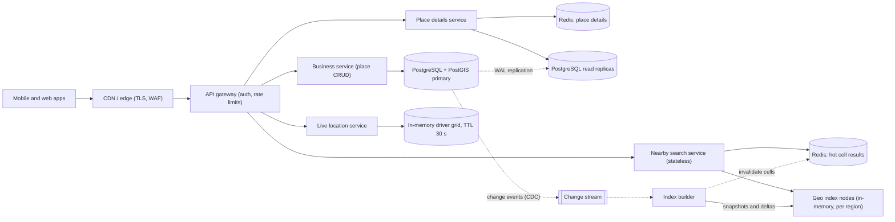
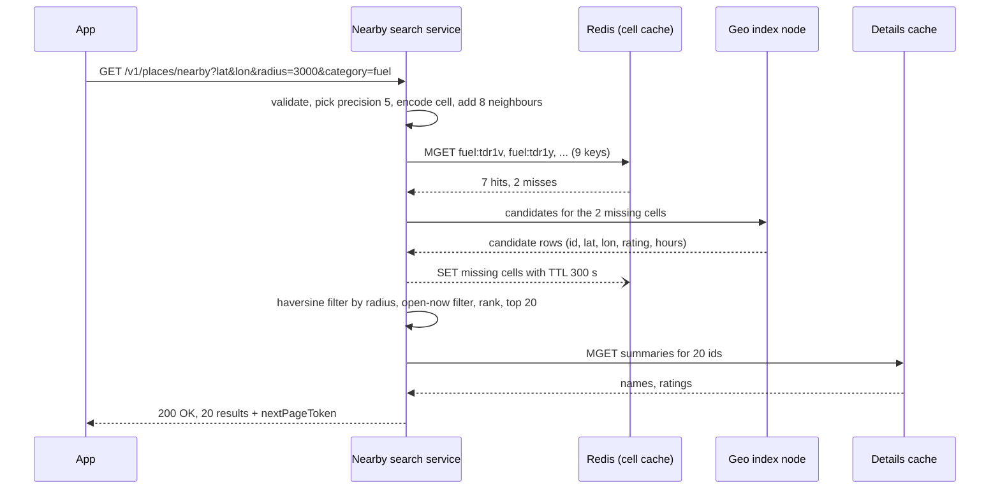

"Show me ATMs near me." "Petrol pumps within 3 km that are open now." "Restaurants around Koramangala rated above 4." Every maps, food-delivery, payments and travel app has this feature. It looks like a simple database query, but at 200 million places and 100,000 searches per second it becomes a lesson in two-dimensional indexing, read-heavy scaling and keeping a fast index in step with slowly changing business data. This case study designs that service end to end, and contrasts it with the very different problem of finding **moving** things, such as drivers near a rider.

## Learning objectives

By the end of this lesson you will be able to:

1. Write requirements for nearby search: radius, filters, ranking and freshness.
2. Estimate search QPS, index size and bandwidth with visible arithmetic.
3. Explain why a latitude/longitude range scan on ordinary B-tree indexes does not scale.
4. Encode a geohash, pick a precision for a radius, find the eight neighbour cells, and handle cell-border, pole and 180° meridian edge cases.
5. Compare geohash, quadtree, S2, H3, PostGIS (GiST + `ST_DWithin`) and Redis GEO, and choose one with reasons.
6. Separate the static places index (replicas, caches, rebuilds) from fast-moving locations (in-memory grid with TTL).
7. Shard by region, cache popular cells, propagate business updates, rank results and protect location privacy.
8. Implement geohash, a haversine filter and a TTL driver grid in ASP.NET Core.

## Prerequisites

- [How to approach an HLD problem](#/lesson/m11-hld-framework): we follow the clarify → estimate → design → refine loop.
- [Capacity estimation](#/lesson/m11-capacity-estimation): QPS, storage and bandwidth maths.
- [Indexes, composite indexes, B-tree and hash](#/lesson/m09-indexes): we need to know what a B-tree can and cannot do.
- [Cache-aside and friends](#/lesson/m12-cache-patterns): popular cells are cached with cache-aside.

Helpful: the [ride-hailing case study](#/lesson/m17-ride-hailing), which uses the same geo ideas for matching, and [Redis data structures](#/lesson/m12-redis).

## Explain it like I'm a beginner

Imagine you run the help desk of a mall with 5,000 shops. A visitor asks: "Which coffee shops are close to me?" Measuring the distance to all 5,000 shops works for one visitor, not for a thousand a minute.

So you divide the mall map into numbered squares, like a chessboard, and write each shop on its square's card. When the visitor stands in square C4, you only check the cards for C4 **and the eight squares around it** (because a coffee shop just across the line in C5 may be closer than one at the far corner of C4). Instead of 5,000 shops you look at maybe 40, then measure those exactly.

That is the whole idea of a proximity service:

- **Divide the world into cells** (a spatial index). Geohash, quadtree, S2 and H3 are different ways to draw the grid.
- **Look at your cell and its neighbours**, never just your own cell.
- **Measure the real distance** for the few candidates, filter by radius and category, and **rank** them.
- Shops rarely move, so the cards can be **copied to many help desks** (replicas and caches). A delivery rider who moves every few seconds needs a different approach: a whiteboard that is rubbed out and rewritten constantly (an in-memory grid with expiry).

## Requirements

### Functional requirements

1. **Nearby search**: given a location (latitude, longitude) and a radius (default 2 km, allowed 100 m to 50 km), return up to 20 places, ordered by a ranking score.
2. **Filters**: category (ATM, petrol pump, restaurant, pharmacy), "open now", minimum rating, and simple attributes (accepts UPI, wheelchair access).
3. **Pagination**: "show more" returns the next page for the same query.
4. **Place details**: name, address, hours, rating, photos (separate details service and CDN).
5. **Business updates**: owners add a new place, change hours, close permanently or move to a new address.
6. **Moving objects (contrast case)**: show available drivers or delivery riders near a user, with positions no older than about 30 seconds.

### Out of scope

- Routing and travel-time estimation (we rank by straight-line distance).
- Full-text search ("biryani near me") beyond a category filter. See [search architecture](#/lesson/m16-search-architecture).

### Non-functional requirements

| Requirement | Target | Why |
|---|---|---|
| Search latency | p99 under 100 ms server-side | Users pan and zoom the map; each move fires a search |
| Availability | 99.99 % for search | "Nearest ATM" or "nearest hospital" must work at night and during sales |
| Freshness of places | Business edits visible within 5–15 minutes | Nobody expects a new restaurant to appear in one second |
| Freshness of drivers | Positions under 30 seconds old; stale drivers hidden | A driver shown 2 km away who left 5 minutes ago is a broken promise |
| Consistency | Eventually consistent is fine for places | A slightly stale opening time is acceptable; a wrong location is not |
| Privacy | User locations are not stored longer than needed | A location history reveals home, work and habits |

The key asymmetry: **places change rarely but are read constantly; drivers change constantly but are each read rarely**. That splits the design into two subsystems.

## Capacity estimation

All numbers are **estimates** for a large consumer maps or super-app product. Round aggressively and show the arithmetic.

### Search traffic

- Daily active users: **300 million**.
- Searches per user per day: **10** (panning the map and changing filters each fire one).
- Searches per day = 300 M × 10 = **3 billion**.
- Average QPS = 3 B ÷ 86,400 s ≈ **34,700 QPS**.
- Peak (×3, evenings and festival weekends) ≈ **104,000 QPS**. Call it **100k QPS** at peak.

### Places and writes

- Places worldwide: **200 million** (shops, ATMs, petrol pumps, restaurants, clinics).
- Edits: assume 1 % of places change something per day: 2 M edits ÷ 86,400 ≈ **23 writes/s**.
- Read-to-write ratio ≈ 34,700 ÷ 23 ≈ **1,500 : 1**. This is an extremely read-heavy system.

### Storage

- Full place record (name, address, hours, attributes, rating summary): about **2 KB** → 200 M × 2 KB = **400 GB**. Photos live in object storage and are not counted here.
- A slim **search row** (id 8 B, latitude and longitude 16 B, geohash 9 B, category 2 B, rating 2 B, opening-hours bitmap 21 B, flags, overhead): about **100 bytes** → 200 M × 100 B = **20 GB**.

20 GB fits in the memory of one large server. That fact drives the design: **the search index can live in RAM and be replicated**, while the 400 GB of details stay in PostgreSQL behind a cache.

### Per-query work and bandwidth

- Response: 20 places × about 200 B of summary = **4 KB**. At peak, 100k × 4 KB = **400 MB/s** (about 3.2 Gbit/s) of egress.

### How many index servers?

- Assume one index node handles **5,000 searches/s** of in-memory cell lookups plus distance filtering (an estimate; load-test your own).
- 100k ÷ 5,000 = 20 nodes, plus 50 % headroom for a zone failure ≈ **30 nodes** worldwide, split across regions.

### Moving drivers (contrast case)

- 1 million drivers online at peak, each sending a position every 4 seconds: 1 M ÷ 4 = **250,000 writes/s**.
- Each position is about 50 bytes, so the live set is only 50 MB, but the **write rate** is 10,000 times the places write rate. This is why drivers cannot share the places database.

### What the numbers tell us

1. Searches dominate. Caching and replication of a read-only index are the main levers.
2. The index fits in RAM; a disk-based PostGIS query per search is fine at moderate scale but becomes the cost driver at 100k QPS.
3. Writes to places are tiny, so the index can be rebuilt or patched asynchronously.
4. Moving objects are a write problem, not a read problem, and need a separate store.

## API design

### Nearby search

```http
GET /v1/places/nearby?lat=12.9756&lon=77.6050&radius=3000&category=fuel&openNow=true&limit=20
Authorization: Bearer <token>
```

```json
{
  "results": [
    { "id": 81723, "name": "Brigade Road Fuel", "category": "fuel", "distanceMeters": 465, "rating": 4.2, "openNow": true }
  ],
  "nextPageToken": "eyJjIjoidGRyMXYiLCJvIjoyMH0"
}
```

- `400 Bad Request` for latitude outside −90..90, longitude outside −180..180, or radius outside 100 m–50 km. An upper limit stops one request from scanning the whole index.
- The page token is opaque (it encodes the query cell and offset). Responses are cached per **cell** on the server, not per exact coordinate.

### Place details and business updates

- `GET /v1/places/{id}`: full details, cacheable for minutes at the CDN.
- `POST /v1/places`, `PATCH /v1/places/{id}`: authenticated business owners and internal moderators. Returns `202 Accepted` with `"indexedWithin": "PT15M"`.

### Live locations (contrast case)

- `PUT /v1/drivers/{driverId}/location` with `{ "lat": 12.97, "lon": 77.60 }` every 4 seconds from the driver app. Only the driver's own token may update its id.
- `GET /v1/drivers/nearby?lat=..&lon=..&radius=2000`: used by the matching service, not by public clients.

## Data model

### Source of truth: PostgreSQL with PostGIS

```sql
CREATE EXTENSION IF NOT EXISTS postgis;

CREATE TABLE place (
    id          bigint PRIMARY KEY,
    name        text        NOT NULL,
    category    text        NOT NULL,
    geog        geography(Point, 4326) NOT NULL,   -- WGS 84 longitude/latitude
    geohash9    text        NOT NULL,                  -- ST_GeoHash(geog::geometry, 9), set on write
    rating      numeric(2,1),
    hours       jsonb       NOT NULL DEFAULT '{}',
    status      text        NOT NULL DEFAULT 'active',   -- active | closed | hidden
    updated_at  timestamptz NOT NULL DEFAULT now()
);

CREATE INDEX place_geog_gist ON place USING gist (geog);
CREATE INDEX place_geohash   ON place (geohash9 text_pattern_ops);
CREATE INDEX place_updated   ON place (updated_at);
```

- `geography(Point, 4326)` stores a point on the WGS 84 ellipsoid, so distances come back in **metres**. Note that PostGIS points are built as `ST_MakePoint(longitude, latitude)`: x is longitude. Swapping them is the most common bug in geo code.
- The **GiST index** (Generalized Search Tree) stores bounding boxes in an R-tree-like structure, so "which points fall near this box?" touches a few pages instead of the whole table.
- The `geohash9` column (computed from the same point on every write) and its `text_pattern_ops` B-tree let us run prefix queries (`geohash9 LIKE 'tdr1v%'`) and feed the in-memory index builder.
- `updated_at` lets the builder poll for changes if change data capture is unavailable.

### The query PostGIS answers well

```sql
-- $1 = ST_MakePoint(77.6050, 12.9756)::geography  (longitude first!)
SELECT id, name, ST_Distance(geog, $1) AS meters
FROM place
WHERE category = 'fuel'
  AND status = 'active'
  AND ST_DWithin(geog, $1, 3000)         -- uses the GiST index
ORDER BY geog <-> $1                      -- index-assisted nearest-first ordering
LIMIT 20;
```

`ST_DWithin` is index-aware: it first finds candidates whose bounding boxes are within range using the GiST index, then checks the exact distance. Never write `WHERE ST_Distance(geog, me) < 3000`; that computes the distance for every row and cannot use the index.

### Live driver positions

Not in PostgreSQL: an in-memory grid keyed by cell (or Redis GEO), each entry `(driverId, lat, lon, seenAt)` with a 30-second time-to-live.

## High-level architecture



Reading the diagram arrow by arrow:

- **Apps → Edge → Gateway**: TLS ends near the user; the gateway authenticates, rate-limits and routes.
- **Gateway → Nearby search service**: stateless pods that parse the query, choose a geohash precision, compute the 9 cells, and fan out.
- **Search service → Redis (hot cells)**: cache-aside on a **cell key** such as `fuel:tdr1v`, holding the candidate list for that cell. Popular cells (city centres, airports, malls) hit here.
- **Search service → Geo index nodes**: on a cache miss, the in-memory index for that region returns candidates for the cells. Each region (South Asia, Europe, ...) has its own set of replicated index nodes.
- **Gateway → Place details → Redis / replicas**: tapping a place loads details through a separate cache and read replicas.
- **Gateway → Business service → PostgreSQL primary**: rare writes (23/s) go to the source of truth.
- **Primary ⇢ Change stream ⇢ Index builder** (dotted = asynchronous): every insert or update becomes an event (change data capture, see [CDC](#/lesson/m16-cdc)). The builder patches index nodes with deltas every minute and publishes a full snapshot nightly. It also invalidates affected cell keys in Redis.
- **Gateway → Live location service → driver grid**: a completely separate path for moving objects, with its own store and its own scaling rules.

### Search flow



The search service does three cheap things in order: **narrow** (9 cells), **filter exactly** (distance, open now) and **rank**. The cache is keyed by cell and category, not by the user's exact coordinate, so thousands of users standing in the same 5 km cell share one cached entry. The cache fill (`--)`) is asynchronous; the response does not wait for it.

## Deep dives

### Deep dive 1: why a latitude/longitude range scan fails

The first idea everyone has:

```sql
-- Naive: two B-tree indexes, one on lat and one on lon
SELECT * FROM place
WHERE lat BETWEEN 12.9486 AND 13.0026
  AND lon BETWEEN 77.5773 AND 77.6327;
```

The box is about 6 km × 6 km around central Bengaluru. Why is this slow?

- A B-tree is **one-dimensional**. The `lat` index finds every place in the latitude band 12.95°–13.00° **around the whole planet**: Bengaluru, but also parts of Thailand, Ethiopia, Venezuela and the Philippines. That band can hold hundreds of thousands of rows.
- The `lon` index finds a longitude band from pole to pole: another huge set.
- PostgreSQL can combine them with a bitmap AND, but it still reads both big sets to find the small intersection.
- A composite index on `(lat, lon)` does not fix this: the range on the first column selects the whole band, and `lon` becomes a filter over all of it.

Two dimensions need an index that understands two dimensions. There are two families: **map the 2D point to a 1D key that preserves closeness** (geohash, S2 cell ids), so an ordinary B-tree or sorted list works; or use a **tree of rectangles** (GiST/R-tree in PostGIS, quadtrees).

### Deep dive 2: geohash

A geohash repeatedly halves the world. The first bit says "east or west of longitude 0?". The second says "north or south of latitude 0?". Then the chosen half is halved again, alternating longitude and latitude. Every 5 bits become one character from the base-32 alphabet `0123456789bcdefghjkmnpqrstuvwxyz` (no `a`, `i`, `l`, `o`, to avoid confusion). For example, the point (42.6, −5.6) in northern Spain at precision 5 is `ezs42`, and central Bengaluru at precision 6 is `tdr1vf`.

Longer hashes mean smaller cells, and **places that share a prefix are in the same cell**. Approximate cell sizes at the equator (east–west width shrinks with the cosine of the latitude):

| Precision | Cell width × height | Typical use |
|---|---|---|
| 4 | 39.1 km × 19.5 km | City-level grouping |
| 5 | 4.9 km × 4.9 km | 2–5 km searches |
| 6 | 1.2 km × 0.61 km | 500 m–1 km searches, driver grids |
| 7 | 153 m × 153 m | Street-level |
| 8 | 38.2 m × 19.1 m | Building-level |
| 9 | 4.8 m × 4.8 m | Storage precision for points |

**Choosing a precision for a radius.** If the search point can be anywhere inside its cell, the cell plus its 8 neighbours covers every point within distance *r* only when the cell's smaller side is at least *r*. So pick the **longest** precision whose smaller side is ≥ *r* at that latitude. For a 3 km search at Bengaluru (latitude 13°), precision 6 cells are 1.19 km × 0.61 km, too small; precision 5 cells are 4.76 km × 4.89 km, so we use precision 5. The 9 cells cover about 14 km × 14 km, far more than the circle, so the exact distance filter matters.

**Neighbours.** Two places a metre apart can sit in different cells, so we always search the 8 surrounding cells. The simplest correct way to find a neighbour: decode the cell to its bounding box, step one cell height north or south and one cell width east or west from the centre, and encode that point at the same precision. The neighbours of `ezs42` are `ezs48` (north), `ezs49`, `ezs43` (east), `ezs41`, `ezs40` (south), `ezefp`, `ezefr` (west) and `ezefx`. Notice that the west neighbours share only two characters with `ezs42`: **sharing a prefix implies closeness, but closeness does not imply a shared prefix**.

**Edge cases you must handle:**

- **The equator and prime meridian.** The points (−0.0001, −0.0001) and (0.0001, 0.0001) are 31 m apart but encode to `7zzzzzz` and `s000000`: no common prefix at all. A prefix-only search breaks here; the neighbour search does not.
- **The 180° meridian.** East of a cell touching 180° is a cell starting at −180° (think Fiji). Wrap the longitude.
- **The poles.** North of a cell touching 90° there is nothing: return no neighbour.
- **High latitudes.** Cells narrow east–west going north (about 2.4 km wide at precision 5 in Oslo), so use cos(latitude) as above.
- **Dense versus empty areas.** A precision 5 cell in central Mumbai may hold 20,000 places, one in the Thar desert 3. Use finer precision in dense areas, cap candidates, or use a quadtree.

### Deep dive 3: quadtree

A quadtree starts with one square for the whole world. Any square holding more than, say, 100 places splits into four children, recursively. Dense city centres end up with tiny squares; oceans stay as one big square, so query work is even everywhere.

- **Size**: 200 M places ÷ 100 per leaf ≈ 2 M leaves; ids in leaves take 200 M × 8 B = 1.6 GB, so a few GB in all. Servers build it at startup from a snapshot (minutes, an estimate) or load a serialised tree.
- **Search**: walk down to the user's leaf, then visit neighbouring leaves until enough results are found. That makes "the 20 nearest, however far" (k-nearest-neighbour) natural, which geohash does awkwardly.
- **Updates**: splits and merges concurrent with reads need locks or copy-on-write. At 23 writes/s a periodic rebuild is simpler.

Quadtrees shine for uneven density and k-nearest queries; geohash shines for simplicity, a string key that works in any database, cache or sorted list.

### Deep dive 4: S2 and H3 in brief

- **S2** (open-sourced by Google) projects the sphere onto a cube and numbers cells along a **Hilbert curve**, which keeps nearby cells close in number more often than geohash's Z-order curve. Cells have 64-bit ids at 31 levels, and a "region coverer" turns any circle or polygon into a few id ranges: excellent for geofences ("is this order inside the delivery zone?").
- **H3** (open-sourced by Uber) tiles the globe with **hexagons** at 16 resolutions. All six neighbours are the same distance away, so rings around a cell (k-rings) suit surge zones and driver search. Hexagons do not nest perfectly, so coarse roll-ups are approximate.

Both are libraries, not databases: you still store the cell id in a B-tree, Redis or a map. Geohash is enough for radius search over places.

### Deep dive 5: PostGIS, the pragmatic PostgreSQL answer

For most companies the right first design is **PostgreSQL with PostGIS**, a GiST index and `ST_DWithin`:

- One query does the radius filter correctly on the ellipsoid, handles the 180° meridian and poles, and orders nearest-first with `<->`.
- It joins naturally with business data (category, hours, rating) and is transactional.
- Read replicas scale reads horizontally.

How far does it go? Assume a replica sustains around 2,000–3,000 indexed radius queries per second with a warm cache (an estimate; check with `EXPLAIN (ANALYZE, BUFFERS)` on your data). A one-country food app at 3,000 QPS needs one or two replicas. At 100k QPS you would need 40+ replicas of a 400 GB database; that is when the slim in-memory index and cell cache pay for themselves, with PostGIS kept as the source of truth.

### Deep dive 6: Redis GEO

Redis has geo commands built on sorted sets: `GEOADD places:fuel 77.6070 12.9719 "81723"` stores a member with a 52-bit geohash-style score, and `GEOSEARCH places:fuel FROMLONLAT 77.6050 12.9756 BYRADIUS 3 km ASC COUNT 20 WITHDIST` returns the nearest members with distances. Internally it searches the cell and its neighbours, just like our design.

Good for moving objects and small catalogues. Watch out: everything is in RAM, a single key lives on one shard (a hot key), and filters such as "open now" and ranking still happen in your service.

### Deep dive 7: static places versus moving drivers

| | Places (static) | Drivers (moving) |
|---|---|---|
| Write rate | 23/s | 250,000/s |
| Read rate | 100,000/s | Thousands/s (one per ride request) |
| Freshness | Minutes | Seconds |
| Store | PostgreSQL + PostGIS, in-memory index snapshots, cell cache | In-memory grid or Redis GEO, sharded by city |
| Durability | Must never lose a place | Losing a position is fine: the next ping comes in 4 s |
| Index update | Rebuild or patch asynchronously | Move the entry between cells on every ping |

For places, **replicate a read-only index widely** and refresh it in the background. For drivers, keep one in-memory grid per city shard: each ping moves the driver between cells, and every entry has a 30-second **time-to-live**, so a driver whose phone loses signal disappears instead of being offered to riders. The [ride-hailing case study](#/lesson/m17-ride-hailing) builds matching on top of this grid.

### Deep dive 8: ranking

Distance alone gives poor results: a 2.1-star closed shop 200 m away should not beat a 4.6-star open one 600 m away. A simple, explainable first ranking:

`score = 0.6 × closeness + 0.4 × (rating ÷ 5) + openBoost`, where `closeness = 1 − distance ÷ radius` and `openBoost` is +0.1 for open and −0.3 for closed.

Later versions add popularity, personalisation and clearly labelled ads. Keep ranking in the search service, not the index, so it changes without a rebuild.

### Deep dive 9: the core pieces in ASP.NET Core

The code below is a compact, compilable version of the core: geohash with neighbours, haversine distance, an in-memory place index that is rebuilt and swapped atomically, ranking, and a TTL driver grid. In production the snapshot comes from PostgreSQL through the index builder, and the cell cache sits in Redis.

```csharp file=Proximity/Geo.cs
namespace Proximity.Geo;

/// <summary>A WGS 84 point. Latitude first, unlike PostGIS's ST_MakePoint(lon, lat).</summary>
public readonly record struct GeoPoint
{
    public GeoPoint(double latitude, double longitude)
    {
        if (double.IsNaN(latitude) || latitude is < -90 or > 90) throw new ArgumentOutOfRangeException(nameof(latitude));
        if (double.IsNaN(longitude) || longitude is < -180 or > 180) throw new ArgumentOutOfRangeException(nameof(longitude));
        Latitude = latitude;
        Longitude = longitude;
    }

    public double Latitude { get; }
    public double Longitude { get; }
}

public readonly record struct GeoBox(double MinLat, double MaxLat, double MinLon, double MaxLon)
{
    public double HeightDeg => MaxLat - MinLat;
    public double WidthDeg => MaxLon - MinLon;
    public double CenterLat => (MinLat + MaxLat) / 2;
    public double CenterLon => (MinLon + MaxLon) / 2;
}

public static class Haversine
{
    /// <summary>Mean Earth radius. The sphere model is within about 0.5 % of the ellipsoid: fine for ranking "near me".</summary>
    public const double EarthRadiusMeters = 6_371_008.8;
    public const double MetersPerDegreeLat = Math.PI / 180 * EarthRadiusMeters;

    public static double DistanceMeters(GeoPoint a, GeoPoint b)
    {
        var dLat = ToRadians(b.Latitude - a.Latitude);
        var dLon = ToRadians(b.Longitude - a.Longitude);
        var h = Math.Pow(Math.Sin(dLat / 2), 2)
              + Math.Cos(ToRadians(a.Latitude)) * Math.Cos(ToRadians(b.Latitude)) * Math.Pow(Math.Sin(dLon / 2), 2);
        return 2 * EarthRadiusMeters * Math.Asin(Math.Min(1, Math.Sqrt(h))); // Min guards rounding just above 1
    }

    private static double ToRadians(double degrees) => degrees * Math.PI / 180;
}

public static class Geohash
{
    public const string Alphabet = "0123456789bcdefghjkmnpqrstuvwxyz";
    public const int MaxPrecision = 12;

    public static string Encode(GeoPoint p, int precision)
    {
        ArgumentOutOfRangeException.ThrowIfLessThan(precision, 1);
        ArgumentOutOfRangeException.ThrowIfGreaterThan(precision, MaxPrecision);
        double latLo = -90, latHi = 90, lonLo = -180, lonHi = 180;
        Span<char> chars = stackalloc char[precision];
        bool lonBit = true;
        int bits = 0, value = 0, i = 0;
        while (i < precision)
        {
            if (lonBit)
            {
                var mid = (lonLo + lonHi) / 2;
                if (p.Longitude >= mid) { value = (value << 1) | 1; lonLo = mid; } else { value <<= 1; lonHi = mid; }
            }
            else
            {
                var mid = (latLo + latHi) / 2;
                if (p.Latitude >= mid) { value = (value << 1) | 1; latLo = mid; } else { value <<= 1; latHi = mid; }
            }
            lonBit = !lonBit;
            if (++bits == 5) { chars[i++] = Alphabet[value]; bits = 0; value = 0; }
        }
        return new string(chars);
    }

    public static GeoBox Decode(string hash)
    {
        ArgumentException.ThrowIfNullOrEmpty(hash);
        double latLo = -90, latHi = 90, lonLo = -180, lonHi = 180;
        bool lonBit = true;
        foreach (var c in hash)
        {
            var v = Alphabet.IndexOf(c);
            if (v < 0) throw new FormatException($"'{c}' is not a geohash character.");
            for (var shift = 4; shift >= 0; shift--)
            {
                var bit = (v >> shift) & 1;
                if (lonBit) { var mid = (lonLo + lonHi) / 2; if (bit == 1) lonLo = mid; else lonHi = mid; }
                else { var mid = (latLo + latHi) / 2; if (bit == 1) latLo = mid; else latHi = mid; }
                lonBit = !lonBit;
            }
        }
        return new GeoBox(latLo, latHi, lonLo, lonHi);
    }

    /// <summary>Neighbour one cell away (dLat, dLon in -1..1). Wraps at 180°; returns null past a pole.</summary>
    public static string? Neighbour(string hash, int dLat, int dLon)
    {
        var box = Decode(hash);
        var lat = box.CenterLat + dLat * box.HeightDeg;
        if (lat is > 90 or < -90) return null;
        var lon = box.CenterLon + dLon * box.WidthDeg;
        if (lon >= 180) lon -= 360;
        else if (lon < -180) lon += 360;
        return Encode(new GeoPoint(lat, lon), hash.Length);
    }

    /// <summary>The cell itself first, then its distinct neighbours (fewer than 8 near a pole).</summary>
    public static IReadOnlyList<string> CellAndNeighbours(string hash)
    {
        var cells = new List<string>(9) { hash };
        for (var dLat = 1; dLat >= -1; dLat--)
            for (var dLon = -1; dLon <= 1; dLon++)
            {
                if (dLat == 0 && dLon == 0) continue;
                var n = Neighbour(hash, dLat, dLon);
                if (n is not null && !cells.Contains(n)) cells.Add(n);
            }
        return cells;
    }

    public static (double HeightMeters, double WidthMeters) CellSizeMeters(int precision, double latitude)
    {
        var totalBits = precision * 5;
        var lonBits = (totalBits + 1) / 2;   // longitude gets the extra bit when the total is odd
        var latBits = totalBits / 2;
        var heightDeg = 180.0 / Math.Pow(2, latBits);
        var widthDeg = 360.0 / Math.Pow(2, lonBits);
        return (heightDeg * Haversine.MetersPerDegreeLat,
                widthDeg * Haversine.MetersPerDegreeLat * Math.Cos(latitude * Math.PI / 180));
    }

    /// <summary>Longest precision whose cell's smaller side is at least the radius, so 9 cells cover the circle.</summary>
    public static int PrecisionForRadius(double radiusMeters, double latitude)
    {
        for (var p = MaxPrecision; p >= 1; p--)
        {
            var (h, w) = CellSizeMeters(p, latitude);
            if (Math.Min(h, w) >= radiusMeters) return p;
        }
        return 1;
    }
}
```

```csharp file=Proximity/PlaceIndex.cs
using Proximity.Geo;

namespace Proximity.Places;

public sealed record Place(long Id, string Name, string Category, GeoPoint Location, double Rating, bool OpenNow);
public sealed record NearbyQuery(GeoPoint Center, double RadiusMeters, string? Category, int Limit);
public sealed record NearbyResult(Place Place, double DistanceMeters, double Score);

public interface IPlaceSearch
{
    IReadOnlyList<NearbyResult> Search(NearbyQuery query);
}

/// <summary>
/// Read-only snapshot of places sorted by geohash. A prefix of the hash is a contiguous range, so a cell
/// lookup is a binary search plus a short scan: the same trick as a B-tree with text_pattern_ops.
/// Rebuilds create a new snapshot and swap one reference, so readers never see a half-built index.
/// </summary>
public sealed class GeohashPlaceIndex : IPlaceSearch
{
    public const int StoredPrecision = 9;
    private sealed record Snapshot(string[] Hashes, Place[] Places);
    private volatile Snapshot _snapshot = new([], []);

    public int Count => _snapshot.Places.Length;

    public void Rebuild(IEnumerable<Place> places)
    {
        var rows = places
            .Select(p => (Hash: Geohash.Encode(p.Location, StoredPrecision), Place: p))
            .OrderBy(r => r.Hash, StringComparer.Ordinal)
            .ToArray();
        _snapshot = new Snapshot(rows.Select(r => r.Hash).ToArray(), rows.Select(r => r.Place).ToArray());
    }

    public IReadOnlyList<NearbyResult> Search(NearbyQuery query)
    {
        var snap = _snapshot; // read the reference once so a concurrent rebuild cannot mix versions
        var precision = Math.Min(Geohash.PrecisionForRadius(query.RadiusMeters, query.Center.Latitude), StoredPrecision);
        var results = new List<NearbyResult>();
        foreach (var cell in Geohash.CellAndNeighbours(Geohash.Encode(query.Center, precision)))
        {
            for (var i = LowerBound(snap.Hashes, cell);
                 i < snap.Hashes.Length && snap.Hashes[i].StartsWith(cell, StringComparison.Ordinal); i++)
            {
                var place = snap.Places[i];
                if (query.Category is not null &&
                    !string.Equals(place.Category, query.Category, StringComparison.OrdinalIgnoreCase)) continue;
                var d = Haversine.DistanceMeters(query.Center, place.Location);
                if (d > query.RadiusMeters) continue; // cells are a superset of the circle
                results.Add(new NearbyResult(place, d, Ranking.Score(place, d, query.RadiusMeters)));
            }
        }
        return results.OrderByDescending(r => r.Score).ThenBy(r => r.DistanceMeters).Take(query.Limit).ToList();
    }

    private static int LowerBound(string[] sorted, string key)
    {
        int lo = 0, hi = sorted.Length;
        while (lo < hi)
        {
            var mid = lo + (hi - lo) / 2;
            if (string.CompareOrdinal(sorted[mid], key) < 0) lo = mid + 1; else hi = mid;
        }
        return lo;
    }
}

public static class Ranking
{
    public static double Score(Place place, double distanceMeters, double radiusMeters)
    {
        var closeness = 1 - Math.Clamp(distanceMeters / radiusMeters, 0, 1);
        var quality = Math.Clamp(place.Rating / 5.0, 0, 1);
        var openBoost = place.OpenNow ? 0.1 : -0.3;
        return 0.6 * closeness + 0.4 * quality + openBoost;
    }
}

public static class SampleData
{
    public static IEnumerable<Place> Places() =>
    [
        new(1, "Brigade Road Fuel", "fuel", new GeoPoint(12.9719, 77.6070), 4.2, true),
        new(2, "Richmond Road Fuel", "fuel", new GeoPoint(12.9650, 77.6010), 3.9, true),
        new(3, "Trinity Circle Fuel", "fuel", new GeoPoint(12.9730, 77.6170), 4.5, true),
        new(4, "Shivajinagar Fuel", "fuel", new GeoPoint(12.9860, 77.6040), 4.0, false),
        new(5, "Cubbon Park ATM", "atm", new GeoPoint(12.9760, 77.5990), 4.1, true),
        new(6, "Koramangala Fuel", "fuel", new GeoPoint(12.9352, 77.6245), 4.4, true),
    ];
}
```

```csharp file=Proximity/DriverGrid.cs
using System.Collections.Concurrent;
using Proximity.Geo;

namespace Proximity.Drivers;

public sealed record DriverPosition(string DriverId, GeoPoint Location, DateTimeOffset SeenAt, string Cell);
public sealed record LocationUpdate(double Lat, double Lon);

/// <summary>
/// Live positions for one city shard. Each ping moves the driver between cells; entries older than the TTL
/// are invisible to search and swept in the background. Losing this state is acceptable: drivers re-ping in 4 s.
/// </summary>
public sealed class DriverGrid(TimeProvider clock)
{
    public const int CellPrecision = 5;
    public static readonly TimeSpan Ttl = TimeSpan.FromSeconds(30);

    private readonly ConcurrentDictionary<string, DriverPosition> _byDriver = new();
    private readonly ConcurrentDictionary<string, ConcurrentDictionary<string, byte>> _byCell = new();

    public void Update(string driverId, GeoPoint location)
    {
        var cell = Geohash.Encode(location, CellPrecision);
        var next = new DriverPosition(driverId, location, clock.GetUtcNow(), cell);
        DriverPosition? previous = null;
        // One phone sends one ping at a time, so per-driver races are rare; the cell move is idempotent anyway.
        _byDriver.AddOrUpdate(driverId, next, (_, old) => { previous = old; return next; });
        if (previous is not null && previous.Cell != cell && _byCell.TryGetValue(previous.Cell, out var oldCell))
            oldCell.TryRemove(driverId, out _);
        _byCell.GetOrAdd(cell, _ => new ConcurrentDictionary<string, byte>()).TryAdd(driverId, 0);
    }

    public IReadOnlyList<(string DriverId, double DistanceMeters)> Nearby(GeoPoint center, double radiusMeters, int limit)
    {
        var (h, w) = Geohash.CellSizeMeters(CellPrecision, center.Latitude);
        if (radiusMeters <= 0 || radiusMeters > Math.Min(h, w))
            throw new ArgumentOutOfRangeException(nameof(radiusMeters), "Radius must fit inside one grid cell.");

        var now = clock.GetUtcNow();
        var found = new List<(string DriverId, double DistanceMeters)>();
        foreach (var cell in Geohash.CellAndNeighbours(Geohash.Encode(center, CellPrecision)))
        {
            if (!_byCell.TryGetValue(cell, out var ids)) continue;
            foreach (var id in ids.Keys)
            {
                if (!_byDriver.TryGetValue(id, out var pos) || now - pos.SeenAt > Ttl) continue; // stale: phone went quiet
                var d = Haversine.DistanceMeters(center, pos.Location);
                if (d <= radiusMeters) found.Add((id, d));
            }
        }
        return found.OrderBy(f => f.DistanceMeters).Take(limit).ToList();
    }

    public int RemoveStale()
    {
        var cutoff = clock.GetUtcNow() - Ttl;
        var removed = 0;
        foreach (var (id, pos) in _byDriver)
        {
            // Remove only if unchanged since we read it, so a fresh ping racing the sweep is kept.
            if (pos.SeenAt < cutoff && _byDriver.TryRemove(new KeyValuePair<string, DriverPosition>(id, pos)))
            {
                if (_byCell.TryGetValue(pos.Cell, out var set)) set.TryRemove(id, out _);
                removed++;
            }
        }
        return removed;
    }
}

public sealed class DriverSweeper(DriverGrid grid, TimeProvider clock, ILogger<DriverSweeper> log) : BackgroundService
{
    protected override async Task ExecuteAsync(CancellationToken stoppingToken)
    {
        using var timer = new PeriodicTimer(TimeSpan.FromSeconds(10), clock);
        try
        {
            while (await timer.WaitForNextTickAsync(stoppingToken))
            {
                var n = grid.RemoveStale();
                if (n > 0) log.LogInformation("Removed {Count} stale driver positions", n);
            }
        }
        catch (OperationCanceledException) when (stoppingToken.IsCancellationRequested) { }
    }
}
```

```csharp file=Program.cs
using Proximity.Drivers;
using Proximity.Geo;
using Proximity.Places;

var builder = WebApplication.CreateBuilder(args);

builder.Services.AddSingleton(TimeProvider.System);
builder.Services.AddSingleton<GeohashPlaceIndex>();
builder.Services.AddSingleton<IPlaceSearch>(sp => sp.GetRequiredService<GeohashPlaceIndex>());
builder.Services.AddSingleton<DriverGrid>();
builder.Services.AddHostedService<DriverSweeper>();

var app = builder.Build();

// Demo data. In production the index builder ships snapshots built from PostgreSQL + PostGIS.
app.Services.GetRequiredService<GeohashPlaceIndex>().Rebuild(SampleData.Places());

app.MapGet("/v1/places/nearby", (double lat, double lon, double? radius, string? category, int? limit, IPlaceSearch search) =>
{
    if (lat is < -90 or > 90 || lon is < -180 or > 180)
        return Results.Problem("lat must be -90..90 and lon -180..180", statusCode: 400);
    var r = radius ?? 2000;
    if (r is < 100 or > 50_000) return Results.Problem("radius must be 100..50000 metres", statusCode: 400);

    var hits = search.Search(new NearbyQuery(new GeoPoint(lat, lon), r, category, Math.Clamp(limit ?? 20, 1, 50)));
    return Results.Ok(hits.Select(h => new
    {
        h.Place.Id, h.Place.Name, h.Place.Category, h.Place.Rating, h.Place.OpenNow,
        distanceMeters = Math.Round(h.DistanceMeters),
    }));
});

app.MapPut("/v1/drivers/{driverId}/location", (string driverId, LocationUpdate body, DriverGrid grid) =>
{
    if (body.Lat is < -90 or > 90 || body.Lon is < -180 or > 180)
        return Results.Problem("invalid coordinates", statusCode: 400);
    grid.Update(driverId, new GeoPoint(body.Lat, body.Lon)); // auth: the token's subject must equal driverId
    return Results.NoContent();
});

app.MapGet("/v1/drivers/nearby", (double lat, double lon, double? radius, DriverGrid grid) =>
    Results.Ok(grid.Nearby(new GeoPoint(lat, lon), radius ?? 2000, 10)
        .Select(d => new { d.DriverId, distanceMeters = Math.Round(d.DistanceMeters) })));

app.Run();
```

Three details matter. `Rebuild` swaps **one reference** to a new sorted array, so searches never lock or see half an index. The search treats cells as a **superset** and always applies the exact haversine filter. The driver grid hides stale entries at read time as well as sweeping them, so a slow sweeper never shows a ghost driver.

## Caching, queues and scaling

### Caching

| Layer | Key | TTL | Invalidation |
|---|---|---|---|
| Edge / CDN | Place details by id, photos | 5–60 min | Purge on edit |
| Redis cell cache | `{category}:{geohash5}` → candidate list | 5 min | Index builder deletes keys for cells touched by an edit |
| In-process (search pod) | The hottest 10,000 cells | 30 s | Expires; tolerates staleness |
| Index node | The whole regional index in RAM | Until next delta or snapshot | Delta every minute, snapshot nightly |

Why cache by cell and not by query? Exact coordinates differ for every user, so per-query keys almost never hit, while a cell key is shared by everyone in that 5 km square. Airports, malls and stations get most searches, which helps the hit ratio but creates **hot keys** (a New Year's Eve crowd on Marine Drive all asking the same cell). The in-process layer absorbs those, and a hot Redis key can be copied to several shards (`fuel:te7ud#1..#4`) with reads spread randomly. See [cache stampede, penetration and hot keys](#/lesson/m12-cache-failures).

### Business updates propagation

1. The owner's `PATCH` commits to PostgreSQL (the source of truth) and returns `202`.
2. Change data capture (or a transactional outbox) emits `PlaceChanged { id, oldGeohash, newGeohash }`.
3. The index builder batches changes for up to a minute and sends deltas to every index node in that region. A **move** must remove the place from its old cell and add it to the new one; forgetting the removal leaves a ghost entry at the old address.
4. The builder deletes the Redis cell keys for both the old and new cells.
5. Nightly, a full snapshot is rebuilt from PostgreSQL and replaces the delta-patched index, which repairs any delta that was lost. This is the "rebuild" safety net.

Freshness target: 5–15 minutes, with the nightly rebuild bounding drift to one day in the worst case.

### Sharding by region

200 M places fit in RAM, so why shard? For **cost** (no node needs the whole world), **latency** (serve Indian users from an Indian region) and **blast radius** (a bad snapshot breaks one region). Partition by geohash prefix or administrative region; a radius that crosses a border fans out to both shards and merges, which is rare. Within a region every node holds the full regional index: add nodes for QPS, not data size. Drivers are sharded by **city**, because rides never cross cities. See [sharding and hot partitions](#/lesson/m13-sharding).

### Scaling path

1. **Day 1 (under 1,000 QPS, one country)**: one ASP.NET Core app and PostgreSQL + PostGIS with a GiST index and one replica. No Redis, no custom index. This is the right design for most products.
2. **Growth (1,000–20,000 QPS)**: several replicas, a Redis cell cache, a separate details service and CDN.
3. **Large (100k QPS, global)**: in-memory regional index nodes fed by CDC, multi-level cell caching, regional deployment, and a separate live-location service for drivers.

**What breaks first?** In order: (1) PostgreSQL CPU on replicas from radius queries at high QPS, (2) hot cells during events, (3) index rebuild time and memory as the catalogue grows, (4) the driver write rate if drivers were wrongly put in the places database.

## Failure handling

| Failure | Effect | Mitigation |
|---|---|---|
| Redis cell cache down | Every search goes to index nodes | Index nodes are sized for full load; in-process cache absorbs hot cells; circuit breaker skips Redis instead of waiting |
| Index node crashes | Lost capacity in one zone | Stateless replicas behind a load balancer; a new node loads the latest snapshot from object storage in minutes |
| Bad snapshot (corrupt or half-empty) | Wrong or missing results everywhere | Validate before publishing: row count within ±2 % of yesterday, sample queries return known places; roll out to one node first (canary) |
| CDC or change stream stalls | Edits stop appearing | Alert on builder lag; the nightly snapshot repairs drift; owners were told "within 15 minutes" |
| PostgreSQL primary down | Business edits fail | Search is unaffected (it reads the index); edits return `503` with `Retry-After` until failover |
| Driver grid node restarts | Live positions lost for that city | Drivers re-ping every 4 s, so the grid refills within seconds |
| Phone GPS jumps 5 km | Driver shown in the wrong place | Reject pings implying over 200 km/h; keep the last good position |

The guiding rule: **search depends only on the in-memory index**; caches and the database are optional for reads.

## Security

- **Quotas**: per-user and per-key rate limits stop competitors scraping the catalogue by sweeping coordinates in a grid pattern.
- **Authorization for edits**: only verified owners can edit a place, and **location changes** go through moderation, because moving a competitor's shop or creating fake "ATMs" is a known abuse.
- **Driver identity**: the token's subject must equal the `driverId` in the URL, or one driver can move another on the map.
- **Validation and transport**: reject NaN, out-of-range coordinates and huge radii; HTTPS everywhere.

### Privacy

A user's search coordinates reveal where they live, work and pray. Treat them as personal data under laws such as India's DPDP Act 2023 and the GDPR:

- Do not log raw coordinates. Log the **precision 5 geohash** (about 5 km) for analytics, which is enough for capacity planning.
- Keep raw driver traces only as long as trip disputes and safety need, with restricted access.
- Remember that "nearest result plus distance" can be used to **triangulate** a hidden location from three vantage points, so round displayed distances (to 100 m) for sensitive categories such as shelters or clinics.

## Observability

- **Search latency** p50/p95/p99, split by cache layer that served it (in-process, Redis, index node).
- **Candidates scanned per query**: a rising p99 means cells are too coarse in dense areas.
- **Empty-result rate** per region: a spike after a deploy usually means a bad snapshot or a swapped latitude/longitude.
- **Index freshness**: seconds since the last applied delta, and the age of the current snapshot.
- **Cell cache hit ratio** and the top 20 hot cells.
- **Driver grid**: pings/s per city, share of stale entries, rejected pings.

An example SLO: "99.9 % of nearby searches in a 28-day window return within 100 ms with a non-error response."

## Deployment and cost

### Deployment

- Index nodes report ready (a readiness probe) only after loading and validating a snapshot, so no traffic reaches an empty index.
- Snapshots are versioned files in object storage; rolling back means pointing nodes at yesterday's version.
- Deploy per region with canaries, comparing empty-result rate and latency before rolling out.

### Cost drivers (rough, estimate only)

1. **Index nodes**: about 30 memory-optimised servers worldwide at 100k QPS.
2. **PostgreSQL**: the 400 GB source of truth plus replicas for details and the builder.
3. **Redis** for cell caches and details.
4. **Egress**: about 400 MB/s at peak of search responses, plus photos via CDN (often the biggest bill).
5. **Live location**: 250,000 writes/s of tiny messages; cheap in RAM, expensive if put through a database.

### When a simpler design is enough

A pharmacy chain with 3,000 stores gets a few "stores near you" requests per second: load them into memory and compute 3,000 haversine distances per request, well under a millisecond. A city food-delivery app with 50,000 restaurants and 500 QPS needs only PostgreSQL + PostGIS with a GiST index. Build the custom index only when the numbers demand it.

## Alternatives and trade-offs

| Decision | Our choice | Alternative | When the alternative wins |
|---|---|---|---|
| Spatial index | Geohash cells, in-memory, sorted by hash | PostGIS GiST queries for every search | Under about 5,000 QPS, or when queries need polygons and joins |
| Cell shape | Geohash rectangles | Quadtree | Very uneven density and k-nearest queries ("20 nearest, however far") |
| Cell system | Geohash | S2 or H3 | Polygon coverage and geofences (S2), uniform neighbour rings and analytics (H3) |
| Moving objects | In-memory grid per city with TTL | Redis GEO | Teams wanting a managed structure |
| Index freshness | Minute deltas + nightly rebuild | Synchronous index update per edit | When a new place must be searchable in seconds (rare for places) |

The meta-lesson: **separate by rate of change**. Static data is replicated and cached; fast-moving data is kept in one place in memory and expires.

## Practical playground

The starting graph is the naive design: one app server running latitude/longitude range scans on PostgreSQL for every search, with drivers' pings written to the same database. Evolve it in the HLD canvas: add a cell cache, an in-memory index fed by a change stream, replicas and a separate live-location service. Raise client RPS to 100,000 and see which node is flagged first.

:::playground type=hld title="Evolve the naive nearby search"
```json
{
  "nodes": [
    { "id": "c", "type": "client", "label": "Apps searching near me", "props": { "rps": 5000 } },
    { "id": "drv", "type": "client", "label": "Driver apps (pings every 4 s)", "props": { "rps": 20000 } },
    { "id": "lb", "type": "load-balancer", "label": "Load balancer" },
    { "id": "app", "type": "app-server", "label": "Search + location app", "props": { "instances": 2 } },
    { "id": "db", "type": "database", "label": "PostgreSQL (lat/lon B-tree indexes)", "props": { "replicas": 0 } }
  ],
  "edges": [
    { "from": "c", "to": "lb", "kind": "sync" },
    { "from": "drv", "to": "lb", "kind": "sync" },
    { "from": "lb", "to": "app", "kind": "sync" },
    { "from": "app", "to": "db", "kind": "sync", "label": "lat BETWEEN and lon BETWEEN; UPDATE driver" }
  ]
}
```
:::

## Exercises

:::exercise id=m17-proximity-service-ex1 difficulty=beginner kind=code title="ATMs within a radius using haversine"
A bank app shows ATMs near the user. Implement `Distance.HaversineMeters` with an Earth radius of **6,371,000 m**, and `NearbyFilter.Within`, which returns ATMs within the radius, nearest first, at most `limit` results, each paired with its distance.
::requirements
- `HaversineMeters` is symmetric and returns 0 for the same point.
- It must work across the 180° meridian (no "longitude difference of 359.98°" bug).
- `Within` throws `ArgumentOutOfRangeException` for a negative radius or a `limit` below 1.
- Points exactly on the radius are included.
::acceptance
- All tests pass.
- (0, 0) to (1, 0) is 111,195 m within 1 m.
- Results are ordered by distance, ties broken by ATM id.
::hint
The haversine formula: `h = sin²(Δlat/2) + cos(lat1)·cos(lat2)·sin²(Δlon/2)` and `d = 2R·asin(√h)`, with angles in radians.
::hint
Convert degrees to radians with `deg * Math.PI / 180`. Forgetting this is the most common bug.
::hint
The sine of half the longitude difference handles the 180° meridian automatically: sin²(359.98°/2) equals sin²(0.02°/2).
::hint
For `Within`: compute the distance for each ATM, keep those `<= radius`, then `OrderBy(distance).ThenBy(id).Take(limit)`.
::hint
```csharp
var h = Math.Pow(Math.Sin(dLat / 2), 2) + Math.Cos(lat1) * Math.Cos(lat2) * Math.Pow(Math.Sin(dLon / 2), 2);
return 2 * EarthRadiusMeters * Math.Asin(Math.Min(1, Math.Sqrt(h)));
```
::starter
```csharp file=NearbyFilter.cs
using System;
using System.Collections.Generic;

public readonly record struct Location(double Latitude, double Longitude);

public sealed record Atm(string Id, string Bank, Location Location);

public static class Distance
{
    public const double EarthRadiusMeters = 6_371_000;

    public static double HaversineMeters(Location a, Location b) => throw new NotImplementedException();
}

public static class NearbyFilter
{
    public static IReadOnlyList<(Atm Atm, double DistanceMeters)> Within(
        Location origin, IEnumerable<Atm> atms, double radiusMeters, int limit) => throw new NotImplementedException();
}
```
::tests
```csharp file=NearbyFilterTests.cs
using System;
using System.Linq;
using Xunit;

public class NearbyFilterTests
{
    private static readonly Location Mumbai = new(19.0760, 72.8777);

    [Fact]
    public void One_degree_of_latitude_is_about_111_km() =>
        Assert.InRange(Distance.HaversineMeters(new(0, 0), new(1, 0)), 111_194.0, 111_196.0);

    [Fact]
    public void Same_point_is_zero() => Assert.Equal(0.0, Distance.HaversineMeters(Mumbai, Mumbai), 6);

    [Fact]
    public void Is_symmetric()
    {
        var delhi = new Location(28.6139, 77.2090);
        Assert.Equal(Distance.HaversineMeters(Mumbai, delhi), Distance.HaversineMeters(delhi, Mumbai), 6);
    }

    [Fact]
    public void Works_across_the_180_degree_meridian() =>
        Assert.InRange(Distance.HaversineMeters(new(0, 179.99), new(0, -179.99)), 2_223.0, 2_225.0);

    [Fact]
    public void Antipodal_points_are_half_the_circumference() =>
        Assert.InRange(Distance.HaversineMeters(new(0, 0), new(0, 180)), 20_015_085.0, 20_015_088.0);

    [Fact]
    public void Filters_by_radius_and_orders_nearest_first()
    {
        var atms = new[]
        {
            new Atm("far", "SBI", new(19.1060, 72.8777)),    // about 3,336 m north
            new Atm("east", "HDFC", new(19.0760, 72.8977)),  // about 2,102 m east
            new Atm("near", "ICICI", new(19.0770, 72.8777)), // about 111 m north
            new Atm("mid", "Axis", new(19.0860, 72.8777)),   // about 1,112 m north
        };
        var result = NearbyFilter.Within(Mumbai, atms, 2_500, 10);
        Assert.Equal(new[] { "near", "mid", "east" }, result.Select(r => r.Atm.Id).ToArray());
        Assert.InRange(result[0].DistanceMeters, 110.0, 113.0);
    }

    [Fact]
    public void Respects_limit()
    {
        var atms = Enumerable.Range(1, 5).Select(i => new Atm($"a{i}", "SBI", new(19.0760 + i * 0.001, 72.8777)));
        Assert.Equal(2, NearbyFilter.Within(Mumbai, atms, 10_000, 2).Count);
    }

    [Fact]
    public void Breaks_ties_by_id()
    {
        var p = new Location(19.0770, 72.8777);
        var atms = new[] { new Atm("b", "SBI", p), new Atm("a", "SBI", p) };
        Assert.Equal("a", NearbyFilter.Within(Mumbai, atms, 500, 10)[0].Atm.Id);
    }

    [Fact]
    public void Rejects_bad_arguments()
    {
        Assert.Throws<ArgumentOutOfRangeException>(() => NearbyFilter.Within(Mumbai, Array.Empty<Atm>(), -1, 5));
        Assert.Throws<ArgumentOutOfRangeException>(() => NearbyFilter.Within(Mumbai, Array.Empty<Atm>(), 100, 0));
    }
}
```
::solution
Convert to radians, apply haversine with `Math.Min(1, ...)` to guard against rounding pushing the value just above 1, then filter, sort and take.

```csharp file=NearbyFilter.cs
using System;
using System.Collections.Generic;
using System.Linq;

public readonly record struct Location(double Latitude, double Longitude);

public sealed record Atm(string Id, string Bank, Location Location);

public static class Distance
{
    public const double EarthRadiusMeters = 6_371_000;

    public static double HaversineMeters(Location a, Location b)
    {
        var lat1 = ToRadians(a.Latitude);
        var lat2 = ToRadians(b.Latitude);
        var dLat = lat2 - lat1;
        var dLon = ToRadians(b.Longitude - a.Longitude);
        var h = Math.Pow(Math.Sin(dLat / 2), 2) + Math.Cos(lat1) * Math.Cos(lat2) * Math.Pow(Math.Sin(dLon / 2), 2);
        return 2 * EarthRadiusMeters * Math.Asin(Math.Min(1, Math.Sqrt(h)));
    }

    private static double ToRadians(double degrees) => degrees * Math.PI / 180;
}

public static class NearbyFilter
{
    public static IReadOnlyList<(Atm Atm, double DistanceMeters)> Within(
        Location origin, IEnumerable<Atm> atms, double radiusMeters, int limit)
    {
        ArgumentOutOfRangeException.ThrowIfNegative(radiusMeters);
        ArgumentOutOfRangeException.ThrowIfLessThan(limit, 1);
        return atms
            .Select(a => (Atm: a, DistanceMeters: Distance.HaversineMeters(origin, a.Location)))
            .Where(x => x.DistanceMeters <= radiusMeters)
            .OrderBy(x => x.DistanceMeters)
            .ThenBy(x => x.Atm.Id, StringComparer.Ordinal)
            .Take(limit)
            .ToList();
    }
}
```

A full scan is fine for a few thousand ATMs; for millions, put a cell index in front and filter only candidates.
::alternatives
An equirectangular approximation (Pythagoras on Δlon·cos(lat) and Δlat) is faster and accurate enough for ranking over a few kilometres, but breaks at 180° unless you normalise Δlon.
::mistakes
- Passing degrees to `Math.Sin`.
- Using Euclidean distance on raw degrees: one degree of longitude at Delhi is about 98 km, not 111 km.
- Comparing with `<` instead of `<=`, so a place exactly on the radius is dropped.
::extensions
Add a bounding-box pre-check before haversine and count the trigonometric calls it saves for 100,000 ATMs.
:::

:::exercise id=m17-proximity-service-ex2 difficulty=beginner kind=code title="Geohash encoder for a petrol pump index"
A fuel app stores each petrol pump with a geohash so it can group pumps by cell. Implement `GeohashCodec.Encode(lat, lon, precision)` and `GeohashCodec.DecodeCell(hash)`, which returns the cell's bounding box.
::requirements
- Alphabet `0123456789bcdefghjkmnpqrstuvwxyz`; bits alternate starting with **longitude**; 5 bits per character.
- On each step, a value **greater than or equal to** the midpoint takes the upper half (bit 1).
- Precision must be 1–12; latitude −90..90; longitude −180..180. Otherwise throw `ArgumentOutOfRangeException`.
- `DecodeCell` throws `FormatException` for characters outside the alphabet (such as `a`, `i`, `l`, `o`).
::acceptance
- `(42.6, -5.6)` at precision 5 is `ezs42`; `(57.64911, 10.40744)` at precision 11 is `u4pruydqqvj`.
- `(90, 180)` encodes to `zzzzz` and `(-90, -180)` to `00000` at precision 5.
- A precision 5 cell is 0.0439453125° tall and wide, and contains the encoded point.
- A longer hash of the same point starts with the shorter hash.
::hint
Keep four doubles for the current intervals: latitude [−90, 90] and longitude [−180, 180].
::hint
Use a boolean that flips after every bit to alternate between longitude and latitude, starting with longitude.
::hint
Accumulate bits into an int with `value = (value << 1) | bit`. After 5 bits append `Alphabet[value]` and reset both counters.
::hint
To decode, look up each character's index and walk its 5 bits from the most significant (`(v >> 4) & 1` down to `(v >> 0) & 1`), narrowing the same intervals.
::hint
```csharp
if (lonTurn) { var mid = (lonLo + lonHi) / 2; if (lon >= mid) { value = (value << 1) | 1; lonLo = mid; } else { value <<= 1; lonHi = mid; } }
```
::starter
```csharp file=GeohashCodec.cs
using System;

public readonly record struct GeoCell(double MinLat, double MaxLat, double MinLon, double MaxLon)
{
    public bool Contains(double lat, double lon) => lat >= MinLat && lat <= MaxLat && lon >= MinLon && lon <= MaxLon;
}

public static class GeohashCodec
{
    public const string Alphabet = "0123456789bcdefghjkmnpqrstuvwxyz";

    public static string Encode(double lat, double lon, int precision) => throw new NotImplementedException();

    public static GeoCell DecodeCell(string hash) => throw new NotImplementedException();
}
```
::tests
```csharp file=GeohashCodecTests.cs
using System;
using Xunit;

public class GeohashCodecTests
{
    [Theory]
    [InlineData(42.6, -5.6, 5, "ezs42")]
    [InlineData(57.64911, 10.40744, 11, "u4pruydqqvj")]
    [InlineData(12.9756, 77.6050, 6, "tdr1vf")]
    [InlineData(90.0, 180.0, 5, "zzzzz")]
    [InlineData(-90.0, -180.0, 5, "00000")]
    public void Encodes_known_points(double lat, double lon, int precision, string expected) =>
        Assert.Equal(expected, GeohashCodec.Encode(lat, lon, precision));

    [Fact]
    public void Decoded_cell_contains_point_and_has_expected_size()
    {
        var cell = GeohashCodec.DecodeCell("ezs42");
        Assert.True(cell.Contains(42.6, -5.6));
        Assert.Equal(0.0439453125, cell.MaxLat - cell.MinLat, 10);
        Assert.Equal(0.0439453125, cell.MaxLon - cell.MinLon, 10);
    }

    [Fact]
    public void Longer_hash_extends_shorter_one()
    {
        var p5 = GeohashCodec.Encode(19.0760, 72.8777, 5);
        var p8 = GeohashCodec.Encode(19.0760, 72.8777, 8);
        Assert.StartsWith(p5, p8);
    }

    [Fact]
    public void Points_either_side_of_the_equator_share_no_prefix()
    {
        Assert.Equal("7zzzzzz", GeohashCodec.Encode(-0.0001, -0.0001, 7));
        Assert.Equal("s000000", GeohashCodec.Encode(0.0001, 0.0001, 7));
    }

    [Fact]
    public void Rejects_bad_input()
    {
        Assert.Throws<ArgumentOutOfRangeException>(() => GeohashCodec.Encode(10, 10, 0));
        Assert.Throws<ArgumentOutOfRangeException>(() => GeohashCodec.Encode(10, 10, 13));
        Assert.Throws<ArgumentOutOfRangeException>(() => GeohashCodec.Encode(91, 10, 5));
        Assert.Throws<ArgumentOutOfRangeException>(() => GeohashCodec.Encode(10, -181, 5));
        Assert.Throws<FormatException>(() => GeohashCodec.DecodeCell("ezs4a"));
    }
}
```
::solution
Encoding narrows two intervals and emits a bit per step; decoding replays the same bits to recover the final intervals.

```csharp file=GeohashCodec.cs
using System;

public readonly record struct GeoCell(double MinLat, double MaxLat, double MinLon, double MaxLon)
{
    public bool Contains(double lat, double lon) => lat >= MinLat && lat <= MaxLat && lon >= MinLon && lon <= MaxLon;
}

public static class GeohashCodec
{
    public const string Alphabet = "0123456789bcdefghjkmnpqrstuvwxyz";

    public static string Encode(double lat, double lon, int precision)
    {
        if (precision is < 1 or > 12) throw new ArgumentOutOfRangeException(nameof(precision));
        if (double.IsNaN(lat) || lat is < -90 or > 90) throw new ArgumentOutOfRangeException(nameof(lat));
        if (double.IsNaN(lon) || lon is < -180 or > 180) throw new ArgumentOutOfRangeException(nameof(lon));

        double latLo = -90, latHi = 90, lonLo = -180, lonHi = 180;
        var chars = new char[precision];
        bool lonTurn = true;
        int bits = 0, value = 0, i = 0;
        while (i < precision)
        {
            if (lonTurn)
            {
                var mid = (lonLo + lonHi) / 2;
                if (lon >= mid) { value = (value << 1) | 1; lonLo = mid; } else { value <<= 1; lonHi = mid; }
            }
            else
            {
                var mid = (latLo + latHi) / 2;
                if (lat >= mid) { value = (value << 1) | 1; latLo = mid; } else { value <<= 1; latHi = mid; }
            }
            lonTurn = !lonTurn;
            if (++bits == 5) { chars[i++] = Alphabet[value]; bits = 0; value = 0; }
        }
        return new string(chars);
    }

    public static GeoCell DecodeCell(string hash)
    {
        ArgumentException.ThrowIfNullOrEmpty(hash);
        double latLo = -90, latHi = 90, lonLo = -180, lonHi = 180;
        bool lonTurn = true;
        foreach (var c in hash)
        {
            var v = Alphabet.IndexOf(c);
            if (v < 0) throw new FormatException($"'{c}' is not a geohash character.");
            for (var shift = 4; shift >= 0; shift--)
            {
                var bit = (v >> shift) & 1;
                if (lonTurn) { var mid = (lonLo + lonHi) / 2; if (bit == 1) lonLo = mid; else lonHi = mid; }
                else { var mid = (latLo + latHi) / 2; if (bit == 1) latLo = mid; else latHi = mid; }
                lonTurn = !lonTurn;
            }
        }
        return new GeoCell(latLo, latHi, lonLo, lonHi);
    }
}
```

Why is a precision 5 cell square in degrees? 25 bits split into 13 for longitude and 12 for latitude: 360 ÷ 2¹³ = 180 ÷ 2¹² = 0.0439453125°.
::mistakes
- Starting with latitude instead of longitude, which produces valid-looking but wrong hashes.
- Using `>` instead of `>=` at the midpoint, which changes the hash for points exactly on a boundary such as (90, 180).
- Using the standard base32 alphabet (`A–Z2–7`) instead of the geohash alphabet.
::extensions
Return the hash as a `long` with 5 × precision bits and show that sorting integers matches sorting strings.
:::

:::exercise id=m17-proximity-service-ex3 difficulty=intermediate kind=code title="Neighbour cells for a restaurant search"
A food app searches restaurants in the user's geohash cell and the 8 cells around it. Encoding and decoding are provided. Implement `GeohashGrid.Neighbour`, `GeohashGrid.Neighbours` and `GeohashGrid.SearchCells`.
::requirements
- `Neighbour(hash, dLat, dLon)` with `dLat`, `dLon` in −1..1 returns the cell at the same precision, wrapping longitude across 180°, and returns `null` past a pole. Other offsets throw `ArgumentOutOfRangeException`.
- `Neighbours(hash)` returns the 8 neighbours in the order N, NE, E, SE, S, SW, W, NW (with `null` past a pole).
- `SearchCells(lat, lon, radiusMeters)` picks the **longest** precision (1–9) whose cell's smaller side, in metres, is at least the radius at that latitude, and returns the user's cell first followed by its distinct non-null neighbours.
- Use `GeohashGrid.MetersPerDegree = 111,195` and width = widthDeg × MetersPerDegree × cos(latitude).
::acceptance
- Neighbours of `ezs42` are `ezs48, ezs49, ezs43, ezs41, ezs40, ezefp, ezefr, ezefx`.
- East of a cell touching 180° starts at longitude −180.
- North of a cell touching 90° is `null`.
- A 3 km search in Bengaluru (12.9756, 77.6050) uses precision 5 and returns 9 cells starting with `tdr1v`.
::hint
You do not need lookup tables. Decode the cell to its bounding box and think about the centre of the cell next door.
::hint
The neighbour's centre is `centerLat + dLat × height` and `centerLon + dLon × width`. Encode that point at the same precision.
::hint
Wrap longitude with `if (lon >= 180) lon -= 360; else if (lon < -180) lon += 360;`. If the latitude goes above 90 or below −90, return `null`.
::hint
For precision: cell height in degrees is 180 ÷ 2^latBits and width is 360 ÷ 2^lonBits, where total bits = 5p, lonBits = (5p + 1) / 2 and latBits = 5p / 2. Loop p from 9 down to 1 and return the first that fits.
::hint
```csharp
var box = DecodeCell(hash);
var lat = (box.MinLat + box.MaxLat) / 2 + dLat * (box.MaxLat - box.MinLat);
if (lat is > 90 or < -90) return null;
```
::starter
```csharp file=GeohashGrid.cs
using System;
using System.Collections.Generic;

public readonly record struct GeoCell(double MinLat, double MaxLat, double MinLon, double MaxLon);

public static class GeohashGrid
{
    public const string Alphabet = "0123456789bcdefghjkmnpqrstuvwxyz";
    public const double MetersPerDegree = 111_195;

    // Provided: standard geohash encode/decode.
    public static string Encode(double lat, double lon, int precision)
    {
        double latLo = -90, latHi = 90, lonLo = -180, lonHi = 180;
        var chars = new char[precision];
        bool lonTurn = true;
        int bits = 0, value = 0, i = 0;
        while (i < precision)
        {
            if (lonTurn) { var m = (lonLo + lonHi) / 2; if (lon >= m) { value = (value << 1) | 1; lonLo = m; } else { value <<= 1; lonHi = m; } }
            else { var m = (latLo + latHi) / 2; if (lat >= m) { value = (value << 1) | 1; latLo = m; } else { value <<= 1; latHi = m; } }
            lonTurn = !lonTurn;
            if (++bits == 5) { chars[i++] = Alphabet[value]; bits = 0; value = 0; }
        }
        return new string(chars);
    }

    public static GeoCell DecodeCell(string hash)
    {
        double latLo = -90, latHi = 90, lonLo = -180, lonHi = 180;
        bool lonTurn = true;
        foreach (var c in hash)
        {
            var v = Alphabet.IndexOf(c);
            if (v < 0) throw new FormatException($"'{c}' is not a geohash character.");
            for (var s = 4; s >= 0; s--)
            {
                var bit = (v >> s) & 1;
                if (lonTurn) { var m = (lonLo + lonHi) / 2; if (bit == 1) lonLo = m; else lonHi = m; }
                else { var m = (latLo + latHi) / 2; if (bit == 1) latLo = m; else latHi = m; }
                lonTurn = !lonTurn;
            }
        }
        return new GeoCell(latLo, latHi, lonLo, lonHi);
    }

    public static string? Neighbour(string hash, int dLat, int dLon) => throw new NotImplementedException();

    public static IReadOnlyList<string?> Neighbours(string hash) => throw new NotImplementedException();

    public static IReadOnlyList<string> SearchCells(double lat, double lon, double radiusMeters) => throw new NotImplementedException();
}
```
::tests
```csharp file=GeohashGridTests.cs
using System;
using System.Linq;
using Xunit;

public class GeohashGridTests
{
    [Fact]
    public void Neighbours_of_known_cell_in_compass_order() =>
        Assert.Equal(
            new[] { "ezs48", "ezs49", "ezs43", "ezs41", "ezs40", "ezefp", "ezefr", "ezefx" },
            GeohashGrid.Neighbours("ezs42").ToArray());

    [Fact]
    public void East_of_the_180_meridian_wraps_to_minus_180()
    {
        var cell = GeohashGrid.Encode(0.0, 179.99, 5);
        var east = GeohashGrid.Neighbour(cell, 0, 1);
        Assert.NotNull(east);
        Assert.Equal(-180.0, GeohashGrid.DecodeCell(east!).MinLon, 9);
    }

    [Fact]
    public void Nothing_north_of_the_pole()
    {
        var cell = GeohashGrid.Encode(89.99, 10.0, 5);
        Assert.Null(GeohashGrid.Neighbour(cell, 1, 0));
        Assert.Null(GeohashGrid.Neighbours(cell)[0]);
    }

    [Fact]
    public void Neighbour_shares_an_edge()
    {
        var c = GeohashGrid.DecodeCell("tdr1vf");
        var n = GeohashGrid.DecodeCell(GeohashGrid.Neighbour("tdr1vf", 1, 0)!);
        Assert.Equal(c.MaxLat, n.MinLat, 12);
        Assert.Equal(c.MinLon, n.MinLon, 12);
    }

    [Fact]
    public void Rejects_offsets_beyond_one_cell() =>
        Assert.Throws<ArgumentOutOfRangeException>(() => GeohashGrid.Neighbour("ezs42", 2, 0));

    [Fact]
    public void Three_km_in_Bengaluru_uses_precision_5()
    {
        var cells = GeohashGrid.SearchCells(12.9756, 77.6050, 3_000);
        Assert.Equal(9, cells.Count);
        Assert.Equal("tdr1v", cells[0]);
        Assert.All(cells, c => Assert.Equal(5, c.Length));
        Assert.Equal(9, cells.Distinct().Count());
    }

    [Fact]
    public void Five_hundred_metres_uses_precision_6() =>
        Assert.Equal(6, GeohashGrid.SearchCells(12.9756, 77.6050, 500)[0].Length);

    [Fact]
    public void Near_the_pole_returns_fewer_cells() =>
        Assert.True(GeohashGrid.SearchCells(89.99, 10.0, 1_000).Count < 9);
}
```
::solution
Step from the cell centre by one cell size, wrap longitude, stop at the poles, and choose precision from the cell sizes.

```csharp file=GeohashGrid.cs
using System;
using System.Collections.Generic;

public readonly record struct GeoCell(double MinLat, double MaxLat, double MinLon, double MaxLon);

public static class GeohashGrid
{
    public const string Alphabet = "0123456789bcdefghjkmnpqrstuvwxyz";
    public const double MetersPerDegree = 111_195;

    public static string Encode(double lat, double lon, int precision)
    {
        double latLo = -90, latHi = 90, lonLo = -180, lonHi = 180;
        var chars = new char[precision];
        bool lonTurn = true;
        int bits = 0, value = 0, i = 0;
        while (i < precision)
        {
            if (lonTurn) { var m = (lonLo + lonHi) / 2; if (lon >= m) { value = (value << 1) | 1; lonLo = m; } else { value <<= 1; lonHi = m; } }
            else { var m = (latLo + latHi) / 2; if (lat >= m) { value = (value << 1) | 1; latLo = m; } else { value <<= 1; latHi = m; } }
            lonTurn = !lonTurn;
            if (++bits == 5) { chars[i++] = Alphabet[value]; bits = 0; value = 0; }
        }
        return new string(chars);
    }

    public static GeoCell DecodeCell(string hash)
    {
        double latLo = -90, latHi = 90, lonLo = -180, lonHi = 180;
        bool lonTurn = true;
        foreach (var c in hash)
        {
            var v = Alphabet.IndexOf(c);
            if (v < 0) throw new FormatException($"'{c}' is not a geohash character.");
            for (var s = 4; s >= 0; s--)
            {
                var bit = (v >> s) & 1;
                if (lonTurn) { var m = (lonLo + lonHi) / 2; if (bit == 1) lonLo = m; else lonHi = m; }
                else { var m = (latLo + latHi) / 2; if (bit == 1) latLo = m; else latHi = m; }
                lonTurn = !lonTurn;
            }
        }
        return new GeoCell(latLo, latHi, lonLo, lonHi);
    }

    public static string? Neighbour(string hash, int dLat, int dLon)
    {
        if (dLat is < -1 or > 1) throw new ArgumentOutOfRangeException(nameof(dLat));
        if (dLon is < -1 or > 1) throw new ArgumentOutOfRangeException(nameof(dLon));
        var box = DecodeCell(hash);
        var lat = (box.MinLat + box.MaxLat) / 2 + dLat * (box.MaxLat - box.MinLat);
        if (lat is > 90 or < -90) return null;
        var lon = (box.MinLon + box.MaxLon) / 2 + dLon * (box.MaxLon - box.MinLon);
        if (lon >= 180) lon -= 360;
        else if (lon < -180) lon += 360;
        return Encode(lat, lon, hash.Length);
    }

    private static readonly (int DLat, int DLon)[] Compass =
        [(1, 0), (1, 1), (0, 1), (-1, 1), (-1, 0), (-1, -1), (0, -1), (1, -1)];

    public static IReadOnlyList<string?> Neighbours(string hash)
    {
        var result = new List<string?>(8);
        foreach (var (dLat, dLon) in Compass) result.Add(Neighbour(hash, dLat, dLon));
        return result;
    }

    public static IReadOnlyList<string> SearchCells(double lat, double lon, double radiusMeters)
    {
        var precision = 1;
        for (var p = 9; p >= 1; p--)
        {
            var bits = 5 * p;
            var heightM = 180.0 / Math.Pow(2, bits / 2) * MetersPerDegree;
            var widthM = 360.0 / Math.Pow(2, (bits + 1) / 2) * MetersPerDegree * Math.Cos(lat * Math.PI / 180);
            if (Math.Min(heightM, widthM) >= radiusMeters) { precision = p; break; }
        }

        var center = Encode(lat, lon, precision);
        var cells = new List<string> { center };
        foreach (var n in Neighbours(center))
            if (n is not null && !cells.Contains(n)) cells.Add(n);
        return cells;
    }
}
```

At Bengaluru a precision 6 cell is about 1,190 m × 611 m, too small for 3 km; precision 5 is about 4,760 m × 4,885 m, so the 9 cells cover the circle wherever the user stands in the centre cell.
::alternatives
The classic neighbour/border lookup tables avoid decoding and are faster, but are easy to get wrong. Covering the circle with more, finer cells scans fewer candidates in dense cities at the cost of more cache keys.
::mistakes
- Searching only the user's own cell, which misses places just across the border.
- Forgetting the longitude wrap, so the "east" neighbour at 180° becomes an invalid coordinate.
- Choosing precision from the equator size and ignoring cos(latitude), which under-covers in northern cities.
::extensions
Write `Ring(hash, k)` that returns all cells at Chebyshev distance exactly k, so a search that finds fewer than 20 results can expand outwards ring by ring.
:::

:::exercise id=m17-proximity-service-ex4 difficulty=intermediate kind=sql ordered=true title="Open petrol pumps within 3 km, without PostGIS"
The in-browser database has no PostGIS. A user at Bengaluru MG Road (latitude 12.9756, longitude 77.6050) wants **open** petrol pumps (`category = 'fuel'`) within **3,000 m**. Return `name` only, nearest first. Use a bounding-box pre-filter on `lat` and `lon` (so the B-tree indexes can help) and then the exact haversine distance with R = 6,371,000 m.
::setup
```sql
CREATE TABLE place (
  id       int PRIMARY KEY,
  name     text NOT NULL,
  category text NOT NULL,
  lat      double precision NOT NULL,
  lon      double precision NOT NULL,
  is_open  boolean NOT NULL
);
CREATE INDEX place_lat ON place (lat);
CREATE INDEX place_lon ON place (lon);

INSERT INTO place VALUES
 (1,  'Indiranagar 100ft Fuel', 'fuel', 12.9784, 77.6408, true),
 (2,  'Trinity Circle Fuel',    'fuel', 12.9730, 77.6170, true),
 (3,  'Richmond Road Fuel',     'fuel', 12.9650, 77.6010, true),
 (4,  'Shivajinagar Fuel',      'fuel', 12.9860, 77.6040, false),
 (5,  'Ulsoor Lake Fuel',       'fuel', 12.9830, 77.6200, true),
 (6,  'Koramangala Fuel',       'fuel', 12.9352, 77.6245, true),
 (7,  'Hebbal Fuel',            'fuel', 13.0358, 77.5970, true),
 (8,  'Cubbon Park ATM',        'atm',  12.9760, 77.5990, true),
 (9,  'Brigade Road Fuel',      'fuel', 12.9719, 77.6070, true),
 (10, 'Majestic Fuel',          'fuel', 12.9770, 77.5720, true),
 (11, 'Domlur Fuel',            'fuel', 12.9610, 77.6380, true),
 (12, 'Old Airport Road Fuel',  'fuel', 12.9990, 77.6290, true);
```
::check
```sql
WITH me AS (SELECT 12.9756::float8 AS lat, 77.6050::float8 AS lon),
box AS (
  SELECT lat, lon,
         3000 / 111194.93 AS dlat,
         3000 / (111194.93 * cos(radians(lat))) AS dlon
  FROM me
)
SELECT p.name
FROM place p, box b
WHERE p.category = 'fuel' AND p.is_open
  AND p.lat BETWEEN b.lat - b.dlat AND b.lat + b.dlat
  AND p.lon BETWEEN b.lon - b.dlon AND b.lon + b.dlon
  AND 2 * 6371000 * asin(sqrt(
        power(sin(radians(p.lat - b.lat) / 2), 2) +
        cos(radians(b.lat)) * cos(radians(p.lat)) * power(sin(radians(p.lon - b.lon) / 2), 2)
      )) <= 3000
ORDER BY 2 * 6371000 * asin(sqrt(
        power(sin(radians(p.lat - b.lat) / 2), 2) +
        cos(radians(b.lat)) * cos(radians(p.lat)) * power(sin(radians(p.lon - b.lon) / 2), 2)
      ));
```
::acceptance
- Returns exactly four names: Brigade Road Fuel, Richmond Road Fuel, Trinity Circle Fuel, Ulsoor Lake Fuel, in that order.
- Excludes the closed pump (Shivajinagar), the ATM, pumps outside the box, and Old Airport Road Fuel, which is inside the box but more than 3 km away.
- The query has a bounding-box condition as well as the haversine condition.
::hint
One degree of latitude is about 111,195 m, so 3 km is about 0.027° of latitude. A degree of longitude is shorter by cos(latitude).
::hint
Put the user's point in a CTE so you write the coordinates once: `WITH me AS (SELECT 12.9756::float8 AS lat, 77.6050::float8 AS lon)`.
::hint
PostgreSQL has `radians()`, `sin()`, `cos()`, `asin()`, `sqrt()` and `power()`, so the haversine formula translates directly.
::hint
The box is a square around the circle; its corners are outside the circle. That is why you still need the exact distance check after the box.
::solution
```sql
WITH me AS (SELECT 12.9756::float8 AS lat, 77.6050::float8 AS lon),
candidates AS (
  SELECT p.name,
         2 * 6371000 * asin(sqrt(
           power(sin(radians(p.lat - me.lat) / 2), 2) +
           cos(radians(me.lat)) * cos(radians(p.lat)) * power(sin(radians(p.lon - me.lon) / 2), 2)
         )) AS meters
  FROM place p, me
  WHERE p.category = 'fuel' AND p.is_open
    AND p.lat BETWEEN me.lat - 3000 / 111194.93 AND me.lat + 3000 / 111194.93
    AND p.lon BETWEEN me.lon - 3000 / (111194.93 * cos(radians(me.lat)))
                  AND me.lon + 3000 / (111194.93 * cos(radians(me.lat)))
)
SELECT name FROM candidates WHERE meters <= 3000 ORDER BY meters;
```

Distances: Brigade Road 465 m, Richmond Road 1,256 m, Trinity Circle 1,332 m, Ulsoor Lake 1,822 m. Old Airport Road passes the box (its latitude and longitude offsets are each under 0.028°) but is about 3,600 m away, so the haversine check removes it. With PostGIS this is one `ST_DWithin` call on a GiST index.
::mistakes
- Skipping the box: correct results, but every row's distance is computed (a full scan).
- Using only the box: the corners include places up to about 4.2 km away.
- Swapping latitude and longitude in the formula.
::extensions
Seed 100,000 random rows and compare `EXPLAIN` plans with and without the box condition.
:::

:::exercise id=m17-proximity-service-ex5 difficulty=advanced kind=hld title="Design it yourself: nearby search at 100,000 QPS"
Starting from the minimal graph, design the nearby search for this lesson's numbers: 200 M places, 100,000 searches/s at peak, 23 edits/s, edits visible within 15 minutes, p99 under 100 ms, plus a separate live-location feature for 1 M drivers pinging every 4 s. Add notes with the arithmetic behind node counts.
::acceptance
- Search reads never hit the PostgreSQL primary; they use an in-memory index and/or replicas plus a cell cache.
- Edits flow asynchronously (change stream or outbox) to an index builder that updates index nodes and invalidates cells.
- The design explains how many index nodes are needed (show 100,000 ÷ per-node capacity, with headroom).
- Driver locations use a separate in-memory store with TTL, sharded by city, not the places database.
- The design states what happens when the cell cache fails and when a bad snapshot is produced.
::hint
List the two workloads side by side: reads per second, writes per second, freshness. They want different stores.
::hint
The slim search row is about 100 B; 200 M × 100 B = 20 GB fits in RAM. Replicate it instead of sharding by data size.
::hint
If a node handles about 5,000 searches/s (estimate), 100,000 needs 20 nodes; add headroom for a zone loss.
::hint
Path for edits: business service → PostgreSQL primary ⇢ change stream ⇢ index builder → index nodes, and builder ⇢ cache invalidation.
::starter
```json
{
  "nodes": [
    { "id": "c", "type": "client", "label": "Apps", "props": { "rps": 100000 } },
    { "id": "app", "type": "app-server", "label": "Search app", "props": { "instances": 2 } },
    { "id": "db", "type": "database", "label": "PostgreSQL" }
  ],
  "edges": [
    { "from": "c", "to": "app", "kind": "sync" },
    { "from": "app", "to": "db", "kind": "sync" }
  ]
}
```
::solution
Reference architecture:

```json
{
  "nodes": [
    { "id": "c", "type": "client", "label": "Apps searching near me", "props": { "rps": 100000 } },
    { "id": "drv", "type": "client", "label": "Driver apps (1 M, every 4 s)", "props": { "rps": 250000 } },
    { "id": "dns", "type": "dns", "label": "GeoDNS to nearest region" },
    { "id": "edge", "type": "cdn", "label": "Edge: TLS, WAF, details and photos" },
    { "id": "gw", "type": "api-gateway", "label": "Gateway: auth, per-user quotas" },
    { "id": "lbs", "type": "app-server", "label": "Nearby search service", "props": { "instances": 12 } },
    { "id": "cc", "type": "cache", "label": "Redis cell cache (category:geohash5)", "props": { "ttlSeconds": 300 } },
    { "id": "idx", "type": "app-server", "label": "Geo index nodes (20 GB in RAM)", "props": { "instances": 30 } },
    { "id": "biz", "type": "app-server", "label": "Business service", "props": { "instances": 2 } },
    { "id": "pg", "type": "database", "label": "PostgreSQL + PostGIS primary", "props": { "replicas": 1, "multiAz": true } },
    { "id": "rr", "type": "read-replica", "label": "Replicas for details", "props": { "replicas": 2 } },
    { "id": "cdc", "type": "stream", "label": "Place change stream (CDC)" },
    { "id": "ib", "type": "worker", "label": "Index builder (deltas, nightly snapshot)" },
    { "id": "obj", "type": "object-storage", "label": "Versioned index snapshots" },
    { "id": "loc", "type": "app-server", "label": "Live location service", "props": { "instances": 10 } },
    { "id": "grid", "type": "cache", "label": "Driver grid per city, TTL 30 s", "props": { "ttlSeconds": 30 } },
    { "id": "mon", "type": "monitoring", "label": "Latency, empty-result rate, index lag" }
  ],
  "edges": [
    { "from": "c", "to": "dns", "kind": "sync" },
    { "from": "c", "to": "edge", "kind": "sync", "label": "HTTPS" },
    { "from": "edge", "to": "gw", "kind": "sync" },
    { "from": "gw", "to": "lbs", "kind": "sync", "label": "GET nearby" },
    { "from": "lbs", "to": "cc", "kind": "sync", "label": "MGET 9 cells" },
    { "from": "lbs", "to": "idx", "kind": "sync", "label": "cache misses" },
    { "from": "gw", "to": "biz", "kind": "sync", "label": "place edits" },
    { "from": "biz", "to": "pg", "kind": "sync" },
    { "from": "pg", "to": "rr", "kind": "async", "label": "replication" },
    { "from": "edge", "to": "rr", "kind": "sync", "label": "details (via details API)" },
    { "from": "pg", "to": "cdc", "kind": "async" },
    { "from": "cdc", "to": "ib", "kind": "async" },
    { "from": "ib", "to": "idx", "kind": "async", "label": "deltas each minute" },
    { "from": "ib", "to": "obj", "kind": "sync", "label": "nightly snapshot" },
    { "from": "ib", "to": "cc", "kind": "async", "label": "invalidate cells" },
    { "from": "drv", "to": "gw", "kind": "sync", "label": "PUT location" },
    { "from": "gw", "to": "loc", "kind": "sync" },
    { "from": "loc", "to": "grid", "kind": "sync" },
    { "from": "lbs", "to": "mon", "kind": "async" }
  ]
}
```

Reasoning:

- **Index nodes**: 100,000 ÷ 5,000 per node (estimate) = 20, plus 50 % headroom = 30, split across regions by traffic.
- **Cell cache**: at an assumed 70 % hit ratio, index nodes see 30,000 QPS; if Redis fails they take all 100,000, which the 30 nodes are sized for.
- **Edits**: 23/s to the primary; deltas every minute meet the 15-minute target, and the nightly snapshot repairs drift. Row-count and sample-query checks catch bad snapshots; nodes roll back to the previous version.
- **Drivers**: 250,000 pings/s go to a live-location service sharded by city. A city grid is tiny (100,000 drivers × 50 B = 5 MB); the challenge is write throughput, and nothing touches PostgreSQL on the hot path.
::mistakes
- Sending searches to the primary or using PostGIS for every query at 100k QPS without sizing the replicas.
- Writing driver pings into the places database.
- Forgetting cache invalidation for both the old and new cell when a place moves.
- Sharding the places index by hash of place id, which forces every search to fan out to every shard.
::extensions
Add a second region. Which nodes are per-region, which are global, and how is a search near the border between two regions answered?
:::


## Interview questions

:::interview
::q beginner
Why can't you just put B-tree indexes on latitude and longitude and query a bounding box?
::a
A B-tree orders values in one dimension. The latitude index returns every place in a thin band that wraps around the whole planet, and the longitude index returns a band from pole to pole. The database reads both large sets to find a small intersection. A composite `(lat, lon)` index has the same problem: the range on `lat` makes `lon` a filter. Two-dimensional queries need a two-dimensional index (GiST/R-tree, quadtree) or a mapping from 2D to a 1D key that keeps nearby points close (geohash, S2 cell ids).
::q beginner
What is a geohash, and why must a search look at neighbouring cells?
::a
A geohash encodes a point by repeatedly halving the world, alternating longitude and latitude, and writing every 5 bits as a base-32 character. A longer hash is a smaller cell, and places sharing a prefix are in the same cell. But two places a metre apart can sit on opposite sides of a cell border and have completely different prefixes, for example either side of the equator (`7zzzzzz` and `s000000`). So a search takes the user's cell plus its 8 neighbours, at a precision where a cell is at least the radius, then filters by exact distance.
::q intermediate
How would you choose between PostGIS, geohash in Redis or memory, and a quadtree?
::a
Start with PostGIS: a GiST index and `ST_DWithin` give correct, transactional radius queries with joins to business data, and replicas scale reads to thousands of QPS. Move to a geohash-keyed in-memory index or cell cache when QPS makes replicas expensive (tens of thousands of QPS), because a geohash is a plain string that works in sorted arrays, B-trees and caches. Use a quadtree when density is very uneven and you need k-nearest results ("the 20 nearest, however far"). Moving objects need a different store: an in-memory grid or Redis GEO with TTLs.
::q intermediate
A restaurant changes its address. How does the change reach search, and what can go wrong?
::a
The edit commits to PostgreSQL, the source of truth. A change event (CDC or outbox) carries the place id with old and new geohash. The index builder removes the place from the old cell, adds it to the new one, pushes the delta to every index node in the region, and invalidates the cached entries for both cells. Things that go wrong: forgetting the removal (a ghost at the old address), invalidating only the new cell (the old cached list still shows it), and a lost delta. A nightly full rebuild from PostgreSQL bounds the drift, and moderation for location changes prevents abuse.
::q advanced
Your nearby search is fine on average, but p99 latency spikes during festivals in a few city centres. Diagnose and fix.
::a
Likely hot and dense cells. Two effects combine: many users query the same cells (hot keys on one Redis shard), and each of those cells holds thousands of places, so every query scans and ranks many candidates. Fixes: an in-process cache for the hottest cells on each search pod; replicate hot cell keys across Redis shards; use finer precision (or a quadtree) in dense areas so cells hold a bounded number of places; and precompute top-N lists per cell and category. Load-test with a replay of last year's festival traffic.
::q advanced
Why do drivers and places need different storage, and how would you store drivers for 250,000 pings per second?
::a
Places change 23 times a second and are read 100,000 times a second, so we replicate a read-only index widely and refresh it asynchronously. Drivers change 250,000 times a second, each position is useful for only a few seconds, and losing it costs nothing because the next ping arrives soon. Writing those pings into PostgreSQL would create enormous WAL volume, index churn and vacuum load for data that is stale in seconds. Store drivers in an in-memory grid (or Redis GEO) sharded by city: on each ping, move the driver between cells and stamp the time; queries skip entries older than 30 seconds; a sweeper removes them. A restarted shard repopulates within one ping interval.
:::

## Summary and revision

- A proximity service is **extremely read-heavy** for places (about 1,500 reads per write) and **extremely write-heavy** for moving objects. Design the two separately.
- Numbers: 300 M DAU × 10 searches ≈ 34,700 QPS on average, about 100k at peak; 200 M places; a 100-byte search row makes a 20 GB index that fits in RAM.
- Latitude/longitude range scans on B-trees fail because B-trees are one-dimensional.
- **Geohash**: alternate longitude/latitude bits, 5 bits per character; choose precision so a cell is at least the radius; always search the cell plus 8 neighbours; handle the equator/meridian prefix break, the 180° wrap and the poles.
- **Quadtrees** adapt to density and suit k-nearest queries; **S2** suits polygons; **H3** gives uniform hexagon rings.
- **PostGIS** with GiST and `ST_DWithin` is the pragmatic first answer; Redis GEO suits moving objects.
- Scale reads with replicated in-memory indexes, **cell-keyed caches**, CDC deltas and nightly rebuilds; shard places by region and drivers by city with TTLs.
- Rank by distance, quality and open status; coarsen logged locations for privacy.

:::flashcards
Q: Why does a B-tree on (lat, lon) not solve radius search?
A: It is one-dimensional: the latitude range selects a band around the whole planet and longitude becomes a filter over all of it.
Q: How do you choose geohash precision for a radius r?
A: The longest precision whose cell's smaller side (with width scaled by cos(latitude)) is at least r, then search that cell and its 8 neighbours.
Q: Approximate size of geohash precision 5 and 6 cells at the equator?
A: Precision 5 is about 4.9 km × 4.9 km; precision 6 is about 1.2 km × 0.61 km.
Q: Why is "shared prefix" not the same as "nearby" for geohash?
A: Points a few metres apart across a cell border can share no prefix, such as either side of the equator (7zzzzzz and s000000).
Q: What does ST_DWithin give you over ST_Distance < r?
A: ST_DWithin uses the GiST index to find candidates first; ST_Distance in a WHERE clause computes the distance for every row.
Q: Why cache nearby results by cell rather than by query?
A: Every user's coordinates differ, so per-query keys rarely hit; a cell key is shared by everyone in that area.
Q: What keeps ghost drivers out of search results?
A: A TTL on each position (for example 30 s), checked at read time and enforced by a background sweeper.
Q: How do business edits reach an in-memory places index?
A: CDC or outbox events to an index builder, which applies deltas to index nodes, invalidates old and new cells, and rebuilds a full snapshot nightly.
:::

## Knowledge check

:::quiz pass=70
::q single
A maps app has 300 M daily users who each run about 10 searches a day. Roughly what is the peak search QPS if peak is 3× average?
- [ ] About 10,000 QPS
- [ ] About 35,000 QPS
- [x] About 100,000 QPS
- [ ] About 1,000,000 QPS
> 300 M × 10 = 3 B searches a day ÷ 86,400 ≈ 34,700 QPS on average; × 3 ≈ 104,000 QPS at peak.
::q single
A user standing a few metres south of the equator searches for ATMs within 200 m, but ATMs just north of the equator never appear. The code searches places whose geohash starts with the user's 6-character prefix. What is wrong?
- [ ] The precision is too high.
- [x] It searches only the user's cell; neighbours across the border have a completely different prefix and must be searched too.
- [ ] Geohash cannot represent points near the equator.
- [ ] The haversine formula is wrong near the equator.
> Points either side of the equator (or prime meridian) share no prefix. Always search the cell and its 8 neighbours, then filter by exact distance.
::q single
A food app with 50,000 restaurants in one country serves 800 nearby searches per second. What is the most sensible store for search?
- [x] PostgreSQL with PostGIS, a GiST index and ST_DWithin, plus a read replica
- [ ] A custom quadtree service replicated in every region
- [ ] Redis GEO as the only copy of restaurant data
- [ ] A full scan in the application for every request
> 800 QPS of indexed radius queries is comfortable for PostGIS with a replica. Custom indexes add cost with no benefit here.
::q single
Riders keep getting offered drivers who went offline several minutes ago. Driver positions are stored in an in-memory grid. What is the fix?
- [ ] Increase the ping interval to save battery.
- [ ] Store driver positions in PostgreSQL for durability.
- [x] Stamp each position with the time it was seen, ignore entries older than a TTL at query time, and sweep them in the background.
- [ ] Use a larger geohash cell.
> A moving object's position is only valid for seconds. A TTL turns silence into absence, so stale drivers are never offered.
::q multi
A restaurant moves 3 km to a new address. Which steps are needed so search shows it correctly? (Select all that apply.)
- [x] Remove it from the old cell in the index.
- [x] Add it to the new cell in the index.
- [x] Invalidate cached results for both the old and the new cell.
- [ ] Rebuild the entire global index immediately.
> A move touches two cells. Missing the removal or the old cell's invalidation leaves a ghost at the old address. A full rebuild is a nightly safety net, not the update mechanism.
::q single
During a festival, p99 search latency spikes only for queries in two city-centre cells. Each of those precision 5 cells contains about 25,000 places. Which change helps most directly?
- [ ] Increase the cache TTL from 5 to 60 minutes everywhere.
- [x] Use finer cells (or a quadtree) in dense areas, plus an in-process cache for those hot cells.
- [ ] Add more PostgreSQL write capacity.
- [ ] Switch the haversine formula to Vincenty's formula.
> Work per query grows with candidates per cell, and many users hit the same keys. Bounded cells and local hot-cell caching fix both.
::q single
Your analytics team wants to log every search's exact coordinates forever "for planning". What is the best response?
- [ ] Agree; more data is always better.
- [x] Log a coarse cell (for example a precision 5 geohash) with retention limits; exact coordinates reveal home and work locations.
- [ ] Encrypt the coordinates and keep them forever.
- [ ] Log nothing at all.
> Capacity planning needs area-level counts, not exact positions. Coarse cells and retention limits meet the need and respect privacy law.
:::

## Completion criteria

You have finished this lesson when you can:

- [ ] Score at least 70 % on the knowledge check.
- [ ] Pass the tests for exercises 1, 2 and 3 in the downloaded project.
- [ ] Run the SQL exercise and get the four expected petrol pumps in order.
- [ ] Build the design-it-yourself graph and explain every difference from the reference.
- [ ] Explain in two minutes why places and drivers need different stores, and how a geohash search handles cell borders.
