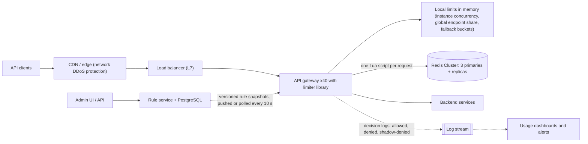
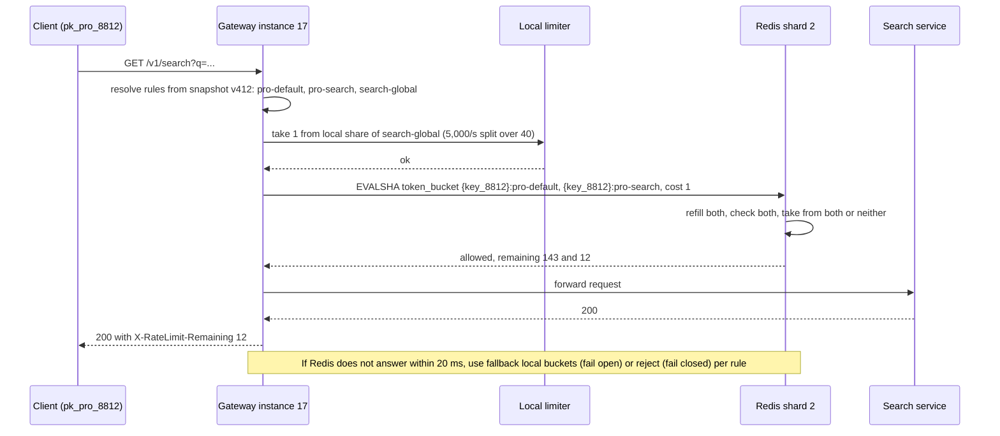

A rate limiter answers one question, millions of times a second: "is this caller allowed to make this request right now?" On one server it is a few lines of code. Across 40 gateway instances in two availability zones, with a million API keys, per-plan limits, abusive IP addresses and a backend that falls over above 5,000 searches per second, it becomes a distributed systems problem: where does the counter live, how do you update it atomically, what happens when that store is slow, and how do you change rules without a deploy? This case study designs the rate limiter for a public developer API (think a payments, maps or messaging API used by thousands of businesses), building on the algorithms from [rate limiting algorithms](#/lesson/m10-rate-limiting).

## Learning objectives

By the end of this lesson you will be able to:

1. Gather requirements for a multi-tenant rate limiter: who is limited, by what key, at what granularity, and how strictly.
2. Estimate limiter traffic, Redis operations, memory and added latency with explicit arithmetic.
3. Implement a token bucket and a sliding-window limiter atomically in Redis using a Lua script, and explain why a read-then-write from the application is wrong.
4. Layer local (in-process) and global (Redis) limits, and decide which limits need global accuracy.
5. Design rule configuration with scopes, tiers, specificity, versioning and shadow mode.
6. Return correct `429` responses with `Retry-After` and limit headers, and design client behaviour around them.
7. Choose fail-open or fail-closed per rule, and handle hot keys, multi-region quotas and limiter outages.

## Prerequisites

- [Rate limiting algorithms](#/lesson/m10-rate-limiting): token bucket, leaky bucket, fixed and sliding windows.
- [Redis data structures](#/lesson/m12-redis): hashes, sorted sets, expiry.
- [API gateways, reverse proxies and load balancers](#/lesson/m10-gateways-proxies-lb): where the limiter sits.
- [Stateless services](#/lesson/m11-stateless): why counters can't live in one gateway's memory.

## Explain it like I'm a beginner

Think of the entry gates at a metro station in Delhi during rush hour.

- Each **season-pass holder** may pass a certain number of times per hour (**per-customer limit**). A business pass allows more trips than a student pass (**tiers or plans**).
- Each gate has a **token dispenser** that refills at a steady pace. You can collect a few tokens at once if you haven't used them (**burst**), but once they are gone you wait for the refill (**token bucket**).
- There are 40 gates (**gateway instances**). If each gate kept its own count, a passenger could use all 40 gates and get 40 times the allowance. So the gates check one **shared counter board** in the control room (**central store, Redis**).
- Two gates must never both read "1 trip left" and both let someone through. The control room updates the board in one uninterrupted step (**atomic Lua script**).
- Some limits don't need the control room: "this gate can physically handle 30 people a minute" is local to the gate (**local limit**).
- If the phone line to the control room breaks, the station manager has a rule: for normal gates, let people through and count locally (**fail open**); for the gate to the staff-only area, keep it shut (**fail closed**).
- A notice board says "Try again in 2 minutes" instead of just "No" (**`429` with `Retry-After`**).
- New rules ("students get 10 more trips during exams") are posted on the board without rebuilding the gates (**dynamic rule configuration**), and can be trialled by just counting who *would* be stopped (**shadow mode**).

## Requirements

### Functional requirements

1. **Per API key limits** by plan: for example Free 10 requests/s with a burst of 20; Pro 100/s, burst 200; Enterprise custom.
2. **Per endpoint limits**: expensive endpoints (`POST /v1/reports`) have their own, lower limits per key.
3. **Per client IP limits** for unauthenticated and sensitive endpoints (`POST /v1/login`: 5 attempts, then 1 per 5 s).
4. **Global protective limits** per endpoint, independent of caller: `/v1/search` must never exceed 5,000 requests/s in total because the search cluster can't take more.
5. **Rule management** without deploys: create, change and roll back rules; a **shadow mode** that logs would-be rejections without enforcing.
6. **Responses**: `429 Too Many Requests` with `Retry-After`, and headers that tell clients their limit and remaining allowance.
7. **Visibility** for customers: current usage versus limit in the developer dashboard.

### Out of scope

- Billing quotas over months (a metering system with durable counts; the limiter is for short windows of seconds to minutes).
- DDoS protection at the network layer (handled by the CDN or cloud provider's edge before traffic reaches us).
- Request prioritisation and load shedding inside services ([backpressure](#/lesson/m13-backpressure) covers it), though the limiter feeds it.

### Non-functional requirements

| Requirement | Target |
|---|---|
| Added latency | p99 under **2 ms** for the limiter decision at the gateway |
| Accuracy | Per-key limits accurate within about 5–10 % across all instances; global protective limits may be approximate |
| Availability | The limiter must never be the reason the API is down: a limiter outage degrades to local limits for most rules |
| Throughput | 30,000 API requests/s at peak, so 30,000+ limiter decisions/s |
| Rule propagation | Rule changes active everywhere within 30 s |
| Fairness | One customer's burst can't consume capacity reserved for others |

The key trade-off is already visible: we want accuracy (a shared counter) but also tiny latency and high availability (no dependency on a remote store). The design reconciles them with layers.

## Capacity estimation

All figures are **estimates** for illustration.

### Traffic

- 30,000 requests/s at peak through 40 gateway instances ≈ **750 requests/s per instance**.
- Each request evaluates about 2 rules that need shared state (per-key plan limit and, for some endpoints, a per-key endpoint limit) and 1–2 rules that can be local (global endpoint protection, instance concurrency).
- If each shared rule were a separate Redis call: 30,000 × 2 = **60,000 Redis round trips/s**. Combining a key's rules into **one** script call (they share a hash tag, so they live in the same Redis Cluster slot): **30,000 script calls/s**.

### Redis sizing

- A single Redis primary can typically serve on the order of 100,000 simple operations per second; a Lua script that touches 2 keys does more work than a single `GET` (these are rough, workload-dependent estimates; benchmark with your script and payload).
- 30,000 scripts/s with headroom for 2× growth → a **Redis Cluster of 3 primaries** (each with a replica) gives about 20,000 scripts/s per primary at today's 2× headroom, comfortably below saturation.

### Memory

- Active API keys in a day: 100,000. Buckets per key: about 3 (plan, two endpoint rules). Each bucket is a small hash (tokens, timestamp) at roughly 100 B including overhead: 100,000 × 3 × 100 B = **30 MB**.
- Per-IP buckets for login and unauthenticated traffic: up to 5 M IPs per day × 100 B = **500 MB**, but with short expiry (a bucket expires once it would be full again), so the live set is far smaller.
- A **sliding-window log** (a sorted set entry per request) would be very different: a key at 100 requests/s with a 60 s window holds 6,000 entries; at roughly 60–100 B per entry that is ~0.5 MB **per key**, and 100,000 busy keys would need tens of GB. That arithmetic is why logs are reserved for small, strict limits.

### Latency

- An in-zone Redis round trip is typically well under a millisecond (estimate). One round trip per request keeps the limiter inside the 2 ms budget; three sequential calls might not.

### Why not local-only?

- Plan limit 100/s per key, 40 instances. If each instance enforces 100/s locally, a client spreading requests across instances (which a load balancer does for it) gets up to **4,000/s**: 40× the limit.
- If each instance enforces 100 ÷ 40 = 2.5/s, a client whose requests happen to land unevenly (keep-alive connections stick to one instance) is rejected at 2.5/s on that instance while having used only a fraction of its quota.
- Hence: **accurate per-key limits need shared state; coarse protective limits don't.**

### What the numbers tell us

1. Redis load is moderate; the design goal is **one round trip per request**, not more Redis.
2. Memory is small for token buckets and potentially large for sliding-window logs: algorithm choice is a capacity decision.
3. The gateway tier is large (40 instances), so anything that needs cross-instance agreement must go through the shared store or be approximated.

## API design

The limiter is mostly invisible: it sits in the gateway. Its "API" has three faces.

### 1. What clients see

```http
GET /v1/payments?limit=50
X-Api-Key: pk_pro_51H...

200 OK
X-RateLimit-Limit: 200
X-RateLimit-Remaining: 143
X-RateLimit-Policy: pro-default;rate=100/s;burst=200
```

```http
HTTP/1.1 429 Too Many Requests
Retry-After: 2
Content-Type: application/problem+json

{ "type": "https://api.example.com/errors/rate-limited", "title": "Too many requests",
  "status": 429, "rule": "pro-default", "retryAfterSeconds": 2 }
```

- `429` is defined in RFC 6585. `Retry-After` (in seconds) tells well-behaved clients when to try again.
- Header names: `X-RateLimit-*` headers are a widespread convention; the IETF has a draft for standard `RateLimit` header fields. Pick one, document it, and keep it stable.
- **Rate limited is not the same as overloaded**: `429` means "you, the caller, sent too much"; `503` with `Retry-After` means "we are overloaded for everyone". Clients and dashboards should be able to tell them apart.
- **Client guidance** in your docs: on `429`, wait `Retry-After` plus random jitter; never retry immediately in a loop ([retry storms](#/lesson/m13-retry-storms)).

### 2. The internal decision interface

```text
decide(request) → { allowed, ruleId, remaining, retryAfter, degraded }
```

Called by the gateway for every request, ideally in-process (a library or gateway plugin), not as a separate network service. A separate "rate limit service" adds a network hop to every request; it makes sense when many different gateways and languages must share one implementation.

### 3. The rule management API

```http
PUT /internal/v1/rate-limit/rules/pro-search
{ "scope": "apiKey", "match": { "pathPrefix": "/v1/search", "method": "GET", "tier": "pro" },
  "algorithm": "tokenBucket", "ratePerSecond": 20, "burst": 40,
  "onStoreFailure": "open", "mode": "shadow" }
```

Rules are versioned; every change records who made it and why; `mode` is `enforce` or `shadow`.

## Data model

Two kinds of data with very different properties: **rules** (small, durable, change rarely, need audit) and **counters** (huge write rate, short-lived, losing them is acceptable).

```sql
-- Durable configuration (PostgreSQL). Pushed to gateways; never read per request.
CREATE TABLE rate_limit_rule (
    rule_id          text PRIMARY KEY,
    scope            text NOT NULL CHECK (scope IN ('api_key','client_ip','global')),
    path_prefix      text NOT NULL DEFAULT '/',
    http_method      text,                     -- NULL = any
    tier             text,                     -- NULL = any plan
    algorithm        text NOT NULL CHECK (algorithm IN ('token_bucket','sliding_window')),
    rate_per_second  numeric NOT NULL CHECK (rate_per_second > 0),
    burst            int     NOT NULL CHECK (burst >= 1),
    on_store_failure text NOT NULL CHECK (on_store_failure IN ('open','closed')) DEFAULT 'open',
    mode             text NOT NULL CHECK (mode IN ('enforce','shadow')) DEFAULT 'shadow',
    updated_by       text NOT NULL,
    updated_at       timestamptz NOT NULL DEFAULT now()
);

CREATE TABLE rule_set_version (                 -- each publish is an immutable snapshot
    version     bigint GENERATED ALWAYS AS IDENTITY PRIMARY KEY,
    rules       jsonb NOT NULL,
    published_by text NOT NULL,
    published_at timestamptz NOT NULL DEFAULT now()
);

CREATE TABLE api_key_override (                 -- per-customer exceptions negotiated by sales
    api_key_id      text PRIMARY KEY,
    rate_per_second numeric NOT NULL,
    burst           int NOT NULL,
    expires_at      timestamptz
);
```

Counters live in Redis:

| Key | Type | Fields | Expiry |
|---|---|---|---|
| `rl:{key_8812}:pro-default` | Hash | `tokens`, `ts` (ms) | Time to refill fully + 1 s |
| `rl:{key_8812}:pro-search` | Hash | `tokens`, `ts` | Same |
| `rl:ip:203.0.113.7:ip-login` | Hash | `tokens`, `ts` | Same |
| `rl:{key_8812}:reports:sw:28915520` | String counter (sliding window counter, one per minute) | count | 2 minutes |

Design notes:

- **The braces are a Redis Cluster hash tag**: only `key_8812` is hashed to choose the slot, so all of a customer's buckets sit on the same shard and one script can update them atomically.
- **Expiry equals "time to become full again"**: an idle bucket that expired is indistinguishable from a full one, so expiry loses no information and keeps memory proportional to active callers.
- **Losing counters is acceptable**: if a Redis shard fails over and loses the last second of writes, some callers get a few extra requests. Nobody is charged money for it. That is why Redis without persistence (or with relaxed persistence) is fine here, unlike in a ledger.
- **Rules are published as immutable snapshots** (`rule_set_version`), so every gateway can report which version it enforces, and rollback is publishing the previous snapshot again.
- **Usage analytics** (who is hitting limits) come from the gateway's decision logs, not from Redis.

## High-level architecture



Arrow by arrow:

- **Clients → Edge → Load balancer → Gateway**: network-level floods are absorbed at the edge. The load balancer spreads requests across 40 gateway instances, which is exactly why per-key counters can't live in one instance.
- **Gateway → Local limits**: checked first, with no network call: an instance-wide concurrency cap (protects the gateway itself), this instance's share of global endpoint limits, and fallback buckets used when Redis is unavailable.
- **Gateway → Redis Cluster**: for rules that need accuracy across instances (per key, per endpoint per key, per IP for login), one Lua script call refills and takes tokens from all of that caller's buckets atomically.
- **Gateway → Backend services**: only allowed requests continue. Denied requests are answered at the gateway with `429`, costing the backend nothing.
- **Rule service ⇢ Gateway**: rules are pushed (or polled) as versioned snapshots and swapped in memory. No per-request rule lookup.
- **Admin → Rule service**: changes are validated, audited and usually start in shadow mode.
- **Gateway ⇢ Log stream ⇢ Dashboards**: every decision (sampled for allowed requests, complete for denials) feeds per-customer usage views and alerts such as "customer X is at 95 % of its limit".

### One request, end to end



The gateway resolves which rules apply from its in-memory snapshot (no lookup), takes the cheap local check first, and then makes exactly one Redis call that covers all of this customer's shared rules. The script either takes a token from every bucket or from none, so a request rejected by the endpoint rule doesn't use up plan allowance. The remaining count reported to the client is the smallest across the rules, because that is the one that will stop them first.

## Deep dives

### Deep dive 1: why atomicity, and why Lua

The naive implementation from application code:

```text
tokens = GET bucket            -- instance A reads 1     instance B reads 1
if tokens >= 1:
    SET bucket (tokens - 1)    -- A writes 0             B writes 0
    allow                      -- both allowed: limit exceeded
```

Two gateway instances read the same value and both allow the request: a classic lost update. With 40 instances and bursts of traffic from one customer, this happens constantly. Options:

- **`INCR` on a fixed-window counter** is atomic by itself and fine for fixed windows (`INCR` then `EXPIRE` on first use), but a token bucket needs read, compute, write.
- **`WATCH`/`MULTI`/`EXEC` optimistic transactions** retry on conflict, which under contention (exactly when limits matter) causes many retries.
- **A Lua script** runs on the Redis server as one unit: no other command runs on that shard while it executes. Read, refill, decide and write happen with no interleaving, in one network round trip.

Token bucket script (keys are hashes with `tokens` and `ts`):

```lua
-- KEYS: one or more bucket keys (same hash tag, so same cluster slot)
-- ARGV: cost, then for each key: rate_per_second, burst
local t = redis.call('TIME')                       -- server clock: no skew between gateways
local now_ms = tonumber(t[1]) * 1000 + math.floor(tonumber(t[2]) / 1000)
local cost = tonumber(ARGV[1])
local tokens, allowed, retry_ms = {}, 1, 0

for i, key in ipairs(KEYS) do
  local rate  = tonumber(ARGV[2 * i])
  local burst = tonumber(ARGV[2 * i + 1])
  local s = redis.call('HMGET', key, 'tokens', 'ts')
  local tk = tonumber(s[1]) or burst
  local ts = tonumber(s[2]) or now_ms
  tk = math.min(burst, tk + math.max(0, now_ms - ts) * rate / 1000)
  tokens[i] = tk
  if tk < cost then
    allowed = 0
    retry_ms = math.max(retry_ms, math.ceil((cost - tk) * 1000 / rate))
  end
end

local remaining = {}
for i, key in ipairs(KEYS) do
  local rate  = tonumber(ARGV[2 * i])
  local burst = tonumber(ARGV[2 * i + 1])
  local tk = tokens[i]
  if allowed == 1 then tk = tk - cost end          -- take from every bucket, or from none
  redis.call('HSET', key, 'tokens', tk, 'ts', now_ms)
  redis.call('PEXPIRE', key, math.ceil(burst * 1000 / rate) + 1000)
  remaining[i] = tostring(tk)                      -- Lua numbers become integers in replies; send strings
end
return { allowed, retry_ms, remaining }
```

Details that matter:

- **Server time** (`TIME`) avoids clock skew between 40 gateways. Redis 5 and later replicate script *effects* rather than the script itself, which is what makes calling `TIME` before writing safe; on older versions you would pass the time in from the client.
- **All keys in one slot**: Redis Cluster rejects a script whose keys hash to different slots. The `{key_8812}` hash tag guarantees they don't.
- **Load once, call by hash**: `SCRIPT LOAD` returns a SHA; gateways call `EVALSHA` and fall back to `EVAL` on a `NOSCRIPT` error (client libraries usually handle this).
- **Keep scripts short**: a script blocks its shard while running. Microseconds are fine; loops over thousands of keys are not.
- **Floats in replies**: Redis converts Lua numbers to integers in replies, so fractional token counts are returned as strings.

From .NET, with StackExchange.Redis (not compiled here, because the package isn't available offline):

```csharp
// var result = (RedisResult[])await db.ScriptEvaluateAsync(TokenBucketLua,
//     new RedisKey[] { "rl:{key_8812}:pro-default", "rl:{key_8812}:pro-search" },
//     new RedisValue[] { 1, 100, 200, 20, 40 });
// bool allowed = (int)result[0] == 1;
```

### Deep dive 2: choosing the algorithm per rule

| Algorithm | State per key | Behaviour | Use for |
|---|---|---|---|
| Fixed window counter | 1 integer | Simple, but allows 2× the limit across a window boundary | Coarse daily or hourly quotas |
| Sliding window log | 1 entry per request | Exact | Small, strict limits (login attempts: 5 per 15 min) |
| Sliding window counter | 2 integers | Close approximation, smooth | Per-minute API limits at scale |
| Token bucket | 2 numbers | Steady rate plus controlled bursts | Default for API plans |
| GCRA (generic cell rate algorithm) | 1 timestamp | Equivalent to a token bucket, smaller state | Very high-cardinality keys |

**Sliding window log** in Redis uses a sorted set per key: `ZREMRANGEBYSCORE key 0 (now − window)`, `ZCARD key`, and if below the limit `ZADD key now request_id`, plus `PEXPIRE`, all in one script. Exact, but memory grows with the limit (see the capacity estimate).

**Sliding window counter** keeps the count for the current and previous fixed windows and estimates: `estimate = previous × (1 − elapsed_fraction) + current`. With a limit of 100 per minute, 80 requests in the previous minute and 30 so far in the current minute, 15 s into it: 80 × 0.75 + 30 = 90, so 10 more are allowed. Exercise 3 implements it.

**Token bucket** is the usual default because product managers think in "100 per second with bursts up to 200", and it maps directly to two parameters.

### Deep dive 3: local plus global

Not every limit needs a shared counter. Layer them:

1. **Local, per instance, no network**:
   - An instance-wide **concurrency limit** (for example 500 in-flight requests per gateway): protects the instance itself. ASP.NET Core's built-in rate limiting middleware does this well.
   - A **share of global protective limits**: `/v1/search` must stay under 5,000/s total; each of 40 instances enforces 5,000 ÷ 40 = 125/s locally. Not exact (traffic isn't perfectly even, and the share must be recomputed when the instance count changes), but the goal is protecting the backend, not billing fairness. Recompute the share from the current instance count published by service discovery, and add 10–20 % slack.
   - **Fallback buckets** used when Redis is unavailable.
2. **Global, in Redis**: per-key plan limits, per-key endpoint limits and per-IP login limits, where accuracy across instances matters.
3. **Token leasing for very hot keys**: a customer sending 20,000 requests/s through one key makes one Redis key (and shard) very hot. Instead of one script call per request, each instance leases tokens in batches (take 50 at once from Redis, spend them locally). Redis calls drop 50×; the cost is accuracy: up to 50 × 40 = 2,000 tokens can be "in flight" in instance memory, and unused leases should be returned or allowed to expire.

**Order of checks**: cheapest first. Local concurrency and local shares reject floods before any Redis call; then one Redis script.

### Deep dive 4: rule configuration

Rules are data, not code:

```json
{
  "version": 412,
  "rules": [
    { "id": "free-default", "scope": "apiKey", "match": { "pathPrefix": "/", "tier": "free" },
      "ratePerSecond": 10, "burst": 20, "onStoreFailure": "open", "mode": "enforce" },
    { "id": "pro-default", "scope": "apiKey", "match": { "pathPrefix": "/", "tier": "pro" },
      "ratePerSecond": 100, "burst": 200, "onStoreFailure": "open", "mode": "enforce" },
    { "id": "pro-search", "scope": "apiKey", "match": { "pathPrefix": "/v1/search", "tier": "pro" },
      "ratePerSecond": 20, "burst": 40, "onStoreFailure": "open", "mode": "shadow" },
    { "id": "ip-login", "scope": "clientIp", "match": { "pathPrefix": "/v1/login", "method": "POST" },
      "ratePerSecond": 0.2, "burst": 5, "onStoreFailure": "closed", "mode": "enforce" },
    { "id": "search-global", "scope": "global", "match": { "pathPrefix": "/v1/search" },
      "ratePerSecond": 5000, "burst": 5000, "onStoreFailure": "open", "mode": "enforce" }
  ]
}
```

Design rules for the rules:

- **Scopes stack, specificity wins within a scope**: a request is checked against one rule per scope (api key, IP, global). Within the api-key scope, the most specific match wins: longer path prefix, then method-specific, then tier-specific. So a Pro search request uses `pro-search`, not `pro-default`, for the endpoint limit, while the plan-wide limit is a separate rule id. (Exactly how rules combine is a product decision; write it down and test it.)
- **Per-customer overrides** come from `api_key_override` and replace the plan rule's numbers for that key.
- **Shadow mode first**: a new rule logs "would have denied" for a few days; you check who would be affected before enforcing. Many painful incidents are new limits that unexpectedly blocked a big customer's nightly batch job.
- **Validation before publish**: reject rules with zero or negative rates, unknown scopes, or a burst lower than typical request cost; diff against the previous version and require approval for large changes.
- **Propagation**: gateways poll the rule service every 10 s (or subscribe to change events) and swap the snapshot atomically. Each gateway exports the version it enforces; an alert fires if versions diverge for more than a minute.

### Deep dive 5: fail-open versus fail-closed

What happens when Redis is slow or down? The limiter must have a timeout (for example 20 ms), and each rule needs a policy:

| Rule kind | Policy | Reasoning |
|---|---|---|
| Plan limits per API key | **Fail open** to local fallback buckets | Blocking all paying customers because a counter store is down turns a limiter incident into a full outage |
| Global backend protection | Already local | Unaffected by Redis |
| Login / OTP attempts per IP or account | **Fail closed** | Failing open would let attackers brute-force passwords during the outage; legitimate users retrying a minute later is acceptable |
| Expensive endpoints (report generation) | Fail open with low local limit | Protects the backend without blocking everyone |

"Fail open" should rarely mean "no limit at all". It means **degrade to local fallback buckets** sized at the rule's rate divided by the instance count, so a misbehaving client still can't send unlimited traffic. Also:

- **Circuit breaker on the store**: after N timeouts in a row, stop calling Redis for a few seconds and use fallbacks directly, rather than adding 20 ms of waiting to every request.
- **Mark responses as degraded** in logs and metrics, so you know how much traffic was limited approximately.
- **Alert on degraded mode**, not just on Redis being down.

### Deep dive 6: hot keys, fairness and multiple regions

- **Hot keys**: one large customer can make one Redis shard much busier than the others. Use token leasing for keys above a threshold, or give very large customers their own sub-keys (`{key_8812:0}` to `{key_8812:7}`, each with 1/8 of the limit, chosen by hash of the request id).
- **Noisy neighbours**: per-key limits don't protect the backend when 1,000 customers are all within their limits at once. Global protective limits and backend load shedding cover that.
- **Multiple regions**: a single global Redis across regions adds tens of milliseconds per request. Usual options: (a) per-region counters with each region enforcing a share of the limit (for example 60 % in Mumbai, 40 % in Singapore, adjusted from traffic); (b) per-region counters plus asynchronous exchange of usage every second, accepting short overshoot; (c) route each API key to a home region. Exact global limits across regions are rarely worth the latency.

### Deep dive 7: the core in ASP.NET Core

The code below is a gateway-side limiter: rules resolved from a versioned in-memory snapshot, a bucket store interface whose in-memory implementation mirrors the Lua script's arithmetic, a hybrid limiter that applies local shares for global rules and Redis-backed buckets for per-key rules with a timeout and per-rule failure mode, and middleware that writes `429` responses with headers. ASP.NET Core's built-in rate limiter protects each instance with a concurrency limit.

```csharp file=Throttle/Rules.cs
namespace Throttle;

public enum LimitScope { ApiKey, ClientIp, Global }
public enum FailureMode { Open, Closed }

public sealed record RateLimitRule(
    string Id, LimitScope Scope, string PathPrefix, string? Method, string? Tier,
    double RatePerSecond, int Burst, FailureMode OnStoreFailure = FailureMode.Open, bool Shadow = false);

public sealed record RequestInfo(string Method, string Path, string? ApiKey, string ClientIp, string Tier);

public sealed class RuleSet(IReadOnlyList<RateLimitRule> rules, string version)
{
    public string Version { get; } = version;

    /// <summary>One rule per scope: the most specific match (longest prefix, then method, then tier).</summary>
    public IReadOnlyList<RateLimitRule> Resolve(RequestInfo r) =>
        rules.Where(x => r.Path.StartsWith(x.PathPrefix, StringComparison.OrdinalIgnoreCase)
                      && (x.Method is null || string.Equals(x.Method, r.Method, StringComparison.OrdinalIgnoreCase))
                      && (x.Tier is null || x.Tier == r.Tier)
                      && (x.Scope != LimitScope.ApiKey || r.ApiKey is not null))
             .GroupBy(x => x.Scope)
             .Select(g => g.OrderByDescending(x => x.PathPrefix.Length)
                           .ThenByDescending(x => x.Method is not null)
                           .ThenByDescending(x => x.Tier is not null)
                           .First())
             .ToList();

    /// <summary>Redis keys; the {braces} are a cluster hash tag so one customer's buckets share a slot.</summary>
    public static string KeyFor(RateLimitRule rule, RequestInfo r) => rule.Scope switch
    {
        LimitScope.ApiKey => "rl:{" + r.ApiKey + "}:" + rule.Id,
        LimitScope.ClientIp => "rl:ip:" + r.ClientIp + ":" + rule.Id,
        _ => "rl:global:" + rule.Id,
    };
}

public sealed class RuleSetProvider(RuleSet initial)
{
    private RuleSet _current = initial;
    public RuleSet Current => Volatile.Read(ref _current);
    public void Replace(RuleSet next) => Volatile.Write(ref _current, next); // rule reloads swap the whole snapshot
}
```

```csharp file=Throttle/BucketStore.cs
namespace Throttle;

public sealed record BucketResult(bool Allowed, double Remaining, TimeSpan RetryAfter);

public interface IBucketStore
{
    /// <summary>Refill and take <paramref name="cost"/> tokens atomically. In Redis: one EVALSHA of the Lua script.</summary>
    Task<BucketResult> TryTakeAsync(string key, double ratePerSecond, int burst, int cost, CancellationToken ct);
}

/// <summary>Same arithmetic as the Lua script; the lock plays the role of Redis running one script at a time.</summary>
public sealed class InMemoryBucketStore(TimeProvider clock) : IBucketStore
{
    private readonly Lock _gate = new();
    private readonly Dictionary<string, (double Tokens, DateTimeOffset At)> _buckets = new();

    public Task<BucketResult> TryTakeAsync(string key, double ratePerSecond, int burst, int cost, CancellationToken ct)
    {
        lock (_gate)
        {
            var now = clock.GetUtcNow();
            var (tokens, at) = _buckets.TryGetValue(key, out var s) ? s : ((double)burst, now);
            tokens = Math.Min(burst, tokens + Math.Max(0, (now - at).TotalSeconds) * ratePerSecond);

            if (tokens >= cost)
            {
                _buckets[key] = (tokens - cost, now);
                return Task.FromResult(new BucketResult(true, tokens - cost, TimeSpan.Zero));
            }
            _buckets[key] = (tokens, now);
            return Task.FromResult(new BucketResult(false, tokens, TimeSpan.FromSeconds((cost - tokens) / ratePerSecond)));
        }
    }
}
```

```csharp file=Throttle/HybridRateLimiter.cs
using System.Collections.Concurrent;
using System.Threading.RateLimiting;
using Microsoft.Extensions.Logging;

namespace Throttle;

public sealed record LimitDecision(bool Allowed, RateLimitRule? Rule, double Remaining, TimeSpan RetryAfter, bool Degraded);

public sealed class HybridRateLimiter(IBucketStore store, ILogger<HybridRateLimiter> log, int instanceCount = 1)
{
    public static readonly TimeSpan StoreTimeout = TimeSpan.FromMilliseconds(20);
    private readonly ConcurrentDictionary<string, TokenBucketRateLimiter> _local = new();

    public async Task<LimitDecision> CheckAsync(RuleSet rules, RequestInfo request, CancellationToken ct)
    {
        // Cheapest first: local (global-scope) rules need no network call.
        var ordered = rules.Resolve(request).OrderBy(r => r.Scope == LimitScope.Global ? 0 : 1);
        LimitDecision? tightest = null;
        foreach (var rule in ordered)
        {
            var key = RuleSet.KeyFor(rule, request);
            var d = rule.Scope == LimitScope.Global ? CheckLocalShare(key, rule, degraded: false)
                                                    : await CheckSharedAsync(key, rule, ct);
            if (!d.Allowed && rule.Shadow)
            {
                log.LogInformation("Shadow rule {Rule} would deny {Key}", rule.Id, key);
                continue;
            }
            if (!d.Allowed) return d;
            if (tightest is null || d.Remaining < tightest.Remaining) tightest = d;
        }
        // Note: rules are checked one by one here, so a later denial does not refund earlier tokens.
        // The multi-key Lua script (and exercise 5) take from all buckets or none.
        return tightest ?? new LimitDecision(true, null, double.PositiveInfinity, TimeSpan.Zero, false);
    }

    private async Task<LimitDecision> CheckSharedAsync(string key, RateLimitRule rule, CancellationToken ct)
    {
        try
        {
            using var timeout = CancellationTokenSource.CreateLinkedTokenSource(ct);
            timeout.CancelAfter(StoreTimeout);
            var r = await store.TryTakeAsync(key, rule.RatePerSecond, rule.Burst, 1, timeout.Token);
            return new LimitDecision(r.Allowed, rule, r.Remaining, r.RetryAfter, Degraded: false);
        }
        catch (Exception ex) when (!ct.IsCancellationRequested)
        {
            log.LogWarning(ex, "Limiter store unavailable for {Rule}; failing {Mode}", rule.Id, rule.OnStoreFailure);
            return rule.OnStoreFailure == FailureMode.Closed
                ? new LimitDecision(false, rule, 0, TimeSpan.FromSeconds(1), Degraded: true)
                : CheckLocalShare("fallback:" + key, rule, degraded: true); // fail open, but to a bounded local bucket
        }
    }

    private LimitDecision CheckLocalShare(string key, RateLimitRule rule, bool degraded)
    {
        var limiter = _local.GetOrAdd(key, _ => new TokenBucketRateLimiter(new TokenBucketRateLimiterOptions
        {
            TokenLimit = Math.Max(1, rule.Burst / instanceCount),
            TokensPerPeriod = Math.Max(1, (int)Math.Round(rule.RatePerSecond / instanceCount / 10)),
            ReplenishmentPeriod = TimeSpan.FromMilliseconds(100),
            QueueLimit = 0,
            AutoReplenishment = true,
        }));
        using var lease = limiter.AttemptAcquire(1);
        var remaining = limiter.GetStatistics()?.CurrentAvailablePermits ?? 0;
        return new LimitDecision(lease.IsAcquired, rule, remaining,
            lease.IsAcquired ? TimeSpan.Zero : TimeSpan.FromMilliseconds(100), degraded);
    }
}
```

```csharp file=Throttle/RateLimitMiddleware.cs
using System.Globalization;

namespace Throttle;

public sealed class RateLimitMiddleware(RequestDelegate next, HybridRateLimiter limiter, RuleSetProvider rules,
    ILogger<RateLimitMiddleware> log)
{
    public async Task InvokeAsync(HttpContext ctx)
    {
        var apiKey = ctx.Request.Headers["X-Api-Key"].ToString();
        var request = new RequestInfo(
            ctx.Request.Method,
            ctx.Request.Path.Value ?? "/",
            string.IsNullOrEmpty(apiKey) ? null : apiKey,
            ctx.Connection.RemoteIpAddress?.ToString() ?? "unknown", // behind proxies: configure ForwardedHeaders first
            apiKey.StartsWith("pk_pro_", StringComparison.Ordinal) ? "pro" : "free");

        var snapshot = rules.Current;
        var decision = await limiter.CheckAsync(snapshot, request, ctx.RequestAborted);

        if (decision.Rule is { } rule)
        {
            ctx.Response.Headers["X-RateLimit-Limit"] = rule.Burst.ToString(CultureInfo.InvariantCulture);
            ctx.Response.Headers["X-RateLimit-Remaining"] = ((long)Math.Max(0, Math.Floor(decision.Remaining))).ToString(CultureInfo.InvariantCulture);
            ctx.Response.Headers["X-RateLimit-Policy"] = $"{rule.Id};rate={rule.RatePerSecond.ToString(CultureInfo.InvariantCulture)}/s;burst={rule.Burst}";
        }

        if (!decision.Allowed)
        {
            var retrySeconds = Math.Max(1, (int)Math.Ceiling(decision.RetryAfter.TotalSeconds));
            log.LogInformation("429 rule={Rule} key={Key} version={Version} degraded={Degraded}",
                decision.Rule?.Id, request.ApiKey ?? request.ClientIp, snapshot.Version, decision.Degraded);
            ctx.Response.StatusCode = StatusCodes.Status429TooManyRequests;
            ctx.Response.Headers.RetryAfter = retrySeconds.ToString(CultureInfo.InvariantCulture);
            await ctx.Response.WriteAsJsonAsync(new
            {
                type = "https://api.example.com/errors/rate-limited",
                title = "Too many requests",
                status = 429,
                rule = decision.Rule?.Id,
                retryAfterSeconds = retrySeconds,
            });
            return;
        }
        await next(ctx);
    }
}
```

```csharp file=Program.cs
using System.Threading.RateLimiting;
using Throttle;

var builder = WebApplication.CreateBuilder(args);
builder.Services.AddSingleton(TimeProvider.System);
builder.Services.AddSingleton<IBucketStore, InMemoryBucketStore>(); // production: a Redis-backed store running the Lua script
builder.Services.AddSingleton(sp => new HybridRateLimiter(
    sp.GetRequiredService<IBucketStore>(), sp.GetRequiredService<ILogger<HybridRateLimiter>>(),
    instanceCount: builder.Configuration.GetValue("Gateway:InstanceCount", 1)));
builder.Services.AddSingleton(new RuleSetProvider(new RuleSet(new[]
{
    new RateLimitRule("free-default", LimitScope.ApiKey, "/", null, "free", 10, 20),
    new RateLimitRule("pro-default", LimitScope.ApiKey, "/", null, "pro", 100, 200),
    new RateLimitRule("pro-search", LimitScope.ApiKey, "/v1/search", null, "pro", 20, 40, Shadow: true),
    new RateLimitRule("ip-login", LimitScope.ClientIp, "/v1/login", "POST", null, 0.2, 5, FailureMode.Closed),
    new RateLimitRule("search-global", LimitScope.Global, "/v1/search", null, null, 5000, 5000),
}, version: "412")));

// Instance self-protection with the built-in middleware: at most 500 in flight per gateway instance.
builder.Services.AddRateLimiter(options =>
{
    options.RejectionStatusCode = StatusCodes.Status503ServiceUnavailable; // overloaded, not "you sent too much"
    options.GlobalLimiter = PartitionedRateLimiter.Create<HttpContext, string>(_ =>
        RateLimitPartition.GetConcurrencyLimiter("instance", _ => new ConcurrencyLimiterOptions
        {
            PermitLimit = 500,
            QueueLimit = 100,
            QueueProcessingOrder = QueueProcessingOrder.OldestFirst,
        }));
});

var app = builder.Build();
app.UseRateLimiter();
app.UseMiddleware<RateLimitMiddleware>();

app.MapGet("/v1/search", (string q) => Results.Ok(new { q, results = Array.Empty<string>() }));
app.MapPost("/v1/login", () => Results.Ok(new { token = "demo" }));
app.MapGet("/v1/payments", () => Results.Ok(Array.Empty<object>()));

app.Run();
```

Things to notice:

- `RuleSet.Resolve` picks one rule per scope by specificity and skips api-key rules for anonymous requests, so the IP rule still protects login.
- `HybridRateLimiter` checks local rules before shared ones, uses a 20 ms timeout on the store, and applies each rule's failure mode. "Open" falls back to a bounded local bucket, not to "unlimited".
- Shadow rules are evaluated and logged but never deny, which is how a new limit is trialled safely.
- The built-in concurrency limiter returns `503`, because exceeding instance capacity is an overload condition, not a client fault.

## Caching, queues and scaling

### Caching

- **Rules**: fully cached in gateway memory as a versioned snapshot; refreshed every 10 s or on change notification. A rule lookup per request from a database would cost more than the limit check.
- **API key → plan and overrides**: cached in memory with a short TTL (60 s) and invalidated on plan changes; the authentication step usually loads it anyway.
- **Negative cache for blocked callers**: when a caller is far over its limit (for example, more than 10× in the last second), remember "blocked until T" locally for a few hundred milliseconds and reject without calling Redis. This takes abusive traffic off Redis, at the cost of a slightly less precise `Retry-After`.

### Queues

The decision path has no queues: a rate limiter must answer immediately. Queues appear around it:

- **Decision logs** go to a log stream (sampled for allowed requests, complete for denials and shadow denials) for dashboards and customer usage pages.
- **Rule change events** can be published so gateways reload immediately rather than waiting for the next poll.
- **Queueing instead of rejecting** (a leaky-bucket queue) is sometimes right for internal batch traffic, but for a public API, holding connections open while waiting is expensive; reject quickly with `Retry-After`.

### Scaling

- **Gateways** scale horizontally. Each new instance changes the local share of global limits, so shares are recomputed from the current instance count.
- **Redis Cluster** scales by adding shards; keys move by hash slot. Because each customer's keys share a hash tag, a customer's buckets move together.
- **Replicas** in Redis are for failover, not for reads: limiter decisions must read the primary, or two instances could read stale values from different replicas.

**What breaks first?** (1) Hot keys from a single large customer saturating one Redis shard; (2) added latency if the limiter makes several sequential Redis calls per request; (3) memory if someone switches a high-volume rule to a sliding-window log; (4) rule mistakes (a typo that sets a limit to 1/s for every Pro customer), which is why shadow mode, validation and gradual rollout exist.

## Failure handling

| Failure | Effect | Mitigation |
|---|---|---|
| Redis shard down | Shared counters unavailable for keys on that shard | Timeout (20 ms) + circuit breaker; per-rule fail open to local fallback buckets, fail closed for login/OTP |
| Redis slow | Added latency on every request | Strict timeout; breaker opens after repeated timeouts; alert on p99 of limiter calls |
| Redis failover loses recent writes | Some callers get extra requests briefly | Acceptable by design; counters are not money |
| Bad rule published | Legitimate customers blocked, or no protection | Validation, shadow mode, staged rollout, instant rollback to previous version |
| Gateways enforce different rule versions | Inconsistent behaviour | Version exported as a metric; alert on divergence |
| Clock skew between gateways | Refill errors | Use Redis server time inside the script |
| Clients retry `429` immediately | Retry storm amplifies load | `Retry-After`, documented backoff with jitter, negative caching of blocked callers |
| Load balancer health checks hit the limiter | Instances marked unhealthy | Exempt health and readiness endpoints from rate limits |
| Client IP is the proxy's IP | Everyone shares one IP bucket | Configure forwarded headers with trusted proxies only; never trust a client-supplied `X-Forwarded-For` blindly |

## Security

- **Identity for limits must be trustworthy**: limit by authenticated API key where possible. IP-based limits are weaker (NAT gateways put thousands of mobile users in India behind a few carrier IPs; attackers rotate IPs), so combine IP limits with account-level limits for login (attempts per username as well as per IP).
- **Forwarded headers**: only accept `X-Forwarded-For` or `Forwarded` from known proxy addresses (ASP.NET Core's `ForwardedHeadersOptions.KnownProxies` / `KnownNetworks`), otherwise attackers set their own "IP" per request and bypass IP limits.
- **Credential stuffing and OTP abuse**: fail closed, use exponential lockouts per account, and add CAPTCHA or step-up challenges after limits are hit.
- **Don't leak too much**: limit headers telling attackers exactly how many login attempts remain may help them pace attacks; omit them on sensitive endpoints.
- **Rule changes are privileged**: changing limits can disable protection or block a customer; require authentication, approval for large changes, and an audit log ([least privilege and audit](#/lesson/m14-least-privilege-audit)).
- **Redis access**: private network only, authentication and TLS enabled, no access from outside the gateway subnet.

## Observability

- **Decisions per second** by rule and outcome (allowed, denied, shadow-denied, degraded).
- **Top limited callers** per rule, and customers close to their limit (for proactive outreach by account managers).
- **Limiter latency** (p50, p99) and Redis error and timeout rates; circuit breaker state per shard.
- **Degraded-mode share**: percentage of decisions made with fallback buckets.
- **Rule version** per gateway and time since last reload.
- **Redis**: memory, keys, CPU per shard, and per-key hotness (sample hot keys to find candidates for leasing).
- **Shadow-mode reports**: for each shadow rule, which customers would have been limited and how often, reviewed before enforcement.
- **Customer-facing usage**: a dashboard of each key's usage against its limit, so customers can self-diagnose `429`s rather than opening tickets.

## Deployment and cost

### Deployment

- The limiter ships as a **library or plugin inside the gateway**, deployed with it. Changes to limiting logic go through canary gateways first (5 % of traffic), compared on denial rates.
- **Rule changes are deployments of data**: shadow first, then enforce for one tier or region, then everywhere. Rollback is republishing the previous snapshot.
- **Lua scripts are versioned**: a new script version is loaded under a new SHA before gateways start using it, so mixed versions can coexist during a rolling deploy.
- **Exempt internal traffic** carefully (health checks, internal service accounts) by explicit rule, not by "skip if header present".

### Cost drivers (estimates)

1. **Redis cluster**: 3 primaries + 3 replicas with modest memory (under a few GB). Small compared to the API fleet.
2. **Gateway CPU** for limiter logic: small, as long as the hot path has no extra network calls.
3. **Log volume** from decision logs: sample allowed decisions (1 %) and keep all denials.
4. **Indirect savings**: the limiter's value is avoided backend cost and avoided outages; a single runaway customer script can otherwise drive autoscaling and database load.

### When a simpler design is enough

A single ASP.NET Core API on two or three instances, used by a few hundred customers, can use the built-in rate limiting middleware with partitioned token buckets per API key in each instance and set each limit at "plan limit ÷ instance count", accepting some inaccuracy. If you run behind a managed API gateway (Azure API Management, a cloud provider's API gateway, or a CDN with rate-limiting rules), use its built-in rate-limit and quota policies before building your own. Build the distributed limiter when you need accurate per-customer limits across many instances, custom rule logic, or per-customer visibility.

## Alternatives and trade-offs

| Decision | Our choice | Alternative | When the alternative wins |
|---|---|---|---|
| Where the decision runs | Library inside the gateway | Separate rate-limit service (gRPC) | Many heterogeneous gateways and languages must share one implementation |
| Shared store | Redis Cluster with Lua scripts | Database counters | Very low traffic; or durable quotas such as monthly billing |
| Default algorithm | Token bucket | Sliding window counter | Product wants "N per minute" semantics; both are fine |
| Strict small limits | Sliding window log | Token bucket | When approximate is acceptable and memory matters |
| Global protection | Local shares per instance | Shared counter | Backend capacity is tiny and must be exact |
| Store failure | Per-rule fail open (bounded) or closed | Fail open everywhere | Internal APIs where abuse isn't a concern |
| Multi-region | Per-region shares | One global Redis | Single-region deployments, or when exactness matters more than latency |
| Build vs buy | Build in gateway | Managed gateway policies | Standard limits with no custom logic |

## Practical playground

The starting graph is a common first attempt: each gateway instance keeps its own counters in memory, and a separate rate-limit microservice is called synchronously for some routes. Open it in the HLD canvas and improve it: move shared counters to a Redis cluster accessed with one script per request, keep local limits in the gateway, add a rule service that pushes versioned snapshots, add decision logs and dashboards, and decide which rules fail open and which fail closed. Raise the client RPS to 30,000 and see which node becomes the bottleneck.

:::playground type=hld title="From per-instance counters to a distributed limiter"
```json
{
  "nodes": [
    { "id": "c", "type": "client", "label": "API clients", "props": { "rps": 30000 } },
    { "id": "lb", "type": "load-balancer", "label": "Load balancer" },
    { "id": "gw", "type": "api-gateway", "label": "Gateways (counters in local memory)", "props": { "instances": 40 } },
    { "id": "rls", "type": "rate-limiter", "label": "Rate-limit service (one call per rule)", "props": { "instances": 2 } },
    { "id": "db", "type": "database", "label": "PostgreSQL (rules read per request)" },
    { "id": "svc", "type": "app-server", "label": "Backend services", "props": { "instances": 20 } }
  ],
  "edges": [
    { "from": "c", "to": "lb", "kind": "sync" },
    { "from": "lb", "to": "gw", "kind": "sync" },
    { "from": "gw", "to": "rls", "kind": "sync", "label": "2-3 calls per request" },
    { "from": "rls", "to": "db", "kind": "sync", "label": "SELECT rules + UPDATE counters" },
    { "from": "gw", "to": "svc", "kind": "sync" }
  ]
}
```
:::

## Exercises

:::exercise id=m17-rate-limiter-ex1 difficulty=beginner kind=code title="Token bucket with an injected clock"
Implement a single-process `TokenBucket`. It starts full, refills continuously at `ratePerSecond` up to `capacity`, and `TryTake(cost)` succeeds only if enough tokens are available.
::requirements
- Constructor `TokenBucket(double capacity, double ratePerSecond, TimeProvider clock)`; both numbers must be positive (`ArgumentOutOfRangeException` otherwise).
- `TryTake(int cost = 1)`: refill based on elapsed time, then take `cost` tokens and return `true`, or return `false` and take nothing.
- `Available` returns the current number of tokens after refilling (never above capacity).
- `RetryAfter(int cost = 1)` returns how long until `cost` tokens will be available (`TimeSpan.Zero` if available now).
- Refill is continuous: after 150 ms at 10 tokens/s, 1.5 tokens have been added.
- Thread safe.
::acceptance
- All tests pass.
- The bucket never exceeds its capacity, however long it sits idle.
::hint
Store two fields: the current token count (a `double`) and the time of the last refill.
::hint
Refill = `min(capacity, tokens + elapsedSeconds × rate)`, then set the last-refill time to now. Do this at the start of every public method.
::hint
`RetryAfter` after refilling: if `tokens >= cost` return zero, else `(cost - tokens) / rate` seconds.
::hint
Wrap each method body in `lock (_gate)` so refill-check-take is atomic, the same role the Lua script plays in Redis.
::hint
```csharp
private void Refill()
{
    var now = _clock.GetUtcNow();
    var elapsed = (now - _last).TotalSeconds;
    if (elapsed > 0) _tokens = Math.Min(_capacity, _tokens + elapsed * _rate);
    _last = now;
}
```
::starter
```csharp file=TokenBucket.cs
using System;

public sealed class TokenBucket
{
    public TokenBucket(double capacity, double ratePerSecond, TimeProvider clock) => throw new NotImplementedException();

    public double Available => throw new NotImplementedException();

    public bool TryTake(int cost = 1) => throw new NotImplementedException();

    public TimeSpan RetryAfter(int cost = 1) => throw new NotImplementedException();
}
```
::tests
```csharp file=TokenBucketTests.cs
using System;
using System.Linq;
using System.Threading.Tasks;
using Xunit;

public sealed class FakeClock : TimeProvider
{
    public DateTimeOffset Now { get; set; } = new(2026, 10, 20, 9, 0, 0, TimeSpan.Zero);
    public override DateTimeOffset GetUtcNow() => Now;
    public void Advance(TimeSpan by) => Now = Now.Add(by);
}

public class TokenBucketTests
{
    [Fact]
    public void Starts_full_and_allows_burst()
    {
        var b = new TokenBucket(5, 1, new FakeClock());
        for (var i = 0; i < 5; i++) Assert.True(b.TryTake());
        Assert.False(b.TryTake());
    }

    [Fact]
    public void Refills_continuously()
    {
        var clock = new FakeClock();
        var b = new TokenBucket(10, 10, clock);
        for (var i = 0; i < 10; i++) b.TryTake();
        clock.Advance(TimeSpan.FromMilliseconds(150));
        Assert.InRange(b.Available, 1.49, 1.51);
        Assert.True(b.TryTake());
        Assert.False(b.TryTake());
    }

    [Fact]
    public void Never_exceeds_capacity()
    {
        var clock = new FakeClock();
        var b = new TokenBucket(3, 100, clock);
        clock.Advance(TimeSpan.FromHours(1));
        Assert.Equal(3, b.Available, 6);
    }

    [Fact]
    public void Failed_take_consumes_nothing()
    {
        var b = new TokenBucket(3, 1, new FakeClock());
        Assert.False(b.TryTake(4));
        Assert.Equal(3, b.Available, 6);
        Assert.True(b.TryTake(3));
    }

    [Fact]
    public void Retry_after_is_time_to_enough_tokens()
    {
        var clock = new FakeClock();
        var b = new TokenBucket(2, 4, clock);
        b.TryTake(2);
        Assert.InRange(b.RetryAfter(1).TotalMilliseconds, 249, 251);
        Assert.InRange(b.RetryAfter(2).TotalMilliseconds, 499, 501);
        clock.Advance(TimeSpan.FromMilliseconds(250));
        Assert.Equal(TimeSpan.Zero, b.RetryAfter(1));
    }

    [Fact]
    public void Rejects_invalid_configuration()
    {
        Assert.Throws<ArgumentOutOfRangeException>(() => new TokenBucket(0, 1, new FakeClock()));
        Assert.Throws<ArgumentOutOfRangeException>(() => new TokenBucket(1, -1, new FakeClock()));
    }

    [Fact]
    public async Task Concurrent_takes_never_overspend()
    {
        var b = new TokenBucket(100, 0.0001, new FakeClock());
        var results = await Task.WhenAll(Enumerable.Range(0, 500).Select(_ => Task.Run(() => b.TryTake())));
        Assert.Equal(100, results.Count(r => r));
    }
}
```
::solution
```csharp file=TokenBucket.cs
using System;

public sealed class TokenBucket
{
    private readonly object _gate = new();
    private readonly double _capacity;
    private readonly double _rate;
    private readonly TimeProvider _clock;
    private double _tokens;
    private DateTimeOffset _last;

    public TokenBucket(double capacity, double ratePerSecond, TimeProvider clock)
    {
        ArgumentOutOfRangeException.ThrowIfNegativeOrZero(capacity);
        ArgumentOutOfRangeException.ThrowIfNegativeOrZero(ratePerSecond);
        _capacity = capacity;
        _rate = ratePerSecond;
        _clock = clock;
        _tokens = capacity;
        _last = clock.GetUtcNow();
    }

    private void Refill()
    {
        var now = _clock.GetUtcNow();
        var elapsed = (now - _last).TotalSeconds;
        if (elapsed > 0) _tokens = Math.Min(_capacity, _tokens + elapsed * _rate);
        _last = now;
    }

    public double Available
    {
        get { lock (_gate) { Refill(); return _tokens; } }
    }

    public bool TryTake(int cost = 1)
    {
        lock (_gate)
        {
            Refill();
            if (_tokens < cost) return false;
            _tokens -= cost;
            return true;
        }
    }

    public TimeSpan RetryAfter(int cost = 1)
    {
        lock (_gate)
        {
            Refill();
            return _tokens >= cost ? TimeSpan.Zero : TimeSpan.FromSeconds((cost - _tokens) / _rate);
        }
    }
}
```

Storing "tokens + last refill time" instead of running a timer means an idle bucket costs nothing, and the bucket can be serialised as two numbers, which is exactly what the Redis hash stores. The `elapsed > 0` check guards against a clock that steps backwards. The lock is the single-process version of the Lua script's atomicity: without it, the concurrency test grants more than 100 tokens.

For a production single-process limiter in ASP.NET Core, prefer `System.Threading.RateLimiting.TokenBucketRateLimiter`, which also supports queuing and lease metadata; this exercise is about understanding the arithmetic you will port into the Lua script.
::alternatives
- **Timer-based refill** (add N tokens every period) is what `TokenBucketRateLimiter` does with `ReplenishmentPeriod`; simpler to reason about, slightly bursty at period boundaries.
- **GCRA** stores a single "theoretical arrival time" instead of tokens and timestamp.
::mistakes
- Refilling only on successful takes, so a rejected caller's bucket never refills correctly.
- Using `DateTime.Now`, which breaks testing and jumps with daylight-saving or clock changes.
- Integer token counts with whole-second refill, which makes limits like 0.2/s (one per 5 s) impossible.
- Taking tokens before checking, then "giving them back" on failure (racy without a lock).
::extensions
Add `Reconfigure(capacity, rate)` that keeps the current fill ratio when a customer upgrades plans mid-burst.
:::

:::exercise id=m17-rate-limiter-ex2 difficulty=beginner kind=sql ordered=true title="Which keys broke their per-minute limit?"
Customers on each plan may make at most `per_minute` requests per calendar minute (a fixed window). From the gateway's request log, return every (api key, minute) where a key exceeded its plan's limit, with columns `api_key`, `minute` (the minute truncated, as `timestamp`), `requests` and `limit_per_minute`, ordered by `api_key`, then `minute`.
::setup
```sql
CREATE TABLE plan_limit (
  plan       text PRIMARY KEY,
  per_minute int  NOT NULL
);
CREATE TABLE api_client (
  api_key text PRIMARY KEY,
  plan    text NOT NULL REFERENCES plan_limit (plan)
);
CREATE TABLE request_log (
  api_key text      NOT NULL REFERENCES api_client (api_key),
  ts      timestamp NOT NULL
);
INSERT INTO plan_limit VALUES ('free', 3), ('pro', 5);
INSERT INTO api_client VALUES ('k_free_1', 'free'), ('k_free_2', 'free'), ('k_pro_1', 'pro');
INSERT INTO request_log VALUES
  ('k_free_1', '2026-10-20 10:00:05'), ('k_free_1', '2026-10-20 10:00:20'),
  ('k_free_1', '2026-10-20 10:00:40'), ('k_free_1', '2026-10-20 10:00:59'),
  ('k_free_1', '2026-10-20 10:01:01'), ('k_free_1', '2026-10-20 10:01:02'),
  ('k_free_2', '2026-10-20 10:00:58'), ('k_free_2', '2026-10-20 10:00:59'),
  ('k_free_2', '2026-10-20 10:01:00'), ('k_free_2', '2026-10-20 10:01:01'),
  ('k_pro_1',  '2026-10-20 10:00:01'), ('k_pro_1',  '2026-10-20 10:00:02'),
  ('k_pro_1',  '2026-10-20 10:00:03'), ('k_pro_1',  '2026-10-20 10:00:04'),
  ('k_pro_1',  '2026-10-20 10:00:05'),
  ('k_pro_1',  '2026-10-20 10:02:00'), ('k_pro_1',  '2026-10-20 10:02:10'),
  ('k_pro_1',  '2026-10-20 10:02:20'), ('k_pro_1',  '2026-10-20 10:02:30'),
  ('k_pro_1',  '2026-10-20 10:02:40'), ('k_pro_1',  '2026-10-20 10:02:50');
```
::check
```sql
SELECT r.api_key,
       date_trunc('minute', r.ts) AS minute,
       count(*)                  AS requests,
       p.per_minute              AS limit_per_minute
FROM request_log r
JOIN api_client c ON c.api_key = r.api_key
JOIN plan_limit p ON p.plan = c.plan
GROUP BY r.api_key, date_trunc('minute', r.ts), p.per_minute
HAVING count(*) > p.per_minute
ORDER BY r.api_key, minute;
```
::acceptance
- Returns `k_free_1` at 10:00 (4 requests, limit 3) and `k_pro_1` at 10:02 (6 requests, limit 5).
- `k_pro_1` at 10:00 made exactly 5 requests, which is allowed.
- `k_free_2` made 4 requests within 4 seconds but split 2 + 2 across a minute boundary, so the fixed window doesn't flag it.
::hint
Bucket each request into its minute with `date_trunc('minute', ts)`.
::hint
Join the log to `api_client` and `plan_limit` to know each key's limit.
::hint
Group by key and minute (and the limit, so you can select it), then keep groups whose `count(*)` is **greater than** the limit, in `HAVING`.
::hint
Order by `api_key` and the truncated minute. You can refer to the `minute` alias in `ORDER BY`.
::solution
```sql
SELECT r.api_key,
       date_trunc('minute', r.ts) AS minute,
       count(*)                  AS requests,
       p.per_minute              AS limit_per_minute
FROM request_log r
JOIN api_client c ON c.api_key = r.api_key
JOIN plan_limit p ON p.plan = c.plan
GROUP BY r.api_key, date_trunc('minute', r.ts), p.per_minute
HAVING count(*) > p.per_minute
ORDER BY r.api_key, minute;
```

The result also illustrates the **boundary problem** of fixed windows: `k_free_2` sent 4 requests in 4 seconds (twice the burst a "3 per minute" plan suggests) and isn't flagged, because 2 fell in 10:00 and 2 in 10:01. A sliding window (exercise 3) or a token bucket would catch it. Queries like this one run offline over decision logs to tune limits and spot customers who need a higher plan; they are never on the request path.
::mistakes
- Using `>=` instead of `>`, which flags customers who used exactly their allowance.
- Grouping by the raw timestamp, which makes every request its own group.
- Hard-coding limits in the query instead of joining the plan table.
- Assuming the fixed window catches all bursts; it doesn't (see `k_free_2`).
::extensions
Rewrite the check as a sliding 60-second window per request using a window function (`count(*) OVER (PARTITION BY api_key ORDER BY ts RANGE BETWEEN INTERVAL '59 seconds' PRECEDING AND CURRENT ROW)`) and see which keys it flags.
:::

:::exercise id=m17-rate-limiter-ex3 difficulty=intermediate kind=code title="Sliding window counter"
Implement `SlidingWindowCounter`, the two-counter approximation of a sliding window used for "N requests per minute" limits at scale.
::requirements
- Constructor `(int limit, TimeSpan window, TimeProvider clock)`.
- Windows are aligned fixed windows: window index = `floor(unixMilliseconds / windowMilliseconds)`.
- Per key, keep only the count for the current window and the previous window.
- Estimate = `previousCount × (1 − elapsedInCurrent ÷ window) + currentCount`, where `elapsedInCurrent` is the time since the current window started.
- `TryAcquire(key)`: if `estimate + 1 <= limit`, increment the current window's count and return `true`; otherwise return `false` without counting.
- When time moves on by one window, the current count becomes the previous count; if it moves by two or more windows, both counts reset to zero.
- `Estimate(key)` returns the current estimate (0 for an unknown key).
- Thread safe per key.
::acceptance
- All tests pass.
- Memory per key is constant (two counters and a window index).
::hint
Per key, store `(long WindowIndex, long Current, long Previous)`.
::hint
Before using a key's state, "roll" it: if the stored window index equals the current one, nothing changes; if it is exactly one less, `Previous = Current; Current = 0`; otherwise both become 0. Then set the stored index to the current one.
::hint
`elapsedFraction = (nowMs - windowIndex × windowMs) / windowMs`, a number in [0, 1).
::hint
Check `estimate + 1 <= limit` (not `estimate < limit`): with fractional estimates, the two differ. For a limit of 100 and an estimate of 99.5, one more request would make 100.5, which exceeds the limit.
::hint
```csharp
var idx = nowMs / windowMs;
var s = Roll(state, idx);
var fraction = (double)(nowMs - idx * windowMs) / windowMs;
var estimate = s.Previous * (1 - fraction) + s.Current;
```
::starter
```csharp file=SlidingWindowCounter.cs
using System;
using System.Collections.Generic;

public sealed class SlidingWindowCounter
{
    public SlidingWindowCounter(int limit, TimeSpan window, TimeProvider clock) => throw new NotImplementedException();

    public bool TryAcquire(string key) => throw new NotImplementedException();

    public double Estimate(string key) => throw new NotImplementedException();
}
```
::tests
```csharp file=SlidingWindowCounterTests.cs
using System;
using Xunit;

public sealed class StepClock : TimeProvider
{
    // 2026-10-20 10:00:00 UTC is an exact multiple of one minute in Unix time.
    public DateTimeOffset Now { get; set; } = new(2026, 10, 20, 10, 0, 0, TimeSpan.Zero);
    public override DateTimeOffset GetUtcNow() => Now;
}

public class SlidingWindowCounterTests
{
    [Fact]
    public void Allows_up_to_limit_in_first_window()
    {
        var c = new SlidingWindowCounter(3, TimeSpan.FromMinutes(1), new StepClock());
        Assert.True(c.TryAcquire("k"));
        Assert.True(c.TryAcquire("k"));
        Assert.True(c.TryAcquire("k"));
        Assert.False(c.TryAcquire("k"));
        Assert.Equal(3, c.Estimate("k"), 6);
    }

    [Fact]
    public void Previous_window_is_weighted_by_remaining_fraction()
    {
        var clock = new StepClock();
        var c = new SlidingWindowCounter(100, TimeSpan.FromMinutes(1), clock);
        for (var i = 0; i < 80; i++) Assert.True(c.TryAcquire("k"));
        clock.Now = clock.Now.AddSeconds(75);              // 15 s into the next minute
        for (var i = 0; i < 30; i++) Assert.True(c.TryAcquire("k"));
        Assert.Equal(90, c.Estimate("k"), 6);              // 80 × 0.75 + 30
        for (var i = 0; i < 10; i++) Assert.True(c.TryAcquire("k"));
        Assert.False(c.TryAcquire("k"));
    }

    [Fact]
    public void Boundary_burst_is_limited_unlike_fixed_window()
    {
        var clock = new StepClock();
        var c = new SlidingWindowCounter(3, TimeSpan.FromMinutes(1), clock);
        clock.Now = clock.Now.AddSeconds(58);
        Assert.True(c.TryAcquire("k"));
        Assert.True(c.TryAcquire("k"));
        Assert.True(c.TryAcquire("k"));
        clock.Now = clock.Now.AddSeconds(3);               // 1 s into the next minute
        Assert.False(c.TryAcquire("k"));                   // 3 × (59/60) ≈ 2.95, +1 > 3
    }

    [Fact]
    public void Two_windows_later_everything_resets()
    {
        var clock = new StepClock();
        var c = new SlidingWindowCounter(2, TimeSpan.FromMinutes(1), clock);
        c.TryAcquire("k"); c.TryAcquire("k");
        clock.Now = clock.Now.AddMinutes(2);
        Assert.Equal(0, c.Estimate("k"), 6);
        Assert.True(c.TryAcquire("k"));
        Assert.True(c.TryAcquire("k"));
    }

    [Fact]
    public void Keys_are_independent_and_unknown_key_is_zero()
    {
        var c = new SlidingWindowCounter(1, TimeSpan.FromMinutes(1), new StepClock());
        Assert.True(c.TryAcquire("a"));
        Assert.False(c.TryAcquire("a"));
        Assert.True(c.TryAcquire("b"));
        Assert.Equal(0, c.Estimate("nobody"), 6);
    }

    [Fact]
    public void Rejections_are_not_counted()
    {
        var clock = new StepClock();
        var c = new SlidingWindowCounter(2, TimeSpan.FromMinutes(1), clock);
        c.TryAcquire("k"); c.TryAcquire("k");
        for (var i = 0; i < 10; i++) c.TryAcquire("k");
        Assert.Equal(2, c.Estimate("k"), 6);
    }
}
```
::solution
```csharp file=SlidingWindowCounter.cs
using System;
using System.Collections.Generic;

public sealed class SlidingWindowCounter
{
    private sealed class State
    {
        public long WindowIndex;
        public long Current;
        public long Previous;
    }

    private readonly Dictionary<string, State> _states = new(StringComparer.Ordinal);
    private readonly object _gate = new();
    private readonly int _limit;
    private readonly long _windowMs;
    private readonly TimeProvider _clock;

    public SlidingWindowCounter(int limit, TimeSpan window, TimeProvider clock)
    {
        ArgumentOutOfRangeException.ThrowIfLessThan(limit, 1);
        _windowMs = (long)window.TotalMilliseconds;
        ArgumentOutOfRangeException.ThrowIfLessThan(_windowMs, 1L);
        _limit = limit;
        _clock = clock;
    }

    private static void Roll(State s, long index)
    {
        if (s.WindowIndex == index) return;
        if (s.WindowIndex == index - 1) { s.Previous = s.Current; s.Current = 0; }
        else { s.Previous = 0; s.Current = 0; }
        s.WindowIndex = index;
    }

    private double EstimateLocked(State s, long nowMs, long index)
    {
        Roll(s, index);
        var fraction = (double)(nowMs - index * _windowMs) / _windowMs;
        return s.Previous * (1 - fraction) + s.Current;
    }

    public bool TryAcquire(string key)
    {
        var nowMs = _clock.GetUtcNow().ToUnixTimeMilliseconds();
        var index = nowMs / _windowMs;
        lock (_gate)
        {
            if (!_states.TryGetValue(key, out var s))
            {
                s = new State { WindowIndex = index };
                _states[key] = s;
            }
            if (EstimateLocked(s, nowMs, index) + 1 > _limit) return false;
            s.Current++;
            return true;
        }
    }

    public double Estimate(string key)
    {
        var nowMs = _clock.GetUtcNow().ToUnixTimeMilliseconds();
        var index = nowMs / _windowMs;
        lock (_gate)
            return _states.TryGetValue(key, out var s) ? EstimateLocked(s, nowMs, index) : 0;
    }
}
```

The estimate assumes requests in the previous window were spread evenly, which is why it is an approximation; in practice the error is small for API traffic. Its advantages are constant memory per key and simple Redis storage: two `INCR`-able counters per key (`rl:{key}:sw:<windowIndex>`) with a two-window expiry, read and incremented in one Lua script.

The boundary test shows why this beats a fixed window: three requests at 10:00:58 and another at 10:01:01 would pass a fixed "3 per minute" window but are rejected here.
::alternatives
- **Sliding window log** (a sorted set of timestamps) is exact, at a memory cost proportional to the limit.
- **Token bucket** expresses the same intent as "rate + burst" and is usually the default for per-second limits.
::mistakes
- Comparing `estimate < limit` instead of `estimate + 1 <= limit`, which lets a request through when it would exceed the limit by a fraction.
- Forgetting to reset both counters after a gap of two or more windows, so stale counts weigh in.
- Weighting the **current** window instead of the previous one.
- Using local time instead of Unix time for window alignment.
::extensions
Turn this into a Lua script design: list the keys, the commands in order, and the expiry you would set, and explain why the two counter keys need the same hash tag.
:::

:::exercise id=m17-rate-limiter-ex4 difficulty=intermediate kind=hld title="Design it yourself: a distributed rate limiter"
Design the rate limiter for this lesson's API platform: 30,000 requests/s at peak through 40 gateway instances, 100,000 active API keys on three plans, per-endpoint limits, per-IP login limits that must fail closed, a 5,000/s global cap on search, rule changes live within 30 s, and a 2 ms p99 budget for limiter decisions. Annotate which limits are local, which are shared, how many Redis calls a request makes, and what happens when Redis is down.
::acceptance
- Shared counters live in a Redis cluster, updated atomically by one script call per request (with hash tags so a caller's keys share a slot).
- Local limits handle instance protection and the global search cap (with arithmetic for each instance's share).
- Rules are pushed to gateways as versioned snapshots, with shadow mode.
- Per-rule failure policy: plan limits fail open to bounded local buckets; login limits fail closed.
- `429` responses include `Retry-After`; decision logs feed dashboards.
- Redis sizing is justified with the request arithmetic.
::hint
Start by listing every limit and asking: does exceeding it by 10 % for a minute matter? That decides local versus shared.
::hint
How many Redis round trips does one request need if you're careful? What makes "one" possible in a Redis Cluster?
::hint
5,000 searches/s ÷ 40 instances = ? What must change when autoscaling adds 10 instances?
::hint
Shape: clients → edge → LB → gateways (local limits + limiter library) → Redis cluster; rule service + database ⇢ gateways; gateways ⇢ log stream ⇢ dashboards; gateways → backends.
::starter
```json
{
  "nodes": [
    { "id": "c", "type": "client", "label": "API clients", "props": { "rps": 30000 } },
    { "id": "gw", "type": "api-gateway", "label": "Gateways", "props": { "instances": 40 } },
    { "id": "svc", "type": "app-server", "label": "Backends" }
  ],
  "edges": [
    { "from": "c", "to": "gw", "kind": "sync" },
    { "from": "gw", "to": "svc", "kind": "sync" }
  ]
}
```
::solution
Reference architecture:

```json
{
  "nodes": [
    { "id": "c", "type": "client", "label": "API clients", "props": { "rps": 30000 } },
    { "id": "edge", "type": "cdn", "label": "Edge / CDN (network DDoS protection)" },
    { "id": "lb", "type": "load-balancer", "label": "L7 load balancer", "props": { "multiAz": true } },
    { "id": "gw", "type": "api-gateway", "label": "Gateways + limiter library (local: concurrency 500, search share 125/s)", "props": { "instances": 40, "multiAz": true } },
    { "id": "rl", "type": "rate-limiter", "label": "Limiter logic in-process (rule resolve, 20 ms store timeout, breaker)" },
    { "id": "redis", "type": "cache", "label": "Redis Cluster 3 primaries + replicas (token buckets via Lua)", "props": { "replicas": 1 } },
    { "id": "rules", "type": "app-server", "label": "Rule service (validate, version, shadow)", "props": { "instances": 2 } },
    { "id": "rdb", "type": "database", "label": "PostgreSQL: rules, versions, overrides" },
    { "id": "logs", "type": "stream", "label": "Decision log stream (denials 100 %, allowed 1 %)" },
    { "id": "dash", "type": "monitoring", "label": "Usage dashboards, alerts, shadow reports" },
    { "id": "svc", "type": "app-server", "label": "Backend services", "props": { "instances": 20 } },
    { "id": "search", "type": "search", "label": "Search cluster (max 5,000/s)" }
  ],
  "edges": [
    { "from": "c", "to": "edge", "kind": "sync" },
    { "from": "edge", "to": "lb", "kind": "sync" },
    { "from": "lb", "to": "gw", "kind": "sync" },
    { "from": "gw", "to": "rl", "kind": "sync", "label": "in-process call" },
    { "from": "rl", "to": "redis", "kind": "sync", "label": "1 EVALSHA per request, keys share {apiKey} hash tag" },
    { "from": "rules", "to": "rdb", "kind": "sync" },
    { "from": "rules", "to": "gw", "kind": "async", "label": "versioned snapshot every 10 s" },
    { "from": "gw", "to": "logs", "kind": "async" },
    { "from": "logs", "to": "dash", "kind": "async" },
    { "from": "gw", "to": "svc", "kind": "sync", "label": "allowed requests only" },
    { "from": "svc", "to": "search", "kind": "sync" }
  ]
}
```

Reasoning:

- **Local versus shared**: instance concurrency (500 in flight) and the search cap are local. 5,000 ÷ 40 = 125/s per instance, recomputed from the live instance count (with 10 adds, 5,000 ÷ 50 = 100/s). Per-key plan and endpoint limits and per-IP login limits are shared in Redis because a client's requests spread over all 40 instances.
- **One round trip**: all of a caller's buckets use the `{apiKey}` hash tag, so they live in one slot and one Lua script refills and takes from all of them atomically (all or none).
- **Redis sizing**: 30,000 scripts/s at peak. With an assumed comfortable ceiling well above 20,000 scripts/s per primary (benchmark it), 3 primaries give 2× headroom. Memory is about 30 MB for token buckets.
- **Latency**: one in-zone round trip (sub-millisecond, estimate) fits the 2 ms budget; a 20 ms timeout and a circuit breaker cap the damage when Redis is slow.
- **Failure**: plan limits fail open to local fallback buckets (rule rate ÷ instance count); login limits fail closed. Degraded decisions are logged and alerted.
- **Rules**: validated, versioned, shadow-first, pushed every 10 s, with version divergence alerts.
::mistakes
- A separate rate-limit service called once per rule, adding several network hops to every request.
- Reading rules from the database on each request.
- Using Redis replicas for limiter reads, where replication lag lets callers exceed limits.
- Failing open to "no limit at all", so a Redis outage lets one runaway client overload the backends.
- Ignoring the global cap's dependency on instance count during autoscaling.
::extensions
Add a second region (Singapore) serving 40 % of traffic. How do you split per-key limits between regions, and what happens when a customer moves all its traffic to one region?
:::

:::exercise id=m17-rate-limiter-ex5 difficulty=advanced kind=code title="All-or-nothing multi-rule limiter with failure modes"
A request is checked against several rules at once (per API key, per IP, per endpoint). Implement `MultiRuleLimiter.Check` so that tokens are taken from **every** bucket only if **all** rules allow the request, and so that a store outage is handled per rule. This is the logic the multi-key Lua script implements.
::requirements
- Each `LimitCheck` has a bucket key and a `LimitRule` (name, rate per second, burst, failure mode). Assume `cost <= Burst` for every rule.
- Load all keys from the store in one call. A key missing from the result is a full bucket (`Burst` tokens) as of now.
- Refill each bucket: `tokens = min(burst, tokens + elapsedSeconds × rate)`.
- If every bucket has at least `cost` tokens: save **all** buckets with `tokens − cost` and `UpdatedAt = now`, and return `Allowed = true`, `DeniedBy = null`, `RetryAfter = 0`, `Degraded = false`.
- Otherwise save nothing, and return `Allowed = false`, `DeniedBy` = the name of the **first** failing check in input order, and `RetryAfter` = the **maximum** over all failing checks of `(cost − tokens) ÷ rate` seconds.
- If `Load` or `Save` throws `StoreUnavailableException`: if any check's rule has `FailureMode.Closed`, deny with `DeniedBy` = the first such rule's name, `RetryAfter` = 1 s, `Degraded = true`; otherwise allow with `Degraded = true`.
- An empty list of checks is allowed.
- `Check` is atomic: concurrent calls behave as if run one at a time.
::acceptance
- All tests pass.
- A request denied by one rule never consumes tokens from another rule's bucket.
::hint
Split the work into three phases: load and refill everything, decide, then (only if allowed) save everything.
::hint
Keep the refilled token counts in a list aligned with the input checks, so you can find "the first failing check" and compute the maximum retry time in one loop.
::hint
Wrap the whole method in one `lock` to make it atomic. Catch `StoreUnavailableException` around both `Load` and `Save`.
::hint
Why the **maximum** retry time? The request needs all buckets to have tokens at the same time, so it can't succeed before the slowest bucket refills.
::hint
```csharp
var failing = Enumerable.Range(0, checks.Count).Where(i => tokens[i] < cost).ToList();
if (failing.Count > 0)
{
    var retry = failing.Max(i => (cost - tokens[i]) / checks[i].Rule.RatePerSecond);
    return new Decision(false, checks[failing[0]].Rule.Name, TimeSpan.FromSeconds(retry), false);
}
```
::starter
```csharp file=MultiRuleLimiter.cs
using System;
using System.Collections.Generic;
using System.Linq;

public enum FailureMode { Open, Closed }

public sealed record LimitRule(string Name, double RatePerSecond, double Burst, FailureMode OnStoreFailure);
public sealed record LimitCheck(string Key, LimitRule Rule);
public sealed record BucketState(double Tokens, DateTimeOffset UpdatedAt);
public sealed record Decision(bool Allowed, string? DeniedBy, TimeSpan RetryAfter, bool Degraded);

public sealed class StoreUnavailableException(string message) : Exception(message);

public interface IBucketStore
{
    /// <summary>Returns the stored state for the keys that exist. May throw StoreUnavailableException.</summary>
    IReadOnlyDictionary<string, BucketState> Load(IReadOnlyCollection<string> keys);

    /// <summary>Writes all states. May throw StoreUnavailableException.</summary>
    void Save(IReadOnlyDictionary<string, BucketState> states);
}

public sealed class MultiRuleLimiter
{
    private readonly IBucketStore _store;
    private readonly TimeProvider _clock;

    public MultiRuleLimiter(IBucketStore store, TimeProvider clock)
    {
        _store = store;
        _clock = clock;
    }

    public Decision Check(IReadOnlyList<LimitCheck> checks, int cost = 1) => throw new NotImplementedException();
}
```
::tests
```csharp file=MultiRuleLimiterTests.cs
using System;
using System.Collections.Generic;
using System.Linq;
using System.Threading.Tasks;
using Xunit;

public sealed class TestClock : TimeProvider
{
    public DateTimeOffset Now { get; set; } = new(2026, 10, 20, 9, 0, 0, TimeSpan.Zero);
    public override DateTimeOffset GetUtcNow() => Now;
}

public sealed class FakeStore : IBucketStore
{
    public Dictionary<string, BucketState> Data { get; } = new();
    public bool Down { get; set; }
    public int Saves { get; private set; }

    public IReadOnlyDictionary<string, BucketState> Load(IReadOnlyCollection<string> keys)
    {
        if (Down) throw new StoreUnavailableException("redis down");
        return keys.Where(Data.ContainsKey).ToDictionary(k => k, k => Data[k]);
    }

    public void Save(IReadOnlyDictionary<string, BucketState> states)
    {
        if (Down) throw new StoreUnavailableException("redis down");
        Saves++;
        foreach (var (k, v) in states) Data[k] = v;
    }
}

public class MultiRuleLimiterTests
{
    private static readonly LimitRule Plan = new("plan", 10, 2, FailureMode.Open);
    private static readonly LimitRule Ip = new("ip", 1, 1, FailureMode.Open);
    private static readonly LimitRule Login = new("login", 0.2, 5, FailureMode.Closed);

    private static LimitCheck[] Both() => new[] { new LimitCheck("k:plan", Plan), new LimitCheck("ip:1.2.3.4", Ip) };

    [Fact]
    public void Allows_and_takes_from_every_bucket()
    {
        var store = new FakeStore();
        var limiter = new MultiRuleLimiter(store, new TestClock());
        var d = limiter.Check(Both());
        Assert.Equal(new Decision(true, null, TimeSpan.Zero, false), d);
        Assert.Equal(1, store.Data["k:plan"].Tokens, 6);
        Assert.Equal(0, store.Data["ip:1.2.3.4"].Tokens, 6);
    }

    [Fact]
    public void Denial_by_one_rule_consumes_nothing_elsewhere()
    {
        var store = new FakeStore();
        var limiter = new MultiRuleLimiter(store, new TestClock());
        limiter.Check(Both());                         // plan 2 -> 1, ip 1 -> 0
        var d = limiter.Check(Both());                 // ip empty
        Assert.False(d.Allowed);
        Assert.Equal("ip", d.DeniedBy);
        Assert.Equal(1, store.Data["k:plan"].Tokens, 6);   // untouched by the denied request
        Assert.Equal(1, store.Saves);
    }

    [Fact]
    public void Retry_after_is_the_slowest_failing_bucket()
    {
        var store = new FakeStore();
        var limiter = new MultiRuleLimiter(store, new TestClock());
        limiter.Check(Both());
        limiter.Check(new[] { new LimitCheck("k:plan", Plan) });   // plan 1 -> 0
        var d = limiter.Check(Both());                              // both empty
        Assert.Equal("plan", d.DeniedBy);                           // first failing in input order
        Assert.InRange(d.RetryAfter.TotalMilliseconds, 999, 1001);  // ip needs 1 s, plan only 0.1 s
    }

    [Fact]
    public void Buckets_refill_over_time()
    {
        var clock = new TestClock();
        var store = new FakeStore();
        var limiter = new MultiRuleLimiter(store, clock);
        limiter.Check(Both());
        Assert.False(limiter.Check(Both()).Allowed);
        clock.Now = clock.Now.AddSeconds(1);
        Assert.True(limiter.Check(Both()).Allowed);
        Assert.Equal(1, store.Data["k:plan"].Tokens, 6);           // refilled to burst 2, minus 1
    }

    [Fact]
    public void Store_down_fails_open_when_all_rules_are_open()
    {
        var store = new FakeStore { Down = true };
        var d = new MultiRuleLimiter(store, new TestClock()).Check(Both());
        Assert.Equal(new Decision(true, null, TimeSpan.Zero, true), d);
    }

    [Fact]
    public void Store_down_fails_closed_if_any_rule_is_closed()
    {
        var store = new FakeStore { Down = true };
        var checks = new[] { new LimitCheck("k:plan", Plan), new LimitCheck("acct:asha", Login) };
        var d = new MultiRuleLimiter(store, new TestClock()).Check(checks);
        Assert.Equal(new Decision(false, "login", TimeSpan.FromSeconds(1), true), d);
    }

    [Fact]
    public void Empty_checks_are_allowed() =>
        Assert.True(new MultiRuleLimiter(new FakeStore(), new TestClock()).Check(Array.Empty<LimitCheck>()).Allowed);

    [Fact]
    public async Task Concurrent_checks_never_overspend()
    {
        var store = new FakeStore();
        var limiter = new MultiRuleLimiter(store, new TestClock());
        var rule = new LimitRule("plan", 0.0001, 50, FailureMode.Open);
        var results = await Task.WhenAll(Enumerable.Range(0, 300)
            .Select(_ => Task.Run(() => limiter.Check(new[] { new LimitCheck("k", rule) }).Allowed)));
        Assert.Equal(50, results.Count(r => r));
    }
}
```
::solution
```csharp file=MultiRuleLimiter.cs
using System;
using System.Collections.Generic;
using System.Linq;

public enum FailureMode { Open, Closed }

public sealed record LimitRule(string Name, double RatePerSecond, double Burst, FailureMode OnStoreFailure);
public sealed record LimitCheck(string Key, LimitRule Rule);
public sealed record BucketState(double Tokens, DateTimeOffset UpdatedAt);
public sealed record Decision(bool Allowed, string? DeniedBy, TimeSpan RetryAfter, bool Degraded);

public sealed class StoreUnavailableException(string message) : Exception(message);

public interface IBucketStore
{
    IReadOnlyDictionary<string, BucketState> Load(IReadOnlyCollection<string> keys);
    void Save(IReadOnlyDictionary<string, BucketState> states);
}

public sealed class MultiRuleLimiter
{
    private readonly object _gate = new();
    private readonly IBucketStore _store;
    private readonly TimeProvider _clock;

    public MultiRuleLimiter(IBucketStore store, TimeProvider clock)
    {
        _store = store;
        _clock = clock;
    }

    public Decision Check(IReadOnlyList<LimitCheck> checks, int cost = 1)
    {
        if (checks.Count == 0) return new Decision(true, null, TimeSpan.Zero, false);

        lock (_gate)
        {
            try
            {
                var now = _clock.GetUtcNow();
                var loaded = _store.Load(checks.Select(c => c.Key).Distinct().ToList());

                // Phase 1: refill every bucket (in memory only).
                var tokens = new double[checks.Count];
                for (var i = 0; i < checks.Count; i++)
                {
                    var rule = checks[i].Rule;
                    tokens[i] = loaded.TryGetValue(checks[i].Key, out var s)
                        ? Math.Min(rule.Burst, s.Tokens + Math.Max(0, (now - s.UpdatedAt).TotalSeconds) * rule.RatePerSecond)
                        : rule.Burst;
                }

                // Phase 2: decide. Any failure means nothing is written.
                var failing = Enumerable.Range(0, checks.Count).Where(i => tokens[i] < cost).ToList();
                if (failing.Count > 0)
                {
                    var retry = failing.Max(i => (cost - tokens[i]) / checks[i].Rule.RatePerSecond);
                    return new Decision(false, checks[failing[0]].Rule.Name, TimeSpan.FromSeconds(retry), false);
                }

                // Phase 3: commit all buckets together.
                var updates = new Dictionary<string, BucketState>();
                for (var i = 0; i < checks.Count; i++)
                    updates[checks[i].Key] = new BucketState(tokens[i] - cost, now);
                _store.Save(updates);
                return new Decision(true, null, TimeSpan.Zero, false);
            }
            catch (StoreUnavailableException)
            {
                var closed = checks.FirstOrDefault(c => c.Rule.OnStoreFailure == FailureMode.Closed);
                return closed is not null
                    ? new Decision(false, closed.Rule.Name, TimeSpan.FromSeconds(1), true)
                    : new Decision(true, null, TimeSpan.Zero, true);
            }
        }
    }
}
```

The three phases mirror the multi-key Lua script in deep dive 1: compute every bucket's refilled value, decide on all of them, and write only when everything passes. Checking rules one at a time and taking a token from each as you go (as the simplified gateway code in the lesson does) charges a customer's plan allowance for requests that were then rejected by the IP rule, which customers notice as "I got 429s even though my dashboard shows I'm under my limit".

The maximum retry time is the honest `Retry-After`: the request can only succeed when every bucket has a token at the same moment. The failure-mode handling makes the outage policy explicit and testable: one fail-closed rule (login) is enough to deny, because letting a brute-force attempt through is worse than asking a user to wait a second.

Two details are simplified here. If the same key appears twice in one request, the last update wins; real scripts either reject duplicates or sum the costs per key. And when `Save` fails after a successful decision, the request is treated as a store outage; in Redis, the script's writes either all happen or the script errors, so this case doesn't arise.
::alternatives
- **Reserve then confirm**: take from each bucket in order and refund on later failure. Works without multi-key atomicity, but refunds can fail and the window between take and refund is visible to other requests.
- **Check the most restrictive rule first** to reduce wasted work, while still committing all-or-nothing.
::mistakes
- Saving the refilled state on denial in a way that also subtracts cost from passing buckets.
- Reporting the minimum `RetryAfter`, so clients retry too early and get another `429`.
- Treating every store failure as fail-open, which opens login endpoints to brute force during an outage.
- Not locking around load-decide-save, so two concurrent requests both see the last token.
::extensions
Add a `cost` per check (for example, a report export costs 10 tokens of the endpoint bucket but 1 of the plan bucket), and support duplicate keys by summing costs per key.
:::

## Interview questions

:::interview
::q beginner
Why can't each gateway instance just count requests in its own memory?
::a
A load balancer spreads a client's requests across all instances. With 40 instances each allowing 100 requests/s, the client can get 4,000/s. Dividing the limit by 40 doesn't work either, because traffic is rarely even: keep-alive connections stick to one instance, and the client gets rejected on that instance while far under its real limit. Accurate per-client limits need a shared counter (for example Redis). Local counting is still useful for limits that don't need accuracy across instances, such as protecting the instance itself.
::q beginner
What should a rate-limited response look like?
::a
HTTP `429 Too Many Requests` with a `Retry-After` header saying how many seconds to wait, a problem-details body naming the rule, and ideally headers on all responses showing the limit and remaining allowance so clients can slow down before hitting it. It should be distinguishable from `503` (server overloaded for everyone). Client documentation should say: wait `Retry-After` plus jitter, never retry in a tight loop.
::q intermediate
Why use a Lua script in Redis instead of GET and SET from the application?
::a
GET-then-SET from two gateway instances can interleave: both read "1 token left", both allow the request, both write 0, and the limit is exceeded. A Lua script runs on the Redis server as one unit, so read, refill, decision and write happen with no other command in between, and in a single network round trip. With all of a caller's keys under one hash tag, one script can update several buckets atomically (all or nothing). Use Redis server time inside the script to avoid clock skew between gateways, and keep the script short because it blocks its shard while running.
::q intermediate
How do you choose between fail-open and fail-closed when Redis is unavailable?
::a
Per rule, based on the cost of each mistake. For ordinary plan limits, failing closed would block every paying customer because of a counter store outage, so fail open, but to bounded local fallback buckets (rule rate ÷ instance count) rather than to no limit. For security-sensitive limits such as login or OTP attempts, fail closed, because brute-force attacks during an outage are worse than users waiting. Use a short timeout and a circuit breaker so a slow Redis doesn't add latency to every request, and alert on degraded mode.
::q advanced
One enterprise customer sends 20,000 requests/s through a single API key, and one Redis shard is at 90 % CPU. What do you do?
::a
It is a hot key. Options: token leasing, where each gateway instance takes tokens in batches (say 50) from Redis and spends them locally, cutting Redis calls by about 50× at the cost of up to 50 × instance-count tokens of inaccuracy; splitting the key into N sub-keys with different hash tags, each holding 1/N of the limit, chosen by hash of request id, which spreads load across shards; or giving very large customers a dedicated limiter partition. Also add a local negative cache so requests far over the limit are rejected without calling Redis. Pick based on how exact that customer's limit needs to be.
::q advanced
How would you rate limit across two regions, Mumbai and Singapore, without adding cross-region latency to every request?
::a
Avoid a single global counter on the request path; a cross-region round trip costs tens of milliseconds. Common approaches: give each region a share of each limit (for example 60/40 based on recent traffic), with each region's Redis enforcing its share; rebalance shares periodically from observed traffic. Or keep per-region counters and exchange usage asynchronously every second, accepting brief overshoot. Or route each customer to a home region for limit purposes. The trade-off is accuracy versus latency and complexity, and for most API products a few percent of overshoot for a few seconds is acceptable.
:::

## Summary and revision

- A distributed rate limiter is **a fast decision in the gateway backed by shared counters** for limits that need cross-instance accuracy.
- Numbers: 30,000 requests/s through 40 gateways; aim for **one Redis round trip per request**; token buckets need about 30 MB, while sliding-window logs can need GBs.
- **Atomicity**: GET-then-SET races; a Lua script refills and takes from all of a caller's buckets atomically (hash tags keep them in one slot), using Redis server time.
- **Algorithms**: token bucket by default, sliding window counter for per-minute semantics, sliding window log only for small strict limits.
- **Local + global**: instance concurrency and global backend caps locally (share = limit ÷ instances); per-key and login limits in Redis; leasing for hot keys.
- **Rules as data**: scopes, specificity, overrides, versioned snapshots, validation and shadow mode.
- **Failure policy per rule**: fail open to bounded local buckets for plan limits, fail closed for login and OTP; timeouts and circuit breakers.
- **Responses**: `429` + `Retry-After` + limit headers; `503` for overload.
- For a few instances, use ASP.NET Core's built-in limiter or a managed gateway's policies.

:::flashcards
Q: Why do per-key limits need shared state?
A: A load balancer spreads a client's requests over all instances, so local counters multiply the effective limit by the instance count.
Q: Why use a Lua script for a token bucket in Redis?
A: It runs atomically on the server: read, refill, decide and write without interleaving, in one round trip.
Q: What is a Redis Cluster hash tag used for here?
A: The part in {braces} decides the slot, so all of a caller's bucket keys live together and one script can update them atomically.
Q: Which time source should the Lua script use?
A: Redis server TIME, to avoid clock skew between gateways.
Q: Fail open or fail closed for login attempts?
A: Fail closed: allowing brute force during an outage is worse than making users wait.
Q: What does "fail open" mean in a well-designed limiter?
A: Degrade to bounded local fallback buckets, not to no limit.
Q: What is shadow mode?
A: A rule that logs would-be denials without enforcing, used to trial new limits safely.
Q: 429 versus 503?
A: 429: this caller sent too much. 503: the service is overloaded for everyone.
:::

## Knowledge check

:::quiz pass=70
::q single
A plan allows 100 requests/s per API key. There are 40 gateway instances, and each enforces 100/s in local memory. What is the most a client can get?
- [ ] 100 requests/s
- [ ] 2.5 requests/s
- [x] About 4,000 requests/s
- [ ] Unlimited
> Each instance allows 100/s and the load balancer spreads requests across all 40: 40 × 100 = 4,000.
::q single
Two gateways run `GET tokens`, see 1, then `SET tokens 0`, and both allow the request. What fixes this?
- [ ] Use Redis replicas for reads.
- [ ] Add a longer TTL to the key.
- [x] Do read, refill, decide and write in one Lua script (or another atomic operation) on the Redis server.
- [ ] Run the check twice.
> A script executes atomically, so no other command can interleave between the read and the write.
::q single
A Redis Cluster rejects your multi-key token bucket script with a cross-slot error. What is the fix?
- [ ] Use `MULTI`/`EXEC` instead.
- [x] Put a hash tag such as `{key_8812}` in all of that caller's keys so they map to the same slot.
- [ ] Use a single Redis node.
- [ ] Split the script into one call per key.
> Only the tagged part is hashed, so the keys share a slot and the script can access them all.
::q single
A new per-endpoint rule is enforced immediately and blocks a large customer's nightly batch job. Which practice would most likely have prevented the incident?
- [ ] A longer `Retry-After`.
- [x] Shadow mode: log would-be denials for a few days and review who is affected before enforcing.
- [ ] Failing closed on store errors.
- [ ] Using a sliding window log.
> Shadow mode shows the impact of a rule on real traffic without causing it.
::q multi
Redis is down. Which policies are reasonable? (Select all that apply.)
- [x] Plan limits fall back to local buckets sized at the rule rate divided by the instance count.
- [x] Login attempt limits fail closed.
- [x] A circuit breaker stops calling Redis for a few seconds after repeated timeouts.
- [ ] All limits are disabled until Redis returns.
> Disabling everything turns a limiter outage into an abuse or overload incident.
::q single
A limit of "5 login attempts per 15 minutes per account" must be exact. Which algorithm fits best?
- [ ] Fixed window counter.
- [x] Sliding window log (a sorted set of attempt timestamps).
- [ ] Local in-memory token bucket per gateway.
- [ ] No limit; use CAPTCHA only.
> The limit is small, so storing each attempt is cheap, and the log is exact with no boundary effects.
::q single
A request passes the per-key plan rule but fails the per-IP rule. Afterwards, the customer's plan bucket has one token fewer. What is wrong?
- [ ] Nothing; every attempt should cost a token.
- [x] Rules were checked and charged one by one; the check should take from all buckets only if all allow (all or nothing).
- [ ] The IP rule should fail open.
- [ ] The plan bucket's burst is too small.
> Charging buckets for rejected requests makes customers hit limits they didn't really use.
::q single
An internal ASP.NET Core API runs on 2 instances for 200 customers. Which approach fits?
- [ ] A Redis Cluster with Lua scripts and a rule service.
- [x] ASP.NET Core's built-in rate limiting middleware with per-key partitions, each instance enforcing half the limit (or a managed gateway's rate-limit policy).
- [ ] A separate gRPC rate-limit service.
- [ ] Per-region quota sharing.
> With two instances, the inaccuracy of local limits is small, and there is nothing extra to operate.
:::

## Completion criteria

You have finished this lesson when you can:

- [ ] Score at least 70 % on the knowledge check.
- [ ] Pass the tests for exercises 1, 3 and 5 in the downloaded project.
- [ ] Return the two violating rows from the SQL exercise and explain why `k_free_2` isn't flagged.
- [ ] Build the design-it-yourself graph and state how many Redis round trips a request makes, and why.
- [ ] Explain the Lua token bucket script line by line, including why it uses server time and hash tags.
- [ ] Choose and justify fail-open or fail-closed for three different rules.
