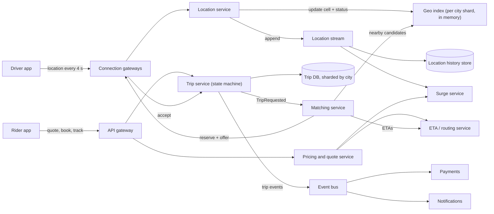
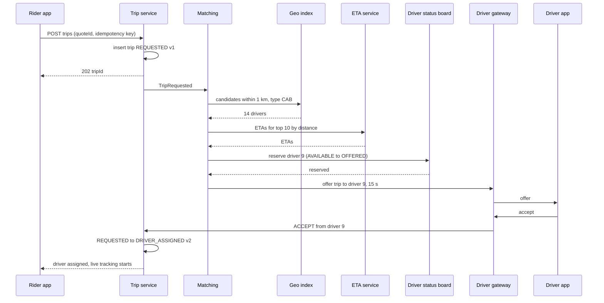
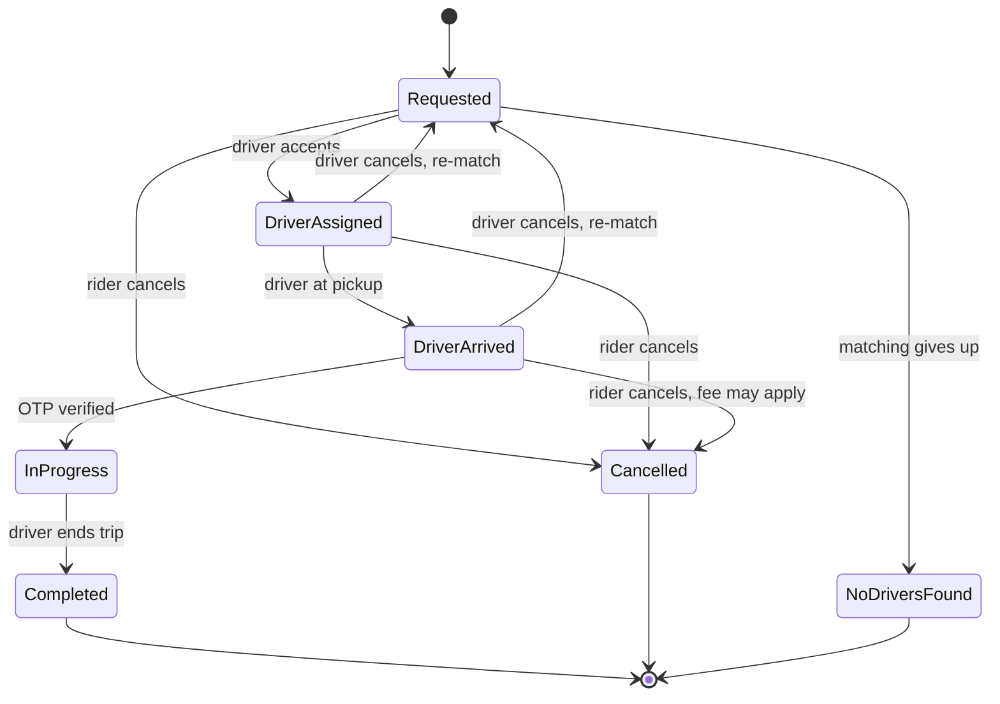

A ride-hailing app has a deceptively simple promise: tap a button, and a car arrives in a few minutes. Behind it, a million or more drivers report their position every few seconds, the system must answer "who is near this rider, right now?" in milliseconds, exactly one driver must get each trip, prices respond to rain and office rush hours, and every trip moves through a lifecycle that must never skip a step or charge a fare twice.

This case study designs that system. It reasons from public engineering principles and openly documented tools (geohash, Redis GEO, the open-source H3 library). Nothing here claims to describe how Uber, Ola, Rapido or any other company actually builds its platform.

## Learning objectives

By the end of this case study you will be able to:

1. Estimate location-update rates, matching load, geo-index memory and location-history storage.
2. Explain and compare geospatial indexes: geohash, quadtrees, H3 hexagons and S2 cells, and implement geohash encoding in C#.
3. Design a driver location pipeline that handles hundreds of thousands of updates per second.
4. Design matching: candidate search by expanding radius, ranking by ETA, and exclusive offers that never give one driver two trips.
5. Design surge pricing per geographic cell with smoothing, caps and price quotes.
6. Model the trip lifecycle as a guarded state machine with optimistic concurrency, and reason about failures, security, cost and simpler alternatives.

## Prerequisites

- [Capacity estimation](#/lesson/m11-capacity-estimation): RPS and storage arithmetic.
- [Redis data structures](#/lesson/m12-redis): sorted sets and GEO commands.
- [Sharding and hot partitions](#/lesson/m13-sharding): splitting by city and cell.
- [Distributed locks and fencing tokens](#/lesson/m13-distributed-locks): why "reserve this driver" needs care.
- [Lifecycle and state](#/lesson/m07-lifecycle-state): modelling allowed transitions.

## Explain it like I'm a beginner

Picture an auto-rickshaw stand manager at a busy Delhi Metro station, but for the whole city.

- Every auto driver phones in every few seconds: "I'm at the Saket petrol pump, free." That is a **location update**.
- The manager can't search a list of a million positions for every passenger, so he divides the city map into a **grid of numbered squares**. He keeps a board for each square listing the free autos in it. When a driver moves, his name moves from one board to the next. That grid is a **geospatial index**, and the square's code is a **cell id** (a geohash or an H3 index).
- A passenger at square 45 asks for a ride. The manager looks at board 45 and the eight squares around it, picks the auto that can **reach** the passenger soonest (not the one closest as the crow flies; there may be a flyover in the way), and calls only that driver: "Trip for you, 15 seconds to say yes." While he waits, nobody else may offer that driver a trip. That is an **exclusive offer**.
- When it rains, 300 people want autos in square 45 and only 20 are free. The manager raises the price a little in that square, which pulls drivers in from nearby squares and makes some passengers wait. That is **surge pricing**.
- Each trip follows fixed steps: requested, driver assigned, driver arrived, trip started, trip completed. You can't "complete" a trip that never started. That is a **state machine**.

## Requirements

### Functional

1. Riders see nearby cars on a map and get a fare estimate before booking.
2. Riders request a trip (pickup, drop, vehicle type: bike, auto, mini, sedan); the system matches a driver, typically within seconds.
3. Drivers go online/offline, receive offers, accept or decline, and navigate.
4. Both parties see each other's live location during pickup and the trip.
5. Trip lifecycle: assignment, arrival, start (with an OTP shown to the rider), completion, fare, payment, rating.
6. Surge pricing by area and time; the quoted fare is honoured if the rider books within its validity.
7. Cancellations by either side, with re-matching when a driver cancels.

### Non-functional

| Property | Target |
|---|---|
| Matching latency | Driver offer sent within 2 s of request (p95) |
| Location freshness | Index reflects a driver's position within ~5 s |
| Correctness | A driver never holds two active trips; a trip never has two drivers; a fare is charged once |
| Availability | 99.99 % for request and trip flow; map dots may degrade |
| Scale | 1.5 M drivers online at peak across ~100 cities; 15 M trips/day |
| Locality | Every trip is local to one city: exploit it |

### Out of scope

Routing and ETA engine internals (we treat ETA as a service), payments ([payment system case study](#/lesson/m17-payment-system)), fraud models, driver onboarding/KYC, pooled rides (we mention where they fit).

## Capacity estimation

All figures are **estimates** for the arithmetic.

### Location updates

- **1.5 M drivers online** at the evening peak, each sending an update every **4 s**: 1.5 M ÷ 4 = **375,000 updates/s**.
- Payload ~100 bytes (driver id, lat, lng, heading, speed, accuracy, timestamp): 375,000 × 100 B ≈ **37.5 MB/s** of ingress. The bytes are trivial; the **rate of index mutations** is the challenge.
- Riders in a trip also send updates (for safety features and fare disputes), adding perhaps 30 % more: ≈ **490,000 updates/s** total.

### Trips and searches

- **15 M trips/day** ÷ 86,400 ≈ **174 trip requests/s** average. Rush hour plus rain can be ×5: ≈ **870/s**.
- Many more people open the app and look at the map or ask for a fare estimate than book. Assume 10 sessions per trip: ≈ **8,700 nearby-driver queries/s** at peak, plus estimate calls.
- Each request triggers ETA calls for, say, 10 candidates: 870 × 10 = **8,700 ETA computations/s**, often the heaviest matching dependency.

### Geo index memory

- Per online driver: id, position, cell, status, vehicle type, timestamp ≈ 200 bytes with overhead (estimate).
- 1.5 M × 200 B = **300 MB**. The whole live index fits in RAM on one machine. We still shard it, but for **update throughput, locality and blast radius**, not for size.

### Location history

- Suppose we persist updates every 4 s for drivers only (375,000/s at peak; say 150,000/s averaged over the day): 150,000 × 100 B × 86,400 ≈ **1.3 TB/day**.
- 30 days hot for disputes and support: ≈ 39 TB. Older data is compressed into per-trip route polylines (a few KB per trip): 15 M × 5 KB = 75 GB/day.

| Quantity | Estimate |
|---|---|
| Location updates | ~375,000/s drivers, ~490,000/s total at peak |
| Trip requests | ~174/s average, ~870/s peak |
| Nearby queries | ~8,700/s peak |
| Live geo index | ~300 MB |
| Location history | ~1.3 TB/day raw |

**What breaks first?** The write rate on the location index if every update goes to one store, hot cells (a stadium after a match, an airport at 2 am), the ETA service during matching bursts, and double assignment races if the "reserve a driver" step isn't atomic.

## API design

Drivers and riders keep a persistent connection (WebSocket or a gRPC stream) for pushes: offers, driver location during pickup, trip state changes. Plain HTTPS handles everything else.

```http
POST /v1/drivers/me/location            (driver app, every 4 s; batched if offline for a moment)
{ "points": [ { "lat": 28.49521, "lng": 77.08931, "heading": 92, "speedMps": 7.4, "accuracyM": 8, "at": "2026-10-19T18:02:11Z" } ] }
204 No Content

GET /v1/nearby?lat=28.4950&lng=77.0890&type=CAB           -> approximate car positions for the map (jittered)

POST /v1/quotes
{ "pickup": { "lat": 28.4950, "lng": 77.0890 }, "drop": { "lat": 28.5562, "lng": 77.1000 }, "type": "CAB" }
200 { "quoteId": "q_7f…", "fare": { "amount": 412.00, "currency": "INR" }, "surge": 1.3, "expiresAt": "…+5 min" }

POST /v1/trips                          Idempotency-Key: 6c0b…
{ "quoteId": "q_7f…", "paymentMethod": "upi" }
202 { "tripId": "t_91…", "state": "REQUESTED" }

POST /v1/trips/{id}/events              (driver: ACCEPT, ARRIVE, START with OTP, COMPLETE; rider: CANCEL)
{ "type": "START", "otp": "4821", "expectedVersion": 3 }
```

Decisions:

- **Quotes are explicit objects.** The fare shown is the fare charged (within rules), so a booking references a `quoteId` that expires after a few minutes. This also fixes the surge multiplier at quote time, which riders and regulators expect.
- **`Idempotency-Key` on trip creation.** A rider tapping "Book" twice on a slow network must not create two trips. See [idempotency keys](#/lesson/m10-idempotency).
- **`expectedVersion` on trip events** gives optimistic concurrency: a stale "cancel" racing with "start" fails cleanly instead of corrupting state.
- **Map dots are approximate.** `GET /nearby` returns jittered, delayed positions so that the app doesn't leak exact driver locations to anyone who opens it.

## Data model

The **live** location index is in memory (or Redis); PostgreSQL holds durable records.

```sql
CREATE TABLE city (
  city_id     int  PRIMARY KEY,
  name        text NOT NULL,
  timezone    text NOT NULL
);

CREATE TABLE driver (
  driver_id    bigint PRIMARY KEY,
  city_id      int    NOT NULL REFERENCES city,
  vehicle_type text   NOT NULL CHECK (vehicle_type IN ('BIKE','AUTO','MINI','CAB','SEDAN')),
  rating       numeric(3,2) NOT NULL DEFAULT 5.00,
  status       text   NOT NULL DEFAULT 'OFFLINE'
               CHECK (status IN ('OFFLINE','AVAILABLE','OFFERED','ON_TRIP'))
);

CREATE TABLE quote (
  quote_id     uuid PRIMARY KEY,
  rider_id     bigint NOT NULL,
  city_id      int    NOT NULL,
  vehicle_type text   NOT NULL,
  pickup_lat   double precision NOT NULL,
  pickup_lng   double precision NOT NULL,
  drop_lat     double precision NOT NULL,
  drop_lng     double precision NOT NULL,
  surge        numeric(3,2) NOT NULL,
  fare_paise   bigint NOT NULL,          -- money as integer minor units
  expires_at   timestamptz NOT NULL
);

CREATE TABLE trip (
  trip_id      uuid PRIMARY KEY,
  city_id      int    NOT NULL,
  rider_id     bigint NOT NULL,
  driver_id    bigint,
  quote_id     uuid   NOT NULL UNIQUE REFERENCES quote,   -- one trip per quote
  state        text   NOT NULL,
  version      int    NOT NULL DEFAULT 1,                 -- optimistic concurrency
  start_otp    char(4) NOT NULL,
  requested_at timestamptz NOT NULL DEFAULT now(),
  completed_at timestamptz,
  fare_paise   bigint
);
-- A driver can have at most one active trip, enforced by the database.
CREATE UNIQUE INDEX one_active_trip_per_driver ON trip (driver_id)
  WHERE state IN ('DRIVER_ASSIGNED','DRIVER_ARRIVED','IN_PROGRESS');

CREATE TABLE trip_event (
  trip_id    uuid NOT NULL REFERENCES trip,
  version    int  NOT NULL,
  from_state text NOT NULL,
  to_state   text NOT NULL,
  actor      text NOT NULL,             -- 'rider:42', 'driver:9', 'system'
  at         timestamptz NOT NULL DEFAULT now(),
  PRIMARY KEY (trip_id, version)
);
```

Why this shape:

- **The partial unique index** `one_active_trip_per_driver` is the last line of defence against double assignment. Even if two matchers race past the in-memory reservation, only one `UPDATE trip SET driver_id = …, state = 'DRIVER_ASSIGNED'` can commit.
- **`quote_id UNIQUE`** makes trip creation idempotent at the data level: one quote, one trip.
- **`version`** supports `UPDATE trip SET state = $new, version = version + 1 WHERE trip_id = $id AND version = $expected`. Zero rows updated means someone else changed the trip first.
- **`trip_event`** is an append-only audit trail keyed by version: support teams, dispute handling and analytics read it, and it doubles as the outbox for events.
- **Money in paise as `bigint`**: no floating-point rounding, ever.
- **Sharding by `city_id`.** Trips never cross cities, so each city's trips, drivers and index live together. A big metro may be split further into zones.

## High-level architecture



Every arrow:

1. **Driver app → gateways → location service.** Drivers hold a persistent connection; location frames are forwarded to the location service, routed by `city_id` to the right shard.
2. **Location service → geo index.** Each update moves the driver to its new cell if needed and refreshes the timestamp. The index lives in memory on the city's shard (or in Redis GEO for smaller deployments).
3. **Location service → location stream → history and surge.** Updates are appended to a partitioned stream (keyed by driver id). One consumer writes history (for disputes, safety and analytics), another feeds supply counts to surge.
4. **Rider app → API → pricing.** A quote combines the route distance and time from the ETA service with the base fare and the current surge for the pickup cell.
5. **API → trip service → trip DB.** Booking creates a `REQUESTED` trip from the quote (idempotently) and emits `TripRequested`.
6. **Matching service → geo index → ETA → gateway.** Find candidates near the pickup, rank them by ETA, atomically reserve the best one and send an offer through the driver's gateway connection.
7. **Gateway → trip service.** The driver's accept (or the offer timeout) comes back as an event; the trip service applies the state transition and records the driver.
8. **Trip service → event bus → payments, notifications.** Every transition emits an event for downstream services; payment is captured on `COMPLETED`.

### Sequence: request to accepted offer



The two important details: the rider gets `202 Accepted` immediately (matching is asynchronous, the app shows "finding your ride"), and the driver is **reserved before the offer is sent**, so no other matcher can offer driver 9 a different trip during those 15 seconds. If driver 9 declines or the offer times out, the reservation is released and the matcher tries the next candidate.

## Deep dives

### 1. Geospatial indexing: from coordinates to cells

The question "which drivers are within 1 km of this point?" is slow if you scan 1.5 M drivers. Spatial indexes split the map into cells so you only look at a few cells.

**Geohash.** Interleave the bits of longitude and latitude: each bit says "east or west half?", then "north or south half?", repeatedly. Every 5 bits become one base-32 character. Longer strings mean smaller cells, and **a shared prefix means nearby** (mostly). Approximate cell sizes near the equator (cells shrink east–west as you move away from it):

| Precision | Approx. cell size |
|---|---|
| 5 | 4.9 km × 4.9 km |
| 6 | 1.2 km × 0.61 km |
| 7 | 153 m × 153 m |

Strengths: a plain string, works as a key in any database, prefix queries are cheap, Redis GEO uses a 52-bit geohash-style score internally. Weaknesses: two points a metre apart across a cell boundary can have completely different prefixes, so you must always search the **neighbouring cells** too; cells are rectangles of uneven size; and special care is needed at the poles and the 180° meridian.

**Quadtree.** Start with one square; split any square holding more than N drivers into four children, recursively. Dense Connaught Place gets tiny squares; empty fields get huge ones. Great for **uneven density** and k-nearest queries, but it is an in-memory tree that must rebalance as drivers move, which is awkward at 375,000 updates/s unless sharded carefully.

**H3 (hexagonal grid).** An open-source library that tiles the globe with hexagons at 16 resolutions, each cell having a 64-bit id. Every hexagon has six neighbours at the same distance (squares have edge and corner neighbours at different distances), which makes "rings" around a point (k-rings) natural for search, surge zones and demand forecasting. Cells are not perfectly nested across resolutions, which matters for some aggregations.

**S2.** Projects the sphere onto a cube and orders cells along a Hilbert curve, so a region becomes a small set of 64-bit id ranges. Strong for covering arbitrary polygons (airport zones, city boundaries).

**PostGIS** (a PostgreSQL extension with GiST indexes) is the durable choice for zones, geofences and analytics. It is usually not the store for 375,000 position updates per second.

Here is geohash in C#. It is the core of the index below.

```csharp file=Geo/GeoHash.cs
namespace RideApp.Geo;

public static class GeoHash
{
    private const string Base32 = "0123456789bcdefghjkmnpqrstuvwxyz";

    public static string Encode(double lat, double lng, int precision)
    {
        if (precision is < 1 or > 12) throw new ArgumentOutOfRangeException(nameof(precision));
        if (lat is < -90 or > 90) throw new ArgumentOutOfRangeException(nameof(lat));
        if (lng is < -180 or > 180) throw new ArgumentOutOfRangeException(nameof(lng));

        double latLo = -90, latHi = 90, lngLo = -180, lngHi = 180;
        var chars = new char[precision];
        var evenBit = true;               // bits alternate: longitude first
        int bit = 0, value = 0, index = 0;
        while (index < precision)
        {
            if (evenBit)
            {
                var mid = (lngLo + lngHi) / 2;
                if (lng >= mid) { value = (value << 1) | 1; lngLo = mid; } else { value <<= 1; lngHi = mid; }
            }
            else
            {
                var mid = (latLo + latHi) / 2;
                if (lat >= mid) { value = (value << 1) | 1; latLo = mid; } else { value <<= 1; latHi = mid; }
            }
            evenBit = !evenBit;
            if (++bit == 5) { chars[index++] = Base32[value]; bit = 0; value = 0; }
        }
        return new string(chars);
    }

    public readonly record struct Box(double LatLo, double LatHi, double LngLo, double LngHi)
    {
        public double CenterLat => (LatLo + LatHi) / 2;
        public double CenterLng => (LngLo + LngHi) / 2;
    }

    public static Box Decode(string hash)
    {
        double latLo = -90, latHi = 90, lngLo = -180, lngHi = 180;
        var evenBit = true;
        foreach (var c in hash)
        {
            var value = Base32.IndexOf(c);
            if (value < 0) throw new ArgumentException($"Invalid geohash character '{c}'.", nameof(hash));
            for (var shift = 4; shift >= 0; shift--)
            {
                var on = ((value >> shift) & 1) == 1;
                if (evenBit) { var mid = (lngLo + lngHi) / 2; if (on) lngLo = mid; else lngHi = mid; }
                else { var mid = (latLo + latHi) / 2; if (on) latLo = mid; else latHi = mid; }
                evenBit = !evenBit;
            }
        }
        return new Box(latLo, latHi, lngLo, lngHi);
    }

    /// <summary>The cell and its rings of neighbours: (2k+1)^2 cells. Ignores pole and antimeridian wrap.</summary>
    public static IReadOnlyList<string> CellsAround(string hash, int rings)
    {
        var box = Decode(hash);
        double dLat = box.LatHi - box.LatLo, dLng = box.LngHi - box.LngLo;
        var cells = new List<string>((2 * rings + 1) * (2 * rings + 1));
        for (var dy = -rings; dy <= rings; dy++)
            for (var dx = -rings; dx <= rings; dx++)
            {
                var lat = box.CenterLat + dy * dLat;
                var lng = box.CenterLng + dx * dLng;
                if (lat is < -90 or > 90 || lng is < -180 or > 180) continue;
                cells.Add(Encode(lat, lng, hash.Length));
            }
        return cells;
    }
}
```

```csharp file=Geo/Distance.cs
namespace RideApp.Geo;

public static class Distance
{
    private const double EarthRadiusM = 6_371_000;

    /// <summary>Great-circle distance in metres (haversine). A filter, not an ETA: roads are not straight.</summary>
    public static double Meters(double lat1, double lng1, double lat2, double lng2)
    {
        static double Rad(double d) => d * Math.PI / 180;
        var dLat = Rad(lat2 - lat1);
        var dLng = Rad(lng2 - lng1);
        var a = Math.Sin(dLat / 2) * Math.Sin(dLat / 2) +
                Math.Cos(Rad(lat1)) * Math.Cos(Rad(lat2)) * Math.Sin(dLng / 2) * Math.Sin(dLng / 2);
        return 2 * EarthRadiusM * Math.Asin(Math.Min(1, Math.Sqrt(a)));
    }
}
```

### 2. The live location index

Each city shard holds two maps: `driver → (position, cell, vehicle type, timestamp)` and `cell → set of drivers`. An update is O(1): if the cell changed, remove the driver from the old cell's set and add to the new one. A search looks at the cells around the pickup, filters by exact distance, freshness and vehicle type, and sorts by distance.

How many rings? At precision 6 a cell is about 1.2 km × 0.61 km near the equator, and narrower east–west in northern cities. Ring count = `ceil(radius ÷ smallest cell side)`, so a 1 km search uses 2 rings (25 cells) and still costs microseconds in memory.

```csharp file=Geo/DriverLocationIndex.cs
using System.Collections.Concurrent;

namespace RideApp.Geo;

public enum VehicleType { Bike, Auto, Mini, Cab, Sedan }

public sealed record DriverPosition(long DriverId, double Lat, double Lng, VehicleType Vehicle, string Cell, DateTimeOffset At);

public sealed record NearbyDriver(DriverPosition Position, double DistanceMeters);

/// <summary>One city shard's live index. In production: one process per city/zone, or Redis GEO.</summary>
public sealed class DriverLocationIndex(TimeProvider clock)
{
    public const int CellPrecision = 6;
    public static readonly TimeSpan MaxAge = TimeSpan.FromSeconds(30);

    private readonly ConcurrentDictionary<long, DriverPosition> _drivers = new();
    private readonly ConcurrentDictionary<string, ConcurrentDictionary<long, byte>> _cells = new();
    private readonly Lock _writeGate = new();   // single writer per shard; readers never block

    public void Update(long driverId, double lat, double lng, VehicleType vehicle)
    {
        var cell = GeoHash.Encode(lat, lng, CellPrecision);
        var position = new DriverPosition(driverId, lat, lng, vehicle, cell, clock.GetUtcNow());
        lock (_writeGate)
        {
            // Move between cells only when the cell changed: O(1) per update.
            if (_drivers.TryGetValue(driverId, out var old) && old.Cell != cell &&
                _cells.TryGetValue(old.Cell, out var oldMembers))
                oldMembers.TryRemove(driverId, out _);
            _drivers[driverId] = position;
            _cells.GetOrAdd(cell, _ => new()).TryAdd(driverId, 0);
        }
    }

    public void Remove(long driverId)
    {
        lock (_writeGate)
        {
            if (_drivers.TryRemove(driverId, out var p) && _cells.TryGetValue(p.Cell, out var members))
                members.TryRemove(driverId, out _);
        }
    }

    public IReadOnlyList<NearbyDriver> Nearby(double lat, double lng, double radiusMeters, VehicleType vehicle, int limit)
    {
        var centre = GeoHash.Encode(lat, lng, CellPrecision);
        var box = GeoHash.Decode(centre);
        var cellHeightM = (box.LatHi - box.LatLo) * 111_320;
        var cellWidthM = (box.LngHi - box.LngLo) * 111_320 * Math.Cos(box.CenterLat * Math.PI / 180);
        var rings = (int)Math.Ceiling(radiusMeters / Math.Min(cellHeightM, cellWidthM));
        var freshAfter = clock.GetUtcNow() - MaxAge;

        var results = new List<NearbyDriver>();
        foreach (var cell in GeoHash.CellsAround(centre, rings))
        {
            if (!_cells.TryGetValue(cell, out var members)) continue;
            foreach (var driverId in members.Keys)
            {
                if (!_drivers.TryGetValue(driverId, out var p) || p.Vehicle != vehicle || p.At < freshAfter) continue;
                var d = Distance.Meters(lat, lng, p.Lat, p.Lng);
                if (d <= radiusMeters) results.Add(new NearbyDriver(p, d));
            }
        }
        return results.OrderBy(r => r.DistanceMeters).Take(limit).ToList();
    }
}
```

Writes go through one gate per shard, while searches read the concurrent maps without blocking. That is the **single writer per city shard** model: one thread (or actor) owns each shard's mutations, fed by a queue. It removes lock contention between writers, and 375,000 updates/s split over 100+ city shards is a few thousand per shard, well within one core's budget for O(1) in-memory updates. A search can briefly see a driver in neither or both cells during a move; the exact-distance and freshness filters make that harmless.

**Stale drivers** are filtered at query time (`MaxAge` of 30 s): a phone that lost signal in a tunnel should not receive offers. A sweeper removes drivers who haven't reported for a few minutes.

**Batching and dead-reckoning.** Drivers on a highway at constant speed don't need to send every 4 s; the app can send less often when movement is predictable, and the server can extrapolate. That trades a little accuracy for a large cut in update rate.

### 3. Matching: candidates, ranking, exclusive offers

Matching has three steps.

1. **Candidate generation.** Search the index around the pickup at 1 km; if fewer than, say, 5 candidates, expand to 2 km, then 4 km. Filter by vehicle type, status `AVAILABLE`, and business rules (driver's destination filter, accessibility needs).
2. **Ranking by ETA.** Straight-line distance is a poor proxy: a driver 400 m away on the other side of a highway may need 12 minutes. Ask the routing service for ETAs of the top 10 by distance and rank by ETA, with small adjustments (acceptance rate, rating, fairness to drivers who've waited longer).
3. **Exclusive offer.** Atomically move the chosen driver from `AVAILABLE` to `OFFERED(tripId)`. Only the winner of that compare-and-set sends the offer. On accept, the trip service records the assignment (the partial unique index backs this up). On decline or a 15-second timeout, release the driver and try the next candidate, up to a limit, then mark the trip `NO_DRIVERS_FOUND`.

**Greedy versus batched matching.** Matching each request instantly to its best driver is simple but globally wasteful: two riders 200 m apart might both be best served by driver A, and the second gets a far driver. Batched matching collects requests for a short window (1–2 s) per zone and solves an assignment problem minimising total ETA. It costs a second or two of latency and is worth it in dense areas.

```csharp file=Matching/DriverStatusBoard.cs
using System.Collections.Concurrent;

namespace RideApp.Matching;

public enum DriverStatus { Offline, Available, Offered, OnTrip }

public sealed record DriverAvailability(DriverStatus Status, Guid? TripId);

/// <summary>
/// The single referee for "is this driver free?". Compare-and-set makes reservation atomic.
/// Production: Redis (SET driver:9 trip NX PX 15000, or a Lua CAS) per city shard, backed by the DB unique index.
/// </summary>
public sealed class DriverStatusBoard
{
    private readonly ConcurrentDictionary<long, DriverAvailability> _drivers = new();
    private static readonly DriverAvailability Free = new(DriverStatus.Available, null);

    public void SetAvailable(long driverId) => _drivers[driverId] = Free;
    public void SetOffline(long driverId) => _drivers[driverId] = new(DriverStatus.Offline, null);

    public DriverAvailability Get(long driverId) =>
        _drivers.TryGetValue(driverId, out var a) ? a : new(DriverStatus.Offline, null);

    public bool TryReserve(long driverId, Guid tripId) =>
        _drivers.TryUpdate(driverId, new DriverAvailability(DriverStatus.Offered, tripId), Free);

    public bool Release(long driverId, Guid tripId) =>
        _drivers.TryUpdate(driverId, Free, new DriverAvailability(DriverStatus.Offered, tripId));

    public bool ConfirmOnTrip(long driverId, Guid tripId) =>
        _drivers.TryUpdate(driverId, new DriverAvailability(DriverStatus.OnTrip, tripId),
            new DriverAvailability(DriverStatus.Offered, tripId));
}
```

`TryUpdate(key, newValue, comparisonValue)` succeeds only if the current value equals `comparisonValue`; records compare by value, so "reserve only if exactly `Available` with no trip" is a single atomic step. `Release` and `ConfirmOnTrip` also check the trip id, so a late timeout for trip A can't free a driver who has since been offered trip B.

### 4. The trip state machine



Read the diagram as a contract. A driver cancelling sends the trip **back to `Requested`** for re-matching instead of ending it, because the rider still wants a ride. A rider cancelling after the driver has arrived may incur a fee. There is no path from `DriverAssigned` straight to `Completed`: you can't end a trip that never started, which blocks a whole class of fraud and bugs. Terminal states have no exits.

Every transition is applied with optimistic concurrency (`WHERE version = expected`), writes a `trip_event` row and emits an event in the same transaction (outbox). Clients send `expectedVersion`, so a rider's "cancel" that raced with the driver's "start" fails with `409 Conflict`, and the app refreshes and shows the real state.

```csharp file=Matching/Trip.cs
namespace RideApp.Matching;

public enum TripState { Requested, DriverAssigned, DriverArrived, InProgress, Completed, Cancelled, NoDriversFound }

public enum TripAction { Assign, Arrive, Start, Complete, RiderCancel, DriverCancel, GiveUp }

public sealed class TripConflictException(string message) : Exception(message);

public sealed class Trip
{
    private static readonly Dictionary<(TripState, TripAction), TripState> Transitions = new()
    {
        [(TripState.Requested, TripAction.Assign)] = TripState.DriverAssigned,
        [(TripState.Requested, TripAction.GiveUp)] = TripState.NoDriversFound,
        [(TripState.Requested, TripAction.RiderCancel)] = TripState.Cancelled,
        [(TripState.DriverAssigned, TripAction.Arrive)] = TripState.DriverArrived,
        [(TripState.DriverAssigned, TripAction.DriverCancel)] = TripState.Requested,
        [(TripState.DriverAssigned, TripAction.RiderCancel)] = TripState.Cancelled,
        [(TripState.DriverArrived, TripAction.Start)] = TripState.InProgress,
        [(TripState.DriverArrived, TripAction.DriverCancel)] = TripState.Requested,
        [(TripState.DriverArrived, TripAction.RiderCancel)] = TripState.Cancelled,
        [(TripState.InProgress, TripAction.Complete)] = TripState.Completed,
    };

    public Trip(Guid id, long riderId, double pickupLat, double pickupLng, string startOtp)
    {
        Id = id; RiderId = riderId; PickupLat = pickupLat; PickupLng = pickupLng; StartOtp = startOtp;
    }

    public Guid Id { get; }
    public long RiderId { get; }
    public double PickupLat { get; }
    public double PickupLng { get; }
    public string StartOtp { get; }
    public TripState State { get; private set; } = TripState.Requested;
    public int Version { get; private set; } = 1;
    public long? DriverId { get; private set; }
    public bool CancellationFee { get; private set; }
    private readonly Lock _gate = new();

    public static bool IsAllowed(TripState from, TripAction action) => Transitions.ContainsKey((from, action));

    public TripState Apply(TripAction action, int expectedVersion, long? driverId = null, string? otp = null)
    {
        lock (_gate)
        {
            if (expectedVersion != Version)
                throw new TripConflictException($"Trip is at version {Version}, not {expectedVersion}.");
            if (!Transitions.TryGetValue((State, action), out var next))
                throw new InvalidOperationException($"{action} is not allowed in state {State}.");
            if (action == TripAction.Assign && driverId is null)
                throw new ArgumentException("Assign needs a driver id.", nameof(driverId));
            if (action == TripAction.Start && otp != StartOtp)
                throw new InvalidOperationException("Wrong start OTP.");

            if (action == TripAction.Assign) DriverId = driverId;
            if (action == TripAction.DriverCancel) DriverId = null;
            if (action == TripAction.RiderCancel && State == TripState.DriverArrived) CancellationFee = true;
            State = next;
            Version++;
            return State;
        }
    }
}
```

### 5. The matcher

```csharp file=Matching/Matcher.cs
using System.Collections.Concurrent;
using RideApp.Geo;

namespace RideApp.Matching;

public interface IDriverOfferChannel
{
    /// <summary>Sends an offer to the driver's app and waits for accept, decline or timeout.</summary>
    Task<bool> OfferAsync(long driverId, Trip trip, TimeSpan timeout, CancellationToken ct);
}

/// <summary>Demo channel: every driver accepts.</summary>
public sealed class AutoAcceptOfferChannel : IDriverOfferChannel
{
    public Task<bool> OfferAsync(long driverId, Trip trip, TimeSpan timeout, CancellationToken ct) => Task.FromResult(true);
}

public interface ITripStore
{
    void Add(Trip trip);
    Trip? Get(Guid tripId);
}

public sealed class InMemoryTripStore : ITripStore
{
    private readonly ConcurrentDictionary<Guid, Trip> _trips = new();
    public void Add(Trip trip) => _trips[trip.Id] = trip;
    public Trip? Get(Guid tripId) => _trips.TryGetValue(tripId, out var t) ? t : null;
}

public sealed class Matcher(DriverLocationIndex index, DriverStatusBoard board, IDriverOfferChannel offers)
{
    private static readonly double[] RadiiMeters = [1_000, 2_000, 4_000];
    private const int MaxOffers = 5;
    private static readonly TimeSpan OfferTimeout = TimeSpan.FromSeconds(15);

    /// <summary>Returns the assigned driver id, or null if matching gave up.</summary>
    public async Task<long?> MatchAsync(Trip trip, VehicleType vehicle, CancellationToken ct)
    {
        var tried = new HashSet<long>();
        foreach (var radius in RadiiMeters)
        {
            // Production: re-rank these by ETA from the routing service before offering.
            var candidates = index.Nearby(trip.PickupLat, trip.PickupLng, radius, vehicle, limit: 20)
                .Where(c => !tried.Contains(c.Position.DriverId));

            foreach (var candidate in candidates)
            {
                if (tried.Count >= MaxOffers) break;
                var driverId = candidate.Position.DriverId;
                tried.Add(driverId);
                if (!board.TryReserve(driverId, trip.Id)) continue;          // someone else got this driver

                var accepted = await offers.OfferAsync(driverId, trip, OfferTimeout, ct);
                if (accepted && board.ConfirmOnTrip(driverId, trip.Id))
                {
                    trip.Apply(TripAction.Assign, trip.Version, driverId);
                    return driverId;
                }
                board.Release(driverId, trip.Id);
            }
        }
        trip.Apply(TripAction.GiveUp, trip.Version);
        return null;
    }
}
```

### 6. Surge pricing

Surge balances supply and demand in a small area over a short window. Per cell (geohash precision 5, or an H3 cell of a few km²) and per minute:

- **Demand**: trip requests plus fare-estimate sessions (people who looked but didn't book are demand too).
- **Supply**: available drivers in the cell (from the location stream).
- **Raw multiplier**: 1.0 when demand ≤ supply, rising with the ratio, for example `1 + 0.5 × (ratio − 1)`.
- **Cap**: some jurisdictions limit surge multipliers (Indian aggregator guidelines have done so); the cap is configuration per city and must follow current rules.
- **Smoothing**: move only part of the way toward the raw value each minute (`new = old + 0.3 × (raw − old)`) so prices don't jump around, and round to 0.1 steps for display.
- **Neighbour blending**: blend with surrounding cells so crossing a street doesn't change the price by 40 %.
- **Locked in the quote**: the multiplier is fixed when the rider gets a quote, valid for a few minutes.

```csharp file=Pricing/SurgeCalculator.cs
namespace RideApp.Pricing;

public sealed class SurgeOptions
{
    public double Cap { get; set; } = 2.0;          // per-city, must follow local regulation
    public double Sensitivity { get; set; } = 0.5;
    public double Smoothing { get; set; } = 0.3;
}

public sealed class SurgeCalculator(SurgeOptions options)
{
    /// <summary>Next multiplier for a cell given this minute's demand, supply and the previous multiplier.</summary>
    public double Next(int demand, int availableDrivers, double previous)
    {
        var ratio = (double)demand / Math.Max(1, availableDrivers);
        var raw = ratio <= 1 ? 1.0 : 1.0 + options.Sensitivity * (ratio - 1);
        raw = Math.Min(raw, options.Cap);
        var smoothed = previous + options.Smoothing * (raw - previous);
        return Math.Clamp(Math.Round(smoothed, 1, MidpointRounding.AwayFromZero), 1.0, options.Cap);
    }
}
```

Surge is computed by a streaming job over the request and location streams, written to a small key-value map `surge:{cell}` with a 2-minute TTL (so a stuck job falls back to 1.0, not to an old high surge), and read by the pricing service.

## Caching, queues and scaling

**Caching.**

- The geo index itself is an in-memory structure, the hottest "cache" in the system, rebuilt from live updates within seconds after a restart.
- **Surge per cell** in a key-value store with TTL, read on every quote.
- **ETA results** for (origin cell, destination cell, time bucket) pairs cached for a minute or two; many quotes in the same area share them.
- **Driver profile and vehicle details** cached for offer cards and rider screens.

**Queues and streams.**

- **Location stream** partitioned by driver id (ordering per driver) or by city (locality); consumers: history writer, surge aggregator, safety monitoring.
- **Trip events** via an outbox to an event bus; consumers: payments, notifications, analytics, driver earnings.
- **Matching requests** per city, so a burst in one city can't starve another.

**Scaling by geography.** Almost everything shards by **city** (and large cities by zone): location index, matching, surge, trip DB. A rainstorm in Mumbai overloads only Mumbai's shards; Bengaluru doesn't notice. Each city shard has a standby that rebuilds its index from the live update stream within seconds.

**Hot cells.** An airport or a stadium after a match concentrates thousands of drivers and riders in a few cells. Use finer cells (or a quadtree) for those zones, queue-based "virtual lines" for airport pickups, and batched matching.

## Failure handling

| Failure | Effect | Mitigation |
|---|---|---|
| City index shard crashes | No matches in that city for seconds | Standby shard rebuilds from the live update stream within one update interval (~4–5 s); matching retries |
| Driver loses signal | Stale position in index | `MaxAge` filter at query time; sweeper removes drivers silent for minutes |
| Two matchers pick the same driver | Double offer | Compare-and-set reservation; partial unique index in the trip DB as backstop |
| Offer sent, driver app offline | Rider waits | 15 s offer timeout, release, next candidate; total matching deadline then `NO_DRIVERS_FOUND` |
| Rider double-taps Book | Two trips | `Idempotency-Key` plus `quote_id UNIQUE` |
| Cancel races with Start | Inconsistent trip | `expectedVersion`; loser gets `409` and refreshes |
| ETA service slow | Matching stalls | Timeout with fallback to straight-line distance × city speed factor |
| Surge job stops | Stale prices | `surge:{cell}` TTL of 2 minutes falls back to 1.0 |
| Payment provider down at trip end | Fare not collected | Trip still completes; payment captured asynchronously with retries ([payments](#/lesson/m17-payment-system)) |
| Region outage | City offline | Cities pinned to a primary region with a warm standby; trip DB replicated; drivers reconnect to the standby |

:::callout type=warning title="Never trust the in-memory reservation alone"
The status board makes double offers rare, but a failover can briefly run two matchers for one city with different views of driver status. The database constraint "one active trip per driver" is what makes double assignment impossible rather than unlikely. This is the same idea as fencing tokens in [distributed locks](#/lesson/m13-distributed-locks).
:::

## Security

- **Location privacy.** Riders see only approximate, slightly delayed car positions before booking; the exact driver location is shared only with the matched rider, and only until the trip ends. Location history is sensitive personal data: restrict access, log every access, and set retention limits (for India's DPDP Act and other regimes).
- **GPS spoofing.** Drivers may fake locations to sit in surge zones or game airport queues. Detect impossible speeds and jumps, mock-location flags, and mismatch between GPS and network signals; act through review, not instant bans.
- **Trip start OTP.** The rider tells the driver a 4-digit code, so a trip can't be started for the wrong person or without the rider present.
- **Authorisation.** Only the assigned driver can send `ARRIVE`, `START` and `COMPLETE`; only the trip's rider can cancel as rider. Check on the server for every event.
- **Safety features.** SOS button, trip sharing with trusted contacts, route deviation alerts (computed from the location stream), masked phone numbers through a calling proxy.
- **Fraud and abuse.** Rate-limit quotes and bookings per account and device; detect collusion (a driver and rider repeatedly doing short trips for incentives).

## Observability

- **Matching**: time from request to offer, to acceptance (p50, p95) per city; offers per trip; `NO_DRIVERS_FOUND` rate; offer acceptance rate. A drop in acceptance in one area often means a pricing or routing bug.
- **Location pipeline**: updates/s per city, index update lag (event time to index time), share of stale drivers.
- **Supply/demand**: available drivers and open requests per cell, current surge distribution (a heat map is the operations team's main screen).
- **Trip lifecycle**: transition counts, 409 conflict rate, trips stuck in a state longer than expected (for example `DRIVER_ASSIGNED` for 30 minutes).
- **ETA accuracy**: predicted versus actual pickup time.
- **Business health**: completed trips per minute per city versus the same time last week; a sudden gap is often the first sign of an outage.

## Deployment and cost

**Deployment.** Roll out city by city: deploy to one small city first, watch matching metrics, then expand. Location and matching services are stateful per shard, so deploy by draining a shard to its standby, upgrading, and failing back. Pricing changes ship behind feature flags with per-city configuration, because surge rules and caps differ by city and regulation. Driver and rider apps must keep working with older backend versions during rollouts.

**Cost drivers** (relative):

1. **Routing and ETA computation**: many ETA calls per quote and per match; caching by cell pair and limiting candidates are the levers.
2. **Persistent connections and location ingest** for 1.5 M drivers: gateway fleet and stream throughput.
3. **Location history storage** (~1.3 TB/day raw): downsample and compress into per-trip polylines after 30 days.
4. **Maps and SMS/calling proxies** from third parties, often priced per request or per minute.
5. **Multi-region standby capacity** for availability.

### When a simpler design is enough

A single-city service (say, an e-rickshaw aggregator in one tier-2 city with 3,000 drivers) needs none of the sharding. 3,000 drivers ÷ 5 s = 600 updates/s fits in one Redis instance using `GEOADD` and `GEOSEARCH … BYRADIUS 2 km ASC COUNT 10`, or even in the memory of one ASP.NET Core service. Trips go in one PostgreSQL database with the same partial unique index. Greedy matching by straight-line distance with a single offer at a time is fine at this density. Add ETA-based ranking and batched matching when the city grows.

## Alternatives and trade-offs

| Decision | Choice here | Alternative | When the alternative wins |
|---|---|---|---|
| Spatial index | Geohash cells in memory | Redis GEO (`GEOADD`/`GEOSEARCH`) | Smaller scale; you want a managed structure with radius search |
| Spatial index | Geohash | H3 hexagons | Surge zones, demand forecasting and ring searches where equal neighbour distance matters |
| Spatial index | Geohash | Quadtree | Very uneven density in one shard; k-nearest queries |
| Spatial index | Geohash | PostGIS | Durable geofences, zones and analytics; not hot location updates |
| Matching | Greedy per request | Batched assignment every 1–2 s | Dense areas where global optimisation reduces total pickup time |
| Ranking | ETA from routing | Straight-line distance | Small towns with simple road networks, or as a fallback |
| Reservation | CAS on status board + DB constraint | Distributed lock service | Rarely; the CAS plus constraint is simpler and safer |
| Location transport | Persistent socket | HTTP POST every few seconds | Simpler apps, low driver counts |
| Pricing | Smoothed, capped surge | Fixed fares | Regulated markets, or where predictability beats balancing supply |

The essential trade-off: **keep the hot, fast-changing data (positions, availability) in memory, sharded by city and rebuilt from the live stream, and keep the slow, money-and-safety-critical data (trips, fares) in a transactional database with constraints that make the important mistakes impossible.**

```csharp file=Program.cs
using RideApp.Geo;
using RideApp.Matching;
using RideApp.Pricing;

var builder = WebApplication.CreateBuilder(args);
builder.Services.AddSingleton(TimeProvider.System);
builder.Services.AddSingleton<DriverLocationIndex>();
builder.Services.AddSingleton<DriverStatusBoard>();
builder.Services.AddSingleton<IDriverOfferChannel, AutoAcceptOfferChannel>();
builder.Services.AddSingleton<ITripStore, InMemoryTripStore>();
builder.Services.AddSingleton<Matcher>();
builder.Services.AddSingleton(new SurgeOptions());
builder.Services.AddSingleton<SurgeCalculator>();

var app = builder.Build();

app.MapPost("/v1/drivers/{driverId:long}/location", (long driverId, LocationPing ping,
    DriverLocationIndex index, DriverStatusBoard board) =>
{
    index.Update(driverId, ping.Lat, ping.Lng, ping.Vehicle);
    if (board.Get(driverId).Status == DriverStatus.Offline) board.SetAvailable(driverId);   // demo: online on first ping
    return Results.NoContent();
});

app.MapGet("/v1/nearby", (double lat, double lng, VehicleType type, DriverLocationIndex index) =>
    Results.Ok(index.Nearby(lat, lng, 2_000, type, 20)
        .Select(n => new { lat = Math.Round(n.Position.Lat, 3), lng = Math.Round(n.Position.Lng, 3) })));  // coarse: privacy

app.MapPost("/v1/trips", async (BookTripRequest body, ITripStore trips, Matcher matcher, CancellationToken ct) =>
{
    var otp = Random.Shared.Next(0, 10_000).ToString("D4");
    var trip = new Trip(Guid.NewGuid(), body.RiderId, body.PickupLat, body.PickupLng, otp);
    trips.Add(trip);
    // Production: persist + outbox, then matching runs asynchronously from the TripRequested event.
    var driverId = await matcher.MatchAsync(trip, body.Vehicle, ct);
    return Results.Accepted($"/v1/trips/{trip.Id}", new { tripId = trip.Id, state = trip.State.ToString(), driverId, otp });
});

app.MapPost("/v1/trips/{tripId:guid}/events", (Guid tripId, TripEventRequest body, ITripStore trips,
    DriverStatusBoard board) =>
{
    var trip = trips.Get(tripId);
    if (trip is null) return Results.NotFound();
    try
    {
        var driverId = trip.DriverId;
        var state = trip.Apply(body.Action, body.ExpectedVersion, otp: body.Otp);
        if (driverId is long d && state is TripState.Completed or TripState.Cancelled or TripState.Requested)
            board.SetAvailable(d);
        return Results.Ok(new { state = state.ToString(), trip.Version });
    }
    catch (TripConflictException ex) { return Results.Conflict(new { error = ex.Message, trip.Version }); }
    catch (InvalidOperationException ex) { return Results.UnprocessableEntity(new { error = ex.Message }); }
    catch (ArgumentException ex) { return Results.BadRequest(new { error = ex.Message }); }
});

app.Run();

public sealed record LocationPing(double Lat, double Lng, VehicleType Vehicle);
public sealed record BookTripRequest(long RiderId, double PickupLat, double PickupLng, VehicleType Vehicle);
public sealed record TripEventRequest(TripAction Action, int ExpectedVersion, string? Otp);
```

## Practical playground

The starting graph is a first version: driver apps POST locations into PostgreSQL, and matching runs a distance query over all drivers. Open it in the HLD canvas.

1. Set client traffic to 375,000 RPS of location updates. Which node fails first?
2. Add a `websocket-gateway` for driver connections and a `cache` (or `app-server`) for the in-memory geo index per city.
3. Add a `stream` for location updates with two consumers: history (`object-storage` or a `database`) and surge (`worker`).
4. Add an `external` routing/ETA service and a `queue` between the trip service and matching. Where does the "one active trip per driver" rule live?

:::playground type=hld title="From a SQL distance query to a geo-sharded matching system"
```json
{
  "nodes": [
    { "id": "c", "type": "client", "label": "Driver and rider apps", "props": { "rps": 375000 } },
    { "id": "lb", "type": "load-balancer", "label": "Load balancer" },
    { "id": "api", "type": "app-server", "label": "Ride API (locations + matching)", "props": { "instances": 10 } },
    { "id": "db", "type": "database", "label": "PostgreSQL (drivers, locations, trips)", "props": { "replicas": 1 } }
  ],
  "edges": [
    { "from": "c", "to": "lb", "kind": "sync" },
    { "from": "lb", "to": "api", "kind": "sync" },
    { "from": "api", "to": "db", "kind": "sync", "label": "UPDATE location; ORDER BY distance" }
  ]
}
```
:::

## Exercises

:::exercise id=m17-ride-hailing-ex1 difficulty=beginner kind=written title="Size the location pipeline for one metro"
An auto and cab aggregator operates in Hyderabad with 120,000 registered drivers. At the evening peak 45 % are online. Drivers send a location every 5 s while waiting and every 3 s while on a trip; at peak 60 % of online drivers are on a trip. Each update is 120 bytes. The company keeps raw history for 14 days.

1. Compute peak location updates per second.
2. Compute peak ingress in MB/s.
3. Estimate the live index memory at 250 bytes per online driver.
4. Estimate raw history storage for 14 days, assuming the daily average update rate is 40 % of the peak rate.
5. Decide whether this city needs more than one index shard, and justify it.
::acceptance
- Splits online drivers into waiting and on-trip before computing rates.
- Shows unit conversions.
- Gives storage for 14 days with the 40 % average factor.
- Makes a reasoned decision about sharding (throughput, blast radius, failover), not just memory.
::hint
Online drivers = 120,000 × 0.45. Then split 60/40.
::hint
Rate = on-trip ÷ 3 s + waiting ÷ 5 s.
::hint
Daily storage = average rate × 86,400 × 120 B. Multiply by 14.
::hint
Memory is rarely the deciding factor for one city. Think about what happens when the shard restarts.
::solution
1. Online = 120,000 × 0.45 = **54,000**. On trip = 32,400 → 32,400 ÷ 3 = 10,800/s. Waiting = 21,600 → 21,600 ÷ 5 = 4,320/s. Total ≈ **15,100 updates/s**.
2. 15,100 × 120 B ≈ 1.8 MB/s ≈ **1.8 MB/s** ingress.
3. 54,000 × 250 B = **13.5 MB** of index memory.
4. Average rate = 15,100 × 0.4 ≈ 6,040/s. Per day: 6,040 × 86,400 × 120 B ≈ 62.6 GB. For 14 days ≈ **877 GB** (under 1 TB).
5. One shard can handle 15,000 in-memory updates/s and 13.5 MB easily. Still run **one primary shard plus a hot standby** that consumes the same update stream, so a crash costs a few seconds rather than a cold rebuild. Splitting the city into zones becomes worthwhile only for blast-radius reasons (an airport or a stadium zone) or if batched matching per zone is needed. The history store, not the index, is the component to size carefully.
::mistakes
- Using all 120,000 registered drivers instead of online drivers.
- Applying one update interval to everyone.
- Sharding for memory when the real reasons are availability and isolation.
:::

:::exercise id=m17-ride-hailing-ex2 difficulty=beginner kind=sql ordered=true title="Find candidate drivers in the cells around a pickup"
A rider at (28.4950, 77.0890) in Gurugram wants a `CAB`. The pickup's precision-6 geohash is `ttnf45`, and the 3 × 3 block of cells around it is: `ttnf1u`, `ttnf4h`, `ttnf4k`, `ttnf1g`, `ttnf45`, `ttnf47`, `ttnf1f`, `ttnf44`, `ttnf46`.

Return the 3 nearest **available** cab drivers in those cells whose last ping is no older than 30 seconds at `2026-10-19 18:00:30+00`. Order by approximate distance using the equirectangular formula: `sqrt(((lng − 77.0890) × cos(radians(28.4950)))² + (lat − 28.4950)²) × 111320` metres, returned as `distance_m` rounded to whole metres. Return `driver_id` and `distance_m`.
::setup
```sql
CREATE TABLE driver_location (
  driver_id    bigint PRIMARY KEY,
  vehicle_type text   NOT NULL,
  status       text   NOT NULL,
  lat          double precision NOT NULL,
  lng          double precision NOT NULL,
  cell6        text   NOT NULL,
  last_seen    timestamptz NOT NULL
);
CREATE INDEX driver_location_cell ON driver_location (cell6) WHERE status = 'AVAILABLE';
INSERT INTO driver_location VALUES
  (101, 'CAB',  'AVAILABLE', 28.4952, 77.0893, 'ttnf45', '2026-10-19 18:00:28+00'),
  (102, 'CAB',  'AVAILABLE', 28.4975, 77.0861, 'ttnf45', '2026-10-19 18:00:20+00'),
  (103, 'CAB',  'AVAILABLE', 28.4921, 77.0920, 'ttnf46', '2026-10-19 18:00:25+00'),
  (104, 'CAB',  'AVAILABLE', 28.4990, 77.0950, 'ttnf4k', '2026-10-19 18:00:29+00'),
  (105, 'CAB',  'AVAILABLE', 28.5300, 77.1500, 'ttnf79', '2026-10-19 18:00:29+00'),
  (106, 'CAB',  'ON_TRIP',   28.4948, 77.0886, 'ttnf45', '2026-10-19 18:00:29+00'),
  (107, 'AUTO', 'AVAILABLE', 28.4999, 77.0832, 'ttnf4h', '2026-10-19 18:00:29+00'),
  (108, 'CAB',  'AVAILABLE', 28.4960, 77.0880, 'ttnf45', '2026-10-19 17:58:00+00');
```
::check
```sql
SELECT driver_id,
       ROUND((sqrt(power((lng - 77.0890) * cos(radians(28.4950)), 2) + power(lat - 28.4950, 2)) * 111320)::numeric) AS distance_m
FROM driver_location
WHERE cell6 IN ('ttnf1u','ttnf4h','ttnf4k','ttnf1g','ttnf45','ttnf47','ttnf1f','ttnf44','ttnf46')
  AND status = 'AVAILABLE'
  AND vehicle_type = 'CAB'
  AND last_seen >= TIMESTAMPTZ '2026-10-19 18:00:30+00' - interval '30 seconds'
ORDER BY distance_m
LIMIT 3;
```
::acceptance
- Returns drivers 101 (~37 m), 102 (~397 m), 103 (~436 m) in that order.
- Driver 108 is excluded even though it is close, because its last ping is stale.
- Driver 106 (on a trip), 107 (auto) and 105 (outside the cells) are excluded.
::hint
Start with the cell filter: `cell6 IN (…)` uses the partial index and removes most of the city.
::hint
Add the status, vehicle and freshness filters. Freshness is `last_seen >= now − 30 s`, with the fixed time given.
::hint
The distance expression multiplies the longitude difference by `cos(latitude)` because longitude degrees shrink away from the equator.
::hint
`ROUND(x::numeric)` rounds to whole numbers; order by the computed alias and `LIMIT 3`.
::solution
```sql
SELECT driver_id,
       ROUND((sqrt(power((lng - 77.0890) * cos(radians(28.4950)), 2) + power(lat - 28.4950, 2)) * 111320)::numeric) AS distance_m
FROM driver_location
WHERE cell6 IN ('ttnf1u','ttnf4h','ttnf4k','ttnf1g','ttnf45','ttnf47','ttnf1f','ttnf44','ttnf46')
  AND status = 'AVAILABLE'
  AND vehicle_type = 'CAB'
  AND last_seen >= TIMESTAMPTZ '2026-10-19 18:00:30+00' - interval '30 seconds'
ORDER BY distance_m
LIMIT 3;
```
Expected: 101 → 37, 102 → 397, 103 → 436. The equirectangular approximation is accurate to well under 1 % at these distances and is cheaper than haversine. With PostGIS you would store a `geography(Point)` column with a GiST index and use `ST_DWithin` and `<->` ordering instead. Either way, this table is for small deployments or for analytics; at 375,000 updates/s the live index belongs in memory.
::mistakes
- Searching only the pickup's own cell, which misses driver 103 just across the boundary.
- Forgetting the freshness filter, which offers trips to drivers whose phones went silent.
- Comparing raw degree differences without the cosine factor, which distorts east–west distances.
:::

:::exercise id=m17-ride-hailing-ex3 difficulty=intermediate kind=code title="Implement geohash encoding and decoding"
Implement `Geohash.Encode(lat, lng, precision)` and `Geohash.DecodeCenter(hash)`.

- Encoding alternates bits, **longitude first**: at each step, halve the current interval; if the value is ≥ the midpoint, emit 1 and keep the upper half, else emit 0 and keep the lower half. Every 5 bits become one character of `0123456789bcdefghjkmnpqrstuvwxyz`.
- `DecodeCenter` reverses the process and returns the centre of the cell as `(Lat, Lng)`.
- Reject precision outside 1–12 and coordinates outside the valid ranges with `ArgumentOutOfRangeException`.
::acceptance
- `(57.64911, 10.40744)` at precision 11 encodes to `u4pruydqqvj`.
- `(42.6, -5.6)` at precision 5 encodes to `ezs42`.
- `(28.4950, 77.0890)` at precision 7 encodes to `ttnf45q`; `(-33.8688, 151.2093)` to `r3gx2f7`.
- Decoding a hash gives a centre within half a cell of the original point, and re-encoding the centre returns the same hash.
::hint
Keep four doubles: the current latitude interval and longitude interval, starting at [-90, 90] and [-180, 180].
::hint
Use a flag that flips after every bit to alternate between longitude and latitude.
::hint
Accumulate bits into an int: `value = (value << 1) | bit`. After 5 bits, append `Base32[value]` and reset.
::hint
Decoding: for each character, take its index in the alphabet and walk its 5 bits from the most significant (shift 4 down to 0), narrowing the intervals the same way.
::starter
```csharp file=Geohash.cs
using System;

public static class Geohash
{
    public const string Base32 = "0123456789bcdefghjkmnpqrstuvwxyz";

    public static string Encode(double lat, double lng, int precision) => throw new NotImplementedException();

    public static (double Lat, double Lng) DecodeCenter(string hash) => throw new NotImplementedException();
}
```
::tests
```csharp file=GeohashTests.cs
using System;
using Xunit;

public class GeohashTests
{
    [Fact] public void Wikipedia_example_long() => Assert.Equal("u4pruydqqvj", Geohash.Encode(57.64911, 10.40744, 11));
    [Fact] public void Wikipedia_example_short() => Assert.Equal("ezs42", Geohash.Encode(42.6, -5.6, 5));
    [Fact] public void Gurugram() => Assert.Equal("ttnf45q", Geohash.Encode(28.4950, 77.0890, 7));
    [Fact] public void Southern_and_eastern_hemispheres() => Assert.Equal("r3gx2f7", Geohash.Encode(-33.8688, 151.2093, 7));
    [Fact] public void Prefix_property() => Assert.StartsWith(Geohash.Encode(28.4950, 77.0890, 5), Geohash.Encode(28.4950, 77.0890, 9));

    [Fact]
    public void Decode_round_trips()
    {
        var hash = Geohash.Encode(28.4950, 77.0890, 7);
        var (lat, lng) = Geohash.DecodeCenter(hash);
        Assert.True(Math.Abs(lat - 28.4950) < 0.001, $"lat {lat}");
        Assert.True(Math.Abs(lng - 77.0890) < 0.001, $"lng {lng}");
        Assert.Equal(hash, Geohash.Encode(lat, lng, 7));
    }

    [Fact]
    public void Rejects_bad_input()
    {
        Assert.Throws<ArgumentOutOfRangeException>(() => Geohash.Encode(91, 0, 5));
        Assert.Throws<ArgumentOutOfRangeException>(() => Geohash.Encode(0, 181, 5));
        Assert.Throws<ArgumentOutOfRangeException>(() => Geohash.Encode(0, 0, 0));
        Assert.Throws<ArgumentOutOfRangeException>(() => Geohash.Encode(0, 0, 13));
    }
}
```
::solution
Binary subdivision with alternating axes; decoding replays the same subdivision.

```csharp file=Geohash.cs
using System;
using System.Text;

public static class Geohash
{
    public const string Base32 = "0123456789bcdefghjkmnpqrstuvwxyz";

    public static string Encode(double lat, double lng, int precision)
    {
        if (precision < 1 || precision > 12) throw new ArgumentOutOfRangeException(nameof(precision));
        if (lat < -90 || lat > 90) throw new ArgumentOutOfRangeException(nameof(lat));
        if (lng < -180 || lng > 180) throw new ArgumentOutOfRangeException(nameof(lng));

        double latLo = -90, latHi = 90, lngLo = -180, lngHi = 180;
        var sb = new StringBuilder(precision);
        bool lngTurn = true;
        int bits = 0, value = 0;
        while (sb.Length < precision)
        {
            if (lngTurn)
            {
                var mid = (lngLo + lngHi) / 2;
                if (lng >= mid) { value = (value << 1) | 1; lngLo = mid; } else { value <<= 1; lngHi = mid; }
            }
            else
            {
                var mid = (latLo + latHi) / 2;
                if (lat >= mid) { value = (value << 1) | 1; latLo = mid; } else { value <<= 1; latHi = mid; }
            }
            lngTurn = !lngTurn;
            if (++bits == 5) { sb.Append(Base32[value]); bits = 0; value = 0; }
        }
        return sb.ToString();
    }

    public static (double Lat, double Lng) DecodeCenter(string hash)
    {
        double latLo = -90, latHi = 90, lngLo = -180, lngHi = 180;
        bool lngTurn = true;
        foreach (var c in hash)
        {
            var value = Base32.IndexOf(c);
            if (value < 0) throw new ArgumentException($"Invalid character '{c}'.", nameof(hash));
            for (var shift = 4; shift >= 0; shift--)
            {
                var on = ((value >> shift) & 1) == 1;
                if (lngTurn) { var mid = (lngLo + lngHi) / 2; if (on) lngLo = mid; else lngHi = mid; }
                else { var mid = (latLo + latHi) / 2; if (on) latLo = mid; else latHi = mid; }
                lngTurn = !lngTurn;
            }
        }
        return ((latLo + latHi) / 2, (lngLo + lngHi) / 2);
    }
}
```

The prefix property falls out of the algorithm: a longer hash just continues subdividing the same cell. Remember its limit: two points a metre apart on either side of a boundary can share almost no prefix, which is why searches always include neighbouring cells.
::alternatives
- **Integer geohash**: keep the interleaved bits as a `long` instead of base-32 text. Faster and compact; Redis GEO stores a 52-bit integer score this way.
- **H3**: hexagonal cells via the open-source H3 library, better for rings and zones; not reimplemented by hand in practice.
::mistakes
- Starting with latitude instead of longitude, which produces different (wrong) hashes.
- Using `>` instead of `>=` at the midpoint, which changes results for points exactly on a boundary.
- Using an alphabet with `a`, `i`, `l` or `o`; geohash's base-32 alphabet omits them.
::extensions
Implement `Neighbours(hash)` returning the 8 adjacent cells by decoding the centre, stepping one cell height or width in each direction and re-encoding. What goes wrong at longitude 180?
:::

:::exercise id=m17-ride-hailing-ex4 difficulty=intermediate kind=code title="A guarded trip state machine"
Implement `TripLifecycle.Apply(action, expectedVersion, driverId)` for the trip lifecycle in this lesson:

| From | Action | To |
|---|---|---|
| Requested | Assign (needs driverId) | DriverAssigned |
| Requested | GiveUp | NoDriversFound |
| Requested | RiderCancel | Cancelled |
| DriverAssigned | Arrive | DriverArrived |
| DriverAssigned | DriverCancel | Requested (driver cleared) |
| DriverAssigned | RiderCancel | Cancelled |
| DriverArrived | Start | InProgress |
| DriverArrived | DriverCancel | Requested (driver cleared) |
| DriverArrived | RiderCancel | Cancelled, with `CancellationFee = true` |
| InProgress | Complete | Completed |

- A wrong `expectedVersion` throws `StaleTripException` and changes nothing.
- Any other (state, action) pair throws `InvalidOperationException` and changes nothing.
- Every successful transition increments `Version` (starting at 1).
::acceptance
- The happy path Requested → … → Completed works and ends at version 5 (created at 1, four transitions).
- A driver cancel returns the trip to `Requested` with no driver, ready to re-match.
- Rider cancel after arrival sets the fee flag; before arrival it doesn't.
- Invalid transitions and stale versions throw without changing state or version.
::hint
A dictionary keyed by `(TripState, TripAction)` holding the next state is the whole table.
::hint
Check the version first, then look up the transition, then apply side effects.
::hint
Side effects: `Assign` sets the driver; `DriverCancel` clears it; `RiderCancel` from `DriverArrived` sets the fee.
::hint
Throw before mutating anything, so a failed call leaves the object untouched.
::starter
```csharp file=TripLifecycle.cs
using System;

public enum TripState { Requested, DriverAssigned, DriverArrived, InProgress, Completed, Cancelled, NoDriversFound }

public enum TripAction { Assign, Arrive, Start, Complete, RiderCancel, DriverCancel, GiveUp }

public sealed class StaleTripException : Exception
{
    public StaleTripException(string message) : base(message) { }
}

public sealed class TripLifecycle
{
    public TripState State => throw new NotImplementedException();
    public int Version => throw new NotImplementedException();
    public long? DriverId => throw new NotImplementedException();
    public bool CancellationFee => throw new NotImplementedException();

    public TripState Apply(TripAction action, int expectedVersion, long? driverId = null) =>
        throw new NotImplementedException();
}
```
::tests
```csharp file=TripLifecycleTests.cs
using System;
using Xunit;

public class TripLifecycleTests
{
    [Fact]
    public void Happy_path_reaches_completed()
    {
        var t = new TripLifecycle();
        t.Apply(TripAction.Assign, 1, 9);
        t.Apply(TripAction.Arrive, 2);
        t.Apply(TripAction.Start, 3);
        Assert.Equal(TripState.Completed, t.Apply(TripAction.Complete, 4));
        Assert.Equal(5, t.Version);
        Assert.Equal(9L, t.DriverId);
    }

    [Fact]
    public void Driver_cancel_goes_back_to_matching()
    {
        var t = new TripLifecycle();
        t.Apply(TripAction.Assign, 1, 9);
        Assert.Equal(TripState.Requested, t.Apply(TripAction.DriverCancel, 2));
        Assert.Null(t.DriverId);
        Assert.Equal(TripState.DriverAssigned, t.Apply(TripAction.Assign, 3, 12));
        Assert.Equal(12L, t.DriverId);
    }

    [Fact]
    public void Rider_cancel_after_arrival_has_fee()
    {
        var t = new TripLifecycle();
        t.Apply(TripAction.Assign, 1, 9);
        t.Apply(TripAction.Arrive, 2);
        t.Apply(TripAction.RiderCancel, 3);
        Assert.Equal(TripState.Cancelled, t.State);
        Assert.True(t.CancellationFee);
    }

    [Fact]
    public void Rider_cancel_before_arrival_has_no_fee()
    {
        var t = new TripLifecycle();
        t.Apply(TripAction.Assign, 1, 9);
        t.Apply(TripAction.RiderCancel, 2);
        Assert.False(t.CancellationFee);
    }

    [Fact]
    public void Invalid_transition_throws_and_changes_nothing()
    {
        var t = new TripLifecycle();
        t.Apply(TripAction.Assign, 1, 9);
        Assert.Throws<InvalidOperationException>(() => t.Apply(TripAction.Complete, 2));
        Assert.Equal(TripState.DriverAssigned, t.State);
        Assert.Equal(2, t.Version);
    }

    [Fact]
    public void Stale_version_throws_and_changes_nothing()
    {
        var t = new TripLifecycle();
        t.Apply(TripAction.Assign, 1, 9);
        Assert.Throws<StaleTripException>(() => t.Apply(TripAction.RiderCancel, 1));
        Assert.Equal(TripState.DriverAssigned, t.State);
    }

    [Fact]
    public void Terminal_states_have_no_exits()
    {
        var t = new TripLifecycle();
        t.Apply(TripAction.GiveUp, 1);
        Assert.Equal(TripState.NoDriversFound, t.State);
        Assert.Throws<InvalidOperationException>(() => t.Apply(TripAction.Assign, 2, 9));
    }

    [Fact]
    public void Assign_requires_driver() =>
        Assert.Throws<InvalidOperationException>(() => new TripLifecycle().Apply(TripAction.Assign, 1));
}
```
::solution
A transition table plus three small side effects, with all checks before any mutation.

```csharp file=TripLifecycle.cs
using System;
using System.Collections.Generic;

public enum TripState { Requested, DriverAssigned, DriverArrived, InProgress, Completed, Cancelled, NoDriversFound }

public enum TripAction { Assign, Arrive, Start, Complete, RiderCancel, DriverCancel, GiveUp }

public sealed class StaleTripException : Exception
{
    public StaleTripException(string message) : base(message) { }
}

public sealed class TripLifecycle
{
    private static readonly Dictionary<(TripState, TripAction), TripState> Next = new()
    {
        [(TripState.Requested, TripAction.Assign)] = TripState.DriverAssigned,
        [(TripState.Requested, TripAction.GiveUp)] = TripState.NoDriversFound,
        [(TripState.Requested, TripAction.RiderCancel)] = TripState.Cancelled,
        [(TripState.DriverAssigned, TripAction.Arrive)] = TripState.DriverArrived,
        [(TripState.DriverAssigned, TripAction.DriverCancel)] = TripState.Requested,
        [(TripState.DriverAssigned, TripAction.RiderCancel)] = TripState.Cancelled,
        [(TripState.DriverArrived, TripAction.Start)] = TripState.InProgress,
        [(TripState.DriverArrived, TripAction.DriverCancel)] = TripState.Requested,
        [(TripState.DriverArrived, TripAction.RiderCancel)] = TripState.Cancelled,
        [(TripState.InProgress, TripAction.Complete)] = TripState.Completed,
    };

    public TripState State { get; private set; } = TripState.Requested;
    public int Version { get; private set; } = 1;
    public long? DriverId { get; private set; }
    public bool CancellationFee { get; private set; }

    public TripState Apply(TripAction action, int expectedVersion, long? driverId = null)
    {
        if (expectedVersion != Version)
            throw new StaleTripException($"Expected version {expectedVersion}, but trip is at {Version}.");
        if (!Next.TryGetValue((State, action), out var next))
            throw new InvalidOperationException($"{action} is not allowed in {State}.");
        if (action == TripAction.Assign && driverId is null)
            throw new InvalidOperationException("Assign needs a driver.");

        switch (action)
        {
            case TripAction.Assign: DriverId = driverId; break;
            case TripAction.DriverCancel: DriverId = null; break;
            case TripAction.RiderCancel when State == TripState.DriverArrived: CancellationFee = true; break;
        }
        State = next;
        Version++;
        return State;
    }
}
```

In the database the same rule is `UPDATE trip SET state = $next, version = version + 1 WHERE trip_id = $id AND version = $expected AND state = $from`, and zero rows updated maps to `409 Conflict`.
::alternatives
- **State pattern** ([State](#/lesson/m06-state)): one class per state with methods for allowed actions. Nicer when each state has a lot of behaviour; the table is clearer when behaviour is small.
- **Workflow engine** for the whole trip, with timers for offer timeouts and arrival limits. Useful when many timed steps accumulate.
::mistakes
- Mutating `DriverId` before validating the transition, leaving a half-applied change on failure.
- Treating a driver cancel as terminal, which strands the rider instead of re-matching.
- Using `if` chains spread across endpoints instead of one table, so rules diverge over time.
::extensions
Add a timed rule: `Arrive` is only allowed if the driver is within 200 m of the pickup, and `RiderCancel` after arrival charges a fee only if more than 3 minutes have passed since arrival. Pass a `TimeProvider` and a position.
:::

:::exercise id=m17-ride-hailing-ex5 difficulty=advanced kind=hld title="Design it yourself: ride-hailing across 100 cities"
Design the backend for this lesson's numbers: 1.5 M online drivers at peak (375,000 location updates/s), ~870 trip requests/s at peak, ~8,700 nearby queries/s, matching within 2 s, and the guarantee that a driver never holds two active trips. Start from the starter graph. In your notes, state the shard key, where the live index lives and how it recovers, how a driver is reserved exclusively, and where surge is computed and stored.
::acceptance
- Persistent connection tier for drivers; location service and in-memory geo index sharded by city.
- A location stream with history and surge consumers.
- Trip service with a transactional database and an outbox/event bus; matching as a separate service.
- An ETA/routing dependency with a fallback.
- Notes explain reservation (CAS + DB constraint), recovery of the index, and surge storage with TTL.
::hint
Which single attribute do almost all requests share, and never cross?
::hint
The live index is small but hot. What rebuilds it after a crash, and how long does that take?
::hint
Exclusivity needs two layers: a fast one and an unbreakable one.
::hint
Surge reads must be fast and fail safe. What should happen if the surge job dies?
::starter
```json
{
  "nodes": [
    { "id": "c", "type": "client", "label": "Driver and rider apps", "props": { "rps": 375000 } },
    { "id": "lb", "type": "load-balancer", "label": "Load balancer" },
    { "id": "api", "type": "app-server", "label": "Ride API", "props": { "instances": 10 } },
    { "id": "db", "type": "database", "label": "Database" }
  ],
  "edges": [
    { "from": "c", "to": "lb", "kind": "sync" },
    { "from": "lb", "to": "api", "kind": "sync" },
    { "from": "api", "to": "db", "kind": "sync" }
  ]
}
```
::solution
Reference architecture:

```json
{
  "nodes": [
    { "id": "drv", "type": "client", "label": "Driver apps (1.5 M online)", "props": { "rps": 375000 } },
    { "id": "rid", "type": "client", "label": "Rider apps", "props": { "rps": 9600 } },
    { "id": "lb", "type": "load-balancer", "label": "L4 load balancer", "props": { "multiAz": true } },
    { "id": "ws", "type": "websocket-gateway", "label": "Connection gateways", "props": { "instances": 40 } },
    { "id": "gw", "type": "api-gateway", "label": "API gateway (auth, idempotency, rate limits)" },
    { "id": "loc", "type": "app-server", "label": "Location service (routes by city)", "props": { "instances": 30 } },
    { "id": "idx", "type": "cache", "label": "Geo index per city shard (memory, hot standby)" },
    { "id": "board", "type": "cache", "label": "Driver status board (CAS)" },
    { "id": "ls", "type": "stream", "label": "Location stream (key = driver id)" },
    { "id": "hist", "type": "object-storage", "label": "Location history (30 days raw, then polylines)" },
    { "id": "surge", "type": "worker", "label": "Surge job per city", "props": { "instances": 10 } },
    { "id": "skv", "type": "cache", "label": "surge:{cell} (TTL 2 min)", "props": { "ttlSeconds": 120 } },
    { "id": "price", "type": "app-server", "label": "Pricing and quotes", "props": { "instances": 12 } },
    { "id": "eta", "type": "external", "label": "Routing / ETA service" },
    { "id": "trip", "type": "app-server", "label": "Trip service (state machine)", "props": { "instances": 16 } },
    { "id": "tdb", "type": "database", "label": "Trip DB sharded by city (unique active trip per driver)", "props": { "replicas": 2, "multiAz": true } },
    { "id": "mq", "type": "queue", "label": "Match requests per city" },
    { "id": "match", "type": "worker", "label": "Matching service", "props": { "instances": 20 } },
    { "id": "bus", "type": "stream", "label": "Trip events (outbox)" },
    { "id": "pay", "type": "app-server", "label": "Payments" },
    { "id": "mon", "type": "monitoring", "label": "Matching, supply/demand heat maps" }
  ],
  "edges": [
    { "from": "drv", "to": "lb", "kind": "sync" },
    { "from": "lb", "to": "ws", "kind": "sync" },
    { "from": "ws", "to": "loc", "kind": "async", "label": "location frames" },
    { "from": "loc", "to": "idx", "kind": "sync", "label": "move cell" },
    { "from": "loc", "to": "ls", "kind": "async" },
    { "from": "ls", "to": "hist", "kind": "async" },
    { "from": "ls", "to": "surge", "kind": "async", "label": "supply" },
    { "from": "ls", "to": "idx", "kind": "async", "label": "standby rebuild" },
    { "from": "surge", "to": "skv", "kind": "sync" },
    { "from": "rid", "to": "gw", "kind": "sync" },
    { "from": "gw", "to": "price", "kind": "sync", "label": "quote" },
    { "from": "price", "to": "skv", "kind": "sync" },
    { "from": "price", "to": "eta", "kind": "sync" },
    { "from": "gw", "to": "trip", "kind": "sync", "label": "book, events" },
    { "from": "gw", "to": "idx", "kind": "sync", "label": "nearby (coarse)" },
    { "from": "trip", "to": "tdb", "kind": "sync", "label": "versioned updates" },
    { "from": "trip", "to": "mq", "kind": "async", "label": "TripRequested" },
    { "from": "mq", "to": "match", "kind": "async" },
    { "from": "match", "to": "idx", "kind": "sync", "label": "candidates" },
    { "from": "match", "to": "eta", "kind": "sync", "label": "rank by ETA" },
    { "from": "match", "to": "board", "kind": "sync", "label": "reserve CAS" },
    { "from": "match", "to": "ws", "kind": "async", "label": "offer" },
    { "from": "ws", "to": "trip", "kind": "sync", "label": "accept" },
    { "from": "trip", "to": "bus", "kind": "async" },
    { "from": "bus", "to": "pay", "kind": "async", "label": "TripCompleted" },
    { "from": "match", "to": "mon", "kind": "async" }
  ]
}
```

Reasoning:

- **Shard key: city** (large cities split into zones). Trips, drivers, index, surge and matching for a city live together, and failures stay local.
- **Live index** in memory per city shard, about 300 MB in total. A hot standby consumes the same location stream, so after a crash it is current within one update interval (~4–5 s).
- **Exclusive reservation**: compare-and-set on the driver status board (`AVAILABLE → OFFERED(trip)`) before sending an offer, released on decline or timeout; the trip DB's partial unique index on active trips per driver makes double assignment impossible even during a failover.
- **Surge** is computed per cell per minute by a streaming job from requests and location supply, written to `surge:{cell}` with a 2-minute TTL so a dead job falls back to 1.0; quotes lock the multiplier for a few minutes.
- **ETA** calls are cached by cell pair and fall back to distance × speed factor on timeout.
::mistakes
- Writing every location update to the transactional database.
- Sharding by driver id, which scatters one city's drivers across shards and makes "nearby" a scatter-gather.
- Reserving drivers with a non-atomic read-then-write.
- Making matching synchronous inside the booking request, so slow ETA calls time out the rider's HTTP call.
- No TTL on surge values.
::extensions
Add pooled rides: two riders with similar routes share one car. Which parts change (matching becomes a routing problem, the trip model gets multiple stops), and which stay?
:::

## Interview questions

:::interview
::q beginner
Why not store driver locations in a normal database table and query by distance?
::a
At peak, drivers send hundreds of thousands of updates per second. A transactional database would spend most of its effort on those writes (plus indexes, WAL and vacuum), and each "nearby" query would need a spatial index that is itself constantly changing. The live data is small (hundreds of MB for all online drivers) and only matters for seconds, so it belongs in memory, partitioned by city, with a cell-based index. The database keeps durable things: trips, fares and an asynchronously written location history. For a small city, a single Redis with GEO commands is a reasonable middle ground.
::q beginner
What is a geohash, and why do searches look at neighbouring cells?
::a
A geohash encodes a latitude/longitude pair into a short string by repeatedly halving the longitude and latitude ranges and recording which half the point falls in; every 5 bits become a base-32 character. Longer strings mean smaller cells, and points sharing a prefix are in the same cell. But two points a few metres apart on opposite sides of a cell boundary can have different prefixes, so a search around a point must include the surrounding ring of cells (a 3 × 3 block or more for larger radii), then filter by exact distance.
::q intermediate
How do you make sure one driver is never offered two trips at the same time?
::a
Reserve the driver atomically before sending the offer: a compare-and-set on a status record from `AVAILABLE` to `OFFERED(tripId)`, for example `ConcurrentDictionary.TryUpdate` in memory or a conditional `SET … NX PX` / Lua script in Redis. Only the matcher that wins sends the offer. Release on decline or timeout, but only if the record still names the same trip, so a late timeout can't free a driver who has moved on. As a backstop, the trip database has a partial unique index allowing one active trip per driver, so even during a failover with two matchers, only one assignment can commit.
::q intermediate
Compare geohash, quadtree and H3 for this problem.
::a
Geohash: rectangular cells encoded as strings; easy to store and index anywhere, simple prefix and neighbour logic, but uneven cell shapes and boundary effects. Quadtree: adaptive cells that split where density is high, good for k-nearest searches and very uneven density, but an in-memory structure that needs rebalancing as drivers move. H3: hexagonal hierarchical cells with uniform neighbour distances, which makes k-ring searches, surge zones and demand forecasting cleaner; it needs the library and cells don't nest perfectly across resolutions. Many systems use a simple grid (geohash or H3) for the live index and PostGIS or S2 for zones and geofences.
::q advanced
Walk through how you would design surge pricing so it is responsive but not erratic.
::a
Compute per small area (an H3 cell or geohash-5) per minute from demand (requests and fare-estimate sessions) and supply (available drivers from the location stream). Map the demand/supply ratio to a raw multiplier, cap it per city according to regulation, and smooth it (move part of the way to the raw value each minute) to avoid flapping. Blend with neighbouring cells so prices don't jump across a street. Write results to a key-value store with a short TTL, so if the job dies the price falls back to base fare. Lock the multiplier into a quote with a few minutes' validity so the rider pays what they saw. Monitor the distribution of multipliers and acceptance rates, and run changes as per-city experiments.
::q advanced
A city's matching shard fails during the evening peak. What happens, and how do you limit the damage?
::a
New requests in that city can't be matched until a replacement takes over; other cities are unaffected because everything is sharded by city. Trips already in progress are unaffected because their state lives in the trip database. A hot standby that consumes the same location stream already has a near-current index, so failover takes seconds; a cold restart would rebuild the index within one location-update interval anyway, since every online driver reports every few seconds. Driver reservations held by the dead shard are released by TTLs (`PX 15000`). During failover the old and new matcher might overlap, so the database's one-active-trip constraint prevents double assignment. Riders see "finding your ride" for a few extra seconds, and the matching deadline handles the rest.
:::

## Summary and revision

**Key takeaways**

- The hard numbers are update rates, not data sizes: ~375,000 location updates/s, but only ~300 MB of live index.
- Keep live positions and availability in memory, sharded by city; keep trips and money in a transactional database.
- Spatial indexes map coordinates to cells: geohash (strings, prefixes), quadtree (adaptive), H3 (hexagons, rings), S2 (sphere, polygons). Always search neighbouring cells, then filter by exact distance.
- Matching = expanding-radius candidates → ETA ranking → atomic reservation → offer with timeout → next candidate.
- Exclusivity has two layers: a fast compare-and-set and a database constraint that makes double assignment impossible.
- Surge is per cell per minute, capped, smoothed, stored with a TTL and locked into quotes.
- The trip lifecycle is a guarded state machine with optimistic versions; driver cancels re-match rather than end the trip.
- One small city can run on one Redis GEO set and one PostgreSQL database.

:::flashcards
Q: Why does the live geo index fit in memory?
A: 1.5 M online drivers × ~200 bytes ≈ 300 MB. The challenge is the update rate (hundreds of thousands per second), not the size.
Q: Geohash precision 6 cell size, roughly?
A: About 1.2 km × 0.61 km near the equator (narrower east–west at higher latitudes).
Q: Why search neighbouring geohash cells?
A: Nearby points across a cell boundary can have different prefixes; checking the surrounding ring of cells avoids missing them.
Q: Why rank candidates by ETA instead of straight-line distance?
A: Roads, one-ways, rivers and flyovers mean the closest driver as the crow flies is often not the fastest to arrive.
Q: How is a driver reserved exclusively?
A: Compare-and-set from AVAILABLE to OFFERED(tripId) before offering, released only if it still names the same trip, with a DB partial unique index on active trips per driver as backstop.
Q: What does a driver cancel do to a trip?
A: Returns it to REQUESTED with no driver, so matching runs again; the rider still wants a ride.
Q: Why give surge values a short TTL?
A: If the surge job stops, prices fall back to the base fare instead of being stuck at an old high multiplier.
Q: What is batched matching?
A: Collecting requests for a short window per zone and solving an assignment that minimises total pickup time, instead of greedily matching each request on arrival.
:::

## Knowledge check

:::quiz pass=70
::q single
1.5 M drivers send locations every 4 s. Roughly how many updates per second must the location tier handle?
- [ ] 37,500
- [x] 375,000
- [ ] 1.5 M
- [ ] 6 M
> 1.5 M ÷ 4 s = 375,000 updates/s. The index is small, but this write rate drives the design.
::q single
A rider standing just inside the north edge of cell `ttnf45` gets no nearby drivers, although several are 100 m north. What's the bug?
- [ ] The geohash precision is too high.
- [x] The search only looks at the rider's own cell instead of including neighbouring cells.
- [ ] Haversine is inaccurate at short distances.
- [ ] Drivers' timestamps are stale.
> Points across a boundary fall in a different cell. Search the surrounding ring, then filter by exact distance.
::q single
Two matchers both read driver 9 as AVAILABLE and both send offers. Which change fixes this at the source?
- [ ] Increase the offer timeout.
- [ ] Sort candidates by rating as well as distance.
- [x] Reserve the driver with an atomic compare-and-set before sending any offer.
- [ ] Send offers to three drivers at once.
> Read-then-write is a race. A compare-and-set lets only one matcher win, and the database constraint backs it up.
::q multi
Which belong in the in-memory, city-sharded tier rather than the transactional database? (Select all that apply.)
- [x] Current driver positions
- [x] Driver availability for matching
- [ ] Trip records and fares
- [x] Current surge multiplier per cell
> Trips and fares need durability, constraints and audit history. Positions, availability and surge are fast-changing and rebuildable.
::q single
A rider's cancel and the driver's start arrive at the same moment. The rider's request carries `expectedVersion = 3`; the start already moved the trip to version 4. What should the API do?
- [ ] Apply the cancel anyway, the rider has priority.
- [x] Reject the cancel with 409 Conflict so the app can refresh and show the trip has started.
- [ ] Apply both and let support sort it out.
- [ ] Retry the cancel automatically until it succeeds.
> Optimistic concurrency makes the race explicit. The rider sees the real state and can decide what to do.
::q single
The surge job crashed 20 minutes ago during heavy rain and riders are still seeing 1.9× everywhere. What design choice was missing?
- [ ] Surge per city instead of per cell
- [x] A short TTL on stored surge values so they fall back to 1.0
- [ ] A higher surge cap
- [ ] Smoothing between minutes
> Stored surge values should expire quickly so a stuck job fails safe to the base fare.
::q single
A startup launches e-rickshaw booking in one tier-2 city with 2,000 drivers. What is the right first design?
- [ ] H3-based batched matching across sharded in-memory indexes with hot standbys.
- [x] One Redis instance with GEOADD/GEOSEARCH for live positions, one PostgreSQL database for trips with the one-active-trip constraint, and greedy matching.
- [ ] PostGIS with an UPDATE per location ping and a GiST index.
- [ ] A custom quadtree service per neighbourhood.
> 2,000 drivers ÷ 5 s = 400 updates/s. Redis GEO handles it trivially; the important correctness rule still lives in PostgreSQL.
:::

## Completion criteria

You have finished this case study when you can:

- [ ] Score at least 70 % on the knowledge check.
- [ ] Complete the geohash and trip state machine exercises with all tests passing.
- [ ] Write the candidate-driver SQL query and explain why neighbouring cells are needed.
- [ ] Complete the design-it-yourself exercise and compare your graph and notes with the reference.
- [ ] Explain, without notes, how a driver is reserved exclusively and what happens when a city shard fails.
