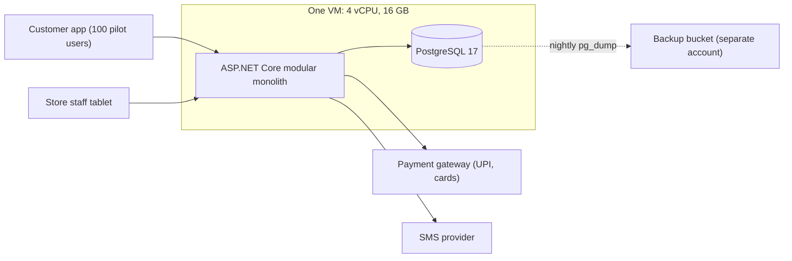
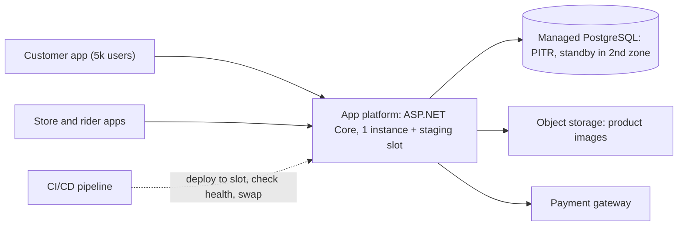
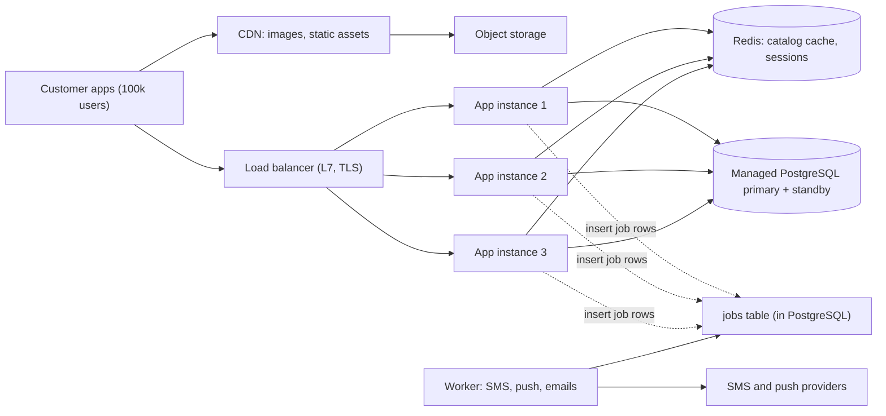
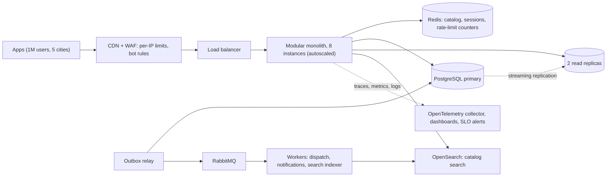
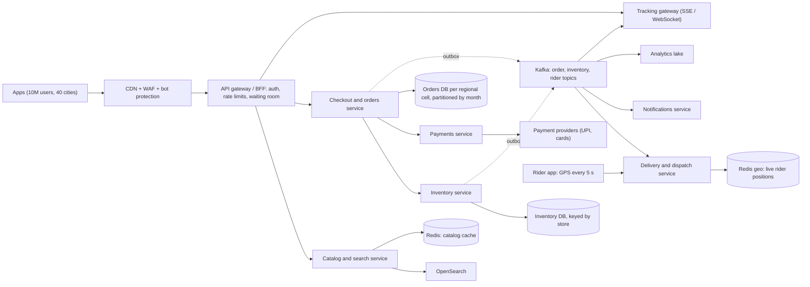
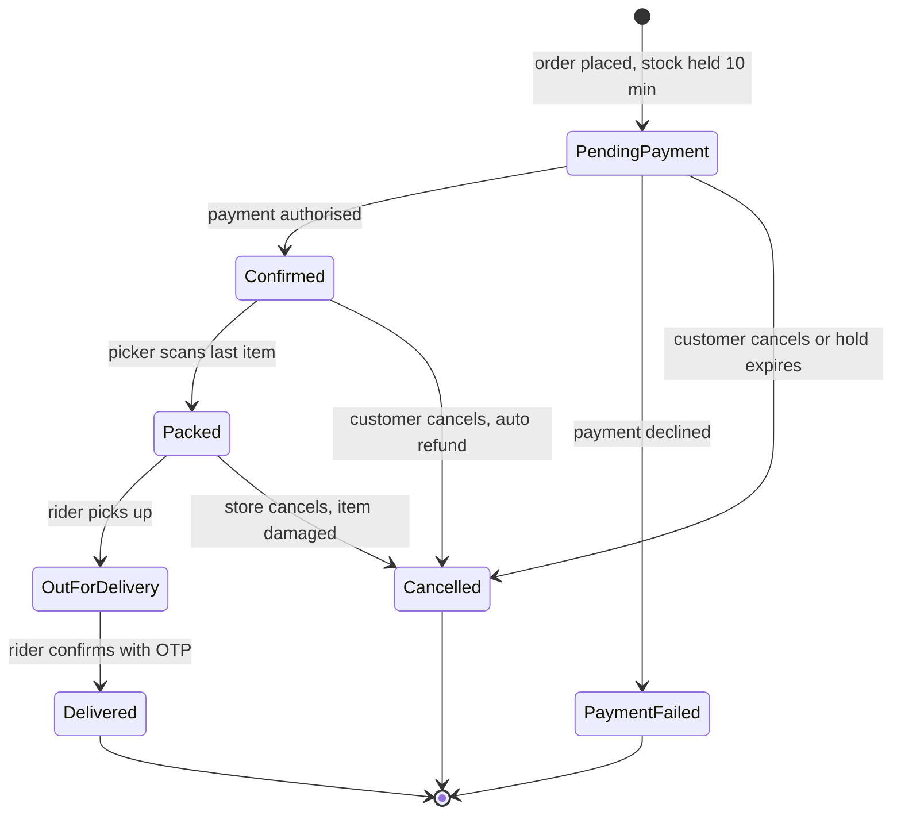
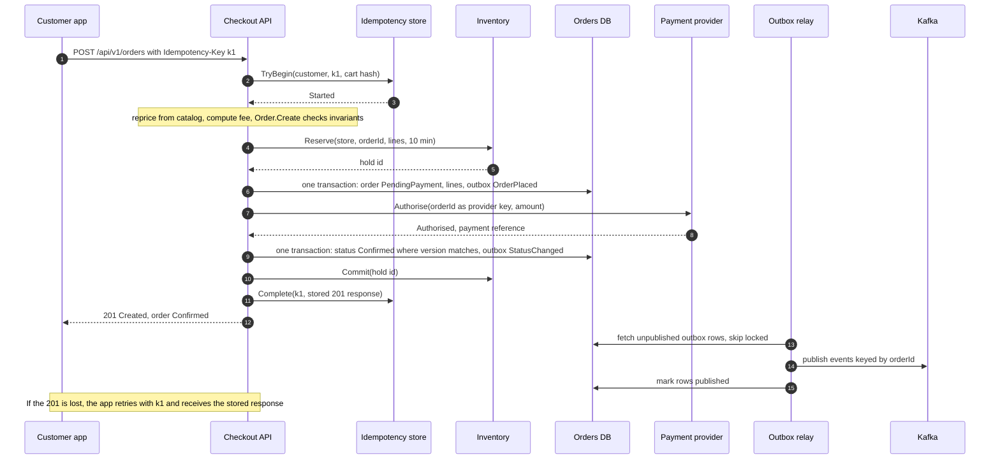

Most system design case studies show you the finished building: forty boxes, Kafka, sharded databases, three regions. That picture is useful in an interview, but it hides the most important skill of a working architect: knowing **which box to add next, and when**. No real company started with forty boxes. They started with one server and added each piece because something specific broke.

This lesson follows one system, a quick-commerce grocery app (a service like Blinkit, Zepto or Instacart, where groceries arrive in 10–20 minutes from a small nearby warehouse called a *dark store*), from a 100-user pilot to 10 million users. At every stage you will see the numbers, what broke, which metric told us, what we changed, what it cost, and what we deliberately did *not* do yet. Then we zoom from the high-level design (HLD) box called "checkout and orders" down to its low-level design (LLD): classes, a state machine, a database schema and production-style C#. By the end you will have seen HLD and LLD as two zoom levels of the same system, not two separate subjects.

All company references are to "a system like X". We reason from public engineering principles, not from any company's private architecture. All numbers are **estimates** for teaching, and are labelled as such.

## Learning objectives

By the end of this lesson you will be able to:

1. Estimate traffic, order rate, concurrency and storage for a quick-commerce app at five growth stages, showing the arithmetic.
2. Explain why a single VM running ASP.NET Core and PostgreSQL is the *correct* design for a 100-user pilot.
3. For each growth stage, name the bottleneck that appeared, the metric that revealed it, the change that fixed it, and the cost it added.
4. Recognise which changes are "do it early because it is cheap and hard to retrofit" (idempotency keys, module boundaries, backups) and which are "do it only when measured" (replicas, brokers, microservices, sharding).
5. Decompose a modular monolith into services along real business boundaries, and partition data by city and time.
6. Zoom from an HLD box to an LLD: requirements, class diagram, state machine, sequence diagram and patterns (Strategy, State, Repository, Result, Outbox).
7. Implement an order aggregate with invariants, an idempotent place-order handler and an outbox relay in C# with ASP.NET Core minimal APIs.

## Prerequisites

You should be comfortable with:

- The difference between HLD and LLD: [HLD versus LLD](#/lesson/m02-hld-vs-lld).
- Back-of-the-envelope maths (requests per second, peak factors): [Capacity estimation](#/lesson/m11-capacity-estimation).
- Scaling up versus scaling out: [Vertical versus horizontal scaling](#/lesson/m11-scaling).
- What a modular monolith is: [Modular monolith architecture](#/lesson/m02-modular-monolith).

Helpful but not required: [Idempotency keys](#/lesson/m10-idempotency), [Transactional outbox](#/lesson/m12-outbox) and [Aggregates](#/lesson/m08-aggregates). This lesson uses them and links to them; you can read them afterwards.

## Explain it like I'm a beginner

Imagine a family that opens a small neighbourhood grocery shop. On day one, one person takes orders on the phone, picks items from the shelf and rides a scooter to deliver them. That is perfectly sensible: hiring a manager, a warehouse and a fleet for twenty orders a day would bankrupt them.

As orders grow, things start to hurt, one at a time. The phone line is busy, so they hire a second person to answer calls. The shelf runs out of milk every evening, so they start tracking stock in a register. Deliveries pile up at 8 pm, so they hire three delivery riders. Later they open a second shop in the next neighbourhood, and they need one stock register *per shop*, because milk in shop A does not help a customer near shop B. Eventually they have a hundred shops in many cities. Now they have separate teams for buying, pricing, delivery and customer support, because one person can no longer understand everything.

Notice two things. First, each change was a **response to a specific pain they could see** (busy phone line, empty shelf, late deliveries). Nobody hired a delivery fleet "in case we grow". Second, some habits were cheap to start on day one and painful to start later: writing every order in a book with a number, never taking payment twice for the same order, keeping the receipts somewhere safe. Good software architecture works the same way.

In software terms: the phone line is your **web server**, the stock register is your **database**, the riders are **background workers**, the separate shops are **partitions**, and the separate teams are **services**. The rest of this lesson turns that story into numbers, diagrams and code.

## Requirements

We design for the final stage (10 million registered users, 40 cities) and then show how we got there.

### Functional requirements

1. **Find a store**: from the customer's location, pick the dark store that can deliver in about 15 minutes. If none, show "not serviceable".
2. **Browse and search**: categories, product pages and search, showing only items *in stock at that store*, with that store's prices and offers.
3. **Cart and checkout**: add items, see the delivery fee (it depends on cart value, membership, distance and surge), pay by UPI, card or wallet, and get an order confirmation.
4. **Inventory**: never sell an item the store does not have. Hold stock while the customer pays; release it if payment fails.
5. **Fulfilment**: store staff see new orders, pick and pack them (target: 2–3 minutes); a rider is assigned and delivers.
6. **Tracking**: the customer sees status changes and the rider's live position.
7. **Notifications**: push notifications and SMS for confirmation, dispatch and delivery.
8. **Cancellation and refunds**: the customer can cancel before the rider picks up; refunds are automatic.

### Non-functional requirements

| Property | Target (final stage) | Why |
| --- | --- | --- |
| Checkout availability | 99.95 % monthly (about 22 minutes of downtime) | A failed checkout is lost revenue right now; customers switch apps. |
| Browse availability | 99.9 %, with graceful degradation | Stale prices for a minute are acceptable; a blank home screen is not. |
| Checkout latency | p95 under 800 ms excluding the payment provider's own UI | Measured server-side at the API. |
| Correctness | No double charge; no order confirmed without stock held | Money and trust. These are not "eventually" properties. |
| Freshness | Stock shown on the product card may lag by up to 30 s | The final check happens at reservation time anyway. |
| Peak | Festival evenings at roughly 3× a normal evening | Diwali, New Year's Eve, cricket finals. |
| Data | Orders kept 7 years for tax (GST) records; hot data 13 months | Compliance plus cost. |

### Out of scope

Supplier purchasing, warehouse replenishment planning, rider payroll and the advertising platform. They are real systems, but each is a lesson of its own.

## Capacity estimation

These are estimates for teaching. Real numbers come from your analytics. Always show the arithmetic so others can challenge your assumptions.

:::stats title="Stage 4 at a glance (estimates)"
Daily active users | 2 M | of 10 M registered
Peak API traffic | 10,000 RPS | planned for a festival evening
Peak checkout | 500 orders/s | planned ceiling
Orders in flight | 75,000 | Little's law at the festival peak
Rider GPS writes | 8,000/s | Redis, not PostgreSQL
Order data | 440 GB/yr | before indexes
:::

### Final stage (stage 4) assumptions

- 10 M registered users; 20 % daily active: **2 M DAU**.
- Each active user makes about **40 API calls** a day (home screen, categories, search, cart updates, tracking).
- **800,000 orders a day** normally; **2.5 M** on a festival day.
- About **1,000 dark stores** in 40 cities, each with about **6,000 SKUs** (stock-keeping units: one row per sellable product variant).
- Average basket: **8 distinct items**, about ₹550.
- Delivery takes about **15 minutes** from confirmation.

### Traffic

- API calls: 2 M × 40 = 80 M a day ÷ 86,400 s ≈ **930 RPS on average**.
- The evening peak (7–10 pm) runs at about 3× average: ≈ **2,800 RPS**.
- A festival evening is about 3× a normal evening: ≈ **8,300 RPS**. We plan the API tier for **10,000 RPS**.
- Orders: 800,000 ÷ 86,400 ≈ **9 orders/s** on average. The busiest hour carries about 12 % of the day: 96,000 ÷ 3,600 ≈ **27 orders/s**.
- Festival day: 2.5 M × 12 % = 300,000 in the peak hour ≈ **83 orders/s**. A "₹1 deal at 8 pm" push notification can make one minute 4× busier than its hour: ≈ **330 orders/s**. We plan checkout for **500 orders/s**.

### Concurrency: how many orders are "live" at once?

Use Little's law: items in the system = arrival rate × time each spends in it (L = λ × W). At the festival peak, 83 orders/s × 900 s (15 minutes) ≈ **75,000 orders in flight**. If every customer's app polled for status every 3 seconds, that would be 25,000 extra RPS for nothing. That one number is why tracking moves to server push (Server-Sent Events or WebSockets) at stage 4.

### Writes per order

One order touches about 30 rows: 1 order row, 8 order lines, 8 stock reservations, about 4 status changes, about 5 outbox events, 2–3 payment rows, and an idempotency key. At 500 orders/s that is about **15,000 row writes/s** at the planned ceiling. A single well-tuned PostgreSQL primary can sustain that for simple inserts, but not with comfortable headroom alongside everything else. That is one of the reasons to split the order data by region at stage 4.

### Rider locations

At a festival peak with about 40,000 active riders each sending a GPS ping every 5 s: 40,000 ÷ 5 = **8,000 writes/s** of data that is worthless after 30 seconds. That belongs in an in-memory store (Redis geospatial sets), not in PostgreSQL rows.

### Storage

- Orders: about 1.5 KB per order including lines. 800,000 × 365 × 1.5 KB ≈ **440 GB a year**, roughly 0.9 TB with indexes. Hence monthly partitions, 13 months hot, older months archived.
- Catalog per store: 1,000 stores × 6,000 SKUs = 6 M store-SKU rows × about 200 bytes ≈ **1.2 GB**. Small enough to cache whole.
- Product images: 50,000 products × 6 images × 4 sizes × 60 KB ≈ **72 GB** stored.
- Image *bandwidth*: 2 M DAU × 150 image loads × 30 KB ≈ **9 TB a day**. That is why the CDN arrives at stage 2: serving 9 TB a day from your app servers would be slow and expensive.

### Stage summary (all estimates)

| Stage | Registered users | DAU | Stores | Orders/day | Peak API RPS | Peak orders/s | Order data |
| --- | --- | --- | --- | --- | --- | --- | --- |
| 0 Pilot | 100 | 40 | 1 | 30 | under 1 | 0.01 | under 1 GB |
| 1 Launch | 5,000 | 1,500 | 3 | 600 | about 5 | 0.1 | about 5 GB |
| 2 One city | 100,000 | 25,000 | 15 | 8,000 | about 100 (promo) | 1–2 | about 50 GB |
| 3 Five cities | 1 M | 250,000 | 150 | 80,000 | about 1,000 (sale) | 15–30 | about 400 GB |
| 4 Nationwide | 10 M | 2 M | 1,000 | 800,000 (2.5 M festival) | about 10,000 | about 330 | multi-TB |

Check one row yourself. Stage 2: 25,000 × 40 = 1 M calls a day ≈ 12 RPS average; ×3 for the evening ≈ 35; ×3 for a Sunday promotion ≈ 100 RPS. Notice how *small* that is. A single ASP.NET Core instance can serve far more than 100 RPS of simple JSON. Whatever breaks at stage 2, it is not raw request volume.

## API design

The public API stays almost the same through all five stages. That is deliberate: clients (Android, iOS, web, store tablets, rider apps) are slow to update, so internal re-architecture must not leak into the contract.

```http
GET  /api/v1/stores/serviceable?lat=12.9352&lng=77.6245
200 { "storeId": "BLR-KOR-01", "etaMinutes": 12 }

GET  /api/v1/stores/BLR-KOR-01/categories/dairy?cursor=...
GET  /api/v1/stores/BLR-KOR-01/search?q=atta&cursor=...

PUT  /api/v1/cart                      { "storeId": "BLR-KOR-01", "lines": [ { "sku": "milk-1l", "quantity": 2 } ] }
200 { "itemsTotal": 11200, "deliveryFee": 2500, "total": 13700 }     (amounts in paise)

POST /api/v1/orders                    Idempotency-Key: 7f9c2e1a-...
     { "storeId": "BLR-KOR-01", "addressId": "addr_42", "lines": [ ... ] }
201 { "orderId": "...", "status": "Confirmed", "totalPaise": 13700 }
202 { "orderId": "...", "status": "PendingPayment" }       payment outcome not known yet
402 payment declined     409 out of stock or key in progress     422 invalid cart or key reused

GET  /api/v1/orders/{id}
GET  /api/v1/orders/{id}/events        text/event-stream (Server-Sent Events) for live tracking
POST /api/v1/orders/{id}/status        store and rider apps: { "status": "Packed" }
POST /api/v1/payments/webhook          signed callback from the payment provider
```

Design decisions worth defending:

- **Money in paise as integers.** `13700` means ₹137.00. No floating-point rounding, no currency-format bugs between clients.
- **The client never sends prices.** The server reprices the cart from the store's catalog at checkout. A modified app cannot buy a ₹500 item for ₹5.
- **`Idempotency-Key` on `POST /orders` from day one.** Mobile networks drop responses. Without the key, a retry creates a second order and a second charge. It costs one table and twenty lines of code at stage 0, and it is very painful to retrofit once clients exist that do not send it. See [Idempotency keys](#/lesson/m10-idempotency).
- **`202 PendingPayment` is a real answer.** UPI payments are approved in another app, and payment providers sometimes time out. Pretending to know the outcome causes double charges or lost orders.
- **Cursor pagination** for catalog and search, so adding a product does not shift pages.
- **Store-scoped URLs** (`/stores/{storeId}/...`). Every catalog and inventory read is per store. That makes caching easy at stage 2 and partitioning natural at stage 4.

## Data model

The core entities exist from stage 0. What changes over the stages is *where* they live and how they are split, not what they are.

```sql
CREATE TABLE stores (
  id          int         PRIMARY KEY,
  code        text        NOT NULL UNIQUE,           -- 'BLR-KOR-01'
  city_id     smallint    NOT NULL,
  location    point       NOT NULL,                  -- PostGIS geography in production
  is_open     boolean     NOT NULL DEFAULT true
);

CREATE TABLE products (                                -- the global catalog
  sku         text        PRIMARY KEY,
  name        text        NOT NULL,
  category    text        NOT NULL,
  image_key   text                                     -- object storage key, never the bytes
);

CREATE TABLE store_products (                          -- what a store sells and at what price
  store_id    int         NOT NULL REFERENCES stores(id),
  sku         text        NOT NULL REFERENCES products(sku),
  price_paise bigint      NOT NULL CHECK (price_paise >= 0),
  is_active   boolean     NOT NULL DEFAULT true,
  PRIMARY KEY (store_id, sku)
);

CREATE TABLE store_inventory (                         -- per-store stock (stage 3 onwards)
  store_id    int         NOT NULL,
  sku         text        NOT NULL,
  on_hand     int         NOT NULL CHECK (on_hand >= 0),
  reserved    int         NOT NULL DEFAULT 0 CHECK (reserved >= 0 AND reserved <= on_hand),
  PRIMARY KEY (store_id, sku)
);
```

`store_inventory` keeps `on_hand` and `reserved` separately, with a `CHECK` that reserved never exceeds on-hand. Sellable stock is `on_hand - reserved`. A reservation is a single atomic statement:

```sql
UPDATE store_inventory
SET    reserved = reserved + 2
WHERE  store_id = 17 AND sku = 'milk-1l' AND on_hand - reserved >= 2;
-- 1 row updated = held; 0 rows = not enough stock. No read-then-write race.
```

The order tables (`orders`, `order_lines`, `outbox`, `idempotency_keys`) belong to the checkout service and are shown in full in the LLD zoom-in under **Deep dives**, with indexes and partitioning.

Notice the keys. Almost every table starts with `store_id`, and stores belong to cities. That is not an accident: it is the partitioning key we will need at stage 4, chosen at stage 0 for free. Most queries in this business are "for this store" or "for this customer", almost never "across all stores in real time". The exceptions (company-wide reports) go to an analytics store, not the transactional database.

## High-level architecture

This section is the backbone of the lesson: five stages, one system. For each stage we give the numbers, what broke at the previous stage and how we knew, the change, the cost, and what we chose *not* to do yet.

:::callout type=tip title="The meta-lesson"
Scale in response to **measured** bottlenecks, not imagined ones. Before every change, name the metric that is red, the change you expect to turn it green, and the new failure modes the change brings. If you cannot name the metric, you are probably not ready for the change. The exceptions are cheap habits that are expensive to retrofit: idempotency keys, backups, module boundaries in code, and money as integers.
:::

### Stage 0: 100 users, one dark store, one VM

**Numbers (estimate)**: 100 pilot users in one Bengaluru neighbourhood, about 30 orders a day, well under 1 RPS. A few thousand rows of data.

**Design**: one virtual machine (4 vCPU, 16 GB RAM) runs an ASP.NET Core application and PostgreSQL 17. The same app serves the customer API, a simple store-staff web page for picking orders, and an admin page for prices. A payment gateway handles UPI and cards. A nightly `pg_dump` is copied to object storage in a different account.



The diagram shows every moving part of the pilot. Customer and store requests both arrive at one ASP.NET Core process, which reads and writes one PostgreSQL database on the same machine. The only outbound calls are to the payment gateway and an SMS provider. The dotted arrow is the nightly backup leaving the machine. If the VM dies, at most one day of data is at risk, which is acceptable for a free pilot.

**Why this is the right answer**: the team is three engineers, and the business model is unproven. Their biggest risk is building the wrong product, not traffic. One machine means one place to look when something fails, deploys in seconds, and a monthly bill of roughly ₹8,000–15,000 (estimate). Every additional component (cache, queue, second service) would add a failure mode and slow down the experiments the business actually needs.

**Cheap things we do on day one anyway**:

- **Module boundaries in code**: separate projects (or at least folders and namespaces) for Catalog, Ordering, Inventory, Delivery, and Notifications, each with its own tables. Modules call each other through interfaces, not by reading each other's tables. This costs almost nothing now and is what makes the stage-4 split possible. See [Modular monolith](#/lesson/m02-modular-monolith).
- **Idempotency key on place-order**, and money stored as integer paise.
- **Off-box backups** and one restore test.
- **Structured logs** with an order id on every line.

**What we deliberately did NOT do**: Kubernetes, microservices, Redis, a message broker, read replicas, multi-region. None of them solves a problem we have.

### Stage 1: about 5,000 users, three stores

**Numbers (estimate)**: 1,500 DAU, 600 orders a day, peak about 5 RPS. Still tiny.

**What broke, and the metric that showed it**:

- A deploy at 8:05 pm restarted the app during the dinner rush: **4 minutes of 5xx errors**, visible in the uptime monitor and in a dip of the "orders per minute" chart.
- The VM's disk filled up with product photos uploaded through the admin page: **disk usage alert at 92 %**.
- A rehearsal of "the VM is gone" took **3 hours** to restore from the nightly dump, and would have lost up to 24 hours of orders. The business could not accept that once real customers were paying. The metrics here are **RTO** (recovery time objective, how long until we are back: 3 hours) and **RPO** (recovery point objective, how much data we lose: up to 24 hours).

**Changes**:

1. **Managed PostgreSQL** with automated backups and point-in-time recovery (PITR), plus a standby replica in a second availability zone for automatic failover. RPO drops to seconds; RTO to a couple of minutes.
2. **Platform hosting for the app** (for example Azure App Service or Container Apps) with a *staging slot*: deploy to staging, run health checks, then swap. No more dinner-time restarts.
3. **CI/CD pipeline**: every merge builds, runs tests, and deploys to staging automatically.
4. **Health checks**: `/health/live` (process is up) and `/health/ready` (database reachable), used by the platform to route traffic only to healthy instances.
5. **Object storage for images**: the admin page uploads directly to blob storage with a short-lived signed URL; the database stores only the key.



Compared with stage 0, the database moved off the app machine into a managed service that takes backups and fails over on its own, images moved into object storage, and deploys now go through a staging slot. The app is still one process with the same code; the dotted arrow shows the pipeline delivering it.

**Cost added**: roughly ₹40,000–80,000 a month (estimate), mostly the managed database with a standby. **Complexity added**: low. It is still one app and one database; we bought reliability, not scale.

**Not yet**: multiple app instances (CPU is under 10 %), caching, queues.

### Stage 2: about 100,000 users, one city, 15 stores

**Numbers (estimate)**: 25,000 DAU, 8,000 orders a day, about 35 RPS on a normal evening and about 100 RPS during a Sunday promotion.

**What broke, and the metric that showed it**:

- During the first big promotion, **p95 latency of the home screen rose from 180 ms to 1.9 s**. The app server's CPU was only 40 %; the **database CPU was at 85 %**. Query statistics (`pg_stat_statements`) showed that 70 % of database time was the same few catalog queries ("categories and products for store 7"), run thousands of times a minute with identical results.
- **Image bandwidth** from object storage became the second-largest line on the bill, and images loaded slowly on 4G.
- The **order confirmation endpoint took 2–6 s** whenever the SMS provider was slow, because the SMS was sent inside the request.
- One instance is one point of failure: a platform host maintenance event caused a **6-minute outage**.

**Changes**:

1. **Load balancer plus three stateless app instances** across zones. "Stateless" means no user data lives in the app's memory between requests: sessions live in Redis or in signed tokens, so any instance can serve any request. See [Stateless versus stateful services](#/lesson/m11-stateless).
2. **Redis cache** for the per-store catalog (cache-aside, 60-second TTL plus explicit invalidation when an admin changes a price). With a 95 % hit ratio, catalog queries reaching PostgreSQL drop by 20×.
3. **CDN for images** with long cache lifetimes and versioned file names (`milk-1l.v3.webp`), so a changed image gets a new URL instead of needing a purge.
4. **Background jobs**: the request writes a row to a `jobs` table in the same transaction as the order, and a worker process sends SMS and push notifications. The customer sees "Confirmed" immediately, whatever the SMS provider is doing. (This is the small, database-backed ancestor of the stage 3 outbox.)



Two paths now leave the phone. Image requests go to the CDN, which fetches from object storage only on a miss. API requests go through the load balancer to any of three identical app instances. Each instance checks Redis before PostgreSQL for catalog data. The dotted arrows show work handed off for later: the app inserts job rows, and a separate worker process picks them up and talks to the SMS and push providers, so a slow provider no longer slows down checkout.

**Cost added**: roughly ₹2–4 lakh a month (estimate). **Complexity added**: cache invalidation (a stale price is now possible for up to 60 s, so checkout must always reprice from the database), and a worker process to deploy and monitor.

**Not yet**: read replicas (the database is at 30 % CPU after caching), a message broker (a jobs table handles a few notifications per second), a search engine (`ILIKE` on 6,000 products per store is still fast enough), microservices.

### Stage 3: about 1 million users, five cities, 150 stores

**Numbers (estimate)**: 250,000 DAU, 80,000 orders a day, about 350 RPS on a normal evening and about 1,000 RPS during a city-wide sale, 15–30 orders/s at sale peaks. Around 400 GB of order data.

**What broke, and the metric that showed it**:

- **Database primary CPU at 75 % on normal evenings.** The top queries were order-tracking polls (`GET /orders/{id}` every 3 s from every open app) and the operations team's "live sales by store" dashboard, which scanned the orders table every minute.
- **Search**: `ILIKE '%atta%'` across a now-larger catalog with Hindi, Tamil and Kannada names had **p95 1.2 s** and poor results ("aata", "atta", "wheat flour" all meant the same thing).
- **Lost events**: about **0.3 % of confirmed orders never reached the rider-dispatch screen** after deploys. Investigation found the code committed the order and *then* published to the jobs queue in a separate step; a pod killed between the two lost the message. That is the classic *dual-write* problem.
- **Overselling**: stock had been tracked per city with a nightly sync from stores. In the evening rush, **2.1 % of orders had at least one item substituted or refunded** because the specific store had run out.
- **Bots** scraping prices every few seconds made up **18 % of API traffic** (seen in request logs by user-agent and IP pattern).
- **"The app is slow" with no idea where**: logs per instance, no traces, no way to tell whether a slow checkout was the database, Redis, or the payment provider.

**Changes**:

1. **Read replicas** for read-only, lag-tolerant traffic: order history, the ops dashboard (which moves to a replica and later to an analytics store), tracking reads. Writes and read-after-write paths (checkout, "show me the order I just placed") stay on the primary. See [Choosing and scaling the database tier](#/lesson/m11-database-architecture).
2. **Message broker (RabbitMQ) plus transactional outbox**: the order and the event "OrderConfirmed" are written in the *same* database transaction; a relay publishes outbox rows to the broker and marks them sent. Consumers (dispatch, notifications, search indexer) are idempotent because the relay may send a message twice. See [Transactional outbox](#/lesson/m12-outbox). We chose RabbitMQ over Kafka here because volumes are modest and the team needs work queues with per-message acknowledgements, not a replayable log.
3. **Search engine (OpenSearch)** for the catalog, fed by events from the outbox: synonyms, transliteration, typo tolerance, and filtering by store and in-stock.
4. **Per-store inventory with reservations**: the `store_inventory` table from the data model, with stock held for 10 minutes during payment. See [Inventory reservation](#/lesson/m18-inventory-reservation).
5. **Rate limiting**: per-IP limits at the edge (WAF) and per-customer token buckets in ASP.NET Core on expensive endpoints (search, checkout).
6. **Observability**: OpenTelemetry traces, metrics and logs from every instance, one trace id per request across app, database and broker. **SLOs** (service level objectives) defined and alerted on: "99.9 % of checkouts succeed and 95 % complete in under 800 ms, measured over 28 days".



The app is still one deployable unit, now running as eight instances. Reads that can be a second or two stale go to the replicas; writes go to the primary. The relay reads unsent outbox rows from the primary and publishes them to RabbitMQ, where workers update the search index, assign riders and send notifications. Every component sends telemetry to one collector, so a slow request can be followed from the edge to the database in one trace.

**Cost added**: roughly ₹15–30 lakh a month (estimate). Infrastructure cost per order is still falling, from roughly ₹12 at stage 2 to roughly ₹8 here, because shared fixed costs are spread over more orders. **Complexity added**: replica lag (a customer may not see the order they just placed if you read it from a replica), at-least-once delivery (every consumer must deduplicate), a search index that can drift from the database, and an on-call rotation.

**Not yet**: microservices (one team of about 25 engineers can still release the monolith safely twice a week), sharding (one primary at 45 % after replicas), multi-region.

### Stage 4: about 10 million users, 40 cities, 1,000 stores

**Numbers (estimate)**: 2 M DAU, 800,000 orders a day (2.5 M on festival days), about 10,000 API RPS at the festival peak, up to about 330 orders/s in a sale minute, 75,000 orders in flight, 8,000 rider pings/s, close to 1 TB of order data a year.

**What broke, and the metric that showed it**:

- **Release friction**: 60 engineers in 8 teams shared one deployable. The weekly release train slipped regularly, and a bug in the loyalty-points module **took checkout down for 25 minutes** because it ran in the same process and threw during order confirmation. The metrics: deployment frequency fell to once a week, and change-failure rate rose to about 15 %.
- **Noisy neighbours**: on Diwali evening, the rider-dispatch matching (CPU-heavy) **starved checkout of CPU** on the same instances. Checkout p95 rose to 3.5 s while dispatch was the only thing working hard.
- **One primary, too many writes**: during sale minutes, write volume and the hot rows of popular SKUs pushed the primary to **90 % CPU and 400 ms commit latency**. Autovacuum fell behind on the 300-million-row orders table, and the nightly backup took 6 hours.
- **Tracking load**: 75,000 orders in flight polling every 3 s ≈ 25,000 RPS of pure waste.

**Changes**:

1. **Split the modular monolith into a few services along the module boundaries drawn at stage 0**: Catalog and search, Checkout and orders, Inventory, Payments, Delivery and dispatch, Notifications, plus a Tracking gateway. Each owns its data and deploys on its own. We split *only* where a team boundary, a different scaling profile, or a blast-radius concern justified it; we did not create 40 nano-services. See [Modular monolith versus microservices](#/lesson/m16-monolith-vs-microservices).
2. **Kafka replaces RabbitMQ for domain events**: rider locations, order events and inventory changes are high-volume streams that several consumers (dispatch, analytics, notifications, fraud) read independently and sometimes replay. Events are keyed by `order_id` or `store_id`, so all events for one order stay in order within a partition.
3. **Partition data by region and time**: cities are grouped into regional *cells* (for example South, West, North, East). Each cell has its own orders database cluster, and within it the `orders` table is partitioned by month. A router maps `store_id → cell`. A Diwali surge in Mumbai cannot slow down checkout in Chennai, and each primary carries about a quarter of the writes.
4. **Multi-AZ everything**: every service runs in at least three availability zones; databases have synchronous standbys in another zone. Losing a zone costs capacity, not availability.
5. **Peak handling**: pre-scale 30 minutes before known events (festival evenings, cricket finals) instead of waiting for autoscaling to react; a *waiting room* (a queue at the edge) admits users to checkout at a controlled rate during flash sales; and *load shedding*: when checkout latency rises, turn off recommendations, "people also bought" and non-essential banners first. See [Flash sale system](#/lesson/m17-flash-sale).
6. **Tracking via push**: a WebSocket/SSE gateway subscribes to order and rider events and pushes changes, instead of 25,000 RPS of polls.
7. **Cost as a metric**: dashboards show infrastructure cost per order, per service. Reserved capacity covers the baseline; autoscaling covers peaks.

Before the full diagram, follow one festival-evening checkout through the stage-4 system. Switch to **3D** to see the layers.

:::flow title="One checkout at stage 4" view=3d
app | Customer app | client
cdn | CDN + WAF | cdn
gw | API gateway | gateway
chk | Checkout service | service
inv | Inventory service | service
pay | UPI gateway | external
db | Orders DB (South cell) | db
k | Kafka | queue
trk | Tracking gateway | service
---
app -> cdn | POST /checkout: WAF and bot checks at the edge
cdn -> gw | auth, rate limit, waiting-room token
gw -> chk | PlaceOrder with an Idempotency-Key
chk -> inv | reserve 8 items at store BLR-042
inv -> chk | held for 10 minutes
chk -> pay | create a UPI payment intent
pay -> chk | authorised (webhook)
chk -> db | order + outbox row in one transaction
chk -> k | OrderConfirmed, keyed by order_id
k -> trk | tracking gateway consumes the event
trk -> app | push "Packing your order" over SSE
:::



Read the diagram from the left. All traffic passes the edge (CDN, firewall, bot protection) and an API gateway that authenticates, rate-limits and, during flash sales, holds users in a waiting room. Browsing goes to the Catalog service, which reads from OpenSearch and Redis. Checkout calls Inventory and Payments synchronously, because the customer is waiting for the answer, and writes to its own regional orders database. Everything that can happen *after* the customer sees "Confirmed" travels as events through Kafka (dotted arrows), fed by outboxes: dispatch assigns a rider, notifications go out, analytics records the order, and the tracking gateway pushes updates to the app. Rider GPS pings go to the dispatch service and live only in Redis.

**Cost (estimate)**: roughly ₹1.5–3 crore a month, under ₹1 of infrastructure per order at 24 M orders a month. **Complexity added**: distributed tracing becomes mandatory, contracts between services need versioning, local development needs fakes or containers for each dependency, and data that used to be one `JOIN` is now an API call or an event-fed read model.

**What we still do NOT do**: active-active multi-region writes (a single country, latency between Indian regions is small, and the consistency cost is high), a globally distributed SQL database, rewriting services in another language, or splitting services further than team boundaries require.

## Deep dives

### How we knew: the metrics that drove each stage

Every change in the previous section came from a metric. Here are the ones worth having from stage 1 onwards, with the change each one typically triggers:

| Metric | Healthy | When it goes red, typical next step |
| --- | --- | --- |
| Uptime and 5xx rate | under 0.1 % 5xx | Health checks, staging slots, multiple instances |
| p95 latency per endpoint | under budget (e.g. 800 ms checkout) | Profile with traces: database, cache, external calls |
| Database CPU and top queries (`pg_stat_statements`) | under 60 % at peak | Fix queries and indexes first, then cache, then replicas |
| Cache hit ratio | over 90 % for catalog | TTLs, key design, warming |
| Replica lag | under 1 s | Route read-your-writes to the primary |
| Outbox backlog age | under 5 s | More relay throughput, broker health |
| Queue depth and consumer lag | flat or draining | Scale consumers, find poison messages |
| Orders per minute vs same time last week | within normal band | The business-level alarm that catches what technical metrics miss |
| Deployment frequency, change-failure rate | daily, under 10 % | Better tests, then module isolation, then service split |
| Cost per order | flat or falling | Right-size, reserve baseline, cache, archive |

The order is important: **fix the query before adding a cache, add a cache before adding replicas, add replicas before sharding**. Each step is roughly ten times more operationally expensive than the one before.

### The stage-4 split: why these boundaries

The services in stage 4 are not arbitrary. Each boundary passes at least one of three tests:

- **Different scaling profile**: Catalog is read-heavy (thousands of RPS, cacheable); Checkout is write-heavy and correctness-critical (hundreds of RPS); Dispatch is CPU-heavy matching; Tracking is connection-heavy (75,000 open streams).
- **Different team and release cadence**: pricing and catalog change daily; payments change rarely and need extra review.
- **Blast radius**: a bug in notifications must never stop an order from being confirmed.

And each boundary owns its data. Checkout never reads the inventory tables directly; it calls the Inventory service, which owns stock. This is why the stage-0 rule "modules do not read each other's tables" matters: if Ordering had been joining directly on `store_inventory` for three years, the split would have needed months of untangling. With the rule, it is mostly moving a module into its own deployable and replacing in-process interface calls with HTTP or gRPC calls behind the same interfaces.

### Partitioning: by city cell and by month

Two kinds of partitioning are combined at stage 4:

1. **By region (cells)**: each regional cell has its own orders database. Most queries include the store, and the store determines the cell, so a query never needs to visit two cells. The customer's "my orders" page is the exception: a customer who moved from Pune to Bengaluru has orders in two cells. We handle that with a small, event-fed read model of "order summaries by customer" in a separate store, rather than querying every cell.
2. **By time (PostgreSQL declarative partitioning)**: inside each cell, `orders` is partitioned by month on `created_at`. Recent partitions are small and hot, so their indexes stay in memory. Old partitions can be detached and archived to cheaper storage in one fast operation instead of a huge `DELETE`, and autovacuum works on small tables. The cost: the partition key must be part of every primary key and unique constraint, and queries that do not filter by `created_at` scan every partition.

We did not pick hash sharding by `order_id`, because it scatters one store's live orders across all shards, and the store dashboard ("all open orders for store 17") would become a fan-out query.

### From the HLD box to classes: the checkout and orders service

Now we zoom in. In the stage-4 diagram, "Checkout and orders service" is one box with arrows to Inventory, Payments, its database and Kafka. What is inside that box? This is where HLD meets LLD: the arrows in the HLD become interfaces in the LLD, and the HLD's guarantees ("no double charge", "no lost events") become specific classes and transactions.

#### Requirements of the service

1. Accept a place-order command with an idempotency key; the same key and the same cart always produce the same result, even when retried after a crash.
2. Reprice every line from the store's catalog; reject inactive or unknown items.
3. Compute the delivery fee from a set of rules that the business changes often (surge, membership, free above ₹199, distance).
4. Enforce order invariants: 1–50 distinct items, quantity 1–10 per item, no negative prices or fees, no duplicate SKUs.
5. Hold stock at the specific store before charging; release it if payment is declined.
6. Never charge twice: the payment call carries the order id as the provider's idempotency key.
7. Move an order only through legal status transitions; repeated transitions (a rider app retrying "Delivered") are harmless no-ops.
8. Publish every status change as an event exactly when (and only if) it is committed: the transactional outbox.

#### Class diagram

```mermaid
classDiagram
    class Order {
        +Guid Id
        +string CustomerId
        +string StoreId
        +OrderStatus Status
        +Money ItemsTotal
        +Money DeliveryFee
        +Money Total
        +int Version
        +Create(id, customerId, storeId, lines, fee, now)$ Result~Order~
        +CanMoveTo(OrderStatus next) bool
        +MoveTo(OrderStatus next, DateTimeOffset now, string reason) Result~OrderStatus~
        +ConfirmPayment(string reference, DateTimeOffset now) Result~OrderStatus~
        +DequeueEvents() IReadOnlyList~OrderEvent~
    }
    class OrderLine {
        +string Sku
        +string Name
        +int Quantity
        +Money UnitPrice
        +Money LineTotal
    }
    class Money {
        +long Paise
        +FromRupees(decimal rupees)$ Money
    }
    class OrderStatus {
        <<enumeration>>
        PendingPayment
        Confirmed
        Packed
        OutForDelivery
        Delivered
        Cancelled
        PaymentFailed
    }
    class OrderEvent {
        <<abstract>>
        +Guid OrderId
        +string StoreId
        +DateTimeOffset At
    }
    class PlaceOrderHandler {
        +HandleAsync(PlaceOrderCommand cmd, CancellationToken ct) Task~PlaceOrderResponse~
    }
    class IDeliveryFeeStrategy {
        <<interface>>
        +int Priority
        +AppliesTo(DeliveryFeeContext ctx) bool
        +Calculate(DeliveryFeeContext ctx) Money
    }
    class DeliveryFeeCalculator {
        +Calculate(DeliveryFeeContext ctx) FeeQuote
    }
    class IOrderStore {
        <<interface>>
        +GetAsync(Guid id) Task~Order~
        +SaveAsync(Order order, IReadOnlyList~OutboxMessage~ outbox) Task
    }
    class IIdempotencyStore {
        <<interface>>
        +TryBeginAsync(customerId, key, requestHash, lease) Task~IdempotencyBegin~
        +CompleteAsync(customerId, key, response) Task
        +AbandonAsync(customerId, key) Task
    }
    class IInventoryReservations {
        <<interface>>
        +ReserveAsync(storeId, orderId, lines, holdFor) Task~Result~
        +CommitAsync(reservationId) Task
        +ReleaseAsync(reservationId) Task
    }
    class IPaymentGateway {
        <<interface>>
        +AuthoriseAsync(orderId, customerId, amount) Task~PaymentResult~
    }
    Order "1" *-- "1..50" OrderLine
    Order --> OrderStatus
    OrderLine --> Money
    Order ..> OrderEvent : raises
    OrderPlaced --|> OrderEvent
    OrderStatusChanged --|> OrderEvent
    PlaceOrderHandler --> IIdempotencyStore
    PlaceOrderHandler --> IInventoryReservations
    PlaceOrderHandler --> IPaymentGateway
    PlaceOrderHandler --> IOrderStore
    PlaceOrderHandler --> DeliveryFeeCalculator
    PlaceOrderHandler ..> Order : creates
    DeliveryFeeCalculator o-- IDeliveryFeeStrategy
    SurgeDeliveryFee ..|> IDeliveryFeeStrategy
    MemberFreeDelivery ..|> IDeliveryFeeStrategy
    FreeAboveThreshold ..|> IDeliveryFeeStrategy
    StandardDeliveryFee ..|> IDeliveryFeeStrategy
```



The `Order` is an **aggregate root** (the one object that guards all the rules for itself and its lines; outside code never edits an `OrderLine` directly). It composes 1–50 `OrderLine`s, each priced in `Money`, and it *raises* events (`OrderPlaced`, `OrderStatusChanged`) instead of publishing them, so it stays free of infrastructure. `PlaceOrderHandler` is the application service: it orchestrates the steps and depends only on interfaces. Each interface is exactly one arrow from the HLD diagram: `IInventoryReservations` is the arrow to the Inventory service, `IPaymentGateway` is the arrow to Payments, `IOrderStore` is the arrow to the orders database. The delivery-fee rules hang off `DeliveryFeeCalculator` as interchangeable strategies.

#### Order state machine



Every arrow is a legal transition; anything not drawn is illegal. The customer can cancel until the rider picks the bag up. After that, the bag is on a scooter and "cancel" becomes a return, which is a different business process. `Delivered`, `Cancelled` and `PaymentFailed` are terminal: no arrow leaves them. A late "payment succeeded" webhook for a `PaymentFailed` order does not resurrect it; it triggers a refund. We implement this as an explicit transition table inside `Order` rather than the full State pattern with one class per state, because the states differ only in *which moves are allowed*, not in behaviour. If each state had substantially different behaviour, the [State pattern](#/lesson/m06-state) would earn its extra classes.

#### Sequence: placing an order



Walk through it step by step. (1–3) The idempotency store records "k1 is in progress" with a hash of the cart. If the same key arrives again with the same cart, it returns the stored response; with a different cart, it returns 422. (4–5) Stock is held at that store *before* charging, so we never take money for something we cannot deliver. (6) The order is saved as `PendingPayment` *before* calling the payment provider, so if the process crashes during the payment call, there is a record for the reconciler to find. (7–8) The order id doubles as the payment provider's idempotency key, so even a retry after a crash cannot charge twice. (9) The status change and its outbox row are committed together, with an optimistic-concurrency check on `version`. (10–12) The stock hold becomes permanent, the response is stored against k1, and the customer sees "Confirmed". (13–15) Separately, the relay publishes outbox rows to Kafka; dispatch and notifications react from there. Nothing in steps 1–12 waits for Kafka.

Two crash cases deserve a sentence each. If the process dies after step 6 but before step 9, the order sits in `PendingPayment`; the payment webhook or a reconciliation job (the SQL exercise below writes its query) asks the provider for the truth and finishes the transition. If it dies between step 9 and step 10, the order is confirmed but the hold is not yet committed; the hold-expiry job checks the order's status before releasing stock, so a confirmed order's stock is never released.

#### Patterns used, and why

| Pattern | Where | Why here | When it would be overkill |
| --- | --- | --- | --- |
| [Strategy](#/lesson/m06-strategy) | Delivery-fee rules | The business adds and changes fee rules every few weeks (rain surge, festival free delivery). Each rule is a class; the calculator never changes. | One fixed fee forever. |
| Explicit transition table (a lightweight [State](#/lesson/m06-state)) | `Order.MoveTo` | All transitions in one readable place, testable as data. | States with very different behaviour need the full State pattern. |
| Aggregate | `Order` with `OrderLine` | One consistency boundary: totals, line limits and status always agree. See [Aggregates](#/lesson/m08-aggregates). | A read-only report row. |
| [Repository](#/lesson/m06-repository-uow) | `IOrderStore` | The handler talks about orders, not SQL; tests use in-memory fakes. | Tiny CRUD apps where the ORM context is enough. |
| Result | `Result<T>` | Out of stock, invalid transition and declined payment are *expected* outcomes, not exceptions. | Truly exceptional failures (database down) should still throw. |
| [Transactional outbox](#/lesson/m12-outbox) | `SaveAsync(order, outbox)` + `OutboxRelay` | Fixes the stage-3 dual-write bug: event and state change commit together. | A single process with no consumers outside the transaction. |
| [Idempotency key](#/lesson/m10-idempotency) | `IIdempotencyStore` + deterministic order id | Mobile retries and double taps. | Internal calls that are already naturally idempotent. |

#### PostgreSQL schema for the checkout service

Shown as it looks at stage 4, partitioned by month. At stages 0–3 the same tables exist without `PARTITION BY`, and the primary key is simply `id`.

```sql
CREATE TABLE orders (
  id                  uuid        NOT NULL,
  customer_id         bigint      NOT NULL,
  store_id            int         NOT NULL,
  status              text        NOT NULL CHECK (status IN ('pending_payment','confirmed','packed',
                                    'out_for_delivery','delivered','cancelled','payment_failed')),
  items_total_paise   bigint      NOT NULL CHECK (items_total_paise >= 0),
  delivery_fee_paise  bigint      NOT NULL CHECK (delivery_fee_paise >= 0),
  payment_reference   text,
  version             int         NOT NULL DEFAULT 0,
  created_at          timestamptz NOT NULL,
  updated_at          timestamptz NOT NULL,
  PRIMARY KEY (id, created_at)                -- the partition key must be part of the primary key
) PARTITION BY RANGE (created_at);

CREATE TABLE orders_2026_10 PARTITION OF orders FOR VALUES FROM ('2026-10-01') TO ('2026-11-01');
CREATE TABLE orders_2026_11 PARTITION OF orders FOR VALUES FROM ('2026-11-01') TO ('2026-12-01');

-- "My orders" page: newest first for one customer.
CREATE INDEX ix_orders_customer_recent ON orders (customer_id, created_at DESC);
-- Store dashboard: only open orders, so the index stays tiny.
CREATE INDEX ix_orders_store_open ON orders (store_id, created_at)
  WHERE status IN ('confirmed','packed','out_for_delivery');
-- Payment reconciler: stuck PendingPayment orders.
CREATE INDEX ix_orders_pending_payment ON orders (created_at) WHERE status = 'pending_payment';

CREATE TABLE order_lines (
  order_id            uuid        NOT NULL,
  order_created_at    timestamptz NOT NULL,
  sku                 text        NOT NULL,
  name                text        NOT NULL,     -- copied at order time: later renames must not change history
  quantity            int         NOT NULL CHECK (quantity BETWEEN 1 AND 10),
  unit_price_paise    bigint      NOT NULL CHECK (unit_price_paise >= 0),
  PRIMARY KEY (order_id, order_created_at, sku),
  FOREIGN KEY (order_id, order_created_at) REFERENCES orders (id, created_at)
) PARTITION BY RANGE (order_created_at);

CREATE TABLE outbox (
  id                  uuid        PRIMARY KEY,
  aggregate_key       text        NOT NULL,     -- order id: becomes the Kafka message key
  type                text        NOT NULL,
  payload             jsonb       NOT NULL,
  occurred_at         timestamptz NOT NULL,
  published_at        timestamptz
);
-- The relay only ever looks at unpublished rows; a partial index keeps that lookup cheap.
CREATE INDEX ix_outbox_unpublished ON outbox (occurred_at) WHERE published_at IS NULL;

CREATE TABLE idempotency_keys (
  customer_id         bigint      NOT NULL,
  key                 text        NOT NULL,
  request_hash        text        NOT NULL,
  response            jsonb,                    -- NULL while in progress
  locked_until        timestamptz NOT NULL,     -- lets another attempt take over after a crash
  created_at          timestamptz NOT NULL DEFAULT now(),
  PRIMARY KEY (customer_id, key)
);
CREATE INDEX ix_idempotency_created ON idempotency_keys (created_at);   -- daily purge of keys older than 24 h
```

The save that the handler performs is one transaction with an optimistic-concurrency guard:

```sql
BEGIN;
UPDATE orders SET status = 'confirmed', payment_reference = $2, version = version + 1, updated_at = now()
WHERE  id = $1 AND created_at = $3 AND version = $4;          -- 0 rows: someone else changed it; reload and retry
INSERT INTO outbox (id, aggregate_key, type, payload, occurred_at) VALUES ($5, $1, 'OrderStatusChanged', $6, now());
COMMIT;

-- The relay, safe to run on several instances at once:
SELECT id, aggregate_key, type, payload FROM outbox
WHERE  published_at IS NULL ORDER BY occurred_at LIMIT 100
FOR UPDATE SKIP LOCKED;
```

Notes on the choices: `order_lines.name` and `unit_price_paise` are *copied* at order time because the order is a historical record; joining to today's catalog would rewrite history after a price change. `outbox` is not partitioned; it stays small because a cleanup job deletes published rows older than a few days. Partition creation for future months is automated (a scheduled job creates the next three months), because inserting into a month with no partition fails.

#### Production-style C# implementation

The following files compile together as one ASP.NET Core project. Infrastructure is in-memory behind the same interfaces that PostgreSQL, Kafka and the payment provider adapters implement in production.

```csharp file=Checkout/Domain/Money.cs
namespace QuickCommerce.Checkout.Domain;

/// <summary>Indian rupees stored as integer paise (₹1 = 100 paise). No floating-point rounding anywhere.</summary>
public readonly record struct Money(long Paise) : IComparable<Money>
{
    public static readonly Money Zero = new(0);

    public static Money FromRupees(decimal rupees) =>
        new((long)decimal.Round(rupees * 100m, MidpointRounding.AwayFromZero));

    public decimal Rupees => Paise / 100m;

    public static Money operator +(Money a, Money b) => new(checked(a.Paise + b.Paise));
    public static Money operator -(Money a, Money b) => new(checked(a.Paise - b.Paise));
    public static Money operator *(Money a, int quantity) => new(checked(a.Paise * quantity));
    public static bool operator <(Money a, Money b) => a.Paise < b.Paise;
    public static bool operator >(Money a, Money b) => a.Paise > b.Paise;
    public static bool operator <=(Money a, Money b) => a.Paise <= b.Paise;
    public static bool operator >=(Money a, Money b) => a.Paise >= b.Paise;

    public int CompareTo(Money other) => Paise.CompareTo(other.Paise);
    public override string ToString() => $"₹{Rupees:0.00}";
}
```

```csharp file=Checkout/Domain/Result.cs
namespace QuickCommerce.Checkout.Domain;

public sealed record Error(string Code, string Message);

/// <summary>Success with a value, or an expected business failure. Exceptions stay for the unexpected.</summary>
public sealed class Result<T>
{
    private readonly T? _value;

    private Result(T? value, Error? error)
    {
        _value = value;
        Error = error;
    }

    public Error? Error { get; }
    public bool IsSuccess => Error is null;
    public T Value => IsSuccess ? _value! : throw new InvalidOperationException($"Result has no value: {Error!.Code}");

    public static Result<T> Ok(T value) => new(value, null);
    public static Result<T> Fail(string code, string message) => new(default, new Error(code, message));
}
```

```csharp file=Checkout/Domain/Order.cs
namespace QuickCommerce.Checkout.Domain;

public enum OrderStatus { PendingPayment, Confirmed, Packed, OutForDelivery, Delivered, Cancelled, PaymentFailed }

public sealed record OrderLine(string Sku, string Name, int Quantity, Money UnitPrice)
{
    public Money LineTotal => UnitPrice * Quantity;
}

public abstract record OrderEvent(Guid OrderId, string StoreId, DateTimeOffset At);

public sealed record OrderPlaced(Guid OrderId, string StoreId, DateTimeOffset At, string CustomerId, Money Total, int ItemCount)
    : OrderEvent(OrderId, StoreId, At);

public sealed record OrderStatusChanged(Guid OrderId, string StoreId, DateTimeOffset At, OrderStatus From, OrderStatus To, string? Reason)
    : OrderEvent(OrderId, StoreId, At);

/// <summary>Aggregate root. All rules about an order and its lines live here, and nowhere else.</summary>
public sealed class Order
{
    public const int MaxDistinctLines = 50;
    public const int MaxQuantityPerSku = 10;

    // The whole lifecycle as data: easy to read, easy to test, impossible to bypass.
    private static readonly Dictionary<OrderStatus, OrderStatus[]> Allowed = new()
    {
        [OrderStatus.PendingPayment] = [OrderStatus.Confirmed, OrderStatus.PaymentFailed, OrderStatus.Cancelled],
        [OrderStatus.Confirmed] = [OrderStatus.Packed, OrderStatus.Cancelled],
        [OrderStatus.Packed] = [OrderStatus.OutForDelivery, OrderStatus.Cancelled],
        [OrderStatus.OutForDelivery] = [OrderStatus.Delivered],
        [OrderStatus.Delivered] = [],
        [OrderStatus.Cancelled] = [],
        [OrderStatus.PaymentFailed] = [],
    };

    private readonly List<OrderLine> _lines;
    private readonly List<OrderEvent> _pendingEvents = [];

    private Order(Guid id, string customerId, string storeId, List<OrderLine> lines, Money deliveryFee, DateTimeOffset now)
    {
        Id = id;
        CustomerId = customerId;
        StoreId = storeId;
        _lines = lines;
        DeliveryFee = deliveryFee;
        ItemsTotal = lines.Aggregate(Money.Zero, (sum, line) => sum + line.LineTotal);
        Status = OrderStatus.PendingPayment;
        CreatedAt = now;
        UpdatedAt = now;
    }

    public Guid Id { get; }
    public string CustomerId { get; }
    public string StoreId { get; }
    public IReadOnlyList<OrderLine> Lines => _lines;
    public Money ItemsTotal { get; }
    public Money DeliveryFee { get; }
    public Money Total => ItemsTotal + DeliveryFee;
    public OrderStatus Status { get; private set; }
    public string? PaymentReference { get; private set; }
    public DateTimeOffset CreatedAt { get; }
    public DateTimeOffset UpdatedAt { get; private set; }

    /// <summary>Bumped on every change; the SQL UPDATE checks it (optimistic concurrency).</summary>
    public int Version { get; private set; }

    public bool IsTerminal => Allowed[Status].Length == 0;

    public static Result<Order> Create(Guid id, string customerId, string storeId,
        IReadOnlyList<OrderLine> lines, Money deliveryFee, DateTimeOffset now)
    {
        if (lines.Count == 0)
            return Result<Order>.Fail("order.empty", "An order needs at least one item.");
        if (lines.Count > MaxDistinctLines)
            return Result<Order>.Fail("order.too_many_lines", $"At most {MaxDistinctLines} different items per order.");
        if (lines.Select(l => l.Sku).Distinct(StringComparer.Ordinal).Count() != lines.Count)
            return Result<Order>.Fail("order.duplicate_sku", "Each item may appear once; use the quantity instead.");
        foreach (var line in lines)
        {
            if (line.Quantity is < 1 or > MaxQuantityPerSku)
                return Result<Order>.Fail("order.bad_quantity", $"{line.Name}: quantity must be 1 to {MaxQuantityPerSku}.");
            if (line.UnitPrice < Money.Zero)
                return Result<Order>.Fail("order.bad_price", $"{line.Name}: price cannot be negative.");
        }
        if (deliveryFee < Money.Zero)
            return Result<Order>.Fail("order.bad_fee", "Delivery fee cannot be negative.");

        var order = new Order(id, customerId, storeId, [.. lines], deliveryFee, now);
        order._pendingEvents.Add(new OrderPlaced(id, storeId, now, customerId, order.Total, lines.Sum(l => l.Quantity)));
        return Result<Order>.Ok(order);
    }

    public bool CanMoveTo(OrderStatus next) => Allowed[Status].Contains(next);

    public Result<OrderStatus> MoveTo(OrderStatus next, DateTimeOffset now, string? reason = null)
    {
        if (next == Status)
            return Result<OrderStatus>.Ok(Status); // a retried command: no change, no duplicate event
        if (!CanMoveTo(next))
            return Result<OrderStatus>.Fail("order.invalid_transition", $"Cannot move an order from {Status} to {next}.");

        var from = Status;
        Status = next;
        UpdatedAt = now;
        Version++;
        _pendingEvents.Add(new OrderStatusChanged(Id, StoreId, now, from, next, reason));
        return Result<OrderStatus>.Ok(next);
    }

    public Result<OrderStatus> ConfirmPayment(string paymentReference, DateTimeOffset now)
    {
        ArgumentException.ThrowIfNullOrWhiteSpace(paymentReference);
        var result = MoveTo(OrderStatus.Confirmed, now, "payment authorised");
        if (result.IsSuccess) PaymentReference = paymentReference;
        return result;
    }

    /// <summary>Hands raised events to the caller, which saves them in the same transaction (outbox).</summary>
    public IReadOnlyList<OrderEvent> DequeueEvents()
    {
        var events = _pendingEvents.ToArray();
        _pendingEvents.Clear();
        return events;
    }
}
```

```csharp file=Checkout/Pricing/DeliveryFees.cs
using QuickCommerce.Checkout.Domain;

namespace QuickCommerce.Checkout.Pricing;

/// <summary>Everything a fee rule may look at. Built server-side; the client never sends it.</summary>
public sealed record DeliveryFeeContext(Money ItemsTotal, bool IsMember, bool IsSurge, decimal DistanceKm);

public sealed record FeeQuote(Money Fee, string Rule);

public interface IDeliveryFeeStrategy
{
    /// <summary>Lower runs first. The first strategy that applies decides the fee.</summary>
    int Priority { get; }
    bool AppliesTo(DeliveryFeeContext ctx);
    Money Calculate(DeliveryFeeContext ctx);
}

/// <summary>Rain or festival rush: everyone pays, members pay less.</summary>
public sealed class SurgeDeliveryFee : IDeliveryFeeStrategy
{
    public int Priority => 10;
    public bool AppliesTo(DeliveryFeeContext ctx) => ctx.IsSurge;
    public Money Calculate(DeliveryFeeContext ctx) => Money.FromRupees(ctx.IsMember ? 20m : 49m);
}

public sealed class MemberFreeDelivery : IDeliveryFeeStrategy
{
    public int Priority => 20;
    public bool AppliesTo(DeliveryFeeContext ctx) => ctx.IsMember;
    public Money Calculate(DeliveryFeeContext ctx) => Money.Zero;
}

public sealed class FreeAboveThreshold(Money threshold) : IDeliveryFeeStrategy
{
    public int Priority => 30;
    public bool AppliesTo(DeliveryFeeContext ctx) => ctx.ItemsTotal >= threshold;
    public Money Calculate(DeliveryFeeContext ctx) => Money.Zero;
}

/// <summary>Fallback: ₹25 base plus ₹8 per started km beyond 2 km, capped at ₹60.</summary>
public sealed class StandardDeliveryFee : IDeliveryFeeStrategy
{
    public int Priority => 100;
    public bool AppliesTo(DeliveryFeeContext ctx) => true;
    public Money Calculate(DeliveryFeeContext ctx)
    {
        var extraKm = (int)Math.Ceiling(Math.Max(0m, ctx.DistanceKm - 2m));
        return Money.FromRupees(Math.Min(25m + 8m * extraKm, 60m));
    }
}

public sealed class DeliveryFeeCalculator(IEnumerable<IDeliveryFeeStrategy> strategies)
{
    private readonly IDeliveryFeeStrategy[] _ordered = strategies.OrderBy(s => s.Priority).ToArray();

    public FeeQuote Calculate(DeliveryFeeContext ctx)
    {
        foreach (var strategy in _ordered)
            if (strategy.AppliesTo(ctx))
                return new FeeQuote(strategy.Calculate(ctx), strategy.GetType().Name);
        throw new InvalidOperationException("No delivery-fee strategy applies. Register a fallback strategy.");
    }
}
```

```csharp file=Checkout/Application/Ports.cs
using System.Text.Json;
using QuickCommerce.Checkout.Domain;

namespace QuickCommerce.Checkout.Application;

// Each interface below is one arrow leaving the "Checkout and orders" box in the HLD diagram.

public sealed record CatalogItem(string Sku, string Name, Money Price, bool Active);

public interface IStoreCatalog
{
    Task<IReadOnlyDictionary<string, CatalogItem>> GetItemsAsync(string storeId, IReadOnlyCollection<string> skus, CancellationToken ct);
}

public sealed record ReserveLine(string Sku, int Quantity);

public interface IInventoryReservations
{
    /// <summary>Idempotent per order id: a retry returns the same hold instead of holding stock twice.</summary>
    Task<Result<string>> ReserveAsync(string storeId, Guid orderId, IReadOnlyList<ReserveLine> lines, TimeSpan holdFor, CancellationToken ct);
    Task CommitAsync(string reservationId, CancellationToken ct);
    Task ReleaseAsync(string reservationId, CancellationToken ct);
}

public enum PaymentOutcome { Authorised, Declined, Unknown }

public sealed record PaymentResult(PaymentOutcome Outcome, string? Reference, string? Reason);

public interface IPaymentGateway
{
    /// <summary>The order id is sent as the provider's idempotency key, so a retry never charges twice.</summary>
    Task<PaymentResult> AuthoriseAsync(Guid orderId, string customerId, Money amount, CancellationToken ct);
}

public interface ISurgeSignal
{
    bool IsSurge(string storeId);
}

public sealed record OutboxMessage(Guid Id, string Type, string Key, string Payload, DateTimeOffset OccurredAt)
{
    public static OutboxMessage From(OrderEvent e) =>
        new(Guid.NewGuid(), e.GetType().Name, e.OrderId.ToString(), JsonSerializer.Serialize(e, e.GetType()), e.At);

    public static IReadOnlyList<OutboxMessage> From(IEnumerable<OrderEvent> events) => [.. events.Select(From)];
}

public interface IOrderStore
{
    Task<Order?> GetAsync(Guid id, CancellationToken ct);

    /// <summary>One database transaction: upsert the order and its lines (checking Version) and insert the outbox rows.</summary>
    Task SaveAsync(Order order, IReadOnlyList<OutboxMessage> outbox, CancellationToken ct);
}

public interface IOutboxReader
{
    Task<IReadOnlyList<OutboxMessage>> FetchUnpublishedAsync(int max, CancellationToken ct);
    Task MarkPublishedAsync(Guid messageId, DateTimeOffset at, CancellationToken ct);
}

public interface IMessagePublisher
{
    Task PublishAsync(string topic, string key, string type, string payload, CancellationToken ct);
}
```

```csharp file=Checkout/Application/Idempotency.cs
namespace QuickCommerce.Checkout.Application;

public sealed record PlaceOrderResponse(int StatusCode, Guid? OrderId, string? Status, long? TotalPaise, string? ErrorCode, string? Message);

public enum BeginOutcome { Started, AlreadyCompleted, InProgress, KeyReusedWithDifferentRequest }

public sealed record IdempotencyBegin(BeginOutcome Outcome, PlaceOrderResponse? StoredResponse);

public interface IIdempotencyStore
{
    /// <summary>
    /// PostgreSQL: INSERT ... ON CONFLICT (customer_id, key) DO NOTHING, then read the row and compare
    /// request_hash, response and locked_until. The lease lets a new attempt take over after a crash.
    /// </summary>
    Task<IdempotencyBegin> TryBeginAsync(string customerId, string key, string requestHash, TimeSpan lease, CancellationToken ct);
    Task CompleteAsync(string customerId, string key, PlaceOrderResponse response, CancellationToken ct);
    Task AbandonAsync(string customerId, string key, CancellationToken ct);
}
```

```csharp file=Checkout/Application/PlaceOrderHandler.cs
using System.Security.Cryptography;
using System.Text;
using Microsoft.Extensions.Logging;
using QuickCommerce.Checkout.Domain;
using QuickCommerce.Checkout.Pricing;

namespace QuickCommerce.Checkout.Application;

public sealed record PlaceOrderLine(string Sku, int Quantity);

/// <summary>IsMember and DistanceKm are resolved server-side (from the session and the saved address).</summary>
public sealed record PlaceOrderCommand(string CustomerId, string IdempotencyKey, string StoreId,
    bool IsMember, decimal DistanceKm, IReadOnlyList<PlaceOrderLine> Lines);

public sealed class PlaceOrderHandler(
    IIdempotencyStore idempotency,
    IStoreCatalog catalog,
    IInventoryReservations inventory,
    IPaymentGateway payments,
    IOrderStore orders,
    DeliveryFeeCalculator fees,
    ISurgeSignal surge,
    TimeProvider clock,
    ILogger<PlaceOrderHandler> log)
{
    public static readonly TimeSpan ReservationHold = TimeSpan.FromMinutes(10);
    private static readonly TimeSpan KeyLease = TimeSpan.FromMinutes(2);

    public async Task<PlaceOrderResponse> HandleAsync(PlaceOrderCommand cmd, CancellationToken ct)
    {
        if (string.IsNullOrWhiteSpace(cmd.IdempotencyKey) || cmd.IdempotencyKey.Length > 64)
            return Failure(400, "idempotency.key_required", "Send an Idempotency-Key header of at most 64 characters.");

        var begin = await idempotency.TryBeginAsync(cmd.CustomerId, cmd.IdempotencyKey, Fingerprint(cmd), KeyLease, ct);
        switch (begin.Outcome)
        {
            case BeginOutcome.AlreadyCompleted:
                return begin.StoredResponse!;
            case BeginOutcome.InProgress:
                return Failure(409, "idempotency.in_progress", "This order is still being placed. Retry in a moment.");
            case BeginOutcome.KeyReusedWithDifferentRequest:
                return Failure(422, "idempotency.key_reused", "This Idempotency-Key was already used for a different cart.");
        }

        try
        {
            var response = await PlaceAsync(cmd, ct);
            await idempotency.CompleteAsync(cmd.CustomerId, cmd.IdempotencyKey, response, ct);
            return response;
        }
        catch
        {
            // Unexpected failure (database down, bug): free the key so the client's retry runs again.
            // That retry is safe because the order id is derived from the key (OrderIdFor).
            await idempotency.AbandonAsync(cmd.CustomerId, cmd.IdempotencyKey, CancellationToken.None);
            throw;
        }
    }

    private async Task<PlaceOrderResponse> PlaceAsync(PlaceOrderCommand cmd, CancellationToken ct)
    {
        var orderId = OrderIdFor(cmd.CustomerId, cmd.IdempotencyKey);

        // An earlier attempt crashed after saving: continue from what is stored, never create a twin.
        if (await orders.GetAsync(orderId, ct) is { } existing)
            return Describe(existing);

        // 1. Reprice from the store's catalog. The client's idea of the price is ignored.
        var items = await catalog.GetItemsAsync(cmd.StoreId, [.. cmd.Lines.Select(l => l.Sku)], ct);
        var lines = new List<OrderLine>(cmd.Lines.Count);
        foreach (var requested in cmd.Lines)
        {
            if (!items.TryGetValue(requested.Sku, out var item) || !item.Active)
                return Failure(422, "catalog.unavailable", $"Item {requested.Sku} is not sold at this store right now.");
            lines.Add(new OrderLine(item.Sku, item.Name, requested.Quantity, item.Price));
        }

        // 2. Delivery fee from the strategy chain.
        var itemsTotal = lines.Aggregate(Money.Zero, (sum, l) => sum + l.LineTotal);
        var quote = fees.Calculate(new DeliveryFeeContext(itemsTotal, cmd.IsMember, surge.IsSurge(cmd.StoreId), cmd.DistanceKm));

        // 3. The aggregate checks its own invariants.
        var created = Order.Create(orderId, cmd.CustomerId, cmd.StoreId, lines, quote.Fee, clock.GetUtcNow());
        if (!created.IsSuccess)
            return Failure(422, created.Error!.Code, created.Error.Message);
        var order = created.Value;

        // 4. Hold stock at this dark store before taking any money.
        var hold = await inventory.ReserveAsync(cmd.StoreId, orderId,
            [.. lines.Select(l => new ReserveLine(l.Sku, l.Quantity))], ReservationHold, ct);
        if (!hold.IsSuccess)
            return Failure(409, hold.Error!.Code, hold.Error.Message);

        // 5. Persist PendingPayment + OrderPlaced in one transaction, before calling the provider.
        await orders.SaveAsync(order, OutboxMessage.From(order.DequeueEvents()), ct);

        // 6. Charge. The provider deduplicates on orderId.
        var payment = await payments.AuthoriseAsync(orderId, cmd.CustomerId, order.Total, ct);
        switch (payment.Outcome)
        {
            case PaymentOutcome.Authorised:
                order.ConfirmPayment(payment.Reference!, clock.GetUtcNow());
                await orders.SaveAsync(order, OutboxMessage.From(order.DequeueEvents()), ct);
                await inventory.CommitAsync(hold.Value, ct);
                break;
            case PaymentOutcome.Declined:
                order.MoveTo(OrderStatus.PaymentFailed, clock.GetUtcNow(), payment.Reason);
                await orders.SaveAsync(order, OutboxMessage.From(order.DequeueEvents()), ct);
                await inventory.ReleaseAsync(hold.Value, ct);
                break;
            default:
                // Timeout or unclear answer: do NOT guess. The webhook or the reconciler decides.
                log.LogWarning("Payment outcome unknown for order {OrderId}; leaving it PendingPayment", orderId);
                break;
        }

        log.LogInformation("Order {OrderId} at {StoreId} is {Status}; fee rule {Rule}", orderId, cmd.StoreId, order.Status, quote.Rule);
        return Describe(order);
    }

    /// <summary>Same customer + same key always gives the same order id (a name-based id, like UUIDv5).</summary>
    public static Guid OrderIdFor(string customerId, string idempotencyKey)
    {
        var hash = SHA256.HashData(Encoding.UTF8.GetBytes($"{customerId}\n{idempotencyKey}"));
        return new Guid(hash.AsSpan(0, 16));
    }

    /// <summary>Canonical cart hash: line order does not matter, store and quantities do.</summary>
    public static string Fingerprint(PlaceOrderCommand cmd)
    {
        var canonical = cmd.StoreId + "|" + string.Join(';',
            cmd.Lines.OrderBy(l => l.Sku, StringComparer.Ordinal).Select(l => $"{l.Sku}x{l.Quantity}"));
        return Convert.ToHexString(SHA256.HashData(Encoding.UTF8.GetBytes(canonical)));
    }

    private static PlaceOrderResponse Describe(Order o) => new(
        o.Status switch { OrderStatus.PendingPayment => 202, OrderStatus.PaymentFailed => 402, _ => 201 },
        o.Id, o.Status.ToString(), o.Total.Paise,
        o.Status == OrderStatus.PaymentFailed ? "payment.declined" : null, null);

    private static PlaceOrderResponse Failure(int status, string code, string message) =>
        new(status, null, null, null, code, message);
}

/// <summary>Store-staff and rider apps move orders forward: Packed, OutForDelivery, Delivered, Cancelled.</summary>
public sealed class AdvanceOrderHandler(IOrderStore orders, TimeProvider clock)
{
    public async Task<Result<OrderStatus>> HandleAsync(Guid orderId, OrderStatus next, string? reason, CancellationToken ct)
    {
        var order = await orders.GetAsync(orderId, ct);
        if (order is null)
            return Result<OrderStatus>.Fail("order.not_found", "No such order.");

        var moved = order.MoveTo(next, clock.GetUtcNow(), reason);
        var events = order.DequeueEvents();
        if (moved.IsSuccess && events.Count > 0)
            await orders.SaveAsync(order, OutboxMessage.From(events), ct);
        return moved;
    }
}
```

```csharp file=Checkout/Infrastructure/InMemoryAdapters.cs
using Microsoft.Extensions.Logging;
using QuickCommerce.Checkout.Application;
using QuickCommerce.Checkout.Domain;

namespace QuickCommerce.Checkout.Infrastructure;

/// <summary>Stands in for PostgreSQL. The lock plays the transaction: order rows and outbox rows change together.
/// (Being in-memory, it stores the live object; the real adapter maps to rows and checks Version.)</summary>
public sealed class InMemoryOrderStore : IOrderStore, IOutboxReader
{
    private sealed class OutboxRow(OutboxMessage message)
    {
        public OutboxMessage Message { get; } = message;
        public DateTimeOffset? PublishedAt { get; set; }
    }

    private readonly Lock _gate = new();
    private readonly Dictionary<Guid, Order> _orders = [];
    private readonly List<OutboxRow> _outbox = [];

    public Task<Order?> GetAsync(Guid id, CancellationToken ct)
    {
        lock (_gate) return Task.FromResult(_orders.GetValueOrDefault(id));
    }

    public Task SaveAsync(Order order, IReadOnlyList<OutboxMessage> outbox, CancellationToken ct)
    {
        lock (_gate)
        {
            _orders[order.Id] = order;
            foreach (var message in outbox) _outbox.Add(new OutboxRow(message));
        }
        return Task.CompletedTask;
    }

    public Task<IReadOnlyList<OutboxMessage>> FetchUnpublishedAsync(int max, CancellationToken ct)
    {
        lock (_gate)
            return Task.FromResult<IReadOnlyList<OutboxMessage>>(
                [.. _outbox.Where(r => r.PublishedAt is null).Take(max).Select(r => r.Message)]);
    }

    public Task MarkPublishedAsync(Guid messageId, DateTimeOffset at, CancellationToken ct)
    {
        lock (_gate)
        {
            var row = _outbox.FirstOrDefault(r => r.Message.Id == messageId);
            if (row is not null) row.PublishedAt = at;
        }
        return Task.CompletedTask;
    }
}

public sealed class InMemoryIdempotencyStore(TimeProvider clock) : IIdempotencyStore
{
    private sealed class Entry
    {
        public required string RequestHash { get; init; }
        public PlaceOrderResponse? Response { get; set; }
        public DateTimeOffset LockedUntil { get; set; }
    }

    private readonly Lock _gate = new();
    private readonly Dictionary<(string Customer, string Key), Entry> _entries = [];

    public Task<IdempotencyBegin> TryBeginAsync(string customerId, string key, string requestHash, TimeSpan lease, CancellationToken ct)
    {
        var now = clock.GetUtcNow();
        lock (_gate)
        {
            if (!_entries.TryGetValue((customerId, key), out var entry))
            {
                _entries[(customerId, key)] = new Entry { RequestHash = requestHash, LockedUntil = now + lease };
                return Begin(BeginOutcome.Started);
            }
            if (entry.RequestHash != requestHash) return Begin(BeginOutcome.KeyReusedWithDifferentRequest);
            if (entry.Response is not null) return Begin(BeginOutcome.AlreadyCompleted, entry.Response);
            if (entry.LockedUntil > now) return Begin(BeginOutcome.InProgress);

            entry.LockedUntil = now + lease; // the previous attempt died: take over
            return Begin(BeginOutcome.Started);
        }

        static Task<IdempotencyBegin> Begin(BeginOutcome outcome, PlaceOrderResponse? stored = null) =>
            Task.FromResult(new IdempotencyBegin(outcome, stored));
    }

    public Task CompleteAsync(string customerId, string key, PlaceOrderResponse response, CancellationToken ct)
    {
        lock (_gate)
            if (_entries.TryGetValue((customerId, key), out var entry)) entry.Response = response;
        return Task.CompletedTask;
    }

    public Task AbandonAsync(string customerId, string key, CancellationToken ct)
    {
        lock (_gate)
            if (_entries.TryGetValue((customerId, key), out var entry) && entry.Response is null)
                _entries.Remove((customerId, key));
        return Task.CompletedTask;
    }
}

/// <summary>Per-store stock with time-limited holds. PostgreSQL version: the conditional UPDATE in the Data model section.</summary>
public sealed class InMemoryInventory(TimeProvider clock) : IInventoryReservations
{
    private sealed class Hold(string storeId, ReserveLine[] lines, DateTimeOffset expiresAt)
    {
        public string StoreId { get; } = storeId;
        public ReserveLine[] Lines { get; } = lines;
        public DateTimeOffset ExpiresAt { get; } = expiresAt;
        public bool Committed { get; set; }
    }

    private readonly Lock _gate = new();
    private readonly Dictionary<(string Store, string Sku), int> _available = [];
    private readonly Dictionary<string, Hold> _holds = [];

    public InMemoryInventory Stock(string storeId, string sku, int quantity)
    {
        lock (_gate) _available[(storeId, sku)] = quantity;
        return this;
    }

    public int Available(string storeId, string sku)
    {
        lock (_gate) return _available.GetValueOrDefault((storeId, sku));
    }

    public Task<Result<string>> ReserveAsync(string storeId, Guid orderId, IReadOnlyList<ReserveLine> lines, TimeSpan holdFor, CancellationToken ct)
    {
        var now = clock.GetUtcNow();
        var holdId = $"hold-{orderId:N}";
        lock (_gate)
        {
            ExpireHolds(now);
            if (_holds.ContainsKey(holdId)) return Task.FromResult(Result<string>.Ok(holdId));

            foreach (var line in lines)
            {
                var left = _available.GetValueOrDefault((storeId, line.Sku));
                if (left < line.Quantity)
                    return Task.FromResult(Result<string>.Fail("inventory.insufficient",
                        $"Only {left} of {line.Sku} left at this store."));
            }
            foreach (var line in lines) _available[(storeId, line.Sku)] -= line.Quantity;
            _holds[holdId] = new Hold(storeId, [.. lines], now + holdFor);
            return Task.FromResult(Result<string>.Ok(holdId));
        }
    }

    public Task CommitAsync(string reservationId, CancellationToken ct)
    {
        lock (_gate)
            if (_holds.TryGetValue(reservationId, out var hold)) hold.Committed = true;
        return Task.CompletedTask;
    }

    public Task ReleaseAsync(string reservationId, CancellationToken ct)
    {
        lock (_gate)
            if (_holds.TryGetValue(reservationId, out var hold) && !hold.Committed)
            {
                GiveBack(hold);
                _holds.Remove(reservationId);
            }
        return Task.CompletedTask;
    }

    private void ExpireHolds(DateTimeOffset now)
    {
        // Production: a scheduled job that also checks the order is not Confirmed before releasing.
        foreach (var (id, hold) in _holds.Where(h => !h.Value.Committed && h.Value.ExpiresAt <= now).ToList())
        {
            GiveBack(hold);
            _holds.Remove(id);
        }
    }

    private void GiveBack(Hold hold)
    {
        foreach (var line in hold.Lines)
            _available[(hold.StoreId, line.Sku)] = _available.GetValueOrDefault((hold.StoreId, line.Sku)) + line.Quantity;
    }
}

public sealed class InMemoryCatalog : IStoreCatalog
{
    private readonly Dictionary<(string Store, string Sku), CatalogItem> _items = [];

    public InMemoryCatalog Add(string storeId, string sku, string name, decimal rupees, bool active = true)
    {
        _items[(storeId, sku)] = new CatalogItem(sku, name, Money.FromRupees(rupees), active);
        return this;
    }

    public Task<IReadOnlyDictionary<string, CatalogItem>> GetItemsAsync(string storeId, IReadOnlyCollection<string> skus, CancellationToken ct)
    {
        var found = new Dictionary<string, CatalogItem>();
        foreach (var sku in skus)
            if (_items.TryGetValue((storeId, sku), out var item)) found[sku] = item;
        return Task.FromResult<IReadOnlyDictionary<string, CatalogItem>>(found);
    }
}

/// <summary>Authorises up to ₹10,000 and declines above. Idempotent per order id, like a real provider.</summary>
public sealed class FakePaymentGateway : IPaymentGateway
{
    private readonly Lock _gate = new();
    private readonly Dictionary<Guid, PaymentResult> _byOrder = [];

    public Task<PaymentResult> AuthoriseAsync(Guid orderId, string customerId, Money amount, CancellationToken ct)
    {
        lock (_gate)
        {
            if (!_byOrder.TryGetValue(orderId, out var result))
            {
                result = amount <= Money.FromRupees(10_000m)
                    ? new PaymentResult(PaymentOutcome.Authorised, $"pay_{orderId:N}", null)
                    : new PaymentResult(PaymentOutcome.Declined, null, "limit exceeded");
                _byOrder[orderId] = result;
            }
            return Task.FromResult(result);
        }
    }
}

public sealed class StaticSurgeSignal(params string[] surgingStores) : ISurgeSignal
{
    private readonly HashSet<string> _surging = [.. surgingStores];
    public bool IsSurge(string storeId) => _surging.Contains(storeId);
}

public sealed class LoggingPublisher(ILogger<LoggingPublisher> log) : IMessagePublisher
{
    public Task PublishAsync(string topic, string key, string type, string payload, CancellationToken ct)
    {
        log.LogInformation("Published {Type} to {Topic} with key {Key}", type, topic, key);
        return Task.CompletedTask;
    }
}
```

```csharp file=Checkout/Infrastructure/OutboxRelay.cs
using Microsoft.Extensions.Hosting;
using Microsoft.Extensions.Logging;
using QuickCommerce.Checkout.Application;

namespace QuickCommerce.Checkout.Infrastructure;

/// <summary>Moves committed outbox rows to the broker. At-least-once: consumers must deduplicate by message id.</summary>
public sealed class OutboxRelay(IOutboxReader reader, IMessagePublisher publisher, TimeProvider clock, ILogger<OutboxRelay> log)
    : BackgroundService
{
    protected override async Task ExecuteAsync(CancellationToken stoppingToken)
    {
        using var timer = new PeriodicTimer(TimeSpan.FromMilliseconds(500), clock);
        try
        {
            while (await timer.WaitForNextTickAsync(stoppingToken))
            {
                var batch = await reader.FetchUnpublishedAsync(100, stoppingToken);
                foreach (var message in batch)
                {
                    try
                    {
                        await publisher.PublishAsync("orders", message.Key, message.Type, message.Payload, stoppingToken);
                        await reader.MarkPublishedAsync(message.Id, clock.GetUtcNow(), stoppingToken);
                    }
                    catch (Exception ex) when (ex is not OperationCanceledException)
                    {
                        // Stop this batch so later events for the same order are not published ahead of this one.
                        log.LogWarning(ex, "Publishing outbox message {MessageId} failed; will retry", message.Id);
                        break;
                    }
                }
            }
        }
        catch (OperationCanceledException) when (stoppingToken.IsCancellationRequested)
        {
            // normal shutdown
        }
    }
}
```

```csharp file=Program.cs
using System.Threading.RateLimiting;
using Microsoft.AspNetCore.Mvc;
using QuickCommerce.Checkout.Application;
using QuickCommerce.Checkout.Domain;
using QuickCommerce.Checkout.Infrastructure;
using QuickCommerce.Checkout.Pricing;

var builder = WebApplication.CreateBuilder(args);

builder.Services.AddSingleton(TimeProvider.System);
builder.Services.AddProblemDetails();
builder.Services.AddHealthChecks();

// In-memory adapters for the lesson. Production registers PostgreSQL, Kafka and payment-provider
// adapters behind exactly the same interfaces; nothing in the handler changes.
builder.Services.AddSingleton<InMemoryOrderStore>();
builder.Services.AddSingleton<IOrderStore>(sp => sp.GetRequiredService<InMemoryOrderStore>());
builder.Services.AddSingleton<IOutboxReader>(sp => sp.GetRequiredService<InMemoryOrderStore>());
builder.Services.AddSingleton<IIdempotencyStore, InMemoryIdempotencyStore>();
builder.Services.AddSingleton<IStoreCatalog>(_ => new InMemoryCatalog()
    .Add("BLR-KOR-01", "milk-1l", "Toned milk 1 L", 56m)
    .Add("BLR-KOR-01", "bread-400g", "Brown bread 400 g", 50m)
    .Add("BLR-KOR-01", "eggs-12", "Eggs, pack of 12", 96m));
builder.Services.AddSingleton<IInventoryReservations>(sp => new InMemoryInventory(sp.GetRequiredService<TimeProvider>())
    .Stock("BLR-KOR-01", "milk-1l", 40)
    .Stock("BLR-KOR-01", "bread-400g", 25)
    .Stock("BLR-KOR-01", "eggs-12", 30));
builder.Services.AddSingleton<IPaymentGateway, FakePaymentGateway>();
builder.Services.AddSingleton<ISurgeSignal>(new StaticSurgeSignal());

// Strategy registrations: adding a fee rule is one class plus one line here.
builder.Services.AddSingleton<IDeliveryFeeStrategy, SurgeDeliveryFee>();
builder.Services.AddSingleton<IDeliveryFeeStrategy, MemberFreeDelivery>();
builder.Services.AddSingleton<IDeliveryFeeStrategy>(new FreeAboveThreshold(Money.FromRupees(199m)));
builder.Services.AddSingleton<IDeliveryFeeStrategy, StandardDeliveryFee>();
builder.Services.AddSingleton<DeliveryFeeCalculator>();

builder.Services.AddScoped<PlaceOrderHandler>();
builder.Services.AddScoped<AdvanceOrderHandler>();
builder.Services.AddSingleton<IMessagePublisher, LoggingPublisher>();
builder.Services.AddHostedService<OutboxRelay>();

// Per-customer token bucket on checkout: 5 burst, then 1 every 10 s. Edge limits per IP sit in front of this.
builder.Services.AddRateLimiter(o =>
{
    o.RejectionStatusCode = StatusCodes.Status429TooManyRequests;
    o.AddPolicy("checkout", ctx => RateLimitPartition.GetTokenBucketLimiter(CustomerId(ctx),
        _ => new TokenBucketRateLimiterOptions
        {
            TokenLimit = 5,
            TokensPerPeriod = 1,
            ReplenishmentPeriod = TimeSpan.FromSeconds(10),
            QueueLimit = 0,
        }));
});

var app = builder.Build();
app.UseRateLimiter();
app.MapHealthChecks("/health/ready");

var ordersApi = app.MapGroup("/api/v1/orders");

ordersApi.MapPost("/", async (PlaceOrderRequest body, [FromHeader(Name = "Idempotency-Key")] string? idempotencyKey,
    HttpContext http, PlaceOrderHandler handler, CancellationToken ct) =>
{
    var isMember = http.User.HasClaim("plan", "member");
    var distanceKm = 1.8m; // production: computed from the saved address and the store location
    var lines = body.Lines.Select(l => new PlaceOrderLine(l.Sku, l.Quantity)).ToList();
    var cmd = new PlaceOrderCommand(CustomerId(http), idempotencyKey ?? "", body.StoreId, isMember, distanceKm, lines);

    var result = await handler.HandleAsync(cmd, ct);
    if (result.OrderId is null)
        return Results.Problem(detail: result.Message, statusCode: result.StatusCode, title: result.ErrorCode);
    http.Response.Headers.Location = $"/api/v1/orders/{result.OrderId}";
    return Results.Json(result, statusCode: result.StatusCode);
}).RequireRateLimiting("checkout");

ordersApi.MapGet("/{id:guid}", async (Guid id, IOrderStore store, HttpContext http, CancellationToken ct) =>
    await store.GetAsync(id, ct) is { } order && order.CustomerId == CustomerId(http)
        ? Results.Ok(new
        {
            order.Id,
            Status = order.Status.ToString(),
            order.StoreId,
            TotalPaise = order.Total.Paise,
            Lines = order.Lines.Select(l => new { l.Sku, l.Name, l.Quantity }),
        })
        : Results.NotFound());

// Store-staff and rider apps. Production adds an authorization policy per role (picker, rider).
ordersApi.MapPost("/{id:guid}/status", async (Guid id, StatusChangeRequest body, AdvanceOrderHandler handler, CancellationToken ct) =>
{
    if (!Enum.TryParse<OrderStatus>(body.Status, ignoreCase: true, out var next))
        return Results.BadRequest();
    var moved = await handler.HandleAsync(id, next, body.Reason, ct);
    if (moved.IsSuccess) return Results.NoContent();
    return Results.Problem(detail: moved.Error!.Message, statusCode: moved.Error.Code == "order.not_found" ? 404 : 409);
});

app.Run();

// Demo identity. Production reads the authenticated user's id from the validated token.
static string CustomerId(HttpContext http) => http.User.Identity?.Name ?? "demo-customer";

public sealed record PlaceOrderRequest(string StoreId, IReadOnlyList<PlaceOrderRequestLine> Lines);
public sealed record PlaceOrderRequestLine(string Sku, int Quantity);
public sealed record StatusChangeRequest(string Status, string? Reason);
```

How the code maps back to the HLD:

- The `Money`, `Order` and `OrderLine` types enforce the "correctness" row of the non-functional requirements: integer money, legal transitions, bounded carts.
- `PlaceOrderHandler` is the sequence diagram in code, step for step. The deterministic `OrderIdFor` is what makes a retry after a crash safe *everywhere*: the inventory hold, the order row and the payment provider all deduplicate on the same id.
- `IOrderStore.SaveAsync(order, outbox)` is the outbox: one call, one transaction. `OutboxRelay` is the dotted "outbox" arrow from Checkout to Kafka in the stage-4 diagram.
- `Program.cs` is the whole composition: swapping the in-memory adapters for PostgreSQL or Kafka adapters changes registrations only. That is also how this exact code ran inside the stage-0 monolith: the same handler, with `IInventoryReservations` implemented by an in-process module instead of an HTTP client.

## Caching, queues and scaling

### What is cached, where, and for how long

| Data | Cache | TTL / invalidation | Why that is safe |
| --- | --- | --- | --- |
| Product images | CDN | 1 year, versioned file names | A changed image gets a new URL. |
| Store catalog page (categories, prices) | Redis, plus 5 s in-process | 60 s plus explicit invalidation on price change | Checkout reprices from the source of truth. |
| "In stock" badge per store and SKU | Redis | Updated from inventory events; 30 s TTL as a safety net | Reservation does the real check. |
| Serviceability (location → store) | Redis by geohash cell | 10 min | Store boundaries change rarely. |
| Order status | Not cached | n/a | Pushed via events; reads go to the primary for the owner. |
| Payment state | Never cached | n/a | Money: always from the source of truth. |

Cache stampede protection matters at stage 3 and beyond: when the home page for a big store expires at 8 pm, a thousand requests should not all rebuild it. Use a single-flight approach (one request rebuilds while others wait or get the stale value), for example `HybridCache` in ASP.NET Core, or add a small random jitter to TTLs.

### Queues and streams across the stages

- **Stage 2**: a `jobs` table plus a worker. Simple, transactional, good for a few jobs per second.
- **Stage 3**: RabbitMQ plus outbox. Work queues with acknowledgements, dead-letter queues for poison messages, consumers scaled independently.
- **Stage 4**: Kafka for high-volume domain events (order events, rider locations, inventory changes), keyed by order or store for ordering, with multiple independent consumer groups and replay. RabbitMQ may remain for task-style work such as sending notifications. See [Kafka topics, partitions and consumer groups](#/lesson/m12-kafka).

Whatever the transport, consumers are **idempotent**: each one records processed message ids (an inbox table) or makes its effect naturally idempotent ("set status to Packed" rather than "increment packed count").

### Scaling the hot spots

- **Hot SKUs in a sale**: 5,000 people buying the same ₹1 offer at one store all hit one `store_inventory` row. Row-level locking serialises them. Options: pre-split the offer stock into several "buckets" rows and reserve from any bucket, admit buyers through a queue at a controlled rate, or hold the offer counter in Redis with an atomic decrement and reconcile to PostgreSQL. [Flash sale system](#/lesson/m17-flash-sale) covers this in depth.
- **Hot stores**: one store's picker throughput, not the software, is the real limit (about 2–3 minutes per order per picker). The system must *protect the store*: when the open-order queue at a store exceeds its picking capacity, show a longer ETA or temporarily mark the store "busy". That is load shedding with a business face.
- **Autoscaling**: stateless app instances scale on CPU and request latency; workers scale on queue lag. Before known peaks, pre-scale on a schedule, because autoscaling takes minutes to react and a festival spike takes seconds.

## Failure handling

| Failure | Effect without a plan | Plan |
| --- | --- | --- |
| Payment provider times out | Customer charged but order "failed", or double charge on retry | Order saved as `PendingPayment` first; provider idempotency key = order id; webhook plus reconciler resolve the truth; customer sees "confirming payment". |
| App crashes between commit and publish | Rider never assigned (the stage-3 bug) | Transactional outbox; relay retries; consumers deduplicate. |
| Inventory service down | Checkout cannot hold stock | Fail checkout fast with a clear message (`503`, `Retry-After`) rather than confirm without stock. Browsing continues from cache. |
| Redis down | Catalog reads hit the database | In-process L1 cache absorbs hot keys; circuit breaker skips Redis; replicas sized to survive minutes of misses. |
| Primary database fails | Writes stop | Managed failover to the synchronous standby in another zone (about 30–60 s); checkout returns `503` with `Retry-After`; idempotency keys make client retries safe. |
| Kafka cluster degraded | Events delayed | Outbox rows accumulate safely in PostgreSQL; alert on outbox age; customers still get "Confirmed". |
| One zone lost | Capacity loss | Instances in three zones, each sized so two zones carry the peak. |
| Bad deploy | Errors spike | Canary to 5 % of traffic with automatic rollback on SLO burn; at stage 4, a bad deploy of one service no longer takes down checkout. |
| Hold expires while order is confirmed | Stock released for a paid order | The expiry job checks order status before releasing; commit the hold in the confirm path. |

The guiding rule: **protect the money path and the "Confirmed" promise; degrade everything else**. Recommendations, banners, search suggestions and even tracking precision can be switched off under stress. Charging correctly and not overselling cannot.

## Security

- **Authentication**: OTP login issues short-lived access tokens (about 15 minutes) and rotating refresh tokens. Rider and store apps use separate audiences and roles; a rider token cannot call admin APIs.
- **Authorization at the resource**: `GET /orders/{id}` checks that the order belongs to the caller. Rider apps may only update orders assigned to them; store apps only orders of their store. This check lives in the handler, not only at the gateway.
- **Never trust the client for money**: prices, fees and discounts are computed server-side; the client's totals are only displayed.
- **Payment webhooks**: verify the provider's signature and timestamp; treat webhooks as *hints* and confirm the state with the provider's API before marking an order paid; deduplicate on the provider event id.
- **Rate limiting and bots**: per-IP limits and bot detection at the edge; per-customer token buckets in the app on checkout and coupon redemption (coupon abuse is a real fraud vector in quick commerce).
- **Personal data**: addresses and phone numbers are personal data under India's Digital Personal Data Protection Act. Mask phone numbers between rider and customer (call through a masked number), encrypt at rest, restrict who can query addresses, and keep audit logs of support-agent access.
- **Secrets**: payment keys in a secret store with managed identities, never in configuration files.

## Observability

From stage 3, every service emits OpenTelemetry traces, metrics and logs with a shared trace id. The minimum set:

- **SLIs and SLOs**: checkout success rate (target 99.9 %), checkout p95 latency (800 ms), order-to-dispatch time, and "orders per minute vs the same minute last week". Alert on **error-budget burn rate**, not on every spike. See [SLI, SLO, SLA and error budgets](#/lesson/m14-sli-slo-sla).
- **Golden signals per service**: request rate, error rate, latency percentiles, saturation (CPU, connection-pool usage, queue lag).
- **Business events as metrics**: `orders_placed_total{city, store}`, `payment_outcome_total{outcome}`, `inventory_reservation_failed_total{store}`. An empty-shelf problem at one store shows up here long before anyone complains.
- **Pipeline health**: outbox backlog age, consumer lag per topic, dead-letter queue size, search-index lag.
- **Traces with useful attributes**: `order.id`, `store.id`, `city`, payment outcome, fee rule. One slow checkout can be followed from the gateway through inventory and payments to the database commit.

In ASP.NET Core, use `ActivitySource` and `Meter` from `System.Diagnostics` for custom spans and metrics; the OpenTelemetry exporter ships them to your backend. Keep cardinality in check: `store_id` (1,000 values) is fine as a metric label; `order_id` belongs in traces and logs, never in metric labels.

## Deployment and cost

### Deployment by stage

| Stage | Compute | Database | Deploy method |
| --- | --- | --- | --- |
| 0 | One VM | PostgreSQL on the same VM | Script over SSH; nightly backup off-box |
| 1 | Managed app platform, 1 instance + staging slot | Managed PostgreSQL with standby | CI/CD, slot swap after health check |
| 2 | 3 instances behind a load balancer, 1 worker | Managed PostgreSQL, Redis, CDN | Rolling deploy, automated migrations (expand/contract) |
| 3 | Autoscaled containers (8–20 instances), workers | Primary + 2 replicas, RabbitMQ, OpenSearch | Canary releases, feature flags |
| 4 | Kubernetes or container apps per service, three zones | One orders cluster per regional cell, Kafka, Redis clusters | Independent pipelines per service, canary with SLO-based rollback |

Database migrations follow **expand and contract** from stage 2 onward: add the new column, deploy code that writes both, backfill, switch reads, then drop the old column in a later release. With several instances running different versions during a rolling deploy, a breaking schema change would break the old instances.

### Cost drivers (estimates)

| Stage | Monthly infrastructure (estimate) | Orders per month | Rough cost per order |
| --- | --- | --- | --- |
| 0 | ₹8,000–15,000 | 900 | about ₹12 |
| 1 | ₹40,000–80,000 | 18,000 | about ₹3–4 |
| 2 | ₹2–4 lakh | 240,000 | about ₹10–12 |
| 3 | ₹15–30 lakh | 2.4 M | about ₹8 |
| 4 | ₹1.5–3 crore | 24 M | under ₹1 |

Cost per order can *rise* at a stage boundary (stage 2 adds redundancy and a CDN before the order volume catches up) and then fall as volume grows. The biggest drivers at stage 4 are, roughly in order: compute for always-on services across three zones, managed databases with standbys, CDN egress for images, Kafka and search clusters, and observability data (traces and logs can quietly become a top-three cost: sample traces, set log retention). Infrastructure is a small share of the cost of an order compared with the rider and the dark-store rent, but at 24 M orders a month, ₹0.20 saved per order is ₹48 lakh a month.

## Alternatives and trade-offs

- **Start with microservices on day one?** You pay the distributed-systems tax (network failures, distributed tracing, contract versioning, many pipelines) before you know where the boundaries are. Boundaries drawn before the business is understood are usually wrong, and moving a boundary between services is much harder than moving it between modules. Modular monolith first, split when team or scaling pressure is measured. See [MonolithFirst](https://martinfowler.com/bliki/MonolithFirst.html) and [Modular monolith versus microservices](#/lesson/m16-monolith-vs-microservices).
- **Serverless functions instead of app instances?** Attractive at stage 0–1 (pay per request), but checkout's latency target and connection pooling to PostgreSQL get harder with cold starts and per-invocation connections. Fine for image processing and scheduled jobs at any stage.
- **NoSQL instead of PostgreSQL for orders?** A key-value or document store scales writes horizontally from the start, but checkout needs multi-row transactions (order, lines, outbox, idempotency key) and the store dashboards need flexible queries. PostgreSQL with partitioning and regional cells covers our 15,000 writes/s ceiling. A distributed SQL database becomes interesting if a single cell outgrows one primary.
- **Sync vs async inventory**: we hold stock synchronously because the customer must not pay for an item we cannot deliver. A system with large buffers (a big warehouse e-commerce site, see [E-commerce platform](#/lesson/m17-ecommerce)) can accept the order and reconcile stock asynchronously, cancelling the rare oversold order.
- **Polling vs push for tracking**: polling every 10–15 s is fine up to stage 2 and is far simpler. Push becomes worth it when Little's law says tens of thousands of orders are in flight.
- **RabbitMQ vs Kafka**: RabbitMQ for task queues with per-message acknowledgement and routing; Kafka for high-volume event streams with replay and many consumers. Many companies run both.
- **One global database vs regional cells**: cells limit blast radius and spread writes, but cross-cell queries (company-wide reports, a customer who moved city) need a separate read model or analytics store.

## Practical playground

The starting graph below is the **stage 3** architecture: one modular monolith with replicas, Redis, OpenSearch and RabbitMQ. Its client traffic is set to a festival evening (10,000 RPS). Open it in the HLD canvas and evolve it into stage 4. Split out the services that have a different scaling profile, put Kafka where high-volume events flow, add a tracking gateway, and give orders a database per regional cell. Then check which node the simulator flags first, and whether your change moved the bottleneck where you expected.

:::playground type=hld title="Evolve stage 3 into stage 4"
```json
{
  "nodes": [
    { "id": "c", "type": "client", "label": "Customer apps (festival evening)", "props": { "rps": 10000 } },
    { "id": "edge", "type": "cdn", "label": "CDN + WAF" },
    { "id": "lb", "type": "load-balancer", "label": "Load balancer", "props": { "multiAz": true } },
    { "id": "app", "type": "app-server", "label": "Modular monolith (catalog, checkout, inventory, dispatch, tracking)", "props": { "instances": 8 } },
    { "id": "redis", "type": "cache", "label": "Redis: catalog, sessions", "props": { "ttlSeconds": 60 } },
    { "id": "db", "type": "database", "label": "PostgreSQL primary (all tables)", "props": { "replicas": 1, "multiAz": true } },
    { "id": "rr", "type": "read-replica", "label": "Read replicas", "props": { "replicas": 2 } },
    { "id": "search", "type": "search", "label": "OpenSearch: catalog" },
    { "id": "mq", "type": "queue", "label": "RabbitMQ" },
    { "id": "wk", "type": "worker", "label": "Workers: notifications, indexer", "props": { "instances": 3 } },
    { "id": "mon", "type": "monitoring", "label": "OpenTelemetry + SLO alerts" }
  ],
  "edges": [
    { "from": "c", "to": "edge", "kind": "sync" },
    { "from": "edge", "to": "lb", "kind": "sync" },
    { "from": "lb", "to": "app", "kind": "sync", "label": "all API calls incl. tracking polls" },
    { "from": "app", "to": "redis", "kind": "sync" },
    { "from": "app", "to": "db", "kind": "sync", "label": "writes" },
    { "from": "app", "to": "rr", "kind": "sync", "label": "lag-tolerant reads" },
    { "from": "db", "to": "rr", "kind": "async", "label": "replication" },
    { "from": "app", "to": "search", "kind": "sync" },
    { "from": "app", "to": "mq", "kind": "async", "label": "outbox relay" },
    { "from": "mq", "to": "wk", "kind": "async" },
    { "from": "app", "to": "mon", "kind": "async" }
  ]
}
```
:::

## Exercises

:::exercise id=m17-scaling-journey-ex1 difficulty=beginner kind=code title="Implement the order state transitions"
Store staff and rider apps send status updates for grocery orders. Implement the lifecycle from the state diagram in this lesson as a transition table in `GroceryOrder`.
::requirements
- A new order starts in `PendingPayment` with a history of one entry.
- Legal moves: `PendingPayment → Confirmed | PaymentFailed | Cancelled`; `Confirmed → Packed | Cancelled`; `Packed → OutForDelivery | Cancelled`; `OutForDelivery → Delivered`.
- `Delivered`, `Cancelled` and `PaymentFailed` are terminal (no next statuses).
- `MoveTo` to an illegal status throws `InvalidTransitionException` and leaves the status and history unchanged.
- `MoveTo` to the *current* status is a no-op (a retried rider update must not fail or add history).
::acceptance
- All tests pass.
- The legal transitions are defined in one data structure, not spread across `if` statements.
- `NextStatuses(Delivered)` is empty.
::hint
Think of the state diagram as a lookup table: for each status, which statuses can come next?
::hint
A `Dictionary<OrderStatus, OrderStatus[]>` holds the whole lifecycle. `CanMove(from, to)` is then a single lookup plus `Contains`.
::hint
`IsTerminal` is simply "the list of next statuses is empty". You do not need a separate set of terminal statuses.
::hint
In `MoveTo`, check the same-status case first (return without changes), then legality (throw), then update `Status` and append to the history.
::hint
```csharp
private static readonly Dictionary<OrderStatus, OrderStatus[]> Next = new()
{
    [OrderStatus.PendingPayment] = [OrderStatus.Confirmed, OrderStatus.PaymentFailed, OrderStatus.Cancelled],
    // ...
};
```
::starter
```csharp file=OrderLifecycle.cs
using System;
using System.Collections.Generic;
using System.Linq;

public enum OrderStatus { PendingPayment, Confirmed, Packed, OutForDelivery, Delivered, Cancelled, PaymentFailed }

public sealed class InvalidTransitionException(OrderStatus from, OrderStatus to)
    : Exception($"Cannot move an order from {from} to {to}.")
{
    public OrderStatus From { get; } = from;
    public OrderStatus To { get; } = to;
}

public sealed class GroceryOrder
{
    private readonly List<OrderStatus> _history = new();

    public GroceryOrder(string id)
    {
        Id = id;
        Status = OrderStatus.PendingPayment;
        _history.Add(Status);
    }

    public string Id { get; }
    public OrderStatus Status { get; private set; }
    public IReadOnlyList<OrderStatus> History => _history;

    public bool IsTerminal => throw new NotImplementedException();

    public static bool CanMove(OrderStatus from, OrderStatus to) => throw new NotImplementedException();

    public static IReadOnlyCollection<OrderStatus> NextStatuses(OrderStatus from) => throw new NotImplementedException();

    public void MoveTo(OrderStatus next) => throw new NotImplementedException();
}
```
::tests
```csharp file=GroceryOrderTests.cs
using System;
using Xunit;

public class GroceryOrderTests
{
    [Fact]
    public void New_order_waits_for_payment()
    {
        var order = new GroceryOrder("ord-1");
        Assert.Equal(OrderStatus.PendingPayment, order.Status);
        Assert.False(order.IsTerminal);
        Assert.Single(order.History);
    }

    [Fact]
    public void Happy_path_reaches_delivered()
    {
        var order = new GroceryOrder("ord-2");
        order.MoveTo(OrderStatus.Confirmed);
        order.MoveTo(OrderStatus.Packed);
        order.MoveTo(OrderStatus.OutForDelivery);
        order.MoveTo(OrderStatus.Delivered);
        Assert.Equal(OrderStatus.Delivered, order.Status);
        Assert.True(order.IsTerminal);
        Assert.Equal(5, order.History.Count);
    }

    [Theory]
    [InlineData(OrderStatus.PendingPayment, OrderStatus.Confirmed)]
    [InlineData(OrderStatus.PendingPayment, OrderStatus.PaymentFailed)]
    [InlineData(OrderStatus.PendingPayment, OrderStatus.Cancelled)]
    [InlineData(OrderStatus.Confirmed, OrderStatus.Cancelled)]
    [InlineData(OrderStatus.Packed, OrderStatus.OutForDelivery)]
    [InlineData(OrderStatus.Packed, OrderStatus.Cancelled)]
    public void Legal_moves_are_allowed(OrderStatus from, OrderStatus to) => Assert.True(GroceryOrder.CanMove(from, to));

    [Theory]
    [InlineData(OrderStatus.PendingPayment, OrderStatus.Packed)]
    [InlineData(OrderStatus.Confirmed, OrderStatus.Delivered)]
    [InlineData(OrderStatus.OutForDelivery, OrderStatus.Cancelled)]
    [InlineData(OrderStatus.Delivered, OrderStatus.Cancelled)]
    [InlineData(OrderStatus.PaymentFailed, OrderStatus.Confirmed)]
    [InlineData(OrderStatus.Cancelled, OrderStatus.Confirmed)]
    public void Illegal_moves_are_rejected(OrderStatus from, OrderStatus to) => Assert.False(GroceryOrder.CanMove(from, to));

    [Fact]
    public void Illegal_move_throws_and_changes_nothing()
    {
        var order = new GroceryOrder("ord-3");
        var ex = Assert.Throws<InvalidTransitionException>(() => order.MoveTo(OrderStatus.Delivered));
        Assert.Equal(OrderStatus.PendingPayment, ex.From);
        Assert.Equal(OrderStatus.Delivered, ex.To);
        Assert.Equal(OrderStatus.PendingPayment, order.Status);
        Assert.Single(order.History);
    }

    [Fact]
    public void Repeating_the_current_status_is_a_no_op()
    {
        var order = new GroceryOrder("ord-4");
        order.MoveTo(OrderStatus.Confirmed);
        order.MoveTo(OrderStatus.Confirmed);
        Assert.Equal(OrderStatus.Confirmed, order.Status);
        Assert.Equal(2, order.History.Count);
    }

    [Fact]
    public void Terminal_statuses_have_no_next_status()
    {
        Assert.Empty(GroceryOrder.NextStatuses(OrderStatus.Delivered));
        Assert.Empty(GroceryOrder.NextStatuses(OrderStatus.Cancelled));
        Assert.Empty(GroceryOrder.NextStatuses(OrderStatus.PaymentFailed));
    }

    [Fact]
    public void Customer_can_cancel_until_pickup_but_not_after()
    {
        var packed = new GroceryOrder("ord-5");
        packed.MoveTo(OrderStatus.Confirmed);
        packed.MoveTo(OrderStatus.Packed);
        packed.MoveTo(OrderStatus.Cancelled);
        Assert.Equal(OrderStatus.Cancelled, packed.Status);

        var onTheWay = new GroceryOrder("ord-6");
        onTheWay.MoveTo(OrderStatus.Confirmed);
        onTheWay.MoveTo(OrderStatus.Packed);
        onTheWay.MoveTo(OrderStatus.OutForDelivery);
        Assert.Throws<InvalidTransitionException>(() => onTheWay.MoveTo(OrderStatus.Cancelled));
    }
}
```
::solution
The lifecycle lives in one dictionary. Every other member is a one-line question asked of that dictionary.

```csharp file=OrderLifecycle.cs
using System;
using System.Collections.Generic;
using System.Linq;

public enum OrderStatus { PendingPayment, Confirmed, Packed, OutForDelivery, Delivered, Cancelled, PaymentFailed }

public sealed class InvalidTransitionException(OrderStatus from, OrderStatus to)
    : Exception($"Cannot move an order from {from} to {to}.")
{
    public OrderStatus From { get; } = from;
    public OrderStatus To { get; } = to;
}

public sealed class GroceryOrder
{
    private static readonly Dictionary<OrderStatus, OrderStatus[]> Next = new()
    {
        [OrderStatus.PendingPayment] = [OrderStatus.Confirmed, OrderStatus.PaymentFailed, OrderStatus.Cancelled],
        [OrderStatus.Confirmed] = [OrderStatus.Packed, OrderStatus.Cancelled],
        [OrderStatus.Packed] = [OrderStatus.OutForDelivery, OrderStatus.Cancelled],
        [OrderStatus.OutForDelivery] = [OrderStatus.Delivered],
        [OrderStatus.Delivered] = [],
        [OrderStatus.Cancelled] = [],
        [OrderStatus.PaymentFailed] = [],
    };

    private readonly List<OrderStatus> _history = new();

    public GroceryOrder(string id)
    {
        Id = id;
        Status = OrderStatus.PendingPayment;
        _history.Add(Status);
    }

    public string Id { get; }
    public OrderStatus Status { get; private set; }
    public IReadOnlyList<OrderStatus> History => _history;

    public bool IsTerminal => Next[Status].Length == 0;

    public static bool CanMove(OrderStatus from, OrderStatus to) => Next[from].Contains(to);

    public static IReadOnlyCollection<OrderStatus> NextStatuses(OrderStatus from) => Next[from];

    public void MoveTo(OrderStatus next)
    {
        if (next == Status) return;                       // retried update: harmless
        if (!CanMove(Status, next)) throw new InvalidTransitionException(Status, next);
        Status = next;
        _history.Add(next);
    }
}
```

Because the table is data, you can also render it (for example as the Mermaid state diagram) or expose it to the store app so it greys out illegal buttons.
::alternatives
- The full State pattern (one class per status with its own `Pack()`, `Cancel()` methods) is better when each status has different *behaviour*, such as different refund rules or notifications. Here only the allowed moves differ, so a table is simpler.
- A workflow engine is worth it when transitions involve timers, human approvals and long waits, for example a returns process that spans days.
::mistakes
- Throwing on a repeated status. Rider apps retry on poor networks; a second "Delivered" must not show an error to the rider.
- Allowing `PaymentFailed → Confirmed` for late webhooks. A late success after a failure should trigger a refund, not resurrect an order whose stock was already released.
- Spreading checks across `if (Status == ... && next == ...)` blocks; the next person adds a status and misses one.
::extensions
Add a `Returned` status reachable only from `Delivered` within 48 hours, using an injected `TimeProvider`. Where does the time rule belong: in the table, or in a guard next to it?
:::

:::exercise id=m17-scaling-journey-ex2 difficulty=beginner kind=code title="Delivery-fee rules with the Strategy pattern"
The pricing team changes delivery-fee rules every few weeks. Implement each rule as a strategy and a calculator that picks the first rule that applies, by priority.
::requirements
- `SurgeRule` (priority 1): applies when `IsSurge`; fee ₹49, or ₹20 for members.
- `MemberRule` (priority 2): applies to members; fee ₹0.
- `FreeAboveThresholdRule` (priority 3): applies when `ItemsTotal >= threshold` (default ₹199); fee ₹0.
- `DistanceRule` (priority 100): always applies; ₹25 plus ₹8 for every *started* km beyond 2 km, capped at ₹60.
- `DeliveryFeeCalculator` sorts rules by `Priority` (registration order must not matter), returns the fee and the rule's class name, and throws `InvalidOperationException` if no rule applies.
::acceptance
- All tests pass, including a test that adds a brand-new rule without editing the calculator.
- No `if`/`switch` on rule types inside the calculator.
::hint
Each rule answers two questions: "do I apply?" and "what is the fee?". The calculator only asks those questions in priority order.
::hint
Sort once in the constructor with `OrderBy(r => r.Priority)` and keep the array.
::hint
"Every started km beyond 2 km": `Math.Ceiling(Math.Max(0, km - 2))`. At 3.2 km that is 2 extra km; at 2.0 km it is 0.
::hint
Return `(rule.Fee(ctx), rule.GetType().Name)` from the first rule whose `AppliesTo` is true; after the loop, throw.
::starter
```csharp file=DeliveryFees.cs
using System;
using System.Collections.Generic;
using System.Linq;

public sealed record FeeContext(decimal ItemsTotal, bool IsMember, bool IsSurge, decimal DistanceKm);

public interface IDeliveryFeeRule
{
    int Priority { get; }
    bool AppliesTo(FeeContext ctx);
    decimal Fee(FeeContext ctx);
}

public sealed class SurgeRule : IDeliveryFeeRule
{
    public int Priority => throw new NotImplementedException();
    public bool AppliesTo(FeeContext ctx) => throw new NotImplementedException();
    public decimal Fee(FeeContext ctx) => throw new NotImplementedException();
}

public sealed class MemberRule : IDeliveryFeeRule
{
    public int Priority => throw new NotImplementedException();
    public bool AppliesTo(FeeContext ctx) => throw new NotImplementedException();
    public decimal Fee(FeeContext ctx) => throw new NotImplementedException();
}

public sealed class FreeAboveThresholdRule : IDeliveryFeeRule
{
    public FreeAboveThresholdRule(decimal threshold = 199m) => throw new NotImplementedException();
    public int Priority => throw new NotImplementedException();
    public bool AppliesTo(FeeContext ctx) => throw new NotImplementedException();
    public decimal Fee(FeeContext ctx) => throw new NotImplementedException();
}

public sealed class DistanceRule : IDeliveryFeeRule
{
    public int Priority => throw new NotImplementedException();
    public bool AppliesTo(FeeContext ctx) => throw new NotImplementedException();
    public decimal Fee(FeeContext ctx) => throw new NotImplementedException();
}

public sealed class DeliveryFeeCalculator
{
    public DeliveryFeeCalculator(IEnumerable<IDeliveryFeeRule> rules) => throw new NotImplementedException();

    public (decimal Fee, string Rule) Calculate(FeeContext ctx) => throw new NotImplementedException();
}
```
::tests
```csharp file=DeliveryFeeTests.cs
using System;
using Xunit;

public sealed class FestivalFreeDeliveryRule : IDeliveryFeeRule
{
    public int Priority => 0;
    public bool AppliesTo(FeeContext ctx) => true;
    public decimal Fee(FeeContext ctx) => 0m;
}

public class DeliveryFeeTests
{
    private static DeliveryFeeCalculator Standard() => new DeliveryFeeCalculator(new IDeliveryFeeRule[]
    {
        new DistanceRule(), new FreeAboveThresholdRule(199m), new MemberRule(), new SurgeRule(),
    });

    private static FeeContext Ctx(double total, bool member, bool surge, double km) =>
        new FeeContext((decimal)total, member, surge, (decimal)km);

    [Fact]
    public void Surge_charges_non_members_49() => Assert.Equal((49m, "SurgeRule"), Standard().Calculate(Ctx(500, false, true, 1)));

    [Fact]
    public void Surge_charges_members_20() => Assert.Equal((20m, "SurgeRule"), Standard().Calculate(Ctx(500, true, true, 1)));

    [Fact]
    public void Members_ride_free_without_surge() => Assert.Equal((0m, "MemberRule"), Standard().Calculate(Ctx(80, true, false, 4)));

    [Fact]
    public void Threshold_is_inclusive() => Assert.Equal((0m, "FreeAboveThresholdRule"), Standard().Calculate(Ctx(199, false, false, 4)));

    [Theory]
    [InlineData(1.5, 25.0)]
    [InlineData(2.0, 25.0)]
    [InlineData(3.2, 41.0)]
    [InlineData(4.0, 41.0)]
    [InlineData(9.0, 60.0)]
    public void Distance_fee_for_small_carts(double km, double expected)
    {
        var (fee, rule) = Standard().Calculate(Ctx(150, false, false, km));
        Assert.Equal((decimal)expected, fee);
        Assert.Equal("DistanceRule", rule);
    }

    [Fact]
    public void Registration_order_does_not_matter()
    {
        var reversed = new DeliveryFeeCalculator(new IDeliveryFeeRule[]
        {
            new SurgeRule(), new MemberRule(), new FreeAboveThresholdRule(199m), new DistanceRule(),
        });
        var ctx = Ctx(250, true, false, 5);
        Assert.Equal(Standard().Calculate(ctx), reversed.Calculate(ctx));
    }

    [Fact]
    public void New_rule_plugs_in_without_editing_the_calculator()
    {
        var calc = new DeliveryFeeCalculator(new IDeliveryFeeRule[] { new DistanceRule(), new SurgeRule(), new FestivalFreeDeliveryRule() });
        Assert.Equal((0m, "FestivalFreeDeliveryRule"), calc.Calculate(Ctx(100, false, true, 6)));
    }

    [Fact]
    public void No_applicable_rule_throws()
    {
        var calc = new DeliveryFeeCalculator(new IDeliveryFeeRule[] { new MemberRule() });
        Assert.Throws<InvalidOperationException>(() => calc.Calculate(Ctx(100, false, false, 1)));
    }
}
```
::solution
Each rule is a tiny class; the calculator sorts once and asks each rule in order.

```csharp file=DeliveryFees.cs
using System;
using System.Collections.Generic;
using System.Linq;

public sealed record FeeContext(decimal ItemsTotal, bool IsMember, bool IsSurge, decimal DistanceKm);

public interface IDeliveryFeeRule
{
    int Priority { get; }
    bool AppliesTo(FeeContext ctx);
    decimal Fee(FeeContext ctx);
}

public sealed class SurgeRule : IDeliveryFeeRule
{
    public int Priority => 1;
    public bool AppliesTo(FeeContext ctx) => ctx.IsSurge;
    public decimal Fee(FeeContext ctx) => ctx.IsMember ? 20m : 49m;
}

public sealed class MemberRule : IDeliveryFeeRule
{
    public int Priority => 2;
    public bool AppliesTo(FeeContext ctx) => ctx.IsMember;
    public decimal Fee(FeeContext ctx) => 0m;
}

public sealed class FreeAboveThresholdRule : IDeliveryFeeRule
{
    private readonly decimal _threshold;
    public FreeAboveThresholdRule(decimal threshold = 199m) => _threshold = threshold;
    public int Priority => 3;
    public bool AppliesTo(FeeContext ctx) => ctx.ItemsTotal >= _threshold;
    public decimal Fee(FeeContext ctx) => 0m;
}

public sealed class DistanceRule : IDeliveryFeeRule
{
    public int Priority => 100;
    public bool AppliesTo(FeeContext ctx) => true;
    public decimal Fee(FeeContext ctx)
    {
        var extraKm = Math.Ceiling(Math.Max(0m, ctx.DistanceKm - 2m));
        return Math.Min(25m + 8m * extraKm, 60m);
    }
}

public sealed class DeliveryFeeCalculator
{
    private readonly IDeliveryFeeRule[] _rules;

    public DeliveryFeeCalculator(IEnumerable<IDeliveryFeeRule> rules) =>
        _rules = rules.OrderBy(r => r.Priority).ToArray();   // OrderBy is stable: equal priorities keep registration order

    public (decimal Fee, string Rule) Calculate(FeeContext ctx)
    {
        foreach (var rule in _rules)
            if (rule.AppliesTo(ctx))
                return (rule.Fee(ctx), rule.GetType().Name);
        throw new InvalidOperationException("No delivery-fee rule applies; register a fallback rule.");
    }
}
```

In the lesson's production code the same idea uses `Money` instead of `decimal`, and the rules are registered in DI so `DeliveryFeeCalculator` receives `IEnumerable<IDeliveryFeeStrategy>`.
::alternatives
- A rules table in the database (rule type, priority, parameters, active dates) lets the pricing team change thresholds without a deploy; the strategies then read their parameters from it.
- "Sum of all applicable rules" (base fee + surge + small-cart fee) is a different composition. If the business wants additive fees, compose a list of fee *components* instead of "first match wins".
::mistakes
- Relying on DI registration order instead of explicit priorities; a harmless-looking reorder in `Program.cs` changes prices.
- Using `Math.Round` instead of `Math.Ceiling`, so 2.1 km is charged as 2 km.
- Using `double` for money and getting ₹40.99999.
::extensions
Add a `SmallCartFee` of ₹15 for carts under ₹99 that is charged *in addition to* whichever delivery rule wins. How do you change the design without breaking the existing rules?
:::

:::exercise id=m17-scaling-journey-ex3 difficulty=intermediate kind=code title="Idempotent place-order"
A customer on a weak 4G connection double-taps "Place order", and the app retries when the response is lost. Implement `IdempotentCheckout` so that the same idempotency key never creates two orders.
::requirements
- `Place(key, request)` throws `ArgumentException` for a blank key.
- Keys are scoped per customer: the same key from two customers creates two orders.
- Same customer, same key, same cart → `Replayed` with the original order id; the writer is not called again.
- Same customer, same key, different cart → `KeyReusedWithDifferentRequest` with no order id.
- `Fingerprint` depends on the store and the lines (SKU and quantity) but not on the order of the lines.
- A key is remembered for 24 hours (use the injected `TimeProvider`); after that, the same key creates a new order.
- If the writer throws, the key is not remembered, so a retry can succeed.
- 20 concurrent calls with the same key create exactly one order.
::acceptance
- All tests pass, including the concurrency test.
- The writer is called exactly once per successful key.
::hint
You need a map from (customer, key) to "what did we answer last time": the fingerprint, the order id and an expiry time.
::hint
Canonicalise the cart before hashing: sort lines by SKU with an ordinal comparer and build a string like `BLR-KOR-01|bread-400g:1;milk-1l:2`, then hash it with SHA-256.
::hint
For the concurrency requirement, the check ("have I seen this key?") and the write ("remember this key") must be one atomic step. The simplest correct version holds a lock across check, create and remember.
::hint
Only remember the key *after* `CreateOrder` returns. If it throws, nothing is stored, and the exception propagates.
::hint
```csharp
lock (_gate)
{
    if (_entries.TryGetValue(slot, out var e) && e.ExpiresAt > now)
        return e.Fingerprint == fp ? new(PlaceOutcome.Replayed, e.OrderId)
                                   : new(PlaceOutcome.KeyReusedWithDifferentRequest, null);
    var id = _writer.CreateOrder(request);
    _entries[slot] = new Entry(fp, id, now + KeyLifetime);
    return new(PlaceOutcome.Created, id);
}
```
::starter
```csharp file=IdempotentCheckout.cs
using System;
using System.Collections.Generic;

public sealed record CartLine(string Sku, int Quantity);

public sealed record PlaceOrderRequest(string CustomerId, string StoreId, IReadOnlyList<CartLine> Lines);

public enum PlaceOutcome { Created, Replayed, KeyReusedWithDifferentRequest }

public sealed record PlaceOrderResult(PlaceOutcome Outcome, Guid? OrderId);

public interface IOrderWriter
{
    Guid CreateOrder(PlaceOrderRequest request);
}

public sealed class IdempotentCheckout
{
    public static readonly TimeSpan KeyLifetime = TimeSpan.FromHours(24);

    public IdempotentCheckout(IOrderWriter writer, TimeProvider clock) => throw new NotImplementedException();

    public static string Fingerprint(PlaceOrderRequest request) => throw new NotImplementedException();

    public PlaceOrderResult Place(string idempotencyKey, PlaceOrderRequest request) => throw new NotImplementedException();
}
```
::tests
```csharp file=IdempotentCheckoutTests.cs
using System;
using System.Collections.Concurrent;
using System.Linq;
using System.Threading;
using System.Threading.Tasks;
using Xunit;

public sealed class ManualClock : TimeProvider
{
    private DateTimeOffset _now = new DateTimeOffset(2026, 10, 26, 14, 30, 0, TimeSpan.Zero);
    public override DateTimeOffset GetUtcNow() => _now;
    public void Advance(TimeSpan by) => _now += by;
}

public sealed class CountingWriter : IOrderWriter
{
    private int _calls;
    public int Calls => Volatile.Read(ref _calls);
    public bool FailNext { get; set; }

    public Guid CreateOrder(PlaceOrderRequest request)
    {
        if (FailNext)
        {
            FailNext = false;
            throw new TimeoutException("database timeout");
        }
        Interlocked.Increment(ref _calls);
        Thread.Sleep(5); // make races likely if the check and the write are not atomic
        return Guid.NewGuid();
    }
}

public class IdempotentCheckoutTests
{
    private static PlaceOrderRequest Cart(string customer = "cust-7", int milk = 2) =>
        new PlaceOrderRequest(customer, "BLR-KOR-01", new[] { new CartLine("milk-1l", milk), new CartLine("bread-400g", 1) });

    [Fact]
    public void First_call_creates_an_order()
    {
        var writer = new CountingWriter();
        var r = new IdempotentCheckout(writer, new ManualClock()).Place("k1", Cart());
        Assert.Equal(PlaceOutcome.Created, r.Outcome);
        Assert.NotNull(r.OrderId);
        Assert.Equal(1, writer.Calls);
    }

    [Fact]
    public void Retry_with_same_key_replays_the_same_order()
    {
        var writer = new CountingWriter();
        var checkout = new IdempotentCheckout(writer, new ManualClock());
        var first = checkout.Place("k1", Cart());
        var second = checkout.Place("k1", Cart());
        Assert.Equal(PlaceOutcome.Replayed, second.Outcome);
        Assert.Equal(first.OrderId, second.OrderId);
        Assert.Equal(1, writer.Calls);
    }

    [Fact]
    public void Line_order_does_not_change_the_fingerprint()
    {
        var a = Cart();
        var b = new PlaceOrderRequest("cust-7", "BLR-KOR-01", new[] { new CartLine("bread-400g", 1), new CartLine("milk-1l", 2) });
        Assert.Equal(IdempotentCheckout.Fingerprint(a), IdempotentCheckout.Fingerprint(b));
        Assert.NotEqual(IdempotentCheckout.Fingerprint(a), IdempotentCheckout.Fingerprint(Cart(milk: 3)));
        var otherStore = new PlaceOrderRequest("cust-7", "BLR-HSR-02", a.Lines);
        Assert.NotEqual(IdempotentCheckout.Fingerprint(a), IdempotentCheckout.Fingerprint(otherStore));
    }

    [Fact]
    public void Same_key_with_a_different_cart_is_rejected()
    {
        var writer = new CountingWriter();
        var checkout = new IdempotentCheckout(writer, new ManualClock());
        checkout.Place("k1", Cart(milk: 2));
        var r = checkout.Place("k1", Cart(milk: 5));
        Assert.Equal(PlaceOutcome.KeyReusedWithDifferentRequest, r.Outcome);
        Assert.Null(r.OrderId);
        Assert.Equal(1, writer.Calls);
    }

    [Fact]
    public void Keys_are_scoped_per_customer()
    {
        var writer = new CountingWriter();
        var checkout = new IdempotentCheckout(writer, new ManualClock());
        var a = checkout.Place("k1", Cart("cust-7"));
        var b = checkout.Place("k1", Cart("cust-8"));
        Assert.Equal(PlaceOutcome.Created, b.Outcome);
        Assert.NotEqual(a.OrderId, b.OrderId);
        Assert.Equal(2, writer.Calls);
    }

    [Fact]
    public void Key_expires_after_24_hours()
    {
        var clock = new ManualClock();
        var writer = new CountingWriter();
        var checkout = new IdempotentCheckout(writer, clock);
        var first = checkout.Place("k1", Cart());

        clock.Advance(TimeSpan.FromHours(23) + TimeSpan.FromMinutes(59));
        Assert.Equal(PlaceOutcome.Replayed, checkout.Place("k1", Cart()).Outcome);

        clock.Advance(TimeSpan.FromMinutes(2));
        var later = checkout.Place("k1", Cart());
        Assert.Equal(PlaceOutcome.Created, later.Outcome);
        Assert.NotEqual(first.OrderId, later.OrderId);
    }

    [Fact]
    public void Failed_create_does_not_burn_the_key()
    {
        var writer = new CountingWriter { FailNext = true };
        var checkout = new IdempotentCheckout(writer, new ManualClock());
        Assert.Throws<TimeoutException>(() => checkout.Place("k1", Cart()));
        var retry = checkout.Place("k1", Cart());
        Assert.Equal(PlaceOutcome.Created, retry.Outcome);
        Assert.Equal(1, writer.Calls);
    }

    [Fact]
    public void Blank_key_is_rejected()
    {
        var checkout = new IdempotentCheckout(new CountingWriter(), new ManualClock());
        Assert.Throws<ArgumentException>(() => checkout.Place("   ", Cart()));
    }

    [Fact]
    public void Concurrent_double_taps_create_one_order()
    {
        var writer = new CountingWriter();
        var checkout = new IdempotentCheckout(writer, new ManualClock());
        var results = new ConcurrentBag<PlaceOrderResult>();
        Parallel.For(0, 20, _ => results.Add(checkout.Place("tap", Cart())));
        Assert.Equal(1, writer.Calls);
        Assert.Single(results.Select(r => r.OrderId).Distinct());
        Assert.Single(results.Where(r => r.Outcome == PlaceOutcome.Created));
    }
}
```
::solution
Remember each (customer, key) with the cart fingerprint, the order id and an expiry. The check and the write happen under one lock, and the key is stored only after the order was created.

```csharp file=IdempotentCheckout.cs
using System;
using System.Collections.Generic;
using System.Linq;
using System.Security.Cryptography;
using System.Text;

public sealed record CartLine(string Sku, int Quantity);

public sealed record PlaceOrderRequest(string CustomerId, string StoreId, IReadOnlyList<CartLine> Lines);

public enum PlaceOutcome { Created, Replayed, KeyReusedWithDifferentRequest }

public sealed record PlaceOrderResult(PlaceOutcome Outcome, Guid? OrderId);

public interface IOrderWriter
{
    Guid CreateOrder(PlaceOrderRequest request);
}

public sealed class IdempotentCheckout
{
    public static readonly TimeSpan KeyLifetime = TimeSpan.FromHours(24);

    private sealed record Entry(string Fingerprint, Guid OrderId, DateTimeOffset ExpiresAt);

    private readonly IOrderWriter _writer;
    private readonly TimeProvider _clock;
    private readonly object _gate = new();
    private readonly Dictionary<(string Customer, string Key), Entry> _entries = new();

    public IdempotentCheckout(IOrderWriter writer, TimeProvider clock)
    {
        _writer = writer;
        _clock = clock;
    }

    public static string Fingerprint(PlaceOrderRequest request)
    {
        var lines = request.Lines
            .OrderBy(l => l.Sku, StringComparer.Ordinal)
            .Select(l => $"{l.Sku}:{l.Quantity}");
        var canonical = request.StoreId + "|" + string.Join(";", lines);
        return Convert.ToHexString(SHA256.HashData(Encoding.UTF8.GetBytes(canonical)));
    }

    public PlaceOrderResult Place(string idempotencyKey, PlaceOrderRequest request)
    {
        ArgumentException.ThrowIfNullOrWhiteSpace(idempotencyKey);
        ArgumentNullException.ThrowIfNull(request);

        var fingerprint = Fingerprint(request);
        var slot = (request.CustomerId, idempotencyKey);

        lock (_gate)
        {
            var now = _clock.GetUtcNow();
            if (_entries.TryGetValue(slot, out var entry) && entry.ExpiresAt > now)
            {
                return entry.Fingerprint == fingerprint
                    ? new PlaceOrderResult(PlaceOutcome.Replayed, entry.OrderId)
                    : new PlaceOrderResult(PlaceOutcome.KeyReusedWithDifferentRequest, null);
            }

            var orderId = _writer.CreateOrder(request);   // throws → nothing remembered → retry allowed
            _entries[slot] = new Entry(fingerprint, orderId, now + KeyLifetime);
            return new PlaceOrderResult(PlaceOutcome.Created, orderId);
        }
    }
}
```

The single lock is correct but serialises *all* customers. That is fine for a test double and for a single small instance. In production the "lock" is the PostgreSQL primary key on `idempotency_keys (customer_id, key)`: `INSERT ... ON CONFLICT DO NOTHING` lets exactly one request win per key, and the losers read the row and either replay the stored response or answer `409 in progress`.
::alternatives
- **Per-key locks** (a `ConcurrentDictionary<key, SemaphoreSlim>`) let different customers proceed in parallel inside one process, but still do nothing across instances.
- **Deterministic order id** (hash of customer + key, as in the lesson's `OrderIdFor`) plus a unique constraint on the order id makes the order table itself the idempotency guard. You still want the key table to return the *same response*, including failures.
- **In-progress state with a lease**, as in the lesson's `IIdempotencyStore`, avoids holding a lock during a slow payment call: the first request marks the key "in progress", and duplicates get `409` until it completes.
::mistakes
- Storing the key *before* creating the order, so a failed attempt blocks every retry for 24 hours.
- Checking and writing in two separate steps without a lock or unique constraint: two double-taps both see "not found" and both create orders.
- Hashing the lines in the order they arrive, so the same cart serialised differently by two app versions looks like a different request.
- Using a global key space, so two customers who happen to generate the same key collide.
::extensions
Store the full response (status code and body) instead of only the order id, and return it on replay, including for failures such as "out of stock". Why is replaying a stored *failure* important for a payment-declined response?
:::

:::exercise id=m17-scaling-journey-ex4 difficulty=intermediate kind=sql ordered=true title="Find stuck PendingPayment orders for the reconciler"
At stage 3, a payment reconciliation job runs every five minutes. It needs every order that has been in `pending_payment` for **more than 15 minutes** at the moment `2026-10-26 20:00:00+05:30`, together with the status of its **latest** payment attempt (or `none` if there were no attempts). Return `id`, `store_id` and `last_attempt_status`, oldest order first (ties by `id`).
::setup
```sql
CREATE TABLE orders (
  id          text PRIMARY KEY,
  store_id    text NOT NULL,
  status      text NOT NULL,
  created_at  timestamptz NOT NULL
);

CREATE TABLE payment_attempts (
  id            serial PRIMARY KEY,
  order_id      text NOT NULL REFERENCES orders(id),
  status        text NOT NULL,
  attempted_at  timestamptz NOT NULL
);

INSERT INTO orders VALUES
  ('o1', 'BLR-KOR-01', 'pending_payment', '2026-10-26 19:20:00+05:30'),
  ('o2', 'BLR-KOR-01', 'pending_payment', '2026-10-26 19:50:00+05:30'),
  ('o3', 'BLR-HSR-02', 'confirmed',       '2026-10-26 19:10:00+05:30'),
  ('o4', 'BLR-HSR-02', 'pending_payment', '2026-10-26 19:30:00+05:30'),
  ('o5', 'MUM-AND-01', 'pending_payment', '2026-10-26 19:44:59+05:30'),
  ('o6', 'MUM-AND-01', 'pending_payment', '2026-10-26 19:45:00+05:30'),
  ('o7', 'DEL-SAK-03', 'payment_failed',  '2026-10-26 18:00:00+05:30'),
  ('o8', 'DEL-SAK-03', 'pending_payment', '2026-10-26 18:55:00+05:30');

INSERT INTO payment_attempts (order_id, status, attempted_at) VALUES
  ('o1', 'initiated',  '2026-10-26 19:20:05+05:30'),
  ('o1', 'unknown',    '2026-10-26 19:20:35+05:30'),
  ('o2', 'initiated',  '2026-10-26 19:50:04+05:30'),
  ('o3', 'authorised', '2026-10-26 19:10:20+05:30'),
  ('o5', 'initiated',  '2026-10-26 19:45:02+05:30'),
  ('o5', 'declined',   '2026-10-26 19:45:30+05:30'),
  ('o7', 'declined',   '2026-10-26 18:00:40+05:30'),
  ('o8', 'initiated',  '2026-10-26 18:55:02+05:30'),
  ('o8', 'authorised', '2026-10-26 18:55:40+05:30');
```
::check
```sql
SELECT o.id, o.store_id, COALESCE(pa.status, 'none') AS last_attempt_status
FROM orders o
LEFT JOIN LATERAL (
  SELECT p.status
  FROM payment_attempts p
  WHERE p.order_id = o.id
  ORDER BY p.attempted_at DESC, p.id DESC
  LIMIT 1
) pa ON true
WHERE o.status = 'pending_payment'
  AND o.created_at < timestamptz '2026-10-26 20:00:00+05:30' - interval '15 minutes'
ORDER BY o.created_at, o.id;
```
::acceptance
- Returns exactly four rows: `o8` (authorised), `o1` (unknown), `o4` (none), `o5` (declined), in that order.
- `o6`, created exactly 15 minutes before the reference time, is **not** included ("more than 15 minutes").
- Orders with no attempts appear with `none`, not disappear.
::hint
Start with the filter: status is `pending_payment` and `created_at` is before the reference time minus 15 minutes. Use a strict `<`.
::hint
You need the *latest* attempt per order, not all attempts. Joining `payment_attempts` directly would duplicate orders.
::hint
`LEFT JOIN LATERAL (SELECT ... ORDER BY attempted_at DESC LIMIT 1) ... ON true` fetches one row per order and keeps orders with no attempts. `DISTINCT ON (order_id)` in a subquery is an equally good PostgreSQL alternative.
::hint
Wrap the joined status in `COALESCE(..., 'none')` and sort with `ORDER BY o.created_at, o.id`.
::solution
```sql
SELECT o.id, o.store_id, COALESCE(pa.status, 'none') AS last_attempt_status
FROM orders o
LEFT JOIN LATERAL (
  SELECT p.status
  FROM payment_attempts p
  WHERE p.order_id = o.id
  ORDER BY p.attempted_at DESC, p.id DESC
  LIMIT 1
) pa ON true
WHERE o.status = 'pending_payment'
  AND o.created_at < timestamptz '2026-10-26 20:00:00+05:30' - interval '15 minutes'
ORDER BY o.created_at, o.id;
```

Read the result as a to-do list for the reconciler. `o8` is the dangerous one: the provider *authorised* the payment, but the order never moved to `confirmed` (the webhook was lost, or the process crashed between steps 8 and 9 of the sequence diagram). The reconciler confirms it with the provider's API and moves it to `Confirmed`, or refunds if the stock hold has expired. `o1` (unknown) needs a status query to the provider. `o5` (declined) should become `PaymentFailed` and release its hold. `o4` never reached the provider: cancel it and release stock.

In production this query uses the partial index `ix_orders_pending_payment` from the schema, so it stays cheap even with hundreds of millions of orders: the index contains only the few pending orders.
::mistakes
- Using `<=` and including `o6`, which has been pending for exactly 15 minutes.
- `INNER JOIN` to the attempts, which silently drops `o4`, the order that never reached the provider.
- `MAX(status)` instead of "latest by time": alphabetical order is not chronological order.
::extensions
Add a column `minutes_pending` (whole minutes, rounded down) and a second query that counts stuck orders per store, so the on-call engineer can see whether one store's payment integration is broken.
:::

:::exercise id=m17-scaling-journey-ex5 difficulty=intermediate kind=hld title="Design it yourself: stage 3 for 1 million users in five cities"
Start from the stage 2 architecture (one city, three app instances, Redis, one PostgreSQL, a jobs table). The company now has 1 M users, 150 stores in five cities and sale peaks of about 1,000 API RPS. You have the stage 3 symptoms from the lesson: primary database at 75 % CPU from tracking polls and dashboards, slow and poor search, 0.3 % of confirmed orders lost between commit and dispatch, overselling from city-level stock, 18 % bot traffic, and no tracing. Design stage 3. Add notes on each new node explaining which symptom it fixes and which metric will prove it worked.
::acceptance
- Read replicas take lag-tolerant reads; checkout and read-your-writes stay on the primary.
- A message broker is fed by a transactional outbox (not by publishing after commit), with idempotent consumers.
- A search engine serves catalog search and is updated from events.
- Per-store inventory with reservations is visible in the data model or a note.
- Edge rate limiting or WAF, plus per-customer limits in the app.
- An observability node receives traces and metrics from the app and workers.
- The design does **not** split into microservices or shard the database, and a note says why.
::hint
Take each symptom in turn and ask: "what is the smallest change that turns this metric green?"
::hint
Tracking polls and dashboards are reads that tolerate a second or two of lag: they belong on replicas. The ops dashboard can also move to a separate reporting store later.
::hint
The 0.3 % lost orders are a dual-write problem. The fix is to write the event in the same transaction as the order and publish it afterwards from a relay.
::hint
Use these node types: `read-replica`, `queue`, `worker`, `search`, `rate-limiter` or a `cdn` WAF, `monitoring`. Draw broker edges as `async`.
::starter
```json
{
  "nodes": [
    { "id": "c", "type": "client", "label": "Customer apps", "props": { "rps": 1000 } },
    { "id": "cdn", "type": "cdn", "label": "CDN: images" },
    { "id": "lb", "type": "load-balancer", "label": "Load balancer" },
    { "id": "app", "type": "app-server", "label": "Modular monolith", "props": { "instances": 3 } },
    { "id": "redis", "type": "cache", "label": "Redis: catalog, sessions", "props": { "ttlSeconds": 60 } },
    { "id": "db", "type": "database", "label": "PostgreSQL primary + standby", "props": { "replicas": 1 } },
    { "id": "wk", "type": "worker", "label": "Jobs worker: SMS, push", "props": { "instances": 1 } }
  ],
  "edges": [
    { "from": "c", "to": "cdn", "kind": "sync" },
    { "from": "c", "to": "lb", "kind": "sync" },
    { "from": "lb", "to": "app", "kind": "sync" },
    { "from": "app", "to": "redis", "kind": "sync" },
    { "from": "app", "to": "db", "kind": "sync" },
    { "from": "wk", "to": "db", "kind": "sync", "label": "poll jobs table" }
  ]
}
```
::solution
Reference architecture for stage 3:

```json
{
  "nodes": [
    { "id": "c", "type": "client", "label": "Customer, store and rider apps", "props": { "rps": 1000 } },
    { "id": "edge", "type": "cdn", "label": "CDN + WAF: images, per-IP limits, bot rules" },
    { "id": "lb", "type": "load-balancer", "label": "L7 load balancer", "props": { "multiAz": true } },
    { "id": "app", "type": "app-server", "label": "Modular monolith (autoscaled)", "props": { "instances": 8, "multiAz": true } },
    { "id": "rl", "type": "rate-limiter", "label": "Per-customer token buckets (checkout, search, coupons)" },
    { "id": "redis", "type": "cache", "label": "Redis: catalog, sessions, stock badges", "props": { "ttlSeconds": 60 } },
    { "id": "db", "type": "database", "label": "PostgreSQL primary: orders, outbox, store_inventory", "props": { "replicas": 1, "multiAz": true } },
    { "id": "rr", "type": "read-replica", "label": "Read replicas: history, tracking, dashboards", "props": { "replicas": 2 } },
    { "id": "relay", "type": "worker", "label": "Outbox relay", "props": { "instances": 2 } },
    { "id": "mq", "type": "queue", "label": "RabbitMQ: order events, DLQ" },
    { "id": "wk", "type": "worker", "label": "Consumers: dispatch, notifications, search indexer (idempotent)", "props": { "instances": 4 } },
    { "id": "search", "type": "search", "label": "OpenSearch: catalog per store, synonyms, transliteration" },
    { "id": "sms", "type": "external", "label": "SMS and push providers" },
    { "id": "mon", "type": "monitoring", "label": "OpenTelemetry collector, SLO dashboards, alerts" }
  ],
  "edges": [
    { "from": "c", "to": "edge", "kind": "sync" },
    { "from": "edge", "to": "lb", "kind": "sync" },
    { "from": "lb", "to": "app", "kind": "sync" },
    { "from": "app", "to": "rl", "kind": "sync" },
    { "from": "app", "to": "redis", "kind": "sync", "label": "cache-aside" },
    { "from": "app", "to": "db", "kind": "sync", "label": "checkout, reservations, read-your-writes" },
    { "from": "app", "to": "rr", "kind": "sync", "label": "lag-tolerant reads" },
    { "from": "db", "to": "rr", "kind": "async", "label": "streaming replication" },
    { "from": "app", "to": "search", "kind": "sync", "label": "search queries" },
    { "from": "relay", "to": "db", "kind": "sync", "label": "SELECT ... FOR UPDATE SKIP LOCKED" },
    { "from": "relay", "to": "mq", "kind": "async", "label": "publish outbox rows" },
    { "from": "mq", "to": "wk", "kind": "async" },
    { "from": "wk", "to": "search", "kind": "sync", "label": "index updates" },
    { "from": "wk", "to": "sms", "kind": "sync" },
    { "from": "app", "to": "mon", "kind": "async" },
    { "from": "wk", "to": "mon", "kind": "async" }
  ]
}
```

Reasoning, symptom by symptom:

- **Primary at 75 % CPU** → two read replicas for history, tracking and dashboards. Proof: primary CPU under 50 % at the evening peak; replica lag under 1 s. Checkout and "the order I just placed" stay on the primary to avoid read-your-writes surprises.
- **Lost events (0.3 %)** → the outbox table is written in the same transaction as the order; a relay (two instances, `SKIP LOCKED`) publishes to RabbitMQ; consumers deduplicate by message id. Proof: "confirmed orders without a dispatch record after 2 minutes" drops to zero; outbox age under 5 s.
- **Search** → OpenSearch fed by catalog and stock events. Proof: search p95 under 200 ms and a better click-through on the first result.
- **Overselling** → `store_inventory` with reservations held for 10 minutes. Proof: substitution and refund rate per order falls from 2.1 % toward the picking-error baseline.
- **Bots** → WAF and per-IP limits at the edge, token buckets per customer in the app. Proof: share of traffic from flagged clients and the API bill.
- **No visibility** → OpenTelemetry from app and workers with SLO-based alerts.
- **Why not microservices or sharding yet**: one team still releases the monolith safely; after replicas the primary has headroom; neither change would fix any listed symptom.
::mistakes
- Sending checkout reads to replicas, so customers sometimes see "order not found" right after paying.
- Publishing to the broker after the commit "with a retry", which still loses events when the process dies between the two steps.
- Splitting into microservices as the fix for database CPU, which moves the same queries to more places without reducing them.
- Forgetting that the search index needs a full re-index path, not only incremental events.
::extensions
Which of these stage 3 nodes would you remove first if the business shrank back to one city, and why?
:::

:::exercise id=m17-scaling-journey-ex6 difficulty=advanced kind=written title="Which stage is this company at, and what is the next change?"
A quick-commerce pharmacy-and-grocery company operates 40 dark stores in three cities, with about 400,000 registered users and 20,000 orders a day. Its setup: one ASP.NET Core app running on 4 instances behind a load balancer; one PostgreSQL 17 primary (16 vCPU) with a standby but no read replicas; Redis used only for sessions; SMS sent inside the request; images served by a CDN.

Last Friday's dashboard at 8:30 pm showed: database CPU 78 %; 60 % of database time spent on three queries: the per-store product listing, `GET /orders/{id}` polled every 3 s by the app, and an operations "daily sales" report run every 15 minutes; app CPU 35 %; checkout p95 1.9 s against an 800 ms target; 0.4 % of orders received no "order confirmed" SMS when instances restarted during deploys.

The engineering lead proposes splitting into six microservices and moving to Kafka next quarter. Write a design note (400–700 words): which stage is the company at, what are the next changes in priority order with the metric that will prove each one, and how do you respond to the proposal?
::acceptance
- Identifies the company as late stage 2 heading into stage 3, and justifies it with the numbers (traffic, database-bound, app CPU low).
- Estimates the tracking-poll load with Little's law or equivalent arithmetic.
- Prioritises: cache the catalog, fix tracking polls, move the report off the primary, then outbox for notifications; each with a metric.
- Explains why microservices and Kafka do not address any listed symptom, while acknowledging what future signal would justify them.
- Mentions at least one risk of the proposed changes (stale cache, replica lag, duplicate SMS from at-least-once delivery).
::hint
Start with "what is actually saturated?" App CPU at 35 % and database CPU at 78 % tells you where to look.
::hint
How many orders are in flight at 8:30 pm? If 12 % of 20,000 daily orders arrive in the peak hour and each takes about 20 minutes from placing to delivery, use L = λ × W, then divide by the poll interval.
::hint
Each of the three heavy queries has a different fix: one is cacheable, one should not be a poll at all (or should hit a replica or cache), and one does not belong on the primary.
::hint
The missing SMS is the dual-write problem from stage 3 of this lesson. The fix is an outbox plus a worker, which works without Kafka.
::solution
A strong note covers these points.

**Stage**: late stage 2, entering stage 3. Twenty thousand orders a day and three cities put it between the lesson's stage 2 and stage 3 rows. The symptoms match stage 3: the database is the bottleneck while app servers idle (35 % CPU), and events are lost on restarts. Traffic is not the problem; *wasted database work* is.

**Tracking-poll arithmetic**: peak hour ≈ 12 % × 20,000 = 2,400 orders/h ≈ 0.67 orders/s. With about 20 minutes (1,200 s) from placing to delivery, in-flight orders ≈ 0.67 × 1,200 ≈ 800. Polling every 3 s: 800 ÷ 3 ≈ 270 queries/s, all hitting the primary for data that changes a handful of times per order.

**Next changes, in priority order**:

1. **Cache the per-store catalog in Redis** (cache-aside, 60 s TTL plus invalidation on price change; checkout keeps repricing from the database). Expected: catalog queries reaching PostgreSQL drop by about 20× at a 95 % hit ratio. Metric: database CPU and the query's share in `pg_stat_statements`; cache hit ratio. Risk: a stale price shown for up to a minute, which is acceptable because checkout reprices.
2. **Stop polling the primary for order status**. Cheapest first: lengthen the poll interval to 10 s and serve status from a small Redis entry updated on every status change (270 → about 80 requests/s, none reaching the database). Later, Server-Sent Events. Metric: requests per second on `GET /orders/{id}` and its database time.
3. **Move the "daily sales" report off the primary**: add one read replica for reporting and lag-tolerant reads, or precompute running totals from events. Metric: primary CPU at 8:30 pm under 50 %; replica lag under 1 s. Risk: anyone reading their own just-written data from the replica sees stale results, so keep checkout on the primary.
4. **Outbox plus worker for notifications**: write a "send confirmation" row in the same transaction as the order; a background worker sends it and marks it done. Metric: "confirmed orders without an SMS after 2 minutes" goes to zero. Risk: at-least-once delivery can send a duplicate SMS, so the worker records sent message ids.
5. Then re-measure checkout p95. If it is still above 800 ms, use traces to find the remaining time (probably the payment provider or lock waits on hot inventory rows).

**Response to the proposal**: none of the four symptoms is caused by having one deployable. Splitting into six services would move the same three queries into different processes, add network hops to checkout (making p95 worse), and add distributed tracing, contract versioning and six pipelines to run, with a team that has not yet needed any of them. Kafka is a fine tool for high-volume event streams with many consumers and replay; at 20,000 orders a day, an outbox table and a worker (or RabbitMQ) carries the load comfortably. The signals that *would* justify a split later: several teams blocking each other's releases, a change-failure rate that stays high despite good tests, or one module (such as dispatch) needing very different scaling. Meanwhile, keep the module boundaries clean so that the split, when it comes, is cheap.
::mistakes
- Agreeing to microservices because "we are growing", without connecting the change to any metric on the dashboard.
- Adding app instances: app CPU is 35 %, so more instances only add database connections.
- Moving all reads to replicas, including checkout, and creating "order not found" errors after payment.
- Fixing the SMS by "retrying the publish", which still loses messages when the process dies.
::extensions
Six months later, the same company has 12 cities and 150,000 orders a day. Which three metrics would you watch to decide when to split the first service, and which service would you split first?
:::

## Interview questions

:::interview
::q beginner
You are building a new grocery delivery app for a 100-user pilot in one neighbourhood. What architecture do you choose, and what do you set up from day one even though you do not need scale?
::a
One VM (or one small managed app instance) running an ASP.NET Core modular monolith plus PostgreSQL. At under 1 RPS, anything more adds failure modes and slows down product experiments. From day one, though, I would do the cheap things that are hard to retrofit: clear module boundaries in code (catalog, ordering, inventory, delivery) with no cross-module table access; an idempotency key on place-order; money as integers; backups copied off the machine with one tested restore; structured logs with an order id. Those choices make the later stages possible without a rewrite.
::q beginner
What is the difference between "scaling up" and "scaling out", and which does this lesson use first?
::a
Scaling up means a bigger machine (more CPU and RAM); scaling out means more machines sharing the load behind a load balancer. Scaling up is simpler and is often the right first move for a database. This lesson scales out the *app* tier at stage 2 because stateless app instances are easy to duplicate and it also removes the single point of failure. The database is scaled up and then helped by caching and replicas, and only partitioned at stage 4, because scaling out a database is far harder.
::q intermediate
At stage 3, some confirmed orders never reached the rider-dispatch screen. What is the bug and how do you fix it?
::a
It is the dual-write problem: the code commits the order to PostgreSQL and then, as a separate step, publishes an event to the queue. If the process dies between the two steps (for example, a pod killed during a deploy), the order exists but the event is lost. Retrying the publish does not help because the process is gone. The fix is the transactional outbox: write the event into an `outbox` table in the same transaction as the order, and have a relay publish unsent rows and mark them published. Delivery becomes at-least-once, so consumers must deduplicate by message id or have naturally idempotent effects.
::q intermediate
How does checkout avoid charging a customer twice when the mobile network drops the response and the app retries?
::a
Three layers. The client sends an `Idempotency-Key` per checkout attempt; the server stores (customer, key, cart hash, response) and replays the stored response for a retry with the same cart, returns 409 while the first attempt is still running, and 422 if the key is reused for a different cart. The order id is derived from the customer and key, so even a retry after a crash produces the same order id. That order id is sent to the payment provider as *its* idempotency key, so the provider itself refuses a second charge. Finally, the order is saved as `PendingPayment` before calling the provider, so an unclear outcome is resolved by the webhook or a reconciler instead of a guess.
::q advanced
At stage 4 you split the monolith. How do you decide the service boundaries, and how do you migrate without a big-bang rewrite?
::a
Boundaries follow the modules drawn at stage 0, and I only split a module out when it passes at least one test: a different scaling profile (catalog reads vs checkout writes vs connection-heavy tracking), a different team and release cadence, or blast-radius isolation (notifications must never break checkout). Each service owns its data; no shared tables. Migration is incremental (strangler fig): pick one module, give it its own database schema while still inside the monolith, replace in-process calls with the same interface implemented as an HTTP or gRPC client, move its events to the outbox, deploy it separately behind the gateway, shift traffic gradually, then delete the old code. Start with the module whose split removes the most measured pain, for example dispatch, whose CPU use was starving checkout.
::q advanced
On Diwali evening one store gets 5,000 orders for a ₹1 offer in 2 minutes, and checkout latency across the whole city rises. Walk through what is happening and what you change.
::a
Every one of those checkouts tries to reserve the same `store_inventory` row. Row locks serialise them, so each transaction waits behind the others, holding database connections; the connection pool fills, and unrelated checkouts in the city slow down too. Fixes, in layers: admit buyers for that offer through a waiting room at a controlled rate; split the offer stock into several bucket rows (or hold the counter in Redis with an atomic decrement, reconciled to PostgreSQL); give the offer path its own connection-pool budget (a bulkhead) so it cannot starve normal checkout; and cap the offer per customer. Also protect the *store*: its pickers can pack maybe 30 orders in 2 minutes, so beyond that the right answer is "sold out" or a longer ETA, not more software capacity.
::q advanced
How would you partition the orders data at 800,000 orders a day, and what would you avoid?
::a
Two dimensions. By region: group cities into cells, each with its own orders cluster, routed by `store_id`, because almost every query is per store or per customer and a city's surge should not affect other cities. By time: inside each cell, PostgreSQL range partitioning on `created_at` by month, so recent partitions and indexes stay hot and old months are detached and archived cheaply. I would avoid hash-sharding by `order_id`, which scatters one store's open orders across all shards and turns the store dashboard into a fan-out. Cross-cell needs (a customer who moved city, company reports) are served by an event-fed read model and an analytics store, not by cross-shard queries.
:::

## Summary and revision

- **One system, five stages**: 1 VM → managed database and CI/CD → load balancer, Redis, CDN, background jobs → replicas, outbox and broker, search, per-store inventory, rate limits, observability → a few services, regional cells, monthly partitions, multi-AZ, peak handling.
- **Every change answers a measured symptom**: deploy downtime, RPO, database CPU from repeated queries, lost events, overselling, bots, release friction, noisy neighbours, write volume. Name the metric before the change.
- **Cheap things first, on day one**: module boundaries, idempotency keys, integer money, off-box backups, structured logs.
- **The order of database scaling**: fix queries, then cache, then replicas, then partition or split. Each step costs about ten times more to operate than the previous one.
- **Numbers to remember (estimates)**: 2 M DAU × 40 calls ≈ 930 RPS average, about 10,000 at a festival peak; 330 orders/s in a sale minute; 75,000 orders in flight by Little's law; 8,000 rider pings/s belong in Redis.
- **HLD to LLD**: each arrow out of the "checkout and orders" box becomes an interface; the HLD guarantees become code: integer `Money`, an `Order` aggregate with a transition table, Strategy for fees, Result for expected failures, a deterministic order id for idempotency, and an outbox saved in the same transaction.
- **Protect the money path; degrade everything else.**

:::flashcards
Q: What is the right architecture for a 100-user pilot of a grocery delivery app?
A: One ASP.NET Core modular monolith plus PostgreSQL on one machine, with off-box backups, idempotency keys and clean module boundaries.
Q: Which metric told us stage 2 needed a cache, not more app servers?
A: Database CPU at 85 % with 70 % of its time on repeated catalog queries, while app CPU was only 40 %.
Q: What is the dual-write problem?
A: Committing to the database and publishing to a broker as two separate steps; a crash between them loses the event. The transactional outbox fixes it.
Q: How does Little's law size live order tracking at the festival peak?
A: In-flight orders = arrival rate × time in system: 83 orders/s × 900 s ≈ 75,000, so polling every 3 s would cost about 25,000 RPS.
Q: Why derive the order id from the customer and idempotency key?
A: So a retry after a crash produces the same order id, and the inventory hold, order row and payment provider all deduplicate on it.
Q: Why are order line names and prices copied into order_lines?
A: An order is a historical record; joining to today's catalog would change past orders after a rename or price change.
Q: Why partition orders by month in PostgreSQL?
A: Hot partitions and indexes stay small, old months are detached and archived cheaply, and autovacuum works on smaller tables.
Q: What three tests justify splitting a module into a service?
A: A different scaling profile, a different team or release cadence, or blast-radius isolation.
Q: What does "protect the money path; degrade everything else" mean during a peak?
A: Keep checkout, payment correctness and inventory holds healthy; switch off recommendations, banners and other non-essential features first.
:::

## Knowledge check

:::quiz pass=70
::q single
A three-person startup is launching a grocery delivery pilot for 100 users in one neighbourhood. A senior engineer proposes Kubernetes, six microservices and Kafka "so we never have to re-architect". What is the best response?
- [ ] Agree: re-architecting later is always more expensive than building for scale now.
- [x] Start with one modular monolith and PostgreSQL, but add idempotency keys, module boundaries and off-box backups from day one.
- [ ] Use a single VM with no backups, because a pilot does not need reliability.
- [ ] Use serverless functions for everything so scale is automatic.
> At under 1 RPS the risk is building the wrong product, not traffic. The cheap-to-start, hard-to-retrofit habits are the right "investment in scale"; the distributed infrastructure is not.
::q single
At 100k users, home-screen p95 latency rises from 180 ms to 1.9 s during a promotion. App CPU is 40 %, database CPU is 85 %, and 70 % of database time is the same catalog query per store. What is the best next change?
- [ ] Add five more app instances.
- [x] Cache the per-store catalog in Redis with a short TTL and invalidation, keeping checkout repricing from the database.
- [ ] Shard the database by store.
- [ ] Split the catalog into its own microservice.
> The bottleneck is repeated, identical reads on the database. A cache removes most of them. More app instances would add database connections; sharding and services are far more expensive and do not reduce the repeated work.
::q single
After deploys, 0.3 % of confirmed orders never reach the dispatch screen. The code commits the order and then publishes an event to RabbitMQ with three retries. What fixes it?
- [ ] Increase the retry count to ten.
- [ ] Publish the event before committing the order.
- [x] Write the event to an outbox table in the same transaction as the order and publish it from a relay; make consumers idempotent.
- [ ] Switch from RabbitMQ to Kafka.
> The process dies between commit and publish, so retries inside that process never run. Only writing both in one transaction removes the gap.
::q single
At 83 orders/s with 15-minute deliveries, how many orders are in flight, and what does that imply for tracking via polling every 3 s?
- [ ] About 1,250 orders; polling costs about 400 RPS, which is fine.
- [x] About 75,000 orders; polling costs about 25,000 RPS, so push updates are worth it.
- [ ] About 5,000 orders; polling costs about 1,700 RPS.
- [ ] It cannot be estimated without knowing the number of riders.
> Little's law: 83 × 900 s ≈ 75,000 in flight. 75,000 ÷ 3 s ≈ 25,000 RPS of polls for data that changes a few times per order.
::q single
A customer's app sends `POST /orders` with key `k1`, the response is lost, and the app retries with `k1` and the same cart. The first attempt is still waiting for the payment provider. What should the second request get?
- [ ] A new order, because the first has not finished.
- [x] 409 "in progress"; once the first attempt completes, a retry with k1 returns the stored response.
- [ ] 422 "key reused", because keys may be used only once.
- [ ] 500, because concurrent requests are a client bug.
> The key is recorded as in progress with a lease. Duplicates wait; after completion they receive the same stored response. 422 is reserved for the same key with a *different* cart.
::q multi
Which of these were good reasons to split the stage-4 monolith into services? (Select all that apply.)
- [x] Dispatch matching's CPU use starved checkout on the same instances during festival peaks.
- [x] A bug in the loyalty module took checkout down because they ran in one process.
- [ ] Microservices are the industry standard at 10 M users.
- [x] Sixty engineers in eight teams were blocking each other on one weekly release train.
- [ ] The database primary was at 45 % CPU.
> Different scaling profiles, blast radius and team independence are the tests. "Everyone does it" is not a reason, and a database at 45 % is a reason for nothing.
::q single
The orders table is range-partitioned by month on `created_at`. Which query is most likely to scan every partition?
- [ ] Open orders for store 17 created in the last 2 hours.
- [ ] A customer's orders from October 2026.
- [x] `SELECT * FROM orders WHERE payment_reference = 'pay_8c1f'` with no date filter.
- [ ] Detaching the partition for October 2025.
> Without a filter on the partition key, PostgreSQL cannot prune partitions and must check each one. Lookups by external reference usually need the date passed along, or a separate lookup table.
::q single
On a festival evening, checkout p95 is rising toward its SLO limit. Which action should come first?
- [ ] Turn off order tracking entirely.
- [ ] Stop accepting UPI payments to reduce load on the payment provider.
- [x] Shed non-essential features such as recommendations and banners, and admit sale traffic through the waiting room.
- [ ] Disable idempotency checks to save a database round trip.
> Protect the money path and degrade the rest. Idempotency and payment correctness are never traded for speed; tracking can be slowed but customers rely on it.
:::

## Completion criteria

You have finished this lesson when you can:

- [ ] Score at least 70 % on the knowledge check.
- [ ] Pass the tests for exercises 1, 2 and 3 in the downloaded project.
- [ ] Run the SQL exercise and get the expected four rows.
- [ ] Build the stage 3 design in the HLD canvas and explain each node with the symptom it fixes and the metric that proves it.
- [ ] For each of the five stages, state from memory one thing that broke, the metric that showed it, and the change it caused.
- [ ] Draw the class diagram and the order state machine for the checkout service, and explain how each HLD arrow became an interface.
