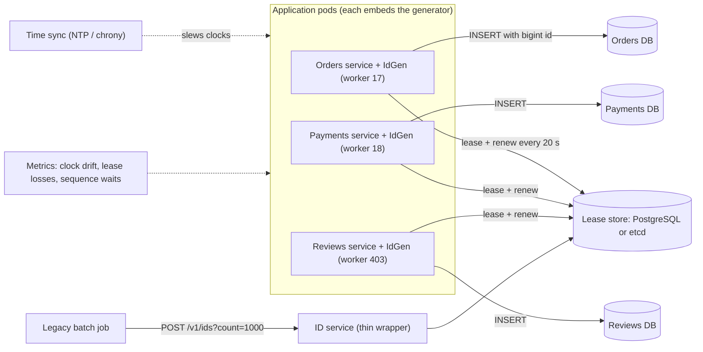
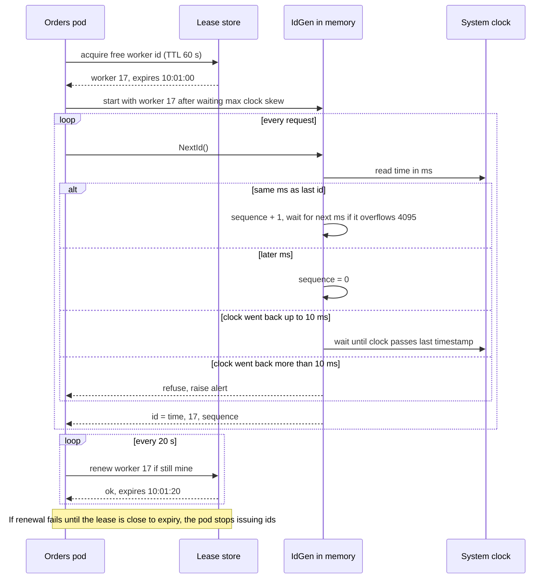

Every order on a shopping app, every post on a social network and every payment on a UPI app needs a name that no other record will ever have. On one database server that's easy: let the database count. Once you have dozens of services, hundreds of servers and several databases, "just count" turns into a coordination problem. This case study designs an ID generator that produces unique, roughly time-ordered 64-bit numbers on every server, with no network call per id.

## Learning objectives

By the end of this lesson you will be able to:

1. Explain why database auto-increment and random UUIDv4 both struggle at scale, and what UUIDv7 and ULID fix.
2. Lay out a Snowflake id (timestamp, worker, sequence) and do the arithmetic: ids per millisecond, number of workers, years until overflow.
3. Assign worker ids safely with configuration or a lease in a coordination store, and say what happens when a lease is lost.
4. Handle clocks that jump backwards, and explain why "k-sorted" is not the same as "strictly ordered".
5. Compare Snowflake with ticket servers and range allocation (hi-lo, sequences with `CACHE`).
6. Predict how each id type affects PostgreSQL B-tree indexes, storage and partitioning.
7. Implement a thread-safe Snowflake generator in C# with an injectable `TimeProvider`, and test it deterministically.

## Prerequisites

- [Capacity estimation](#/lesson/m11-capacity-estimation): we size id throughput and storage.
- [Indexes, composite indexes, B-tree and hash](#/lesson/m09-indexes): the index-locality discussion assumes you know how a B-tree page fills.
- [Clock skew, ordering and logical clocks](#/lesson/m13-time-ordering): wall clocks drift and jump; this lesson builds on that.

Helpful: the [URL shortener](#/lesson/m17-url-shortener), which uses block-leased counters for a related problem.

## Explain it like I'm a beginner

Imagine a large railway station with 40 ticket counters. Every ticket needs a unique number.

- **One shared counter** (auto-increment): every clerk shouts "next number?" to one person in the middle of the hall. It works until the queue for numbers is longer than the queue for tickets.
- **Random numbers** (UUIDv4): each clerk rolls a 36-sided die 32 times. Two tickets will practically never match, but the numbers are long, and the tickets end up filed in random order, so the record room is chaos.
- **Smart numbers** (Snowflake): each counter has its own number, say counter 17. A clerk writes the current time to the millisecond, then the counter number, then "this is my 3rd ticket in this millisecond". Two clerks can never write the same thing, because the counter number differs. Nobody has to ask anyone. And because the time comes first, sorting the tickets by number sorts them (almost) by time.

That's the whole idea. The hard parts are in the details: who decides which clerk is counter 17, what happens if a clerk's watch runs backwards, and what happens if one clerk sells more than 4,096 tickets in one millisecond.

## Requirements

### Functional requirements

1. **Generate** a unique id on request, for any service (orders, payments, posts, chat messages, events).
2. **Batch** generation: a caller may ask for up to 1,000 ids in one go (for bulk imports).
3. **Decode** an id into its creation time and origin, for debugging and support.
4. Ids are **64-bit integers**, so they fit PostgreSQL `bigint` and a .NET `long`.

### Out of scope

- Human-friendly references like `ORD-7KQ2-9XA` printed on invoices. They are a presentation concern with their own uniqueness rules; the core id is a number.
- Secret or unguessable tokens (password-reset links, payment links). Those need cryptographic randomness, not structure.

### Non-functional requirements

| Requirement | Target | Why |
|---|---|---|
| Uniqueness | Never a duplicate, across all servers, forever | A duplicate order or payment id corrupts data and money |
| Latency | Under 1 µs per id in-process; no network hop on the hot path | Ids are needed on every write |
| Availability | Id generation keeps working when the coordination store is down for minutes | It sits on the critical path of every write |
| Ordering | Roughly time-ordered (k-sorted): ids from different servers may be out of order by a few milliseconds | Good index locality and "sort by id ≈ sort by time" |
| Size | 64 bits | Half the size of a UUID in every index and foreign key |
| Lifetime | At least 50 years before the format runs out | Ids live in archives for decades |

Note what is **not** required: strict global ordering. Asking for "id 1001 was definitely created after id 1000 on any server" forces every server to coordinate, which kills throughput. Being clear about this is the most important thing you say in an interview.

## Capacity estimation

All numbers are **estimates** for a large Indian e-commerce and payments group that runs a marketplace, a wallet and a social reviews feature on a shared platform.

### Demand

- Business events needing ids (orders, payments, ledger entries, reviews, messages, outbox events): about **2 billion per day**.
- Average: 2 × 10⁹ ÷ 86,400 ≈ **23,000 ids/s**.
- Peak during a festival sale (assume ×5): ≈ **115,000 ids/s**, spread over about 400 application pods.
- Per pod at peak: 115,000 ÷ 400 ≈ **290 ids/s**. Even a hot pod at 10× that needs 2,900 ids/s.

### What one Snowflake worker can produce

With 12 sequence bits, one worker issues up to 2¹² = **4,096 ids per millisecond**, which is about **4.1 million ids/s**. Our busiest pod needs 2,900/s, so we use less than 0.1 % of one worker's capacity. Throughput is never the constraint; the number of workers and the safety of the clock are.

### How many workers?

10 worker bits give 2¹⁰ = **1,024** worker ids. We have 400 pods, about 800 during a rolling deployment when old and new pods overlap. That's close to 1,024, so worker ids must be **leased and returned**, and growth past 1,000 processes means re-balancing the bits (see the deep dive).

### How long does the timestamp last?

41 bits of milliseconds: 2⁴¹ ms = 2,199,023,255,552 ms ≈ 2.2 × 10⁹ seconds ÷ 31,557,600 s/year ≈ **69.7 years**. With a custom epoch of 1 January 2025, ids run out in about **2094**. Counting from the Unix epoch (1970) instead would waste 55 of those years, which is why every Snowflake-style scheme picks its own recent epoch.

### Storage impact

- A `bigint` key is 8 bytes; a `uuid` is 16 bytes; a ULID stored as text is 26 bytes plus a header.
- An `orders` table with 1 billion rows has the primary key plus, say, three indexes or foreign keys repeating the id. `bigint` instead of `uuid` saves 8 B × 4 × 1 B = **32 GB** of index data. Smaller indexes fit in RAM, which matters more than the disk.

### What the numbers tell us

A central counter called over the network at 115,000 ids/s would be a hot spot and a single point of failure on every write. Per-server generation needs coordination only once per lease. The real risks are **duplicate worker ids** and **clocks going backwards**, so the design spends its effort there.

## API design

The best API for an id generator is usually **no network API at all**: a small library inside each service, with one external dependency, the worker-id lease. Still, two surfaces exist.

### In-process library (the hot path)

```text
interface IIdGenerator { long NextId(); }
```

A call costs a lock and a few arithmetic operations. No allocation, no I/O.

### Optional ID service (for callers that can't embed the library)

```http
POST /v1/ids?count=100
Authorization: Bearer <service token>

200 OK
{ "ids": ["240331102617612288", "240331102617612289", "..."] }
```

Return ids as **JSON strings**. JavaScript numbers are exact only up to 2⁵³ ≈ 9 × 10¹⁵; our ids are around 2.4 × 10¹⁷, so a browser would silently round `240331102617612289` to a neighbour and load the wrong order.

### Debug endpoint

```http
GET /v1/ids/240331102617612289
200 OK
{ "createdAt": "2026-10-26T04:30:00.000Z", "workerId": 3, "sequence": 1 }
```

Support staff love this: given an order id from a customer complaint, they immediately know when and on which server it was created.

## Data model

### Worker-id leases

```sql
CREATE TABLE worker_lease (
    worker_id   smallint    PRIMARY KEY CHECK (worker_id BETWEEN 0 AND 1023),
    owner       text,                    -- pod name + process start time, e.g. 'orders-7f9c-2026-10-26T04:12Z'
    expires_at  timestamptz NOT NULL DEFAULT '-infinity'
);
INSERT INTO worker_lease (worker_id) SELECT g FROM generate_series(0, 1023) g;

-- Acquire any free or expired worker id (one round trip, safe under concurrency):
UPDATE worker_lease
SET owner = $1, expires_at = now() + interval '60 seconds'
WHERE worker_id = (
    SELECT worker_id FROM worker_lease
    WHERE expires_at < now()
    ORDER BY expires_at
    LIMIT 1
    FOR UPDATE SKIP LOCKED)
RETURNING worker_id, expires_at;

-- Renew every 20 seconds; zero rows updated means the lease was lost:
UPDATE worker_lease SET expires_at = now() + interval '60 seconds'
WHERE worker_id = $1 AND owner = $2 AND expires_at > now();
```

`ORDER BY expires_at` picks the id that has been free the longest, which gives a crashed pod's former id the most time to "cool down" before anyone reuses it. `SKIP LOCKED` lets 50 pods starting at once each grab a different row without waiting on each other.

### Ranges for the ticket-server approach

```sql
CREATE TABLE id_range (
    name text   PRIMARY KEY,   -- 'orders', 'payments'
    next bigint NOT NULL
);
UPDATE id_range SET next = next + 1000 WHERE name = 'orders' RETURNING next - 1000 AS start;
```

### Business tables

```sql
CREATE TABLE orders (
    id           bigint      PRIMARY KEY,          -- Snowflake id from the application
    customer_id  bigint      NOT NULL,
    total_inr    numeric(12,2) NOT NULL,
    status       text        NOT NULL
    -- created_at is optional: it can be derived from the id
);
```

There is no `DEFAULT nextval(...)`: the application supplies the id, so it knows it **before** the insert. The order row, its outbox event and its log lines all carry the same id, and a retry can reuse it.

## High-level architecture



How to read it, arrow by arrow:

- **Pods → Lease store**: at startup each process leases a worker id (0–1023) for 60 seconds and renews it every 20 seconds. This is the **only** coordination in the system: one small write per pod every 20 seconds. 800 pods ÷ 20 s = 40 writes/s, trivial for PostgreSQL or etcd.
- **Pods → their own databases**: the generator runs inside the service, so creating an id is a function call. Each service writes ids into its own database; the generator doesn't care which.
- **Time sync ⇢ Pods** (dotted, background): every machine runs NTP or chrony, which *slews* the clock (speeds it up or slows it down slightly) instead of jumping it. Jumps can still happen, so the generator also defends itself.
- **Legacy batch job → ID service → Lease store**: a process that can't embed the library (a script, a non-.NET tool) calls a thin HTTP service, which is itself just pods with leased worker ids. It is optional.
- **Metrics ⇢ Pods**: we track clock drift, lease renewal failures and how often the generator had to wait. These are the early warnings for duplicate ids.

### Lease and generation flow



There are two independent loops. The **request loop** never touches the network: read the clock, compare with the last timestamp, compose the id. The **lease loop** runs in the background. If the lease store is unreachable, the pod keeps issuing ids until its lease is about to expire, then **refuses** rather than risk sharing worker 17 with a pod that grabbed it after expiry. A few seconds of failed writes is recoverable; duplicate payment ids are not.

## Deep dives

### Deep dive 1: why auto-increment and UUIDv4 fall short

**Auto-increment (`GENERATED ALWAYS AS IDENTITY`, sequences)** is the right answer for one database. Problems show up when:

- **There are many databases.** After sharding orders across 8 databases, each has its own sequence, and order 1,000 exists 8 times. You can offset them (shard *k* uses *k*, *k*+8, *k*+16…), but adding a ninth shard changes the formula.
- **You need the id before the insert.** With a database-generated id, the application learns it only after the round trip, which complicates outbox events and idempotent retries.
- **It leaks business numbers.** If a customer places order 100,000 on Monday and 160,000 on the next Monday, a competitor now knows your weekly volume. (This is the "German tank problem": serial numbers reveal production rates.)
- **Merging data** from two systems (an acquisition, a regional split) produces clashes.

**UUIDv4** (122 random bits) solves coordination completely: any process can create one, and the chance of a collision is negligible. Its costs are:

- **16 bytes** instead of 8, in every index and every foreign key.
- **Random index placement.** A random key lands on a random leaf page of the B-tree. Once the index is bigger than RAM, almost every insert reads a cold page, and pages split in the middle and stay half full. After each checkpoint PostgreSQL writes a full image of every page the first time it changes, so touching many pages inflates WAL volume. A time-ordered key appends at the right-hand edge, where a few hot pages stay in memory.
- **No time information.** Sorting by id means nothing.

### Deep dive 2: UUIDv7 and ULID, the "time-ordered UUID" family

**UUIDv7** (standardised in RFC 9562, 2024) puts a 48-bit Unix timestamp in milliseconds at the front, followed by version bits and 74 random bits. It's still a 128-bit UUID, so it fits PostgreSQL's `uuid` type and every library that accepts UUIDs, but it sorts roughly by creation time. In .NET 9 and later:

```csharp
var orderId = Guid.CreateVersion7();                                // uses the current UTC time
var backfilled = Guid.CreateVersion7(DateTimeOffset.Parse("2026-10-26T04:30:00Z")); // explicit time
```

PostgreSQL 18 adds a built-in `uuidv7()` function; on PostgreSQL 17 generate it in the application.

**ULID** is the same idea with a friendlier text form: 48 bits of millisecond time plus 80 random bits, written as 26 characters of Crockford base32 (for example `01JB8Z3K4Q9W6T2R5M7N0PXYZA`). It has no BCL type; community packages exist. Store it in a `uuid` column (it's 128 bits) rather than as text.

Within one millisecond, UUIDv7 and ULID values are random relative to each other unless the generator uses the optional monotonic counter that RFC 9562 describes, so they are k-sorted like Snowflake ids.

**When to choose which:**

| Need | Choose |
|---|---|
| Zero coordination, no worker ids to manage, 128 bits acceptable | UUIDv7 |
| Ids in URLs that people may copy | ULID text form (or base62 of either) |
| 64-bit keys for index size, JavaScript-safe as strings, decodable worker origin | Snowflake |
| One database, internal ids, simplest possible | Identity column |

UUIDv7 is a strong default: it removes the worker-id problem for 8 extra bytes per key. Snowflake earns its complexity when 64-bit keys matter or you want to read the origin server from the id.

### Deep dive 3: the Snowflake bit layout

```text
 bit 63 | bits 62..22 (41 bits)              | bits 21..12 (10 bits) | bits 11..0 (12 bits)
   0    | milliseconds since custom epoch     | worker id 0..1023     | sequence 0..4095
```

- **Sign bit always 0**, so ids are positive in every language with signed 64-bit integers.
- **41-bit timestamp**: ≈ 69.7 years of milliseconds.
- **10-bit worker id**: 1,024 concurrent generators. Some designs split it into 5 bits of data centre and 5 bits of machine.
- **12-bit sequence**: 4,096 ids per worker per millisecond.

Composing an id is three shifts and two ORs:

```text
id = (timestampMs << 22) | (workerId << 12) | sequence
```

Worked example: an order created at `2026-10-26 10:00:00.000 IST` (04:30 UTC) by worker 3, sequence 1.

- Milliseconds since 2025-01-01T00:00Z = 57,299,400,000.
- 57,299,400,000 × 2²² = 240,331,102,617,600,000 … plus 3 × 4,096 = 12,288 … plus 1.
- id = **240,331,102,617,612,289**.

Decoding reverses it: `id >> 22` gives the timestamp, `(id >> 12) & 1023` the worker, `id & 4095` the sequence.

**Re-balancing the bits** is a design decision, not a law:

| Layout (time / worker / seq) | Workers | Ids per worker per ms | Lifetime |
|---|---|---|---|
| 41 / 10 / 12 (classic) | 1,024 | 4,096 | 69.7 years |
| 41 / 13 / 9 | 8,192 | 512 | 69.7 years |
| 42 / 12 / 9 | 4,096 | 512 | 139 years |
| 39 (10 ms ticks) / 16 / 8 | 65,536 | 256 per 10 ms | 174 years |

Our pods need under 3 ids per millisecond, so 9 sequence bits would do and 13 worker bits would end the deployment worry. Pick the layout from your numbers and **never change it** once ids exist. Some systems reserve 1–2 bits for a region or format version.

### Deep dive 4: assigning worker ids

The whole uniqueness guarantee rests on one rule: **two live generators never share a worker id**. Options, from simplest to most robust:

1. **Static configuration** (`WorkerId=17` in settings). Fine for 10 long-lived servers; dangerous with autoscaling, because a cloned VM image or copied config silently creates twins.
2. **Derived from the platform.** Kubernetes StatefulSet ordinals (`orders-0`, `orders-1`) map to per-service ranges (orders 0–99, payments 100–199). Simple, but every cluster and region needs disjoint ranges.
3. **Leased from a coordination store** (the `worker_lease` table, an etcd lease or a ZooKeeper ephemeral node) with a TTL, renewed regularly. Crashed pods' ids return automatically.

With leases, consider a pod **paused** (long GC pause, VM migration) past its lease expiry while another pod takes worker 17. Mitigations: the generator checks a locally stored **lease deadline** before every id and refuses within a safety margin (say 10 s) of expiry, without needing the store; a new owner of a recycled id **waits** longer than the maximum clock skew before issuing, so its timestamps are later than anything the old owner issued; and the TTL (60 s) is far longer than normal pauses.

This is the same reasoning as [distributed locks and fencing tokens](#/lesson/m13-distributed-locks): a lease is a promise about time, so be precise about whose clock measures it.

### Deep dive 5: clocks that go backwards

A Snowflake generator assumes time moves forward. It doesn't always:

- NTP or chrony may **step** the clock when it's far off (on boot, or after a long network outage), instead of slewing it.
- A VM restored from a snapshot or live-migrated may resume with an older time.
- An operator may set the time by hand.
- Leap seconds are usually smeared by cloud providers now, but not everywhere.

If the clock moves back 5 ms and the generator blindly continues, it can produce `(same ms, same worker, same sequence)` it already issued: a **duplicate**. Defences, in order:

1. **Remember the last timestamp** (`_lastMs`) in memory and never issue an id with a smaller one.
2. **Small backward jump** (up to a tolerance, for example 10 ms): wait until the clock passes `_lastMs`. Callers see a 10 ms hiccup.
3. **Large backward jump**: refuse to issue ids, raise an alert, and let health checks take the pod out of rotation. Another pod with a healthy clock serves the traffic.
4. **Survive restarts**: memory is lost on restart, and a restart after a clock step is exactly when this bites. Either persist a **high-water mark** (the latest timestamp issued, written every few seconds, rounded up by the write interval) and refuse to start below it, or simply wait at startup for longer than the maximum plausible step, or take a fresh worker id on every start (which a lease gives you for free, since the old id cools down for at least the TTL).

An alternative to waiting is a **logical clock**: keep using `_lastMs` and keep incrementing the sequence, overflowing into `_lastMs + 1`. It never blocks, but timestamps run ahead of real time until the clock catches up. Many generators use it for small jumps and refuse large ones.

### Deep dive 6: ticket servers and range allocation

Not every system needs time in the id. The older and simpler family is **centralised counters, used in batches**:

- **Ticket server**: a dedicated database whose only job is to hand out numbers. A well-known public write-up from Flickr (2010) described two MySQL ticket servers, one producing odd numbers and one even, for redundancy without coordination.
- **Hi-lo**: the application asks the database for a "hi" value once (say 42), then generates "lo" values 0–999 locally, producing ids 42,000–42,999 without further round trips. EF Core supports this pattern with SQL Server sequences (`UseHiLo`).
- **Range (block) leasing**: `UPDATE id_range SET next = next + 1000 … RETURNING`, as in the [URL shortener](#/lesson/m17-url-shortener).
- **PostgreSQL `CREATE SEQUENCE … CACHE 50`**: each *database session* pre-allocates 50 values in memory. Calls to `nextval` from that session cost no shared-memory contention until the cache is used up.

Two facts interviewers probe: sequences are **not transactional** (a rolled-back insert still consumes its value, so gaps are normal; gap-free invoice numbers need a locked counter table), and with `CACHE` values are unique but **not ordered across sessions** (session A holds 1–50, session B 51–100, so id 60 can commit before id 3).

Range allocation gives short, dense numbers and needs no clock, but needs the counter database whenever a block runs out. Snowflake needs no database on the hot path but produces long, sparse numbers.

### Deep dive 7: what "k-sorted" means in practice

Snowflake ids are **roughly ordered by time**:

- Within one worker, ids are **strictly increasing** (given the backward-clock guard).
- Across workers in the same millisecond, order is decided by worker id, not by real time. Order from worker 900 at 10:00:00.000 sorts after an order from worker 3 created at the same millisecond, even if it happened slightly earlier.
- Across machines, clock skew (often a millisecond or less with good NTP, sometimes tens of milliseconds) means an id created later in real time can be **smaller**.

So "sort by id" is a good approximate timeline, ideal for feeds, keyset pagination and index locality, but **not** real ordering. A consumer polling "rows with id > last seen" can **miss** rows committed later with a smaller id (slow transaction, skewed clock); use an overlap window, an outbox, or change data capture. And causality ("the refund happened after the payment") must come from the data, never from comparing ids made on different servers.

### Deep dive 8: effects on PostgreSQL

- **B-tree locality.** Snowflake and UUIDv7 keys arrive in near-ascending order, so inserts hit the rightmost leaf pages. PostgreSQL has a fast path for ascending inserts, and splitting the rightmost page leaves the old page full rather than half full. Result: denser indexes and fewer random reads than UUIDv4 (measure on your workload).
- **Range partitioning by id = by time.** Because the timestamp is in the top bits, `PARTITION BY RANGE (id)` with boundaries computed from dates (`(epoch_ms(date) − custom_epoch) << 22`) gives monthly partitions without a separate `created_at` column. Dropping old partitions becomes the retention policy.
- **Time-window queries on the primary key.** "Orders between 10:00 and 10:05" becomes `WHERE id >= lower_bound AND id < upper_bound`, an index range scan on the primary key. Exercise 2 practises this.
- **BRIN indexes** (tiny indexes that store min/max per block range) work on time-ordered ids in append-only tables, because physical order follows id order.
- **Bit operators in SQL** have equal precedence and are evaluated left to right, so always parenthesise: `((id >> 12) & 1023)`.

### Deep dive 9: the generator in ASP.NET Core

The code below is the compilable core: the layout, a thread-safe generator with an injectable `TimeProvider`, an in-memory worker-lease store, and a hosted service that keeps the lease alive and blocks id generation when the lease is in doubt. Swap `InMemoryWorkerLeaseStore` for a PostgreSQL or etcd implementation in production.

```csharp file=IdGen/SnowflakeLayout.cs
namespace IdGen;

public readonly record struct SnowflakeParts(long TimestampMs, int WorkerId, int Sequence);

/// <summary>Classic 41/10/12 layout. Never change it once ids exist.</summary>
public static class SnowflakeLayout
{
    public const int WorkerBits = 10;
    public const int SequenceBits = 12;
    public const int WorkerShift = SequenceBits;                 // 12
    public const int TimestampShift = SequenceBits + WorkerBits; // 22
    public const long MaxSequence = (1L << SequenceBits) - 1;    // 4095
    public const int MaxWorkerId = (1 << WorkerBits) - 1;        // 1023
    public const long MaxTimestampMs = (1L << 41) - 1;           // about 69.7 years

    /// <summary>Custom epoch: 2025-01-01T00:00:00Z. Ids run out around 2094.</summary>
    public static readonly DateTimeOffset Epoch = new(2025, 1, 1, 0, 0, 0, TimeSpan.Zero);

    public static long Compose(long timestampMs, int workerId, long sequence)
    {
        ArgumentOutOfRangeException.ThrowIfNegative(timestampMs);
        ArgumentOutOfRangeException.ThrowIfGreaterThan(timestampMs, MaxTimestampMs);
        ArgumentOutOfRangeException.ThrowIfNegative(workerId);
        ArgumentOutOfRangeException.ThrowIfGreaterThan(workerId, MaxWorkerId);
        ArgumentOutOfRangeException.ThrowIfNegative(sequence);
        ArgumentOutOfRangeException.ThrowIfGreaterThan(sequence, MaxSequence);
        return (timestampMs << TimestampShift) | ((long)workerId << WorkerShift) | sequence;
    }

    public static SnowflakeParts Decompose(long id) =>
        new(id >> TimestampShift, (int)((id >> WorkerShift) & MaxWorkerId), (int)(id & MaxSequence));

    public static DateTimeOffset CreatedAt(long id) => Epoch.AddMilliseconds(id >> TimestampShift);

    public static long ToEpochMs(DateTimeOffset time) => (time - Epoch).Ticks / TimeSpan.TicksPerMillisecond;
}
```

```csharp file=IdGen/SnowflakeIdGenerator.cs
namespace IdGen;

public interface IIdGenerator
{
    long NextId();
}

public sealed class ClockMovedBackwardsException(long lastMs, long nowMs)
    : Exception($"Clock moved backwards by {lastMs - nowMs} ms; refusing to issue ids.")
{
    public long DriftMs { get; } = lastMs - nowMs;
}

/// <summary>Thread-safe Snowflake generator for one worker id. Never does I/O.</summary>
public sealed class SnowflakeIdGenerator : IIdGenerator
{
    private readonly Lock _gate = new();
    private readonly TimeProvider _clock;
    private readonly int _workerId;
    private readonly long _maxBackwardMs;
    private long _lastMs;
    private long _sequence;

    /// <param name="highWaterMarkMs">Latest timestamp a previous run may have used (-1 if unknown).</param>
    public SnowflakeIdGenerator(int workerId, TimeProvider clock, long maxBackwardMs = 10, long highWaterMarkMs = -1)
    {
        ArgumentOutOfRangeException.ThrowIfNegative(workerId);
        ArgumentOutOfRangeException.ThrowIfGreaterThan(workerId, SnowflakeLayout.MaxWorkerId);
        _workerId = workerId;
        _clock = clock;
        _maxBackwardMs = maxBackwardMs;
        _lastMs = highWaterMarkMs;
    }

    public int WorkerId => _workerId;

    /// <summary>Persist this every few seconds if you use a high-water mark across restarts.</summary>
    public long LastIssuedMs { get { lock (_gate) return _lastMs; } }

    public long NextId()
    {
        lock (_gate)
        {
            var now = NowMs();
            if (now < _lastMs)
            {
                if (_lastMs - now > _maxBackwardMs) throw new ClockMovedBackwardsException(_lastMs, now);
                now = WaitUntil(_lastMs); // small step back: wait it out
            }

            if (now == _lastMs)
            {
                _sequence = (_sequence + 1) & SnowflakeLayout.MaxSequence;
                if (_sequence == 0) now = WaitUntil(_lastMs + 1); // 4,096 ids used in this ms
            }
            else
            {
                _sequence = 0;
            }

            _lastMs = now;
            return SnowflakeLayout.Compose(now, _workerId, _sequence);
        }
    }

    private long NowMs() => SnowflakeLayout.ToEpochMs(_clock.GetUtcNow());

    private long WaitUntil(long targetMs)
    {
        var spin = new SpinWait();
        long now;
        while ((now = NowMs()) < targetMs) spin.SpinOnce();
        return now;
    }
}
```

```csharp file=IdGen/WorkerLeases.cs
namespace IdGen;

public sealed record WorkerLease(int WorkerId, string Owner, DateTimeOffset ExpiresAt);

/// <summary>PostgreSQL version: the UPDATE ... FOR UPDATE SKIP LOCKED statements in the data model section.</summary>
public interface IWorkerLeaseStore
{
    Task<WorkerLease?> TryAcquireAsync(string owner, TimeSpan ttl, CancellationToken ct);
    Task<WorkerLease?> TryRenewAsync(int workerId, string owner, TimeSpan ttl, CancellationToken ct);
}

public sealed class InMemoryWorkerLeaseStore(TimeProvider clock, int workerCount = SnowflakeLayout.MaxWorkerId + 1) : IWorkerLeaseStore
{
    private readonly Lock _gate = new();
    private readonly WorkerLease?[] _leases = new WorkerLease?[workerCount];

    public Task<WorkerLease?> TryAcquireAsync(string owner, TimeSpan ttl, CancellationToken ct)
    {
        lock (_gate)
        {
            var now = clock.GetUtcNow();
            // Prefer the id that has been free the longest, so a crashed owner's id cools down.
            var best = -1;
            for (var i = 0; i < _leases.Length; i++)
            {
                var l = _leases[i];
                if (l is not null && l.ExpiresAt > now) continue;
                if (best < 0 || (l?.ExpiresAt ?? DateTimeOffset.MinValue) < (_leases[best]?.ExpiresAt ?? DateTimeOffset.MinValue)) best = i;
            }
            if (best < 0) return Task.FromResult<WorkerLease?>(null);
            var lease = new WorkerLease(best, owner, now + ttl);
            _leases[best] = lease;
            return Task.FromResult<WorkerLease?>(lease);
        }
    }

    public Task<WorkerLease?> TryRenewAsync(int workerId, string owner, TimeSpan ttl, CancellationToken ct)
    {
        lock (_gate)
        {
            var now = clock.GetUtcNow();
            var l = _leases[workerId];
            if (l is null || l.Owner != owner || l.ExpiresAt <= now) return Task.FromResult<WorkerLease?>(null);
            var renewed = l with { ExpiresAt = now + ttl };
            _leases[workerId] = renewed;
            return Task.FromResult<WorkerLease?>(renewed);
        }
    }
}
```

```csharp file=IdGen/LeasedIdGenerator.cs
using Microsoft.Extensions.Hosting;
using Microsoft.Extensions.Logging;

namespace IdGen;

public sealed class IdGenOptions
{
    public TimeSpan LeaseTtl { get; set; } = TimeSpan.FromSeconds(60);
    public TimeSpan RenewEvery { get; set; } = TimeSpan.FromSeconds(20);
    public TimeSpan SafetyMargin { get; set; } = TimeSpan.FromSeconds(10);
    /// <summary>Wait this long after acquiring a recycled id, to stay ahead of the previous owner's clock.</summary>
    public TimeSpan MaxClockSkew { get; set; } = TimeSpan.FromMilliseconds(500);
}

/// <summary>Keeps a worker-id lease alive in the background and refuses to issue ids when the lease is in doubt.</summary>
public sealed class LeasedIdGenerator(IWorkerLeaseStore store, TimeProvider clock, IdGenOptions options,
                                      ILogger<LeasedIdGenerator> log) : BackgroundService, IIdGenerator
{
    private readonly string _owner = $"{Environment.MachineName}-{Guid.CreateVersion7()}";
    private volatile SnowflakeIdGenerator? _generator;
    private long _usableUntilTicks; // UTC ticks; read and written with Interlocked

    public long NextId()
    {
        var gen = _generator;
        var usableUntil = new DateTimeOffset(Interlocked.Read(ref _usableUntilTicks), TimeSpan.Zero);
        if (gen is null || clock.GetUtcNow() >= usableUntil)
            throw new InvalidOperationException("No valid worker-id lease; refusing to risk duplicate ids.");
        return gen.NextId();
    }

    protected override async Task ExecuteAsync(CancellationToken stoppingToken)
    {
        while (!stoppingToken.IsCancellationRequested)
        {
            try
            {
                var gen = _generator;
                var lease = gen is null
                    ? await store.TryAcquireAsync(_owner, options.LeaseTtl, stoppingToken)
                    : await store.TryRenewAsync(gen.WorkerId, _owner, options.LeaseTtl, stoppingToken);

                if (lease is null && gen is not null)
                {
                    log.LogError("Lost worker id {WorkerId}; stopping id generation", gen.WorkerId);
                    _generator = null;
                    Interlocked.Exchange(ref _usableUntilTicks, 0);
                }
                else if (lease is not null)
                {
                    if (gen is null)
                    {
                        await Task.Delay(options.MaxClockSkew, clock, stoppingToken);
                        _generator = new SnowflakeIdGenerator(lease.WorkerId, clock);
                        log.LogInformation("Acquired worker id {WorkerId}", lease.WorkerId);
                    }
                    // Deadline measured on our own clock from before the call, minus a safety margin.
                    var usable = lease.ExpiresAt - options.SafetyMargin;
                    Interlocked.Exchange(ref _usableUntilTicks, usable.UtcTicks);
                }
            }
            catch (Exception ex) when (ex is not OperationCanceledException)
            {
                log.LogWarning(ex, "Lease store unreachable; ids stay available until the lease deadline");
            }

            await Task.Delay(options.RenewEvery, clock, stoppingToken);
        }
    }
}
```

```csharp file=Program.cs
using IdGen;

var builder = WebApplication.CreateBuilder(args);

builder.Services.AddSingleton(TimeProvider.System);
builder.Services.AddSingleton(new IdGenOptions());
// Swap for a PostgreSQL- or etcd-backed lease store in production.
builder.Services.AddSingleton<IWorkerLeaseStore>(sp => new InMemoryWorkerLeaseStore(sp.GetRequiredService<TimeProvider>()));
builder.Services.AddSingleton<LeasedIdGenerator>();
builder.Services.AddSingleton<IIdGenerator>(sp => sp.GetRequiredService<LeasedIdGenerator>());
builder.Services.AddHostedService(sp => sp.GetRequiredService<LeasedIdGenerator>());

var app = builder.Build();

app.MapPost("/api/v1/orders", (IIdGenerator ids) =>
{
    var id = ids.NextId(); // known before the INSERT, so the outbox event can carry it too
    return Results.Created($"/api/v1/orders/{id}", new { orderId = id.ToString(), createdAt = SnowflakeLayout.CreatedAt(id) });
});

app.MapGet("/v1/ids/{id}", (string id) =>
{
    if (!long.TryParse(id, out var value) || value < 0) return Results.BadRequest();
    var p = SnowflakeLayout.Decompose(value);
    return Results.Ok(new { createdAt = SnowflakeLayout.CreatedAt(value), workerId = p.WorkerId, sequence = p.Sequence });
});

app.Run();
```

The generator holds a `System.Threading.Lock` for nanoseconds per id, ids go to clients as strings, and `NextId` checks the lease deadline on every call, so a pod that can't renew stops issuing ids on its own.

## Caching, queues and scaling

### Caching and queues

There is nothing to cache on the hot path: the generator is pure computation, and the lease is a time-bounded permission held in memory. Callers of the optional ID service should **fetch ids in batches** (100–1,000) and buffer them locally, like hi-lo.

Because ids exist **before** a message is published, the message carries the id of the thing it describes, and consumers can deduplicate on it ([idempotent consumers](#/lesson/m12-idempotent-consumers)).

### Scaling path

1. **One database**: identity column or UUIDv7. Done.
2. **Several services, a few databases**: UUIDv7 everywhere, or Snowflake with static worker ids per service.
3. **Hundreds to thousands of pods, autoscaling**: Snowflake with leased worker ids, or UUIDv7 if 128-bit keys are acceptable.
4. **Multiple regions**: reserve bits for the region (for example 3 region bits and 7 worker bits), or give each region a disjoint worker-id range from its own lease store. Never let two regions lease from the same pool across a network that can partition.

**What breaks first?** In order: (1) a central counter used per id, as soon as writes reach tens of thousands per second or the counter DB fails over; (2) worker-id exhaustion during big rolling deployments; (3) a clock step on a pod, producing refusals (correct) or duplicates (if unguarded); (4) JavaScript clients rounding 64-bit ids.

## Failure handling

| Failure | Effect | Mitigation |
|---|---|---|
| Two pods share a worker id (copied config, cloned VM) | Duplicate ids within the same millisecond | Leases instead of static config; unique constraint on every primary key turns a duplicate into a failed insert, not silent corruption; alert on decoded worker-id conflicts |
| Lease store down | No new pods can start generating; existing pods continue | Long TTL (60 s) and early renewals; pods refuse only when their own deadline passes; keep the lease store highly available (it's tiny) |
| Pod paused past its lease expiry | It might issue ids under a recycled worker id | Per-call deadline check with safety margin; new owner waits beyond max skew before issuing |
| Clock steps back a few ms | Possible duplicates | `_lastMs` guard: wait out small steps |
| Clock steps back seconds | Possible duplicates | Refuse, alert, remove pod from rotation; fix NTP |
| Pod restarts after clock step | In-memory guard lost | High-water mark or startup wait; fresh worker id per start |
| Sequence overflow (over 4,096 ids in 1 ms) | Must not wrap within the same ms | Wait for the next millisecond (about 1 ms delay for that caller only) |
| Timestamp bits exhausted (around 2094) | Ids overflow into the sign bit | Documented epoch and layout; a format-version bit or a planned migration decades ahead |
| Browser rounds a 64-bit id | Wrong record loaded | Serialise ids as strings in JSON |

The safety net under everything: **every table has a primary key or unique constraint on the id**. A generator bug then surfaces as an insert error that you can see, rather than two orders silently sharing an id.

## Security

- **Ids are not secrets.** They reveal creation time, worker and per-millisecond volume. Never use them as reset or payment-link tokens; use 128+ random bits (`RandomNumberGenerator`).
- **Volume leaks.** A few order ids collected over a week reveal order volume and pod count. If that matters, expose a random or encrypted public identifier and keep the Snowflake id internal.
- **Authorization still applies.** Knowing an id must never be enough to read the record (insecure direct object reference).
- **Lease store access.** Only service identities may write `worker_lease`; a rogue writer could give one worker id to two pods.

## Observability

Emit these metrics from every generator ([observability lesson](#/lesson/m14-observability)):

- **`idgen_clock_backward_total`** and the size of each step. Any non-zero value deserves a look; large steps page someone.
- **`idgen_refusals_total`** by reason (clock, lease). These are failed writes for users.
- **`idgen_sequence_waits_total`**: how often a worker exhausted 4,096 ids in one millisecond. Rising numbers mean a hot pod or a too-small sequence field.
- **Lease age and renewal failures** per pod, and **free worker ids** in the pool (alert below 20 %).
- **NTP offset** per node from the time-sync daemon, alerting above, say, 50 ms.

For tracing, include the id in logs and spans. Because ids decode to a time and worker, support can go from "order 240331102617612289 failed" straight to the pod and minute to search logs.

## Deployment and cost

### Deployment

- Ship the generator as a small internal NuGet package with the layout and epoch as constants, plus a test that decodes a known id to pin the layout.
- Roll out the lease store first, then services one by one. When migrating from identity columns, make sure new Snowflake ids are far above existing values, or use Snowflake only for new tables.
- Watch free worker ids during deployments; a `maxSurge` of 100 % doubles demand for a few minutes.

### Cost

Almost free: nanoseconds of CPU and a tiny lease table. The indirect effect is a saving: 8-byte keys shrink every index and foreign key, which on billion-row tables means tens of gigabytes (estimate from the capacity section).

### When a simpler design is enough

A college admissions portal with one PostgreSQL database and 50,000 applications a year needs `GENERATED ALWAYS AS IDENTITY` and nothing else. A startup with three services and no 64-bit constraint should use `Guid.CreateVersion7()` and skip worker ids entirely. Snowflake is worth it when you have many writers, care about 64-bit keys, and are willing to operate leases and watch clocks.

## Alternatives and trade-offs

| Scheme | Size | Coordination | Ordering | Main risk | Best for |
|---|---|---|---|---|---|
| Identity / sequence | 8 B | Database per id (or per cache block) | Strict on one node (not with `CACHE` across sessions) | Single DB bottleneck, leaks volume | One database |
| Ticket server / range leasing | 8 B | Per block | Roughly increasing | Counter DB availability | Short dense codes (URL shortener) |
| UUIDv4 | 16 B | None | None | Index bloat, random I/O | Opaque external ids, small tables |
| UUIDv7 / ULID | 16 B | None | k-sorted by ms | 16-byte keys; time leaks | Default for new multi-service systems |
| Snowflake | 8 B | Worker-id lease | k-sorted by ms | Clock steps, duplicate worker ids | Huge tables, many writers, 64-bit needs |

A public variation: Instagram's engineering blog described 41 bits of time, 13 bits of logical shard id and 10 bits of a per-shard PostgreSQL sequence, generated inside the database. Tying the id to the shard removes worker leases.

## Practical playground

The starting graph is a common first design: every service calls one central "ID service" over HTTP for every id, and the ID service calls `nextval` on one PostgreSQL sequence. Open it in the HLD canvas, push the client traffic to 115,000 ids/s and see what the simulator flags. Then evolve it: embed generation in each service, add a lease store, and decide what stays on the hot path.

:::playground type=hld title="Remove the central ID bottleneck"
```json
{
  "nodes": [
    { "id": "c", "type": "client", "label": "Shoppers placing orders", "props": { "rps": 20000 } },
    { "id": "lb", "type": "load-balancer", "label": "Load balancer" },
    { "id": "orders", "type": "app-server", "label": "Orders service", "props": { "instances": 6 } },
    { "id": "pay", "type": "app-server", "label": "Payments service", "props": { "instances": 4 } },
    { "id": "idsvc", "type": "app-server", "label": "Central ID service (HTTP per id)", "props": { "instances": 1 } },
    { "id": "seq", "type": "database", "label": "PostgreSQL with one sequence", "props": { "replicas": 0 } },
    { "id": "odb", "type": "database", "label": "Orders DB" }
  ],
  "edges": [
    { "from": "c", "to": "lb", "kind": "sync" },
    { "from": "lb", "to": "orders", "kind": "sync" },
    { "from": "orders", "to": "pay", "kind": "sync" },
    { "from": "orders", "to": "idsvc", "kind": "sync", "label": "GET next id" },
    { "from": "pay", "to": "idsvc", "kind": "sync", "label": "GET next id" },
    { "from": "idsvc", "to": "seq", "kind": "sync", "label": "nextval per id" },
    { "from": "orders", "to": "odb", "kind": "sync" }
  ]
}
```
:::

## Exercises

:::exercise id=m17-unique-id-generator-ex1 difficulty=beginner kind=code title="Compose and decode a Snowflake id"
Implement the bit arithmetic for the classic 41/10/12 layout: `Compose` builds an id from its parts, `Decompose` splits it, and `CreatedAtUtc` turns an id into a timestamp using the custom epoch 2025-01-01T00:00:00Z.
::requirements
- `Compose(timestampMs, workerId, sequence)` returns `(timestampMs << 22) | (workerId << 12) | sequence`.
- Out-of-range parts throw `ArgumentOutOfRangeException`: timestamp outside 0..2⁴¹−1, worker outside 0..1023, sequence outside 0..4095.
- `Decompose` returns the three parts; `Decompose(Compose(t, w, s))` gives back `(t, w, s)`.
- `CreatedAtUtc` returns `Epoch + timestampMs`.
::acceptance
- All tests pass.
- `Compose(1000, 5, 7)` is `4194324487`.
- The largest valid parts compose to `long.MaxValue`, and the id is never negative.
::hint
Each field occupies its own range of bits. Shifting left by *n* moves a value up *n* bit positions, making room below it.
::hint
The sequence uses the bottom 12 bits, the worker the next 10, the timestamp the 41 above that. So the worker is shifted by 12 and the timestamp by 12 + 10 = 22.
::hint
To read a field back, shift right to bring it to the bottom, then mask with `(1 << bits) - 1` to throw away everything above it: worker = `(id >> 12) & 1023`.
::hint
Cast the worker id to `long` before shifting. `int << 12` is fine here, but making it a habit avoids overflow bugs when fields get wider.
::starter
```csharp file=SnowflakeCodec.cs
using System;

public static class SnowflakeCodec
{
    public static readonly DateTimeOffset Epoch = new(2025, 1, 1, 0, 0, 0, TimeSpan.Zero);
    public const long MaxTimestampMs = (1L << 41) - 1;
    public const int MaxWorkerId = 1023;
    public const int MaxSequence = 4095;

    public static long Compose(long timestampMs, int workerId, int sequence) => throw new NotImplementedException();

    public static (long TimestampMs, int WorkerId, int Sequence) Decompose(long id) => throw new NotImplementedException();

    public static DateTimeOffset CreatedAtUtc(long id) => throw new NotImplementedException();
}
```
::tests
```csharp file=SnowflakeCodecTests.cs
using System;
using Xunit;

public class SnowflakeCodecTests
{
    [Theory]
    [InlineData(1L, 0, 0, 4194304L)]
    [InlineData(0L, 1, 0, 4096L)]
    [InlineData(0L, 0, 1, 1L)]
    [InlineData(1000L, 5, 7, 4194324487L)]
    public void Composes_known_values(long t, int w, int s, long expected) =>
        Assert.Equal(expected, SnowflakeCodec.Compose(t, w, s));

    [Fact]
    public void Largest_parts_give_long_max_value() =>
        Assert.Equal(long.MaxValue, SnowflakeCodec.Compose(SnowflakeCodec.MaxTimestampMs, 1023, 4095));

    [Fact]
    public void Decomposes_a_real_order_id()
    {
        var (t, w, s) = SnowflakeCodec.Decompose(240331102617612289L);
        Assert.Equal(57299400000L, t);
        Assert.Equal(3, w);
        Assert.Equal(1, s);
    }

    [Fact]
    public void Created_at_matches_ist_ten_am()
    {
        var at = SnowflakeCodec.CreatedAtUtc(240331102617612289L);
        Assert.Equal(new DateTimeOffset(2026, 10, 26, 4, 30, 0, TimeSpan.Zero), at);
    }

    [Theory]
    [InlineData(57299400000L, 1023, 4095)]
    [InlineData(0L, 0, 0)]
    [InlineData(123456789L, 512, 2048)]
    public void Round_trips(long t, int w, int s)
    {
        var (t2, w2, s2) = SnowflakeCodec.Decompose(SnowflakeCodec.Compose(t, w, s));
        Assert.Equal(t, t2);
        Assert.Equal(w, w2);
        Assert.Equal(s, s2);
    }

    [Fact]
    public void Rejects_worker_1024() =>
        Assert.Throws<ArgumentOutOfRangeException>(() => SnowflakeCodec.Compose(1, 1024, 0));

    [Fact]
    public void Rejects_sequence_4096() =>
        Assert.Throws<ArgumentOutOfRangeException>(() => SnowflakeCodec.Compose(1, 0, 4096));

    [Fact]
    public void Rejects_negative_timestamp() =>
        Assert.Throws<ArgumentOutOfRangeException>(() => SnowflakeCodec.Compose(-1, 0, 0));

    [Fact]
    public void Rejects_timestamp_beyond_41_bits() =>
        Assert.Throws<ArgumentOutOfRangeException>(() => SnowflakeCodec.Compose(SnowflakeCodec.MaxTimestampMs + 1, 0, 0));
}
```
::solution
Validate each part, then shift and OR. Decoding is shift-and-mask.

```csharp file=SnowflakeCodec.cs
using System;

public static class SnowflakeCodec
{
    public static readonly DateTimeOffset Epoch = new(2025, 1, 1, 0, 0, 0, TimeSpan.Zero);
    public const long MaxTimestampMs = (1L << 41) - 1;
    public const int MaxWorkerId = 1023;
    public const int MaxSequence = 4095;

    public static long Compose(long timestampMs, int workerId, int sequence)
    {
        if (timestampMs < 0 || timestampMs > MaxTimestampMs) throw new ArgumentOutOfRangeException(nameof(timestampMs));
        if (workerId < 0 || workerId > MaxWorkerId) throw new ArgumentOutOfRangeException(nameof(workerId));
        if (sequence < 0 || sequence > MaxSequence) throw new ArgumentOutOfRangeException(nameof(sequence));
        return (timestampMs << 22) | ((long)workerId << 12) | (long)sequence;
    }

    public static (long TimestampMs, int WorkerId, int Sequence) Decompose(long id) =>
        (id >> 22, (int)((id >> 12) & MaxWorkerId), (int)(id & MaxSequence));

    public static DateTimeOffset CreatedAtUtc(long id) => Epoch.AddMilliseconds(id >> 22);
}
```

Why is the largest id exactly `long.MaxValue`? 41 + 10 + 12 = 63 bits, all set to 1, with the sign bit 0. That's 2⁶³ − 1.
::mistakes
- Skipping validation, so worker 1024 silently becomes worker 0 with timestamp + 1 ms: a valid-looking id that can collide.
- Using `+` instead of `|`: with an out-of-range part, `+` carries into the next field.
::extensions
Make the layout configurable and test that 41/13/9 accepts worker 8,191 but rejects sequence 512.
:::

:::exercise id=m17-unique-id-generator-ex2 difficulty=beginner kind=sql ordered=true title="Orders per worker in a five-minute window, using only the id"
The `orders` table has no `created_at` column: ids are Snowflake ids (41/10/12, epoch 2025-01-01T00:00:00Z = Unix ms 1735689600000). Support wants to know how many orders each worker created between **10:00:00 (inclusive) and 10:05:00 (exclusive) IST on 26 October 2026**. Return `worker_id` and `orders`, ordered by `worker_id`. Filter on `id` itself so the query can use the primary key index.
::setup
```sql
CREATE TABLE orders (
  id          bigint PRIMARY KEY,
  customer    text   NOT NULL,
  total_inr   numeric(12,2) NOT NULL
);
INSERT INTO orders VALUES
  (240331102613417984, 'asha',   499.00),
  (240331102617612288, 'ravi',  1299.00),
  (240331102617612289, 'meera',  249.50),
  (240331481153564672, 'john',  3999.00),
  (240331647877132288, 'fatima', 799.00),
  (240332048433201156, 'arjun',  150.00),
  (240332360904634370, 'li',     620.00),
  (240332360908849152, 'priya', 2100.00),
  (240349976985612288, 'karan',  999.00);
```
::check
```sql
SELECT ((id >> 12) & 1023)::int AS worker_id, count(*) AS orders
FROM orders
WHERE id >= (((EXTRACT(EPOCH FROM TIMESTAMPTZ '2026-10-26 10:00:00+05:30') * 1000)::bigint - 1735689600000) << 22)
  AND id <  (((EXTRACT(EPOCH FROM TIMESTAMPTZ '2026-10-26 10:05:00+05:30') * 1000)::bigint - 1735689600000) << 22)
GROUP BY 1
ORDER BY 1;
```
::acceptance
- Returns three rows: worker 3 with 3 orders, worker 7 with 2, worker 12 with 1.
- The order at 09:59:59.999 and the order at exactly 10:05:00.000 are excluded.
- The `WHERE` clause compares `id` with two constants, not a function of `id`, so the primary key index can serve it.
::hint
The lowest possible id in a millisecond is that millisecond's timestamp shifted left by 22, with worker and sequence both 0.
::hint
Convert the IST time to Unix milliseconds with `EXTRACT(EPOCH FROM TIMESTAMPTZ '...') * 1000`, cast to `bigint`, and subtract the custom epoch.
::hint
Use `id >= lower AND id < upper`, where each bound is `(ms_since_epoch << 22)`. The exclusive upper bound handles "before 10:05" exactly.
::hint
The worker id is bits 12–21: `((id >> 12) & 1023)`. In PostgreSQL, bit operators share one precedence level and run left to right, so add parentheses.
::solution
```sql
SELECT ((id >> 12) & 1023)::int AS worker_id, count(*) AS orders
FROM orders
WHERE id >= (((EXTRACT(EPOCH FROM TIMESTAMPTZ '2026-10-26 10:00:00+05:30') * 1000)::bigint - 1735689600000) << 22)
  AND id <  (((EXTRACT(EPOCH FROM TIMESTAMPTZ '2026-10-26 10:05:00+05:30') * 1000)::bigint - 1735689600000) << 22)
GROUP BY 1
ORDER BY 1;
```

The bounds are constants, so PostgreSQL range-scans the primary key, like a `created_at` index you don't have to maintain. To see each order's time: `to_timestamp((((id >> 22) + 1735689600000) / 1000.0))`.
::mistakes
- Filtering with a function of `id` (`to_timestamp(...) BETWEEN ...`): correct, but the primary key index can't be used.
- Writing `ts << 22 | worker << 12` without parentheses: equal-precedence operators run left to right and give a wrong id.
- Forgetting the IST offset and computing the window five and a half hours off.
::extensions
Write a function `snowflake_lower_bound(timestamptz) RETURNS bigint` and use it to define monthly range partitions for `orders` on `id`.
:::

:::exercise id=m17-unique-id-generator-ex3 difficulty=intermediate kind=code title="Thread-safe generator that waits when a millisecond is full"
Implement `SnowflakeGenerator.NextId()`. It reads the time from the injected `TimeProvider`, starts the sequence at 0 in each new millisecond, increments it within the same millisecond, and, when 4,096 ids have been used in one millisecond, **waits for the clock to reach the next millisecond** instead of wrapping. Many threads may call it at once.
::requirements
- Ids from one generator are strictly increasing and never repeat.
- First id in a millisecond has sequence 0; the 4,097th call in the same millisecond returns an id from a later millisecond with sequence 0.
- The worker id is encoded in bits 12–21; worker ids outside 0..1023 throw `ArgumentOutOfRangeException` in the constructor.
- 8 threads × 5,000 calls produce 40,000 distinct ids.
- You may assume the clock never goes backwards in this exercise.
::acceptance
- All tests pass, including the overflow test with a fake clock that advances only after several reads.
- The method re-reads the clock while waiting (no `Thread.Sleep` with a fixed duration, no busy loop that never re-reads time).
::hint
You need two pieces of state: the last timestamp used and the current sequence. Both change together, so protect them with one lock.
::hint
Three cases: a later millisecond (reset sequence to 0), the same millisecond (increment), and the same millisecond with the sequence at 4,095 (wait).
::hint
`(_sequence + 1) & 4095` wraps 4,095 to 0. A result of 0 in the same millisecond is your signal that the millisecond is full.
::hint
Wait by re-reading the clock in a loop until it's past the last timestamp. `SpinWait.SpinOnce()` between reads is polite to other threads.
::hint
```csharp
lock (_gate)
{
    var now = NowMs();
    if (now == _lastMs)
    {
        _sequence = (_sequence + 1) & MaxSequence;
        if (_sequence == 0) { var spin = new SpinWait(); while ((now = NowMs()) <= _lastMs) spin.SpinOnce(); }
    }
    else _sequence = 0;
    _lastMs = now;
    return (now << 22) | ((long)_workerId << 12) | _sequence;
}
```
::starter
```csharp file=SnowflakeGenerator.cs
using System;
using System.Threading;

public sealed class SnowflakeGenerator
{
    public static readonly DateTimeOffset Epoch = new(2025, 1, 1, 0, 0, 0, TimeSpan.Zero);
    public const long MaxSequence = 4095;

    private readonly TimeProvider _clock;
    private readonly int _workerId;

    public SnowflakeGenerator(int workerId, TimeProvider clock)
    {
        throw new NotImplementedException();
    }

    public long NextId() => throw new NotImplementedException();

    // Helpers you can use (already implemented).
    public static long TimestampOf(long id) => id >> 22;
    public static int WorkerOf(long id) => (int)((id >> 12) & 1023);
    public static int SequenceOf(long id) => (int)(id & 4095);
    public static long ToEpochMs(DateTimeOffset t) => (t - Epoch).Ticks / TimeSpan.TicksPerMillisecond;
}
```
::tests
```csharp file=SnowflakeGeneratorTests.cs
using System;
using System.Collections.Generic;
using System.Linq;
using System.Threading.Tasks;
using Xunit;

/// <summary>Fake clock: stays still until AdvanceAfterReads reads have happened, then moves forward 1 ms.</summary>
public sealed class SteppingClock(DateTimeOffset start) : TimeProvider
{
    public DateTimeOffset Now { get; set; } = start;
    private int _advanceAfter = int.MaxValue;
    public int AdvanceAfterReads { get => _advanceAfter; set { _advanceAfter = value; _reads = 0; } }
    public int TotalReads { get; private set; }
    private int _reads;

    public override DateTimeOffset GetUtcNow()
    {
        TotalReads++;
        if (++_reads >= _advanceAfter) { Now = Now.AddMilliseconds(1); _reads = 0; }
        return Now;
    }
}

public class SnowflakeGeneratorTests
{
    private static readonly DateTimeOffset T = new(2026, 10, 26, 4, 30, 0, TimeSpan.Zero);

    [Fact]
    public void Same_millisecond_increments_sequence()
    {
        var gen = new SnowflakeGenerator(3, new SteppingClock(T));
        var ids = Enumerable.Range(0, 10).Select(_ => gen.NextId()).ToList();
        Assert.Equal(Enumerable.Range(0, 10).ToList(), ids.Select(SnowflakeGenerator.SequenceOf).ToList());
        Assert.All(ids, id => Assert.Equal(57299400000L, SnowflakeGenerator.TimestampOf(id)));
        Assert.Equal(240331102617612288L, ids[0]);
    }

    [Fact]
    public void New_millisecond_resets_sequence()
    {
        var clock = new SteppingClock(T);
        var gen = new SnowflakeGenerator(3, clock);
        gen.NextId(); gen.NextId();
        clock.Now = T.AddMilliseconds(5);
        var id = gen.NextId();
        Assert.Equal(0, SnowflakeGenerator.SequenceOf(id));
        Assert.Equal(57299400005L, SnowflakeGenerator.TimestampOf(id));
    }

    [Fact]
    public void Encodes_worker_id()
    {
        var gen = new SnowflakeGenerator(37, new SteppingClock(T));
        Assert.Equal(37, SnowflakeGenerator.WorkerOf(gen.NextId()));
    }

    [Fact]
    public void Full_millisecond_waits_for_the_next_one()
    {
        var clock = new SteppingClock(T);
        var gen = new SnowflakeGenerator(3, clock);
        long last = 0;
        for (var i = 0; i < 4096; i++) last = gen.NextId();
        Assert.Equal(4095, SnowflakeGenerator.SequenceOf(last));

        clock.AdvanceAfterReads = 5; // the clock only moves after several reads
        var readsBefore = clock.TotalReads;
        var next = gen.NextId();

        Assert.True(next > last);
        Assert.Equal(57299400001L, SnowflakeGenerator.TimestampOf(next));
        Assert.Equal(0, SnowflakeGenerator.SequenceOf(next));
        Assert.True(clock.TotalReads - readsBefore >= 5, "the generator must keep re-reading the clock while it waits");
    }

    [Fact]
    public async Task Parallel_callers_get_distinct_increasing_ids_per_thread()
    {
        var gen = new SnowflakeGenerator(9, TimeProvider.System);
        var tasks = Enumerable.Range(0, 8).Select(_ => Task.Run(() =>
        {
            var local = new List<long>(5000);
            for (var i = 0; i < 5000; i++) local.Add(gen.NextId());
            return local;
        })).ToArray();
        var lists = await Task.WhenAll(tasks);
        foreach (var l in lists)
            for (var i = 1; i < l.Count; i++) Assert.True(l[i] > l[i - 1]);
        Assert.Equal(40000, lists.SelectMany(x => x).Distinct().Count());
    }

    [Fact]
    public void Rejects_worker_out_of_range() =>
        Assert.Throws<ArgumentOutOfRangeException>(() => new SnowflakeGenerator(1024, TimeProvider.System));
}
```
::solution
One lock protects `_lastMs` and `_sequence`. The wait loop re-reads the injected clock, which is what makes the overflow testable with a fake.

```csharp file=SnowflakeGenerator.cs
using System;
using System.Threading;

public sealed class SnowflakeGenerator
{
    public static readonly DateTimeOffset Epoch = new(2025, 1, 1, 0, 0, 0, TimeSpan.Zero);
    public const long MaxSequence = 4095;

    private readonly TimeProvider _clock;
    private readonly int _workerId;
    private readonly Lock _gate = new();
    private long _lastMs = -1;
    private long _sequence;

    public SnowflakeGenerator(int workerId, TimeProvider clock)
    {
        if (workerId < 0 || workerId > 1023) throw new ArgumentOutOfRangeException(nameof(workerId));
        _workerId = workerId;
        _clock = clock;
    }

    public long NextId()
    {
        lock (_gate)
        {
            var now = ToEpochMs(_clock.GetUtcNow());
            if (now == _lastMs)
            {
                _sequence = (_sequence + 1) & MaxSequence;
                if (_sequence == 0)
                {
                    var spin = new SpinWait();
                    while ((now = ToEpochMs(_clock.GetUtcNow())) <= _lastMs) spin.SpinOnce();
                }
            }
            else
            {
                _sequence = 0;
            }

            _lastMs = now;
            return (now << 22) | ((long)_workerId << 12) | _sequence;
        }
    }

    public static long TimestampOf(long id) => id >> 22;
    public static int WorkerOf(long id) => (int)((id >> 12) & 1023);
    public static int SequenceOf(long id) => (int)(id & 4095);
    public static long ToEpochMs(DateTimeOffset t) => (t - Epoch).Ticks / TimeSpan.TicksPerMillisecond;
}
```

Holding the lock while spinning is deliberate: other callers would also find the millisecond full, so letting them in gains nothing. The wait is at most about 1 ms.
::alternatives
- **Lock-free**: pack `(lastMs, sequence)` into one `long` and loop on `Interlocked.CompareExchange`. Faster under extreme contention, harder to read; measure first.
::mistakes
- Wrapping the sequence to 0 **without** waiting: `(same ms, same worker, sequence 0)` is a duplicate.
- Treating "same millisecond" as "new millisecond", which resets the sequence and duplicates ids.
- Spinning on a cached `now` that is never re-read: an infinite loop.
- Using `DateTime.Now` (local time, jumps at DST changes) instead of the injected UTC clock.
::extensions
Add `NextIds(int count)` that returns a batch under one lock acquisition.
:::

:::exercise id=m17-unique-id-generator-ex4 difficulty=intermediate kind=hld title="Design it yourself: ids for a food-delivery platform in three regions"
A food-delivery platform runs in three regions (Mumbai, Singapore, Frankfurt). Each region has its own PostgreSQL databases and about 300 autoscaling pods across order, payment, rider-tracking and chat services. Peak demand is 60,000 ids/s per region. Region-to-region links can fail for minutes. Design id generation: where ids are generated, how worker ids are assigned and kept unique across regions, what happens when a region's lease store fails, and how support decodes an id. Use the starter graph and annotate your choices.
::acceptance
- Ids are generated in-process in each service; no cross-region call is on the id hot path.
- Uniqueness across regions comes from the id layout (region bits) or disjoint worker-id ranges, with the bit budget written out.
- Each region has its own lease store; a region's failure doesn't stop id generation in other regions.
- The design states what pods do if the lease store is unreachable (continue until lease deadline, then refuse).
- Clock monitoring and a duplicate-id safety net (unique constraints) appear.
::hint
Start with the bit budget. How many bits do three regions need, and what's left for workers and sequence?
::hint
2 region bits allow 4 regions. 41 time bits + 2 region + 8 worker (256 per region) + 12 sequence = 63. Is 256 workers per region enough for 300 pods during deployments?
::hint
Try 41 + 2 + 10 + 10: 1,024 workers per region and 1,024 ids per ms per worker. At 60,000 ids/s spread over 300 pods, each pod needs about 200/s, well under 1,024 per millisecond.
::hint
Draw one lease store per region and no edges between regions on the id path. Cross-region replication of business data is a separate concern.
::starter
```json
{
  "nodes": [
    { "id": "c", "type": "client", "label": "Customers, riders, restaurants", "props": { "rps": 60000 } },
    { "id": "app", "type": "app-server", "label": "Services (Mumbai)", "props": { "instances": 300 } },
    { "id": "id", "type": "app-server", "label": "Global ID service" },
    { "id": "db", "type": "database", "label": "PostgreSQL (Mumbai)" }
  ],
  "edges": [
    { "from": "c", "to": "app", "kind": "sync" },
    { "from": "app", "to": "id", "kind": "sync", "label": "per id, cross-region" },
    { "from": "app", "to": "db", "kind": "sync" }
  ]
}
```
::solution
Reference architecture (Mumbai shown in full; Singapore and Frankfurt are identical with their own region code):

```json
{
  "nodes": [
    { "id": "c", "type": "client", "label": "Customers, riders, restaurants (Mumbai)", "props": { "rps": 60000 } },
    { "id": "dns", "type": "dns", "label": "GeoDNS to nearest region" },
    { "id": "lb", "type": "load-balancer", "label": "Regional load balancer", "props": { "multiAz": true } },
    { "id": "app", "type": "app-server", "label": "Services with embedded IdGen (region bits = 0)", "props": { "instances": 300, "region": "ap-south" } },
    { "id": "lease", "type": "database", "label": "Regional lease store (worker 0-1023)", "props": { "replicas": 2, "multiAz": true, "region": "ap-south" } },
    { "id": "db", "type": "database", "label": "Regional PostgreSQL (bigint ids, unique PKs)", "props": { "replicas": 1, "region": "ap-south" } },
    { "id": "app2", "type": "app-server", "label": "Singapore services (region bits = 1)", "props": { "instances": 300, "region": "ap-southeast" } },
    { "id": "lease2", "type": "database", "label": "Singapore lease store", "props": { "region": "ap-southeast" } },
    { "id": "mon", "type": "monitoring", "label": "NTP offset, clock steps, lease losses, refusals" }
  ],
  "edges": [
    { "from": "c", "to": "dns", "kind": "sync" },
    { "from": "c", "to": "lb", "kind": "sync" },
    { "from": "lb", "to": "app", "kind": "sync" },
    { "from": "app", "to": "lease", "kind": "sync", "label": "lease + renew every 20 s" },
    { "from": "app", "to": "db", "kind": "sync", "label": "INSERT with app-generated id" },
    { "from": "app2", "to": "lease2", "kind": "sync", "label": "lease + renew" },
    { "from": "app", "to": "mon", "kind": "async" },
    { "from": "app2", "to": "mon", "kind": "async" }
  ]
}
```

Reasoning:

- **Layout**: 41 bits time + 2 bits region (4 regions, one spare) + 10 bits worker + 10 bits sequence = 63 bits.
- **Capacity**: 60,000 ÷ 300 pods ≈ 200 ids/s per pod (0.2 per ms) against 1,024 per ms. 1,024 workers per region covers 300 pods plus a full deployment surge.
- **No cross-region dependency**: the region code is regional configuration and leases are regional, so a Frankfurt outage changes nothing in Mumbai.
- **Lease store failure**: pods continue until their deadline minus the margin (about 50 s), then refuse; new pods can't start generating. A small multi-AZ store makes this rare.
- **Safety net and support**: unique primary keys everywhere, and a decode endpoint that returns time, region, worker and sequence.
::mistakes
- Calling a global ID service across regions: one region's network problem stops orders everywhere.
- Sharing one lease pool across regions.
- Not re-checking the bit budget after adding region bits.
::extensions
A fourth and fifth region are planned. What happens to your 2 region bits without changing the layout of existing ids?
:::

:::exercise id=m17-unique-id-generator-ex5 difficulty=advanced kind=code title="Survive a clock that goes backwards"
Implement `ClockSafeGenerator.NextId()` so that it never issues a duplicate when the clock steps back, including across a restart. The generator receives a tolerance and a **high-water mark**: the last timestamp a previous run of this worker may have used (loaded from storage at startup).
::requirements
- Normal behaviour as in exercise 3: same millisecond increments the sequence; a full millisecond waits for the next.
- Clock behind the last used timestamp by **at most** `toleranceMs`: wait (re-reading the clock) until it reaches the last timestamp, then continue.
- Clock behind by **more** than `toleranceMs`: throw `ClockMovedBackwardsException` and leave the state unchanged, so a later call succeeds once the clock recovers.
- The high-water mark from the constructor is treated as the last used timestamp.
- `LastIssuedMs` returns the timestamp of the latest id (for persisting).
::acceptance
- All tests pass.
- After a refused call, the next successful id is still greater than every id issued before.
- No `Thread.Sleep` with a fixed duration; waiting re-reads the injected clock.
::hint
The only new state compared with exercise 3 is that `_lastMs` starts at the high-water mark instead of −1.
::hint
Check for backwards time **first**, before the same-millisecond logic. Compute `drift = _lastMs - now`.
::hint
If `drift > toleranceMs`, throw before touching any field. If `0 < drift <= toleranceMs`, spin until `now >= _lastMs`, then fall through to the normal logic (which will see either the same millisecond or a later one).
::hint
After waiting, `now` may equal `_lastMs`, so the sequence must continue from where it was, not restart at 0. With a high-water mark from storage, you don't know the old sequence, so wait until `now > _lastMs` in that case (track a flag such as `_sequenceKnown`).
::hint
```csharp
var now = NowMs();
if (now < _lastMs)
{
    if (_lastMs - now > _toleranceMs) throw new ClockMovedBackwardsException(_lastMs - now);
    now = WaitUntil(_sequenceKnown ? _lastMs : _lastMs + 1);
}
else if (now == _lastMs && !_sequenceKnown) now = WaitUntil(_lastMs + 1);
```
::starter
```csharp file=ClockSafeGenerator.cs
using System;
using System.Threading;

public sealed class ClockMovedBackwardsException(long driftMs)
    : Exception($"Clock moved backwards by {driftMs} ms")
{
    public long DriftMs { get; } = driftMs;
}

public sealed class ClockSafeGenerator
{
    public static readonly DateTimeOffset Epoch = new(2025, 1, 1, 0, 0, 0, TimeSpan.Zero);

    public ClockSafeGenerator(int workerId, TimeProvider clock, long toleranceMs, long highWaterMarkMs = -1)
    {
        throw new NotImplementedException();
    }

    public long LastIssuedMs => throw new NotImplementedException();

    public long NextId() => throw new NotImplementedException();

    public static long TimestampOf(long id) => id >> 22;
    public static int SequenceOf(long id) => (int)(id & 4095);
    public static long ToEpochMs(DateTimeOffset t) => (t - Epoch).Ticks / TimeSpan.TicksPerMillisecond;
}
```
::tests
```csharp file=ClockSafeGeneratorTests.cs
using System;
using Xunit;

public sealed class SteppingClock(DateTimeOffset start) : TimeProvider
{
    public DateTimeOffset Now { get; set; } = start;
    private int _advanceAfter = int.MaxValue;
    public int AdvanceAfterReads { get => _advanceAfter; set { _advanceAfter = value; _reads = 0; } }
    private int _reads;

    public override DateTimeOffset GetUtcNow()
    {
        if (++_reads >= _advanceAfter) { Now = Now.AddMilliseconds(1); _reads = 0; }
        return Now;
    }
}

public class ClockSafeGeneratorTests
{
    private static readonly DateTimeOffset T = new(2026, 10, 26, 4, 30, 0, TimeSpan.Zero);
    private const long TMs = 57299400000L;

    [Fact]
    public void Small_backward_step_waits_and_stays_unique()
    {
        var clock = new SteppingClock(T.AddMilliseconds(100));
        var gen = new ClockSafeGenerator(3, clock, toleranceMs: 10);
        var first = gen.NextId();
        var second = gen.NextId();

        clock.Now = T.AddMilliseconds(97); // NTP stepped back 3 ms
        clock.AdvanceAfterReads = 2;
        var third = gen.NextId();

        Assert.True(third > second);
        Assert.True(ClockSafeGenerator.TimestampOf(third) >= TMs + 100);
        Assert.True(second > first);
    }

    [Fact]
    public void Large_backward_step_is_refused_then_recovers()
    {
        var clock = new SteppingClock(T.AddMilliseconds(100));
        var gen = new ClockSafeGenerator(3, clock, toleranceMs: 10);
        var before = gen.NextId();

        clock.Now = T.AddMilliseconds(40); // 60 ms back
        var ex = Assert.Throws<ClockMovedBackwardsException>(() => gen.NextId());
        Assert.Equal(60L, ex.DriftMs);

        clock.Now = T.AddMilliseconds(101);
        var after = gen.NextId();
        Assert.True(after > before);
        Assert.Equal(TMs + 101, gen.LastIssuedMs);
    }

    [Fact]
    public void Restart_far_behind_high_water_mark_is_refused()
    {
        var clock = new SteppingClock(T.AddMilliseconds(100));
        var gen = new ClockSafeGenerator(3, clock, toleranceMs: 10, highWaterMarkMs: TMs + 500);
        Assert.Throws<ClockMovedBackwardsException>(() => gen.NextId());
    }

    [Fact]
    public void Restart_slightly_behind_high_water_mark_waits_past_it()
    {
        var clock = new SteppingClock(T.AddMilliseconds(495)) { AdvanceAfterReads = 1 };
        var gen = new ClockSafeGenerator(3, clock, toleranceMs: 10, highWaterMarkMs: TMs + 500);
        var id = gen.NextId();
        Assert.True(ClockSafeGenerator.TimestampOf(id) > TMs + 500,
            "the previous run may have used any sequence at the high-water mark, so skip that millisecond");
    }

    [Fact]
    public void Restart_at_high_water_mark_millisecond_also_skips_it()
    {
        var clock = new SteppingClock(T.AddMilliseconds(500)) { AdvanceAfterReads = 3 };
        var gen = new ClockSafeGenerator(3, clock, toleranceMs: 10, highWaterMarkMs: TMs + 500);
        Assert.True(ClockSafeGenerator.TimestampOf(gen.NextId()) > TMs + 500);
    }

    [Fact]
    public void Same_millisecond_increments_and_last_issued_is_tracked()
    {
        var clock = new SteppingClock(T);
        var gen = new ClockSafeGenerator(3, clock, toleranceMs: 10);
        var a = gen.NextId();
        var b = gen.NextId();
        Assert.Equal(0, ClockSafeGenerator.SequenceOf(a));
        Assert.Equal(1, ClockSafeGenerator.SequenceOf(b));
        Assert.Equal(TMs, gen.LastIssuedMs);
    }
}
```
::solution
The key insight is the `_sequenceKnown` flag. In memory, the generator knows which sequence it used at `_lastMs`, so it can continue in the same millisecond. After a restart from a high-water mark, it doesn't know, so it must move strictly past that millisecond.

```csharp file=ClockSafeGenerator.cs
using System;
using System.Threading;

public sealed class ClockMovedBackwardsException(long driftMs)
    : Exception($"Clock moved backwards by {driftMs} ms")
{
    public long DriftMs { get; } = driftMs;
}

public sealed class ClockSafeGenerator
{
    public static readonly DateTimeOffset Epoch = new(2025, 1, 1, 0, 0, 0, TimeSpan.Zero);

    private readonly Lock _gate = new();
    private readonly TimeProvider _clock;
    private readonly int _workerId;
    private readonly long _toleranceMs;
    private long _lastMs;
    private long _sequence;
    private bool _sequenceKnown;

    public ClockSafeGenerator(int workerId, TimeProvider clock, long toleranceMs, long highWaterMarkMs = -1)
    {
        if (workerId < 0 || workerId > 1023) throw new ArgumentOutOfRangeException(nameof(workerId));
        ArgumentOutOfRangeException.ThrowIfNegative(toleranceMs);
        _workerId = workerId;
        _clock = clock;
        _toleranceMs = toleranceMs;
        _lastMs = highWaterMarkMs;
        _sequenceKnown = highWaterMarkMs < 0; // nothing issued before, so nothing to avoid
    }

    public long LastIssuedMs { get { lock (_gate) return _lastMs; } }

    public long NextId()
    {
        lock (_gate)
        {
            var now = NowMs();
            if (now < _lastMs)
            {
                var drift = _lastMs - now;
                if (drift > _toleranceMs) throw new ClockMovedBackwardsException(drift); // state untouched
                now = WaitUntil(_sequenceKnown ? _lastMs : _lastMs + 1);
            }
            else if (now == _lastMs && !_sequenceKnown)
            {
                now = WaitUntil(_lastMs + 1);
            }

            if (now == _lastMs)
            {
                _sequence = (_sequence + 1) & 4095;
                if (_sequence == 0) now = WaitUntil(_lastMs + 1);
            }
            else
            {
                _sequence = 0;
            }

            _lastMs = now;
            _sequenceKnown = true;
            return (now << 22) | ((long)_workerId << 12) | _sequence;
        }
    }

    private long NowMs() => ToEpochMs(_clock.GetUtcNow());

    private long WaitUntil(long targetMs)
    {
        var spin = new SpinWait();
        long now;
        while ((now = NowMs()) < targetMs) spin.SpinOnce();
        return now;
    }

    public static long TimestampOf(long id) => id >> 22;
    public static int SequenceOf(long id) => (int)(id & 4095);
    public static long ToEpochMs(DateTimeOffset t) => (t - Epoch).Ticks / TimeSpan.TicksPerMillisecond;
}
```

In production, persist `LastIssuedMs` every few seconds **rounded up** by the persistence interval (for example, write `now + 5,000` every 5 seconds), so the stored value is always ahead of anything actually issued.
::alternatives
- **Logical clock**: keep issuing with `_lastMs` and let the sequence overflow into `_lastMs + 1`. Never blocks, but timestamps run ahead of real time.
- **Fresh worker id per start**: with leases whose TTL exceeds any plausible clock step, a restart gets a different worker id, removing the restart case.
::mistakes
- Updating `_lastMs` to the backward `now`, forgetting timestamps already used.
- Throwing after changing `_sequence` or `_lastMs`, corrupting state for the next call.
- Resuming in the high-water-mark millisecond at sequence 0, which the previous run may have used.
- A tolerance of seconds "to be safe": callers hang for seconds holding the lock.
::extensions
Add an `IIdGenMetrics` callback that records each backward step and refusal, tested with a fake sink.
:::

## Interview questions

:::interview
::q beginner
Why not just use the database's auto-increment for ids in a large system?
::a
It works for one database, but in a large system: (1) each database's sequence starts at 1, so ids clash across shards unless you add offsets that are hard to change; (2) the application learns the id only after the insert, which complicates outbox events and retries; (3) consecutive ids reveal business volume; (4) merging two systems' data produces collisions. Coordination-free ids (UUIDv7 or Snowflake) avoid all four. For one database, auto-increment is still the right default.
::q beginner
What are the three parts of a Snowflake id and what does each limit?
::a
41 bits of milliseconds since a custom epoch (about 69.7 years of lifetime), 10 bits of worker id (1,024 concurrent generators) and 12 bits of sequence (4,096 ids per worker per millisecond, about 4 million per second). The top bit stays 0 so ids are positive. The split can be re-balanced, for example 13 worker bits and 9 sequence bits, but must never change once ids exist.
::q intermediate
How do you make sure two servers never get the same worker id, and what happens if the coordination store goes down?
::a
Lease worker ids from a coordination store (a PostgreSQL table with `FOR UPDATE SKIP LOCKED`, an etcd lease, a ZooKeeper ephemeral node) with a TTL such as 60 s, renewed every 20 s. The process checks its locally stored deadline before every id and refuses near expiry. If the store goes down, existing processes continue until their deadlines, then refuse; new ones can't start. Recycle the id free the longest, and have the new owner wait longer than the maximum clock skew. Unique primary keys are the last safety net.
::q intermediate
What does the generator do when the clock moves backwards?
::a
It keeps the last used timestamp in memory and never issues an id with a smaller one. For a small step back (up to a tolerance like 10 ms) it waits until the clock passes the last timestamp, or uses a logical clock that keeps the last timestamp and increments the sequence. For a larger step it refuses to issue ids and raises an alert, so health checks move traffic to healthy pods. Across restarts, it either persists a high-water mark rounded up and refuses to start below it, waits at startup, or takes a fresh worker id each start.
::q advanced
Are Snowflake ids ordered? Can a consumer poll "rows with id greater than the last one I saw" to get all new orders?
::a
They're k-sorted: strictly increasing per worker, but across workers only approximately ordered, within clock skew plus the time between id creation and commit. A row with a smaller id can commit after a larger one (slow transaction, skewed clock), and a consumer polling `id > last_seen` misses it permanently. Fixes: poll with an overlap window and deduplicate, use an outbox, or use change data capture from the write-ahead log. Never derive causality from ids across servers.
::q advanced
Your team is choosing between UUIDv7 and Snowflake for a new platform with 40 microservices on PostgreSQL. What do you recommend?
::a
Default to UUIDv7 unless there's a concrete reason for 64 bits. It needs no worker-id leases, fits the `uuid` type and is k-sorted, so index locality is good. Its cost is 16 bytes per key instead of 8, which matters on billion-row tables with many foreign keys (tens of GB, and RAM for hot indexes), and it can't be decoded to a worker. Choose Snowflake when tables are huge, systems expect a `long`, or decoding origin is valuable, and only if the team will run leases and monitor clocks. Either way, send ids to JavaScript as strings and use a separate random token for anything that grants access.
:::

## Summary and revision

- Auto-increment is right for one database; it breaks with many databases, leaks volume and gives the id only after the insert.
- UUIDv4 is coordination-free but 16 bytes and random, which hurts B-tree locality. **UUIDv7 / ULID** keep coordination-free generation and add time ordering.
- **Snowflake**: 41 bits time + 10 bits worker + 12 bits sequence = 4,096 ids/ms per worker, 1,024 workers, about 69.7 years from a custom epoch.
- Uniqueness depends on **unique worker ids** (leases with TTL, local deadline checks) and **time never going backwards** (last-timestamp guard, wait or refuse, high-water mark across restarts).
- Ids are **k-sorted**, not strictly ordered. Don't use them for causality or "id > last seen" polling across servers.
- Ticket servers and block-leased ranges give short, dense numbers; sequences with `CACHE` are unique but not ordered across sessions and have gaps.
- Time-ordered keys keep PostgreSQL indexes dense and allow time-range queries and partitioning on the id itself.
- Return 64-bit ids to JavaScript as strings, and never treat structured ids as secrets.

:::flashcards
Q: How many ids per millisecond can one classic Snowflake worker issue?
A: 2^12 = 4,096 (about 4.1 million per second).
Q: How long does a 41-bit millisecond timestamp last?
A: 2^41 ms ≈ 69.7 years from the chosen custom epoch.
Q: Why do Snowflake schemes use a custom epoch instead of 1970?
A: Counting from 1970 would waste 55+ years of the 69.7-year range before the system even existed.
Q: What does "k-sorted" mean?
A: Ids are close to time order: strictly increasing per worker, but across workers only ordered within clock skew and same-millisecond ties.
Q: Why are random UUIDv4 primary keys slow to insert into large B-tree indexes?
A: Each insert lands on a random leaf page, causing cache misses, half-full page splits and extra WAL full-page writes; time-ordered keys append at the right edge.
Q: Why return 64-bit ids to browsers as JSON strings?
A: JavaScript numbers are exact only up to 2^53; larger ids get silently rounded to a different value.
Q: What two conditions must hold for Snowflake ids to be unique?
A: No two live generators share a worker id, and a generator never reuses a (timestamp, sequence) pair, which means guarding against backward clock steps and sequence overflow.
Q: Are PostgreSQL sequences with CACHE ordered across sessions?
A: No. Each session pre-allocates its own block, so ids are unique but can be committed out of order, and unused cached values become gaps.
:::

## Knowledge check

:::quiz pass=70
::q single
A marketplace shards orders across 8 PostgreSQL databases, each with its own identity column. What goes wrong first?
- [ ] Inserts become slow because identity columns lock the table.
- [x] The same order id (for example 1,000) exists in every shard, so ids are not globally unique.
- [ ] Identity columns run out of values after 2 billion rows.
- [ ] Sorting orders by id stops working within a shard.
> Each sequence counts independently from 1. Offsets per shard work until you add a shard; global schemes like Snowflake or UUIDv7 avoid the problem.
::q single
Your pods each need about 300 ids/s. A colleague wants to shrink the sequence field from 12 to 9 bits to get 8,192 worker ids. Is that safe?
- [x] Yes: 9 bits give 512 ids per millisecond per worker, far above 0.3 per millisecond.
- [ ] No: 9 bits limit each worker to 512 ids per second.
- [ ] No: the sequence field must always be 12 bits.
- [ ] Yes, but only if the timestamp is also reduced to 38 bits.
> 300/s is 0.3 per millisecond. 512 per millisecond is over 1,000 times more. Layouts are design choices made from your numbers, fixed once ids exist.
::q single
After a VM live migration, a pod's clock is 4 seconds behind its last issued id. The generator's tolerance is 10 ms. What should it do?
- [ ] Reset its last timestamp to the new clock value and continue.
- [ ] Wait 4 seconds while holding the lock, then continue.
- [x] Refuse to issue ids, raise an alert, and let health checks move traffic elsewhere.
- [ ] Switch to random UUIDs silently.
> Continuing would risk duplicates; waiting 4 s blocks every request. Refusing and alerting fails visibly and safely while healthy pods serve traffic.
::q single
The frontend shows the wrong order when a customer taps "Order 240331102617612289". The API returns ids as JSON numbers. What's the cause?
- [ ] The id overflowed `long` in .NET.
- [x] JavaScript numbers are exact only up to 2^53, so the browser rounded the id to a nearby value.
- [ ] The id's worker bits were decoded incorrectly.
- [ ] PostgreSQL `bigint` can't store this value.
> 2.4 × 10¹⁷ is far above 2⁵³ ≈ 9 × 10¹⁵. Serialise 64-bit ids as strings.
::q single
An analytics consumer polls `SELECT * FROM orders WHERE id > :last_seen ORDER BY id` every second. Occasionally an order never appears in the analytics. Why?
- [ ] Snowflake ids are random.
- [ ] The sequence wrapped around.
- [x] Ids are only k-sorted: a row with a smaller id can commit after a larger id was already seen, so the poll skips it.
- [ ] PostgreSQL returns rows in a random order without an index.
> Clock skew between pods and transaction duration mean commit order differs from id order. Use an overlap window, an outbox with commit-time ordering, or change data capture.
::q multi
Which statements about worker-id leases are true? (Select all that apply.)
- [x] A pod should check its locally stored lease deadline before each id and refuse once it's close to expiry.
- [x] A pod that acquires a recycled worker id should wait longer than the maximum clock skew before issuing ids.
- [ ] If the lease store is unreachable, pods must stop issuing ids immediately.
- [x] Unique constraints on primary keys are still needed as a last safety net.
> Pods can safely continue until their own deadline. Waiting after recycling keeps new timestamps ahead of the previous owner's. Constraints turn any remaining bug into a visible error.
::q single
A college admission portal with one PostgreSQL database and 50,000 applications a year asks whether it needs Snowflake ids. What's the best answer?
- [ ] Yes, because all modern systems need distributed ids.
- [ ] Yes, but with 13 worker bits.
- [x] No: an identity column (or UUIDv7 if ids are made in the application) is simpler and sufficient.
- [ ] No: it should use random UUIDv4 for security.
> With one database and tiny volume, Snowflake adds leases and clock handling for no benefit.
:::

## Completion criteria

You have finished this lesson when you can:

- [ ] Score at least 70 % on the knowledge check.
- [ ] Pass the tests for exercises 1, 3 and 5 in the downloaded project.
- [ ] Run the SQL exercise and get the three expected rows using a primary-key range filter.
- [ ] Build the three-region design and justify your bit budget with arithmetic.
- [ ] Explain in two minutes why Snowflake ids are k-sorted, not strictly ordered, and what that means for consumers.
