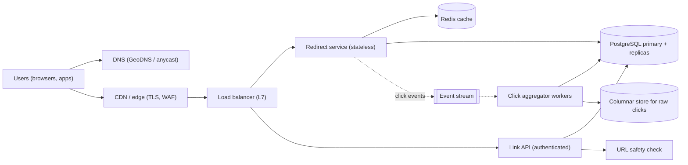
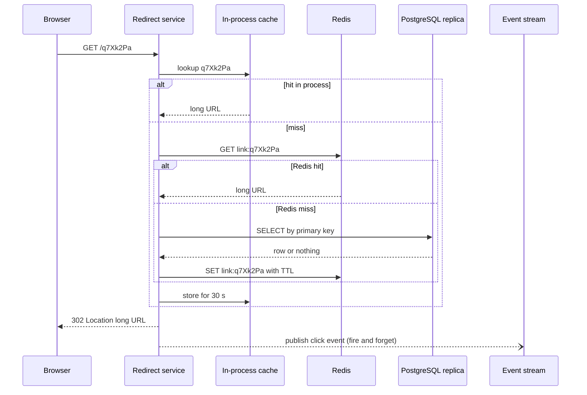

A URL shortener is the classic first system-design case study. It looks tiny: store a mapping from a short code to a long URL, and redirect. But it touches almost every core idea in high-level design: unique ID generation, read-heavy traffic, caching, hot keys, asynchronous analytics, abuse prevention, and the question of when a single PostgreSQL box is simply enough.

## Learning objectives

By the end of this lesson you will be able to:

1. Turn a vague "build a TinyURL" prompt into clear functional and non-functional requirements.
2. Estimate write RPS, read RPS, storage, cache size and key-space size with explicit arithmetic.
3. Compare four ways to generate short codes (hashing, random, counter + base62, pre-generated pools) and pick one with reasons.
4. Choose between `301`, `302` and `307` redirects and explain what each does to analytics and caching.
5. Draw an architecture where the redirect path never waits on analytics writes.
6. Implement base62 encoding, a block-leasing ID generator and a cache-aside redirect resolver in ASP.NET Core.
7. Explain what breaks first under load, how to fail safely, and when a much simpler design is enough.

## Prerequisites

- [How to approach an HLD problem](#/lesson/m11-hld-framework): we follow the same clarify → estimate → design → refine loop.
- [Capacity estimation](#/lesson/m11-capacity-estimation): we do RPS and storage maths throughout.
- [Cache-aside and friends](#/lesson/m12-cache-patterns): the redirect path is a textbook cache-aside read.

Helpful but optional: [Rate limiting algorithms](#/lesson/m10-rate-limiting) and [Sharding](#/lesson/m13-sharding).

## Explain it like I'm a beginner

Think of a big apartment building in Bengaluru with a security desk. Visitors don't know which flat a person lives in, but they know the person's short "visitor code", say `K7`. The guard looks up `K7` in a register, sees "Flat 1204, Tower B", and points the visitor there.

A URL shortener is that guard.

- The **register** is a table that maps short codes to long URLs (a key-value mapping).
- **Writing** a new entry happens rarely: someone creates a link once.
- **Looking up** happens constantly: that link might be clicked a million times from a WhatsApp forward.
- The guard keeps the **most-asked codes on a sticky note** at the desk, so they don't open the heavy register every time (a cache).
- The guard also **tallies visitors** in a notebook at the end of each hour, rather than stopping each visitor to fill a form (asynchronous analytics).

So the whole design is about three things: making codes that are short and never repeat, answering lookups very fast, and counting clicks without slowing the lookups down.

## Requirements

### Functional requirements

1. **Shorten**: given a long URL, return a short URL like `https://sho.example/q7Xk2Pa`.
2. **Redirect**: visiting the short URL sends the browser to the long URL.
3. **Custom alias** (optional per user): `https://sho.example/diwali-sale`.
4. **Expiry**: a link can have an expiry date, after which it returns `404` or `410 Gone`.
5. **Analytics**: link owners see click counts per day, top referrers and rough country breakdown.
6. **Management**: owners can list, disable and delete their links.

### Out of scope (say this out loud in an interview)

- Editing the destination of an existing code (changes caching rules; we treat it as a stretch goal).
- A full marketing suite (A/B destinations, QR designer, UTM builder).
- Real-time per-click dashboards. Owners accept analytics that lag by about a minute.

### Non-functional requirements

| Requirement | Target | Why |
|---|---|---|
| Redirect latency | p99 under 50 ms at our edge, excluding the user's network | A redirect is an extra hop before the real page loads. Every millisecond is visible. |
| Availability of redirects | 99.99 % (about 4.3 minutes of downtime a month) | Broken links on printed posters and SMS can't be fixed later. |
| Availability of link creation | 99.9 % | Creating a link can be retried by the user. |
| Durability | A created link must never be lost or point somewhere else | A wrong redirect is worse than no redirect. |
| Consistency | A new link must work within a second of creation (read-your-writes for the creator) | People click their own link immediately to test it. |
| Analytics | Eventually consistent, under 2 minutes of lag, best-effort (may lose a tiny fraction under failure) | Click counts are informative, not financial. |
| Security | Codes are not easy to enumerate; malicious destinations are blocked | Shorteners are a favourite tool for phishing. |

Notice the asymmetry: **redirects must be fast and highly available, but analytics may lag and occasionally drop a little data**. That single trade-off drives the whole architecture.

## Capacity estimation

All numbers here are **estimates** for a mid-sized public shortener. Write them on the board, round aggressively, and keep the arithmetic visible.

### Traffic

- New links: **100 million per month**.
- Seconds in a month ≈ 30 × 86,400 = 2,592,000 ≈ 2.6 M.
- Write RPS average = 100 M ÷ 2.6 M ≈ **39 writes/s**. Peak (×3) ≈ **120 writes/s**.
- Read-to-write ratio: assume **100 : 1** (each link is clicked about 100 times over its life).
- Read RPS average = 39 × 100 ≈ **3,900 redirects/s**. Peak (×3) ≈ **12,000 redirects/s**.
- Viral spikes: one link in a cricket-score forward can get 50,000 clicks in a minute ≈ 830 RPS **on a single key**. Hot keys matter more than total RPS here.

### Storage

- One row: code (7 B) + long URL (average 100 B, max 2,048 B) + owner id, timestamps, flags, index overhead. Round to **500 bytes per link** including indexes.
- Per year: 100 M × 12 = 1.2 B links × 500 B = **600 GB/year**.
- Five years: 6 B links × 500 B = **3 TB**. That fits a single large PostgreSQL primary, but backups, index rebuilds and vacuum get slow, so plan to shard by year 3 or move to a key-value store.

### Key space

How long must a code be? With an alphabet of 62 characters (`0-9`, `A-Z`, `a-z`):

| Length | Combinations |
|---|---|
| 6 | 62⁶ ≈ 56.8 billion |
| 7 | 62⁷ ≈ 3.52 trillion |
| 8 | 62⁸ ≈ 218 trillion |

We need 6 B codes in five years. Seven characters gives 3.52 trillion, so we use about 6 ÷ 3,520 ≈ **0.17 %** of the space. Seven characters is plenty, and leaves room for random gaps that make codes harder to guess.

### Cache

- Daily redirects ≈ 3,900 × 86,400 ≈ 337 M.
- Clicks follow a heavy-tailed distribution: a small share of links gets most of the clicks. Assume the hottest **20 M links** serve about 80 % of reads (an estimate; measure it in production).
- 20 M × 500 B ≈ **10 GB** of cache. One Redis node with 16 GB RAM holds it, or three smaller nodes for redundancy.

### Bandwidth and analytics

- A redirect response is tiny: status line plus `Location` header, about 500 bytes. 12,000 × 500 B ≈ **6 MB/s** outbound at peak. Bandwidth is not the bottleneck.
- Each click produces an analytics event of about 100 bytes: 337 M × 100 B ≈ **34 GB/day** of raw events. Keep raw events for 30 days (≈ 1 TB) and roll them up into daily counters forever.

### What these numbers tell us

1. Writes are trivial (120/s). Almost any database handles that.
2. Reads are 100× writes, and concentrated on hot keys, so **caching is the main lever**.
3. Analytics writes (one per click, 12,000/s at peak) are 100× the link writes. If we wrote them synchronously to the link table, **analytics would be the first thing to break**. They must be asynchronous and batched.

## API design

Two very different surfaces: a small authenticated JSON API for owners, and a public, unauthenticated redirect endpoint that must be as cheap as possible.

### Create a short link

```http
POST /api/v1/links
Authorization: Bearer <token>
Idempotency-Key: 6f1c2b3e-...           (optional, makes client retries safe)
Content-Type: application/json

{ "longUrl": "https://shop.example.in/sale?utm_source=sms", "customAlias": "diwali-sale", "expiresAt": "2026-11-15T23:59:00+05:30" }
```

Responses:

- `201 Created` with `{ "code": "diwali-sale", "shortUrl": "https://sho.example/diwali-sale", "expiresAt": "..." }` and a `Location` header.
- `400 Bad Request` if the URL is not absolute `http`/`https`, is longer than 2,048 characters, or the alias has invalid characters.
- `409 Conflict` if the custom alias is taken.
- `422 Unprocessable Content` if the destination is on a blocklist.
- `429 Too Many Requests` with `Retry-After` if the user exceeds their creation quota.

### Redirect

```http
GET /q7Xk2Pa
→ 302 Found
  Location: https://shop.example.in/sale?utm_source=sms
  Cache-Control: private, max-age=90
```

Unknown code returns `404 Not Found`. Expired or disabled codes return `410 Gone` (or `404` if you don't want to reveal that the code once existed).

### Choosing the redirect status code

This is a favourite interview question, so be precise:

| Code | Meaning (RFC 9110) | Browser behaviour | Effect on us |
|---|---|---|---|
| `301 Moved Permanently` | The resource has a new permanent URL | Browsers may cache it for a long time and skip our server on later clicks | Fewer requests, but **we lose click counts**, and we can't disable a malicious link for users who cached it |
| `302 Found` | Temporary redirect | Not cached by default (unless `Cache-Control` says so) | Every click reaches us, so analytics and takedowns work |
| `307 Temporary Redirect` | Like 302, but the method and body must not change | Same as 302 for `GET` | Only matters for non-`GET` requests, which a shortener doesn't serve |
| `308 Permanent Redirect` | Like 301, method preserved | Cached like 301 | Same downsides as 301 |

We use **`302` with a short `Cache-Control: private, max-age=90`**. The short browser cache absorbs double-clicks and page reloads, while still letting us count clicks and kill a phishing link within about 90 seconds.

### Owner APIs

- `GET /api/v1/links?cursor=...&limit=50`: cursor pagination by `created_at, code`, never `OFFSET` on a 6 B-row table.
- `GET /api/v1/links/{code}/stats?from=2026-10-01&to=2026-10-07`: daily counts from the rollup table.
- `PATCH /api/v1/links/{code}` with `{ "disabled": true }`.
- `DELETE /api/v1/links/{code}`: soft delete. We never reuse a code, because old printed QR codes may still point to it.

## Data model

### Link table (source of truth)

```sql
CREATE TABLE link (
    code        text        PRIMARY KEY,           -- base62 code or custom alias
    long_url    text        NOT NULL CHECK (length(long_url) <= 2048),
    owner_id    bigint,                             -- NULL for anonymous links
    created_at  timestamptz NOT NULL DEFAULT now(),
    expires_at  timestamptz,
    disabled    boolean     NOT NULL DEFAULT false,
    is_custom   boolean     NOT NULL DEFAULT false
);
CREATE INDEX link_owner_created ON link (owner_id, created_at DESC, code);
```

Why `code` as the primary key rather than a numeric id? The redirect path looks up by code, and that is 99 % of all reads. One B-tree lookup by primary key is the cheapest read PostgreSQL can do. The owner index serves the "my links" page.

### ID block table

```sql
CREATE TABLE id_block (
    name  text   PRIMARY KEY,
    next  bigint NOT NULL
);
-- Lease 1,000 ids atomically:
UPDATE id_block SET next = next + 1000 WHERE name = 'link' RETURNING next - 1000 AS block_start;
```

Each app server leases 1,000 numbers at a time and hands them out from memory: at 120 writes/s that is one update every 8 seconds cluster-wide. `CREATE SEQUENCE ... CACHE 1000` is similar inside one database; a block table also works when links live in shards or a non-SQL store.

### Analytics tables

```sql
CREATE TABLE click_daily (
    code   text   NOT NULL,
    day    date   NOT NULL,
    clicks bigint NOT NULL,
    PRIMARY KEY (code, day)
);
-- Raw events go to a stream or a columnar store, not to PostgreSQL row by row.
```

Workers upsert batched increments: `INSERT ... ON CONFLICT (code, day) DO UPDATE SET clicks = click_daily.clicks + EXCLUDED.clicks`. One upsert per (code, day) per flush, not one per click.

### Why not a key-value store from day one?

The access pattern is key-value (get by code, put if absent), so DynamoDB, Cassandra or Cosmos DB fit well at billions of rows. PostgreSQL wins early because you already run it, `INSERT ... ON CONFLICT DO NOTHING` gives "put if absent", and owner and admin queries are plain SQL. Keep the store behind an `ILinkStore` interface so a later migration is contained.

## High-level architecture



How to read the diagram, arrow by arrow:

- **Users → DNS → Edge**: the short domain resolves to a CDN or edge network close to the user. The edge terminates TLS (so the handshake is short), runs a web application firewall, and can absorb floods before they reach us.
- **Edge → Load balancer → Redirect service / Link API**: we split the two workloads into separate deployments. The redirect service is tiny, public and scaled for 12,000+ RPS. The link API is authenticated, does validation and safety checks, and handles 120 writes/s. Separating them means a bug or overload in creation can't take redirects down (a bulkhead).
- **Redirect service → Redis → PostgreSQL**: cache-aside. Look in Redis first; on a miss, read a replica (or the primary for very new codes), then fill the cache.
- **Link API → URL safety check**: before saving, check the destination against a blocklist or a reputation service. This is synchronous because we must not create a phishing link.
- **Redirect service ⇢ Event stream** (dotted = asynchronous): each click is published as a small event. The redirect does not wait for this write to finish. If the stream is slow, events are dropped or buffered locally, but the user still gets redirected.
- **Aggregator workers → PostgreSQL / columnar store**: workers read events in batches, count clicks per code per day, upsert the rollups, and append raw events to a columnar store for referrer and country reports.

### Redirect flow



The key detail is the last two lines. The browser gets its `302` first; the click event is published asynchronously (the open arrowhead `--)` means "no reply awaited"). We also add a small **in-process cache** (L1) in front of Redis. For a viral link, 830 RPS hit the same key; with a 30-second L1 entry on each of 10 redirect pods, Redis sees at most one request per pod per 30 seconds for that key. That is how we defuse hot keys.

### Create flow, in words

1. The API authenticates the user and applies a per-user rate limit (for example 20 creations per minute for free accounts).
2. It validates the URL: absolute, `http` or `https`, at most 2,048 characters, host not on the blocklist, not pointing to our own domain (which would make redirect loops).
3. If a custom alias is given, it validates the pattern and tries `INSERT ... ON CONFLICT DO NOTHING`. Zero rows inserted means `409 Conflict`.
4. Otherwise it takes the next ID from its leased block, encodes it in base62, and inserts.
5. It writes the new mapping into Redis immediately (write-around would also be fine), so the creator's first click is a cache hit.
6. It returns `201 Created`.

## Deep dives

### Deep dive 1: generating short codes

There are four common approaches. Knowing why three of them lose is most of the interview.

**A. Hash the long URL** (for example, take the first 7 base62 characters of SHA-256).

- Same URL always gives the same code, which gives free deduplication.
- But two different URLs can collide on the first 7 characters. You must detect the collision and add a salt and retry.
- Two users shortening the same URL share a code, so their analytics and expiry settings get mixed up. Most products don't want that.

**B. Random code** (7 random base62 characters from a cryptographic random generator).

- Unguessable, no coordination between servers.
- Collisions are possible and get more likely as the table fills. With 6 B used out of 3.52 trillion, a new random code collides with probability about 0.17 %. That is one retry per ~600 creations, which is fine, but every insert must use "insert if absent" and retry.

**C. Counter + base62** (a unique number per link, written in base 62).

- No collisions, ever. The code is as short as possible.
- Needs a source of unique numbers. A single database sequence works up to thousands of writes per second. Leasing **blocks** of 1,000 numbers per server removes the bottleneck entirely.
- Consecutive numbers give consecutive codes (`q7Xk2Pa`, `q7Xk2Pb`…), so anyone can enumerate links. Fix this by scrambling the number with a reversible permutation (for example a small keyed Feistel network, or multiplying by a large constant that shares no factor with 62⁷, that is, odd and not a multiple of 31, modulo 62⁷) before encoding. The scrambled codes are still unique, because the permutation is one-to-one. Multiplication alone hides the order from casual visitors but is easy to undo once someone sees a few pairs; a keyed Feistel network is the stronger choice when links are semi-private.

**D. Pre-generated key pool** (a key-generation service fills a table with unused random codes; servers take batches).

- Fast at creation time and unguessable.
- More moving parts: a separate service, a table of unused keys, and care to never hand the same key to two servers.

The [unique ID generator case study](#/lesson/m17-unique-id-generator) compares these and Snowflake-style ids in depth; here the deciding constraint is that the code must be **short**, which rules out 64-bit time-based ids (11 base62 characters).

**Our choice: C, counter with block leasing, plus a permutation if enumeration matters.** It needs no collision handling, the maths is simple to test, and block leasing turns the shared counter into one write every few seconds. Custom aliases live in the same table and are checked with insert-if-absent. If a generated code ever lands on an existing alias, we skip that number and take the next one.

### Deep dive 2: base62 encoding

Base62 is ordinary positional notation, like decimal but with 62 digits. The number 125 in base 10 is `1×100 + 2×10 + 5`. In base 62 with alphabet `0-9A-Za-z`:

- 125 ÷ 62 = 2 remainder 1 → last digit is `1`.
- 2 ÷ 62 = 0 remainder 2 → next digit is `2`.
- Reading the remainders backwards gives `21`. Check: 2 × 62 + 1 = 125.

We pad to 7 characters so all generated codes have the same length. Base62 avoids `+` and `/` (which base64 uses and which need URL escaping). Some products drop look-alike characters (`0/O`, `1/l/I`) for codes people type by hand, using a base56 or base58 alphabet. The cost is slightly longer codes.

### Deep dive 3: the read path and hot keys

Three cache layers sit in front of the database:

1. **Browser cache** via `max-age=90`. Free, but only for repeat clicks by the same person.
2. **In-process memory cache** in each redirect pod, 30 seconds, a few hundred MB. It removes the hot-key problem and saves a network hop.
3. **Redis**, about 10 GB, TTL of 24 hours, refreshed on access.

With a combined hit ratio of 95 % (an estimate), the database sees 12,000 × 0.05 = **600 reads/s** at peak, which two read replicas handle comfortably.

**Cache penetration**: an attacker requests millions of random codes that don't exist. Each one misses every cache and hits the database. Defences: cache negative results ("not found") for 60 seconds, reject codes that fail the format check before any lookup, and rate-limit per IP at the edge. A Bloom filter of existing codes (see [cache failures](#/lesson/m12-cache-failures)) is a further option at very large scale.

**Read-your-writes for new links**: replicas lag the primary by milliseconds to seconds. The create path writes the new mapping into Redis with a plain `SET` (which also overwrites any "not found" entry left by an earlier miss), so the first click is a cache hit. Negative caching has a trap here: if a redirect pod misses Redis, reads a lagging replica and caches "not found" for 60 seconds, a brand-new link is broken for a minute. So confirm a replica miss on the primary before caching a negative result (rate-limited, so a scan can't push all its misses to the primary), and if Redis is down, fall back to the primary in the same way.

### Deep dive 4: analytics without slowing redirects

Writing `UPDATE link SET clicks = clicks + 1` on every redirect is the classic mistake. A viral link turns into 830 updates/s on **one row**, which serialises on the row lock, bloats the table with dead row versions, and drags redirect latency up with it.

Instead:

1. The redirect service puts a `ClickEvent` into a bounded in-memory buffer and returns immediately.
2. A background task drains the buffer every 200 ms, publishes events to the stream in batches, or (in the smaller design) pre-aggregates counts per code.
3. Aggregator workers consume the stream, sum clicks per (code, day) over a 30-second window, and upsert once per key.

If the buffer is full, we **drop** events instead of blocking the redirect. That's the explicit trade-off from the requirements: analytics are best-effort. Track dropped events with a metric so you notice if you're losing more than, say, 0.1 %.

### Deep dive 5: abuse and safety

Shorteners hide destinations, which is why phishers love them. Check destinations at creation (blocklists, reputation services, no links to our own domain or to other shorteners), re-scan recently clicked links nightly, and keep a **kill switch**: the `disabled` flag plus cache invalidation. With `302` and `max-age=90`, a takedown takes effect within about 2 minutes. Suspicious-but-unproven links can show an interstitial warning page.

### Deep dive 6: the core pieces in ASP.NET Core

The code below is a compact, compilable version of the core: base62, block-leased ids, cache-aside redirect resolution with negative caching, and asynchronous click aggregation. Real deployments swap the in-memory stores for PostgreSQL and Redis implementations behind the same interfaces.

```csharp file=Shortener/Base62.cs
namespace Shortener.Ids;

/// <summary>Positional base62 with alphabet 0-9, A-Z, a-z. Encoding is one-to-one for non-negative values.</summary>
public static class Base62
{
    public const string Alphabet = "0123456789ABCDEFGHIJKLMNOPQRSTUVWXYZabcdefghijklmnopqrstuvwxyz";

    public static string Encode(long value, int minLength = 1)
    {
        ArgumentOutOfRangeException.ThrowIfNegative(value);
        Span<char> buffer = stackalloc char[11]; // 62^11 > long.MaxValue, so 11 digits always suffice
        var i = buffer.Length;
        do
        {
            buffer[--i] = Alphabet[(int)(value % 62)];
            value /= 62;
        } while (value > 0);

        var code = new string(buffer[i..]);
        return code.Length >= minLength ? code : code.PadLeft(minLength, '0');
    }

    public static long Decode(string code)
    {
        ArgumentException.ThrowIfNullOrEmpty(code);
        long result = 0;
        foreach (var c in code)
        {
            var digit = DigitOf(c);
            if (digit < 0) throw new FormatException($"'{c}' is not a base62 digit.");
            result = checked(result * 62 + digit);
        }
        return result;
    }

    public static bool IsBase62(string code)
    {
        foreach (var c in code) if (DigitOf(c) < 0) return false;
        return code.Length > 0;
    }

    private static int DigitOf(char c) => c switch
    {
        >= '0' and <= '9' => c - '0',
        >= 'A' and <= 'Z' => c - 'A' + 10,
        >= 'a' and <= 'z' => c - 'a' + 36,
        _ => -1,
    };
}
```

```csharp file=Shortener/BlockIdGenerator.cs
namespace Shortener.Ids;

/// <summary>Source of globally unique number ranges. In PostgreSQL:
/// UPDATE id_block SET next = next + @size WHERE name = 'link' RETURNING next - @size;</summary>
public interface IIdRangeStore
{
    Task<long> ReserveAsync(int size, CancellationToken ct);
}

public sealed class InMemoryIdRangeStore(long firstId) : IIdRangeStore
{
    private long _next = firstId;

    public Task<long> ReserveAsync(int size, CancellationToken ct) =>
        Task.FromResult(Interlocked.Add(ref _next, size) - size);
}

/// <summary>Hands out ids from a leased block; leases a new block only when the current one is used up.
/// Unused ids in a block are lost on restart, which is safe: gaps are fine, duplicates are not.</summary>
public sealed class BlockIdGenerator(IIdRangeStore store, int blockSize)
{
    private readonly SemaphoreSlim _gate = new(1, 1);
    private long _current;
    private long _end; // exclusive

    public async ValueTask<long> NextAsync(CancellationToken ct = default)
    {
        await _gate.WaitAsync(ct);
        try
        {
            if (_current >= _end)
            {
                _current = await store.ReserveAsync(blockSize, ct);
                _end = _current + blockSize;
            }
            return _current++;
        }
        finally
        {
            _gate.Release();
        }
    }
}
```

```csharp file=Shortener/Links.cs
using System.Collections.Concurrent;

namespace Shortener.Links;

public sealed record Link(string Code, string LongUrl, DateTimeOffset CreatedAt, DateTimeOffset? ExpiresAt, string? OwnerId)
{
    public bool Disabled { get; init; }
    public bool IsLive(DateTimeOffset now) => !Disabled && (ExpiresAt is null || ExpiresAt > now);
}

public interface ILinkStore
{
    /// <summary>Insert if the code is free. Returns false if the code already exists (ON CONFLICT DO NOTHING).</summary>
    Task<bool> TryInsertAsync(Link link, CancellationToken ct);
    Task<Link?> FindAsync(string code, CancellationToken ct);
}

public sealed class InMemoryLinkStore : ILinkStore
{
    private readonly ConcurrentDictionary<string, Link> _links = new(StringComparer.Ordinal);
    public Task<bool> TryInsertAsync(Link link, CancellationToken ct) => Task.FromResult(_links.TryAdd(link.Code, link));
    public Task<Link?> FindAsync(string code, CancellationToken ct) =>
        Task.FromResult(_links.TryGetValue(code, out var l) ? l : null);
}
```

```csharp file=Shortener/ShortenService.cs
using System.Text.RegularExpressions;
using Microsoft.Extensions.Caching.Memory;
using Shortener.Ids;

namespace Shortener.Links;

public sealed record ShortenRequest(string LongUrl, string? CustomAlias, DateTimeOffset? ExpiresAt);
public sealed record ShortenResult(bool Ok, string? Code, string? Error, int Status);

public sealed class ShortenService(ILinkStore store, BlockIdGenerator ids, IMemoryCache cache, TimeProvider clock)
{
    private static readonly Regex AliasPattern = new("^[A-Za-z0-9_-]{4,32}$", RegexOptions.Compiled);
    public const int GeneratedLength = 7;
    public const string OwnHost = "sho.example";

    public async Task<ShortenResult> ShortenAsync(ShortenRequest req, string? ownerId, CancellationToken ct)
    {
        if (!Uri.TryCreate(req.LongUrl, UriKind.Absolute, out var uri)
            || (uri.Scheme != Uri.UriSchemeHttp && uri.Scheme != Uri.UriSchemeHttps)
            || req.LongUrl.Length > 2048)
            return new(false, null, "longUrl must be an absolute http(s) URL of at most 2048 characters.", 400);
        if (string.Equals(uri.Host, OwnHost, StringComparison.OrdinalIgnoreCase))
            return new(false, null, "Links to the shortener itself are not allowed.", 400);

        var now = clock.GetUtcNow();
        if (req.ExpiresAt is { } exp && exp <= now)
            return new(false, null, "expiresAt must be in the future.", 400);

        if (req.CustomAlias is { } alias)
        {
            if (!AliasPattern.IsMatch(alias)) return new(false, null, "Alias must be 4-32 characters of A-Z, a-z, 0-9, _ or -.", 400);
            var link = new Link(alias, req.LongUrl, now, req.ExpiresAt, ownerId);
            if (!await store.TryInsertAsync(link, ct)) return new(false, null, "Alias already taken.", 409);
            Warm(link, now);
            return new(true, alias, null, 201);
        }

        // A generated code can only collide with a custom alias of the same shape; skip that id and retry.
        for (var attempt = 0; attempt < 5; attempt++)
        {
            var code = Base62.Encode(await ids.NextAsync(ct), GeneratedLength);
            var link = new Link(code, req.LongUrl, now, req.ExpiresAt, ownerId);
            if (await store.TryInsertAsync(link, ct)) { Warm(link, now); return new(true, code, null, 201); }
        }
        return new(false, null, "Could not allocate a code; please retry.", 503);
    }

    // Read-your-writes for the creator: the first click is a cache hit even if replicas lag.
    private void Warm(Link link, DateTimeOffset now) =>
        cache.Set(RedirectResolver.Key(link.Code), link, RedirectResolver.Entry(RedirectResolver.TtlFor(link, now)));
}
```

```csharp file=Shortener/RedirectResolver.cs
using Microsoft.Extensions.Caching.Memory;

namespace Shortener.Links;

/// <summary>Cache-aside lookup with negative caching, so scans of random codes don't all reach the database.</summary>
public sealed class RedirectResolver(ILinkStore store, IMemoryCache cache, TimeProvider clock)
{
    private sealed class NotFound { public static readonly NotFound Instance = new(); }
    private static readonly TimeSpan PositiveTtl = TimeSpan.FromMinutes(30);
    private static readonly TimeSpan NegativeTtl = TimeSpan.FromSeconds(60);

    public static string Key(string code) => "link:" + code;

    /// <summary>Every entry has Size 1, so the cache's SizeLimit caps the entry count: a scan of random codes
    /// fills the cache with negative entries up to the limit and then evicts, instead of exhausting memory.</summary>
    public static MemoryCacheEntryOptions Entry(TimeSpan ttl) =>
        new() { AbsoluteExpirationRelativeToNow = ttl, Size = 1 };

    public static TimeSpan TtlFor(Link link, DateTimeOffset now)
    {
        if (link.ExpiresAt is not { } exp) return PositiveTtl;
        var untilExpiry = exp - now;
        return untilExpiry < PositiveTtl ? (untilExpiry > TimeSpan.Zero ? untilExpiry : TimeSpan.FromSeconds(1)) : PositiveTtl;
    }

    public async Task<string?> ResolveAsync(string code, CancellationToken ct)
    {
        var now = clock.GetUtcNow();
        if (!cache.TryGetValue(Key(code), out object? entry))
        {
            var link = await store.FindAsync(code, ct);
            entry = (object?)link ?? NotFound.Instance;
            // Production: confirm a replica miss on the primary before caching "not found" (see deep dive 3).
            cache.Set(Key(code), entry, Entry(link is null ? NegativeTtl : TtlFor(link, now)));
        }
        return entry is Link l && l.IsLive(now) ? l.LongUrl : null;
    }

    /// <summary>Called on disable/delete. In production also publish an invalidation message to other pods.</summary>
    public void Invalidate(string code) => cache.Remove(Key(code));
}
```

```csharp file=Shortener/ClickAggregation.cs
using System.Collections.Concurrent;
using System.Threading.Channels;
using Microsoft.Extensions.Hosting;
using Microsoft.Extensions.Logging;

namespace Shortener.Analytics;

public sealed record ClickEvent(string Code, DateTimeOffset At, string? Referrer);

/// <summary>Bounded buffer between the redirect path and analytics. When full, new events are dropped,
/// never awaited: redirects must not slow down because analytics is behind.</summary>
public sealed class ClickQueue
{
    private readonly Channel<ClickEvent> _channel = Channel.CreateBounded<ClickEvent>(
        new BoundedChannelOptions(100_000) { FullMode = BoundedChannelFullMode.Wait, SingleReader = true });
    private long _dropped;

    public void Enqueue(ClickEvent e)
    {
        // In Wait mode, TryWrite never waits: it returns false when the buffer is full, so the drop count is exact.
        // (DropWrite would report success while silently dropping, and a separate "is it full?" check before
        // writing is a check-then-act race between concurrent redirects.)
        if (!_channel.Writer.TryWrite(e)) Interlocked.Increment(ref _dropped);
    }

    public long Dropped => Interlocked.Read(ref _dropped);
    public ChannelReader<ClickEvent> Reader => _channel.Reader;
}

public interface IClickCounterStore
{
    /// <summary>INSERT ... ON CONFLICT (code, day) DO UPDATE SET clicks = click_daily.clicks + EXCLUDED.clicks</summary>
    Task AddAsync(IReadOnlyDictionary<(string Code, DateOnly Day), long> deltas, CancellationToken ct);
}

public sealed class InMemoryClickCounterStore : IClickCounterStore
{
    private readonly ConcurrentDictionary<(string, DateOnly), long> _counts = new();
    public Task AddAsync(IReadOnlyDictionary<(string Code, DateOnly Day), long> deltas, CancellationToken ct)
    {
        foreach (var (key, n) in deltas) _counts.AddOrUpdate(key, n, (_, old) => old + n);
        return Task.CompletedTask;
    }
    public long Get(string code, DateOnly day) => _counts.TryGetValue((code, day), out var n) ? n : 0;
}

public sealed class ClickAggregator(ClickQueue queue, IClickCounterStore store, ILogger<ClickAggregator> log) : BackgroundService
{
    private const int MaxBatch = 5_000;

    protected override async Task ExecuteAsync(CancellationToken stoppingToken)
    {
        var deltas = new Dictionary<(string Code, DateOnly Day), long>();
        try
        {
            while (await queue.Reader.WaitToReadAsync(stoppingToken))
            {
                var n = 0;
                while (n < MaxBatch && queue.Reader.TryRead(out var e))
                {
                    var key = (e.Code, DateOnly.FromDateTime(e.At.UtcDateTime));
                    deltas[key] = deltas.GetValueOrDefault(key) + 1;
                    n++;
                }
                try { await store.AddAsync(deltas, stoppingToken); }
                catch (Exception ex) when (ex is not OperationCanceledException)
                {
                    log.LogWarning(ex, "Dropping {Keys} click rollups after store failure", deltas.Count);
                }
                deltas.Clear();
                await Task.Delay(TimeSpan.FromMilliseconds(200), stoppingToken); // let a batch build up
            }
        }
        catch (OperationCanceledException) when (stoppingToken.IsCancellationRequested) { }
    }
}
```

```csharp file=Program.cs
using System.Threading.RateLimiting;
using Shortener.Analytics;
using Shortener.Ids;
using Shortener.Links;

var builder = WebApplication.CreateBuilder(args);

builder.Services.AddMemoryCache(o => o.SizeLimit = 1_000_000); // entries, not bytes: every Set uses Size = 1
builder.Services.AddSingleton(TimeProvider.System);
// Swap for a PostgreSQL-backed IIdRangeStore and ILinkStore in production.
builder.Services.AddSingleton<IIdRangeStore>(_ => new InMemoryIdRangeStore(firstId: 1));
builder.Services.AddSingleton(sp => new BlockIdGenerator(sp.GetRequiredService<IIdRangeStore>(), blockSize: 1000));
builder.Services.AddSingleton<ILinkStore, InMemoryLinkStore>();
builder.Services.AddSingleton<ShortenService>();
builder.Services.AddSingleton<RedirectResolver>();
builder.Services.AddSingleton<ClickQueue>();
builder.Services.AddSingleton<IClickCounterStore, InMemoryClickCounterStore>();
builder.Services.AddHostedService<ClickAggregator>();

builder.Services.AddRateLimiter(o =>
{
    o.RejectionStatusCode = StatusCodes.Status429TooManyRequests;
    o.AddPolicy("create", ctx => RateLimitPartition.GetFixedWindowLimiter(
        ctx.User.Identity?.Name ?? ctx.Connection.RemoteIpAddress?.ToString() ?? "anon",
        _ => new FixedWindowRateLimiterOptions { PermitLimit = 20, Window = TimeSpan.FromMinutes(1) }));
});

var app = builder.Build();
app.UseRateLimiter();

app.MapPost("/api/v1/links", async (ShortenRequest req, HttpContext http, ShortenService svc, CancellationToken ct) =>
{
    var r = await svc.ShortenAsync(req, http.User.Identity?.Name, ct);
    return r.Ok
        ? Results.Created($"/{r.Code}", new { code = r.Code, shortUrl = $"https://{ShortenService.OwnHost}/{r.Code}" })
        : Results.Problem(r.Error, statusCode: r.Status);
}).RequireRateLimiting("create");

app.MapGet("/{code}", async (string code, HttpContext http, RedirectResolver resolver, ClickQueue clicks,
                             TimeProvider clock, CancellationToken ct) =>
{
    // Cheap format check before any lookup: the same shape rules as generated codes and custom aliases.
    if (code.Length is < 4 or > 32 || !code.All(c => char.IsAsciiLetterOrDigit(c) || c is '-' or '_'))
        return Results.NotFound();
    var url = await resolver.ResolveAsync(code, ct);
    if (url is null) return Results.NotFound();

    clicks.Enqueue(new ClickEvent(code, clock.GetUtcNow(), http.Request.Headers.Referer.ToString()));
    http.Response.Headers.CacheControl = "private, max-age=90";
    return Results.Redirect(url, permanent: false); // 302: every click reaches us, takedowns work
});

app.Run();
```

The resolver caps each cache entry's TTL at the link's own expiry, the cache is bounded by entry count so negative entries from scanners can't exhaust memory, and `ClickQueue` drops and counts events when full: the "best-effort analytics" requirement written in code.

## Caching, queues and scaling

### Caching summary

| Layer | What | TTL | Invalidation |
|---|---|---|---|
| Browser | 302 response | 90 s | Can't invalidate; keep it short |
| CDN edge | Optional: cache 302s for very hot codes | 30–60 s | Purge by URL on disable |
| In-process | code → URL | 30 s | Pub/sub "invalidate code" message |
| Redis | code → URL, plus negative entries | 24 h (negative: 60 s) | `DEL` on disable/delete |

Because a link's destination never changes in our scope, invalidation is only needed for disable and delete. That's why this cache is so easy: **immutable data is the best possible cache content**.

### Queues

- **Click events**: a partitioned log (Kafka, Azure Event Hubs, or similar) keyed by `code` so all events for a code land in one partition and can be aggregated by one consumer. Retention of 3–7 days lets you replay after an aggregator bug.
- **Safety re-scans and takedown fan-out**: an ordinary work queue with retries and a dead-letter queue.

At smaller scale, you don't need a stream at all: an in-process `Channel<T>` plus a `BackgroundService` that upserts rollups every few seconds is enough (that's what the C# below does).

### Scaling path

1. **Day 1 (up to ~1,000 RPS)**: one region, two app instances, one PostgreSQL primary with a replica, an in-process cache. No Redis, no stream.
2. **Growth (up to ~20,000 RPS)**: separate redirect and API deployments, Redis, read replicas, a stream for clicks, autoscaling on CPU.
3. **Large (100,000+ RPS, billions of rows)**: shard the link table by hash of `code` (or move to a key-value store), run redirect pods in several regions, each with a regional Redis and a local read replica. Writes still go to one primary region; reads are local. Since links don't change, async cross-region replication is safe: the only risk is a brand-new link not yet replicated, which the create path covers by writing it into the creator's regional cache.

**What breaks first?** In order: (1) synchronous click counting on the link row, (2) the database under cache-miss storms from random-code scanning, (3) a single hot key on a single Redis shard, (4) storage and vacuum on a multi-terabyte single table. Every item has a mitigation above.

## Failure handling

| Failure | Effect | Mitigation |
|---|---|---|
| Redis down | All lookups miss to the database; 12,000 RPS on replicas could overload them | In-process cache absorbs hot keys; circuit breaker around Redis so we don't wait on timeouts; replicas sized to survive a few minutes of full load; shed anonymous analytics first |
| Primary database down | Can't create links | Redirects keep working from replicas and cache. Fail over to a synchronous standby; creation returns `503` with `Retry-After` meanwhile |
| Replica lag | A brand-new code isn't found on the replica | Creator's cache write; fall back to the primary on "not found" for codes whose numeric value is newer than the last replicated id (or just for any miss, rate-limited) |
| ID block store down | Servers can't lease new blocks | Each server keeps its remaining block (up to 1,000 ids) and can lease the next block early, at 80 % used, so a short outage isn't noticed |
| Server crashes with an unused block | Up to 1,000 numbers are never used | Harmless: gaps in a 3.5-trillion space don't matter. Never "give back" ids, which risks duplicates |
| Event stream down | Clicks can't be published | Local bounded buffer; drop when full and count drops. Redirects are unaffected |
| Aggregator bug double-counts | Wrong stats | Replay from the stream after the fix; make rollups idempotent by keying batches with (partition, offset range) |
| Region outage | Users in that region can't resolve | GeoDNS or anycast health checks shift traffic to another region within the DNS TTL (set it to 60 s) |

The guiding rule: **the redirect path depends on as few components as possible**. In the worst case it needs only the database replica. Everything else is an optimisation that can fail open.

## Security

- **Transport**: HTTPS only, with HSTS on the short domain. A shortener on plain HTTP lets anyone on public Wi-Fi rewrite the redirect.
- **Destination validation**: only `http`/`https` schemes. Reject `javascript:`, `data:` and `file:` URLs, which could otherwise run script in some clients.
- **Open-redirect awareness**: a shortener *is* an open redirector by design. That's acceptable on its own dedicated domain. Never host it on your main application domain, where it would help attackers bypass "only redirect to our domain" checks in your login flow.
- **Enumeration**: sequential codes let anyone crawl every link. Use a permutation or random codes if links might be semi-private (shared documents, payment pages).
- **Authorization**: owners can manage only their own links; admin takedown is a separate, audited role.
- **Rate limits**: per user and per IP on creation; per IP at the edge for redirects to blunt scanning.
- **Privacy**: click events hold IP addresses, which are personal data under laws like India's DPDP Act 2023 and the GDPR. Truncate or hash IPs after deriving the country, and set retention limits on raw events.

## Observability

Track these with OpenTelemetry metrics and traces ([observability lesson](#/lesson/m14-observability)):

- **Redirect latency** p50/p95/p99, split by cache layer that served it (L1, Redis, DB).
- **Cache hit ratio** per layer. A sudden drop usually means a deployment flushed L1 or an attacker is scanning.
- **404 rate**. A spike means scanning or a broken campaign link.
- **Click events dropped** per pod. Alert if above 0.1 % over 10 minutes.
- **Stream consumer lag** in seconds. Alert if analytics lag exceeds the 2-minute target.
- **ID block leases per minute**. A jump means pods are restarting in a loop (each restart wastes a block).
- **Creation rejections** by reason (invalid, blocked, rate-limited).

An SLO for redirects could be: "99.9 % of redirects in a 28-day window return a correct 302 or 404 in under 50 ms at the load balancer." Errors from blocked or deleted links count as successes, because they're correct answers.

## Deployment and cost

### Deployment

- Package the redirect service and link API as separate container images. Run them on Azure Container Apps, AKS or similar, with horizontal autoscaling on CPU and RPS.
- Use rolling or canary deployments for the redirect service ([deployment strategies](#/lesson/m15-deployment-strategies)). A bad build that returns wrong redirects is the most damaging bug this system can have, so canary at 1 % and compare 404 and error rates before rolling out.
- Database migrations must be backward compatible (expand, then contract), because old and new pods run side by side during a rollout.

### Cost drivers (rough, estimate only)

1. **Compute for redirects**: 12,000 RPS of tiny requests needs only a handful of small instances, since each request is a cache lookup.
2. **Redis memory**: about 10–16 GB, plus a replica.
3. **Database storage and IOPS**: 3 TB over five years plus replicas and backups.
4. **Analytics storage**: raw events (≈ 1 TB per 30 days) are often the biggest storage line. Roll up and expire them.
5. **Egress**: tiny responses, so small. CDN request fees can matter at billions of requests a month.

### When a simpler design is enough

An internal shortener for a company of 5,000 people (say, `go/` links on the intranet) gets maybe 10,000 clicks a day, about 0.1 RPS. One ASP.NET Core app with an in-memory cache and a single PostgreSQL table is the whole system. Click counts can be a simple `UPDATE` because there is no contention. Adding Redis, Kafka and sharding there would be engineering for its own sake.

## Alternatives and trade-offs

| Decision | Our choice | Alternative | When the alternative wins |
|---|---|---|---|
| Code generation | Counter + base62 with block leasing | Random 7–8 char codes | When unguessability matters more than shortness, and you don't want a central counter at all |
| Redirect status | 302 + short max-age | 301 | When you don't need analytics or takedowns and want minimum traffic (rare for a public service) |
| Store | PostgreSQL, later sharded | Key-value store (DynamoDB, Cassandra, Cosmos DB) | Billions of rows across regions from the start, with a team comfortable running it |
| Analytics | Async stream + rollups | Synchronous counters | Tiny internal tools with no contention |
| Dedup of same long URL | Not deduplicated (each create gets its own code) | Hash-based dedupe | Anonymous public shortener where storage matters more than per-owner analytics |
| Multi-region | Single write region, read everywhere | Multi-writer | Almost never needed: writes are only 120/s |

The meta-lesson: **most of the hard parts are on the read path and the analytics path, not in storing the mapping.**

## Practical playground

The starting graph below is a naive single-tier design: everything goes from the load balancer to one app that writes click counts straight into the database. Open it in the HLD canvas and evolve it. Add a cache in front of the database, split redirects from the API, and make analytics asynchronous. Then raise the client RPS to 12,000 and see which node the simulator flags first.

:::playground type=hld title="Evolve the naive shortener"
```json
{
  "nodes": [
    { "id": "c", "type": "client", "label": "Browsers clicking links", "props": { "rps": 4000 } },
    { "id": "lb", "type": "load-balancer", "label": "Load balancer" },
    { "id": "app", "type": "app-server", "label": "Shortener app (create + redirect + count)", "props": { "instances": 2 } },
    { "id": "db", "type": "database", "label": "PostgreSQL (links + click counters)", "props": { "replicas": 0 } }
  ],
  "edges": [
    { "from": "c", "to": "lb", "kind": "sync" },
    { "from": "lb", "to": "app", "kind": "sync" },
    { "from": "app", "to": "db", "kind": "sync", "label": "SELECT + UPDATE clicks per redirect" }
  ]
}
```
:::

## Exercises

:::exercise id=m17-url-shortener-ex1 difficulty=beginner kind=code title="Implement base62 encode and decode"
Implement `Base62Codec.Encode` and `Base62Codec.Decode` using the alphabet `0-9A-Za-z`. `Encode` must pad to `minLength` with leading `'0'` characters.
::requirements
- `Encode(0)` is `"0"`, `Encode(61)` is `"z"`, `Encode(62)` is `"10"`.
- Negative input throws `ArgumentOutOfRangeException`.
- `Decode` throws `FormatException` for characters outside the alphabet.
- `Decode(Encode(n)) == n` for any non-negative `long`, including `long.MaxValue`.
::acceptance
- All tests pass.
- No `Math.Pow` or floating-point arithmetic.
- `Encode(125, 7)` returns `"0000021"`.
::hint
Base62 works exactly like decimal, but each digit position is worth 62 times the one to its right.
::hint
To encode, repeatedly take `value % 62` (the last digit) and then `value /= 62`, until the value is 0. The digits come out in reverse order.
::hint
To decode, start from 0 and, for each character left to right, do `result = result * 62 + digit`.
::hint
Map a character to its digit with ranges: `'0'..'9'` → 0–9, `'A'..'Z'` → 10–35, `'a'..'z'` → 36–61.
::hint
```csharp
Span<char> buf = stackalloc char[11];
var i = buf.Length;
do { buf[--i] = Alphabet[(int)(value % 62)]; value /= 62; } while (value > 0);
```
::starter
```csharp file=Base62Codec.cs
using System;

public static class Base62Codec
{
    public const string Alphabet = "0123456789ABCDEFGHIJKLMNOPQRSTUVWXYZabcdefghijklmnopqrstuvwxyz";

    public static string Encode(long value, int minLength = 1) => throw new NotImplementedException();

    public static long Decode(string code) => throw new NotImplementedException();
}
```
::tests
```csharp file=Base62CodecTests.cs
using System;
using Xunit;

public class Base62CodecTests
{
    [Theory]
    [InlineData(0L, "0")]
    [InlineData(61L, "z")]
    [InlineData(62L, "10")]
    [InlineData(125L, "21")]
    [InlineData(3843L, "zz")]
    public void Encodes_known_values(long value, string expected) => Assert.Equal(expected, Base62Codec.Encode(value));

    [Fact]
    public void Pads_to_min_length() => Assert.Equal("0000021", Base62Codec.Encode(125, 7));

    [Theory]
    [InlineData(1L)]
    [InlineData(56800235584L)]
    [InlineData(3521614606207L)]
    [InlineData(long.MaxValue)]
    public void Round_trips(long value) => Assert.Equal(value, Base62Codec.Decode(Base62Codec.Encode(value)));

    [Fact]
    public void Decodes_padded_code() => Assert.Equal(125L, Base62Codec.Decode("0000021"));

    [Fact]
    public void Rejects_negative() => Assert.Throws<ArgumentOutOfRangeException>(() => Base62Codec.Encode(-1));

    [Fact]
    public void Rejects_bad_characters() => Assert.Throws<FormatException>(() => Base62Codec.Decode("ab-c"));

    [Fact]
    public void Seven_chars_cover_62_pow_7_minus_1() => Assert.Equal("zzzzzzz", Base62Codec.Encode(3521614606207L));
}
```
::solution
Encode by repeated division, filling a buffer from the right. Decode with Horner's rule and `checked` arithmetic, so an over-long code throws instead of silently wrapping.

```csharp file=Base62Codec.cs
using System;

public static class Base62Codec
{
    public const string Alphabet = "0123456789ABCDEFGHIJKLMNOPQRSTUVWXYZabcdefghijklmnopqrstuvwxyz";

    public static string Encode(long value, int minLength = 1)
    {
        ArgumentOutOfRangeException.ThrowIfNegative(value);
        Span<char> buf = stackalloc char[11];
        var i = buf.Length;
        do
        {
            buf[--i] = Alphabet[(int)(value % 62)];
            value /= 62;
        } while (value > 0);
        var s = new string(buf[i..]);
        return s.Length >= minLength ? s : s.PadLeft(minLength, '0');
    }

    public static long Decode(string code)
    {
        ArgumentException.ThrowIfNullOrEmpty(code);
        long result = 0;
        foreach (var c in code)
        {
            int d = c switch
            {
                >= '0' and <= '9' => c - '0',
                >= 'A' and <= 'Z' => c - 'A' + 10,
                >= 'a' and <= 'z' => c - 'a' + 36,
                _ => throw new FormatException($"'{c}' is not a base62 digit."),
            };
            result = checked(result * 62 + d);
        }
        return result;
    }
}
```

Why `do ... while`? A plain `while (value > 0)` loop produces an empty string for 0. Why 11 characters? 62¹⁰ ≈ 8.4 × 10¹⁷ is less than `long.MaxValue` (≈ 9.2 × 10¹⁸), and 62¹¹ is more, so 11 digits always suffice.
::mistakes
- Forgetting `checked`, so `Decode("zzzzzzzzzzzz")` silently overflows into a negative number that maps to the wrong link.
- Building the string with `string +=` in a loop and then reversing it. Correct, but it allocates on every digit.
- Treating codes as case-insensitive. `a` and `A` are different digits; a case-insensitive database collation on the `code` column would merge distinct links.
::extensions
Add a reversible scramble: multiply the id by a large constant coprime to 62⁷ (odd and not a multiple of 31) modulo 62⁷ and encode the result, and write `Unscramble` using the modular inverse. Prove with a test that 10,000 consecutive ids produce 10,000 distinct, non-sequential codes.
:::

:::exercise id=m17-url-shortener-ex2 difficulty=beginner kind=sql ordered=true title="Top links for an owner's weekly report"
The owner `acme` wants the three most-clicked links between 1 and 7 October 2026 (both days included). Only include links that are still live (not expired) at `2026-10-19 00:00:00+05:30`. Return `code` and `total_clicks`, highest first. Break ties by `code` ascending.
::setup
```sql
CREATE TABLE link (
  code       text PRIMARY KEY,
  long_url   text NOT NULL,
  owner_id   text,
  created_at timestamptz NOT NULL,
  expires_at timestamptz
);
CREATE TABLE click_daily (
  code   text   NOT NULL REFERENCES link (code),
  day    date   NOT NULL,
  clicks bigint NOT NULL,
  PRIMARY KEY (code, day)
);
INSERT INTO link VALUES
  ('acme-launch', 'https://acme.example/launch', 'acme', '2026-09-20 10:00+05:30', NULL),
  ('acme-diwali', 'https://acme.example/diwali', 'acme', '2026-09-25 10:00+05:30', '2026-10-10 00:00+05:30'),
  ('q7Xk2Pa',     'https://acme.example/p/1',    'acme', '2026-09-28 10:00+05:30', NULL),
  ('b9LmN0c',     'https://acme.example/p/2',    'acme', '2026-09-29 10:00+05:30', '2026-12-31 00:00+05:30'),
  ('zz00Ab1',     'https://acme.example/p/3',    'acme', '2026-09-30 10:00+05:30', NULL),
  ('zen-promo',   'https://zen.example/promo',   'zen',  '2026-09-30 10:00+05:30', NULL);
INSERT INTO click_daily VALUES
  ('acme-launch', '2026-09-30', 500),
  ('acme-launch', '2026-10-01', 120),
  ('acme-launch', '2026-10-05',  80),
  ('acme-diwali', '2026-10-02', 900),
  ('q7Xk2Pa',     '2026-10-03', 150),
  ('q7Xk2Pa',     '2026-10-07',  50),
  ('q7Xk2Pa',     '2026-10-08', 400),
  ('b9LmN0c',     '2026-10-04',  90),
  ('zz00Ab1',     '2026-10-06',  60),
  ('zen-promo',   '2026-10-03', 5000);
```
::check
```sql
SELECT l.code, SUM(c.clicks) AS total_clicks
FROM link l
JOIN click_daily c ON c.code = l.code
WHERE l.owner_id = 'acme'
  AND (l.expires_at IS NULL OR l.expires_at > TIMESTAMPTZ '2026-10-19 00:00:00+05:30')
  AND c.day BETWEEN DATE '2026-10-01' AND DATE '2026-10-07'
GROUP BY l.code
ORDER BY total_clicks DESC, l.code ASC
LIMIT 3;
```
::acceptance
- Returns `acme-launch` 200, `q7Xk2Pa` 200, `b9LmN0c` 90, in that order.
- `acme-diwali` is excluded because it expired on 10 October, even though it has the most clicks.
- Clicks on 30 September and 8 October are not counted.
- `zen-promo` (another owner) never appears.
::hint
You need data from both tables. What do they have in common?
::hint
Join `link` to `click_daily` on `code`, filter by owner, date range and expiry, then `GROUP BY` code.
::hint
A link is live if `expires_at IS NULL OR expires_at > <the report time>`. Don't forget the `IS NULL` half.
::hint
Order by the sum descending, then by code ascending, and `LIMIT 3`.
::solution
```sql
SELECT l.code, SUM(c.clicks) AS total_clicks
FROM link l
JOIN click_daily c ON c.code = l.code
WHERE l.owner_id = 'acme'
  AND (l.expires_at IS NULL OR l.expires_at > TIMESTAMPTZ '2026-10-19 00:00:00+05:30')
  AND c.day BETWEEN DATE '2026-10-01' AND DATE '2026-10-07'
GROUP BY l.code
ORDER BY total_clicks DESC, l.code ASC
LIMIT 3;
```
This query reads the small rollup table, never raw click events. That's why rollups exist: the owner's dashboard costs a few index lookups instead of scanning millions of events. With an index on `link (owner_id)` and the primary key `(code, day)` on `click_daily`, the planner can find the owner's codes and then range-scan each code's days.
::mistakes
- Writing `expires_at > ...` without `OR expires_at IS NULL`. In SQL, comparing `NULL` gives `NULL`, so links that never expire disappear from the report.
- Using `c.day <= '2026-10-07'` on a `timestamptz` column. Here `day` is a `date`, so `BETWEEN` is inclusive and correct; on a timestamp you'd need `< '2026-10-08'`.
- Forgetting the tie-breaker, which makes the order of equal totals unpredictable between runs.
::extensions
Change the query to include links with zero clicks in the window (hint: `LEFT JOIN` with the date filter moved into the `ON` clause, and `COALESCE`).
:::

:::exercise id=m17-url-shortener-ex3 difficulty=intermediate kind=code title="Block-leasing ID generator"
Implement `BlockIdGenerator.NextAsync`. It hands out ids from an in-memory block and calls `IIdRangeStore.ReserveAsync(blockSize)` only when the block is used up. Concurrent callers must never receive the same id.
::requirements
- The first call reserves a block. The next `blockSize - 1` calls don't touch the store.
- 8 tasks each calling `NextAsync` 1,000 times in parallel (block size 1,000) produce 8,000 distinct ids with exactly 8 store calls.
- Two generators sharing one store (two app servers) never produce overlapping ids.
- If the store throws, the exception propagates and the next call tries again.
::acceptance
- All tests pass.
- No `lock` statement around an `await` (it won't compile anyway); use `SemaphoreSlim`.
::hint
The generator needs two numbers of state: the next id to hand out and the end of the current block.
::hint
"Block used up" means `current >= end`. Initially both are 0, so the first call leases a block.
::hint
The refill is an `await`, so a plain `lock` can't protect it. `SemaphoreSlim(1, 1)` with `WaitAsync` and `Release` in a `finally` works across `await`.
::hint
Only update `_current` and `_end` after `ReserveAsync` succeeds, so a failure leaves the generator in a state where the next call simply tries again.
::hint
```csharp
await _gate.WaitAsync(ct);
try
{
    if (_current >= _end) { var start = await _store.ReserveAsync(_blockSize, ct); _current = start; _end = start + _blockSize; }
    return _current++;
}
finally { _gate.Release(); }
```
::starter
```csharp file=BlockIdGenerator.cs
using System;
using System.Threading;
using System.Threading.Tasks;

public interface IIdRangeStore
{
    /// <summary>Atomically reserves [start, start + size) and returns start.</summary>
    Task<long> ReserveAsync(int size, CancellationToken ct);
}

public sealed class BlockIdGenerator
{
    private readonly IIdRangeStore _store;
    private readonly int _blockSize;

    public BlockIdGenerator(IIdRangeStore store, int blockSize)
    {
        ArgumentOutOfRangeException.ThrowIfLessThan(blockSize, 1);
        _store = store;
        _blockSize = blockSize;
    }

    public Task<long> NextAsync(CancellationToken ct = default) => throw new NotImplementedException();
}
```
::tests
```csharp file=BlockIdGeneratorTests.cs
using System;
using System.Collections.Generic;
using System.Linq;
using System.Threading;
using System.Threading.Tasks;
using Xunit;

public sealed class CountingRangeStore : IIdRangeStore
{
    private long _next = 1;
    private int _calls;
    public int Calls => _calls;
    public bool FailNext { get; set; }

    public async Task<long> ReserveAsync(int size, CancellationToken ct)
    {
        await Task.Yield();
        if (FailNext) { FailNext = false; throw new TimeoutException("db timeout"); }
        Interlocked.Increment(ref _calls);
        return Interlocked.Add(ref _next, size) - size;
    }
}

public class BlockIdGeneratorTests
{
    [Fact]
    public async Task First_block_is_used_before_reserving_again()
    {
        var store = new CountingRangeStore();
        var gen = new BlockIdGenerator(store, 3);
        var ids = new List<long>();
        for (var i = 0; i < 7; i++) ids.Add(await gen.NextAsync());
        Assert.Equal(new long[] { 1, 2, 3, 4, 5, 6, 7 }, ids.ToArray());
        Assert.Equal(3, store.Calls);
    }

    [Fact]
    public async Task Parallel_callers_get_distinct_ids()
    {
        var store = new CountingRangeStore();
        var gen = new BlockIdGenerator(store, 1000);
        var tasks = Enumerable.Range(0, 8).Select(_ => Task.Run(async () =>
        {
            var local = new List<long>();
            for (var i = 0; i < 1000; i++) local.Add(await gen.NextAsync());
            return local;
        })).ToArray();
        var all = (await Task.WhenAll(tasks)).SelectMany(x => x).ToList();
        Assert.Equal(8000, all.Distinct().Count());
        Assert.Equal(8, store.Calls);
    }

    [Fact]
    public async Task Two_servers_never_overlap()
    {
        var store = new CountingRangeStore();
        var a = new BlockIdGenerator(store, 10);
        var b = new BlockIdGenerator(store, 10);
        var ids = new HashSet<long>();
        for (var i = 0; i < 50; i++) { Assert.True(ids.Add(await a.NextAsync())); Assert.True(ids.Add(await b.NextAsync())); }
    }

    [Fact]
    public async Task Store_failure_propagates_and_next_call_retries()
    {
        var store = new CountingRangeStore { FailNext = true };
        var gen = new BlockIdGenerator(store, 5);
        await Assert.ThrowsAsync<TimeoutException>(() => gen.NextAsync());
        Assert.Equal(1L, await gen.NextAsync());
    }
}
```
::solution
A semaphore serialises the tiny critical section. State only changes after a successful reservation.

```csharp file=BlockIdGenerator.cs
using System;
using System.Threading;
using System.Threading.Tasks;

public interface IIdRangeStore
{
    /// <summary>Atomically reserves [start, start + size) and returns start.</summary>
    Task<long> ReserveAsync(int size, CancellationToken ct);
}

public sealed class BlockIdGenerator
{
    private readonly IIdRangeStore _store;
    private readonly int _blockSize;
    private readonly SemaphoreSlim _gate = new(1, 1);
    private long _current;
    private long _end;

    public BlockIdGenerator(IIdRangeStore store, int blockSize)
    {
        ArgumentOutOfRangeException.ThrowIfLessThan(blockSize, 1);
        _store = store;
        _blockSize = blockSize;
    }

    public async Task<long> NextAsync(CancellationToken ct = default)
    {
        await _gate.WaitAsync(ct);
        try
        {
            if (_current >= _end)
            {
                var start = await _store.ReserveAsync(_blockSize, ct);
                _current = start;
                _end = start + _blockSize;
            }
            return _current++;
        }
        finally
        {
            _gate.Release();
        }
    }
}
```

At 120 creations per second per cluster, the lock is held for well under a microsecond per call (except the one call per block that awaits the database), so contention is negligible.
::alternatives
- **Lock-free fast path**: `Interlocked.Increment` on `_current` and only take the semaphore when the result passes `_end`. Faster under heavy contention, but harder to get right (two threads can both see the block as exhausted).
- **Prefetch**: lease the next block in the background when the current one is 80 % used, so no request ever waits on the database.
- **Snowflake-style ids** (timestamp + machine id + sequence) need no store at all, but produce 64-bit numbers that encode to 11 base62 characters, which is longer than we want.
::mistakes
- Updating `_current` before awaiting `ReserveAsync`, so a failure leaves a half-updated block.
- Releasing the semaphore outside `finally`, which deadlocks every later caller after one exception.
- "Returning" unused ids to the store on shutdown. If the process crashes halfway, two servers can end up with the same range.
::extensions
Add the 80 % prefetch with a single in-flight background task, and a test using a slow fake store that proves callers never wait longer than one in-memory step while the next block loads.
:::

:::exercise id=m17-url-shortener-ex4 difficulty=intermediate kind=hld title="Design it yourself: a shortener for 12,000 redirects per second"
Starting from the minimal graph, design the full system for the numbers in this lesson: 120 creations/s and 12,000 redirects/s at peak, 99.99 % redirect availability, analytics that may lag by 2 minutes. Add notes explaining each node and the arithmetic behind instance counts.
::acceptance
- Redirects and link creation are separate services.
- A cache sits on the redirect path, and the database gets fewer than 1,000 reads/s at a 95 % hit ratio (show the arithmetic).
- Click analytics are asynchronous (dotted edge) and can't block redirects.
- The database has at least one replica, and the design names what happens when Redis fails.
- An edge/CDN or WAF layer is present for TLS termination and abuse filtering.
::hint
Start by asking: which path is 100× busier, and what does it need to touch?
::hint
The redirect service needs only cache + database replica. The API needs the primary + a safety check.
::hint
12,000 × (1 − 0.95) = 600 reads/s reach the database. Two replicas share that easily.
::hint
Analytics: redirect → stream (async) → aggregator worker → database rollups and a columnar store.
::starter
```json
{
  "nodes": [
    { "id": "c", "type": "client", "label": "Users", "props": { "rps": 12000 } },
    { "id": "app", "type": "app-server", "label": "Shortener", "props": { "instances": 1 } },
    { "id": "db", "type": "database", "label": "PostgreSQL" }
  ],
  "edges": [
    { "from": "c", "to": "app", "kind": "sync" },
    { "from": "app", "to": "db", "kind": "sync" }
  ]
}
```
::solution
Reference architecture:

```json
{
  "nodes": [
    { "id": "c", "type": "client", "label": "Users (browsers, apps)", "props": { "rps": 12000 } },
    { "id": "dns", "type": "dns", "label": "GeoDNS, TTL 60 s" },
    { "id": "edge", "type": "cdn", "label": "Edge: TLS, WAF, IP rate limits" },
    { "id": "lb", "type": "load-balancer", "label": "L7 load balancer", "props": { "multiAz": true } },
    { "id": "red", "type": "app-server", "label": "Redirect service + L1 cache", "props": { "instances": 4 } },
    { "id": "api", "type": "app-server", "label": "Link API", "props": { "instances": 2 } },
    { "id": "rl", "type": "rate-limiter", "label": "Per-user creation quota" },
    { "id": "safe", "type": "external", "label": "URL reputation check" },
    { "id": "redis", "type": "cache", "label": "Redis (10 GB, replica)", "props": { "ttlSeconds": 86400 } },
    { "id": "db", "type": "database", "label": "PostgreSQL primary", "props": { "replicas": 2, "multiAz": true } },
    { "id": "rr", "type": "read-replica", "label": "Read replicas", "props": { "replicas": 2 } },
    { "id": "stream", "type": "stream", "label": "Click event stream (keyed by code)" },
    { "id": "agg", "type": "worker", "label": "Click aggregator", "props": { "instances": 2 } },
    { "id": "olap", "type": "database", "label": "Columnar store (raw clicks, 30 days)" },
    { "id": "mon", "type": "monitoring", "label": "Metrics, traces, alerts" }
  ],
  "edges": [
    { "from": "c", "to": "dns", "kind": "sync", "label": "resolve" },
    { "from": "c", "to": "edge", "kind": "sync", "label": "HTTPS" },
    { "from": "edge", "to": "lb", "kind": "sync" },
    { "from": "lb", "to": "red", "kind": "sync", "label": "GET /{code}" },
    { "from": "lb", "to": "api", "kind": "sync", "label": "/api/v1" },
    { "from": "api", "to": "rl", "kind": "sync" },
    { "from": "api", "to": "safe", "kind": "sync" },
    { "from": "api", "to": "db", "kind": "sync", "label": "INSERT ON CONFLICT" },
    { "from": "api", "to": "redis", "kind": "sync", "label": "warm new code" },
    { "from": "red", "to": "redis", "kind": "sync", "label": "cache-aside" },
    { "from": "red", "to": "rr", "kind": "sync", "label": "miss" },
    { "from": "db", "to": "rr", "kind": "async", "label": "replication" },
    { "from": "red", "to": "stream", "kind": "async", "label": "click events" },
    { "from": "stream", "to": "agg", "kind": "async" },
    { "from": "agg", "to": "db", "kind": "sync", "label": "upsert daily rollups" },
    { "from": "agg", "to": "olap", "kind": "sync", "label": "append raw" },
    { "from": "red", "to": "mon", "kind": "async" }
  ]
}
```

Reasoning:

- **Redirect instances**: a cache-hit redirect costs well under a millisecond of CPU. Even assuming a conservative 3,000 RPS per small instance (estimate; load-test yours), 12,000 RPS needs 4 instances, spread across zones so one zone loss leaves 3 running.
- **Database reads**: with L1 + Redis at a combined 95 % hit ratio, 12,000 × 0.05 = 600 reads/s reach the replicas. Two replicas give headroom for a Redis outage, during which L1 still absorbs most hot keys.
- **Writes**: 120/s to the primary, plus a few hundred rollup upserts per flush from the aggregator.
- **Failure of Redis**: redirects continue from L1 and replicas. A circuit breaker stops each request from waiting on Redis timeouts.
- **Analytics** never sit on the redirect's critical path. If the stream is down, events are dropped and counted.
::mistakes
- Routing redirects through the API service that also does creation, so a slow safety-check provider makes redirects slow.
- Drawing the click edge as synchronous.
- Adding sharding and multi-region on day one without numbers that justify it.
- Forgetting that a brand-new link may not be on the replica yet.
::extensions
Add a second region for redirects. Which nodes are duplicated, which stay single, and how do new links reach the second region's cache?
:::

:::exercise id=m17-url-shortener-ex5 difficulty=advanced kind=written title="A shortener for a 50-million-SMS public campaign"
A state government will send 50 million SMS messages in two hours, each with a personalised short link to a citizen's benefit-status page (`https://sho.example/<code>`). Each link is unique per citizen, must not be guessable (the status page shows partial personal data), must work for 90 days, and click-through per district must be reported daily. Write a design note (400–700 words) covering code generation, capacity for creation and for the click burst, security, and what you would do differently from the general-purpose design.
::acceptance
- Creation: computes the rate (50 M in 2 hours ≈ 6,900/s) and proposes bulk pre-generation instead of 50 M API calls in the send window.
- Codes: explains why sequential base62 is unacceptable here and sizes random codes (length, collision odds).
- Click burst: estimates peak redirect RPS from SMS delivery timing and an assumed click-through rate, and states cache sizing.
- Security: rate limiting against scanning, no personal data in the URL, short-lived session after landing, privacy of click logs.
- Analytics: district stored as link metadata at creation, so reports are a group-by on rollups.
::hint
Do the creation maths first. Is 6,900 creations/s something to do live, or the night before?
::hint
If codes must be unguessable, estimate how many guesses an attacker needs to find *any* valid code among 50 M live ones.
::hint
With 8 random base62 characters (218 trillion combinations) and 50 M live codes, one random guess hits with probability 50 M ÷ 218 T ≈ 1 in 4.4 million. Combine that with per-IP rate limits.
::hint
Clicks follow SMS delivery: most people who click do so within minutes. If 20 % click and most of those clicks fall within the 2-hour send window, what's the average and the peak RPS?
::solution
A strong answer covers these points.

**Creation**: 50 M ÷ 7,200 s ≈ 6,900 creations/s, about 60× our normal peak. Don't do it live. Generate all links in a bulk job the day before: a worker produces random 8-character codes with a cryptographic random generator, writes them with a bulk `COPY` into a staging table, removes the rare duplicates with a unique index, and then merges them into `link`. The SMS system receives a file mapping citizen id → short URL. Creation is then just an offline batch, and the send window only stresses the redirect path.

**Codes**: sequential codes let anyone walk from their own code to their neighbour's and see someone else's benefit status, which is a data-protection incident. Use 8 random base62 characters: 62⁸ ≈ 218 trillion. With 50 M live codes, a random guess hits with probability ≈ 2.3 × 10⁻⁷ (1 in 4.4 M). Rate-limit redirects to, say, 30 per minute per IP, and alert on high 404 ratios per IP or subnet. An attacker with 10,000 IPs at 30 guesses a minute makes 300,000 guesses a minute, about 0.07 hits a minute, which is still a few hits a day. So the status page itself must also ask for a second factor (an OTP sent to the same phone, or date of birth) before showing personal data. The short link is a convenience, not an authentication token.

**Click burst**: assume a 20 % click-through: 10 M clicks. If 70 % of them come within the 2-hour window, that's 7 M ÷ 7,200 s ≈ 970 RPS on average, with peaks perhaps 3–5× when SMS batches are delivered to a whole district at once: plan for 5,000 RPS. Unlike a viral link, there are no hot keys: each code is clicked once or twice. The cache helps little (each key is cold), so the database read path must carry it: 5,000 primary-key lookups/s across 2–3 replicas is fine for PostgreSQL. Pre-warming Redis with all 50 M codes (≈ 25 GB) is an option if replicas are tight.

**Analytics**: store `district_code` and `campaign_id` on the link row at creation. The aggregator then rolls up clicks by (campaign, district, day). Reports never need to touch raw events.

**Privacy**: no personal data in the URL or the destination query string; the destination looks up the citizen by the code server-side. Click logs hold IPs, so truncate them after deriving the coarse location, and delete raw events after the campaign report is signed off. The link expiry (90 days) is enforced in the resolver and by a cleanup job.

**What changes from the general design**: random codes instead of counters, offline bulk creation, no reliance on caching hot keys, stricter rate limits, and a second factor on the landing page.
::mistakes
- Planning 6,900 live API calls per second through the normal create path with its synchronous safety checks.
- Treating an unguessable link as authentication for personal data.
- Assuming the cache will absorb the burst, when every code is clicked about once.
::extensions
The department now wants WhatsApp delivery as well, with the same link. What changes in analytics to tell SMS clicks from WhatsApp clicks without creating two links per citizen?
:::

## Interview questions

:::interview
::q beginner
Why use base62 for short codes instead of base64 or plain numbers?
::a
Base62 uses only `0-9`, `A-Z` and `a-z`, all safe in URLs without escaping. Base64 adds `+` and `/`, which have special meanings in URLs. Plain decimal numbers are much longer: seven base62 characters cover about 3.5 trillion values, which would take 13 decimal digits. If people type codes by hand, an alphabet without look-alike characters (base58 or base56) is friendlier, at the cost of slightly longer codes.
::q beginner
Should the redirect be a 301 or a 302?
::a
Usually 302 (or 307). A 301 is "permanent", so browsers and proxies may cache it and skip our server on later clicks. That saves traffic, but we lose click counts and can't disable a malicious link for people who already cached it. A 302 with a short `Cache-Control: max-age` lets every (or almost every) click reach us. Use 301 only if you don't need analytics or takedowns.
::q intermediate
How do you generate unique short codes across many servers without a bottleneck?
::a
Give each server a block of numbers from a central counter, for example 1,000 at a time with `UPDATE id_block SET next = next + 1000 RETURNING ...`. The server hands out numbers from memory and only contacts the counter once per block, so at 120 writes/s the counter sees one update every few seconds cluster-wide. Encode each number in base62. Gaps from crashed servers are harmless. If codes must not be guessable, either scramble the number with a reversible permutation before encoding or use random codes with insert-if-absent and retry.
::q intermediate
A single link goes viral and gets 50,000 clicks a minute. What happens and how do you handle it?
::a
That's about 830 RPS on one key. If it's served from one Redis shard, that shard's network and CPU become the bottleneck while others are idle (a hot key). If click counts are updated on the link row synchronously, that one row's lock serialises all requests. Fixes: an in-process L1 cache with a short TTL on every redirect pod, so Redis sees one request per pod per TTL; optionally cache the 302 at the CDN edge for 30–60 seconds; and count clicks asynchronously in batches, so there's one upsert per flush instead of one per click.
::q advanced
How would you make the redirect path survive the loss of Redis, the database primary, and the analytics stream?
::a
Keep the redirect path's hard dependencies to a minimum: a read replica. Redis down: L1 caches absorb hot keys; a circuit breaker skips Redis instead of waiting on timeouts; replicas are sized to survive some minutes of full miss traffic, and negative caching plus edge rate limits stop scans from making it worse. Primary down: reads continue from replicas and cache; only creation fails, with `503` and `Retry-After`, until the standby is promoted. Stream down: click events go to a bounded local buffer and are dropped when full, with a metric. The principle is that every optional component fails open for redirects, and correctness (never a wrong destination) is protected by the immutable mapping.
::q advanced
When would you move from PostgreSQL to a distributed key-value store, and how would you migrate without downtime?
::a
When the single-primary model hurts: multi-terabyte tables with slow vacuum and backups, write throughput beyond one node, or a need to serve writes in several regions. The access pattern (get by key, put if absent) maps directly onto a key-value store partitioned by `code`. Migrate behind the `ILinkStore` interface: dual-write new links to both stores, backfill old rows in batches, run shadow reads that compare results and log mismatches, then switch reads per percentage of traffic, and finally stop writing to PostgreSQL. Because links are immutable, the backfill doesn't have to deal with concurrent updates, which makes this migration far easier than most.
:::

## Summary and revision

- A shortener is a **read-heavy key-value lookup** with an **append-heavy analytics** side. Design the two paths separately.
- Numbers: about 39 writes/s and 3,900 reads/s on average, 12,000 at peak; 3 TB of links over 5 years; 7 base62 characters cover 3.5 trillion codes.
- **Counter + base62 with block leasing** avoids collisions and coordination. Scramble or use random codes when enumeration is a risk.
- Prefer **302 with a short max-age**: it keeps analytics and takedowns working.
- **Cache-aside** with an in-process L1 and Redis, plus **negative caching**, protects the database from hot keys and scans.
- **Click counting is asynchronous and best-effort**: a bounded buffer, batching, and rollups.
- The redirect path should depend only on a read replica; everything else fails open.
- For small internal tools, one app and one table is the right design.

:::flashcards
Q: How many codes do 7 base62 characters give?
A: 62^7 ≈ 3.52 trillion.
Q: Why prefer 302 over 301 for a public shortener?
A: 301 can be cached by browsers indefinitely, so clicks stop reaching you: no analytics, no takedowns.
Q: What is block leasing in ID generation?
A: Each server reserves a range (e.g. 1,000 ids) from a shared counter and hands them out from memory, contacting the counter once per block.
Q: What is negative caching and why does a shortener need it?
A: Caching "not found" results for a short time, so scans of random codes don't all hit the database.
Q: What breaks first if you count clicks with UPDATE on every redirect?
A: Row-lock contention on hot links and table bloat, which slows the redirect path itself.
Q: How do you defuse a hot key in Redis?
A: A short-TTL in-process cache on each app pod (and optionally CDN caching of the redirect).
Q: Why should a shortener live on its own domain?
A: It is an open redirector by design; on your main domain it would help attackers bypass redirect allow-lists.
Q: Which failure is acceptable for analytics but not for redirects?
A: Dropping a small fraction of events under overload. A redirect must never be wrong and rarely be unavailable.
:::

## Knowledge check

:::quiz pass=70
::q single
Your shortener creates 100 M links a month. Roughly what is the average write rate?
- [ ] About 4 writes/s
- [x] About 39 writes/s
- [ ] About 390 writes/s
- [ ] About 3,900 writes/s
> 100 M ÷ (30 × 86,400 ≈ 2.6 M seconds) ≈ 39 writes/s. Multiply by about 3 for peak.
::q single
Marketing complains that click counts stopped growing for links shared last month, although people are still clicking. The team recently changed the redirect to improve speed. What most likely changed?
- [ ] Redis TTL was shortened.
- [x] The redirect status was switched from 302 to 301, so browsers now cache it and skip the server.
- [ ] The base62 alphabet was changed.
- [ ] The database was given a read replica.
> Permanent redirects can be cached by browsers. Repeat clicks never reach the server, so they are never counted.
::q single
An attacker requests 20,000 random non-existent codes per second. Which defence most directly protects the database?
- [ ] Increasing the positive cache TTL to 7 days.
- [x] Caching "not found" results briefly, plus format checks and per-IP rate limits before lookup.
- [ ] Switching to 301 redirects.
- [ ] Using longer codes for new links.
> Every miss on a non-existent code reaches the database. Negative caching and cheap pre-checks stop that.
::q multi
Which statements about counter + base62 codes are true? (Select all that apply.)
- [x] They never collide, so no retry loop is needed for generated codes.
- [x] Consecutive ids give guessable consecutive codes unless you scramble them.
- [ ] Gaps in the sequence after a crash cause duplicate codes.
- [x] Leasing blocks of ids per server removes the central counter as a bottleneck.
> Gaps are harmless. Duplicates come only from handing out the same range twice, which block leasing with an atomic update prevents.
::q single
A redirect pod's click buffer is full because the event stream is slow. What should the redirect endpoint do?
- [ ] Wait until there is room, so no click is lost.
- [ ] Return 503 to the user.
- [x] Drop the event, increment a "dropped" metric, and redirect immediately.
- [ ] Write the click synchronously to the link table instead.
> The requirements make analytics best-effort and redirects critical. Blocking or failing the redirect trades the important thing for the unimportant one.
::q single
A creator shortens a link and clicks it 200 ms later, but gets a 404. Reads go to a replica. What is the cleanest fix?
- [ ] Make all reads go to the primary.
- [x] Write the new mapping into the cache at creation, and fall back to the primary on a miss for recent codes.
- [ ] Add a 1-second sleep before returning 201.
- [ ] Use 301 redirects.
> Replica lag breaks read-your-writes. Warming the cache at creation covers it without moving all reads to the primary.
::q single
An internal company "go-links" tool gets about 10,000 clicks a day. Which design is appropriate?
- [ ] Separate redirect and API services, Redis, Kafka and sharded PostgreSQL.
- [x] One ASP.NET Core app with an in-memory cache and a single PostgreSQL table.
- [ ] A multi-region key-value store.
- [ ] A CDN with edge functions only.
> 10,000 clicks a day is about 0.1 RPS. Extra components add cost and failure modes with no benefit.
:::

## Completion criteria

You have finished this lesson when you can:

- [ ] Score at least 70 % on the knowledge check.
- [ ] Pass the tests for exercises 1 and 3 in the downloaded project.
- [ ] Run the SQL exercise and get the expected three rows.
- [ ] Build the design-it-yourself graph and compare it with the reference, explaining every difference.
- [ ] Explain in two minutes why analytics are asynchronous and why the redirect uses 302.
