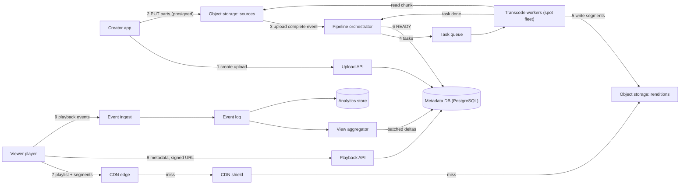
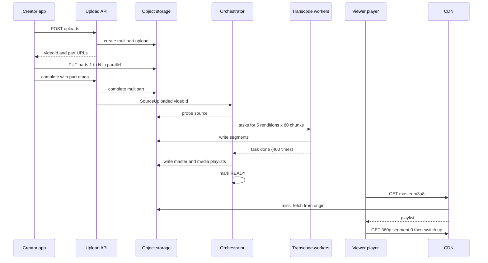

Video is the heaviest thing most people do on the internet. A single 1080p stream moves more data in a minute than a chat app moves for one user in a year. A video platform is therefore two very different systems glued together: a **factory** that turns raw uploads into many streamable versions, and a **delivery network** that pushes terabits per second to phones on patchy 4G. Around them sit the "small" problems that turn out to be hard, like counting views honestly when millions of events arrive every second.

We reason from public standards (HLS, DASH, HTTP caching) and general engineering principles. Nothing here claims to describe how YouTube, Netflix, JioCinema or any other company runs its systems internally.

## Learning objectives

By the end of this case study you will be able to:

1. Estimate upload storage, transcoding compute, CDN egress and segment request rates for a video platform.
2. Design resumable uploads straight to object storage with presigned URLs.
3. Design a parallel transcoding pipeline as a DAG of idempotent tasks, with retries and progress tracking.
4. Explain adaptive bitrate streaming (HLS/DASH), bitrate ladders, segments and playlists, and generate a master playlist in C#.
5. Design CDN delivery with origin shielding, cache keys and signed URLs, and estimate what reaches the origin.
6. Count views at scale with deduplication, batching and reconciliation, and explain why counts are eventually consistent.

## Prerequisites

- [CDN architecture](#/lesson/m11-cdn): edges, shields, hit ratios, signed URLs.
- [Object storage](#/lesson/m11-object-storage): blobs, multipart upload, presigned URLs.
- [Background processing and job queues](#/lesson/m11-background-processing): workers and retries.
- [Message queues](#/lesson/m12-message-queues): producers, consumers and acks.
- [Cost estimation](#/lesson/m11-cost-estimation): egress usually dominates.

## Explain it like I'm a beginner

Think of a big printing press in Sivakasi that receives a hand-drawn poster and must deliver it to shops across India.

- **Upload**: the artist sends the original. It is huge, so it is sent in numbered parcels; if parcel 37 gets lost, only parcel 37 is resent (a **resumable upload**).
- **Transcoding**: the press makes copies in several sizes: postcard, A4, A2, billboard. Each size suits a different wall (screen) and road (network speed). This set of sizes is the **bitrate ladder**. To go faster, the press cuts the poster into strips and gives each strip to a different machine, then joins the results (**parallel chunked transcoding**).
- **Segments and playlists**: each copy is cut into 6-second strips (**segments**). A small index card lists the strips in order (a **media playlist**), and a master card lists the sizes available (the **master playlist**).
- **Adaptive bitrate (ABR)**: the shopkeeper (the video player) watches how fast deliveries are arriving. On a fast road, he orders billboard strips; when the road jams, he switches to postcards for a while, so the show never stops. Switching happens between strips, so it is seamless.
- **CDN**: instead of every shop ordering from Sivakasi, regional warehouses keep popular posters. A blockbuster's strips are in every warehouse; an obscure one is fetched once from the press and kept for a while.
- **View counting**: every shop sends a postcard saying "someone watched". Millions arrive per second, so the press counts in batches on many desks and adds the totals up every few seconds, and an auditor recounts properly overnight.

## Requirements

### Functional

1. Creators upload videos up to 4 hours / 50 GB, resumable over flaky connections.
2. The platform transcodes into multiple resolutions and bitrates, creates thumbnails, and publishes within minutes of upload for typical videos.
3. Viewers stream on web, mobile and TV with adaptive bitrate, seek anywhere, and start playback quickly.
4. View counts, likes and watch history; creators see near-real-time analytics.
5. Private and unlisted videos; region restrictions.

### Non-functional

| Property | Target |
|---|---|
| Time to first frame | p90 < 2 s on a typical 4G connection |
| Rebuffering | Less than 1 % of watch time spent stalled |
| Availability | 99.95 % for playback; uploads may queue |
| Durability | Source files and renditions: no loss (object storage services commonly advertise 11 nines of design durability) |
| Publish latency | 10-minute 1080p video ready in under 10 minutes (p90) |
| View counts | Visible within about 1 minute; exact after daily reconciliation |

### Out of scope

Live streaming (it reuses ABR and the CDN but needs low-latency ingest and packaging), recommendations (see the [news feed](#/lesson/m17-news-feed) for ranking ideas), comments, monetisation and DRM licensing details (we mention where DRM plugs in).

## Capacity estimation

All numbers are **estimates** chosen for clear arithmetic.

### Uploads and storage

- **100,000 uploads/day**, average 8 minutes → 800,000 video-minutes/day ≈ 13,300 hours/day.
- Upload rate: 100,000 ÷ 86,400 ≈ **1.2 uploads/s** average. Tiny as a request rate, heavy as bytes.
- Source size at ~8 Mbit/s (1080p from a phone): 8 Mbit/s ÷ 8 = 1 MB/s × 480 s = **480 MB per upload**. Daily: 100,000 × 480 MB = **48 TB/day of sources**.
- Rendition ladder (240p to 1080p) at 0.4 + 0.8 + 1.4 + 2.8 + 5.0 = **10.4 Mbit/s total** ≈ 1.3 MB/s × 480 s ≈ 624 MB per video → **62 TB/day** of renditions.
- Per year: (48 + 62) × 365 ≈ **40 PB/year** before any replication by the storage service. Sources move to a cold storage tier after 30 days; that is the biggest storage lever.

### Transcoding compute

Software encoding cost depends heavily on codec, preset and hardware. Use a rough planning figure (estimate, measure on your own encoder): **4 CPU-minutes per minute of video per rendition** for H.264 at a balanced preset.

- 800,000 video-minutes × 5 renditions × 4 CPU-min = **16 M CPU-minutes/day**.
- 16 M ÷ 1,440 minutes/day ≈ **11,100 cores busy on average**, with peaks in the evening when creators upload. Plan for ~20,000 cores of burst capacity, mostly cheap interruptible (spot) instances, because transcoding tasks are retryable.
- Adding a newer codec (AV1, HEVC) for the most popular videos only is a classic cost trade-off: much more encode compute, less egress per view.

### Playback

- **200 M DAU**, average 30 minutes watched per day: 6 billion minutes/day.
- Average concurrent viewers = 6 × 10⁹ ÷ 1,440 ≈ **4.2 M**; evening peak ×2.5 ≈ **10 M concurrent streams**.
- Average delivered bitrate ~2.5 Mbit/s (mostly mobile): 10 M × 2.5 Mbit/s = **25 Tbit/s** peak egress.
- Segment requests with 6-second segments: 10 M ÷ 6 s ≈ **1.7 M requests/s** at the CDN edge, plus playlist refreshes.
- What reaches the origin? With a 98 % edge hit ratio: 25 Tbit/s × 0.02 = 500 Gbit/s to the shield tier; if the shield hits 90 % of those, **50 Gbit/s** reaches object storage. The CDN is not an optimisation here; without it the system cannot exist.

### View events

- Views: 200 M DAU × 5 videos = **1 B views/day** ≈ 11,600/s average, ~35,000/s peak.
- Player progress heartbeats every 10 s for 10 M concurrent streams: **1 M events/s** at peak, feeding watch history, analytics and the view-qualification rule.

| Quantity | Estimate |
|---|---|
| New storage | ~110 TB/day (≈ 40 PB/year) |
| Transcoding | ~11,000 cores average, ~20,000 burst |
| Peak egress | ~25 Tbit/s from the CDN |
| Edge requests | ~1.7 M segment requests/s |
| View/progress events | ~1 M/s peak |

**What breaks first?** Egress cost and CDN capacity, the transcoding backlog during upload peaks, and the counter for a viral video receiving tens of thousands of increments per second.

## API design

```http
POST /v1/uploads
{ "title": "Bridge load test, span 4", "sizeBytes": 2147483648, "contentType": "video/mp4" }
201 Created
{ "videoId": "v_8KQ2xY", "uploadId": "u_51c…", "partSizeBytes": 16777216,
  "partUrls": [ { "part": 1, "url": "https://storage…?sig=…" }, … ], "expiresAt": "2026-10-19T14:00:00Z" }

PUT  <partUrl>                          (client uploads each 16 MB part directly to object storage)
POST /v1/uploads/{uploadId}/complete    { "parts": [ { "part": 1, "etag": "\"a1…\"" }, … ] }
GET  /v1/uploads/{uploadId}             -> parts already received (to resume)

GET  /v1/videos/{videoId}               -> metadata, status (PROCESSING | READY | FAILED), playback URL
GET  https://cdn.example.com/v/{videoId}/master.m3u8?exp=…&sig=…   (HLS master playlist)
GET  https://cdn.example.com/v/{videoId}/720p/seg_00042.m4s       (media segment)

POST /v1/videos/{videoId}/playback-events
{ "sessionId": "s_77…", "positionSec": 312, "watchedSec": 30, "renditionKbps": 2800, "stalledMs": 0 }
```

Decisions:

- **Bytes never pass through the API servers.** Clients upload parts straight to object storage with presigned URLs (multipart upload). The API only creates the session and completes it. At 48 TB/day, proxying would need a fleet of servers doing nothing but copying.
- **16 MB parts** make resume cheap: a dropped connection loses at most one part. `GET /v1/uploads/{id}` lists received parts so the client resumes where it stopped.
- **Playback goes to the CDN hostname**, never to the API. Signed URLs (or signed cookies covering the whole `/v/{id}/` prefix) protect private videos while every viewer shares the same cached segments.
- **Playback events are batched by the client** (one request every 10–30 s with several events) to keep request counts sane.

## Data model

```sql
CREATE TABLE video (
  video_id        bigint PRIMARY KEY,
  owner_id        bigint NOT NULL,
  title           text   NOT NULL,
  visibility      text   NOT NULL DEFAULT 'public' CHECK (visibility IN ('public','unlisted','private')),
  status          text   NOT NULL DEFAULT 'UPLOADING'
                  CHECK (status IN ('UPLOADING','PROCESSING','READY','FAILED','REMOVED')),
  source_key      text,                 -- object storage key of the original upload
  source_height   int,
  duration_ms     int,
  created_at      timestamptz NOT NULL DEFAULT now(),
  published_at    timestamptz
);

CREATE TABLE rendition (
  video_id      bigint NOT NULL REFERENCES video,
  name          text   NOT NULL,        -- '720p'
  width         int    NOT NULL,
  height        int    NOT NULL,
  bitrate_kbps  int    NOT NULL,
  codecs        text   NOT NULL,        -- 'avc1.64001f,mp4a.40.2'
  playlist_key  text   NOT NULL,        -- v/{id}/720p/index.m3u8
  PRIMARY KEY (video_id, name)
);

-- One row per unit of work. The unique key makes retries and duplicate messages harmless.
CREATE TABLE transcode_task (
  video_id     bigint NOT NULL REFERENCES video,
  rendition    text   NOT NULL,
  chunk_index  int    NOT NULL,
  status       text   NOT NULL DEFAULT 'PENDING' CHECK (status IN ('PENDING','RUNNING','DONE','FAILED')),
  attempts     int    NOT NULL DEFAULT 0,
  lease_until  timestamptz,
  PRIMARY KEY (video_id, rendition, chunk_index)
);

-- Aggregated counters, updated in batches; raw events live in the analytics store.
CREATE TABLE video_stats (
  video_id    bigint PRIMARY KEY REFERENCES video,
  view_count  bigint NOT NULL DEFAULT 0,
  like_count  bigint NOT NULL DEFAULT 0,
  updated_at  timestamptz NOT NULL DEFAULT now()
);
```

Why this shape:

- **Metadata in PostgreSQL, bytes in object storage.** The database holds tiny rows (a few KB per video). Segments, playlists and sources are objects addressed by key: `v/{videoId}/{rendition}/seg_{n}.m4s`.
- **`transcode_task` is the pipeline's ledger.** Each `(video, rendition, chunk)` is idempotent: rerunning it overwrites the same output object. `lease_until` lets a crashed worker's task be picked up again (a visibility timeout).
- **`video_stats` is separate from `video`** so that frequent counter updates don't bloat or lock the metadata row that every page view reads.
- **Raw view events** (about 1 M/s at peak) do not go into PostgreSQL. They go to a log (Kafka-style) and then to a columnar analytics store. PostgreSQL receives only periodic aggregated deltas.

## High-level architecture



Following the numbered arrows:

1. **Create upload.** The upload API inserts a `video` row (`UPLOADING`) and asks object storage for a multipart upload with presigned part URLs.
2. **Upload parts.** The creator's app sends 16 MB parts directly to storage, in parallel, retrying any part that fails.
3. **Upload complete event.** When the multipart upload completes, storage emits an event (or the API does on `complete`), and the orchestrator takes over.
4. **Tasks.** The orchestrator probes the source (duration, resolution, codec), plans the ladder, splits the work into chunks, writes `transcode_task` rows, and enqueues them.
5. **Transcode workers** read their chunk's byte range, encode one rendition, and write segments to the renditions bucket. Workers are stateless and preemptible.
6. **Publish.** When every task of a video is done, the orchestrator writes the playlists, marks the video `READY`, and optionally pre-warms the CDN for a big channel's premiere.
7. **Playback** goes to the CDN edge; misses go to the shield, then to object storage. Our servers are not on this path.
8. **Playback API** returns metadata and a signed playback URL after checking visibility and region rules.
9. **Events** flow to an ingest tier, a durable log, a streaming aggregator for near-real-time counts, and an analytics store for creators' reports and the daily reconciliation.

### Sequence: upload to first playback



The orchestrator is the only component that knows "this video is done". Workers just do tasks and report. The player starts with a modest rendition so the first frame arrives quickly, then climbs the ladder as it measures bandwidth.

## Deep dives

### 1. The bitrate ladder

A **bitrate ladder** is the list of renditions you produce. Each rung is a resolution plus a target bitrate. The planner never upscales: a 720p phone video gets 240p to 720p, not a fake 1080p.

| Rung | Resolution | Video bitrate (kbit/s, example) | H.264 codecs string |
|---|---|---|---|
| 240p | 426 × 240 | 400 | `avc1.64001f` |
| 360p | 640 × 360 | 800 | `avc1.64001f` |
| 480p | 854 × 480 | 1,400 | `avc1.64001f` |
| 720p | 1280 × 720 | 2,800 | `avc1.64001f` |
| 1080p | 1920 × 1080 | 5,000 | `avc1.640028` |
| 2160p | 3840 × 2160 | 16,000 | `avc1.640033` |

The bitrates are illustrative starting points, not recommendations for every content type. A static lecture slide video looks fine at a fraction of these; a fast cricket match needs more. **Per-title (content-aware) encoding** analyses each video's complexity and picks bitrates per title, which can save a lot of egress for simple content.

```csharp file=Video/Models.cs
namespace VideoApp.Video;

public enum VideoStatus { Uploading, Processing, Ready, Failed }

public sealed record Rung(string Name, int Width, int Height, int VideoKbps, string VideoCodec);

public sealed record VideoAsset(long VideoId, string Title, VideoStatus Status, int SourceHeight,
    TimeSpan Duration, IReadOnlyList<Rung> Renditions);

public sealed record TranscodeTask(long VideoId, string Rendition, int ChunkIndex);

public sealed record CreateUploadRequest(string Title, long SizeBytes);

public sealed record CompleteUploadRequest(int SourceHeight, double DurationSeconds);

public sealed record PlaybackEvent(string SessionId, int WatchedSeconds);
```

```csharp file=Video/LadderPlanner.cs
namespace VideoApp.Video;

public sealed class LadderPlanner
{
    public const int AudioKbps = 128;

    private static readonly Rung[] Standard =
    [
        new("240p", 426, 240, 400, "avc1.64001f"),
        new("360p", 640, 360, 800, "avc1.64001f"),
        new("480p", 854, 480, 1_400, "avc1.64001f"),
        new("720p", 1280, 720, 2_800, "avc1.64001f"),
        new("1080p", 1920, 1080, 5_000, "avc1.640028"),
        new("2160p", 3840, 2160, 16_000, "avc1.640033"),
    ];

    /// <summary>Every standard rung at or below the source height; never upscale, but always return at least one rung.</summary>
    public IReadOnlyList<Rung> Plan(int sourceHeight)
    {
        var rungs = Standard.Where(r => r.Height <= sourceHeight).ToList();
        return rungs.Count > 0 ? rungs : [Standard[0]];
    }
}
```

### 2. Segments, playlists, HLS and DASH

Adaptive streaming works over plain HTTP. Each rendition is cut into short **segments** (commonly 2 to 6 seconds; 6 s here), each starting with a keyframe so the player can switch renditions at any segment boundary. Two widely used standards describe the playlists:

- **HLS** (HTTP Live Streaming, RFC 8216): text playlists (`.m3u8`). A master playlist lists variants; each media playlist lists segments.
- **MPEG-DASH**: an XML manifest (`.mpd`) with the same concepts (adaptation sets, representations, segments).
- **CMAF** (fragmented MP4 segments) lets one set of segment files serve both HLS and DASH, halving storage and doubling CDN cache efficiency compared with packaging twice.

Segment length is a trade-off. Shorter segments let the player react faster and start sooner, but mean more requests (1.7 M/s at 6 s would be 5 M/s at 2 s) and slightly worse compression.

```csharp file=Video/HlsPlaylistWriter.cs
using System.Globalization;
using System.Text;

namespace VideoApp.Video;

public static class HlsPlaylistWriter
{
    /// <summary>Master playlist: one EXT-X-STREAM-INF per rendition, lowest bandwidth first.</summary>
    public static string Master(IEnumerable<Rung> renditions)
    {
        var sb = new StringBuilder();
        sb.Append("#EXTM3U\n#EXT-X-VERSION:7\n#EXT-X-INDEPENDENT-SEGMENTS\n");
        foreach (var r in renditions.OrderBy(r => r.VideoKbps))
        {
            var bandwidth = (r.VideoKbps + LadderPlanner.AudioKbps) * 1000;
            sb.Append(CultureInfo.InvariantCulture,
                $"#EXT-X-STREAM-INF:BANDWIDTH={bandwidth},RESOLUTION={r.Width}x{r.Height},CODECS=\"{r.VideoCodec},mp4a.40.2\"\n");
            sb.Append(r.Name).Append("/index.m3u8\n");
        }
        return sb.ToString();
    }

    /// <summary>Video-on-demand media playlist for one rendition.</summary>
    public static string Media(TimeSpan duration, TimeSpan segmentLength)
    {
        var sb = new StringBuilder();
        var target = (int)Math.Ceiling(segmentLength.TotalSeconds);
        sb.Append(CultureInfo.InvariantCulture,
            $"#EXTM3U\n#EXT-X-VERSION:7\n#EXT-X-TARGETDURATION:{target}\n#EXT-X-PLAYLIST-TYPE:VOD\n#EXT-X-MEDIA-SEQUENCE:0\n#EXT-X-MAP:URI=\"init.mp4\"\n");
        var remaining = duration;
        for (var i = 0; remaining > TimeSpan.Zero; i++)
        {
            var length = remaining < segmentLength ? remaining : segmentLength;
            sb.Append(CultureInfo.InvariantCulture, $"#EXTINF:{length.TotalSeconds:0.000},\nseg_{i:00000}.m4s\n");
            remaining -= length;
        }
        sb.Append("#EXT-X-ENDLIST\n");
        return sb.ToString();
    }
}
```

### 3. The transcoding pipeline as a DAG

Encoding a 2-hour film on one machine might take hours. Splitting it into chunks (for example 10-second chunks aligned to keyframes) and encoding each chunk and rendition as a separate task lets hundreds of workers finish it in minutes. The pipeline is a **directed acyclic graph (DAG)**:

```text
probe -> plan ladder -> split into chunks
      -> [transcode chunk i, rendition r]  (chunks x rungs tasks, in parallel)
      -> package per rendition (concatenate, CMAF segments, playlists)
      -> thumbnails, captions (speech-to-text), content safety checks  (in parallel)
      -> publish (playlists, READY, CDN pre-warm for big channels)
```

Rules that keep it reliable:

- **Every task is idempotent.** Output keys are deterministic (`v/{id}/{rendition}/chunk_{i}.mp4`), so a retry overwrites the same object. Duplicate queue messages are harmless.
- **Leases, not locks.** A worker claims a task with `UPDATE … SET status='RUNNING', lease_until = now() + interval '5 minutes' WHERE … AND (status='PENDING' OR lease_until < now())`. If a spot instance is reclaimed, the lease expires and another worker picks it up.
- **Bounded retries, then fail loudly.** After, say, 3 attempts a task goes to a dead-letter queue and the video is marked `FAILED` with a reason the creator can see ("unsupported codec"). See [retries and DLQs](#/lesson/m12-retries-dlq).
- **Priorities.** A big creator's premiere or a short video should not wait behind a backlog of 4-hour uploads. Separate queues by priority or by estimated work.
- **Publish early.** Mark the video playable when the low rungs (240p–480p) are done, and add higher rungs as they finish. Viewers get something in a minute instead of waiting for 4K.
- **A workflow engine** ([workflow engines](#/lesson/m16-workflow-engines)) is a good fit for the orchestrator: durable state, retries and timeouts per step, and visibility into stuck videos.

```csharp file=Video/TranscodePipeline.cs
using System.Collections.Concurrent;
using System.Threading.Channels;
using Microsoft.Extensions.Hosting;
using Microsoft.Extensions.Logging;

namespace VideoApp.Video;

public sealed class TranscodePlanner(LadderPlanner ladder)
{
    public IReadOnlyList<TranscodeTask> Plan(long videoId, int sourceHeight, TimeSpan duration, TimeSpan chunkLength)
    {
        var chunks = (int)Math.Ceiling(duration / chunkLength);
        return ladder.Plan(sourceHeight)
            .SelectMany(r => Enumerable.Range(0, chunks).Select(i => new TranscodeTask(videoId, r.Name, i)))
            .ToList();
    }
}

/// <summary>Tracks which tasks of each video are done. Completing a task twice is harmless.</summary>
public sealed class TranscodeProgress
{
    private readonly ConcurrentDictionary<long, (HashSet<TranscodeTask> Pending, Lock Gate)> _videos = new();

    public void Register(long videoId, IEnumerable<TranscodeTask> tasks) =>
        _videos[videoId] = (new HashSet<TranscodeTask>(tasks), new Lock());

    /// <summary>Returns true exactly once: when the last pending task of the video completes.</summary>
    public bool Complete(TranscodeTask task)
    {
        if (!_videos.TryGetValue(task.VideoId, out var v)) return false;
        lock (v.Gate) return v.Pending.Remove(task) && v.Pending.Count == 0;
    }
}

public sealed class TranscodeQueue
{
    private readonly Channel<TranscodeTask> _channel = Channel.CreateUnbounded<TranscodeTask>();
    public ValueTask EnqueueAsync(TranscodeTask task, CancellationToken ct) => _channel.Writer.WriteAsync(task, ct);
    public ChannelReader<TranscodeTask> Reader => _channel.Reader;
}

public interface IVideoCatalog
{
    VideoAsset Create(string title);
    VideoAsset? Get(long videoId);
    void Update(VideoAsset asset);
}

public sealed class InMemoryVideoCatalog : IVideoCatalog
{
    private readonly ConcurrentDictionary<long, VideoAsset> _videos = new();
    private long _nextId = 1000;

    public VideoAsset Create(string title)
    {
        var asset = new VideoAsset(Interlocked.Increment(ref _nextId), title, VideoStatus.Uploading, 0, TimeSpan.Zero, []);
        _videos[asset.VideoId] = asset;
        return asset;
    }

    public VideoAsset? Get(long videoId) => _videos.TryGetValue(videoId, out var v) ? v : null;
    public void Update(VideoAsset asset) => _videos[asset.VideoId] = asset;
}

/// <summary>Simulated worker: real ones shell out to an encoder and write segments to object storage.</summary>
public sealed class TranscodeWorker(
    TranscodeQueue queue, TranscodeProgress progress, IVideoCatalog catalog,
    LadderPlanner ladder, ILogger<TranscodeWorker> logger) : BackgroundService
{
    protected override async Task ExecuteAsync(CancellationToken stoppingToken)
    {
        await foreach (var task in queue.Reader.ReadAllAsync(stoppingToken))
        {
            // encode(task) would run here, writing v/{id}/{rendition}/chunk_{i}.mp4 (idempotent key).
            if (!progress.Complete(task)) continue;

            var video = catalog.Get(task.VideoId);
            if (video is null) continue;
            catalog.Update(video with { Status = VideoStatus.Ready, Renditions = ladder.Plan(video.SourceHeight) });
            logger.LogInformation("Video {VideoId} is READY", task.VideoId);
        }
    }
}
```

### 4. Adaptive bitrate on the player

The server publishes options; the **player** decides. Every few seconds it estimates throughput (bytes of the last segments ÷ download time) and looks at its **buffer** (seconds of video downloaded but not yet played). Common strategies:

- **Throughput-based**: pick the highest rung whose bitrate is below, say, 80 % of measured throughput. Reacts fast, but measurements on mobile are noisy.
- **Buffer-based**: if the buffer is low, drop down; if it is full, step up. Stable, but slow to start.
- **Hybrids** combine both, step up one rung at a time, and drop down immediately. Exercise 4 builds one.

Start-up is its own trade-off: begin at a low rung so the first frame is fast, then climb. Players often also cap the rung at the screen size: a phone with a 720-pixel-high viewport gains nothing from 1080p.

### 5. CDN delivery

Everything a player requests (playlists, init segments, media segments) is a cacheable static object, which is why ABR scales.

- **Long TTLs for segments.** Segment URLs for a given encoding never change: `Cache-Control: public, max-age=31536000, immutable`. If you re-encode, write to a new path version (`v/{id}/r2/720p/…`).
- **Short TTL for anything that can change.** VOD master playlists can be long-lived too, but if you add rungs progressively, give them a short TTL (60 s) until the video is fully processed.
- **Origin shield.** With hundreds of edges, a new video's first segments would be fetched from storage hundreds of times. A shield tier collapses those into one origin fetch per region. The capacity maths above shows the shield cutting origin traffic from 500 Gbit/s to 50 Gbit/s.
- **Cache key hygiene.** Strip signature query parameters from the cache key after validating them; otherwise each viewer's unique signature creates a separate cache entry and the hit ratio collapses.
- **The long tail.** Most views go to a small share of videos, which stay hot at every edge. Old, rarely watched videos miss at the edge and are served from the shield or storage. That is fine: they are few requests, and a slightly slower start for a 2014 lecture is acceptable.
- **Pre-positioning.** For predictable spikes (a scheduled premiere, a match highlight), push the first segments of every rung to edges in advance.
- **Multi-CDN.** Very large platforms spread traffic across several CDNs (and ISP-hosted caches) for capacity, cost and resilience, steered by DNS or by the player based on measured performance.

### 6. Counting views honestly

"Number of views" sounds like `UPDATE … SET views = views + 1`. At 35,000 views/s that single-row update would be a lock queue on a viral video's row, and it would count bots and refreshes too. A view counter needs four layers:

1. **A rule for what counts.** For example, "a session watched at least 30 seconds (or the whole video if shorter)". The rule is product policy; pick it, document it, and apply it consistently.
2. **Deduplication.** One view per viewer (user id or device id) per video per time window (say 1 hour). In production, a Redis `SET view:{video}:{viewer} 1 NX EX 3600` returns whether this is a new view.
3. **Aggregation in memory, flush in batches.** Each ingest node increments local counters and flushes deltas every few seconds: `UPDATE video_stats SET view_count = view_count + $delta`. A viral video then costs one database write per node per flush interval instead of 35,000 per second.
4. **Reconciliation.** Raw events go to the analytics store. A daily batch job recomputes exact counts with full bot filtering and corrects `video_stats`. The real-time number is a fast estimate; the reconciled number is the truth.

```csharp file=Video/ViewCounter.cs
using System.Collections.Concurrent;

namespace VideoApp.Video;

public sealed class ViewCountingOptions
{
    public int MinWatchSeconds { get; set; } = 30;
    public TimeSpan DedupeWindow { get; set; } = TimeSpan.FromHours(1);
    public TimeSpan FlushInterval { get; set; } = TimeSpan.FromSeconds(5);
}

/// <summary>Per-node view counter: qualify, dedupe, accumulate deltas, drain for a batched flush.</summary>
public sealed class ViewCounter(TimeProvider clock, ViewCountingOptions options)
{
    private readonly ConcurrentDictionary<long, long> _pending = new();
    private readonly Dictionary<(long Video, string Viewer), DateTimeOffset> _lastCounted = new();
    private readonly Lock _dedupeGate = new();

    /// <summary>Returns true if this event counted as a new view.</summary>
    public bool TryRecord(long videoId, string viewerKey, int watchedSeconds, int videoSeconds)
    {
        var needed = Math.Min(options.MinWatchSeconds, Math.Max(1, videoSeconds));
        if (watchedSeconds < needed) return false;

        var now = clock.GetUtcNow();
        lock (_dedupeGate)   // stand-in for Redis SET key 1 NX EX 3600
        {
            if (_lastCounted.TryGetValue((videoId, viewerKey), out var last) && now - last < options.DedupeWindow)
                return false;
            _lastCounted[(videoId, viewerKey)] = now;
        }
        _pending.AddOrUpdate(videoId, 1, (_, n) => n + 1);
        return true;
    }

    /// <summary>Removes and returns accumulated deltas. Increments that race with a drain stay for the next one.</summary>
    public IReadOnlyDictionary<long, long> Drain()
    {
        var deltas = new Dictionary<long, long>();
        foreach (var videoId in _pending.Keys)
            if (_pending.TryRemove(videoId, out var delta)) deltas[videoId] = delta;
        return deltas;
    }

    /// <summary>Puts deltas back after a failed flush, so no views are lost.</summary>
    public void Restore(IReadOnlyDictionary<long, long> deltas)
    {
        foreach (var (videoId, delta) in deltas) _pending.AddOrUpdate(videoId, delta, (_, n) => n + delta);
    }
}

public interface IViewStatsStore
{
    Task AddAsync(IReadOnlyDictionary<long, long> deltas, CancellationToken ct);
    long Get(long videoId);
}

/// <summary>Stand-in for batched UPDATE video_stats SET view_count = view_count + delta.</summary>
public sealed class InMemoryViewStatsStore : IViewStatsStore
{
    private readonly ConcurrentDictionary<long, long> _counts = new();

    public Task AddAsync(IReadOnlyDictionary<long, long> deltas, CancellationToken ct)
    {
        foreach (var (videoId, delta) in deltas) _counts.AddOrUpdate(videoId, delta, (_, n) => n + delta);
        return Task.CompletedTask;
    }

    public long Get(long videoId) => _counts.TryGetValue(videoId, out var n) ? n : 0;
}
```

```csharp file=Video/ViewFlushService.cs
using Microsoft.Extensions.Hosting;
using Microsoft.Extensions.Logging;

namespace VideoApp.Video;

public sealed class ViewFlushService(
    ViewCounter counter, IViewStatsStore store, ViewCountingOptions options,
    TimeProvider clock, ILogger<ViewFlushService> logger) : BackgroundService
{
    protected override async Task ExecuteAsync(CancellationToken stoppingToken)
    {
        using var timer = new PeriodicTimer(options.FlushInterval, clock);
        while (await timer.WaitForNextTickAsync(stoppingToken))
            await FlushOnceAsync(stoppingToken);
    }

    public async Task FlushOnceAsync(CancellationToken ct)
    {
        var deltas = counter.Drain();
        if (deltas.Count == 0) return;
        try
        {
            await store.AddAsync(deltas, ct);
        }
        catch (Exception ex) when (ex is not OperationCanceledException)
        {
            counter.Restore(deltas);   // retry on the next tick
            logger.LogWarning(ex, "View flush failed for {Count} videos; will retry", deltas.Count);
        }
    }
}
```

Note the honest limitation: if a node crashes between `Drain` and a successful flush, those few seconds of deltas are lost from the real-time number. The daily reconciliation from raw events fixes it. That is a deliberate trade: perfect real-time accuracy would need a durable write per view.

## Caching, queues and scaling

**Caching.**

- **CDN** for all playback bytes (the dominant cache by far), with a shield tier.
- **Metadata cache** (Redis or in-process) for `video:{id}` objects read by every watch page and playback API call. Invalidate on status or visibility change.
- **Counters cache**: the displayed view count can be cached for 30–60 s; nobody notices.
- **Signed URL issuance** is cheap HMAC work, done per playback session, not per segment (sign a path prefix or use a signed cookie).

**Queues.**

- **Task queue** for transcoding, with priorities and a DLQ. Message volume is modest (hundreds of tasks per video); each task is minutes of CPU.
- **Event log** for playback events, partitioned by video id for the counter aggregator (so one video's increments are aggregated in one place) or by session id for watch history.

**Scaling each part.**

| Part | Scales by | Watch out for |
|---|---|---|
| Upload API | Stateless replicas (it never touches bytes) | Presigned URL expiry for slow uploads |
| Object storage | Managed service | Request-rate limits per key prefix in some services; spread keys |
| Transcode fleet | Queue depth → autoscale spot instances | Spot reclamation; long tasks; codec bugs on odd files |
| CDN | Provider capacity, multi-CDN | Cost; cache key mistakes; cold starts for viral new videos |
| Playback API | Stateless + metadata cache | Hot metadata keys for viral videos (L1 cache) |
| Event ingest | Stateless, batching | 1 M events/s; client batching is the first lever |
| Counter aggregation | Partitions of the event log | Hot partition for one viral video; pre-aggregate on ingest nodes |

## Failure handling

| Failure | Effect | Mitigation |
|---|---|---|
| Upload connection drops | Partial upload | Resume from the list of received parts; abort incomplete multipart uploads after 7 days |
| Transcode worker reclaimed (spot) | Task stops mid-way | Lease expires, task retried; idempotent output key |
| Poison video (corrupt or exotic codec) | Task fails repeatedly | 3 attempts, then DLQ and `FAILED` with a creator-visible reason |
| Orchestrator restarts | Pipeline state lost? | No: state lives in `transcode_task` rows (or the workflow engine) |
| Encoder bug ships | Bad renditions | Canary new encoder versions on a small share of uploads; keep sources so you can re-encode |
| CDN PoP outage | Viewers in one region stall | CDN reroutes to other PoPs; multi-CDN steering for large outages |
| Origin storage slow | Edge misses time out | Shield absorbs; stale-if-error on playlists; retries in the player |
| Viral video spike | Counter hot key | Per-node aggregation and batched flush |
| Counter flush fails | Real-time count lags | Restore deltas and retry; daily reconciliation corrects any loss |
| Player on a congested network | Rebuffering | ABR drops to a lower rung; buffer target of 20–30 s on VOD |

:::callout type=tradeoff title="Exact counts versus cheap counts"
A per-view durable database write gives an exact, immediate count, and costs 35,000 writes/s plus hot-row contention for viral videos. Batched in-memory aggregation costs almost nothing but can lose a few seconds of increments in a crash, repaired by nightly reconciliation. For a public view counter the second is the right trade; for billing (pay-per-view, ad impressions) you would count from the durable event log.
:::

## Security

- **Upload safety.** Presigned URLs are scoped to one object key, one method and a short expiry. Validate file type by probing the content, not by trusting the extension. Run decoders in sandboxed, unprivileged containers: media parsers are a classic attack surface.
- **Content safety and copyright.** Automated classifiers and fingerprint matching against reference content run as pipeline steps before or soon after publishing; flagged videos are held or restricted.
- **Access control.** Private and unlisted videos use signed URLs or cookies with short lifetimes; the playback API checks visibility and region rules before signing. Unlisted means "unguessable id", so ids must be random, not sequential.
- **DRM** for premium content (Widevine, FairPlay, PlayReady) encrypts segments with keys served by a licence server after entitlement checks. Segments stay cacheable because they are the same encrypted bytes for every viewer.
- **Abuse of counters.** View bots: dedupe, rate limits per IP and device, anomaly detection in the reconciliation job, and never counting events without a valid playback session.
- **Creator accounts.** Strong authentication with MFA for big channels; account takeover is a real threat because a hijacked channel can push scams to millions.

## Observability

Viewers feel **quality of experience (QoE)**, so measure it from the player:

- **Time to first frame** (p50, p90) by region, device and network type.
- **Rebuffering ratio**: stalled time ÷ watch time. A rise in one ISP's users points at a CDN or peering problem.
- **Average delivered bitrate** and rung switches per minute (too many switches is a bad ABR experience).
- **Playback failure rate** by error code.

And the factory and delivery metrics:

- **Publish latency**: upload complete → READY (p50, p90) and **backlog** of pending tasks by priority.
- **Task failure rate** and DLQ size by error type (a sudden spike usually means a bad encoder release or a new phone's file format).
- **CDN hit ratio** at edge and shield, origin egress, 4xx/5xx at the edge.
- **Event ingest lag** and counter flush failures.

## Deployment and cost

**Deployment.** Stateless services roll out with canaries. The transcoder is special: a new encoder version or setting changes output quality and size, so roll it out to a small percentage of uploads, compare objective quality metrics (for example VMAF) and file sizes, then expand. Keep source files so you can re-encode if a bad version shipped. Players are updated through app releases and must handle older and newer playlist features.

**Cost drivers** (relative, not quotes):

1. **CDN egress**: 25 Tbit/s at peak is by far the largest bill. Levers: better codecs for popular videos (more encode compute, fewer bytes per view), per-title encoding, capping rungs to screen size, ISP-hosted caches, multi-CDN price negotiation.
2. **Storage**: ~40 PB/year growth. Levers: cold tier for sources after 30 days, deleting renditions nobody watches and re-encoding them on demand, not storing both HLS and DASH copies (use CMAF).
3. **Transcoding compute**: ~11,000 cores average. Levers: spot instances, hardware encoders (GPU/ASIC), encoding high rungs only for videos that get views.
4. **Event pipeline and analytics**: 1 M events/s. Levers: client batching, sampling for non-billing analytics.

### When a simpler design is enough

An e-learning portal with 2,000 recorded lectures and 20,000 students, or a company storing drone survey videos of construction sites, doesn't need a custom pipeline. Use a managed video service, or a managed encoding job per upload writing HLS to object storage, behind a standard CDN with signed URLs. Run the encode with a single queue and a few workers; count views with a simple `INSERT` into an events table and a nightly aggregate. 20,000 students watching 1 hour a day at 1.5 Mbit/s is under 1,000 concurrent streams at peak (estimate), which any CDN handles without special engineering.

## Alternatives and trade-offs

| Decision | Choice here | Alternative | When the alternative wins |
|---|---|---|---|
| Packaging | CMAF segments for HLS and DASH | Separate TS (HLS) and MP4 (DASH) | Supporting very old devices |
| Segment length | 6 s | 2 s | Lower latency and faster switching matter more than request count (live) |
| Encoding | Fixed ladder | Per-title / per-shot encoding | Large catalogues where egress dominates cost |
| Codec | H.264 for all | AV1/HEVC for popular titles | Popular content where egress savings outweigh encode cost and device support allows |
| Transcode timing | Eager, all rungs | Lazy: high rungs on first demand | Huge catalogues with long tails of unwatched uploads |
| Orchestration | Task table + queue | Workflow engine | Many steps, human review, complex retries |
| View counting | Aggregated, eventually consistent | Durable per-event counting | Billing and payouts |
| Delivery | Single CDN | Multi-CDN + ISP caches | Very large scale, regional cost and resilience |
| Build vs buy | Custom pipeline | Managed video platform service | Most companies below very large scale |

The heart of the design: **do the expensive work once in the factory (encode every rung, cut into immutable segments) so that delivery becomes the simplest possible thing, serving static files from caches near viewers.**

```csharp file=Program.cs
using VideoApp.Video;

var builder = WebApplication.CreateBuilder(args);
builder.Services.AddSingleton(TimeProvider.System);
builder.Services.AddSingleton(new ViewCountingOptions());
builder.Services.AddSingleton<LadderPlanner>();
builder.Services.AddSingleton<TranscodePlanner>();
builder.Services.AddSingleton<TranscodeProgress>();
builder.Services.AddSingleton<TranscodeQueue>();
builder.Services.AddSingleton<IVideoCatalog, InMemoryVideoCatalog>();
builder.Services.AddSingleton<ViewCounter>();
builder.Services.AddSingleton<IViewStatsStore, InMemoryViewStatsStore>();
builder.Services.AddHostedService<TranscodeWorker>();
builder.Services.AddHostedService<ViewFlushService>();

var app = builder.Build();

app.MapPost("/v1/uploads", (CreateUploadRequest body, IVideoCatalog catalog) =>
{
    var video = catalog.Create(body.Title);
    // Real code asks object storage for a multipart upload and presigned part URLs.
    var partUrl = $"https://storage.example.com/sources/{video.VideoId}?part=1&sig=demo";
    return Results.Created($"/v1/videos/{video.VideoId}", new { video.VideoId, partUrls = new[] { partUrl } });
});

app.MapPost("/v1/uploads/{videoId:long}/complete", async (long videoId, CompleteUploadRequest body,
    IVideoCatalog catalog, TranscodePlanner planner, TranscodeProgress progress, TranscodeQueue queue, CancellationToken ct) =>
{
    var video = catalog.Get(videoId);
    if (video is null) return Results.NotFound();

    var duration = TimeSpan.FromSeconds(body.DurationSeconds);
    catalog.Update(video with { Status = VideoStatus.Processing, SourceHeight = body.SourceHeight, Duration = duration });
    var tasks = planner.Plan(videoId, body.SourceHeight, duration, TimeSpan.FromSeconds(10));
    progress.Register(videoId, tasks);
    foreach (var task in tasks) await queue.EnqueueAsync(task, ct);
    return Results.Accepted($"/v1/videos/{videoId}", new { tasks = tasks.Count });
});

// Served from object storage via the CDN in production; generated here for the demo.
app.MapGet("/v1/videos/{videoId:long}/master.m3u8", (long videoId, IVideoCatalog catalog) =>
    catalog.Get(videoId) is { Status: VideoStatus.Ready } video
        ? Results.Text(HlsPlaylistWriter.Master(video.Renditions), "application/vnd.apple.mpegurl")
        : Results.NotFound());

app.MapPost("/v1/videos/{videoId:long}/playback-events", (long videoId, PlaybackEvent body,
    IVideoCatalog catalog, ViewCounter counter) =>
{
    var video = catalog.Get(videoId);
    if (video is null) return Results.NotFound();
    var counted = counter.TryRecord(videoId, body.SessionId, body.WatchedSeconds, (int)video.Duration.TotalSeconds);
    return Results.Accepted(value: new { counted });
});

app.MapGet("/v1/videos/{videoId:long}/stats", (long videoId, IViewStatsStore stats) =>
    Results.Ok(new { videoId, views = stats.Get(videoId) }));

app.Run();
```

## Practical playground

The starting graph is a naive platform: uploads and playback both go through the app servers, which transcode in-process and stream files from a single disk-backed store. Open it in the HLD canvas.

1. Move uploads to `object-storage` with presigned URLs. Which edge disappears from the app servers?
2. Add a `queue` and a `worker` fleet for transcoding. Which edges are async?
3. Put a `cdn` in front of playback with a shield. At 25 Tbit/s and a 98 % edge hit ratio, what reaches the origin?
4. Add a `stream` for playback events and a `worker` that aggregates views into the database.

:::playground type=hld title="From a single video server to a streaming platform"
```json
{
  "nodes": [
    { "id": "c", "type": "client", "label": "Viewers and creators", "props": { "rps": 1700000 } },
    { "id": "lb", "type": "load-balancer", "label": "Load balancer" },
    { "id": "app", "type": "app-server", "label": "App (uploads, transcodes, streams)", "props": { "instances": 20 } },
    { "id": "db", "type": "database", "label": "PostgreSQL (metadata + views)", "props": { "replicas": 1 } },
    { "id": "files", "type": "object-storage", "label": "Video files" }
  ],
  "edges": [
    { "from": "c", "to": "lb", "kind": "sync" },
    { "from": "lb", "to": "app", "kind": "sync", "label": "upload + segments" },
    { "from": "app", "to": "db", "kind": "sync", "label": "UPDATE views + 1" },
    { "from": "app", "to": "files", "kind": "sync" }
  ]
}
```
:::

## Exercises

:::exercise id=m17-video-streaming-ex1 difficulty=beginner kind=written title="Egress for an IPL highlights app"
A sports app expects 6 M concurrent viewers during the last over of a big match. The audience mix is 70 % mobile at an average 1.5 Mbit/s, 20 % web at 3 Mbit/s and 10 % smart TVs at 6 Mbit/s. Segments are 4 seconds long.

1. Compute peak egress in Tbit/s.
2. Compute segment requests per second at the CDN.
3. With a 97 % edge hit ratio and a shield that absorbs 90 % of edge misses, compute the traffic reaching origin storage.
4. Estimate the data transferred in GB during a 20-minute peak, and name two levers to cut it.
::acceptance
- Weighted average bitrate shown before multiplying.
- Units converted correctly (Mbit/s to Tbit/s, bits to bytes).
- Origin traffic uses both the edge and shield ratios.
- Names two realistic levers (not "add more servers").
::hint
Weighted bitrate = Σ share × bitrate.
::hint
Egress = viewers × weighted bitrate. 1 Tbit/s = 10⁶ Mbit/s.
::hint
Requests/s = viewers ÷ segment length (one segment per viewer every 4 s).
::hint
Origin = egress × (1 − 0.97) × (1 − 0.90). For GB: bits/s × seconds ÷ 8 ÷ 10⁹.
::solution
1. Weighted bitrate = 0.7 × 1.5 + 0.2 × 3 + 0.1 × 6 = 1.05 + 0.6 + 0.6 = **2.25 Mbit/s**. Egress = 6 M × 2.25 Mbit/s = 13.5 M Mbit/s = **13.5 Tbit/s**.
2. 6 M ÷ 4 s = **1.5 M segment requests/s** (plus playlist requests, small for VOD).
3. To the shield: 13.5 × 0.03 = 0.405 Tbit/s. To origin: 0.405 × 0.10 ≈ **40 Gbit/s**.
4. 13.5 × 10¹² bit/s × 1,200 s ÷ 8 ≈ 2.0 × 10¹⁵ bytes ≈ **2,000,000 GB** (about 2 PB) in 20 minutes.

Levers: cap mobile renditions to the viewport (many phones don't need 1080p), use a more efficient codec for this high-demand content where devices support it, tune the ladder per title (a static scoreboard overlay compresses well), and use ISP-embedded caches or multi-CDN pricing for the event.
::mistakes
- Using the highest bitrate for everyone.
- Forgetting to divide by 8 when converting bits to bytes.
- Applying only the edge hit ratio and overstating origin load by 10×.
:::

:::exercise id=m17-video-streaming-ex2 difficulty=beginner kind=sql ordered=true title="Count qualified, deduplicated views"
Raw playback sessions are in `playback_session`. A **view** is a session that watched at least 30 seconds, **or** at least the whole video if it is shorter than 30 seconds. Count at most one view per `(viewer_id, video_id)` per day. Return `video_id`, `title`, `view_day` and `views` for `2026-10-18`, ordered by `views` descending, then `video_id` ascending.
::setup
```sql
CREATE TABLE video (
  video_id    bigint PRIMARY KEY,
  title       text   NOT NULL,
  duration_s  int    NOT NULL
);
CREATE TABLE playback_session (
  session_id  text   PRIMARY KEY,
  video_id    bigint NOT NULL REFERENCES video,
  viewer_id   text   NOT NULL,
  started_at  timestamptz NOT NULL,
  watched_s   int    NOT NULL
);
INSERT INTO video VALUES (1, 'Span 4 load test', 600), (2, 'Site safety brief', 20), (3, 'Drone flyover', 300);
INSERT INTO playback_session VALUES
  ('s1', 1, 'u1', '2026-10-18 08:00+00', 45),
  ('s2', 1, 'u1', '2026-10-18 09:00+00', 120),
  ('s3', 1, 'u2', '2026-10-18 10:00+00', 12),
  ('s4', 1, 'u3', '2026-10-18 11:00+00', 31),
  ('s5', 2, 'u1', '2026-10-18 08:30+00', 20),
  ('s6', 2, 'u2', '2026-10-18 08:31+00', 19),
  ('s7', 3, 'u4', '2026-10-18 12:00+00', 300),
  ('s8', 3, 'u5', '2026-10-18 13:00+00', 30),
  ('s9', 3, 'u6', '2026-10-18 14:00+00', 29),
  ('s10', 1, 'u4', '2026-10-17 23:59+00', 600);
```
::check
```sql
SELECT v.video_id, v.title, DATE(s.started_at AT TIME ZONE 'UTC') AS view_day,
       COUNT(DISTINCT s.viewer_id) AS views
FROM playback_session s
JOIN video v ON v.video_id = s.video_id
WHERE s.watched_s >= LEAST(30, v.duration_s)
  AND s.started_at >= TIMESTAMPTZ '2026-10-18 00:00+00'
  AND s.started_at <  TIMESTAMPTZ '2026-10-19 00:00+00'
GROUP BY v.video_id, v.title, DATE(s.started_at AT TIME ZONE 'UTC')
ORDER BY views DESC, v.video_id;
```
::acceptance
- Video 1 has 2 views (u1 counted once, u3), video 3 has 2 (u4, u5), video 2 has 1 (u1).
- u2's 12-second session on video 1 and u6's 29-second session don't count.
- u1's 20-second session counts for the 20-second video 2.
- The session from 2026-10-17 is excluded.
::hint
The qualification threshold depends on the video's duration. Which function picks the smaller of two values?
::hint
`LEAST(30, v.duration_s)` gives the required seconds for each video.
::hint
One view per viewer per video per day is `COUNT(DISTINCT viewer_id)` after grouping by video and day.
::hint
Filter the day with a half-open range on `started_at` so an index can be used: `>= day` and `< next day`.
::solution
```sql
SELECT v.video_id, v.title, DATE(s.started_at AT TIME ZONE 'UTC') AS view_day,
       COUNT(DISTINCT s.viewer_id) AS views
FROM playback_session s
JOIN video v ON v.video_id = s.video_id
WHERE s.watched_s >= LEAST(30, v.duration_s)
  AND s.started_at >= TIMESTAMPTZ '2026-10-18 00:00+00'
  AND s.started_at <  TIMESTAMPTZ '2026-10-19 00:00+00'
GROUP BY v.video_id, v.title, DATE(s.started_at AT TIME ZONE 'UTC')
ORDER BY views DESC, v.video_id;
```
This is the shape of the daily reconciliation job, run in an analytics store over billions of rows rather than in the OLTP database. Note the explicit `AT TIME ZONE 'UTC'`: a "day" must be defined in one time zone, or counts differ by who runs the query.
::mistakes
- Using a fixed 30-second threshold, which never counts views of short videos.
- `COUNT(*)` instead of `COUNT(DISTINCT viewer_id)`, counting refreshes as views.
- Filtering with `DATE(started_at) = '2026-10-18'` in the session's local time zone, which shifts the day boundary.
::extensions
Count views per hour instead, and add a filter that ignores viewers with more than 50 sessions in one hour (a simple bot rule).
:::

:::exercise id=m17-video-streaming-ex3 difficulty=intermediate kind=code title="Plan the ladder and write the master playlist"
Implement `Ladder.Plan(sourceHeight)` and `Ladder.MasterPlaylist(sourceHeight)`.

Standard rungs (name, width × height, video kbit/s, video codec): `240p` 426×240 400 `avc1.64001f`; `360p` 640×360 800 `avc1.64001f`; `480p` 854×480 1400 `avc1.64001f`; `720p` 1280×720 2800 `avc1.64001f`; `1080p` 1920×1080 5000 `avc1.640028`; `2160p` 3840×2160 16000 `avc1.640033`.

- `Plan` returns every rung with height ≤ source height, lowest first. If the source is smaller than 240p, return just the 240p rung.
- `MasterPlaylist` returns lines separated by `\n`: `#EXTM3U`, `#EXT-X-VERSION:7`, `#EXT-X-INDEPENDENT-SEGMENTS`, then for each rung, lowest first, `#EXT-X-STREAM-INF:BANDWIDTH={(videoKbps + 128) × 1000},RESOLUTION={w}x{h},CODECS="{videoCodec},mp4a.40.2"` followed by `{name}/index.m3u8`. End with a trailing `\n`.
::acceptance
- A 1080p source plans five rungs; a 720p source four; a 2160p source six.
- A 144p source gets only 240p.
- Playlist text matches the format exactly, including quotes and the trailing newline.
- No upscaling: a 1000-pixel-high source does not get 1080p.
::hint
Store the rungs in a static array of records, already sorted by height.
::hint
`Plan` is a `Where` on height plus one special case.
::hint
Build the playlist with a `StringBuilder`, appending `\n` explicitly rather than `AppendLine` (which uses the platform newline).
::hint
Use `CultureInfo.InvariantCulture` or plain integer formatting so the numbers never get thousands separators.
::starter
```csharp file=Ladder.cs
using System;
using System.Collections.Generic;

public sealed record LadderRung(string Name, int Width, int Height, int VideoKbps, string VideoCodec);

public static class Ladder
{
    public static IReadOnlyList<LadderRung> Plan(int sourceHeight) => throw new NotImplementedException();

    public static string MasterPlaylist(int sourceHeight) => throw new NotImplementedException();
}
```
::tests
```csharp file=LadderTests.cs
using System.Linq;
using Xunit;

public class LadderTests
{
    [Fact]
    public void Full_hd_source_gets_five_rungs()
    {
        Assert.Equal(new[] { "240p", "360p", "480p", "720p", "1080p" }, Ladder.Plan(1080).Select(r => r.Name).ToArray());
    }

    [Fact]
    public void Never_upscales()
    {
        Assert.Equal("720p", Ladder.Plan(1000).Last().Name);
        Assert.Equal(6, Ladder.Plan(2160).Count);
    }

    [Fact]
    public void Tiny_source_still_gets_lowest_rung()
    {
        var plan = Ladder.Plan(144);
        Assert.Single(plan);
        Assert.Equal("240p", plan[0].Name);
    }

    [Fact]
    public void Master_playlist_has_exact_format()
    {
        var expected =
            "#EXTM3U\n#EXT-X-VERSION:7\n#EXT-X-INDEPENDENT-SEGMENTS\n" +
            "#EXT-X-STREAM-INF:BANDWIDTH=528000,RESOLUTION=426x240,CODECS=\"avc1.64001f,mp4a.40.2\"\n240p/index.m3u8\n" +
            "#EXT-X-STREAM-INF:BANDWIDTH=928000,RESOLUTION=640x360,CODECS=\"avc1.64001f,mp4a.40.2\"\n360p/index.m3u8\n";
        Assert.Equal(expected, Ladder.MasterPlaylist(400));
    }

    [Fact]
    public void Uhd_rung_uses_its_own_codec_level()
    {
        var text = Ladder.MasterPlaylist(2160);
        Assert.Contains("BANDWIDTH=16128000,RESOLUTION=3840x2160,CODECS=\"avc1.640033,mp4a.40.2\"\n2160p/index.m3u8\n", text);
        Assert.Contains("BANDWIDTH=5128000,RESOLUTION=1920x1080,CODECS=\"avc1.640028,mp4a.40.2\"", text);
        Assert.EndsWith("\n", text);
    }
}
```
::solution
A static sorted table, a filter, and careful string building.

```csharp file=Ladder.cs
using System;
using System.Collections.Generic;
using System.Globalization;
using System.Linq;
using System.Text;

public sealed record LadderRung(string Name, int Width, int Height, int VideoKbps, string VideoCodec);

public static class Ladder
{
    private const int AudioKbps = 128;

    private static readonly LadderRung[] Rungs =
    {
        new("240p", 426, 240, 400, "avc1.64001f"),
        new("360p", 640, 360, 800, "avc1.64001f"),
        new("480p", 854, 480, 1400, "avc1.64001f"),
        new("720p", 1280, 720, 2800, "avc1.64001f"),
        new("1080p", 1920, 1080, 5000, "avc1.640028"),
        new("2160p", 3840, 2160, 16000, "avc1.640033"),
    };

    public static IReadOnlyList<LadderRung> Plan(int sourceHeight)
    {
        var plan = Rungs.Where(r => r.Height <= sourceHeight).ToList();
        return plan.Count > 0 ? plan : new List<LadderRung> { Rungs[0] };
    }

    public static string MasterPlaylist(int sourceHeight)
    {
        var sb = new StringBuilder("#EXTM3U\n#EXT-X-VERSION:7\n#EXT-X-INDEPENDENT-SEGMENTS\n");
        foreach (var r in Plan(sourceHeight))
        {
            var bandwidth = ((long)r.VideoKbps + AudioKbps) * 1000;
            sb.Append("#EXT-X-STREAM-INF:BANDWIDTH=").Append(bandwidth.ToString(CultureInfo.InvariantCulture))
              .Append(",RESOLUTION=").Append(r.Width).Append('x').Append(r.Height)
              .Append(",CODECS=\"").Append(r.VideoCodec).Append(",mp4a.40.2\"\n")
              .Append(r.Name).Append("/index.m3u8\n");
        }
        return sb.ToString();
    }
}
```

`BANDWIDTH` in HLS is the peak bit rate of the variant in bits per second; real packagers measure it from the encoded segments, and often add `AVERAGE-BANDWIDTH` and `FRAME-RATE`. Our formula is a planning approximation.
::mistakes
- Upscaling (adding 1080p to a 720p source), which wastes encode time and egress for no quality gain.
- Using `AppendLine`, which emits `\r\n` on Windows and breaks exact-match tests and some strict parsers.
- Forgetting audio in `BANDWIDTH`, so players under-estimate the bit rate and rebuffer.
::extensions
Add `AVERAGE-BANDWIDTH` (assume 80 % of peak) and a `FRAME-RATE` attribute, and write the matching `Media(duration, segmentLength)` playlist with a shorter final segment.
:::

:::exercise id=m17-video-streaming-ex4 difficulty=intermediate kind=code title="An ABR rendition selector"
Implement `AbrSelector.Choose(bitratesKbps, currentKbps, throughputKbps, bufferSeconds)`. `bitratesKbps` is sorted ascending. Rules, in order:

1. If `bufferSeconds < 5`, return the **lowest** bitrate (panic: avoid a stall).
2. `budget = 0.8 × throughputKbps`. `target` = the highest bitrate ≤ budget, or the lowest bitrate if none fits.
3. If `target < currentKbps`, return `target` (drop immediately).
4. If `target > currentKbps`: if `bufferSeconds < 15`, return `currentKbps` (don't climb on a thin buffer); otherwise step up **one rung** above the current one.
5. Otherwise return `currentKbps`.

If `currentKbps` is not in the list (first segment), treat it as the lowest bitrate.
::acceptance
- Low buffer always picks the lowest rung.
- Drops straight to the target when throughput falls.
- Climbs only one rung at a time, and only with ≥ 15 s of buffer.
- Unknown current bitrate is treated as the lowest rung.
::hint
Write each rule as an early return, in order.
::hint
Find the target with a reverse loop or `LastOrDefault(b => b <= budget)`, falling back to `bitrates[0]`.
::hint
For "one rung up", find the index of the current bitrate and return `bitrates[index + 1]`, but never above the target.
::hint
```text
if buffer < 5: return lowest
target = highest b <= 0.8 * throughput, else lowest
cur = current in list ? current : lowest
if target < cur: return target
if target > cur: return buffer < 15 ? cur : next rung above cur
return cur
```
::starter
```csharp file=AbrSelector.cs
using System;
using System.Collections.Generic;

public static class AbrSelector
{
    public static int Choose(IReadOnlyList<int> bitratesKbps, int currentKbps, double throughputKbps, double bufferSeconds) =>
        throw new NotImplementedException();
}
```
::tests
```csharp file=AbrSelectorTests.cs
using Xunit;

public class AbrSelectorTests
{
    private static readonly int[] Ladder = { 400, 800, 1400, 2800, 5000 };

    [Fact]
    public void Low_buffer_panics_to_lowest() =>
        Assert.Equal(400, AbrSelector.Choose(Ladder, 2800, 10_000, 3));

    [Fact]
    public void Drops_immediately_to_target() =>
        Assert.Equal(800, AbrSelector.Choose(Ladder, 2800, 1_200, 20));

    [Fact]
    public void Nothing_fits_returns_lowest() =>
        Assert.Equal(400, AbrSelector.Choose(Ladder, 800, 300, 20));

    [Fact]
    public void Thin_buffer_holds_current() =>
        Assert.Equal(800, AbrSelector.Choose(Ladder, 800, 10_000, 10));

    [Fact]
    public void Healthy_buffer_climbs_one_rung() =>
        Assert.Equal(1400, AbrSelector.Choose(Ladder, 800, 10_000, 20));

    [Fact]
    public void Stays_when_target_equals_current() =>
        Assert.Equal(2800, AbrSelector.Choose(Ladder, 2800, 4_000, 30));

    [Fact]
    public void Unknown_current_is_treated_as_lowest() =>
        Assert.Equal(800, AbrSelector.Choose(Ladder, 0, 10_000, 20));

    [Fact]
    public void Exactly_at_budget_fits() =>
        Assert.Equal(1400, AbrSelector.Choose(Ladder, 1400, 1_750, 30));
}
```
::solution
Early returns mirror the rules, which makes the policy easy to review and tune.

```csharp file=AbrSelector.cs
using System;
using System.Collections.Generic;

public static class AbrSelector
{
    public static int Choose(IReadOnlyList<int> bitratesKbps, int currentKbps, double throughputKbps, double bufferSeconds)
    {
        if (bitratesKbps.Count == 0) throw new ArgumentException("Ladder is empty.", nameof(bitratesKbps));
        var lowest = bitratesKbps[0];
        if (bufferSeconds < 5) return lowest;

        var budget = 0.8 * throughputKbps;
        var target = lowest;
        foreach (var b in bitratesKbps) if (b <= budget) target = b;

        var currentIndex = -1;
        for (var i = 0; i < bitratesKbps.Count; i++) if (bitratesKbps[i] == currentKbps) currentIndex = i;
        if (currentIndex < 0) currentIndex = 0;
        var current = bitratesKbps[currentIndex];

        if (target < current) return target;
        if (target > current) return bufferSeconds < 15 ? current : bitratesKbps[currentIndex + 1];
        return current;
    }
}
```

Stepping up one rung is safe: `target > current` guarantees a higher rung exists. The 0.8 safety factor absorbs measurement noise; real players also smooth throughput (for example with an exponentially weighted moving average) before calling a selector like this.
::alternatives
- **Pure buffer-based** (map buffer level to rung): very stable, slower to start.
- **Model predictive control**: simulate the next few segments for each choice and maximise a quality-minus-stall score. Better results, more complex.
::mistakes
- Comparing against raw throughput with no safety margin, which causes stalls on noisy mobile links.
- Jumping straight to the highest affordable rung, which causes visible quality oscillation.
- Forgetting the panic rule, so a nearly empty buffer keeps fetching big segments.
::extensions
Add a screen-size cap: never pick a rung taller than the player's viewport height, passed as a new parameter.
:::

:::exercise id=m17-video-streaming-ex5 difficulty=advanced kind=hld title="Design it yourself: a video platform for 200 M daily viewers"
Design the full platform for this lesson's numbers: 100,000 uploads/day, ~11,000 transcoding cores on average, 10 M concurrent streams and 25 Tbit/s peak egress, 1 M playback events/s. Start from the starter graph. In your notes, state where the bytes flow (and where they don't), how the pipeline survives worker loss, the CDN hit ratios you assume and the resulting origin load, and how view counts become exact.
::acceptance
- Uploads go directly to object storage; API servers never carry video bytes.
- A queue-driven, idempotent transcoding pipeline with an orchestrator and DLQ.
- CDN edge plus shield in front of a renditions bucket; signed playback URLs.
- An event pipeline with real-time aggregation and a batch reconciliation path.
- Notes include an origin-load calculation.
::hint
Draw two separate flows first: creator → factory, viewer → CDN. They share only storage and metadata.
::hint
What makes a transcoding task safe to run twice?
::hint
Which component knows a video is complete, and where does it keep that state?
::hint
Events need two consumers with different goals: fast approximate counts and exact daily counts.
::starter
```json
{
  "nodes": [
    { "id": "c", "type": "client", "label": "Viewers and creators", "props": { "rps": 1700000 } },
    { "id": "lb", "type": "load-balancer", "label": "Load balancer" },
    { "id": "api", "type": "app-server", "label": "Video API", "props": { "instances": 10 } },
    { "id": "db", "type": "database", "label": "Database" }
  ],
  "edges": [
    { "from": "c", "to": "lb", "kind": "sync" },
    { "from": "lb", "to": "api", "kind": "sync" },
    { "from": "api", "to": "db", "kind": "sync" }
  ]
}
```
::solution
Reference architecture:

```json
{
  "nodes": [
    { "id": "cr", "type": "client", "label": "Creators", "props": { "rps": 50 } },
    { "id": "v", "type": "client", "label": "Viewers (10 M concurrent)", "props": { "rps": 1700000 } },
    { "id": "gw", "type": "api-gateway", "label": "API gateway" },
    { "id": "up", "type": "app-server", "label": "Upload API (presigned URLs)", "props": { "instances": 6 } },
    { "id": "play", "type": "app-server", "label": "Playback API (signs URLs)", "props": { "instances": 30 } },
    { "id": "meta", "type": "database", "label": "Metadata + task ledger (PostgreSQL)", "props": { "replicas": 2, "multiAz": true } },
    { "id": "mc", "type": "cache", "label": "Metadata cache" },
    { "id": "raw", "type": "object-storage", "label": "Sources (cold tier after 30 days)" },
    { "id": "orch", "type": "worker", "label": "Pipeline orchestrator", "props": { "instances": 3 } },
    { "id": "tq", "type": "queue", "label": "Transcode tasks (priorities + DLQ)" },
    { "id": "tw", "type": "worker", "label": "Transcode workers (spot)", "props": { "instances": 700 } },
    { "id": "out", "type": "object-storage", "label": "Renditions (CMAF segments)" },
    { "id": "cdn", "type": "cdn", "label": "CDN edge + shield", "props": { "ttlSeconds": 31536000 } },
    { "id": "ing", "type": "app-server", "label": "Event ingest", "props": { "instances": 40 } },
    { "id": "log", "type": "stream", "label": "Playback event log" },
    { "id": "agg", "type": "worker", "label": "View aggregator (dedupe, batch flush)", "props": { "instances": 20 } },
    { "id": "dd", "type": "cache", "label": "Dedupe keys (Redis, 1 h TTL)", "props": { "ttlSeconds": 3600 } },
    { "id": "olap", "type": "database", "label": "Analytics store (columnar)" },
    { "id": "recon", "type": "scheduler", "label": "Daily reconciliation job" },
    { "id": "mon", "type": "monitoring", "label": "QoE + pipeline metrics" }
  ],
  "edges": [
    { "from": "cr", "to": "gw", "kind": "sync", "label": "create / complete upload" },
    { "from": "gw", "to": "up", "kind": "sync" },
    { "from": "up", "to": "meta", "kind": "sync" },
    { "from": "cr", "to": "raw", "kind": "sync", "label": "PUT parts (presigned)" },
    { "from": "raw", "to": "orch", "kind": "async", "label": "upload complete" },
    { "from": "orch", "to": "meta", "kind": "sync", "label": "task rows, READY" },
    { "from": "orch", "to": "tq", "kind": "async" },
    { "from": "tq", "to": "tw", "kind": "async" },
    { "from": "tw", "to": "raw", "kind": "sync", "label": "read chunk" },
    { "from": "tw", "to": "out", "kind": "sync", "label": "write segments" },
    { "from": "tw", "to": "orch", "kind": "async", "label": "task done" },
    { "from": "v", "to": "gw", "kind": "sync", "label": "watch page" },
    { "from": "gw", "to": "play", "kind": "sync" },
    { "from": "play", "to": "mc", "kind": "sync" },
    { "from": "mc", "to": "meta", "kind": "sync", "label": "miss" },
    { "from": "v", "to": "cdn", "kind": "sync", "label": "playlists + segments" },
    { "from": "cdn", "to": "out", "kind": "sync", "label": "shield miss" },
    { "from": "v", "to": "ing", "kind": "async", "label": "batched events" },
    { "from": "ing", "to": "log", "kind": "async" },
    { "from": "log", "to": "agg", "kind": "async" },
    { "from": "agg", "to": "dd", "kind": "sync" },
    { "from": "agg", "to": "meta", "kind": "sync", "label": "batched deltas" },
    { "from": "log", "to": "olap", "kind": "async" },
    { "from": "recon", "to": "olap", "kind": "sync" },
    { "from": "recon", "to": "meta", "kind": "sync", "label": "exact counts" },
    { "from": "cdn", "to": "mon", "kind": "async" },
    { "from": "orch", "to": "mon", "kind": "async" }
  ]
}
```

Reasoning:

- **Bytes**: creators → object storage directly; workers ↔ storage; viewers ← CDN ← renditions bucket. No API server carries video bytes.
- **Worker loss**: tasks are leased rows in the ledger with deterministic output keys, so a reclaimed spot worker's task is retried by another worker after its lease expires. After 3 failures the task goes to the DLQ and the video is marked `FAILED` with a reason. The orchestrator's state is in the database, so it can restart freely. 700 workers × 16 cores ≈ 11,200 cores matches the average estimate; autoscaling on queue depth handles peaks.
- **Origin load**: 25 Tbit/s at a 98 % edge hit ratio sends 500 Gbit/s to the shield; a 90 % shield hit ratio leaves 50 Gbit/s for object storage.
- **Exact counts**: the aggregator gives near-real-time counts (dedupe in Redis, batched deltas every 5 s); the daily reconciliation recomputes exact counts from raw events in the analytics store and corrects `video_stats`.
::mistakes
- Proxying uploads or segments through API servers.
- A transcoding design with no idempotency, so retries produce duplicate or corrupt outputs.
- Per-view database writes for counts.
- Forgetting the shield tier and sending every edge miss to storage.
- No dead-letter path for poison uploads.
::extensions
Add live streaming: an ingest endpoint (RTMP or SRT), real-time packaging to 2-second segments, and a live media playlist that slides forward. Which parts of this design change, and which stay?
:::

## Interview questions

:::interview
::q beginner
Why do video platforms transcode each upload into several renditions?
::a
Viewers have very different screens and networks: a phone on a congested 4G cell in a small town and a smart TV on fibre. One file can't suit both. Renditions at several resolutions and bitrates (a bitrate ladder) let the player pick what fits, and switch as conditions change, which is adaptive bitrate streaming. Transcoding also normalises formats from many devices into codecs and containers every player supports, and cuts the video into segments that CDNs can cache.
::q beginner
What are HLS segments and playlists?
::a
HLS splits each rendition into short media files (segments, often 2–6 seconds) and describes them in text playlists. A master playlist lists the available renditions with their bandwidth, resolution and codecs; each media playlist lists the segments of one rendition in order. The player downloads the master, picks a rendition, downloads its playlist and then fetches segments one by one over plain HTTP, switching renditions at segment boundaries. Because they are static files, CDNs cache them like any other object.
::q intermediate
How would you make a long transcoding job fast and reliable?
::a
Split the source into keyframe-aligned chunks and create one task per chunk and rendition, so hundreds of workers encode in parallel. Record tasks in a ledger table with a unique key and deterministic output paths, so retries overwrite instead of duplicating. Workers claim tasks with a lease; if a spot instance disappears, the lease expires and another worker retries. Cap retries and send poison tasks to a dead-letter queue, marking the video failed with a clear reason. An orchestrator (or workflow engine) tracks progress, packages segments, and publishes the low rungs first so viewers can watch before 4K finishes.
::q intermediate
Why does the view count lag behind real views, and is that acceptable?
::a
Counting every view with a database write would mean tens of thousands of updates per second on one hot row for a viral video. Instead, ingest nodes qualify and deduplicate views, accumulate deltas in memory and flush them every few seconds as one batched update, so the public number lags by seconds to a minute. A crash can lose a few seconds of deltas, and bots may be counted until filtering catches them, so a daily batch job recomputes exact counts from the raw event log. For a public counter that is acceptable; for payments or ad billing you count from the durable event log.
::q advanced
A new video from a creator with 40 M subscribers will premiere at 8 pm. What do you prepare?
::a
Finish transcoding well before, including all rungs, and verify playback. Pre-warm the CDN by pushing the master playlist, init segments and the first minutes of segments for every rung to edges and shields in the target regions. Make sure segment URLs are immutable and the signed-URL scheme doesn't fragment the cache key. Increase capacity for the playback API and metadata cache (L1 caching of that video's metadata), and the event ingest tier. Check multi-CDN steering and capacity commitments. Prepare for the counter hot key with per-node aggregation. Watch time-to-first-frame, rebuffering and edge hit ratio live during the first minutes, with a runbook to shift traffic between CDNs.
::q advanced
Your CDN bill doubled in a quarter while watch time rose 20 %. How do you investigate and respond?
::a
Break egress down by rendition, device type, region and content. Typical causes: more TV viewing at higher bitrates, a player change that climbs the ladder more aggressively or ignores viewport size, a cache-key regression (unique query parameters) lowering the hit ratio so more traffic is billed at origin and shield, or a shift to regions with higher CDN prices. Responses: fix any cache-key or player bug first; cap rungs to the viewport; adopt per-title encoding so simple content uses fewer bits; encode the most-watched titles in a more efficient codec where devices support it; negotiate commitments or add a second CDN and ISP-embedded caches for the heaviest regions. Measure quality metrics alongside bytes so savings don't come from visibly worse video.
:::

## Summary and revision

**Key takeaways**

- A video platform is a factory (upload and transcoding) plus a delivery network (CDN). They share only storage and metadata.
- Uploads go straight to object storage in resumable parts; API servers never carry video bytes.
- Transcoding is a DAG of idempotent chunk × rendition tasks with leases, retries, a DLQ and early publishing of low rungs.
- ABR: the server publishes a ladder of renditions split into segments (HLS/DASH, ideally one CMAF set); the player chooses per segment based on throughput and buffer.
- Segments are immutable static files with year-long TTLs; edge plus shield make 25 Tbit/s possible with tens of Gbit/s at the origin.
- View counting = qualification rule + dedupe + in-memory aggregation with batched flushes + daily reconciliation.
- Egress dominates cost; codecs, per-title encoding and viewport caps are the biggest levers.
- For a small catalogue, use managed encoding, object storage and a standard CDN.

:::flashcards
Q: What is a bitrate ladder?
A: The set of renditions (resolution + target bitrate) produced for each video, from low (240p) to high (1080p/4K), never above the source resolution.
Q: Master playlist versus media playlist in HLS?
A: The master lists renditions with BANDWIDTH, RESOLUTION and CODECS; each media playlist lists the segments of one rendition in order.
Q: Why must transcoding tasks be idempotent?
A: Queues deliver at least once and spot workers vanish, so tasks get retried. Deterministic output keys make a retry overwrite rather than duplicate.
Q: Why do segments get a one-year immutable TTL?
A: A segment URL's content never changes; re-encodes use a new path version. Long TTLs maximise CDN hit ratio.
Q: What does an origin shield do for video?
A: Collapses misses from many edges into one fetch per region, e.g. cutting 500 Gbit/s of edge misses to 50 Gbit/s at storage.
Q: Two inputs most ABR algorithms use?
A: Measured throughput (with a safety margin) and current buffer level.
Q: Why not UPDATE views = views + 1 per view?
A: A viral video would create tens of thousands of updates per second on one row. Aggregate in memory and flush deltas in batches, then reconcile daily.
Q: What is CMAF and why use it?
A: Fragmented MP4 segments usable by both HLS and DASH, so you store and cache one set of files instead of two.
:::

## Knowledge check

:::quiz pass=70
::q single
10 M concurrent viewers average 2.5 Mbit/s. The CDN edge hit ratio is 98 % and the shield absorbs 90 % of edge misses. What reaches object storage?
- [ ] 2.5 Tbit/s
- [ ] 500 Gbit/s
- [x] About 50 Gbit/s
- [ ] About 5 Gbit/s
> 10 M × 2.5 Mbit/s = 25 Tbit/s; × 0.02 = 500 Gbit/s to the shield; × 0.10 = 50 Gbit/s to storage.
::q single
Creators on slow connections often fail to upload 3 GB files through your API servers. What is the best fix?
- [ ] Increase the API request timeout to 2 hours.
- [x] Use multipart uploads directly to object storage with presigned part URLs and resume from received parts.
- [ ] Ask creators to compress videos first.
- [ ] Add more API servers.
> Resumable parts limit the loss from a dropped connection to one part, and removing API servers from the byte path removes a costly bottleneck.
::q single
A spot transcode worker is reclaimed halfway through a task. What should happen?
- [ ] The whole video restarts from scratch.
- [x] The task's lease expires and another worker reruns that one task, overwriting the same output key.
- [ ] The video is marked failed.
- [ ] The orchestrator waits for the same worker to return.
> Leases plus idempotent, deterministic outputs make retries cheap and safe. Only after repeated failures does a task go to the DLQ.
::q multi
Which changes reduce CDN egress cost without hurting perceived quality much? (Select all that apply.)
- [x] Cap the selected rendition to the player's viewport size.
- [x] Per-title encoding so simple content uses lower bitrates.
- [ ] Shorten segments from 6 s to 2 s.
- [x] Encode the most popular titles in a more efficient codec where devices support it.
> Shorter segments increase request counts and slightly reduce compression efficiency; they help latency, not cost.
::q single
After a deploy, the CDN hit ratio for segments fell from 98 % to 40 %. What is the most likely cause?
- [ ] Viewers are watching more old videos.
- [x] A per-viewer query parameter (such as a signature) is now part of the cache key.
- [ ] The segments became larger.
- [ ] The shield tier was enabled.
> A unique parameter per viewer turns one cached object into millions. Validate signatures at the edge, then strip them from the cache key.
::q single
Which view-counting design fits a public view counter on a platform with 35,000 views/s at peak?
- [ ] One UPDATE per view on video_stats.
- [ ] A distributed transaction across regions per view.
- [x] Dedupe, aggregate per node in memory, flush batched deltas every few seconds, and reconcile daily from raw events.
- [ ] Count only in the nightly batch job.
> This keeps the number fresh within about a minute at negligible database cost, with the batch job providing exact numbers.
::q single
A state infrastructure department wants to host 500 drone survey videos for 300 engineers. What should you recommend?
- [ ] A custom chunked transcoding fleet on spot instances.
- [ ] Multi-CDN with ISP caches.
- [x] A managed encoding job per upload writing HLS to object storage, behind a standard CDN with signed URLs.
- [ ] Serving raw MP4 files from the application server.
> The scale is tiny; managed services give ABR and security with almost no engineering. Raw MP4 from app servers gives no ABR and poor performance on site connections.
:::

## Completion criteria

You have finished this case study when you can:

- [ ] Score at least 70 % on the knowledge check.
- [ ] Complete the ladder/playlist and ABR selector exercises with all tests passing.
- [ ] Write the deduplicated view-count SQL and explain the qualification rule.
- [ ] Complete the design-it-yourself exercise and compare your graph and notes with the reference.
- [ ] Calculate peak egress and origin load for a given audience without notes.
