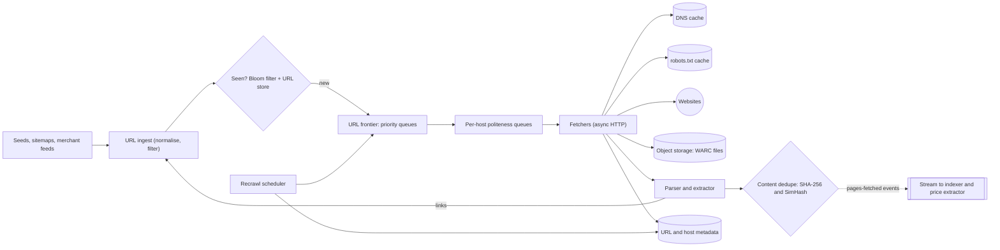
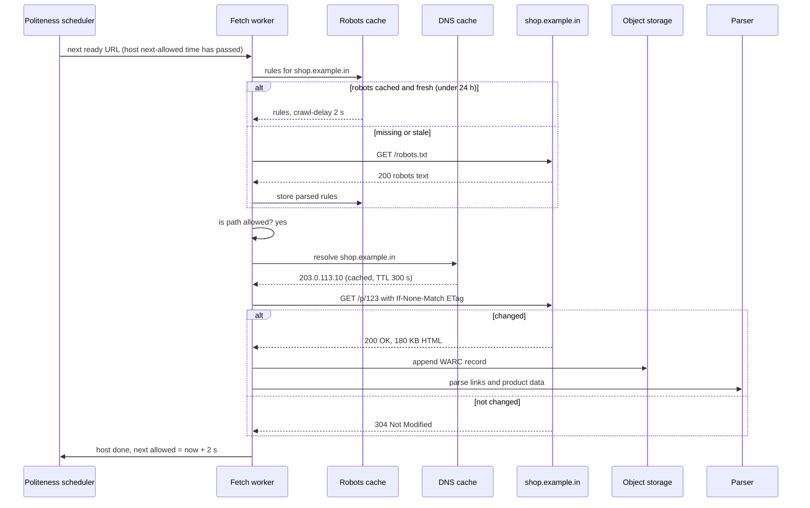

A price-comparison site shows you that a pair of running shoes costs ₹4,299 on one store and ₹3,999 on another. A search engine answers "best budget phone 2026" with pages it read last night. Both depend on a **web crawler**: a system that downloads pages, finds links in them, and downloads those too, again and again. A toy crawler is a 20-line loop. A real one fetches a billion pages a month without overloading any website, without downloading the same page a thousand times under different URLs, without falling into infinite link mazes, and without losing its place when a machine dies.

## Learning objectives

By the end of this lesson you will be able to:

1. Turn "build a crawler" into requirements: scope, freshness, politeness and storage.
2. Estimate pages per second, bandwidth, raw storage, metadata size and Bloom-filter memory with visible arithmetic.
3. Design a URL frontier with priority queues in front and per-host politeness queues behind.
4. Apply robots.txt rules (RFC 9309) and crawl-delay, and cache DNS and robots lookups.
5. Normalise URLs and deduplicate at URL level (Bloom filter) and content level (exact hash and SimHash).
6. Detect crawler traps and schedule recrawls by how often pages change.
7. Partition workers by host hash, store raw pages in object storage, and checkpoint so failures cost minutes, not days.
8. Implement a URL normaliser and a politeness scheduler with an injectable `TimeProvider` in C#.

## Prerequisites

- [How to approach an HLD problem](#/lesson/m11-hld-framework) and [capacity estimation](#/lesson/m11-capacity-estimation).
- [Message queues](#/lesson/m12-message-queues): discovered URLs travel between workers on a queue.
- [Sharding and consistent hashing](#/lesson/m13-sharding): we partition the crawl by host.

Helpful: [object storage](#/lesson/m11-object-storage) and [Kafka partitions and consumer groups](#/lesson/m12-kafka).

## Explain it like I'm a beginner

Imagine a librarian asked to collect a copy of every price list from every shop in a big city. She starts with a list of 100 shop addresses (seed URLs). At each shop she copies the price list and notes every other shop address mentioned on it ("our sister store is on MG Road"). Those new addresses go on her to-visit list (the frontier).

Soon she learns some rules:

- **Do not knock on one shop's door 50 times a minute.** Visit each shop at most once every few seconds, even if it has 10,000 pages (politeness).
- **Read the sign on the door** that says "staff only beyond this point" (robots.txt).
- **Do not visit the same shop twice because the address was written differently** ("MG Rd" and "Mahatma Gandhi Road") (URL normalisation and dedupe).
- **Watch out for a shop with an endless corridor of doors** marked "next month, next month, next month..." (crawler traps).
- **Revisit shops that change prices daily more often than shops that never change** (recrawl scheduling).
- With a team of 50 librarians, **give each one a fixed set of shops**, so two librarians never knock on the same door at once (partitioning by host).

That is the whole crawler. The rest is doing it at a billion pages a month.

## Requirements

### Functional requirements

1. **Crawl** HTML pages starting from seed URLs (shopping sites, brand sites, review blogs, sitemaps).
2. **Extract** links and, for product pages, structured data (name, price, availability from schema.org JSON-LD).
3. **Store** raw pages for reprocessing and the extracted data for the search and price index.
4. **Recrawl** pages based on importance and how often they change: popular product pages every few hours, blog posts every few weeks.
5. **Respect** robots.txt, crawl-delay, `noindex`/`nofollow`, `429`/`503` with `Retry-After`, and site opt-outs.
6. **Operate**: pause a host, change its rate, add seeds, see progress and errors per host.

### Out of scope

- Rendering JavaScript-heavy pages with a headless browser (a separate, slower and much more expensive pool; we mention it in trade-offs).
- Building the search index and ranking (see [search architecture](#/lesson/m16-search-architecture)).
- Crawling behind logins or paywalls. We never do this.

### Non-functional requirements

| Requirement | Target | Why |
|---|---|---|
| Throughput | 1 billion pages per month, sustained | The catalogue and prices must stay fresh |
| Politeness | At most 1 request per host per second by default, or the site's crawl-delay if larger | Overloading a small shop's server is harmful and gets us blocked |
| Freshness | Top 10 M product pages under 24 hours old; others within 7–30 days | Stale prices make the comparison site wrong |
| Robustness | Survive traps, malformed HTML, slow servers and worker crashes | The web is adversarial and messy |
| Durability of progress | A crash loses at most a few minutes of crawl progress | Restarting a billion-page crawl from scratch is unacceptable |
| Extensibility | New content types (PDF spec sheets, feeds) without redesign | Requirements change |

Two of these pull against each other: **throughput wants many requests; politeness limits requests per host**. The way out is parallelism **across** hosts, never within one.

## Capacity estimation

All numbers are **estimates**. Show the arithmetic and round.

### Fetch rate

- 1 B pages per month ÷ (30 × 86,400 ≈ 2.6 M seconds) ≈ **385 pages/s** on average.
- Plan for **800 pages/s** of capacity so the crawl can catch up after an outage.

### Bandwidth

- Average HTML page: **100 KB** uncompressed (an estimate; product pages with inline scripts are often larger).
- 385 pages/s × 100 KB ≈ **38.5 MB/s**, about **310 Mbit/s** inbound. With gzip on the wire it is less, but plan for the uncompressed number.

### Raw page storage

- 1 B × 100 KB = **100 TB per month** uncompressed.
- HTML compresses well; assume 5 : 1 → **20 TB per month** in object storage.
- Keep the last 3 versions of each page for 12 months: on the order of **240 TB** a year. Object storage is the only sensible home; a database is not.

### URL metadata

- Known URLs (crawled plus discovered but not yet crawled): **5 billion**.
- Per URL: URL text (~100 B), hashes, timestamps, status, priority, ETag: about **500 B** → 5 B × 500 B = **2.5 TB**. That needs a sharded store.

### URL-seen set

- A Bloom filter with a 1 % false-positive rate needs about 9.6 bits per item (from m/n = −ln(p) ÷ (ln 2)²).
- 5 B URLs × 9.6 bits ÷ 8 ≈ **6 GB**, split across workers by host, so each worker holds a small slice.

### Hosts and politeness

- Assume **10 M hosts**; an average of 100 pages per host per month is nothing.
- But one large marketplace with 20 M product pages, recrawled daily, needs 20 M ÷ 86,400 ≈ **231 requests/s** to one host. At 1 request/s that would take 231 days. **Politeness, not hardware, is the real limit for big sites.** We need sitemaps, merchant feeds or partner APIs for them, and must prioritise which pages to refresh.

### Fetch concurrency

- If a fetch takes about 1 s end to end (DNS, connect, download; an estimate), then by Little's law in-flight requests ≈ 385 × 1 s ≈ **400**, and about **800** at full capacity.
- Async I/O lets one server hold thousands of connections, so parsing CPU decides worker count. At an assumed 50 pages/s per core for parsing and link extraction, 800 pages/s needs 16 cores: say **10 workers of 4 cores** with headroom.

### What the numbers tell us

1. The bottleneck is **politeness for big hosts**, then parsing CPU, not bandwidth.
2. Raw pages go to object storage; metadata needs a sharded store; the seen-set must be compact.
3. Since each host must be throttled individually, work must be organised **per host**.

## API design

The crawler is an internal system. Its API is for operators and for the systems that consume its output.

```http
POST /v1/seeds
Content-Type: application/json

{ "urls": ["https://shop.example.in/sitemap.xml", "https://brand.example.com/"], "priority": 8 }
→ 202 Accepted  { "accepted": 2, "duplicates": 0, "rejected": 0 }
```

- `PUT /v1/hosts/{host}/policy` with `{ "maxRps": 0.2, "paused": false, "pageBudgetPerDay": 50000 }`: per-host overrides, for example after a site owner emails us.
- `GET /v1/hosts/{host}/stats`: pages fetched, error rate, average latency, queue length, last robots.txt fetch.
- **Output**: every fetched page produces an event on a `pages-fetched` stream: `{ urlHash, url, fetchedAt, status, contentType, objectKey, contentSha256, simhash, changed }`. The product extractor and the search indexer consume it. The crawler never calls them directly.

Our **user-agent** is part of the contract with the web: `PriceScoutBot/1.0 (+https://pricescout.example/bot)`, where the URL explains who we are, how to slow us down and how to opt out.

## Data model

### URL table (sharded by host partition)

```sql
CREATE TABLE crawl_url (
    url_hash           bytea       PRIMARY KEY,          -- first 16 bytes of SHA-256(normalised URL)
    url                text        NOT NULL,
    host               text        NOT NULL,
    partition          smallint    NOT NULL,             -- hash(host) % 1024
    status             text        NOT NULL DEFAULT 'new', -- new | ok | not_modified | gone | blocked | error
    priority           smallint    NOT NULL DEFAULT 5,   -- 0..9
    last_crawled_at    timestamptz,
    next_crawl_at      timestamptz NOT NULL DEFAULT now(),
    recrawl_interval   interval    NOT NULL DEFAULT '7 days',
    etag               text,
    last_modified      text,
    content_sha256     bytea,
    simhash            bigint,
    consecutive_errors smallint    NOT NULL DEFAULT 0
);
CREATE INDEX crawl_url_due ON crawl_url (partition, next_crawl_at)
    WHERE status NOT IN ('gone', 'blocked');
```

At 5 B rows this is sharded: by the `partition` column across PostgreSQL nodes (for example with Citus), or in a wide-column store keyed the same way. The partial index serves the recrawl scheduler's question, "which of my partition's URLs are due?".

### Host table

```sql
CREATE TABLE crawl_host (
    host               text        PRIMARY KEY,
    partition          smallint    NOT NULL,
    robots_txt         text,
    robots_fetched_at  timestamptz,
    crawl_delay        interval,                 -- from robots.txt or operator override
    paused             boolean     NOT NULL DEFAULT false,
    page_budget_day    int         NOT NULL DEFAULT 100000,
    pages_today        int         NOT NULL DEFAULT 0,
    error_rate_1h      real        NOT NULL DEFAULT 0
);
```

### Raw pages

Object storage, batched into large **WARC** files (the ISO 28500 web archive format): each record holds the request, response headers and body. Writing 1 GB files instead of a billion tiny objects keeps request costs and metadata overhead low. The `objectKey` in the event is `file + offset + length`.

## High-level architecture



Arrow by arrow:

- **Seeds → URL ingest**: every URL, whether a seed, a sitemap entry or a link found on a page, goes through the same gate: normalise, reject non-HTTP schemes, apply trap rules and per-host budgets.
- **Ingest → Seen?**: the Bloom filter answers "definitely new" or "probably seen". "Probably seen" is confirmed against the URL store only when it matters (for high-priority seeds); for ordinary links we accept losing 1 % of genuinely new URLs.
- **Frontier → per-host queues**: the front of the frontier orders work by priority; the back holds one FIFO queue per host and releases a host's next URL only when that host's **next-allowed time** has passed.
- **Fetchers → DNS cache, robots cache, websites**: an async HTTP fetch with timeouts and a size limit, using cached DNS answers and cached robots rules.
- **Fetchers → object storage, metadata**: the raw response is appended to a WARC file; status, ETag and timing go to the URL table.
- **Parser → content dedupe → stream**: the parser extracts links and product data; exact and near-duplicate checks decide whether the page is new content. Only then is a `pages-fetched` event published (dotted = asynchronous).
- **Parser → ingest**: discovered links loop back to the start.
- **Recrawl scheduler → frontier**: periodically selects due URLs from metadata and feeds them into the frontier with their priority.

### Fetching one URL



Three things happen before any request to the site: robots rules are checked (fetching robots.txt itself if needed), DNS comes from a cache, and the request is **conditional** (`If-None-Match` / `If-Modified-Since`). A `304` costs the site almost nothing and tells us the page did not change, which feeds the recrawl scheduler. The last arrow reports back to the scheduler so the host's next request waits for the crawl-delay.

## Deep dives

### Deep dive 1: the URL frontier

The frontier answers "what should we fetch next?". It must balance two goals: **priority** (important, stale pages first) and **politeness** (never hit one host too often). The classic design, from the Mercator crawler and described in *Introduction to Information Retrieval*, has two layers:

1. **Front queues (priority)**: F queues, one per priority level (say 10). A prioritiser assigns each URL a level from signals such as page importance, how stale it is and how often it changes. A selector pulls from high-priority queues more often, but not exclusively, so low-priority work is not starved.
2. **Back queues (politeness)**: B queues, each holding URLs for **exactly one host**. A min-heap holds one entry per non-empty back queue, keyed by that host's **next-allowed time**. A fetcher pops the heap; if the earliest time is in the future, it waits. After fetching, the host's next-allowed time becomes `now + delay`, and the entry goes back into the heap.

An emptied back queue is refilled from the front queues with a new host. Rule of thumb from the same literature: about **three times as many back queues as fetcher threads**, so fetchers rarely wait.

Why is this polite? A host's URLs live in one back queue, released by the heap one at a time, spaced by the delay. Fetcher parallelism cannot break that, as long as **one host is owned by one scheduler**.

### Deep dive 2: robots.txt and crawl-delay

`robots.txt` at the root of a host lists which paths a crawler may fetch (RFC 9309):

```text
User-agent: *
Disallow: /cart
Disallow: /search
Allow: /search/help

User-agent: PriceScoutBot
Disallow: /checkout
Crawl-delay: 5
```

Rules that trip people up:

- A crawler obeys **the most specific group** that names it (case-insensitively), and only that group. Our bot follows the `PriceScoutBot` group above and **ignores** the `*` group, so `/cart` is allowed for us.
- Within a group, the **longest matching rule wins**; if an Allow and a Disallow match with equal length, **Allow** wins. `*` matches any characters and `$` anchors the end.
- `/robots.txt` itself is always allowed. A `404` for robots.txt means "no restrictions". A `5xx` or timeout means "assume complete disallow" for a while, because the site may be in trouble.
- **Cache** robots.txt per host for up to 24 hours (RFC 9309 says crawlers should not use a cached copy for more than 24 hours unless unreachable).
- `Crawl-delay` is not part of RFC 9309, but many sites use it. We honour it as a minimum delay, capped at a sane maximum (say 60 s), and fall back to our default of 1 s.

Respect also `<meta name="robots" content="noindex, nofollow">`, the `X-Robots-Tag` header, and `429 Too Many Requests` or `503` with `Retry-After`: those push the host's next-allowed time into the future.

### Deep dive 3: DNS, fetchers and parsers

- **DNS** can be the hidden bottleneck: lookups take 10–200 ms and the OS resolver may serialise them. Run a local caching resolver per worker. Politeness per **IP address** matters too: 5,000 small shops on one shared hosting IP are one server.
- **Fetchers** use async I/O (`HttpClient` with `SocketsHttpHandler`, connection pooling, HTTP/2 where offered). Each request has a connect timeout (5 s), a total timeout (30 s) and a body limit (5 MB), so a slow or endless response cannot tie up a worker. Follow redirects **manually** (at most 5), because each target is a new URL that must pass normalisation, robots and the seen-set.
- **Parsers** are a separate stage, because parsing is CPU-bound and fetching I/O-bound. They extract links (`<a href>`, canonical links, sitemaps) and product data (schema.org `Product`/`Offer` JSON-LD), honouring `rel="nofollow"`.

### Deep dive 4: URL normalisation

The same page has many spellings: `HTTP://Shop.Example.IN:80/a/./b/../p?id=7&utm_source=sms#reviews` and `http://shop.example.in/a/p?id=7` are one page. RFC 3986 section 6 lists safe normalisations, and crawlers add a few scheme-specific and site-specific ones:

| Step | Example | Safe? |
|---|---|---|
| Lower-case scheme and host | `HTTP://Shop.Example.IN` → `http://shop.example.in` | Yes (RFC 3986) |
| Remove default port | `:80` for http, `:443` for https | Yes |
| Resolve `.` and `..` segments | `/a/./b/../p` → `/a/p` | Yes |
| Empty path → `/` | `https://shop.example.in` → `https://shop.example.in/` | Yes |
| Remove fragment | `#reviews` | Yes for crawling: the server never sees it |
| Drop tracking parameters | `utm_*`, `gclid`, `fbclid` | Almost always; keep a list |
| Drop session ids | `;jsessionid=...`, `sessionid=` | Yes; they create infinite duplicates |
| Sort query parameters | `?b=2&a=1` → `?a=1&b=2` | Usually; rare sites depend on order |
| Remove trailing slash, `www.` | `/p/` → `/p` | **No**: these can be different pages |

After normalisation, also use the page's own `<link rel="canonical">` as a hint, but verify it points to the same host (sites sometimes get it wrong, and attackers abuse it).

### Deep dive 5: deduplication

There are two kinds of duplicates:

**URL-level: have we seen this URL?** With 5 B URLs, an exact hash set of 16-byte hashes needs 80 GB plus overhead. A **Bloom filter** uses about 6 GB at a 1 % false-positive rate. It has no false negatives: "not present" is always right. A false positive means we skip a URL we have never crawled; losing 1 % of new links is acceptable because important pages are linked from many places. With host partitioning, each worker keeps the filter for its own hosts, so the memory is spread across the cluster. Bloom filters cannot delete; rebuild them from the URL store weekly.

**Content-level: is this page the same as one we already have?** Mirrors, printer-friendly versions and the same product listed under five category URLs produce identical or nearly identical pages.

- **Exact**: SHA-256 of the normalised body text. Cheap and certain, but one changed timestamp in the footer breaks it.
- **Near-duplicate**: **SimHash** (Charikar's technique, applied to web crawling by Manku, Jain and Das Sarma). Hash every word (or shingle of 3 words) to 64 bits; for each bit position add +1 if the bit is set and −1 if not, weighting by word frequency; the sign of each total gives one bit of a 64-bit fingerprint. Similar documents get fingerprints that differ in few bits. The paper found that for billions of pages, treating fingerprints within a Hamming distance of 3 as near-duplicates works well.

When a page is a near-duplicate, we still store the fetch (it tells us the page exists) but do not publish it as new content, and we lower the priority of that URL pattern.

### Deep dive 6: crawler traps

A trap is a site structure that generates endless URLs. Some are accidental, some deliberate.

- **Infinite calendars**: `/events?month=2026-11` links to `?month=2026-12`, forever.
- **Session ids in URLs**: every visit produces a new `sid=...`, so every link is "new".
- **Faceted navigation**: a shoe category with filters for 20 brands × 12 sizes × 10 colours × 6 sort orders yields 14,400 URLs for the same 300 products. For a price-comparison crawler this is **the** trap.
- **Repeating paths** from relative-link bugs: `/a/b/a/b/a/b/...`.
- **Soft 404s**: an error page returned with `200 OK` for every non-existent URL.

Defences, layered: normalisation (drops session ids); limits on URL length (2,048 characters), path depth (15 segments) and repeated segments; a **per-host page budget** per day; a cap on distinct values per query parameter per host; detecting soft 404s by fetching a random non-existent URL once per host and SimHash-comparing; and preferring sitemaps and canonical links over faceted links. Monitor "new URLs per host per hour": a sudden spike usually means a trap.

### Deep dive 7: recrawl scheduling

Pages change at very different rates. A product page's price may change daily during a sale; a brand's "about us" page changes yearly. Fetching everything at the same interval wastes most fetches.

A simple adaptive policy per URL:

- After each fetch, compare the content hash (or receive `304`). If changed, **halve** the interval; if unchanged, **multiply** it by 1.5.
- Clamp between a minimum (6 hours for product pages, 1 day for others) and a maximum (30 days).
- Multiply by importance: popular products, frequently linked pages and pages users actually click in our site are refreshed more often.
- Use sitemaps' `<lastmod>` and merchant feeds to skip fetches entirely.

Conditional requests make each recrawl cheaper: a `304 Not Modified` has no body, so the site and we both save bandwidth.

### Deep dive 8: distributing the crawl

**Partition by host.** Each URL's host is hashed to one of 1,024 partitions, and each worker owns a set of partitions. Everything about a host lives with its owner: the back queue, the next-allowed time, the robots cache, the Bloom-filter slice and the page budget. So politeness and dedupe need **no cross-worker coordination**.

**Moving discovered links.** When a worker parses a page and finds a link to another host, it publishes the URL to a `discovered-urls` stream keyed by host partition (Kafka-style partitions map naturally). The owning worker consumes and ingests it. Links to the same host stay local.

**Rebalancing.** When a worker joins or dies, the consumer group reassigns partitions. The new owner loads the partition's frontier checkpoint and continues. Partitioning by **host**, not by URL, is essential: partitioning by URL hash would spread one host's URLs across all workers, and each would think it was being polite while together they hammered the site. See [sharding and consistent hashing](#/lesson/m13-sharding).

**Hot partitions.** A huge marketplace is rate-limited by politeness anyway, so it rarely overloads a worker; very large hosts can get their own partition.

### Deep dive 9: the core pieces in ASP.NET Core

The code below is a compact, compilable crawler core: URL normalisation, a thread-safe politeness scheduler driven by an injectable `TimeProvider`, a Bloom filter, robots rules, an adaptive recrawl policy, and a worker loop as a `BackgroundService`. Production versions put the frontier checkpoint in durable storage and the raw pages in object storage behind the same interfaces.

```csharp file=Crawler/UrlNormalizer.cs
using System.Text.RegularExpressions;

namespace Crawler.Urls;

/// <summary>RFC 3986 section 6 normalisation plus crawler rules: drop fragments, tracking and session parameters.</summary>
public static partial class UrlNormalizer
{
    private static readonly HashSet<string> DroppedParams = new(StringComparer.OrdinalIgnoreCase)
    {
        "gclid", "fbclid", "sessionid", "sid", "phpsessid", "jsessionid",
    };

    [GeneratedRegex(";jsessionid=[^/?#]*", RegexOptions.IgnoreCase)]
    private static partial Regex PathSessionId();

    public static Uri? Normalize(string href, Uri? baseUri = null)
    {
        if (string.IsNullOrWhiteSpace(href) || href.Length > 2048) return null;
        Uri? uri;
        if (baseUri is null) { if (!Uri.TryCreate(href.Trim(), UriKind.Absolute, out uri)) return null; }
        else if (!Uri.TryCreate(baseUri, href.Trim(), out uri)) return null;
        if (uri.Scheme != Uri.UriSchemeHttp && uri.Scheme != Uri.UriSchemeHttps) return null;

        var path = PathSessionId().Replace(uri.AbsolutePath, "");   // Uri already resolved . and ..
        if (path.Length == 0) path = "/";

        var kept = uri.Query.TrimStart('?')
            .Split('&', StringSplitOptions.RemoveEmptyEntries)
            .Select(p => (Pair: p, Name: p.Split('=', 2)[0]))
            .Where(p => !p.Name.StartsWith("utm_", StringComparison.OrdinalIgnoreCase) && !DroppedParams.Contains(p.Name))
            .OrderBy(p => p.Name, StringComparer.Ordinal).ThenBy(p => p.Pair, StringComparer.Ordinal)
            .Select(p => p.Pair)
            .ToArray();
        var query = kept.Length == 0 ? "" : "?" + string.Join('&', kept);
        var port = uri.IsDefaultPort ? "" : ":" + uri.Port;
        return new Uri($"{uri.Scheme}://{uri.IdnHost.ToLowerInvariant()}{port}{path}{query}");
    }

    public static string HostKey(Uri url) => url.IdnHost.ToLowerInvariant();
}
```

```csharp file=Crawler/PolitenessScheduler.cs
namespace Crawler.Frontier;

/// <summary>
/// Back queues of the frontier: one FIFO per host, released through a min-heap keyed by the host's
/// next-allowed time. One instance owns a set of hosts, so politeness needs no cross-worker locking.
/// </summary>
public sealed class PolitenessScheduler(TimeProvider clock, TimeSpan defaultDelay)
{
    private sealed class HostState
    {
        public readonly Queue<Uri> Pending = new();
        public DateTimeOffset NextAllowed;
        public TimeSpan? Delay;
        public bool InHeap;
    }

    private readonly Dictionary<string, HostState> _hosts = new(StringComparer.OrdinalIgnoreCase);
    private readonly PriorityQueue<string, (DateTimeOffset At, long Seq)> _ready = new();
    private readonly Lock _gate = new();
    private long _seq;
    private int _count;

    public int Count { get { lock (_gate) return _count; } }

    public void SetCrawlDelay(string host, TimeSpan delay)
    {
        lock (_gate) State(host).Delay = delay;
    }

    /// <summary>Push a host's next request into the future, e.g. after 429/503 with Retry-After.</summary>
    public void Defer(string host, TimeSpan by)
    {
        lock (_gate)
        {
            var s = State(host);
            var until = clock.GetUtcNow() + by;
            if (until > s.NextAllowed) s.NextAllowed = until; // the heap entry is refreshed lazily on dequeue
        }
    }

    public void Enqueue(Uri url)
    {
        var host = url.IdnHost;
        lock (_gate)
        {
            var s = State(host);
            s.Pending.Enqueue(url);
            _count++;
            if (!s.InHeap) { _ready.Enqueue(host, (s.NextAllowed, _seq++)); s.InHeap = true; }
        }
    }

    public bool TryDequeue(out Uri? url)
    {
        lock (_gate)
        {
            var now = clock.GetUtcNow();
            while (_ready.TryPeek(out var host, out var key) && key.At <= now)
            {
                _ready.Dequeue();
                var s = _hosts[host];
                if (s.NextAllowed > key.At) { _ready.Enqueue(host, (s.NextAllowed, _seq++)); continue; } // deferred
                url = s.Pending.Dequeue();
                _count--;
                s.NextAllowed = now + (s.Delay ?? defaultDelay);
                if (s.Pending.Count > 0) _ready.Enqueue(host, (s.NextAllowed, _seq++));
                else s.InHeap = false;
                return true;
            }
            url = null;
            return false;
        }
    }

    public DateTimeOffset? NextReadyAt
    {
        get { lock (_gate) return _ready.TryPeek(out _, out var key) ? key.At : null; }
    }

    private HostState State(string host)
    {
        if (!_hosts.TryGetValue(host, out var s))
            _hosts[host] = s = new HostState { NextAllowed = clock.GetUtcNow() };
        return s;
    }
}
```

```csharp file=Crawler/Dedupe.cs
using System.Collections;
using System.Text;

namespace Crawler.Dedupe;

/// <summary>Bloom filter: no false negatives, tunable false positives, about 9.6 bits per item at 1 %.</summary>
public sealed class BloomFilter
{
    private readonly BitArray _bits;
    private readonly int _k;
    private readonly Lock _gate = new();

    public BloomFilter(long expectedItems, double falsePositiveRate)
    {
        ArgumentOutOfRangeException.ThrowIfLessThan(expectedItems, 1);
        var m = (long)Math.Ceiling(-expectedItems * Math.Log(falsePositiveRate) / (Math.Log(2) * Math.Log(2)));
        _bits = new BitArray((int)Math.Min(m, int.MaxValue - 64));
        _k = Math.Max(1, (int)Math.Round((double)_bits.Length / expectedItems * Math.Log(2)));
    }

    /// <summary>Adds the item and returns true if it was (probably) already present.</summary>
    public bool CheckAndAdd(string item)
    {
        var (h1, h2) = Hashes(item);
        var present = true;
        lock (_gate)
        {
            for (var i = 0; i < _k; i++)
            {
                var idx = (int)((h1 + (ulong)i * h2) % (ulong)_bits.Length); // double hashing
                if (!_bits[idx]) { present = false; _bits[idx] = true; }
            }
        }
        return present;
    }

    private static (ulong, ulong) Hashes(string item)
    {
        ulong a = 14695981039346656037UL, b = 0x9E3779B97F4A7C15UL;
        foreach (var by in Encoding.UTF8.GetBytes(item))
        {
            a = (a ^ by) * 1099511628211UL;           // FNV-1a
            b = (b ^ by) * 0x100000001B3UL + 0x632BE5ABUL;
        }
        return (a, b | 1); // odd step visits distinct positions
    }
}

/// <summary>64-bit SimHash over word tokens; near-duplicates differ in few bits.</summary>
public static class SimHash
{
    public static ulong Compute(string text)
    {
        Span<int> v = stackalloc int[64];
        foreach (var token in text.Split((char[]?)null, StringSplitOptions.RemoveEmptyEntries))
        {
            var h = Fnv1a(token.ToLowerInvariant());
            for (var i = 0; i < 64; i++) v[i] += ((h >> i) & 1) == 1 ? 1 : -1;
        }
        ulong result = 0;
        for (var i = 0; i < 64; i++) if (v[i] > 0) result |= 1UL << i;
        return result;
    }

    public static int Distance(ulong a, ulong b) => System.Numerics.BitOperations.PopCount(a ^ b);

    private static ulong Fnv1a(string s)
    {
        var h = 14695981039346656037UL;
        foreach (var c in s) h = (h ^ c) * 1099511628211UL;
        return h;
    }
}
```

```csharp file=Crawler/Policies.cs
using System.Text.RegularExpressions;

namespace Crawler.Policies;

/// <summary>Simplified RFC 9309: pick our group (else *), longest match wins, Allow wins ties, * and $ supported.</summary>
public sealed class RobotsRules
{
    private readonly List<(string Pattern, bool Allow, Regex Re)> _rules;
    public TimeSpan? CrawlDelay { get; }

    private RobotsRules(List<(string, bool, Regex)> rules, TimeSpan? delay) { _rules = rules; CrawlDelay = delay; }

    public static RobotsRules AllowAll { get; } = new([], null);

    private sealed class Group
    {
        public readonly List<string> Agents = [];
        public readonly List<(string Pattern, bool Allow)> Rules = [];
        public double? Delay;
    }

    public static RobotsRules Parse(string robotsTxt, string productToken)
    {
        var groups = new List<Group>();
        Group? current = null;
        var lastWasAgent = false;
        foreach (var raw in robotsTxt.Split('\n'))
        {
            var line = raw.Split('#')[0].Trim();
            var colon = line.IndexOf(':');
            if (colon <= 0) continue;
            var field = line[..colon].Trim().ToLowerInvariant();
            var value = line[(colon + 1)..].Trim();
            if (field == "user-agent")
            {
                if (current is null || !lastWasAgent) { current = new Group(); groups.Add(current); }
                current.Agents.Add(value.ToLowerInvariant());
                lastWasAgent = true;
                continue;
            }
            lastWasAgent = false;
            if (current is null) continue;
            if (field is "allow" or "disallow" && value.Length > 0) current.Rules.Add((value, field == "allow"));
            else if (field == "crawl-delay" && double.TryParse(value, System.Globalization.NumberStyles.Float,
                         System.Globalization.CultureInfo.InvariantCulture, out var d)) current.Delay = d;
        }

        var token = productToken.ToLowerInvariant();
        var chosen = groups.Where(g => g.Agents.Contains(token)).ToList();
        if (chosen.Count == 0) chosen = groups.Where(g => g.Agents.Contains("*")).ToList();
        var rules = chosen.SelectMany(g => g.Rules).Select(r => (r.Pattern, r.Allow, ToRegex(r.Pattern))).ToList();
        var delay = chosen.Select(g => g.Delay).FirstOrDefault(d => d.HasValue);
        return new RobotsRules(rules, delay.HasValue ? TimeSpan.FromSeconds(delay.Value) : null);
    }

    public bool IsAllowed(string pathAndQuery)
    {
        if (pathAndQuery == "/robots.txt") return true;
        var best = _rules.Where(r => r.Re.IsMatch(pathAndQuery))
                         .OrderByDescending(r => r.Pattern.Length).ThenByDescending(r => r.Allow)
                         .FirstOrDefault();
        return best.Pattern is null || best.Allow;
    }

    private static Regex ToRegex(string pattern)
    {
        var anchored = pattern.EndsWith('$');
        var body = Regex.Escape(anchored ? pattern[..^1] : pattern).Replace(@"\*", ".*");
        return new Regex("^" + body + (anchored ? "$" : ""), RegexOptions.CultureInvariant);
    }
}

/// <summary>Halve the interval when content changed, stretch it by 1.5 when not, within bounds.</summary>
public static class RecrawlPolicy
{
    public static TimeSpan Next(TimeSpan current, bool changed, TimeSpan min, TimeSpan max)
    {
        var next = changed ? current / 2 : current * 1.5;
        return next < min ? min : next > max ? max : next;
    }
}
```

```csharp file=Crawler/CrawlWorker.cs
using System.Collections.Concurrent;
using System.Text.RegularExpressions;
using Crawler.Dedupe;
using Crawler.Frontier;
using Crawler.Policies;
using Crawler.Urls;

namespace Crawler.Workers;

public sealed record FetchResult(Uri Url, int Status, string? Body, TimeSpan? RetryAfter);

public interface IPageFetcher { Task<FetchResult> FetchAsync(Uri url, CancellationToken ct); }

public interface IPageStore { Task SaveAsync(Uri url, DateTimeOffset at, int status, string body, CancellationToken ct); }

public sealed class HttpPageFetcher(HttpClient http) : IPageFetcher
{
    public const int MaxBytes = 5 * 1024 * 1024;

    public async Task<FetchResult> FetchAsync(Uri url, CancellationToken ct)
    {
        using var cts = CancellationTokenSource.CreateLinkedTokenSource(ct);
        cts.CancelAfter(TimeSpan.FromSeconds(30));                  // total budget per fetch
        using var resp = await http.GetAsync(url, HttpCompletionOption.ResponseHeadersRead, cts.Token);
        var retry = resp.Headers.RetryAfter?.Delta;
        var isHtml = resp.Content.Headers.ContentType?.MediaType is "text/html" or "application/xhtml+xml";
        if (!resp.IsSuccessStatusCode || !isHtml) return new FetchResult(url, (int)resp.StatusCode, null, retry);

        await using var stream = await resp.Content.ReadAsStreamAsync(cts.Token);
        using var buffer = new MemoryStream();
        var chunk = new byte[81920];
        int n;
        while ((n = await stream.ReadAsync(chunk, cts.Token)) > 0)
        {
            if (buffer.Length + n > MaxBytes) break;                 // truncate oversized pages
            buffer.Write(chunk, 0, n);
        }
        return new FetchResult(url, (int)resp.StatusCode, System.Text.Encoding.UTF8.GetString(buffer.ToArray()), retry);
    }
}

public sealed class InMemoryPageStore : IPageStore
{
    private readonly ConcurrentDictionary<string, (DateTimeOffset At, int Status, int Length)> _pages = new();
    public int Count => _pages.Count;
    public Task SaveAsync(Uri url, DateTimeOffset at, int status, string body, CancellationToken ct)
    {
        _pages[url.AbsoluteUri] = (at, status, body.Length); // production: append a WARC record to object storage
        return Task.CompletedTask;
    }
}

public sealed class RobotsCache(IPageFetcher fetcher, TimeProvider clock)
{
    public const string ProductToken = "PriceScoutBot";
    private readonly ConcurrentDictionary<string, (RobotsRules Rules, DateTimeOffset At)> _cache = new(StringComparer.OrdinalIgnoreCase);

    public async Task<RobotsRules> GetAsync(Uri url, CancellationToken ct)
    {
        var host = UrlNormalizer.HostKey(url);
        if (_cache.TryGetValue(host, out var hit) && clock.GetUtcNow() - hit.At < TimeSpan.FromHours(24)) return hit.Rules;
        RobotsRules rules;
        try
        {
            var r = await fetcher.FetchAsync(new Uri(url, "/robots.txt"), ct);
            rules = r.Status switch
            {
                >= 200 and < 300 => RobotsRules.Parse(r.Body ?? "", ProductToken),
                >= 400 and < 500 => RobotsRules.AllowAll,                 // no robots.txt: no restrictions
                _ => RobotsRules.Parse("User-agent: *\nDisallow: /", ProductToken), // server error: back off
            };
        }
        catch (Exception ex) when (ex is HttpRequestException or TaskCanceledException)
        {
            rules = RobotsRules.Parse("User-agent: *\nDisallow: /", ProductToken);
        }
        _cache[host] = (rules, clock.GetUtcNow());
        return rules;
    }
}

public sealed partial class CrawlWorker(
    PolitenessScheduler scheduler, BloomFilter seen, RobotsCache robots, IPageFetcher fetcher,
    IPageStore store, TimeProvider clock, ILogger<CrawlWorker> log) : BackgroundService
{
    [GeneratedRegex("href\\s*=\\s*[\"']([^\"'#\\s]+)", RegexOptions.IgnoreCase)]
    private static partial Regex Href();

    /// <summary>Gate every URL (seed or discovered) through normalisation, trap limits and the seen-set.</summary>
    public bool Offer(string href, Uri? baseUri = null)
    {
        var url = UrlNormalizer.Normalize(href, baseUri);
        if (url is null || url.Segments.Length > 15) return false;     // trap guard: very deep paths
        if (seen.CheckAndAdd(url.AbsoluteUri)) return false;
        scheduler.Enqueue(url);
        return true;
    }

    protected override async Task ExecuteAsync(CancellationToken stoppingToken)
    {
        while (!stoppingToken.IsCancellationRequested)
        {
            if (!scheduler.TryDequeue(out var url) || url is null)
            {
                var wait = scheduler.NextReadyAt is { } at ? at - clock.GetUtcNow() : TimeSpan.FromMilliseconds(200);
                wait = wait < TimeSpan.FromMilliseconds(10) ? TimeSpan.FromMilliseconds(10) : wait > TimeSpan.FromSeconds(1) ? TimeSpan.FromSeconds(1) : wait;
                try { await Task.Delay(wait, clock, stoppingToken); } catch (OperationCanceledException) { break; }
                continue;
            }
            try { await CrawlOneAsync(url, stoppingToken); }
            catch (OperationCanceledException) when (stoppingToken.IsCancellationRequested) { break; }
            catch (Exception ex) { log.LogWarning(ex, "Fetch failed for {Url}", url); }
        }
    }

    private async Task CrawlOneAsync(Uri url, CancellationToken ct)
    {
        var host = UrlNormalizer.HostKey(url);
        var rules = await robots.GetAsync(url, ct);
        if (rules.CrawlDelay is { } d) scheduler.SetCrawlDelay(host, d > TimeSpan.FromSeconds(60) ? TimeSpan.FromSeconds(60) : d);
        if (!rules.IsAllowed(url.PathAndQuery)) return;

        var page = await fetcher.FetchAsync(url, ct);
        if (page.Status is 429 or 503) { scheduler.Defer(host, page.RetryAfter ?? TimeSpan.FromMinutes(5)); return; }
        if (page.Body is null) return;

        await store.SaveAsync(url, clock.GetUtcNow(), page.Status, page.Body, ct);
        foreach (Match m in Href().Matches(page.Body)) Offer(m.Groups[1].Value, url);
    }
}
```

```csharp file=Program.cs
using Crawler.Dedupe;
using Crawler.Frontier;
using Crawler.Workers;

var builder = WebApplication.CreateBuilder(args);

builder.Services.AddSingleton(TimeProvider.System);
builder.Services.AddSingleton(sp => new PolitenessScheduler(sp.GetRequiredService<TimeProvider>(), TimeSpan.FromSeconds(1)));
builder.Services.AddSingleton(_ => new BloomFilter(expectedItems: 10_000_000, falsePositiveRate: 0.01));
builder.Services.AddSingleton(_ =>
{
    var handler = new SocketsHttpHandler
    {
        PooledConnectionLifetime = TimeSpan.FromMinutes(5),   // pick up DNS changes
        ConnectTimeout = TimeSpan.FromSeconds(5),
        AutomaticDecompression = System.Net.DecompressionMethods.All,
        AllowAutoRedirect = false,                             // each redirect target goes back through Offer()
        MaxConnectionsPerServer = 2,
    };
    var http = new HttpClient(handler) { Timeout = Timeout.InfiniteTimeSpan };
    http.DefaultRequestHeaders.UserAgent.ParseAdd("PriceScoutBot/1.0 (+https://pricescout.example/bot)");
    return http;
});
builder.Services.AddSingleton<IPageFetcher, HttpPageFetcher>();
builder.Services.AddSingleton<InMemoryPageStore>();
builder.Services.AddSingleton<IPageStore>(sp => sp.GetRequiredService<InMemoryPageStore>());
builder.Services.AddSingleton<RobotsCache>();
builder.Services.AddSingleton<CrawlWorker>();
builder.Services.AddHostedService(sp => sp.GetRequiredService<CrawlWorker>());

var app = builder.Build();

app.MapPost("/v1/seeds", (SeedRequest req, CrawlWorker worker) =>
{
    var accepted = req.Urls.Count(u => worker.Offer(u));
    return Results.Accepted(value: new { accepted, skipped = req.Urls.Length - accepted });
});

app.MapGet("/v1/stats", (PolitenessScheduler s, InMemoryPageStore pages) =>
    Results.Ok(new { queued = s.Count, fetched = pages.Count, nextReadyAt = s.NextReadyAt }));

app.Run();

public sealed record SeedRequest(string[] Urls);
```

Points to notice: the scheduler's clock is a `TimeProvider`, so tests move time without sleeping; `Defer` handles `Retry-After` and the heap entry is refreshed lazily; redirects are disabled so every hop is normalised, robots-checked and deduplicated; and a failed robots.txt fetch means "disallow for now".

## Caching, queues and scaling

### Caches

| Cache | Key | TTL | Why |
|---|---|---|---|
| DNS | host → IP addresses | DNS TTL, floor 5 min | Lookups are slow and the resolver can serialise |
| robots.txt | host → parsed rules | 24 h (RFC 9309 guidance) | One fetch per host per day instead of per page |
| Seen-set | URL → bit positions | Rebuilt weekly | Constant-memory duplicate check |
| Host policy | host → delay, budget, paused | 1 min | Operator changes apply quickly |

### Queues

- **`discovered-urls`**: partitioned by host partition, so every URL for a host reaches its owner. Retention of a few days allows replay.
- **`pages-fetched`**: consumed by the price extractor and the search indexer, so the crawler never waits for them. If the indexer falls behind, events pile up in the stream rather than slowing fetches. See [backpressure](#/lesson/m13-backpressure).

### Scaling path

1. **One machine** (up to about 50 pages/s): one process with the scheduler, an in-memory Bloom filter, PostgreSQL for URL metadata and local disk or object storage for pages. Enough for crawling 2,000 shops for a startup comparison site.
2. **Tens of workers** (hundreds of pages/s): host partitioning, a discovered-URL stream, sharded metadata, separate parser pool.
3. **Large** (thousands of pages/s): multiple regions close to the sites being crawled, dedicated partitions for giant hosts, merchant feeds replacing crawling where possible, and a separate headless-browser pool for JavaScript-only pages.

**What breaks first?** (1) Politeness on big hosts (freshness targets can't be met by crawling alone), (2) parser CPU, (3) the metadata store's write rate (every fetch updates a row: 385 updates/s average is fine, but recrawl scans of 5 B rows need the partial index), (4) traps flooding the frontier with junk URLs.

## Failure handling

| Failure | Effect | Mitigation |
|---|---|---|
| Worker crashes | Its partitions stop crawling | Consumer group reassigns partitions; new owner restores the frontier from the last checkpoint (every 5 minutes) and replays `discovered-urls` from the committed offset |
| Duplicate fetch after failover | Same page fetched twice | Harmless: fetching is idempotent from our side and rare; at-least-once is the right guarantee |
| Site returns `429` or `503` | We are too fast or the site is struggling | Honour `Retry-After`; otherwise exponential backoff per host (1 min, 2, 4... up to 1 day); count toward error rate |
| Site slow or hangs | Connections tied up | Connect timeout 5 s, total 30 s, body limit 5 MB; per-host concurrency of 1 |
| DNS failure for a host | All its URLs fail | Cache negative answers briefly; retry later; do not mark URLs as gone |
| Trap explodes the frontier | Millions of junk URLs | Per-host daily budgets, URL length and depth limits, alerts on new-URL spikes; operator can pause the host |
| Object storage unavailable | Can't persist pages | Buffer WARC segments on local disk up to a limit, then pause fetching (backpressure) rather than drop data |
| Bad deploy breaks normalisation | Duplicate explosion or lost URLs | Canary on a few partitions, compare new-URL rates and duplicate rates before rollout |

**Checkpointing** is what keeps a crash cheap: each partition owner periodically writes its back queues, next-allowed times and Bloom-filter slice to object storage, and records the stream offset it has consumed up to. Recovery is "load snapshot, replay stream from offset". Losing 5 minutes of discovered URLs is fine because they will be rediscovered.

## Security

- **Server-side request forgery (SSRF)**: a malicious page can link to `http://169.254.169.254/` (cloud metadata) or `http://10.0.0.5/admin`. Resolve the host and **refuse private, loopback and link-local addresses**, including after redirects, and run fetchers in a network segment with no access to internal services. See [SQL injection, XSS, CSRF and SSRF](#/lesson/m14-owasp).
- **Hostile content**: decompression bombs (a 10 KB gzip that expands to 10 GB), endless responses and malformed HTML that crashes parsers. Enforce byte limits after decompression and run parsers with time limits.
- **Credentials**: never crawl behind logins or send cookies across hosts.
- **Identity**: a clear user-agent with a contact page and published IP ranges, so site owners can verify and contact us.

### Ethics and legal

Crawling is not automatically allowed just because a page is public. Respect robots.txt and opt-out requests, keep rates low, read and respect sites' terms of service, and get legal advice for commercial reuse of content (copyright and database rights differ by country). Pages can contain **personal data** (reviews with names, seller phone numbers); under laws such as India's DPDP Act 2023 and the GDPR, collect only what the product needs and honour deletion requests. For price comparison, the cleanest path for large merchants is a **partnership feed**: fresher data for us, no load for them.

## Observability

- **Pages fetched per second**, split by status (2xx, 304, 3xx, 4xx, 5xx, timeout) and by partition.
- **Frontier size** and **age of the oldest due URL** per priority: the freshness SLO lives here.
- **Per-host request rate** compared with its allowed rate: any host above its limit is a politeness bug and should page someone.
- **New URLs per host per hour**: spikes reveal traps.
- **Duplicate rate** (URL-level and content-level) and Bloom-filter fill ratio.
- **Robots.txt fetch failures** and disallowed-URL counts.
- **Bytes stored per hour** and WARC buffer depth (backpressure).

An example SLO: "95 % of the top 10 M product pages were fetched successfully within the last 24 hours."

## Deployment and cost

### Deployment

- Workers are stateful by partition but rebuildable from checkpoints. Rolling deploys drain one worker at a time: stop taking URLs, finish in-flight fetches, checkpoint, stop.
- Parsers deploy independently; after a parser bug fix, **reprocess raw pages** from WARC files without recrawling. That is the main reason to keep them.

### Cost drivers (rough, estimate only)

1. **Object storage**: about 20 TB a month of compressed pages; lifecycle rules move old versions to cold storage.
2. **Compute**: parser CPU dominates; fetching is cheap with async I/O.
3. **Bandwidth**: about 310 Mbit/s inbound on average; inbound is free on many clouds but NAT gateways may charge per GB.
4. **Metadata store**: 2.5 TB with hundreds of updates per second.
5. **Headless browsers** if you render JavaScript: often 10–50 times the cost per page of a plain fetch (an estimate), so use them only for sites that need it.

### When a simpler design is enough

A startup comparing prices across 200 Indian electronics stores, 2 M product pages refreshed daily, needs 2 M ÷ 86,400 ≈ 23 pages/s. One machine with the scheduler from this lesson, PostgreSQL for URLs and object storage for pages handles it. No stream, no partitions, no Bloom filter (2 M URLs fit in an ordinary hash set). Spend the effort on merchant feeds and extraction quality instead.

## Alternatives and trade-offs

| Decision | Our choice | Alternative | When the alternative wins |
|---|---|---|---|
| Partitioning | By host hash | By URL hash | Never for politeness; only for stateless post-processing |
| Seen-set | Bloom filter per partition | Exact hash set or key-value lookup | Under ~100 M URLs, where exact sets are affordable and false positives unwanted |
| Near-dup detection | SimHash, Hamming distance ≤ 3 | MinHash with locality-sensitive hashing | When you need similarity scores between documents, not just a yes/no |
| Data source for big shops | Merchant feeds and sitemaps | Full crawl | Shops without feeds, or to verify feed accuracy |
| JavaScript pages | Plain HTTP fetch | Headless browser pool | Sites that render prices only in the browser |
| Frontier store | In-memory per partition with checkpoints | Fully in a database | Small crawls where simplicity beats throughput |

The meta-lesson: **organise everything around the host**. Politeness, robots rules, DNS, budgets, traps and partitioning all become simple once each host has exactly one owner.

## Practical playground

The starting graph is a naive crawler: identical workers sharing one database table as the frontier, no politeness, no dedupe, and pages stored as rows. Evolve it in the HLD canvas: add host-partitioned schedulers, a discovered-URL stream, object storage, DNS and robots caches, and a parser pool. Raise the client RPS to 800 and see which node is flagged first.

:::playground type=hld title="Evolve the naive crawler"
```json
{
  "nodes": [
    { "id": "seeds", "type": "client", "label": "Seed list", "props": { "rps": 400 } },
    { "id": "w", "type": "worker", "label": "Crawler workers (fetch + parse)", "props": { "instances": 4 } },
    { "id": "db", "type": "database", "label": "PostgreSQL (frontier + pages)", "props": { "replicas": 0 } },
    { "id": "web", "type": "external", "label": "Websites" }
  ],
  "edges": [
    { "from": "seeds", "to": "db", "kind": "sync", "label": "INSERT urls" },
    { "from": "w", "to": "db", "kind": "sync", "label": "SELECT any url; INSERT page html" },
    { "from": "w", "to": "web", "kind": "sync", "label": "GET (no politeness)" }
  ]
}
```
:::

## Exercises

:::exercise id=m17-web-crawler-ex1 difficulty=beginner kind=code title="URL normaliser for a shopping-site crawler"
Implement `UrlNormalizer.Normalize(string href, Uri? baseUri = null)`. It returns the canonical absolute URL as a string, or `null` if the link is not crawlable.
::requirements
- Resolve relative links against `baseUri` when given.
- Only `http` and `https`; anything else (`mailto:`, `javascript:`, `ftp:`) returns `null`. Invalid input returns `null`.
- Lower-case scheme and host, remove the default port, resolve `.` and `..`, use `/` for an empty path, remove the fragment.
- Remove `;jsessionid=...` from the path (case-insensitive).
- Remove query parameters whose name starts with `utm_` (case-insensitive) or is one of `gclid`, `fbclid`, `sessionid`, `sid` (case-insensitive). Sort the remaining parameters by name, then by the whole `name=value` text, using ordinal comparison. Omit `?` if no parameters remain.
- Do **not** remove trailing slashes or `www.`.
::acceptance
- `HTTP://Shop.Example.IN:80/a/./b/../p?b=2&a=1#reviews` → `http://shop.example.in/a/p?a=1&b=2`.
- `../c/item?id=7&utm_source=sms` against `https://shop.example.in/x/y/list` → `https://shop.example.in/x/c/item?id=7`.
- Non-default ports and trailing slashes are kept.
- All tests pass.
::hint
`System.Uri` already does much of the work: it lower-cases the scheme and host, resolves dot segments for http(s) and knows the default ports.
::hint
Use `Uri.TryCreate(href, UriKind.Absolute, out var u)` for absolute links and `Uri.TryCreate(baseUri, href, out var u)` for relative ones.
::hint
Rebuild the string yourself from parts: `scheme + "://" + host + (IsDefaultPort ? "" : ":" + Port) + path + query`. Never use `uri.ToString()`, which unescapes characters.
::hint
For the query: `uri.Query.TrimStart('?').Split('&', StringSplitOptions.RemoveEmptyEntries)`, take the name as the text before the first `=`, filter, then `OrderBy(name, StringComparer.Ordinal).ThenBy(pair, StringComparer.Ordinal)`.
::hint
```csharp
var path = Regex.Replace(uri.AbsolutePath, ";jsessionid=[^/?#]*", "", RegexOptions.IgnoreCase);
if (path.Length == 0) path = "/";
```
::starter
```csharp file=UrlNormalizer.cs
using System;

public static class UrlNormalizer
{
    public static string? Normalize(string href, Uri? baseUri = null) => throw new NotImplementedException();
}
```
::tests
```csharp file=UrlNormalizerTests.cs
using System;
using Xunit;

public class UrlNormalizerTests
{
    [Fact]
    public void Lowercases_removes_default_port_dot_segments_and_fragment() =>
        Assert.Equal("http://shop.example.in/a/p?a=1&b=2",
            UrlNormalizer.Normalize("HTTP://Shop.Example.IN:80/a/./b/../p?b=2&a=1#reviews"));

    [Fact]
    public void Empty_path_becomes_slash() =>
        Assert.Equal("https://shop.example.in/", UrlNormalizer.Normalize("https://shop.example.in"));

    [Fact]
    public void Https_default_port_removed_other_ports_kept()
    {
        Assert.Equal("https://shop.example.in/x", UrlNormalizer.Normalize("https://shop.example.in:443/x"));
        Assert.Equal("https://shop.example.in:8443/x", UrlNormalizer.Normalize("https://shop.example.in:8443/x"));
    }

    [Fact]
    public void Resolves_relative_links_and_drops_tracking() =>
        Assert.Equal("https://shop.example.in/x/c/item?id=7",
            UrlNormalizer.Normalize("../c/item?id=7&utm_source=sms", new Uri("https://shop.example.in/x/y/list")));

    [Fact]
    public void Drops_click_ids_and_session_params_case_insensitively() =>
        Assert.Equal("https://shop.example.in/s?q=shoes",
            UrlNormalizer.Normalize("https://shop.example.in/s?GCLID=abc&q=shoes&SessionId=9&UTM_Medium=x&fbclid=1&sid=2"));

    [Fact]
    public void Removes_query_mark_when_nothing_remains() =>
        Assert.Equal("https://shop.example.in/p/9", UrlNormalizer.Normalize("https://shop.example.in/p/9?utm_campaign=diwali"));

    [Fact]
    public void Strips_jsessionid_from_path() =>
        Assert.Equal("https://shop.example.in/cart?step=2",
            UrlNormalizer.Normalize("https://shop.example.in/cart;JSESSIONID=A1B2C3?step=2"));

    [Fact]
    public void Sorts_repeated_names_by_full_pair() =>
        Assert.Equal("https://shop.example.in/f?brand=asics&brand=nike&size=9",
            UrlNormalizer.Normalize("https://shop.example.in/f?size=9&brand=nike&brand=asics"));

    [Fact]
    public void Keeps_trailing_slash_and_www() =>
        Assert.Equal("https://www.shop.example.in/deals/", UrlNormalizer.Normalize("https://WWW.shop.example.in/deals/"));

    [Theory]
    [InlineData("mailto:help@shop.example.in")]
    [InlineData("javascript:void(0)")]
    [InlineData("ftp://files.example.in/a.pdf")]
    [InlineData("not a url")]
    [InlineData("")]
    public void Rejects_uncrawlable_links(string href) => Assert.Null(UrlNormalizer.Normalize(href));
}
```
::solution
Let `Uri` parse and resolve, then rebuild the string from its parts so every rule is explicit.

```csharp file=UrlNormalizer.cs
using System;
using System.Collections.Generic;
using System.Linq;
using System.Text.RegularExpressions;

public static class UrlNormalizer
{
    private static readonly HashSet<string> Dropped = new(StringComparer.OrdinalIgnoreCase) { "gclid", "fbclid", "sessionid", "sid" };
    private static readonly Regex PathSession = new(";jsessionid=[^/?#]*", RegexOptions.IgnoreCase | RegexOptions.CultureInvariant);

    public static string? Normalize(string href, Uri? baseUri = null)
    {
        if (string.IsNullOrWhiteSpace(href)) return null;
        Uri? uri;
        var ok = baseUri is null
            ? Uri.TryCreate(href.Trim(), UriKind.Absolute, out uri)
            : Uri.TryCreate(baseUri, href.Trim(), out uri);
        if (!ok || uri is null) return null;
        if (uri.Scheme != Uri.UriSchemeHttp && uri.Scheme != Uri.UriSchemeHttps) return null;

        var path = PathSession.Replace(uri.AbsolutePath, "");
        if (path.Length == 0) path = "/";

        var kept = uri.Query.TrimStart('?')
            .Split('&', StringSplitOptions.RemoveEmptyEntries)
            .Select(pair => (Pair: pair, Name: pair.Split('=', 2)[0]))
            .Where(p => !p.Name.StartsWith("utm_", StringComparison.OrdinalIgnoreCase) && !Dropped.Contains(p.Name))
            .OrderBy(p => p.Name, StringComparer.Ordinal)
            .ThenBy(p => p.Pair, StringComparer.Ordinal)
            .Select(p => p.Pair)
            .ToArray();

        var query = kept.Length == 0 ? "" : "?" + string.Join('&', kept);
        var port = uri.IsDefaultPort ? "" : ":" + uri.Port;
        return $"{uri.Scheme}://{uri.IdnHost.ToLowerInvariant()}{port}{path}{query}";
    }
}
```

`IdnHost` turns internationalised domain names into their ASCII (punycode) form, so two spellings of the same host compare equal. The fragment disappears because we never append `uri.Fragment`.
::alternatives
Keep a per-host rule list learned from data: for each host, find query parameters whose removal never changes the content hash (sort orders, view modes) and drop them too. This catches site-specific duplicates that a global list misses.
::mistakes
- Using `uri.ToString()`, which unescapes characters and can change the meaning of the URL.
- Sorting parameters with a culture-aware comparer, which gives different results on different servers.
- Removing trailing slashes or `www.`, which can merge different pages.
- Lower-casing the path: `/P/9` and `/p/9` can be different products.
::extensions
Add a host allow-list check and a maximum path depth, returning `null` for URLs deeper than 15 segments.
:::

:::exercise id=m17-web-crawler-ex2 difficulty=beginner kind=sql ordered=true title="Which product pages are due for recrawl?"
The recrawl scheduler asks: at `2026-10-26 12:00:00+05:30`, which five pages should be crawled next? A page is due if it has never been crawled or if `last_crawled_at + recrawl_interval` is at or before that time. Skip pages with status `gone` or `blocked`. Order by `priority` (highest first), then by due time (earliest first, never-crawled pages count as the earliest possible), then by `url`. Return `url` only.
::setup
```sql
CREATE TABLE crawl_url (
  url              text PRIMARY KEY,
  host             text NOT NULL,
  status           text NOT NULL,
  priority         int  NOT NULL,
  last_crawled_at  timestamptz,
  recrawl_interval interval NOT NULL
);

INSERT INTO crawl_url VALUES
 ('https://shop-a.example/p/1',      'shop-a.example', 'ok',      9, '2026-10-26 05:00:00+05:30', '6 hours'),
 ('https://shop-a.example/p/2',      'shop-a.example', 'ok',      9, '2026-10-26 08:00:00+05:30', '6 hours'),
 ('https://shop-b.example/p/7',      'shop-b.example', 'new',     7, NULL,                        '1 day'),
 ('https://shop-b.example/p/8',      'shop-b.example', 'ok',      9, '2026-10-20 12:00:00+05:30', '7 days'),
 ('https://shop-c.example/old',      'shop-c.example', 'gone',    9, '2026-09-01 10:00:00+05:30', '1 day'),
 ('https://shop-c.example/p/3',      'shop-c.example', 'ok',      5, '2026-10-24 10:00:00+05:30', '1 day'),
 ('https://blog.example/review-1',   'blog.example',   'ok',      3, '2026-10-01 10:00:00+05:30', '7 days'),
 ('https://shop-d.example/p/9',      'shop-d.example', 'ok',      9, '2026-10-25 09:00:00+05:30', '1 day'),
 ('https://shop-d.example/admin',    'shop-d.example', 'blocked', 8, NULL,                        '1 day'),
 ('https://shop-a.example/p/4',      'shop-a.example', 'ok',      7, '2026-10-26 06:00:00+05:30', '6 hours'),
 ('https://news.example/deal',       'news.example',   'new',     5, NULL,                        '1 day');
```
::check
```sql
SELECT url
FROM crawl_url
WHERE status NOT IN ('gone', 'blocked')
  AND (last_crawled_at IS NULL
       OR last_crawled_at + recrawl_interval <= timestamptz '2026-10-26 12:00:00+05:30')
ORDER BY priority DESC,
         COALESCE(last_crawled_at + recrawl_interval, '-infinity'::timestamptz),
         url
LIMIT 5;
```
::acceptance
- Returns, in order: `https://shop-d.example/p/9`, `https://shop-a.example/p/1`, `https://shop-b.example/p/7`, `https://shop-a.example/p/4`, `https://news.example/deal`.
- `shop-a.example/p/4` (due exactly at 12:00) is included.
- Never-crawled pages are not lost because of `NULL` arithmetic.
::hint
`NULL + interval` is `NULL`, and `NULL <= anything` is not true. Handle never-crawled rows explicitly.
::hint
Write the due condition as `last_crawled_at IS NULL OR last_crawled_at + recrawl_interval <= <time>`.
::hint
For ordering, turn "never crawled" into the earliest possible time with `COALESCE(..., '-infinity'::timestamptz)`.
::hint
Remember the tie-breaker on `url` so the order is fully deterministic, then `LIMIT 5`.
::solution
```sql
SELECT url
FROM crawl_url
WHERE status NOT IN ('gone', 'blocked')
  AND (last_crawled_at IS NULL
       OR last_crawled_at + recrawl_interval <= timestamptz '2026-10-26 12:00:00+05:30')
ORDER BY priority DESC,
         COALESCE(last_crawled_at + recrawl_interval, '-infinity'::timestamptz),
         url
LIMIT 5;
```

Priority 9: `shop-d/p/9` (due 09:00 today) before `shop-a/p/1` (due 11:00). `shop-a/p/2` is due at 14:00 and `shop-b/p/8` tomorrow, so both wait. Priority 7: `shop-b/p/7` (never crawled) before `shop-a/p/4` (due exactly 12:00). Priority 5: `news.example/deal` (never crawled) beats `shop-c/p/3`, which is cut by the limit. In production the same query runs per partition on `(partition, next_crawl_at)`, with `next_crawl_at` stored precomputed so the partial index can serve it.
::mistakes
- Forgetting `IS NULL`, which silently drops every never-crawled page.
- Using `<` instead of `<=`, which skips pages due exactly now.
- Ordering by `last_crawled_at` instead of the due time, which ignores different intervals.
::extensions
Add a per-host limit: at most two URLs per host in the result, using `row_number() OVER (PARTITION BY host ORDER BY ...)`.
:::

:::exercise id=m17-web-crawler-ex3 difficulty=intermediate kind=code title="Politeness scheduler with an injectable clock"
Implement the back queues of the frontier: `PolitenessScheduler` keeps one FIFO queue per host and releases a URL only when that host's next-allowed time has passed. Time comes from an injected `TimeProvider`, so tests never sleep.
::requirements
- `Enqueue(Uri url)`: add to the host's queue (host = `url.IdnHost`, case-insensitive). A host seen for the first time is ready immediately.
- `TryDequeue(out Uri? url)`: among hosts with pending URLs whose next-allowed time is at or before now, pick the one with the **earliest** next-allowed time (ties: the host that became ready first), return its oldest URL, and set that host's next-allowed time to `now + delay`. Return `false` if no host is ready.
- Delay is `defaultDelay`, or the value from `SetCrawlDelay(host, delay)` for that host.
- A host's next-allowed time is remembered even when its queue empties, so re-enqueuing cannot bypass the delay.
- `NextReadyAt` is the earliest next-allowed time among hosts with pending URLs, or `null` when empty. `Count` is the number of queued URLs.
::acceptance
- Two URLs for one host are released one second apart with the default delay.
- URLs for different hosts are released back to back.
- `SetCrawlDelay` and re-enqueue after emptying are both honoured.
- All tests pass without `Thread.Sleep` or `Task.Delay`.
::hint
State per host: a `Queue<Uri>`, a `DateTimeOffset NextAllowed`, an optional delay, and a flag saying whether it is in the ready heap.
::hint
Use `PriorityQueue<string, (DateTimeOffset At, long Seq)>` with one entry per host that has pending URLs. The sequence number makes ties deterministic.
::hint
`TryDequeue`: `TryPeek`; if `At > now` return false. Otherwise dequeue the host, take its first URL, set `NextAllowed = now + delay`, and put the host back in the heap only if it still has URLs.
::hint
`Enqueue`: create the host state with `NextAllowed = now` if it is new; add the URL; if the host is not in the heap, add it with its current `NextAllowed`.
::hint
```csharp
if (!_ready.TryPeek(out var host, out var key) || key.At > _time.GetUtcNow()) { url = null; return false; }
_ready.Dequeue();
var s = _hosts[host];
url = s.Pending.Dequeue();
s.NextAllowed = _time.GetUtcNow() + (s.Delay ?? _defaultDelay);
```
::starter
```csharp file=PolitenessScheduler.cs
using System;
using System.Collections.Generic;

public sealed class PolitenessScheduler
{
    private readonly TimeProvider _time;
    private readonly TimeSpan _defaultDelay;

    public PolitenessScheduler(TimeProvider time, TimeSpan defaultDelay)
    {
        _time = time;
        _defaultDelay = defaultDelay;
    }

    public int Count => throw new NotImplementedException();

    public DateTimeOffset? NextReadyAt => throw new NotImplementedException();

    public void SetCrawlDelay(string host, TimeSpan delay) => throw new NotImplementedException();

    public void Enqueue(Uri url) => throw new NotImplementedException();

    public bool TryDequeue(out Uri? url) => throw new NotImplementedException();
}
```
::tests
```csharp file=PolitenessSchedulerTests.cs
using System;
using Xunit;

public sealed class ManualClock : TimeProvider
{
    private DateTimeOffset _now = new(2026, 10, 26, 6, 30, 0, TimeSpan.Zero);
    public override DateTimeOffset GetUtcNow() => _now;
    public void Advance(TimeSpan by) => _now += by;
}

public class PolitenessSchedulerTests
{
    private static Uri U(string s) => new(s);

    [Fact]
    public void Empty_scheduler_has_nothing()
    {
        var s = new PolitenessScheduler(new ManualClock(), TimeSpan.FromSeconds(1));
        Assert.False(s.TryDequeue(out var url));
        Assert.Null(url);
        Assert.Null(s.NextReadyAt);
        Assert.Equal(0, s.Count);
    }

    [Fact]
    public void Same_host_is_spaced_by_the_delay()
    {
        var clock = new ManualClock();
        var s = new PolitenessScheduler(clock, TimeSpan.FromSeconds(1));
        s.Enqueue(U("https://shop.example/p/1"));
        s.Enqueue(U("https://shop.example/p/2"));
        var t0 = clock.GetUtcNow();

        Assert.True(s.TryDequeue(out var first));
        Assert.Equal("/p/1", first!.AbsolutePath);
        Assert.False(s.TryDequeue(out _));
        Assert.Equal(t0.AddSeconds(1), s.NextReadyAt);

        clock.Advance(TimeSpan.FromMilliseconds(999));
        Assert.False(s.TryDequeue(out _));
        clock.Advance(TimeSpan.FromMilliseconds(1));
        Assert.True(s.TryDequeue(out var second));
        Assert.Equal("/p/2", second!.AbsolutePath);
        Assert.Equal(0, s.Count);
    }

    [Fact]
    public void Different_hosts_are_released_back_to_back()
    {
        var clock = new ManualClock();
        var s = new PolitenessScheduler(clock, TimeSpan.FromSeconds(1));
        s.Enqueue(U("https://a.example/1"));
        s.Enqueue(U("https://a.example/2"));
        s.Enqueue(U("https://b.example/1"));

        Assert.True(s.TryDequeue(out var x));
        Assert.True(s.TryDequeue(out var y));
        Assert.Equal("a.example", x!.Host);
        Assert.Equal("b.example", y!.Host);
        Assert.False(s.TryDequeue(out _));
        Assert.Equal(1, s.Count);
    }

    [Fact]
    public void Crawl_delay_override_is_used()
    {
        var clock = new ManualClock();
        var s = new PolitenessScheduler(clock, TimeSpan.FromSeconds(1));
        s.SetCrawlDelay("slow.example", TimeSpan.FromSeconds(5));
        s.Enqueue(U("https://slow.example/1"));
        s.Enqueue(U("https://slow.example/2"));
        Assert.True(s.TryDequeue(out _));
        clock.Advance(TimeSpan.FromSeconds(4));
        Assert.False(s.TryDequeue(out _));
        clock.Advance(TimeSpan.FromSeconds(1));
        Assert.True(s.TryDequeue(out _));
    }

    [Fact]
    public void Reenqueue_after_queue_empties_still_waits()
    {
        var clock = new ManualClock();
        var s = new PolitenessScheduler(clock, TimeSpan.FromSeconds(2));
        s.Enqueue(U("https://shop.example/a"));
        Assert.True(s.TryDequeue(out _));
        s.Enqueue(U("https://shop.example/b"));
        Assert.False(s.TryDequeue(out _));
        Assert.Equal(clock.GetUtcNow().AddSeconds(2), s.NextReadyAt);
    }

    [Fact]
    public void Host_matching_is_case_insensitive()
    {
        var clock = new ManualClock();
        var s = new PolitenessScheduler(clock, TimeSpan.FromSeconds(1));
        s.Enqueue(U("https://Shop.Example/1"));
        s.Enqueue(U("https://shop.example/2"));
        Assert.True(s.TryDequeue(out _));
        Assert.False(s.TryDequeue(out _));
    }

    [Fact]
    public void Earliest_ready_host_goes_first()
    {
        var clock = new ManualClock();
        var s = new PolitenessScheduler(clock, TimeSpan.FromSeconds(1));
        s.SetCrawlDelay("x.example", TimeSpan.FromSeconds(3));
        s.Enqueue(U("https://x.example/1"));
        s.Enqueue(U("https://x.example/2"));
        s.Enqueue(U("https://y.example/1"));
        s.Enqueue(U("https://y.example/2"));
        Assert.True(s.TryDequeue(out _)); // x/1, x next at +3 s
        Assert.True(s.TryDequeue(out _)); // y/1, y next at +1 s
        clock.Advance(TimeSpan.FromSeconds(5));
        Assert.True(s.TryDequeue(out var next));
        Assert.Equal("y.example", next!.Host);
        Assert.True(s.TryDequeue(out var last));
        Assert.Equal("x.example", last!.Host);
    }
}
```
::solution
Per-host state plus a min-heap of hosts keyed by next-allowed time. A sequence number breaks ties so order is deterministic.

```csharp file=PolitenessScheduler.cs
using System;
using System.Collections.Generic;

public sealed class PolitenessScheduler
{
    private sealed class HostState
    {
        public readonly Queue<Uri> Pending = new();
        public DateTimeOffset NextAllowed;
        public TimeSpan? Delay;
        public bool InHeap;
    }

    private readonly TimeProvider _time;
    private readonly TimeSpan _defaultDelay;
    private readonly Dictionary<string, HostState> _hosts = new(StringComparer.OrdinalIgnoreCase);
    private readonly PriorityQueue<string, (DateTimeOffset At, long Seq)> _ready = new();
    private long _seq;

    public PolitenessScheduler(TimeProvider time, TimeSpan defaultDelay)
    {
        _time = time;
        _defaultDelay = defaultDelay;
    }

    public int Count { get; private set; }

    public DateTimeOffset? NextReadyAt => _ready.TryPeek(out _, out var key) ? key.At : null;

    public void SetCrawlDelay(string host, TimeSpan delay) => State(host).Delay = delay;

    public void Enqueue(Uri url)
    {
        var host = url.IdnHost;
        var s = State(host);
        s.Pending.Enqueue(url);
        Count++;
        if (!s.InHeap)
        {
            _ready.Enqueue(host, (s.NextAllowed, _seq++));
            s.InHeap = true;
        }
    }

    public bool TryDequeue(out Uri? url)
    {
        var now = _time.GetUtcNow();
        if (!_ready.TryPeek(out var host, out var key) || key.At > now)
        {
            url = null;
            return false;
        }

        _ready.Dequeue();
        var s = _hosts[host];
        url = s.Pending.Dequeue();
        Count--;
        s.NextAllowed = now + (s.Delay ?? _defaultDelay);
        if (s.Pending.Count > 0) _ready.Enqueue(host, (s.NextAllowed, _seq++));
        else s.InHeap = false;
        return true;
    }

    private HostState State(string host)
    {
        if (!_hosts.TryGetValue(host, out var s))
        {
            s = new HostState { NextAllowed = _time.GetUtcNow() };
            _hosts[host] = s;
        }
        return s;
    }
}
```

Each operation is O(log H) for H hosts with pending work. The heap holds at most one entry per host, which is what makes it a politeness guarantee rather than a hope.
::alternatives
- One timer per host (`Task.Delay` per host) is simpler to write but creates millions of timers and gives no global "who is next" order.
- A `SortedSet` keyed by (time, sequence, host) supports removal and re-keying (useful for `Retry-After`), at a higher constant cost than `PriorityQueue`.
::mistakes
- Calling `DateTimeOffset.UtcNow` directly, which makes the tests slow and flaky.
- Forgetting the remembered next-allowed time when a host's queue empties, so a newly discovered URL is fetched immediately.
- Using one global delay between any two requests, which throttles the whole crawler to one page per second.
- Comparing hosts case-sensitively, which lets `Shop.Example` and `shop.example` be fetched in parallel.
::extensions
Add `Defer(host, TimeSpan)` for `429`/`503` with `Retry-After`. Hint: the heap entry may now be stale; when you pop a host whose `NextAllowed` is later than the popped key, push it back with the new time and continue.
:::

:::exercise id=m17-web-crawler-ex4 difficulty=intermediate kind=code title="Apply robots.txt rules for PriceScoutBot"
Implement `RobotsRules.Parse(content, productToken)` and `IsAllowed(path)` for a simplified RFC 9309, plus the non-standard `CrawlDelay`.
::requirements
- Lines are `field: value`; field names are case-insensitive; `#` starts a comment; blank or malformed lines are ignored.
- A group is one or more consecutive `User-agent` lines followed by rules. Use every group whose agent equals the product token (case-insensitive); if there is none, use the `*` groups; if there is none, allow everything.
- `Allow` and `Disallow` values are path patterns: `*` matches any characters, a trailing `$` anchors the end, otherwise it is a prefix match. An empty value is ignored.
- The longest matching pattern (by pattern length) wins; if an Allow and a Disallow of equal length match, Allow wins. No match means allowed. `/robots.txt` is always allowed.
- `CrawlDelay` is the `Crawl-delay` seconds from the chosen group, or `null`.
::acceptance
- With the lesson's sample file, `PriceScoutBot` may fetch `/cart` but not `/checkout/pay`, and `/checkout/offers` is allowed but `/checkout/offers/2` is not.
- An unknown bot follows the `*` group: `/search?q=shoes` is blocked and `/search/help` is allowed.
- All tests pass.
::hint
Parse into a list of groups first: each has a list of agents, a list of (pattern, isAllow) rules and an optional delay. Start a new group when a `User-agent` line follows a non-agent line.
::hint
Choosing the group is separate from matching: select the groups, then flatten their rules.
::hint
Convert a pattern to a regular expression: `Regex.Escape`, then replace `\*` with `.*`, prefix `^`, and append `$` only if the pattern ended with `$`.
::hint
Among matching rules, order by pattern length descending, then Allow before Disallow, and take the first.
::hint
```csharp
var best = rules.Where(r => r.Regex.IsMatch(path))
                .OrderByDescending(r => r.Pattern.Length)
                .ThenByDescending(r => r.Allow)
                .FirstOrDefault();
```
::starter
```csharp file=RobotsRules.cs
using System;

public sealed class RobotsRules
{
    public TimeSpan? CrawlDelay => throw new NotImplementedException();

    public static RobotsRules Parse(string content, string productToken) => throw new NotImplementedException();

    public bool IsAllowed(string pathAndQuery) => throw new NotImplementedException();
}
```
::tests
```csharp file=RobotsRulesTests.cs
using System;
using Xunit;

public class RobotsRulesTests
{
    private const string Sample = """
        # Robots file for shop.example.in
        User-agent: *
        Disallow: /cart
        Disallow: /search
        Allow: /search/help
        Crawl-delay: 2

        User-agent: PriceScoutBot
        user-agent: OtherBot
        Disallow: /checkout
        Disallow: /*?sessionid=
        Allow: /checkout/offers$
        Crawl-delay: 5
        """;

    [Fact]
    public void Our_group_replaces_the_star_group()
    {
        var r = RobotsRules.Parse(Sample, "PriceScoutBot");
        Assert.True(r.IsAllowed("/cart"));
        Assert.False(r.IsAllowed("/checkout/pay"));
        Assert.Equal(TimeSpan.FromSeconds(5), r.CrawlDelay);
    }

    [Fact]
    public void Dollar_anchors_the_end()
    {
        var r = RobotsRules.Parse(Sample, "PriceScoutBot");
        Assert.True(r.IsAllowed("/checkout/offers"));
        Assert.False(r.IsAllowed("/checkout/offers/2"));
    }

    [Fact]
    public void Star_matches_anything()
    {
        var r = RobotsRules.Parse(Sample, "pricescoutbot");
        Assert.False(r.IsAllowed("/p/123?sessionid=9"));
        Assert.True(r.IsAllowed("/p/123?colour=red"));
    }

    [Fact]
    public void Unknown_bot_uses_star_group_and_longest_match()
    {
        var r = RobotsRules.Parse(Sample, "UnknownBot");
        Assert.False(r.IsAllowed("/cart/add"));
        Assert.False(r.IsAllowed("/search?q=shoes"));
        Assert.True(r.IsAllowed("/search/help"));
        Assert.True(r.IsAllowed("/p/123"));
        Assert.Equal(TimeSpan.FromSeconds(2), r.CrawlDelay);
    }

    [Fact]
    public void Allow_wins_a_tie()
    {
        var r = RobotsRules.Parse("User-agent: *\nDisallow: /page\nAllow: /page\n", "PriceScoutBot");
        Assert.True(r.IsAllowed("/page"));
    }

    [Fact]
    public void Empty_file_and_empty_disallow_allow_everything()
    {
        Assert.True(RobotsRules.Parse("", "PriceScoutBot").IsAllowed("/anything"));
        var r = RobotsRules.Parse("User-agent: *\nDisallow:\n", "PriceScoutBot");
        Assert.True(r.IsAllowed("/anything"));
        Assert.Null(r.CrawlDelay);
    }

    [Fact]
    public void Robots_txt_itself_is_always_allowed() =>
        Assert.True(RobotsRules.Parse("User-agent: *\nDisallow: /\n", "PriceScoutBot").IsAllowed("/robots.txt"));

    [Fact]
    public void Comments_and_field_case_are_handled()
    {
        var r = RobotsRules.Parse("USER-AGENT: *   # everyone\nDISALLOW: /private # secret\n", "PriceScoutBot");
        Assert.False(r.IsAllowed("/private/x"));
        Assert.True(r.IsAllowed("/public"));
    }
}
```
::solution
Parse groups, pick ours (or `*`), compile patterns to anchored regular expressions, then apply longest-match with Allow winning ties.

```csharp file=RobotsRules.cs
using System;
using System.Collections.Generic;
using System.Globalization;
using System.Linq;
using System.Text.RegularExpressions;

public sealed class RobotsRules
{
    private sealed class Group
    {
        public readonly List<string> Agents = new();
        public readonly List<(string Pattern, bool Allow)> Rules = new();
        public double? Delay;
    }

    private readonly List<(string Pattern, bool Allow, Regex Regex)> _rules;

    private RobotsRules(List<(string, bool, Regex)> rules, TimeSpan? delay)
    {
        _rules = rules;
        CrawlDelay = delay;
    }

    public TimeSpan? CrawlDelay { get; }

    public static RobotsRules Parse(string content, string productToken)
    {
        var groups = new List<Group>();
        Group? current = null;
        var lastWasAgent = false;

        foreach (var raw in content.Split('\n'))
        {
            var line = raw.Split('#')[0].Trim();
            var colon = line.IndexOf(':');
            if (colon <= 0) continue;
            var field = line[..colon].Trim().ToLowerInvariant();
            var value = line[(colon + 1)..].Trim();

            if (field == "user-agent")
            {
                if (current is null || !lastWasAgent) { current = new Group(); groups.Add(current); }
                current.Agents.Add(value.ToLowerInvariant());
                lastWasAgent = true;
                continue;
            }
            lastWasAgent = false;
            if (current is null) continue;

            if ((field == "allow" || field == "disallow") && value.Length > 0)
                current.Rules.Add((value, field == "allow"));
            else if (field == "crawl-delay" &&
                     double.TryParse(value, NumberStyles.Float, CultureInfo.InvariantCulture, out var seconds))
                current.Delay = seconds;
        }

        var token = productToken.ToLowerInvariant();
        var chosen = groups.Where(g => g.Agents.Contains(token)).ToList();
        if (chosen.Count == 0) chosen = groups.Where(g => g.Agents.Contains("*")).ToList();

        var rules = chosen.SelectMany(g => g.Rules).Select(r => (r.Pattern, r.Allow, ToRegex(r.Pattern))).ToList();
        var delay = chosen.Select(g => g.Delay).FirstOrDefault(d => d.HasValue);
        return new RobotsRules(rules, delay.HasValue ? TimeSpan.FromSeconds(delay.Value) : null);
    }

    public bool IsAllowed(string pathAndQuery)
    {
        if (pathAndQuery == "/robots.txt") return true;
        var best = _rules
            .Where(r => r.Regex.IsMatch(pathAndQuery))
            .OrderByDescending(r => r.Pattern.Length)
            .ThenByDescending(r => r.Allow)
            .FirstOrDefault();
        return best.Pattern is null || best.Allow;
    }

    private static Regex ToRegex(string pattern)
    {
        var anchored = pattern.EndsWith('$');
        var body = Regex.Escape(anchored ? pattern[..^1] : pattern).Replace(@"\*", ".*");
        return new Regex("^" + body + (anchored ? "$" : ""), RegexOptions.CultureInvariant);
    }
}
```

`FirstOrDefault` on a value tuple returns `default`, whose `Pattern` is `null`: that is "no rule matched", which means allowed.
::alternatives
Instead of regular expressions, match patterns with a small hand-written matcher (split on `*`, check pieces in order). It avoids regex compilation per rule and any risk of pathological backtracking on hostile robots files.
::mistakes
- Merging our group's rules with the `*` group's rules. RFC 9309 says to obey only the matching group.
- Letting the first matching rule win instead of the longest.
- Treating `Disallow:` with an empty value as "disallow everything" (it allows everything).
- Parsing `Crawl-delay` with the current culture, so `2.5` fails on servers set to a comma decimal separator.
::extensions
Add a size limit (RFC 9309 asks crawlers to parse at least 500 KiB) and percent-decoding of patterns and paths before matching.
:::

:::exercise id=m17-web-crawler-ex5 difficulty=advanced kind=hld title="Design it yourself: a billion pages a month"
Starting from the minimal graph, design the crawler for this lesson's numbers: 1 B pages a month (385/s average, 800/s capacity), 10 M hosts, 1 request per host per second by default, top 10 M product pages refreshed within 24 hours, crash recovery within minutes. Add notes with the arithmetic behind worker counts and storage.
::acceptance
- Work is partitioned by **host**, and each host's politeness state has one owner.
- The frontier has a priority layer and a per-host politeness layer; robots.txt and DNS are cached.
- Discovered links reach the owning partition through a stream; fetched-page events go to consumers asynchronously.
- Raw pages go to object storage (with the storage arithmetic); metadata is in a sharded store.
- The design explains checkpointing, what happens when a worker dies, and how the 24-hour freshness target is met for very large shops (feeds or sitemaps).
::hint
Write the numbers first: pages per second, bytes per second, TB per month, and the 231 requests/s one big marketplace would need.
::hint
Ask: where does a host's next-allowed time live? If the answer is "in several places", politeness is broken.
::hint
Separate I/O-bound fetching from CPU-bound parsing so each can scale on its own.
::hint
Recovery = periodic snapshot of partition state + replay of the discovered-URL stream from a committed offset.
::starter
```json
{
  "nodes": [
    { "id": "seeds", "type": "client", "label": "Seeds", "props": { "rps": 800 } },
    { "id": "w", "type": "worker", "label": "Crawler", "props": { "instances": 1 } },
    { "id": "db", "type": "database", "label": "Database" }
  ],
  "edges": [
    { "from": "seeds", "to": "w", "kind": "sync" },
    { "from": "w", "to": "db", "kind": "sync" }
  ]
}
```
::solution
Reference architecture:

```json
{
  "nodes": [
    { "id": "seeds", "type": "client", "label": "Seeds, sitemaps, merchant feeds", "props": { "rps": 800 } },
    { "id": "ingest", "type": "app-server", "label": "URL ingest: normalise, trap rules", "props": { "instances": 2 } },
    { "id": "disc", "type": "stream", "label": "discovered-urls (keyed by host partition)" },
    { "id": "sched", "type": "scheduler", "label": "Partition owners: priority + per-host queues, Bloom slice", "props": { "instances": 10 } },
    { "id": "fetch", "type": "worker", "label": "Async fetchers (800 in flight)", "props": { "instances": 10 } },
    { "id": "dns", "type": "cache", "label": "DNS cache", "props": { "ttlSeconds": 300 } },
    { "id": "robots", "type": "cache", "label": "robots.txt cache", "props": { "ttlSeconds": 86400 } },
    { "id": "web", "type": "external", "label": "Websites (10 M hosts)" },
    { "id": "obj", "type": "object-storage", "label": "WARC files, ~20 TB/month compressed" },
    { "id": "parse", "type": "worker", "label": "Parsers and product extractors", "props": { "instances": 16 } },
    { "id": "meta", "type": "database", "label": "URL + host metadata (sharded, 2.5 TB)", "props": { "replicas": 1 } },
    { "id": "recrawl", "type": "scheduler", "label": "Recrawl scheduler (due URLs per partition)" },
    { "id": "out", "type": "stream", "label": "pages-fetched events" },
    { "id": "idx", "type": "external", "label": "Search indexer and price service" },
    { "id": "ckpt", "type": "object-storage", "label": "Partition checkpoints every 5 min" },
    { "id": "mon", "type": "monitoring", "label": "Per-host rate, freshness, trap alerts" }
  ],
  "edges": [
    { "from": "seeds", "to": "ingest", "kind": "sync" },
    { "from": "ingest", "to": "disc", "kind": "async", "label": "partition = hash(host)" },
    { "from": "disc", "to": "sched", "kind": "async" },
    { "from": "sched", "to": "fetch", "kind": "sync", "label": "ready URLs" },
    { "from": "fetch", "to": "dns", "kind": "sync" },
    { "from": "fetch", "to": "robots", "kind": "sync" },
    { "from": "fetch", "to": "web", "kind": "sync", "label": "conditional GET" },
    { "from": "fetch", "to": "obj", "kind": "sync", "label": "append WARC" },
    { "from": "fetch", "to": "parse", "kind": "async" },
    { "from": "parse", "to": "ingest", "kind": "async", "label": "links" },
    { "from": "parse", "to": "out", "kind": "async" },
    { "from": "out", "to": "idx", "kind": "async" },
    { "from": "fetch", "to": "meta", "kind": "sync", "label": "status, ETag, hashes" },
    { "from": "recrawl", "to": "meta", "kind": "sync", "label": "due URLs" },
    { "from": "recrawl", "to": "sched", "kind": "async" },
    { "from": "sched", "to": "ckpt", "kind": "async" },
    { "from": "sched", "to": "mon", "kind": "async" }
  ]
}
```

Reasoning:

- **Rates**: 1 B ÷ 2.6 M s ≈ 385 pages/s, planned at 800/s. At about 1 s per fetch, about 800 requests are in flight, easily handled by 10 async fetcher processes.
- **Parsing**: at an assumed 50 pages/s per core, 800 pages/s needs 16 cores; 16 single-core parser instances (or 4 × 4 cores).
- **Partitions**: 1,024 host partitions spread over 10 scheduler instances. Each owns its hosts' back queues, next-allowed times, robots cache entries, budgets and Bloom slice (about 6 GB total ÷ 10 = 600 MB each).
- **Storage**: 100 KB × 1 B = 100 TB/month raw, about 20 TB compressed, in WARC files. Metadata: 5 B URLs × 500 B = 2.5 TB, sharded by partition.
- **Freshness for big shops**: a 20 M-page marketplace would need 231 requests/s at daily refresh, impossible at 1 request/s. Use its sitemap `lastmod` and a merchant feed for prices, and crawl only changed or high-priority pages.
- **Failure**: if a scheduler dies, its partitions move to others, which load the last checkpoint and replay `discovered-urls` from the committed offset. Re-fetching a few pages is harmless.
::mistakes
- Partitioning by URL hash, so several workers hit the same host at once.
- Storing raw HTML in the relational database.
- One shared frontier table that every worker polls with `SELECT ... FOR UPDATE`, which becomes the bottleneck and spreads politeness state everywhere.
- No answer for big hosts, or assuming politeness can be ignored for them.
::extensions
Add a headless-browser pool for JavaScript-only shops. Where does it sit, how is it rate-limited, and how do you decide which hosts need it?
:::

## Interview questions

:::interview
::q beginner
What is the URL frontier, and why is a single FIFO queue not enough?
::a
The frontier is the set of URLs waiting to be fetched, plus the logic that decides which comes next. A single FIFO queue fails in two ways. It has no priority, so an unimportant blog page waits ahead of a popular product page. And it has no politeness: a page with 500 links to the same shop puts 500 URLs for one host next to each other, so parallel fetchers would hit that shop hundreds of times a second. The standard design has priority front queues and per-host back queues released through a heap keyed by each host's next-allowed time.
::q beginner
What does robots.txt control, and what should a crawler do if fetching it fails?
::a
It lists, per user-agent group, which URL paths a crawler may fetch, with longest-match rules where Allow wins ties (RFC 9309). Many sites also set a non-standard `Crawl-delay`. If robots.txt returns `404`, there are no restrictions. If it returns a `5xx` or times out, the crawler should assume everything is disallowed for now and retry later, because the site may be struggling. Cache the result per host for up to 24 hours.
::q intermediate
How do you avoid crawling the same page many times under different URLs?
::a
Three layers. Normalise every URL (lower-case scheme and host, remove default ports, fragments, tracking and session parameters, resolve dot segments, sort query parameters) so trivial variants map to one string. Check the normalised URL against a seen-set; at billions of URLs a Bloom filter partitioned by host keeps memory small, accepting a small false-positive rate. Then, after fetching, compare content: an exact hash catches identical pages and SimHash (Hamming distance ≤ 3 on 64-bit fingerprints) catches near-duplicates such as the same product listed under several category URLs. Use `rel="canonical"` as a hint, and learn per-host parameters that never change content.
::q intermediate
How would you schedule recrawls so that prices stay fresh without wasting fetches?
::a
Track each URL's change history. After each fetch, compare the content hash (or get a `304` from a conditional request). Halve the interval when the page changed and stretch it when it did not, within bounds such as 6 hours to 30 days, and weight by importance (popularity, clicks on our site). Store `next_crawl_at` and let a scheduler pull due URLs per partition from an index. For big merchants, use sitemaps with `lastmod` and merchant feeds, because politeness makes it impossible to refresh millions of pages a day by crawling.
::q advanced
How do you distribute a crawler across 50 machines without breaking politeness?
::a
Partition by host, not by URL. Hash the host to one of, say, 1,024 partitions and assign partitions to machines, for example with a consumer group over a partitioned stream. The owner of a partition holds all per-host state: the back queue, next-allowed time, robots rules, page budget and Bloom-filter slice. Links found for other hosts are published to the stream keyed by the target partition. Because one host has one owner, politeness needs no distributed locks. When a machine fails, its partitions move; the new owner loads the latest checkpoint and replays the stream from the committed offset. Very large hosts can get a dedicated partition; shared-IP hosting may need politeness by IP as well.
::q advanced
A crawl's frontier grew from 2 billion to 6 billion URLs in a week, but the number of useful pages did not change. What happened and what do you do?
::a
Almost certainly crawler traps: faceted navigation, infinite calendars, session ids, or relative-link loops generating endless URLs. Find the hosts with the highest new-URL rates and inspect their URL patterns. Short term: pause or budget those hosts and purge their junk URLs from the frontier. Long term: add rules (URL length and depth limits, repeated-segment detection, caps on distinct values per query parameter per host, dropping parameters that never change content), daily page budgets per host, soft-404 detection, and an alert on new-URL spikes. Prefer sitemaps and canonical links for sites with faceted navigation.
:::

## Summary and revision

- A crawler is a loop of **frontier → fetch → store → parse → dedupe → frontier**; the hard parts are politeness, dedupe, traps, freshness and recovery.
- Numbers: 1 B pages a month ≈ 385 pages/s; 100 KB pages ≈ 310 Mbit/s and 20 TB/month compressed; 5 B URLs ≈ 2.5 TB of metadata and ≈ 6 GB of Bloom filter.
- The **frontier** has priority front queues and per-host back queues released by next-allowed time.
- Obey **robots.txt** (our group only, longest match, Allow wins ties), cache it for 24 h, and treat failures as "disallow for now".
- **Normalise** URLs; dedupe URLs with a **Bloom filter** and content with **SHA-256 and SimHash**.
- Defend against **traps** with limits, budgets and monitoring; schedule **recrawls** by change rate and importance.
- **Partition by host**, move links through a keyed stream, store pages in **object storage**, and **checkpoint** partition state.
- For a few hundred shops, one machine and merchant feeds beat a distributed crawler.

:::flashcards
Q: Why must a crawler partition work by host and not by URL?
A: So each host's politeness state (next-allowed time, robots rules, budget) has exactly one owner; URL partitioning lets many workers hit one site at once.
Q: What are the two layers of a Mercator-style frontier?
A: Priority front queues, and per-host back queues released through a heap keyed by each host's next-allowed time.
Q: What does a crawler do when robots.txt returns 404? And 503?
A: 404: no restrictions. 503 or timeout: assume everything is disallowed for now and retry later.
Q: How much memory does a Bloom filter need per item at a 1 % false-positive rate?
A: About 9.6 bits (m/n = −ln p ÷ (ln 2)²), so about 6 GB for 5 billion URLs.
Q: What does SimHash detect that SHA-256 does not?
A: Near-duplicates: pages that differ slightly (a timestamp, an ad) get 64-bit fingerprints within a small Hamming distance, such as 3.
Q: Name three common crawler traps.
A: Infinite calendars, session ids in URLs, faceted navigation (filter combinations); also repeating relative paths and soft 404s.
Q: Why use conditional GET (If-None-Match) on recrawls?
A: An unchanged page returns 304 with no body, saving bandwidth for both sides and signalling "not changed" to the recrawl scheduler.
Q: Why inject TimeProvider into a politeness scheduler?
A: Tests can advance time instantly and deterministically instead of sleeping, so delays are verified exactly.
:::

## Knowledge check

:::quiz pass=70
::q single
Your crawler must fetch 1 billion pages a month. Roughly what average rate is that?
- [ ] About 40 pages/s
- [x] About 385 pages/s
- [ ] About 3,850 pages/s
- [ ] About 38,500 pages/s
> 1 B ÷ (30 × 86,400 ≈ 2.6 M s) ≈ 385 pages/s. Plan roughly double for catch-up capacity.
::q single
A shop emails that your crawler hit them 40 times a second, although each worker waits 1 s between requests to the same host. You run 40 workers that each pick URLs by hash of the full URL. What is the root cause?
- [ ] The Bloom filter has too many false positives.
- [x] URLs of one host are spread across all 40 workers, so each is "polite" alone but together they send 40 requests a second.
- [ ] robots.txt was cached for too long.
- [ ] The DNS cache returned a stale address.
> Politeness state must have one owner per host. Partition by host so a single scheduler spaces that host's requests.
::q single
Your price-comparison crawler wants to refresh 20 million product pages of one marketplace every day, at 1 request per second to that host. What is the best plan?
- [ ] Raise the rate to 231 requests/s for that host; they are big enough.
- [ ] Spread the requests across many IP addresses so they are not noticed.
- [x] Use the marketplace's sitemaps with lastmod or a merchant feed, and crawl only changed or high-priority pages.
- [ ] Recrawl all pages once every 231 days.
> 20 M pages ÷ 86,400 s ≈ 231 requests/s, far beyond polite. Feeds and change signals give freshness without load; evading limits is unethical and gets you blocked.
::q single
A shoe category page produces 14,400 URLs for the same 300 products through combinations of brand, size, colour and sort filters. What is this, and what helps most?
- [ ] A DNS problem; add caching.
- [x] A faceted-navigation trap; use canonical links and sitemaps, cap distinct parameter values per host, and set per-host page budgets.
- [ ] A robots.txt error; ignore robots for this host.
- [ ] Normal behaviour; crawl them all.
> Faceted navigation multiplies URLs without adding content. Limit it with parameter rules, budgets and canonical hints.
::q multi
Which statements about Bloom filters for the URL-seen set are true? (Select all that apply.)
- [x] "Not present" answers are always correct.
- [x] A false positive makes the crawler skip a URL it has never fetched.
- [ ] You can delete URLs from a standard Bloom filter when they return 404.
- [x] At about 1 % false positives they need roughly 10 bits per URL.
> Bloom filters have no false negatives, cannot delete, and trade a small, tunable false-positive rate for very compact memory.
::q single
A fetch worker crashes. Its partitions move to another worker. What prevents losing days of progress?
- [ ] Every fetched page is written to the URL table synchronously, so nothing is ever lost.
- [x] Each partition's state is checkpointed every few minutes, and discovered URLs are replayed from the stream's committed offset.
- [ ] The new worker starts again from the seed list.
- [ ] Two workers process every partition at the same time.
> Snapshot plus replay bounds the loss to minutes. Re-fetching a few pages after failover is harmless (at-least-once is fine).
::q single
A page on a crawled site links to http://169.254.169.254/latest/meta-data/. What should the fetcher do?
- [ ] Fetch it; it is just another link.
- [x] Refuse it: resolve the host and block private, loopback and link-local addresses, including after redirects (SSRF protection).
- [ ] Fetch it but do not store the result.
- [ ] Ask robots.txt whether it is allowed.
> That is the cloud metadata address. Crawlers fetch attacker-chosen URLs by design, so SSRF defences are mandatory.
:::

## Completion criteria

You have finished this lesson when you can:

- [ ] Score at least 70 % on the knowledge check.
- [ ] Pass the tests for exercises 1, 3 and 4 in the downloaded project.
- [ ] Run the SQL exercise and get the five expected URLs in order.
- [ ] Build the design-it-yourself graph and explain every difference from the reference.
- [ ] Explain in two minutes why a crawler partitions by host and how the frontier enforces politeness.
