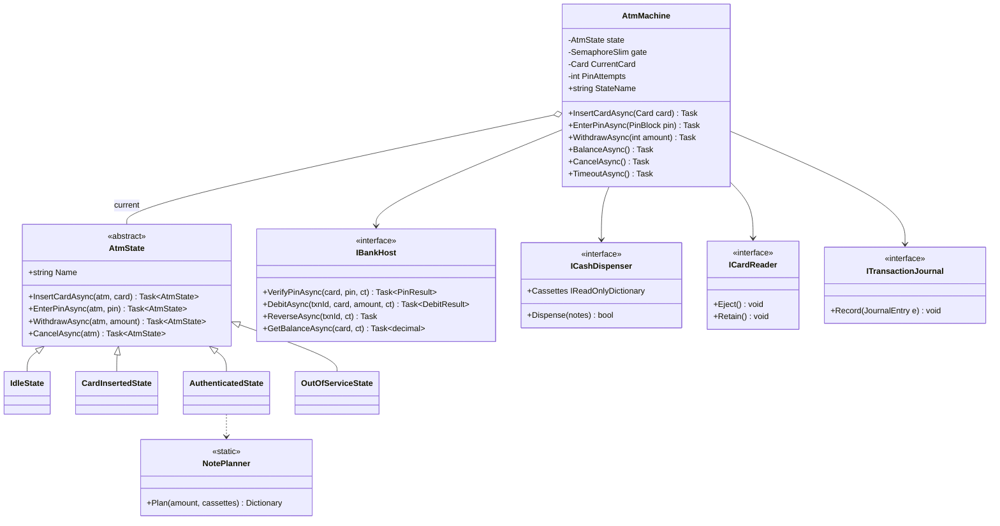
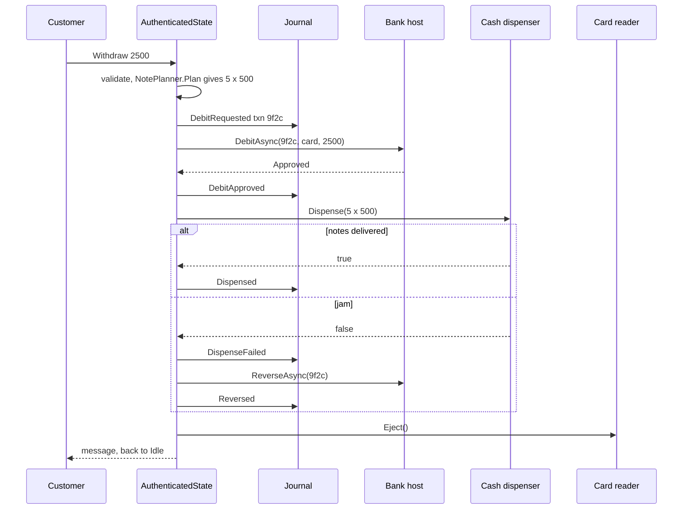
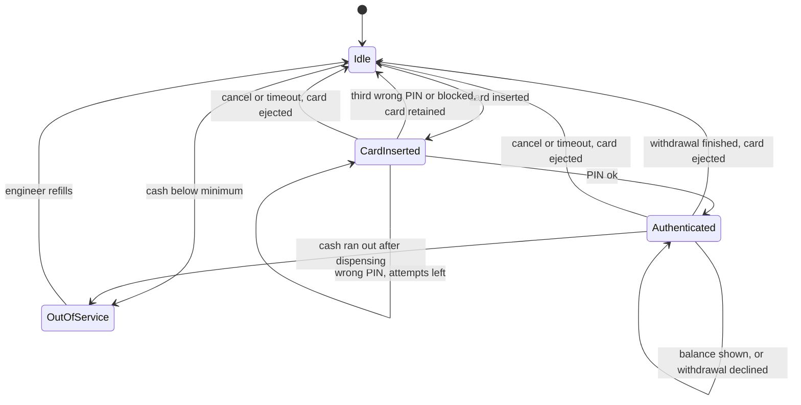
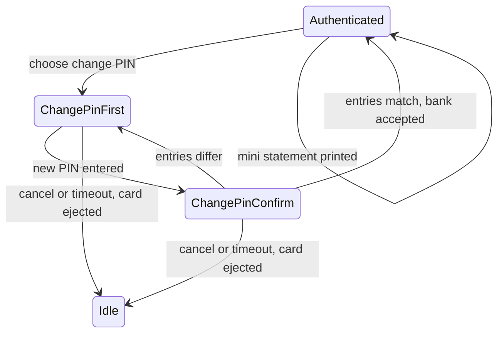

An ATM is a small computer with a card reader, a PIN pad, a cash dispenser and a network link to a bank. The LLD question tests two things. First, can you model a machine whose allowed actions depend on what has already happened (you can't withdraw before entering a PIN)? That is the State pattern. Second, can you keep the money correct when a step fails halfway? The account is debited, then the dispenser jams. The bank doesn't answer. Two people withdraw from one joint account at the same moment. This is where most designs break.

## Learning objectives

By the end of this case study you will be able to:

1. Gather requirements for an ATM, including the failure cases interviewers care about.
2. Model the session as a state machine and implement it with the GoF State pattern, with one class per state.
3. Hide hardware and the bank behind interfaces (ports), and write in-memory adapters for tests and demos.
4. Order the steps of a withdrawal so every failure is recoverable, and write the compensating reversal.
5. Make bank-side debits idempotent by transaction id, and race-free for joint accounts.
6. Plan note dispensing with limited cassettes, and see why a greedy algorithm fails.
7. Test all of this with hand-written fakes.

## Prerequisites

- [State](#/lesson/m06-state): this lesson uses the classic class-per-state form.
- [Object lifecycle and state management](#/lesson/m07-lifecycle-state).
- [Idempotency keys](#/lesson/m10-idempotency): debits and reversals are retried safely by transaction id.
- [Transactions and ACID](#/lesson/m09-transactions-acid): for the bank side.

## Explain it like I'm a beginner

Think of an ATM as a very strict shop assistant with a script.

- When nobody is there, the only thing it listens for is "here's my card".
- Once you've given your card, the only thing it wants is your PIN. Pressing "withdraw" now does nothing.
- Once your PIN is right, it shows a menu: withdraw, balance, cancel.
- If you get the PIN wrong three times, it keeps your card.

Each "chapter" of the script is a **state**. In each state, some buttons work and others are ignored. Writing one small class per chapter, where each class says "here's what I do when you press each button", is the **State pattern**.

The second idea is about money. Suppose you ask for ₹2,000. The ATM does two things in two different places: it asks your bank to take ₹2,000 from your account, and it pushes four ₹500 notes out of the slot. What if the bank takes the money, and then the notes get stuck? You've lost ₹2,000 and have nothing in your hand. The ATM must notice and tell the bank "put it back". That "undo" is called a **compensating transaction** (an action that cancels the effect of an earlier one). In India you may have seen SMS messages like "your account was debited ... and has been reversed". That's this mechanism at work.

And if the network drops while the ATM is asking the bank? The ATM doesn't know whether the money was taken. So it sends "if you took it, put it back" with the same transaction number. The bank must handle that request safely even if it never saw the original. Handling a repeated request safely, by its id, is called **idempotency** (doing it twice has the same effect as doing it once).

## Requirements

### Clarifying questions

| Question | Assumed answer | Why it matters |
|---|---|---|
| Which operations? | Withdraw cash, balance enquiry, cancel. Deposits, PIN change and mini statements are extensions. | Each operation is a menu option in one state. |
| Card types? | Debit cards of any bank on the network. The ATM talks to one "bank host" interface; routing to other banks happens behind it. | The ATM shouldn't know about inter-bank switches. |
| Who checks the PIN? | The bank host. The ATM's encrypting PIN pad turns the PIN into an encrypted PIN block; our software never sees the digits. | Security: no PIN in memory, logs or tests. |
| PIN attempts? | Three wrong attempts in a session retains the card. The bank may also block the card. | A state transition with a side effect (retain). |
| Note denominations? | Cassettes of ₹500, ₹200 and ₹100 notes, with limited counts. | Some amounts can't be made from what's left. |
| Withdrawal limits? | A per-withdrawal maximum (₹10,000 here, as configuration) and a daily limit enforced by the bank. | Two kinds of limit, checked in two places. |
| What if the debit succeeds but cash fails? | Reverse the debit automatically, and record everything in a local journal. | The core failure case. |
| What if the bank doesn't answer? | Treat the outcome as unknown, send a reversal, and tell the customer. | Unknown is not the same as failed. |
| Concurrency? | One customer per ATM, but hardware events (card, keypad, timer) can arrive on different threads. Many ATMs can hit one account at once. | Two different concurrency problems. |
| Inactivity? | After 30 seconds without input, end the session and eject the card. | A timeout event in every state. |

### Functional requirements

1. Insert card → enter PIN → choose an operation → finish, with cancel available at every step.
2. Verify the PIN with the bank. Wrong PIN: show attempts left. Third wrong attempt or a "blocked" answer: retain the card.
3. Withdraw: amount must be a multiple of ₹100, within the per-withdrawal limit, and dispensable from the cassettes. Debit the account, dispense notes, eject the card.
4. If dispensing fails after a successful debit, reverse the debit. If the bank times out, send a reversal.
5. Balance enquiry: show the available balance and return to the menu.
6. Record every money-related step in an append-only journal for reconciliation.
7. Go out of service when cash runs out, and come back when an engineer refills it.

### Non-functional requirements

- **Money safety**: the customer is never debited without getting cash, or if they are, a reversal is recorded and retried until done. The bank never pays out twice for one transaction id.
- **Security**: PIN digits never enter our process; card numbers are masked in logs and screens.
- **Auditability**: every step has a journal entry with the transaction id and time.
- **Testability**: hardware and bank are behind interfaces with in-memory fakes.
- **Responsiveness**: the screen updates within about a second of input. Bank calls get a timeout (a few seconds; the exact figure is network-specific configuration).

## Identifying classes and responsibilities

Nouns: ATM, card, PIN, account, bank, cash, note, cassette, dispenser, card reader, screen, receipt, transaction, journal, limit. Verbs: insert, verify, withdraw, debit, dispense, reverse, eject, retain, record, time out.

| Class | Responsibility |
|---|---|
| `AtmMachine` | The **context** of the State pattern: holds the current state and session data (card, attempts), and serialises all input. |
| `AtmState` (abstract) and `IdleState`, `CardInsertedState`, `AuthenticatedState`, `OutOfServiceState` | Each decides what every input means in its chapter of the script, and returns the next state. |
| `IBankHost` | Port to the bank: verify PIN, debit, reverse, balance. Debit and reverse are idempotent by transaction id. |
| `ICardReader`, `ICashDispenser`, `IAtmDisplay` | Ports to the hardware. Real implementations wrap vendor device drivers (Adapter pattern). |
| `NotePlanner` | Pure function: which notes make up an amount, given what's in the cassettes. |
| `ITransactionJournal` | Append-only log of money steps, used for reconciliation and disputes. |
| `InMemoryBankHost` | A simulator of the bank side, used for demos and to show race-free, idempotent debits. |
| `Card`, `PinBlock`, result records | Small values passed between the above. |

Two responsibilities are easy to put in the wrong place:

- **"Is this amount allowed?"** splits in two. The ATM checks what it can physically do (multiples of ₹100, its own per-withdrawal limit, cassette contents). The bank checks the account (balance, daily limit). Neither should duplicate the other's rules.
- **"Did the money move?"** belongs to the bank's ledger, not to the ATM. The ATM's journal records what the ATM *asked* and *did*, which is what you need to reconcile the two.

## Class diagram



How to read it: `AtmMachine` holds exactly one current `AtmState`. Every public method on the machine forwards to the current state, which does the work and returns the next state. The four concrete states inherit from an abstract base whose default for every input is "not available now", so each state only overrides the inputs that make sense in it. The machine also holds references to the ports (bank, dispenser, card reader, journal), and states reach them through the machine. `AuthenticatedState` uses the pure `NotePlanner` before it asks the bank for any money.

The withdrawal flow, including the failure branch:



The order is deliberate. **Plan, then debit, then dispense.** Planning first means we never debit for an amount the machine can't deliver. Debiting before dispensing means the only possible failure after money moves is "debited but not dispensed", which a reversal fixes. The opposite order (dispense, then debit) risks "cash out, debit failed", which can't be undone. Recording each step in the journal *before* moving on means that after a power cut, the journal shows exactly how far the transaction got.

## Patterns and design decisions

### State pattern with stateless state objects

Unlike the [elevator](#/lesson/m18-elevator), where five simple states fit in one `switch`, the ATM's states differ in *which inputs they accept* and do real work (bank calls, journal entries) for each one. Class-per-state pays off here:

- Each state class is short and readable: `CardInsertedState` only deals with PINs, cancel and timeout.
- Invalid actions are handled once, in the base class: "That option is not available now."
- Adding a state (say, `DepositState`) doesn't touch the others.

State objects hold no data; session data (current card, PIN attempts) lives in the context. That means each state can be a single shared instance (`IdleState.Instance`), and there's no risk of a state object carrying stale data from the last customer.

### Ports and adapters for hardware and the bank

The vendor's cash dispenser driver, the card reader's SDK and the bank's ISO 8583 message format are all details. The domain talks to `ICashDispenser`, `ICardReader` and `IBankHost`, and an **Adapter** wraps each real device or protocol. Tests use in-memory fakes. This is the [hexagonal architecture](#/lesson/m02-hexagonal) idea at class level.

### Compensating transaction instead of a distributed transaction

The bank's ledger and the ATM's dispenser can't take part in one ACID transaction. Instead we order the steps so the only failure after money moves can be undone, and we undo it with a reversal. This is the core idea behind [sagas](#/lesson/m12-sagas), at the scale of one machine.

### Unknown is not failed

When the debit call times out, we don't know whether the bank applied it. Two wrong reactions are common: "treat it as failed and do nothing" (the customer may be debited with no cash and no reversal), and "retry the debit with a new id" (the customer may be debited twice). The right reaction is to send a reversal for the *same* transaction id. The bank's reversal is idempotent: if it applied the debit, it credits it back once; if it never saw the debit, it records a "tombstone" so a late-arriving debit with that id is refused.

### Concurrency: two problems, two tools

1. **Inside one ATM**, input events come from the card reader driver, the PIN pad, the screen and the inactivity timer, possibly on different threads. Without care, the timeout could eject the card while a debit is in flight. `AtmMachine` funnels every input through a `SemaphoreSlim(1, 1)`, an async-friendly lock. (A C# `lock` can't be held across `await`.) So a timeout that fires during a withdrawal waits, then runs against whatever state the withdrawal left, usually `Idle`, where it does nothing.
2. **Across ATMs**, two people with cards on one joint account withdraw ₹8,000 each from a ₹10,000 balance at the same instant. If the bank checks the balance and then debits in two steps, both pass the check. The bank must make "check and debit" one atomic step: a row lock, or a conditional update such as `UPDATE account SET balance = balance - 8000 WHERE id = $1 AND balance >= 8000`, where zero rows updated means insufficient funds. Our `InMemoryBankHost` uses a lock to simulate this.

## State transitions



Walk through it: the only way into Authenticated is a correct PIN. Every path out of a session ends in Idle with the card either ejected or retained, so a session can't leak into the next customer's. A *declined* withdrawal (insufficient funds, amount not possible) keeps the customer in Authenticated so they can try a smaller amount, which is friendlier than ejecting the card. A *completed* withdrawal ends the session, as most ATMs in India do, which also reduces "forgot my card" incidents. The machine goes OutOfService when the remaining cash drops below the smallest note it can dispense.

The withdrawal itself has internal steps (requested, approved, dispensed, reversed) that are *not* separate ATM states. They happen within one input and are recorded in the journal. Making them states would let other inputs (cancel, timeout) interleave with a half-finished money movement, which is exactly what we don't want.

## C# implementation

```text
AtmSystem/
  Program.cs
  Domain/Values.cs
  Domain/Ports.cs
  Domain/NotePlanner.cs
  Domain/AtmMachine.cs
  Domain/States.cs
  Infrastructure/InMemoryBankHost.cs
  Infrastructure/Simulators.cs
```

```csharp file=Domain/Values.cs
namespace AtmSystem.Domain;

public sealed record Card(string Number, string HolderName)
{
    public string Masked => Number.Length >= 4 ? "XXXX-XXXX-XXXX-" + Number[^4..] : "XXXX";
}

/// <summary>Opaque encrypted PIN block from the encrypting PIN pad. Our code never sees PIN digits.</summary>
public sealed record PinBlock(string Encrypted);

public enum PinCheck { Ok, Wrong, Blocked }
public sealed record PinResult(PinCheck Status, int AttemptsLeft);

public enum DebitStatus { Approved, InsufficientFunds, DailyLimitExceeded, Declined }
public sealed record DebitResult(DebitStatus Status);

/// <summary>Thrown by a bank host adapter when the outcome of a call is unknown (timeout, connection lost).</summary>
public sealed class HostUnavailableException(string message) : Exception(message);

public sealed record JournalEntry(Guid TransactionId, string Step, decimal Amount, string CardMasked, DateTimeOffset At);

public sealed class AtmOptions
{
    public int MaxPinAttempts { get; init; } = 3;
    public int MaxPerWithdrawal { get; init; } = 10_000;
    public TimeSpan HostTimeout { get; init; } = TimeSpan.FromSeconds(10);
}
```

```csharp file=Domain/Ports.cs
namespace AtmSystem.Domain;

public interface IBankHost
{
    Task<PinResult> VerifyPinAsync(Card card, PinBlock pin, CancellationToken ct);
    /// <summary>Idempotent by transaction id: a repeat returns the first result and never debits twice.</summary>
    Task<DebitResult> DebitAsync(Guid transactionId, Card card, decimal amount, CancellationToken ct);
    /// <summary>Idempotent. Credits back an approved debit once; for an unknown id, blocks any later debit with it.</summary>
    Task ReverseAsync(Guid transactionId, CancellationToken ct);
    Task<decimal> GetBalanceAsync(Card card, CancellationToken ct);
}

public interface ICardReader
{
    void Eject();
    void Retain();
}

public interface ICashDispenser
{
    /// <summary>Note value to count, e.g. { 500: 400, 200: 500, 100: 600 }.</summary>
    IReadOnlyDictionary<int, int> Cassettes { get; }
    /// <summary>Returns false if the notes could not be delivered (jam, shutter fault).</summary>
    bool Dispense(IReadOnlyDictionary<int, int> notes);
}

public interface IAtmDisplay
{
    void Show(string message);
}

public interface ITransactionJournal
{
    void Record(JournalEntry entry);
    IReadOnlyList<JournalEntry> Entries { get; }
}
```

```csharp file=Domain/NotePlanner.cs
namespace AtmSystem.Domain;

public static class NotePlanner
{
    /// <summary>
    /// Finds notes that add up to the amount using what's in the cassettes, preferring large notes.
    /// Backtracks, so ₹600 from {500 x 5, 200 x 5} correctly gives 3 x 200 where greedy would fail.
    /// Returns null when the amount can't be made.
    /// </summary>
    public static Dictionary<int, int>? Plan(int amount, IReadOnlyDictionary<int, int> available)
    {
        if (amount <= 0) return null;
        var denominations = available.Where(kv => kv.Value > 0 && kv.Key > 0).Select(kv => kv.Key).OrderDescending().ToArray();
        var chosen = new int[denominations.Length];
        if (!Search(0, amount)) return null;
        return denominations.Select((d, i) => (d, n: chosen[i])).Where(x => x.n > 0).ToDictionary(x => x.d, x => x.n);

        bool Search(int index, int remaining)
        {
            if (remaining == 0) return true;
            if (index == denominations.Length) return false;
            var note = denominations[index];
            for (var use = Math.Min(available[note], remaining / note); use >= 0; use--)
            {
                chosen[index] = use;
                if (Search(index + 1, remaining - use * note)) return true;
            }
            chosen[index] = 0;
            return false;
        }
    }
}
```

```csharp file=Domain/AtmMachine.cs
namespace AtmSystem.Domain;

/// <summary>
/// Context of the State pattern. All input goes through one async gate, so hardware events arriving on
/// different threads (card reader, keypad, inactivity timer) are handled strictly one at a time.
/// </summary>
public sealed class AtmMachine
{
    private readonly SemaphoreSlim _gate = new(1, 1);
    private AtmState _state;

    public AtmMachine(IBankHost host, ICardReader cardReader, ICashDispenser dispenser, IAtmDisplay display,
        ITransactionJournal journal, AtmOptions options, TimeProvider clock)
    {
        Host = host; CardReader = cardReader; Dispenser = dispenser; Display = display;
        Journal = journal; Options = options; Clock = clock;
        _state = HasCash ? IdleState.Instance : OutOfServiceState.Instance;
    }

    internal IBankHost Host { get; }
    internal ICardReader CardReader { get; }
    internal ICashDispenser Dispenser { get; }
    internal IAtmDisplay Display { get; }
    internal ITransactionJournal Journal { get; }
    internal AtmOptions Options { get; }
    internal TimeProvider Clock { get; }
    internal Card? CurrentCard { get; set; }
    internal int PinAttempts { get; set; }

    public string StateName => _state.Name;
    internal bool HasCash => Dispenser.Cassettes.Any(kv => kv.Value > 0);

    public Task InsertCardAsync(Card card) => Handle(s => s.InsertCardAsync(this, card));
    public Task EnterPinAsync(PinBlock pin) => Handle(s => s.EnterPinAsync(this, pin));
    public Task WithdrawAsync(int amount) => Handle(s => s.WithdrawAsync(this, amount));
    public Task BalanceAsync() => Handle(s => s.BalanceAsync(this));
    public Task CancelAsync() => Handle(s => s.CancelAsync(this));
    public Task TimeoutAsync() => Handle(s => s.TimeoutAsync(this));
    public Task RefilledAsync() => Handle(s => s.RefilledAsync(this));

    private async Task Handle(Func<AtmState, Task<AtmState>> input)
    {
        await _gate.WaitAsync();
        try { _state = await input(_state); }
        finally { _gate.Release(); }
    }

    internal CancellationTokenSource HostTimeout() => new(Options.HostTimeout, Clock);

    internal void Log(Guid txnId, string step, decimal amount) =>
        Journal.Record(new JournalEntry(txnId, step, amount, CurrentCard?.Masked ?? "-", Clock.GetUtcNow()));

    /// <summary>Every session ends here, so card handling and cleanup can't be forgotten.</summary>
    internal AtmState EndSession(string message, bool retainCard = false)
    {
        if (retainCard) CardReader.Retain(); else CardReader.Eject();
        CurrentCard = null;
        PinAttempts = 0;
        Display.Show(message);
        return HasCash ? IdleState.Instance : OutOfServiceState.Instance;
    }
}
```

```csharp file=Domain/States.cs
namespace AtmSystem.Domain;

/// <summary>Base state: every input is "not available" unless a concrete state overrides it.</summary>
public abstract class AtmState
{
    public abstract string Name { get; }

    public virtual Task<AtmState> InsertCardAsync(AtmMachine atm, Card card) => Reject(atm);
    public virtual Task<AtmState> EnterPinAsync(AtmMachine atm, PinBlock pin) => Reject(atm);
    public virtual Task<AtmState> WithdrawAsync(AtmMachine atm, int amount) => Reject(atm);
    public virtual Task<AtmState> BalanceAsync(AtmMachine atm) => Reject(atm);
    public virtual Task<AtmState> CancelAsync(AtmMachine atm) => Task.FromResult(this);
    public virtual Task<AtmState> TimeoutAsync(AtmMachine atm) => Task.FromResult(this);
    public virtual Task<AtmState> RefilledAsync(AtmMachine atm) => Task.FromResult(this);

    protected Task<AtmState> Reject(AtmMachine atm)
    {
        atm.Display.Show("That option is not available now.");
        return Task.FromResult(this);
    }

    protected static bool IsUnknownOutcome(Exception ex) =>
        ex is HostUnavailableException or OperationCanceledException or TimeoutException;
}

public sealed class IdleState : AtmState
{
    public static readonly IdleState Instance = new();
    public override string Name => "Idle";

    public override Task<AtmState> InsertCardAsync(AtmMachine atm, Card card)
    {
        atm.CurrentCard = card;
        atm.PinAttempts = 0;
        atm.Display.Show("Please enter your PIN.");
        return Task.FromResult<AtmState>(CardInsertedState.Instance);
    }
}

public sealed class CardInsertedState : AtmState
{
    public static readonly CardInsertedState Instance = new();
    public override string Name => "CardInserted";

    public override async Task<AtmState> EnterPinAsync(AtmMachine atm, PinBlock pin)
    {
        PinResult result;
        try
        {
            using var timeout = atm.HostTimeout();
            result = await atm.Host.VerifyPinAsync(atm.CurrentCard!, pin, timeout.Token);
        }
        catch (Exception ex) when (IsUnknownOutcome(ex))
        {
            return atm.EndSession("Service temporarily unavailable. Please take your card.");
        }

        switch (result.Status)
        {
            case PinCheck.Ok:
                atm.Display.Show("1 Withdraw  2 Balance  3 Cancel");
                return AuthenticatedState.Instance;
            case PinCheck.Blocked:
                return atm.EndSession("Your card has been retained. Please contact your bank.", retainCard: true);
            default:
                atm.PinAttempts++;
                if (atm.PinAttempts >= atm.Options.MaxPinAttempts || result.AttemptsLeft <= 0)
                    return atm.EndSession("Incorrect PIN entered too many times. Your card has been retained.", retainCard: true);
                atm.Display.Show($"Incorrect PIN. {atm.Options.MaxPinAttempts - atm.PinAttempts} attempt(s) left.");
                return this;
        }
    }

    public override Task<AtmState> CancelAsync(AtmMachine atm) => Task.FromResult(atm.EndSession("Please take your card."));
    public override Task<AtmState> TimeoutAsync(AtmMachine atm) => Task.FromResult(atm.EndSession("Session timed out. Please take your card."));
}

public sealed class AuthenticatedState : AtmState
{
    public static readonly AuthenticatedState Instance = new();
    public override string Name => "Authenticated";

    public override async Task<AtmState> BalanceAsync(AtmMachine atm)
    {
        try
        {
            using var timeout = atm.HostTimeout();
            var balance = await atm.Host.GetBalanceAsync(atm.CurrentCard!, timeout.Token);
            atm.Display.Show($"Available balance: ₹{balance:N2}");
            return this;
        }
        catch (Exception ex) when (IsUnknownOutcome(ex))
        {
            return atm.EndSession("Service temporarily unavailable. Please take your card.");
        }
    }

    public override async Task<AtmState> WithdrawAsync(AtmMachine atm, int amount)
    {
        // 1. Checks the ATM itself owns: note multiples, its own limit, what's physically in the cassettes.
        if (amount <= 0 || amount % 100 != 0) { atm.Display.Show("Please enter a multiple of ₹100."); return this; }
        if (amount > atm.Options.MaxPerWithdrawal) { atm.Display.Show($"The maximum per withdrawal is ₹{atm.Options.MaxPerWithdrawal:N0}."); return this; }
        var notes = NotePlanner.Plan(amount, atm.Dispenser.Cassettes);
        if (notes is null) { atm.Display.Show($"This ATM cannot dispense ₹{amount:N0} right now. Please try another amount."); return this; }

        // 2. Debit first. Journal before and after every step so a crash leaves a clear trail.
        var txnId = Guid.NewGuid();
        atm.Log(txnId, "DebitRequested", amount);
        DebitResult debit;
        try
        {
            using var timeout = atm.HostTimeout();
            debit = await atm.Host.DebitAsync(txnId, atm.CurrentCard!, amount, timeout.Token);
        }
        catch (Exception ex) when (IsUnknownOutcome(ex))
        {
            // Outcome unknown: the bank may have debited. Reverse with the same id (idempotent at the bank).
            atm.Log(txnId, "DebitOutcomeUnknown", amount);
            await ReverseAsync(atm, txnId, amount);
            return atm.EndSession("Transaction could not be completed. Any amount debited will be reversed automatically.");
        }

        if (debit.Status != DebitStatus.Approved)
        {
            atm.Log(txnId, "Declined:" + debit.Status, amount);
            atm.Display.Show(debit.Status switch
            {
                DebitStatus.InsufficientFunds => "Insufficient funds.",
                DebitStatus.DailyLimitExceeded => "Daily withdrawal limit exceeded.",
                _ => "Transaction declined by your bank.",
            });
            return this;
        }
        atm.Log(txnId, "DebitApproved", amount);

        // 3. Dispense. The only failure from here on is "debited, not dispensed", which a reversal fixes.
        bool delivered;
        try { delivered = atm.Dispenser.Dispense(notes); }
        catch (Exception) { delivered = false; }

        if (!delivered)
        {
            atm.Log(txnId, "DispenseFailed", amount);
            await ReverseAsync(atm, txnId, amount);
            return atm.EndSession("Unable to dispense cash. Your account will be credited back.");
        }

        atm.Log(txnId, "Dispensed", amount);
        return atm.EndSession($"Please take your cash: ₹{amount:N0}. Thank you.");
    }

    private static async Task ReverseAsync(AtmMachine atm, Guid txnId, decimal amount)
    {
        try
        {
            using var timeout = atm.HostTimeout();
            await atm.Host.ReverseAsync(txnId, timeout.Token);
            atm.Log(txnId, "Reversed", amount);
        }
        catch (Exception ex) when (IsUnknownOutcome(ex))
        {
            // Store and forward: a background reconciler retries pending reversals from the journal.
            atm.Log(txnId, "ReversalPending", amount);
        }
    }

    public override Task<AtmState> CancelAsync(AtmMachine atm) => Task.FromResult(atm.EndSession("Please take your card."));
    public override Task<AtmState> TimeoutAsync(AtmMachine atm) => Task.FromResult(atm.EndSession("Session timed out. Please take your card."));
}

public sealed class OutOfServiceState : AtmState
{
    public static readonly OutOfServiceState Instance = new();
    public override string Name => "OutOfService";

    public override Task<AtmState> InsertCardAsync(AtmMachine atm, Card card)
    {
        atm.CardReader.Eject();
        atm.Display.Show("Sorry, this ATM is temporarily out of service.");
        return Task.FromResult<AtmState>(this);
    }

    public override Task<AtmState> RefilledAsync(AtmMachine atm) =>
        Task.FromResult<AtmState>(atm.HasCash ? IdleState.Instance : this);
}
```

```csharp file=Infrastructure/InMemoryBankHost.cs
using AtmSystem.Domain;

namespace AtmSystem.Infrastructure;

/// <summary>
/// Simulates the bank side. One lock makes "check balance and debit" atomic, which is what a real ledger does
/// with a row lock or a conditional UPDATE. Debits and reversals are idempotent by transaction id.
/// </summary>
public sealed class InMemoryBankHost : IBankHost
{
    private sealed class Account
    {
        public required string PinBlock { get; init; }
        public decimal Balance { get; set; }
        public decimal DailyLimit { get; init; }
        public decimal WithdrawnToday { get; set; }
        public int WrongPins { get; set; }
    }

    private sealed record Debit(string CardNumber, decimal Amount, DebitResult Result);

    private const int MaxWrongPins = 3;
    private readonly object _sync = new();
    private readonly Dictionary<string, Account> _accounts = new();
    private readonly Dictionary<Guid, Debit> _debits = new();
    private readonly HashSet<Guid> _reversed = new();

    public void OpenAccount(string cardNumber, string pinBlock, decimal balance, decimal dailyLimit = 25_000m)
    {
        lock (_sync) _accounts[cardNumber] = new Account { PinBlock = pinBlock, Balance = balance, DailyLimit = dailyLimit };
    }

    /// <summary>Several cards (a joint account) can share one account object.</summary>
    public void LinkCard(string existingCard, string newCard)
    {
        lock (_sync) _accounts[newCard] = _accounts[existingCard];
    }

    public decimal BalanceOf(string cardNumber) { lock (_sync) return _accounts[cardNumber].Balance; }

    public Task<PinResult> VerifyPinAsync(Card card, PinBlock pin, CancellationToken ct)
    {
        lock (_sync)
        {
            if (!_accounts.TryGetValue(card.Number, out var acct)) return Task.FromResult(new PinResult(PinCheck.Blocked, 0));
            if (acct.WrongPins >= MaxWrongPins) return Task.FromResult(new PinResult(PinCheck.Blocked, 0));
            // A real host verifies the PIN block inside a hardware security module, never by string comparison.
            if (acct.PinBlock == pin.Encrypted) { acct.WrongPins = 0; return Task.FromResult(new PinResult(PinCheck.Ok, MaxWrongPins)); }
            acct.WrongPins++;
            var left = MaxWrongPins - acct.WrongPins;
            return Task.FromResult(new PinResult(left == 0 ? PinCheck.Blocked : PinCheck.Wrong, left));
        }
    }

    public Task<DebitResult> DebitAsync(Guid transactionId, Card card, decimal amount, CancellationToken ct)
    {
        lock (_sync)
        {
            if (_debits.TryGetValue(transactionId, out var earlier)) return Task.FromResult(earlier.Result); // retry
            DebitResult result;
            if (_reversed.Contains(transactionId)) result = new(DebitStatus.Declined);      // reversal arrived first
            else if (!_accounts.TryGetValue(card.Number, out var acct)) result = new(DebitStatus.Declined);
            else if (acct.Balance < amount) result = new(DebitStatus.InsufficientFunds);
            else if (acct.WithdrawnToday + amount > acct.DailyLimit) result = new(DebitStatus.DailyLimitExceeded);
            else
            {
                acct.Balance -= amount;
                acct.WithdrawnToday += amount;
                result = new(DebitStatus.Approved);
            }
            _debits[transactionId] = new Debit(card.Number, amount, result);
            return Task.FromResult(result);
        }
    }

    public Task ReverseAsync(Guid transactionId, CancellationToken ct)
    {
        lock (_sync)
        {
            if (!_reversed.Add(transactionId)) return Task.CompletedTask;                 // already reversed
            if (_debits.TryGetValue(transactionId, out var d) && d.Result.Status == DebitStatus.Approved)
            {
                var acct = _accounts[d.CardNumber];
                acct.Balance += d.Amount;
                acct.WithdrawnToday -= d.Amount;
            }
            // Unknown id: the tombstone in _reversed makes a late-arriving debit with this id decline.
            return Task.CompletedTask;
        }
    }

    public Task<decimal> GetBalanceAsync(Card card, CancellationToken ct)
    {
        lock (_sync) return Task.FromResult(_accounts[card.Number].Balance);
    }
}
```

```csharp file=Infrastructure/Simulators.cs
using AtmSystem.Domain;
using Microsoft.Extensions.Logging;

namespace AtmSystem.Infrastructure;

public sealed class SimulatedCashDispenser(IDictionary<int, int> initial) : ICashDispenser
{
    private readonly object _sync = new();
    private readonly Dictionary<int, int> _cassettes = new(initial);

    /// <summary>Test hook: makes the next Dispense call fail as if the notes jammed.</summary>
    public bool JamNext { get; set; }

    public IReadOnlyDictionary<int, int> Cassettes { get { lock (_sync) return new Dictionary<int, int>(_cassettes); } }

    public bool Dispense(IReadOnlyDictionary<int, int> notes)
    {
        lock (_sync)
        {
            if (JamNext) { JamNext = false; return false; }
            if (notes.Any(n => !_cassettes.TryGetValue(n.Key, out var have) || have < n.Value)) return false;
            foreach (var (note, count) in notes) _cassettes[note] -= count;
            return true;
        }
    }

    public void Refill(int note, int count) { lock (_sync) _cassettes[note] = _cassettes.GetValueOrDefault(note) + count; }
}

public sealed class SimulatedCardReader(ILogger<SimulatedCardReader> log) : ICardReader
{
    public void Eject() => log.LogInformation("Card ejected");
    public void Retain() => log.LogWarning("Card retained");
}

public sealed class LoggingDisplay(ILogger<LoggingDisplay> log) : IAtmDisplay
{
    public string LastMessage { get; private set; } = "";
    public void Show(string message) { LastMessage = message; log.LogInformation("Screen: {Message}", message); }
}

public sealed class InMemoryJournal : ITransactionJournal
{
    private readonly List<JournalEntry> _entries = new();
    public void Record(JournalEntry entry) { lock (_entries) _entries.Add(entry); }
    public IReadOnlyList<JournalEntry> Entries { get { lock (_entries) return _entries.ToList(); } }
}
```

```csharp file=Program.cs
using AtmSystem.Domain;
using AtmSystem.Infrastructure;

var builder = WebApplication.CreateBuilder(args);

var bank = new InMemoryBankHost();
bank.OpenAccount("4111111111111111", pinBlock: "enc:demo-1234", balance: 12_500m);
builder.Services.AddSingleton<IBankHost>(bank);
builder.Services.AddSingleton(new SimulatedCashDispenser(new Dictionary<int, int> { [500] = 400, [200] = 500, [100] = 600 }));
builder.Services.AddSingleton<ICashDispenser>(sp => sp.GetRequiredService<SimulatedCashDispenser>());
builder.Services.AddSingleton<ICardReader, SimulatedCardReader>();
builder.Services.AddSingleton<LoggingDisplay>();
builder.Services.AddSingleton<IAtmDisplay>(sp => sp.GetRequiredService<LoggingDisplay>());
builder.Services.AddSingleton<ITransactionJournal, InMemoryJournal>();
builder.Services.AddSingleton(new AtmOptions());
builder.Services.AddSingleton(TimeProvider.System);
builder.Services.AddSingleton<AtmMachine>();

var app = builder.Build();

// These endpoints stand in for hardware events in a simulator UI.
app.MapPost("/atm/card", async (CardRequest r, AtmMachine atm, LoggingDisplay screen) =>
{
    await atm.InsertCardAsync(new Card(r.Number, r.HolderName));
    return Results.Ok(new { atm.StateName, screen.LastMessage });
});
app.MapPost("/atm/pin", async (PinRequest r, AtmMachine atm, LoggingDisplay screen) =>
{
    await atm.EnterPinAsync(new PinBlock(r.PinBlock));
    return Results.Ok(new { atm.StateName, screen.LastMessage });
});
app.MapPost("/atm/withdraw", async (WithdrawRequest r, AtmMachine atm, LoggingDisplay screen) =>
{
    await atm.WithdrawAsync(r.Amount);
    return Results.Ok(new { atm.StateName, screen.LastMessage });
});
app.MapPost("/atm/cancel", async (AtmMachine atm, LoggingDisplay screen) =>
{
    await atm.CancelAsync();
    return Results.Ok(new { atm.StateName, screen.LastMessage });
});
app.MapGet("/atm/journal", (ITransactionJournal journal) => Results.Ok(journal.Entries));

app.Run();

public sealed record CardRequest(string Number, string HolderName);
public sealed record PinRequest(string PinBlock);
public sealed record WithdrawRequest(int Amount);
```

Points worth defending in an interview:

- **`EndSession` is the only exit.** Every path that ends a session calls it, so "eject or retain the card, clear the session, pick Idle or OutOfService" can't be half-done in one branch.
- **Journal entries are written before and after each external call.** If the ATM loses power between `DebitApproved` and `Dispensed`, the journal on restart shows a debit with no dispense, and the reconciler sends a reversal.
- **The ATM never retries a debit with a new id.** Retrying "the same thing" must reuse the id, or it becomes a second withdrawal.
- **Timeouts produce `OperationCanceledException`.** We treat it the same as "host unavailable": outcome unknown, so reverse.

## Automated testing

Hand-written fakes make every failure path easy to trigger.

```csharp
using AtmSystem.Domain;
using AtmSystem.Infrastructure;
using Xunit;

public sealed class FakeCardReader : ICardReader
{
    public int Ejected, Retained;
    public void Eject() => Ejected++;
    public void Retain() => Retained++;
}

public sealed class FakeDisplay : IAtmDisplay
{
    public List<string> Messages { get; } = new();
    public string Last => Messages[^1];
    public void Show(string message) => Messages.Add(message);
}

/// <summary>Wraps the in-memory bank and can simulate a timeout on the next debit.</summary>
public sealed class FlakyBankHost(InMemoryBankHost inner) : IBankHost
{
    public bool TimeoutNextDebitAfterApplying { get; set; }
    public List<Guid> Reversals { get; } = new();
    public int DebitCalls { get; private set; }

    public Task<PinResult> VerifyPinAsync(Card c, PinBlock p, CancellationToken ct) => inner.VerifyPinAsync(c, p, ct);
    public async Task<DebitResult> DebitAsync(Guid id, Card c, decimal amount, CancellationToken ct)
    {
        DebitCalls++;
        var result = await inner.DebitAsync(id, c, amount, ct);
        if (TimeoutNextDebitAfterApplying) { TimeoutNextDebitAfterApplying = false; throw new HostUnavailableException("timeout"); }
        return result;
    }
    public Task ReverseAsync(Guid id, CancellationToken ct) { Reversals.Add(id); return inner.ReverseAsync(id, ct); }
    public Task<decimal> GetBalanceAsync(Card c, CancellationToken ct) => inner.GetBalanceAsync(c, ct);
}

public class AtmMachineTests
{
    private const string CardNo = "4111111111111111";
    private static readonly Card Card = new(CardNo, "A. Sharma");
    private static readonly PinBlock GoodPin = new("enc:ok"), BadPin = new("enc:bad");

    private readonly InMemoryBankHost _bank = new();
    private readonly FlakyBankHost _host;
    private readonly SimulatedCashDispenser _cash = new(new Dictionary<int, int> { [500] = 30, [200] = 10, [100] = 10 });
    private readonly FakeCardReader _reader = new();
    private readonly FakeDisplay _screen = new();
    private readonly InMemoryJournal _journal = new();
    private readonly AtmMachine _atm;

    public AtmMachineTests()
    {
        _bank.OpenAccount(CardNo, "enc:ok", balance: 10_000m);
        _host = new FlakyBankHost(_bank);
        _atm = new AtmMachine(_host, _reader, _cash, _screen, _journal, new AtmOptions(), TimeProvider.System);
    }

    private async Task LoggedIn() { await _atm.InsertCardAsync(Card); await _atm.EnterPinAsync(GoodPin); }

    [Fact]
    public async Task Happy_withdrawal_debits_dispenses_and_ejects()
    {
        await LoggedIn();
        await _atm.WithdrawAsync(2_500);
        Assert.Equal(7_500m, _bank.BalanceOf(CardNo));
        Assert.Equal(25, _cash.Cassettes[500]);
        Assert.Equal(1, _reader.Ejected);
        Assert.Equal("Idle", _atm.StateName);
        Assert.Equal(new[] { "DebitRequested", "DebitApproved", "Dispensed" }, _journal.Entries.Select(e => e.Step).ToArray());
    }

    [Fact]
    public async Task Withdraw_before_pin_is_rejected_without_calling_the_bank()
    {
        await _atm.InsertCardAsync(Card);
        await _atm.WithdrawAsync(1_000);
        Assert.Equal("CardInserted", _atm.StateName);
        Assert.Equal(0, _host.DebitCalls);
        Assert.Equal("That option is not available now.", _screen.Last);
    }

    [Fact]
    public async Task Three_wrong_pins_retain_the_card()
    {
        await _atm.InsertCardAsync(Card);
        await _atm.EnterPinAsync(BadPin);
        await _atm.EnterPinAsync(BadPin);
        Assert.Equal("CardInserted", _atm.StateName);
        await _atm.EnterPinAsync(BadPin);
        Assert.Equal(1, _reader.Retained);
        Assert.Equal("Idle", _atm.StateName);
    }

    [Fact]
    public async Task Odd_amount_is_refused_locally_and_session_continues()
    {
        await LoggedIn();
        await _atm.WithdrawAsync(1_250);
        Assert.Equal("Authenticated", _atm.StateName);
        Assert.Equal(0, _host.DebitCalls);
    }

    [Fact]
    public async Task Jam_after_debit_is_reversed()
    {
        await LoggedIn();
        _cash.JamNext = true;
        await _atm.WithdrawAsync(2_000);
        Assert.Equal(10_000m, _bank.BalanceOf(CardNo));
        Assert.Single(_host.Reversals);
        Assert.Contains("Reversed", _journal.Entries.Select(e => e.Step));
        Assert.Equal("Idle", _atm.StateName);
    }

    [Fact]
    public async Task Timeout_after_bank_applied_debit_is_reversed_with_same_id()
    {
        await LoggedIn();
        _host.TimeoutNextDebitAfterApplying = true;
        await _atm.WithdrawAsync(3_000);
        Assert.Equal(10_000m, _bank.BalanceOf(CardNo));
        Assert.Equal(_journal.Entries[0].TransactionId, Assert.Single(_host.Reversals));
        Assert.Equal(30, _cash.Cassettes[500]);                    // nothing dispensed
    }

    [Fact]
    public async Task Insufficient_funds_keeps_customer_in_menu()
    {
        await LoggedIn();
        await _atm.WithdrawAsync(10_000);   // ok: balance is exactly 10,000
        await _atm.InsertCardAsync(Card);
        await _atm.EnterPinAsync(GoodPin);
        await _atm.WithdrawAsync(100);
        Assert.Equal("Insufficient funds.", _screen.Last);
        Assert.Equal("Authenticated", _atm.StateName);
    }
}

public class NotePlannerTests
{
    [Fact]
    public void Greedy_trap_is_solved_by_backtracking()
    {
        var plan = NotePlanner.Plan(600, new Dictionary<int, int> { [500] = 5, [200] = 5 });
        Assert.NotNull(plan);
        Assert.Equal(3, plan![200]);
        Assert.False(plan.ContainsKey(500));
    }

    [Fact]
    public void Impossible_amount_returns_null() =>
        Assert.Null(NotePlanner.Plan(300, new Dictionary<int, int> { [500] = 5, [200] = 5 }));
}

public class BankHostConcurrencyTests
{
    [Fact]
    public async Task Joint_account_racing_withdrawals_never_overdraw()
    {
        var bank = new InMemoryBankHost();
        bank.OpenAccount("CARD-A", "x", balance: 10_000m, dailyLimit: 1_000_000m);
        bank.LinkCard("CARD-A", "CARD-B");
        var cards = new[] { new Card("CARD-A", "A"), new Card("CARD-B", "B") };

        var results = await Task.WhenAll(Enumerable.Range(0, 100).Select(i =>
            Task.Run(() => bank.DebitAsync(Guid.NewGuid(), cards[i % 2], 500m, CancellationToken.None))));

        Assert.Equal(20, results.Count(r => r.Status == DebitStatus.Approved));
        Assert.Equal(0m, bank.BalanceOf("CARD-A"));
    }

    [Fact]
    public async Task Retried_debit_with_same_id_debits_once()
    {
        var bank = new InMemoryBankHost();
        bank.OpenAccount("C", "x", 5_000m);
        var id = Guid.NewGuid();
        await bank.DebitAsync(id, new Card("C", "A"), 1_000m, CancellationToken.None);
        await bank.DebitAsync(id, new Card("C", "A"), 1_000m, CancellationToken.None);
        Assert.Equal(4_000m, bank.BalanceOf("C"));
    }

    [Fact]
    public async Task Reversal_that_arrives_before_the_debit_blocks_it()
    {
        var bank = new InMemoryBankHost();
        bank.OpenAccount("C", "x", 5_000m);
        var id = Guid.NewGuid();
        await bank.ReverseAsync(id, CancellationToken.None);
        var late = await bank.DebitAsync(id, new Card("C", "A"), 1_000m, CancellationToken.None);
        Assert.Equal(DebitStatus.Declined, late.Status);
        Assert.Equal(5_000m, bank.BalanceOf("C"));
    }
}
```

What to notice:

- **Failure paths are first-class tests.** The jam and the timeout tests check the money (balance back to ₹10,000), not just the message. In payment code, assert on money.
- **`FlakyBankHost` applies the debit and *then* throws**, which is the nasty real-world case: the bank did the work but the reply was lost. A fake that only throws before applying would miss the bug where the ATM forgets to reverse.
- **The concurrency test** fires 100 debits of ₹500 at a ₹10,000 joint account from two cards. Exactly 20 succeed and the balance ends at zero. Remove the lock from `DebitAsync` and the test can show approvals above 20 and a negative balance. The lock-free version would be a classic check-then-act race.
- **The "reversal before debit" test** covers a race that happens on real networks: the reversal message overtakes a delayed debit. Without a tombstone, the late debit would succeed and nobody would ever reverse it.

## Bad design vs good design

**Bad**: one class with an enum and nested `if`s, money steps in the wrong order, and a retry that creates a new transaction.

```csharp
public class Atm
{
    public string State = "IDLE";
    public string? Pin;                               // plain PIN in memory

    public void Withdraw(int amount)
    {
        if (State != "AUTH") return;                  // silently ignores input
        dispenser.Dispense(amount);                   // cash out first
        try { bank.Debit(card, amount); }
        catch (TimeoutException)
        {
            bank.Debit(card, amount);                 // retry: may debit twice, new id each time
        }
        Console.WriteLine($"Card {card.Number} withdrew {amount}");   // full card number in logs
        State = "IDLE";                               // forgot to eject the card
    }
}
```

What goes wrong:

- **Dispense before debit**: if the debit fails, the customer has the cash and the bank has no record. Nothing can be reversed.
- **Retry with a new transaction**: if the first debit actually succeeded and only the reply was lost, the customer is debited twice.
- **String states and silent `return`**: a typo like `"AUHT"` compiles, and pressing the wrong button gives no feedback.
- **Session cleanup scattered**: one branch forgets to eject the card. With `EndSession` there's only one place to get it right.
- **Plain PIN and full card numbers in logs** break card-industry security rules (PCI DSS) and invite fraud.
- **No journal**: a customer disputes a transaction and there's no record of what the machine did.

**Good**: the State pattern with one exit method, plan → debit → dispense ordering, reversals by the same id, an append-only journal, and masked card numbers.

**When is the class-per-state design overkill?** For a kiosk with two states and two inputs, an enum and a `switch` is clearer. The ATM earns the pattern because it has four or more states, each accepting a different set of inputs, and real work behind several of them.

## Alternative designs

1. **Enum plus transition table.** Keep states as an enum and define a table `(state, input) → handler`. Very compact, easy to print as documentation, and easy to validate ("every state handles Cancel"). The handlers still need somewhere to live, so for complex handlers the class-per-state design reads better.
2. **A state machine library.** Libraries such as Stateless (a popular open-source .NET library) give you guards, entry/exit actions and diagram export. Worth it for dozens of states. For four, plain classes are easier to read and debug.
3. **Withdrawal as an explicit saga object.** Model `WithdrawalSaga` with steps and compensations (`Debit` ↔ `Reverse`, `Dispense` ↔ none), persisted after every step. Overkill for one ATM in memory, but it is how a bank's back-end orchestrates multi-step payments, and it makes crash recovery explicit. See [Saga orchestration and choreography](#/lesson/m16-saga-orchestration-choreography).
4. **Pre-authorisation (hold) instead of debit.** Ask the bank to *hold* the amount, dispense, then *capture* the hold. A failed dispense becomes "release the hold" instead of a reversal, which is cleaner for the customer's statement. It costs an extra round-trip and needs the bank to support holds, which is common for card payments and less common for ATM withdrawals.
5. **Actor or channel instead of `SemaphoreSlim`.** Put all hardware events into a `Channel<AtmInput>` with one consumer loop. Equivalent safety; nicer when inputs also need to be logged or replayed for debugging.

## Practical playground

Open the reference class model. Try adding a `DepositState` and a `ChangePinState`. Check that each new state only needs one `inherits` arrow plus the ports it uses. If you find yourself adding arrows between states, a state is doing another state's job.

:::playground type=lld title="ATM reference model"
```json
{
  "classes": [
    { "id": "Atm", "name": "AtmMachine", "kind": "class",
      "fields": ["-AtmState _state", "-SemaphoreSlim _gate", "~Card? CurrentCard", "~int PinAttempts"],
      "methods": ["+Task InsertCardAsync(Card card)", "+Task EnterPinAsync(PinBlock pin)", "+Task WithdrawAsync(int amount)", "+Task BalanceAsync()", "+Task CancelAsync()", "+Task TimeoutAsync()", "~AtmState EndSession(string message, bool retainCard)"],
      "responsibility": "State pattern context; serialises all input" },
    { "id": "State", "name": "AtmState", "kind": "abstract",
      "fields": ["+string Name"],
      "methods": ["+Task~AtmState~ InsertCardAsync(atm, card)", "+Task~AtmState~ EnterPinAsync(atm, pin)", "+Task~AtmState~ WithdrawAsync(atm, amount)", "+Task~AtmState~ CancelAsync(atm)"],
      "responsibility": "Default: reject every input" },
    { "id": "Idle", "name": "IdleState", "kind": "class", "fields": [], "methods": ["+InsertCardAsync"] },
    { "id": "CardIn", "name": "CardInsertedState", "kind": "class", "fields": [], "methods": ["+EnterPinAsync", "+CancelAsync", "+TimeoutAsync"] },
    { "id": "Auth", "name": "AuthenticatedState", "kind": "class", "fields": [], "methods": ["+WithdrawAsync", "+BalanceAsync", "+CancelAsync", "+TimeoutAsync"],
      "responsibility": "Plan, debit, dispense, reverse on failure" },
    { "id": "Oos", "name": "OutOfServiceState", "kind": "class", "fields": [], "methods": ["+InsertCardAsync", "+RefilledAsync"] },
    { "id": "Host", "name": "IBankHost", "kind": "interface", "fields": [],
      "methods": ["Task~PinResult~ VerifyPinAsync(card, pin, ct)", "Task~DebitResult~ DebitAsync(txnId, card, amount, ct)", "Task ReverseAsync(txnId, ct)", "Task~decimal~ GetBalanceAsync(card, ct)"] },
    { "id": "Disp", "name": "ICashDispenser", "kind": "interface", "fields": ["+IReadOnlyDictionary Cassettes"], "methods": ["bool Dispense(notes)"] },
    { "id": "Reader", "name": "ICardReader", "kind": "interface", "fields": [], "methods": ["void Eject()", "void Retain()"] },
    { "id": "Journal", "name": "ITransactionJournal", "kind": "interface", "fields": [], "methods": ["void Record(JournalEntry entry)"] },
    { "id": "Planner", "name": "NotePlanner", "kind": "class", "fields": [], "methods": ["+static Dictionary? Plan(int amount, cassettes)"],
      "responsibility": "Backtracking note selection" },
    { "id": "Bank", "name": "InMemoryBankHost", "kind": "class", "fields": ["-object _sync", "-Dictionary _debits", "-HashSet~Guid~ _reversed"],
      "methods": ["+DebitAsync", "+ReverseAsync"], "responsibility": "Atomic, idempotent debits and reversals" },
    { "id": "Card", "name": "Card", "kind": "record", "fields": ["+string Number", "+string HolderName"], "methods": ["+string Masked"] }
  ],
  "relations": [
    { "from": "Atm", "to": "State", "kind": "aggregation", "label": "current" },
    { "from": "Idle", "to": "State", "kind": "inherits" },
    { "from": "CardIn", "to": "State", "kind": "inherits" },
    { "from": "Auth", "to": "State", "kind": "inherits" },
    { "from": "Oos", "to": "State", "kind": "inherits" },
    { "from": "Atm", "to": "Host", "kind": "dependency" },
    { "from": "Atm", "to": "Disp", "kind": "dependency" },
    { "from": "Atm", "to": "Reader", "kind": "dependency" },
    { "from": "Atm", "to": "Journal", "kind": "dependency" },
    { "from": "Auth", "to": "Planner", "kind": "dependency" },
    { "from": "Bank", "to": "Host", "kind": "implements" },
    { "from": "Atm", "to": "Card", "kind": "association", "label": "session" }
  ]
}
```
:::

## Exercises

:::exercise id=m18-atm-ex1 difficulty=beginner kind=code title="Plan the notes"
Implement `NotePlanner.Plan(amount, available)`: return how many notes of each value to dispense, using only what's in the cassettes, or `null` if the amount can't be made. Prefer larger notes, but never fail when a valid combination exists.
::requirements
- Only denominations with a positive count may be used, and never more than are available.
- The result contains only denominations actually used.
- `amount <= 0` returns null.
::acceptance
- ₹2,500 from plenty of ₹500s gives five ₹500 notes.
- ₹600 from {₹500 × 5, ₹200 × 5} gives three ₹200 notes (greedy would fail).
- ₹300 from {₹500 × 5, ₹200 × 5} returns null.
- ₹1,800 from {₹500 × 1, ₹200 × 10, ₹100 × 0} gives nine ₹200 notes: one ₹500 would leave ₹1,300, which ₹200 notes can't make.
::hint
Try greedy first on paper with ₹600 and {500, 200}. Where does it go wrong?
::hint
You need to be able to "undo" a choice of large notes and try fewer of them. That's backtracking.
::hint
Recursive search over denominations from largest to smallest: for the current note, try using `min(available, remaining / note)` of it, then one fewer, down to zero, recursing on the rest.
::hint
```csharp
bool Search(int i, int remaining)
{
    if (remaining == 0) return true;
    if (i == notes.Length) return false;
    for (var use = Math.Min(avail[notes[i]], remaining / notes[i]); use >= 0; use--)
    { chosen[i] = use; if (Search(i + 1, remaining - use * notes[i])) return true; }
    chosen[i] = 0; return false;
}
```
::starter
```csharp file=NotePlanner.cs
using System;
using System.Collections.Generic;
using System.Linq;

public static class NotePlanner
{
    public static Dictionary<int, int>? Plan(int amount, IReadOnlyDictionary<int, int> available) =>
        throw new NotImplementedException();
}
```
::tests
```csharp file=NotePlannerTests.cs
using System.Collections.Generic;
using System.Linq;
using Xunit;

public class NotePlannerExerciseTests
{
    private static int Total(Dictionary<int, int> p) => p.Sum(kv => kv.Key * kv.Value);

    [Fact]
    public void Prefers_large_notes()
    {
        var p = NotePlanner.Plan(2_500, new Dictionary<int, int> { [500] = 100, [200] = 100, [100] = 100 })!;
        Assert.Equal(5, p[500]);
        Assert.Single(p);
    }

    [Fact]
    public void Solves_the_greedy_trap()
    {
        var p = NotePlanner.Plan(600, new Dictionary<int, int> { [500] = 5, [200] = 5 })!;
        Assert.Equal(3, p[200]);
        Assert.False(p.ContainsKey(500));
    }

    [Fact]
    public void Impossible_returns_null() =>
        Assert.Null(NotePlanner.Plan(300, new Dictionary<int, int> { [500] = 5, [200] = 5 }));

    [Fact]
    public void Respects_counts()
    {
        var avail = new Dictionary<int, int> { [500] = 1, [200] = 10, [100] = 0 };
        var p = NotePlanner.Plan(1_800, avail)!;
        Assert.Equal(1_800, Total(p));
        Assert.All(p, kv => Assert.True(kv.Value <= avail[kv.Key]));
        Assert.False(p.ContainsKey(100));
    }

    [Fact]
    public void Zero_or_negative_returns_null() =>
        Assert.Null(NotePlanner.Plan(0, new Dictionary<int, int> { [100] = 5 }));
}
```
::solution
```csharp file=NotePlanner.cs
using System;
using System.Collections.Generic;
using System.Linq;

public static class NotePlanner
{
    public static Dictionary<int, int>? Plan(int amount, IReadOnlyDictionary<int, int> available)
    {
        if (amount <= 0) return null;
        var notes = available.Where(kv => kv.Key > 0 && kv.Value > 0).Select(kv => kv.Key).OrderDescending().ToArray();
        var chosen = new int[notes.Length];
        if (!Search(0, amount)) return null;
        return notes.Select((n, i) => (n, c: chosen[i])).Where(x => x.c > 0).ToDictionary(x => x.n, x => x.c);

        bool Search(int i, int remaining)
        {
            if (remaining == 0) return true;
            if (i == notes.Length) return false;
            for (var use = Math.Min(available[notes[i]], remaining / notes[i]); use >= 0; use--)
            {
                chosen[i] = use;
                if (Search(i + 1, remaining - use * notes[i])) return true;
            }
            chosen[i] = 0;
            return false;
        }
    }
}
```

With three or four denominations and amounts up to ₹10,000, the search is tiny. Trying the most large notes first means the first answer found usually has few notes, which is what customers expect.

For ₹1,800 from {₹500 × 1, ₹200 × 10}: one ₹500 leaves ₹1,300, which ₹200s can't make (odd hundreds), so the search backs off to zero ₹500s and finds nine ₹200s.
::alternatives
Dynamic programming over amounts (in ₹100 steps) finds the minimum number of notes and handles many denominations efficiently. Use it if you add ₹2,000-style rare denominations or want to optimise "keep a mix of notes in the cassettes", which some operators prefer so small notes don't run out first.
::mistakes
- Greedy without backtracking: fails ₹600 from {500, 200}.
- Ignoring cassette counts and promising notes the machine doesn't have.
- Including zero-count entries in the result, which some dispenser drivers reject.
::extensions
Add a "note mix" preference: for amounts up to ₹2,000, include at least one ₹100 note if available, so customers get change for small purchases.
:::

:::exercise id=m18-atm-ex2 difficulty=beginner kind=design title="Add PIN change and mini statement"
Add two menu options: *change PIN* (enter the new PIN twice) and *mini statement* (print the last 10 transactions). Decide which new states you need, draw the updated state diagram, and say which ports change.
::acceptance
- The diagram shows exactly which states accept the new inputs.
- A mismatch between the two new PIN entries is handled without ending the session.
- You state where the new PIN is verified and stored (not in the ATM).
- Mini statement either needs a new state or doesn't; you justify the choice.
::hint
Which of the two is a single request-and-response, and which needs the customer to type more than once?
::hint
Change PIN needs to remember the first entry until the second arrives. Where does that session data live?
::hint
New port methods: `IBankHost.ChangePinAsync(card, oldPinVerifiedSession, newPinBlock)` and `IBankHost.GetMiniStatementAsync(card)`; a new `IReceiptPrinter` port.
::solution


- **Change PIN** needs two new states, because the ATM must wait for two separate entries. The first `PinBlock` is stored on the context (`AtmMachine.PendingNewPin`), never on the state object, and cleared in `EndSession`. Comparing two encrypted PIN blocks for equality may not be valid if the PIN pad uses random padding; in that case the PIN pad itself does the "enter twice" check, or the bank does. This is a good clarifying question to ask.
- **Mini statement** is one request and one response, so no new state: `AuthenticatedState.MiniStatementAsync` calls `IBankHost.GetMiniStatementAsync`, prints via `IReceiptPrinter`, and returns `this`.
- Ports: `IBankHost` gains `ChangePinAsync` and `GetMiniStatementAsync`; a new `IReceiptPrinter.Print(lines)`; `AtmState` base gains default-reject methods `ChangePinAsync` and `MiniStatementAsync`.
- The ATM never stores PINs. The bank's host verifies and stores PIN data in its HSM-backed system.
::mistakes
- Storing the first new PIN entry in a field of `ChangePinFirstState`. Shared state objects would leak it to the next customer.
- Making mini statement a state "because it's a screen". A state is about which inputs are accepted, not about screens.
:::

:::exercise id=m18-atm-ex3 difficulty=intermediate kind=code title="Make the withdrawal recoverable"
Implement `WithdrawalProcessor.ExecuteAsync`. It must plan the notes (already done for you), debit the account, dispense, and on any failure after the debit may have happened, send a reversal with the *same* transaction id. Return an outcome describing what happened.
::requirements
- Order: debit, then dispense.
- If the debit throws `HostUnavailableException`, reverse with the same id and return `Outcome.ReversedAfterTimeout`.
- If the debit is declined, don't dispense and don't reverse; return `Outcome.Declined`.
- If dispensing returns false or throws, reverse and return `Outcome.ReversedAfterDispenseFailure`.
- If the reversal itself throws `HostUnavailableException`, return `Outcome.ReversalPending` (a reconciler will retry).
- Success returns `Outcome.Dispensed`.
::acceptance
- Every test checks both the outcome and the calls made to the fake bank and dispenser.
- Exactly one debit call is made per execution: no retries with new ids.
- The reversal carries the debit's transaction id.
::hint
Write the happy path first: debit, check approved, dispense, return.
::hint
Wrap only the debit call in a `try/catch` for `HostUnavailableException`. Wrap the dispense separately.
::hint
Generate the transaction id once, before the debit, and pass the same variable to both `DebitAsync` and `ReverseAsync`.
::hint
Put the reversal in a helper that returns either `ReversedAfter...` or `ReversalPending`, so both failure paths share it.
::starter
```csharp file=WithdrawalProcessor.cs
using System;
using System.Collections.Generic;
using System.Threading.Tasks;

public sealed class HostUnavailableException(string message) : Exception(message);

public enum DebitStatus { Approved, InsufficientFunds, Declined }

public interface IBank
{
    Task<DebitStatus> DebitAsync(Guid txnId, string card, int amount);
    Task ReverseAsync(Guid txnId);
}

public interface IDispenser
{
    bool Dispense(int amount);
}

public enum Outcome { Dispensed, Declined, ReversedAfterTimeout, ReversedAfterDispenseFailure, ReversalPending }

public sealed class WithdrawalProcessor(IBank bank, IDispenser dispenser)
{
    public Guid? LastTransactionId { get; private set; }

    public Task<Outcome> ExecuteAsync(string card, int amount) => throw new NotImplementedException();
}
```
::tests
```csharp file=WithdrawalProcessorTests.cs
using System;
using System.Collections.Generic;
using System.Threading.Tasks;
using Xunit;

public sealed class FakeBank : IBank
{
    public DebitStatus Status = DebitStatus.Approved;
    public bool ThrowOnDebit, ThrowOnReverse;
    public List<Guid> Debits = new(), Reversals = new();

    public Task<DebitStatus> DebitAsync(Guid txnId, string card, int amount)
    {
        Debits.Add(txnId);
        if (ThrowOnDebit) throw new HostUnavailableException("timeout");
        return Task.FromResult(Status);
    }

    public Task ReverseAsync(Guid txnId)
    {
        Reversals.Add(txnId);
        if (ThrowOnReverse) throw new HostUnavailableException("still down");
        return Task.CompletedTask;
    }
}

public sealed class FakeDispenser : IDispenser
{
    public bool Works = true, Throws;
    public int Calls;
    public bool Dispense(int amount) { Calls++; if (Throws) throw new InvalidOperationException("shutter"); return Works; }
}

public class WithdrawalProcessorTests
{
    private readonly FakeBank _bank = new();
    private readonly FakeDispenser _disp = new();
    private WithdrawalProcessor P() => new(_bank, _disp);

    [Fact]
    public async Task Happy_path()
    {
        Assert.Equal(Outcome.Dispensed, await P().ExecuteAsync("C1", 2000));
        Assert.Single(_bank.Debits);
        Assert.Empty(_bank.Reversals);
        Assert.Equal(1, _disp.Calls);
    }

    [Fact]
    public async Task Declined_does_not_dispense_or_reverse()
    {
        _bank.Status = DebitStatus.InsufficientFunds;
        Assert.Equal(Outcome.Declined, await P().ExecuteAsync("C1", 2000));
        Assert.Equal(0, _disp.Calls);
        Assert.Empty(_bank.Reversals);
    }

    [Fact]
    public async Task Timeout_reverses_with_same_id_and_never_dispenses()
    {
        _bank.ThrowOnDebit = true;
        var p = P();
        Assert.Equal(Outcome.ReversedAfterTimeout, await p.ExecuteAsync("C1", 2000));
        Assert.Single(_bank.Debits);
        Assert.Equal(_bank.Debits[0], Assert.Single(_bank.Reversals));
        Assert.Equal(p.LastTransactionId, _bank.Debits[0]);
        Assert.Equal(0, _disp.Calls);
    }

    [Fact]
    public async Task Jam_reverses()
    {
        _disp.Works = false;
        Assert.Equal(Outcome.ReversedAfterDispenseFailure, await P().ExecuteAsync("C1", 2000));
        Assert.Equal(_bank.Debits[0], Assert.Single(_bank.Reversals));
    }

    [Fact]
    public async Task Dispenser_exception_reverses()
    {
        _disp.Throws = true;
        Assert.Equal(Outcome.ReversedAfterDispenseFailure, await P().ExecuteAsync("C1", 2000));
        Assert.Single(_bank.Reversals);
    }

    [Fact]
    public async Task Failed_reversal_is_left_pending()
    {
        _disp.Works = false;
        _bank.ThrowOnReverse = true;
        Assert.Equal(Outcome.ReversalPending, await P().ExecuteAsync("C1", 2000));
    }
}
```
::solution
```csharp file=WithdrawalProcessor.cs
using System;
using System.Collections.Generic;
using System.Threading.Tasks;

public sealed class HostUnavailableException(string message) : Exception(message);

public enum DebitStatus { Approved, InsufficientFunds, Declined }

public interface IBank
{
    Task<DebitStatus> DebitAsync(Guid txnId, string card, int amount);
    Task ReverseAsync(Guid txnId);
}

public interface IDispenser
{
    bool Dispense(int amount);
}

public enum Outcome { Dispensed, Declined, ReversedAfterTimeout, ReversedAfterDispenseFailure, ReversalPending }

public sealed class WithdrawalProcessor(IBank bank, IDispenser dispenser)
{
    public Guid? LastTransactionId { get; private set; }

    public async Task<Outcome> ExecuteAsync(string card, int amount)
    {
        var txnId = Guid.NewGuid();            // one id for the whole withdrawal, reused by the reversal
        LastTransactionId = txnId;

        DebitStatus status;
        try { status = await bank.DebitAsync(txnId, card, amount); }
        catch (HostUnavailableException) { return await Reverse(txnId, Outcome.ReversedAfterTimeout); }

        if (status != DebitStatus.Approved) return Outcome.Declined;

        bool delivered;
        try { delivered = dispenser.Dispense(amount); }
        catch (Exception) { delivered = false; }

        return delivered ? Outcome.Dispensed : await Reverse(txnId, Outcome.ReversedAfterDispenseFailure);
    }

    private async Task<Outcome> Reverse(Guid txnId, Outcome onSuccess)
    {
        try { await bank.ReverseAsync(txnId); return onSuccess; }
        catch (HostUnavailableException) { return Outcome.ReversalPending; }
    }
}
```

The single `txnId` variable is the whole trick. The same id makes the bank's debit and reversal idempotent, ties journal entries together, and lets a reconciler finish the job later.
::alternatives
Return a richer `WithdrawalReport` (outcome, transaction id, steps taken) instead of an enum and a property. It is easier to journal and to show in a support tool.
::mistakes
- Catching `Exception` around the debit and treating it as "declined", so a lost reply is never reversed.
- Calling `DebitAsync` again on timeout with a new `Guid`.
- Reversing a *declined* debit. Harmless if the bank is idempotent, but it creates noise in reconciliation reports.
::extensions
Partial dispense: the dispenser reports it delivered ₹1,500 of ₹2,000. Change `IDispenser.Dispense` to return the delivered amount and implement a partial reversal of ₹500. What must the bank's reversal API accept now?
:::

:::exercise id=m18-atm-ex4 difficulty=intermediate kind=code title="A race-free, idempotent account ledger"
Implement `AccountLedger`, the bank side for one account that many ATMs hit at once. `TryDebit(txnId, amount)` must never let the balance go negative, must return the original answer for a repeated `txnId`, and `Reverse(txnId)` must credit an approved debit back exactly once.
::requirements
- Thread-safe; any locking approach is fine.
- A repeated debit with the same id returns the same result and doesn't change the balance again.
- `Reverse` on an unknown id records a tombstone so a later debit with that id is refused.
- `Reverse` twice credits once.
::acceptance
- 200 parallel debits of ₹500 against ₹10,000 approve exactly 20 and leave a balance of ₹0.
- Same id twice: one debit.
- Reverse before debit: the late debit is refused.
::hint
What is the check-then-act sequence here, and what must be atomic?
::hint
Keep a dictionary of results by transaction id and a set of reversed ids, and protect them *and* the balance with the same lock.
::hint
In `TryDebit`, check in this order: seen before? reversed already? enough balance? Record the result before returning.
::hint
```csharp
lock (_sync)
{
    if (_results.TryGetValue(txnId, out var r)) return r;
    var ok = !_reversed.Contains(txnId) && _balance >= amount;
    if (ok) _balance -= amount;
    _results[txnId] = ok; _amounts[txnId] = amount;
    return ok;
}
```
::starter
```csharp file=AccountLedger.cs
using System;
using System.Collections.Generic;

public sealed class AccountLedger(decimal openingBalance)
{
    private readonly object _sync = new();
    private decimal _balance = openingBalance;

    public decimal Balance { get { lock (_sync) return _balance; } }

    /// <summary>True if approved. Idempotent by txnId.</summary>
    public bool TryDebit(Guid txnId, decimal amount) => throw new NotImplementedException();

    /// <summary>Credits an approved debit back once; tombstones unknown ids.</summary>
    public void Reverse(Guid txnId) => throw new NotImplementedException();
}
```
::tests
```csharp file=AccountLedgerTests.cs
using System;
using System.Linq;
using System.Threading;
using System.Threading.Tasks;
using Xunit;

public class AccountLedgerTests
{
    [Fact]
    public void Parallel_debits_never_overdraw()
    {
        var ledger = new AccountLedger(10_000m);
        var approved = 0;
        Parallel.For(0, 200, new ParallelOptions { MaxDegreeOfParallelism = 16 }, _ =>
        {
            if (ledger.TryDebit(Guid.NewGuid(), 500m)) Interlocked.Increment(ref approved);
        });
        Assert.Equal(20, approved);
        Assert.Equal(0m, ledger.Balance);
    }

    [Fact]
    public void Same_id_debits_once()
    {
        var ledger = new AccountLedger(5_000m);
        var id = Guid.NewGuid();
        Assert.True(ledger.TryDebit(id, 1_000m));
        Assert.True(ledger.TryDebit(id, 1_000m));
        Assert.Equal(4_000m, ledger.Balance);
    }

    [Fact]
    public void Declined_result_is_also_remembered()
    {
        var ledger = new AccountLedger(100m);
        var id = Guid.NewGuid();
        Assert.False(ledger.TryDebit(id, 500m));
        Assert.False(ledger.TryDebit(id, 50m));      // same id, still the original answer
        Assert.Equal(100m, ledger.Balance);
    }

    [Fact]
    public void Reverse_twice_credits_once()
    {
        var ledger = new AccountLedger(5_000m);
        var id = Guid.NewGuid();
        ledger.TryDebit(id, 2_000m);
        ledger.Reverse(id);
        ledger.Reverse(id);
        Assert.Equal(5_000m, ledger.Balance);
    }

    [Fact]
    public void Reverse_before_debit_blocks_late_debit()
    {
        var ledger = new AccountLedger(5_000m);
        var id = Guid.NewGuid();
        ledger.Reverse(id);
        Assert.False(ledger.TryDebit(id, 1_000m));
        Assert.Equal(5_000m, ledger.Balance);
    }

    [Fact]
    public void Parallel_duplicate_retries_debit_once()
    {
        var ledger = new AccountLedger(5_000m);
        var id = Guid.NewGuid();
        Parallel.For(0, 50, _ => ledger.TryDebit(id, 1_000m));
        Assert.Equal(4_000m, ledger.Balance);
    }
}
```
::solution
```csharp file=AccountLedger.cs
using System;
using System.Collections.Generic;

public sealed class AccountLedger(decimal openingBalance)
{
    private readonly object _sync = new();
    private decimal _balance = openingBalance;
    private readonly Dictionary<Guid, (bool Approved, decimal Amount)> _debits = new();
    private readonly HashSet<Guid> _reversed = new();

    public decimal Balance { get { lock (_sync) return _balance; } }

    public bool TryDebit(Guid txnId, decimal amount)
    {
        ArgumentOutOfRangeException.ThrowIfNegativeOrZero(amount);
        lock (_sync)
        {
            if (_debits.TryGetValue(txnId, out var earlier)) return earlier.Approved;
            var approved = !_reversed.Contains(txnId) && _balance >= amount;
            if (approved) _balance -= amount;
            _debits[txnId] = (approved, amount);
            return approved;
        }
    }

    public void Reverse(Guid txnId)
    {
        lock (_sync)
        {
            if (!_reversed.Add(txnId)) return;                         // already reversed
            if (_debits.TryGetValue(txnId, out var d) && d.Approved) _balance += d.Amount;
        }
    }
}
```

One lock protects three things that must agree: the balance, the results by id and the tombstones. Separate locks (or separate concurrent collections) would let a reversal and a debit for the same id interleave between checks.

In PostgreSQL the same rules become constraints and conditional statements: a `ledger_entry` table with a unique `txn_id`, `INSERT ... ON CONFLICT (txn_id) DO NOTHING` for idempotency, and `UPDATE account SET balance = balance - $2 WHERE id = $1 AND balance >= $2` inside the same transaction, where zero rows updated means insufficient funds.
::alternatives
An append-only ledger (entries, not a mutable balance) where the balance is the sum of entries, with a check constraint enforced by the conditional update or a serialisable transaction. Banks prefer ledgers because every rupee has a history.
::mistakes
- Using `ConcurrentDictionary` for results but a plain `decimal` for the balance without a lock: the check and the subtraction race.
- Forgetting to remember *declined* results, so a retry after a top-up gets a different answer for the same id.
- Treating `Reverse` on an unknown id as a no-op, which lets a delayed debit slip through.
:::

:::exercise id=m18-atm-ex5 difficulty=advanced kind=written title="End-of-day reconciliation"
Every night, the bank must prove that what each ATM's journal says, what the bank's ledger says, and what the cash cassettes physically hold all agree. Design the reconciliation process for a network of 500 ATMs. Cover what data each side provides, how records are matched, the mismatch categories and the automatic action for each, and how pending reversals get finished.
::acceptance
- Matching key and data sources are named.
- At least four mismatch categories with an action for each.
- Pending reversals from the ATM journal are retried idempotently, with a cut-off after which a human investigates.
- The design explains how a customer dispute ("I didn't get the cash") is answered from the data.
::hint
What single value appears in the ATM journal, the bank ledger and any dispute ticket?
::hint
Think of three columns: journal says, ledger says, cassette count says. Draw the table of combinations.
::hint
Cassette counts are per ATM, not per transaction. Compare the opening count minus the total dispensed with the closing count.
::hint
Timestamps from different systems disagree slightly. Match by id first, and use the time window only for orphans.
::solution
**Data sources**

- *ATM journal* (uploaded nightly, or streamed): per transaction id the steps `DebitRequested`, `DebitApproved`, `Dispensed`, `DispenseFailed`, `Reversed`, `ReversalPending`, with amounts and times.
- *Bank ledger*: per transaction id the debit (approved or declined) and any reversal.
- *Cash counts*: per ATM, the opening load (from the cash-in-transit refill record), the dispenser's own note counters, and the physical count at the next refill.

**Matching**: join journal and ledger on transaction id. That's why the ATM generates the id before calling the bank, and why every message carries it.

**Mismatch categories and actions**

| Journal | Ledger | Meaning | Action |
|---|---|---|---|
| Dispensed | Debit approved, not reversed | Normal | None |
| DispenseFailed + Reversed | Debit + reversal | Normal failure | None |
| DispenseFailed or ReversalPending | Debit approved, no reversal | Customer debited, no cash | Send reversal now (idempotent). Escalate if still failing after the cut-off, for example 24 hours. |
| DebitOutcomeUnknown | No record | Debit never reached the bank | Send reversal anyway to create a tombstone; mark closed. |
| No journal entry | Debit approved | ATM lost its journal (disk fault) | Use the dispenser's note counters and the physical count to decide; manual review. |
| Dispensed | No debit, or reversed | Bank gave out cash for free | Highest priority manual review: possible fraud or a bug. |

**Cash proof per ATM**: `opening load − Σ dispensed (journal) = closing count`. A surplus suggests notes were not taken (retracted into a purge bin) or a dispense was recorded but not delivered: check the dispenser's retract counters, then treat it like a failed dispense and reverse the matching transaction. A shortage with clean journals suggests a counting error or theft: physical investigation.

**Pending reversals**: a background reconciler scans the journal for `ReversalPending` and the table above for "debited, no cash", sends `ReverseAsync(txnId)` with backoff, and marks them done when the bank acknowledges. Because the bank's reversal is idempotent, retrying is always safe. Regulators in many countries set deadlines for crediting back failed ATM withdrawals and compensation for delays (in India, the RBI's turnaround-time rules cover this), so the cut-off and escalation path are business-critical, not just technical.

**Disputes**: a customer calls with the date and amount. Support finds the transaction id from the ledger, then reads the journal: `DebitApproved` then `Dispensed` with no retract count means the notes were presented; `DispenseFailed` means a reversal is due or done. Camera footage and the dispenser's presenter sensor logs back this up. Without the journal, the bank has to guess.

**Scale**: 500 ATMs at a few hundred transactions each per day is on the order of 100,000 rows a night (an estimate). A single PostgreSQL job joining two indexed tables on transaction id handles that easily; no big-data tooling needed.
::mistakes
- Matching on amount and time instead of transaction id, which pairs the wrong transactions on a busy day.
- Treating every mismatch as manual work. Most categories have a safe automatic action because reversals are idempotent.
- Reconciling only journal versus ledger and ignoring physical cash, which misses retracted notes.
:::

## Interview questions

:::interview
::q beginner
Why use the State pattern for an ATM?
::a
The ATM's allowed actions depend on what has happened so far: you can only enter a PIN after inserting a card, and only withdraw after a correct PIN. With the State pattern, each state is a class that handles the inputs valid in that state, and an abstract base rejects everything else by default. The ATM holds the current state and forwards each input to it. This removes a large nested `switch` on a state variable, makes each state easy to read and test, and lets you add a state without editing the others.
::q beginner
What does the ATM do after three wrong PINs?
::a
It ends the session and retains the card, returning to Idle. In my design that is one call: `EndSession("...", retainCard: true)`, which tells the card reader to retain, clears the session data and shows a message. The bank may also block the card on its side after repeated wrong PINs, and the ATM treats a "blocked" answer the same way.
::q intermediate
The account is debited, then the dispenser jams. What happens?
::a
The ATM records `DispenseFailed` in its journal, then sends a reversal to the bank using the same transaction id as the debit. If the bank confirms, the ATM records `Reversed` and tells the customer their account will be credited back. If the bank is unreachable, it records `ReversalPending`, and a background reconciler retries until it succeeds. The step order (debit before dispense) is chosen so this is the only failure after money moves, and it can always be compensated.
::q intermediate
The debit request times out. Should the ATM retry the debit?
::a
Not with a new id. A timeout means the outcome is unknown: the bank may have debited and the reply was lost. Retrying with a new id risks a double debit. The safe action is to send a reversal with the same id. If the bank applied the debit, it credits it back; if it never saw it, it stores a tombstone so a delayed debit with that id is refused. Retrying the debit with the *same* id is also safe if the bank's debit is idempotent, and some systems do that to complete the withdrawal, but you still need the reversal path for when the retry fails.
::q advanced
Two people withdraw from the same joint account at two ATMs at the same moment. How do you stop an overdraft?
::a
The race is on the bank side: check balance, then debit. It must be one atomic step. In PostgreSQL I'd use a conditional update, `UPDATE account SET balance = balance - $2 WHERE id = $1 AND balance >= $2 RETURNING balance`, inside the transaction that also inserts the ledger entry with a unique `txn_id`. Zero rows updated means insufficient funds. Alternatively, `SELECT ... FOR UPDATE` on the account row, then check and update. Each ATM's own lock or state machine can't help here, because the two ATMs are different machines. The unique `txn_id` gives idempotency for retries in the same transaction.
::q advanced
How do you make sure a power cut in the middle of a withdrawal doesn't lose money?
::a
Write-ahead journaling plus idempotent compensation. The ATM writes a journal entry to durable storage before and after each external step: `DebitRequested`, `DebitApproved`, `Dispensed`. On restart it scans for incomplete transactions. `DebitApproved` without `Dispensed` means it must check the dispenser's counters: if notes weren't presented, send a reversal. `DebitRequested` without a result means the outcome is unknown, so send a reversal by id. The bank's reversal is idempotent, so a reversal sent twice, or for a debit that never happened, is harmless. Nightly reconciliation against the bank's ledger and the physical cash count catches anything still mismatched.
:::

## Summary and revision

- An ATM session is a state machine: Idle, CardInserted, Authenticated, OutOfService. Class-per-state fits because each state accepts different inputs and does real work.
- Keep session data on the context, not on state objects, and end every session through one method.
- Hide the bank and the hardware behind ports; adapters wrap real devices; fakes make every failure testable.
- Plan notes before debiting (backtracking beats greedy with limited cassettes). Then debit, then dispense, so the only failure after money moves can be reversed.
- A timeout means "unknown". Reverse with the same transaction id, and make the bank's debit and reversal idempotent, with tombstones for early reversals.
- Concurrency inside one ATM is solved with an async gate (`SemaphoreSlim`); across ATMs, by atomic conditional debits at the bank.
- Journal every money step; reconcile journal, ledger and cash nightly.

**Terminology**: State pattern, context, port, adapter, compensating transaction, idempotency, tombstone, journal, reconciliation, PIN block.

:::flashcards
Q: In the State pattern, where should session data such as the current card live?
A: On the context (AtmMachine), not on state objects, so states can be shared, stateless instances.
Q: Why debit before dispensing?
A: The only failure after money moves is then "debited, not dispensed", which a reversal can undo. Dispensing first risks cash out with no debit.
Q: What does a debit timeout mean, and what is the safe response?
A: The outcome is unknown. Send a reversal with the same transaction id; never retry with a new id.
Q: What is a tombstone in reversal handling?
A: A record that a reversal for an id has been received, so a debit with that id arriving later is refused.
Q: Why does greedy note selection fail?
A: With limited denominations, taking the largest note first can leave an impossible remainder (₹600 from 500s and 200s).
Q: Why SemaphoreSlim instead of lock in AtmMachine?
A: Input handling awaits bank calls, and a C# lock can't be held across await. SemaphoreSlim(1,1) works as an async lock.
Q: How does the bank stop a joint-account overdraft race?
A: Make check-and-debit atomic: a conditional UPDATE ... WHERE balance >= amount, or a row lock, plus a unique transaction id.
Q: What three sources does nightly reconciliation compare?
A: The ATM journal, the bank ledger, and the physical cash counts.
:::

## Knowledge check

:::quiz pass=70
::q single
A customer in the CardInserted state presses "Withdraw ₹2,000". What should happen?
- [ ] The ATM debits and dispenses, since a card is present.
- [x] The base state's default rejects it with "not available now" and the state doesn't change.
- [ ] The ATM ejects the card.
- [ ] The ATM throws an exception and restarts.
> Only AuthenticatedState overrides WithdrawAsync. The base class rejects inputs a state doesn't handle.
::q single
The bank debits the account, then the notes jam. Which response is correct?
- [ ] Retry dispensing until it works.
- [ ] Do nothing; the customer can call the bank.
- [x] Journal the failure and send a reversal with the same transaction id.
- [ ] Debit again with a new id, then dispense.
> A compensating reversal undoes the debit. The same id keeps it idempotent and traceable.
::q single
The debit call times out. What do you know?
- [ ] The debit failed.
- [ ] The debit succeeded.
- [x] Nothing: the bank may or may not have applied it.
- [ ] The card is blocked.
> Unknown is a third outcome. Design for it with an idempotent reversal by id.
::q multi
Which make the bank's debit safe to retry? (Select all that apply.)
- [x] Remembering the result per transaction id and returning it on a repeat.
- [x] A unique constraint on transaction id in the ledger table.
- [ ] Generating a new transaction id on each retry.
- [x] Recording a tombstone when a reversal arrives for an id not yet seen.
> A new id per retry is what *causes* double debits.
::q single
₹600 is requested and the cassettes hold only ₹500 and ₹200 notes. A greedy planner takes one ₹500 first. What happens?
- [ ] It dispenses ₹500 and ₹100.
- [x] It is left needing ₹100, which it can't make, and fails, although 3 × ₹200 would work.
- [ ] It dispenses ₹700.
- [ ] It works, because greedy is always optimal for currency.
> Greedy is optimal only for some denomination systems with unlimited notes. Limited cassettes need backtracking or DP.
::q single
Why does `AtmMachine` use `SemaphoreSlim(1, 1)` instead of `lock`?
- [ ] `lock` is deprecated in .NET 10.
- [x] Input handlers await bank calls, and a `lock` cannot be held across an `await`.
- [ ] `SemaphoreSlim` lets several customers use the ATM at once.
- [ ] `lock` doesn't work with singletons.
> The compiler rejects `await` inside a `lock` block. A semaphore with a count of one is the usual async-friendly mutual exclusion.
::q single
Where must "never overdraw a joint account used at two ATMs at once" be enforced?
- [ ] In each ATM's state machine.
- [ ] In the ATM's `SemaphoreSlim`.
- [x] At the bank, with an atomic check-and-debit.
- [ ] In the card reader.
> The two ATMs are separate machines; only the bank sees both requests.
:::

## Completion criteria

You have finished this case study when you can:

- [ ] Draw the ATM state diagram and explain why the withdrawal's internal steps are not separate states.
- [ ] Explain the plan → debit → dispense order and what each failure leads to.
- [ ] Explain why a timeout must lead to a reversal by the same id, and what a tombstone is.
- [ ] Complete exercises 1, 3 and 4 with all tests passing.
- [ ] Sketch the reconciliation table from exercise 5 from memory.
- [ ] Score at least 70 % on the knowledge check.
