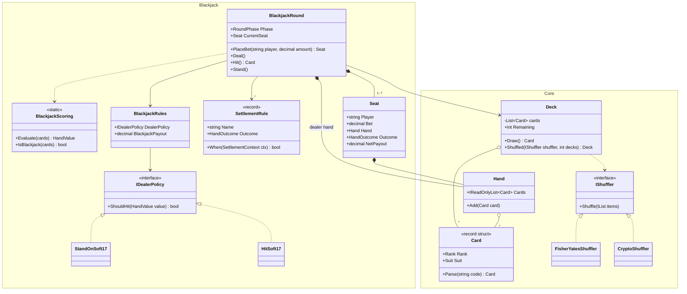
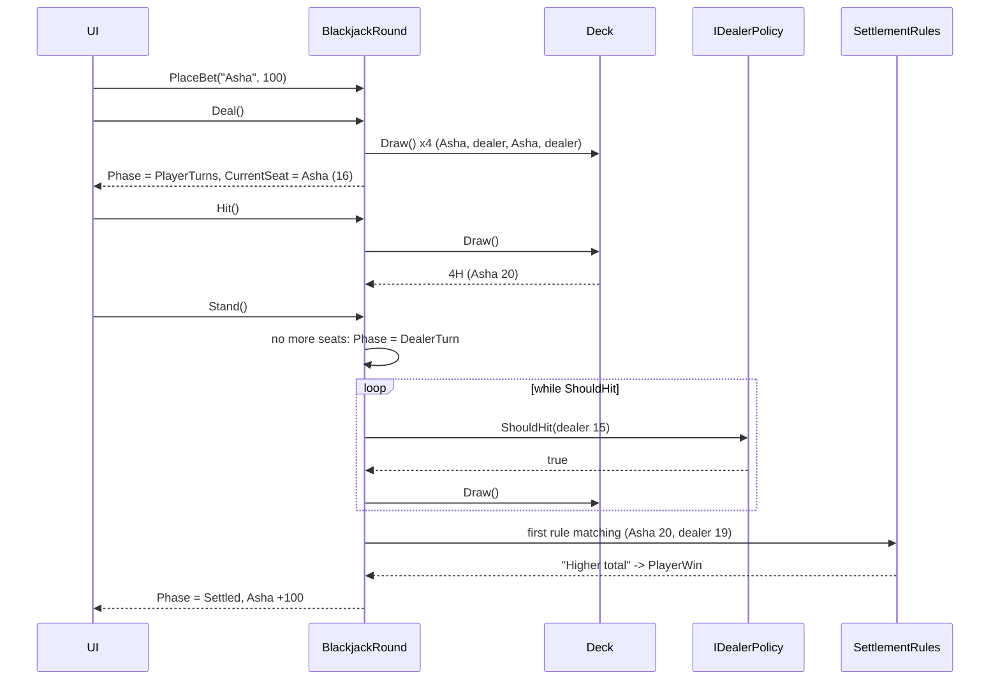
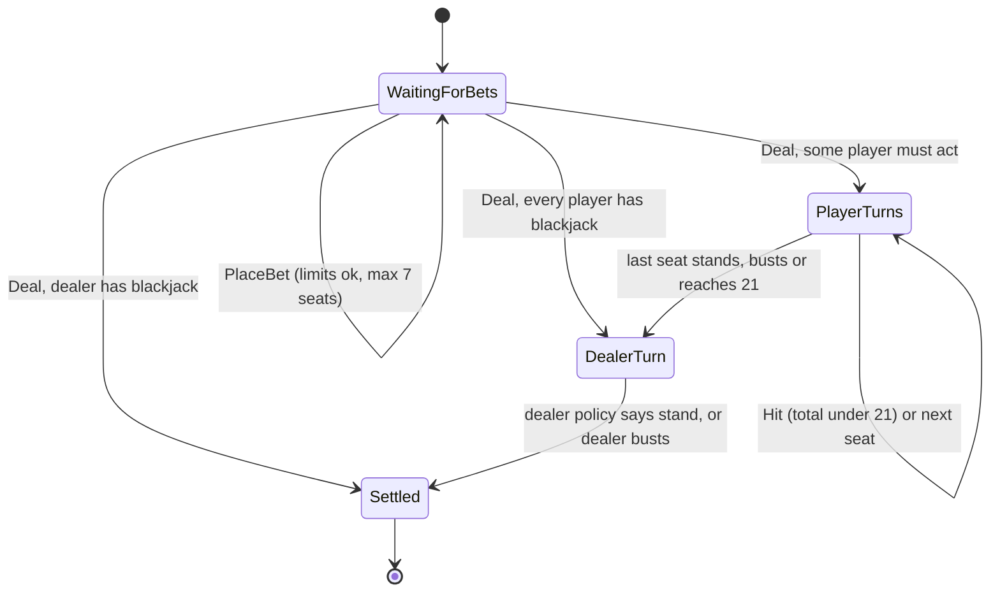
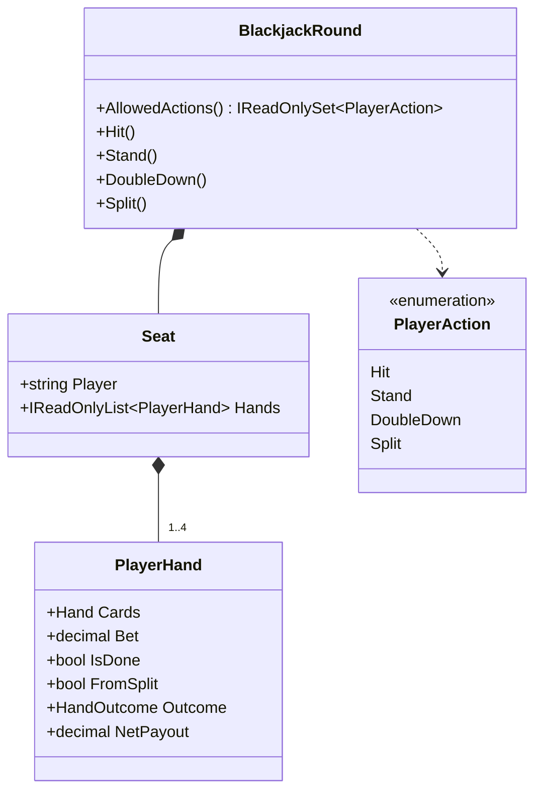

"Design a card game" is really two questions in one. First, what's **common to all card games**: cards, decks, shuffling, hands? Second, how do you express **one game's rules** so they're readable, testable and changeable, without your `Round` class turning into a 600-line `if` forest? This lesson builds a small reusable core, then a complete blackjack round on top of it. A third game (Teen Patti, popular in India) reuses the same core in the exercises.

## Learning objectives

By the end of this case study you will be able to:

1. Separate a game-agnostic core (`Card`, `Deck`, `Hand`, `IShuffler`) from game-specific rules.
2. Model cards as immutable value objects with compact parsing (`"AS"`, `"TH"`).
3. Shuffle correctly (Fisher–Yates), make shuffling testable, and know when you need a cryptographic random generator.
4. Express settlement rules as an ordered rule table: a minimal rules engine where the first matching rule wins.
5. Drive a round through a guarded state machine: WaitingForBets → PlayerTurns → DealerTurn → Settled.
6. Write deterministic tests with stacked decks.
7. Explain how the design extends to double down, split and other games.

## Prerequisites

- [Collections, generics and common data structures](#/lesson/m01-collections-generics): lists, dictionaries, LINQ.
- [Strategy](#/lesson/m06-strategy) and [State](#/lesson/m06-state).
- [Testable object design](#/lesson/m07-testable-design): randomness behind a seam.

## Explain it like I'm a beginner

Think of a casino table in Goa, or a family game night during Diwali. Whatever the game (blackjack, rummy, Teen Patti), some things are always the same:

- There are **52 cards**, each with a rank (2 to Ace) and a suit (clubs, diamonds, hearts, spades).
- Someone **shuffles** the deck and **deals** cards from the top.
- Each player holds a **hand** of cards.

Those are like the board and pieces of every card game. Then each game adds its own **rule book**: what a hand is worth, whose turn it is, when the round ends, who gets paid. Blackjack's rule book says an ace counts as 1 or 11, the dealer must keep drawing below 17, and a "blackjack" (ace plus a ten-value card) pays one and a half times your bet.

So the design splits in two:

1. **A shared toolbox** (cards, deck, hand, shuffler) that knows nothing about any particular game.
2. **A rule book per game**, written so that each rule is easy to find. For example, the payout rules are written as a short ordered list, like a referee's checklist: "both have blackjack? push. Player has blackjack? pay 3:2. Dealer has blackjack? house wins…". The first line that matches decides.

For tests, we use a **stacked deck**: the cards are placed in a known order, like a magician's prepared deck. Then a test can say "the player gets T♥ and Q♠, the dealer gets 9♣ and 8♦" and check the exact outcome.

## Requirements

### Functional requirements

**Core (all games)**

1. A standard 52-card deck; optionally a *shoe* of several decks.
2. Shuffle the deck; draw cards from the top; drawing from an empty deck is an error.
3. Hands hold cards in the order received.

**Blackjack round**

4. Players (1–7 seats) place bets between a minimum and maximum before dealing.
5. Deal: two cards to each player and two to the dealer, alternating (player 1, player 2, …, dealer, then again).
6. Card values: 2–10 at face value; J, Q, K = 10; ace = 11, or 1 if 11 would bust the hand. A hand that counts an ace as 11 is *soft*.
7. A two-card 21 is a *blackjack*. If the dealer has blackjack, the round settles immediately (the dealer "peeks"). Players with blackjack don't act.
8. In seat order, each player may **hit** (take a card) or **stand**. Reaching 21 or busting (over 21) ends their turn automatically.
9. Then the dealer draws according to a configurable policy: stand on all 17s, or hit soft 17. The dealer doesn't draw if no player hand is still live.
10. Settlement: blackjack pays 3:2; a win pays 1:1; a push (tie) returns the bet; a bust always loses, even if the dealer also busts. Each seat records *which rule* decided its outcome.

**Out of scope (exercises):** double down, split, insurance, surrender, bankroll and wallet, multiple rounds per shoe with a cut card.

### Non-functional requirements

- **Fairness.** The shuffle must be unbiased: every order equally likely. For real-money play, randomness must come from a cryptographically secure source.
- **Determinism in tests.** Stacked decks and seeded shuffles.
- **Auditability.** For each hand: the cards dealt and the rule that settled it.
- **Exact money.** Use `decimal`, never `double`.
- **Reuse.** The core is shared by at least two games without changes.

### Clarifying questions

| Question | Assumption |
|---|---|
| Which blackjack variant? | Dealer peeks for blackjack; blackjack pays 3:2; dealer stands on soft 17 by default (configurable). |
| How many decks? | One by default; a shoe of N decks is supported. |
| Real money? | The design supports a cryptographic shuffler; wallets are a separate service. |
| Is the dealer an AI? | The dealer follows a fixed policy; there are no decisions to make. |
| Do we need player bots? | Not in the domain; a bot would just call `Hit`/`Stand`. |
| What happens when the deck runs out mid-round? | It throws `DeckExhaustedException`; a shoe with a cut card prevents this (extension). |
| Which other games must the core support? | Teen Patti (exercise 3), and later rummy (exercise 5). |

## Identifying classes and responsibilities

Nouns: *card, rank, suit, deck, shoe, shuffle, hand, player, seat, bet, dealer, round, value, blackjack, bust, outcome, payout, rule*. Verbs: *shuffle, draw, deal, hit, stand, evaluate, settle, pay*.

| Class | Layer | Responsibility |
|---|---|---|
| `Rank`, `Suit` | core | Enums; `Rank` values 2–14, so comparisons are numeric. |
| `Card` | core, value object | Immutable rank + suit; parses and prints `"AS"`. |
| `IShuffler` / `FisherYatesShuffler` / `CryptoShuffler` | core, strategy | Puts a list in random order. |
| `Deck` | core | An ordered pile; `Draw` from the top; throws when empty. |
| `Hand` | core | Cards a participant holds. |
| `HandValue`, `BlackjackScoring` | blackjack | Totals, soft and hard hands, blackjack detection. |
| `IDealerPolicy` / `StandOnSoft17` / `HitSoft17` | blackjack, strategy | Should the dealer draw? |
| `BlackjackRules` | blackjack, configuration | Payout ratio, bet limits, dealer policy. |
| `SettlementRule`, `SettlementRules` | blackjack, rule table | Ordered rules: first match decides the outcome. |
| `Seat` | blackjack | One player's bet, hand, outcome and net payout. |
| `BlackjackRound` | blackjack, aggregate root | The phase machine: bets, deal, turns, dealer play, settlement. |

The **dependency direction** is the important part: blackjack classes depend on the core, and the core depends on nothing. A Teen Patti module (exercise 3) also depends on the core, and never on blackjack. If you ever find `Deck` referring to `BlackjackRules`, the layering is broken.

:::callout type=mistake title="Card as a class with a Value property"
A common draft gives `Card` an `int Value` (ace = 11, king = 10). That bakes blackjack into the core. In Teen Patti an ace ranks above a king, and in rummy a king is worth 10 points but ranks above a queen. Value is a **rule**, not a property of the card. Keep `Card` to rank and suit, and let each game's scoring decide what they're worth.
:::

## Class diagram



How to read it:

- The diagram has **two namespaces**. Arrows only go from `Blackjack` into `Core`, never the other way.
- `Deck` **uses** an `IShuffler` only when it's created (the dashed dependency); it doesn't keep it. `Deck` and `Hand` **aggregate** cards. Cards are value objects, so the same `Card` value can be in a deck, then a hand, without copying concerns.
- `BlackjackRound` **owns** its seats and the dealer's hand (composition): they live and die with the round. It **uses** a deck and rules that outlive it, since the same shoe and rules serve many rounds.
- Two strategies (`IShuffler`, `IDealerPolicy`) and one rule table (`SettlementRule` list) are the variation points.

## Patterns and design decisions

### Value-object cards

`Card` is a `readonly record struct`: two `AS` cards compare equal, it's immutable, and it costs no allocation. `Rank` uses the numbers 2–14, so "ace beats king" is a plain integer comparison in games where it applies. The compact code `"AS"`/`"TH"` (T for ten) makes stacked decks in tests readable: `Cards("TH 9C QS 8D")`.

### Shuffling: Fisher–Yates behind an interface

A correct shuffle walks from the last index down and swaps each element with a random element at or before it: `j = random.Next(i + 1)`. Every one of the 52! orders is then equally likely. Two classic bugs make some orders more likely than others: `random.Next(n)` over the whole range at every step, and sorting by a random key with ties. In a casino, that bias is money.

`IShuffler` has two implementations:

- `FisherYatesShuffler(Random)`: seeded for tests and replays, or `Random.Shared` for casual games.
- `CryptoShuffler`: uses `RandomNumberGenerator.GetInt32`, which is unpredictable even to someone who has seen earlier shuffles. Use it for anything involving real money. `System.Random` is fast, but it's not designed to resist prediction.

There is a second, less obvious limit. A deck has 52! ≈ 8 × 10⁶⁷ possible orders, which needs about 226 bits of randomness to reach them all. `new Random(seed)` takes a 32-bit seed, so a seeded shuffler can only ever produce about 4.3 billion different decks. That's fine for tests and replays, and a real weakness for a money game: an attacker who sees the first few cards can search all seeds and predict the rest. `RandomNumberGenerator` has no such ceiling.

(.NET 8 added `Random.Shuffle`. It's a fine Fisher–Yates implementation, but it doesn't plug into an interface or a cryptographic source, so we wrap our own.)

### A rule table for settlement (a tiny rules engine)

The payout logic of blackjack is a famous source of tangled `if`s, because the order of checks matters: a player blackjack against a dealer blackjack is a push, not a win; a player bust loses even if the dealer busts too. We write the rules as **data**, an ordered list:

| # | Rule | When | Outcome |
|---|---|---|---|
| 1 | Both blackjack | player BJ and dealer BJ | Push |
| 2 | Player blackjack | player BJ | PlayerBlackjack (3:2) |
| 3 | Dealer blackjack | dealer BJ | DealerWin |
| 4 | Player bust | player > 21 | PlayerBust |
| 5 | Dealer bust | dealer > 21 | PlayerWin |
| 6 | Higher total | player > dealer | PlayerWin |
| 7 | Lower total | player < dealer | DealerWin |
| 8 | Equal totals | always | Push |

The round evaluates them top to bottom, and the **first match wins**. This is Chain of Responsibility in its simplest form: each rule either handles the case or passes it on. What you get:

- The table **reads like the rule book**, so a product owner can review it.
- Order is explicit and visible, instead of being implied by nested `if`s.
- Each seat records `DecidedBy` (the rule name), which is exactly what support staff need when a player disputes a payout.
- A casino variant ("dealer bust on 22 is a push", as in some blackjack variants) is a rule inserted at the right position, without editing the round.

The last rule always matches, so the table is **total**: every situation has an outcome. A unit test checks that.

### Strategy for the dealer

"Stand on soft 17" and "hit soft 17" differ in one condition, and casinos choose between them. `IDealerPolicy.ShouldHit(HandValue)` captures it, and `BlackjackRules` carries the choice. The round's dealer loop is just `while (policy.ShouldHit(value)) draw();`.

### A guarded phase machine

`BlackjackRound` exposes verbs (`PlaceBet`, `Deal`, `Hit`, `Stand`), and each checks the phase first. Calling `Hit` before dealing, or `PlaceBet` after it, throws `InvalidOperationException`. The dealer turn and settlement run **automatically** when the last player finishes, so a client can't forget to call them, or call them twice.

### Results versus exceptions

In this domain, a player trying to hit when it isn't their turn is a client bug (the UI should not offer the button), so we throw. If this were a public API facing untrusted clients, we'd translate these into `409 Conflict` responses at the edge.

### Concurrency: one table, one writer

`BlackjackRound` and `Deck` are deliberately **not thread-safe**. Inside one process and one game loop that is correct: locking every method would cost clarity for nothing. Online, it stops being true. Five players at one table send actions over the network, and a player on a shaky mobile connection taps "Hit" twice or the app retries a request that timed out. Two failure modes appear:

1. **Interleaving.** Two requests run `Hit` at the same time. Both read `_current`, both call `deck.Draw()`, and the `_next` index in `Deck` can hand out the same card twice or skip one. Every verb is a check-then-act sequence ("is it this seat's turn? then draw"), so the whole verb must run alone.
2. **Duplicates.** A retried "Hit" is applied twice, and the player gets a card they didn't ask for, possibly busting.

The fix sits in front of the round, not inside it: a `TableSession` that owns one round, runs actions **one at a time** (a lock here; a `Channel<T>` consumer or an actor per table at scale), remembers the result of each client-generated `actionId` (idempotency), and rejects actions sent against an old `Version` of the table (optimistic concurrency: "you pressed Hit while looking at a screen that is already out of date"). The round stays a simple, single-threaded domain object that is easy to test.

```csharp file=Blackjack/TableSession.cs
using CardTable.Core;

namespace CardTable.Blackjack;

public enum PlayerAction { Hit, Stand }
public enum ActionStatus { Applied, Duplicate, StaleVersion, NotYourTurn }
public sealed record ActionResult(ActionStatus Status, int Version, Card? CardDrawn = null);

/// <summary>
/// Single writer for one table. Each action is checked and applied under one lock, so "is it your turn,
/// is your view current, have I seen this action id" and "apply it" are one atomic step.
/// </summary>
public sealed class TableSession(BlackjackRound round)
{
    private readonly Lock _sync = new();
    private readonly Dictionary<Guid, ActionResult> _seen = [];

    public int Version { get; private set; }
    public BlackjackRound Round => round;

    public ActionResult Submit(Guid actionId, string player, int expectedVersion, PlayerAction action)
    {
        lock (_sync)
        {
            if (_seen.TryGetValue(actionId, out var earlier)) return earlier with { Status = ActionStatus.Duplicate };
            if (expectedVersion != Version) return new ActionResult(ActionStatus.StaleVersion, Version);
            if (round.CurrentSeat?.Player != player) return new ActionResult(ActionStatus.NotYourTurn, Version);

            Card? drawn = null;
            if (action == PlayerAction.Hit) drawn = round.Hit(); else round.Stand();
            Version++;
            var result = new ActionResult(ActionStatus.Applied, Version, drawn);
            _seen[actionId] = result;
            return result;
        }
    }
}
```

`System.Threading.Lock` is the .NET 9+ lock type; `lock` on it compiles to its faster `EnterScope` path. Rejected actions (stale or out of turn) are not stored under their `actionId`, so the client can fix its view and resend. In a multi-server deployment the same rules move into the database: the table row carries a `version` column, an action is an `UPDATE ... WHERE id = $1 AND version = $2`, and processed action ids live in a table with a unique key.

### A round, end to end



The UI only ever calls four verbs. Everything after the last `Stand` (the dealer's draws and the settlement) happens inside the round, in a fixed order, using the policy and the rule table. The rule name travels with the result for audit.

## State transitions



Reading the diagram:

- `Deal` has **three** possible targets. The dealer's peek can end the round at once, players with blackjack are skipped, and if nobody needs to act we go straight to the dealer.
- `PlayerTurns` loops over seats in order. A seat ends its turn by standing, busting, or reaching exactly 21.
- `DealerTurn` is **transient**: the round passes through it automatically, and a client never waits in it. It still deserves a name, because events (`PhaseChanged`) and logs refer to it, and because a future "dealer reveals with animation" UI needs to know it happened.
- `Settled` is terminal. A new round is a new `BlackjackRound` object using the same shoe and rules.

## C# implementation

```text
CardTable/
  Core/Cards.cs            Suit, Rank, Card
  Core/Deck.cs             IShuffler, FisherYatesShuffler, CryptoShuffler, Deck, Hand
  Blackjack/Scoring.cs     HandValue, BlackjackScoring, dealer policies, BlackjackRules
  Blackjack/Settlement.cs  HandOutcome, SettlementContext, SettlementRule(s)
  Blackjack/Round.cs       RoundPhase, Seat, BlackjackRound
  Blackjack/TableSession.cs  single-writer, idempotent front door for online play (shown earlier)
  Program.cs               demo with a seeded shoe
```

```csharp file=Core/Cards.cs
namespace CardTable.Core;

public enum Suit { Clubs, Diamonds, Hearts, Spades }

/// <summary>Numeric values 2–14 so that ordering is a plain comparison where a game needs it.</summary>
public enum Rank { Two = 2, Three, Four, Five, Six, Seven, Eight, Nine, Ten, Jack, Queen, King, Ace }

/// <summary>Immutable value object. Code format: rank char + suit char, e.g. "AS", "TH", "2C".</summary>
public readonly record struct Card(Rank Rank, Suit Suit)
{
    private const string RankChars = "23456789TJQKA";
    private const string SuitChars = "CDHS";

    public static Card Parse(string code)
    {
        if (code is not { Length: 2 }) throw new FormatException($"'{code}' is not a card code like 'AS'.");
        var r = RankChars.IndexOf(char.ToUpperInvariant(code[0]));
        var s = SuitChars.IndexOf(char.ToUpperInvariant(code[1]));
        if (r < 0 || s < 0) throw new FormatException($"'{code}' is not a card code like 'AS'.");
        return new Card((Rank)(r + 2), (Suit)s);
    }

    /// <summary>Parses a space-separated list, top card first: "TH 9C QS".</summary>
    public static IReadOnlyList<Card> ParseMany(string codes) =>
        codes.Split(' ', StringSplitOptions.RemoveEmptyEntries).Select(Parse).ToList();

    public override string ToString() => $"{RankChars[(int)Rank - 2]}{SuitChars[(int)Suit]}";
}
```

```csharp file=Core/Deck.cs
using System.Security.Cryptography;

namespace CardTable.Core;

public interface IShuffler
{
    void Shuffle<T>(IList<T> items);
}

/// <summary>Unbiased Fisher–Yates. Seed the Random for reproducible tests and replays.</summary>
public sealed class FisherYatesShuffler(Random random) : IShuffler
{
    public void Shuffle<T>(IList<T> items)
    {
        for (var i = items.Count - 1; i > 0; i--)
        {
            var j = random.Next(i + 1);           // 0..i inclusive
            (items[i], items[j]) = (items[j], items[i]);
        }
    }
}

/// <summary>Fisher–Yates driven by a cryptographically secure generator: use for real-money play.</summary>
public sealed class CryptoShuffler : IShuffler
{
    public void Shuffle<T>(IList<T> items)
    {
        for (var i = items.Count - 1; i > 0; i--)
        {
            var j = RandomNumberGenerator.GetInt32(i + 1);
            (items[i], items[j]) = (items[j], items[i]);
        }
    }
}

public sealed class DeckExhaustedException() : InvalidOperationException("The deck has no cards left.");

/// <summary>An ordered pile, drawn from the top (index 0 first). Not thread-safe: one round uses it at a time.</summary>
public sealed class Deck
{
    private readonly List<Card> _cards;
    private int _next;

    /// <summary>A deck in exactly this order, top card first. Ideal for tests ("stacked deck").</summary>
    public Deck(IEnumerable<Card> cardsTopFirst) => _cards = cardsTopFirst.ToList();

    public static IEnumerable<Card> StandardCards() =>
        from suit in Enum.GetValues<Suit>()
        from rank in Enum.GetValues<Rank>()
        select new Card(rank, suit);

    /// <summary>A shoe of <paramref name="decks"/> standard decks, shuffled once.</summary>
    public static Deck Shuffled(IShuffler shuffler, int decks = 1)
    {
        ArgumentOutOfRangeException.ThrowIfLessThan(decks, 1);
        var cards = Enumerable.Range(0, decks).SelectMany(_ => StandardCards()).ToList();
        shuffler.Shuffle(cards);
        return new Deck(cards);
    }

    public int Remaining => _cards.Count - _next;

    public Card Draw() => _next < _cards.Count ? _cards[_next++] : throw new DeckExhaustedException();
}

public sealed class Hand
{
    private readonly List<Card> _cards = [];
    public IReadOnlyList<Card> Cards => _cards;
    public void Add(Card card) => _cards.Add(card);
    public override string ToString() => string.Join(' ', _cards);
}
```

```csharp file=Blackjack/Scoring.cs
using CardTable.Core;

namespace CardTable.Blackjack;

public readonly record struct HandValue(int Total, bool IsSoft)
{
    public bool IsBust => Total > 21;
    public override string ToString() => IsSoft ? $"soft {Total}" : $"{Total}";
}

public static class BlackjackScoring
{
    public static int PointsOf(Rank rank) => rank switch
    {
        Rank.Ace => 1,
        >= Rank.Ten => 10,
        _ => (int)rank,
    };

    /// <summary>Counts every ace as 1, then upgrades one ace to 11 if that doesn't bust (a soft hand).</summary>
    public static HandValue Evaluate(IReadOnlyList<Card> cards)
    {
        var hard = 0;
        var hasAce = false;
        foreach (var c in cards) { hard += PointsOf(c.Rank); hasAce |= c.Rank == Rank.Ace; }
        return hasAce && hard + 10 <= 21 ? new HandValue(hard + 10, true) : new HandValue(hard, false);
    }

    public static bool IsBlackjack(IReadOnlyList<Card> cards) => cards.Count == 2 && Evaluate(cards).Total == 21;
}

public interface IDealerPolicy
{
    bool ShouldHit(HandValue dealer);
}

public sealed class StandOnSoft17 : IDealerPolicy
{
    public bool ShouldHit(HandValue dealer) => dealer.Total < 17;
}

public sealed class HitSoft17 : IDealerPolicy
{
    public bool ShouldHit(HandValue dealer) => dealer.Total < 17 || (dealer.Total == 17 && dealer.IsSoft);
}

public sealed record BlackjackRules(IDealerPolicy DealerPolicy, decimal BlackjackPayout = 1.5m, decimal MinBet = 10m, decimal MaxBet = 10_000m, int MaxSeats = 7)
{
    public static BlackjackRules Standard { get; } = new(new StandOnSoft17());
}
```

```csharp file=Blackjack/Settlement.cs
namespace CardTable.Blackjack;

public enum HandOutcome { Pending, Push, PlayerBlackjack, PlayerWin, DealerWin, PlayerBust }

public sealed record SettlementContext(HandValue Player, bool PlayerBlackjack, HandValue Dealer, bool DealerBlackjack);

/// <summary>One line of the rule book. The round evaluates rules in order; the first match decides.</summary>
public sealed record SettlementRule(string Name, Func<SettlementContext, bool> When, HandOutcome Outcome);

public static class SettlementRules
{
    public static IReadOnlyList<SettlementRule> Standard { get; } =
    [
        new("Both blackjack", c => c.PlayerBlackjack && c.DealerBlackjack, HandOutcome.Push),
        new("Player blackjack", c => c.PlayerBlackjack, HandOutcome.PlayerBlackjack),
        new("Dealer blackjack", c => c.DealerBlackjack, HandOutcome.DealerWin),
        new("Player bust", c => c.Player.IsBust, HandOutcome.PlayerBust),
        new("Dealer bust", c => c.Dealer.IsBust, HandOutcome.PlayerWin),
        new("Higher total", c => c.Player.Total > c.Dealer.Total, HandOutcome.PlayerWin),
        new("Lower total", c => c.Player.Total < c.Dealer.Total, HandOutcome.DealerWin),
        new("Equal totals", _ => true, HandOutcome.Push),
    ];

    public static SettlementRule FirstMatch(IReadOnlyList<SettlementRule> rules, SettlementContext context) =>
        rules.FirstOrDefault(r => r.When(context))
        ?? throw new InvalidOperationException("Settlement rules are not total: no rule matched.");
}
```

```csharp file=Blackjack/Round.cs
using CardTable.Core;

namespace CardTable.Blackjack;

public enum RoundPhase { WaitingForBets, PlayerTurns, DealerTurn, Settled }

public sealed class Seat(string player, decimal bet)
{
    public string Player { get; } = player;
    public decimal Bet { get; } = bet;
    public Hand Hand { get; } = new();
    public bool IsDone { get; internal set; }
    public HandOutcome Outcome { get; internal set; } = HandOutcome.Pending;
    public string? DecidedBy { get; internal set; }
    public decimal NetPayout { get; internal set; }
    public HandValue Value => BlackjackScoring.Evaluate(Hand.Cards);
}

/// <summary>One round of blackjack. Aggregate root: all changes go through its verbs, each guarded by phase.</summary>
public sealed class BlackjackRound(Deck deck, BlackjackRules rules, IReadOnlyList<SettlementRule>? settlementRules = null)
{
    private readonly List<Seat> _seats = [];
    private readonly IReadOnlyList<SettlementRule> _settlement = settlementRules ?? SettlementRules.Standard;
    private int _current = -1;

    public event Action<RoundPhase>? PhaseChanged;

    public RoundPhase Phase { get; private set; } = RoundPhase.WaitingForBets;
    public IReadOnlyList<Seat> Seats => _seats;
    public Hand DealerHand { get; } = new();
    public Seat? CurrentSeat => Phase == RoundPhase.PlayerTurns ? _seats[_current] : null;

    public Seat PlaceBet(string player, decimal amount)
    {
        Require(RoundPhase.WaitingForBets, "place a bet");
        ArgumentException.ThrowIfNullOrWhiteSpace(player);
        if (amount < rules.MinBet || amount > rules.MaxBet)
            throw new ArgumentOutOfRangeException(nameof(amount), amount, $"Bet must be between {rules.MinBet} and {rules.MaxBet}.");
        if (_seats.Count >= rules.MaxSeats) throw new InvalidOperationException("The table is full.");
        if (_seats.Any(s => s.Player == player)) throw new InvalidOperationException($"{player} already has a bet.");
        var seat = new Seat(player, amount);
        _seats.Add(seat);
        return seat;
    }

    public void Deal()
    {
        Require(RoundPhase.WaitingForBets, "deal");
        if (_seats.Count == 0) throw new InvalidOperationException("No bets have been placed.");

        for (var pass = 0; pass < 2; pass++)
        {
            foreach (var seat in _seats) seat.Hand.Add(deck.Draw());
            DealerHand.Add(deck.Draw());
        }

        foreach (var seat in _seats)
            if (BlackjackScoring.IsBlackjack(seat.Hand.Cards)) seat.IsDone = true;

        if (BlackjackScoring.IsBlackjack(DealerHand.Cards)) { Settle(); return; }   // dealer peeks

        // If every player has blackjack, go straight to the dealer: no PlayerTurns phase (and no event for it).
        if (_seats.Any(s => !s.IsDone)) SetPhase(RoundPhase.PlayerTurns);
        AdvanceToNextSeat();
    }

    public Card Hit()
    {
        var seat = RequireCurrentSeat("hit");
        var card = deck.Draw();
        seat.Hand.Add(card);
        if (seat.Value.Total >= 21) EndTurn(seat);   // bust or 21 ends the turn
        return card;
    }

    public void Stand() => EndTurn(RequireCurrentSeat("stand"));

    private void EndTurn(Seat seat)
    {
        seat.IsDone = true;
        AdvanceToNextSeat();
    }

    private void AdvanceToNextSeat()
    {
        do _current++; while (_current < _seats.Count && _seats[_current].IsDone);
        if (_current < _seats.Count) return;
        PlayDealer();
        Settle();
    }

    private void PlayDealer()
    {
        SetPhase(RoundPhase.DealerTurn);
        var anyLiveHand = _seats.Any(s => !BlackjackScoring.IsBlackjack(s.Hand.Cards) && !s.Value.IsBust);
        if (!anyLiveHand) return;   // nobody left to beat
        while (rules.DealerPolicy.ShouldHit(BlackjackScoring.Evaluate(DealerHand.Cards)))
            DealerHand.Add(deck.Draw());
    }

    private void Settle()
    {
        var dealer = BlackjackScoring.Evaluate(DealerHand.Cards);
        var dealerBlackjack = BlackjackScoring.IsBlackjack(DealerHand.Cards);
        foreach (var seat in _seats)
        {
            var context = new SettlementContext(seat.Value, BlackjackScoring.IsBlackjack(seat.Hand.Cards), dealer, dealerBlackjack);
            var rule = SettlementRules.FirstMatch(_settlement, context);
            seat.Outcome = rule.Outcome;
            seat.DecidedBy = rule.Name;
            seat.NetPayout = rule.Outcome switch
            {
                HandOutcome.PlayerBlackjack => seat.Bet * rules.BlackjackPayout,
                HandOutcome.PlayerWin => seat.Bet,
                HandOutcome.Push => 0m,
                _ => -seat.Bet,
            };
            seat.IsDone = true;
        }
        SetPhase(RoundPhase.Settled);
    }

    private Seat RequireCurrentSeat(string action)
    {
        Require(RoundPhase.PlayerTurns, action);
        return _seats[_current];
    }

    private void Require(RoundPhase expected, string action)
    {
        if (Phase != expected) throw new InvalidOperationException($"Cannot {action} during {Phase}.");
    }

    private void SetPhase(RoundPhase phase)
    {
        Phase = phase;
        PhaseChanged?.Invoke(phase);
    }
}
```

```csharp file=Program.cs
using CardTable.Blackjack;
using CardTable.Core;

namespace CardTable;

public static class Program
{
    public static void Main()
    {
        var shoe = Deck.Shuffled(new FisherYatesShuffler(new Random(2026)), decks: 6);
        var round = new BlackjackRound(shoe, BlackjackRules.Standard with { DealerPolicy = new HitSoft17() });
        round.PlaceBet("Asha", 500m);
        round.PlaceBet("Vikram", 200m);
        round.PhaseChanged += p => Console.WriteLine($"-- {p}");
        round.Deal();

        // A simple "hit below 17" player strategy, standing in for real input.
        while (round.CurrentSeat is { } seat)
        {
            if (seat.Value.Total < 17) Console.WriteLine($"{seat.Player} hits: {round.Hit()}");
            else { Console.WriteLine($"{seat.Player} stands on {seat.Value}"); round.Stand(); }
        }

        Console.WriteLine($"Dealer: {round.DealerHand} = {BlackjackScoring.Evaluate(round.DealerHand.Cards)}");
        foreach (var s in round.Seats)
            Console.WriteLine($"{s.Player}: {s.Hand} = {s.Value} -> {s.Outcome} ({s.DecidedBy}) {s.NetPayout:+#;-#;0}");
    }
}
```

Implementation notes:

- **`BlackjackRules` is a record**, so `Standard with { DealerPolicy = new HitSoft17() }` creates a variant in one line, without mutating the shared default.
- **`Seat.IsDone` has an `internal set`**, so only the round can end a turn. UIs can read but not cheat.
- **The dealer doesn't draw when no live hand remains.** That's both the real rule and a small optimisation: no point drawing against a table of busts.
- **`FirstMatch` throws if no rule matches.** With a custom rule list missing the final catch-all, you get a loud failure, not a silently pending seat.

## Automated testing

Stacked decks are the main tool. The deal order is: seat 1, seat 2, …, dealer, then the same again, then any hits in play order.

```csharp
using CardTable.Blackjack;
using CardTable.Core;
using Xunit;

namespace CardTable.Tests;

public sealed class BlackjackTests
{
    private static BlackjackRound Round(string stacked, params (string Name, decimal Bet)[] players)
    {
        var round = new BlackjackRound(new Deck(Card.ParseMany(stacked)), BlackjackRules.Standard);
        foreach (var (name, bet) in players) round.PlaceBet(name, bet);
        return round;
    }

    [Theory]
    [InlineData("AS AH 9C", 21, true)]
    [InlineData("AS 6H KD", 17, false)]
    [InlineData("AS AH AD AC", 14, true)]
    [InlineData("KD QH 5C", 25, false)]
    [InlineData("7C 7D 7H", 21, false)]
    public void Evaluates_hands(string cards, int total, bool soft) =>
        Assert.Equal(new HandValue(total, soft), BlackjackScoring.Evaluate(Card.ParseMany(cards)));

    [Fact]
    public void Blackjack_needs_exactly_two_cards()
    {
        Assert.True(BlackjackScoring.IsBlackjack(Card.ParseMany("AS KD")));
        Assert.False(BlackjackScoring.IsBlackjack(Card.ParseMany("7C 7D 7H")));
    }

    [Fact]
    public void Player_twenty_beats_dealer_seventeen()
    {
        var r = Round("TH 9C QS 8D", ("Asha", 100m));
        r.Deal();
        r.Stand();
        var seat = r.Seats[0];
        Assert.Equal(HandOutcome.PlayerWin, seat.Outcome);
        Assert.Equal(100m, seat.NetPayout);
        Assert.Equal("Higher total", seat.DecidedBy);
        Assert.Equal(RoundPhase.Settled, r.Phase);
    }

    [Fact]
    public void Blackjack_pays_three_to_two_and_needs_no_action()
    {
        var r = Round("AS 9C KH 7D", ("Asha", 100m));
        r.Deal();
        Assert.Equal(RoundPhase.Settled, r.Phase);
        Assert.Equal(150m, r.Seats[0].NetPayout);
        Assert.Equal(2, r.DealerHand.Cards.Count);       // dealer doesn't draw against no live hands
    }

    [Fact]
    public void Bust_loses_even_if_dealer_would_bust()
    {
        var r = Round("TH 9C 6S 8D KD", ("Asha", 100m));
        r.Deal();
        r.Hit();
        Assert.Equal(HandOutcome.PlayerBust, r.Seats[0].Outcome);
        Assert.Equal(-100m, r.Seats[0].NetPayout);
    }

    [Fact]
    public void Dealer_draws_to_policy_and_can_bust()
    {
        var r = Round("TH 6C 7S TD 9H", ("Asha", 100m));
        r.Deal();
        r.Stand();                                        // 17 vs dealer 16 -> dealer hits 9H = 25
        Assert.Equal(3, r.DealerHand.Cards.Count);
        Assert.Equal("Dealer bust", r.Seats[0].DecidedBy);
    }

    [Fact]
    public void Dealer_blackjack_settles_immediately()
    {
        var r = Round("TH AC 9S KD", ("Asha", 100m));
        r.Deal();
        Assert.Equal(RoundPhase.Settled, r.Phase);
        Assert.Equal(HandOutcome.DealerWin, r.Seats[0].Outcome);
        Assert.Equal("Dealer blackjack", r.Seats[0].DecidedBy);
    }

    [Fact]
    public void Equal_totals_push()
    {
        var r = Round("TH TC QS KD", ("Asha", 100m));
        r.Deal();
        r.Stand();
        Assert.Equal(HandOutcome.Push, r.Seats[0].Outcome);
        Assert.Equal(0m, r.Seats[0].NetPayout);
    }

    [Fact]
    public void Seats_act_in_order()
    {
        var r = Round("TH 5C 9D 8S 6H 8C 9S", ("Asha", 100m), ("Ravi", 50m));
        r.Deal();
        Assert.Equal("Asha", r.CurrentSeat!.Player);
        r.Stand();
        Assert.Equal("Ravi", r.CurrentSeat!.Player);
        r.Hit();                                          // Ravi 11 + 9 = 20
        Assert.Equal("Ravi", r.CurrentSeat!.Player);
        r.Stand();
        Assert.All(r.Seats, s => Assert.Equal(HandOutcome.PlayerWin, s.Outcome));   // dealer 17
    }

    [Fact]
    public void Phase_guards()
    {
        var r = Round("TH 9C QS 8D", ("Asha", 100m));
        Assert.Throws<InvalidOperationException>(() => r.Hit());
        r.Deal();
        Assert.Throws<InvalidOperationException>(() => r.PlaceBet("Late", 50m));
        Assert.Throws<ArgumentOutOfRangeException>(() => Round("", ("Tiny", 1m)));
    }

    [Fact]
    public void Soft_seventeen_policies_differ()
    {
        var soft17 = BlackjackScoring.Evaluate(Card.ParseMany("AS 6D"));
        Assert.False(new StandOnSoft17().ShouldHit(soft17));
        Assert.True(new HitSoft17().ShouldHit(soft17));
        Assert.False(new HitSoft17().ShouldHit(BlackjackScoring.Evaluate(Card.ParseMany("TS 7D"))));
    }

    [Fact]
    public void Settlement_table_is_total()
    {
        foreach (var p in new[] { 12, 17, 20, 21, 25 })
            foreach (var d in new[] { 17, 19, 21, 26 })
                foreach (var pbj in new[] { false, true })
                    foreach (var dbj in new[] { false, true })
                        Assert.NotNull(SettlementRules.FirstMatch(SettlementRules.Standard,
                            new SettlementContext(new HandValue(p, false), pbj, new HandValue(d, false), dbj)));
    }

    [Fact]
    public void Deck_is_complete_reproducible_and_finite()
    {
        Assert.Equal(52, Deck.StandardCards().Distinct().Count());
        string Order(int seed) { var d = Deck.Shuffled(new FisherYatesShuffler(new Random(seed))); return string.Join(' ', Enumerable.Range(0, 52).Select(_ => d.Draw())); }
        Assert.Equal(Order(5), Order(5));
        var tiny = new Deck(Card.ParseMany("AS"));
        tiny.Draw();
        Assert.Throws<DeckExhaustedException>(() => tiny.Draw());
    }

    [Fact]
    public void All_blackjack_table_skips_player_turns()
    {
        var r = Round("AS 9C KH 7D", ("Asha", 100m));
        var phases = new List<RoundPhase>();
        r.PhaseChanged += phases.Add;
        r.Deal();
        Assert.DoesNotContain(RoundPhase.PlayerTurns, phases);
        Assert.Equal(RoundPhase.Settled, r.Phase);
    }

    [Fact]
    public void Table_session_applies_a_retried_action_once()
    {
        var table = new TableSession(Round("TH 9C 2S 8D 3H 4C", ("Asha", 100m)));
        table.Round.Deal();                                   // Asha 12, dealer 17
        var actionId = Guid.NewGuid();
        var first = table.Submit(actionId, "Asha", 0, PlayerAction.Hit);
        var retry = table.Submit(actionId, "Asha", 0, PlayerAction.Hit);
        Assert.Equal(ActionStatus.Applied, first.Status);
        Assert.Equal(ActionStatus.Duplicate, retry.Status);
        Assert.Equal(first.CardDrawn, retry.CardDrawn);
        Assert.Equal(3, table.Round.Seats[0].Hand.Cards.Count);   // one extra card, not two
    }

    [Fact]
    public void Table_session_rejects_stale_and_out_of_turn_actions()
    {
        var table = new TableSession(Round("TH 5C 9D 8S 6H 8C 9S", ("Asha", 100m), ("Ravi", 50m)));
        table.Round.Deal();
        Assert.Equal(ActionStatus.NotYourTurn, table.Submit(Guid.NewGuid(), "Ravi", 0, PlayerAction.Stand).Status);
        Assert.Equal(ActionStatus.Applied, table.Submit(Guid.NewGuid(), "Asha", 0, PlayerAction.Stand).Status);
        Assert.Equal(ActionStatus.StaleVersion, table.Submit(Guid.NewGuid(), "Ravi", 0, PlayerAction.Hit).Status);
        Assert.Equal(ActionStatus.Applied, table.Submit(Guid.NewGuid(), "Ravi", 1, PlayerAction.Hit).Status);
    }

    [Fact]
    public async Task Table_session_serialises_parallel_duplicates()
    {
        var table = new TableSession(Round("TH 9C 2S 8D 3H 4C", ("Asha", 100m)));
        table.Round.Deal();
        var actionId = Guid.NewGuid();
        var results = await Task.WhenAll(Enumerable.Range(0, 20)
            .Select(_ => Task.Run(() => table.Submit(actionId, "Asha", 0, PlayerAction.Hit))));
        Assert.Equal(1, results.Count(r => r.Status == ActionStatus.Applied));
        Assert.Equal(3, table.Round.Seats[0].Hand.Cards.Count);
    }
}
```

Testing notes:

- **Each round test reads like a story**: the stacked cards are the scenario, the asserts are the expected outcome *and* the rule that decided it.
- **`Settlement_table_is_total`** sweeps combinations to prove that some rule always matches. It's a cheap property test.
- **The `TableSession` tests pin the online rules**: a retried action id is applied once even when 20 copies race, an out-of-date view is refused, and only the current seat may act.
- **Randomness is tested by comparison, not prediction**: the same seed gives the same order. To check the shuffle is *unbiased*, a separate statistical test shuffles a 3-card list, say, 60,000 times, and checks that each of the 6 orders appears about 10,000 times. Keep that kind of test out of the fast unit-test suite.

## Bad design vs good design

**Bad: blackjack baked into the card, and settlement as nested `if`s**

```csharp
public class Card { public string Name; public int Value; }   // Value = 11 for ace: blackjack-only
public class BlackjackGame
{
    public List<Card> deck = new();
    public void Shuffle() => deck = deck.OrderBy(_ => new Random().Next()).ToList();   // new Random per call
    public decimal Settle(int player, int dealer, bool pbj, bool dbj, decimal bet)
    {
        if (pbj) return bet * 1.5m;                       // BUG: should push when dealer also has blackjack
        if (player > 21) return -bet;
        if (dealer > 21) return bet;
        if (dbj) return -bet;                             // never reached for a dealer blackjack vs a 21
        if (player > dealer) return bet;
        if (player == dealer) return 0;
        return -bet;
    }
}
```

Problems:

1. **`Card.Value` is a blackjack rule** baked into the core, so it's useless for any other game.
2. **Shuffling with `OrderBy(random)` and a `new Random()` per call.** On older .NET Framework, `Random` instances created close together could share a time-based seed and repeat values. Sorting by a random key is also not a clean Fisher–Yates. Either way, the shuffle is hard to reason about and impossible to test.
3. **Rule order is wrong and invisible**: a player blackjack against a dealer blackjack pays out instead of pushing, and a dealer blackjack against a three-card 21 is checked too late.
4. **No phases**: nothing prevents settling twice or hitting after settlement.
5. **No audit**: when a player disputes a payout, nobody can say which rule applied.

**Good**: cards are pure rank and suit; Fisher–Yates sits behind `IShuffler`, with a cryptographic option; settlement is an ordered, named, total rule table; the round is a guarded phase machine; each seat records `DecidedBy`.

**Is the rule table overkill?** For a homework project with fixed rules, a well-ordered `switch` expression over a tuple `(pbj, dbj, playerBust, dealerBust, compare)` is fine and compact. The table pays off when variants exist, or when business people review the rules.

## Alternative designs

| Alternative | Idea | Better when | Cost |
|---|---|---|---|
| **Settlement as a `switch` expression** | Pattern-match on a tuple of facts. | Fixed rules, one variant. | Less visible audit (no rule names); variants mean editing code. |
| **State pattern for phases** | `WaitingForBetsState`, `PlayerTurnsState`… each implementing `Hit`, `Stand`. | Many phases with very different behaviour (e.g. insurance, side bets). | More classes; for four phases, guards are clearer. |
| **Event-sourced round** | Store `CardDealt`, `PlayerHit`, `PlayerStood`; derive state by replay. | Online casinos needing a full audit trail and dispute resolution. | More infrastructure; events must be versioned. |
| **Generic `CardGame<TState, TAction>` framework** | Template Method base: deal → turn loop → settle; games plug in rules. | Many games on one platform (see exercise 5). | Easy to over-generalise; games differ more than they look. |
| **Infinite deck (draw with replacement)** | `Draw` returns a random card each time. | Quick simulations. | Changes the probabilities; not real blackjack. |

## Practical playground

Below is the reference class model. In the designer, try moving the `Value` concept onto `Card`, then trying to add Teen Patti. Notice how much breaks. Then undo it.

:::playground type=lld title="Card games reference model"
```json
{
  "classes": [
    { "id": "Suit", "name": "Suit", "kind": "enum", "fields": ["Clubs", "Diamonds", "Hearts", "Spades"], "methods": [] },
    { "id": "Rank", "name": "Rank", "kind": "enum", "fields": ["Two = 2", "...", "King = 13", "Ace = 14"], "methods": [] },
    { "id": "Card", "name": "Card", "kind": "record", "fields": ["+Rank Rank", "+Suit Suit"], "methods": ["+Card Parse(string code)"], "responsibility": "Immutable card value object (core)" },
    { "id": "IShuffler", "name": "IShuffler", "kind": "interface", "fields": [], "methods": ["void Shuffle(IList items)"] },
    { "id": "FY", "name": "FisherYatesShuffler", "kind": "class", "fields": ["-Random random"], "methods": ["+void Shuffle(IList items)"], "responsibility": "Seeded, unbiased shuffle" },
    { "id": "Crypto", "name": "CryptoShuffler", "kind": "class", "fields": [], "methods": ["+void Shuffle(IList items)"], "responsibility": "Unpredictable shuffle for real money" },
    { "id": "Deck", "name": "Deck", "kind": "class", "fields": ["-List cards", "-int next"], "methods": ["+Card Draw()", "+Deck Shuffled(IShuffler shuffler, int decks)", "+int Remaining"], "responsibility": "Ordered pile drawn from the top" },
    { "id": "Hand", "name": "Hand", "kind": "class", "fields": ["-List cards"], "methods": ["+void Add(Card card)"], "responsibility": "Cards held by one participant" },
    { "id": "Scoring", "name": "BlackjackScoring", "kind": "class", "fields": [], "methods": ["+HandValue Evaluate(cards)", "+bool IsBlackjack(cards)"], "responsibility": "Blackjack hand values (game layer)" },
    { "id": "IDealerPolicy", "name": "IDealerPolicy", "kind": "interface", "fields": [], "methods": ["bool ShouldHit(HandValue dealer)"] },
    { "id": "S17", "name": "StandOnSoft17", "kind": "class", "fields": [], "methods": ["+bool ShouldHit(HandValue dealer)"] },
    { "id": "H17", "name": "HitSoft17", "kind": "class", "fields": [], "methods": ["+bool ShouldHit(HandValue dealer)"] },
    { "id": "Rules", "name": "BlackjackRules", "kind": "record", "fields": ["+IDealerPolicy DealerPolicy", "+decimal BlackjackPayout", "+decimal MinBet", "+decimal MaxBet"], "methods": [] },
    { "id": "SRule", "name": "SettlementRule", "kind": "record", "fields": ["+string Name", "+Func When", "+HandOutcome Outcome"], "methods": [], "responsibility": "One ordered line of the payout rule book" },
    { "id": "Seat", "name": "Seat", "kind": "class", "fields": ["+string Player", "+decimal Bet", "+Hand Hand", "+HandOutcome Outcome", "+string DecidedBy", "+decimal NetPayout"], "methods": [] },
    { "id": "Phase", "name": "RoundPhase", "kind": "enum", "fields": ["WaitingForBets", "PlayerTurns", "DealerTurn", "Settled"], "methods": [] },
    { "id": "Round", "name": "BlackjackRound", "kind": "class", "fields": ["+RoundPhase Phase", "+Hand DealerHand", "-int current"], "methods": ["+Seat PlaceBet(string player, decimal amount)", "+void Deal()", "+Card Hit()", "+void Stand()"], "responsibility": "Guarded phase machine for one round" }
  ],
  "relations": [
    { "from": "Card", "to": "Rank", "kind": "association" },
    { "from": "Card", "to": "Suit", "kind": "association" },
    { "from": "FY", "to": "IShuffler", "kind": "implements" },
    { "from": "Crypto", "to": "IShuffler", "kind": "implements" },
    { "from": "Deck", "to": "IShuffler", "kind": "dependency" },
    { "from": "Deck", "to": "Card", "kind": "aggregation", "multiplicity": "*" },
    { "from": "Hand", "to": "Card", "kind": "aggregation", "multiplicity": "*" },
    { "from": "S17", "to": "IDealerPolicy", "kind": "implements" },
    { "from": "H17", "to": "IDealerPolicy", "kind": "implements" },
    { "from": "Rules", "to": "IDealerPolicy", "kind": "association" },
    { "from": "Round", "to": "Deck", "kind": "association" },
    { "from": "Round", "to": "Rules", "kind": "association" },
    { "from": "Round", "to": "Seat", "kind": "composition", "multiplicity": "1..7" },
    { "from": "Round", "to": "Hand", "kind": "composition", "label": "dealer hand" },
    { "from": "Round", "to": "SRule", "kind": "association", "multiplicity": "*" },
    { "from": "Round", "to": "Scoring", "kind": "dependency" },
    { "from": "Round", "to": "Phase", "kind": "association" },
    { "from": "Seat", "to": "Hand", "kind": "composition" }
  ]
}
```
:::

## Exercises

:::exercise id=m18-card-games-ex1 difficulty=beginner kind=code title="A fair, testable deck"
Implement `FisherYatesShuffler.Shuffle`, `Deck.Standard` and `Deck.Draw`.
::requirements
- `Deck.Standard(shuffler)` builds all 52 cards (every rank of every suit) and shuffles them once with the given shuffler.
- `Draw` returns cards from the top, in order, and throws `InvalidOperationException` when empty.
- The shuffle is Fisher–Yates: for i from the last index down to 1, swap item i with a random item j where 0 ≤ j ≤ i.
::acceptance
- 52 distinct cards; `Remaining` counts down from 52 to 0.
- The same seed gives the same order; seeds 1 and 2 give different orders.
- Shuffling a list keeps exactly the same elements.
- Drawing from an empty deck throws.
::hint
Build the cards with two nested loops over `Enum.GetValues<Suit>()` and `Enum.GetValues<Rank>()`.
::hint
Keep the cards in a `List<Card>` plus an index `_next` for the top card, rather than removing from the list.
::hint
In Fisher–Yates, the upper bound of `Random.Next` is exclusive, so "0 ≤ j ≤ i" is `random.Next(i + 1)`.
::hint
```csharp
for (var i = items.Count - 1; i > 0; i--)
{
    var j = random.Next(i + 1);
    (items[i], items[j]) = (items[j], items[i]);
}
```
::starter
```csharp file=Deck.cs
using System;
using System.Collections.Generic;
using System.Linq;

public enum Suit { Clubs, Diamonds, Hearts, Spades }
public enum Rank { Two = 2, Three, Four, Five, Six, Seven, Eight, Nine, Ten, Jack, Queen, King, Ace }
public readonly record struct Card(Rank Rank, Suit Suit);

public interface IShuffler { void Shuffle<T>(IList<T> items); }

public sealed class FisherYatesShuffler(Random random) : IShuffler
{
    public void Shuffle<T>(IList<T> items) => throw new NotImplementedException();
}

public sealed class Deck
{
    private readonly List<Card> _cards;
    private int _next;

    private Deck(List<Card> cards) => _cards = cards;

    public static Deck Standard(IShuffler shuffler) => throw new NotImplementedException();
    public int Remaining => _cards.Count - _next;
    public Card Draw() => throw new NotImplementedException();
}
```
::tests
```csharp file=DeckTests.cs
using System;
using System.Collections.Generic;
using System.Linq;
using Xunit;

public class DeckTests
{
    private static List<Card> DrawAll(Deck d) { var l = new List<Card>(); while (d.Remaining > 0) l.Add(d.Draw()); return l; }

    [Fact] public void Has_52_distinct_cards()
    {
        var cards = DrawAll(Deck.Standard(new FisherYatesShuffler(new Random(1))));
        Assert.Equal(52, cards.Count);
        Assert.Equal(52, cards.Distinct().Count());
    }

    [Fact] public void Same_seed_same_order_different_seed_different_order()
    {
        var a = DrawAll(Deck.Standard(new FisherYatesShuffler(new Random(1))));
        var b = DrawAll(Deck.Standard(new FisherYatesShuffler(new Random(1))));
        var c = DrawAll(Deck.Standard(new FisherYatesShuffler(new Random(2))));
        Assert.Equal(a, b);
        Assert.NotEqual(a, c);
    }

    [Fact] public void Shuffle_keeps_the_same_elements()
    {
        var items = Enumerable.Range(1, 20).ToList();
        new FisherYatesShuffler(new Random(3)).Shuffle(items);
        Assert.Equal(Enumerable.Range(1, 20).ToArray(), items.Order().ToArray());
    }

    [Fact] public void Empty_deck_throws()
    {
        var d = Deck.Standard(new FisherYatesShuffler(new Random(4)));
        DrawAll(d);
        Assert.Equal(0, d.Remaining);
        Assert.ThrowsAny<InvalidOperationException>(() => d.Draw());
    }

    [Fact] public void Every_position_can_move()
    {
        // Over many shuffles of 3 items, each item should appear first at least once.
        var firsts = new HashSet<int>();
        var rng = new Random(5);
        for (var i = 0; i < 200; i++) { var l = new List<int> { 0, 1, 2 }; new FisherYatesShuffler(rng).Shuffle(l); firsts.Add(l[0]); }
        Assert.Equal(3, firsts.Count);
    }
}
```
::solution
```csharp file=Deck.cs
using System;
using System.Collections.Generic;
using System.Linq;

public enum Suit { Clubs, Diamonds, Hearts, Spades }
public enum Rank { Two = 2, Three, Four, Five, Six, Seven, Eight, Nine, Ten, Jack, Queen, King, Ace }
public readonly record struct Card(Rank Rank, Suit Suit);

public interface IShuffler { void Shuffle<T>(IList<T> items); }

public sealed class FisherYatesShuffler(Random random) : IShuffler
{
    public void Shuffle<T>(IList<T> items)
    {
        for (var i = items.Count - 1; i > 0; i--)
        {
            var j = random.Next(i + 1);
            (items[i], items[j]) = (items[j], items[i]);
        }
    }
}

public sealed class Deck
{
    private readonly List<Card> _cards;
    private int _next;

    private Deck(List<Card> cards) => _cards = cards;

    public static Deck Standard(IShuffler shuffler)
    {
        var cards = new List<Card>(52);
        foreach (var suit in Enum.GetValues<Suit>())
            foreach (var rank in Enum.GetValues<Rank>())
                cards.Add(new Card(rank, suit));
        shuffler.Shuffle(cards);
        return new Deck(cards);
    }

    public int Remaining => _cards.Count - _next;

    public Card Draw() => _next < _cards.Count
        ? _cards[_next++]
        : throw new InvalidOperationException("The deck has no cards left.");
}
```
Using an index instead of `RemoveAt(0)` keeps `Draw` O(1). Removing from the front of a `List<T>` shifts every remaining element.
::mistakes
- `random.Next(items.Count)` at every step (the "naive shuffle"). It produces nⁿ equally likely swap sequences for n! orders, and since nⁿ isn't divisible by n!, some orders come up more often.
- `items.OrderBy(_ => random.Next())`: harder to reason about, and slower.
- Creating `new Random()` inside `Shuffle`, which makes tests non-deterministic.
::extensions
Write a statistical test: shuffle `[0, 1, 2]` 60,000 times and check that each of the 6 permutations appears between 9,500 and 10,500 times. Then break the shuffle on purpose with `random.Next(items.Count)` and watch the test catch the bias.
:::

:::exercise id=m18-card-games-ex2 difficulty=beginner kind=code title="Blackjack hand value"
Implement `BlackjackScoring.Evaluate`, which returns the best total and whether it's soft (an ace counted as 11).
::acceptance
- A♠ K♦ → 21, soft.
- A♠ 6♥ K♦ → 17, hard.
- A♠ A♥ 9♣ → 21, soft.
- A♠ A♥ A♦ A♣ → 14, soft.
- K♦ Q♥ 5♣ → 25, hard (bust).
- Empty hand → 0, hard.
::hint
At most one ace can ever count as 11. Two aces at 11 would already be 22.
::hint
First count every ace as 1 and every picture card as 10 (the "hard" total).
::hint
If there's at least one ace and hard + 10 ≤ 21, the best total is hard + 10, and it's soft.
::hint
```csharp
var hard = cards.Sum(c => c.Rank == Rank.Ace ? 1 : Math.Min((int)c.Rank, 10));
```
::starter
```csharp file=Scoring.cs
using System;
using System.Collections.Generic;
using System.Linq;

public enum Suit { Clubs, Diamonds, Hearts, Spades }
public enum Rank { Two = 2, Three, Four, Five, Six, Seven, Eight, Nine, Ten, Jack, Queen, King, Ace }
public readonly record struct Card(Rank Rank, Suit Suit);
public readonly record struct HandValue(int Total, bool IsSoft) { public bool IsBust => Total > 21; }

public static class BlackjackScoring
{
    public static HandValue Evaluate(IReadOnlyList<Card> cards) => throw new NotImplementedException();
}
```
::tests
```csharp file=ScoringTests.cs
using System;
using System.Linq;
using Xunit;

public class ScoringTests
{
    private static Card C(string code)
    {
        var rank = (Rank)("23456789TJQKA".IndexOf(code[0]) + 2);
        var suit = (Suit)"CDHS".IndexOf(code[1]);
        return new Card(rank, suit);
    }
    private static HandValue Eval(string codes) =>
        BlackjackScoring.Evaluate(codes.Split(' ', StringSplitOptions.RemoveEmptyEntries).Select(C).ToList());

    [Theory]
    [InlineData("AS KD", 21, true)]
    [InlineData("AS 6H KD", 17, false)]
    [InlineData("AS AH 9C", 21, true)]
    [InlineData("AS AH AD AC", 14, true)]
    [InlineData("KD QH 5C", 25, false)]
    [InlineData("9C 7D", 16, false)]
    [InlineData("AS 9D AH", 21, true)]
    public void Evaluates(string codes, int total, bool soft) => Assert.Equal(new HandValue(total, soft), Eval(codes));

    [Fact] public void Empty_is_zero() => Assert.Equal(new HandValue(0, false), Eval(""));
    [Fact] public void Bust_flag() => Assert.True(Eval("KD QH 5C").IsBust);
}
```
::solution
```csharp file=Scoring.cs
using System;
using System.Collections.Generic;
using System.Linq;

public enum Suit { Clubs, Diamonds, Hearts, Spades }
public enum Rank { Two = 2, Three, Four, Five, Six, Seven, Eight, Nine, Ten, Jack, Queen, King, Ace }
public readonly record struct Card(Rank Rank, Suit Suit);
public readonly record struct HandValue(int Total, bool IsSoft) { public bool IsBust => Total > 21; }

public static class BlackjackScoring
{
    public static HandValue Evaluate(IReadOnlyList<Card> cards)
    {
        var hard = 0;
        var hasAce = false;
        foreach (var c in cards)
        {
            hard += c.Rank == Rank.Ace ? 1 : Math.Min((int)c.Rank, 10);
            hasAce |= c.Rank == Rank.Ace;
        }
        return hasAce && hard + 10 <= 21 ? new HandValue(hard + 10, true) : new HandValue(hard, false);
    }
}
```
Because `Rank` uses numeric values 2–14, picture cards are `Math.Min((int)rank, 10)`. The scoring rule lives in the blackjack layer, and `Card` stays game-neutral.
::mistakes
- Counting every ace as 11 and then subtracting 10 per ace "while bust". It works, but it's easy to get the soft flag wrong.
- Reporting A♠ 6♥ K♦ as soft 27, or soft 17. Once an ace must count as 1, the hand is hard.
- Putting `Value` on `Card`, which makes the core blackjack-specific.
::extensions
Add `BlackjackScoring.IsBlackjack(cards)` and a test that a three-card 21 is not a blackjack.
:::

:::exercise id=m18-card-games-ex3 difficulty=intermediate kind=code title="Teen Patti hand ranking"
Teen Patti is a three-card game widely played in India. Reuse the same `Card` model to rank hands. From highest to lowest: **Trail** (three of a kind) > **Pure sequence** (three consecutive cards of one suit) > **Sequence** (three consecutive cards) > **Color** (same suit) > **Pair** > **High card**. Implement `TeenPatti.Evaluate` and `TeenPatti.Compare`.
::requirements
- House rule for this exercise: A-K-Q is the highest sequence, and A-2-3 is the **lowest** sequence (its high card counts as 3). Rule sets differ on A-2-3; state your assumption in an interview.
- Within a category: Trail by rank; Sequence and Pure sequence by top card; Color and High card by comparing ranks from highest to lowest; Pair by the pair's rank, then the kicker.
- `Compare(a, b)` returns > 0 if a wins, < 0 if b wins, and 0 for a tie (suits never break ties).
::acceptance
- Each category is classified correctly.
- The category order is respected (e.g. any Trail beats any Pure sequence).
- A-K-Q beats K-Q-J; 2-3-4 beats A-2-3.
- Pair of 8s with an ace kicker beats pair of 8s with a king kicker; pair of 9s beats pair of 8s.
- Identical ranks in different suits tie (0).
::hint
Sort the ranks in descending order first. Most checks become comparisons of `v[0]`, `v[1]` and `v[2]`.
::hint
A sequence is `v[0] == v[1] + 1 && v[1] == v[2] + 1`, plus the special case `{14, 3, 2}` (A-2-3).
::hint
Represent the result as a category plus a tiebreak list of integers. Comparing two hands is then: category first, then the tiebreak lists element by element.
::hint
For a pair, the tiebreak is `[pairRank, kicker]`. Find the pair rank as the value that appears twice.
::hint
```csharp
var isSeq = (v[0] == v[1] + 1 && v[1] == v[2] + 1) || (v[0] == 14 && v[1] == 3 && v[2] == 2);
var seqTop = v[0] == 14 && v[1] == 3 ? 3 : v[0];
```
::starter
```csharp file=TeenPatti.cs
using System;
using System.Collections.Generic;
using System.Linq;

public enum Suit { Clubs, Diamonds, Hearts, Spades }
public enum Rank { Two = 2, Three, Four, Five, Six, Seven, Eight, Nine, Ten, Jack, Queen, King, Ace }

public readonly record struct Card(Rank Rank, Suit Suit)
{
    public static Card Parse(string code) =>
        new((Rank)("23456789TJQKA".IndexOf(code[0]) + 2), (Suit)"CDHS".IndexOf(code[1]));
}

public enum TeenPattiCategory { HighCard, Pair, Color, Sequence, PureSequence, Trail }

public sealed record TeenPattiRank(TeenPattiCategory Category, IReadOnlyList<int> Tiebreak);

public static class TeenPatti
{
    public static TeenPattiRank Evaluate(IReadOnlyList<Card> cards) => throw new NotImplementedException();
    public static int Compare(TeenPattiRank a, TeenPattiRank b) => throw new NotImplementedException();
}
```
::tests
```csharp file=TeenPattiTests.cs
using System.Linq;
using Xunit;

public class TeenPattiTests
{
    private static TeenPattiRank R(string codes) => TeenPatti.Evaluate(codes.Split(' ').Select(Card.Parse).ToList());
    private static int Cmp(string a, string b) => TeenPatti.Compare(R(a), R(b));

    [Theory]
    [InlineData("7S 7H 7D", TeenPattiCategory.Trail)]
    [InlineData("9H TH JH", TeenPattiCategory.PureSequence)]
    [InlineData("9H TC JH", TeenPattiCategory.Sequence)]
    [InlineData("2S 9S KS", TeenPattiCategory.Color)]
    [InlineData("8S 8D AC", TeenPattiCategory.Pair)]
    [InlineData("2S 9D KC", TeenPattiCategory.HighCard)]
    [InlineData("AS 2D 3C", TeenPattiCategory.Sequence)]
    [InlineData("QD AD KD", TeenPattiCategory.PureSequence)]
    public void Classifies(string codes, TeenPattiCategory expected) => Assert.Equal(expected, R(codes).Category);

    [Fact] public void Category_order()
    {
        Assert.True(Cmp("2S 2H 2D", "QD KD AD") > 0);   // lowest trail beats highest pure sequence
        Assert.True(Cmp("2H 3H 4H", "AS KD QC") > 0);   // pure sequence beats sequence
        Assert.True(Cmp("2S 3D 4C", "AS KS 9S") > 0);   // sequence beats color
        Assert.True(Cmp("2S 5S 7S", "AS AD KC") > 0);   // color beats pair
        Assert.True(Cmp("2S 2D 3C", "AS KD JC") > 0);   // pair beats high card
    }

    [Fact] public void Sequences_by_top_card()
    {
        Assert.True(Cmp("AS KD QC", "KS QD JC") > 0);
        Assert.True(Cmp("2S 3D 4C", "AS 2D 3C") > 0);   // A-2-3 is the lowest sequence
    }

    [Fact] public void Pairs_by_rank_then_kicker()
    {
        Assert.True(Cmp("8S 8D AC", "8H 8C KC") > 0);
        Assert.True(Cmp("9S 9D 2C", "8H 8C AC") > 0);
    }

    [Fact] public void High_cards_compare_in_order() => Assert.True(Cmp("AS 9D 3C", "AH 8D 7C") > 0);
    [Fact] public void Suits_do_not_break_ties() => Assert.Equal(0, Cmp("AS KD 9C", "AH KC 9D"));
}
```
::solution
```csharp file=TeenPatti.cs
using System;
using System.Collections.Generic;
using System.Linq;

public enum Suit { Clubs, Diamonds, Hearts, Spades }
public enum Rank { Two = 2, Three, Four, Five, Six, Seven, Eight, Nine, Ten, Jack, Queen, King, Ace }

public readonly record struct Card(Rank Rank, Suit Suit)
{
    public static Card Parse(string code) =>
        new((Rank)("23456789TJQKA".IndexOf(code[0]) + 2), (Suit)"CDHS".IndexOf(code[1]));
}

public enum TeenPattiCategory { HighCard, Pair, Color, Sequence, PureSequence, Trail }

public sealed record TeenPattiRank(TeenPattiCategory Category, IReadOnlyList<int> Tiebreak);

public static class TeenPatti
{
    public static TeenPattiRank Evaluate(IReadOnlyList<Card> cards)
    {
        if (cards.Count != 3) throw new ArgumentException("Teen Patti hands have exactly 3 cards.", nameof(cards));
        var v = cards.Select(c => (int)c.Rank).OrderDescending().ToArray();
        var flush = cards.All(c => c.Suit == cards[0].Suit);
        var lowAce = v[0] == 14 && v[1] == 3 && v[2] == 2;
        var sequence = (v[0] == v[1] + 1 && v[1] == v[2] + 1) || lowAce;
        var top = lowAce ? 3 : v[0];

        if (v[0] == v[2]) return new(TeenPattiCategory.Trail, [v[0]]);
        if (sequence && flush) return new(TeenPattiCategory.PureSequence, [top]);
        if (sequence) return new(TeenPattiCategory.Sequence, [top]);
        if (flush) return new(TeenPattiCategory.Color, v);
        if (v[0] == v[1] || v[1] == v[2])
        {
            var pair = v[1];                                   // the middle value is always part of the pair
            var kicker = v[0] == v[1] ? v[2] : v[0];
            return new(TeenPattiCategory.Pair, [pair, kicker]);
        }
        return new(TeenPattiCategory.HighCard, v);
    }

    public static int Compare(TeenPattiRank a, TeenPattiRank b)
    {
        var byCategory = a.Category.CompareTo(b.Category);
        if (byCategory != 0) return byCategory;
        for (var i = 0; i < Math.Min(a.Tiebreak.Count, b.Tiebreak.Count); i++)
        {
            var c = a.Tiebreak[i].CompareTo(b.Tiebreak[i]);
            if (c != 0) return c;
        }
        return 0;
    }
}
```
**Design takeaways.** The core's `Card` and `Rank` were reused unchanged. Blackjack's "ace = 1 or 11" and Teen Patti's "ace high, except A-2-3" live in their own game modules. The "category + tiebreak list" representation is a reusable trick: it turns any ranked-hand comparison (poker included) into a lexicographic compare. And because the enum's order **is** the ranking, `CompareTo` on the category is all you need.
::mistakes
- Checking for a sequence before a trail. Three equal ranks are never consecutive, but the order of checks still matters for pure sequence vs color.
- Forgetting the A-2-3 special case, or giving it a top card of 14.
- Using suits to break ties. In standard rules, identical ranks split the pot.
::extensions
Some rule sets rank A-2-3 as the *second-highest* sequence. Make the sequence order a strategy (`ISequenceRanking`) and test both house rules.
:::

:::exercise id=m18-card-games-ex4 difficulty=intermediate kind=design title="Add double down and split"
Casinos offer two more actions. **Double down**: on your first two cards, double your bet, take exactly one card, then stand. **Split**: with two cards of the same rank, split them into two hands, each with the original bet, and play them one after another. Redesign the round to support both. Show what changes in the class model, the phase machine and the tests.
::acceptance
- A seat can now own more than one hand. Show where bets and outcomes live.
- The set of allowed actions depends on the hand's state. Show how a UI asks "what can I do?".
- Turn order covers split hands.
- Settlement runs per hand with the existing rule table, plus at least one variant rule (for example, "a 21 after splitting aces isn't a blackjack").
::hint
Today `Seat` has one `Hand`, one `Bet` and one `Outcome`. Which of those belong to a *hand* rather than a *seat*?
::hint
Introduce `PlayerHand { Hand Cards; decimal Bet; bool IsDone; bool FromSplit; HandOutcome Outcome }`. A seat holds a list of them.
::hint
Expose `IReadOnlySet<PlayerAction> AllowedActions()` computed from the current hand: Hit/Stand always; DoubleDown only with 2 cards; Split only with 2 cards of equal rank and under a maximum hand count.
::hint
The "current position" becomes (seat index, hand index). Splitting inserts a new hand right after the current one, so it's played next.
::solution
**Model.**



`Bet`, `Outcome` and `NetPayout` move from `Seat` to `PlayerHand`. A seat's total is the sum over its hands.

**Allowed actions.** `AllowedActions()` returns the legal set for the current hand: `Hit` and `Stand` always; `DoubleDown` when the hand has exactly 2 cards (and, in a full system, the wallet can cover the extra bet); `Split` when it has 2 cards of equal rank and the seat has fewer than 4 hands. Each verb starts with `RequireAllowed(action)`. The UI renders buttons from the same set, so the client and server can't disagree.

**Turn order.** The cursor becomes `(seatIndex, handIndex)`. `Split` takes the second card into a new `PlayerHand` with the same bet and `FromSplit = true`, deals one new card to each hand, and inserts the new hand right after the current one. `DoubleDown` doubles `Bet`, deals one card and ends that hand.

**Settlement.** The loop runs over every hand of every seat. `SettlementContext` gains `FromSplit`. The rule "Player blackjack" becomes `c => c.PlayerBlackjack && !c.FromSplit`, so a split-ace 21 is settled as an ordinary 21. That's a rule-table edit, not a round edit. Doubled hands need no special rule: their `Bet` is already doubled.

**Phases.** Unchanged: `PlayerTurns` simply iterates hands instead of seats.

**Tests to add (stacked decks):** double on 11 receives exactly one card and wins double; split 8s produce two hands played in order; splitting is refused for 8 and 9; a split-ace 21 pays 1:1, not 3:2; `AllowedActions` after 3 cards excludes DoubleDown and Split.
::alternatives
Model each action as a Command object (`HitCommand`, `DoubleDownCommand`) with `CanExecute(state)` and `Execute(state)`. That's attractive for an event-sourced, online table, where commands arrive over the network and are logged. For an in-process round, verbs plus an allowed-actions set are simpler.
::mistakes
- Keeping the bet on the seat, so a double or a split corrupts payouts.
- Letting the UI decide which buttons to show from its own logic, so it drifts from server rules.
- Settling split hands against each other instead of each against the dealer.
:::

:::exercise id=m18-card-games-ex5 difficulty=advanced kind=design title="One platform, many card games"
Your company wants blackjack, Teen Patti and Indian rummy on one online platform: tables, seats, turns, timeouts, hidden cards, and audit. Design the shared framework and the per-game plug-in points. Be explicit about what you **won't** generalise.
::acceptance
- A clear split between platform (tables, seating, timers, transport, persistence) and game rules.
- A game plug-in contract that covers setup, legal actions, applying an action, visibility of hidden information, and end-of-game scoring.
- Server-authoritative state, idempotent actions, and how a reconnecting client recovers.
- Fair, auditable shuffling.
- At least two things you deliberately keep game-specific, and why.
::hint
Think of each game as a pure state machine: `(state, action) → new state + events`. The platform runs it; the game defines it.
::hint
Hidden information means each player sees a different *view* of the same state. Who produces those views?
::hint
For auditability, consider committing to the shuffle before dealing: publish a hash of the seed, reveal the seed after the hand.
::hint
`IGameRules<TState, TAction>`: `TState Setup(TableConfig, IShuffler)`, `IReadOnlySet<TAction> LegalActions(TState, PlayerId)`, `ApplyResult<TState> Apply(TState, PlayerId, TAction)`, `PlayerView ViewFor(TState, PlayerId)`, `bool IsOver(TState)`, `Settlement Settle(TState)`.
::solution
**Layers.**

1. **Core** (shared, game-neutral): `Card`, `Deck`, `Hand`, `IShuffler`, money types. This is what this lesson already built.
2. **Game rules** (one module per game): pure, deterministic, no I/O.

```csharp
public interface IGameRules<TState, TAction>
{
    string GameId { get; }
    TState Setup(TableConfig config, IReadOnlyList<PlayerId> players, IShuffler shuffler);
    IReadOnlySet<TAction> LegalActions(TState state, PlayerId player);
    ApplyResult<TState> Apply(TState state, PlayerId player, TAction action);  // new state + domain events, or a rejection
    object ViewFor(TState state, PlayerId? viewer);                           // hides other players' cards
    PlayerId? WhoseTurn(TState state);
    bool IsOver(TState state);
    Settlement Settle(TState state);
}
```

3. **Platform** (shared): `Table` (seats, buy-ins, game id), `TableRunner` (one sequential executor per table, e.g. a `Channel<T>` consumer, so actions on one table never race), turn timers (a timeout becomes a game-defined default action, such as auto-stand or auto-fold), persistence, transport (SignalR), and wallet integration.

**Action flow.** A client sends `{tableId, actionId, expectedVersion, action}`. The runner rejects stale versions (optimistic concurrency) and de-duplicates `actionId` (idempotency). It calls `LegalActions`/`Apply`, appends the resulting events to the table's event log, bumps the version, and pushes each player **their own** `ViewFor` result. A reconnecting client gets the current view plus the version. There's no need to replay on the client.

**Hidden information.** Only `ViewFor` decides what a player can see, and it's the only path from state to the wire. Tests assert that a view for player A never contains player B's hole cards. That's the platform's most important security test.

**Fair shuffling.** Use `CryptoShuffler` with a per-hand seed from `RandomNumberGenerator`. Before dealing, publish `SHA-256(seed)`; after the hand, reveal the seed, so anyone can recompute the deck order and verify it wasn't changed mid-hand. Store the seed in the audit log.

**Deliberately not generalised:**

- **Scoring and comparison**: blackjack totals, Teen Patti categories and rummy melds have nothing useful in common. A shared `IHandEvaluator` would be an empty abstraction.
- **Turn structure**: blackjack seats act once each, in order, with the dealer last. Teen Patti has betting rounds with "see" and "blind" play. Rummy is draw-then-discard in a loop. The platform only asks `WhoseTurn`; each game owns its own loop.
- **Betting**: Teen Patti pots, blackjack per-hand bets and rummy points tables differ. The platform provides wallet holds and settlements; games decide the amounts.

**Why this split works.** Game modules are pure functions, so they're trivially unit-testable with stacked decks and replayable from the event log. The platform is written once, and it never needs to know what a meld is.
::alternatives
A Template Method base class `CardGame` with `Deal()`, `PlayTurn()` and `Score()` hooks. It's simpler to start with, but it forces one turn structure on games that don't share it, and you end up overriding most hooks. An interface plus composition ages better.
::mistakes
- Letting clients compute legal moves and send results ("I won 500"). The server must own state and rules.
- One giant `GameState` class with nullable fields for every game.
- Using `System.Random` seeded from the clock for real-money shuffles.
:::

## Interview questions

:::interview
::q beginner
What belongs in a reusable card-game core, and what doesn't?
::a
In: `Card` (rank and suit only), `Deck` (ordered pile, draw, shuffle via `IShuffler`), `Hand`, and the shuffler implementations. Out: anything a specific game decides, such as card values (ace = 1/11 is blackjack; ace-high is Teen Patti), hand rankings, turn order, betting and payouts. Putting `Value` on `Card` is the classic mistake, because it makes the core blackjack-only.
::q beginner
How do you shuffle a deck correctly, and how do you test code that uses shuffling?
::a
Fisher–Yates: for i from n−1 down to 1, swap item i with a random j in [0, i] (`random.Next(i + 1)`). Every permutation is then equally likely. Put it behind `IShuffler`. Tests either use a stacked deck (`new Deck(cards in a known order)`) to script exact scenarios, or a seeded `Random` to check reproducibility. For real money, use a cryptographically secure generator (`RandomNumberGenerator.GetInt32`), because `System.Random` isn't designed to be unpredictable.
::q intermediate
How would you implement blackjack settlement so it's correct and easy to change?
::a
As an ordered rule table where the first match wins: both blackjack → push; player blackjack → 3:2; dealer blackjack → lose; player bust → lose; dealer bust → win; then compare totals, with equal totals a push. Each rule has a name that's stored with the outcome for audit and disputes. Order matters (a player bust loses even if the dealer busts), and the table makes the order visible. A final catch-all rule makes it total, and a sweep test proves it. Variants become rule insertions, not edits to the round.
::q intermediate
How do you prevent illegal sequences like hitting after settlement, or betting after the deal?
::a
Make the round a guarded phase machine (WaitingForBets → PlayerTurns → DealerTurn → Settled). Expose only verbs, each checking the phase and the current seat before doing anything. Run the transient steps (dealer play, settlement) automatically when the last player finishes, so clients can't skip or repeat them. Expose `CurrentSeat` (and, with more actions, an `AllowedActions` set) so the UI renders from the same truth the server enforces.
::q advanced
How would you make an online card game fair and auditable?
::a
Shuffle server-side with a cryptographically secure generator. Commit to the shuffle before dealing by publishing a hash of the seed (or of the deck order), and reveal the seed afterwards so players can verify it. Log every event (deal, action, settlement, with the rule name) in an append-only store tied to the hand id. Never send hidden cards to other clients: produce per-player views server-side, and test that views don't leak. Process actions sequentially per table with idempotency keys and version checks, so retries and races can't double-apply anything.
::q advanced
When does a generic "card game framework" become a bad idea?
::a
When it tries to generalise things that differ between games: hand evaluation, turn structure and betting. A shared `Score()` or `NextTurn()` that every game overrides completely adds indirection without reuse. Generalise what is truly common (cards, decks, shuffling, tables, timers, transport, persistence, views), and keep rules as separate modules behind a narrow `IGameRules` contract. A good test: if adding a third game forces changes to the framework, the abstraction was drawn in the wrong place.
:::

## Summary and revision

**Key takeaways**

- Split the game-agnostic core (cards, deck, hand, shuffler) from game rules. Arrows point from games into the core, never back.
- Cards are value objects holding rank and suit only. Values and rankings are rules.
- Fisher–Yates behind `IShuffler`: seeded for tests and replays, cryptographic for real money.
- Express settlement as an ordered, named, total rule table. It reads like the rule book and gives you an audit trail.
- A guarded phase machine plus automatic dealer play and settlement prevents illegal sequences.
- Stacked decks make every scenario a deterministic, readable test.
- Extensions (double, split) move bets onto hands and add an allowed-actions set. Multi-game platforms share infrastructure, not scoring.

**Terminology**: value object, Fisher–Yates, CSPRNG (cryptographically secure pseudo-random number generator), stacked deck, soft hand, rule table, first-match-wins, phase machine, per-player view, commit–reveal.

:::flashcards
Q: Why shouldn't Card have a Value property?
A: Value is a game rule (ace = 1/11 in blackjack, high in Teen Patti). The core must stay game-neutral.
Q: Fisher–Yates in one line?
A: For i from n−1 down to 1, swap item i with item random.Next(i + 1).
Q: When do you need CryptoShuffler instead of Random?
A: Whenever outcomes involve real money or adversaries who could predict System.Random's output.
Q: What is a soft hand?
A: A hand where an ace is counted as 11 without busting, e.g. A+6 = soft 17.
Q: Why is the settlement rule table "first match wins"?
A: Order encodes precedence (both BJ → push before player BJ → 3:2), and it's visible and reviewable.
Q: Why record DecidedBy on each seat?
A: Audit and disputes: support can see exactly which rule produced the payout.
Q: What is a stacked deck in tests?
A: A deck built in a known order so a test can script exact deals and outcomes.
Q: What moves from Seat to PlayerHand when adding split?
A: Bet, Outcome and NetPayout, because one seat can now play several hands.
:::

## Knowledge check

:::quiz pass=70
::q single
The player has A♠ K♦ (blackjack); the dealer also has blackjack. With this lesson's rule table, what happens?
- [ ] Player is paid 3:2.
- [ ] Dealer wins.
- [x] Push: the bet is returned.
- [ ] The round is replayed.
> Rule 1, "Both blackjack → Push", is checked before "Player blackjack". Order in the table encodes precedence.
::q single
A teammate shuffles with `cards.OrderBy(_ => new Random().Next())`. What's the main problem?
- [ ] It's too fast.
- [x] It's hard to test and reason about: unseeded randomness inside the method, and not the standard unbiased algorithm.
- [ ] It doesn't compile.
- [ ] `OrderBy` loses cards.
> Use Fisher–Yates behind `IShuffler`, with injected randomness: seeded in tests, cryptographic for money.
::q single
Player busts with 23; dealer then busts with 24. Outcome?
- [x] Player loses (PlayerBust).
- [ ] Push.
- [ ] Player wins.
- [ ] Dealer must redraw.
> "Player bust" comes before "Dealer bust" in the table. In practice the dealer doesn't even draw if no live hands remain.
::q multi
Which belong in the shared core rather than the blackjack module? (Select all that apply.)
- [x] `Card` with rank and suit.
- [x] `IShuffler` and Fisher–Yates.
- [ ] Ace counts as 1 or 11.
- [x] `Deck.Draw` throwing when empty.
- [ ] The 3:2 blackjack payout.
> The core is what every card game needs. Values and payouts are game rules.
::q single
How should a test make the dealer draw exactly one 9♥ after the player stands on 17?
- [ ] Retry with different seeds until it happens.
- [x] Build a stacked deck with the deal-order cards followed by 9♥.
- [ ] Mock `BlackjackScoring`.
- [ ] Set `DealerHand` directly.
> Stacked decks script exact scenarios through the public API, so tests stay deterministic and readable.
::q single
A casino wants "dealer hits soft 17". What's the smallest change in this design?
- [ ] Edit `BlackjackRound.PlayDealer`.
- [x] Configure `BlackjackRules` with `HitSoft17` as the dealer policy.
- [ ] Add a new phase.
- [ ] Change `Card` values.
> The dealer's drawing rule is a Strategy carried by the rules record, so a new variant is configuration, not code.
::q single
You're adding split. Where should the bet live?
- [ ] On the `Seat`, as today.
- [x] On each `PlayerHand`, since one seat can play several hands with separate bets.
- [ ] In the `Deck`.
- [ ] In a static dictionary.
> After a split (or a double on one hand), bets differ per hand, so the bet moves to the hand.
:::

## Completion criteria

You have finished this case study when you can:

- [ ] Score at least 70 % on the knowledge check.
- [ ] Pass the tests for exercises 1, 2 and 3.
- [ ] Explain why `Card` has no `Value`, and where card values live instead.
- [ ] Recite the settlement rule order and say why it matters.
- [ ] Complete exercise 4 or 5 and compare with the model solution.
