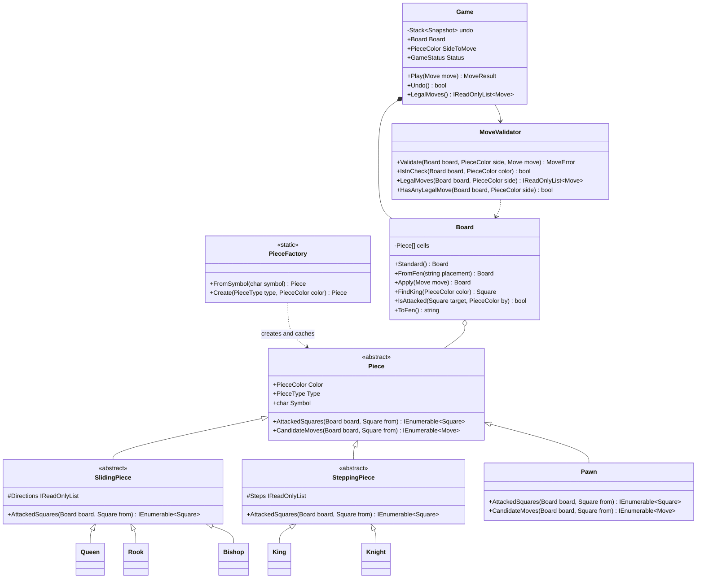
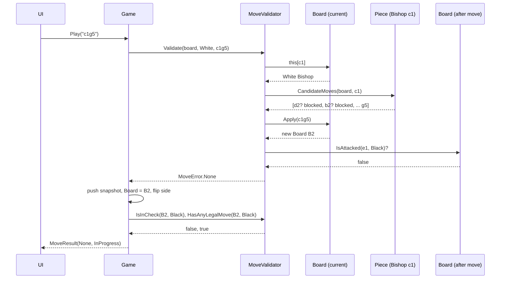
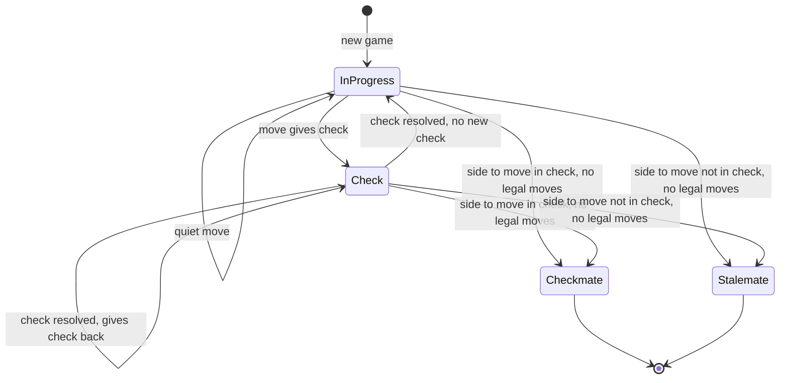

Chess is the LLD interview question that separates "I can draw boxes" from "I can make rules composable". Six piece types share most of their behaviour but differ in the details. One global rule (you may never leave your own king in check) cuts across all of them. A good design puts each rule in exactly one place.

**Scope of this lesson:** legal move generation for all six pieces (including the pawn's double step and diagonal captures), check detection, the "can't leave your king in check" filter, and checkmate and stalemate. Castling, en passant and promotion are left to the exercises, because each one adds *state* to the game. That's a design lesson in itself.

## Learning objectives

By the end of this case study you will be able to:

1. Write requirements and clarifying questions for a board-game engine, and scope it honestly.
2. Split responsibilities between pieces (how I move), board (what is where), rules (what is legal) and game (whose turn, is it over).
3. Use Template Method to share sliding and stepping logic between pieces without copy-paste.
4. Detect check by asking "is this square attacked?", and filter out illegal moves by trying them on an immutable board copy.
5. Derive checkmate and stalemate from two booleans.
6. Test a move generator with perft counts (the number of possible move sequences to a given depth, compared with published values).
7. Explain why castling and en passant need extra game state, and where that state belongs.

## Prerequisites

- [Encapsulation, abstraction, inheritance and polymorphism](#/lesson/m01-oop-pillars): pieces are a small class hierarchy.
- [Liskov Substitution Principle](#/lesson/m04-lsp): every `Piece` must be usable wherever a `Piece` is expected. The pawn tests this.
- [Template Method](#/lesson/m06-template-method): sliding pieces share one algorithm and vary only by direction.
- [Immutable objects](#/lesson/m07-immutability): the board never changes in place. That makes "try a move and see" safe.

## Explain it like I'm a beginner

Imagine a chess tournament with a referee. Players don't check their own moves; the referee does. To judge a move, she asks three questions in order:

1. **Is it this player's piece, and is it their turn?** (the game's job)
2. **Can that kind of piece move like that?** A bishop moves diagonally until something blocks it. A knight jumps in an L. (each piece's own job)
3. **After the move, is the player's own king being attacked?** If yes, the move is illegal, however clever it looked. (the rules' job)

For question 3, the referee does something clever: she imagines the board *after* the move, as if on a second board beside the real one, and checks whether any enemy piece could capture the king there. She never disturbs the real board while she's thinking.

That's the whole design:

- **Pieces** know their movement patterns. They don't know about check.
- The **board** knows what is on each square, and can produce a copy with one move applied.
- The **move validator** asks the piece for candidate moves, then throws away any that leave the king attacked.
- The **game** tracks whose turn it is and whether the game is over.

Checkmate is "you're in check and no move gets you out". Stalemate is "you're *not* in check, but you have no legal move", which is a draw. Both fall out of the same two questions.

## Requirements

### Functional requirements

1. Standard 8×8 board with the standard starting position. White moves first.
2. A move is given as source and destination squares in coordinate notation, for example `e2e4` (often called UCI notation, after the Universal Chess Interface protocol).
3. Each piece moves by its rules: king one square in any direction; queen any distance in straight lines and diagonals; rook along ranks and files; bishop along diagonals; knight in an L-shape, jumping over pieces; pawn one square forward (two from its start square) into empty squares, capturing one square diagonally forward.
4. Sliding pieces (queen, rook, bishop) stop at the first occupied square. They may capture it if it is an enemy piece.
5. No move may capture your own piece.
6. **No move may leave your own king in check.** This covers moving into check, ignoring a check, and moving a pinned piece.
7. After each move, report the status: in progress, check, checkmate (with the winner), or stalemate.
8. The game rejects moves when it is over, when it's the other side's turn, or when the notation is malformed. Each rejection gives a specific reason.
9. Undo the last move.
10. Load any position from the piece-placement part of FEN (Forsyth–Edwards Notation, the standard text format for a chess position), so tests can set up positions directly.

**Out of scope (exercises):** castling, en passant, promotion, draw by repetition, the 50-move rule, insufficient material, clocks.

### Non-functional requirements

- **Correctness over speed.** This is a rules referee for a game server or UI, not a chess-playing engine. Validating one move in well under a millisecond is plenty (an estimate; a few hundred allocations of a 64-slot array per move).
- **Testability.** Any position can be set up in one line of FEN.
- **Extensibility.** Adding castling should not require touching every piece class.
- **Thread safety by construction.** Boards are immutable, so a board can be shared by many readers, such as spectators and an analysis service, without locks.

### Clarifying questions

| Question | Assumption |
|---|---|
| Are we building a player (engine) or a referee? | Referee. Search and evaluation are out of scope. |
| Which notation do clients send? | Coordinate notation (`e2e4`). Standard algebraic (`Nf3`) is a parsing layer on top. |
| Do we need special moves now? | No. Castling, en passant and promotion are extensions. |
| Can the king be captured? | Never. Legal-move filtering makes it impossible. |
| Multiplayer, persistence, clocks? | Out of scope for the domain model. They wrap around `Game`. |
| Should illegal moves throw? | No. They return a result with a reason, because a user mis-click is not exceptional. |

## Identifying classes and responsibilities

Nouns: *board, square, piece (king, queen, rook, bishop, knight, pawn), colour, move, turn, check, checkmate, stalemate, game, position*. Verbs: *move, capture, attack, validate, undo, set up*.

| Class | Kind | Responsibility |
|---|---|---|
| `Square` | value object (record struct) | A coordinate (file 0–7, rank 0–7); parses and prints `e4`. |
| `Move` | value object | A from-square and a to-square; parses `e2e4`. |
| `PieceColor`, `PieceType` | enums | Colour and kind of piece. |
| `Piece` (abstract) | entity-like, but stateless | Knows which squares it **attacks** from a square, and its **candidate moves**. It has no position field. |
| `SlidingPiece`, `SteppingPiece` | abstract bases (Template Method) | Shared ray-walking and fixed-offset logic. |
| `King`, `Queen`, `Rook`, `Bishop`, `Knight`, `Pawn` | concrete pieces | Directions or offsets. The pawn overrides moves completely. |
| `PieceFactory` | factory + flyweight cache | Turns `'N'` into the shared white-knight instance. |
| `Board` | immutable aggregate | What is on each square; `Apply(move)` returns a **new** board; "is square X attacked by colour C?" |
| `MoveValidator` | domain service | The cross-cutting rules: legality, check, list of legal moves. |
| `Game` | aggregate root | Side to move, status, history, undo. The only class the UI talks to. |

The key decision is that **a piece does not know where it is**. The board maps squares to pieces. That has three benefits:

1. There's no risk of a piece's `Position` field disagreeing with the board's array (two sources of truth).
2. Pieces become stateless, so all white knights can be one shared object (Flyweight).
3. `Board.Apply` can copy an array of references without cloning any piece objects.

:::callout type=tradeoff title="Attacks versus moves"
We give every piece two methods: `AttackedSquares` (squares it threatens) and `CandidateMoves` (squares it may go to, ignoring check). They're the same for every piece **except the pawn**, which attacks diagonally but moves straight. Check detection must use *attacks*. A pawn in front of the king doesn't give check, but one diagonally in front does. Merging the two methods is the most common chess-design bug.
:::

## Class diagram



How to read it:

- The **inheritance tree** has two intermediate bases. `SlidingPiece` owns "walk a ray until blocked". Queen, rook and bishop only supply their directions. `SteppingPiece` owns "jump to fixed offsets". King and knight supply offsets. Five of the six pieces are under ten lines each.
- `Pawn` extends `Piece` directly, because it is the odd one out: different attack and move sets, and direction depends on colour.
- `Board` **aggregates** up to 32 pieces (hollow diamond). The same piece object can sit on many boards at once, which is the flyweight in action.
- `Game` **owns** its current board (filled diamond) and **uses** a `MoveValidator`. The validator depends on `Board` but holds no state, so one instance can serve every game on the server.

## Patterns and design decisions

### Template Method for piece families

`SlidingPiece.AttackedSquares` is the algorithm: for each direction, step until you fall off the board or hit a piece, and include that blocker square. The abstract `Directions` property is the "hook" that subclasses fill in. The method is `sealed override`, so a subclass can't accidentally replace the algorithm, only configure it. That is [Template Method](#/lesson/m06-template-method) in its purest form.

### Flyweight pieces through a factory

A piece has no mutable state and no position. So `PieceFactory` keeps exactly **12 objects** (6 types × 2 colours) and returns the same instance every time. A board is 64 references into that pool. When `Apply` creates a new board, it copies 64 references (about 512 bytes on a 64-bit runtime) and allocates no new pieces. This is the [Flyweight](#/lesson/m06-flyweight) pattern, and it's also what makes immutable boards cheap.

### Immutable board, "try it and see" legality

The rule "you may not leave your own king in check" is the hardest one to express per piece. A pinned bishop, a king stepping next to the enemy king, a discovered attack — each would need special code. Instead, `MoveValidator` uses one generic rule:

> A candidate move is legal if, on the board **after** the move, your king is not attacked.

Because `Board.Apply` returns a new board, this check can never corrupt the real game, even if it throws halfway. The alternative, *make/unmake* (mutate, test, undo), is faster and is what chess engines do. But it's error-prone, and it makes boards unsafe to share between threads. For a referee, immutability is the right trade-off.

### Check is "is the king's square attacked?"

`Board.IsAttacked(square, byColor)` asks every enemy piece for its `AttackedSquares` and looks for the target. That one method gives you:

- **check**: is my king's square attacked by the opponent?
- **legal king moves**: handled automatically by the try-it filter.
- **castling** (exercise): "the king may not pass through an attacked square" is the same method again.

### Status from two booleans

After every move, `Game` computes `inCheck` and `hasAnyLegalMove` for the side to move:

| inCheck | hasAnyLegalMove | Status |
|---|---|---|
| false | true | InProgress |
| true | true | Check |
| true | false | **Checkmate** (the previous mover wins) |
| false | false | **Stalemate** (draw) |

`HasAnyLegalMove` short-circuits on the first legal move found, so the common case is cheap.

### Undo with snapshots (Memento)

Because boards are immutable, an undo entry is just `(Board, SideToMove, Status)`. Push one before each move, pop to undo. No reverse-move logic is needed, and there are no bugs from "un-capturing" a piece. This is [Memento](#/lesson/m06-memento) at nearly zero cost. The same snapshot list doubles as the input for threefold-repetition detection later.

### Results, not exceptions, for bad moves

`Play` returns `MoveResult(MoveError, GameStatus)`. `MoveError` says exactly why a move was refused: `NotYourPiece`, `NotAPieceMove`, `LeavesKingInCheck` and so on. The UI can then show "Your king would be in check" instead of a generic error.

### Sequence of one move



The validator talks to the piece only through the abstract `Piece` type: it never asks "are you a bishop?". The legality test happens on `B2`, a separate board object. The real board is replaced only after every check has passed. Status evaluation is a second, independent step. That is why adding a "draw by repetition" rule later touches only the `Evaluate` step.

## State transitions



The status describes **the side to move**, recomputed after every move. `Check` is not a sticky flag. It is a fact about the new position, so it's computed fresh each time, never "set" or "cleared". `Checkmate` and `Stalemate` are terminal: `Play` returns `GameOver` and changes nothing. `Undo` is the one way back out of a terminal state, because it restores a snapshot rather than making a move. Draw by agreement, resignation and timeouts would be new terminal states added by the surrounding match service.

There's a second, simpler machine: the side to move alternates White → Black → White after each *successful* move. A rejected move leaves the side and the board unchanged. One of the tests below checks exactly that.

## C# implementation

```text
ChessKit/
  Domain/Primitives.cs     PieceColor, PieceType, Square, Move
  Domain/Pieces.cs         Piece, SlidingPiece, SteppingPiece, six pieces, PieceFactory
  Domain/Board.cs          immutable board + FEN
  Rules/MoveValidator.cs   legality, check, legal move list
  Rules/Game.cs            turn, status, history, undo
  Program.cs               demo: Fool's mate
```

```csharp file=Domain/Primitives.cs
namespace ChessKit.Domain;

public enum PieceColor { White, Black }

public enum PieceType { King, Queen, Rook, Bishop, Knight, Pawn }

public static class PieceColorExtensions
{
    // C# 14 extension members: read as properties, e.g. color.Opponent
    extension(PieceColor color)
    {
        public PieceColor Opponent => color == PieceColor.White ? PieceColor.Black : PieceColor.White;
        public int PawnDirection => color == PieceColor.White ? 1 : -1;
        public int PawnStartRank => color == PieceColor.White ? 1 : 6;
    }
}

/// <summary>File 0–7 = a–h, Rank 0–7 = 1–8. Can represent off-board squares so ray walking is simple.</summary>
public readonly record struct Square(int File, int Rank)
{
    public bool IsOnBoard => (uint)File < 8 && (uint)Rank < 8;

    public Square Offset(int dFile, int dRank) => new(File + dFile, Rank + dRank);

    public static bool TryParse(string? text, out Square square)
    {
        square = default;
        if (text is not { Length: 2 }) return false;
        var candidate = new Square(char.ToLowerInvariant(text[0]) - 'a', text[1] - '1');
        if (!candidate.IsOnBoard) return false;
        square = candidate;
        return true;
    }

    public static Square Parse(string text) =>
        TryParse(text, out var s) ? s : throw new FormatException($"'{text}' is not a square like 'e4'.");

    public override string ToString() => $"{(char)('a' + File)}{Rank + 1}";
}

public readonly record struct Move(Square From, Square To)
{
    public static bool TryParse(string? uci, out Move move)
    {
        move = default;
        if (uci is not { Length: 4 }) return false;
        if (!Square.TryParse(uci[..2], out var from) || !Square.TryParse(uci[2..], out var to)) return false;
        move = new Move(from, to);
        return true;
    }

    public override string ToString() => $"{From}{To}";
}
```

```csharp file=Domain/Pieces.cs
namespace ChessKit.Domain;

/// <summary>
/// A stateless piece: it knows how it moves, not where it is. Instances are shared flyweights.
/// </summary>
public abstract class Piece(PieceColor color)
{
    public PieceColor Color { get; } = color;
    public abstract PieceType Type { get; }
    protected abstract char Letter { get; }   // lower-case FEN letter
    public char Symbol => Color == PieceColor.White ? char.ToUpperInvariant(Letter) : Letter;

    /// <summary>Squares this piece threatens from <paramref name="from"/>. Used for check detection.</summary>
    public abstract IEnumerable<Square> AttackedSquares(Board board, Square from);

    /// <summary>Moves allowed by this piece's movement rules, ignoring check (pseudo-legal moves).</summary>
    public virtual IEnumerable<Move> CandidateMoves(Board board, Square from)
    {
        foreach (var to in AttackedSquares(board, from))
            if (board[to] is not { } occupant || occupant.Color != Color)
                yield return new Move(from, to);
    }

    public override string ToString() => $"{Color} {Type}";
}

internal static class Directions
{
    public static readonly (int, int)[] Orthogonal = [(1, 0), (-1, 0), (0, 1), (0, -1)];
    public static readonly (int, int)[] Diagonal = [(1, 1), (1, -1), (-1, 1), (-1, -1)];
    public static readonly (int, int)[] All = [.. Orthogonal, .. Diagonal];
    public static readonly (int, int)[] KnightJumps = [(1, 2), (2, 1), (2, -1), (1, -2), (-1, -2), (-2, -1), (-2, 1), (-1, 2)];
}

/// <summary>Template Method: walk each direction until off-board or blocked; subclasses supply directions.</summary>
public abstract class SlidingPiece(PieceColor color) : Piece(color)
{
    protected abstract IReadOnlyList<(int DFile, int DRank)> Rays { get; }

    public sealed override IEnumerable<Square> AttackedSquares(Board board, Square from)
    {
        foreach (var (df, dr) in Rays)
        {
            for (var s = from.Offset(df, dr); s.IsOnBoard; s = s.Offset(df, dr))
            {
                yield return s;
                if (board[s] is not null) break;   // the blocker is attacked; nothing beyond it
            }
        }
    }
}

/// <summary>Template Method: fixed offsets, no blocking; subclasses supply offsets.</summary>
public abstract class SteppingPiece(PieceColor color) : Piece(color)
{
    protected abstract IReadOnlyList<(int DFile, int DRank)> Steps { get; }

    public sealed override IEnumerable<Square> AttackedSquares(Board board, Square from)
    {
        foreach (var (df, dr) in Steps)
        {
            var s = from.Offset(df, dr);
            if (s.IsOnBoard) yield return s;
        }
    }
}

public sealed class Queen(PieceColor c) : SlidingPiece(c)
{
    public override PieceType Type => PieceType.Queen;
    protected override char Letter => 'q';
    protected override IReadOnlyList<(int DFile, int DRank)> Rays => Directions.All;
}

public sealed class Rook(PieceColor c) : SlidingPiece(c)
{
    public override PieceType Type => PieceType.Rook;
    protected override char Letter => 'r';
    protected override IReadOnlyList<(int DFile, int DRank)> Rays => Directions.Orthogonal;
}

public sealed class Bishop(PieceColor c) : SlidingPiece(c)
{
    public override PieceType Type => PieceType.Bishop;
    protected override char Letter => 'b';
    protected override IReadOnlyList<(int DFile, int DRank)> Rays => Directions.Diagonal;
}

public sealed class King(PieceColor c) : SteppingPiece(c)
{
    public override PieceType Type => PieceType.King;
    protected override char Letter => 'k';
    protected override IReadOnlyList<(int DFile, int DRank)> Steps => Directions.All;
}

public sealed class Knight(PieceColor c) : SteppingPiece(c)
{
    public override PieceType Type => PieceType.Knight;
    protected override char Letter => 'n';
    protected override IReadOnlyList<(int DFile, int DRank)> Steps => Directions.KnightJumps;
}

/// <summary>The odd one out: attacks diagonally, moves straight, direction depends on colour.</summary>
public sealed class Pawn(PieceColor c) : Piece(c)
{
    public override PieceType Type => PieceType.Pawn;
    protected override char Letter => 'p';

    public override IEnumerable<Square> AttackedSquares(Board board, Square from)
    {
        foreach (var df in (int[])[-1, 1])
        {
            var s = from.Offset(df, Color.PawnDirection);
            if (s.IsOnBoard) yield return s;
        }
    }

    public override IEnumerable<Move> CandidateMoves(Board board, Square from)
    {
        var one = from.Offset(0, Color.PawnDirection);
        if (one.IsOnBoard && board[one] is null)
        {
            yield return new Move(from, one);
            var two = one.Offset(0, Color.PawnDirection);
            if (from.Rank == Color.PawnStartRank && board[two] is null)
                yield return new Move(from, two);
        }
        foreach (var target in AttackedSquares(board, from))
            if (board[target] is { } occupant && occupant.Color != Color)
                yield return new Move(from, target);
        // Not yet: en passant and promotion (see exercises).
    }
}

/// <summary>Factory + flyweight cache: exactly 12 piece objects exist.</summary>
public static class PieceFactory
{
    private static readonly Dictionary<char, Piece> BySymbol = Build();

    private static Dictionary<char, Piece> Build()
    {
        var all = new List<Piece>();
        foreach (var c in Enum.GetValues<PieceColor>())
            all.AddRange([new King(c), new Queen(c), new Rook(c), new Bishop(c), new Knight(c), new Pawn(c)]);
        return all.ToDictionary(p => p.Symbol);
    }

    public static Piece FromSymbol(char symbol) =>
        BySymbol.TryGetValue(symbol, out var piece) ? piece : throw new ArgumentException($"Unknown piece symbol '{symbol}'.", nameof(symbol));

    public static Piece Create(PieceType type, PieceColor color) =>
        BySymbol.Values.Single(p => p.Type == type && p.Color == color);
}
```

```csharp file=Domain/Board.cs
using System.Text;

namespace ChessKit.Domain;

/// <summary>An immutable position. Apply returns a new board; the original never changes.</summary>
public sealed class Board
{
    public const string StandardPlacement = "rnbqkbnr/pppppppp/8/8/8/8/PPPPPPPP/RNBQKBNR";
    private readonly Piece?[] _cells;

    private Board(Piece?[] cells) => _cells = cells;

    public static Board Empty() => new(new Piece?[64]);
    public static Board Standard() => FromFen(StandardPlacement);

    /// <summary>Parses the piece-placement field of FEN (anything after the first space is ignored).</summary>
    public static Board FromFen(string placement)
    {
        ArgumentException.ThrowIfNullOrWhiteSpace(placement);
        var rows = placement.Split(' ')[0].Split('/');
        if (rows.Length != 8) throw new FormatException($"FEN '{placement}' must have 8 ranks.");
        var cells = new Piece?[64];
        for (var i = 0; i < 8; i++)
        {
            var rank = 7 - i;
            var file = 0;
            foreach (var ch in rows[i])
            {
                if (ch is >= '1' and <= '8') { file += ch - '0'; continue; }
                if (file > 7) throw new FormatException($"Rank {rank + 1} of '{placement}' is too long.");
                cells[Index(new Square(file, rank))] = PieceFactory.FromSymbol(ch);
                file++;
            }
            if (file != 8) throw new FormatException($"Rank {rank + 1} of '{placement}' does not have 8 squares.");
        }
        return new Board(cells);
    }

    public Piece? this[Square square] =>
        square.IsOnBoard ? _cells[Index(square)] : throw new ArgumentOutOfRangeException(nameof(square), square, "Square is off the board.");

    public Board With(Square square, Piece? piece)
    {
        var copy = (Piece?[])_cells.Clone();
        copy[Index(square)] = piece;
        return new Board(copy);
    }

    public Board Apply(Move move)
    {
        var piece = this[move.From] ?? throw new InvalidOperationException($"No piece on {move.From}.");
        var copy = (Piece?[])_cells.Clone();
        copy[Index(move.From)] = null;
        copy[Index(move.To)] = piece;
        return new Board(copy);
    }

    public IEnumerable<(Square Square, Piece Piece)> PiecesOf(PieceColor color)
    {
        for (var i = 0; i < 64; i++)
            if (_cells[i] is { } p && p.Color == color)
                yield return (new Square(i % 8, i / 8), p);
    }

    public Square? FindKing(PieceColor color)
    {
        foreach (var (square, piece) in PiecesOf(color))
            if (piece.Type == PieceType.King) return square;
        return null;
    }

    public bool IsAttacked(Square target, PieceColor by)
    {
        foreach (var (square, piece) in PiecesOf(by))
            foreach (var attacked in piece.AttackedSquares(this, square))
                if (attacked == target) return true;
        return false;
    }

    public string ToFen()
    {
        var sb = new StringBuilder();
        for (var rank = 7; rank >= 0; rank--)
        {
            var empty = 0;
            for (var file = 0; file < 8; file++)
            {
                var p = _cells[Index(new Square(file, rank))];
                if (p is null) { empty++; continue; }
                if (empty > 0) { sb.Append(empty); empty = 0; }
                sb.Append(p.Symbol);
            }
            if (empty > 0) sb.Append(empty);
            if (rank > 0) sb.Append('/');
        }
        return sb.ToString();
    }

    private static int Index(Square s) => s.Rank * 8 + s.File;
}
```

```csharp file=Rules/MoveValidator.cs
using ChessKit.Domain;

namespace ChessKit.Rules;

public enum MoveError { None, BadNotation, GameOver, NoPieceOnSquare, NotYourPiece, NotAPieceMove, LeavesKingInCheck }

/// <summary>Stateless rules service: one instance can serve every game.</summary>
public sealed class MoveValidator
{
    public bool IsInCheck(Board board, PieceColor color) =>
        board.FindKing(color) is { } king && board.IsAttacked(king, color.Opponent);

    public MoveError Validate(Board board, PieceColor side, Move move)
    {
        var piece = board[move.From];
        if (piece is null) return MoveError.NoPieceOnSquare;
        if (piece.Color != side) return MoveError.NotYourPiece;
        if (!piece.CandidateMoves(board, move.From).Contains(move)) return MoveError.NotAPieceMove;
        if (IsInCheck(board.Apply(move), side)) return MoveError.LeavesKingInCheck;
        return MoveError.None;
    }

    public IReadOnlyList<Move> LegalMoves(Board board, PieceColor side) =>
        PseudoLegal(board, side).Where(m => !IsInCheck(board.Apply(m), side)).ToList();

    public bool HasAnyLegalMove(Board board, PieceColor side) =>
        PseudoLegal(board, side).Any(m => !IsInCheck(board.Apply(m), side));

    private static IEnumerable<Move> PseudoLegal(Board board, PieceColor side) =>
        board.PiecesOf(side).ToList().SelectMany(p => p.Piece.CandidateMoves(board, p.Square));
}
```

```csharp file=Rules/Game.cs
using ChessKit.Domain;

namespace ChessKit.Rules;

public enum GameStatus { InProgress, Check, Checkmate, Stalemate }

public sealed record MoveResult(MoveError Error, GameStatus Status)
{
    public bool IsSuccess => Error == MoveError.None;
}

/// <summary>Aggregate root: whose turn, what status, history and undo. The only class a UI calls.</summary>
public sealed class Game
{
    private sealed record Snapshot(Board Board, PieceColor SideToMove, GameStatus Status);

    private readonly MoveValidator _rules;
    private readonly Stack<Snapshot> _undo = new();
    private readonly List<Move> _history = [];

    public Game() : this(Board.Standard(), PieceColor.White) { }

    public Game(Board start, PieceColor sideToMove, MoveValidator? rules = null)
    {
        _rules = rules ?? new MoveValidator();
        Board = start;
        SideToMove = sideToMove;
        Status = Evaluate();
    }

    public Board Board { get; private set; }
    public PieceColor SideToMove { get; private set; }
    public GameStatus Status { get; private set; }
    public bool IsOver => Status is GameStatus.Checkmate or GameStatus.Stalemate;
    public PieceColor? Winner => Status == GameStatus.Checkmate ? SideToMove.Opponent : null;
    public IReadOnlyList<Move> History => _history;

    public MoveResult Play(string uci) =>
        Move.TryParse(uci, out var move) ? Play(move) : new MoveResult(MoveError.BadNotation, Status);

    public MoveResult Play(Move move)
    {
        if (IsOver) return new MoveResult(MoveError.GameOver, Status);
        var error = _rules.Validate(Board, SideToMove, move);
        if (error != MoveError.None) return new MoveResult(error, Status);

        _undo.Push(new Snapshot(Board, SideToMove, Status));
        Board = Board.Apply(move);
        SideToMove = SideToMove.Opponent;
        _history.Add(move);
        Status = Evaluate();
        return new MoveResult(MoveError.None, Status);
    }

    public bool Undo()
    {
        if (!_undo.TryPop(out var s)) return false;
        (Board, SideToMove, Status) = (s.Board, s.SideToMove, s.Status);
        _history.RemoveAt(_history.Count - 1);
        return true;
    }

    public IReadOnlyList<Move> LegalMoves() => IsOver ? [] : _rules.LegalMoves(Board, SideToMove);

    private GameStatus Evaluate()
    {
        var inCheck = _rules.IsInCheck(Board, SideToMove);
        var canMove = _rules.HasAnyLegalMove(Board, SideToMove);
        return (inCheck, canMove) switch
        {
            (true, false) => GameStatus.Checkmate,
            (false, false) => GameStatus.Stalemate,
            (true, true) => GameStatus.Check,
            _ => GameStatus.InProgress,
        };
    }
}
```

```csharp file=Program.cs
using ChessKit.Rules;

namespace ChessKit;

public static class Program
{
    public static void Main()
    {
        var game = new Game();
        foreach (var uci in new[] { "f2f3", "e7e5", "g2g4", "d8h4" })   // Fool's mate
        {
            var result = game.Play(uci);
            Console.WriteLine($"{uci}: {result.Error}, status {result.Status}");
        }
        Console.WriteLine($"Winner: {game.Winner}; position {game.Board.ToFen()}");
        Console.WriteLine($"Try an illegal move: {game.Play("e1e2").Error}");
    }
}
```

Things worth noticing:

- **`sealed override`** on `AttackedSquares` in the two template bases. Subclasses configure the algorithm; they can't rewrite it.
- **`PseudoLegal` materialises `PiecesOf(side)` with `ToList()`** before generating moves. It isn't strictly needed with immutable boards, but it keeps the enumeration independent of any future change to how boards are built.
- **C# 14 extension members** let us write `color.Opponent` and `Color.PawnDirection` as properties. On older C#, write ordinary extension methods: `color.Opponent()`.
- **No `Position` on pieces**, so moving a piece can never desynchronise two data structures.

## Automated testing

Unit tests cover each rule. A *perft* test covers everything at once. Perft ("performance test", a standard technique from chess programming) counts every legal move sequence to a given depth from a position and compares the total with published values. From the starting position the counts are 20, 400 and 8,902 at depths 1, 2 and 3. Castling, en passant and promotion can't occur within the first three plies (a ply is one player's move), so our scoped engine must hit those numbers exactly. One wrong pawn rule and the count is off.

```csharp
using ChessKit.Domain;
using ChessKit.Rules;
using Xunit;

namespace ChessKit.Tests;

public sealed class ChessRulesTests
{
    private static readonly MoveValidator Rules = new();
    private static Square Sq(string s) => Square.Parse(s);
    private static string[] TargetsOf(Board b, string from) =>
        Rules.LegalMoves(b, b[Sq(from)]!.Color).Where(m => m.From == Sq(from)).Select(m => m.To.ToString()).Order().ToArray();

    [Fact]
    public void Knight_on_b1_has_two_moves_at_start() =>
        Assert.Equal(new[] { "a3", "c3" }, TargetsOf(Board.Standard(), "b1"));

    [Fact]
    public void Rook_stops_at_blockers_and_captures_enemy()
    {
        var b = Board.FromFen("4k3/8/8/8/r2R1P2/8/8/4K3");   // White rook d4, enemy rook a4, own pawn f4
        Assert.Equal(new[] { "a4", "b4", "c4", "d1", "d2", "d3", "d5", "d6", "d7", "d8", "e4" }, TargetsOf(b, "d4"));
    }

    [Fact]
    public void Pinned_bishop_cannot_move()
    {
        var b = Board.FromFen("4r1k1/8/8/8/8/8/4B3/4K3");    // Black rook e8 pins White bishop e2 to king e1
        Assert.Empty(TargetsOf(b, "e2"));
    }

    [Fact]
    public void King_cannot_step_into_check()
    {
        var b = Board.FromFen("3r2k1/8/8/8/8/8/8/4K3");      // Black rook d8 controls the d-file
        Assert.DoesNotContain("d1", TargetsOf(b, "e1"));
        Assert.DoesNotContain("d2", TargetsOf(b, "e1"));
        Assert.Contains("f2", TargetsOf(b, "e1"));
    }

    [Fact]
    public void Pawn_attacks_diagonally_but_does_not_give_check_straight_ahead()
    {
        var blocked = Board.FromFen("8/8/8/8/8/4k3/4P3/4K3");
        Assert.False(Rules.IsInCheck(blocked, PieceColor.Black));
        var diagonal = Board.FromFen("8/8/8/8/8/3k4/4P3/4K3");
        Assert.True(Rules.IsInCheck(diagonal, PieceColor.Black));
    }

    [Fact]
    public void Fools_mate_is_checkmate_for_black()
    {
        var g = new Game();
        foreach (var m in new[] { "f2f3", "e7e5", "g2g4", "d8h4" }) Assert.True(g.Play(m).IsSuccess);
        Assert.Equal(GameStatus.Checkmate, g.Status);
        Assert.Equal(PieceColor.Black, g.Winner);
        Assert.Equal(MoveError.GameOver, g.Play("e1f2").Error);
    }

    [Fact]
    public void Queen_move_can_stalemate()
    {
        var g = new Game(Board.FromFen("7k/4Q3/6K1/8/8/8/8/8"), PieceColor.White);
        Assert.Equal(GameStatus.Stalemate, g.Play("e7f7").Status);
        Assert.Null(g.Winner);
    }

    [Fact]
    public void Check_must_be_answered()
    {
        var g = new Game(Board.FromFen("4k3/8/8/8/8/8/P7/4K2R"), PieceColor.White);
        Assert.Equal(GameStatus.Check, g.Play("h1h8").Status);
        Assert.All(g.LegalMoves(), m => Assert.Equal(Sq("e8"), m.From));   // only king moves help
    }

    [Fact]
    public void Rejected_move_changes_nothing_and_undo_restores()
    {
        var g = new Game();
        Assert.Equal(MoveError.NotYourPiece, g.Play("e7e5").Error);
        Assert.Equal(PieceColor.White, g.SideToMove);
        g.Play("e2e4");
        Assert.True(g.Undo());
        Assert.Equal(Board.StandardPlacement, g.Board.ToFen());
        Assert.False(g.Undo());
    }

    [Theory]
    [InlineData(1, 20)]
    [InlineData(2, 400)]
    [InlineData(3, 8902)]
    public void Perft_from_start_matches_published_counts(int depth, long expected) =>
        Assert.Equal(expected, Perft(Board.Standard(), PieceColor.White, depth));

    private static long Perft(Board board, PieceColor side, int depth)
    {
        if (depth == 0) return 1;
        long total = 0;
        foreach (var m in Rules.LegalMoves(board, side)) total += Perft(board.Apply(m), side.Opponent, depth - 1);
        return total;
    }
}
```

Test-design notes:

- **FEN-based arrangement** keeps every test to a few lines and shows the position in the test itself. Draw the position on paper once; it pays off when a test fails.
- **Test the asymmetric cases**: the pawn's attack versus its move, pinned pieces, and a king next to an attacked square. Those are where bugs live.
- **Perft is a characterization test.** It checks thousands of positions against an independent source of truth. When you add castling and en passant, extend it with the published "Kiwipete" position counts, which exercise every special move.
- **A rejected move must change nothing.** Assert that the side to move and the board are unchanged after an illegal attempt.

## Bad design vs good design

**Bad: one giant `IsValidMove` switch**

```csharp
public bool IsValidMove(int fx, int fy, int tx, int ty)
{
    var p = board[fx, fy];
    switch (p)
    {
        case 'N': return (Math.Abs(fx - tx) == 1 && Math.Abs(fy - ty) == 2) || (Math.Abs(fx - tx) == 2 && Math.Abs(fy - ty) == 1);
        case 'R': if (fx != tx && fy != ty) return false; /* 15 lines of path checking */ break;
        case 'B': /* 15 more lines, nearly identical to R */ break;
        case 'Q': /* R and B copy-pasted again */ break;
        // ... lower-case versions for black, king, pawn with colour checks inline
    }
    board[tx, ty] = board[fx, fy]; board[fx, fy] = ' ';       // mutate to test for check
    var inCheck = KingInCheck(currentPlayer);
    board[fx, fy] = p; board[tx, ty] = ' ';                   // BUG: forgot to restore the captured piece
    return !inCheck;
}
```

Problems:

1. **Duplication**: rook, bishop and queen path logic is written two or three times. Fix a blocking bug in one and the others keep it.
2. **Mutate-and-restore**: the "restore" step loses captured pieces. It also makes the board unsafe for concurrent readers.
3. **Attack and move are merged**, so pawn check detection is wrong.
4. **Characters as types** (`'N'` vs `'n'`): colour logic is scattered everywhere.
5. **Untestable in isolation**: you can't test "knight movement" without the whole method.

**Good**: pieces own their geometry through two template bases, the board is immutable, and one validator owns the cross-cutting check rule.

**Is a class per piece overkill?** For six pieces that will never change, a well-structured table of directions plus one pawn function is a legitimate, compact alternative. The class hierarchy pays off once variants appear, such as fairy pieces in chess variants or a different board size, and in interviews, where it shows you can separate responsibilities cleanly.

## Alternative designs

| Alternative | Idea | Better when | Cost |
|---|---|---|---|
| **Data-driven movement** | `PieceType → (directions, sliding: bool)` table, one generic generator plus a pawn special case. | Few piece types, no variants; easiest to read in one screen. | Pawn and future special moves become `if`s in the generator. |
| **Bitboards** | Twelve 64-bit integers, one per piece type and colour; moves via shifts and precomputed attack tables. | Engines searching millions of positions per second. | Hard to read and debug; overkill for a referee. |
| **Make/unmake on a mutable board** | Apply the move in place, test, revert. | Search engines; avoids allocation. | Easy to get wrong; not thread-safe; needs careful undo info (captured piece, rights, en passant square). |
| **Rule objects (Chain of Responsibility)** | A list of `IMoveRule`s (own-piece rule, path-clear rule, king-safety rule) each vetoing a move. | Many variants that toggle rules (e.g. "no check rule" in a teaching mode). | Indirection; rule order matters. |
| **Mailbox 10×12 board** | Pad the array with sentinel cells so off-board tests become "is this a sentinel?". | Classic engine trick; avoids bounds checks. | Mostly a performance concern. |

Our design is the readable middle ground. Swapping the internals of `Board` for bitboards later wouldn't change `Game`'s API, because everything goes through `Board`, `Piece` and `MoveValidator`.

## Practical playground

The reference class model is below. Try adding castling to it in the designer: which class gains the castling *rights*, and which class gains the castling *move generation*? Compare your answer with exercise 5.

:::playground type=lld title="Chess reference model"
```json
{
  "classes": [
    { "id": "Square", "name": "Square", "kind": "record", "fields": ["+int File", "+int Rank"], "methods": ["+bool IsOnBoard", "+Square Offset(int dFile, int dRank)", "+Square Parse(string text)"], "responsibility": "Board coordinate value object" },
    { "id": "Move", "name": "Move", "kind": "record", "fields": ["+Square From", "+Square To"], "methods": ["+bool TryParse(string uci, out Move move)"], "responsibility": "A from-to pair in coordinate notation" },
    { "id": "PieceColor", "name": "PieceColor", "kind": "enum", "fields": ["White", "Black"], "methods": [] },
    { "id": "Piece", "name": "Piece", "kind": "abstract", "fields": ["+PieceColor Color", "+PieceType Type"], "methods": ["+IEnumerable AttackedSquares(Board board, Square from)", "+IEnumerable CandidateMoves(Board board, Square from)"], "responsibility": "Stateless movement rules for one kind of piece" },
    { "id": "Sliding", "name": "SlidingPiece", "kind": "abstract", "fields": ["#IReadOnlyList Rays"], "methods": ["+IEnumerable AttackedSquares(Board board, Square from)"], "responsibility": "Template method: walk rays until blocked" },
    { "id": "Stepping", "name": "SteppingPiece", "kind": "abstract", "fields": ["#IReadOnlyList Steps"], "methods": ["+IEnumerable AttackedSquares(Board board, Square from)"], "responsibility": "Template method: fixed offsets" },
    { "id": "Queen", "name": "Queen", "kind": "class", "fields": [], "methods": [] },
    { "id": "Rook", "name": "Rook", "kind": "class", "fields": [], "methods": [] },
    { "id": "Bishop", "name": "Bishop", "kind": "class", "fields": [], "methods": [] },
    { "id": "King", "name": "King", "kind": "class", "fields": [], "methods": [] },
    { "id": "Knight", "name": "Knight", "kind": "class", "fields": [], "methods": [] },
    { "id": "Pawn", "name": "Pawn", "kind": "class", "fields": [], "methods": ["+IEnumerable AttackedSquares(Board board, Square from)", "+IEnumerable CandidateMoves(Board board, Square from)"], "responsibility": "Moves straight, attacks diagonally" },
    { "id": "Factory", "name": "PieceFactory", "kind": "class", "fields": ["-Dictionary bySymbol"], "methods": ["+Piece FromSymbol(char symbol)", "+Piece Create(PieceType type, PieceColor color)"], "responsibility": "Creates and caches the 12 flyweight pieces" },
    { "id": "Board", "name": "Board", "kind": "class", "fields": ["-Piece[] cells"], "methods": ["+Board FromFen(string placement)", "+Board Apply(Move move)", "+Square? FindKing(PieceColor color)", "+bool IsAttacked(Square target, PieceColor by)"], "responsibility": "Immutable position" },
    { "id": "Validator", "name": "MoveValidator", "kind": "class", "fields": [], "methods": ["+MoveError Validate(Board board, PieceColor side, Move move)", "+bool IsInCheck(Board board, PieceColor color)", "+IReadOnlyList LegalMoves(Board board, PieceColor side)"], "responsibility": "Cross-cutting legality and king safety" },
    { "id": "GameStatus", "name": "GameStatus", "kind": "enum", "fields": ["InProgress", "Check", "Checkmate", "Stalemate"], "methods": [] },
    { "id": "Game", "name": "Game", "kind": "class", "fields": ["+Board Board", "+PieceColor SideToMove", "+GameStatus Status", "-Stack undo"], "methods": ["+MoveResult Play(Move move)", "+bool Undo()", "+IReadOnlyList LegalMoves()"], "responsibility": "Turn order, status, history and undo" }
  ],
  "relations": [
    { "from": "Sliding", "to": "Piece", "kind": "inherits" },
    { "from": "Stepping", "to": "Piece", "kind": "inherits" },
    { "from": "Pawn", "to": "Piece", "kind": "inherits" },
    { "from": "Queen", "to": "Sliding", "kind": "inherits" },
    { "from": "Rook", "to": "Sliding", "kind": "inherits" },
    { "from": "Bishop", "to": "Sliding", "kind": "inherits" },
    { "from": "King", "to": "Stepping", "kind": "inherits" },
    { "from": "Knight", "to": "Stepping", "kind": "inherits" },
    { "from": "Piece", "to": "PieceColor", "kind": "association" },
    { "from": "Factory", "to": "Piece", "kind": "dependency", "label": "creates" },
    { "from": "Board", "to": "Piece", "kind": "aggregation", "multiplicity": "0..32" },
    { "from": "Move", "to": "Square", "kind": "composition", "multiplicity": "2" },
    { "from": "Validator", "to": "Board", "kind": "dependency" },
    { "from": "Game", "to": "Board", "kind": "composition" },
    { "from": "Game", "to": "Validator", "kind": "association" },
    { "from": "Game", "to": "GameStatus", "kind": "association" }
  ]
}
```
:::

## Exercises

:::exercise id=m18-chess-ex1 difficulty=beginner kind=code title="Knight targets"
Implement `Knight.Targets`, which returns every square a knight of the given colour may move to from `from`. Knights jump, so pieces in between don't matter. A knight can't land on its own colour's piece, but may land on an enemy piece.
::acceptance
- From b1 on an empty board: a3, c3 and d2.
- From d4 on an empty board: 8 squares.
- From a1: b3 and c2 only.
- An own piece on c3 removes c3; an enemy piece on c3 keeps it.
::hint
List the eight (file, rank) offsets of an L-shape: two in one direction, one in the other.
::hint
For each offset, compute the target, skip it if it is off the board, then skip it if it holds your own colour.
::hint
`board.ColorAt(target) == color` means "own piece". `null` means empty.
::hint
```csharp
foreach (var (df, dr) in Jumps)
{
    var t = from.Offset(df, dr);
    if (t.IsOnBoard && board.ColorAt(t) != color) result.Add(t);
}
```
::starter
```csharp file=Knight.cs
using System;
using System.Collections.Generic;

public enum PieceColor { White, Black }

public readonly record struct Square(int File, int Rank)
{
    public bool IsOnBoard => (uint)File < 8 && (uint)Rank < 8;
    public Square Offset(int df, int dr) => new(File + df, Rank + dr);
    public override string ToString() => $"{(char)('a' + File)}{Rank + 1}";
}

public interface IBoardView { PieceColor? ColorAt(Square square); }

public static class Knight
{
    public static IReadOnlyList<Square> Targets(IBoardView board, Square from, PieceColor color) =>
        throw new NotImplementedException();
}
```
::tests
```csharp file=KnightTests.cs
using System.Collections.Generic;
using System.Linq;
using Xunit;

public class KnightTests
{
    private sealed class FakeBoard(Dictionary<Square, PieceColor> pieces) : IBoardView
    {
        public PieceColor? ColorAt(Square s) => pieces.TryGetValue(s, out var c) ? c : null;
    }
    private static Square Sq(string s) => new(s[0] - 'a', s[1] - '1');
    private static string[] Names(IEnumerable<Square> squares) => squares.Select(s => s.ToString()).Order().ToArray();
    private static readonly FakeBoard Empty = new(new());

    [Fact] public void From_b1() => Assert.Equal(new[] { "a3", "c3", "d2" }, Names(Knight.Targets(Empty, Sq("b1"), PieceColor.White)));
    [Fact] public void From_d4_has_eight() => Assert.Equal(8, Knight.Targets(Empty, Sq("d4"), PieceColor.White).Count);
    [Fact] public void From_corner() => Assert.Equal(new[] { "b3", "c2" }, Names(Knight.Targets(Empty, Sq("a1"), PieceColor.Black)));
    [Fact] public void Own_piece_blocks_landing()
    {
        var b = new FakeBoard(new() { [Sq("c3")] = PieceColor.White });
        Assert.Equal(new[] { "a3", "d2" }, Names(Knight.Targets(b, Sq("b1"), PieceColor.White)));
    }
    [Fact] public void Enemy_piece_can_be_captured()
    {
        var b = new FakeBoard(new() { [Sq("c3")] = PieceColor.Black, [Sq("c2")] = PieceColor.White });
        Assert.Equal(new[] { "a3", "c3", "d2" }, Names(Knight.Targets(b, Sq("b1"), PieceColor.White)));
    }
}
```
::solution
```csharp file=Knight.cs
using System;
using System.Collections.Generic;

public enum PieceColor { White, Black }

public readonly record struct Square(int File, int Rank)
{
    public bool IsOnBoard => (uint)File < 8 && (uint)Rank < 8;
    public Square Offset(int df, int dr) => new(File + df, Rank + dr);
    public override string ToString() => $"{(char)('a' + File)}{Rank + 1}";
}

public interface IBoardView { PieceColor? ColorAt(Square square); }

public static class Knight
{
    private static readonly (int, int)[] Jumps = [(1, 2), (2, 1), (2, -1), (1, -2), (-1, -2), (-2, -1), (-2, 1), (-1, 2)];

    public static IReadOnlyList<Square> Targets(IBoardView board, Square from, PieceColor color)
    {
        var result = new List<Square>(8);
        foreach (var (df, dr) in Jumps)
        {
            var t = from.Offset(df, dr);
            if (t.IsOnBoard && board.ColorAt(t) != color) result.Add(t);
        }
        return result;
    }
}
```
The board is behind a one-method interface (`IBoardView`), so the test needs only a dictionary. That's the Interface Segregation Principle making tests cheap.
::mistakes
- Listing only four offsets (forgetting negative directions).
- Checking "is the square empty" instead of "is it not my colour", which forbids captures.
- Checking off-board after calling `ColorAt`, which may throw on real boards.
::extensions
Precompute the knight targets for all 64 squares into a static array on first use, and benchmark the difference.
:::

:::exercise id=m18-chess-ex2 difficulty=beginner kind=code title="Parse and print squares"
Implement `Square.TryParse`, `Square.Parse` and `ToString` so that `"e4"` becomes file 4, rank 3, and back. Parsing is case-insensitive on the file letter. Anything else is rejected.
::acceptance
- `"e4"` → (4, 3); `"A1"` → (0, 0); `"h8"` → (7, 7).
- `"i1"`, `"a9"`, `"a0"`, `""`, `null`, `"e44"` → `TryParse` returns false.
- `Parse` throws `FormatException` for bad input.
- All 64 squares round-trip: `Parse(s.ToString()) == s`.
::hint
`'e' - 'a'` is 4 and `'4' - '1'` is 3. Character arithmetic gives you zero-based indexes.
::hint
Check the length first. Then build the candidate square and test `IsOnBoard`.
::hint
`(uint)value < 8` checks both `>= 0` and `< 8` in one comparison.
::hint
```csharp
if (text is not { Length: 2 }) return false;
var c = new Square(char.ToLowerInvariant(text[0]) - 'a', text[1] - '1');
```
::starter
```csharp file=Square.cs
using System;

public readonly record struct Square(int File, int Rank)
{
    public bool IsOnBoard => (uint)File < 8 && (uint)Rank < 8;
    public static bool TryParse(string? text, out Square square) => throw new NotImplementedException();
    public static Square Parse(string text) => throw new NotImplementedException();
    public override string ToString() => throw new NotImplementedException();
}
```
::tests
```csharp file=SquareTests.cs
using System;
using Xunit;

public class SquareTests
{
    [Theory]
    [InlineData("e4", 4, 3)]
    [InlineData("A1", 0, 0)]
    [InlineData("h8", 7, 7)]
    public void Parses(string text, int file, int rank) => Assert.Equal(new Square(file, rank), Square.Parse(text));

    [Theory]
    [InlineData("i1")]
    [InlineData("a9")]
    [InlineData("a0")]
    [InlineData("")]
    [InlineData("e44")]
    public void Rejects(string text) => Assert.False(Square.TryParse(text, out _));

    [Fact] public void Rejects_null() => Assert.False(Square.TryParse(null, out _));
    [Fact] public void Parse_throws_FormatException() => Assert.Throws<FormatException>(() => Square.Parse("z9"));
    [Fact] public void Prints() => Assert.Equal("e4", new Square(4, 3).ToString());

    [Fact] public void All_squares_round_trip()
    {
        for (var f = 0; f < 8; f++)
            for (var r = 0; r < 8; r++)
            {
                var s = new Square(f, r);
                Assert.Equal(s, Square.Parse(s.ToString()));
            }
    }
}
```
::solution
```csharp file=Square.cs
using System;

public readonly record struct Square(int File, int Rank)
{
    public bool IsOnBoard => (uint)File < 8 && (uint)Rank < 8;

    public static bool TryParse(string? text, out Square square)
    {
        square = default;
        if (text is not { Length: 2 }) return false;
        var candidate = new Square(char.ToLowerInvariant(text[0]) - 'a', text[1] - '1');
        if (!candidate.IsOnBoard) return false;
        square = candidate;
        return true;
    }

    public static Square Parse(string text) =>
        TryParse(text, out var s) ? s : throw new FormatException($"'{text}' is not a square like 'e4'.");

    public override string ToString() => $"{(char)('a' + File)}{Rank + 1}";
}
```
`Parse` is written in terms of `TryParse`, so the validation rules live in one place. This is the same convention .NET uses for `int.Parse` and `int.TryParse`.
::mistakes
- Forgetting the length check, so `"e44"` parses as e4.
- Writing `ToString` as `File + "" + Rank`, which gives "43" instead of "e4".
- Throwing from `TryParse`. The whole point of the Try pattern is that it doesn't throw.
::extensions
Make `Square` implement `ISpanParsable<Square>` so it works with `int.Parse`-style generic code and minimal-API route binding.
:::

:::exercise id=m18-chess-ex3 difficulty=intermediate kind=code title="Pawn moves with promotion"
Implement `PawnMoves.Generate` for one pawn: single step, double step from the start rank, diagonal captures, and **promotion**. A pawn that reaches the last rank must become a queen, rook, bishop or knight, so each such move is returned four times, once per promotion choice.
::requirements
- White moves towards rank 8 (index 7) and starts on rank 2 (index 1). Black moves towards rank 1 and starts on rank 7.
- Forward moves need empty squares. The double step needs **both** squares empty.
- Captures need an enemy piece on the diagonal.
- Any move that lands on the last rank becomes four moves with `Promotion` set to Queen, Rook, Bishop and Knight.
::acceptance
- White e2 on an empty board: e3 and e4.
- White e2 with any piece on e3: no forward moves at all.
- White e2 with a piece on e4 only: e3 only.
- Black d7 on an empty board: d6 and d5.
- White e7 with e8 empty: four promotion moves to e8.
- White e7 with an enemy on d8 and e8 blocked: four capture-promotions to d8 and nothing else.
::hint
Compute `dir` (+1 or −1), `startRank` and `lastRank` from the colour first. The rest of the code is then colour-blind.
::hint
Write a small local function `Add(Square to)` that adds one move normally, or four moves when `to.Rank == lastRank`.
::hint
The double step is nested inside the "single step is empty" branch. That handles the "e3 blocked" case for free.
::hint
```csharp
void Add(Square to)
{
    if (to.Rank != lastRank) { moves.Add(new Move(from, to)); return; }
    foreach (var p in Promotions) moves.Add(new Move(from, to, p));
}
```
::starter
```csharp file=PawnMoves.cs
using System;
using System.Collections.Generic;

public enum PieceColor { White, Black }
public enum PromotionPiece { Queen, Rook, Bishop, Knight }

public readonly record struct Square(int File, int Rank)
{
    public bool IsOnBoard => (uint)File < 8 && (uint)Rank < 8;
    public Square Offset(int df, int dr) => new(File + df, Rank + dr);
    public override string ToString() => $"{(char)('a' + File)}{Rank + 1}";
}

public readonly record struct Move(Square From, Square To, PromotionPiece? Promotion = null);

public interface IBoardView { PieceColor? ColorAt(Square square); }

public static class PawnMoves
{
    public static IReadOnlyList<Move> Generate(IBoardView board, Square from, PieceColor color) =>
        throw new NotImplementedException();
}
```
::tests
```csharp file=PawnMovesTests.cs
using System.Collections.Generic;
using System.Linq;
using Xunit;

public class PawnMovesTests
{
    private sealed class FakeBoard(Dictionary<Square, PieceColor> pieces) : IBoardView
    {
        public PieceColor? ColorAt(Square s) => pieces.TryGetValue(s, out var c) ? c : null;
    }
    private static Square Sq(string s) => new(s[0] - 'a', s[1] - '1');
    private static string[] Names(IEnumerable<Move> moves) => moves.Select(m => m.To + (m.Promotion?.ToString() ?? "")).Order().ToArray();
    private static FakeBoard B(params (string Sq, PieceColor C)[] ps) => new(ps.ToDictionary(p => Sq(p.Sq), p => p.C));

    [Fact] public void White_start_single_and_double() => Assert.Equal(new[] { "e3", "e4" }, Names(PawnMoves.Generate(B(), Sq("e2"), PieceColor.White)));
    [Fact] public void Blocked_directly() => Assert.Empty(PawnMoves.Generate(B(("e3", PieceColor.Black)), Sq("e2"), PieceColor.White));
    [Fact] public void Double_step_blocked() => Assert.Equal(new[] { "e3" }, Names(PawnMoves.Generate(B(("e4", PieceColor.White)), Sq("e2"), PieceColor.White)));
    [Fact] public void Black_moves_down() => Assert.Equal(new[] { "d5", "d6" }, Names(PawnMoves.Generate(B(), Sq("d7"), PieceColor.Black)));
    [Fact] public void No_double_step_off_start_rank() => Assert.Equal(new[] { "e4" }, Names(PawnMoves.Generate(B(), Sq("e3"), PieceColor.White)));
    [Fact] public void Captures_enemy_only()
    {
        var b = B(("d5", PieceColor.Black), ("f5", PieceColor.White), ("e5", PieceColor.Black));
        Assert.Equal(new[] { "d5" }, Names(PawnMoves.Generate(b, Sq("e4"), PieceColor.White)));
    }
    [Fact] public void Promotes_four_ways() =>
        Assert.Equal(new[] { "e8Bishop", "e8Knight", "e8Queen", "e8Rook" }, Names(PawnMoves.Generate(B(), Sq("e7"), PieceColor.White)));
    [Fact] public void Capture_promotion()
    {
        var b = B(("e8", PieceColor.Black), ("d8", PieceColor.Black));
        var moves = PawnMoves.Generate(b, Sq("e7"), PieceColor.White);
        Assert.Equal(4, moves.Count);
        Assert.All(moves, m => Assert.Equal(Sq("d8"), m.To));
    }
    [Fact] public void Black_promotes_on_rank_one() => Assert.Equal(4, PawnMoves.Generate(B(), Sq("a2"), PieceColor.Black).Count);
}
```
::solution
```csharp file=PawnMoves.cs
using System;
using System.Collections.Generic;

public enum PieceColor { White, Black }
public enum PromotionPiece { Queen, Rook, Bishop, Knight }

public readonly record struct Square(int File, int Rank)
{
    public bool IsOnBoard => (uint)File < 8 && (uint)Rank < 8;
    public Square Offset(int df, int dr) => new(File + df, Rank + dr);
    public override string ToString() => $"{(char)('a' + File)}{Rank + 1}";
}

public readonly record struct Move(Square From, Square To, PromotionPiece? Promotion = null);

public interface IBoardView { PieceColor? ColorAt(Square square); }

public static class PawnMoves
{
    private static readonly PromotionPiece[] Promotions = [PromotionPiece.Queen, PromotionPiece.Rook, PromotionPiece.Bishop, PromotionPiece.Knight];

    public static IReadOnlyList<Move> Generate(IBoardView board, Square from, PieceColor color)
    {
        var dir = color == PieceColor.White ? 1 : -1;
        var startRank = color == PieceColor.White ? 1 : 6;
        var lastRank = color == PieceColor.White ? 7 : 0;
        var moves = new List<Move>();

        void Add(Square to)
        {
            if (to.Rank != lastRank) { moves.Add(new Move(from, to)); return; }
            foreach (var p in Promotions) moves.Add(new Move(from, to, p));
        }

        var one = from.Offset(0, dir);
        if (one.IsOnBoard && board.ColorAt(one) is null)
        {
            Add(one);
            var two = one.Offset(0, dir);
            if (from.Rank == startRank && board.ColorAt(two) is null) Add(two);
        }

        foreach (var df in (int[])[-1, 1])
        {
            var target = from.Offset(df, dir);
            if (target.IsOnBoard && board.ColorAt(target) is { } c && c != color) Add(target);
        }
        return moves;
    }
}
```
To integrate this into the main engine, `Move` gains the optional `Promotion`. `Board.Apply` places `PieceFactory.Create(move.Promotion, color)` instead of the pawn. `Move.TryParse` accepts a fifth character (`e7e8q`). Nothing else changes, because the check filter still works on the board after the move.
::mistakes
- Generating only a queen promotion. Under-promotion to a knight sometimes matters (it can give check when a queen wouldn't), and perft counts include all four.
- Allowing the double step when only the second square is empty.
- Letting pawns capture straight ahead.
::extensions
Add `PromotionPiece` support to `Board.Apply` and `Move.TryParse` in the main engine, and add a test that `e7e8n` delivers a knight check.
:::

:::exercise id=m18-chess-ex4 difficulty=intermediate kind=design title="Design en passant"
En passant: if a pawn makes a double step and lands beside an enemy pawn, that enemy pawn may capture it **on the very next move only**, as if it had moved one square. Design how to add this to the engine. Say what new state is needed, which classes change, and which tricky edge case the existing check filter handles for you.
::acceptance
- Identify the extra state and which class owns it.
- Show how move generation learns about it without the `Pawn` class reading game history.
- Show the board change: the captured pawn is **not** on the destination square.
- Explain why legality still works with the existing "apply then check" filter, including the horizontal-pin case.
::hint
"On the very next move only" means the board alone is not enough. What tiny piece of information about the last move do you need?
::hint
Chess's own FEN stores it: the *en passant target square* (the square the pawn skipped over), or "-".
::hint
Bundle board plus side to move plus that square (and later, castling rights) into a `Position` record. Pieces receive the `Position`.
::hint
`Apply` must remove the pawn behind the target square. A `MoveKind` flag on `Move` (Normal, DoubleStep, EnPassant, Castle, Promotion) keeps `Apply` simple.
::solution
**New state.** The en passant target square: the square the double-stepping pawn passed over (e3 after `e2e4`). It's set when a pawn double-steps and cleared on every other move. It belongs to the **position**, not to the pawn or the game history. Introduce:

```csharp
public sealed record Position(Board Board, PieceColor SideToMove, Square? EnPassantTarget /*, CastlingRights Rights */)
{
    public Position Apply(Move m)
    {
        var piece = Board[m.From]!;
        var board = Board.Apply(m);
        if (m.Kind == MoveKind.EnPassant)
            board = board.With(new Square(m.To.File, m.From.Rank), null);   // captured pawn sits beside, not on To
        Square? ep = m.Kind == MoveKind.DoubleStep ? new Square(m.From.File, (m.From.Rank + m.To.Rank) / 2) : null;
        return new Position(board, SideToMove.Opponent, ep);
    }
}
```

**Move generation.** `Piece.CandidateMoves(Board, Square)` becomes `CandidateMoves(Position, Square)`. Only `Pawn` reads `EnPassantTarget`: if one of its attacked squares equals the target, it yields `new Move(from, target, MoveKind.EnPassant)`. The pawn doesn't read history; it reads one field of the position it was given. Other pieces ignore the new parameter.

**Legality.** `MoveValidator` keeps "apply the move, then ask whether my king is attacked". Because `Position.Apply` removes the captured pawn, the famous edge case works automatically. Example: White king a5, white pawn d5, black pawn e5 (just double-stepped), black rook h5. Capturing `d5xe6` en passant removes **both** pawns from rank 5, exposing the king to the rook. No special code is needed; the filter catches it. A per-piece "is this pinned?" approach would miss this, because two pieces leave the rank at once.

**Other changes:** `Game` stores a `Position` instead of a `Board` (the undo snapshot shrinks to just the position); FEN parsing reads field 4; perft tests add positions with en passant from the Chess Programming Wiki.
::alternatives
Store the last move in the game and let the pawn ask "was the last move a double step next to me?". It works, but it couples pieces to history and makes positions loaded from FEN (which have no history) impossible to evaluate. The target-square approach is what FEN itself chose.
::mistakes
- Leaving the en passant square set for more than one move.
- Removing the pawn from `To`, which is empty, instead of from beside it.
- Adding a special "en passant pin" check instead of trusting the generic filter.
:::

:::exercise id=m18-chess-ex5 difficulty=advanced kind=code title="Castling rules and rights"
Implement castling's two pure functions: `CanCastle` decides whether castling is legal *now*, and `AfterMove` updates castling rights after any move.
::requirements
Castling is legal when **all** of these are true:
1. The right for that side and colour is still present.
2. Every square between king and rook is empty (king side: f, g; queen side: b, c, d).
3. The king is **not currently in check** (e-file square attacked).
4. The king does not **pass through or land on** an attacked square (king side: f, g; queen side: d, c). The b-file square may be attacked on the queen side.

Rights change after a move:
- Any move **from or to** the king's home square (e1/e8) removes both of that colour's rights.
- Any move from or to a rook's home corner (a1, h1, a8, h8) removes that one right. "To" covers the rook being captured.
::acceptance
- With all rights and empty squares and no attacks, all four castlings are allowed.
- A piece on b1 blocks white queen-side castling; an attack on b1 does not.
- An attack on e1, f1 or g1 forbids white king-side castling.
- Moving e1→e2 removes both white rights; moving h8→h5 removes only black king-side; capturing on a1 removes white queen-side.
::hint
Write a small table: for (colour, side), the right flag, the squares that must be empty, and the squares that must not be attacked.
::hint
The home rank is 0 for White and 7 for Black. Every square in the table is then `new Square(file, homeRank)`.
::hint
`AfterMove` is a bitmask exercise: start with `rights` and clear bits with `rights &= ~Flag` for each matching square. Check both `from` and `to`.
::hint
```csharp
var (flag, empty, safe) = Rule(color, side);
return rights.HasFlag(flag)
    && empty.All(board.IsEmpty)
    && safe.All(s => !board.IsAttackedBy(s, color == PieceColor.White ? PieceColor.Black : PieceColor.White));
```
::hint
For `AfterMove`, a map from square to the bits it clears keeps it declarative: e1 → WK|WQ, h1 → WK, a1 → WQ, and the same on rank 8 for Black.
::starter
```csharp file=Castling.cs
using System;
using System.Collections.Generic;
using System.Linq;

public enum PieceColor { White, Black }
public enum CastleSide { KingSide, QueenSide }

[Flags]
public enum CastlingRights { None = 0, WhiteKingSide = 1, WhiteQueenSide = 2, BlackKingSide = 4, BlackQueenSide = 8, All = 15 }

public readonly record struct Square(int File, int Rank)
{
    public override string ToString() => $"{(char)('a' + File)}{Rank + 1}";
}

public interface ICastlingBoard
{
    bool IsEmpty(Square square);
    bool IsAttackedBy(Square square, PieceColor attacker);
}

public static class CastlingRules
{
    public static bool CanCastle(ICastlingBoard board, CastlingRights rights, PieceColor color, CastleSide side) =>
        throw new NotImplementedException();

    public static CastlingRights AfterMove(CastlingRights rights, Square from, Square to) =>
        throw new NotImplementedException();
}
```
::tests
```csharp file=CastlingTests.cs
using System.Collections.Generic;
using Xunit;

public class CastlingTests
{
    private sealed class FakeBoard : ICastlingBoard
    {
        public HashSet<Square> Occupied { get; } = new();
        public HashSet<Square> AttackedByBlack { get; } = new();
        public HashSet<Square> AttackedByWhite { get; } = new();
        public bool IsEmpty(Square s) => !Occupied.Contains(s);
        public bool IsAttackedBy(Square s, PieceColor a) => (a == PieceColor.Black ? AttackedByBlack : AttackedByWhite).Contains(s);
    }
    private static Square Sq(string s) => new(s[0] - 'a', s[1] - '1');

    [Fact] public void All_four_allowed_on_open_board()
    {
        var b = new FakeBoard();
        Assert.True(CastlingRules.CanCastle(b, CastlingRights.All, PieceColor.White, CastleSide.KingSide));
        Assert.True(CastlingRules.CanCastle(b, CastlingRights.All, PieceColor.White, CastleSide.QueenSide));
        Assert.True(CastlingRules.CanCastle(b, CastlingRights.All, PieceColor.Black, CastleSide.KingSide));
        Assert.True(CastlingRules.CanCastle(b, CastlingRights.All, PieceColor.Black, CastleSide.QueenSide));
    }

    [Fact] public void Missing_right_forbids() =>
        Assert.False(CastlingRules.CanCastle(new FakeBoard(), CastlingRights.WhiteQueenSide, PieceColor.White, CastleSide.KingSide));

    [Fact] public void Piece_on_b1_blocks_queen_side()
    {
        var b = new FakeBoard(); b.Occupied.Add(Sq("b1"));
        Assert.False(CastlingRules.CanCastle(b, CastlingRights.All, PieceColor.White, CastleSide.QueenSide));
    }

    [Fact] public void Attacked_b1_does_not_block_queen_side()
    {
        var b = new FakeBoard(); b.AttackedByBlack.Add(Sq("b1"));
        Assert.True(CastlingRules.CanCastle(b, CastlingRights.All, PieceColor.White, CastleSide.QueenSide));
    }

    [Theory]
    [InlineData("e1")]
    [InlineData("f1")]
    [InlineData("g1")]
    public void Attacked_king_path_forbids_king_side(string square)
    {
        var b = new FakeBoard(); b.AttackedByBlack.Add(Sq(square));
        Assert.False(CastlingRules.CanCastle(b, CastlingRights.All, PieceColor.White, CastleSide.KingSide));
    }

    [Fact] public void Black_uses_rank_eight_and_white_attackers()
    {
        var b = new FakeBoard(); b.AttackedByWhite.Add(Sq("d8"));
        Assert.False(CastlingRules.CanCastle(b, CastlingRights.All, PieceColor.Black, CastleSide.QueenSide));
        Assert.True(CastlingRules.CanCastle(b, CastlingRights.All, PieceColor.Black, CastleSide.KingSide));
    }

    [Fact] public void King_move_removes_both() =>
        Assert.Equal(CastlingRights.BlackKingSide | CastlingRights.BlackQueenSide, CastlingRules.AfterMove(CastlingRights.All, Sq("e1"), Sq("e2")));

    [Fact] public void Rook_move_removes_one() =>
        Assert.Equal(CastlingRights.All & ~CastlingRights.BlackKingSide, CastlingRules.AfterMove(CastlingRights.All, Sq("h8"), Sq("h5")));

    [Fact] public void Capturing_rook_removes_its_right() =>
        Assert.Equal(CastlingRights.All & ~CastlingRights.WhiteQueenSide, CastlingRules.AfterMove(CastlingRights.All, Sq("g7"), Sq("a1")));

    [Fact] public void Unrelated_move_keeps_rights() =>
        Assert.Equal(CastlingRights.All, CastlingRules.AfterMove(CastlingRights.All, Sq("d2"), Sq("d4")));
}
```
::solution
```csharp file=Castling.cs
using System;
using System.Collections.Generic;
using System.Linq;

public enum PieceColor { White, Black }
public enum CastleSide { KingSide, QueenSide }

[Flags]
public enum CastlingRights { None = 0, WhiteKingSide = 1, WhiteQueenSide = 2, BlackKingSide = 4, BlackQueenSide = 8, All = 15 }

public readonly record struct Square(int File, int Rank)
{
    public override string ToString() => $"{(char)('a' + File)}{Rank + 1}";
}

public interface ICastlingBoard
{
    bool IsEmpty(Square square);
    bool IsAttackedBy(Square square, PieceColor attacker);
}

public static class CastlingRules
{
    private static readonly Dictionary<Square, CastlingRights> ClearedBy = new()
    {
        [new Square(4, 0)] = CastlingRights.WhiteKingSide | CastlingRights.WhiteQueenSide,
        [new Square(7, 0)] = CastlingRights.WhiteKingSide,
        [new Square(0, 0)] = CastlingRights.WhiteQueenSide,
        [new Square(4, 7)] = CastlingRights.BlackKingSide | CastlingRights.BlackQueenSide,
        [new Square(7, 7)] = CastlingRights.BlackKingSide,
        [new Square(0, 7)] = CastlingRights.BlackQueenSide,
    };

    public static bool CanCastle(ICastlingBoard board, CastlingRights rights, PieceColor color, CastleSide side)
    {
        var rank = color == PieceColor.White ? 0 : 7;
        var enemy = color == PieceColor.White ? PieceColor.Black : PieceColor.White;
        var (flag, emptyFiles, safeFiles) = (color, side) switch
        {
            (PieceColor.White, CastleSide.KingSide) => (CastlingRights.WhiteKingSide, new[] { 5, 6 }, new[] { 4, 5, 6 }),
            (PieceColor.White, CastleSide.QueenSide) => (CastlingRights.WhiteQueenSide, new[] { 1, 2, 3 }, new[] { 4, 3, 2 }),
            (PieceColor.Black, CastleSide.KingSide) => (CastlingRights.BlackKingSide, new[] { 5, 6 }, new[] { 4, 5, 6 }),
            _ => (CastlingRights.BlackQueenSide, new[] { 1, 2, 3 }, new[] { 4, 3, 2 }),
        };
        return rights.HasFlag(flag)
            && emptyFiles.All(f => board.IsEmpty(new Square(f, rank)))
            && safeFiles.All(f => !board.IsAttackedBy(new Square(f, rank), enemy));
    }

    public static CastlingRights AfterMove(CastlingRights rights, Square from, Square to)
    {
        if (ClearedBy.TryGetValue(from, out var a)) rights &= ~a;
        if (ClearedBy.TryGetValue(to, out var b)) rights &= ~b;
        return rights;
    }
}
```

**Integrating it.** `CastlingRights` joins the `Position` record from exercise 4. `King.CandidateMoves` can't call `CanCastle` without a `Position`, so the cleanest hook is the validator: after the pseudo-legal moves, add castling moves when `CanCastle` is true, using `Board.IsAttacked` as the `ICastlingBoard` implementation. `Position.Apply` moves both king and rook when `Move.Kind == Castle`, and always runs `AfterMove`. The generic king-safety filter still runs, although the "landing square not attacked" rule already guarantees the result is safe.

Keeping these as pure functions behind a two-method interface means the trickiest rules in chess are tested with a `HashSet`, without building a single real position.
::alternatives
Store a `HasMoved` flag on each king and rook. It works, but it puts mutable state back on pieces and breaks the flyweight (two white rooks would now differ). It also doesn't round-trip through FEN, which stores rights, not move flags.
::mistakes
- Forgetting "not currently in check". The king may not castle out of check.
- Requiring b1 to be unattacked. Only the squares the king crosses must be safe.
- Updating rights only on `from` squares, so a rook captured on its corner still "can castle".
::extensions
Wire castling into the main engine and extend the perft test with the "Kiwipete" position from the Chess Programming Wiki (depth 1: 48, depth 2: 2,039), which exercises castling, en passant and promotion together.
:::

## Interview questions

:::interview
::q beginner
Why doesn't the `Piece` class store its own position?
::a
Position belongs to the board. If both the piece and the board stored it, they could disagree after a bug, and you'd have two sources of truth. Without a position, pieces are stateless: one shared object per (type, colour), which is the Flyweight pattern. Copying a board is then just copying 64 references, which makes immutable boards cheap.
::q beginner
How do you detect check?
::a
Find the king's square, then ask whether any enemy piece attacks it: `board.IsAttacked(kingSquare, opponent)`. Each piece supplies its attacked squares. The important subtlety is that a pawn attacks diagonally but moves straight, so check detection must use attacks, not moves.
::q intermediate
How do you stop a player making a move that leaves their own king in check, including pinned pieces?
::a
Generate candidate (pseudo-legal) moves from each piece's movement rules. For each candidate, apply it to a copy of the board and test whether your own king is attacked on that copy. Discard the move if so. This one generic rule covers moving into check, ignoring a check, moving a pinned piece, and even the en passant discovered-check edge case, with no per-piece pin logic. Immutability makes the "copy" safe; engines use make/unmake for speed instead.
::q intermediate
Where would you put checkmate and stalemate detection, and how do they differ?
::a
In the game (or rules service), evaluated for the side to move after each move, using two facts: are they in check, and do they have any legal move. In check with no moves is checkmate; not in check with no moves is stalemate (a draw); otherwise it's check or in progress. `HasAnyLegalMove` should short-circuit on the first legal move, so the common case is cheap.
::q advanced
Castling and en passant break the idea that "the board is the whole state". How do you extend the design without polluting pieces with history?
::a
Introduce a `Position` value: board, side to move, castling rights (a 4-bit flag set) and the en passant target square. That's exactly what FEN stores. Pieces generate moves from a `Position`, and only the pawn reads the en passant square. Castling generation goes in the validator, which already has the `IsAttacked` query, and uses pure functions `CanCastle` and `AfterMove` to update rights. `Position.Apply` handles the special board effects (moving the rook, removing the pawn beside the target) based on a `MoveKind` flag. The generic king-safety filter still works on the resulting position. Rejected alternative: `HasMoved` flags on pieces. They add mutable state, break flyweights and don't round-trip through FEN.
::q advanced
How would you test a chess move generator so you trust it?
::a
Unit tests for each rule using FEN positions (pins, blocked pawns, king next to an attacked square). Then perft: count all legal move sequences to depth N from known positions and compare with published values (20, 400 and 8,902 from the start; "Kiwipete" for special moves). Perft exercises millions of edge cases, and when a count is wrong, "divide" (perft split by first move) against a reference engine pinpoints the faulty move. Add property-style tests too: every legal move leaves your own king safe, and undo always restores the exact FEN.
:::

## Summary and revision

**Key takeaways**

- Pieces know geometry; the board knows placement; the validator knows legality; the game knows turns and status.
- Template Method (`SlidingPiece`, `SteppingPiece`) removes duplicated ray and offset logic.
- Stateless pieces become flyweights; the board is an immutable array of 64 references.
- "Apply on a copy, then check whether your king is attacked" is one rule that covers all pins and checks.
- Pawns attack differently from how they move. Check detection must use attacks.
- Checkmate and stalemate come from two booleans: in check, and has any legal move.
- Castling and en passant need a `Position` (rights plus en passant square), not piece-level history.
- Perft against published counts is the gold-standard test.

**Terminology**: pseudo-legal move, legal move, pin, check, checkmate, stalemate, ply, FEN, perft, flyweight, template method, make/unmake.

:::flashcards
Q: Pseudo-legal vs legal move?
A: Pseudo-legal obeys the piece's movement rules. Legal additionally doesn't leave your own king in check.
Q: Why separate AttackedSquares from CandidateMoves?
A: The pawn attacks diagonally but moves straight. Check detection must use attacks.
Q: Checkmate in terms of two booleans?
A: Side to move is in check AND has no legal moves.
Q: Stalemate in terms of two booleans?
A: Side to move is NOT in check AND has no legal moves. It's a draw.
Q: Which pattern lets Queen, Rook and Bishop share movement code?
A: Template Method: SlidingPiece walks rays; subclasses only provide directions.
Q: Why are pieces flyweights here?
A: They're stateless (no position), so 12 shared instances serve every board.
Q: What extra state do castling and en passant need?
A: Castling rights (4 flags) and the en passant target square, stored in the position (as FEN does).
Q: Perft counts from the starting position at depth 1, 2, 3?
A: 20, 400, 8,902.
:::

## Knowledge check

:::quiz pass=70
::q single
White's bishop on e2 stands between White's king on e1 and a black rook on e8. With this lesson's design, which component stops the bishop from moving to d3?
- [ ] `Bishop.CandidateMoves`, which checks for pins.
- [x] `MoveValidator`, which applies the move on a copy and finds the king attacked.
- [ ] `Board.Apply`, which throws.
- [ ] `Game.Evaluate`.
> Pieces only know geometry. The validator's generic "apply then check" rule rejects every move that exposes the king, pins included.
::q single
A teammate makes `Pawn.AttackedSquares` return the square straight ahead "to keep pawn code simple". What breaks?
- [ ] Nothing.
- [x] Check detection: a pawn directly in front of a king would count as giving check, and diagonal checks would be missed.
- [ ] Only promotion.
- [ ] Only perft at depth 1.
> Attacks are diagonal for pawns. Check and castling safety are built on attacks, so mixing them up breaks both. Perft would also drift at depth 2 or 3.
::q single
After Black's move, White is not in check and has no legal moves. What is the status?
- [ ] Checkmate, Black wins.
- [x] Stalemate (draw).
- [ ] Check.
- [ ] InProgress; White passes.
> No legal moves without being in check is stalemate. Chess has no passing.
::q multi
Which properties come from making `Board` immutable? (Select all that apply.)
- [x] Legality checks can try moves on copies without corrupting the real game.
- [x] Undo is just restoring the previous board reference.
- [x] Many threads (spectators, analysis) can read a board without locks.
- [ ] Move generation becomes faster than make/unmake.
> Immutability buys safety and simplicity, not raw speed. Engines prefer make/unmake on mutable bitboards for performance.
::q single
Where should castling rights be stored?
- [ ] A `HasMoved` flag on every piece instance.
- [ ] In the `King` class as a static field.
- [x] In the position/game state, as flags updated after every move.
- [ ] Recomputed by scanning the move history each time.
> Rights are part of the position, as in FEN. Piece flags break flyweights, and scanning history doesn't work for positions loaded from FEN.
::q single
Your perft(3) from the starting position returns 8,900 instead of 8,902. What's the most useful next step?
- [ ] Increase the depth to see if it evens out.
- [x] Run "divide": perft split by each first move, and compare with a reference to find which subtree is wrong.
- [ ] Accept it as rounding.
- [ ] Rewrite the board as bitboards.
> Perft totals are exact. Divide narrows a mismatch to one first move, then one second move, and so on, down to the buggy rule.
::q single
Why do `SlidingPiece` and `SteppingPiece` mark `AttackedSquares` as `sealed override`?
- [ ] For performance.
- [x] So subclasses can only supply directions or offsets, not replace the shared algorithm.
- [ ] Because abstract methods must be sealed.
- [ ] To allow multiple inheritance.
> That's the Template Method contract: the base owns the algorithm, and subclasses fill in the hooks.
:::

## Completion criteria

You have finished this case study when you can:

- [ ] Score at least 70 % on the knowledge check.
- [ ] Pass the tests for exercises 1, 2 and 3.
- [ ] Explain, without notes, how one rule handles pins, moving into check and ignoring check.
- [ ] Draw the piece hierarchy and say which pattern each intermediate class demonstrates.
- [ ] Complete exercise 4 or 5 and describe the `Position` record that castling and en passant need.
