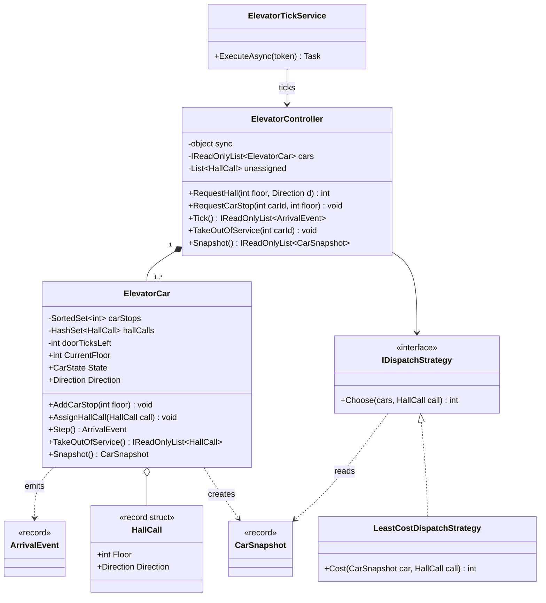
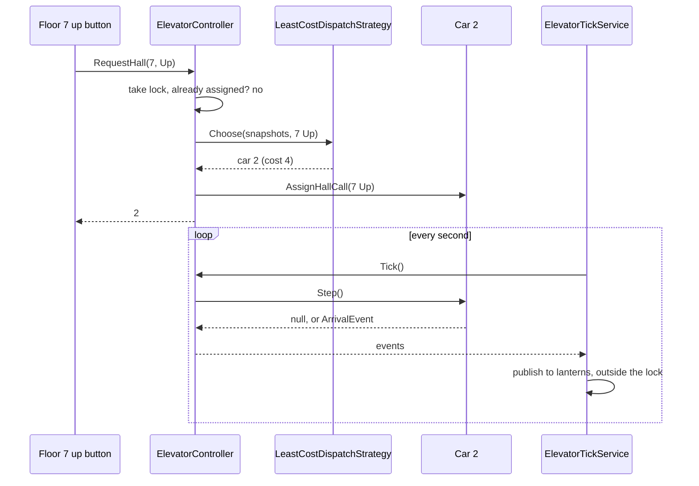
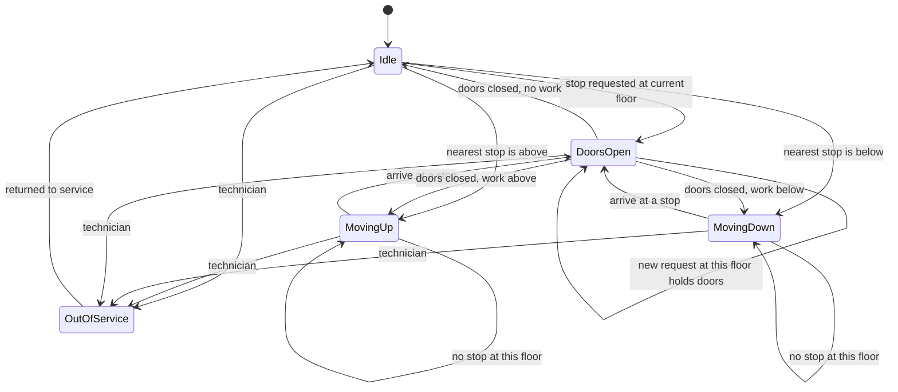
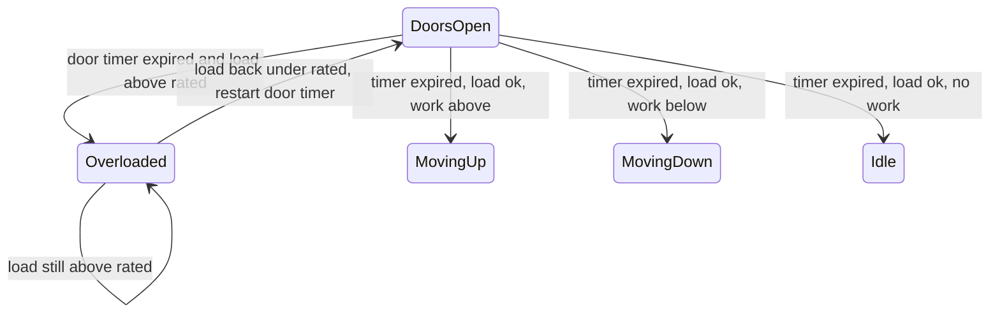

The elevator problem is the advanced member of the classic LLD set. The class list is short, but the behaviour is rich: every car is a state machine, cars must decide where to go next without making anyone wait forever, a dispatcher must choose which of several cars answers each button press, and button presses arrive from dozens of floors at once while the cars are moving. A good answer separates these concerns cleanly and makes the whole thing testable without a real building.

## Learning objectives

By the end of this case study you will be able to:

1. Separate the two decisions in any lift system: **which car** takes a hall call (dispatch) and **in what order** a car visits its stops (scheduling).
2. Model a car as an explicit state machine (Idle, MovingUp, MovingDown, DoorsOpen, OutOfService) and draw it.
3. Implement the LOOK algorithm, including the "turnaround" rule for people waiting to go the other way.
4. Write a cost-based dispatcher as a Strategy and reason about its trade-offs.
5. Make the controller thread-safe with one lock, and avoid calling out to other code while holding it.
6. Drive the system from a discrete clock tick so tests are deterministic, and run it in production from a `BackgroundService`.

## Prerequisites

- [State](#/lesson/m06-state) and [State machine diagrams](#/lesson/m05-state-diagrams): the car is a state machine.
- [Strategy](#/lesson/m06-strategy): dispatch is a strategy.
- [Background services and hosted workers](#/lesson/m03-background-services): the tick loop runs in one.

Helpful: [Concurrency patterns](#/lesson/m13-concurrency-patterns) for the actor-style alternative.

## Explain it like I'm a beginner

Picture the lobby of a 20-floor office tower in Bengaluru at 9:30 in the morning. Four lifts, one control panel.

There are two kinds of buttons:

- **Hall buttons** on each floor: just "up" and "down". You're saying "I'm here, I want to go up". This is a **hall call**.
- **Car buttons** inside the lift: floor numbers. You're saying "take me to 14". This is a **car call** (or car stop).

Two different decisions happen:

1. When you press "up" on floor 7, *which* of the four lifts should come? The nearest one? The one already heading up past floor 7? The emptiest one? That's **dispatching**, like a taxi controller assigning the best cab to a booking.
2. Once a lift has a list of floors to visit, *in what order* does it visit them? A sensible lift doesn't zigzag between 3, 15, 4 and 14. It goes up, stopping at 3, 4, 14 and 15 on the way, then comes back down. That's **scheduling**, and the classic method is called **LOOK** (keep going in one direction while there is still work ahead, then turn around), a cousin of the way old hard disks moved their read head.

Each lift is also always in exactly one "mode": waiting, going up, going down, doors open, or switched off for maintenance. Software people call such a set of modes and the allowed moves between them a **state machine**.

Finally, the building is busy. People press buttons on many floors at the same moment while the lifts move. The control software must accept all those presses safely, like a receptionist with one notebook who lets only one person write in it at a time. In code that notebook rule is a **lock**.

## Requirements

### Clarifying questions

| Question | Assumed answer | Why it matters |
|---|---|---|
| How many floors and cars? | Floors 0 (ground) to 20, four cars, all cars serve all floors. | Zoned lifts (low-rise, high-rise) change dispatch. |
| Hall buttons: one call button or up/down? | Up and down on each floor, except only up on 0 and only down on 20. | Direction matters for whether a passing car should stop. |
| Destination dispatch (type your floor in the lobby)? | No, classic buttons. It's Exercise 5. | Completely different dispatch model. |
| What do we control? | Logical commands: move one floor, open doors, close doors. The motor drive, brakes and door safety edges are separate safety-rated controllers. | We never write the safety layer in C#. We send intents. |
| How long is a door cycle? | Modelled as 2 ticks; one tick per floor travelled. | Lets us simulate time discretely. |
| Capacity and weight? | A load sensor exists; overload handling is Exercise 2. | Adds a state. |
| Maintenance? | A technician can take a car out of service; its hall calls must move to other cars. | Reassignment logic. |
| Fire and emergency modes? | Mentioned in alternatives; regulated, out of scope here. | Would override everything. |
| What does "good" mean? | Nobody waits forever; average wait is reasonable. Energy and peak-mode tuning are future work. | Shapes the dispatcher's cost function. |

The safety point deserves emphasis. Real lifts are governed by safety codes (for example the EN 81 series in Europe and BIS standards in India), and the safety chain is hardware plus certified controllers. Our software is the *dispatch and scheduling brain*, not the brakes.

### Functional requirements

1. Accept hall calls `(floor, direction)` and assign each to exactly one in-service car. Pressing the same button again does nothing new.
2. Accept car calls `(car, floor)` from inside a car.
3. Each car visits its stops in LOOK order: continue in the current direction while any stop lies ahead, then reverse.
4. A car moving up stops for "up" hall calls on the way, not "down" ones, except at its turnaround floor.
5. Taking a car out of service moves its pending hall calls to other cars. If no car is in service, calls wait and are assigned when one returns.
6. Report arrivals (car, floor, heading) for hall lanterns and displays.

### Non-functional requirements

- **Thread safety**: button presses arrive concurrently from many floors and the API, while the tick loop advances cars. No lost or duplicated calls.
- **Determinism and testability**: the core must run without real time or threads, so a test can say "after 30 ticks, car 2 is at floor 9".
- **No starvation**: LOOK guarantees every stop is reached within at most two sweeps of the shaft.
- **Responsiveness**: assigning a hall call is an in-memory computation over four cars, so it is effectively instant. The tick period (1 second here, an estimate of a floor's travel time) sets the simulation's pace.
- **Replaceable dispatch**: building managers tune dispatch for morning up-peak versus lunchtime. Swapping the algorithm must not touch the car.

## Identifying classes and responsibilities

Nouns from the requirements: building, floor, car, hall call, car call, button, door, direction, dispatcher, controller, display, technician. Verbs: press, assign, move, stop, open, close, reverse, reassign, report.

| Class | Responsibility | Notes |
|---|---|---|
| `HallCall` (record struct) | A floor plus a direction. Value equality makes duplicates easy to detect. | Car calls are just an `int` floor. |
| `ElevatorCar` | Owns its stops and its state; advances one tick at a time using LOOK. | The state machine lives here. |
| `CarSnapshot` (record) | An immutable read-only view of a car for dispatchers and displays. | Dispatchers can't mutate cars. |
| `IDispatchStrategy` | Picks the best car for a hall call from snapshots. | Strategy pattern. |
| `LeastCostDispatchStrategy` | Estimates travel cost per car and picks the cheapest. | One of many possible algorithms. |
| `ElevatorController` | Facade and lock owner: accepts requests, assigns calls, ticks cars, reassigns on maintenance. | The concurrency boundary. |
| `ArrivalEvent` (record) | "Car 2 arrived at 9, heading up." Returned by `Tick`. | Published to displays *outside* the lock. |
| `ElevatorTickService` | Hosted service that calls `Tick` once per second and publishes events. | Infrastructure; no rules. |

What we deliberately don't model as classes: `Door` (its only state is "open with N ticks left", which fits in the car), `Floor` (a number), and `Button` (an HTTP request or a hardware signal). If doors gained their own behaviour (obstruction sensor, nudging mode), extracting a `Door` class would be the first refactoring.

## Class diagram



Read it from the top. The controller owns the cars (composition) and depends on the dispatch interface. The dispatcher only ever sees `CarSnapshot` records, which are immutable copies, so a buggy dispatcher can't move a car or delete its stops. Each car holds its assigned hall calls and its car stops, and emits `ArrivalEvent`s when it serves a floor. The tick service sits outside the domain and simply drives the controller.

The runtime flow for a hall call and the ticks that serve it:



Two things to notice. First, the dispatcher's answer is final: the call now belongs to car 2 and only moves if car 2 goes out of service. Some real systems re-dispatch continuously; we discuss that under alternatives. Second, `Tick` *returns* events instead of calling display code directly. That keeps slow or failing display code from running while the controller's lock is held.

## Patterns and design decisions

### Dispatch versus scheduling: two separate problems

Mixing "which car" with "what order" is the most common design mistake in this problem. Keep them apart:

- **Scheduling** is per car and lives in `ElevatorCar`. It is a fixed rule (LOOK) because it is tied to how a lift physically moves.
- **Dispatching** is across cars and lives behind `IDispatchStrategy`, because buildings tune it.

### State machine inside the car

The car has five states. We implement it as an enum plus a `switch` in `Step()`, not with the full GoF State pattern (one class per state). With five states and transitions that all need the same data (stops, floor, door timer), separate state classes would pass the car's internals around and add more code than they remove. That is a judgement call; [State](#/lesson/m06-state) explains when per-state classes pay off (many states, each with substantial, distinct behaviour). The rule we do follow strictly: **every state change happens in one place** (`Serve` and `Depart`), so the diagram and the code can be compared line by line.

### LOOK and the turnaround rule

LOOK in one sentence: *keep moving in your current direction while there is any stop ahead; when there isn't, reverse if there is work behind, else go idle.* It differs from SCAN, which travels all the way to the end of the shaft before reversing. LOOK avoids pointless trips to the top floor.

Hall calls add a twist. A car going up passes floor 12, where someone pressed "down". Stopping would be rude to them (they'd board a car going the wrong way), so the car only stops for *up* calls on its way up. The exception is the **turnaround floor**: if floor 12 is the highest point of the car's work, it stops there and picks up the "down" passenger as it reverses. In code:

```
stop here if:
  a passenger inside wants this floor, or
  someone here wants to go my way, or
  someone here wants the other way AND nothing lies beyond this floor in my direction
```

### Cost-based dispatch as a Strategy

`LeastCostDispatchStrategy` estimates, for each in-service car, how many "floor-equivalents" it would take to reach the caller, and picks the cheapest:

- **Idle car**: the distance.
- **Moving towards the caller, same direction, caller ahead**: the distance (it will pass the floor anyway).
- **Otherwise**: it must reach its turnaround point first, so the cost is the distance to the turnaround plus the distance back to the caller.
- **Plus a penalty per pending stop** (default 2), as a rough stand-in for door time at each stop. The number is a tunable estimate, not a measured constant.

This is simple and explainable. It ignores how full a car is and the future calls it will get. Real group-control systems use much richer models; their details are proprietary, so we reason from the public principles above.

### One lock, and never call out while holding it

All mutable state (cars, unassigned calls) is guarded by a single `lock (_sync)` in `ElevatorController`. Why one coarse lock instead of a lock per car? Because a hall call assignment reads *all* cars' snapshots and then writes to one car. With per-car locks you'd need to lock all four in a fixed order to get a consistent picture, which is exactly how deadlocks are born. The total work under the lock is microseconds, and the arrival rate of button presses is at most a few per second per floor, so contention is negligible.

The rule that goes with a coarse lock: **don't call unknown code while holding it.** No logging sinks, no SignalR pushes, no database writes inside `lock`. `Tick` collects `ArrivalEvent`s into a list and returns it; the caller publishes after the lock is released.

### Discrete time: `Tick()` instead of timers inside cars

Each car advances only when `Step()` is called. In production, a `BackgroundService` with a `PeriodicTimer` calls `controller.Tick()` once per second. In tests, a loop calls `Tick()` 50 times in a microsecond. This one decision makes the whole system deterministic and testable. The alternative, a `Timer` per car with real delays, makes every test slow and flaky.

### Snapshots for readers

Dispatchers and the `/cars` endpoint get `CarSnapshot` records. Copying four small records per call is cheap, and it means nobody outside the lock ever reads a car's mutable collections while another thread changes them.

## State transitions



How to read it: a car rests in Idle until it has work. If the work is at its own floor, it opens its doors straight away; otherwise it heads towards the *nearest* stop (ties go up). While moving it checks each floor with the stop rule above. Arrival always means DoorsOpen. When the door timer runs out, `Depart()` applies LOOK: same direction if work remains ahead, the other direction if work remains behind, Idle otherwise. A new request at the current floor while the doors are open keeps them open, just as a real lift reopens when someone presses the hall button as the doors close.

Every in-service state can go to OutOfService. In our model that happens instantly. A real car would first travel to the nearest floor and open its doors; we note this simplification because an interviewer may ask. Its hall calls are handed back to the controller for reassignment; its car calls are dropped, because the passengers inside are getting out.

## C# implementation

```text
Elevators.Api/
  Program.cs
  Domain/Types.cs
  Domain/ElevatorCar.cs
  Dispatch/LeastCostDispatchStrategy.cs
  ElevatorController.cs
  ElevatorTickService.cs
```

```csharp file=Domain/Types.cs
namespace Elevators.Domain;

public enum Direction { None, Up, Down }

public enum CarState { Idle, MovingUp, MovingDown, DoorsOpen, OutOfService }

/// <summary>"Someone on this floor wants to go this way." Value equality makes duplicates trivial to spot.</summary>
public readonly record struct HallCall(int Floor, Direction Direction);

/// <summary>Raised when a car opens its doors at a floor. Heading drives the hall lantern arrow.</summary>
public sealed record ArrivalEvent(int CarId, int Floor, Direction Heading);

/// <summary>Immutable view of a car for dispatchers and displays.</summary>
public sealed record CarSnapshot(int Id, int Floor, CarState State, Direction Direction, int PendingStops, int? FarthestStopAhead)
{
    public bool InService => State != CarState.OutOfService;
}

public static class DirectionExtensions
{
    public static Direction Opposite(this Direction d) => d switch
    {
        Direction.Up => Direction.Down,
        Direction.Down => Direction.Up,
        _ => Direction.None,
    };
}
```

```csharp file=Domain/ElevatorCar.cs
namespace Elevators.Domain;

/// <summary>
/// One lift car as a state machine with LOOK scheduling. Not thread-safe on its own:
/// the ElevatorController serialises all access under its lock.
/// </summary>
public sealed class ElevatorCar
{
    private readonly SortedSet<int> _carStops = new();
    private readonly HashSet<HallCall> _hallCalls = new();
    private readonly int _doorTicks;
    private int _doorTicksLeft;

    public ElevatorCar(int id, int minFloor, int maxFloor, int startFloor, int doorTicks = 2)
    {
        if (maxFloor <= minFloor) throw new ArgumentException("A shaft needs at least two floors.");
        if (startFloor < minFloor || startFloor > maxFloor) throw new ArgumentOutOfRangeException(nameof(startFloor));
        ArgumentOutOfRangeException.ThrowIfNegativeOrZero(doorTicks);
        Id = id;
        MinFloor = minFloor;
        MaxFloor = maxFloor;
        CurrentFloor = startFloor;
        _doorTicks = doorTicks;
    }

    public int Id { get; }
    public int MinFloor { get; }
    public int MaxFloor { get; }
    public int CurrentFloor { get; private set; }
    public CarState State { get; private set; } = CarState.Idle;
    /// <summary>Committed heading. None when idle with no plan.</summary>
    public Direction Direction { get; private set; } = Direction.None;
    public IReadOnlyCollection<int> CarStops => _carStops;
    public IReadOnlyCollection<HallCall> HallCalls => _hallCalls;
    public bool InService => State != CarState.OutOfService;

    public void AddCarStop(int floor)
    {
        EnsureFloor(floor);
        EnsureInService();
        _carStops.Add(floor);
    }

    public void AssignHallCall(HallCall call)
    {
        EnsureFloor(call.Floor);
        EnsureInService();
        if (call.Direction == Direction.None) throw new ArgumentException("A hall call needs a direction.", nameof(call));
        _hallCalls.Add(call);
    }

    public bool HasHallCall(HallCall call) => _hallCalls.Contains(call);

    /// <summary>Stops the car and returns its hall calls so the controller can reassign them.</summary>
    public IReadOnlyList<HallCall> TakeOutOfService()
    {
        var orphaned = _hallCalls.ToList();
        _hallCalls.Clear();
        _carStops.Clear();
        State = CarState.OutOfService;
        Direction = Direction.None;
        return orphaned;
    }

    public void ReturnToService()
    {
        if (State == CarState.OutOfService) State = CarState.Idle;
    }

    public CarSnapshot Snapshot() =>
        new(Id, CurrentFloor, State, Direction, _carStops.Count + _hallCalls.Count, FarthestStopAhead());

    /// <summary>Advances one tick: move one floor, or count down the doors, or start moving.</summary>
    public ArrivalEvent? Step()
    {
        switch (State)
        {
            case CarState.OutOfService:
                return null;
            case CarState.DoorsOpen:
                if (ShouldStopHere()) return Serve();       // someone pressed for this floor: hold the doors
                if (--_doorTicksLeft > 0) return null;
                Depart();
                return null;
            case CarState.Idle:
                if (ShouldStopHere()) return Serve();
                Depart();
                return null;
            default: // MovingUp or MovingDown
                if (!HasStopsBeyond(CurrentFloor, Direction)) { Depart(); return null; } // plan changed under us
                CurrentFloor += Direction == Direction.Up ? 1 : -1;
                return ShouldStopHere() ? Serve() : null;
        }
    }

    /// <summary>The stop rule, including the turnaround exception for opposite-direction hall calls.</summary>
    private bool ShouldStopHere()
    {
        var f = CurrentFloor;
        if (_carStops.Contains(f)) return true;
        if (Direction == Direction.None) return _hallCalls.Any(c => c.Floor == f);
        if (_hallCalls.Contains(new HallCall(f, Direction))) return true;
        return _hallCalls.Contains(new HallCall(f, Direction.Opposite())) && !HasStopsBeyond(f, Direction);
    }

    private ArrivalEvent Serve()
    {
        var f = CurrentFloor;
        _carStops.Remove(f);
        if (Direction == Direction.None)
        {
            // Idle car: serve one waiting direction (up first); the other is served on the next door cycle.
            var waiting = _hallCalls.Where(c => c.Floor == f).OrderBy(c => c.Direction).ToList();
            if (waiting.Count > 0)
            {
                _hallCalls.Remove(waiting[0]);
                Direction = waiting[0].Direction;
            }
        }
        else
        {
            var sameWayServed = _hallCalls.Remove(new HallCall(f, Direction));
            if (!sameWayServed && !HasStopsBeyond(f, Direction))
            {
                var opposite = Direction.Opposite();
                if (_hallCalls.Remove(new HallCall(f, opposite))) Direction = opposite;       // turnaround pickup
                else Direction = HasStopsBeyond(f, opposite) ? opposite : Direction.None;
            }
        }
        State = CarState.DoorsOpen;
        _doorTicksLeft = _doorTicks;
        return new ArrivalEvent(Id, f, Direction);
    }

    /// <summary>LOOK: keep going while work lies ahead, else reverse if work lies behind, else idle.</summary>
    private void Depart()
    {
        Direction = ChooseDirection();
        State = Direction switch
        {
            Direction.Up => CarState.MovingUp,
            Direction.Down => CarState.MovingDown,
            _ => CarState.Idle,
        };
    }

    private Direction ChooseDirection()
    {
        var f = CurrentFloor;
        if (Direction != Direction.None && HasStopsBeyond(f, Direction)) return Direction;
        if (Direction != Direction.None && HasStopsBeyond(f, Direction.Opposite())) return Direction.Opposite();
        var others = StopFloors().Where(x => x != f).ToList();
        if (others.Count == 0) return Direction.None;
        var nearest = others.OrderBy(x => Math.Abs(x - f)).ThenByDescending(x => x).First(); // ties go up
        return nearest > f ? Direction.Up : Direction.Down;
    }

    private IEnumerable<int> StopFloors() => _carStops.Concat(_hallCalls.Select(c => c.Floor));

    private bool HasStopsBeyond(int floor, Direction d) => d switch
    {
        Direction.Up => StopFloors().Any(x => x > floor),
        Direction.Down => StopFloors().Any(x => x < floor),
        _ => false,
    };

    private int? FarthestStopAhead()
    {
        var ahead = Direction switch
        {
            Direction.Up => StopFloors().Where(x => x > CurrentFloor).ToList(),
            Direction.Down => StopFloors().Where(x => x < CurrentFloor).ToList(),
            _ => new List<int>(),
        };
        if (ahead.Count == 0) return null;
        return Direction == Direction.Up ? ahead.Max() : ahead.Min();
    }

    private void EnsureFloor(int floor)
    {
        if (floor < MinFloor || floor > MaxFloor)
            throw new ArgumentOutOfRangeException(nameof(floor), floor, $"Car {Id} serves floors {MinFloor}-{MaxFloor}.");
    }

    private void EnsureInService()
    {
        if (!InService) throw new InvalidOperationException($"Car {Id} is out of service.");
    }
}
```

```csharp file=Dispatch/LeastCostDispatchStrategy.cs
using Elevators.Domain;

namespace Elevators.Dispatch;

public interface IDispatchStrategy
{
    /// <summary>Returns the id of the in-service car that should answer the call, or null if none can.</summary>
    int? Choose(IReadOnlyList<CarSnapshot> cars, HallCall call);
}

/// <summary>
/// Estimated cost in "floor-equivalents": travel distance (via the turnaround point if the car must
/// finish its sweep first) plus a penalty per pending stop as a rough stand-in for door time.
/// </summary>
public sealed class LeastCostDispatchStrategy(int stopPenalty = 2) : IDispatchStrategy
{
    public int? Choose(IReadOnlyList<CarSnapshot> cars, HallCall call) =>
        cars.Where(c => c.InService)
            .OrderBy(c => Cost(c, call))
            .ThenBy(c => c.Id)
            .Select(c => (int?)c.Id)
            .FirstOrDefault();

    public int Cost(CarSnapshot car, HallCall call)
    {
        var distance = Math.Abs(car.Floor - call.Floor);
        var penalty = stopPenalty * car.PendingStops;
        if (car.Direction == Direction.None) return distance + penalty;

        var ahead = car.Direction == Direction.Up ? call.Floor > car.Floor : call.Floor < car.Floor;
        var atDoor = call.Floor == car.Floor && car.State == CarState.DoorsOpen;
        if (call.Direction == car.Direction && (ahead || atDoor)) return distance + penalty;

        // Must finish the current sweep first: go to the turnaround point, then come back.
        var turn = car.FarthestStopAhead ?? car.Floor;
        turn = car.Direction == Direction.Up
            ? Math.Max(turn, Math.Max(call.Floor, car.Floor))
            : Math.Min(turn, Math.Min(call.Floor, car.Floor));
        return Math.Abs(turn - car.Floor) + Math.Abs(turn - call.Floor) + penalty;
    }
}
```

```csharp file=ElevatorController.cs
using Elevators.Dispatch;
using Elevators.Domain;

namespace Elevators;

/// <summary>
/// Facade and concurrency boundary. Every public method takes the same lock, so button presses from
/// many threads and the tick loop never see a half-updated car. No external code runs under the lock.
/// </summary>
public sealed class ElevatorController
{
    private readonly object _sync = new();
    private readonly IReadOnlyList<ElevatorCar> _cars;
    private readonly Dictionary<int, ElevatorCar> _byId;
    private readonly IDispatchStrategy _dispatch;
    private readonly List<HallCall> _unassigned = new();

    public ElevatorController(IEnumerable<ElevatorCar> cars, IDispatchStrategy dispatch)
    {
        _cars = cars.ToList();
        if (_cars.Count == 0) throw new ArgumentException("At least one car is required.", nameof(cars));
        if (_cars.Select(c => (c.MinFloor, c.MaxFloor)).Distinct().Count() != 1)
            throw new ArgumentException("This controller assumes every car serves every floor.", nameof(cars));
        _byId = _cars.ToDictionary(c => c.Id);
        _dispatch = dispatch;
        MinFloor = _cars[0].MinFloor;
        MaxFloor = _cars[0].MaxFloor;
    }

    public int MinFloor { get; }
    public int MaxFloor { get; }

    /// <summary>Returns the assigned car id, or null if every car is out of service (the call is queued).</summary>
    public int? RequestHall(int floor, Direction direction)
    {
        var call = new HallCall(floor, direction);
        Validate(call);
        lock (_sync)
        {
            foreach (var car in _cars)
                if (car.HasHallCall(call)) return car.Id;   // pressed again: idempotent
            if (_unassigned.Contains(call)) return null;
            return AssignLocked(call);
        }
    }

    public void RequestCarStop(int carId, int floor)
    {
        lock (_sync) Car(carId).AddCarStop(floor);
    }

    /// <summary>Advances every car by one tick. Events are returned, not published, so callers publish outside the lock.</summary>
    public IReadOnlyList<ArrivalEvent> Tick()
    {
        lock (_sync)
        {
            if (_unassigned.Count > 0)
            {
                var retry = _unassigned.ToList();
                _unassigned.Clear();
                foreach (var call in retry) AssignLocked(call);
            }
            var events = new List<ArrivalEvent>();
            foreach (var car in _cars)
                if (car.Step() is { } e) events.Add(e);
            return events;
        }
    }

    public void TakeOutOfService(int carId)
    {
        lock (_sync)
            foreach (var call in Car(carId).TakeOutOfService()) AssignLocked(call);
    }

    public void ReturnToService(int carId)
    {
        lock (_sync) Car(carId).ReturnToService();
    }

    public IReadOnlyList<CarSnapshot> Snapshot()
    {
        lock (_sync) return _cars.Select(c => c.Snapshot()).ToList();
    }

    public bool IsQuiet
    {
        get { lock (_sync) return _unassigned.Count == 0 && _cars.All(c => c.State is CarState.Idle or CarState.OutOfService); }
    }

    private int? AssignLocked(HallCall call)
    {
        var chosen = _dispatch.Choose(_cars.Select(c => c.Snapshot()).ToList(), call);
        if (chosen is null) { _unassigned.Add(call); return null; }
        var car = Car(chosen.Value);
        if (!car.InService) throw new InvalidOperationException($"Dispatcher chose out-of-service car {car.Id}.");
        car.AssignHallCall(call);
        return car.Id;
    }

    private ElevatorCar Car(int id) =>
        _byId.TryGetValue(id, out var car) ? car : throw new KeyNotFoundException($"No car {id}.");

    private void Validate(HallCall call)
    {
        if (call.Floor < MinFloor || call.Floor > MaxFloor) throw new ArgumentOutOfRangeException(nameof(call), $"Floor {call.Floor} does not exist.");
        if (call.Direction == Direction.None) throw new ArgumentException("A hall call must be Up or Down.", nameof(call));
        if (call.Floor == MaxFloor && call.Direction == Direction.Up) throw new ArgumentException("There is no up button on the top floor.", nameof(call));
        if (call.Floor == MinFloor && call.Direction == Direction.Down) throw new ArgumentException("There is no down button on the lowest floor.", nameof(call));
    }
}
```

```csharp file=ElevatorTickService.cs
using Microsoft.Extensions.Hosting;
using Microsoft.Extensions.Logging;

namespace Elevators;

/// <summary>Drives the simulation in production. All rules live in the controller; this only keeps time.</summary>
public sealed class ElevatorTickService(ElevatorController controller, TimeProvider clock, ILogger<ElevatorTickService> log)
    : BackgroundService
{
    private static readonly TimeSpan Period = TimeSpan.FromSeconds(1); // estimate: roughly one floor of travel

    protected override async Task ExecuteAsync(CancellationToken stoppingToken)
    {
        using var timer = new PeriodicTimer(Period, clock);
        try
        {
            while (await timer.WaitForNextTickAsync(stoppingToken))
            {
                var events = controller.Tick();      // lock is taken and released inside
                foreach (var e in events)            // publish outside the lock
                    log.LogInformation("Car {Car} doors open at floor {Floor}, heading {Heading}", e.CarId, e.Floor, e.Heading);
            }
        }
        catch (OperationCanceledException) when (stoppingToken.IsCancellationRequested)
        {
            // normal shutdown
        }
    }
}
```

```csharp file=Program.cs
using System.Text.Json.Serialization;
using Elevators;
using Elevators.Dispatch;
using Elevators.Domain;

var builder = WebApplication.CreateBuilder(args);
builder.Services.ConfigureHttpJsonOptions(o => o.SerializerOptions.Converters.Add(new JsonStringEnumConverter()));

builder.Services.AddSingleton(TimeProvider.System);
builder.Services.AddSingleton<IDispatchStrategy>(_ => new LeastCostDispatchStrategy(stopPenalty: 2));
// Floors 0-20, four cars parked at the ground floor.
builder.Services.AddSingleton(sp => new ElevatorController(
    Enumerable.Range(1, 4).Select(id => new ElevatorCar(id, minFloor: 0, maxFloor: 20, startFloor: 0)),
    sp.GetRequiredService<IDispatchStrategy>()));
builder.Services.AddHostedService<ElevatorTickService>();

var app = builder.Build();

app.MapPost("/hall-calls", (HallCallRequest req, ElevatorController c) =>
{
    try
    {
        var car = c.RequestHall(req.Floor, req.Direction);
        return car is null ? Results.Accepted(value: new { queued = true }) : Results.Ok(new { assignedCar = car });
    }
    catch (ArgumentException ex) { return Results.Problem(ex.Message, statusCode: 400); }
});

app.MapPost("/cars/{carId:int}/stops", (int carId, CarStopRequest req, ElevatorController c) =>
{
    try { c.RequestCarStop(carId, req.Floor); return Results.NoContent(); }
    catch (KeyNotFoundException ex) { return Results.Problem(ex.Message, statusCode: 404); }
    catch (ArgumentException ex) { return Results.Problem(ex.Message, statusCode: 400); }
    catch (InvalidOperationException ex) { return Results.Problem(ex.Message, statusCode: 409); }
});

app.MapPost("/cars/{carId:int}/out-of-service", (int carId, ElevatorController c) =>
{
    c.TakeOutOfService(carId);
    return Results.NoContent();
});

app.MapGet("/cars", (ElevatorController c) => Results.Ok(c.Snapshot()));

app.Run();

public sealed record HallCallRequest(int Floor, Direction Direction);
public sealed record CarStopRequest(int Floor);
```

Design notes on the code:

- **`ElevatorCar` is deliberately not thread-safe.** Making each car lock itself would not make the *controller's* multi-step operations atomic (read all snapshots, choose, assign). Thread safety belongs at the boundary that owns the invariant: "each hall call is assigned to exactly one car".
- **`ArgumentOutOfRangeException` derives from `ArgumentException`**, so the endpoint's single `catch (ArgumentException)` covers both bad floors and bad directions.
- **Idempotent hall calls.** People press a lit button five times. The controller checks whether any car already holds the call and returns that car's id. Without this check, two cars could race to the same floor.
- **Queued calls when all cars are out of service.** The call goes into `_unassigned` and is retried on every tick. This is graceful degradation rather than an error.

## Automated testing

The tick design pays off here: every test is a fast, deterministic loop.

```csharp
using Elevators;
using Elevators.Dispatch;
using Elevators.Domain;
using Xunit;

public static class Sim
{
    /// <summary>Ticks until every car is idle or the limit is hit; returns all arrivals in order.</summary>
    public static List<ArrivalEvent> RunUntilQuiet(ElevatorController c, int maxTicks = 500)
    {
        var events = new List<ArrivalEvent>();
        for (var i = 0; i < maxTicks; i++)
        {
            events.AddRange(c.Tick());
            if (c.IsQuiet) return events;
        }
        throw new InvalidOperationException($"Not quiet after {maxTicks} ticks.");
    }

    public static List<ArrivalEvent> RunCar(ElevatorCar car, int ticks)
    {
        var events = new List<ArrivalEvent>();
        for (var i = 0; i < ticks; i++) if (car.Step() is { } e) events.Add(e);
        return events;
    }
}

public class ElevatorCarTests
{
    [Fact]
    public void Look_visits_stops_in_sweep_order_not_request_order()
    {
        var car = new ElevatorCar(1, 0, 20, startFloor: 0);
        car.AddCarStop(5); car.AddCarStop(2); car.AddCarStop(8);
        var floors = Sim.RunCar(car, 60).Select(e => e.Floor).ToArray();
        Assert.Equal(new[] { 2, 5, 8 }, floors);
        Assert.Equal(CarState.Idle, car.State);
    }

    [Fact]
    public void Car_going_up_skips_down_call_until_turnaround()
    {
        var car = new ElevatorCar(1, 0, 20, startFloor: 0);
        car.AddCarStop(8);
        car.AssignHallCall(new HallCall(6, Direction.Down));
        var events = Sim.RunCar(car, 60);
        Assert.Equal(new[] { 8, 6 }, events.Select(e => e.Floor).ToArray());
        Assert.Equal(Direction.Down, events[1].Heading);
    }

    [Fact]
    public void Down_call_at_the_top_of_the_sweep_is_picked_up_while_turning()
    {
        var car = new ElevatorCar(1, 0, 20, startFloor: 0);
        car.AssignHallCall(new HallCall(9, Direction.Down));
        var e = Assert.Single(Sim.RunCar(car, 40));
        Assert.Equal(9, e.Floor);
        Assert.Equal(Direction.Down, e.Heading);
    }

    [Fact]
    public void Idle_car_opens_doors_for_call_at_its_own_floor()
    {
        var car = new ElevatorCar(1, 0, 20, startFloor: 4);
        car.AssignHallCall(new HallCall(4, Direction.Up));
        var e = car.Step();
        Assert.NotNull(e);
        Assert.Equal(CarState.DoorsOpen, car.State);
    }

    [Fact]
    public void Rejects_floors_outside_the_shaft() =>
        Assert.Throws<ArgumentOutOfRangeException>(() => new ElevatorCar(1, 0, 20, 0).AddCarStop(21));
}

public class DispatchTests
{
    private readonly LeastCostDispatchStrategy _d = new(stopPenalty: 2);

    [Fact]
    public void Car_already_heading_past_the_caller_wins()
    {
        var idleAtGround = new CarSnapshot(1, 0, CarState.Idle, Direction.None, 0, null);
        var goingUp = new CarSnapshot(2, 5, CarState.MovingUp, Direction.Up, 1, 10);
        Assert.Equal(2, _d.Choose(new[] { idleAtGround, goingUp }, new HallCall(7, Direction.Up)));
    }

    [Fact]
    public void Car_that_must_turn_around_is_expensive()
    {
        var idleAtGround = new CarSnapshot(1, 0, CarState.Idle, Direction.None, 0, null);
        var goingUp = new CarSnapshot(2, 5, CarState.MovingUp, Direction.Up, 1, 10);
        Assert.Equal(14, _d.Cost(goingUp, new HallCall(3, Direction.Down)));   // 5 up to 10, 7 down to 3, +2
        Assert.Equal(1, _d.Choose(new[] { idleAtGround, goingUp }, new HallCall(3, Direction.Down)));
    }

    [Fact]
    public void Out_of_service_cars_are_never_chosen()
    {
        var off = new CarSnapshot(1, 7, CarState.OutOfService, Direction.None, 0, null);
        Assert.Null(_d.Choose(new[] { off }, new HallCall(7, Direction.Up)));
    }
}

public class ElevatorControllerTests
{
    private static ElevatorController Building(int cars = 2) =>
        new(Enumerable.Range(1, cars).Select(i => new ElevatorCar(i, 0, 20, 0)), new LeastCostDispatchStrategy());

    [Fact]
    public void Pressing_a_lit_button_again_returns_the_same_car()
    {
        var c = Building();
        var first = c.RequestHall(9, Direction.Up);
        Assert.Equal(first, c.RequestHall(9, Direction.Up));
        Assert.Equal(1, c.Snapshot().Sum(s => s.PendingStops));
    }

    [Fact]
    public void Out_of_service_car_hands_its_calls_to_another_car()
    {
        var c = Building();
        var assigned = c.RequestHall(12, Direction.Down)!.Value;
        c.TakeOutOfService(assigned);
        var events = Sim.RunUntilQuiet(c);
        var e = Assert.Single(events);
        Assert.NotEqual(assigned, e.CarId);
        Assert.Equal(12, e.Floor);
    }

    [Fact]
    public void Calls_wait_while_all_cars_are_out_and_run_when_one_returns()
    {
        var c = Building(cars: 1);
        c.TakeOutOfService(1);
        Assert.Null(c.RequestHall(5, Direction.Up));
        c.Tick();
        c.ReturnToService(1);
        Assert.Contains(Sim.RunUntilQuiet(c), e => e.Floor == 5);
    }

    [Fact]
    public void Concurrent_presses_are_neither_lost_nor_duplicated()
    {
        var c = Building(cars: 4);
        Parallel.For(0, 4000, new ParallelOptions { MaxDegreeOfParallelism = 16 }, i =>
        {
            var floor = 1 + i % 19;                           // floors 1..19
            c.RequestHall(floor, i % 2 == 0 ? Direction.Up : Direction.Down);
        });
        Assert.Equal(38, c.Snapshot().Sum(s => s.PendingStops)); // 19 floors x 2 directions, each held once
        var served = Sim.RunUntilQuiet(c, maxTicks: 2000);
        Assert.Equal(38, served.Count);
        Assert.Equal(19, served.Select(e => e.Floor).Distinct().Count());
    }
}
```

What the tests cover, and why it matters:

- **Scheduling order** (`2, 5, 8` regardless of request order) and the **turnaround rule** are the behaviours passengers notice. They're asserted through observable arrivals, not by peeking into private sets.
- **Dispatch** is tested with hand-built snapshots. No car simulation is needed, because the strategy only reads records.
- **The concurrency test** fires 4,000 presses from 16 threads at 38 distinct buttons, then checks that exactly 38 calls exist across all cars and that all 38 get served. Without the lock, `HashSet` corruption or double assignment shows up quickly. As always with race tests, a pass is evidence, not proof; the design argument (one lock around every read-decide-write) is the proof.
- **Liveness**: `RunUntilQuiet` throws if the building doesn't settle within the tick budget, which catches "car bounces forever" bugs, a real risk when you edit the stop rule.

## Bad design vs good design

**Bad**: a single `Elevator` class per car with its own timer thread, a public `List<int> Requests`, and a dispatcher that picks "the nearest car".

```csharp
public class Elevator
{
    public int Floor;
    public List<int> Requests = new();               // shared, mutated from button threads and the timer
    public bool GoingUp;
    private readonly Timer _timer;

    public Elevator() => _timer = new Timer(_ => Move(), null, 0, 1000);

    void Move()
    {
        if (Requests.Count == 0) return;
        var target = Requests[0];                     // FIFO: serves in press order and zigzags
        Floor += target > Floor ? 1 : -1;
        if (Floor == target) { Requests.RemoveAt(0); Thread.Sleep(3000); }   // "open doors" by blocking the timer thread
    }
}

int Nearest(List<Elevator> cars, int floor) => cars.OrderBy(c => Math.Abs(c.Floor - floor)).First().Floor; // ignores direction
```

What goes wrong:

- **FIFO scheduling** zigzags: requests 3, 15, 4, 14 make the car travel 3→15→4→14, roughly 37 floors instead of 15. Passengers wait far longer.
- **Nearest-car dispatch ignores direction.** A car one floor away but heading the other way with eight stops is "nearest" and arrives last.
- **Race conditions**: `Requests` is a plain `List<int>` mutated by HTTP threads and timer threads. `List<T>` is not safe for concurrent writes and can throw or lose items.
- **`Thread.Sleep` on a timer thread** blocks a thread-pool thread for 3 seconds per stop, and timer callbacks can overlap, so `Move` may run twice at once.
- **Untestable**: you can only test it by waiting real seconds, and results vary between runs.
- **No out-of-service handling**: calls assigned to a broken car are stranded forever.

**Good**: the design above. Scheduling (LOOK) sits inside the car, dispatch sits behind an interface, all mutation goes through one lock, and time is a `Tick()` that tests can call directly.

**When is the simple version enough?** A single-lift residential building with five floors doesn't need a dispatcher at all. LOOK inside one car, a lock, and a tick is the whole system. The `IDispatchStrategy` earns its keep only with two or more cars.

## Alternative designs

1. **Actor model with a channel.** Instead of a lock, all requests become messages written to a `Channel<ElevatorCommand>`, and one consumer loop owns the cars and processes messages and ticks in order. No locks in the domain at all, and ordering is explicit. The cost: callers who need an answer ("which car did I get?") must await a reply, which adds `TaskCompletionSource` plumbing. Great for many cars or when commands come from a message bus.
2. **Per-state classes (GoF State).** `IdleState`, `MovingState`, `DoorsOpenState`, each with `Step(car)`. Pays off if states gain substantial distinct behaviour: door nudging, independent service, fire-service phases 1 and 2. With five simple states, an enum and one `switch` is clearer.
3. **Continuous re-dispatch.** Re-evaluate every unserved hall call on every tick and move it to a better car if the situation changed. Lower average waits, but the hall lantern may switch cars, which annoys people. Many systems fix the assignment once it's announced.
4. **SCAN instead of LOOK.** Always travel to the end of the shaft. Simpler to reason about and a fairer upper bound, but it wastes energy and time. LOOK is almost always preferred.
5. **Zoning and peak modes.** In the morning up-peak, park idle cars at the lobby and split floors between cars (cars 1–2 serve 1–10, cars 3–4 serve 11–20). These are new `IDispatchStrategy` implementations, possibly switched by a time-of-day policy. The car class doesn't change, which validates the separation.
6. **Destination dispatch.** Passengers enter their destination in the lobby and are told which car to take. Dispatch then knows both origin and destination, so it can group people going to nearby floors. This changes the request model (no hall up/down buttons), and is Exercise 5.

## Practical playground

Load the reference model in the LLD designer. Try two changes: extract a `Door` class (what moves out of `ElevatorCar`?) and add a `ZonedDispatchStrategy` (which relations does it need?). The second should need exactly one new `implements` arrow, a good sign the design is open for extension.

:::playground type=lld title="Elevator control reference model"
```json
{
  "classes": [
    { "id": "Ctrl", "name": "ElevatorController", "kind": "class",
      "fields": ["-object _sync", "-IReadOnlyList~ElevatorCar~ _cars", "-List~HallCall~ _unassigned"],
      "methods": ["+int? RequestHall(int floor, Direction d)", "+void RequestCarStop(int carId, int floor)", "+IReadOnlyList~ArrivalEvent~ Tick()", "+void TakeOutOfService(int carId)", "+IReadOnlyList~CarSnapshot~ Snapshot()"],
      "responsibility": "Facade and lock owner; assigns each hall call to exactly one car" },
    { "id": "Car", "name": "ElevatorCar", "kind": "class",
      "fields": ["-SortedSet~int~ _carStops", "-HashSet~HallCall~ _hallCalls", "+int CurrentFloor", "+CarState State", "+Direction Direction"],
      "methods": ["+void AddCarStop(int floor)", "+void AssignHallCall(HallCall call)", "+ArrivalEvent? Step()", "+IReadOnlyList~HallCall~ TakeOutOfService()", "+CarSnapshot Snapshot()"],
      "responsibility": "State machine with LOOK scheduling" },
    { "id": "IDispatch", "name": "IDispatchStrategy", "kind": "interface",
      "fields": [], "methods": ["int? Choose(IReadOnlyList~CarSnapshot~ cars, HallCall call)"] },
    { "id": "LeastCost", "name": "LeastCostDispatchStrategy", "kind": "class",
      "fields": ["-int _stopPenalty"], "methods": ["+int? Choose(cars, HallCall call)", "+int Cost(CarSnapshot car, HallCall call)"],
      "responsibility": "Distance via turnaround plus a per-stop penalty" },
    { "id": "HallCall", "name": "HallCall", "kind": "record", "fields": ["+int Floor", "+Direction Direction"], "methods": [] },
    { "id": "Snap", "name": "CarSnapshot", "kind": "record",
      "fields": ["+int Id", "+int Floor", "+CarState State", "+Direction Direction", "+int PendingStops", "+int? FarthestStopAhead"], "methods": [] },
    { "id": "Arrival", "name": "ArrivalEvent", "kind": "record", "fields": ["+int CarId", "+int Floor", "+Direction Heading"], "methods": [] },
    { "id": "Tick", "name": "ElevatorTickService", "kind": "class",
      "fields": ["-ElevatorController _controller", "-TimeProvider _clock"], "methods": ["#Task ExecuteAsync(CancellationToken ct)"],
      "responsibility": "Calls Tick every second and publishes events outside the lock" },
    { "id": "CarState", "name": "CarState", "kind": "enum", "fields": ["Idle", "MovingUp", "MovingDown", "DoorsOpen", "OutOfService"], "methods": [] },
    { "id": "Direction", "name": "Direction", "kind": "enum", "fields": ["None", "Up", "Down"], "methods": [] }
  ],
  "relations": [
    { "from": "Ctrl", "to": "Car", "kind": "composition", "multiplicity": "1..*" },
    { "from": "Ctrl", "to": "IDispatch", "kind": "dependency" },
    { "from": "LeastCost", "to": "IDispatch", "kind": "implements" },
    { "from": "IDispatch", "to": "Snap", "kind": "dependency", "label": "reads" },
    { "from": "Car", "to": "HallCall", "kind": "aggregation", "multiplicity": "0..*" },
    { "from": "Car", "to": "Snap", "kind": "dependency", "label": "creates" },
    { "from": "Car", "to": "Arrival", "kind": "dependency", "label": "emits" },
    { "from": "Car", "to": "CarState", "kind": "association" },
    { "from": "Tick", "to": "Ctrl", "kind": "association", "label": "drives" }
  ]
}
```
:::

## Exercises

:::exercise id=m18-elevator-ex1 difficulty=beginner kind=code title="Write the stop rule"
Implement `StopRule.ShouldStop`: given the floor a car has just reached, the direction it is moving, the passengers' car stops and the hall calls assigned to it, decide whether to stop.
::requirements
- Stop for any car stop at this floor.
- If the car has no direction (idle), stop for any hall call at this floor.
- Stop for a hall call at this floor in the same direction.
- Stop for an opposite-direction hall call here only if no stop (car or hall) lies beyond this floor in the moving direction.
::acceptance
- Moving up at 6 with car stop 6: stop.
- Moving up at 6 with hall call (6, Down) and car stop 8: don't stop.
- Moving up at 6 with hall call (6, Down) and nothing above: stop.
- Moving down at 4 with hall call (4, Down): stop.
- Nothing at this floor: don't stop.
::hint
Write the four rules as four `if` statements in the order given. Return early.
::hint
"Beyond" for Up means any floor greater than the current one, in either collection.
::hint
Build a small helper `Beyond(floor, dir)` that checks `carStops` and the floors of `hallCalls`.
::hint
```csharp
bool beyond = dir == Direction.Up
    ? carStops.Any(f => f > floor) || hallCalls.Any(c => c.Floor > floor)
    : carStops.Any(f => f < floor) || hallCalls.Any(c => c.Floor < floor);
```
::starter
```csharp file=StopRule.cs
using System;
using System.Collections.Generic;
using System.Linq;

public enum Direction { None, Up, Down }

public readonly record struct HallCall(int Floor, Direction Direction);

public static class StopRule
{
    public static bool ShouldStop(int floor, Direction moving, IReadOnlySet<int> carStops, IReadOnlySet<HallCall> hallCalls) =>
        throw new NotImplementedException();
}
```
::tests
```csharp file=StopRuleTests.cs
using System.Collections.Generic;
using Xunit;

public class StopRuleTests
{
    private static HashSet<int> Stops(params int[] f) => new(f);
    private static HashSet<HallCall> Calls(params HallCall[] c) => new(c);

    [Fact] public void Car_stop_here() =>
        Assert.True(StopRule.ShouldStop(6, Direction.Up, Stops(6), Calls()));

    [Fact] public void Same_direction_hall_call() =>
        Assert.True(StopRule.ShouldStop(4, Direction.Down, Stops(), Calls(new HallCall(4, Direction.Down))));

    [Fact] public void Opposite_call_with_work_beyond_is_skipped() =>
        Assert.False(StopRule.ShouldStop(6, Direction.Up, Stops(8), Calls(new HallCall(6, Direction.Down))));

    [Fact] public void Opposite_call_with_hall_work_beyond_is_skipped() =>
        Assert.False(StopRule.ShouldStop(6, Direction.Up, Stops(), Calls(new HallCall(6, Direction.Down), new HallCall(9, Direction.Up))));

    [Fact] public void Opposite_call_at_turnaround_is_served() =>
        Assert.True(StopRule.ShouldStop(6, Direction.Up, Stops(2), Calls(new HallCall(6, Direction.Down))));

    [Fact] public void Idle_car_serves_any_call_here() =>
        Assert.True(StopRule.ShouldStop(3, Direction.None, Stops(), Calls(new HallCall(3, Direction.Down))));

    [Fact] public void Nothing_here() =>
        Assert.False(StopRule.ShouldStop(5, Direction.Up, Stops(7), Calls(new HallCall(2, Direction.Up))));
}
```
::solution
```csharp file=StopRule.cs
using System;
using System.Collections.Generic;
using System.Linq;

public enum Direction { None, Up, Down }

public readonly record struct HallCall(int Floor, Direction Direction);

public static class StopRule
{
    public static bool ShouldStop(int floor, Direction moving, IReadOnlySet<int> carStops, IReadOnlySet<HallCall> hallCalls)
    {
        if (carStops.Contains(floor)) return true;
        if (moving == Direction.None) return hallCalls.Any(c => c.Floor == floor);
        if (hallCalls.Contains(new HallCall(floor, moving))) return true;

        var opposite = moving == Direction.Up ? Direction.Down : Direction.Up;
        return hallCalls.Contains(new HallCall(floor, opposite)) && !Beyond(floor, moving, carStops, hallCalls);
    }

    private static bool Beyond(int floor, Direction d, IReadOnlySet<int> carStops, IReadOnlySet<HallCall> hallCalls) =>
        d == Direction.Up
            ? carStops.Any(f => f > floor) || hallCalls.Any(c => c.Floor > floor)
            : carStops.Any(f => f < floor) || hallCalls.Any(c => c.Floor < floor);
}
```

The fifth test is the interesting one: a car stop at floor 2 is *behind* a car moving up at 6, so it doesn't count as "beyond". Floor 6 is the turnaround, and the down passenger gets picked up.
::mistakes
- Checking only car stops for "beyond", so a car turns early and abandons a hall call higher up.
- Treating "beyond" as "anywhere else", which makes the car skip the turnaround pickup whenever it has any other work.
- Comparing `HallCall` by floor only and ignoring direction.
::extensions
Add an "express" flag to the car: in up-peak mode it ignores hall calls above floor 10 while going up. Is that a change to the stop rule, or to dispatch?
:::

:::exercise id=m18-elevator-ex2 difficulty=beginner kind=design title="Add overload handling to the state machine"
Each car gets a load sensor that reports the current load in kilograms. Rated load is 1,088 kg (a common 16-person rating; check your lift's plate). If the car is overloaded when the doors are about to close, the doors must stay open, a buzzer sounds, and the car must not move until enough people step out. Update the state diagram and describe the code changes.
::acceptance
- The state diagram shows where overload is detected and how the car leaves that situation.
- An overloaded car never transitions to MovingUp or MovingDown.
- Hall calls assigned to an overloaded car are not lost.
- The dispatcher can avoid assigning new calls to a car that is full.
::hint
When exactly is overload checked: while moving, or before departing?
::hint
You can model it either as a new state (`Overloaded`) or as a guard on the DoorsOpen → Moving transitions. Which is easier to display and test?
::hint
The load reading arrives from a sensor at any time, so `ReportLoad(int kg)` is a new command that goes through the controller's lock like any other.
::hint
For dispatch, add `LoadPercent` to `CarSnapshot` and give the cost function a large penalty above, say, 80 %.
::solution


Changes:

- `ElevatorCar` gains `_loadKg`, `RatedLoadKg` and `ReportLoad(int kg)`. In `Step()` for DoorsOpen, when the door timer reaches zero, check the load *before* calling `Depart()`. If overloaded, set `State = Overloaded` and return a `BuzzerEvent` (or extend `ArrivalEvent` into a small event hierarchy).
- In `Overloaded`, `Step()` only checks the load. When it drops below the rating, return to DoorsOpen with a fresh door timer so people have time to settle.
- No stops are cleared, so hall calls stay with the car. If overload lasts more than N ticks, the controller could reassign the car's hall calls to another car, the same way it does for out-of-service.
- `CarSnapshot` gains `LoadPercent`; `LeastCostDispatchStrategy` adds a large penalty when it is above 80 %, so new calls go to other cars.

A separate state is easier to show on a maintenance dashboard and to assert in tests (`Assert.Equal(CarState.Overloaded, car.State)`) than a hidden guard.
::mistakes
- Checking overload while moving: by then it's too late, and the real safety system has already acted.
- Clearing the car's stops on overload, which strands the people waiting.
- Calling the buzzer hardware directly from inside the lock.
:::

:::exercise id=m18-elevator-ex3 difficulty=intermediate kind=code title="Implement the least-cost dispatcher"
Implement `LeastCostDispatchStrategy.Cost` and `Choose` for the rules in this lesson.
::requirements
- Idle car: distance plus penalty.
- Moving car, call in the same direction and ahead (or at its current floor with doors open): distance plus penalty.
- Otherwise: distance to the turnaround point plus distance from there to the caller, plus penalty. The turnaround point is the farthest stop ahead, extended to the caller's floor if the caller is further along.
- Penalty is `stopPenalty * PendingStops`.
- `Choose` skips out-of-service cars, picks the lowest cost, breaks ties by lowest id, and returns null if no car is in service.
::acceptance
- Car moving up at 5 (one stop, farthest 10) costs 4 for an up call at 7 and 14 for a down call at 3.
- Car moving up at 5 (one stop, farthest 8) costs 7 + 0 + 2 = 9 for a down call at 12: it travels to 12 and turns there.
- Car moving down at 10 (one stop, farthest 4) costs 6 + 8 + 2 = 16 for an up call at 12.
- Two idle cars at equal distance: the lower id wins.
- No in-service cars: null.
::hint
Start with the idle case and the "ahead, same direction" case. They are both just distance plus penalty.
::hint
For everything else, picture the car finishing its sweep. Where does it turn? Then where does it go?
::hint
Going up, the turnaround is `max(farthestAhead ?? floor, callFloor, floor)`. Going down, it's the `min` of the same.
::hint
```csharp
var turn = car.FarthestStopAhead ?? car.Floor;
turn = up ? Math.Max(turn, Math.Max(call.Floor, car.Floor)) : Math.Min(turn, Math.Min(call.Floor, car.Floor));
return Math.Abs(turn - car.Floor) + Math.Abs(turn - call.Floor) + penalty;
```
::starter
```csharp file=Dispatch.cs
using System;
using System.Collections.Generic;
using System.Linq;

public enum Direction { None, Up, Down }
public enum CarState { Idle, MovingUp, MovingDown, DoorsOpen, OutOfService }
public readonly record struct HallCall(int Floor, Direction Direction);

public sealed record CarSnapshot(int Id, int Floor, CarState State, Direction Direction, int PendingStops, int? FarthestStopAhead)
{
    public bool InService => State != CarState.OutOfService;
}

public interface IDispatchStrategy
{
    int? Choose(IReadOnlyList<CarSnapshot> cars, HallCall call);
}

public sealed class LeastCostDispatchStrategy(int stopPenalty = 2) : IDispatchStrategy
{
    public int StopPenalty { get; } = stopPenalty;
    public int Cost(CarSnapshot car, HallCall call) => throw new NotImplementedException();
    public int? Choose(IReadOnlyList<CarSnapshot> cars, HallCall call) => throw new NotImplementedException();
}
```
::tests
```csharp file=DispatchTests.cs
using Xunit;

public class LeastCostDispatchTests
{
    private readonly LeastCostDispatchStrategy _d = new(2);
    private static readonly CarSnapshot UpAt5To10 = new(2, 5, CarState.MovingUp, Direction.Up, 1, 10);

    [Fact] public void Idle_is_distance() =>
        Assert.Equal(7, _d.Cost(new CarSnapshot(1, 0, CarState.Idle, Direction.None, 0, null), new HallCall(7, Direction.Up)));

    [Fact] public void Ahead_same_direction() => Assert.Equal(4, _d.Cost(UpAt5To10, new HallCall(7, Direction.Up)));

    [Fact] public void Behind_needs_turnaround() => Assert.Equal(14, _d.Cost(UpAt5To10, new HallCall(3, Direction.Down)));

    [Fact] public void Opposite_direction_beyond_farthest_turns_at_caller() =>
        Assert.Equal(9, _d.Cost(new CarSnapshot(3, 5, CarState.MovingUp, Direction.Up, 1, 8), new HallCall(12, Direction.Down)));

    [Fact] public void Moving_down_mirror() =>
        Assert.Equal(16, _d.Cost(new CarSnapshot(4, 10, CarState.MovingDown, Direction.Down, 1, 4), new HallCall(12, Direction.Up)));

    [Fact] public void Doors_open_here_same_direction_is_cheap() =>
        Assert.Equal(2, _d.Cost(new CarSnapshot(5, 6, CarState.DoorsOpen, Direction.Up, 1, 9), new HallCall(6, Direction.Up)));

    [Fact] public void Tie_goes_to_lowest_id() =>
        Assert.Equal(1, _d.Choose(new[] {
            new CarSnapshot(2, 4, CarState.Idle, Direction.None, 0, null),
            new CarSnapshot(1, 8, CarState.Idle, Direction.None, 0, null) }, new HallCall(6, Direction.Up)));

    [Fact] public void Skips_out_of_service() =>
        Assert.Equal(2, _d.Choose(new[] {
            new CarSnapshot(1, 6, CarState.OutOfService, Direction.None, 0, null),
            new CarSnapshot(2, 0, CarState.Idle, Direction.None, 0, null) }, new HallCall(6, Direction.Up)));

    [Fact] public void None_in_service_returns_null() =>
        Assert.Null(_d.Choose(new[] { new CarSnapshot(1, 6, CarState.OutOfService, Direction.None, 0, null) }, new HallCall(6, Direction.Up)));
}
```
::solution
```csharp file=Dispatch.cs
using System;
using System.Collections.Generic;
using System.Linq;

public enum Direction { None, Up, Down }
public enum CarState { Idle, MovingUp, MovingDown, DoorsOpen, OutOfService }
public readonly record struct HallCall(int Floor, Direction Direction);

public sealed record CarSnapshot(int Id, int Floor, CarState State, Direction Direction, int PendingStops, int? FarthestStopAhead)
{
    public bool InService => State != CarState.OutOfService;
}

public interface IDispatchStrategy
{
    int? Choose(IReadOnlyList<CarSnapshot> cars, HallCall call);
}

public sealed class LeastCostDispatchStrategy(int stopPenalty = 2) : IDispatchStrategy
{
    public int StopPenalty { get; } = stopPenalty;

    public int Cost(CarSnapshot car, HallCall call)
    {
        var distance = Math.Abs(car.Floor - call.Floor);
        var penalty = StopPenalty * car.PendingStops;
        if (car.Direction == Direction.None) return distance + penalty;

        var up = car.Direction == Direction.Up;
        var ahead = up ? call.Floor > car.Floor : call.Floor < car.Floor;
        var atDoor = call.Floor == car.Floor && car.State == CarState.DoorsOpen;
        if (call.Direction == car.Direction && (ahead || atDoor)) return distance + penalty;

        var turn = car.FarthestStopAhead ?? car.Floor;
        turn = up ? Math.Max(turn, Math.Max(call.Floor, car.Floor)) : Math.Min(turn, Math.Min(call.Floor, car.Floor));
        return Math.Abs(turn - car.Floor) + Math.Abs(turn - call.Floor) + penalty;
    }

    public int? Choose(IReadOnlyList<CarSnapshot> cars, HallCall call) =>
        cars.Where(c => c.InService)
            .OrderBy(c => Cost(c, call))
            .ThenBy(c => c.Id)
            .Select(c => (int?)c.Id)
            .FirstOrDefault();
}
```

The `(int?)` cast in `Choose` matters: `FirstOrDefault()` on an `IEnumerable<int>` returns `0` when empty, which would silently pick a non-existent car 0.
::alternatives
Instead of one formula, compose small cost terms (`ICostTerm`: distance, stop penalty, load penalty, zone penalty) and sum them. This makes tuning per building a configuration change and keeps each term testable. Overkill until you have three or more terms.
::mistakes
- Returning `FirstOrDefault()` of `int`, so "no car" becomes car 0.
- Using the farthest stop as the turnaround even when the caller is further along, under-estimating the cost.
- Treating a car with doors open at the caller's floor but heading the other way as cost 0.
::extensions
Add a load penalty: if a snapshot reports `LoadPercent > 80`, add 20 to the cost. Write the test first.
:::

:::exercise id=m18-elevator-ex4 difficulty=intermediate kind=code title="A lock-free hall-button inbox"
Hardware button presses arrive on many threads, much faster than the controller ticks. Build `HallButtonInbox`: `Press` lights a button and queues the call once, however many times it is pressed; `Drain` hands the queued calls to the controller; `Served` turns the light off so the next press counts again.
::requirements
- Thread-safe without `lock`: use `ConcurrentDictionary` and `ConcurrentQueue`.
- `Press` returns `true` only for the press that lit the button.
- `Drain` returns each lit call at most once, in press order.
- `IsLit` reports the lamp state.
::acceptance
- 10,000 concurrent presses across 20 distinct buttons return `true` exactly 20 times.
- `Drain` after that returns 20 distinct calls; a second `Drain` returns none.
- After `Served(call)`, the next `Press(call)` returns `true` again.
::hint
Two separate questions: "is the lamp on?" (a set) and "what does the controller still need to see?" (a queue).
::hint
`ConcurrentDictionary.TryAdd` is atomic: only one thread can add a given key.
::hint
Only the thread whose `TryAdd` succeeded should enqueue. That's what makes the queue duplicate-free.
::hint
```csharp
public bool Press(HallCall c) { if (!_lit.TryAdd(c, 0)) return false; _queue.Enqueue(c); return true; }
```
::starter
```csharp file=HallButtonInbox.cs
using System;
using System.Collections.Concurrent;
using System.Collections.Generic;

public enum Direction { None, Up, Down }
public readonly record struct HallCall(int Floor, Direction Direction);

public sealed class HallButtonInbox
{
    private readonly ConcurrentDictionary<HallCall, byte> _lit = new();
    private readonly ConcurrentQueue<HallCall> _queue = new();

    public bool Press(HallCall call) => throw new NotImplementedException();
    public IReadOnlyList<HallCall> Drain() => throw new NotImplementedException();
    public void Served(HallCall call) => throw new NotImplementedException();
    public bool IsLit(HallCall call) => throw new NotImplementedException();
}
```
::tests
```csharp file=HallButtonInboxTests.cs
using System.Linq;
using System.Threading;
using System.Threading.Tasks;
using Xunit;

public class HallButtonInboxTests
{
    [Fact]
    public void Concurrent_presses_light_each_button_once()
    {
        var inbox = new HallButtonInbox();
        var lit = 0;
        Parallel.For(0, 10_000, new ParallelOptions { MaxDegreeOfParallelism = 16 }, i =>
        {
            if (inbox.Press(new HallCall(1 + i % 10, i % 20 < 10 ? Direction.Up : Direction.Down)))
                Interlocked.Increment(ref lit);
        });
        Assert.Equal(20, lit);
        var drained = inbox.Drain();
        Assert.Equal(20, drained.Count);
        Assert.Equal(20, drained.Distinct().Count());
        Assert.Empty(inbox.Drain());
    }

    [Fact]
    public void Served_turns_the_lamp_off()
    {
        var inbox = new HallButtonInbox();
        var call = new HallCall(5, Direction.Up);
        Assert.True(inbox.Press(call));
        Assert.False(inbox.Press(call));
        inbox.Drain();
        Assert.True(inbox.IsLit(call));
        inbox.Served(call);
        Assert.False(inbox.IsLit(call));
        Assert.True(inbox.Press(call));
    }

    [Fact]
    public void Drain_keeps_press_order()
    {
        var inbox = new HallButtonInbox();
        inbox.Press(new HallCall(9, Direction.Down));
        inbox.Press(new HallCall(2, Direction.Up));
        Assert.Equal(new[] { new HallCall(9, Direction.Down), new HallCall(2, Direction.Up) }, inbox.Drain().ToArray());
    }
}
```
::solution
```csharp file=HallButtonInbox.cs
using System;
using System.Collections.Concurrent;
using System.Collections.Generic;

public enum Direction { None, Up, Down }
public readonly record struct HallCall(int Floor, Direction Direction);

public sealed class HallButtonInbox
{
    private readonly ConcurrentDictionary<HallCall, byte> _lit = new();
    private readonly ConcurrentQueue<HallCall> _queue = new();

    public bool Press(HallCall call)
    {
        if (!_lit.TryAdd(call, 0)) return false;   // already lit: nothing new
        _queue.Enqueue(call);                      // only the winner enqueues, so no duplicates
        return true;
    }

    public IReadOnlyList<HallCall> Drain()
    {
        var calls = new List<HallCall>();
        while (_queue.TryDequeue(out var c)) calls.Add(c);
        return calls;
    }

    public void Served(HallCall call) => _lit.TryRemove(call, out _);

    public bool IsLit(HallCall call) => _lit.ContainsKey(call);
}
```

This is a small **producer-consumer** buffer: many producer threads, one consumer (the tick loop). The controller would call `Drain()` at the start of each `Tick()` and `Served()` when an `ArrivalEvent` serves that call.

A subtle ordering point: if `Served` runs while a press for the same call is between `TryAdd` and `Enqueue`, the lamp goes off but the call is still queued. The controller then assigns a call for a floor that was just served, and the car makes one extra stop. That is harmless here. If it weren't, you'd need a lock, or a version number on each call.
::alternatives
`System.Threading.Channels.Channel<HallCall>` is the more modern producer-consumer primitive, with async waiting and bounded capacity for backpressure. Use it when the consumer should *wait* for work instead of polling on a tick.
::mistakes
- Checking `ContainsKey` then calling `TryAdd` (check-then-act), which lets two threads both enqueue.
- Removing from `_lit` in `Drain`, which turns the lamp off before the car arrives.
- Using `ConcurrentBag` for the queue, which does not preserve order.
:::

:::exercise id=m18-elevator-ex5 difficulty=advanced kind=design title="Destination dispatch for the lobby"
The building owner wants destination dispatch: in the lobby and on each floor, passengers type their destination on a keypad and are told "go to car C". There are no up/down buttons. Redesign the request model, the dispatcher interface and the car's stop handling. Explain how the dispatcher should group passengers, and what new failure modes appear.
::acceptance
- A new request type replaces `HallCall` and carries origin and destination.
- The dispatcher interface changes accordingly, and you say whether `ElevatorCar`'s LOOK logic still applies.
- Grouping is explained with a concrete example (several people in the lobby going to floors 12, 13, 14 and 3).
- At least three failure modes or edge cases with a mitigation for each: a passenger boarding the wrong car, a group of 10 entered as one request, a car going out of service after assignment.
::hint
A passenger now gives the car *two* stops at once: pick-up and drop-off. What must be true about their order?
::hint
Because the dispatcher knows destinations, it can assign people to cars so each car makes fewer stops. Think "shared taxi".
::hint
Car capacity is now visible at assignment time: count the passengers already assigned to a car for each segment of its trip.
::hint
Once a passenger has been told "car C", reassigning them is costly: they're already walking to car C. Prefer to commit and handle failure by re-announcing on the keypad display.
::solution
**Request model**

```csharp
public sealed record TripRequest(Guid Id, int Origin, int Destination, int Passengers = 1)
{
    public Direction Direction => Destination > Origin ? Direction.Up : Direction.Down;
}
```

**Dispatcher interface**

```csharp
public interface IDestinationDispatcher
{
    // Returns the car to announce, or null if no car can take it now (keypad shows "please wait").
    int? Assign(IReadOnlyList<CarPlan> cars, TripRequest trip);
}
// CarPlan: snapshot plus the car's committed pick-up/drop-off list and per-segment load.
```

**Car changes**: the car holds `PickUp(origin, tripId)` and `DropOff(destination, tripId)` stops. LOOK still applies: a pick-up is just a direction-aware stop (like a hall call in the trip's direction), and a drop-off is like a car stop. The new invariant is that a trip's drop-off is only active after its pick-up, so the car mustn't treat floor 14 as a stop for a passenger it hasn't collected yet. In code, a drop-off stop is added only when the pick-up is served.

**Grouping example**: in the lobby, four people enter 12, 13, 14 and 3. With classic buttons, the first car up might stop at 3, 12, 13 and 14. With destination dispatch, the dispatcher gives 12, 13 and 14 to car A (three adjacent stops, one sweep) and 3 to car B. Car A's round trip is shorter and car B is back in the lobby quickly. The cost function becomes "added stops and added travel for this car if it takes this trip", plus capacity: reject a car whose load on any segment between origin and destination would exceed its rating.

**Failure modes**

1. *Wrong car boarded*: someone ignores the screen and boards car B. Car B has no drop-off for them, and there are no floor buttons in a pure destination system. Mitigation: a car panel that accepts a destination, or a "boarded without assignment" sensor count that triggers a re-announcement.
2. *Group entered as one*: one person types 14 for a group of 10. Capacity planning is wrong. Mitigation: a "number of passengers" key, or accessibility cards that carry group size, and the load sensor as a safety net that triggers reassignment of the next pick-up.
3. *Car out of service after announcement*: the people in the lobby were told "car C". Reassign their trips, and the lobby display re-announces "trip 14 → now car A". Track trips by id so this is possible.
4. *Dispatcher is slow or down*: the keypad must still respond. Fall back to assigning the nearest in-service car with a simple rule, and log it. Never leave the keypad silent.
5. *Fairness*: aggressive grouping can make one person wait several cycles for a "better" grouping. Add a maximum wait cap that forces assignment.

The controller and its single lock stay the same. Dispatch and the stop model change, but car state, ticks and the hosted service don't. That is a good sign for the original separation.
::mistakes
- Adding destination dispatch as another `IDispatchStrategy` without changing the request model. The old interface can't carry destinations.
- Activating drop-off stops at assignment time, so cars stop for passengers they haven't collected.
- Reassigning trips every tick for a slightly better plan, so lobby screens keep changing.
:::

## Interview questions

:::interview
::q beginner
What is the difference between a hall call and a car call?
::a
A hall call is made from a floor's up or down button: "I'm on floor 7 and want to go up". It has a floor and a direction, and the system must choose which car answers it. A car call is made from inside a car: "take me to 14". It belongs to that car and only has a floor. The distinction drives the design: hall calls go through the dispatcher, and car calls go straight to the car's stop list.
::q beginner
Why not serve requests in the order they were pressed?
::a
First-come, first-served makes the car zigzag. Requests for 3, 15, 4 and 14 from floor 0 would travel 0→3→15→4→14, which is 37 floors. LOOK serves 3, 4, 14 and 15 in one sweep, 15 floors. LOOK still guarantees every request is served within at most two sweeps, so nobody starves.
::q intermediate
Explain the turnaround rule and why it exists.
::a
A car moving up only stops for hall calls whose direction is up, because a down passenger boarding an up-bound car would ride in the wrong direction. The exception is the highest floor in the car's current work: if there is no stop beyond floor 12 and someone at 12 wants to go down, the car stops there and reverses, picking them up. Without the exception, that passenger would be skipped on the way up and only collected on a later sweep, or never if the car goes idle.
::q intermediate
How do you make the controller thread-safe, and why one lock instead of one per car?
::a
Every public method on the controller takes the same `lock`. Assigning a hall call reads all cars' state, chooses one, and writes to it; that read-decide-write must be atomic across cars. With per-car locks I'd have to acquire all of them in a fixed order to get a consistent view, which adds deadlock risk for no benefit, because the work under the lock takes microseconds and button presses are infrequent. I also never call external code (logging sinks, SignalR, the database) while holding the lock: `Tick()` returns events and the caller publishes them afterwards.
::q advanced
How would you test that the system never leaves a passenger waiting forever?
::a
Make time discrete with a `Tick()` method, then write liveness tests: issue a set of calls and assert that the building becomes quiet within a bound, for example `floors × 2 × (1 + doorTicks)` ticks per car. Add property-based or randomised tests: generate random request sequences, run the simulation, and assert that every request gets an arrival and that no car exceeds the bound between a call and its service. Also assert safety properties on every tick: a car never moves while DoorsOpen, never leaves the shaft's floor range, and every hall call is held by at most one car. Random tests catch the corner cases (calls at the top floor, simultaneous up and down at one floor) that hand-written tests miss.
::q advanced
The building owner complains about long waits in the morning up-peak. What would you change, and where?
::a
First measure: log every hall call with its assignment time and service time, and look at the distribution of waits by time of day and floor. Typical up-peak changes are all dispatch-side: park idle cars at the lobby (a "homing" policy), zone the cars (cars 1–2 serve floors 1–10, cars 3–4 serve 11–20) to cut stops per trip, or switch to destination dispatch for the lobby. Each is a new `IDispatchStrategy`, or a time-of-day policy that picks a strategy, so the car's state machine and LOOK logic are untouched. I'd A/B the change by running both strategies in the simulator against recorded morning traffic before deploying it to the real building.
:::

## Summary and revision

- Separate **dispatch** (which car answers a hall call, behind `IDispatchStrategy`) from **scheduling** (LOOK, inside each car).
- A car is a five-state machine. Keep every state change in one or two methods so it matches the diagram.
- LOOK: keep going while work lies ahead, then reverse; stop for same-direction hall calls, and for opposite ones only at the turnaround floor.
- A cost-based dispatcher estimates travel via the turnaround point plus a per-stop penalty. It is a tunable estimate.
- One coarse lock around the controller keeps multi-car decisions atomic. Never call external code while holding it; return events instead.
- Discrete `Tick()` time makes the whole system deterministic and testable; a `BackgroundService` with `PeriodicTimer` drives it in production.

**Terminology**: hall call, car call, dispatch, LOOK, SCAN, turnaround, state machine, coarse-grained lock, producer-consumer, destination dispatch.

:::flashcards
Q: Dispatch vs scheduling in a lift system?
A: Dispatch picks which car answers a hall call (across cars). Scheduling orders the stops of one car (LOOK).
Q: What does LOOK do?
A: Keeps moving in the current direction while any stop lies ahead, then reverses if work lies behind, else goes idle.
Q: How does LOOK differ from SCAN?
A: SCAN always travels to the end of the shaft before reversing; LOOK reverses at the last stop, saving travel.
Q: When does a car moving up stop for a "down" hall call?
A: Only at its turnaround floor, when no stop lies beyond that floor in the up direction.
Q: Why does Tick() return events instead of raising them?
A: So subscribers (displays, logging, SignalR) run after the controller's lock is released and can't block or deadlock it.
Q: Why give dispatchers CarSnapshot records rather than ElevatorCar objects?
A: Snapshots are immutable copies, so a dispatcher can't change car state and nobody reads mutable collections outside the lock.
Q: Why one lock for the whole controller rather than one per car?
A: Assigning a call reads all cars and writes one; that must be atomic, and per-car locks would need ordered multi-locking with deadlock risk.
Q: What changes for destination dispatch?
A: Requests carry origin and destination, the dispatcher can group passengers by destination, and drop-off stops activate only after pick-up.
:::

## Knowledge check

:::quiz pass=70
::q single
A car at floor 0 receives car calls for 9, 2 and 6, in that order. Using LOOK, in what order does it stop?
- [ ] 9, 2, 6
- [x] 2, 6, 9
- [ ] 9, 6, 2
- [ ] 2, 9, 6
> LOOK moves up from 0 and stops at each requested floor on the way, regardless of the order the buttons were pressed.
::q single
A car is moving up at floor 5 with a car stop at 15. Someone at floor 10 presses "down". What should the car do at floor 10?
- [ ] Stop and pick them up.
- [x] Pass without stopping, because there is work beyond 10 in the up direction.
- [ ] Reverse immediately.
- [ ] Reassign the call to another car.
> Picking them up would take a down passenger upwards. The car only stops for opposite-direction calls at its turnaround floor.
::q single
Where should a new "zoned morning up-peak" policy be implemented?
- [ ] In `ElevatorCar.Step()`
- [x] As a new `IDispatchStrategy`
- [ ] In the hosted tick service
- [ ] In the HTTP endpoint
> Zoning decides which car answers which call. That is dispatch, which is the strategy's job. The car's state machine shouldn't change.
::q multi
Which are good reasons for `Tick()` to return a list of events instead of invoking subscribers directly? (Select all that apply.)
- [x] Subscriber code runs after the lock is released, so a slow display can't stall the controller.
- [x] Tests can assert on the returned events without wiring up fakes.
- [ ] It makes the lock unnecessary.
- [x] A subscriber that calls back into the controller can't cause a re-entrancy surprise under the lock.
> The lock is still needed for concurrent button presses. Returning events just keeps external code out of the critical section.
::q single
Your dispatcher's `Choose` returns `cars.Where(...).OrderBy(...).Select(c => c.Id).FirstOrDefault()` and all cars are out of service. What happens?
- [ ] It returns null.
- [x] It returns 0, and the controller looks for a car with id 0.
- [ ] It throws `InvalidOperationException`.
- [ ] It returns the first car anyway.
> `FirstOrDefault` on a sequence of `int` returns `default(int)`, which is 0. Project to `int?` so "no car" is represented explicitly.
::q single
Which statement about the controller's single lock is correct?
- [ ] It is too slow; per-car locks are always better.
- [x] It is appropriate because the work inside is microseconds and assignment must read all cars atomically.
- [ ] It should be held while writing arrival events to the database.
- [ ] It is unnecessary if `ElevatorCar` uses concurrent collections.
> Concurrent collections inside each car wouldn't make the read-choose-write across cars atomic. Keep the lock coarse and the work inside it short.
::q single
A technician takes car 3 out of service while it holds two hall calls. What should happen to those calls?
- [ ] They are dropped; people will press again.
- [ ] Car 3 serves them first, then stops.
- [x] They are reassigned to other in-service cars, or queued if none is in service.
- [ ] They are converted to car calls on car 3.
> Hall calls are promises to people waiting on floors. Losing them silently is a bad failure; the controller reassigns them immediately.
:::

## Completion criteria

You have finished this case study when you can:

- [ ] Explain dispatch versus scheduling with an example.
- [ ] Draw the car's state diagram from memory, including OutOfService.
- [ ] Explain LOOK and the turnaround rule, and trace the order of stops for a given set of requests.
- [ ] Complete exercises 1 and 3 with all tests passing, and exercise 4 for the concurrency practice.
- [ ] Describe at least two alternative designs and when you would choose each.
- [ ] Score at least 70 % on the knowledge check.
