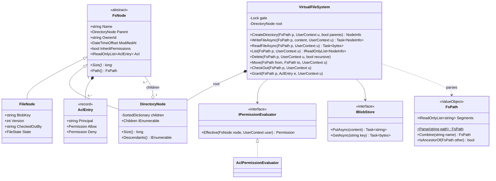
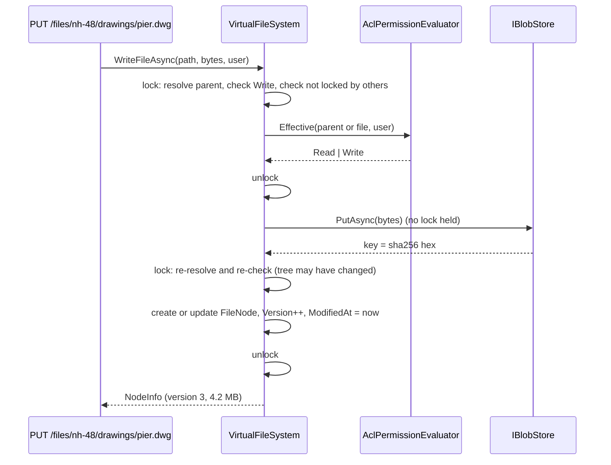
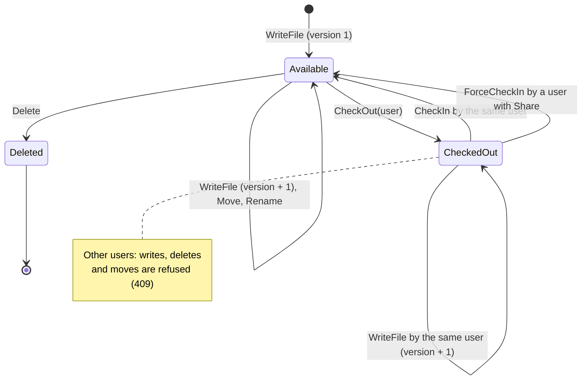
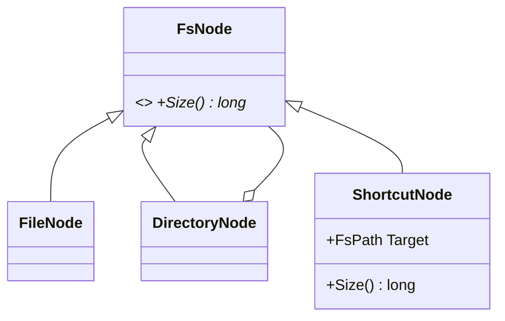

"Design a file system" is a classic interview question because it packs several design ideas into one familiar thing: a tree where folders and files are treated alike, paths that must be parsed safely, permissions that flow down the tree, and operations such as move and delete that touch many nodes at once. In this case study we build a virtual file system for a document portal, the kind that holds drawings, contracts and progress reports for construction projects.

## Learning objectives

By the end of this case study you will be able to:

1. Write functional and non-functional requirements for a hierarchical store, including path rules and permission semantics.
2. Apply the Composite pattern so that "size of a folder" and "size of a file" are the same call.
3. Build a path value object that normalises `.` and `..`, rejects path traversal, and compares case-insensitively.
4. Implement inherited access control lists (ACLs) with a clear rule for conflicts (deny wins).
5. Implement move and recursive delete with cycle detection and all-or-nothing permission checks.
6. Keep a tree thread-safe while storing file content in a blob store, without holding a lock across I/O.
7. Explain when a database table with a `parent_id` (or PostgreSQL `ltree`) beats an in-memory tree.

## Prerequisites

- [Composite](#/lesson/m06-composite): the core structural pattern here.
- [Encapsulation and invariant protection](#/lesson/m07-encapsulation-invariants): the tree must not be corruptible from outside.
- [Error handling and domain exceptions](#/lesson/m07-domain-exceptions): we map domain errors to HTTP codes.
- [Role-based and policy-based authorization](#/lesson/m14-rbac-pbac): background for ACLs.

## Explain it like I'm a beginner

Think of a steel almirah in a site office. It has shelves, each shelf has box files, each box file has folders, and folders hold sheets of paper. Some folders hold more folders.

Two questions show the key idea:

- "How heavy is this sheet?" You weigh it.
- "How heavy is this box file?" You add up the weight of everything inside it, and if something inside is itself a folder, you add up *its* contents first.

You ask both questions in the same words, and you do not care whether you are holding a sheet or a folder. That is the **Composite** pattern: a *part* and a *whole made of parts* share one interface, so code can treat them alike.

A **path** is directions to a sheet: "almirah → shelf 2 → NH-48 box → drawings → bridge-pier.dwg", written as `/nh-48/drawings/bridge-pier.dwg`. Paths can be tricky: `/nh-48/./drawings/../drawings//bridge-pier.dwg` points to the same sheet, and `/nh-48/../../secret` tries to climb out of the almirah altogether.

**Permissions** are the lock and key. If the site engineers' group can read the `NH-48` box, they can normally read everything inside it, because permissions are *inherited* by what is inside. But the "Contracts" folder inside might say "site engineers: no", and that "no" should win.

## Requirements

### The scenario

Your company runs a project document portal for highway and bridge projects. Each project has a few thousand files (drawings, monthly progress reports, test certificates). Users today keep files on a shared drive and email them around. The new portal needs a virtual file system: the *tree* and its rules live in the application; the file *bytes* live in object storage (Azure Blob Storage or S3). This lesson designs the tree.

### Functional requirements

| # | Requirement |
|---|---|
| F1 | Create folders (optionally creating missing parents), write files (create or overwrite), read files. |
| F2 | List a folder's children with name, type, size, modified time and version. |
| F3 | Delete a file or an empty folder; delete a non-empty folder only when `recursive` is requested. |
| F4 | Move or rename a file or folder. A folder cannot be moved into itself or its own descendant. |
| F5 | Folder size is the total size of everything inside it. |
| F6 | Permissions per node: Read, Write, Delete, Share (manage permissions), granted to users or groups. Inherited from parent folders unless inheritance is turned off. A Deny entry beats any Allow. The owner of a node, or of any folder above it, always has full access (so the root owner is the vault administrator and a project folder's owner administers that project). |
| F7 | **Check-out lock**: an engineer can check out a drawing; while checked out, only that engineer can overwrite it, and nobody can delete or move it. |
| F8 | Find files below a folder by a predicate (for example, every `.dwg` larger than 5 MB). |

### Non-functional requirements

| # | Requirement | Target |
|---|---|---|
| N1 | Safety | No path can escape the root (`..` above root is rejected), and names with control or reserved characters are rejected. |
| N2 | Consistency | A recursive delete or a move is all-or-nothing: either every node is affected or none is. |
| N3 | Concurrency | Many users read and write at once; the tree is never left half-updated. Locks are never held while uploading or downloading bytes. |
| N4 | Scale (per project) | Up to about 50,000 nodes and 20 levels deep per project tree (an estimate from typical projects). Listing a folder of 2,000 files must feel instant. |
| N5 | Auditability | Every node records owner, created and modified times, and a version number that increases on each write. |
| N6 | Testability | Time comes from an injected `TimeProvider`; storage from an `IBlobStore` interface. |

### Clarifying questions

- **Case sensitivity?** Windows users expect `Report.pdf` and `report.pdf` to be the same file. We choose *case-preserving, case-insensitive* names (like Windows and default macOS).
- **Hard links or shortcuts?** Not in phase 1. Shortcuts create cycles and permission puzzles (Exercise 4).
- **Versions?** We keep a version counter and the latest content only. Full version history is a likely phase-2 feature, which is why content is stored in a content-addressed blob store (old versions can be kept by keeping old keys).
- **What does "deny wins" mean across levels?** We choose the simple, safe rule: any applicable Deny, at any level, removes that permission. Windows uses a subtler rule (explicit entries on the child beat inherited ones). Exercise 3 implements that variant.
- **Can you list a folder whose children you cannot read?** We show only the children the user can read. Showing names of files you cannot open leaks information ("Termination-Notice-Contractor-X.pdf").
- **Is the tree in memory or in the database?** For this lesson, in memory, guarded by a lock, with persistence behind it. The "Alternative designs" section discusses a PostgreSQL-backed tree.

## Identifying classes and responsibilities

Nouns from the requirements: *file, folder, path, name, permission, user, group, owner, size, version, lock, content, blob*. Verbs: *create, write, read, list, delete, move, grant, check out, find*.

| Class | Kind | Responsibility |
|---|---|---|
| `FsPath` | value object | Parse, normalise, validate and compare paths. Immutable. |
| `FsNode` | abstract class (Component) | Name, parent, owner, timestamps, ACL entries; abstract `Size`. |
| `FileNode` | class (Leaf) | Blob key, length, version, check-out state. |
| `DirectoryNode` | class (Composite) | Children by name (case-insensitive), `Size` = sum of children, depth-first traversal. |
| `Permission` | `[Flags]` enum | Read, Write, Delete, Share. |
| `AclEntry` | record | Principal plus allowed and denied permissions. |
| `UserContext` | record | The caller: user id and group memberships. |
| `IPermissionEvaluator` / `AclPermissionEvaluator` | interface + class (Strategy) | Computes effective permissions for a user on a node. |
| `IBlobStore` / `InMemoryBlobStore` | interface + class | Stores file bytes by content hash. |
| `VirtualFileSystem` | class (Facade) | The only public entry point. Validates, checks permissions, locks the tree, keeps invariants. |
| `NodeInfo` | record | Read-only snapshot returned to callers, so the live tree never leaks. |
| `FsException` and subclasses | exceptions | `PathNotFound`, `AlreadyExists`, `AccessDenied`, `NotADirectory`, `DirectoryNotEmpty`, `InvalidPath`, `FileLocked`, `InvalidMove`. |
| `FsExceptionHandler` | `IExceptionHandler` | Maps domain exceptions to HTTP status codes. |

Key decision: **mutators are `internal`**. Only `VirtualFileSystem` can add children, rename, or change content. Code outside the assembly can read a node's properties but cannot break invariants such as "a child's `Parent` points to the folder that contains it". Even better, the facade returns `NodeInfo` snapshots and never hands out live nodes at all.

## Class diagram



How to read it: `FsNode` is the Component. `FileNode` (Leaf) and `DirectoryNode` (Composite) both inherit it, and `DirectoryNode` holds a collection of `FsNode`, which can be files *or* directories. That self-reference is what lets the tree be any depth. We drew it as aggregation because a child can be *moved* to another directory: the directory holds it, but its identity survives the move. Each node owns its ACL entries (composition). `VirtualFileSystem` is the Facade: it owns the root, and depends on two abstractions, a permission strategy and a blob store. `FsPath` is a value object: the facade parses strings into it at the boundary, so the rest of the code never handles raw path strings.

### Writing a file without holding the lock during upload



The upload of a 40 MB drawing might take seconds. If we held the tree lock during upload, every other user's listing would freeze. So we check permissions first (fail fast), release the lock, upload, then lock again and **check again**, because in the meantime someone might have deleted the folder, checked out the file, or revoked our permission. This "check, release, do slow work, re-check, commit" shape appears in many systems. The cost: if the second check fails, the uploaded blob is orphaned. A background job deletes blobs no node refers to (garbage collection), which is simple because keys are content hashes.

## Patterns and design decisions

### Composite: one interface for files and folders

`Size` is abstract on `FsNode`. A file returns its length; a directory returns the sum of its children's `Size`, which recurses naturally. Code that shows "storage used" or applies a quota does not need `if (node is DirectoryNode)` checks.

**Transparent vs safe Composite.** The *transparent* style puts `Add`/`Remove` on the base class, so you can call `file.Add(child)` and get an exception at runtime. The *safe* style puts them only on `DirectoryNode`, so the compiler stops you. We use the safe style: a file having children is a bug we want caught at compile time.

**Trade-off of computed sizes.** `Size` walks the subtree every time: O(number of descendants). For 50,000 nodes that is fine for an occasional call but not for every listing. The alternative is to *cache* sizes in each directory and update all ancestors on every write (O(depth) per write). We compute on demand and note the switch point in the alternatives.

### Value object for paths

Raw strings are the number one source of file system bugs and security holes (path traversal, such as `../../etc/passwd`). `FsPath` is immutable, always absolute, always normalised, and validated when it is created. If you hold an `FsPath`, it is safe. Equality is case-insensitive to match our naming rule.

### Strategy for permission evaluation

The rule "deny wins at any level" is a *policy*, and policies change. Behind `IPermissionEvaluator`, you can swap in a "nearest explicit entry wins" rule, or a decorator that caches results per request, without touching the facade.

### Facade over the tree

All operations go through `VirtualFileSystem`, which does four things in a fixed order: **parse** the path, **lock**, **authorise**, **mutate**. Putting that order in one class means no endpoint can forget the permission check.

### Iterator for traversal

`DirectoryNode.Descendants()` yields nodes depth-first using an explicit stack, not recursion. Recursion would also work at 20 levels, but an explicit stack cannot overflow on a pathological deep tree, and `yield return` lets callers stop early ("find the first match").

### Thread safety: one tree lock

All tree reads and writes take one `Lock`. That sounds coarse, but each operation is a few microseconds of in-memory work (bytes never flow under the lock), so a single lock handles thousands of operations per second, an estimate that you should verify with a load test. Fine-grained per-node locks are much harder: a move touches two parents and must lock them in a consistent order to avoid deadlock. If profiling shows read contention, a `ReaderWriterLockSlim` is the next step.

### All-or-nothing deletes and moves

Recursive delete first *checks* every descendant (permission and check-out state) and only then *detaches* the subtree. Because both happen under the same lock, nobody sees a half-deleted folder. Move checks everything, then performs one detach and one attach.

## State transitions

A file goes through this lifecycle:



How to read it: a file is born *Available* at version 1. Each write bumps the version but keeps it Available. *CheckedOut* is an exclusive edit lock: only the holder can write, and the file cannot be deleted or moved, so a drawing cannot vanish while someone spends two hours editing it. The holder checks it in; if they go on leave, someone with Share permission can force a check-in. *Deleted* is terminal in this design: the node is detached from the tree. A recycle bin would add a *Trashed* state with "restore" and "purge" transitions, which is an extension task. Notice that a folder containing a checked-out file also cannot be deleted recursively: the check-out state blocks the whole operation.

## C# implementation

```text
DocVault.Api/
  Program.cs
  FileSystem/
    FsPath.cs
    FsExceptions.cs
    Permissions.cs
    Nodes.cs
    BlobStore.cs
    VirtualFileSystem.cs
    FsExceptionHandler.cs
```

### Paths

```csharp file=FileSystem/FsPath.cs
namespace DocVault.FileSystem;

/// <summary>An absolute, normalised, validated path. Case-preserving, compared case-insensitively.</summary>
public sealed class FsPath : IEquatable<FsPath>
{
    public const int MaxNameLength = 255;
    private static readonly char[] InvalidChars = ['\\', ':', '*', '?', '"', '<', '>', '|'];
    private readonly string[] _segments;

    public static readonly FsPath Root = new([]);

    private FsPath(string[] segments) => _segments = segments;

    public IReadOnlyList<string> Segments => _segments;
    public bool IsRoot => _segments.Length == 0;
    public string Name => IsRoot ? "/" : _segments[^1];
    public FsPath Parent => IsRoot ? throw new InvalidPathException("/", "The root has no parent.") : new(_segments[..^1]);

    public static FsPath Parse(string path)
    {
        if (string.IsNullOrWhiteSpace(path) || path[0] != '/')
            throw new InvalidPathException(path ?? "", "Path must be absolute and start with '/'.");

        var stack = new List<string>();
        foreach (var part in path.Split('/', StringSplitOptions.RemoveEmptyEntries))
        {
            if (part == ".") continue;
            if (part == "..")
            {
                if (stack.Count == 0) throw new InvalidPathException(path, "'..' would leave the root.");
                stack.RemoveAt(stack.Count - 1);
                continue;
            }
            ValidateName(part, path);
            stack.Add(part);
        }
        return new FsPath([.. stack]);
    }

    public FsPath Combine(string name)
    {
        ValidateName(name, name);
        return new FsPath([.. _segments, name]);
    }

    /// <summary>True if this path is a strict ancestor of <paramref name="other"/>.</summary>
    public bool IsAncestorOf(FsPath other)
    {
        if (other._segments.Length <= _segments.Length) return false;
        for (int i = 0; i < _segments.Length; i++)
            if (!string.Equals(_segments[i], other._segments[i], StringComparison.OrdinalIgnoreCase)) return false;
        return true;
    }

    public static void ValidateName(string name, string context)
    {
        if (string.IsNullOrWhiteSpace(name)) throw new InvalidPathException(context, "Names cannot be empty.");
        if (name is "." or "..") throw new InvalidPathException(context, $"'{name}' is not a valid name.");
        if (name.Length > MaxNameLength) throw new InvalidPathException(context, $"Names are limited to {MaxNameLength} characters.");
        if (name.IndexOfAny(InvalidChars) >= 0 || name.Any(char.IsControl))
            throw new InvalidPathException(context, $"'{name}' contains a reserved character.");
        if (name.EndsWith(' ') || name.EndsWith('.'))
            throw new InvalidPathException(context, "Names cannot end with a space or a dot.");
    }

    public bool Equals(FsPath? other) =>
        other is not null && _segments.Length == other._segments.Length &&
        _segments.Zip(other._segments).All(p => string.Equals(p.First, p.Second, StringComparison.OrdinalIgnoreCase));

    public override bool Equals(object? obj) => Equals(obj as FsPath);

    public override int GetHashCode()
    {
        var h = new HashCode();
        foreach (var s in _segments) h.Add(s, StringComparer.OrdinalIgnoreCase);
        return h.ToHashCode();
    }

    public override string ToString() => "/" + string.Join('/', _segments);
}
```

The names that end in a space or dot are rejected because Windows clients silently strip them, which would make `report.` and `report` collide after a sync. The reserved character list follows Windows rules for the same reason: users download these files to Windows laptops.

### Exceptions

```csharp file=FileSystem/FsExceptions.cs
namespace DocVault.FileSystem;

public abstract class FsException(string message) : Exception(message);

public sealed class InvalidPathException(string path, string reason) : FsException($"Invalid path '{path}': {reason}");
public sealed class PathNotFoundException(FsPath path) : FsException($"'{path}' does not exist.");
public sealed class AlreadyExistsException(FsPath path) : FsException($"'{path}' already exists.");
public sealed class NotADirectoryException(FsPath path) : FsException($"'{path}' is not a folder.");
public sealed class NotAFileException(FsPath path) : FsException($"'{path}' is not a file.");
public sealed class DirectoryNotEmptyException(FsPath path) : FsException($"'{path}' is not empty; use recursive delete.");
public sealed class FileLockedException(FsPath path, string holder) : FsException($"'{path}' is checked out by {holder}.");
public sealed class InvalidMoveException(string reason) : FsException(reason);

public sealed class AccessDeniedException(FsPath path, Permission needed)
    : FsException($"You need {needed} permission on '{path}'.")
{
    public Permission Needed { get; } = needed;
}
```

### Permissions

```csharp file=FileSystem/Permissions.cs
namespace DocVault.FileSystem;

[Flags]
public enum Permission
{
    None = 0,
    Read = 1,
    Write = 2,
    Delete = 4,
    Share = 8,
    All = Read | Write | Delete | Share,
}

/// <summary>Principal is a user id ("asha"), a group ("group:site-engineers") or "everyone".</summary>
public sealed record AclEntry(string Principal, Permission Allow, Permission Deny = Permission.None);

public sealed record UserContext(string UserId, IReadOnlySet<string> Groups)
{
    public const string Everyone = "everyone";

    public static UserContext Of(string userId, params string[] groups) => new(userId, new HashSet<string>(groups, StringComparer.OrdinalIgnoreCase));

    public bool Matches(string principal) =>
        principal == Everyone
        || string.Equals(principal, UserId, StringComparison.OrdinalIgnoreCase)
        || Groups.Contains(principal);
}

public interface IPermissionEvaluator
{
    Permission Effective(FsNode node, UserContext user);
}

/// <summary>Walks from the node up to the root (until inheritance stops).
/// Allows are unioned, denies are unioned, and any deny removes the permission.
/// The owner of the node or of any folder above it gets everything (the root owner administers the vault).</summary>
public sealed class AclPermissionEvaluator : IPermissionEvaluator
{
    public Permission Effective(FsNode node, UserContext user)
    {
        for (FsNode? n = node; n is not null; n = n.Parent)
            if (string.Equals(n.OwnerId, user.UserId, StringComparison.OrdinalIgnoreCase)) return Permission.All;

        Permission allow = Permission.None, deny = Permission.None;
        for (FsNode? n = node; n is not null; n = n.Parent)
        {
            foreach (var e in n.Acl)
            {
                if (!user.Matches(e.Principal)) continue;
                allow |= e.Allow;
                deny |= e.Deny;
            }
            if (!n.InheritPermissions) break;
        }
        return allow & ~deny;
    }
}
```

`[Flags]` lets one value hold several permissions (`Read | Write` is 3), and bitwise maths does the work: `allow & ~deny` means "everything allowed, minus everything denied". It is compact and fast, and a beginner can check it by hand: allow = Read | Write (3), deny = Write (2), so `3 & ~2` = 1 = Read.

### Nodes: Component, Leaf, Composite

```csharp file=FileSystem/Nodes.cs
namespace DocVault.FileSystem;

public abstract class FsNode
{
    private readonly List<AclEntry> _acl = [];

    protected FsNode(string name, string ownerId, DateTimeOffset now)
    {
        Name = name;
        OwnerId = ownerId;
        CreatedAt = now;
        ModifiedAt = now;
    }

    public string Name { get; internal set; }
    public DirectoryNode? Parent { get; internal set; }
    public string OwnerId { get; }
    public DateTimeOffset CreatedAt { get; }
    public DateTimeOffset ModifiedAt { get; internal set; }
    public bool InheritPermissions { get; internal set; } = true;
    public IReadOnlyList<AclEntry> Acl => _acl;

    public abstract long Size { get; }

    public FsPath Path
    {
        get
        {
            var names = new Stack<string>();
            for (FsNode? n = this; n?.Parent is not null; n = n.Parent) names.Push(n.Name);
            var p = FsPath.Root;
            foreach (var name in names) p = p.Combine(name);
            return p;
        }
    }

    internal void SetAclEntry(AclEntry entry)
    {
        _acl.RemoveAll(e => string.Equals(e.Principal, entry.Principal, StringComparison.OrdinalIgnoreCase));
        if (entry.Allow != Permission.None || entry.Deny != Permission.None) _acl.Add(entry);
    }
}

public enum FileState { Available, CheckedOut, Deleted }

public sealed class FileNode(string name, string ownerId, DateTimeOffset now) : FsNode(name, ownerId, now)
{
    private long _length;

    public string BlobKey { get; private set; } = "";
    public int Version { get; private set; }
    public string? CheckedOutBy { get; private set; }
    public bool IsDeleted { get; private set; }

    public FileState State => IsDeleted ? FileState.Deleted : CheckedOutBy is null ? FileState.Available : FileState.CheckedOut;
    public override long Size => _length;

    internal void SetContent(string blobKey, long length, DateTimeOffset now)
    {
        BlobKey = blobKey;
        _length = length;
        Version++;
        ModifiedAt = now;
    }

    internal void CheckOut(string userId) => CheckedOutBy = userId;
    internal void CheckIn() => CheckedOutBy = null;
    internal void MarkDeleted() => IsDeleted = true;
}

public sealed class DirectoryNode(string name, string ownerId, DateTimeOffset now) : FsNode(name, ownerId, now)
{
    private readonly SortedDictionary<string, FsNode> _children = new(StringComparer.OrdinalIgnoreCase);

    public IEnumerable<FsNode> Children => _children.Values;
    public int ChildCount => _children.Count;

    /// <summary>Composite: a folder's size is the sum of its children's sizes, recursively.</summary>
    public override long Size => _children.Values.Sum(c => c.Size);

    public bool TryGetChild(string name, out FsNode child) => _children.TryGetValue(name, out child!);

    internal void Add(FsNode child)
    {
        if (!_children.TryAdd(child.Name, child)) throw new AlreadyExistsException(Path.Combine(child.Name));
        child.Parent = this;
    }

    internal void Remove(FsNode child)
    {
        if (_children.TryGetValue(child.Name, out var existing) && ReferenceEquals(existing, child))
        {
            _children.Remove(child.Name);
            child.Parent = null;
        }
    }

    /// <summary>Depth-first, pre-order, using an explicit stack (no recursion, can stop early).</summary>
    public IEnumerable<FsNode> Descendants()
    {
        var stack = new Stack<FsNode>(_children.Values.Reverse());
        while (stack.Count > 0)
        {
            var n = stack.Pop();
            yield return n;
            if (n is DirectoryNode d)
                foreach (var c in d._children.Values.Reverse()) stack.Push(c);
        }
    }
}

/// <summary>Immutable snapshot handed to callers; the live tree never leaves the facade.</summary>
public sealed record NodeInfo(string Path, string Name, bool IsDirectory, long Size, DateTimeOffset ModifiedAt,
    string OwnerId, int Version, string? CheckedOutBy)
{
    public static NodeInfo From(FsNode n) => n switch
    {
        FileNode f => new(f.Path.ToString(), f.Name, false, f.Size, f.ModifiedAt, f.OwnerId, f.Version, f.CheckedOutBy),
        _ => new(n.Path.ToString(), n.Parent is null ? "/" : n.Name, true, n.Size, n.ModifiedAt, n.OwnerId, 0, null),
    };
}
```

`SortedDictionary` keeps children in name order, so listings come out sorted with no extra work, at the cost of O(log n) lookups instead of O(1). For 2,000 children that is about 11 comparisons: irrelevant. The `StringComparer.OrdinalIgnoreCase` comparer is what enforces "Report.pdf and report.pdf are the same name".

### Blob store

```csharp file=FileSystem/BlobStore.cs
using System.Collections.Concurrent;
using System.Security.Cryptography;

namespace DocVault.FileSystem;

/// <summary>Content-addressed storage: the key is the SHA-256 of the bytes, so identical files are stored once.</summary>
public interface IBlobStore
{
    Task<string> PutAsync(ReadOnlyMemory<byte> content, CancellationToken ct);
    Task<byte[]> GetAsync(string key, CancellationToken ct);
}

public sealed class InMemoryBlobStore : IBlobStore
{
    private readonly ConcurrentDictionary<string, byte[]> _blobs = new();

    public int Count => _blobs.Count;

    public Task<string> PutAsync(ReadOnlyMemory<byte> content, CancellationToken ct)
    {
        ct.ThrowIfCancellationRequested();
        string key = Convert.ToHexStringLower(SHA256.HashData(content.Span));
        _blobs.TryAdd(key, content.ToArray());
        return Task.FromResult(key);
    }

    public Task<byte[]> GetAsync(string key, CancellationToken ct)
    {
        ct.ThrowIfCancellationRequested();
        return _blobs.TryGetValue(key, out var b)
            ? Task.FromResult(b.ToArray())
            : throw new InvalidOperationException($"Blob {key} is missing.");
    }
}
```

### The facade

```csharp file=FileSystem/VirtualFileSystem.cs
namespace DocVault.FileSystem;

public sealed class VirtualFileSystem
{
    private readonly Lock _gate = new();
    private readonly DirectoryNode _root;
    private readonly IBlobStore _blobs;
    private readonly IPermissionEvaluator _permissions;
    private readonly TimeProvider _time;

    public VirtualFileSystem(string rootOwnerId, IBlobStore blobs, IPermissionEvaluator permissions, TimeProvider time)
    {
        _blobs = blobs;
        _permissions = permissions;
        _time = time;
        _root = new DirectoryNode("", rootOwnerId, time.GetUtcNow());
    }

    // ---------- Folders ----------

    public NodeInfo CreateDirectory(FsPath path, UserContext user, bool createParents = false)
    {
        if (path.IsRoot) throw new AlreadyExistsException(path);
        lock (_gate)
        {
            DirectoryNode parent = createParents ? EnsureDirectories(path.Parent, user) : ResolveDirectory(path.Parent);
            Demand(parent, Permission.Write, user);
            if (parent.TryGetChild(path.Name, out _)) throw new AlreadyExistsException(path);
            var dir = new DirectoryNode(path.Name, user.UserId, Now);
            parent.Add(dir);
            Touch(parent);
            return NodeInfo.From(dir);
        }
    }

    public IReadOnlyList<NodeInfo> List(FsPath path, UserContext user)
    {
        lock (_gate)
        {
            var dir = ResolveDirectory(path);
            Demand(dir, Permission.Read, user);
            // Hide children the caller cannot read: names alone can leak information.
            return dir.Children.Where(c => Has(c, Permission.Read, user)).Select(NodeInfo.From).ToList();
        }
    }

    // ---------- Files ----------

    public async Task<NodeInfo> WriteFileAsync(FsPath path, ReadOnlyMemory<byte> content, UserContext user, CancellationToken ct = default)
    {
        if (path.IsRoot) throw new NotAFileException(path);
        lock (_gate) CheckCanWrite(path, user);                 // 1. fail fast, before the slow upload

        string key = await _blobs.PutAsync(content, ct);        // 2. slow I/O with no lock held

        lock (_gate)                                             // 3. re-check: the tree may have changed
        {
            var parent = CheckCanWrite(path, user);
            if (parent.TryGetChild(path.Name, out var existing))
            {
                ((FileNode)existing).SetContent(key, content.Length, Now);
                Touch(parent);
                return NodeInfo.From(existing);
            }
            var file = new FileNode(path.Name, user.UserId, Now);
            file.SetContent(key, content.Length, Now);
            parent.Add(file);
            Touch(parent);
            return NodeInfo.From(file);
        }
    }

    public async Task<byte[]> ReadFileAsync(FsPath path, UserContext user, CancellationToken ct = default)
    {
        string key;
        lock (_gate)
        {
            var file = ResolveFile(path);
            Demand(file, Permission.Read, user);
            key = file.BlobKey;
        }
        return await _blobs.GetAsync(key, ct);                  // download outside the lock
    }

    public void CheckOut(FsPath path, UserContext user)
    {
        lock (_gate)
        {
            var file = ResolveFile(path);
            Demand(file, Permission.Write, user);
            if (file.CheckedOutBy is { } holder && !SameUser(holder, user)) throw new FileLockedException(path, holder);
            file.CheckOut(user.UserId);
        }
    }

    public void CheckIn(FsPath path, UserContext user, bool force = false)
    {
        lock (_gate)
        {
            var file = ResolveFile(path);
            if (file.CheckedOutBy is not { } holder) return;    // idempotent
            if (!SameUser(holder, user))
            {
                if (!force) throw new FileLockedException(path, holder);
                Demand(file, Permission.Share, user);           // force check-in is an admin action
            }
            file.CheckIn();
        }
    }

    // ---------- Delete and move ----------

    public void Delete(FsPath path, UserContext user, bool recursive = false)
    {
        if (path.IsRoot) throw new InvalidMoveException("The root cannot be deleted.");
        lock (_gate)
        {
            var node = Resolve(path);
            var parent = node.Parent!;
            Demand(parent, Permission.Write, user);

            // Check EVERYTHING first (all-or-nothing), then mutate.
            IEnumerable<FsNode> affected = [node];
            if (node is DirectoryNode dir)
            {
                if (dir.ChildCount > 0 && !recursive) throw new DirectoryNotEmptyException(path);
                affected = affected.Concat(dir.Descendants());
            }
            foreach (var n in affected)
            {
                Demand(n, Permission.Delete, user);
                if (n is FileNode { CheckedOutBy: { } holder }) throw new FileLockedException(n.Path, holder);
            }

            foreach (var f in affected.OfType<FileNode>()) f.MarkDeleted();
            parent.Remove(node);
            Touch(parent);
        }
    }

    public NodeInfo Move(FsPath source, FsPath destination, UserContext user)
    {
        if (source.IsRoot) throw new InvalidMoveException("The root cannot be moved.");
        if (destination.IsRoot) throw new InvalidMoveException("Cannot replace the root.");
        if (source.Equals(destination)) throw new InvalidMoveException("Source and destination are the same.");
        if (source.IsAncestorOf(destination))
            throw new InvalidMoveException($"Cannot move '{source}' into its own subfolder '{destination}'.");

        lock (_gate)
        {
            var node = Resolve(source);
            var from = node.Parent!;
            var to = ResolveDirectory(destination.Parent);
            if (to.TryGetChild(destination.Name, out var clash) && !ReferenceEquals(clash, node))
                throw new AlreadyExistsException(destination);

            Demand(node, Permission.Delete, user);   // removing it from the old place
            Demand(from, Permission.Write, user);
            Demand(to, Permission.Write, user);      // adding it to the new place
            foreach (var n in (node is DirectoryNode d ? d.Descendants() : []).Prepend(node))
                if (n is FileNode { CheckedOutBy: { } holder }) throw new FileLockedException(n.Path, holder);

            from.Remove(node);
            node.Name = destination.Name;            // a move is also how you rename
            to.Add(node);
            Touch(from);
            Touch(to);
            return NodeInfo.From(node);
        }
    }

    // ---------- Permissions and queries ----------

    public void Grant(FsPath path, AclEntry entry, UserContext user)
    {
        lock (_gate)
        {
            var node = Resolve(path);
            Demand(node, Permission.Share, user);
            node.SetAclEntry(entry);
        }
    }

    public void SetInheritance(FsPath path, bool inherit, UserContext user)
    {
        lock (_gate)
        {
            var node = Resolve(path);
            Demand(node, Permission.Share, user);
            node.InheritPermissions = inherit;
        }
    }

    public Permission EffectivePermissions(FsPath path, UserContext user)
    {
        lock (_gate) return _permissions.Effective(Resolve(path), user);
    }

    public long SizeOf(FsPath path, UserContext user)
    {
        lock (_gate)
        {
            var node = Resolve(path);
            Demand(node, Permission.Read, user);
            return node.Size;
        }
    }

    /// <summary>Snapshot of matching readable files below a folder. Returns a list so no lock escapes.</summary>
    public IReadOnlyList<NodeInfo> Find(FsPath folder, Func<NodeInfo, bool> predicate, UserContext user, int limit = 500)
    {
        lock (_gate)
        {
            var dir = ResolveDirectory(folder);
            Demand(dir, Permission.Read, user);
            return dir.Descendants()
                .OfType<FileNode>()
                .Where(f => Has(f, Permission.Read, user))
                .Select(NodeInfo.From)
                .Where(predicate)
                .Take(limit)
                .ToList();
        }
    }

    // ---------- Helpers (all called with _gate held) ----------

    private DateTimeOffset Now => _time.GetUtcNow();

    private FsNode Resolve(FsPath path)
    {
        FsNode current = _root;
        foreach (var segment in path.Segments)
        {
            if (current is not DirectoryNode dir || !dir.TryGetChild(segment, out var next))
                throw new PathNotFoundException(path);
            current = next;
        }
        return current;
    }

    private DirectoryNode ResolveDirectory(FsPath path) =>
        Resolve(path) as DirectoryNode ?? throw new NotADirectoryException(path);

    private FileNode ResolveFile(FsPath path) =>
        Resolve(path) as FileNode ?? throw new NotAFileException(path);

    private DirectoryNode EnsureDirectories(FsPath path, UserContext user)
    {
        DirectoryNode current = _root;
        foreach (var segment in path.Segments)
        {
            if (current.TryGetChild(segment, out var next))
            {
                current = next as DirectoryNode ?? throw new NotADirectoryException(current.Path.Combine(segment));
                continue;
            }
            Demand(current, Permission.Write, user);
            var created = new DirectoryNode(segment, user.UserId, Now);
            current.Add(created);
            current = created;
        }
        return current;
    }

    private DirectoryNode CheckCanWrite(FsPath path, UserContext user)
    {
        var parent = ResolveDirectory(path.Parent);
        if (parent.TryGetChild(path.Name, out var existing))
        {
            if (existing is not FileNode file) throw new NotAFileException(path);
            Demand(file, Permission.Write, user);
            if (file.CheckedOutBy is { } holder && !SameUser(holder, user)) throw new FileLockedException(path, holder);
        }
        else Demand(parent, Permission.Write, user);
        return parent;
    }

    private bool Has(FsNode node, Permission p, UserContext user) => (_permissions.Effective(node, user) & p) == p;

    private void Demand(FsNode node, Permission p, UserContext user)
    {
        if (!Has(node, p, user)) throw new AccessDeniedException(node.Path, p);
    }

    private void Touch(DirectoryNode dir) => dir.ModifiedAt = Now;

    private static bool SameUser(string id, UserContext user) => string.Equals(id, user.UserId, StringComparison.OrdinalIgnoreCase);
}
```

Things worth noticing:

- **Every public method follows the same order**: validate inputs that need no lock (pure path checks such as "is destination inside source?"), lock, resolve, authorise, check invariants, mutate. Path checks before the lock keep the critical section short.
- **Move = rename.** Renaming `/a/x` to `/a/y` is a move within the same folder. One code path, one set of tests.
- **Delete marks files deleted** before detaching, so a reference that was taken earlier (for example an in-flight `NodeInfo`) can be recognised as stale. The blob itself is left for the garbage collector, which also enables a future recycle bin.
- **`Find` returns a list, not a lazy `IEnumerable`.** A lazy sequence would be enumerated *after* the lock is released, reading the tree while another thread mutates it. This is a subtle bug that compiles happily.

### HTTP adapter and composition root

```csharp file=FileSystem/FsExceptionHandler.cs
using Microsoft.AspNetCore.Diagnostics;
using Microsoft.AspNetCore.Http;
using Microsoft.AspNetCore.Mvc;

namespace DocVault.FileSystem;

/// <summary>Maps domain exceptions to HTTP status codes in one place (ASP.NET Core 8+ IExceptionHandler).</summary>
public sealed class FsExceptionHandler(IProblemDetailsService problems) : IExceptionHandler
{
    public async ValueTask<bool> TryHandleAsync(HttpContext http, Exception exception, CancellationToken ct)
    {
        int? status = exception switch
        {
            InvalidPathException or InvalidMoveException => StatusCodes.Status400BadRequest,
            AccessDeniedException => StatusCodes.Status403Forbidden,
            PathNotFoundException => StatusCodes.Status404NotFound,
            AlreadyExistsException or DirectoryNotEmptyException or FileLockedException
                or NotADirectoryException or NotAFileException => StatusCodes.Status409Conflict,
            _ => null,
        };
        if (status is null) return false;   // not ours: let the default handler produce a 500

        http.Response.StatusCode = status.Value;
        return await problems.TryWriteAsync(new ProblemDetailsContext
        {
            HttpContext = http,
            ProblemDetails = new ProblemDetails { Status = status, Title = exception.Message },
            Exception = exception,
        });
    }
}
```

```csharp file=Program.cs
using DocVault.FileSystem;

var builder = WebApplication.CreateBuilder(args);

builder.Services.AddSingleton(TimeProvider.System);
builder.Services.AddSingleton<IBlobStore, InMemoryBlobStore>();           // swap for Azure Blob / S3 in production
builder.Services.AddSingleton<IPermissionEvaluator, AclPermissionEvaluator>();
builder.Services.AddSingleton(sp => new VirtualFileSystem("admin",
    sp.GetRequiredService<IBlobStore>(), sp.GetRequiredService<IPermissionEvaluator>(), sp.GetRequiredService<TimeProvider>()));
builder.Services.AddProblemDetails();
builder.Services.AddExceptionHandler<FsExceptionHandler>();

var app = builder.Build();
app.UseExceptionHandler();

// DEMO ONLY: identity from headers. In production use authentication and read claims from HttpContext.User.
static UserContext Caller(HttpContext http) =>
    UserContext.Of(http.Request.Headers["X-User"].ToString() is { Length: > 0 } u ? u : "anonymous",
        http.Request.Headers["X-Groups"].ToString().Split(',', StringSplitOptions.RemoveEmptyEntries));

app.MapGet("/files/{**path}", async (string? path, HttpContext http, VirtualFileSystem fs, CancellationToken ct) =>
{
    var p = FsPath.Parse("/" + (path ?? ""));
    var user = Caller(http);
    if (http.Request.Query.ContainsKey("list")) return Results.Ok(fs.List(p, user));
    return Results.File(await fs.ReadFileAsync(p, user, ct), "application/octet-stream", p.Name);
});

app.MapPut("/files/{**path}", async (string path, HttpContext http, VirtualFileSystem fs, CancellationToken ct) =>
{
    using var ms = new MemoryStream();
    await http.Request.Body.CopyToAsync(ms, ct);
    return Results.Ok(await fs.WriteFileAsync(FsPath.Parse("/" + path), ms.ToArray(), Caller(http), ct));
});

app.MapPost("/folders/{**path}", (string path, HttpContext http, VirtualFileSystem fs) =>
    Results.Created($"/files/{path}?list", fs.CreateDirectory(FsPath.Parse("/" + path), Caller(http), createParents: true)));

app.MapPost("/move", (MoveRequest req, HttpContext http, VirtualFileSystem fs) =>
    Results.Ok(fs.Move(FsPath.Parse(req.From), FsPath.Parse(req.To), Caller(http))));

app.MapDelete("/files/{**path}", (string path, bool? recursive, HttpContext http, VirtualFileSystem fs) =>
{
    fs.Delete(FsPath.Parse("/" + path), Caller(http), recursive ?? false);
    return Results.NoContent();
});

app.Run();

public sealed record MoveRequest(string From, string To);
```

Reading the whole request body into memory is fine for a demo and for small files. For 100 MB drawings, stream straight to blob storage (or hand the client a pre-signed upload URL) and only then call the facade with the key and length; see [Object storage](#/lesson/m11-object-storage).

## Automated testing

A fixed clock and a reusable fixture:

```csharp
using DocVault.FileSystem;
using Xunit;

namespace DocVault.Tests;

public sealed class FixedClock : TimeProvider
{
    public DateTimeOffset Now { get; set; } = new(2026, 4, 1, 9, 0, 0, TimeSpan.FromHours(5.5));
    public override DateTimeOffset GetUtcNow() => Now.ToUniversalTime();
}

public static class Fs
{
    public static readonly UserContext Admin = UserContext.Of("admin");
    public static readonly UserContext Asha = UserContext.Of("asha", "group:site-engineers");
    public static readonly UserContext Ravi = UserContext.Of("ravi", "group:site-engineers");

    public static VirtualFileSystem New(out FixedClock clock)
    {
        clock = new FixedClock();
        return new VirtualFileSystem("admin", new InMemoryBlobStore(), new AclPermissionEvaluator(), clock);
    }

    public static FsPath P(string s) => FsPath.Parse(s);
    public static byte[] Bytes(int n) => new byte[n];
}
```

Path rules, including traversal attacks:

```csharp
using DocVault.FileSystem;
using Xunit;

namespace DocVault.Tests;

public class FsPathTests
{
    [Theory]
    [InlineData("/nh-48/./drawings//pier.dwg", "/nh-48/drawings/pier.dwg")]
    [InlineData("/nh-48/drawings/../reports/", "/nh-48/reports")]
    [InlineData("/", "/")]
    public void Normalises(string input, string expected) => Assert.Equal(expected, FsPath.Parse(input).ToString());

    [Theory]
    [InlineData("relative/path")]
    [InlineData("/nh-48/../../etc/passwd")]
    [InlineData("/bad:name")]
    [InlineData("/trailing.")]
    public void Rejects_unsafe_paths(string input) => Assert.Throws<InvalidPathException>(() => FsPath.Parse(input));

    [Fact]
    public void Compares_case_insensitively_but_preserves_case()
    {
        Assert.Equal(FsPath.Parse("/NH-48/Report.PDF"), FsPath.Parse("/nh-48/report.pdf"));
        Assert.Equal("/NH-48/Report.PDF", FsPath.Parse("/NH-48/Report.PDF").ToString());
    }

    [Fact]
    public void Ancestor_check_is_by_segment_not_by_prefix()
    {
        Assert.True(FsPath.Parse("/a").IsAncestorOf(FsPath.Parse("/a/b")));
        Assert.False(FsPath.Parse("/a").IsAncestorOf(FsPath.Parse("/ab")));   // "/ab" starts with "/a" as a string!
    }
}
```

Composite behaviour, permissions, locks and moves:

```csharp
using DocVault.FileSystem;
using Xunit;
using static DocVault.Tests.Fs;

namespace DocVault.Tests;

public class VirtualFileSystemTests
{
    [Fact]
    public async Task Folder_size_is_sum_of_descendants()
    {
        var fs = New(out _);
        // Writing never creates parent folders implicitly.
        await Assert.ThrowsAsync<PathNotFoundException>(() => fs.WriteFileAsync(P("/nh-48/drawings/pier.dwg"), Bytes(4000), Admin));
        fs.CreateDirectory(P("/nh-48/drawings"), Admin, createParents: true);
        await fs.WriteFileAsync(P("/nh-48/drawings/pier.dwg"), Bytes(4000), Admin);
        await fs.WriteFileAsync(P("/nh-48/report.pdf"), Bytes(1000), Admin);
        Assert.Equal(5000, fs.SizeOf(P("/nh-48"), Admin));
        Assert.Equal(4000, fs.SizeOf(P("/nh-48/drawings"), Admin));
    }

    [Fact]
    public async Task Overwrite_bumps_version_and_modified_time()
    {
        var fs = New(out var clock);
        fs.CreateDirectory(P("/p"), Admin);
        await fs.WriteFileAsync(P("/p/a.txt"), Bytes(10), Admin);
        clock.Now = clock.Now.AddHours(2);
        var info = await fs.WriteFileAsync(P("/p/a.txt"), Bytes(20), Admin);
        Assert.Equal(2, info.Version);
        Assert.Equal(clock.Now.ToUniversalTime(), info.ModifiedAt);
    }

    [Fact]
    public async Task Group_permission_is_inherited_and_deny_wins()
    {
        var fs = New(out _);
        fs.CreateDirectory(P("/nh-48/contracts"), Admin, createParents: true);
        await fs.WriteFileAsync(P("/nh-48/contracts/epc.pdf"), Bytes(10), Admin);
        fs.Grant(P("/nh-48"), new AclEntry("group:site-engineers", Permission.Read | Permission.Write), Admin);
        fs.Grant(P("/nh-48/contracts"), new AclEntry("group:site-engineers", Permission.None, Permission.Read), Admin);

        Assert.Equal(Permission.Read | Permission.Write, fs.EffectivePermissions(P("/nh-48"), Asha));
        Assert.Equal(Permission.Write, fs.EffectivePermissions(P("/nh-48/contracts/epc.pdf"), Asha));
        await Assert.ThrowsAsync<AccessDeniedException>(() => fs.ReadFileAsync(P("/nh-48/contracts/epc.pdf"), Asha));
        Assert.DoesNotContain(fs.List(P("/nh-48"), Asha), n => n.Name == "contracts");   // hidden, not just locked
    }

    [Fact]
    public async Task Breaking_inheritance_stops_the_walk()
    {
        var fs = New(out _);
        fs.CreateDirectory(P("/hr/private"), Admin, createParents: true);
        fs.Grant(P("/hr"), new AclEntry(UserContext.Everyone, Permission.Read), Admin);
        fs.SetInheritance(P("/hr/private"), false, Admin);
        Assert.Equal(Permission.Read, fs.EffectivePermissions(P("/hr"), Asha));
        Assert.Equal(Permission.None, fs.EffectivePermissions(P("/hr/private"), Asha));
        await Task.CompletedTask;
    }

    [Fact]
    public async Task Checked_out_file_blocks_other_writers_and_recursive_delete()
    {
        var fs = New(out _);
        fs.CreateDirectory(P("/nh-48"), Admin);
        fs.Grant(P("/nh-48"), new AclEntry("group:site-engineers", Permission.All), Admin);
        await fs.WriteFileAsync(P("/nh-48/pier.dwg"), Bytes(10), Asha);
        fs.CheckOut(P("/nh-48/pier.dwg"), Asha);

        await Assert.ThrowsAsync<FileLockedException>(() => fs.WriteFileAsync(P("/nh-48/pier.dwg"), Bytes(5), Ravi));
        Assert.Throws<FileLockedException>(() => fs.Delete(P("/nh-48"), Admin, recursive: true));
        Assert.Equal(10, fs.SizeOf(P("/nh-48"), Admin));             // nothing was deleted: all-or-nothing

        var v2 = await fs.WriteFileAsync(P("/nh-48/pier.dwg"), Bytes(12), Asha);   // holder may write
        Assert.Equal(2, v2.Version);
        fs.CheckIn(P("/nh-48/pier.dwg"), Asha);
        fs.Delete(P("/nh-48"), Admin, recursive: true);
        Assert.Throws<PathNotFoundException>(() => fs.List(P("/nh-48"), Admin));
    }

    [Fact]
    public void Cannot_move_a_folder_into_its_own_subfolder()
    {
        var fs = New(out _);
        fs.CreateDirectory(P("/a/b/c"), Admin, createParents: true);
        Assert.Throws<InvalidMoveException>(() => fs.Move(P("/a"), P("/a/b/c/a"), Admin));
    }

    [Fact]
    public async Task Move_renames_and_keeps_content()
    {
        var fs = New(out _);
        fs.CreateDirectory(P("/drafts"), Admin);
        fs.CreateDirectory(P("/final"), Admin);
        await fs.WriteFileAsync(P("/drafts/mpr-mar.pdf"), Bytes(300), Admin);
        fs.Move(P("/drafts/mpr-mar.pdf"), P("/final/MPR-March-2026.pdf"), Admin);
        Assert.Equal(300, (await fs.ReadFileAsync(P("/final/mpr-march-2026.pdf"), Admin)).Length);
        Assert.Empty(fs.List(P("/drafts"), Admin));
    }

    [Fact]
    public void Non_empty_folder_needs_recursive_delete()
    {
        var fs = New(out _);
        fs.CreateDirectory(P("/a/b"), Admin, createParents: true);
        Assert.Throws<DirectoryNotEmptyException>(() => fs.Delete(P("/a"), Admin));
    }
}
```

Test design notes:

- **Name the behaviour, not the method.** `Checked_out_file_blocks_other_writers_and_recursive_delete` tells you what broke when it fails.
- **Assert on the "nothing happened" side** of all-or-nothing operations (size unchanged after a refused delete). Most bugs in multi-node operations are half-done mutations.
- **Test the ancestor check with `/a` vs `/ab`.** A string `StartsWith` implementation passes most tests and fails this one.

## Bad design vs good design

### Bad: strings and a type flag

```csharp
public class Node
{
    public string FullPath;              // "/nh-48/drawings/pier.dwg"
    public bool IsFolder;
    public List<Node> Children = new();  // also present on files
    public byte[] Data;                  // also present on folders
    public List<string> AllowedUsers = new();
}

public long GetSize(Node n)
{
    if (!n.IsFolder) return n.Data.Length;
    long total = 0;
    foreach (var c in n.Children) total += GetSize(c);
    return total;
}

public void Move(Node n, string newParentPath) =>
    n.FullPath = newParentPath + "/" + n.FullPath.Split('/').Last();   // children keep the old prefix!
```

Problems:

1. **Stored full paths go stale.** After a move, every descendant still has the old prefix. You would have to rewrite every child's path: O(subtree) work and easy to get wrong. Our design derives the path from parent links, so a move is O(1).
2. **Type flag instead of types.** Files have `Children` and folders have `Data`; nothing stops nonsense states. Every operation starts with `if (IsFolder)`.
3. **Public mutable fields.** Any code can add a child without setting a parent, or create two children with the same name.
4. **No path normalisation.** `"/a/../b"` and `"/b"` are different keys; `"../../"` might escape the root.
5. **Permissions as a list of user names on each node.** No groups, no inheritance, no deny. Granting a new engineer access to a 5,000-file project means 5,000 updates.
6. **Content inside the node.** Gigabytes of drawings end up in the application's memory and in every serialised snapshot.

### Good: what changed and why it matters

| Bad | Good | Benefit |
|---|---|---|
| `IsFolder` flag | `FileNode` / `DirectoryNode` types (Composite) | Invalid states cannot be represented |
| Stored `FullPath` | Path derived from parent links | O(1) move and rename |
| Raw strings | `FsPath` value object | Normalised, validated, no traversal |
| Per-node user lists | ACL entries with groups, inheritance and deny | One grant on the project folder covers everything below |
| Bytes in nodes | Content-addressed blob store | Tree stays small; identical files stored once |
| Public fields | `internal` mutators behind a facade | Invariants enforced in one place |

### When is this overkill?

If users only need "a folder per project, one level deep, everyone on the project sees everything", a database table with `project_id` and a blob URL is simpler and enough. Reach for the full tree when you have nesting, mixed permissions within a project, or operations like move that must keep many things consistent.

## Alternative designs

### Database-backed tree (adjacency list)

Store nodes in PostgreSQL: `nodes(id, parent_id, name, kind, size, blob_key, owner_id, version, ...)` with a unique index on `(parent_id, lower(name))`. Moving a folder is one `UPDATE nodes SET parent_id = ...`. Listing a folder is an indexed query. Recursive operations (size, delete, find) use a recursive CTE (`WITH RECURSIVE`). This is the usual production choice because it survives restarts, scales beyond one server's memory, and gives you transactions for all-or-nothing operations. The in-memory design in this lesson becomes the *domain model* you load per request or the cache in front of the table.

### Materialised path or `ltree`

Store each node's full path (`nh48.drawings.pier`) and query subtrees with a prefix match. PostgreSQL's `ltree` extension indexes this well. Subtree reads are fast; moves are expensive because every descendant's path changes. Good when reads massively outnumber moves, for example for an archive.

### Closure table

A separate table with one row per (ancestor, descendant) pair. Fast "is X inside Y?" and subtree queries; moves rewrite many rows. More storage. Useful when permission inheritance must be evaluated in SQL for thousands of nodes at once.

### Cached folder sizes

Store `Size` on each directory and update all ancestors on each write: O(depth) per write, O(1) per size read. Worth it when the UI shows folder sizes in every listing. Watch out for drift: add a periodic recompute job.

### Visitor instead of virtual methods

If you keep adding operations over the tree (size, count, export to zip, virus scan), each one adds a method to every node class. The [Visitor](#/lesson/m06-visitor) pattern moves operations into separate classes. It pays off when the node types are stable and operations keep growing; here, with two node types and few operations, `Descendants()` plus LINQ is simpler.

### Role-based permissions instead of ACLs

Roles per project ("Viewer", "Editor", "Manager") are easier for users to understand than per-folder ACLs. Many document systems combine them: roles at the project level, ACL overrides only for sensitive folders such as Contracts. Our evaluator interface allows that combination.

## Practical playground

Open the reference model in the LLD designer and try:

1. Add a `ShortcutNode` that points to another node. Which methods change? What does `Size` mean for a shortcut?
2. Add a `TrashedState` to files (recycle bin). Which facade methods must change?
3. Replace the facade's single lock with a reader-writer lock. Which methods are readers?

:::playground type=lld title="Virtual file system — reference model"
```json
{
  "classes": [
    { "id": "FsNode", "name": "FsNode", "kind": "abstract", "fields": ["+string Name", "+DirectoryNode Parent", "+string OwnerId", "+DateTimeOffset ModifiedAt", "+bool InheritPermissions"], "methods": ["+long Size", "+FsPath Path"], "responsibility": "Component: shared node data and ACL" },
    { "id": "FileNode", "name": "FileNode", "kind": "class", "fields": ["+string BlobKey", "+int Version", "+string CheckedOutBy"], "methods": ["~void SetContent(string key, long length, DateTimeOffset now)", "~void CheckOut(string userId)", "~void CheckIn()"], "responsibility": "Leaf: content reference, version, check-out lock" },
    { "id": "DirectoryNode", "name": "DirectoryNode", "kind": "class", "fields": ["-SortedDictionary children"], "methods": ["+long Size", "+IEnumerable Descendants()", "~void Add(FsNode child)", "~void Remove(FsNode child)"], "responsibility": "Composite: children by case-insensitive name" },
    { "id": "FsPath", "name": "FsPath", "kind": "class", "fields": ["-string[] segments"], "methods": ["+FsPath Parse(string path)", "+FsPath Combine(string name)", "+bool IsAncestorOf(FsPath other)"], "responsibility": "Value object: normalised, validated path" },
    { "id": "Permission", "name": "Permission", "kind": "enum", "fields": ["Read", "Write", "Delete", "Share"], "methods": [] },
    { "id": "AclEntry", "name": "AclEntry", "kind": "record", "fields": ["+string Principal", "+Permission Allow", "+Permission Deny"], "methods": [] },
    { "id": "UserContext", "name": "UserContext", "kind": "record", "fields": ["+string UserId", "+IReadOnlySet Groups"], "methods": ["+bool Matches(string principal)"] },
    { "id": "IPermissionEvaluator", "name": "IPermissionEvaluator", "kind": "interface", "fields": [], "methods": ["+Permission Effective(FsNode node, UserContext user)"] },
    { "id": "AclEval", "name": "AclPermissionEvaluator", "kind": "class", "fields": [], "methods": ["+Permission Effective(FsNode node, UserContext user)"], "responsibility": "Inherited ACLs, deny wins, owner has all" },
    { "id": "IBlobStore", "name": "IBlobStore", "kind": "interface", "fields": [], "methods": ["+Task PutAsync(ReadOnlyMemory content)", "+Task GetAsync(string key)"] },
    { "id": "VFS", "name": "VirtualFileSystem", "kind": "class", "fields": ["-Lock gate", "-DirectoryNode root"], "methods": ["+NodeInfo CreateDirectory(FsPath p, UserContext u, bool parents)", "+Task WriteFileAsync(FsPath p, ReadOnlyMemory content, UserContext u)", "+void Delete(FsPath p, UserContext u, bool recursive)", "+NodeInfo Move(FsPath from, FsPath to, UserContext u)", "+void Grant(FsPath p, AclEntry e, UserContext u)"], "responsibility": "Facade: parse, lock, authorise, mutate" },
    { "id": "NodeInfo", "name": "NodeInfo", "kind": "record", "fields": ["+string Path", "+bool IsDirectory", "+long Size", "+int Version"], "methods": [], "responsibility": "Immutable snapshot for callers" }
  ],
  "relations": [
    { "from": "FileNode", "to": "FsNode", "kind": "inherits" },
    { "from": "DirectoryNode", "to": "FsNode", "kind": "inherits" },
    { "from": "DirectoryNode", "to": "FsNode", "kind": "aggregation", "label": "children", "multiplicity": "0..*" },
    { "from": "FsNode", "to": "AclEntry", "kind": "composition", "multiplicity": "0..*" },
    { "from": "AclEntry", "to": "Permission", "kind": "association" },
    { "from": "AclEval", "to": "IPermissionEvaluator", "kind": "implements" },
    { "from": "AclEval", "to": "UserContext", "kind": "dependency" },
    { "from": "VFS", "to": "DirectoryNode", "kind": "composition", "label": "root" },
    { "from": "VFS", "to": "IPermissionEvaluator", "kind": "association" },
    { "from": "VFS", "to": "IBlobStore", "kind": "association" },
    { "from": "VFS", "to": "FsPath", "kind": "dependency" },
    { "from": "VFS", "to": "NodeInfo", "kind": "dependency", "label": "returns" }
  ]
}
```
:::

## Exercises

:::exercise id=m18-file-system-ex1 difficulty=beginner kind=code title="Normalise a path"
Write `PathNormalizer.Normalize(string path)` that turns any absolute path into its canonical form, and rejects unsafe ones.
::requirements
- Collapse repeated slashes, remove `.` segments, resolve `..` by removing the previous segment.
- Remove a trailing slash (except for the root `/`).
- Throw `ArgumentException` if the path is not absolute or if `..` would go above the root.
::acceptance
- `/a//b/./c/` becomes `/a/b/c`.
- `/a/b/../c` becomes `/a/c`.
- `/..` and `a/b` throw `ArgumentException`.
- `/` stays `/`.
::hint
Treat the path as a list of segments, not as a string to search-and-replace.
::hint
`path.Split('/', StringSplitOptions.RemoveEmptyEntries)` handles repeated and trailing slashes for free.
::hint
Use a list as a stack: push normal names, ignore `.`, pop on `..` (throw if empty).
::hint
```csharp
var stack = new List<string>();
foreach (var s in path.Split('/', StringSplitOptions.RemoveEmptyEntries)) { /* "." / ".." / name */ }
return "/" + string.Join('/', stack);
```
::starter
```csharp file=PathNormalizer.cs
using System;

public static class PathNormalizer
{
    public static string Normalize(string path) => throw new NotImplementedException();
}
```
::tests
```csharp file=PathNormalizerTests.cs
using System;
using Xunit;

public class PathNormalizerTests
{
    [Theory]
    [InlineData("/a//b/./c/", "/a/b/c")]
    [InlineData("/a/b/../c", "/a/c")]
    [InlineData("/", "/")]
    [InlineData("///", "/")]
    [InlineData("/a/b/../../c", "/c")]
    [InlineData("/nh-48/drawings/./pier.dwg", "/nh-48/drawings/pier.dwg")]
    public void Normalises(string input, string expected) => Assert.Equal(expected, PathNormalizer.Normalize(input));

    [Theory]
    [InlineData("/..")]
    [InlineData("/a/../..")]
    [InlineData("a/b")]
    [InlineData("")]
    public void Rejects(string input) => Assert.Throws<ArgumentException>(() => PathNormalizer.Normalize(input));
}
```
::solution
```csharp file=PathNormalizer.cs
using System;
using System.Collections.Generic;

public static class PathNormalizer
{
    public static string Normalize(string path)
    {
        if (string.IsNullOrEmpty(path) || path[0] != '/')
            throw new ArgumentException("Path must be absolute.", nameof(path));

        var stack = new List<string>();
        foreach (var segment in path.Split('/', StringSplitOptions.RemoveEmptyEntries))
        {
            if (segment == ".") continue;
            if (segment == "..")
            {
                if (stack.Count == 0) throw new ArgumentException("'..' goes above the root.", nameof(path));
                stack.RemoveAt(stack.Count - 1);
                continue;
            }
            stack.Add(segment);
        }
        return "/" + string.Join('/', stack);
    }
}
```

Throwing on `..` above the root, instead of silently clamping to `/`, is a security choice: a request that tries to climb out of the root is either a bug or an attack, and you want to know about it.
::mistakes
- Using `Replace("/./", "/")` and `Replace("//", "/")` in a loop. It misses edge cases such as a trailing `/.`.
- Clamping `..` at the root silently.
- Resolving `..` *after* validating permissions on the un-normalised path (a classic traversal bug).
::extensions
Add name validation: reject control characters and `\ : * ? " < > |`, and limit names to 255 characters.
:::

:::exercise id=m18-file-system-ex2 difficulty=beginner kind=code title="Composite: sizes and counts"
Complete the Composite. `Folder` and `Document` both extend `Item`. Implement `Size`, `FileCount` and `Largest()` so that each works the same way whether you call it on a document or a folder.
::requirements
- `Document.Size` is its byte count; `Folder.Size` is the sum of everything inside, at any depth.
- `FileCount` is 1 for a document and the number of documents (not folders) inside a folder.
- `Largest()` returns the largest document in the subtree (the document itself for a document; `null` for an empty folder).
::acceptance
- A folder with a 100-byte and a 250-byte file, and a subfolder with a 400-byte file, has size 750 and file count 3.
- `Largest()` on it returns the 400-byte file.
- An empty folder has size 0, count 0 and largest `null`.
::hint
Each method is abstract on `Item`; each subclass gives its own answer.
::hint
The folder's answers are built from its children's answers: that recursion *is* the Composite.
::hint
`Largest()` on a folder: ask every child for its largest, ignore nulls, keep the biggest.
::hint
```csharp
public override Document? Largest() => _children.Select(c => c.Largest()).Where(d => d is not null).MaxBy(d => d!.Size);
```
::starter
```csharp file=Composite.cs
using System;
using System.Collections.Generic;
using System.Linq;

public abstract class Item
{
    protected Item(string name) => Name = name;
    public string Name { get; }
    public abstract long Size { get; }
    public abstract int FileCount { get; }
    public abstract Document? Largest();
}

public sealed class Document : Item
{
    public Document(string name, long bytes) : base(name) => Bytes = bytes;
    public long Bytes { get; }
    public override long Size => throw new NotImplementedException();
    public override int FileCount => throw new NotImplementedException();
    public override Document? Largest() => throw new NotImplementedException();
}

public sealed class Folder : Item
{
    private readonly List<Item> _children = new();
    public Folder(string name) : base(name) { }
    public Folder Add(Item item) { _children.Add(item); return this; }
    public override long Size => throw new NotImplementedException();
    public override int FileCount => throw new NotImplementedException();
    public override Document? Largest() => throw new NotImplementedException();
}
```
::tests
```csharp file=CompositeTests.cs
using Xunit;

public class CompositeTests
{
    private static Folder Sample() =>
        new Folder("nh-48")
            .Add(new Document("a.pdf", 100))
            .Add(new Document("b.pdf", 250))
            .Add(new Folder("drawings").Add(new Document("pier.dwg", 400)).Add(new Folder("empty")));

    [Fact] public void Folder_size_is_recursive() => Assert.Equal(750L, Sample().Size);
    [Fact] public void Counts_only_documents() => Assert.Equal(3, Sample().FileCount);
    [Fact] public void Largest_is_found_at_any_depth() => Assert.Equal("pier.dwg", Sample().Largest()!.Name);

    [Fact]
    public void Empty_folder()
    {
        var f = new Folder("x");
        Assert.Equal(0L, f.Size);
        Assert.Equal(0, f.FileCount);
        Assert.Null(f.Largest());
    }

    [Fact]
    public void Document_answers_for_itself()
    {
        var d = new Document("d", 42);
        Assert.Equal(42L, d.Size);
        Assert.Equal(1, d.FileCount);
        Assert.Same(d, d.Largest());
    }
}
```
::solution
```csharp file=Composite.cs
using System;
using System.Collections.Generic;
using System.Linq;

public abstract class Item
{
    protected Item(string name) => Name = name;
    public string Name { get; }
    public abstract long Size { get; }
    public abstract int FileCount { get; }
    public abstract Document? Largest();
}

public sealed class Document : Item
{
    public Document(string name, long bytes) : base(name) => Bytes = bytes;
    public long Bytes { get; }
    public override long Size => Bytes;
    public override int FileCount => 1;
    public override Document? Largest() => this;
}

public sealed class Folder : Item
{
    private readonly List<Item> _children = new();
    public Folder(string name) : base(name) { }
    public Folder Add(Item item) { _children.Add(item); return this; }
    public override long Size => _children.Sum(c => c.Size);
    public override int FileCount => _children.Sum(c => c.FileCount);
    public override Document? Largest() =>
        _children.Select(c => c.Largest()).OfType<Document>().MaxBy(d => d.Size);
}
```

No `is Folder` checks anywhere: every node answers for itself, and the folder's answer is composed from its children's answers. `OfType<Document>()` conveniently drops the nulls from empty folders.
::mistakes
- Counting folders in `FileCount`.
- Writing a static `GetSize(Item)` with `if (item is Folder)`; that is the type-switching the pattern removes.
- Forgetting that `MaxBy` on an empty sequence of reference types returns `null` (which is what we want here).
::extensions
Add `Item? Find(string name)` that returns the first match in depth-first order, and an iterative `Descendants()` using an explicit stack.
:::

:::exercise id=m18-file-system-ex3 difficulty=intermediate kind=code title="Nearest-entry-wins permission evaluator"
Our lesson uses "deny anywhere wins". Windows-style ACLs use a different rule: **for each permission bit, the nearest level that mentions it decides.** An explicit Allow on a file beats an inherited Deny from its folder. Implement this rule.
::requirements
- Walk from the node up to the root. At each level, combine the entries that match the user (allow and deny bits).
- For each permission bit not yet decided: if that level denies it, it is denied; else if that level allows it, it is allowed. Deny beats allow *within the same level*.
- Stop walking at a node with `Inherit = false` (after processing it).
- The owner of the node itself gets all permissions.
::acceptance
- Folder denies Read to a group, file allows Read to the same group: Read is allowed on the file.
- Folder allows Read and Write; file denies Write: result is Read.
- Same level allows and denies Read: denied.
- Inheritance off on a folder: grants above it do not apply.
::hint
Keep two masks as you walk: `decided` (bits already settled) and `result` (bits settled as allowed).
::hint
At each level: `newDenies = levelDeny & ~decided`, `newAllows = levelAllow & ~levelDeny & ~decided`.
::hint
Then `result |= newAllows; decided |= newDenies | newAllows;`.
::hint
You can stop early when `decided == Perm.All`.
::starter
```csharp file=NearestWinsEvaluator.cs
using System;
using System.Collections.Generic;

[Flags]
public enum Perm { None = 0, Read = 1, Write = 2, Delete = 4, Share = 8, All = 15 }

public sealed record Entry(string Principal, Perm Allow, Perm Deny = Perm.None);

public sealed class Node
{
    public Node(string owner, Node? parent = null) { Owner = owner; Parent = parent; }
    public string Owner { get; }
    public Node? Parent { get; }
    public bool Inherit { get; set; } = true;
    public List<Entry> Entries { get; } = new();
}

public sealed record User(string Id, IReadOnlySet<string> Groups)
{
    public bool Matches(string principal) => principal == Id || principal == "everyone" || Groups.Contains(principal);
}

public static class NearestWinsEvaluator
{
    public static Perm Effective(Node node, User user) => throw new NotImplementedException();
}
```
::tests
```csharp file=NearestWinsEvaluatorTests.cs
using System.Collections.Generic;
using Xunit;

public class NearestWinsEvaluatorTests
{
    private static readonly User Asha = new("asha", new HashSet<string> { "engineers" });

    [Fact]
    public void Explicit_allow_on_child_beats_inherited_deny()
    {
        var folder = new Node("admin");
        folder.Entries.Add(new Entry("engineers", Perm.None, Perm.Read));
        var file = new Node("admin", folder);
        file.Entries.Add(new Entry("engineers", Perm.Read));
        Assert.Equal(Perm.Read, NearestWinsEvaluator.Effective(file, Asha));
    }

    [Fact]
    public void Child_deny_removes_inherited_allow()
    {
        var folder = new Node("admin");
        folder.Entries.Add(new Entry("engineers", Perm.Read | Perm.Write));
        var file = new Node("admin", folder);
        file.Entries.Add(new Entry("asha", Perm.None, Perm.Write));
        Assert.Equal(Perm.Read, NearestWinsEvaluator.Effective(file, Asha));
    }

    [Fact]
    public void Deny_wins_within_the_same_level()
    {
        var n = new Node("admin");
        n.Entries.Add(new Entry("everyone", Perm.Read));
        n.Entries.Add(new Entry("engineers", Perm.None, Perm.Read));
        Assert.Equal(Perm.None, NearestWinsEvaluator.Effective(n, Asha));
    }

    [Fact]
    public void Inheritance_off_stops_the_walk()
    {
        var root = new Node("admin");
        root.Entries.Add(new Entry("everyone", Perm.Read));
        var hr = new Node("admin", root) { Inherit = false };
        var file = new Node("admin", hr);
        Assert.Equal(Perm.None, NearestWinsEvaluator.Effective(file, Asha));
    }

    [Fact]
    public void Owner_gets_everything() =>
        Assert.Equal(Perm.All, NearestWinsEvaluator.Effective(new Node("asha"), Asha));

    [Fact]
    public void Undecided_bits_keep_walking_up()
    {
        var root = new Node("admin");
        root.Entries.Add(new Entry("everyone", Perm.Delete));
        var mid = new Node("admin", root);
        mid.Entries.Add(new Entry("engineers", Perm.Read));
        var leaf = new Node("admin", mid);
        Assert.Equal(Perm.Read | Perm.Delete, NearestWinsEvaluator.Effective(leaf, Asha));
    }
}
```
::solution
```csharp file=NearestWinsEvaluator.cs
using System;
using System.Collections.Generic;

[Flags]
public enum Perm { None = 0, Read = 1, Write = 2, Delete = 4, Share = 8, All = 15 }

public sealed record Entry(string Principal, Perm Allow, Perm Deny = Perm.None);

public sealed class Node
{
    public Node(string owner, Node? parent = null) { Owner = owner; Parent = parent; }
    public string Owner { get; }
    public Node? Parent { get; }
    public bool Inherit { get; set; } = true;
    public List<Entry> Entries { get; } = new();
}

public sealed record User(string Id, IReadOnlySet<string> Groups)
{
    public bool Matches(string principal) => principal == Id || principal == "everyone" || Groups.Contains(principal);
}

public static class NearestWinsEvaluator
{
    public static Perm Effective(Node node, User user)
    {
        if (node.Owner == user.Id) return Perm.All;

        Perm decided = Perm.None, result = Perm.None;
        for (Node? n = node; n is not null && decided != Perm.All; n = n.Parent)
        {
            Perm levelAllow = Perm.None, levelDeny = Perm.None;
            foreach (var e in n.Entries)
            {
                if (!user.Matches(e.Principal)) continue;
                levelAllow |= e.Allow;
                levelDeny |= e.Deny;
            }

            Perm newDenies = levelDeny & ~decided;
            Perm newAllows = levelAllow & ~levelDeny & ~decided;
            result |= newAllows;
            decided |= newDenies | newAllows;

            if (!n.Inherit) break;
        }
        return result;
    }
}
```

The two masks make the rule explicit: once a bit is in `decided`, higher levels cannot change it. That is exactly "nearest wins".
::alternatives
"Deny anywhere wins" (the lesson's evaluator) is simpler to explain and harder to misconfigure, but it cannot express "everyone in the department is denied the Contracts folder, except the contracts manager". Nearest-wins can, at the cost of being harder to audit.
::mistakes
- Letting a higher level override an already-decided bit.
- Applying "deny wins" across levels instead of within a level.
- Breaking *before* processing the node that has inheritance turned off.
::extensions
Return an explanation alongside the result ("Write denied by entry 'asha' on /nh-48/contracts"), which support teams will love.
:::

:::exercise id=m18-file-system-ex4 difficulty=intermediate kind=design title="Add shortcuts (symbolic links)"
Users want shortcuts: `/my-desk/current-drawings` should point to `/nh-48/drawings/rev-c`. Extend the class model.

Decide and justify: (1) does a shortcut store a path or a node reference? (2) what does `Size` return for a shortcut? (3) how do you prevent infinite loops when resolving or traversing? (4) whose permissions apply, the shortcut's or the target's? (5) what happens to the shortcut when the target is moved or deleted?
::acceptance
- A class diagram with `ShortcutNode` placed correctly in the Composite hierarchy.
- A resolution algorithm with a hop limit or visited set.
- A clear permission rule that cannot be used to bypass ACLs.
- Behaviour for dangling shortcuts.
::hint
Is a shortcut a leaf or a composite? It has no children of its own.
::hint
Storing a path survives the target being deleted and recreated; storing a reference survives the target being moved. You cannot have both for free.
::hint
`Descendants()` must not follow shortcuts, or a shortcut to an ancestor creates an infinite walk.
::hint
The safe permission rule: you need Read on the shortcut to see it, and the target's own permissions to use it.
::solution


Decisions:

1. **Store a target path** (like a Unix symlink). It is simple, survives the target being re-created, and serialises easily. The downside is that a move breaks it; offer an optional "repair shortcuts" step in `Move` that rewrites shortcuts whose target is inside the moved subtree, or store a stable node id instead if your product prefers Windows-shortcut behaviour.
2. **`Size` is 0** (the shortcut's own size). Folder sizes must not double-count the target, or one big folder linked from 10 places looks 10 times bigger.
3. **Loops**: `Resolve` follows at most 8 shortcut hops (Linux uses a similar small limit) and throws `TooManyLinksException` beyond that. `Descendants()`, `Size`, recursive delete and move **never follow shortcuts**.
4. **Permissions**: Read on the shortcut lets you see it; every operation on the target is checked against the *target's* ACL. Otherwise anyone who can create a shortcut could grant themselves access.
5. **Dangling shortcuts** are allowed (resolution throws `PathNotFoundException`); the UI shows them greyed out. Deleting a shortcut deletes only the shortcut.
::mistakes
- Making `ShortcutNode` a subclass of `DirectoryNode` so that "it can have children"; traversals then follow links and loop.
- Evaluating permissions on the shortcut instead of the target, which turns shortcuts into a privilege escalation.
:::

:::exercise id=m18-file-system-ex5 difficulty=advanced kind=code title="Move with cycle detection and all-or-nothing rules"
Implement `Tree.Move(from, to)` for a small in-memory tree. Paths are already normalised strings such as `/a/b`. The move must be all-or-nothing: if any rule fails, the tree must be unchanged.
::requirements
- `Mkdir(path)` and `Touch(path, size)` (create a file) are provided; parents must exist.
- `Move(from, to)` moves a file or folder, renaming it to the last segment of `to`.
- Throw `InvalidOperationException` when: `from` is the root; `to` is inside `from` (or equal); the destination name is already taken (case-insensitive); a file in the moved subtree is locked.
- Throw `KeyNotFoundException` when `from` or the parent of `to` does not exist.
- `Exists(path)` and `SizeOf(path)` reflect the new tree; descendants move with their folder.
::acceptance
- Moving `/a` to `/a/b/a` fails, and `/a/b` still exists.
- Moving `/a/b` to `/c/b2` moves all of `/a/b`'s children; `/c/b2/file.txt` exists afterwards.
- Moving onto an existing name fails, and both nodes still exist.
- A locked file anywhere in the subtree blocks the move.
- Renaming `/a/x.txt` to `/a/X.TXT` is allowed (same node, new case).
::hint
Compare paths by *segments*, not with `string.StartsWith`: `/ab` is not inside `/a`.
::hint
Check every rule before you change anything. Removal from the old parent should be the first mutation.
::hint
Store children in a `Dictionary<string, Node>` with `StringComparer.OrdinalIgnoreCase`, and derive paths from parent links so descendants need no updating.
::hint
For "inside": `to.StartsWith(from + "/", StringComparison.OrdinalIgnoreCase) || to.Equals(from, OrdinalIgnoreCase)` works because paths are normalised.
::hint
Renaming to a different case: the destination "already exists" check must ignore the node itself (`ReferenceEquals(existing, node)`).
::starter
```csharp file=Tree.cs
using System;
using System.Collections.Generic;
using System.Linq;

public sealed class TreeNode
{
    public TreeNode(string name, bool isDir, long size = 0) { Name = name; IsDir = isDir; Size = size; }
    public string Name { get; set; }
    public bool IsDir { get; }
    public long Size { get; }
    public bool Locked { get; set; }
    public TreeNode? Parent { get; set; }
    public Dictionary<string, TreeNode> Children { get; } = new(StringComparer.OrdinalIgnoreCase);
    public long TotalSize => IsDir ? Children.Values.Sum(c => c.TotalSize) : Size;
    public IEnumerable<TreeNode> SelfAndDescendants() => new[] { this }.Concat(Children.Values.SelectMany(c => c.SelfAndDescendants()));
}

public sealed class Tree
{
    private readonly TreeNode _root = new("", true);

    public static string[] Split(string path) => path.Split('/', StringSplitOptions.RemoveEmptyEntries);

    public TreeNode? Find(string path)
    {
        var n = _root;
        foreach (var s in Split(path))
            if (!n.IsDir || !n.Children.TryGetValue(s, out n!)) return null;
        return n;
    }

    public bool Exists(string path) => Find(path) is not null;
    public long SizeOf(string path) => Find(path)?.TotalSize ?? throw new KeyNotFoundException(path);

    public void Mkdir(string path) => Attach(path, new TreeNode(Split(path)[^1], true));
    public void Touch(string path, long size) => Attach(path, new TreeNode(Split(path)[^1], false, size));
    public void Lock(string path) => (Find(path) ?? throw new KeyNotFoundException(path)).Locked = true;

    private void Attach(string path, TreeNode node)
    {
        var segs = Split(path);
        var parent = Find("/" + string.Join('/', segs[..^1])) ?? throw new KeyNotFoundException(path);
        if (!parent.IsDir) throw new InvalidOperationException("Parent is not a folder.");
        if (!parent.Children.TryAdd(node.Name, node)) throw new InvalidOperationException($"{path} exists.");
        node.Parent = parent;
    }

    public void Move(string from, string to) => throw new NotImplementedException();
}
```
::tests
```csharp file=TreeTests.cs
using System;
using System.Collections.Generic;
using Xunit;

public class TreeTests
{
    private static Tree Sample()
    {
        var t = new Tree();
        t.Mkdir("/a"); t.Mkdir("/a/b"); t.Mkdir("/c");
        t.Touch("/a/b/file.txt", 100); t.Touch("/a/x.txt", 5); t.Touch("/c/y.txt", 7);
        return t;
    }

    [Fact]
    public void Moves_subtree_with_children()
    {
        var t = Sample();
        t.Move("/a/b", "/c/b2");
        Assert.True(t.Exists("/c/b2/file.txt"));
        Assert.False(t.Exists("/a/b"));
        Assert.Equal(107L, t.SizeOf("/c"));
    }

    [Fact]
    public void Rejects_move_into_own_subtree()
    {
        var t = Sample();
        Assert.Throws<InvalidOperationException>(() => t.Move("/a", "/a/b/a"));
        Assert.True(t.Exists("/a/b"));
    }

    [Fact]
    public void Prefix_lookalike_is_not_a_subtree()
    {
        var t = Sample();
        t.Mkdir("/ab");
        t.Move("/a", "/ab/a");
        Assert.True(t.Exists("/ab/a/b/file.txt"));
    }

    [Fact]
    public void Rejects_name_clash_and_changes_nothing()
    {
        var t = Sample();
        t.Touch("/c/x.txt", 1);
        Assert.Throws<InvalidOperationException>(() => t.Move("/a/x.txt", "/c/X.TXT"));
        Assert.True(t.Exists("/a/x.txt"));
        Assert.Equal(1L, t.SizeOf("/c/x.txt"));
    }

    [Fact]
    public void Locked_file_in_subtree_blocks_move()
    {
        var t = Sample();
        t.Lock("/a/b/file.txt");
        Assert.Throws<InvalidOperationException>(() => t.Move("/a", "/c/a"));
        Assert.True(t.Exists("/a/b/file.txt"));
    }

    [Fact]
    public void Missing_source_or_destination_parent()
    {
        var t = Sample();
        Assert.Throws<KeyNotFoundException>(() => t.Move("/nope", "/c/nope"));
        Assert.Throws<KeyNotFoundException>(() => t.Move("/a/x.txt", "/zzz/x.txt"));
    }

    [Fact]
    public void Case_only_rename_is_allowed()
    {
        var t = Sample();
        t.Move("/a/x.txt", "/a/X.TXT");
        Assert.Equal("X.TXT", t.Find("/a/x.txt")!.Name);
    }

    [Fact]
    public void Root_cannot_move() => Assert.Throws<InvalidOperationException>(() => Sample().Move("/", "/c/root"));
}
```
::solution
```csharp file=Tree.cs
using System;
using System.Collections.Generic;
using System.Linq;

public sealed class TreeNode
{
    public TreeNode(string name, bool isDir, long size = 0) { Name = name; IsDir = isDir; Size = size; }
    public string Name { get; set; }
    public bool IsDir { get; }
    public long Size { get; }
    public bool Locked { get; set; }
    public TreeNode? Parent { get; set; }
    public Dictionary<string, TreeNode> Children { get; } = new(StringComparer.OrdinalIgnoreCase);
    public long TotalSize => IsDir ? Children.Values.Sum(c => c.TotalSize) : Size;
    public IEnumerable<TreeNode> SelfAndDescendants() => new[] { this }.Concat(Children.Values.SelectMany(c => c.SelfAndDescendants()));
}

public sealed class Tree
{
    private readonly TreeNode _root = new("", true);

    public static string[] Split(string path) => path.Split('/', StringSplitOptions.RemoveEmptyEntries);

    public TreeNode? Find(string path)
    {
        var n = _root;
        foreach (var s in Split(path))
            if (!n.IsDir || !n.Children.TryGetValue(s, out n!)) return null;
        return n;
    }

    public bool Exists(string path) => Find(path) is not null;
    public long SizeOf(string path) => Find(path)?.TotalSize ?? throw new KeyNotFoundException(path);

    public void Mkdir(string path) => Attach(path, new TreeNode(Split(path)[^1], true));
    public void Touch(string path, long size) => Attach(path, new TreeNode(Split(path)[^1], false, size));
    public void Lock(string path) => (Find(path) ?? throw new KeyNotFoundException(path)).Locked = true;

    private void Attach(string path, TreeNode node)
    {
        var segs = Split(path);
        var parent = Find("/" + string.Join('/', segs[..^1])) ?? throw new KeyNotFoundException(path);
        if (!parent.IsDir) throw new InvalidOperationException("Parent is not a folder.");
        if (!parent.Children.TryAdd(node.Name, node)) throw new InvalidOperationException($"{path} exists.");
        node.Parent = parent;
    }

    public void Move(string from, string to)
    {
        string[] src = Split(from), dst = Split(to);
        if (src.Length == 0) throw new InvalidOperationException("The root cannot be moved.");
        if (dst.Length == 0) throw new InvalidOperationException("Cannot replace the root.");
        if (dst.Length > src.Length && src.Zip(dst).All(p => string.Equals(p.First, p.Second, StringComparison.OrdinalIgnoreCase)))
            throw new InvalidOperationException($"Cannot move '{from}' into its own subtree.");

        // 1. Resolve everything.
        var node = Find(from) ?? throw new KeyNotFoundException(from);
        var newParent = Find("/" + string.Join('/', dst[..^1])) ?? throw new KeyNotFoundException(to);
        if (!newParent.IsDir) throw new InvalidOperationException("Destination parent is not a folder.");
        string newName = dst[^1];

        // 2. Check every rule before touching anything.
        if (newParent.Children.TryGetValue(newName, out var existing) && !ReferenceEquals(existing, node))
            throw new InvalidOperationException($"'{to}' already exists.");
        if (node.SelfAndDescendants().Any(n => n.Locked))
            throw new InvalidOperationException("A file in the subtree is locked.");

        // 3. Mutate: detach, rename, attach. Descendants follow automatically via parent links.
        node.Parent!.Children.Remove(node.Name);
        node.Name = newName;
        newParent.Children.Add(newName, node);
        node.Parent = newParent;
    }
}
```

The subtree check compares segment by segment, so `/ab` is correctly *not* inside `/a`. Equal source and destination (same length, same segments) is treated as a case-only rename of the same node, which the `ReferenceEquals` check permits. All checks run before the first mutation, which is what makes the operation all-or-nothing without a transaction.
::mistakes
- `to.StartsWith(from)` without the trailing `/`, which blocks moving `/a` into `/ab`.
- Removing the node from its old parent first, then discovering a name clash and leaving it orphaned.
- Storing full paths in nodes, which forces you to rewrite every descendant.
::extensions
Add `Copy(from, to)` that deep-clones a subtree. Should a copy keep the original owner and ACL, or take the copier's? Write tests that pin your decision.
:::

## Interview questions

:::interview
::q beginner
What is the Composite pattern, and how does it apply to a file system?
::a
Composite lets you treat individual objects and groups of objects through the same interface. In a file system, `FsNode` is the component, `FileNode` is a leaf, and `DirectoryNode` is a composite that holds a collection of `FsNode`. Operations such as `Size` are defined on the component: a file returns its own length; a folder returns the sum of its children's sizes, which recurses naturally. Client code never needs `if (node is Folder)` checks, and the tree can be any depth.
::q beginner
Why make paths a value object instead of passing strings around?
::a
A value object such as `FsPath` is validated and normalised once, at the boundary, and is immutable afterwards. That removes a whole class of bugs: `/a/./b` and `/a/b` compare equal, `..` above the root is rejected (preventing path traversal), and reserved characters are refused before they reach storage. It also centralises decisions such as case-insensitive comparison, and gives you useful methods (`Parent`, `Combine`, `IsAncestorOf`) that are hard to get right with string manipulation; `"/ab".StartsWith("/a")` is the classic mistake.
::q intermediate
How do you implement permission inheritance, and how do you resolve conflicts between allow and deny?
::a
Each node has ACL entries (principal, allowed bits, denied bits) and an "inherit" flag. To evaluate, walk from the node to the root, collecting entries that match the user or their groups, and stop where inheritance is turned off. Then apply a conflict rule. The simplest safe rule is "deny anywhere wins": effective = union of allows minus union of denies. Windows-style "nearest wins" decides each bit at the closest level that mentions it, so an explicit allow on a file can override an inherited deny. Owners typically get full access. Use `[Flags]` enums so the maths is bitwise. Cache results per request if the tree is deep and listings are big.
::q intermediate
How do you make "move folder" safe?
::a
Validate first, mutate last. Reject moving the root, reject moving a folder into itself or a descendant (segment-wise ancestor check), resolve source and destination parent, check the destination name is free (unless it is the same node being renamed), check permissions (Delete on the source, Write on both parents) and check nothing in the subtree is locked. Only then detach, rename and attach. If paths are derived from parent links, the move is O(1) and descendants need no updates. Under concurrency, do all of it inside one lock or one database transaction so no one sees an intermediate state.
::q advanced
Uploading a 200 MB file takes a minute. How do you keep the tree consistent without blocking everyone for that minute?
::a
Never hold the tree lock during I/O. Check permissions and the target's state under the lock (fail fast), release it, upload the bytes to blob storage under a content-addressed or unique key, then lock again, re-validate everything (the folder may be gone, the file may now be checked out, permission may be revoked) and only then attach the metadata. If re-validation fails, the uploaded blob becomes an orphan, which a garbage collector removes later by deleting blobs no node references. With a database-backed tree, the same shape is "upload, then a short transaction with optimistic concurrency (version check) to commit metadata". Pre-signed upload URLs let clients stream directly to storage so the API never handles the bytes.
::q advanced
Would you keep the tree in memory or in PostgreSQL? Compare the options.
::a
In memory is fast and simple but limited to one process, lost on restart (needs persistence) and bounded by RAM. For production, PostgreSQL is usually right. An adjacency list (`parent_id`, unique `(parent_id, lower(name))`) makes moves a single update and folder listing an index lookup; subtree operations use `WITH RECURSIVE`. A materialised path or `ltree` column makes subtree reads very fast but moves rewrite every descendant. A closure table makes ancestor checks and subtree queries fast at the cost of extra rows and expensive moves. Many systems combine an adjacency list with a cached materialised path. Permissions are evaluated in application code for single nodes and with recursive queries for bulk listings. The in-memory model remains the domain logic, loaded per operation.
:::

## Summary and revision

- **Composite**: `FsNode` (component), `FileNode` (leaf), `DirectoryNode` (composite). `Size` and traversal work the same on both. Prefer the *safe* variant: `Add`/`Remove` only on directories.
- **Value object paths**: parse once at the boundary; normalise `.`/`..`; reject traversal and reserved characters; compare segment-wise and case-insensitively.
- **Derive paths from parent links**, never store full paths in nodes: moves become O(1).
- **Permissions**: `[Flags]` enum, ACL entries with groups, inheritance with a stop flag, a clear conflict rule (deny-wins or nearest-wins) behind a Strategy interface.
- **Facade** enforces the order: validate, lock, resolve, authorise, check invariants, mutate. Return snapshots, not live nodes.
- **All-or-nothing**: check every node before the first mutation.
- **Never hold a lock across I/O**: check, release, upload, re-check, commit.

**Terminology**: component, leaf, composite, transparent vs safe composite, value object, path traversal, ACL, principal, inheritance, deny-wins, nearest-wins, check-out lock, content-addressed storage, adjacency list, materialised path, closure table.

:::flashcards
Q: In the Composite pattern, what are the three roles in a file system?
A: Component (FsNode), Leaf (FileNode), Composite (DirectoryNode, which holds FsNode children).
Q: Transparent vs safe Composite?
A: Transparent puts Add/Remove on the base type (runtime errors on leaves); safe puts them only on the composite (compile-time safety).
Q: Why derive a node's path from parent links instead of storing it?
A: A move or rename then changes one parent pointer instead of rewriting every descendant's stored path.
Q: Why is "/ab".StartsWith("/a") a bug in an ancestor check?
A: It treats /ab as inside /a; compare path segments instead.
Q: What does allow & ~deny compute with a [Flags] permission enum?
A: Every allowed permission bit minus every denied bit.
Q: Why should List hide children the caller cannot read?
A: File and folder names alone can leak sensitive information.
Q: Why must Find return a materialised list when the tree is guarded by a lock?
A: A lazy IEnumerable would be enumerated after the lock is released, reading the tree while others mutate it.
Q: What is the shape of a safe write when uploading content is slow?
A: Check under lock, release, upload, re-lock and re-check, then commit; garbage-collect orphaned blobs.
:::

## Knowledge check

:::quiz pass=70
::q single
A user moves `/projects/nh-48` (12,000 files) to `/archive/nh-48`. In which design is this an O(1) change to the tree?
- [ ] Each node stores its full path string.
- [x] Each node stores a reference to its parent; paths are computed on demand.
- [ ] Each node stores a materialised path such as `projects.nh48.drawings`.
- [ ] Paths are stored in a closure table.
> With parent links, only the moved node's parent pointer changes. Stored paths (full strings, materialised paths, closure rows) must be rewritten for every descendant.
::q single
Which request should the path parser reject?
- [ ] `/nh-48/./drawings`
- [ ] `/nh-48//drawings/`
- [x] `/nh-48/../../config/secrets.json`
- [ ] `/nh-48/drawings/../reports`
> The third path climbs above the root: a path traversal attempt. The others normalise to valid paths inside the root.
::q single
The `/nh-48` folder allows Read and Write to `group:site-engineers`. Its `contracts` subfolder denies Read to the same group. With the "deny anywhere wins" rule, what can Asha (a site engineer) do with `/nh-48/contracts/epc.pdf`?
- [ ] Read and Write
- [ ] Read only
- [x] Write only
- [ ] Nothing
> Allows (Read, Write) are unioned with inherited ones, then denied bits (Read) are removed, leaving Write. That is odd ("write but not read"), which is a good reason to deny Write too, or to use roles for simpler semantics.
::q multi
A recursive delete of `/nh-48` must be all-or-nothing. Which of these does that require? (Select all that apply.)
- [x] Check Delete permission on every node in the subtree before removing anything.
- [x] Refuse the whole operation if any file in the subtree is checked out.
- [x] Perform the checks and the removal under the same lock or transaction.
- [ ] Delete files one by one and stop at the first failure.
> Stopping at the first failure leaves a half-deleted folder, which is exactly what all-or-nothing forbids.
::q single
`Find` returns `dir.Descendants().Where(...)` (a lazy `IEnumerable`) from inside `lock (_gate)`. What is wrong?
- [ ] Nothing; LINQ is thread-safe.
- [x] The query runs when the caller enumerates it, after the lock has been released, so it reads the tree while other threads may modify it.
- [ ] It returns duplicates.
- [ ] `yield return` cannot be used with locks.
> Deferred execution escapes the lock. Materialise with `ToList()` inside the lock.
::q single
Why does `WriteFileAsync` check permissions both before and after uploading the content?
- [ ] To double the security.
- [ ] Because the first check might be cached.
- [x] The tree can change during the upload (folder deleted, file checked out, permission revoked), so the commit must re-validate.
- [ ] Because the blob store requires it.
> The first check fails fast before an expensive upload; the second check protects the invariants at commit time. This is the check, release, work, re-check, commit shape.
::q single
You need a fast "is node X anywhere below folder Y?" check for 50,000 nodes in PostgreSQL, and moves are rare. Which structure fits best?
- [ ] Adjacency list only
- [x] Materialised path (for example `ltree`) or a closure table
- [ ] A JSONB document holding the whole tree
- [ ] Storing paths in Redis
> Both make ancestor checks a simple indexed lookup. Their weakness, expensive moves, matters little when moves are rare.
:::

## Completion criteria

You have finished this case study when you can:

- [ ] Score at least 70 % on the knowledge check.
- [ ] Complete exercises 1 and 2 with all tests passing.
- [ ] Complete exercise 5 and explain why checking `/ab` vs `/a` matters.
- [ ] Draw the Composite class diagram from memory and explain transparent vs safe Composite.
- [ ] Explain, in two minutes, how inherited permissions are evaluated and which conflict rule you would choose for a document portal.
