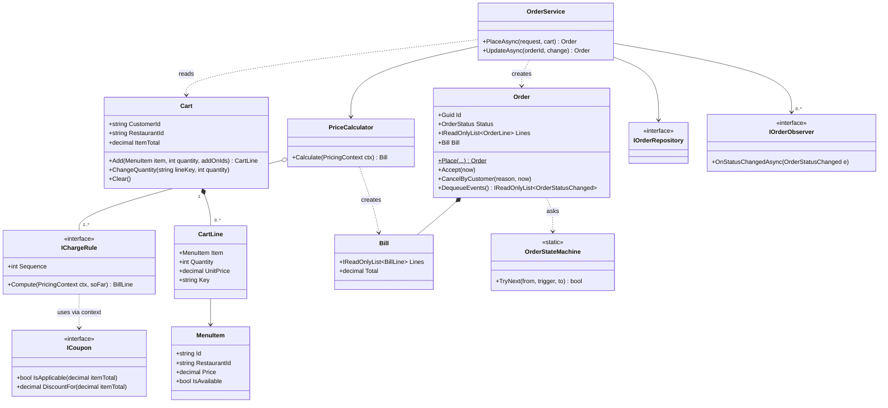
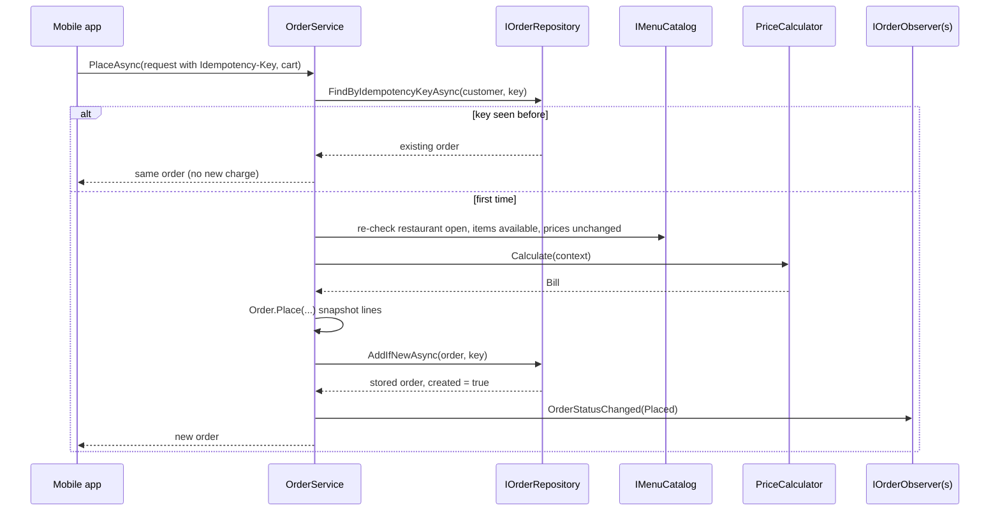
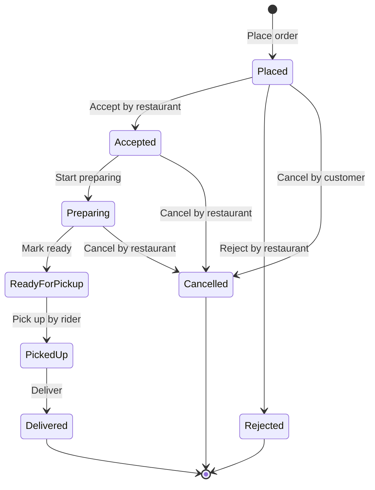
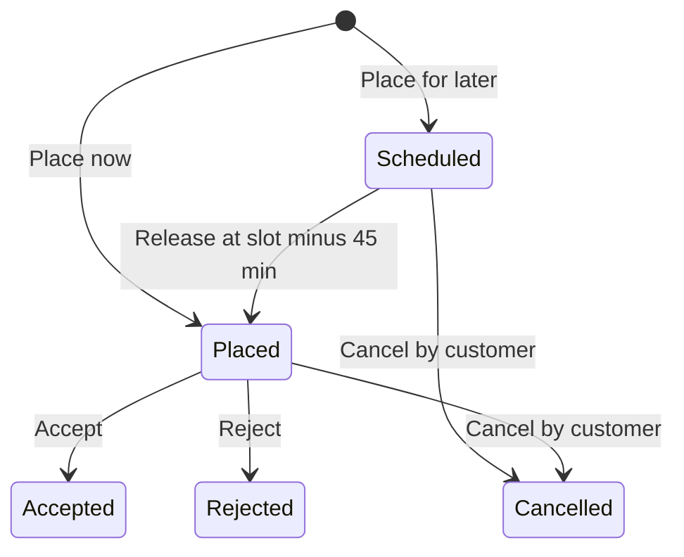

You open a food app at 8:40 pm, add two paneer tikkas and a butter naan from a dhaba in Sector 29, apply a coupon, and pay. Forty minutes later the food arrives. Behind that flow sit three small but tricky models: a **cart** with rules, a **bill** made of many charges, and an **order** that moves through a strict lifecycle. This case study designs all three and implements them in C#.

We stay at the object level here (low-level design). The distributed side — dispatching riders, live tracking, scaling to millions of orders — is the subject of the [food delivery HLD case](#/lesson/m17-food-delivery).

## Learning objectives

By the end of this case study you will be able to:

1. Turn a vague prompt ("design a food ordering system") into functional requirements, non-functional requirements and a short list of clarifying questions.
2. Identify the core classes (cart, cart line, bill, charge rule, order, order line) and give each one a single, clear responsibility.
3. Model the order lifecycle as a table-driven state machine that rejects illegal moves such as "deliver an order that was never accepted".
4. Build the bill as an ordered list of pluggable charge rules (Strategy), so adding a "small-order fee" is one new class.
5. Make checkout safe to retry with an idempotency key, and notify other parts of the system through observers without coupling them to the order.
6. Explain the trade-offs of each choice and when a simpler design is good enough.

## Prerequisites

- [State](#/lesson/m06-state): we compare class-per-state with a transition table.
- [Strategy](#/lesson/m06-strategy): every line on the bill is a strategy.
- [Observer](#/lesson/m06-observer): notifications and refunds react to order events.
- [Encapsulation and invariant protection](#/lesson/m07-encapsulation-invariants): the cart and order guard their own rules.

## Explain it like I'm a beginner

Think of a busy dhaba with a paper order pad.

- The **cart** is the waiter's notepad while you are still deciding. You can scribble, cross out, and change quantities. Nothing is final.
- The **bill** is the printed slip. It lists the food, then adds packing charges, a delivery fee and GST, and subtracts your coupon. Each line follows its own rule.
- The **order** is the ticket pinned on the kitchen rail. Once it is there, it moves only forward: *placed → accepted → cooking → ready → picked up → delivered*. A cook can't hand food to a rider before cooking it, and you can't cancel once the tandoor is fired up — only the kitchen can, say if they run out of paneer.

Three key ideas follow from this picture:

1. **The cart and the order are different things.** The cart is cheap to change. The order is a promise. When you place the order, we copy the item names and prices onto it (a snapshot), so a menu price change at 9 pm doesn't change a bill printed at 8:45.
2. **The bill is a stack of independent rules.** Packing fee, delivery fee, GST and coupon discount each live in their own small class (a charge rule, which is the Strategy pattern).
3. **The order's lifecycle is a fixed map of allowed moves** (a state machine). Every move is checked against the map. If it isn't on the map, it doesn't happen.

## Requirements

### Functional requirements

1. A customer browses one restaurant's menu and adds items to a cart. Items can have add-ons (extra cheese ₹40, extra raita ₹30).
2. A cart holds items from **one restaurant only**. Adding an item from a second restaurant is refused with a clear message.
3. The same item with the same add-ons merges into one line. The same item with different add-ons stays as separate lines.
4. A line's quantity is between 1 and 10.
5. At checkout the system builds a bill: item total, coupon discount, packaging charge, delivery fee and GST. Each charge is shown as its own line.
6. Placing an order re-checks that the restaurant is open and every item is still available at the same price.
7. The order moves through: Placed → Accepted → Preparing → ReadyForPickup → PickedUp → Delivered. The restaurant can reject a placed order. The customer can cancel only while the order is still Placed. The restaurant can cancel an accepted or preparing order (for example, an item ran out).
8. A rejected or cancelled order is refunded in full.
9. Every status change is recorded with a timestamp and triggers notifications.

### Non-functional requirements

- **Correctness over speed:** an illegal status change must be impossible, not just unlikely.
- **Safe retries:** if the "Place order" request times out on a weak 4G connection and the app retries, the customer must not get two orders or be charged twice.
- **Extensibility:** adding a new fee (rain surcharge, small-order fee) or a new notification must not touch the order class.
- **Testability:** time is injected (`TimeProvider`), so tests can check timestamps without waiting.
- **Money accuracy:** amounts use `decimal` and are rounded to 2 places with one shared rule.

### Clarifying questions to ask

In an interview, ask before you draw. Typical questions and the assumptions we make:

| Question | Our assumption |
|---|---|
| Can a cart mix restaurants? | No. One restaurant per cart, as most apps do, because one rider picks up from one kitchen. |
| Is payment part of this design? | Only as an interface. Payment is its own case study ([payment gateway](#/lesson/m18-payment-gateway)). |
| Do we model riders and dispatch? | Only the `PickUp(riderId)` transition. Dispatch is an HLD concern. |
| Who can cancel, and until when? | Customer: only before the restaurant accepts. Restaurant: until the food is picked up. |
| Are prices fixed at add-to-cart time or checkout time? | Checked again at checkout. If a price changed, the customer reviews the cart. |
| Is the delivery fee distance-based? | Yes: ₹30 up to 3 km, ₹8 for each extra km, free above ₹499 of food (illustrative numbers). |
| How many orders per second? | Not decisive at this level. We keep domain objects thread-safe through the repository. |

## Identifying classes and responsibilities

Start with nouns and verbs from the requirements, then merge, split and discard.

**Nouns:** customer, restaurant, menu, item, add-on, cart, line, quantity, coupon, bill, charge, fee, GST, order, status, rider, refund, notification.
**Verbs:** add to cart, change quantity, apply coupon, calculate bill, place order, accept, reject, prepare, mark ready, pick up, deliver, cancel, refund, notify.

| Class | Kind | Responsibility (one sentence) |
|---|---|---|
| `Restaurant` | record | Says whether the kitchen accepts orders and its packaging fee per item. |
| `MenuItem`, `AddOn` | records | Describe what can be ordered and at what price. |
| `Cart` | entity | Holds the customer's undecided choices and enforces cart rules (one restaurant, merge lines, max 10). |
| `CartLine` | entity (owned by cart) | One item plus its chosen add-ons and quantity; knows its unit price. |
| `ICoupon` (`PercentCoupon`, `FlatCoupon`) | strategy | Decides whether a coupon applies and how much it takes off. |
| `IChargeRule` (5 implementations) | strategy | Produces one line of the bill. |
| `PriceCalculator` | domain service | Runs the charge rules in order and returns a `Bill`. |
| `Bill`, `BillLine` | value objects | An immutable list of charges and the total. |
| `Order` | aggregate root | Snapshot of what was bought, plus the lifecycle; the only place that changes status. |
| `OrderLine` | value object | Name, add-ons, unit price and quantity copied at checkout. |
| `OrderStateMachine` | static table | The single list of legal transitions. |
| `OrderStatusChanged` | domain event | "Order X moved from A to B at time T, refund R." |
| `IOrderObserver` | observer | Reacts to status changes (push notifications, refunds). |
| `IOrderRepository` | repository | Stores orders, enforces idempotency keys, serialises updates per order. |
| `OrderService` | application service | Orchestrates checkout and status changes; owns no business rules itself. |

Discarded or deferred: `Customer` (an id is enough here), `Rider` (an id is enough), `Menu` (a catalog lookup is enough), `Payment` (separate case study).

:::callout type=tip title="One test for a good responsibility"
If you can't describe a class in one sentence without the word "and", it probably has two jobs. "Order holds the snapshot **and** sends push notifications" is a red flag. That is exactly why notifications live in an observer.
:::

## Class diagram



How to read it. The **cart** owns its lines (filled diamond: lines die with the cart). The **price calculator** holds a list of charge rules (hollow diamond: rules live independently and are shared by every calculation). The **order** owns its bill and asks the static state machine whether a move is legal. The **order service** sits on top and talks to everything, but nothing below it knows the service exists. That one-way direction is what keeps the domain testable without a web server or a database.

Notice what is *not* connected: `Order` has no arrow to `Cart`. The order copies what it needs at checkout and then forgets the cart. If it kept a reference, clearing the cart after checkout would quietly empty the order.

### Checkout sequence



The diagram shows the two checks that make checkout safe. The first lookup handles the common retry case cheaply. `AddIfNewAsync` handles the rare race where two retries arrive at the same moment: the repository stores the key and the order atomically, so only one wins. Observers run only after the order is safely stored.

## Patterns and design decisions

### 1. State — as a transition table, not a class per state

The [State pattern](#/lesson/m06-state) classically puts each state in its own class (`PlacedState`, `AcceptedState`...). That pays off when each state has **different behaviour** — for example, a vending machine that does different things with a coin in each state. Our order has eight states but almost no per-state behaviour; what differs is only *which moves are allowed*. A dictionary of `(from, trigger) → to` captures that in nine lines, can be printed as documentation, and can be tested exhaustively.

We still get the benefits of State: one place owns the rules, and the order can't be put into an illegal status because `Status` has a private setter.

:::callout type=tradeoff title="When to switch to class-per-state"
Move to state classes when states start carrying their own logic: "in Preparing, recompute the ETA every minute", "in ReadyForPickup, start a 10-minute rider timeout". Until then, the table is simpler and easier to review.
:::

### 2. Strategy — one charge rule per bill line

Each bill line is an `IChargeRule` with a `Sequence` number. The calculator sorts rules by sequence and runs them, passing the lines computed so far. GST needs the discounted food value, so it runs after the coupon. Adding a "rain surcharge ₹20" is one class and one DI registration; nothing else changes. That is the [Open/Closed Principle](#/lesson/m04-ocp) at work.

Coupons are a second, smaller strategy family (`PercentCoupon`, `FlatCoupon`). They don't produce bill lines themselves; the `CouponDiscountRule` asks the chosen coupon for an amount.

### 3. Observer — reacting to status changes

When an order changes status, the order records an `OrderStatusChanged` event in a private list. The service collects these after the change is stored and passes each to every `IOrderObserver`. Push notifications and refunds are observers. The order doesn't know they exist.

Two deliberate choices:

- **Events are collected, not fired immediately.** If the order fired events while changing, an observer could run before the change was saved, and a crash in between would notify the customer about something that never happened.
- **An observer failure doesn't undo the order.** The status change is already a fact. We log the failure. In production you'd write events to an outbox table in the same transaction and deliver them with a background worker (see [transactional outbox](#/lesson/m12-outbox)).

### 4. Factory method — `Order.Place`

The order has a private constructor and a static `Place` method. `Place` validates the cart, copies lines into immutable `OrderLine` snapshots and sets the initial status. There is exactly one way to create a valid order.

### 5. Snapshot instead of reference

`OrderLine` copies the item name, add-on names and unit price. This decision matters more than any pattern: GST invoices, refunds and support disputes all need "what did the customer see and pay", not "what does the menu say today".

### 6. Idempotency at the repository boundary

The client sends an `Idempotency-Key` header (a UUID created when the user taps "Place order"). The repository stores `(customerId, key) → orderId` atomically with the order. A repeated key returns the first order. See [idempotency keys](#/lesson/m10-idempotency) for the HTTP side.

### 7. Serialised updates per order

A restaurant tablet taps "Accept" at the same second the customer taps "Cancel". Both read status `Placed`; without care, both succeed. Our repository applies each change inside a lock, so one change runs first and the other sees the new status and fails with an `InvalidOrderTransitionException`. In PostgreSQL the same guarantee comes from a version column:

```sql
UPDATE orders SET status = 'Accepted', version = version + 1
WHERE id = $1 AND version = $2;   -- 0 rows updated means someone else changed it first
```

## State transitions



Read each arrow as "from this status, this trigger leads to that status". Anything not drawn is illegal. Some consequences worth saying out loud:

- **Three terminal states:** Delivered, Rejected and Cancelled. No arrow leaves them, so a delivered order can't be "cancelled" for a refund. Refunds after delivery are a separate support process with its own model.
- **The customer's cancel arrow exists only from Placed.** Once the kitchen accepts, cancelling costs the restaurant real food, so the business rule moves that decision to the restaurant.
- **ReadyForPickup can't be cancelled** in our version. Cooked food waiting at the counter is a support case. You might add an arrow later; it would be one line in the table.

The table in code mirrors this diagram one-to-one, which makes code review simple: a reviewer can hold the diagram next to the dictionary and tick off each arrow.

## C# implementation

Project layout (one ASP.NET Core project; tests in a separate xUnit project):

```text
FoodOrdering.Api/
  Program.cs
  Domain/Menu.cs
  Domain/Cart.cs
  Domain/Pricing.cs
  Domain/Order.cs
  Application/OrderService.cs
  Infrastructure/InMemoryStores.cs
FoodOrdering.Tests/
```

### Menu and cart

```csharp file=Domain/Menu.cs
namespace FoodOrdering;

public sealed record AddOn(string Id, string Name, decimal Price);

public sealed record MenuItem(string Id, string RestaurantId, string Name, decimal Price, bool IsAvailable, IReadOnlyList<AddOn> AddOns)
{
    public AddOn GetAddOn(string addOnId) =>
        AddOns.FirstOrDefault(a => a.Id == addOnId)
        ?? throw new ArgumentException($"Add-on '{addOnId}' is not offered for {Name}.", nameof(addOnId));
}

public sealed record Restaurant(string Id, string Name, bool IsAcceptingOrders, decimal PackagingFeePerItem);

public interface IMenuCatalog
{
    Restaurant? GetRestaurant(string restaurantId);
    MenuItem? GetItem(string menuItemId);
}
```

```csharp file=Domain/Cart.cs
namespace FoodOrdering;

/// <summary>A business-rule violation the customer can fix (shown as a friendly message).</summary>
public sealed class CartException(string message) : Exception(message);

public sealed class CartLine
{
    internal CartLine(MenuItem item, IReadOnlyList<AddOn> addOns, int quantity)
    {
        Item = item;
        AddOns = addOns;
        Quantity = quantity;
        Key = MakeKey(item.Id, addOns);
    }

    public MenuItem Item { get; }
    public IReadOnlyList<AddOn> AddOns { get; }
    public int Quantity { get; internal set; }
    /// <summary>Identifies "same item with the same add-ons", e.g. "m1|a1,a2".</summary>
    public string Key { get; }
    public decimal UnitPrice => Item.Price + AddOns.Sum(a => a.Price);
    public decimal LineTotal => UnitPrice * Quantity;

    internal static string MakeKey(string itemId, IEnumerable<AddOn> addOns) =>
        itemId + "|" + string.Join(",", addOns.Select(a => a.Id).Order(StringComparer.Ordinal));
}

public sealed class Cart(string customerId)
{
    public const int MaxQuantityPerLine = 10;
    private readonly List<CartLine> _lines = [];

    public string CustomerId { get; } = customerId;
    public string? RestaurantId { get; private set; }
    public IReadOnlyList<CartLine> Lines => _lines;
    public bool IsEmpty => _lines.Count == 0;
    public int ItemCount => _lines.Sum(l => l.Quantity);
    public decimal ItemTotal => _lines.Sum(l => l.LineTotal);

    public CartLine Add(MenuItem item, int quantity = 1, params string[] addOnIds)
    {
        ArgumentNullException.ThrowIfNull(item);
        ArgumentOutOfRangeException.ThrowIfNegativeOrZero(quantity);
        if (!item.IsAvailable) throw new CartException($"{item.Name} is not available right now.");
        if (RestaurantId is not null && RestaurantId != item.RestaurantId)
            throw new CartException("Your cart has items from another restaurant. Clear it to add this item.");

        var addOns = addOnIds.Distinct().Select(item.GetAddOn).OrderBy(a => a.Id, StringComparer.Ordinal).ToList();
        var key = CartLine.MakeKey(item.Id, addOns);
        var existing = _lines.FirstOrDefault(l => l.Key == key);
        var newQuantity = (existing?.Quantity ?? 0) + quantity;
        if (newQuantity > MaxQuantityPerLine)
            throw new CartException($"You can order at most {MaxQuantityPerLine} of {item.Name}.");

        if (existing is not null)
        {
            existing.Quantity = newQuantity;
            return existing;
        }
        var line = new CartLine(item, addOns, quantity);
        _lines.Add(line);
        RestaurantId = item.RestaurantId;
        return line;
    }

    public void ChangeQuantity(string lineKey, int quantity)
    {
        var line = _lines.FirstOrDefault(l => l.Key == lineKey) ?? throw new KeyNotFoundException($"No cart line {lineKey}.");
        if (quantity > MaxQuantityPerLine) throw new CartException($"You can order at most {MaxQuantityPerLine} of {line.Item.Name}.");
        if (quantity <= 0) { _lines.Remove(line); if (IsEmpty) RestaurantId = null; return; }
        line.Quantity = quantity;
    }

    public void Clear()
    {
        _lines.Clear();
        RestaurantId = null;
    }
}
```

`Quantity` has an `internal` setter, so only code in this project (the cart) can change it. Outside callers must go through `Cart.Add` or `ChangeQuantity`, where the rules live.

### The bill: charge rules and coupons

```csharp file=Domain/Pricing.cs
using Microsoft.Extensions.Options;

namespace FoodOrdering;

public static class Money
{
    /// <summary>The one rounding rule for rupee amounts in this system.</summary>
    public static decimal Round(decimal amount) => Math.Round(amount, 2, MidpointRounding.AwayFromZero);
}

public sealed record BillLine(string Code, string Label, decimal Amount);

public sealed record Bill(IReadOnlyList<BillLine> Lines)
{
    public decimal Total => Lines.Sum(l => l.Amount);
    public decimal AmountOf(string code) => Lines.Where(l => l.Code == code).Sum(l => l.Amount);
}

public interface ICoupon
{
    string Code { get; }
    decimal MinOrder { get; }
    bool IsApplicable(decimal itemTotal);
    decimal DiscountFor(decimal itemTotal);
}

public sealed record PercentCoupon(string Code, decimal Percent, decimal MaxDiscount, decimal MinOrder) : ICoupon
{
    public bool IsApplicable(decimal itemTotal) => itemTotal >= MinOrder;
    public decimal DiscountFor(decimal itemTotal) => IsApplicable(itemTotal) ? Math.Min(itemTotal * Percent / 100m, MaxDiscount) : 0m;
}

public sealed record FlatCoupon(string Code, decimal Amount, decimal MinOrder) : ICoupon
{
    public bool IsApplicable(decimal itemTotal) => itemTotal >= MinOrder;
    public decimal DiscountFor(decimal itemTotal) => IsApplicable(itemTotal) ? Math.Min(Amount, itemTotal) : 0m;
}

public interface ICouponRepository
{
    ICoupon? Find(string code);
}

public sealed record PricingContext(Cart Cart, Restaurant Restaurant, decimal DistanceKm, ICoupon? Coupon);

/// <summary>Produces one line of the bill. Rules run in ascending Sequence and can read earlier lines.</summary>
public interface IChargeRule
{
    int Sequence { get; }
    BillLine? Compute(PricingContext ctx, IReadOnlyList<BillLine> soFar);
}

public sealed class ItemTotalRule : IChargeRule
{
    public const string Code = "ITEMS";
    public int Sequence => 10;
    public BillLine? Compute(PricingContext ctx, IReadOnlyList<BillLine> soFar) => new(Code, "Item total", ctx.Cart.ItemTotal);
}

public sealed class CouponDiscountRule : IChargeRule
{
    public const string Code = "DISCOUNT";
    public int Sequence => 20;
    public BillLine? Compute(PricingContext ctx, IReadOnlyList<BillLine> soFar)
    {
        if (ctx.Coupon is null) return null;
        var discount = ctx.Coupon.DiscountFor(ctx.Cart.ItemTotal);
        return discount > 0 ? new BillLine(Code, $"Coupon {ctx.Coupon.Code}", -discount) : null;
    }
}

public sealed class PackagingChargeRule : IChargeRule
{
    public int Sequence => 30;
    public BillLine? Compute(PricingContext ctx, IReadOnlyList<BillLine> soFar) =>
        new("PACKAGING", "Packaging", ctx.Restaurant.PackagingFeePerItem * ctx.Cart.ItemCount);
}

public sealed class DeliveryFeeOptions
{
    public decimal BaseFee { get; set; } = 30m;
    public decimal BaseKm { get; set; } = 3m;
    public decimal PerExtraKm { get; set; } = 8m;
    public decimal FreeAboveItemTotal { get; set; } = 499m;
}

public sealed class DeliveryFeeRule(IOptions<DeliveryFeeOptions> options) : IChargeRule
{
    private readonly DeliveryFeeOptions _o = options.Value;
    public int Sequence => 40;

    public BillLine? Compute(PricingContext ctx, IReadOnlyList<BillLine> soFar)
    {
        if (ctx.Cart.ItemTotal >= _o.FreeAboveItemTotal) return null;
        var extraKm = Math.Ceiling(Math.Max(0m, ctx.DistanceKm - _o.BaseKm));
        return new BillLine("DELIVERY", "Delivery fee", _o.BaseFee + extraKm * _o.PerExtraKm);
    }
}

/// <summary>Illustrative 5 % GST on the food value after discount. Real tax rules need a tax specialist.</summary>
public sealed class FoodGstRule : IChargeRule
{
    public const decimal Rate = 0.05m;
    public int Sequence => 50;

    public BillLine? Compute(PricingContext ctx, IReadOnlyList<BillLine> soFar)
    {
        var foodValue = soFar.Where(l => l.Code is ItemTotalRule.Code or CouponDiscountRule.Code).Sum(l => l.Amount);
        return new BillLine("GST_FOOD", "GST on food (5%)", foodValue * Rate);
    }
}

public sealed class PriceCalculator(IEnumerable<IChargeRule> rules)
{
    private readonly IReadOnlyList<IChargeRule> _rules = rules.OrderBy(r => r.Sequence).ToList();

    public Bill Calculate(PricingContext ctx)
    {
        ArgumentNullException.ThrowIfNull(ctx);
        var lines = new List<BillLine>();
        foreach (var rule in _rules)
        {
            var line = rule.Compute(ctx, lines);
            if (line is not null && line.Amount != 0m) lines.Add(line with { Amount = Money.Round(line.Amount) });
        }
        var bill = new Bill(lines);
        if (bill.Total < 0) throw new InvalidOperationException("A bill total can never be negative.");
        return bill;
    }
}
```

Rules receive a **read-only** view of earlier lines. They can depend on earlier results (GST reads the discount) but can't rewrite them. Rounding happens once, in the calculator, so every rule produces raw amounts and the rounding rule can't drift between classes.

### The order and its state machine

```csharp file=Domain/Order.cs
namespace FoodOrdering;

public enum OrderStatus { Placed, Accepted, Preparing, ReadyForPickup, PickedUp, Delivered, Rejected, Cancelled }

public enum OrderTrigger { Accept, Reject, StartPreparing, MarkReady, PickUp, Deliver, CancelByCustomer, CancelByRestaurant }

public static class OrderStateMachine
{
    private static readonly Dictionary<(OrderStatus From, OrderTrigger Trigger), OrderStatus> Transitions = new()
    {
        [(OrderStatus.Placed, OrderTrigger.Accept)] = OrderStatus.Accepted,
        [(OrderStatus.Placed, OrderTrigger.Reject)] = OrderStatus.Rejected,
        [(OrderStatus.Placed, OrderTrigger.CancelByCustomer)] = OrderStatus.Cancelled,
        [(OrderStatus.Accepted, OrderTrigger.StartPreparing)] = OrderStatus.Preparing,
        [(OrderStatus.Accepted, OrderTrigger.CancelByRestaurant)] = OrderStatus.Cancelled,
        [(OrderStatus.Preparing, OrderTrigger.MarkReady)] = OrderStatus.ReadyForPickup,
        [(OrderStatus.Preparing, OrderTrigger.CancelByRestaurant)] = OrderStatus.Cancelled,
        [(OrderStatus.ReadyForPickup, OrderTrigger.PickUp)] = OrderStatus.PickedUp,
        [(OrderStatus.PickedUp, OrderTrigger.Deliver)] = OrderStatus.Delivered,
    };

    public static bool TryNext(OrderStatus from, OrderTrigger trigger, out OrderStatus to) =>
        Transitions.TryGetValue((from, trigger), out to);

    public static IReadOnlyList<OrderTrigger> AllowedTriggers(OrderStatus from) =>
        Transitions.Keys.Where(k => k.From == from).Select(k => k.Trigger).ToList();

    public static bool IsTerminal(OrderStatus status) => AllowedTriggers(status).Count == 0;
}

public sealed class InvalidOrderTransitionException(OrderStatus from, OrderTrigger trigger)
    : InvalidOperationException($"Cannot {trigger} an order that is {from}.")
{
    public OrderStatus From { get; } = from;
    public OrderTrigger Trigger { get; } = trigger;
}

public sealed record OrderLine(string MenuItemId, string Name, IReadOnlyList<string> AddOnNames, decimal UnitPrice, int Quantity)
{
    public decimal LineTotal => UnitPrice * Quantity;
}

public sealed record StatusChange(OrderStatus? From, OrderStatus To, OrderTrigger? Trigger, DateTimeOffset At, string? Note);

public sealed record OrderStatusChanged(Guid OrderId, string CustomerId, string RestaurantId,
    OrderStatus? From, OrderStatus To, decimal RefundAmount, DateTimeOffset At);

public sealed class Order
{
    private readonly List<StatusChange> _history = [];
    private readonly List<OrderStatusChanged> _events = [];

    private Order(Guid id, string customerId, string restaurantId, IReadOnlyList<OrderLine> lines, Bill bill,
        string deliveryAddress, DateTimeOffset placedAt)
    {
        Id = id;
        CustomerId = customerId;
        RestaurantId = restaurantId;
        Lines = lines;
        Bill = bill;
        DeliveryAddress = deliveryAddress;
        PlacedAt = placedAt;
        Status = OrderStatus.Placed;
        _history.Add(new StatusChange(null, OrderStatus.Placed, null, placedAt, null));
        _events.Add(new OrderStatusChanged(id, customerId, restaurantId, null, OrderStatus.Placed, 0m, placedAt));
    }

    public Guid Id { get; }
    public string CustomerId { get; }
    public string RestaurantId { get; }
    public IReadOnlyList<OrderLine> Lines { get; }
    public Bill Bill { get; }
    public string DeliveryAddress { get; }
    public DateTimeOffset PlacedAt { get; }
    public OrderStatus Status { get; private set; }
    public string? RiderId { get; private set; }
    public int Version { get; private set; }
    public IReadOnlyList<StatusChange> History => _history;

    /// <summary>Policy: rejected or cancelled orders are refunded in full (customers can only cancel before acceptance).</summary>
    public decimal RefundDue => Status is OrderStatus.Rejected or OrderStatus.Cancelled ? Bill.Total : 0m;

    public static Order Place(Guid id, Cart cart, Bill bill, string deliveryAddress, DateTimeOffset now)
    {
        ArgumentNullException.ThrowIfNull(cart);
        ArgumentNullException.ThrowIfNull(bill);
        ArgumentException.ThrowIfNullOrWhiteSpace(deliveryAddress);
        if (cart.IsEmpty || cart.RestaurantId is null) throw new InvalidOperationException("Cannot place an order from an empty cart.");

        var lines = cart.Lines
            .Select(l => new OrderLine(l.Item.Id, l.Item.Name, l.AddOns.Select(a => a.Name).ToList(), l.UnitPrice, l.Quantity))
            .ToList();
        return new Order(id, cart.CustomerId, cart.RestaurantId, lines, bill, deliveryAddress, now);
    }

    public bool Can(OrderTrigger trigger) => OrderStateMachine.TryNext(Status, trigger, out _);

    public void Accept(DateTimeOffset now) => Fire(OrderTrigger.Accept, now);
    public void Reject(string reason, DateTimeOffset now) => Fire(OrderTrigger.Reject, now, reason);
    public void StartPreparing(DateTimeOffset now) => Fire(OrderTrigger.StartPreparing, now);
    public void MarkReady(DateTimeOffset now) => Fire(OrderTrigger.MarkReady, now);
    public void Deliver(DateTimeOffset now) => Fire(OrderTrigger.Deliver, now);
    public void CancelByCustomer(string reason, DateTimeOffset now) => Fire(OrderTrigger.CancelByCustomer, now, reason);
    public void CancelByRestaurant(string reason, DateTimeOffset now) => Fire(OrderTrigger.CancelByRestaurant, now, reason);

    public void PickUp(string riderId, DateTimeOffset now)
    {
        ArgumentException.ThrowIfNullOrWhiteSpace(riderId);
        Fire(OrderTrigger.PickUp, now, $"rider {riderId}");
        RiderId = riderId;
    }

    /// <summary>Returns and clears the events raised since the last call. Called by the application layer after saving.</summary>
    public IReadOnlyList<OrderStatusChanged> DequeueEvents()
    {
        var copy = _events.ToList();
        _events.Clear();
        return copy;
    }

    private void Fire(OrderTrigger trigger, DateTimeOffset now, string? note = null)
    {
        if (!OrderStateMachine.TryNext(Status, trigger, out var next)) throw new InvalidOrderTransitionException(Status, trigger);
        var from = Status;
        Status = next;
        Version++;
        _history.Add(new StatusChange(from, next, trigger, now, note));
        _events.Add(new OrderStatusChanged(Id, CustomerId, RestaurantId, from, next, RefundDue, now));
    }
}
```

Every public action is a thin, well-named wrapper around one private `Fire` method. Callers read like the business (`order.Accept(now)`), and all rules go through one gate. Time is passed in as a value. The order doesn't read the clock, so it stays a pure, deterministic object.

### Application service

```csharp file=Application/OrderService.cs
using Microsoft.Extensions.Logging;

namespace FoodOrdering;

public sealed record PlaceOrderRequest(string CustomerId, string DeliveryAddress, decimal DistanceKm, string? CouponCode, string IdempotencyKey);

public interface IOrderRepository
{
    Task<Order?> GetAsync(Guid id, CancellationToken ct);
    Task<Order?> FindByIdempotencyKeyAsync(string customerId, string idempotencyKey, CancellationToken ct);
    /// <summary>Atomically stores the order and its idempotency key. If the key already exists, returns the earlier order.</summary>
    Task<(Order Order, bool Created)> AddIfNewAsync(Order order, string idempotencyKey, CancellationToken ct);
    /// <summary>Applies a change to one order with no concurrent change in between, and returns the events it raised.</summary>
    Task<(Order Order, IReadOnlyList<OrderStatusChanged> Events)> UpdateAsync(Guid id, Action<Order> change, CancellationToken ct);
}

public interface IOrderObserver
{
    Task OnStatusChangedAsync(OrderStatusChanged e, CancellationToken ct);
}

public sealed class OrderService(
    IMenuCatalog catalog,
    ICouponRepository coupons,
    PriceCalculator calculator,
    IOrderRepository orders,
    IEnumerable<IOrderObserver> observers,
    TimeProvider clock,
    ILogger<OrderService> logger)
{
    private readonly IReadOnlyList<IOrderObserver> _observers = observers.ToList();

    public async Task<Order> PlaceAsync(PlaceOrderRequest request, Cart cart, CancellationToken ct = default)
    {
        ArgumentNullException.ThrowIfNull(request);
        ArgumentNullException.ThrowIfNull(cart);
        ArgumentException.ThrowIfNullOrWhiteSpace(request.IdempotencyKey);

        var previous = await orders.FindByIdempotencyKeyAsync(request.CustomerId, request.IdempotencyKey, ct);
        if (previous is not null) return previous;                 // a retry of a request we already handled

        if (cart.CustomerId != request.CustomerId) throw new CartException("This cart belongs to another customer.");
        if (cart.IsEmpty) throw new CartException("Your cart is empty.");

        var restaurant = catalog.GetRestaurant(cart.RestaurantId!) ?? throw new CartException("Restaurant not found.");
        if (!restaurant.IsAcceptingOrders) throw new CartException($"{restaurant.Name} is not accepting orders right now.");

        foreach (var line in cart.Lines)
        {
            var current = catalog.GetItem(line.Item.Id);
            if (current is null || !current.IsAvailable) throw new CartException($"{line.Item.Name} is no longer available.");
            if (current.Price != line.Item.Price) throw new CartException($"The price of {line.Item.Name} changed. Please review your cart.");
        }

        ICoupon? coupon = null;
        if (!string.IsNullOrWhiteSpace(request.CouponCode))
        {
            coupon = coupons.Find(request.CouponCode) ?? throw new CartException($"Coupon {request.CouponCode} does not exist.");
            if (!coupon.IsApplicable(cart.ItemTotal))
                throw new CartException($"Coupon {coupon.Code} needs a minimum order of ₹{coupon.MinOrder}.");
        }

        var bill = calculator.Calculate(new PricingContext(cart, restaurant, request.DistanceKm, coupon));
        var order = Order.Place(Guid.NewGuid(), cart, bill, request.DeliveryAddress, clock.GetUtcNow());
        var events = order.DequeueEvents();

        var (stored, created) = await orders.AddIfNewAsync(order, request.IdempotencyKey, ct);
        if (!created) return stored;                               // lost a race with an identical retry

        cart.Clear();
        await PublishAsync(events, ct);
        logger.LogInformation("Order {OrderId} placed by {CustomerId}, total {Total}", stored.Id, stored.CustomerId, stored.Bill.Total);
        return stored;
    }

    /// <summary>Runs one status change, e.g. <c>(o, now) =&gt; o.Accept(now)</c>, then notifies observers.</summary>
    public async Task<Order> UpdateAsync(Guid orderId, Action<Order, DateTimeOffset> change, CancellationToken ct = default)
    {
        var now = clock.GetUtcNow();
        var (order, events) = await orders.UpdateAsync(orderId, o => change(o, now), ct);
        await PublishAsync(events, ct);
        return order;
    }

    private async Task PublishAsync(IReadOnlyList<OrderStatusChanged> events, CancellationToken ct)
    {
        foreach (var e in events)
            foreach (var observer in _observers)
            {
                try { await observer.OnStatusChangedAsync(e, ct); }
                catch (Exception ex) when (ex is not OperationCanceledException)
                {
                    // The status change is already stored; an observer failure must not undo it.
                    logger.LogError(ex, "Observer {Observer} failed for order {OrderId} -> {Status}", observer.GetType().Name, e.OrderId, e.To);
                }
            }
    }
}

public interface IRefundGateway
{
    Task RefundAsync(Guid orderId, decimal amount, CancellationToken ct);
}

public sealed class RefundOnCancellation(IRefundGateway refunds) : IOrderObserver
{
    public Task OnStatusChangedAsync(OrderStatusChanged e, CancellationToken ct) =>
        e.RefundAmount > 0 ? refunds.RefundAsync(e.OrderId, e.RefundAmount, ct) : Task.CompletedTask;
}

public sealed class CustomerPushNotifier(ILogger<CustomerPushNotifier> logger) : IOrderObserver
{
    public Task OnStatusChangedAsync(OrderStatusChanged e, CancellationToken ct)
    {
        var text = e.To switch
        {
            OrderStatus.Placed => "Order placed. Waiting for the restaurant.",
            OrderStatus.Accepted => "The restaurant accepted your order.",
            OrderStatus.Preparing => "Your food is being prepared.",
            OrderStatus.PickedUp => "Your rider is on the way.",
            OrderStatus.Delivered => "Delivered. Enjoy your meal!",
            OrderStatus.Rejected or OrderStatus.Cancelled => $"Order cancelled. ₹{e.RefundAmount} will be refunded.",
            _ => null,
        };
        if (text is not null) logger.LogInformation("Push to {CustomerId}: {Text}", e.CustomerId, text);
        return Task.CompletedTask;
    }
}
```

The service contains orchestration only: look up, check, calculate, create, store, publish. Every business rule it uses lives in a domain class. A good test of that: you could replace ASP.NET Core with a console app and the rules wouldn't move.

### In-memory infrastructure and wiring

```csharp file=Infrastructure/InMemoryStores.cs
using System.Collections.Concurrent;
using Microsoft.Extensions.Logging;

namespace FoodOrdering;

public sealed class InMemoryMenuCatalog : IMenuCatalog
{
    private readonly Dictionary<string, Restaurant> _restaurants = new()
    {
        ["r1"] = new Restaurant("r1", "Sector 29 Dhaba", IsAcceptingOrders: true, PackagingFeePerItem: 10m),
    };
    private readonly Dictionary<string, MenuItem> _items = new()
    {
        ["m1"] = new MenuItem("m1", "r1", "Paneer Tikka", 250m, true, [new AddOn("a1", "Extra cheese", 40m)]),
        ["m2"] = new MenuItem("m2", "r1", "Butter Naan", 60m, true, []),
    };
    public Restaurant? GetRestaurant(string restaurantId) => _restaurants.GetValueOrDefault(restaurantId);
    public MenuItem? GetItem(string menuItemId) => _items.GetValueOrDefault(menuItemId);
}

public sealed class InMemoryCouponRepository : ICouponRepository
{
    private readonly Dictionary<string, ICoupon> _coupons = new(StringComparer.OrdinalIgnoreCase)
    {
        ["SAVE20"] = new PercentCoupon("SAVE20", Percent: 20m, MaxDiscount: 100m, MinOrder: 300m),
        ["FLAT50"] = new FlatCoupon("FLAT50", Amount: 50m, MinOrder: 199m),
    };
    public ICoupon? Find(string code) => _coupons.GetValueOrDefault(code);
}

public interface ICartStore
{
    Cart GetOrCreate(string customerId);
}

public sealed class InMemoryCartStore : ICartStore
{
    private readonly ConcurrentDictionary<string, Cart> _carts = new();
    public Cart GetOrCreate(string customerId) => _carts.GetOrAdd(customerId, id => new Cart(id));
}

/// <summary>Single-process store. A PostgreSQL version uses a unique index on (customer_id, idempotency_key)
/// and an optimistic version column instead of a lock.</summary>
public sealed class InMemoryOrderRepository : IOrderRepository
{
    private readonly Dictionary<Guid, Order> _orders = new();
    private readonly Dictionary<(string CustomerId, string Key), Guid> _keys = new();
    private readonly Lock _gate = new();

    public Task<Order?> GetAsync(Guid id, CancellationToken ct)
    {
        lock (_gate) return Task.FromResult(_orders.GetValueOrDefault(id));
    }

    public Task<Order?> FindByIdempotencyKeyAsync(string customerId, string idempotencyKey, CancellationToken ct)
    {
        lock (_gate)
            return Task.FromResult(_keys.TryGetValue((customerId, idempotencyKey), out var id) ? _orders[id] : null);
    }

    public Task<(Order Order, bool Created)> AddIfNewAsync(Order order, string idempotencyKey, CancellationToken ct)
    {
        lock (_gate)
        {
            if (_keys.TryGetValue((order.CustomerId, idempotencyKey), out var existingId))
                return Task.FromResult((_orders[existingId], false));
            _orders.Add(order.Id, order);
            _keys[(order.CustomerId, idempotencyKey)] = order.Id;
            return Task.FromResult((order, true));
        }
    }

    public Task<(Order Order, IReadOnlyList<OrderStatusChanged> Events)> UpdateAsync(Guid id, Action<Order> change, CancellationToken ct)
    {
        lock (_gate)
        {
            if (!_orders.TryGetValue(id, out var order)) throw new KeyNotFoundException($"Order {id} not found.");
            change(order);
            return Task.FromResult((order, order.DequeueEvents()));
        }
    }
}

public sealed class LoggingRefundGateway(ILogger<LoggingRefundGateway> logger) : IRefundGateway
{
    public Task RefundAsync(Guid orderId, decimal amount, CancellationToken ct)
    {
        logger.LogInformation("Refund of {Amount} requested for order {OrderId}", amount, orderId);
        return Task.CompletedTask;
    }
}
```

```csharp file=Program.cs
using FoodOrdering;
using Microsoft.AspNetCore.Mvc;

var builder = WebApplication.CreateBuilder(args);

builder.Services.AddSingleton(TimeProvider.System);
builder.Services.Configure<DeliveryFeeOptions>(builder.Configuration.GetSection("Delivery"));

// Bill lines: order of registration doesn't matter, Sequence does.
builder.Services.AddSingleton<IChargeRule, ItemTotalRule>();
builder.Services.AddSingleton<IChargeRule, CouponDiscountRule>();
builder.Services.AddSingleton<IChargeRule, PackagingChargeRule>();
builder.Services.AddSingleton<IChargeRule, DeliveryFeeRule>();
builder.Services.AddSingleton<IChargeRule, FoodGstRule>();
builder.Services.AddSingleton<PriceCalculator>();

builder.Services.AddSingleton<IMenuCatalog, InMemoryMenuCatalog>();
builder.Services.AddSingleton<ICouponRepository, InMemoryCouponRepository>();
builder.Services.AddSingleton<ICartStore, InMemoryCartStore>();
builder.Services.AddSingleton<IOrderRepository, InMemoryOrderRepository>();
builder.Services.AddSingleton<IRefundGateway, LoggingRefundGateway>();
builder.Services.AddSingleton<IOrderObserver, CustomerPushNotifier>();
builder.Services.AddSingleton<IOrderObserver, RefundOnCancellation>();
builder.Services.AddSingleton<OrderService>();

var app = builder.Build();

app.MapPost("/customers/{customerId}/cart/items", (string customerId, AddToCartDto dto, ICartStore carts, IMenuCatalog catalog) =>
{
    var item = catalog.GetItem(dto.MenuItemId);
    if (item is null) return Results.NotFound();
    var cart = carts.GetOrCreate(customerId);
    try
    {
        cart.Add(item, dto.Quantity, dto.AddOnIds ?? []);
        return Results.Ok(new { cart.RestaurantId, cart.ItemCount, cart.ItemTotal });
    }
    catch (CartException ex) { return Results.Problem(ex.Message, statusCode: StatusCodes.Status409Conflict); }
});

app.MapPost("/customers/{customerId}/orders", async (string customerId, PlaceOrderDto dto,
    [FromHeader(Name = "Idempotency-Key")] string idempotencyKey, ICartStore carts, OrderService orders, CancellationToken ct) =>
{
    try
    {
        var request = new PlaceOrderRequest(customerId, dto.DeliveryAddress, dto.DistanceKm, dto.CouponCode, idempotencyKey);
        var order = await orders.PlaceAsync(request, carts.GetOrCreate(customerId), ct);
        return Results.Ok(new { order.Id, Status = order.Status.ToString(), order.Bill });
    }
    catch (CartException ex) { return Results.Problem(ex.Message, statusCode: StatusCodes.Status409Conflict); }
});

// In a real system, authorization policies make sure only the restaurant can accept and only the customer can cancel.
app.MapPost("/orders/{id:guid}/accept", (Guid id, OrderService orders, CancellationToken ct) =>
    Transition(orders, id, (o, now) => o.Accept(now), ct));
app.MapPost("/orders/{id:guid}/cancel", (Guid id, CancelDto dto, OrderService orders, CancellationToken ct) =>
    Transition(orders, id, (o, now) => o.CancelByCustomer(dto.Reason, now), ct));

app.Run();

static async Task<IResult> Transition(OrderService orders, Guid id, Action<Order, DateTimeOffset> change, CancellationToken ct)
{
    try
    {
        var order = await orders.UpdateAsync(id, change, ct);
        return Results.Ok(new { order.Id, Status = order.Status.ToString() });
    }
    catch (KeyNotFoundException) { return Results.NotFound(); }
    catch (InvalidOrderTransitionException ex) { return Results.Problem(ex.Message, statusCode: StatusCodes.Status409Conflict); }
}

public sealed record AddToCartDto(string MenuItemId, int Quantity, string[]? AddOnIds);
public sealed record PlaceOrderDto(string DeliveryAddress, decimal DistanceKm, string? CouponCode);
public sealed record CancelDto(string Reason);
```

An illegal transition returns **409 Conflict**, the HTTP code for "the request is valid but clashes with the current state of the resource". A tablet that taps Accept on a cancelled order gets a clear message instead of a 500.

## Automated testing

We test at three levels: the cart rules, the bill arithmetic, and the order lifecycle, plus one service test with fakes for the cross-cutting behaviour (idempotency and observer isolation).

### Cart rules

```csharp
using FoodOrdering;
using Xunit;

public class CartTests
{
    private static readonly MenuItem Paneer = new("m1", "r1", "Paneer Tikka", 250m, true, [new AddOn("a1", "Extra cheese", 40m)]);
    private static readonly MenuItem Biryani = new("m9", "r2", "Veg Biryani", 220m, true, []);

    [Fact]
    public void Same_item_and_add_ons_merge_into_one_line()
    {
        var cart = new Cart("c1");
        cart.Add(Paneer, 1, "a1");
        cart.Add(Paneer, 2, "a1");
        var line = Assert.Single(cart.Lines);
        Assert.Equal(3, line.Quantity);
        Assert.Equal(870m, cart.ItemTotal);          // 3 x (250 + 40)
    }

    [Fact]
    public void Different_add_ons_are_separate_lines()
    {
        var cart = new Cart("c1");
        cart.Add(Paneer, 1);
        cart.Add(Paneer, 1, "a1");
        Assert.Equal(2, cart.Lines.Count);
    }

    [Fact]
    public void Second_restaurant_is_refused() =>
        Assert.Throws<CartException>(() => { var c = new Cart("c1"); c.Add(Paneer); c.Add(Biryani); });

    [Fact]
    public void More_than_ten_of_one_line_is_refused() =>
        Assert.Throws<CartException>(() => { var c = new Cart("c1"); c.Add(Paneer, 8); c.Add(Paneer, 3); });

    [Fact]
    public void Removing_last_line_frees_the_restaurant()
    {
        var cart = new Cart("c1");
        var line = cart.Add(Paneer);
        cart.ChangeQuantity(line.Key, 0);
        cart.Add(Biryani);                            // allowed now
        Assert.Equal("r2", cart.RestaurantId);
    }
}
```

### Bill arithmetic

```csharp
using FoodOrdering;
using Microsoft.Extensions.Options;
using Xunit;

public class PriceCalculatorTests
{
    private static readonly Restaurant Dhaba = new("r1", "Dhaba", true, 10m);
    private static readonly MenuItem Paneer = new("m1", "r1", "Paneer Tikka", 250m, true, []);
    private static readonly MenuItem Naan = new("m2", "r1", "Butter Naan", 60m, true, []);

    private static PriceCalculator Calculator() => new(
    [
        new FoodGstRule(), new ItemTotalRule(), new CouponDiscountRule(),    // deliberately out of order
        new PackagingChargeRule(), new DeliveryFeeRule(Options.Create(new DeliveryFeeOptions())),
    ]);

    [Fact]
    public void Small_order_pays_distance_based_delivery()
    {
        var cart = new Cart("c1");
        cart.Add(Paneer);
        var bill = Calculator().Calculate(new PricingContext(cart, Dhaba, DistanceKm: 5m, Coupon: null));
        Assert.Equal(46m, bill.AmountOf("DELIVERY"));   // 30 + 2 extra km x 8
        Assert.Equal(12.50m, bill.AmountOf("GST_FOOD"));
        Assert.Equal(318.50m, bill.Total);              // 250 + 10 + 46 + 12.50
    }

    [Fact]
    public void Coupon_is_capped_and_gst_uses_discounted_value()
    {
        var cart = new Cart("c1");
        cart.Add(Paneer, 2);
        cart.Add(Naan);                                  // items 560
        var coupon = new PercentCoupon("SAVE20", 20m, MaxDiscount: 100m, MinOrder: 300m);
        var bill = Calculator().Calculate(new PricingContext(cart, Dhaba, 5m, coupon));
        Assert.Equal(-100m, bill.AmountOf("DISCOUNT"));  // 20 % = 112, capped at 100
        Assert.Equal(0m, bill.AmountOf("DELIVERY"));     // free above 499
        Assert.Equal(23m, bill.AmountOf("GST_FOOD"));    // 5 % of 460
        Assert.Equal(513m, bill.Total);                  // 560 - 100 + 30 + 23
    }
}
```

### Order lifecycle

```csharp
using FoodOrdering;
using Xunit;

public class OrderLifecycleTests
{
    private static readonly DateTimeOffset T0 = new(2026, 3, 14, 20, 40, 0, TimeSpan.FromHours(5.5));

    private static Order NewOrder()
    {
        var cart = new Cart("c1");
        cart.Add(new MenuItem("m1", "r1", "Paneer Tikka", 250m, true, []));
        return Order.Place(Guid.NewGuid(), cart, new Bill([new BillLine("ITEMS", "Items", 250m)]), "Flat 4B, Sector 29", T0);
    }

    [Fact]
    public void Happy_path_records_full_history()
    {
        var o = NewOrder();
        o.Accept(T0.AddMinutes(1));
        o.StartPreparing(T0.AddMinutes(2));
        o.MarkReady(T0.AddMinutes(20));
        o.PickUp("rider-7", T0.AddMinutes(25));
        o.Deliver(T0.AddMinutes(40));
        Assert.Equal(OrderStatus.Delivered, o.Status);
        Assert.Equal(6, o.History.Count);
        Assert.Equal("rider-7", o.RiderId);
        Assert.True(OrderStateMachine.IsTerminal(o.Status));
    }

    [Fact]
    public void Cannot_deliver_an_order_that_was_never_accepted()
    {
        var o = NewOrder();
        var ex = Assert.Throws<InvalidOrderTransitionException>(() => o.Deliver(T0));
        Assert.Equal(OrderStatus.Placed, ex.From);
        Assert.Equal(OrderStatus.Placed, o.Status);       // nothing changed
    }

    [Fact]
    public void Customer_cannot_cancel_after_acceptance()
    {
        var o = NewOrder();
        o.Accept(T0);
        Assert.Throws<InvalidOrderTransitionException>(() => o.CancelByCustomer("changed my mind", T0));
    }

    [Fact]
    public void Restaurant_cancel_refunds_in_full_and_raises_event()
    {
        var o = NewOrder();
        o.DequeueEvents();
        o.Accept(T0);
        o.CancelByRestaurant("out of paneer", T0.AddMinutes(3));
        Assert.Equal(250m, o.RefundDue);
        var last = o.DequeueEvents()[^1];
        Assert.Equal(OrderStatus.Cancelled, last.To);
        Assert.Equal(250m, last.RefundAmount);
    }
}
```

### Service behaviour with hand-rolled fakes

```csharp
using FoodOrdering;
using Microsoft.Extensions.Logging.Abstractions;
using Microsoft.Extensions.Options;
using Xunit;

public class OrderServiceTests
{
    private sealed class RecordingObserver : IOrderObserver
    {
        public List<OrderStatusChanged> Seen { get; } = [];
        public Task OnStatusChangedAsync(OrderStatusChanged e, CancellationToken ct) { Seen.Add(e); return Task.CompletedTask; }
    }
    private sealed class ThrowingObserver : IOrderObserver
    {
        public Task OnStatusChangedAsync(OrderStatusChanged e, CancellationToken ct) => throw new TimeoutException("SMS provider down");
    }

    private static (OrderService Service, RecordingObserver Recorder, InMemoryMenuCatalog Catalog) Build()
    {
        var recorder = new RecordingObserver();
        var calculator = new PriceCalculator([new ItemTotalRule(), new DeliveryFeeRule(Options.Create(new DeliveryFeeOptions()))]);
        var catalog = new InMemoryMenuCatalog();
        var service = new OrderService(catalog, new InMemoryCouponRepository(), calculator, new InMemoryOrderRepository(),
            [new ThrowingObserver(), recorder], TimeProvider.System, NullLogger<OrderService>.Instance);
        return (service, recorder, catalog);
    }

    [Fact]
    public async Task Same_idempotency_key_returns_the_same_order()
    {
        var (service, recorder, catalog) = Build();
        var cart = new Cart("c1");
        cart.Add(catalog.GetItem("m1")!);
        var request = new PlaceOrderRequest("c1", "Flat 4B", 2m, null, "key-123");

        var first = await service.PlaceAsync(request, cart);
        var retry = await service.PlaceAsync(request, cart);   // cart is now empty, but the key short-circuits

        Assert.Same(first, retry);
        Assert.Single(recorder.Seen);
    }

    [Fact]
    public async Task Failing_observer_does_not_block_others()
    {
        var (service, recorder, catalog) = Build();
        var cart = new Cart("c1");
        cart.Add(catalog.GetItem("m1")!);
        var order = await service.PlaceAsync(new PlaceOrderRequest("c1", "Flat 4B", 2m, null, "k1"), cart);
        await service.UpdateAsync(order.Id, (o, now) => o.Accept(now));
        Assert.Equal(2, recorder.Seen.Count);
        Assert.Equal(OrderStatus.Accepted, recorder.Seen[1].To);
    }
}
```

What these tests protect:

- **Exhaustive transitions:** for extra safety, loop over every `(status, trigger)` pair and assert that `TryNext` returns true only for the nine arrows on the diagram. If someone adds an arrow, the test forces them to update the diagram too.
- **Rounding:** add a test with a ₹99.90 item and 5 % GST (4.995 → 5.00) so the rounding rule is pinned.
- **Concurrency:** a test that runs `Accept` and `CancelByCustomer` in parallel 100 times and asserts exactly one wins each time.

## Bad design vs good design

### Bad: one big `Order` class with a string status

```csharp
public class Order
{
    public string Status = "PLACED";
    public List<CartItem> Items = new();          // shares objects with the cart
    public decimal Total;

    public void UpdateStatus(string newStatus)
    {
        if (newStatus == "CANCELLED" && Status == "DELIVERED") throw new Exception("no");
        Status = newStatus;
        if (newStatus == "CANCELLED") { new RefundClient().Refund(Total); new SmsClient().Send("Cancelled"); }
        if (newStatus == "PICKED_UP") new SmsClient().Send("On the way");
    }

    public void CalculateTotal(string coupon, double km)
    {
        Total = Items.Sum(i => i.Price * i.Qty);
        if (coupon == "SAVE20") Total -= Math.Min(Total * 0.2m, 100);
        if (km > 3) Total += 30 + (decimal)(km - 3) * 8; else Total += 30;
        Total += Total * 0.05m;                    // GST on the delivery fee too, by accident
    }
}
```

What goes wrong:

1. **Any string is a status.** `UpdateStatus("DELIVRED")` (a typo) succeeds. The only guard checks one pair out of 64.
2. **Shared objects.** Items point to cart objects. When the cart is cleared or edited, the order changes after the fact.
3. **Side effects inside the domain.** Refund and SMS calls are `new`-ed inside the entity. You can't test a cancel without sending a real SMS, and an SMS timeout throws after the status already changed.
4. **Pricing knowledge spread around.** The coupon is a hard-coded string, rounding never happens, `double` and `decimal` are mixed, and GST is charged on the delivery fee because the steps share one mutable `Total`.
5. **No idempotency, no concurrency control.** Two taps create two orders; Accept and Cancel can both win.

### Good: the design above

- An enum plus a transition table: illegal states are impossible, and the allowed moves are visible in one place.
- Snapshot `OrderLine` records: the order is immune to cart and menu changes.
- Events plus observers: side effects run after the change is stored, and their failures are isolated.
- Ordered charge rules with one rounding point: each rule is tiny and tested alone.
- Idempotency keys and per-order serialised updates.

### Is the good design always worth it?

No. For a college canteen app with one counter, no coupons and no delivery, a `Cart` with a `Total` property and an `Order` with an enum and three `if` checks is perfectly fine. The charge-rule pipeline earns its keep once you have three or more fees that change independently, or a finance team that asks "show me every bill line separately".

## Alternative designs

### 1. Class-per-state (classic GoF State)

`Order` holds an `IOrderState`. `PlacedState.Accept(order)` sets `order.State = new AcceptedState()`. **Better when** each state has distinct behaviour (timers, ETA updates, different refund maths). **Worse here** because eight classes would mostly contain `throw new InvalidOrderTransitionException()`. Many teams start with the table and graduate to classes for the few states that grow behaviour.

### 2. A workflow engine or state-machine library

Libraries such as Stateless (.NET) or a durable workflow engine model the lifecycle as configuration, with built-in guards, entry/exit actions and diagrams. **Better when** the lifecycle changes often, has timeouts ("auto-cancel if not accepted in 5 minutes") or long waits. **Cost:** another dependency and a learning curve. Our nine-entry dictionary is a reasonable starting point.

### 3. Event sourcing for orders

Instead of storing the current status, store the list of `OrderStatusChanged` events and rebuild the status by replaying them. **Better when** auditors and analysts need the full history and you already run an event store. **Cost:** projections, event versioning and a harder mental model ([event sourcing trade-offs](#/lesson/m08-event-sourcing)). Our `History` list gives you most of the audit benefit cheaply.

### 4. A rules table instead of charge-rule classes

Fees as rows in a database (`code`, `type`, `amount`, `condition`) interpreted by one generic rule. **Better when** operations staff change fees weekly without a deployment. **Cost:** you are building a small rules engine; validation and testing move from compile time to data review. A hybrid works well: a few parameterised rule classes (flat fee, per-km fee, percentage) configured from data.

### 5. Multi-restaurant carts

Some apps allow ordering from two kitchens in one checkout. The cart becomes a set of sub-carts keyed by restaurant, and checkout creates **one order per restaurant** under a parent "checkout group" that shares one payment. Partial cancellation and split refunds become the hard part.

## Practical playground

The model below is the reference design. Open it in the LLD designer, move the boxes around, and try the extension tasks: add a `SmallOrderFeeRule`, or a `Scheduled` state for orders placed for later.

:::playground type=lld title="Food ordering reference model"
```json
{
  "classes": [
    { "id": "Cart", "name": "Cart", "kind": "class",
      "fields": ["+string CustomerId", "+string? RestaurantId", "-List<CartLine> _lines"],
      "methods": ["+CartLine Add(MenuItem item, int quantity, string[] addOnIds)", "+void ChangeQuantity(string lineKey, int quantity)", "+void Clear()"],
      "responsibility": "Holds undecided choices; enforces one restaurant, line merging and max 10 per line" },
    { "id": "CartLine", "name": "CartLine", "kind": "class",
      "fields": ["+MenuItem Item", "+IReadOnlyList<AddOn> AddOns", "+int Quantity", "+string Key"],
      "methods": ["+decimal UnitPrice", "+decimal LineTotal"],
      "responsibility": "One item with chosen add-ons and quantity" },
    { "id": "MenuItem", "name": "MenuItem", "kind": "record",
      "fields": ["+string Id", "+string RestaurantId", "+string Name", "+decimal Price", "+bool IsAvailable"],
      "methods": ["+AddOn GetAddOn(string addOnId)"], "responsibility": "Something on the menu" },
    { "id": "Restaurant", "name": "Restaurant", "kind": "record",
      "fields": ["+string Id", "+bool IsAcceptingOrders", "+decimal PackagingFeePerItem"], "methods": [],
      "responsibility": "Kitchen settings that affect checkout" },
    { "id": "IChargeRule", "name": "IChargeRule", "kind": "interface",
      "fields": [], "methods": ["int Sequence", "BillLine? Compute(PricingContext ctx, IReadOnlyList<BillLine> soFar)"],
      "responsibility": "Produces one bill line" },
    { "id": "DeliveryFeeRule", "name": "DeliveryFeeRule", "kind": "class",
      "fields": ["-DeliveryFeeOptions _o"], "methods": ["+BillLine? Compute(PricingContext ctx, IReadOnlyList<BillLine> soFar)"],
      "responsibility": "Distance-based delivery fee, free above a threshold" },
    { "id": "FoodGstRule", "name": "FoodGstRule", "kind": "class",
      "fields": [], "methods": ["+BillLine? Compute(PricingContext ctx, IReadOnlyList<BillLine> soFar)"],
      "responsibility": "GST on discounted food value" },
    { "id": "ICoupon", "name": "ICoupon", "kind": "interface",
      "fields": [], "methods": ["bool IsApplicable(decimal itemTotal)", "decimal DiscountFor(decimal itemTotal)"],
      "responsibility": "Coupon eligibility and amount" },
    { "id": "PriceCalculator", "name": "PriceCalculator", "kind": "class",
      "fields": ["-IReadOnlyList<IChargeRule> _rules"], "methods": ["+Bill Calculate(PricingContext ctx)"],
      "responsibility": "Runs charge rules in order, rounds once" },
    { "id": "Bill", "name": "Bill", "kind": "record",
      "fields": ["+IReadOnlyList<BillLine> Lines"], "methods": ["+decimal Total", "+decimal AmountOf(string code)"],
      "responsibility": "Immutable list of charges" },
    { "id": "OrderStatus", "name": "OrderStatus", "kind": "enum",
      "fields": ["Placed", "Accepted", "Preparing", "ReadyForPickup", "PickedUp", "Delivered", "Rejected", "Cancelled"], "methods": [] },
    { "id": "Order", "name": "Order", "kind": "class",
      "fields": ["+Guid Id", "+OrderStatus Status", "+IReadOnlyList<OrderLine> Lines", "+Bill Bill", "+int Version"],
      "methods": ["+static Order Place(Guid id, Cart cart, Bill bill, string address, DateTimeOffset now)", "+void Accept(DateTimeOffset now)", "+void CancelByCustomer(string reason, DateTimeOffset now)", "+IReadOnlyList<OrderStatusChanged> DequeueEvents()"],
      "responsibility": "Aggregate root: snapshot of the purchase plus its lifecycle" },
    { "id": "OrderLine", "name": "OrderLine", "kind": "record",
      "fields": ["+string Name", "+decimal UnitPrice", "+int Quantity"], "methods": [],
      "responsibility": "Price and name copied at checkout" },
    { "id": "OrderStateMachine", "name": "OrderStateMachine", "kind": "class",
      "fields": ["-Dictionary transitions"], "methods": ["+static bool TryNext(OrderStatus from, OrderTrigger trigger, out OrderStatus to)"],
      "responsibility": "The single list of legal transitions" },
    { "id": "IOrderObserver", "name": "IOrderObserver", "kind": "interface",
      "fields": [], "methods": ["Task OnStatusChangedAsync(OrderStatusChanged e, CancellationToken ct)"],
      "responsibility": "Reacts to status changes" },
    { "id": "IOrderRepository", "name": "IOrderRepository", "kind": "interface",
      "fields": [], "methods": ["Task<(Order, bool)> AddIfNewAsync(Order order, string key, CancellationToken ct)", "Task UpdateAsync(Guid id, Action<Order> change, CancellationToken ct)"],
      "responsibility": "Storage, idempotency and serialised updates" },
    { "id": "OrderService", "name": "OrderService", "kind": "class",
      "fields": [], "methods": ["+Task<Order> PlaceAsync(PlaceOrderRequest request, Cart cart, CancellationToken ct)", "+Task<Order> UpdateAsync(Guid orderId, Action<Order, DateTimeOffset> change, CancellationToken ct)"],
      "responsibility": "Orchestrates checkout and transitions" }
  ],
  "relations": [
    { "from": "Cart", "to": "CartLine", "kind": "composition", "multiplicity": "0..*" },
    { "from": "CartLine", "to": "MenuItem", "kind": "association" },
    { "from": "DeliveryFeeRule", "to": "IChargeRule", "kind": "implements" },
    { "from": "FoodGstRule", "to": "IChargeRule", "kind": "implements" },
    { "from": "PriceCalculator", "to": "IChargeRule", "kind": "aggregation", "multiplicity": "1..*" },
    { "from": "PriceCalculator", "to": "Bill", "kind": "dependency", "label": "creates" },
    { "from": "PriceCalculator", "to": "ICoupon", "kind": "dependency", "label": "via context" },
    { "from": "PriceCalculator", "to": "Restaurant", "kind": "dependency", "label": "via context" },
    { "from": "Order", "to": "OrderLine", "kind": "composition", "multiplicity": "1..*" },
    { "from": "Order", "to": "Bill", "kind": "composition" },
    { "from": "Order", "to": "OrderStatus", "kind": "association" },
    { "from": "Order", "to": "OrderStateMachine", "kind": "dependency" },
    { "from": "OrderService", "to": "PriceCalculator", "kind": "association" },
    { "from": "OrderService", "to": "IOrderRepository", "kind": "association" },
    { "from": "OrderService", "to": "IOrderObserver", "kind": "association", "multiplicity": "0..*" },
    { "from": "OrderService", "to": "Cart", "kind": "dependency", "label": "reads" },
    { "from": "OrderService", "to": "Order", "kind": "dependency", "label": "creates" }
  ]
}
```
:::

## Exercises

:::exercise id=m18-food-ordering-ex1 difficulty=beginner kind=code title="Implement the cart rules"
Implement `Cart.Add` so it follows the cart rules from the requirements. The types are given; only the method body is missing.
::requirements
- Refuse unavailable items with a `CartException`.
- Refuse items from a second restaurant with a `CartException`.
- The same item with the same add-ons (in any order) merges into one line.
- A line's total quantity can't exceed 10.
::acceptance
- Adding Paneer with add-ons `a1,a2` and then `a2,a1` gives one line with quantity 2.
- Adding Biryani from restaurant r2 after Paneer from r1 throws `CartException`.
- Adding 8 and then 3 of the same line throws, and the line still has quantity 8.
- `RestaurantId` is set on the first add.
::hint
Start with the guard clauses: availability, then restaurant. Only after all checks pass should you change anything.
::hint
To decide whether two lines are "the same", build a key from the item id and the **sorted** add-on ids.
::hint
Compute the new quantity *before* changing the line, check the cap, and only then assign. That way a refused add leaves the cart untouched.
::hint
```csharp
var key = item.Id + "|" + string.Join(",", addOnIds.Distinct().Order(StringComparer.Ordinal));
var existing = _lines.FirstOrDefault(l => l.Key == key);
var newQty = (existing?.Quantity ?? 0) + quantity;
```
::starter
```csharp file=Cart.cs
using System;
using System.Collections.Generic;
using System.Linq;

public sealed class CartException(string message) : Exception(message);

public sealed record MenuItem(string Id, string RestaurantId, string Name, decimal Price, bool IsAvailable);

public sealed class CartLine(string key, MenuItem item, IReadOnlyList<string> addOnIds, int quantity)
{
    public string Key { get; } = key;
    public MenuItem Item { get; } = item;
    public IReadOnlyList<string> AddOnIds { get; } = addOnIds;
    public int Quantity { get; set; } = quantity;
}

public sealed class Cart
{
    public const int MaxQuantityPerLine = 10;
    private readonly List<CartLine> _lines = new();
    public string? RestaurantId { get; private set; }
    public IReadOnlyList<CartLine> Lines => _lines;

    public CartLine Add(MenuItem item, int quantity, params string[] addOnIds)
    {
        throw new NotImplementedException();
    }
}
```
::tests
```csharp file=CartTests.cs
using Xunit;

public class CartTests
{
    private static readonly MenuItem Paneer = new("m1", "r1", "Paneer Tikka", 250m, true);
    private static readonly MenuItem Biryani = new("m9", "r2", "Veg Biryani", 220m, true);

    [Fact]
    public void Add_on_order_does_not_matter()
    {
        var cart = new Cart();
        cart.Add(Paneer, 1, "a1", "a2");
        cart.Add(Paneer, 1, "a2", "a1");
        Assert.Equal(2, Assert.Single(cart.Lines).Quantity);
    }

    [Fact]
    public void Different_add_ons_are_separate_lines()
    {
        var cart = new Cart();
        cart.Add(Paneer, 1);
        cart.Add(Paneer, 1, "a1");
        Assert.Equal(2, cart.Lines.Count);
    }

    [Fact]
    public void Second_restaurant_is_refused()
    {
        var cart = new Cart();
        cart.Add(Paneer, 1);
        Assert.Throws<CartException>(() => cart.Add(Biryani, 1));
        Assert.Equal("r1", cart.RestaurantId);
    }

    [Fact]
    public void Unavailable_item_is_refused() =>
        Assert.Throws<CartException>(() => new Cart().Add(Paneer with { IsAvailable = false }, 1));

    [Fact]
    public void Cap_is_enforced_without_partial_change()
    {
        var cart = new Cart();
        cart.Add(Paneer, 8);
        Assert.Throws<CartException>(() => cart.Add(Paneer, 3));
        Assert.Equal(8, cart.Lines[0].Quantity);
    }
}
```
::solution
Guard first, compute the key and the new quantity, check the cap, then mutate.

```csharp file=Cart.cs
using System;
using System.Collections.Generic;
using System.Linq;

public sealed class CartException(string message) : Exception(message);

public sealed record MenuItem(string Id, string RestaurantId, string Name, decimal Price, bool IsAvailable);

public sealed class CartLine(string key, MenuItem item, IReadOnlyList<string> addOnIds, int quantity)
{
    public string Key { get; } = key;
    public MenuItem Item { get; } = item;
    public IReadOnlyList<string> AddOnIds { get; } = addOnIds;
    public int Quantity { get; set; } = quantity;
}

public sealed class Cart
{
    public const int MaxQuantityPerLine = 10;
    private readonly List<CartLine> _lines = new();
    public string? RestaurantId { get; private set; }
    public IReadOnlyList<CartLine> Lines => _lines;

    public CartLine Add(MenuItem item, int quantity, params string[] addOnIds)
    {
        ArgumentNullException.ThrowIfNull(item);
        if (quantity <= 0) throw new ArgumentOutOfRangeException(nameof(quantity));
        if (!item.IsAvailable) throw new CartException($"{item.Name} is not available.");
        if (RestaurantId is not null && RestaurantId != item.RestaurantId)
            throw new CartException("Cart has items from another restaurant.");

        var sorted = addOnIds.Distinct().Order(StringComparer.Ordinal).ToList();
        var key = item.Id + "|" + string.Join(",", sorted);
        var existing = _lines.FirstOrDefault(l => l.Key == key);
        var newQuantity = (existing?.Quantity ?? 0) + quantity;
        if (newQuantity > MaxQuantityPerLine)
            throw new CartException($"At most {MaxQuantityPerLine} of {item.Name}.");

        if (existing is not null) { existing.Quantity = newQuantity; return existing; }
        var line = new CartLine(key, item, sorted, quantity);
        _lines.Add(line);
        RestaurantId = item.RestaurantId;
        return line;
    }
}
```
The order of operations is the real lesson: **validate everything, then change state**. If you set `RestaurantId` or bump the quantity before the cap check, a refused add leaves the cart half-changed.
::mistakes
- Comparing add-on arrays with `==` (reference equality) instead of a sorted key.
- Setting `RestaurantId` before the cap check, so a refused first add still "locks" the cart to that restaurant.
- Forgetting `Distinct()`, so `"a1","a1"` charges extra cheese twice.
::extensions
Add `ChangeQuantity(key, 0)` that removes the line and frees `RestaurantId` when the cart becomes empty.
:::

:::exercise id=m18-food-ordering-ex2 difficulty=beginner kind=design title="Add scheduled orders"
Product wants "Schedule for later": a customer orders at 6 pm for delivery at 8 pm. The restaurant should see the order only 45 minutes before the slot. Update the state diagram and list which classes change.
::acceptance
- A new state (or states) and the triggers that enter and leave it.
- Who fires each new trigger (customer, restaurant, system timer).
- A list of changed classes, and a list of classes that must *not* change.
- Cancellation rules for scheduled orders.
::hint
Is "scheduled" a different kind of order, or the same order with one more state at the start?
::hint
Something has to move the order out of the waiting state when the time comes. Who is that actor?
::hint
Add `Scheduled` before `Placed`. A background job fires `Release` at slot minus 45 minutes. The customer can cancel freely while the order is `Scheduled`.
::hint
Changed: `OrderStatus`, `OrderTrigger`, the transition table, `Order` (a `ScheduledFor` property and a `Release` method), plus a new `ScheduledOrderReleaser` background service. Unchanged: cart, charge rules, observers.
::solution

The rest of the diagram is unchanged. Changes:

- `OrderStatus.Scheduled`, `OrderTrigger.Release`, and two new rows in the transition table.
- `Order.Place` takes an optional `ScheduledFor`. If set, the initial status is `Scheduled`.
- A `ScheduledOrderReleaser : BackgroundService` runs every minute, finds orders whose release time has passed, and calls `order.Release(now)` through `OrderService.UpdateAsync`. Because the transition table guards it, a release that runs twice fails harmlessly the second time.
- The restaurant's dashboard query filters out `Scheduled`, so kitchens see the order only after release.
- Observers get a new message for `Scheduled` but don't change otherwise.

Unchanged: `Cart`, `PriceCalculator`, all charge rules, the repository interface. That is the payoff of a central transition table.
::alternatives
A separate `ScheduledOrder` entity that creates a normal `Order` at release time keeps the main lifecycle untouched. It is a good choice if scheduled orders have very different rules (deposits, longer cancellation windows), at the cost of two tables and a hand-over step.
::mistakes
- Using a `Thread.Sleep` or `Task.Delay` per order. A restart loses every timer. Store the release time and poll, or use a durable scheduler.
- Letting the customer cancel after release with the old free-cancel rule.
:::

:::exercise id=m18-food-ordering-ex3 difficulty=intermediate kind=code title="Transition table with actor permissions"
Our table says *what* moves are legal but not *who* may make them. Build a state machine where each transition also lists the actor roles allowed to fire it.
::requirements
- `OrderActor` is `Customer`, `Restaurant`, `Rider` or `System`.
- `Next(from, trigger, actor)` returns the new status, or throws `InvalidOrderTransitionException` if the move is illegal, or `UnauthorizedTransitionException` if it is legal but this actor may not do it.
- `System` (support tooling) may fire any legal transition.
::acceptance
- A customer can cancel a Placed order. A restaurant can't fire `CancelByCustomer`.
- A rider can fire `PickUp` and `Deliver` but not `Accept`.
- `System` can fire `Accept`.
- Illegal moves throw `InvalidOrderTransitionException` whatever the actor.
::hint
Keep one table. Its value becomes a small record: `(OrderStatus To, OrderActor[] AllowedActors)`.
::hint
Check legality first, then permission. That way the error message is about the right problem.
::hint
`System` is a special case: it doesn't need to be listed on every row. Add one `if` before the permission check.
::hint
```csharp
if (!Table.TryGetValue((from, trigger), out var rule)) throw new InvalidOrderTransitionException(from, trigger);
if (actor != OrderActor.System && !rule.Allowed.Contains(actor)) throw new UnauthorizedTransitionException(actor, trigger);
return rule.To;
```
::starter
```csharp file=OrderStateMachine.cs
using System;
using System.Collections.Generic;
using System.Linq;

public enum OrderStatus { Placed, Accepted, Preparing, ReadyForPickup, PickedUp, Delivered, Rejected, Cancelled }
public enum OrderTrigger { Accept, Reject, StartPreparing, MarkReady, PickUp, Deliver, CancelByCustomer, CancelByRestaurant }
public enum OrderActor { Customer, Restaurant, Rider, System }

public sealed class InvalidOrderTransitionException(OrderStatus from, OrderTrigger trigger)
    : InvalidOperationException($"Cannot {trigger} when {from}.");

public sealed class UnauthorizedTransitionException(OrderActor actor, OrderTrigger trigger)
    : InvalidOperationException($"{actor} may not {trigger}.");

public static class OrderStateMachine
{
    public static OrderStatus Next(OrderStatus from, OrderTrigger trigger, OrderActor actor)
    {
        throw new NotImplementedException();
    }
}
```
::tests
```csharp file=OrderStateMachineTests.cs
using Xunit;

public class OrderStateMachineTests
{
    [Fact] public void Customer_cancels_placed() =>
        Assert.Equal(OrderStatus.Cancelled, OrderStateMachine.Next(OrderStatus.Placed, OrderTrigger.CancelByCustomer, OrderActor.Customer));

    [Fact] public void Restaurant_cannot_use_customer_cancel() =>
        Assert.Throws<UnauthorizedTransitionException>(() => OrderStateMachine.Next(OrderStatus.Placed, OrderTrigger.CancelByCustomer, OrderActor.Restaurant));

    [Fact] public void Rider_picks_up_and_delivers()
    {
        Assert.Equal(OrderStatus.PickedUp, OrderStateMachine.Next(OrderStatus.ReadyForPickup, OrderTrigger.PickUp, OrderActor.Rider));
        Assert.Equal(OrderStatus.Delivered, OrderStateMachine.Next(OrderStatus.PickedUp, OrderTrigger.Deliver, OrderActor.Rider));
    }

    [Fact] public void Rider_cannot_accept() =>
        Assert.Throws<UnauthorizedTransitionException>(() => OrderStateMachine.Next(OrderStatus.Placed, OrderTrigger.Accept, OrderActor.Rider));

    [Fact] public void System_can_fire_any_legal_move() =>
        Assert.Equal(OrderStatus.Accepted, OrderStateMachine.Next(OrderStatus.Placed, OrderTrigger.Accept, OrderActor.System));

    [Fact] public void Illegal_move_is_reported_before_permission() =>
        Assert.Throws<InvalidOrderTransitionException>(() => OrderStateMachine.Next(OrderStatus.Delivered, OrderTrigger.Accept, OrderActor.Rider));
}
```
::solution
```csharp file=OrderStateMachine.cs
using System;
using System.Collections.Generic;
using System.Linq;

public enum OrderStatus { Placed, Accepted, Preparing, ReadyForPickup, PickedUp, Delivered, Rejected, Cancelled }
public enum OrderTrigger { Accept, Reject, StartPreparing, MarkReady, PickUp, Deliver, CancelByCustomer, CancelByRestaurant }
public enum OrderActor { Customer, Restaurant, Rider, System }

public sealed class InvalidOrderTransitionException(OrderStatus from, OrderTrigger trigger)
    : InvalidOperationException($"Cannot {trigger} when {from}.");

public sealed class UnauthorizedTransitionException(OrderActor actor, OrderTrigger trigger)
    : InvalidOperationException($"{actor} may not {trigger}.");

public static class OrderStateMachine
{
    private sealed record Rule(OrderStatus To, OrderActor[] Allowed);

    private static readonly OrderActor[] Restaurant = { OrderActor.Restaurant };
    private static readonly OrderActor[] Rider = { OrderActor.Rider };
    private static readonly OrderActor[] Customer = { OrderActor.Customer };

    private static readonly Dictionary<(OrderStatus, OrderTrigger), Rule> Table = new()
    {
        [(OrderStatus.Placed, OrderTrigger.Accept)] = new Rule(OrderStatus.Accepted, Restaurant),
        [(OrderStatus.Placed, OrderTrigger.Reject)] = new Rule(OrderStatus.Rejected, Restaurant),
        [(OrderStatus.Placed, OrderTrigger.CancelByCustomer)] = new Rule(OrderStatus.Cancelled, Customer),
        [(OrderStatus.Accepted, OrderTrigger.StartPreparing)] = new Rule(OrderStatus.Preparing, Restaurant),
        [(OrderStatus.Accepted, OrderTrigger.CancelByRestaurant)] = new Rule(OrderStatus.Cancelled, Restaurant),
        [(OrderStatus.Preparing, OrderTrigger.MarkReady)] = new Rule(OrderStatus.ReadyForPickup, Restaurant),
        [(OrderStatus.Preparing, OrderTrigger.CancelByRestaurant)] = new Rule(OrderStatus.Cancelled, Restaurant),
        [(OrderStatus.ReadyForPickup, OrderTrigger.PickUp)] = new Rule(OrderStatus.PickedUp, Rider),
        [(OrderStatus.PickedUp, OrderTrigger.Deliver)] = new Rule(OrderStatus.Delivered, Rider),
    };

    public static OrderStatus Next(OrderStatus from, OrderTrigger trigger, OrderActor actor)
    {
        if (!Table.TryGetValue((from, trigger), out var rule)) throw new InvalidOrderTransitionException(from, trigger);
        if (actor != OrderActor.System && !rule.Allowed.Contains(actor)) throw new UnauthorizedTransitionException(actor, trigger);
        return rule.To;
    }
}
```
Legality and permission are two different questions with two different exceptions. The API layer can map them to **409 Conflict** and **403 Forbidden**.
::alternatives
Keep the table permission-free and enforce roles in ASP.NET Core authorization policies per endpoint (`/orders/{id}/accept` requires the `Restaurant` policy). That works when each trigger has its own endpoint. The table approach is better when one generic endpoint fires any trigger, or when support tools need a single source of truth.
::mistakes
- Checking permission before legality, so a rider trying to accept a delivered order is told "forbidden" instead of "already delivered".
- Listing `System` on every row by hand, which is easy to forget for new rows.
:::

:::exercise id=m18-food-ordering-ex4 difficulty=intermediate kind=written title="The menu price changed during checkout"
A customer adds a ₹250 paneer tikka at 8:30 pm. At 8:35 pm the restaurant raises the price to ₹270. At 8:38 pm the customer taps "Place order". Our service throws "price changed, please review". Argue whether that is the right behaviour, describe two alternatives, and say which you would pick for (a) a food app and (b) a B2B construction-materials ordering portal.
::acceptance
- States the two prices involved and who is harmed by each choice.
- Describes at least two alternatives (honour the cart price for a window; silently use the new price; show a diff).
- Gives a different, justified answer for the B2B case.
- Mentions how the decision affects the `Order` snapshot.
::hint
Who loses money in each option — customer, restaurant or platform?
::hint
Think about how long a cart price should be "honoured". Minutes? Until the session ends?
::hint
B2B buyers often need quoted prices to hold for days, with an explicit quote id. That's a different model: a *quotation* with an expiry.
::solution
**Current behaviour (reject and ask to review)** is safe and honest: nobody pays a price they didn't see. The cost is friction, about one extra tap. Price changes during the evening rush are rare, so this is acceptable for a food app.

**Alternative 1 — honour the cart price for N minutes.** Store the price on the cart line with a `PriceValidUntil`. Checkout accepts the old price inside the window. The restaurant (or the platform) absorbs ₹20. Good for customer experience; needs a clear policy on who pays the difference.

**Alternative 2 — silently use the new price.** Never acceptable in consumer apps. Customers see a different total from the one on screen, which erodes trust and may break consumer-protection rules.

**Alternative 3 — show a diff and one-tap confirm.** Same outcome as rejecting, with a better screen: "Paneer Tikka is now ₹270 (was ₹250). Continue?"

**Pick (a):** reject plus a diff screen (alternative 3). **Pick (b):** a quotation model. The buyer requests a quote, the supplier confirms prices valid for 7 days, and the order references the quote id. Prices are honoured until expiry because procurement approvals take days.

In every option, the `Order` snapshot stores the price the customer actually agreed to. That is why the order copies prices instead of referencing the menu.
::mistakes
- Treating it as purely technical. It's a business policy, and someone must own the cost.
- Forgetting that coupons, GST and delivery fees all shift when the item total changes.
:::

:::exercise id=m18-food-ordering-ex5 difficulty=advanced kind=code title="Auto-reject orders the restaurant ignores"
If a restaurant doesn't accept an order within 5 minutes, the system must reject it automatically, so the customer gets a refund and can order elsewhere. Implement a sweeper that does this safely alongside restaurant taps.
::requirements
- `AcceptanceTimeoutSweeper.Sweep()` reads "now" from an injected `TimeProvider`.
- Orders still `Placed` for 5 minutes or more become `Rejected` with reason `"timeout"`.
- Accepted or already-rejected orders are left alone.
- Running `Sweep` twice must not reject an order twice (each order appears in the returned list at most once across sweeps).
- `Accept` and the sweeper can race. Exactly one wins; the order's per-order lock decides.
::acceptance
- At 4 minutes 59 seconds nothing is rejected; at exactly 5 minutes the order is rejected.
- An order accepted at minute 3 survives the sweep at minute 6.
- A second sweep returns an empty list.
- `TryAccept` after a timeout rejection returns false.
::hint
The sweeper should not decide the rules itself. It asks each order to "reject if still placed", and the order checks its own status.
::hint
Give `Order` a `TryRejectForTimeout(now, timeout)` method that returns true only if it actually changed the status.
::hint
Use `lock` inside the order for both `TryAccept` and `TryRejectForTimeout`. Then the check-then-change is atomic, and whichever call takes the lock first wins.
::hint
In tests, write `ManualTimeProvider : TimeProvider` with a settable `Now` and override `GetUtcNow()`.
::starter
```csharp file=AcceptanceTimeout.cs
using System;
using System.Collections.Generic;
using System.Linq;
using System.Threading;

public enum OrderStatus { Placed, Accepted, Rejected }

public sealed class Order(Guid id, DateTimeOffset placedAt)
{
    private readonly Lock _gate = new();
    public Guid Id { get; } = id;
    public DateTimeOffset PlacedAt { get; } = placedAt;
    public OrderStatus Status { get; private set; } = OrderStatus.Placed;
    public string? RejectReason { get; private set; }

    /// <summary>Restaurant accepts. Returns false if the order is no longer Placed.</summary>
    public bool TryAccept() => throw new NotImplementedException();

    /// <summary>Rejects with reason "timeout" if still Placed and at least <paramref name="timeout"/> has passed.</summary>
    public bool TryRejectForTimeout(DateTimeOffset now, TimeSpan timeout) => throw new NotImplementedException();
}

public sealed class AcceptanceTimeoutSweeper(IEnumerable<Order> openOrders, TimeProvider clock)
{
    public static readonly TimeSpan Timeout = TimeSpan.FromMinutes(5);

    /// <summary>Returns the ids of orders rejected by this sweep.</summary>
    public IReadOnlyList<Guid> Sweep() => throw new NotImplementedException();
}
```
::tests
```csharp file=AcceptanceTimeoutTests.cs
using System;
using System.Linq;
using Xunit;

public class AcceptanceTimeoutTests
{
    private sealed class ManualTimeProvider(DateTimeOffset start) : TimeProvider
    {
        public DateTimeOffset Now { get; set; } = start;
        public override DateTimeOffset GetUtcNow() => Now;
    }

    private static readonly DateTimeOffset T0 = new(2026, 3, 14, 15, 0, 0, TimeSpan.Zero);

    [Fact]
    public void Rejects_exactly_at_five_minutes()
    {
        var order = new Order(Guid.NewGuid(), T0);
        var clock = new ManualTimeProvider(T0.AddMinutes(5).AddSeconds(-1));
        var sweeper = new AcceptanceTimeoutSweeper(new[] { order }, clock);
        Assert.Empty(sweeper.Sweep());
        clock.Now = T0.AddMinutes(5);
        Assert.Equal(order.Id, Assert.Single(sweeper.Sweep()));
        Assert.Equal(OrderStatus.Rejected, order.Status);
        Assert.Equal("timeout", order.RejectReason);
    }

    [Fact]
    public void Accepted_orders_survive()
    {
        var order = new Order(Guid.NewGuid(), T0);
        Assert.True(order.TryAccept());
        var sweeper = new AcceptanceTimeoutSweeper(new[] { order }, new ManualTimeProvider(T0.AddMinutes(6)));
        Assert.Empty(sweeper.Sweep());
        Assert.Equal(OrderStatus.Accepted, order.Status);
    }

    [Fact]
    public void Second_sweep_rejects_nothing()
    {
        var order = new Order(Guid.NewGuid(), T0);
        var sweeper = new AcceptanceTimeoutSweeper(new[] { order }, new ManualTimeProvider(T0.AddMinutes(10)));
        Assert.Single(sweeper.Sweep());
        Assert.Empty(sweeper.Sweep());
    }

    [Fact]
    public void Accept_after_timeout_fails()
    {
        var order = new Order(Guid.NewGuid(), T0);
        new AcceptanceTimeoutSweeper(new[] { order }, new ManualTimeProvider(T0.AddMinutes(7))).Sweep();
        Assert.False(order.TryAccept());
    }

    [Fact]
    public void Race_has_exactly_one_winner()
    {
        for (var i = 0; i < 200; i++)
        {
            var order = new Order(Guid.NewGuid(), T0);
            var now = T0.AddMinutes(5);
            bool accepted = false, rejected = false;
            var a = System.Threading.Tasks.Task.Run(() => accepted = order.TryAccept());
            var r = System.Threading.Tasks.Task.Run(() => rejected = order.TryRejectForTimeout(now, AcceptanceTimeoutSweeper.Timeout));
            System.Threading.Tasks.Task.WaitAll(a, r);
            Assert.True(accepted ^ rejected);
        }
    }
}
```
::solution
Each order guards its own check-then-change with a lock; the sweeper only asks.

```csharp file=AcceptanceTimeout.cs
using System;
using System.Collections.Generic;
using System.Linq;
using System.Threading;

public enum OrderStatus { Placed, Accepted, Rejected }

public sealed class Order(Guid id, DateTimeOffset placedAt)
{
    private readonly Lock _gate = new();
    public Guid Id { get; } = id;
    public DateTimeOffset PlacedAt { get; } = placedAt;
    public OrderStatus Status { get; private set; } = OrderStatus.Placed;
    public string? RejectReason { get; private set; }

    public bool TryAccept()
    {
        lock (_gate)
        {
            if (Status != OrderStatus.Placed) return false;
            Status = OrderStatus.Accepted;
            return true;
        }
    }

    public bool TryRejectForTimeout(DateTimeOffset now, TimeSpan timeout)
    {
        lock (_gate)
        {
            if (Status != OrderStatus.Placed || now - PlacedAt < timeout) return false;
            Status = OrderStatus.Rejected;
            RejectReason = "timeout";
            return true;
        }
    }
}

public sealed class AcceptanceTimeoutSweeper(IEnumerable<Order> openOrders, TimeProvider clock)
{
    public static readonly TimeSpan Timeout = TimeSpan.FromMinutes(5);
    private readonly IReadOnlyList<Order> _orders = openOrders.ToList();

    public IReadOnlyList<Guid> Sweep()
    {
        var now = clock.GetUtcNow();
        return _orders.Where(o => o.TryRejectForTimeout(now, Timeout)).Select(o => o.Id).ToList();
    }
}
```
Why this is safe: the status check and the status change happen under the same lock, so "accept" and "timeout" can't both see `Placed`. Idempotency comes for free, because a second sweep finds `Rejected` and returns false. In production the lock becomes a conditional SQL update (`WHERE status = 'Placed' AND placed_at <= now() - interval '5 minutes'`), which gives the same single-winner guarantee across many servers. The sweeper becomes a `BackgroundService` that runs every 30 seconds.
::alternatives
Schedule one delayed message per order ("check order X at T+5 min") on a queue with delivery delay. It reacts more precisely than a periodic sweep, but needs a broker that supports delays and still needs the same conditional update when the message arrives.
::mistakes
- Reading the status outside the lock and changing it inside: the classic check-then-act race.
- Calling `DateTime.UtcNow` in the order, which makes the 5-minute boundary untestable.
- Using `>` instead of `>=` for the boundary and then arguing with QA about minute five.
::extensions
Notify the restaurant at minute 3 ("1 order waiting") and track how often each restaurant times out, so operations can pause a kitchen that keeps ignoring orders.
:::

## Interview questions

:::interview
::q beginner
Why does the order copy item names and prices instead of referencing the menu items?
::a
Because the order is a record of what the customer agreed to pay. Menus change: prices go up, items get renamed or removed. Invoices, refunds, GST reports and support disputes all need the values at checkout time. A snapshot (`OrderLine` record) makes the order immune to later menu edits and to the cart being cleared.
::q beginner
How do you stop an order from going from Placed straight to Delivered?
::a
Make `Status` a private-set enum on the `Order` and expose only intention-revealing methods (`Accept`, `Deliver`...). Each method goes through one `Fire(trigger)` gate that looks up `(currentStatus, trigger)` in a transition table. If the pair isn't in the table, it throws `InvalidOrderTransitionException`, which the API maps to 409 Conflict. Test it by looping over every status/trigger pair.
::q intermediate
The restaurant taps Accept and the customer taps Cancel within the same 200 ms. What happens in your design?
::a
Both requests go through `OrderService.UpdateAsync`, which asks the repository to apply the change with no concurrent change in between. In memory that is a lock; in PostgreSQL it is optimistic concurrency (`UPDATE ... WHERE id = @id AND version = @v`) or `SELECT ... FOR UPDATE`. The first change wins. The second re-reads the new status, and the state machine rejects it (Accepted orders can't be cancelled by the customer), so that user gets a 409 with a clear message. The key point is that check and change must be atomic.
::q intermediate
How would you add a "small order fee of ₹15 when food is under ₹149" without touching existing code?
::a
Create `SmallOrderFeeRule : IChargeRule` with a `Sequence` between packaging and delivery. It returns a ₹15 bill line when `ctx.Cart.ItemTotal < 149`, otherwise null. Register it in DI. The calculator, order and other rules don't change. Add unit tests for ₹148.99, ₹149 and ₹200. If the threshold changes often, put it in an options class bound to configuration.
::q advanced
Notifications are sent after the order is saved. What if the process crashes between saving and notifying?
::a
With the in-memory version, the notification is lost. In production, use a transactional outbox: in the same database transaction that updates the order, insert the `OrderStatusChanged` event into an `outbox` table. A background worker reads unsent rows, delivers them to observers or a message broker, and marks them sent. Delivery is then at-least-once, so consumers must be idempotent (for example, the refund service dedupes by `(orderId, status)`). This also takes slow observers off the request path.
::q advanced
When would you replace the transition table with class-per-state or a workflow engine?
::a
Class-per-state when states gain their own behaviour: timers, ETA recalculation, state-specific refund maths, entry/exit actions. A workflow engine (durable orchestration) when the lifecycle includes long waits, timeouts, human steps and compensation across services, such as auto-reject after 5 minutes, re-dispatch a rider after 10, and partial refunds. The table is the right default while the only per-state difference is "which moves are allowed". Switching later is cheap because the table already isolates the rules.
:::

## Summary and revision

**Key takeaways**

- Separate the **cart** (cheap to change), the **bill** (a list of independent charges) and the **order** (a promise with a lifecycle).
- Snapshot prices and names onto the order. Never reference live menu objects from an order.
- Model the lifecycle as a **transition table** behind one `Fire` gate. Use class-per-state only when states have their own behaviour.
- Build the bill from ordered **charge-rule strategies** and round in exactly one place.
- Collect domain events inside the aggregate, then publish them to **observers** after saving. Isolate observer failures.
- Make checkout **idempotent** with a client-supplied key stored atomically with the order, and make status changes **atomic per order**.

**Terminology:** aggregate root, snapshot, transition table, trigger, terminal state, charge rule, domain event, observer, idempotency key, optimistic concurrency, transactional outbox.

:::flashcards
Q: Why does `Order` not hold a reference to `Cart`?
A: The order must be a stable snapshot. The cart is cleared and edited after checkout, so a reference would change the order after the fact.
Q: What is a transition table?
A: A dictionary of (current status, trigger) → next status. Anything not in the table is an illegal move.
Q: Why does GST run after the coupon rule?
A: GST is charged on the discounted food value, so it must read the discount line. Rules run in ascending Sequence and see earlier lines.
Q: Where does rounding happen in the bill?
A: Once, in `PriceCalculator`, using `Money.Round` (2 decimals, away from zero). Rules return raw amounts.
Q: Why are events collected in the order instead of fired immediately?
A: So observers only run after the change is stored. Firing mid-change could notify about something a later failure undoes.
Q: How does the idempotency key prevent duplicate orders?
A: The repository stores (customerId, key) → orderId atomically with the order. A repeated key returns the first order instead of creating a new one.
Q: Which HTTP status fits an illegal transition like accepting a cancelled order?
A: 409 Conflict: the request is well-formed but clashes with the resource's current state.
Q: When is class-per-state better than a table?
A: When individual states carry their own behaviour, such as timers, ETA updates or special refund maths.
:::

## Knowledge check

:::quiz pass=70
::q single
A customer adds Paneer Tikka with extra cheese, then adds Paneer Tikka with no add-ons. What should the cart contain?
- [ ] One line with quantity 2, charged with extra cheese.
- [x] Two lines, because the add-ons differ.
- [ ] One line with quantity 2, and the cheese is dropped.
- [ ] An error, because duplicates aren't allowed.
> Lines merge only when the item *and* its add-ons match. Different add-ons mean a different unit price and a different dish for the kitchen.
::q single
The menu price of an item changes an hour after an order was delivered. What should happen to that order's bill?
- [x] Nothing. The order holds a snapshot of the price at checkout.
- [ ] It should be recalculated so reports are consistent.
- [ ] The difference should be charged to the customer.
- [ ] The order should be marked as stale.
> Orders are historical records. Recalculating them would break invoices, refunds and tax reports.
::q single
A new requirement says "rain surcharge ₹20 during heavy rain". What is the smallest correct change in our design?
- [ ] Add an `if (isRaining)` to `PriceCalculator.Calculate`.
- [x] Add a `RainSurchargeRule : IChargeRule` and register it.
- [ ] Add a `RainSurcharge` property to `Order`.
- [ ] Add a new `OrderStatus.RainDelayed`.
> Each bill line is a strategy. A new charge is a new rule class. The calculator and the order don't change.
::q multi
Which of these does the transition table prevent? (Select all that apply.)
- [x] Delivering an order that was never accepted.
- [x] A customer cancelling an order that is already being prepared.
- [ ] Two concurrent requests both reading status Placed.
- [x] Accepting an order that was already rejected.
> The table decides which moves are legal. Concurrent reads are a separate problem, solved by serialising updates per order (a lock or optimistic concurrency).
::q single
The SMS provider is down and the push-notification observer throws during `Accept`. What should happen?
- [ ] The accept should be rolled back so the customer isn't confused.
- [x] The order stays Accepted; the failure is logged (or retried via an outbox), and other observers still run.
- [ ] The service should retry the SMS in a loop until it succeeds.
- [ ] The restaurant should be asked to tap Accept again.
> The status change is a fact once stored. Side effects are isolated and made reliable separately, ideally with an outbox.
::q single
The mobile app retries "Place order" after a timeout, with the same Idempotency-Key. The first request had actually succeeded. What does the server return?
- [ ] A 409 Conflict because the cart is now empty.
- [ ] A second order with a new id.
- [x] The original order, without charging again.
- [ ] A 500 error.
> The key lookup happens before any other validation, so a retry returns the first result even though the cart was cleared.
::q single
Why does `Order` receive `DateTimeOffset now` as a parameter instead of reading the clock?
- [ ] Because `DateTime.Now` is slower.
- [x] So the domain stays deterministic and tests can control time; the service reads the injected `TimeProvider`.
- [ ] Because orders must always be in UTC.
- [ ] Because records can't call static methods.
> Passing time in keeps the entity pure. The application service is the single place that reads the clock.
:::

## Completion criteria

You have finished this case study when you can:

- [ ] Score at least 70 % on the knowledge check.
- [ ] Complete exercises 1 and 3. Their downloaded projects pass `dotnet test`.
- [ ] Complete exercise 5 or explain its race condition and fix out loud.
- [ ] Draw the order state diagram from memory and say which actor fires each arrow.
- [ ] Explain in two minutes why the order snapshots prices, and when class-per-state would beat the transition table.
