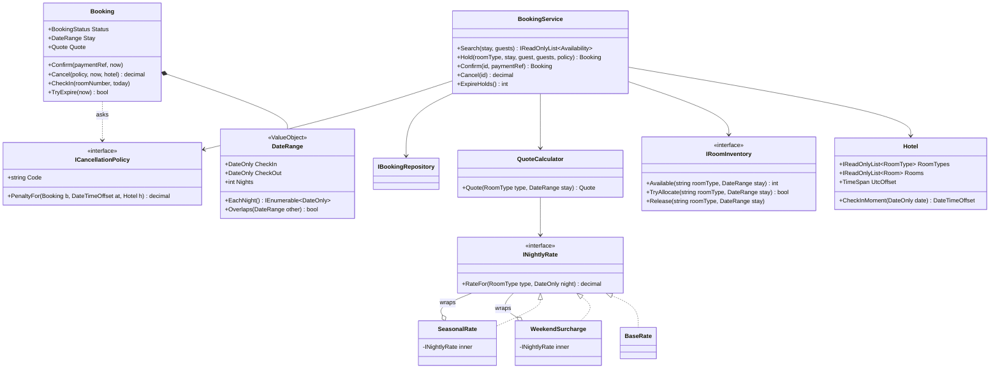
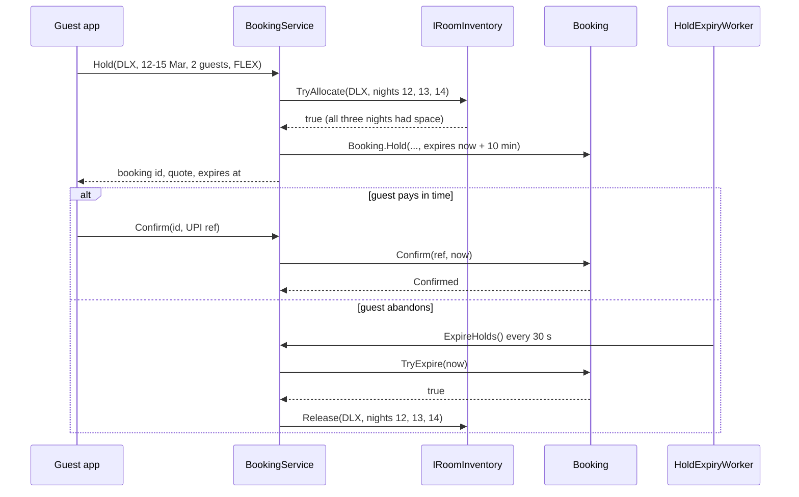
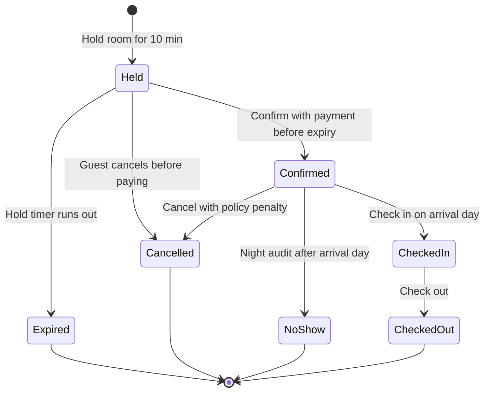

A family in Pune wants a Deluxe room in a Goa hotel from Thursday 12 March to Sunday 15 March. The app shows "2 rooms left at ₹13,600 + taxes", holds one for 10 minutes while they pay by UPI, then confirms. On the same evening, someone in Delhi tries to book the last Deluxe room for Friday night only. Exactly one of them must get it.

That small story contains the four hard parts of hotel booking: **dates** (what does "12 to 15" mean?), **prices that vary by night**, **inventory that must never be sold twice**, and **a booking lifecycle** with holds, penalties and no-shows. This case study designs them at the class level. The distributed version — many hotels, channel managers, search at scale — is in the [hotel reservation HLD case](#/lesson/m17-hotel-reservation).

## Learning objectives

By the end of this case study you will be able to:

1. Write requirements and clarifying questions for a hotel booking system, including the ones beginners forget (time zones, check-out day, no-shows).
2. Model a stay as a **half-open date range** value object, and explain why "check-out night" is not a booked night.
3. Compose nightly prices from small decorators (base rate, weekend surcharge, season) instead of one big formula.
4. Keep per-night inventory consistent under concurrent holds, so the last room is sold exactly once.
5. Implement the booking lifecycle (Held → Confirmed → CheckedIn → CheckedOut, plus Expired, Cancelled, NoShow) with guarded methods.
6. Choose between booking by room type and booking a specific room, and explain the trade-off.

## Prerequisites

- [Entities, value objects and services](#/lesson/m07-entities-values-services): `DateRange` is our key value object.
- [Decorator](#/lesson/m06-decorator): nightly rates are layered decorators.
- [Strategy](#/lesson/m06-strategy): cancellation policies are strategies.
- [Object lifecycle and state management](#/lesson/m07-lifecycle-state): the booking has a strict lifecycle.

## Explain it like I'm a beginner

Picture the reception desk of a small hotel before computers: a big paper register with **one column per night** and **one row per room type**. In each cell, the clerk writes how many rooms of that type are taken that night.

- When you ask "Deluxe, 12 to 15 March?", the clerk looks at the **nights** of the 12th, 13th and 14th. The 15th is your check-out morning; someone else can sleep in that room on the night of the 15th. So a stay from 12 to 15 is **3 nights**, not 4. Programmers call this a *half-open range*: the start is included, the end is not, written `[12, 15)`.
- If every one of those three cells still has a free room, the clerk pencils you in and says "I'll keep it for 10 minutes while you get your money" (a **hold**). If you don't come back, the pencil is erased (the hold **expires**).
- When you pay, the pencil becomes ink (**confirmed**).
- The **price** is worked out night by night: the normal rate, plus extra on Friday and Saturday, plus extra during Christmas week. Each rule is a separate sticky note stacked on top of the base price.
- If you cancel, a rule card on the counter says what you pay: free until two days before, after that one night's charge (a **cancellation policy**).
- You don't get a room *number* when you book; you get a room *type*. The actual key (room 204 or 311) is handed out when you arrive. That lets the hotel shuffle guests around for late check-outs and maintenance.

## Requirements

### Functional requirements

1. **Search:** given check-in date, check-out date and number of guests, list room types with free rooms for **every** night of the stay, with a full price quote.
2. **Hold:** reserve one room of a type for 10 minutes while the guest pays. A hold reduces availability immediately.
3. **Confirm:** with a payment reference, before the hold expires. A late confirmation is refused.
4. **Expire:** unconfirmed holds are released automatically.
5. **Cancel:** the guest can cancel a held or confirmed booking. The penalty depends on the booking's cancellation policy (Flexible: free until 48 hours before check-in, then one night's charge; Non-refundable: full amount).
6. **Check in:** on the arrival day, a free physical room of the booked type is assigned.
7. **Check out:** ends the stay.
8. **No-show:** a confirmed guest who hasn't checked in by the day after arrival is marked no-show and charged per policy.
9. **Pricing:** base rate per room type, +20 % on Friday and Saturday nights, ×1.5 during configured seasons (for example, 20 Dec – 5 Jan), plus tax by tariff slab.

### Non-functional requirements

- **No double booking, ever.** For every room type and night: confirmed + held ≤ physical rooms (unless the hotel *chooses* to allow overbooking — see exercise 4).
- **Correct time handling:** the hotel's local time zone decides "48 hours before check-in at 2 pm".
- **Holds are short and self-healing:** an abandoned payment page must not block a room for more than ~10 minutes.
- **Explainable prices:** a quote lists the price of each night so support can answer "why is Friday more expensive?".
- **Testability:** time comes from `TimeProvider`; nothing calls `DateTime.Now`.

### Clarifying questions to ask

| Question | Our assumption |
|---|---|
| Is check-out date a booked night? | No. Stays are half-open `[checkIn, checkOut)`. |
| Book a room type or a specific room? | Room type. The physical room is assigned at check-in. |
| One hotel or many? | One hotel in this LLD; the HLD case covers many. |
| How many rooms per booking? | One. A family needing two rooms makes two bookings (a group booking is an extension). |
| Which time zone? | The hotel's. Our Goa hotel is IST (UTC+05:30, no daylight saving). |
| Hold length? | 10 minutes, configurable. |
| Do we allow overbooking? | Not by default. |
| Tax? | Configurable slabs by nightly tariff. The numbers here are illustrative; real GST rates for hotel rooms have changed over time and must come from your tax team. |

## Identifying classes and responsibilities

**Nouns:** hotel, room type, room, guest, stay, night, date range, availability, rate, surcharge, season, tax, quote, hold, booking, payment, policy, penalty, check-in, no-show.
**Verbs:** search, quote, hold, confirm, expire, cancel, check in, check out, mark no-show, assign room.

| Class | Kind | Responsibility |
|---|---|---|
| `DateRange` | value object (record struct) | A half-open stay: nights, overlap, iteration. |
| `Hotel` | record | Room types, physical rooms, time zone offset and check-in time. |
| `RoomType`, `Room` | records | What can be sold, and what physically exists. |
| `INightlyRate` | interface | Price of one night for one room type. |
| `BaseRate`, `WeekendSurcharge`, `SeasonalRate` | decorators | Each adds one pricing rule on top of another `INightlyRate`. |
| `TaxPolicy` | domain service | Tax for one night by tariff slab. |
| `QuoteCalculator` | domain service | Builds a `Quote` (per-night lines, tax, total). |
| `IRoomInventory` | interface | Per-night allocation counts; all-or-nothing allocate and release. |
| `ICancellationPolicy` | strategy | Penalty for cancelling (or not showing up) at a given moment. |
| `Booking` | aggregate root | Lifecycle and data of one booking; guards every transition. |
| `IBookingRepository` | repository | Stores bookings. |
| `BookingService` | facade / application service | The one entry point: search, hold, confirm, cancel, expire, check in. |
| `HoldExpiryWorker` | background service | Calls `ExpireHolds` every 30 seconds. |

Note the split between `IRoomInventory` (counts per night) and `Booking` (one guest's story). The inventory doesn't know about guests; the booking doesn't count rooms. The service keeps the two in step.

## Class diagram



How to read it. The left side is **pricing**: `WeekendSurcharge` and `SeasonalRate` both *implement* `INightlyRate` and *wrap* another `INightlyRate` (the hollow diamond). That is the Decorator shape: you stack them like sticky notes. The right side is **booking**: `BookingService` is the only class that touches both the inventory and the booking, so it is the only place where they could get out of step — and the only place we need to guard.

### Hold and confirm sequence



The key step is `TryAllocate`: it reserves *all* nights or *none*. If the 14th is full, the 12th and 13th aren't touched. The expiry branch shows the self-healing part: the room comes back to the pool without anyone pressing a button.

## Patterns and design decisions

### 1. Value object: `DateRange`

Dates cause most hotel bugs. Off-by-one nights, "does 15 to 18 overlap 18 to 20?" (no!), and end-before-start ranges. A small immutable `DateRange` with a validating constructor makes those bugs impossible to write in the rest of the code. It is a `readonly record struct`: compared by value, cheap to copy, and its `Nights` and `Overlaps` rules exist in exactly one place.

The overlap rule for half-open ranges is short and worth memorising: **`a.Start < b.End && b.Start < a.End`**. Back-to-back stays (one ends the 18th, the next starts the 18th) don't overlap — exactly how hotels work.

### 2. Decorator: layered nightly rates

A nightly price is "base, then weekend, then season". Each rule wraps the previous one:

```csharp
INightlyRate rate = new SeasonalRate(new WeekendSurcharge(new BaseRate(), 20m), seasons);
```

Each decorator is a few lines, testable alone, and the order of stacking is visible in one composition line. Adding "early-bird −10 %" is one more decorator. Compare this with Strategy in the [food ordering case](#/lesson/m18-food-ordering), where each charge produced a *separate bill line*. Here each rule *modifies the same number* — that's the signature of Decorator.

:::callout type=tradeoff title="Does stacking order matter?"
Yes, sometimes. Multipliers commute (×1.2 then ×1.5 equals ×1.5 then ×1.2), but a flat "+₹500 festival fee" before or after a percentage gives different results. Write the order in one place (the composition root) and pin it with a test.
:::

### 3. Strategy: cancellation policies

Each booking stores a policy **code** (`FLEX`, `NONREF`) chosen at booking time. The service looks up the strategy by code when the guest cancels. Storing the code instead of the computed penalty matters: the penalty depends on *when* you cancel.

Storing the code also has a trap: if the hotel later edits the `FLEX` rules, old bookings change meaning. Production systems version policies (`FLEX-2026-01`) or snapshot the policy terms on the booking. We note it here and leave it as an extension.

### 4. Guarded methods for the booking lifecycle

In the food case we used a transition table, because every move looked the same. Here each transition has **its own guard and its own data**: `Confirm` needs a payment reference and must happen before expiry; `CheckIn` needs a room number and must happen on the arrival day; `Cancel` computes a penalty. So each is a method with explicit guard clauses. Both styles are valid implementations of the State idea; pick the one that keeps the rules readable.

### 5. Inventory by room type, rooms assigned at check-in

We sell **counts** per room type per night, not specific rooms. With 3 Deluxe rooms, the question "is there space?" is just "is the count below 3 on every night?". Assigning rooms at check-in avoids fragmentation. Imagine room 201 is free on the 12th and 14th, room 202 only on the 13th. Selling by room, a 3-night stay fails even though one room is free on every night. Selling by type, it succeeds, and housekeeping moves bookings between rooms as needed.

### 6. Facade: `BookingService`

The API layer calls one class with intention-revealing methods. Inside, the service coordinates inventory and booking under a lock, so the invariant "allocated count = number of active bookings per night" can't drift. In PostgreSQL the same guarantee comes from a single transaction with a conditional update:

```sql
-- one row per (room_type, night); succeeds only if every night still has space
UPDATE room_nights SET allocated = allocated + 1
WHERE room_type = 'DLX' AND night >= '2026-03-12' AND night < '2026-03-15' AND allocated < capacity;
-- if the row count is less than 3, ROLLBACK: some night was full
```

## State transitions



How to read it, and what each arrow does to inventory:

| Transition | Inventory effect | Money effect |
|---|---|---|
| → Held | allocate all nights | none |
| Held → Confirmed | none (already allocated) | payment captured |
| Held → Expired / Cancelled | release all nights | none |
| Confirmed → Cancelled | release all nights | penalty per policy, refund the rest |
| Confirmed → NoShow | release all nights (lets the hotel resell nights 2 and 3) | penalty per policy |
| Confirmed → CheckedIn | none; a physical room is assigned | none |
| CheckedIn → CheckedOut | none (nights are used) | final bill |

`Held`, `Confirmed` and `CheckedIn` are the states that "hold inventory". The service's job is to make sure that every arrow leaving that group releases exactly once. The tests check exactly this.

## C# implementation

```text
HotelBooking.Api/
  Program.cs
  Domain/DateRange.cs
  Domain/Hotel.cs
  Domain/Pricing.cs
  Domain/Policies.cs
  Domain/Booking.cs
  Application/BookingService.cs
  Infrastructure/InMemory.cs
  Infrastructure/HoldExpiryWorker.cs
```

### Value object and hotel

```csharp file=Domain/DateRange.cs
namespace HotelBooking;

/// <summary>A stay as a half-open range [CheckIn, CheckOut): the check-out date is not a booked night.</summary>
public readonly record struct DateRange
{
    public DateRange(DateOnly checkIn, DateOnly checkOut)
    {
        if (checkOut <= checkIn) throw new ArgumentException("Check-out must be after check-in.", nameof(checkOut));
        CheckIn = checkIn;
        CheckOut = checkOut;
    }

    public DateOnly CheckIn { get; }
    public DateOnly CheckOut { get; }
    public int Nights => CheckOut.DayNumber - CheckIn.DayNumber;

    public IEnumerable<DateOnly> EachNight()
    {
        for (var night = CheckIn; night < CheckOut; night = night.AddDays(1)) yield return night;
    }

    public bool Contains(DateOnly night) => night >= CheckIn && night < CheckOut;
    public bool Overlaps(DateRange other) => CheckIn < other.CheckOut && other.CheckIn < CheckOut;
    public override string ToString() => $"{CheckIn:yyyy-MM-dd}..{CheckOut:yyyy-MM-dd} ({Nights} nights)";
}
```

```csharp file=Domain/Hotel.cs
namespace HotelBooking;

public sealed record RoomType(string Code, string Name, int MaxGuests, decimal BaseRatePerNight);

public sealed record Room(string Number, string RoomTypeCode, int Floor);

public sealed record Hotel(string Id, string Name, TimeSpan UtcOffset, TimeOnly CheckInTime,
    IReadOnlyList<RoomType> RoomTypes, IReadOnlyList<Room> Rooms)
{
    public RoomType GetRoomType(string code) =>
        RoomTypes.FirstOrDefault(t => t.Code == code) ?? throw new KeyNotFoundException($"Unknown room type {code}.");

    public int RoomCount(string roomTypeCode) => Rooms.Count(r => r.RoomTypeCode == roomTypeCode);

    /// <summary>The hotel-local moment a stay starts, e.g. 12 Mar 14:00 +05:30.</summary>
    public DateTimeOffset CheckInMoment(DateOnly date) => new(date.ToDateTime(CheckInTime), UtcOffset);

    /// <summary>"Today" as the hotel sees it, whatever the server's time zone is.</summary>
    public DateOnly LocalDate(DateTimeOffset instant) => DateOnly.FromDateTime(instant.ToOffset(UtcOffset).DateTime);
}
```

We store a fixed `UtcOffset` because IST has no daylight saving. For hotels in regions that do, store a `TimeZoneInfo` id (for example `Europe/London`) and convert with `TimeZoneInfo.ConvertTime`, because the offset changes across the year.

### Pricing with decorators

```csharp file=Domain/Pricing.cs
namespace HotelBooking;

public interface INightlyRate
{
    decimal RateFor(RoomType type, DateOnly night);
}

public sealed class BaseRate : INightlyRate
{
    public decimal RateFor(RoomType type, DateOnly night) => type.BaseRatePerNight;
}

/// <summary>Adds a percentage on Friday and Saturday nights.</summary>
public sealed class WeekendSurcharge(INightlyRate inner, decimal percent) : INightlyRate
{
    public decimal RateFor(RoomType type, DateOnly night)
    {
        var rate = inner.RateFor(type, night);
        return night.DayOfWeek is DayOfWeek.Friday or DayOfWeek.Saturday ? rate * (1 + percent / 100m) : rate;
    }
}

public sealed record Season(string Name, DateRange Period, decimal Multiplier);

/// <summary>Multiplies the rate on nights inside a season. If seasons overlap, the highest multiplier wins.</summary>
public sealed class SeasonalRate(INightlyRate inner, IReadOnlyList<Season> seasons) : INightlyRate
{
    public decimal RateFor(RoomType type, DateOnly night)
    {
        var rate = inner.RateFor(type, night);
        var multiplier = seasons.Where(s => s.Period.Contains(night)).Select(s => s.Multiplier).DefaultIfEmpty(1m).Max();
        return rate * multiplier;
    }
}

public sealed record TaxSlab(decimal UpToNightlyTariff, decimal Percent);

/// <summary>Tax per night by tariff slab. Slab values come from configuration; the ones in this lesson are illustrative.</summary>
public sealed class TaxPolicy(IReadOnlyList<TaxSlab> slabs)
{
    private readonly IReadOnlyList<TaxSlab> _slabs = slabs.OrderBy(s => s.UpToNightlyTariff).ToList();

    public decimal TaxFor(decimal nightlyTariff)
    {
        var slab = _slabs.FirstOrDefault(s => nightlyTariff <= s.UpToNightlyTariff) ?? _slabs[^1];
        return nightlyTariff * slab.Percent / 100m;
    }
}

public sealed record NightPrice(DateOnly Night, decimal Rate, decimal Tax);

public sealed record Quote(string RoomTypeCode, DateRange Stay, IReadOnlyList<NightPrice> Nights)
{
    public decimal RoomTotal => Nights.Sum(n => n.Rate);
    public decimal TaxTotal => Nights.Sum(n => n.Tax);
    public decimal Total => RoomTotal + TaxTotal;
    public decimal FirstNightRate => Nights[0].Rate;
}

public sealed class QuoteCalculator(INightlyRate rate, TaxPolicy tax)
{
    public Quote Quote(RoomType type, DateRange stay)
    {
        var nights = stay.EachNight()
            .Select(n =>
            {
                var r = Math.Round(rate.RateFor(type, n), 2, MidpointRounding.AwayFromZero);
                return new NightPrice(n, r, Math.Round(tax.TaxFor(r), 2, MidpointRounding.AwayFromZero));
            })
            .ToList();
        return new Quote(type.Code, stay, nights);
    }
}
```

### Cancellation policies

```csharp file=Domain/Policies.cs
namespace HotelBooking;

public interface ICancellationPolicy
{
    string Code { get; }
    /// <summary>Amount the guest pays if they cancel (or fail to show up) at <paramref name="at"/>.</summary>
    decimal PenaltyFor(Booking booking, DateTimeOffset at, Hotel hotel);
}

/// <summary>Free until N hours before check-in time, then one night's room rate.</summary>
public sealed class FlexiblePolicy(int freeUntilHoursBefore = 48) : ICancellationPolicy
{
    public string Code => "FLEX";

    public decimal PenaltyFor(Booking booking, DateTimeOffset at, Hotel hotel)
    {
        var deadline = hotel.CheckInMoment(booking.Stay.CheckIn).AddHours(-freeUntilHoursBefore);
        return at < deadline ? 0m : booking.Quote.FirstNightRate;
    }
}

public sealed class NonRefundablePolicy : ICancellationPolicy
{
    public string Code => "NONREF";
    public decimal PenaltyFor(Booking booking, DateTimeOffset at, Hotel hotel) => booking.Quote.Total;
}
```

### The booking aggregate

```csharp file=Domain/Booking.cs
namespace HotelBooking;

public enum BookingStatus { Held, Confirmed, CheckedIn, CheckedOut, Cancelled, Expired, NoShow }

public sealed class BookingRuleException(string message) : InvalidOperationException(message);

public sealed class Booking
{
    private Booking(Guid id, string roomTypeCode, string guestName, int guests, DateRange stay, Quote quote,
        string policyCode, DateTimeOffset holdExpiresAt)
    {
        Id = id;
        RoomTypeCode = roomTypeCode;
        GuestName = guestName;
        Guests = guests;
        Stay = stay;
        Quote = quote;
        PolicyCode = policyCode;
        HoldExpiresAt = holdExpiresAt;
        Status = BookingStatus.Held;
    }

    public Guid Id { get; }
    public string RoomTypeCode { get; }
    public string GuestName { get; }
    public int Guests { get; }
    public DateRange Stay { get; }
    public Quote Quote { get; }
    public string PolicyCode { get; }
    public DateTimeOffset HoldExpiresAt { get; }
    public BookingStatus Status { get; private set; }
    public string? PaymentReference { get; private set; }
    public string? RoomNumber { get; private set; }
    public decimal Penalty { get; private set; }

    /// <summary>True while this booking occupies inventory.</summary>
    public bool HoldsInventory => Status is BookingStatus.Held or BookingStatus.Confirmed or BookingStatus.CheckedIn;

    public static Booking Hold(Guid id, RoomType type, string guestName, int guests, DateRange stay, Quote quote,
        string policyCode, DateTimeOffset now, TimeSpan holdFor)
    {
        ArgumentException.ThrowIfNullOrWhiteSpace(guestName);
        if (guests < 1 || guests > type.MaxGuests) throw new BookingRuleException($"{type.Name} sleeps at most {type.MaxGuests}.");
        if (quote.Stay != stay || quote.RoomTypeCode != type.Code) throw new ArgumentException("Quote does not match the stay.", nameof(quote));
        return new Booking(id, type.Code, guestName, guests, stay, quote, policyCode, now + holdFor);
    }

    public void Confirm(string paymentReference, DateTimeOffset now)
    {
        ArgumentException.ThrowIfNullOrWhiteSpace(paymentReference);
        // A retried confirm with the same payment (lost response, double webhook) is a no-op, not an error.
        if (Status == BookingStatus.Confirmed && PaymentReference == paymentReference) return;
        Require(BookingStatus.Held, "confirm");
        if (now >= HoldExpiresAt) throw new BookingRuleException("The hold has expired. Please search again.");
        PaymentReference = paymentReference;
        Status = BookingStatus.Confirmed;
    }

    /// <summary>Expires an unpaid hold. Returns true only if this call changed the status.</summary>
    public bool TryExpire(DateTimeOffset now)
    {
        if (Status != BookingStatus.Held || now < HoldExpiresAt) return false;
        Status = BookingStatus.Expired;
        return true;
    }

    /// <summary>Cancels and returns the penalty. Unpaid holds cancel for free.</summary>
    public decimal Cancel(ICancellationPolicy policy, DateTimeOffset now, Hotel hotel)
    {
        if (Status == BookingStatus.Held) { Status = BookingStatus.Cancelled; return 0m; }
        Require(BookingStatus.Confirmed, "cancel");
        if (policy.Code != PolicyCode) throw new ArgumentException($"Booking uses policy {PolicyCode}, not {policy.Code}.", nameof(policy));
        Penalty = Math.Min(policy.PenaltyFor(this, now, hotel), Quote.Total);
        Status = BookingStatus.Cancelled;
        return Penalty;
    }

    public void CheckIn(string roomNumber, DateOnly hotelToday)
    {
        ArgumentException.ThrowIfNullOrWhiteSpace(roomNumber);
        Require(BookingStatus.Confirmed, "check in");
        if (hotelToday != Stay.CheckIn) throw new BookingRuleException($"Check-in is only possible on {Stay.CheckIn:yyyy-MM-dd}.");
        RoomNumber = roomNumber;
        Status = BookingStatus.CheckedIn;
    }

    public void CheckOut()
    {
        Require(BookingStatus.CheckedIn, "check out");
        Status = BookingStatus.CheckedOut;
    }

    public decimal MarkNoShow(ICancellationPolicy policy, DateOnly hotelToday, DateTimeOffset now, Hotel hotel)
    {
        Require(BookingStatus.Confirmed, "mark as no-show");
        if (hotelToday <= Stay.CheckIn) throw new BookingRuleException("A guest can only be a no-show after the arrival day.");
        Penalty = Math.Min(policy.PenaltyFor(this, now, hotel), Quote.Total);
        Status = BookingStatus.NoShow;
        return Penalty;
    }

    private void Require(BookingStatus expected, string action)
    {
        if (Status != expected) throw new BookingRuleException($"Cannot {action} a booking that is {Status}.");
    }
}
```

### The booking service (facade)

```csharp file=Application/BookingService.cs
using Microsoft.Extensions.Logging;
using Microsoft.Extensions.Options;

namespace HotelBooking;

public sealed class BookingOptions
{
    public TimeSpan HoldDuration { get; set; } = TimeSpan.FromMinutes(10);
}

public sealed class NoAvailabilityException(string message) : Exception(message);

public interface IRoomInventory
{
    /// <summary>Rooms of this type free on every night of the stay (the minimum across nights).</summary>
    int Available(string roomTypeCode, DateRange stay);
    /// <summary>Allocates one room on every night of the stay, or nothing at all.</summary>
    bool TryAllocate(string roomTypeCode, DateRange stay);
    void Release(string roomTypeCode, DateRange stay);
}

public interface IBookingRepository
{
    void Add(Booking booking);
    Booking? Get(Guid id);
    IReadOnlyList<Booking> All();
}

public sealed record Availability(RoomType RoomType, int RoomsLeft, Quote Quote);

public sealed class BookingService(
    Hotel hotel,
    IRoomInventory inventory,
    QuoteCalculator quotes,
    IBookingRepository bookings,
    IEnumerable<ICancellationPolicy> policies,
    IOptions<BookingOptions> options,
    TimeProvider clock,
    ILogger<BookingService> logger)
{
    private readonly Dictionary<string, ICancellationPolicy> _policies = policies.ToDictionary(p => p.Code);
    private readonly Lock _gate = new();   // keeps inventory and bookings in step within this process

    public IReadOnlyList<Availability> Search(DateRange stay, int guests) =>
        hotel.RoomTypes
            .Where(t => t.MaxGuests >= guests)
            .Select(t => (Type: t, Left: inventory.Available(t.Code, stay)))
            .Where(x => x.Left > 0)
            .Select(x => new Availability(x.Type, x.Left, quotes.Quote(x.Type, stay)))
            .ToList();

    public Booking Hold(string roomTypeCode, DateRange stay, string guestName, int guests, string policyCode)
    {
        var type = hotel.GetRoomType(roomTypeCode);
        if (!_policies.ContainsKey(policyCode)) throw new ArgumentException($"Unknown policy {policyCode}.", nameof(policyCode));
        if (stay.CheckIn < hotel.LocalDate(clock.GetUtcNow())) throw new BookingRuleException("Check-in date is in the past.");

        var quote = quotes.Quote(type, stay);
        lock (_gate)
        {
            var booking = Booking.Hold(Guid.NewGuid(), type, guestName, guests, stay, quote, policyCode,
                clock.GetUtcNow(), options.Value.HoldDuration);   // validates guests before we touch inventory
            if (!inventory.TryAllocate(roomTypeCode, stay))
                throw new NoAvailabilityException($"No {type.Name} free for every night of {stay}.");
            bookings.Add(booking);
            logger.LogInformation("Held {RoomType} for {Stay} as {BookingId}", roomTypeCode, stay, booking.Id);
            return booking;
        }
    }

    public Booking Confirm(Guid bookingId, string paymentReference)
    {
        lock (_gate)
        {
            var booking = Find(bookingId);
            booking.Confirm(paymentReference, clock.GetUtcNow());
            return booking;
        }
    }

    public decimal Cancel(Guid bookingId)
    {
        lock (_gate)
        {
            var booking = Find(bookingId);
            var penalty = booking.Cancel(_policies[booking.PolicyCode], clock.GetUtcNow(), hotel);
            inventory.Release(booking.RoomTypeCode, booking.Stay);
            return penalty;
        }
    }

    /// <summary>Releases every hold whose timer has run out. Safe to call as often as you like.</summary>
    public int ExpireHolds()
    {
        var now = clock.GetUtcNow();
        lock (_gate)
        {
            var expired = 0;
            foreach (var booking in bookings.All().Where(b => b.TryExpire(now)))
            {
                inventory.Release(booking.RoomTypeCode, booking.Stay);
                expired++;
            }
            if (expired > 0) logger.LogInformation("Expired {Count} holds", expired);
            return expired;
        }
    }

    public Booking CheckIn(Guid bookingId)
    {
        lock (_gate)
        {
            var booking = Find(bookingId);
            var occupied = bookings.All().Where(b => b.Status == BookingStatus.CheckedIn).Select(b => b.RoomNumber).ToHashSet();
            var room = hotel.Rooms.FirstOrDefault(r => r.RoomTypeCode == booking.RoomTypeCode && !occupied.Contains(r.Number))
                ?? throw new BookingRuleException("No clean room of this type is free yet. Offer an upgrade or a short wait.");
            booking.CheckIn(room.Number, hotel.LocalDate(clock.GetUtcNow()));
            return booking;
        }
    }

    public decimal MarkNoShow(Guid bookingId)
    {
        lock (_gate)
        {
            var booking = Find(bookingId);
            var now = clock.GetUtcNow();
            var penalty = booking.MarkNoShow(_policies[booking.PolicyCode], hotel.LocalDate(now), now, hotel);
            inventory.Release(booking.RoomTypeCode, booking.Stay);
            return penalty;
        }
    }

    private Booking Find(Guid id) => bookings.Get(id) ?? throw new KeyNotFoundException($"Booking {id} not found.");
}
```

Notice the ordering inside `Hold`: build (and validate) the booking first, *then* allocate inventory. If validation threw after allocation, we would leak a room. Every inventory change in the service sits next to a booking state change, inside the same lock.

Two retry cases a reviewer will check. `Confirm` is idempotent: payment webhooks and mobile retries often arrive twice, so a second confirm with the *same* payment reference returns quietly instead of failing with 409. `Cancel` is safe to retry in the other direction: a second cancel throws before touching inventory, so a room is never released twice. And when a payment succeeds but `Confirm` is refused because the hold expired, the payment must be voided or refunded automatically; never let a guest pay for a booking that does not exist.

One honest limit: the `Lock` in `BookingService` protects a single process. With two API instances, the same guarantee must come from the database (the conditional `UPDATE` above, run in the same transaction that inserts or updates the booking row).

### In-memory infrastructure, worker and wiring

```csharp file=Infrastructure/InMemory.cs
namespace HotelBooking;

/// <summary>Per-night allocation counts. A PostgreSQL version has one row per (room_type, night).</summary>
public sealed class InMemoryRoomInventory(Hotel hotel) : IRoomInventory
{
    private readonly Dictionary<(string RoomType, DateOnly Night), int> _allocated = new();
    private readonly Lock _gate = new();

    public int Available(string roomTypeCode, DateRange stay)
    {
        var capacity = hotel.RoomCount(roomTypeCode);
        lock (_gate)
            return stay.EachNight().Min(n => capacity - _allocated.GetValueOrDefault((roomTypeCode, n)));
    }

    public bool TryAllocate(string roomTypeCode, DateRange stay)
    {
        var capacity = hotel.RoomCount(roomTypeCode);
        lock (_gate)
        {
            if (stay.EachNight().Any(n => _allocated.GetValueOrDefault((roomTypeCode, n)) >= capacity)) return false;
            foreach (var n in stay.EachNight()) _allocated[(roomTypeCode, n)] = _allocated.GetValueOrDefault((roomTypeCode, n)) + 1;
            return true;
        }
    }

    public void Release(string roomTypeCode, DateRange stay)
    {
        lock (_gate)
            foreach (var n in stay.EachNight())
            {
                var current = _allocated.GetValueOrDefault((roomTypeCode, n));
                if (current <= 0) throw new InvalidOperationException($"Release without allocation for {roomTypeCode} on {n}.");
                _allocated[(roomTypeCode, n)] = current - 1;
            }
    }
}

public sealed class InMemoryBookingRepository : IBookingRepository
{
    private readonly Dictionary<Guid, Booking> _bookings = new();
    private readonly Lock _gate = new();
    public void Add(Booking booking) { lock (_gate) _bookings.Add(booking.Id, booking); }
    public Booking? Get(Guid id) { lock (_gate) return _bookings.GetValueOrDefault(id); }
    public IReadOnlyList<Booking> All() { lock (_gate) return _bookings.Values.ToList(); }
}
```

```csharp file=Infrastructure/HoldExpiryWorker.cs
using Microsoft.Extensions.Hosting;
using Microsoft.Extensions.Logging;

namespace HotelBooking;

/// <summary>Releases abandoned holds every 30 seconds, so a closed payment tab blocks a room for at most ~10.5 minutes.</summary>
public sealed class HoldExpiryWorker(BookingService bookings, ILogger<HoldExpiryWorker> logger) : BackgroundService
{
    protected override async Task ExecuteAsync(CancellationToken stoppingToken)
    {
        using var timer = new PeriodicTimer(TimeSpan.FromSeconds(30));
        while (await timer.WaitForNextTickAsync(stoppingToken))
        {
            try { bookings.ExpireHolds(); }
            catch (Exception ex) { logger.LogError(ex, "Hold expiry sweep failed; will retry on the next tick"); }
        }
    }
}
```

```csharp file=Program.cs
using HotelBooking;

var builder = WebApplication.CreateBuilder(args);

var hotel = new Hotel("goa-1", "Candolim Bay Resort", TimeSpan.FromHours(5.5), new TimeOnly(14, 0),
    [new RoomType("DLX", "Deluxe", 3, 4000m), new RoomType("STE", "Suite", 4, 9000m)],
    [new Room("201", "DLX", 2), new Room("202", "DLX", 2), new Room("203", "DLX", 2), new Room("501", "STE", 5)]);

Season[] seasons =
[
    new Season("Christmas and New Year", new DateRange(new DateOnly(2026, 12, 20), new DateOnly(2027, 1, 6)), 1.5m),
];
TaxSlab[] taxSlabs = [new TaxSlab(7500m, 12m), new TaxSlab(decimal.MaxValue, 18m)];   // illustrative slabs

builder.Services.AddSingleton(hotel);
builder.Services.AddSingleton(TimeProvider.System);
builder.Services.Configure<BookingOptions>(builder.Configuration.GetSection("Booking"));
// Decorators are composed in exactly one place, so the stacking order is visible and testable.
builder.Services.AddSingleton<INightlyRate>(new SeasonalRate(new WeekendSurcharge(new BaseRate(), 20m), seasons));
builder.Services.AddSingleton(new TaxPolicy(taxSlabs));
builder.Services.AddSingleton<QuoteCalculator>();
builder.Services.AddSingleton<ICancellationPolicy>(new FlexiblePolicy(48));
builder.Services.AddSingleton<ICancellationPolicy, NonRefundablePolicy>();
builder.Services.AddSingleton<IRoomInventory, InMemoryRoomInventory>();
builder.Services.AddSingleton<IBookingRepository, InMemoryBookingRepository>();
builder.Services.AddSingleton<BookingService>();
builder.Services.AddHostedService<HoldExpiryWorker>();

var app = builder.Build();

app.MapGet("/availability", (DateOnly checkIn, DateOnly checkOut, int guests, BookingService svc) =>
    checkOut <= checkIn ? Results.BadRequest("checkOut must be after checkIn") : Results.Ok(svc.Search(new DateRange(checkIn, checkOut), guests)));

app.MapPost("/bookings", (HoldRequest r, BookingService svc) =>
{
    try
    {
        var b = svc.Hold(r.RoomTypeCode, new DateRange(r.CheckIn, r.CheckOut), r.GuestName, r.Guests, r.PolicyCode);
        return Results.Created($"/bookings/{b.Id}", new { b.Id, b.Status, b.HoldExpiresAt, b.Quote.Total });
    }
    catch (NoAvailabilityException ex) { return Results.Problem(ex.Message, statusCode: StatusCodes.Status409Conflict); }
    catch (BookingRuleException ex) { return Results.Problem(ex.Message, statusCode: StatusCodes.Status422UnprocessableEntity); }
});

app.MapPost("/bookings/{id:guid}/confirm", (Guid id, ConfirmRequest r, BookingService svc) =>
{
    try { var b = svc.Confirm(id, r.PaymentReference); return Results.Ok(new { b.Id, b.Status }); }
    catch (KeyNotFoundException) { return Results.NotFound(); }
    catch (BookingRuleException ex) { return Results.Problem(ex.Message, statusCode: StatusCodes.Status409Conflict); }
});

app.MapPost("/bookings/{id:guid}/cancel", (Guid id, BookingService svc) =>
{
    try { return Results.Ok(new { Penalty = svc.Cancel(id) }); }
    catch (KeyNotFoundException) { return Results.NotFound(); }
    catch (BookingRuleException ex) { return Results.Problem(ex.Message, statusCode: StatusCodes.Status409Conflict); }
});

app.Run();

public sealed record HoldRequest(string RoomTypeCode, DateOnly CheckIn, DateOnly CheckOut, string GuestName, int Guests, string PolicyCode);
public sealed record ConfirmRequest(string PaymentReference);
```

## Automated testing

Dates, prices and inventory each get their own tests. The service tests use a hand-written `ManualTimeProvider` so we can jump forward 10 minutes without waiting.

### Date range and pricing

```csharp
using HotelBooking;
using Xunit;

public class DateRangeAndPricingTests
{
    private static readonly RoomType Deluxe = new("DLX", "Deluxe", 3, 4000m);
    private static DateOnly D(int month, int day, int year = 2026) => new(year, month, day);

    [Fact]
    public void Back_to_back_stays_do_not_overlap()
    {
        var first = new DateRange(D(3, 12), D(3, 15));
        Assert.Equal(3, first.Nights);
        Assert.False(first.Overlaps(new DateRange(D(3, 15), D(3, 17))));
        Assert.True(first.Overlaps(new DateRange(D(3, 14), D(3, 16))));
    }

    [Fact]
    public void Empty_or_reversed_range_is_rejected() =>
        Assert.Throws<ArgumentException>(() => new DateRange(D(3, 15), D(3, 15)));

    [Fact]
    public void Weekend_nights_cost_more()
    {
        var rate = new WeekendSurcharge(new BaseRate(), 20m);
        var quote = new QuoteCalculator(rate, new TaxPolicy([new TaxSlab(decimal.MaxValue, 12m)]))
            .Quote(Deluxe, new DateRange(D(3, 12), D(3, 15)));            // Thu, Fri, Sat nights
        Assert.Equal(new[] { 4000m, 4800m, 4800m }, quote.Nights.Select(n => n.Rate).ToArray());
        Assert.Equal(13600m, quote.RoomTotal);
        Assert.Equal(1632m, quote.TaxTotal);
        Assert.Equal(15232m, quote.Total);
    }

    [Fact]
    public void Season_and_weekend_stack()
    {
        var season = new Season("NY", new DateRange(D(12, 20), D(1, 6, 2027)), 1.5m);
        INightlyRate rate = new SeasonalRate(new WeekendSurcharge(new BaseRate(), 20m), [season]);
        Assert.Equal(7200m, rate.RateFor(Deluxe, D(12, 26)));              // Saturday in season: 4000 x 1.2 x 1.5
        Assert.Equal(4000m, rate.RateFor(Deluxe, D(1, 6, 2027)));          // season end is exclusive
    }

    [Fact]
    public void Tax_slab_switches_above_threshold()
    {
        var tax = new TaxPolicy([new TaxSlab(7500m, 12m), new TaxSlab(decimal.MaxValue, 18m)]);
        Assert.Equal(900m, tax.TaxFor(7500m));
        Assert.Equal(1620m, tax.TaxFor(9000m));
    }
}
```

### Service: holds, expiry, cancellation, no double booking

```csharp
using HotelBooking;
using Microsoft.Extensions.Logging.Abstractions;
using Microsoft.Extensions.Options;
using Xunit;

public class BookingServiceTests
{
    private sealed class ManualTimeProvider(DateTimeOffset start) : TimeProvider
    {
        public DateTimeOffset Now { get; set; } = start;
        public override DateTimeOffset GetUtcNow() => Now;
    }

    private static readonly TimeSpan Ist = TimeSpan.FromHours(5.5);
    private static readonly Hotel Hotel = new("h", "Test Hotel", Ist, new TimeOnly(14, 0),
        [new RoomType("DLX", "Deluxe", 3, 4000m)], [new Room("201", "DLX", 2), new Room("202", "DLX", 2)]);
    private static readonly DateRange Stay = new(new DateOnly(2026, 3, 12), new DateOnly(2026, 3, 15));

    private static (BookingService Svc, ManualTimeProvider Clock, InMemoryRoomInventory Inv) Build(DateTimeOffset now)
    {
        var clock = new ManualTimeProvider(now);
        var inv = new InMemoryRoomInventory(Hotel);
        var svc = new BookingService(Hotel, inv, new QuoteCalculator(new BaseRate(), new TaxPolicy([new TaxSlab(decimal.MaxValue, 0m)])),
            new InMemoryBookingRepository(), [new FlexiblePolicy(48), new NonRefundablePolicy()],
            Options.Create(new BookingOptions()), clock, NullLogger<BookingService>.Instance);
        return (svc, clock, inv);
    }

    private static readonly DateTimeOffset Mar1 = new(2026, 3, 1, 10, 0, 0, Ist);

    [Fact]
    public void Last_room_cannot_be_held_twice()
    {
        var (svc, _, _) = Build(Mar1);
        svc.Hold("DLX", Stay, "Asha", 2, "FLEX");
        svc.Hold("DLX", Stay, "Ravi", 2, "FLEX");
        Assert.Throws<NoAvailabilityException>(() =>
            svc.Hold("DLX", new DateRange(new DateOnly(2026, 3, 13), new DateOnly(2026, 3, 14)), "Meera", 1, "FLEX"));
    }

    [Fact]
    public void Expired_hold_releases_every_night_and_cannot_be_confirmed()
    {
        var (svc, clock, inv) = Build(Mar1);
        var b = svc.Hold("DLX", Stay, "Asha", 2, "FLEX");
        Assert.Equal(1, inv.Available("DLX", Stay));
        clock.Now = Mar1.AddMinutes(10);
        Assert.Equal(1, svc.ExpireHolds());
        Assert.Equal(0, svc.ExpireHolds());                               // idempotent
        Assert.Equal(2, inv.Available("DLX", Stay));
        Assert.Throws<BookingRuleException>(() => svc.Confirm(b.Id, "upi-123"));
    }

    [Fact]
    public void Flexible_cancellation_is_free_until_48_hours_before_2pm_check_in()
    {
        var (svc, clock, _) = Build(Mar1);
        var early = svc.Hold("DLX", Stay, "Asha", 2, "FLEX");
        svc.Confirm(early.Id, "upi-1");
        var late = svc.Hold("DLX", Stay, "Ravi", 2, "FLEX");
        svc.Confirm(late.Id, "upi-2");

        clock.Now = new DateTimeOffset(2026, 3, 10, 13, 59, 0, Ist);     // 1 minute before the deadline
        Assert.Equal(0m, svc.Cancel(early.Id));
        clock.Now = new DateTimeOffset(2026, 3, 10, 14, 0, 0, Ist);
        Assert.Equal(4000m, svc.Cancel(late.Id));                        // one night
    }

    [Fact]
    public void Check_in_assigns_different_physical_rooms()
    {
        var (svc, clock, _) = Build(Mar1);
        var a = svc.Hold("DLX", Stay, "Asha", 2, "FLEX");
        var b = svc.Hold("DLX", Stay, "Ravi", 2, "FLEX");
        svc.Confirm(a.Id, "p1");
        svc.Confirm(b.Id, "p2");
        clock.Now = new DateTimeOffset(2026, 3, 12, 15, 0, 0, Ist);
        Assert.NotEqual(svc.CheckIn(a.Id).RoomNumber, svc.CheckIn(b.Id).RoomNumber);
    }
}
```

Other tests worth adding: a parallel test that fires 50 holds at a 1-room hotel and asserts exactly one succeeds; a no-show test on 13 March; and an "invariant" test that after any random sequence of operations, the allocated count per night equals the number of bookings in `Held`, `Confirmed` or `CheckedIn` covering that night.

## Bad design vs good design

### Bad: bookings with raw dates and a "is any booking overlapping?" query

```csharp
public class Booking { public int RoomId; public DateTime From; public DateTime To; public string Status; }

public bool IsAvailable(int roomId, DateTime from, DateTime to) =>
    !_db.Bookings.Any(b => b.RoomId == roomId && b.Status != "CANCELLED"
                           && b.From <= to && b.To >= from);          // closed ranges

public Booking Book(int roomId, DateTime from, DateTime to)
{
    if (!IsAvailable(roomId, from, to)) throw new Exception("Not available");
    var b = new Booking { RoomId = roomId, From = from, To = to, Status = "BOOKED" };
    _db.Bookings.Add(b); _db.SaveChanges();
    return b;
}
```

Problems:

1. **Closed ranges.** `b.To >= from` makes a stay ending on the 15th clash with one starting on the 15th. The hotel loses a night of revenue on every back-to-back turnover.
2. **`DateTime` with time parts.** A `To` of `15 Mar 00:00` versus `15 Mar 11:00` changes the answer. Time zones make it worse.
3. **Check-then-act race.** Two requests both run `IsAvailable`, both see "free", both insert. The last room is sold twice.
4. **Booking specific rooms.** Fragmentation refuses stays that would fit if rooms could be swapped.
5. **No holds.** Either the room is booked before payment (blocked forever if payment fails) or after (someone else takes it during payment).
6. **String statuses and no lifecycle rules.** Nothing stops "check in" on a cancelled booking.

### Good: the design above

- `DateRange` with half-open semantics and `DateOnly` — no time parts, no off-by-one.
- Per-night counts by room type with all-or-nothing allocation under a lock (or one conditional SQL update in a transaction).
- Short holds that expire automatically.
- A booking aggregate whose methods guard every transition.

### When is the simple design fine?

A homestay with **two rooms and one owner** taking bookings by phone doesn't need holds, decorators or a background worker. A table of bookings with half-open `daterange` values and a PostgreSQL exclusion constraint (alternative 1 below) is enough. Note that a plain "SELECT to check, then INSERT" inside a transaction is *not* enough at the default isolation level: two transactions can both see the room as free. The full design pays off once you have online payment (holds), many room types (counts) and pricing rules that marketing changes (decorators).

## Alternative designs

### 1. Per-room bookings with an exclusion constraint

Assign the physical room at booking time and let PostgreSQL forbid overlaps:

```sql
CREATE EXTENSION IF NOT EXISTS btree_gist;
CREATE TABLE room_bookings (
  room_id int NOT NULL,
  stay daterange NOT NULL,        -- '[2026-03-12,2026-03-15)' half-open by default
  EXCLUDE USING gist (room_id WITH =, stay WITH &&)
);
```

**Better when** guests book *specific* rooms (a named villa, a meeting room) or room counts are tiny. **Worse when** you have many identical rooms, because of fragmentation and because availability search needs a set query over rooms instead of a count.

### 2. Inventory as one row per (room type, night)

What our in-memory store models. Holds and confirms are `UPDATE ... SET allocated = allocated + 1 WHERE allocated < capacity`. **Better for** typical hotels and channel managers; search is a cheap `MIN(capacity - allocated)` over the nights. Cost: one row per type per night (2 types × 365 nights = 730 rows a year; tiny).

### 3. State pattern classes for the booking

`HeldState`, `ConfirmedState` and so on. **Better when** each state gains substantial behaviour (deposit schedules, staged payments). For our seven states with short guards, explicit methods are clearer.

### 4. Pricing as a rate table instead of decorators

Revenue teams often publish a price **per room type per night** in advance (a "rate calendar"), computed by a pricing engine. The booking system then just reads the table. **Better when** prices are set dynamically by demand. The decorators move into the pricing engine, and the booking side gets simpler.

### 5. Hold with a payment-provider timeout instead of our own timer

Some payment flows (UPI collect requests, for example) have their own expiry. You can align the hold to it. You still need your own expiry as a safety net, because webhooks can be lost.

## Practical playground

The reference class model is below. Try two extension tasks in the designer: add a `GroupBooking` that holds several rooms all-or-nothing, and add an `EarlyBirdDiscount` decorator.

:::playground type=lld title="Hotel booking reference model"
```json
{
  "classes": [
    { "id": "DateRange", "name": "DateRange", "kind": "record",
      "fields": ["+DateOnly CheckIn", "+DateOnly CheckOut"],
      "methods": ["+int Nights", "+IEnumerable<DateOnly> EachNight()", "+bool Overlaps(DateRange other)", "+bool Contains(DateOnly night)"],
      "responsibility": "Half-open stay [CheckIn, CheckOut)" },
    { "id": "Hotel", "name": "Hotel", "kind": "record",
      "fields": ["+IReadOnlyList<RoomType> RoomTypes", "+IReadOnlyList<Room> Rooms", "+TimeSpan UtcOffset", "+TimeOnly CheckInTime"],
      "methods": ["+int RoomCount(string roomTypeCode)", "+DateTimeOffset CheckInMoment(DateOnly date)", "+DateOnly LocalDate(DateTimeOffset instant)"],
      "responsibility": "Static facts about the property" },
    { "id": "RoomType", "name": "RoomType", "kind": "record",
      "fields": ["+string Code", "+int MaxGuests", "+decimal BaseRatePerNight"], "methods": [], "responsibility": "What is sold" },
    { "id": "Room", "name": "Room", "kind": "record",
      "fields": ["+string Number", "+string RoomTypeCode"], "methods": [], "responsibility": "What physically exists" },
    { "id": "INightlyRate", "name": "INightlyRate", "kind": "interface",
      "fields": [], "methods": ["decimal RateFor(RoomType type, DateOnly night)"], "responsibility": "Price of one night" },
    { "id": "BaseRate", "name": "BaseRate", "kind": "class", "fields": [], "methods": ["+decimal RateFor(RoomType type, DateOnly night)"] },
    { "id": "WeekendSurcharge", "name": "WeekendSurcharge", "kind": "class",
      "fields": ["-INightlyRate inner", "-decimal percent"], "methods": ["+decimal RateFor(RoomType type, DateOnly night)"],
      "responsibility": "Decorator: +% on Friday and Saturday" },
    { "id": "SeasonalRate", "name": "SeasonalRate", "kind": "class",
      "fields": ["-INightlyRate inner", "-IReadOnlyList<Season> seasons"], "methods": ["+decimal RateFor(RoomType type, DateOnly night)"],
      "responsibility": "Decorator: multiplier inside seasons" },
    { "id": "QuoteCalculator", "name": "QuoteCalculator", "kind": "class",
      "fields": ["-INightlyRate rate", "-TaxPolicy tax"], "methods": ["+Quote Quote(RoomType type, DateRange stay)"],
      "responsibility": "Per-night price lines plus tax" },
    { "id": "IRoomInventory", "name": "IRoomInventory", "kind": "interface",
      "fields": [], "methods": ["int Available(string roomType, DateRange stay)", "bool TryAllocate(string roomType, DateRange stay)", "void Release(string roomType, DateRange stay)"],
      "responsibility": "Per-night counts, all-or-nothing" },
    { "id": "ICancellationPolicy", "name": "ICancellationPolicy", "kind": "interface",
      "fields": [], "methods": ["string Code", "decimal PenaltyFor(Booking booking, DateTimeOffset at, Hotel hotel)"],
      "responsibility": "Penalty for cancelling or no-show" },
    { "id": "FlexiblePolicy", "name": "FlexiblePolicy", "kind": "class", "fields": ["-int freeUntilHoursBefore"], "methods": ["+decimal PenaltyFor(Booking booking, DateTimeOffset at, Hotel hotel)"] },
    { "id": "BookingStatus", "name": "BookingStatus", "kind": "enum",
      "fields": ["Held", "Confirmed", "CheckedIn", "CheckedOut", "Cancelled", "Expired", "NoShow"], "methods": [] },
    { "id": "Booking", "name": "Booking", "kind": "class",
      "fields": ["+Guid Id", "+DateRange Stay", "+Quote Quote", "+string PolicyCode", "+DateTimeOffset HoldExpiresAt", "+BookingStatus Status", "+string? RoomNumber"],
      "methods": ["+static Booking Hold(...)", "+void Confirm(string paymentRef, DateTimeOffset now)", "+bool TryExpire(DateTimeOffset now)", "+decimal Cancel(ICancellationPolicy policy, DateTimeOffset now, Hotel hotel)", "+void CheckIn(string roomNumber, DateOnly today)"],
      "responsibility": "Aggregate root guarding the booking lifecycle" },
    { "id": "BookingService", "name": "BookingService", "kind": "class",
      "fields": ["-Lock _gate"], "methods": ["+IReadOnlyList<Availability> Search(DateRange stay, int guests)", "+Booking Hold(...)", "+Booking Confirm(Guid id, string paymentRef)", "+decimal Cancel(Guid id)", "+int ExpireHolds()"],
      "responsibility": "Facade keeping inventory and bookings in step" },
    { "id": "HoldExpiryWorker", "name": "HoldExpiryWorker", "kind": "class",
      "fields": [], "methods": ["#Task ExecuteAsync(CancellationToken ct)"], "responsibility": "Calls ExpireHolds every 30 s" }
  ],
  "relations": [
    { "from": "Hotel", "to": "RoomType", "kind": "composition", "multiplicity": "1..*" },
    { "from": "Hotel", "to": "Room", "kind": "composition", "multiplicity": "1..*" },
    { "from": "BaseRate", "to": "INightlyRate", "kind": "implements" },
    { "from": "WeekendSurcharge", "to": "INightlyRate", "kind": "implements" },
    { "from": "SeasonalRate", "to": "INightlyRate", "kind": "implements" },
    { "from": "WeekendSurcharge", "to": "INightlyRate", "kind": "aggregation", "label": "wraps" },
    { "from": "SeasonalRate", "to": "INightlyRate", "kind": "aggregation", "label": "wraps" },
    { "from": "QuoteCalculator", "to": "INightlyRate", "kind": "association" },
    { "from": "FlexiblePolicy", "to": "ICancellationPolicy", "kind": "implements" },
    { "from": "Booking", "to": "DateRange", "kind": "composition" },
    { "from": "Booking", "to": "BookingStatus", "kind": "association" },
    { "from": "Booking", "to": "ICancellationPolicy", "kind": "dependency", "label": "asks" },
    { "from": "BookingService", "to": "Hotel", "kind": "association" },
    { "from": "BookingService", "to": "IRoomInventory", "kind": "association" },
    { "from": "BookingService", "to": "QuoteCalculator", "kind": "association" },
    { "from": "BookingService", "to": "ICancellationPolicy", "kind": "association", "multiplicity": "1..*" },
    { "from": "BookingService", "to": "Booking", "kind": "dependency", "label": "creates" },
    { "from": "HoldExpiryWorker", "to": "BookingService", "kind": "dependency" }
  ]
}
```
:::

## Exercises

:::exercise id=m18-hotel-booking-ex1 difficulty=beginner kind=code title="Build the DateRange value object"
Implement `DateRange` as a half-open range of nights.
::requirements
- The constructor rejects ranges where check-out is not after check-in.
- `Nights` is the number of nights.
- `EachNight()` yields every booked night, not the check-out date.
- `Overlaps` uses half-open semantics.
- Two ranges with the same dates are equal.
::acceptance
- 12 → 15 March is 3 nights: the 12th, 13th and 14th.
- 12 → 15 and 15 → 17 do not overlap; 12 → 15 and 14 → 16 do.
- `new DateRange(15 Mar, 15 Mar)` throws `ArgumentException`.
- Two `DateRange` values built from the same dates are `Equals`.
::hint
Use `DateOnly`, not `DateTime`. There's no time part to get wrong.
::hint
`DateOnly.DayNumber` turns a date into an integer, so nights are a subtraction.
::hint
For half-open ranges, two ranges overlap when each one starts before the other ends.
::hint
A `readonly record struct` gives you value equality for free.
::starter
```csharp file=DateRange.cs
using System;
using System.Collections.Generic;

public readonly record struct DateRange
{
    public DateRange(DateOnly checkIn, DateOnly checkOut)
    {
        throw new NotImplementedException();
    }

    public DateOnly CheckIn { get; }
    public DateOnly CheckOut { get; }
    public int Nights => throw new NotImplementedException();
    public IEnumerable<DateOnly> EachNight() => throw new NotImplementedException();
    public bool Overlaps(DateRange other) => throw new NotImplementedException();
}
```
::tests
```csharp file=DateRangeTests.cs
using System;
using System.Linq;
using Xunit;

public class DateRangeTests
{
    private static DateOnly M(int day) => new(2026, 3, day);

    [Fact] public void Three_nights() => Assert.Equal(3, new DateRange(M(12), M(15)).Nights);

    [Fact] public void Each_night_excludes_checkout() =>
        Assert.Equal(new[] { M(12), M(13), M(14) }, new DateRange(M(12), M(15)).EachNight().ToArray());

    [Fact] public void Back_to_back_does_not_overlap() =>
        Assert.False(new DateRange(M(12), M(15)).Overlaps(new DateRange(M(15), M(17))));

    [Fact] public void Partial_overlap_detected() =>
        Assert.True(new DateRange(M(12), M(15)).Overlaps(new DateRange(M(14), M(16))));

    [Fact] public void Containing_range_overlaps() =>
        Assert.True(new DateRange(M(13), M(14)).Overlaps(new DateRange(M(10), M(20))));

    [Fact] public void Zero_nights_rejected() =>
        Assert.Throws<ArgumentException>(() => new DateRange(M(15), M(15)));

    [Fact] public void Value_equality() =>
        Assert.Equal(new DateRange(M(12), M(15)), new DateRange(M(12), M(15)));
}
```
::solution
```csharp file=DateRange.cs
using System;
using System.Collections.Generic;

public readonly record struct DateRange
{
    public DateRange(DateOnly checkIn, DateOnly checkOut)
    {
        if (checkOut <= checkIn) throw new ArgumentException("Check-out must be after check-in.", nameof(checkOut));
        CheckIn = checkIn;
        CheckOut = checkOut;
    }

    public DateOnly CheckIn { get; }
    public DateOnly CheckOut { get; }
    public int Nights => CheckOut.DayNumber - CheckIn.DayNumber;

    public IEnumerable<DateOnly> EachNight()
    {
        for (var d = CheckIn; d < CheckOut; d = d.AddDays(1)) yield return d;
    }

    public bool Overlaps(DateRange other) => CheckIn < other.CheckOut && other.CheckIn < CheckOut;
}
```
The overlap rule covers every case, including one range fully inside the other, with two comparisons. The record struct gives `Equals`, `GetHashCode` and `==` based on `CheckIn` and `CheckOut`.
::mistakes
- Using `<=` in `Overlaps`, which makes back-to-back stays clash.
- Counting nights with `(CheckOut - CheckIn).Days` on `DateTime` values that carry times, which can be off by one.
- Allowing a zero-night range "for flexibility". Every caller then has to handle it.
::extensions
Add `Intersect(DateRange other)` returning `DateRange?`, and `Split(DateOnly at)` for early check-out.
:::

:::exercise id=m18-hotel-booking-ex2 difficulty=beginner kind=design title="Let guests request a specific room"
Some guests insist on "room 504, the one with the sea view". Change the design so a booking can optionally request a specific room, without giving up count-based inventory for everyone else.
::acceptance
- A class-level change list (new fields, new classes, changed methods).
- A rule for how a room-specific booking affects the per-type count.
- An explanation of what happens when the requested room is blocked for maintenance.
- One sentence on why you didn't switch the whole hotel to per-room inventory.
::hint
A specific-room booking still uses up one room of its type. What extra check does it need?
::hint
You need a second, smaller structure: which specific rooms are promised on which nights.
::hint
Keep `IRoomInventory` (counts) and add `IRoomPromises` (room number → set of nights). A room-specific hold must pass **both** checks.
::solution
**Changes**

- `Booking` gets an optional `RequestedRoomNumber`.
- New `IRoomPromises` with `TryPromise(roomNumber, DateRange)` and `Release(roomNumber, DateRange)`, backed by a per-room set of nights (or a PostgreSQL exclusion constraint on `(room_id, stay)`).
- `BookingService.Hold` with a requested room calls `inventory.TryAllocate(type, stay)` **and** `promises.TryPromise(room, stay)`. If the second fails, it releases the first.
- `BookingService.CheckIn` assigns the promised room if there is one. Otherwise it picks any free room that is not promised to someone else tonight.
- Maintenance: `Room` gets a blocked-dates list. Promising a blocked room fails. If a room is blocked *after* it was promised, an operations task flags the booking so staff can contact the guest and offer an upgrade.

**Why not per-room for everyone?** Fragmentation: with count-based inventory, the hotel can shuffle unpromised guests between identical rooms. Promised rooms are usually a small minority, so most of the flexibility is kept.
::alternatives
Charge a "room selection fee" and treat promised rooms as a separate sellable room type ("Deluxe Sea View 504"). That is simpler for inventory but explodes the number of room types.
::mistakes
- Promising the room but not reducing the type count, so the hotel sells one room too many of that type.
- Forgetting to release the count when the promise step fails.
:::

:::exercise id=m18-hotel-booking-ex3 difficulty=intermediate kind=code title="Tiered cancellation policy"
Implement a `TieredCancellationPolicy`: free if you cancel 7 days or more before check-in, 50 % of the room total between 7 days and 48 hours, and 100 % within 48 hours. "Before check-in" means before 14:00 hotel time on the check-in date.
::requirements
- Boundaries: exactly 7 days before is free; exactly 48 hours before is 100 %.
- The hotel's UTC offset is given; the cancellation instant may arrive in any offset.
- Penalties are rounded to 2 decimals, away from zero.
::acceptance
- Check-in 20 March 14:00 IST, room total ₹12,000: cancel 13 March 14:00 IST → 0.
- Cancel 13 March 14:01 IST → 6,000.
- Cancel 18 March 14:00 IST → 12,000.
- Cancel 13 March 08:30 UTC (= 14:00 IST) → 0.
::hint
Turn the check-in date and time into a `DateTimeOffset` in the hotel's offset first. After that, everything is subtraction.
::hint
`DateTimeOffset` comparisons work across offsets: 08:30Z and 14:00+05:30 are the same instant.
::hint
Compute `lead = checkInMoment - cancelledAt`, then compare `lead` with `TimeSpan.FromDays(7)` and `TimeSpan.FromHours(48)`.
::hint
```csharp
if (lead >= TimeSpan.FromDays(7)) return 0m;
if (lead > TimeSpan.FromHours(48)) return Round(roomTotal * 0.5m);
return roomTotal;
```
::starter
```csharp file=TieredCancellationPolicy.cs
using System;

public sealed class TieredCancellationPolicy(TimeSpan hotelUtcOffset, TimeOnly checkInTime)
{
    public DateTimeOffset CheckInMoment(DateOnly checkInDate) => throw new NotImplementedException();

    public decimal PenaltyFor(DateOnly checkInDate, decimal roomTotal, DateTimeOffset cancelledAt) =>
        throw new NotImplementedException();
}
```
::tests
```csharp file=TieredCancellationPolicyTests.cs
using System;
using Xunit;

public class TieredCancellationPolicyTests
{
    private static readonly TimeSpan Ist = TimeSpan.FromHours(5.5);
    private static readonly TieredCancellationPolicy Policy = new(Ist, new TimeOnly(14, 0));
    private static readonly DateOnly CheckIn = new(2026, 3, 20);

    [Fact] public void Check_in_moment_uses_hotel_offset() =>
        Assert.Equal(new DateTimeOffset(2026, 3, 20, 8, 30, 0, TimeSpan.Zero), Policy.CheckInMoment(CheckIn));

    [Fact] public void Exactly_seven_days_is_free() =>
        Assert.Equal(0m, Policy.PenaltyFor(CheckIn, 12000m, new DateTimeOffset(2026, 3, 13, 14, 0, 0, Ist)));

    [Fact] public void Just_inside_seven_days_is_half() =>
        Assert.Equal(6000m, Policy.PenaltyFor(CheckIn, 12000m, new DateTimeOffset(2026, 3, 13, 14, 1, 0, Ist)));

    [Fact] public void Exactly_48_hours_is_full() =>
        Assert.Equal(12000m, Policy.PenaltyFor(CheckIn, 12000m, new DateTimeOffset(2026, 3, 18, 14, 0, 0, Ist)));

    [Fact] public void Utc_input_is_handled() =>
        Assert.Equal(0m, Policy.PenaltyFor(CheckIn, 12000m, new DateTimeOffset(2026, 3, 13, 8, 30, 0, TimeSpan.Zero)));

    [Fact] public void Half_is_rounded() =>
        Assert.Equal(4999.13m, Policy.PenaltyFor(CheckIn, 9998.25m, new DateTimeOffset(2026, 3, 16, 9, 0, 0, Ist)));
}
```
::solution
```csharp file=TieredCancellationPolicy.cs
using System;

public sealed class TieredCancellationPolicy(TimeSpan hotelUtcOffset, TimeOnly checkInTime)
{
    public DateTimeOffset CheckInMoment(DateOnly checkInDate) =>
        new(checkInDate.ToDateTime(checkInTime), hotelUtcOffset);

    public decimal PenaltyFor(DateOnly checkInDate, decimal roomTotal, DateTimeOffset cancelledAt)
    {
        var lead = CheckInMoment(checkInDate) - cancelledAt;
        if (lead >= TimeSpan.FromDays(7)) return 0m;
        if (lead > TimeSpan.FromHours(48)) return Math.Round(roomTotal * 0.5m, 2, MidpointRounding.AwayFromZero);
        return roomTotal;
    }
}
```
Converting to one instant first removes every time-zone question from the rest of the method. The two comparisons encode the boundary rules directly: `>=` for "7 days or more is free" and `>` for "exactly 48 hours is already the last tier".
::mistakes
- Comparing `DateTime` values from different time zones, or calling `DateTime.Now` on a server in UTC.
- Using `lead.Days` (an integer) and losing the hours, so "6 days 23 hours" counts as 6 days but "7 days 1 minute" also looks like 7.
- Putting the boundary at 14:00 server time instead of hotel time.
:::

:::exercise id=m18-hotel-booking-ex4 difficulty=intermediate kind=written title="Should the hotel overbook?"
Data from last year shows that 6 % of confirmed bookings at the Goa resort were no-shows or last-minute cancellations. The revenue manager asks you to allow selling up to 5 % more rooms than exist. Write a short design note: how would the model change, what can go wrong, and what policy is needed when more guests arrive than there are rooms?
::acceptance
- Shows where the capacity number lives and how it changes (per type, per night, configurable).
- Quantifies the risk with an example (for example, 40 rooms × 5 % = 2 extra).
- Describes a "walk" policy for overflow guests.
- Says when you would *not* overbook.
::hint
In our design the capacity is `hotel.RoomCount(type)`. What if it became `RoomCount + allowance`?
::hint
Overbooking is a revenue bet. What does it cost when you lose the bet?
::hint
Think about suites (2 rooms) versus Deluxe (40 rooms). Is 5 % of 2 sensible?
::solution
**Model change.** Capacity becomes `physical rooms + overbooking allowance`, configured per room type and optionally per night (for example, none on New Year's Eve). `IRoomInventory` reads capacity from an `ICapacityPolicy` instead of counting rooms. Everything else, including holds and the lifecycle, stays the same. Check-in can now fail for lack of a physical room, so `CheckIn` needs an explicit "walk" path.

**Risk, in numbers.** With 40 Deluxe rooms and 5 %, we sell up to 42. If the no-show rate really is 6 %, we expect about 2.5 empty rooms per full night, so usually everyone fits. On a night with few no-shows, 1–2 guests arrive without a room.

**Walk policy.** First upgrade to a free higher room type. If none is free, book the guest into a comparable nearby hotel at our cost, pay the transport, and give a voucher. Choose who is walked by rules (not loyalty members, not multi-night stays) and log every walk.

**When not to overbook.** Room types with very few rooms (2 suites: 5 % rounds to 0 or a whole room, which is 50 %); peak nights where alternative hotels are also full; non-refundable bookings (no-shows still pay, so there's less revenue to recover); and regulated or contractual blocks (government delegations, corporate allotments).

**Monitoring.** Track walks per month and no-show rates per type and season, and feed them back into the allowance.
::mistakes
- Applying one global percentage to every room type.
- Forgetting that check-in can now fail and leaving it to the front desk to improvise.
:::

:::exercise id=m18-hotel-booking-ex5 difficulty=advanced kind=code title="Inventory with self-expiring holds"
Build `HoldingInventory`: a per-night inventory for one room type where holds expire on their own, with no background worker. Expired holds stop counting as soon as their time passes.
::requirements
- `TryHold(DateRange stay)` returns a hold id, or `null` if any night is full. Holds last `holdFor` from "now".
- `Confirm(holdId)` turns a live hold into a confirmed allocation and returns true; it returns false if the hold expired or doesn't exist.
- `Available(DateRange stay)` = capacity − confirmed − live (unexpired) holds, minimum across nights.
- Time comes from an injected `TimeProvider`.
- Thread-safe: 50 concurrent `TryHold` calls for the last room produce exactly one hold.
::acceptance
- Capacity 1: hold succeeds, a second hold fails, after 10 minutes a new hold succeeds.
- A hold confirmed at minute 9 stays allocated after minute 10.
- Confirming at minute 10 or later returns false.
- `Available` drops by one for each night of a live hold and recovers on expiry.
::hint
Store confirmed counts per night in one dictionary, and live holds in another (`holdId → (stay, expiresAt)`).
::hint
"Lazy expiry": at the start of every public method, remove holds whose `expiresAt <= now`. No timer is needed.
::hint
Count a night's usage as `confirmed[night] + holds.Count(h => h.Stay.Contains(night))`. With a handful of holds this is fast enough; at scale you'd keep per-night hold counts too.
::hint
Wrap each public method body in one `lock`, including the lazy cleanup, so check and change are atomic.
::starter
```csharp file=HoldingInventory.cs
using System;
using System.Collections.Generic;
using System.Linq;
using System.Threading;

public readonly record struct DateRange(DateOnly CheckIn, DateOnly CheckOut)
{
    public IEnumerable<DateOnly> EachNight() { for (var d = CheckIn; d < CheckOut; d = d.AddDays(1)) yield return d; }
    public bool Contains(DateOnly night) => night >= CheckIn && night < CheckOut;
}

public sealed class HoldingInventory(int capacity, TimeSpan holdFor, TimeProvider clock)
{
    public Guid? TryHold(DateRange stay) => throw new NotImplementedException();
    public bool Confirm(Guid holdId) => throw new NotImplementedException();
    public int Available(DateRange stay) => throw new NotImplementedException();
}
```
::tests
```csharp file=HoldingInventoryTests.cs
using System;
using System.Linq;
using System.Threading.Tasks;
using Xunit;

public class HoldingInventoryTests
{
    private sealed class ManualTimeProvider(DateTimeOffset start) : TimeProvider
    {
        private readonly object _gate = new();
        private DateTimeOffset _now = start;
        public DateTimeOffset Now { get { lock (_gate) return _now; } set { lock (_gate) _now = value; } }
        public override DateTimeOffset GetUtcNow() => Now;
    }

    private static readonly DateTimeOffset T0 = new(2026, 3, 1, 10, 0, 0, TimeSpan.Zero);
    private static readonly DateRange Stay = new(new DateOnly(2026, 3, 12), new DateOnly(2026, 3, 15));

    [Fact]
    public void Hold_blocks_until_expiry()
    {
        var clock = new ManualTimeProvider(T0);
        var inv = new HoldingInventory(1, TimeSpan.FromMinutes(10), clock);
        Assert.NotNull(inv.TryHold(Stay));
        Assert.Null(inv.TryHold(new DateRange(new DateOnly(2026, 3, 14), new DateOnly(2026, 3, 16))));
        clock.Now = T0.AddMinutes(10);
        Assert.NotNull(inv.TryHold(Stay));
    }

    [Fact]
    public void Confirmed_hold_survives_expiry()
    {
        var clock = new ManualTimeProvider(T0);
        var inv = new HoldingInventory(1, TimeSpan.FromMinutes(10), clock);
        var id = inv.TryHold(Stay)!.Value;
        clock.Now = T0.AddMinutes(9);
        Assert.True(inv.Confirm(id));
        clock.Now = T0.AddMinutes(30);
        Assert.Equal(0, inv.Available(Stay));
    }

    [Fact]
    public void Late_confirm_fails()
    {
        var clock = new ManualTimeProvider(T0);
        var inv = new HoldingInventory(2, TimeSpan.FromMinutes(10), clock);
        var id = inv.TryHold(Stay)!.Value;
        clock.Now = T0.AddMinutes(10);
        Assert.False(inv.Confirm(id));
        Assert.False(inv.Confirm(Guid.NewGuid()));
        Assert.Equal(2, inv.Available(Stay));
    }

    [Fact]
    public void Available_counts_live_holds_per_night()
    {
        var clock = new ManualTimeProvider(T0);
        var inv = new HoldingInventory(3, TimeSpan.FromMinutes(10), clock);
        inv.TryHold(new DateRange(new DateOnly(2026, 3, 13), new DateOnly(2026, 3, 14)));
        Assert.Equal(2, inv.Available(Stay));
        Assert.Equal(3, inv.Available(new DateRange(new DateOnly(2026, 3, 14), new DateOnly(2026, 3, 15))));
    }

    [Fact]
    public void Concurrent_holds_for_last_room_have_one_winner()
    {
        var inv = new HoldingInventory(1, TimeSpan.FromMinutes(10), new ManualTimeProvider(T0));
        var results = Enumerable.Range(0, 50).AsParallel().Select(_ => inv.TryHold(Stay)).ToList();
        Assert.Equal(1, results.Count(r => r is not null));
    }
}
```
::solution
```csharp file=HoldingInventory.cs
using System;
using System.Collections.Generic;
using System.Linq;
using System.Threading;

public readonly record struct DateRange(DateOnly CheckIn, DateOnly CheckOut)
{
    public IEnumerable<DateOnly> EachNight() { for (var d = CheckIn; d < CheckOut; d = d.AddDays(1)) yield return d; }
    public bool Contains(DateOnly night) => night >= CheckIn && night < CheckOut;
}

public sealed class HoldingInventory(int capacity, TimeSpan holdFor, TimeProvider clock)
{
    private sealed record Hold(DateRange Stay, DateTimeOffset ExpiresAt);

    private readonly Dictionary<DateOnly, int> _confirmed = new();
    private readonly Dictionary<Guid, Hold> _holds = new();
    private readonly Lock _gate = new();

    public Guid? TryHold(DateRange stay)
    {
        lock (_gate)
        {
            var now = clock.GetUtcNow();
            RemoveExpired(now);
            if (stay.EachNight().Any(n => Used(n) >= capacity)) return null;
            var id = Guid.NewGuid();
            _holds[id] = new Hold(stay, now + holdFor);
            return id;
        }
    }

    public bool Confirm(Guid holdId)
    {
        lock (_gate)
        {
            RemoveExpired(clock.GetUtcNow());
            if (!_holds.Remove(holdId, out var hold)) return false;
            foreach (var n in hold.Stay.EachNight()) _confirmed[n] = _confirmed.GetValueOrDefault(n) + 1;
            return true;
        }
    }

    public int Available(DateRange stay)
    {
        lock (_gate)
        {
            RemoveExpired(clock.GetUtcNow());
            return stay.EachNight().Min(n => capacity - Used(n));
        }
    }

    private int Used(DateOnly night) => _confirmed.GetValueOrDefault(night) + _holds.Values.Count(h => h.Stay.Contains(night));

    private void RemoveExpired(DateTimeOffset now)
    {
        foreach (var id in _holds.Where(kv => kv.Value.ExpiresAt <= now).Select(kv => kv.Key).ToList()) _holds.Remove(id);
    }
}
```
**Lazy expiry** means correctness doesn't depend on a background job running on time: an expired hold stops counting the instant any method looks at the inventory. A background sweep is still useful for *side effects* (emailing "your hold expired", updating the booking row), but it is no longer needed for correctness.

At database scale, the same idea is a `holds` table with an `expires_at` column, and availability queries that filter `WHERE expires_at > now()`. All writes happen inside a transaction that locks the relevant `(room_type, night)` rows with `SELECT ... FOR UPDATE`.
::mistakes
- Checking capacity, releasing the lock, then adding the hold: two threads both pass the check.
- Expiring holds with `<` instead of `<=`, so a hold "lasts" one extra tick at minute 10.
- Letting `Confirm` succeed for an expired hold that hasn't been cleaned up yet. Cleanup must run first.
::extensions
Add `Extend(holdId, TimeSpan)` with a maximum total hold of 20 minutes, for payment flows that need a retry.
:::

## Interview questions

:::interview
::q beginner
Why is a stay from 12 to 15 March three nights, and how do you represent it in code?
::a
The guest sleeps on the nights of the 12th, 13th and 14th and leaves on the morning of the 15th. Represent the stay as a half-open range `[12, 15)` with `DateOnly` start and end. Nights = `CheckOut.DayNumber - CheckIn.DayNumber`. Two stays overlap if `a.Start < b.End && b.Start < a.End`, so back-to-back stays don't clash. Put this in a small immutable value object so the rule lives in one place.
::q beginner
Why does the booking store a room type rather than a room number?
::a
Identical rooms are interchangeable, so the hotel sells a count per type per night. That avoids fragmentation (a 3-night stay can fit even when no single room is free all three nights in the current arrangement, because staff can reassign) and makes availability a simple count check. The physical room is assigned at check-in, when housekeeping knows which rooms are clean.
::q intermediate
Two guests try to hold the last Deluxe room at the same time. How does your design guarantee only one succeeds?
::a
Allocation is check-and-change in one atomic step. In memory, `TryAllocate` checks every night and increments the counts inside one lock. In PostgreSQL, one transaction runs `UPDATE room_nights SET allocated = allocated + 1 WHERE room_type = $1 AND night >= $2 AND night < $3 AND allocated < capacity` and checks that the number of updated rows equals the number of nights; if not, it rolls back. Row locks make the second transaction wait and then fail the `allocated < capacity` condition. The loser gets a 409 and fresh search results.
::q intermediate
Why do we need holds, and what happens if the expiry job stops running?
::a
Without holds, you either block the room before payment (an abandoned payment blocks it forever) or after payment (someone else can take it while the guest types their UPI PIN). A hold reserves inventory for a short time. If the expiry job stops, holds pile up and availability drops. Defences: make expiry lazy (queries ignore holds past `expires_at`), keep the background job for side effects, alert when the number of live holds is unusually high, and make `ExpireHolds` idempotent so it can safely run on several instances.
::q advanced
How would you handle a channel manager that pushes bookings from other travel sites into the same inventory?
::a
Treat the channel manager as another client of the same `IRoomInventory` and booking service, never a separate store. Use idempotency keys (the channel's booking reference) so retries don't double-allocate. Accept that external sites see slightly stale availability, so keep a small buffer or "stop sell" threshold per channel and reconcile by pushing availability updates on every change. When an external booking arrives for a night we have already sold out, it becomes an overbooking case with a walk or rebooking policy. Log every external message for disputes.
::q advanced
Prices change: the revenue team edits the weekend surcharge from 20 % to 25 %. What happens to existing bookings and open holds?
::a
Existing confirmed bookings keep their `Quote`, which was snapshotted at hold time, so their price doesn't change. Open holds also keep their quote; the guest pays what they were shown. New searches use the new decorator configuration. Two things to be careful about: the decorator chain is built at startup, so the change needs either a restart or a configuration-reload mechanism (`IOptionsMonitor` feeding the decorators); and cancellation penalties computed from the quote use the old price, which is correct. Log a configuration version on each quote so support can explain any price.
:::

## Summary and revision

**Key takeaways**

- Represent stays as **half-open `DateOnly` ranges** in a value object. Overlap is `a.Start < b.End && b.Start < a.End`.
- Sell **counts per room type per night**; assign physical rooms at check-in.
- **Allocate all nights or none**, atomically. In SQL, one conditional update in a transaction.
- **Holds** bridge search and payment, and must expire on their own. Lazy expiry makes correctness independent of a background job.
- Build nightly prices from **decorators** composed in one place, and **snapshot the quote** onto the booking.
- Cancellation and no-show penalties are **strategies** evaluated at the moment of cancellation, in the hotel's time zone.

**Terminology:** half-open interval, value object, room type vs room, per-night inventory, hold, lazy expiry, decorator, cancellation policy, no-show, overbooking, walk.

:::flashcards
Q: How many nights is a stay from 12 to 15 March?
A: Three: the nights of the 12th, 13th and 14th. The stay is the half-open range [12, 15).
Q: What is the overlap test for half-open ranges a and b?
A: a.Start < b.End && b.Start < a.End.
Q: Why sell room types rather than specific rooms?
A: It avoids fragmentation and turns availability into a per-night count; rooms are assigned at check-in.
Q: What does "all-or-nothing allocation" mean here?
A: A hold reserves every night of the stay or none of them; a single full night refuses the whole request.
Q: What is lazy expiry?
A: Expired holds are ignored or removed whenever the inventory is read or written, so correctness doesn't depend on a timer.
Q: Why are nightly rates decorators rather than strategies?
A: Each rule modifies the same number (the night's price) by wrapping the previous rule, instead of producing a separate result.
Q: Why does a Flexible policy need the hotel's time zone?
A: "48 hours before 2 pm check-in" is defined in hotel-local time; the server may run in UTC.
Q: Which booking states hold inventory?
A: Held, Confirmed and CheckedIn. Every transition out of them except CheckOut releases the nights.
:::

## Knowledge check

:::quiz pass=70
::q single
Guest A books 10–13 March. Guest B wants 13–14 March for the same room type, and only one room exists. What should happen?
- [ ] Refuse B, because both stays include the 13th.
- [x] Accept B: A's stay covers the nights of the 10th, 11th and 12th, so the 13th is free.
- [ ] Accept B only if A checks out early.
- [ ] Put B on a waitlist.
> Check-out dates aren't booked nights. Half-open ranges make back-to-back stays work.
::q single
A hold for the last room expires at 10:10. The guest's UPI payment succeeds at 10:11. What should the system do?
- [ ] Confirm anyway, because the money arrived.
- [x] Refuse the confirmation and refund (or, if the room is still free, re-hold and confirm through the normal path).
- [ ] Confirm and mark the hotel as overbooked.
- [ ] Ignore the payment.
> Confirm must check expiry. A late payment is refunded or goes through a fresh hold that checks availability again; it must not bypass the inventory.
::q multi
Which of these belong in the `BookingService` lock (or one database transaction)? (Select all that apply.)
- [x] Checking that every night has space.
- [x] Incrementing the per-night counts.
- [x] Changing the booking status when it releases inventory.
- [ ] Rendering the confirmation email.
> The check, the count change and the status change must be atomic together. Emails are side effects that run afterwards.
::q single
The revenue team adds "Diwali week ×1.3". What is the smallest change?
- [ ] Edit `BaseRate` to check the date.
- [x] Add a `Season` entry (data) to the `SeasonalRate` decorator's configuration.
- [ ] Add a new `BookingStatus`.
- [ ] Change `QuoteCalculator`.
> Seasons are data for an existing decorator. A new kind of rule (such as early-bird) would be a new decorator.
::q single
Why does `Hold` create the `Booking` before calling `TryAllocate`?
- [ ] Because constructors are faster than inventory calls.
- [x] So validation failures (too many guests) happen before inventory changes, and no room leaks.
- [ ] Because the booking id is needed to allocate.
- [ ] It doesn't matter.
> Validate first, then change state. If validation threw after allocation, the room would stay allocated with no booking to release it.
::q single
A server in a UTC data centre checks the Flexible policy deadline using `DateTime.Now`. What goes wrong for a Goa hotel?
- [ ] Nothing; DateTime handles time zones.
- [x] The deadline is off by 5 hours 30 minutes, so some guests are charged (or not charged) wrongly.
- [ ] The policy crashes.
- [ ] Only daylight saving is affected.
> Deadlines are defined in hotel-local time. Convert the check-in date and time with the hotel's offset into a `DateTimeOffset` and compare instants.
::q single
When is per-room booking with a PostgreSQL exclusion constraint the better choice?
- [ ] For a 300-room hotel with 4 room types.
- [x] For uniquely named units such as villas or meeting rooms that guests choose individually.
- [ ] Whenever you need high performance.
- [ ] Never.
> When each unit is unique, there is nothing to shuffle, so per-unit booking is natural and the database can enforce non-overlap directly.
:::

## Completion criteria

You have finished this case study when you can:

- [ ] Score at least 70 % on the knowledge check.
- [ ] Complete exercises 1 and 3; both downloaded projects pass `dotnet test`.
- [ ] Complete exercise 5 and explain why lazy expiry makes the background worker optional for correctness.
- [ ] Draw the booking state diagram and say which transitions release inventory.
- [ ] Explain, with numbers, the trade-off between selling room types and selling specific rooms.
